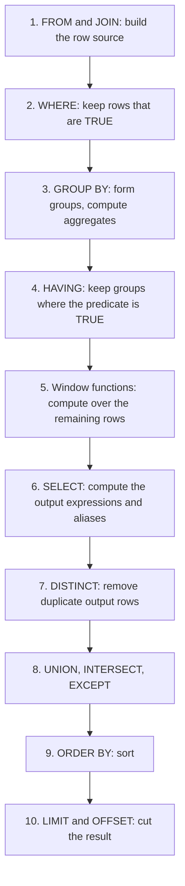

# The Relational Model and SQL

## Why It Matters

SQL questions appear in almost every backend interview. The questions come in two forms. The first form is a coding question: "Find the second highest salary", "Return the top three products per category", "Delete duplicate rows". The second form is a concept question: "What is the difference between `WHERE` and `HAVING`?", "Why does `NOT IN` return nothing?", "What does `RANK` do with ties?". On the job, the same knowledge decides whether a report is correct. A join condition in the wrong clause, a `NULL` that nobody expected, or a `COUNT(*)` that counts the wrong rows gives a wrong number without any error message. This page explains the relational model that SQL is built on, the places where SQL departs from that model, the logical order in which a database evaluates a query, and each major SQL feature with a result that the KB runner checks on SQLite 3.51. The physical side (indexes, plans, join algorithms) is on other pages: [indexing](03-indexing.md) and [query execution and tuning](05-query-execution-and-tuning.md). The classic interview problems are in `kb/databases/sql-interview-problems.md`. This page gives at most three short examples of them.

!!! info "Versions"
    The examples run on SQLite 3.51. The text names PostgreSQL 18 and MySQL 8.4 (InnoDB) where their behavior differs. A statement that SQLite cannot run carries a `sql-skip` marker, and the text before it names the dialect. Window functions need SQLite 3.25 or later. `RIGHT JOIN` and `FULL OUTER JOIN` need SQLite 3.39 or later.

## Core Concepts

### The relational model

E. F. Codd defined the relational model in 1970, and he defined the relational algebra in a later paper (1972, see Further Reading). Its terms come from mathematics, and SQL uses other names for the same things.

| Model term | SQL term | Meaning |
|---|---|---|
| Relation | Table (or the result of a query) | A set of tuples that share the same attributes |
| Tuple | Row | One element of the relation: a value for each attribute |
| Attribute | Column | A named position in the tuple, with a domain |
| Domain | Data type (plus constraints) | The set of values that an attribute may hold |
| Degree | Number of columns | The number of attributes of the relation |
| Cardinality | Number of rows | The number of tuples in the relation |
| Candidate key | `UNIQUE` or `PRIMARY KEY` | A minimal set of attributes that identifies a tuple |
| Foreign key | `FOREIGN KEY ... REFERENCES` | Attributes whose values must appear as a key in another relation |

**Relation**: a set of tuples. A set has no order and no duplicates, so a relation has no first row and no repeated row. **Key**: a set of attributes whose values identify each tuple. Keys and normal forms have their home in [schema design and normalization](02-schema-design-and-normalization.md).

### Relational algebra

**Relational algebra** is a set of operations. Each operation takes one or two relations and returns a relation. A database compiles a SQL query into a tree of such operations ([query execution and tuning](05-query-execution-and-tuning.md) shows the tree as a plan). Because the output of each operation is a relation, operations nest without limit.

| Operation | Symbol | Meaning | SQL form |
|---|---|---|---|
| Selection | sigma | Keep the tuples that satisfy a predicate | `WHERE` |
| Projection | pi | Keep some attributes, and remove duplicate tuples | `SELECT DISTINCT a, b` |
| Rename | rho | Give a relation or an attribute a new name | `AS` |
| Cartesian product | x | All pairs of one tuple from each relation | `CROSS JOIN` |
| Join (theta join) | join | Product followed by selection on a condition | `JOIN ... ON` |
| Natural join | join | Join on all attributes with the same name, and keep one copy | `NATURAL JOIN` |
| Union | union | Tuples that are in either relation | `UNION` |
| Difference | minus | Tuples that are in the first relation and not in the second | `EXCEPT` |
| Intersection | intersect | Tuples that are in both relations | `INTERSECT` |
| Division | divide | The values of A that pair with every value of B | no operator (use `NOT EXISTS` twice, or a `GROUP BY` with a count) |

Union and difference are two of the five primitive operations (selection, projection, product, union, difference). Join and intersection derive from them: `R intersect S` equals `R minus (R minus S)`, and a join equals a product followed by a selection. Union, intersection, and difference require that both relations have the same attributes.

### Where SQL departs from the relational model

SQL is not a faithful implementation of the model. Three departures matter in practice.

1. **Tables are bags (multisets), not sets.** A table with no key may hold two identical rows. `SELECT a FROM t` returns duplicates. Only `DISTINCT`, `UNION`, `INTERSECT`, and `EXCEPT` (without `ALL`) remove them. Projection in the algebra removes duplicates, so `SELECT` is not a pure projection.
2. **Rows have no defined order.** A relation is a set, so the model has no "first row". SQL tables inherit this. A query without `ORDER BY` returns rows in an order that the database does not define. The PostgreSQL documentation says that without `ORDER BY`, "the rows are returned in whatever order the system finds fastest to produce". The same query can return a different order after an index, a plan, or a data change.
3. **`NULL` adds a third truth value.** The model has no missing values. SQL adds `NULL` ("unknown or not applicable") and a three-valued logic. The next section covers it.

!!! warning "Row order"
    Never rely on the order of rows from a query without `ORDER BY`. A test that passes on one database version can fail on another. `ORDER BY` with a column that has ties is also not fully defined: add a unique column (usually the primary key) as the last sort key.

## How It Works

### The logical order of query processing

A SQL query is declarative: it describes the result, not the steps. The standard still defines a **logical order** of evaluation. The rules for scope (which names a clause can see) follow this order. The database may run the steps in another order (the optimizer rearranges them) as long as the result equals the result of the logical order.



The PostgreSQL `SELECT` reference lists the same steps: it computes the `FROM` items, removes rows with `WHERE`, groups and aggregates, removes groups with `HAVING`, computes the output expressions, removes duplicates with `DISTINCT`, combines results with `UNION`, `INTERSECT`, and `EXCEPT`, sorts with `ORDER BY`, and then applies `LIMIT`. Window functions run after `HAVING` and before `DISTINCT`. The `SELECT` list is the point where the aliases come into being.

Consequences of this order:

| Consequence | Reason |
|---|---|
| `WHERE` cannot use a `SELECT` alias | The database evaluates `WHERE` before `SELECT`, so the alias does not exist yet |
| `WHERE` cannot contain an aggregate such as `COUNT(*) > 1` | The groups do not exist yet. Use `HAVING` |
| `HAVING` can contain aggregates | It runs after `GROUP BY` |
| `ORDER BY` can use a `SELECT` alias | It runs after `SELECT` |
| A window function cannot appear in `WHERE` or `HAVING` | It runs after both. Put the query in a derived table or a CTE, and filter in the outer query |
| `LIMIT` applies after `ORDER BY` | `ORDER BY ... LIMIT 3` returns the three first rows of the sorted result |
| `DISTINCT` applies after `SELECT` | It compares the output rows, not the input rows |

Vendors extend this. PostgreSQL allows an output column name in `GROUP BY` and `ORDER BY` but not in `WHERE` or `HAVING`, and the documentation says so. MySQL allows an alias in `GROUP BY`, `ORDER BY`, and `HAVING`, and rejects it in `WHERE`. SQLite is more permissive than both: it accepts an alias in `WHERE`. Do not write code that relies on this extension, because it does not port.

<!-- sql-skip: postgresql -->

```sql
-- PostgreSQL: error 'column "gross" does not exist'. MySQL also rejects it.
-- (SQLite accepts this statement as an extension.)
SELECT salary * 12 AS gross FROM emp WHERE gross > 2000;
-- Portable form: repeat the expression.
SELECT salary * 12 AS gross FROM emp WHERE salary * 12 > 2000;
```

### The sample database

All SQL on this page uses two tables. `emp` has a self reference (`manager_id`) for the hierarchy examples. Employee 7 has no department, and department 3 has no employee. Several `bonus` values are `NULL`. Two employees share a salary, so ties appear.

```sql
DROP TABLE IF EXISTS emp;
DROP TABLE IF EXISTS dept;
CREATE TABLE dept (
    dept_id   INTEGER PRIMARY KEY,
    dept_name TEXT NOT NULL
);
CREATE TABLE emp (
    emp_id     INTEGER PRIMARY KEY,
    name       TEXT NOT NULL,
    dept_id    INTEGER REFERENCES dept (dept_id),
    manager_id INTEGER REFERENCES emp (emp_id),
    salary     INTEGER NOT NULL,
    bonus      INTEGER
);
INSERT INTO dept VALUES (1, 'Eng'), (2, 'Sales'), (3, 'HR');
INSERT INTO emp VALUES
    (1, 'Asha',   1, NULL, 300, 50),
    (2, 'Bala',   1, 1,    200, NULL),
    (3, 'Chitra', 1, 2,    150, 10),
    (4, 'Dev',    1, 2,    150, NULL),
    (5, 'Esha',   2, 1,    180, 20),
    (6, 'Farid',  2, 5,    120, NULL),
    (7, 'Gita',   NULL, 1, 100, NULL);
```

The table has 7 rows, but only 3 distinct non-null `dept_id` values. The bag behavior shows here:

```sql
SELECT dept_id FROM emp ORDER BY dept_id;
```

<!-- sql-result -->

```text
dept_id
NULL
1
1
1
1
2
2
```

`SELECT DISTINCT dept_id FROM emp` returns the set form: one row for each distinct value, and one row for `NULL`. `DISTINCT` treats two `NULL` values as equal, although `NULL = NULL` is not true. The SQLite documentation on `NULL` handling confirms that every engine it tested treats `NULL` values as not distinct in `SELECT DISTINCT` and in `UNION`.

### NULL and three-valued logic

**`NULL`**: a marker for a value that is unknown or does not apply. It is not a value. **Three-valued logic**: a logic with the truth values TRUE, FALSE, and UNKNOWN. Any comparison with `NULL` (`=`, `<>`, `<`, `>`) returns UNKNOWN. SQL represents UNKNOWN as `NULL` of boolean type.

The truth tables show why UNKNOWN spreads:

| A | B | A AND B | A OR B | NOT A |
|---|---|---|---|---|
| TRUE | UNKNOWN | UNKNOWN | TRUE | FALSE |
| FALSE | UNKNOWN | FALSE | UNKNOWN | TRUE |
| UNKNOWN | UNKNOWN | UNKNOWN | UNKNOWN | UNKNOWN |

`WHERE` keeps a row only if the predicate is TRUE. A row for which the predicate is FALSE or UNKNOWN does not pass. `CHECK` constraints work the other way: a row passes unless the predicate is FALSE, so a `NULL` passes a `CHECK`. Use `NOT NULL` to forbid `NULL`.

```sql
SELECT NULL = NULL        AS eq_null,
       NULL IS NULL       AS is_null,
       1 IN (2, NULL)     AS in_with_null,
       1 NOT IN (2, NULL) AS not_in_with_null,
       NULL OR 1          AS or_true,
       NULL AND 0         AS and_false;
```

<!-- sql-result -->

```text
eq_null | is_null | in_with_null | not_in_with_null | or_true | and_false
NULL | 1 | NULL | NULL | 1 | 0
```

SQLite prints TRUE as 1 and FALSE as 0. `1 IN (2, NULL)` expands to `1 = 2 OR 1 = NULL`, which is `FALSE OR UNKNOWN`, which is UNKNOWN. `1 NOT IN (2, NULL)` expands to `1 <> 2 AND 1 <> NULL`, which is `TRUE AND UNKNOWN`, which is UNKNOWN. The row does not pass.

#### The NOT IN trap

`NOT IN` with a subquery that can return `NULL` returns no rows at all. The query below looks for departments without employees. The `emp` table has one row with a `NULL` `dept_id` (Gita), so the subquery returns `NULL` among its values.

```sql
SELECT dept_name FROM dept
WHERE dept_id NOT IN (SELECT dept_id FROM emp);
```

<!-- sql-result -->

```text

```

The query returns no rows: the result block is empty. For department 3 (HR), the predicate expands to `3 <> 1 AND 3 <> 2 AND 3 <> NULL`. The last term is UNKNOWN, so the whole predicate is UNKNOWN, and the row does not pass. `NOT EXISTS` does not have this problem, because `EXISTS` tests for the presence of a row and returns only TRUE or FALSE:

```sql
SELECT d.dept_name FROM dept d
WHERE NOT EXISTS (SELECT 1 FROM emp e WHERE e.dept_id = d.dept_id);
```

<!-- sql-result -->

```text
dept_name
HR
```

Recommendation: use `NOT EXISTS` for "rows without a match". Use `NOT IN` only with a list of constants, or with a subquery on a `NOT NULL` column.

#### IS DISTINCT FROM and COALESCE

**`IS DISTINCT FROM`**: a comparison that treats `NULL` as an ordinary value. `a IS DISTINCT FROM b` is TRUE if the values differ, or if exactly one is `NULL`. It is FALSE if both are `NULL`. It never returns UNKNOWN. `IS NOT DISTINCT FROM` is the negation. PostgreSQL, SQLite 3.39 and later, and the SQL standard support these. MySQL has the operator `<=>` (null-safe equal) for `IS NOT DISTINCT FROM`.

```sql
SELECT name, bonus,
       bonus <> 10                AS plain_ne,
       bonus IS DISTINCT FROM 10  AS is_distinct
FROM emp
ORDER BY emp_id;
```

<!-- sql-result -->

```text
name | bonus | plain_ne | is_distinct
Asha | 50 | 1 | 1
Bala | NULL | NULL | 1
Chitra | 10 | 0 | 0
Dev | NULL | NULL | 1
Esha | 20 | 1 | 1
Farid | NULL | NULL | 1
Gita | NULL | NULL | 1
```

The plain `<>` returns `NULL` for every employee with no bonus, so `WHERE bonus <> 10` hides them. `IS DISTINCT FROM` keeps them.

**`COALESCE(a, b, ...)`**: returns the first argument that is not `NULL`. Use it to replace `NULL` with a default. **`NULLIF(a, b)`**: returns `NULL` if `a = b`, otherwise `a`. `NULLIF` protects a division: `x / NULLIF(y, 0)` returns `NULL` instead of an error when `y` is 0.

```sql
SELECT name, salary + COALESCE(bonus, 0) AS total_pay,
       salary + bonus                    AS naive_total
FROM emp
ORDER BY emp_id;
```

<!-- sql-result -->

```text
name | total_pay | naive_total
Asha | 350 | 350
Bala | 200 | NULL
Chitra | 160 | 160
Dev | 150 | NULL
Esha | 200 | 200
Farid | 120 | NULL
Gita | 100 | NULL
```

Arithmetic with `NULL` gives `NULL`. The `naive_total` column is `NULL` for the four employees without a bonus.

Other `NULL` facts that interviews test:

- `ORDER BY` places `NULL` values at one end. PostgreSQL treats `NULL` as larger than every other value: `NULLS LAST` is the default for `ASC` and `NULLS FIRST` for `DESC` (PostgreSQL `SELECT` reference). SQLite and MySQL treat `NULL` as smaller than every value, so an ascending sort puts `NULL` first (SQLite `SELECT` documentation: "SQLite considers NULL values to be smaller than any other values for sorting purposes"; MySQL manual, "Working with NULL Values": `NULL` values come first with `ASC` and last with `DESC`). The `NULL` row comes first in the outputs on this page. Write `NULLS FIRST` or `NULLS LAST` when the order matters (SQLite 3.30 and later, and PostgreSQL support it; MySQL 8.4 has no such clause: sort on `col IS NULL` first).
- A `UNIQUE` constraint on one nullable column allows several `NULL` values in PostgreSQL, SQLite, and MySQL (SQLite documentation, "NULL handling in SQLite"), and in Oracle for a single-column key. SQL Server treats `NULL` values as equal in a unique constraint, so it allows one `NULL` only. The SQL Server documentation shows a filtered unique index (`WHERE col IS NOT NULL`) as the way to enforce uniqueness on non-null values only. PostgreSQL 15 added `UNIQUE NULLS NOT DISTINCT` to make a unique constraint treat `NULL` values as equal (PostgreSQL 15 release notes).
- `GROUP BY` puts all `NULL` values into one group.
- Aggregates other than `COUNT(*)` skip `NULL` inputs.
- Oracle treats the empty string as `NULL` (Oracle Database SQL Language Reference, "Nulls"). PostgreSQL, MySQL, and SQLite do not.

### Joins

A **join** combines rows of two row sources by a condition. The logical definition is the cartesian product followed by a filter. The database does not build the product: it uses a join algorithm ([query execution and tuning](05-query-execution-and-tuning.md) covers them).

| Join | Returns |
|---|---|
| `INNER JOIN` | Pairs of rows that satisfy the condition |
| `LEFT [OUTER] JOIN` | All rows of the left table. For a left row without a match, the right columns are `NULL` |
| `RIGHT [OUTER] JOIN` | All rows of the right table. The mirror of `LEFT` |
| `FULL [OUTER] JOIN` | All rows of both tables, with `NULL` on the side without a match |
| `CROSS JOIN` | Every pair (the cartesian product), with no condition |
| Self join | A join of a table with itself, with two aliases |

MySQL has no `FULL OUTER JOIN`. The MySQL 8.4 reference lists only `LEFT` and `RIGHT` outer joins. The usual workaround is a `LEFT JOIN` combined by `UNION` with a `RIGHT JOIN`. `UNION` also removes legitimate duplicate rows. On tables without a key, write `UNION ALL` and add `WHERE d.dept_id IS NULL` to the `RIGHT JOIN` query, so that it returns only the rows without a match. In MySQL, `JOIN`, `CROSS JOIN`, and `INNER JOIN` are syntactic equivalents. In standard SQL they are not.

**Inner join.** Employees with a department. Gita (no department) does not appear, and HR (no employee) does not appear.

```sql
SELECT e.name, d.dept_name
FROM emp e
JOIN dept d ON d.dept_id = e.dept_id
ORDER BY e.emp_id;
```

<!-- sql-result -->

```text
name | dept_name
Asha | Eng
Bala | Eng
Chitra | Eng
Dev | Eng
Esha | Sales
Farid | Sales
```

**Left join.** All departments with their headcounts. HR appears with 0. `COUNT(e.emp_id)` counts non-null employee ids, so it counts 0 for HR. `COUNT(*)` would count the one null-extended row and return 1.

```sql
SELECT d.dept_name, COUNT(e.emp_id) AS headcount, COUNT(*) AS count_star
FROM dept d
LEFT JOIN emp e ON e.dept_id = d.dept_id
GROUP BY d.dept_id, d.dept_name
ORDER BY d.dept_id;
```

<!-- sql-result -->

```text
dept_name | headcount | count_star
Eng | 4 | 4
Sales | 2 | 2
HR | 0 | 1
```

**Full join.** Both unmatched rows appear: HR (no employees) and Gita (no department). PostgreSQL and SQLite run this statement. MySQL does not.

```sql
SELECT d.dept_name, e.name
FROM dept d
FULL OUTER JOIN emp e ON e.dept_id = d.dept_id
ORDER BY d.dept_id, e.emp_id;
```

<!-- sql-result -->

```text
dept_name | name
NULL | Gita
Eng | Asha
Eng | Bala
Eng | Chitra
Eng | Dev
Sales | Esha
Sales | Farid
HR | NULL
```

<!-- sql-skip: mysql -->

```sql
-- MySQL: emulate FULL OUTER JOIN with a LEFT JOIN and a RIGHT JOIN (UNION removes
-- the duplicate rows that both halves return for matched pairs).
SELECT d.dept_name, e.name FROM dept d LEFT JOIN emp e ON e.dept_id = d.dept_id
UNION
SELECT d.dept_name, e.name FROM dept d RIGHT JOIN emp e ON e.dept_id = d.dept_id;
```

**Self join.** Each employee with the name of the manager. The manager is a row of the same table, so the query joins `emp` to itself with two aliases. A `LEFT JOIN` keeps Asha, who has no manager.

```sql
SELECT e.name AS employee, m.name AS manager
FROM emp e
LEFT JOIN emp m ON m.emp_id = e.manager_id
ORDER BY e.emp_id;
```

<!-- sql-result -->

```text
employee | manager
Asha | NULL
Bala | Asha
Chitra | Bala
Dev | Bala
Esha | Asha
Farid | Esha
Gita | Asha
```

**Cross join.** Every pair of rows. A cross join of tables with m and n rows returns m times n rows. It has legitimate uses (a calendar table against a list of products, to find missing combinations), but a cross join that appears by accident (a missing join condition) multiplies the row count.

```sql
SELECT COUNT(*) AS pairs FROM dept CROSS JOIN emp;
```

<!-- sql-result -->

```text
pairs
21
```

#### Join conditions in ON against WHERE

For an inner join, a condition in `ON` and the same condition in `WHERE` give the same result. For an outer join they do not. The `ON` condition decides which rows match, and the database then adds the unmatched rows of the preserved side. The `WHERE` condition runs after the join and removes rows, including the null-extended rows.

```sql
SELECT d.dept_name, e.name
FROM dept d
LEFT JOIN emp e ON e.dept_id = d.dept_id AND e.salary >= 180
ORDER BY d.dept_id, e.emp_id;
```

<!-- sql-result -->

```text
dept_name | name
Eng | Asha
Eng | Bala
Sales | Esha
HR | NULL
```

All three departments appear. Eng matches Asha and Bala, and Sales matches Esha. HR has no employee that satisfies the condition, so the left join keeps HR with a `NULL` name. Now the same filter in `WHERE`:

```sql
SELECT d.dept_name, e.name
FROM dept d
LEFT JOIN emp e ON e.dept_id = d.dept_id
WHERE e.salary >= 180
ORDER BY d.dept_id, e.emp_id;
```

<!-- sql-result -->

```text
dept_name | name
Eng | Asha
Eng | Bala
Sales | Esha
```

The `WHERE` condition `e.salary >= 180` is UNKNOWN for the null-extended HR row, so the row disappears. The query behaves like an inner join. Rule: for the preserved side of an outer join, put conditions on the other table in `ON`. Put conditions on the preserved table in `WHERE`.

#### Semi-join and anti-join

A **semi-join** returns the rows of table A that have at least one match in table B. It returns each A row once, even if B has many matches. SQL has no keyword for it: write `EXISTS` or `IN`. An **anti-join** returns the rows of A that have no match in B: write `NOT EXISTS`, or a `LEFT JOIN ... WHERE b.key IS NULL`.

```sql
SELECT d.dept_name FROM dept d
WHERE EXISTS (SELECT 1 FROM emp e WHERE e.dept_id = d.dept_id AND e.salary >= 180)
ORDER BY d.dept_id;
```

<!-- sql-result -->

```text
dept_name
Eng
Sales
```

An inner join of `dept` with `emp` would return Eng twice (Asha and Bala). The semi-join returns it once. The anti-join form with `LEFT JOIN`:

```sql
SELECT d.dept_name
FROM dept d
LEFT JOIN emp e ON e.dept_id = d.dept_id
WHERE e.emp_id IS NULL;
```

<!-- sql-result -->

```text
dept_name
HR
```

The column in `WHERE e.emp_id IS NULL` must be a column that is never `NULL` in a real match (the primary key). The page on [query execution and tuning](05-query-execution-and-tuning.md) explains that the planner can run `EXISTS` and `IN` as a semi-join plan.

### Grouping and aggregates

**Aggregate function**: a function that reduces many rows to one value: `COUNT`, `SUM`, `AVG`, `MIN`, `MAX`. **`GROUP BY`**: splits the rows into groups of equal values and returns one output row for each group. Every column in the `SELECT` list must be in `GROUP BY` or inside an aggregate. (The standard and PostgreSQL also accept a column that is functionally dependent on the group keys, for example any column of a table when `GROUP BY` lists its primary key. MySQL accepts the same when it can detect the dependency, and MySQL accepts any other column when `ONLY_FULL_GROUP_BY` is off.) A query with an aggregate and no `GROUP BY` forms one group over all rows, and returns one row, even if the input is empty. `COUNT(*)` returns 0 for empty input and `SUM` returns `NULL`.

| Expression | Counts |
|---|---|
| `COUNT(*)` | All rows of the group |
| `COUNT(col)` | Rows where `col` is not `NULL` |
| `COUNT(DISTINCT col)` | Distinct non-null values of `col` |
| `AVG(col)` | The sum of non-null values divided by the count of non-null values |

```sql
SELECT COUNT(*)                  AS all_rows,
       COUNT(bonus)              AS with_bonus,
       COUNT(DISTINCT dept_id)   AS distinct_depts,
       ROUND(AVG(bonus), 2)      AS avg_bonus,
       ROUND(AVG(COALESCE(bonus, 0)), 2) AS avg_bonus_zero
FROM emp;
```

<!-- sql-result -->

```text
all_rows | with_bonus | distinct_depts | avg_bonus | avg_bonus_zero
7 | 3 | 2 | 26.67 | 11.43
```

`AVG(bonus)` divides 80 by 3 rows (26.67). `AVG(COALESCE(bonus, 0))` divides 80 by 7 rows (11.43). Which one is correct depends on what the business means by "average bonus". State the choice.

**`WHERE` against `HAVING`.** `WHERE` filters rows before grouping. `HAVING` filters groups after aggregation. A condition on a plain column belongs in `WHERE`, because it removes rows before the work of grouping. A condition on an aggregate belongs in `HAVING`.

```sql
SELECT dept_id, COUNT(*) AS n, SUM(salary) AS payroll
FROM emp
WHERE salary >= 150
GROUP BY dept_id
HAVING COUNT(*) >= 2
ORDER BY dept_id;
```

<!-- sql-result -->

```text
dept_id | n | payroll
1 | 4 | 800
```

The query removes the rows with a salary below 150 (Farid and Gita), groups the remaining 5 rows by department, and keeps the groups with at least 2 rows. Sales has one remaining row (Esha) and does not pass `HAVING`. In PostgreSQL, a `HAVING` clause without `GROUP BY` turns the query into a grouped query over one group.

**Rows that `GROUP BY` drops.** Three cases lose rows without an error:

- `WHERE` removes rows before grouping, as above.
- `HAVING` removes whole groups.
- An inner join before the grouping removes the rows without a match. The left-join headcount query above keeps HR. An inner join would drop HR.

`NULL` keys do not drop: all `NULL` values form one group (Gita forms a group with `dept_id` `NULL`).

### Subqueries

A **subquery** is a `SELECT` inside another statement. Its form decides its use.

| Form | Returns | Used in |
|---|---|---|
| Scalar subquery | One row, one column | Anywhere an expression is valid. An error if it returns more than one row (a `NULL` if it returns none) |
| Row or column subquery | A list of values | `IN`, `ANY`, `ALL` |
| `EXISTS` subquery | TRUE if the subquery returns at least one row | `WHERE` |
| Derived table | A full table | `FROM` (the alias is mandatory in MySQL and in standard SQL; PostgreSQL 16 and later may omit it) |
| Correlated subquery | Depends on a column of the outer row | Any of the above |

A **correlated subquery** refers to a column of the outer query. Logically, the database runs it once for each outer row. The optimizer often rewrites it into a join ([query execution and tuning](05-query-execution-and-tuning.md)).

```sql
-- Scalar subquery: employees paid above the company average.
SELECT name, salary
FROM emp
WHERE salary > (SELECT AVG(salary) FROM emp)
ORDER BY emp_id;
```

<!-- sql-result -->

```text
name | salary
Asha | 300
Bala | 200
Esha | 180
```

```sql
-- Correlated subquery: employees paid above the average of their own department.
SELECT e.name, e.dept_id, e.salary
FROM emp e
WHERE e.salary > (SELECT AVG(x.salary) FROM emp x WHERE x.dept_id = e.dept_id)
ORDER BY e.emp_id;
```

<!-- sql-result -->

```text
name | dept_id | salary
Asha | 1 | 300
Esha | 2 | 180
```

Gita has `dept_id` `NULL`, so `x.dept_id = e.dept_id` is never TRUE, the subquery returns `NULL`, and the comparison is UNKNOWN. Gita does not appear. A **derived table** is a subquery in `FROM`. The same result with a join to a derived table:

```sql
SELECT e.name, e.dept_id, e.salary
FROM emp e
JOIN (SELECT dept_id, AVG(salary) AS avg_salary FROM emp GROUP BY dept_id) a
  ON a.dept_id = e.dept_id
WHERE e.salary > a.avg_salary
ORDER BY e.emp_id;
```

<!-- sql-result -->

```text
name | dept_id | salary
Asha | 1 | 300
Esha | 2 | 180
```

The derived-table form computes each department average once. The correlated form runs the average for each outer row, unless the optimizer rewrites it. Both forms give the same rows here.

`IN` against `EXISTS`: `IN` compares one value against the list that a subquery returns. `EXISTS` tests whether a correlated subquery returns any row. They give the same result for a semi-join, except for `NULL` handling in `NOT IN` (see above). The page on [query execution and tuning](05-query-execution-and-tuning.md) covers performance.

### CTEs and recursive CTEs

A **common table expression (CTE)** names a subquery with `WITH name AS (...)` so that the main query can use it like a table. A CTE makes a long query readable, and it lets one query refer to the same intermediate result more than once.

```sql
WITH dept_pay AS (
    SELECT dept_id, SUM(salary) AS payroll FROM emp GROUP BY dept_id
)
SELECT d.dept_name, p.payroll
FROM dept_pay p
JOIN dept d ON d.dept_id = p.dept_id
ORDER BY p.payroll DESC;
```

<!-- sql-result -->

```text
dept_name | payroll
Eng | 800
Sales | 300
```

In PostgreSQL 12 and later, a non-recursive CTE that has no side effect and that the query references once is folded into the parent query. The query writes `MATERIALIZED` to force a separate evaluation and `NOT MATERIALIZED` to force folding (PostgreSQL documentation, "WITH Queries"). Before PostgreSQL 12, a CTE was always a barrier that the planner did not look through. Do not assume that a CTE caches its result in another product: check the documentation.

A **recursive CTE** refers to itself. It has a non-recursive term (the seed), the keyword `UNION ALL` (or `UNION`), and a recursive term that reads the CTE. The database evaluates it as a loop: it runs the seed, then it runs the recursive term on the rows of the previous round until a round returns no new rows. The PostgreSQL documentation describes this loop with a working table and an intermediate table.

The classic use is a hierarchy. The query below walks the org chart from the top (the employee with no manager) down, and it computes the depth and the path:

```sql
WITH RECURSIVE org(emp_id, name, depth, path) AS (
    SELECT emp_id, name, 0, name
    FROM emp
    WHERE manager_id IS NULL
  UNION ALL
    SELECT e.emp_id, e.name, o.depth + 1, o.path || ' > ' || e.name
    FROM emp e
    JOIN org o ON e.manager_id = o.emp_id
)
SELECT depth, path FROM org ORDER BY path;
```

<!-- sql-result -->

```text
depth | path
0 | Asha
1 | Asha > Bala
2 | Asha > Bala > Chitra
2 | Asha > Bala > Dev
1 | Asha > Esha
2 | Asha > Esha > Farid
1 | Asha > Gita
```

Points to state in an interview:

- The recursion stops when a round adds no rows. A cycle in the data (an employee who is their own ancestor) makes the loop run forever with `UNION ALL`. Protect against it with a depth limit (`WHERE o.depth < 20`), with a path check, or with `UNION` (which removes duplicate rows, but stops the loop only if whole rows repeat; a `depth` column makes each row unique, so it does not stop). PostgreSQL 14 added the `CYCLE` and `SEARCH` clauses for this.
- MySQL 8.4 stops a recursive CTE after `cte_max_recursion_depth` iterations. The default is 1000. MySQL also requires the `RECURSIVE` keyword, and it forbids aggregates, window functions, `GROUP BY`, and `ORDER BY` in the recursive term.
- The output order of a recursive CTE is not defined. Sort the final query.
- The same pattern gives bills of materials, category trees, and graph reachability. For large graphs, a graph database may fit better (see `kb/databases/07-nosql-families.md`).

### Window functions

A **window function** computes a value for each row from a set of related rows (the window), and it does not collapse the rows. This differs from `GROUP BY`, which returns one row for each group. The `OVER` clause defines the window:

```text
function(args) OVER (
    PARTITION BY column, ...   -- split the rows into independent groups
    ORDER BY column, ...       -- the order inside the partition
    frame clause               -- which rows of the partition the function sees
)
```

**`PARTITION BY`**: splits the rows into partitions, and the function restarts in each partition. Without it, the whole result is one partition. **Peer rows**: rows of one partition that have equal values in the `ORDER BY` columns of the window.

#### Ranking functions

| Function | Behavior on ties |
|---|---|
| `ROW_NUMBER()` | Unique numbers 1, 2, 3, ... Ties get different numbers in an undefined order unless `ORDER BY` has a tie-breaker |
| `RANK()` | Ties share a rank, and the next rank skips: 1, 2, 2, 4 |
| `DENSE_RANK()` | Ties share a rank, and the next rank does not skip: 1, 2, 2, 3 |
| `NTILE(n)` | Splits the partition into `n` buckets. The first buckets get the extra rows when the count does not divide evenly |

```sql
SELECT name, salary,
       ROW_NUMBER() OVER w AS row_num,
       RANK()       OVER w AS rnk,
       DENSE_RANK() OVER w AS dense_rnk,
       NTILE(3)     OVER w AS tile
FROM emp
WINDOW w AS (ORDER BY salary DESC, emp_id)
ORDER BY salary DESC, emp_id;
```

<!-- sql-result -->

```text
name | salary | row_num | rnk | dense_rnk | tile
Asha | 300 | 1 | 1 | 1 | 1
Bala | 200 | 2 | 2 | 2 | 1
Esha | 180 | 3 | 3 | 3 | 1
Chitra | 150 | 4 | 4 | 4 | 2
Dev | 150 | 5 | 5 | 5 | 2
Farid | 120 | 6 | 6 | 6 | 3
Gita | 100 | 7 | 7 | 7 | 3
```

This window orders by `salary DESC, emp_id`. Because `emp_id` breaks the tie, `RANK` sees no peers: Chitra and Dev both have 150, but the window treats them as different, and `RANK` gives 4 and 5. To see `RANK` share a rank, order by `salary` alone:

```sql
SELECT name, salary,
       RANK()       OVER (ORDER BY salary DESC) AS rnk,
       DENSE_RANK() OVER (ORDER BY salary DESC) AS dense_rnk
FROM emp
ORDER BY salary DESC, emp_id;
```

<!-- sql-result -->

```text
name | salary | rnk | dense_rnk
Asha | 300 | 1 | 1
Bala | 200 | 2 | 2
Esha | 180 | 3 | 3
Chitra | 150 | 4 | 4
Dev | 150 | 4 | 4
Farid | 120 | 6 | 5
Gita | 100 | 7 | 6
```

Chitra and Dev now share rank 4. `RANK` then skips 5 and gives Farid rank 6. `DENSE_RANK` gives Farid 5. For "the Nth highest value", `DENSE_RANK` gives the Nth distinct value. `ROW_NUMBER` gives the Nth row. Choose by what the problem says about ties (see `kb/databases/sql-interview-problems.md`).

The `WINDOW w AS (...)` clause names a window, so that several functions share one definition. PostgreSQL, MySQL 8.0 and later, and SQLite support it.

#### LAG, LEAD, and running totals

**`LAG(col, n, default)`**: the value of `col` in the row `n` rows before the current row in the partition order. **`LEAD`**: the row `n` rows after. Both return `NULL` (or the default) at the partition edge. They ignore the frame clause.

```sql
SELECT name, salary,
       LAG(salary)  OVER (ORDER BY emp_id) AS prev_salary,
       LEAD(salary) OVER (ORDER BY emp_id) AS next_salary,
       salary - LAG(salary, 1, salary) OVER (ORDER BY emp_id) AS change
FROM emp
ORDER BY emp_id;
```

<!-- sql-result -->

```text
name | salary | prev_salary | next_salary | change
Asha | 300 | NULL | 200 | 0
Bala | 200 | 300 | 150 | -100
Chitra | 150 | 200 | 150 | -50
Dev | 150 | 150 | 180 | 0
Esha | 180 | 150 | 120 | 30
Farid | 120 | 180 | 100 | -60
Gita | 100 | 120 | NULL | -20
```

An aggregate with `OVER` turns into a window aggregate. With an `ORDER BY` in the window, `SUM` gives a running total.

```sql
SELECT name, salary,
       SUM(salary) OVER (ORDER BY emp_id) AS running_total,
       SUM(salary) OVER (PARTITION BY dept_id ORDER BY emp_id) AS running_in_dept
FROM emp
ORDER BY emp_id;
```

<!-- sql-result -->

```text
name | salary | running_total | running_in_dept
Asha | 300 | 300 | 300
Bala | 200 | 500 | 500
Chitra | 150 | 650 | 650
Dev | 150 | 800 | 800
Esha | 180 | 980 | 180
Farid | 120 | 1100 | 300
Gita | 100 | 1200 | 100
```

Gita has `dept_id` `NULL`. `PARTITION BY` puts all `NULL` values in one partition, so Gita forms her own partition and her running total is her own salary.

#### Frames: ROWS, RANGE, GROUPS

The **frame** is the part of the partition that an aggregate window function reads for the current row. Three modes:

| Mode | The offset counts | Peers |
|---|---|---|
| `ROWS` | Physical rows | The frame can split a set of peers |
| `RANGE` | A distance in the value of the single `ORDER BY` column | The frame includes all peers of the current row at its end |
| `GROUPS` | Groups of peers | The frame never splits peers (PostgreSQL 11 and later, SQLite 3.28 and later; MySQL has no `GROUPS` mode) |

**The default frame.** If the window has an `ORDER BY` and no frame clause, the default is `RANGE BETWEEN UNBOUNDED PRECEDING AND CURRENT ROW`. The PostgreSQL documentation says that this frame "sets the frame to be all rows from the partition start up through the current row's last peer". The SQLite documentation gives the same default. If the window has no `ORDER BY`, the frame is the whole partition.

The default produces two surprises. The first is the running total with ties:

```sql
SELECT salary,
       SUM(salary) OVER (ORDER BY salary
                         ROWS BETWEEN UNBOUNDED PRECEDING AND CURRENT ROW) AS rows_frame,
       SUM(salary) OVER (ORDER BY salary) AS default_range_frame
FROM emp
ORDER BY salary;
```

<!-- sql-result -->

```text
salary | rows_frame | default_range_frame
100 | 100 | 100
120 | 220 | 220
150 | 370 | 520
150 | 520 | 520
180 | 700 | 700
200 | 900 | 900
300 | 1200 | 1200
```

The two rows with salary 150 are peers. With `ROWS`, the running total grows by one row at a time (370, then 520). With the default `RANGE` frame, both rows see all their peers, so both show 520. Use `ROWS` for a running total when the sort key has ties.

The second surprise is `LAST_VALUE`. **`FIRST_VALUE`** and **`LAST_VALUE`** return the value of an expression at the first and at the last row of the frame. With the default frame, the last row of the frame is the current row (or its last peer), so `LAST_VALUE` returns the current row's own value instead of the last value of the partition.

```sql
SELECT name, dept_id, salary,
       LAST_VALUE(name) OVER (PARTITION BY dept_id ORDER BY salary DESC, emp_id)
           AS last_default_frame,
       LAST_VALUE(name) OVER (PARTITION BY dept_id ORDER BY salary DESC, emp_id
           ROWS BETWEEN UNBOUNDED PRECEDING AND UNBOUNDED FOLLOWING) AS lowest_paid
FROM emp
WHERE dept_id IS NOT NULL
ORDER BY dept_id, salary DESC, emp_id;
```

<!-- sql-result -->

```text
name | dept_id | salary | last_default_frame | lowest_paid
Asha | 1 | 300 | Asha | Dev
Bala | 1 | 200 | Bala | Dev
Chitra | 1 | 150 | Chitra | Dev
Dev | 1 | 150 | Dev | Dev
Esha | 2 | 180 | Esha | Farid
Farid | 2 | 120 | Farid | Farid
```

The fix is an explicit frame that runs to `UNBOUNDED FOLLOWING`, as in the last column. Another fix is to reverse the sort and use `FIRST_VALUE`. A moving average uses a bounded frame, for example `AVG(x) OVER (ORDER BY day ROWS BETWEEN 2 PRECEDING AND CURRENT ROW)` for a three-row window.

#### Top N per group

A window function cannot appear in `WHERE`, so the filter on the rank goes in an outer query or in a CTE. This is the most common window pattern in interviews.

```sql
WITH ranked AS (
    SELECT name, dept_id, salary,
           ROW_NUMBER() OVER (PARTITION BY dept_id ORDER BY salary DESC, emp_id) AS rn
    FROM emp
    WHERE dept_id IS NOT NULL
)
SELECT dept_id, name, salary FROM ranked WHERE rn <= 2 ORDER BY dept_id, rn;
```

<!-- sql-result -->

```text
dept_id | name | salary
1 | Asha | 300
1 | Bala | 200
2 | Esha | 180
2 | Farid | 120
```

Use `RANK` or `DENSE_RANK` instead of `ROW_NUMBER` if the question wants all tied rows. PostgreSQL also has `DISTINCT ON` for "first row per group", and `FETCH FIRST n ROWS WITH TIES` for the tie case.

<!-- sql-skip: postgresql -->

```sql
-- PostgreSQL only: the highest-paid employee of each department.
SELECT DISTINCT ON (dept_id) dept_id, name, salary
FROM emp
WHERE dept_id IS NOT NULL
ORDER BY dept_id, salary DESC, emp_id;
```

### Set operations

A **set operation** combines the results of two queries with the same number of columns and compatible types.

| Operator | Result | Duplicates |
|---|---|---|
| `UNION` | Rows in either query | Removed |
| `UNION ALL` | Rows in either query | Kept (no sort or hash step) |
| `INTERSECT` | Rows in both queries | Removed |
| `EXCEPT` | Rows in the first query and not in the second | Removed |

PostgreSQL also has `INTERSECT ALL` and `EXCEPT ALL`: a row with m duplicates on the left and n on the right appears min(m, n) times (`INTERSECT ALL`) or max(m - n, 0) times (`EXCEPT ALL`). MySQL 8.4 has `INTERSECT [ALL | DISTINCT]` and `EXCEPT [ALL | DISTINCT]` (MySQL 8.4 reference, "EXCEPT Clause"; the default is `DISTINCT`). Oracle names `EXCEPT` `MINUS`. `INTERSECT` binds more tightly than `UNION` and `EXCEPT` in PostgreSQL. Use parentheses.

`UNION` must find duplicates, so it sorts or hashes the whole result. `UNION ALL` does not. If the two inputs cannot overlap, or the duplicates do not matter, write `UNION ALL`.

```sql
DROP TABLE IF EXISTS set_a;
DROP TABLE IF EXISTS set_b;
CREATE TABLE set_a (x INTEGER);
CREATE TABLE set_b (x INTEGER);
INSERT INTO set_a VALUES (1), (1), (2), (3);
INSERT INTO set_b VALUES (2), (3), (3), (4);
```

```sql
SELECT op, n FROM (
    SELECT 1 AS k, 'UNION' AS op, COUNT(*) AS n
      FROM (SELECT x FROM set_a UNION SELECT x FROM set_b)
    UNION ALL
    SELECT 2, 'UNION ALL', COUNT(*)
      FROM (SELECT x FROM set_a UNION ALL SELECT x FROM set_b)
    UNION ALL
    SELECT 3, 'INTERSECT', COUNT(*)
      FROM (SELECT x FROM set_a INTERSECT SELECT x FROM set_b)
    UNION ALL
    SELECT 4, 'EXCEPT', COUNT(*)
      FROM (SELECT x FROM set_a EXCEPT SELECT x FROM set_b)
) ORDER BY k;
```

<!-- sql-result -->

```text
op | n
UNION | 4
UNION ALL | 8
INTERSECT | 2
EXCEPT | 1
```

`set_a` holds the values 1, 1, 2, 3. `set_b` holds 2, 3, 3, 4. `UNION` returns {1, 2, 3, 4}. `UNION ALL` returns all 8 rows. `INTERSECT` returns {2, 3}. `EXCEPT` returns {1}: the duplicate 1 collapses to one row.

### CASE and conditional aggregation

**`CASE`**: the conditional expression of SQL. The searched form `CASE WHEN cond THEN a ELSE b END` evaluates the conditions in order and returns the first match. Without `ELSE`, an unmatched row gives `NULL`. **Conditional aggregation**: an aggregate over a `CASE` expression, which computes several filtered aggregates in one scan. It turns rows into columns (a pivot).

```sql
SELECT d.dept_name,
       COUNT(*)                                       AS headcount,
       SUM(CASE WHEN e.salary >= 150 THEN 1 ELSE 0 END) AS high_paid,
       COUNT(CASE WHEN e.bonus IS NOT NULL THEN 1 END) AS with_bonus,
       COUNT(*) FILTER (WHERE e.salary < 150)         AS low_paid
FROM dept d
JOIN emp e ON e.dept_id = d.dept_id
GROUP BY d.dept_id, d.dept_name
ORDER BY d.dept_id;
```

<!-- sql-result -->

```text
dept_name | headcount | high_paid | with_bonus | low_paid
Eng | 4 | 4 | 2 | 0
Sales | 2 | 1 | 1 | 1
```

`COUNT(CASE WHEN ... THEN 1 END)` works because the omitted `ELSE` gives `NULL`, and `COUNT` skips `NULL`. The `FILTER (WHERE ...)` clause is standard SQL. PostgreSQL and SQLite support it. MySQL 8.4 does not, so use the `CASE` form there.

### DML: INSERT, UPDATE, DELETE, upsert, RETURNING

**DML** (data manipulation language) changes rows: `INSERT`, `UPDATE`, `DELETE`. An `UPDATE` or `DELETE` without `WHERE` changes every row. Write the `WHERE` first, and run the matching `SELECT` before the change.

An **upsert** inserts a row, or updates the existing row if a unique key already holds that key. The check and the write run as one atomic statement, so two sessions cannot both pass an application-level "does it exist?" check. The syntax differs by product:

| Product | Syntax |
|---|---|
| PostgreSQL, SQLite (3.24 and later) | `INSERT ... ON CONFLICT (key) DO UPDATE SET col = EXCLUDED.col` or `DO NOTHING` |
| MySQL | `INSERT ... ON DUPLICATE KEY UPDATE col = new.col` |
| SQL standard, PostgreSQL 15 and later, Oracle, SQL Server | `MERGE INTO ... USING ... WHEN MATCHED ... WHEN NOT MATCHED ...` (MySQL and SQLite have no `MERGE`) |

PostgreSQL documents that `ON CONFLICT DO UPDATE` "guarantees an atomic `INSERT` or `UPDATE` outcome" even under high concurrency. The `EXCLUDED` table holds the row that the statement proposed. PostgreSQL's `MERGE` does not give this guarantee: its page says that the usual transaction isolation rules apply, and it points to `INSERT ... ON CONFLICT` as the alternative that can run an `UPDATE` if a concurrent `INSERT` occurs. Assumption: a concurrent insert can therefore make a `MERGE` fail with a unique violation. PostgreSQL 17 added `RETURNING` and `WHEN NOT MATCHED BY SOURCE` to `MERGE` (PostgreSQL 17 release notes). MySQL reports an affected-row count of 1 for an insert, 2 for an update of an existing row, and 0 if the update changed nothing. The `VALUES(col)` function in `ON DUPLICATE KEY UPDATE` is deprecated, and the MySQL 8.4 documentation recommends row aliases. On a table with more than one unique index, MySQL documents that `ON DUPLICATE KEY UPDATE` can update only one row and advises against it.

```sql
DROP TABLE IF EXISTS stock;
CREATE TABLE stock (sku TEXT PRIMARY KEY, qty INTEGER NOT NULL);
INSERT INTO stock VALUES ('pen', 5);
```

```sql
INSERT INTO stock (sku, qty) VALUES ('pen', 3)
ON CONFLICT (sku) DO UPDATE SET qty = qty + excluded.qty
RETURNING sku, qty;
```

<!-- sql-result -->

```text
sku | qty
pen | 8
```

The key `pen` already exists, so the statement updates it: 5 plus 3 gives 8. In `DO UPDATE`, a bare `qty` is the existing row, and `excluded.qty` is the proposed value. **`RETURNING`**: a clause that returns the rows that an `INSERT`, `UPDATE`, or `DELETE` changed, in the same statement and the same round trip. PostgreSQL has it, SQLite 3.35 and later has it, and Oracle has a similar `RETURNING INTO`. MySQL 8.4 has no `RETURNING` (MariaDB does). SQL Server uses `OUTPUT`. The row order of `RETURNING` is not defined (SQLite documentation).

```sql
UPDATE stock SET qty = qty - 2 WHERE sku = 'pen' AND qty >= 2
RETURNING sku, qty;
```

<!-- sql-result -->

```text
sku | qty
pen | 6
```

The guard `AND qty >= 2` makes the statement safe against overselling. If no row qualifies, the statement changes 0 rows, and the application checks the row count. The page on [transactions and isolation](04-transactions-and-isolation.md) covers this pattern as concurrency control.

<!-- sql-skip: mysql -->

```sql
-- MySQL 8.4: the same upsert. The row alias 'new' replaces the deprecated VALUES().
INSERT INTO stock (sku, qty) VALUES ('pen', 3) AS new
ON DUPLICATE KEY UPDATE qty = stock.qty + new.qty;
```

<!-- sql-skip: postgresql -->

```sql
-- PostgreSQL 15 and later: MERGE. SQLite has no MERGE.
MERGE INTO stock s
USING (VALUES ('pen', 3)) AS v(sku, qty) ON s.sku = v.sku
WHEN MATCHED THEN UPDATE SET qty = s.qty + v.qty
WHEN NOT MATCHED THEN INSERT (sku, qty) VALUES (v.sku, v.qty);
```

### Views and materialized views

A **view** is a named query. It stores no data. The database substitutes the view's query into each query that uses it. A view hides a join, restricts columns, or gives a stable interface when the tables change.

```sql
DROP VIEW IF EXISTS dept_headcount;
CREATE VIEW dept_headcount AS
SELECT d.dept_id, d.dept_name, COUNT(e.emp_id) AS headcount
FROM dept d LEFT JOIN emp e ON e.dept_id = d.dept_id
GROUP BY d.dept_id, d.dept_name;
```

```sql
SELECT dept_name, headcount FROM dept_headcount WHERE headcount > 0 ORDER BY dept_id;
```

<!-- sql-result -->

```text
dept_name | headcount
Eng | 4
Sales | 2
```

A **materialized view** stores the result of its query as a table, and the database refreshes it on demand. PostgreSQL supports it. The PostgreSQL documentation says that the query "is executed and used to populate the view at the time the command is issued" and that `REFRESH MATERIALIZED VIEW` updates it later. `REFRESH MATERIALIZED VIEW CONCURRENTLY` lets reads continue during the refresh, and it needs at least one unique index on plain columns without a `WHERE` clause. MySQL and SQLite have no materialized views: use a summary table that a job or a trigger maintains. Materialized views are a form of denormalization (see [schema design](02-schema-design-and-normalization.md)).

<!-- sql-skip: postgresql -->

```sql
-- PostgreSQL: a materialized view with a refresh that does not block readers.
CREATE MATERIALIZED VIEW dept_payroll AS
SELECT dept_id, SUM(salary) AS payroll FROM emp GROUP BY dept_id;
CREATE UNIQUE INDEX dept_payroll_pk ON dept_payroll (dept_id);
REFRESH MATERIALIZED VIEW CONCURRENTLY dept_payroll;
```

!!! warning "A view is not a performance tool"
    A plain view does not cache anything. A query on a view that joins many tables costs the same as the expanded query. Use a materialized view or a summary table when the cost matters.

## Trade-offs and When to Use

| Choice | Use when | Cost or risk |
|---|---|---|
| `JOIN` | You need columns of both tables | Row multiplication if the match is one-to-many |
| `EXISTS` (semi-join) | You need only a yes or no per outer row | None for duplicates. Cannot return columns of the inner table |
| `IN (subquery)` | The inner column is `NOT NULL`, or you use `IN` and not `NOT IN` | `NOT IN` returns nothing if the list holds `NULL` |
| `NOT EXISTS` | "Rows without a match" | Needs a correlated predicate |
| `LEFT JOIN ... IS NULL` | Same as `NOT EXISTS`, and you prefer join syntax | The null test must use a never-null column |
| `GROUP BY` | You need one row for each group | The detail rows are gone |
| Window function | You need the group value next to each detail row | A sort for each distinct window; heavier than a plain scan |
| Derived table | You need one level of nesting | Readability falls with depth |
| CTE | You name a step, or you need recursion | In some products a CTE is a barrier for the optimizer (PostgreSQL before 12) |
| `UNION ALL` | Inputs cannot overlap, or duplicates are fine | None |
| `UNION` | You need distinct rows | A sort or hash of the full result |
| `ROW_NUMBER` | You need exactly N rows | Ties are cut at an arbitrary row |
| `RANK` and `DENSE_RANK` | Ties must stay together | The row count can exceed N |
| View | You need a stable name for a query | No caching. Hidden cost |
| Materialized view | The query is costly and stale data is acceptable | Refresh cost and staleness |

## Java Example

This program shows the semantics of a `GROUP BY` and of window functions as Java streams and loops. It uses the same seven employees as the SQL above. The program also implements three-valued logic with a `Boolean` that is `null` for UNKNOWN, and it reproduces the `NOT IN` trap. Java developers meet one more surprise here: `Collectors.groupingBy` throws a `NullPointerException` for a `null` key, while SQL puts all `NULL` values into one group. The program maps `NULL` to a sentinel key first.

```java
import java.util.ArrayList;
import java.util.Comparator;
import java.util.List;
import java.util.Map;
import java.util.Objects;
import java.util.TreeMap;
import java.util.stream.Collectors;

public class SqlInJava {
    record Emp(int id, String name, Integer deptId, int salary) {}

    // SQL three-valued logic: null stands for UNKNOWN.
    static Boolean eq(Integer a, Integer b) {
        return (a == null || b == null) ? null : a.equals(b);
    }

    static Boolean not(Boolean x) {
        return x == null ? null : !x;
    }

    static Boolean or(Boolean a, Boolean b) {
        if (Boolean.TRUE.equals(a) || Boolean.TRUE.equals(b)) return true;
        if (a == null || b == null) return null;
        return false;
    }

    // x IN (list): OR of x = item over all items.
    static Boolean in(Integer x, List<Integer> list) {
        Boolean result = false;
        for (Integer item : list) result = or(result, eq(x, item));
        return result;
    }

    public static void main(String[] args) {
        List<Emp> emps = List.of(
            new Emp(1, "Asha", 1, 300), new Emp(2, "Bala", 1, 200),
            new Emp(3, "Chitra", 1, 150), new Emp(4, "Dev", 1, 150),
            new Emp(5, "Esha", 2, 180), new Emp(6, "Farid", 2, 120),
            new Emp(7, "Gita", null, 100));

        // SELECT dept_id, COUNT(*), SUM(salary) FROM emp GROUP BY dept_id
        // HAVING COUNT(*) >= 2 ORDER BY dept_id
        // groupingBy rejects a null key, so map NULL to a sentinel (-1) first.
        Map<Integer, List<Emp>> groups = emps.stream().collect(
            Collectors.groupingBy(e -> e.deptId() == null ? -1 : e.deptId(), TreeMap::new,
                Collectors.toList()));
        System.out.println("GROUP BY dept_id, HAVING COUNT(*) >= 2:");
        groups.forEach((dept, rows) -> {
            if (rows.size() >= 2) {
                int sum = rows.stream().mapToInt(Emp::salary).sum();
                System.out.println("  dept=" + dept + " count=" + rows.size() + " sum=" + sum);
            }
        });
        System.out.println("  (the NULL group has key -1 and one row, so HAVING drops it)");

        // RANK, DENSE_RANK, ROW_NUMBER over (ORDER BY salary DESC)
        List<Emp> sorted = new ArrayList<>(emps);
        sorted.sort(Comparator.comparingInt(Emp::salary).reversed().thenComparingInt(Emp::id));
        System.out.println("ROW_NUMBER, RANK, DENSE_RANK over (ORDER BY salary DESC):");
        int rank = 0;
        int dense = 0;
        Integer prev = null;
        for (int i = 0; i < sorted.size(); i++) {
            Emp e = sorted.get(i);
            if (!Objects.equals(prev, e.salary())) {
                rank = i + 1;   // RANK jumps past the peers
                dense++;        // DENSE_RANK adds one
                prev = e.salary();
            }
            System.out.println("  " + e.name() + " salary=" + e.salary()
                + " row_number=" + (i + 1) + " rank=" + rank + " dense_rank=" + dense);
        }

        // SUM(salary) OVER (ORDER BY id): a running total
        System.out.print("Running total by id:");
        int running = 0;
        for (Emp e : emps) {
            running += e.salary();
            System.out.print(" " + running);
        }
        System.out.println();

        // NOT IN with a NULL in the list
        List<Integer> deptIds = emps.stream().map(Emp::deptId).collect(Collectors.toList());
        Integer hr = 3;
        System.out.println("3 NOT IN (dept ids with a NULL) = " + not(in(hr, deptIds)));
        List<Integer> nonNull = deptIds.stream().filter(Objects::nonNull).toList();
        System.out.println("3 NOT IN (dept ids without NULL) = " + not(in(hr, nonNull)));
    }
}
```

<!-- expected-output -->

```text
GROUP BY dept_id, HAVING COUNT(*) >= 2:
  dept=1 count=4 sum=800
  dept=2 count=2 sum=300
  (the NULL group has key -1 and one row, so HAVING drops it)
ROW_NUMBER, RANK, DENSE_RANK over (ORDER BY salary DESC):
  Asha salary=300 row_number=1 rank=1 dense_rank=1
  Bala salary=200 row_number=2 rank=2 dense_rank=2
  Esha salary=180 row_number=3 rank=3 dense_rank=3
  Chitra salary=150 row_number=4 rank=4 dense_rank=4
  Dev salary=150 row_number=5 rank=4 dense_rank=4
  Farid salary=120 row_number=6 rank=6 dense_rank=5
  Gita salary=100 row_number=7 rank=7 dense_rank=6
Running total by id: 300 500 650 800 980 1100 1200
3 NOT IN (dept ids with a NULL) = null
3 NOT IN (dept ids without NULL) = true
```

The `HAVING` clause is a filter on the groups after the aggregation. The `RANK` loop shows why `RANK` skips numbers: the rank of a row is its 1-based position at the first row of each set of peers. The `DENSE_RANK` counter changes only at a new value. `not(in(...))` returns `null` (UNKNOWN) when the list holds a `null`, and the `WHERE` filter would reject that row.

## Interview Angle

### Questions

??? question "What is the logical order of evaluation of a SQL query, and why can `WHERE` not use a `SELECT` alias?"

    The order is `FROM` and joins, `WHERE`, `GROUP BY`, `HAVING`, window functions, `SELECT`, `DISTINCT`, set operations, `ORDER BY`, and `LIMIT`. This is a logical order: the optimizer may run the steps differently, but the result must equal the result of this order.

    `WHERE` runs before `SELECT`, so the alias does not exist when `WHERE` is evaluated. For the same reason, `WHERE` cannot hold an aggregate (the groups do not exist yet): use `HAVING`. A window function cannot be in `WHERE` or `HAVING` either, because it runs after both. To filter on a window result, use a CTE or a derived table.

    `ORDER BY` runs after `SELECT`, so it can use an alias. Products differ in the details: PostgreSQL accepts an output name in `GROUP BY` and `ORDER BY`, MySQL also accepts it in `HAVING`, and SQLite accepts it even in `WHERE`. Portable code repeats the expression in `WHERE`.

??? question "Explain `NULL` and three-valued logic. Why does `NOT IN` sometimes return no rows?"

    `NULL` marks an unknown or inapplicable value. A comparison with `NULL` returns UNKNOWN, not FALSE. `WHERE` keeps a row only when the predicate is TRUE, so both FALSE and UNKNOWN reject a row. `NULL = NULL` is UNKNOWN. Use `IS NULL`, or `IS NOT DISTINCT FROM` to compare with `NULL` as a value.

    `x NOT IN (a, b, NULL)` expands to `x <> a AND x <> b AND x <> NULL`. The last term is UNKNOWN. A row with TRUE AND TRUE AND UNKNOWN is UNKNOWN, so no row passes. This happens when a `NOT IN` subquery returns a `NULL` from a nullable column. The fix is `NOT EXISTS` (it tests for a row and returns only TRUE or FALSE), or a filter `WHERE col IS NOT NULL` inside the subquery.

    Other consequences: arithmetic with `NULL` gives `NULL`; aggregates other than `COUNT(*)` skip `NULL`; `GROUP BY` and `DISTINCT` treat all `NULL` values as one group; a `CHECK` constraint passes a `NULL`, while `WHERE` rejects it.

??? question "What is the difference between `WHERE` and `HAVING`?"

    `WHERE` filters individual rows before grouping. `HAVING` filters groups after grouping and aggregation, so it can use aggregate functions. A condition on a plain column belongs in `WHERE`, because it reduces the input of `GROUP BY` and lets the database use an index. Example: `WHERE salary >= 150 GROUP BY dept_id HAVING COUNT(*) >= 2` first drops the low salaries, and then drops small groups.

    Both clauses keep a row or group only when the predicate is TRUE. In PostgreSQL, a `HAVING` without `GROUP BY` treats the whole input as one group.

??? question "What is the difference between `COUNT(*)`, `COUNT(col)`, and `COUNT(DISTINCT col)`?"

    `COUNT(*)` counts rows, including rows with `NULL`. `COUNT(col)` counts rows where `col` is not `NULL`. `COUNT(DISTINCT col)` counts the distinct non-null values. With a `LEFT JOIN`, the difference matters: `COUNT(*)` counts the null-extended row of an unmatched left row and returns 1, while `COUNT(right.id)` returns 0. On empty input, an aggregate query without `GROUP BY` returns one row: `COUNT` is 0 and `SUM` is `NULL`. `AVG(col)` divides by the non-null count, so state whether a missing value means zero (`AVG(COALESCE(col, 0))`).

??? question "Does a condition in `ON` give the same result as the same condition in `WHERE`?"

    For an inner join, yes. For an outer join, no. The `ON` condition decides which rows match. The database then adds the unmatched rows of the preserved side with `NULL` columns. The `WHERE` condition runs after the join. A condition on a column of the optional side is UNKNOWN for the null-extended rows, so `WHERE` removes them, and the outer join behaves like an inner join.

    Example: `FROM dept d LEFT JOIN emp e ON e.dept_id = d.dept_id AND e.salary >= 180` keeps all departments. Moving `e.salary >= 180` to `WHERE` removes the departments with no matching employee. Rule: filters on the optional side go in `ON`. Filters on the preserved side go in `WHERE`.

??? question "How do you find the rows of table A that have no match in table B? Compare the three forms."

    The three forms are `NOT EXISTS`, `LEFT JOIN ... WHERE b.key IS NULL`, and `NOT IN`. `NOT EXISTS` is the safest: it handles `NULL` correctly and states the intent. The `LEFT JOIN` form gives the same rows if the tested column is never `NULL` in a real match (use the primary key of B). `NOT IN` returns no rows if the subquery returns any `NULL`, so use it only for constants or for a `NOT NULL` column. All three are anti-joins. PostgreSQL and MySQL (8.0.17 and later) can run `NOT EXISTS` and the `LEFT JOIN` form as the same anti-join plan ([query execution and tuning](05-query-execution-and-tuning.md) covers plans), so choose by correctness first. `NOT IN` does not always get that plan.

??? question "What is the difference between `ROW_NUMBER`, `RANK`, and `DENSE_RANK`? How do you get the top 2 earners in each department?"

    All three number the rows of a partition by the window order. `ROW_NUMBER` gives each row a unique number, and cuts ties at an arbitrary row unless the order has a tie-breaker. `RANK` gives tied rows the same number and skips the next numbers (1, 2, 2, 4). `DENSE_RANK` gives tied rows the same number and does not skip (1, 2, 2, 3). The choice depends on what the question says about ties.

    A window function cannot be in `WHERE`, so use a CTE or a derived table:

    ```sql
    WITH ranked AS (
        SELECT name, dept_id, salary,
               DENSE_RANK() OVER (PARTITION BY dept_id ORDER BY salary DESC) AS r
        FROM emp
    )
    SELECT name, dept_id, salary FROM ranked WHERE r <= 2;
    ```

    `DENSE_RANK` returns all employees tied for second place. `ROW_NUMBER` returns exactly two rows for each department. State this choice in the interview.

??? question "What is the default window frame, and what goes wrong with `LAST_VALUE` or a running total with ties?"

    If the window has an `ORDER BY` and no frame clause, the frame is `RANGE BETWEEN UNBOUNDED PRECEDING AND CURRENT ROW`. It covers the partition start up to the last peer of the current row. Two results follow. First, `LAST_VALUE` returns the current row's value (or the last peer's), not the last value of the partition, because the frame ends at the current row. The fix is `ROWS BETWEEN UNBOUNDED PRECEDING AND UNBOUNDED FOLLOWING`, or `FIRST_VALUE` on a reversed order. Second, a running total over a sort key with ties gives the same total to all peers. Use `ROWS BETWEEN UNBOUNDED PRECEDING AND CURRENT ROW` for a row-by-row total. If the window has no `ORDER BY`, the frame is the whole partition.

    `ROWS` counts physical rows. `RANGE` works on the value of the `ORDER BY` column and includes peers. `GROUPS` counts groups of peers (PostgreSQL 11 and later, SQLite; not MySQL).

??? question "What is the difference between `UNION` and `UNION ALL`? When do you use each?"

    `UNION` removes duplicate rows from the combined result. To find them, the database sorts or hashes the whole result. `UNION ALL` appends the results and keeps every row, without the extra step. Use `UNION ALL` when the inputs cannot overlap (for example, rows partitioned by month) or when duplicates are acceptable. Use `UNION` only when the result must be distinct. `UNION` compares rows by all columns and treats two `NULL` values as equal. `INTERSECT` and `EXCEPT` also remove duplicates, and their `ALL` forms exist in PostgreSQL and MySQL 8.4.

??? question "How do you write an upsert, and why is it better than SELECT followed by INSERT or UPDATE?"

    PostgreSQL and SQLite use `INSERT ... ON CONFLICT (key) DO UPDATE SET ...` (or `DO NOTHING`). MySQL uses `INSERT ... ON DUPLICATE KEY UPDATE`. The standard has `MERGE` (PostgreSQL 15 and later, Oracle, SQL Server). The database checks the unique key and writes in one atomic statement. A `SELECT` followed by an `INSERT` has a race: two sessions both see "no row" and both insert, and one fails with a unique violation or both succeed if no unique constraint exists. PostgreSQL documents that `ON CONFLICT DO UPDATE` gives an atomic insert-or-update even under high concurrency. `MERGE` in PostgreSQL does not make that promise, so use `ON CONFLICT` for concurrent upserts. A unique constraint on the key is required in every case.

??? question "What does a recursive CTE do? How do you stop it from running forever?"

    A recursive CTE has a seed query and a recursive term joined by `UNION ALL`. The database runs the seed, then runs the recursive term on the rows that the previous round produced, until a round returns no rows. The typical use is a hierarchy: an org chart, a category tree, a bill of materials, or graph reachability.

    A cycle in the data (A reports to B, B reports to A) makes the recursion infinite. Stop it with a depth counter and a limit, with a path column that is checked for repeats, with `UNION` (works only when whole rows repeat; a depth column makes each row unique), or with the PostgreSQL 14 `CYCLE` clause. MySQL stops with an error after `cte_max_recursion_depth` rounds (default 1000). Sort the final result explicitly, because the output order of the recursion is not defined.

### Follow-up Questions

??? question "A query returns rows in a different order after you add an index. Is that a bug?"

    No. SQL defines no row order without `ORDER BY`. The planner may choose another access path after the index exists, and the new path returns rows in another order. The fix is an explicit `ORDER BY` with a unique tie-breaker. PostgreSQL states that a query without `ORDER BY` returns rows "in whatever order the system finds fastest to produce".

??? question "Why does a `LEFT JOIN` with a count return 1 for a parent without children?"

    `COUNT(*)` counts the row, and a left join returns one null-extended row for a parent without a match. `COUNT(child.id)` skips the `NULL` and returns 0.

??? question "What is the difference between a view and a materialized view?"

    A view stores a query. The database expands it into each query that uses it, so every read pays the full cost. A materialized view stores the result rows. Reads are fast, and the data is stale until a refresh. PostgreSQL refreshes with `REFRESH MATERIALIZED VIEW`, and with `CONCURRENTLY` (needs a unique index) the refresh does not block readers. MySQL and SQLite have none.

??? question "How would you delete duplicate rows, keeping one?"

    Number the rows in each duplicate group with `ROW_NUMBER() OVER (PARTITION BY the_duplicate_columns ORDER BY id)` in a CTE, then delete the rows where the number is greater than 1. A second form deletes the rows whose `id` is not the `MIN(id)` of the group. After the cleanup, add a unique constraint so the duplicates cannot return. The full solutions are in `kb/databases/sql-interview-problems.md`.

??? question "How do you pivot rows into columns?"

    Use conditional aggregation: `SUM(CASE WHEN month = 'Jan' THEN amount END) AS jan`, one expression for each output column, with `GROUP BY` on the row key. PostgreSQL also has the `crosstab` function in the `tablefunc` extension. The set of columns is fixed in the query text. A dynamic list needs generated SQL.

### Red Flags

- Using `NOT IN` with a nullable subquery and not knowing why the result is empty.
- Putting a filter on the optional table in `WHERE` after a `LEFT JOIN`, and calling the result a left join.
- Saying "`COUNT(*)` and `COUNT(1)` and `COUNT(col)` are the same". The first two count rows. The third skips `NULL`.
- Using `ROW_NUMBER` for "second highest salary" without saying what happens with ties.
- Relying on the row order of a query without `ORDER BY`.
- Saying "`UNION` and `UNION ALL` differ only in speed". They also differ in the result.
- Selecting a column that is not in `GROUP BY`, and relying on a vendor extension that does not port.
- Saying that a CTE always runs once and caches its result, without naming the product and version.
- Computing an average or a ratio with integer division: `SUM(a) / COUNT(*)` on integer columns truncates toward zero in PostgreSQL and SQLite. MySQL `/` returns a decimal result and `DIV` truncates.

## Common Mistakes

| Mistake | Effect | Fix |
|---|---|---|
| `WHERE col = NULL` | Returns no rows (UNKNOWN) | `WHERE col IS NULL` |
| `col <> 'x'` on a nullable column | Rows with `NULL` disappear | `col IS DISTINCT FROM 'x'`, or `COALESCE` |
| `NOT IN (subquery)` on a nullable column | Empty result | `NOT EXISTS` |
| Filter on the optional table in `WHERE` after `LEFT JOIN` | The outer join becomes an inner join | Move the condition to `ON` |
| Joining a one-to-many table before an aggregate | The aggregate counts rows twice (fan-out) | Aggregate in a subquery first, then join |
| `SELECT` column not in `GROUP BY` | Error, or an arbitrary value in MySQL with `ONLY_FULL_GROUP_BY` off | Group by the column, or aggregate it |
| `ORDER BY` omitted, or with ties | Unstable order, unstable pagination | Add a unique tie-breaker |
| `LAST_VALUE` with the default frame | Returns the current row | Set the frame to `UNBOUNDED FOLLOWING` |
| Integer division in a ratio | `3 / 4` is 0 in PostgreSQL and SQLite (both truncate toward zero) | Multiply by `1.0` or cast, and guard the zero with `NULLIF` |
| `UPDATE` or `DELETE` without `WHERE` | Changes every row | Write the `WHERE` first, run it as a `SELECT`, use a transaction |
| `UNION` where `UNION ALL` is correct | Extra sort and silent removal of duplicates | `UNION ALL` |
| `DISTINCT` to hide a bad join | Hides a fan-out, and costs a sort | Fix the join condition or use `EXISTS` |
| `SELECT *` in application queries and views | Breaks when columns change, reads unneeded columns | Name the columns |
| Check-then-insert in application code | Race condition and duplicates | A unique constraint and an upsert |

## Commonly Confused With

| Looks like | Difference | Deciding question |
|---|---|---|
| `WHERE` and `HAVING` | `WHERE` filters rows before grouping. `HAVING` filters groups | Does the condition use an aggregate? |
| `JOIN` and `EXISTS` | A join returns columns and can multiply rows. `EXISTS` tests for presence and returns each outer row once | Do I need columns of the other table? |
| `IN` and `EXISTS` | The same for a semi-join. `NOT IN` and `NOT EXISTS` differ on `NULL` | Can the subquery return `NULL`? |
| `RANK` and `DENSE_RANK` | `RANK` leaves gaps after ties. `DENSE_RANK` does not | Do I want the Nth row position or the Nth distinct value? |
| `ROW_NUMBER` and `RANK` | `ROW_NUMBER` is unique. `RANK` repeats on ties | Must ties stay together? |
| `GROUP BY` and window function | `GROUP BY` collapses rows. A window function keeps them | Do I need the detail rows next to the aggregate? |
| `UNION` and `UNION ALL` | `UNION` removes duplicates | Can duplicates exist, and do they matter? |
| `COUNT(*)` and `COUNT(col)` | `COUNT(col)` skips `NULL` | Do I count rows or values? |
| `ROWS` and `RANGE` frame | `ROWS` counts rows. `RANGE` includes all peers | Does the sort key have ties? |
| `NULL` and the empty string | `NULL` is unknown. The empty string is a value (except in Oracle) | Is the value missing or empty? |
| View and materialized view | A view stores the query. A materialized view stores the rows | Can the result be stale? |
| `INNER JOIN` and `CROSS JOIN` in MySQL | The same syntax in MySQL. In standard SQL, `CROSS JOIN` has no condition | Does the join have a condition? |
| Set (relation) and bag (table) | A set has no duplicates. A table can have them | Does the table have a key? |

## Quick Reference Card

- A SQL table is a bag with no row order. `NULL` adds a third truth value.
- Logical order: `FROM`, `WHERE`, `GROUP BY`, `HAVING`, window functions, `SELECT`, `DISTINCT`, set operations, `ORDER BY`, `LIMIT`.
- A comparison with `NULL` is UNKNOWN. `WHERE` keeps only TRUE. `NOT IN` with a `NULL` returns nothing: use `NOT EXISTS`.
- `COUNT(*)` counts rows. `COUNT(col)` skips `NULL`. `SUM` of no rows is `NULL`. `COUNT` of no rows is 0.
- Outer join: conditions on the optional side go in `ON`. The same condition in `WHERE` makes an inner join.
- Semi-join: `EXISTS`. Anti-join: `NOT EXISTS`.
- `ROW_NUMBER` is unique. `RANK` skips after ties. `DENSE_RANK` does not.
- Default frame with `ORDER BY`: `RANGE ... UNBOUNDED PRECEDING AND CURRENT ROW`. `LAST_VALUE` needs `UNBOUNDED FOLLOWING`. Use `ROWS` for running totals with ties.
- A window function cannot be in `WHERE`. Wrap the query in a CTE.
- `UNION ALL` is cheaper than `UNION`. Use it when duplicates do not matter.
- Upsert: `ON CONFLICT` (PostgreSQL, SQLite), `ON DUPLICATE KEY UPDATE` (MySQL), `MERGE` (standard). `RETURNING` exists in PostgreSQL and SQLite, not in MySQL 8.4.
- A view stores a query. A materialized view stores rows (PostgreSQL).
- Row order without `ORDER BY` is not defined. Add a unique tie-breaker.
- Recursive CTE: seed, `UNION ALL`, recursive term. Guard against cycles.

## Further Reading

- E. F. Codd, "A Relational Model of Data for Large Shared Data Banks", Communications of the ACM 13(6), June 1970, pages 377-387. The original paper: it defines relations and keys, and it introduces operations such as projection and join.
- E. F. Codd, "Relational Completeness of Data Base Sublanguages", in Data Base Systems (Courant Computer Science Symposia 6), Prentice-Hall, 1972. The paper that defines the relational algebra as a complete set of operations.
- [PostgreSQL: SELECT](https://www.postgresql.org/docs/current/sql-select.html). The processing steps, output names, `NULLS FIRST` and `LAST`, `DISTINCT ON`, set operations, and the default window frame.
- [PostgreSQL: WITH queries](https://www.postgresql.org/docs/current/queries-with.html). Recursive evaluation, `MATERIALIZED`, `SEARCH` and `CYCLE`.
- [PostgreSQL: Comparison functions and operators](https://www.postgresql.org/docs/current/functions-comparison.html). `IS DISTINCT FROM` and the `NULL` rules.
- [PostgreSQL: INSERT](https://www.postgresql.org/docs/current/sql-insert.html). `ON CONFLICT`, `EXCLUDED`, `RETURNING`, and the atomicity statement.
- [PostgreSQL: MERGE](https://www.postgresql.org/docs/current/sql-merge.html). Its concurrency note and the pointer to `ON CONFLICT`.
- [PostgreSQL: REFRESH MATERIALIZED VIEW](https://www.postgresql.org/docs/current/sql-refreshmaterializedview.html). The rules for `CONCURRENTLY`.
- [MySQL 8.4: JOIN clause](https://dev.mysql.com/doc/refman/8.4/en/join.html). Join types and the equivalence of `JOIN`, `CROSS JOIN`, and `INNER JOIN`.
- [MySQL 8.4: WITH (CTEs)](https://dev.mysql.com/doc/refman/8.4/en/with.html). Recursive CTE rules and `cte_max_recursion_depth`.
- [MySQL 8.4: INSERT ... ON DUPLICATE KEY UPDATE](https://dev.mysql.com/doc/refman/8.4/en/insert-on-duplicate.html). Affected-row values and row aliases.
- [MySQL 8.4: Problems with column aliases](https://dev.mysql.com/doc/refman/8.4/en/problems-with-alias.html). Where an alias is allowed.
- [SQLite: Window functions](https://www.sqlite.org/windowfunctions.html). Frames, `GROUPS`, `NTILE`, and `LAST_VALUE`.
- [SQLite: UPSERT](https://www.sqlite.org/lang_upsert.html) and [RETURNING](https://www.sqlite.org/lang_returning.html). Syntax, versions, and caveats.
- [SQLite: NULL handling](https://www.sqlite.org/nulls.html). How engines treat `NULL` in `UNIQUE`, `DISTINCT`, and `UNION` (a 2003-era survey: use it for the principle, and check each product's current manual).
- [SQLite: SELECT](https://www.sqlite.org/lang_select.html). `NULL` sort order, `NULLS FIRST` and `LAST`.
- [SQL Server: Create unique constraints](https://learn.microsoft.com/en-us/sql/relational-databases/tables/create-unique-constraints). The filtered unique index for nullable columns.
- [MySQL 8.4: EXCEPT clause](https://dev.mysql.com/doc/refman/8.4/en/except.html) and [window function frames](https://dev.mysql.com/doc/refman/8.4/en/window-functions-frames.html). `EXCEPT ALL`, and the frame units that MySQL supports.
- [PostgreSQL 15](https://www.postgresql.org/docs/release/15.0/), [17](https://www.postgresql.org/docs/release/17.0/) release notes. `MERGE`, `UNIQUE NULLS NOT DISTINCT`, and `MERGE ... RETURNING`.
- [PostgreSQL: tablefunc](https://www.postgresql.org/docs/current/tablefunc.html). The `crosstab` function.
- [Java and JDBC](../java/16-jdbc-jpa-and-hibernate.md). How Java code sends these statements.
