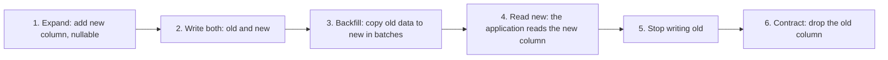

# Schema Design and Normalization

A schema decides which facts the database stores, where it stores each fact, and which wrong states the database refuses. This page covers keys, functional dependencies, the normal forms up to 5NF, denormalization, constraints, relationship and inheritance modeling, common schema problems, data types, schema changes on a live system, and a worked schema design for an online store. SQL syntax and joins are in [relational model and SQL](01-relational-model-and-sql.md). How indexes serve a schema is in [indexing](03-indexing.md).

## Why It Matters

Interviews ask about schema design in three forms: "Normalize this table to 3NF", "Design the schema for an online store (or a booking system, or a chat application)", and "When do you denormalize?". The design round of a backend interview also asks for the tables, keys, and indexes of every system that you draw. On the job, the schema is the part of a system that is hardest to change. Code deploys in minutes. A table with 500 million rows needs a plan, a backfill, and a rollout that can take days. A missing constraint lets one bug in one service write bad data, and every later query has to handle that data. This page gives the vocabulary (keys, functional dependencies, normal forms), the procedure for normalization with worked decompositions, the reasons to break the rules on purpose, and the schema problems that appear in real systems.

## Core Concepts

### Keys

A **superkey** is a set of attributes (columns) that no two rows of a relation (table) share. A **candidate key** is a minimal superkey: if you remove any attribute from it, it stops being a superkey. A relation can have several candidate keys. The **primary key** is the one candidate key that the designer chooses as the main identifier of a row. The other candidate keys become **unique** constraints (alternate keys). An attribute that belongs to at least one candidate key is a **prime attribute**. An attribute that belongs to no candidate key is a **non-prime attribute**.

A **natural key** is a key that comes from the real world and has meaning to the business: an email address, an ISBN, a country code. A **surrogate key** is a key that the database or the application generates and that has no business meaning: an auto-increment integer or a UUID. A **composite key** has more than one column. A **foreign key** is a set of columns whose values must match a candidate key of another table (or of the same table), or be `NULL`. A **unique** constraint forbids duplicate values in a set of columns.

| Property | Natural key | Surrogate key |
|---|---|---|
| Stability | The real world changes it: a person changes an email address, a standards body reassigns a code | Does not change, because it has no meaning |
| Size | Often long text, repeated in every foreign key and every index entry that references it | A 4-byte or 8-byte integer, or a 16-byte UUID |
| Meaning | Readable in a query result and in a log | Opaque. You need a join to learn what a row is |
| Uniqueness rule | The key itself is the rule | The natural attributes still need their own `UNIQUE` constraint, or the table accepts duplicates |

Recommendation: give every table a surrogate primary key, and keep a `UNIQUE` constraint on the natural key (when one exists). The surrogate key keeps foreign keys small and stable. The unique constraint keeps the business rule. Exceptions: a junction table (see "Relationships" below) uses its two foreign keys as a composite primary key, and a code table with a stable standard value (an ISO country code) may use the code as the key. How to generate surrogate keys, and what each scheme costs the index, is in [unique ID generation](../hld/fundamentals/15-unique-id-generation.md).

### Functional dependencies and closure

A **functional dependency** (FD) `X -> Y` says: in every valid state of the relation, any two rows that have the same values for the attributes in `X` also have the same values for the attributes in `Y`. `X` is the **determinant**. Example: `customer_id -> customer_city` means that one customer has one city. An FD is a rule of the business. You cannot read it from the current data: a table in which no two rows share a city today does not prove `city -> customer_id`. A person who knows the domain decides which FDs hold.

An FD is **trivial** if `Y` is a subset of `X` (`{a, b} -> a`). An FD `X -> Y` is **full** if no proper subset of `X` determines `Y`, and **partial** if a proper subset of `X` determines `Y`. A **transitive** dependency is a chain `X -> Y` and `Y -> Z` where `Y` is not a key and `Y` does not determine `X`. In a transitive dependency, `X` determines `Z` only through `Y`.

**Armstrong's axioms** (Armstrong, 1974) derive every FD that follows from a given set `F`:

1. Reflexivity: if `Y` is a subset of `X`, then `X -> Y`.
2. Augmentation: if `X -> Y`, then `XZ -> YZ` for any set `Z`.
3. Transitivity: if `X -> Y` and `Y -> Z`, then `X -> Z`.

The axioms are sound (they derive only FDs that the set implies) and complete (they derive every FD that the set implies).

The **attribute closure** `X+` of a set `X` under a set `F` of FDs is the set of all attributes that `X` determines. To compute it, start with `X+ = X`. Repeat: if an FD `A -> B` in `F` has `A` inside `X+`, add `B` to `X+`. Stop when a full pass adds nothing. The closure answers two questions. First, `X -> Y` follows from `F` if and only if `Y` is inside `X+`. Second, `X` is a superkey if and only if `X+` contains every attribute of the relation.

### Anomalies

An **anomaly** is a wrong or lost fact that a badly designed table forces on a write. A table that stores several independent facts in each row has three kinds of anomaly:

- **Insert anomaly**: you cannot record one fact without another fact. You cannot store a new customer until the customer places an order, because the only table that holds customers is the order table.
- **Update anomaly**: the table stores one fact in many rows, and an update must change all of them. If one row changes and another does not, the table contradicts itself.
- **Delete anomaly**: deleting one fact deletes another. Deleting the only order of a customer deletes the customer.

### Normal forms

A **normal form** is a rule about the FDs of a relation. Each rule removes one source of anomalies. Codd defined the first three forms (Codd, 1970 and 1972). Boyce and Codd defined BCNF (Codd's 1974 IFIP paper). Fagin defined 4NF (1977) and the projection-join normal form that people call 5NF (1979).

| Form | Rule | Removes |
|---|---|---|
| 1NF | Every attribute holds one atomic value in each row. The table has a key. No repeating groups | Lists of values in one cell |
| 2NF | 1NF, and no non-prime attribute depends on a part of a candidate key | Partial dependencies (they exist only when a candidate key has more than one attribute) |
| 3NF | For every non-trivial FD `X -> A`: `X` is a superkey, or `A` is a prime attribute. (Codd's original wording: 2NF, and no non-prime attribute depends transitively on a key.) | Transitive dependencies of non-prime attributes |
| BCNF | For every non-trivial FD `X -> Y`, `X` is a superkey | Every dependency whose determinant is not a key, including the ones that 3NF allows for prime attributes |
| 4NF | BCNF, and for every non-trivial multivalued dependency `X ->> Y`, `X` is a superkey. (An MVD is trivial if `Y` is inside `X`, or if `X` and `Y` together hold every attribute of the relation.) | Independent multivalued facts stored in one table |
| 5NF (PJ/NF) | Every join dependency follows from the candidate keys | Facts that only a join of three or more tables can rebuild |

A **lossless join** decomposition splits `R` into fragments so that the natural join of the fragments returns exactly the rows of `R`: no row is missing and no extra row appears. For a split into two fragments `R1` and `R2`, the split is lossless if the shared attributes `R1 ∩ R2` determine all of `R1` or all of `R2`. For more than two fragments, Aho, Beeri, and Ullman (1979) give a test, which the textbooks call the chase. A decomposition **preserves dependencies** if every FD of `R` is enforceable inside single fragments: either the FD sits inside one fragment, or the FDs inside the fragments imply it. If the decomposition loses an FD, a key or a `CHECK` on one table cannot enforce that FD any more. The enforcement then needs a join, a trigger, or application code.

## How It Works

### Finding candidate keys

To find the candidate keys of a relation `R` with the FDs `F`:

1. Write down every FD. Ask the domain expert, not the data.
2. Find the attributes that appear on no right-hand side. Every candidate key contains them, because no other attribute determines them.
3. Compute the closure of that set. If the closure holds every attribute, the set is the only candidate key.
4. If not, add one more attribute and test the closure of each such set. Then add two, and so on. Keep a set only if no smaller key lies inside it.

Example: `R(S, C, I)` for a school. `S` is a student, `C` is a course, `I` is an instructor. Rules: a student has one instructor for each course (`S C -> I`), and each instructor teaches one course (`I -> C`). The closure of `{S, C}` is `{S, C, I}`, so `{S, C}` is a superkey. It is minimal, because `S+ = {S}` and `C+ = {C}`. The closure of `{S, I}` starts with `{S, I}`, adds `C` through `I -> C`, and holds every attribute, so `{S, I}` is a second candidate key. Every attribute of this relation is prime. The Java example at the end of the page computes these sets.

### The anomalies in one table

A team keeps order data in one table. Each row is one line of an order, and the table repeats the customer and the product data on every row.

```sql
DROP TABLE IF EXISTS flat_order_lines;
CREATE TABLE flat_order_lines (
  order_id         INTEGER NOT NULL,
  customer_id      INTEGER NOT NULL,
  customer_name    TEXT NOT NULL,
  customer_city    TEXT NOT NULL,
  product_id       INTEGER NOT NULL,
  product_name     TEXT NOT NULL,
  unit_price_cents INTEGER NOT NULL,
  qty              INTEGER NOT NULL,
  PRIMARY KEY (order_id, product_id)
);
INSERT INTO flat_order_lines VALUES
  (1, 10, 'Asha', 'Pune',  100, 'Pen',  150, 2),
  (1, 10, 'Asha', 'Pune',  101, 'Book', 900, 1),
  (2, 10, 'Asha', 'Pune',  100, 'Pen',  150, 5),
  (3, 11, 'Ben',  'Delhi', 101, 'Book', 900, 1);
```

The FDs of this table follow from the business rules:

- `order_id -> customer_id` (one order belongs to one customer)
- `customer_id -> customer_name, customer_city`
- `product_id -> product_name, unit_price_cents`
- `order_id, product_id -> qty`

The only candidate key is `{order_id, product_id}`. Its closure holds every attribute, and no smaller set does.

- **Update anomaly.** Asha moves to Mumbai. A program updates one row and misses the others.

  ```sql
  UPDATE flat_order_lines SET customer_city = 'Mumbai' WHERE order_id = 1 AND product_id = 100;
  ```

  The table now holds two cities for customer 10:

  ```sql
  SELECT customer_id, COUNT(DISTINCT customer_city) AS city_count
  FROM flat_order_lines
  GROUP BY customer_id
  ORDER BY customer_id;
  ```

  <!-- sql-result -->

  ```text
  customer_id | city_count
  10 | 2
  11 | 1
  ```

- **Insert anomaly.** A new product with no order cannot enter the table, because `order_id` is part of the key and cannot be `NULL`.
- **Delete anomaly.** If order 3 is cancelled and deleted, the table loses the only record of customer Ben.

### 1NF: atomic values

1NF forbids a cell that holds a list. A column `phones` with the value `'98450,99100'` breaks the rule. The database cannot enforce a unique phone number inside the list, cannot index one phone number, and cannot use a foreign key on it. A query must search the text, and the text search matches by accident:

```sql
DROP TABLE IF EXISTS contact_bad;
CREATE TABLE contact_bad (
  contact_id INTEGER PRIMARY KEY,
  name       TEXT NOT NULL,
  phones     TEXT NOT NULL
);
INSERT INTO contact_bad VALUES (1, 'Asha', '98450,99100'), (2, 'Ben', '99100123');
```

```sql
SELECT name FROM contact_bad WHERE phones LIKE '%99100%' ORDER BY name;
```

<!-- sql-result -->

```text
name
Asha
Ben
```

Ben has the number `99100123`, not `99100`. The 1NF design moves each phone number to its own row:

```sql
DROP TABLE IF EXISTS contact_phone;
DROP TABLE IF EXISTS contact_ok;
CREATE TABLE contact_ok (
  contact_id INTEGER PRIMARY KEY,
  name       TEXT NOT NULL
);
CREATE TABLE contact_phone (
  contact_id INTEGER NOT NULL REFERENCES contact_ok (contact_id),
  phone      TEXT NOT NULL,
  PRIMARY KEY (contact_id, phone)
);
INSERT INTO contact_ok VALUES (1, 'Asha'), (2, 'Ben');
INSERT INTO contact_phone VALUES (1, '98450'), (1, '99100'), (2, '99100123');
```

```sql
SELECT name FROM contact_ok JOIN contact_phone USING (contact_id) WHERE phone = '99100';
```

<!-- sql-result -->

```text
name
Asha
```

The word "atomic" depends on the use. A `date` value has a year, a month, and a day, and a query still treats it as one value. A value is atomic if the application never has to look inside it with a query.

### 2NF and 3NF: the order table

`flat_order_lines` has the candidate key `{order_id, product_id}`. The non-prime attributes are `customer_id`, `customer_name`, `customer_city`, `product_name`, `unit_price_cents`, and `qty`.

**2NF violations (partial dependencies).** `order_id -> customer_id, customer_name, customer_city` depends on a part of the key. So does `product_id -> product_name, unit_price_cents`. Only `qty` depends on the whole key. The fix is to move each partially dependent group into a table whose key is the determinant:

- `orders(order_id, customer_id, customer_name, customer_city)`
- `products(product_id, product_name, unit_price_cents)`
- `order_lines(order_id, product_id, qty)`

**3NF violation (transitive dependency).** In `orders`, `customer_id -> customer_name, customer_city` holds, and `customer_id` is not a key of `orders`. The name and the city depend on the order only through the customer. The fix is to move the customer attributes to their own table:

- `customers(customer_id, name, city)`
- `orders(order_id, customer_id)`

The result is the schema below. Each fact has one home, and each foreign key states the relationship. The script turns on foreign key enforcement first, because SQLite does not enforce foreign keys unless each connection enables them with `PRAGMA foreign_keys = ON` (SQLite documentation, "Foreign Key Support").

```sql
PRAGMA foreign_keys = ON;
DROP TABLE IF EXISTS order_lines;
DROP TABLE IF EXISTS orders;
DROP TABLE IF EXISTS products;
DROP TABLE IF EXISTS customers;
CREATE TABLE customers (
  customer_id INTEGER PRIMARY KEY,
  name        TEXT NOT NULL,
  city        TEXT NOT NULL
);
CREATE TABLE products (
  product_id       INTEGER PRIMARY KEY,
  name             TEXT NOT NULL,
  unit_price_cents INTEGER NOT NULL CHECK (unit_price_cents >= 0)
);
CREATE TABLE orders (
  order_id    INTEGER PRIMARY KEY,
  customer_id INTEGER NOT NULL REFERENCES customers (customer_id)
);
CREATE TABLE order_lines (
  order_id   INTEGER NOT NULL REFERENCES orders (order_id),
  product_id INTEGER NOT NULL REFERENCES products (product_id),
  qty        INTEGER NOT NULL CHECK (qty > 0),
  PRIMARY KEY (order_id, product_id)
);
INSERT INTO customers VALUES (10, 'Asha', 'Pune'), (11, 'Ben', 'Delhi');
INSERT INTO products VALUES (100, 'Pen', 150), (101, 'Book', 900);
INSERT INTO orders VALUES (1, 10), (2, 10), (3, 11);
INSERT INTO order_lines VALUES (1, 100, 2), (1, 101, 1), (2, 100, 5), (3, 101, 1);
```

The decomposition is lossless: the join of the four tables returns the original rows (compare with the `INSERT` of `flat_order_lines` above). It also preserves every FD, because each FD now sits inside one table, as a primary key.

```sql
SELECT l.order_id, c.customer_id, c.name AS cust_name, c.city AS cust_city,
       p.product_id, p.name AS prod_name, p.unit_price_cents AS price_cents, l.qty
FROM order_lines l
JOIN orders o ON o.order_id = l.order_id
JOIN customers c ON c.customer_id = o.customer_id
JOIN products p ON p.product_id = l.product_id
ORDER BY l.order_id, p.product_id;
```

<!-- sql-result -->

```text
order_id | customer_id | cust_name | cust_city | product_id | prod_name | price_cents | qty
1 | 10 | Asha | Pune | 100 | Pen | 150 | 2
1 | 10 | Asha | Pune | 101 | Book | 900 | 1
2 | 10 | Asha | Pune | 100 | Pen | 150 | 5
3 | 11 | Ben | Delhi | 101 | Book | 900 | 1
```

!!! note "The price on an order line"
    The `products.unit_price_cents` column holds the current price. A real order line must keep the price that the customer paid, because the current price changes. That value is a different fact: `unit_price_at_purchase` depends on the order line, not on the product. The worked store schema at the end of the page keeps it on the line. This is not a normalization violation.

### BCNF: when 3NF is not enough

3NF allows an FD `X -> A` whose determinant is not a superkey, if `A` is a prime attribute. BCNF does not allow it. The school relation `R(S, C, I)` shows the gap. Its FDs are `S C -> I` and `I -> C`. Its candidate keys are `{S, C}` and `{S, I}`, so all three attributes are prime, and the relation is in 3NF. The FD `I -> C` has a determinant `I` that is not a superkey, so the relation is not in BCNF.

The anomaly is real. The table stores "instructor Rao teaches DB" once per student. If Rao moves to another course, the update must touch every row of Rao's students.

```sql
DROP TABLE IF EXISTS enrollment;
CREATE TABLE enrollment (
  student    TEXT NOT NULL,
  course     TEXT NOT NULL,
  instructor TEXT NOT NULL,
  PRIMARY KEY (student, course)
);
INSERT INTO enrollment VALUES
  ('s1', 'DB', 'Rao'), ('s2', 'DB', 'Iyer'), ('s3', 'OS', 'Mehta'), ('s1', 'OS', 'Mehta');
```

**Decomposition.** For the violating FD `X -> Y` (here `I -> C`), create one fragment `X + Y` and one fragment `R - Y`:

- `teaches(instructor, course)` with key `instructor`
- `takes(student, instructor)` with key `{student, instructor}`

The shared attribute is `instructor`, and it determines `course` in `teaches`, so the split is lossless. The join returns the original four rows:

```sql
DROP TABLE IF EXISTS teaches;
DROP TABLE IF EXISTS takes;
CREATE TABLE teaches (
  instructor TEXT PRIMARY KEY,
  course     TEXT NOT NULL
);
CREATE TABLE takes (
  student    TEXT NOT NULL,
  instructor TEXT NOT NULL REFERENCES teaches (instructor),
  PRIMARY KEY (student, instructor)
);
INSERT INTO teaches SELECT DISTINCT instructor, course FROM enrollment;
INSERT INTO takes SELECT student, instructor FROM enrollment;
```

```sql
SELECT k.student, t.course, t.instructor
FROM takes k
JOIN teaches t ON t.instructor = k.instructor
ORDER BY k.student, t.course;
```

<!-- sql-result -->

```text
student | course | instructor
s1 | DB | Rao
s1 | OS | Mehta
s2 | DB | Iyer
s3 | OS | Mehta
```

**The cost: a lost dependency.** The FD `S C -> I` spans both fragments, and no key or `CHECK` on one table enforces it. The database now accepts a second DB instructor for student `s2`:

```sql
INSERT INTO teaches VALUES ('Nair', 'DB');
INSERT INTO takes VALUES ('s2', 'Nair');
```

```sql
SELECT k.student, t.course, t.instructor
FROM takes k
JOIN teaches t ON t.instructor = k.instructor
WHERE k.student = 's2'
ORDER BY t.instructor;
```

<!-- sql-result -->

```text
student | course | instructor
s2 | DB | Iyer
s2 | DB | Nair
```

Student `s2` now has two instructors for the course DB, and this violates `S C -> I`. This is the known trade-off: BCNF can always be reached with a lossless decomposition, but a dependency-preserving BCNF decomposition does not always exist. 3NF has the opposite guarantee: a decomposition into 3NF that is lossless and preserves dependencies always exists. Bernstein (1976) gives the synthesis algorithm, which preserves dependencies. The textbook version of the algorithm adds one fragment that holds a candidate key of the whole relation when no fragment holds one, and that fragment makes the result lossless (Biskup, Dayal, and Bernstein, 1979).

The choice in practice: keep the 3NF relation and enforce `I -> C` with a helper table `teaches(instructor PRIMARY KEY, course, UNIQUE (instructor, course))` and a composite foreign key `(instructor, course)` from `enrollment` to `teaches`. Or accept the BCNF split and enforce `S C -> I` in a trigger or in the application.

**A lossy decomposition.** Splitting `enrollment` into `(student, course)` and `(course, instructor)` is not lossless, because `course` does not determine `instructor` (course DB has two instructors). The join invents pairs:

```sql
SELECT (SELECT COUNT(*) FROM enrollment) AS original_rows,
       (SELECT COUNT(*)
        FROM (SELECT DISTINCT student, course FROM enrollment) sc
        JOIN (SELECT DISTINCT course, instructor FROM enrollment) ci
          ON ci.course = sc.course) AS joined_rows;
```

<!-- sql-result -->

```text
original_rows | joined_rows
4 | 6
```

The join returns 6 rows for 4 original rows. Student `s1` appears with both DB instructors, and the database cannot tell which one is true.

### 4NF and 5NF

A **multivalued dependency** (MVD) `X ->> Y` says that the set of `Y` values for a row depends on `X` alone, and is independent of the other attributes. Example: `employee(emp, skill, language)`. An employee has a set of skills and a set of languages. The two sets are independent: each skill pairs with each language. If Asha has skills {Java, SQL} and languages {English, Tamil}, the table needs four rows to avoid implying a link between a skill and a language:

| emp | skill | language |
|---|---|---|
| Asha | Java | English |
| Asha | Java | Tamil |
| Asha | SQL | English |
| Asha | SQL | Tamil |

The table has no non-trivial FD, so it is in BCNF, and the key is all three columns. It still has anomalies: adding the language French needs two new rows (one for each skill), and a missing row suggests a false link. The MVDs `emp ->> skill` and `emp ->> language` have a determinant that is not a superkey, so the table is not in 4NF (Fagin, 1977). The 4NF decomposition is `emp_skill(emp, skill)` and `emp_language(emp, language)`. Each fragment stores one independent fact once.

**5NF** (also called projection-join normal form, PJ/NF) goes further. A **join dependency** says that a relation equals the join of some of its projections. A relation is in 5NF if every join dependency follows from its candidate keys (Fagin, 1979). The textbook example: `supplies(supplier, part, project)`. Assume this business rule: if supplier S supplies part P, and project J uses part P, and project J is supplied by S, then S supplies P to J. The relation then equals the join of its three binary projections `(supplier, part)`, `(part, project)`, and `(supplier, project)`, and no join of only two of them rebuilds it (a join of two projections can create rows that the rule does not allow). The relation has no non-trivial FD and no MVD, so it is in 4NF, but it is not in 5NF. It splits into the three binary tables. Interviews ask for the idea of 5NF, not for a derivation.

## Denormalization

**Denormalization** adds redundancy to a normalized schema on purpose, to make reads cheaper. A normalized schema answers "what is the order total?" with a join and a sum. A denormalized schema stores the total. Normalize first, measure the cost of the read, and denormalize only the parts that the measurement proves slow.

| Technique | What it stores | Example | Read gain | Write cost |
|---|---|---|---|---|
| Summary column | An aggregate of child rows in the parent row | `purchase.total_cents` | Skips a join and a sum | Every insert, update, and delete of a child row also updates the parent. Concurrent writers contend on the parent row |
| Duplicated column | A copy of a column from a parent table | `purchase_line.item_title` | Skips a join | Every change of the source must reach every copy |
| Precomputed table or materialized view | The stored result of a query | Daily sales per item | A report reads a small table instead of scanning a large one | A refresh recomputes or maintains the result, and between refreshes the result is stale |
| Derived counter | A count kept beside the data | `post.like_count` | Skips `COUNT(*)` | A hot row: many writers update one row and queue behind its lock |

**The cost is write amplification and consistency work.** Write amplification means that one logical change causes several physical writes. If the application misses one of them, the copies disagree, and nothing in the database reports the error. Three ways to keep the copy correct:

1. **Application code** updates both places in one transaction. The method has no extra mechanism, and every code path that writes must follow the rule.
2. **A trigger** inside the database updates the copy. The trigger covers every writer, including a manual fix. It runs inside the writing transaction and adds to its latency.
3. **A periodic job** rebuilds the copy. The copy is stale between runs. A job also repairs drift that the other two methods let through, so a system that uses triggers or application code still benefits from a nightly check.

A runnable example with triggers that keep `purchase.total_cents` correct is in "A worked design: an online store" below. It also shows the cost: each child-row change needs its own trigger.

The design rules for a denormalized column:

- Keep one **source of truth** (the normalized data). The copy is derived.
- Write a query that compares the copy with the source (`stored_total` against a `SUM`). Run it as a monitor.
- Denormalize a column that changes rarely (a name or a title) before a column that changes with every write (a counter).
- Prefer a materialized view when the copy is a report. PostgreSQL supports `REFRESH MATERIALIZED VIEW CONCURRENTLY`, which refreshes the view without locking out reads. It requires at least one `UNIQUE` index on the view that uses only column names and includes all rows (PostgreSQL documentation, `REFRESH MATERIALIZED VIEW`).

<!-- sql-skip: postgresql -->

```sql
CREATE MATERIALIZED VIEW daily_item_sales AS
SELECT date_trunc('day', p.placed_at) AS day, l.item_id, SUM(l.qty) AS units
FROM purchase p
JOIN purchase_line l ON l.purchase_id = p.purchase_id
GROUP BY 1, 2;

CREATE UNIQUE INDEX daily_item_sales_pk ON daily_item_sales (day, item_id);

REFRESH MATERIALIZED VIEW CONCURRENTLY daily_item_sales;
```

### Constraints: the database enforces the invariants

A **constraint** is a rule that the database checks on every write, from every client. The application should also validate input, to give the user a clear message. The database must still enforce each invariant that the data model depends on, for these reasons:

- **More than one writer.** A second service, a batch job, an administrator with a SQL console, and a data migration all write to the same tables. Each one needs to follow the rules, and the application code of one service cannot control the others.
- **Bugs.** A validation bug in one release writes bad rows. The rows stay after the fix. A constraint stops the first bad row.
- **Races.** A "check, then insert" sequence in application code races with another request. Two requests both check that the email does not exist, and both insert. A `UNIQUE` constraint serializes the two inserts, and one fails. Concurrency control inside one database is in [transactions and isolation](04-transactions-and-isolation.md).

| Constraint | What it enforces | Notes |
|---|---|---|
| `NOT NULL` | The column has a value | The cheapest constraint. A `NULL` that you did not intend becomes a bug in a query (a comparison with `NULL` is never true, see [relational model and SQL](01-relational-model-and-sql.md)) |
| `CHECK (expr)` | A row-level rule: `qty > 0`, `status IN (...)`, `end_at > start_at` | A `CHECK` passes if the expression is `TRUE` or `NULL` (PostgreSQL and MySQL documentation). Add `NOT NULL` to stop a `NULL`. MySQL enforces `CHECK` constraints from 8.0.16. Before that release, MySQL parsed the syntax and ignored it (MySQL manual, "CREATE TABLE Statement", `CHECK` constraints) |
| `UNIQUE` | No two rows have the same values in the column set | PostgreSQL treats `NULL` values as distinct by default, so a unique column can hold many `NULL` values. `NULLS NOT DISTINCT` changes that. The SQL standard leaves this to the implementation, and products differ (PostgreSQL documentation). Creates a unique B+ tree index |
| `PRIMARY KEY` | `UNIQUE` plus `NOT NULL` | One per table |
| `FOREIGN KEY` | Each value matches a row in the referenced table, or is `NULL` | See below |
| `EXCLUDE` (PostgreSQL) | No two rows conflict under the given operators: for example, two bookings of one room with overlapping time ranges | Uses a GiST index. The `btree_gist` extension supplies the `=` operator for ordinary types in a GiST index |

**Foreign keys and `ON DELETE`.** A foreign key stops a row from referencing a missing parent. The `ON DELETE` clause says what happens when someone deletes the parent row.

| Action | What the database does | Use it for |
|---|---|---|
| `NO ACTION` (the default) | Rejects the delete if child rows exist. In PostgreSQL the check can be deferred to the end of the transaction. In InnoDB the check is immediate, so `NO ACTION` equals `RESTRICT` | The default for business data |
| `RESTRICT` | Rejects the delete if child rows exist. PostgreSQL cannot defer this check | Parents that must not disappear while children exist |
| `CASCADE` | Deletes the child rows too | Children that have no meaning without the parent: order lines of an order, items of a cart |
| `SET NULL` | Sets the child's foreign key columns to `NULL`. The column must allow `NULL` | Optional links: a task's assignee after the user leaves |
| `SET DEFAULT` | Sets the child's columns to their default values. MySQL parses the clause, but InnoDB rejects table definitions that use it | Rare. Avoid it if the schema must run on MySQL |

(Sources: PostgreSQL documentation, "Constraints"; MySQL 8.4 Reference Manual, "FOREIGN KEY Constraints".)

Rules for foreign keys:

- **Index the referencing column.** PostgreSQL requires an index on the referenced columns (a primary key or unique constraint), and it does not create one on the referencing columns. Deletes and updates on the parent scan the child table to find referencing rows, so a missing index makes every parent delete scan the whole child table. The PostgreSQL documentation says that it is often a good idea to index the referencing columns. MySQL creates the child index automatically if none exists.
- **Cascades hide work.** A `CASCADE` delete of one customer can delete millions of rows in one transaction, with its locks and its log volume. In MySQL, cascaded actions do not activate triggers.
- **Foreign keys cost writes.** Each insert into the child checks the parent. This is the price of integrity. Large systems that shard data across databases cannot use cross-database foreign keys, and they enforce the relation in the application. See [partitioning and sharding](../hld/fundamentals/06-partitioning-and-sharding.md).
- **SQLite** has foreign keys off by default. The application must run `PRAGMA foreign_keys = ON` on each connection (SQLite documentation).

The next script shows the two most used actions. After the delete of parent 1, the cascading child table lost the two rows that referenced it, and the other child table kept its row and set the link to `NULL`:

```sql
PRAGMA foreign_keys = ON;
DROP TABLE IF EXISTS fk_child_cascade;
DROP TABLE IF EXISTS fk_child_null;
DROP TABLE IF EXISTS fk_parent;
CREATE TABLE fk_parent (
  id    INTEGER PRIMARY KEY,
  label TEXT NOT NULL
);
CREATE TABLE fk_child_cascade (
  id        INTEGER PRIMARY KEY,
  parent_id INTEGER NOT NULL REFERENCES fk_parent (id) ON DELETE CASCADE
);
CREATE TABLE fk_child_null (
  id        INTEGER PRIMARY KEY,
  parent_id INTEGER REFERENCES fk_parent (id) ON DELETE SET NULL
);
INSERT INTO fk_parent VALUES (1, 'a'), (2, 'b');
INSERT INTO fk_child_cascade VALUES (1, 1), (2, 1), (3, 2);
INSERT INTO fk_child_null VALUES (1, 1), (2, 2);
DELETE FROM fk_parent WHERE id = 1;
```

```sql
SELECT (SELECT COUNT(*) FROM fk_child_cascade) AS cascade_rows,
       (SELECT COUNT(*) FROM fk_child_null WHERE parent_id IS NULL) AS null_rows;
```

<!-- sql-result -->

```text
cascade_rows | null_rows
1 | 1
```

The PostgreSQL exclusion constraint covers a rule that no `UNIQUE` constraint can state: "no two bookings of the same room overlap in time".

<!-- sql-skip: postgresql -->

```sql
CREATE EXTENSION IF NOT EXISTS btree_gist;

CREATE TABLE room_booking (
  booking_id bigint GENERATED ALWAYS AS IDENTITY PRIMARY KEY,
  room_id    int NOT NULL,
  during     tstzrange NOT NULL,
  EXCLUDE USING gist (room_id WITH =, during WITH &&)
);
```

### Relationships

**One-to-many (1:N).** Put the foreign key on the "many" side. One user has many purchases, so `purchase.user_id` references `app_user`. This is the most common relationship.

**One-to-one (1:1).** Use a foreign key with a `UNIQUE` constraint on the child, or use the parent's primary key as the child's primary key (a shared primary key). Use a 1:1 table to split rarely used or large columns away from a hot table, to separate data with different access rights (a user and the user's private profile), or to model a subtype (see "Inheritance mappings").

**Many-to-many (M:N).** A foreign key cannot express M:N. A **junction table** (also called a link table or associative table) holds one row for each pair, with a foreign key to each side. The two foreign keys together form the composite primary key, and the primary key also prevents a duplicate pair. If the relationship has attributes (a quantity, a start date, a role), those columns belong to the junction table. `purchase_line(purchase_id, item_id, qty)` is the M:N relation between purchases and items, and `qty` is the attribute of the pair. Index the second foreign key column too: the primary key index serves lookups that start from the first column only.

A junction table that later gets its own relationships (a line that has refunds) should get a surrogate key. Then other tables reference one column.

**Self reference.** A table can reference itself: `employee(employee_id, manager_id REFERENCES employee)`. The top of the hierarchy has `manager_id = NULL`. This is the **adjacency list** model. It is simple to write and to update. A query for the whole subtree needs a recursive CTE (see [relational model and SQL](01-relational-model-and-sql.md)). A foreign key does not prevent a cycle (A manages B, B manages A), so the check belongs in a trigger or in the application. Other models store the path in each row (materialized path), or store interval numbers (nested sets). They answer subtree queries without recursion and cost more on every move of a node.

### Inheritance mappings

A class hierarchy (`Payment` with the subtypes `CardPayment` and `UpiPayment`) has no direct equivalent in tables. Three mappings exist. The names below are the ones from Jakarta Persistence (the `InheritanceType` enum has `SINGLE_TABLE`, `JOINED`, and `TABLE_PER_CLASS`). The same three designs apply to any code, with or without an ORM. [JDBC, JPA, and Hibernate](../java/16-jdbc-jpa-and-hibernate.md) explains the ORM side of persistence, and it does not cover inheritance mapping, so this page does.

| Mapping | Tables | Strengths | Weaknesses |
|---|---|---|---|
| **Single table** (`SINGLE_TABLE`) | One table for the whole hierarchy. A discriminator column holds the subtype. Subtype columns exist on every row, and they are `NULL` for other subtypes | One read, no join. Polymorphic queries are one scan | Subtype columns must allow `NULL`, so `NOT NULL` and most `CHECK` rules need a rule per subtype. Sparse rows. The table grows wide |
| **Class table** (`JOINED`) | One table for the base class, with the common columns. One table for each subtype, with its own columns and a primary key that is also a foreign key to the base | Normalized. Each subtype column can be `NOT NULL`. The base table gives one ID space for foreign keys | A read needs a join (or several, for a polymorphic query). A write touches two tables |
| **Concrete table** (`TABLE_PER_CLASS`) | One table for each concrete subtype, with all columns (common and own) | A read of one subtype touches one table | A polymorphic query needs `UNION ALL`. A foreign key cannot point to "any payment", because no single table holds all payments. Common columns repeat in each table |

Recommendation: start with the single table if the subtypes differ in a few columns and the application reads them together. Use the class table if the subtypes differ much, or if other tables must reference the base type. Use concrete tables only if the application almost never queries across subtypes.

The script builds the single-table and the class-table versions. The single-table version needs a `CHECK` that ties each subtype column to the discriminator:

```sql
DROP TABLE IF EXISTS pay_single;
DROP TABLE IF EXISTS pay_card;
DROP TABLE IF EXISTS pay_upi;
DROP TABLE IF EXISTS pay_base;
CREATE TABLE pay_single (
  id           INTEGER PRIMARY KEY,
  kind         TEXT NOT NULL CHECK (kind IN ('CARD', 'UPI')),
  amount_cents INTEGER NOT NULL,
  card_last4   TEXT,
  upi_id       TEXT,
  CHECK ((kind = 'CARD' AND card_last4 IS NOT NULL AND upi_id IS NULL)
      OR (kind = 'UPI' AND upi_id IS NOT NULL AND card_last4 IS NULL))
);
CREATE TABLE pay_base (
  id           INTEGER PRIMARY KEY,
  kind         TEXT NOT NULL CHECK (kind IN ('CARD', 'UPI')),
  amount_cents INTEGER NOT NULL
);
CREATE TABLE pay_card (
  id         INTEGER PRIMARY KEY REFERENCES pay_base (id),
  card_last4 TEXT NOT NULL
);
CREATE TABLE pay_upi (
  id     INTEGER PRIMARY KEY REFERENCES pay_base (id),
  upi_id TEXT NOT NULL
);
INSERT INTO pay_base VALUES (1, 'CARD', 500), (2, 'UPI', 700);
INSERT INTO pay_card VALUES (1, '4242');
INSERT INTO pay_upi VALUES (2, 'asha@bank');
```

A polymorphic read on the class-table version uses one `LEFT JOIN` per subtype:

```sql
SELECT b.id, b.kind, b.amount_cents, c.card_last4, u.upi_id
FROM pay_base b
LEFT JOIN pay_card c ON c.id = b.id
LEFT JOIN pay_upi u ON u.id = b.id
ORDER BY b.id;
```

<!-- sql-result -->

```text
id | kind | amount_cents | card_last4 | upi_id
1 | CARD | 500 | 4242 | NULL
2 | UPI | 700 | NULL | asha@bank
```

### Common schema problems

#### Entity-attribute-value (EAV)

**EAV** stores each attribute as a row: `(entity_id, attribute_name, value)`. It looks flexible, because a new attribute needs no `ALTER TABLE`. The costs:

- The `value` column holds text for every type, so the database cannot enforce a number, a date, or a foreign key.
- No `NOT NULL` per attribute, and no `CHECK` per attribute. A typo in the attribute name creates a new attribute.
- A query for one entity needs a pivot (a `GROUP BY` with `CASE`) or one self-join per attribute. Statistics and indexes cannot help with a filter such as "color = red and size = M".

```sql
DROP TABLE IF EXISTS eav;
CREATE TABLE eav (
  entity_id INTEGER NOT NULL,
  attr      TEXT NOT NULL,
  value     TEXT,
  PRIMARY KEY (entity_id, attr)
);
INSERT INTO eav VALUES
  (1, 'color', 'red'), (1, 'size', 'M'), (1, 'price', '1200'),
  (2, 'color', 'blue'), (2, 'price', '800');
```

```sql
SELECT entity_id,
       MAX(CASE WHEN attr = 'color' THEN value END) AS color,
       MAX(CASE WHEN attr = 'size' THEN value END) AS size,
       CAST(MAX(CASE WHEN attr = 'price' THEN value END) AS INTEGER) AS price
FROM eav
GROUP BY entity_id
ORDER BY entity_id;
```

<!-- sql-result -->

```text
entity_id | color | size | price
1 | red | M | 1200
2 | blue | NULL | 800
```

Use EAV only if users define attributes at run time and the set is open (a product catalog with thousands of category-specific attributes). Even then, a `jsonb` column (below) usually does the job better.

#### JSON columns against normalized columns

PostgreSQL's `jsonb` type stores a decomposed binary form and supports indexes. It does not keep white space, key order, or duplicate keys (PostgreSQL documentation, "JSON Types"). A containment query (`@>`) can use a GIN index. The same documentation recommends that a JSON document keep a somewhat fixed structure, and that an application keep documents small and atomic, because any update locks the whole row.

| Question | Normalized columns | `jsonb` column |
|---|---|---|
| Does the database enforce types, `NOT NULL`, and foreign keys? | Yes | No (a `CHECK` can test a few paths) |
| Can the structure change per row? | No. The schema is one for all rows | Yes |
| Index and statistics | One B+ tree per column. The planner has per-column statistics | A GIN index for containment. An expression index for one path |
| Update cost | One column changes | PostgreSQL writes a new version of the whole row, with the whole document |
| Joins | Natural | Hard. A value inside a document cannot carry a foreign key |

Recommendation: put the columns that you filter, join, sort, or constrain into real columns. Put the rest (optional, rarely queried, per-tenant attributes, a copy of a third-party payload) into one `jsonb` column.

<!-- sql-skip: postgresql -->

```sql
CREATE TABLE product_doc (
  product_id bigint GENERATED ALWAYS AS IDENTITY PRIMARY KEY,
  sku        text NOT NULL UNIQUE,
  price_cents bigint NOT NULL CHECK (price_cents >= 0),
  attrs      jsonb NOT NULL DEFAULT '{}'
);
CREATE INDEX product_doc_attrs_gin ON product_doc USING gin (attrs);

SELECT product_id FROM product_doc WHERE attrs @> '{"color": "red"}';
```

#### Polymorphic associations

A **polymorphic association** is a foreign key that points to one of several tables. A comment table has `target_type` ('post' or 'photo') and `target_id`. A foreign key cannot express this, because a constraint names one table. The database cannot stop a comment on a post that does not exist. Two designs keep the integrity:

1. **One nullable foreign key per target**, with a `CHECK` that exactly one is set. This works for a small, stable set of targets.
2. **One junction table per target**: `post_comment(comment_id, post_id)` and `photo_comment(comment_id, photo_id)`.

```sql
DROP TABLE IF EXISTS cm;
DROP TABLE IF EXISTS post;
DROP TABLE IF EXISTS photo;
CREATE TABLE post (id INTEGER PRIMARY KEY);
CREATE TABLE photo (id INTEGER PRIMARY KEY);
CREATE TABLE cm (
  id       INTEGER PRIMARY KEY,
  body     TEXT NOT NULL,
  post_id  INTEGER REFERENCES post (id),
  photo_id INTEGER REFERENCES photo (id),
  CHECK ((post_id IS NOT NULL) + (photo_id IS NOT NULL) = 1)
);
INSERT INTO post VALUES (1);
INSERT INTO photo VALUES (1);
INSERT INTO cm (body, post_id) VALUES ('nice post', 1);
INSERT INTO cm (body, photo_id) VALUES ('nice photo', 1);
```

```sql
SELECT id, body, post_id, photo_id FROM cm ORDER BY id;
```

<!-- sql-result -->

```text
id | body | post_id | photo_id
1 | nice post | 1 | NULL
2 | nice photo | NULL | 1
```

PostgreSQL has the function `num_nonnulls(...)`, which counts the non-null arguments, so the check reads `CHECK (num_nonnulls(post_id, photo_id) = 1)`. The SQLite script above adds two comparisons, because SQLite stores a comparison result as an integer. PostgreSQL has a separate boolean type and does not add booleans, so use `num_nonnulls` there.

#### Soft delete and unique constraints

A **soft delete** marks a row as deleted (`deleted_at` is not `NULL`) and keeps it. Reasons: audit, undo, and references from other rows. The cost: every query must filter `deleted_at IS NULL`, and a `UNIQUE` constraint still counts the deleted rows. A user deletes an account and registers again with the same email. A plain `UNIQUE (email)` rejects the new row. The fix is a **partial unique index** that covers only live rows. SQLite and PostgreSQL support `CREATE UNIQUE INDEX ... WHERE ...` (the PostgreSQL documentation names this use of `WHERE` with `UNIQUE`). The `CREATE INDEX` syntax of MySQL 8.4 has no `WHERE` clause. MySQL has two documented properties that give the same effect: a `UNIQUE` index permits many `NULL` values, and a functional key part can index an expression. An index on an expression that is `NULL` for deleted rows therefore works (a MySQL example follows the SQLite example).

```sql
DROP TABLE IF EXISTS app_account;
CREATE TABLE app_account (
  id         INTEGER PRIMARY KEY,
  email      TEXT NOT NULL,
  deleted_at TEXT
);
CREATE UNIQUE INDEX app_account_email_live ON app_account (email) WHERE deleted_at IS NULL;
INSERT INTO app_account (email) VALUES ('a@example.com');
UPDATE app_account SET deleted_at = '2026-11-01' WHERE email = 'a@example.com';
INSERT INTO app_account (email) VALUES ('a@example.com');
```

```sql
SELECT id, email, deleted_at FROM app_account ORDER BY id;
```

<!-- sql-result -->

```text
id | email | deleted_at
1 | a@example.com | 2026-11-01
2 | a@example.com | NULL
```

MySQL version (the statement follows the MySQL 8.4 rules for functional key parts, and it was not run here). The functional key part is an expression in its own parentheses. It has no prefix length, so the column must be `VARCHAR`, not `TEXT`. A primary key cannot contain a functional key part, which does not matter here, because the index is a plain unique index:

<!-- sql-skip: mysql -->

```sql
CREATE TABLE app_account (
  id         BIGINT AUTO_INCREMENT PRIMARY KEY,
  email      VARCHAR(255) NOT NULL,
  deleted_at DATETIME(6) NULL
);
CREATE UNIQUE INDEX app_account_email_live
  ON app_account ((CASE WHEN deleted_at IS NULL THEN email END));
```

A soft delete also affects foreign keys (child rows still reference the deleted parent) and every join. Some teams move deleted rows to an archive table instead, so that the live table stays small and its constraints stay simple.

#### Audit columns

An **audit column** records who changed a row and when. The usual set: `created_at`, `updated_at`, `created_by`, `updated_by`. Rules:

- Set `created_at` with a column default (`DEFAULT CURRENT_TIMESTAMP`), so no client can forget it. Set `updated_at` in the same statement that changes the row, or with a trigger. An application that sets it can skip it in a bulk `UPDATE`.
- Audit columns say who wrote the last version. They do not keep history. For history, write each change to a **history table** (a copy of the row, with the time of the change and the actor) in the same transaction, with a trigger or with change data capture from the log. See [OLTP, OLAP, and Warehousing](10-oltp-olap-and-warehousing.md) for change data capture.
- Use `created_at` for ordering only with care. In PostgreSQL, `CURRENT_TIMESTAMP` returns the start time of the transaction, so all rows of one transaction get the same value.

#### Enums against lookup tables

A column with a small closed set of values (`status`) has three designs:

| Design | How it enforces the set | Cost of a new value |
|---|---|---|
| `CHECK (status IN ('NEW', 'PAID', ...))` | The check expression | An `ALTER TABLE` that changes the check. On a large table the new check can need a scan |
| Native `ENUM` type (PostgreSQL `CREATE TYPE ... AS ENUM`, MySQL `ENUM`) | The type | A DDL statement that changes the type |
| Lookup table with a foreign key (`order_status(code PRIMARY KEY, label, sort_order)`) | The foreign key | An `INSERT`. No DDL |

Recommendation: use a `CHECK` for a set that changes with the code (states of a state machine, where code and set change together). Use a lookup table if the business adds values (categories, countries) or if a value carries attributes (a label, a sort order, a flag). Store the value as a short text code, not as an unexplained integer: a code is readable in a query result and in a log.

### Data types

**Money.** Use an exact type. Floating-point types store approximations: the PostgreSQL documentation says that `real` and `double precision` are inexact and that you should use `numeric` for monetary amounts. SQLite shows the problem with the sum of two decimal fractions:

```sql
SELECT 0.1 + 0.2 = 0.3 AS float_equal, (10 + 20) = 30 AS cents_equal;
```

<!-- sql-result -->

```text
float_equal | cents_equal
0 | 1
```

Two designs are in use:

- **`DECIMAL(p, s)` / `NUMERIC(p, s)`.** `NUMERIC(12, 2)` holds amounts up to 9 999 999 999.99 with two decimals. PostgreSQL's `numeric` is exact for addition, subtraction, and multiplication, and it is slower than integer types (PostgreSQL documentation, "Numeric Types"). Rounding of values that have more digits than the scale is a rule of the type: PostgreSQL rounds ties away from zero for `numeric`.
- **Integer minor units.** Store `amount_cents BIGINT` (the smallest unit of the currency). The arithmetic is plain integer arithmetic, and the column is portable to any database. The number of minor-unit digits depends on the currency: ISO 4217 lists a minor-unit exponent for each currency (JPY 0, USD 2, KWD 3). Keep a `currency` column (a 3-letter code) next to each amount.

Do not add amounts of different currencies in one `SUM`. A column `amount` without a `currency` column is a design error in any system that may sell in more than one currency. In Java use `BigDecimal` or a `long` of minor units, not `double`.

**Time stamps and time zones.** A time stamp that records an instant (an order was placed, a message was sent) needs one meaning in all places.

- PostgreSQL `timestamp with time zone` (`timestamptz`) stores the instant in UTC. On input, it converts a value with an offset or a zone name to UTC. On output, it converts to the time zone of the session. The original zone is not stored (PostgreSQL documentation, "Date/Time Types"). `timestamp without time zone` stores the literal date and time and applies no conversion, so the same stored value means different instants in different sessions.
- MySQL `TIMESTAMP` converts from the session time zone to UTC for storage and back for retrieval. Its range is `1970-01-01 00:00:01` UTC to `2038-01-19 03:14:07` UTC. `DATETIME` has the range `1000-01-01` to `9999-12-31` and does no conversion (MySQL 8.4 Reference Manual, "The DATE, DATETIME, and TIMESTAMP Types").
- Recommendation: store an instant as `timestamptz` in PostgreSQL, and as `DATETIME(6)` that holds UTC in MySQL (the application converts), or as `TIMESTAMP` if the 2038 limit does not apply to the data. Convert to the user's zone at the edge, in the UI or API layer.
- A **future local event** is different. "The meeting is on 2027-03-28 at 09:00 in Europe/Berlin" must keep its local time if the daylight saving rules change. Store the local date and time and the IANA zone name (`Europe/Berlin`) in two columns, and compute the instant when you need it. A stored UTC instant would move by an hour if the rules changed.

**Text.** In PostgreSQL, `text`, `character varying(n)`, and `character(n)` have no performance difference, except that the blank-padded `character(n)` takes more space and is usually slowest (PostgreSQL documentation, "Character Types"). `varchar(n)` accepts `n` up to 10 485 760. The longest string that PostgreSQL can store is about 1 GB. Use `text` plus a `CHECK (length(col) <= n)` when the length is a business rule, because the check is easy to change later. Pick the character set once: use UTF-8 (in MySQL, check that the table character set is `utf8mb4`).

**Integers.** A 32-bit signed integer holds 2 147 483 647 values. A table that adds 1 000 rows per second uses 2 147 483 647 values in about 24.9 days (2 147 483 647 / 1 000 = 2 147 483 seconds). Use `BIGINT` for a primary key of any table that can grow large. Changing an `INT` key to `BIGINT` later rewrites the table and every foreign key that references it. In MySQL 8.4, changing a column data type uses only the `COPY` algorithm, which copies the table and does not permit concurrent DML (MySQL documentation, "Online DDL Operations").

**IDs.** A surrogate key comes from a database sequence (`BIGINT GENERATED ... AS IDENTITY` in PostgreSQL, `AUTO_INCREMENT` in MySQL) or from a UUID. A random UUID (version 4) as a primary key spreads inserts over the whole index, and an ordered ID (a sequence, a UUID version 7, a Snowflake ID) appends at the right edge. [Unique ID generation](../hld/fundamentals/15-unique-id-generation.md) covers the schemes, the gaps in sequences, and the leakage of volume through counters. [Indexing](03-indexing.md) covers the page-split cost.

### Schema evolution

A running system changes its schema while it serves traffic. A change that needs a long lock, or a table rewrite, stops the application. The method for a safe change is **expand and contract** (also called parallel change): split one breaking change into several steps, and let each step work with both the old code and the new code.



Example: replace a `REAL` price column with an integer `price_cents`.

1. **Expand.** Add `price_cents` as a nullable column. The old code ignores it.
2. **Write both.** Deploy code that writes `price` and `price_cents`.
3. **Backfill.** Fill `price_cents` for old rows, in batches of a bounded size (for example by primary key range), so that no statement holds locks for long, and so that replicas keep up.
4. **Read new.** Deploy code that reads `price_cents`. Verify that the two columns agree.
5. **Stop writing the old column**, then wait for one release cycle, so that a rollback has a target.
6. **Contract.** Drop `price`.

```sql
DROP TABLE IF EXISTS legacy_price;
CREATE TABLE legacy_price (
  id    INTEGER PRIMARY KEY,
  price REAL NOT NULL
);
INSERT INTO legacy_price VALUES (1, 12.5), (2, 0.1), (3, 19.99);
ALTER TABLE legacy_price ADD COLUMN price_cents INTEGER;
UPDATE legacy_price
SET price_cents = CAST(ROUND(price * 100) AS INTEGER)
WHERE price_cents IS NULL AND id BETWEEN 1 AND 1000;
```

```sql
SELECT id, price, price_cents FROM legacy_price ORDER BY id;
```

<!-- sql-result -->

```text
id | price | price_cents
1 | 12.5 | 1250
2 | 0.1 | 10
3 | 19.99 | 1999
```

After the code reads only `price_cents`, the contract step runs:

```sql
ALTER TABLE legacy_price DROP COLUMN price;
```

```sql
SELECT id, price_cents FROM legacy_price ORDER BY id;
```

<!-- sql-result -->

```text
id | price_cents
1 | 1250
2 | 10
3 | 1999
```

**What each product does for you.** The facts below come from the vendor documentation. A statement that is cheap in one product can rewrite the table in another.

| Change | PostgreSQL 18 | MySQL 8.4 (InnoDB) |
|---|---|---|
| Add a column with a constant default | Stores the default in the catalog. No table rewrite. A volatile default (such as `clock_timestamp()`), an identity column, or a stored generated column rewrites the table and its indexes | `ADD COLUMN` uses `ALGORITHM=INSTANT` by default in 8.4. Limits apply: the table can have at most 64 row versions in 8.4 (255 from 9.1.0), after which `INSTANT` fails with an error. It does not work on `ROW_FORMAT=COMPRESSED` tables, tables with a `FULLTEXT` index, or temporary tables |
| Drop a column | Does not rewrite the table. The column becomes invisible, and the space returns as updates rewrite rows | `INSTANT` is the default in 8.4, with the same limits. Other algorithms reorganize the data |
| Change a column type | Normally rewrites the table and its indexes. No rewrite if the old type is binary coercible to the new type and `USING` does not change the contents (for example `text` to `varchar`) | Only `ALGORITHM=COPY`. No concurrent DML |
| Add a foreign key or `CHECK` | `ADD ... NOT VALID` skips the scan of existing rows. The `ADD` itself still takes a strong lock for a moment (`SHARE ROW EXCLUSIVE` for a foreign key). `VALIDATE CONSTRAINT` then scans with only a `SHARE UPDATE EXCLUSIVE` lock on the table (and `ROW SHARE` on the referenced table) | Foreign key: `INPLACE` works only if `foreign_key_checks` is off. Otherwise `COPY`. The Online DDL page does not list `CHECK` |
| Set `NOT NULL` | Scans the table, unless a valid `CHECK (col IS NOT NULL)` already exists. Then the scan is skipped. PostgreSQL 18 also accepts a not-null constraint as `NOT VALID` | `INPLACE`, with concurrent DML, but it rebuilds the table. It needs strict SQL mode, and it fails if the column holds `NULL` |
| Create an index | `CREATE INDEX CONCURRENTLY`: no lock against writes, two table scans, and an `INVALID` index remains if it fails. Not allowed inside a transaction block. See [indexing](03-indexing.md) | Online DDL. See [indexing](03-indexing.md) |

<!-- sql-skip: postgresql -->

```sql
-- Add a foreign key to a large table without a long lock (PostgreSQL).
ALTER TABLE purchase_line
  ADD CONSTRAINT purchase_line_item_fk FOREIGN KEY (item_id) REFERENCES item (item_id) NOT VALID;
ALTER TABLE purchase_line VALIDATE CONSTRAINT purchase_line_item_fk;

-- Add NOT NULL without a long scan under a strong lock (PostgreSQL).
ALTER TABLE item ADD CONSTRAINT item_title_nn CHECK (title IS NOT NULL) NOT VALID;
ALTER TABLE item VALIDATE CONSTRAINT item_title_nn;
ALTER TABLE item ALTER COLUMN title SET NOT NULL;
```

<!-- sql-skip: mysql -->

```sql
-- MySQL 8.4: ask for the cheap algorithm. The statement fails if InnoDB cannot use it.
ALTER TABLE item ADD COLUMN weight_grams INT NULL, ALGORITHM=INSTANT;
```

**Locks during a schema change.** PostgreSQL acquires an `ACCESS EXCLUSIVE` lock for most forms of `ALTER TABLE`, unless the manual names a weaker lock (PostgreSQL documentation, "ALTER TABLE"). That lock conflicts with every other lock mode, including the `ACCESS SHARE` lock of a plain `SELECT`. The `ALTER` waits for every running transaction that uses the table. While it waits, new queries on the table queue behind it, because their lock requests conflict with the waiting request. The manual does not state the queue rule in one sentence. It follows from the lock conflict table, and operators report it widely. A single long transaction can therefore turn a short `ALTER` into an outage. Set `lock_timeout` in the migration session (`SET lock_timeout = '2s'`), so that the statement fails fast and the migration retries later. The timeout limits the wait of the `ALTER`. It does not stop the long transaction.

**Online schema change tools** copy the table in the background when the product's own online DDL cannot do the change. Both create a copy of the table with the new schema, copy rows in small chunks, capture the changes that happen during the copy, and swap the tables at the end.

- **gh-ost** (GitHub) for MySQL does not use triggers. It reads the binary log to capture the changes and applies them to the copy asynchronously. When it throttles, it stops all its writes to the original table (no row copies and no event processing), and it lets the operator postpone the final swap (gh-ost README).
- **pt-online-schema-change** (Percona Toolkit) for MySQL uses triggers on the original table to copy changes into the new table. It copies in chunks sized by `--chunk-time` (default 0.5 seconds), and swaps with an atomic `RENAME TABLE`. The atomic rename does not work when foreign keys refer to the table, so the tool has the option `--alter-foreign-keys-method` to repoint those keys (Percona Toolkit documentation).

**Migration tools** apply schema changes as versioned scripts from the repository, so each environment moves through the same steps.

- **Flyway** runs versioned migrations in order, once each, and records them in the `flyway_schema_history` table together with a checksum. If someone edits a script that already ran, the checksum differs and Flyway reports an error. The Redgate documentation recommends that you leave applied migrations unchanged and write a new versioned script for each further change.
- **Liquibase** reads a changelog of changesets. It records each executed changeset in the `DATABASECHANGELOG` table. The `id`, the `author`, and the changelog file path identify a changeset, and the table also keeps a checksum to detect edits (Liquibase documentation).

Both tools run in the build or at application start. Recommendation: run migrations as a separate step of the deployment, before the new application version starts, and write each migration to be compatible with the previous application version (the expand step).

## A worked design: an online store

The exercise: "Design the schema for a small online store: users place orders for items, and pay for them." The method has five steps.

1. **List the nouns, then the facts about each.** User, item, order, order line, payment. A user has an email and a name. An item has a SKU, a title, a price, and a stock count. An order belongs to one user and has a status and a time. An order has many lines, and each line is one item with a quantity. An order has zero or more payment attempts.
2. **Write the FDs and the keys.** `email -> user_id` (unique), `sku -> item_id`, `purchase_id -> user_id, status, placed_at`, `{purchase_id, item_id} -> qty, unit_price_cents`, `provider_ref -> payment_id`.
3. **Find the relationships.** User to order: 1:N. Order to item: M:N, through the order line, which carries `qty` and the price at purchase time. Order to payment: 1:N, because a payment can fail and the customer can try again.
4. **Add the constraints.** Every rule that the data model depends on goes into the database: positive quantities, non-negative stock, the set of statuses, unique provider references.
5. **Add the indexes for the access paths** (one for each foreign key, from [indexing](03-indexing.md), plus the queries of the product).

The table name `purchase` replaces `order`, because `ORDER` is a reserved word in SQL.

```sql
PRAGMA foreign_keys = ON;
DROP TABLE IF EXISTS payment;
DROP TABLE IF EXISTS purchase_line;
DROP TABLE IF EXISTS purchase;
DROP TABLE IF EXISTS item;
DROP TABLE IF EXISTS app_user;
CREATE TABLE app_user (
  user_id    INTEGER PRIMARY KEY,
  email      TEXT NOT NULL UNIQUE,
  name       TEXT NOT NULL,
  created_at TEXT NOT NULL
);
CREATE TABLE item (
  item_id     INTEGER PRIMARY KEY,
  sku         TEXT NOT NULL UNIQUE,
  title       TEXT NOT NULL,
  price_cents INTEGER NOT NULL CHECK (price_cents >= 0),
  stock       INTEGER NOT NULL CHECK (stock >= 0)
);
CREATE TABLE purchase (
  purchase_id INTEGER PRIMARY KEY,
  user_id     INTEGER NOT NULL REFERENCES app_user (user_id),
  status      TEXT NOT NULL CHECK (status IN ('NEW', 'PAID', 'SHIPPED', 'CANCELLED')),
  placed_at   TEXT NOT NULL
);
CREATE TABLE purchase_line (
  purchase_id      INTEGER NOT NULL REFERENCES purchase (purchase_id),
  item_id          INTEGER NOT NULL REFERENCES item (item_id),
  qty              INTEGER NOT NULL CHECK (qty > 0),
  unit_price_cents INTEGER NOT NULL CHECK (unit_price_cents >= 0),
  PRIMARY KEY (purchase_id, item_id)
);
CREATE TABLE payment (
  payment_id   INTEGER PRIMARY KEY,
  purchase_id  INTEGER NOT NULL REFERENCES purchase (purchase_id),
  amount_cents INTEGER NOT NULL CHECK (amount_cents > 0),
  status       TEXT NOT NULL CHECK (status IN ('AUTHORIZED', 'CAPTURED', 'FAILED', 'REFUNDED')),
  provider_ref TEXT NOT NULL UNIQUE
);
CREATE INDEX purchase_user_idx ON purchase (user_id);
CREATE INDEX purchase_line_item_idx ON purchase_line (item_id);
CREATE INDEX payment_purchase_idx ON payment (purchase_id);
```

The reason for each table and key:

| Table | Key | Reason |
|---|---|---|
| `app_user` | Surrogate `user_id`. `UNIQUE (email)` | The email is the login and can change. Other tables reference the stable `user_id` |
| `item` | Surrogate `item_id`. `UNIQUE (sku)` | The SKU is the business key. `CHECK (stock >= 0)` stops overselling inside the database, even under concurrent updates (see [transactions and isolation](04-transactions-and-isolation.md)) |
| `purchase` | Surrogate `purchase_id` | The order header: owner, status, time. `status` has a `CHECK` because the states are code |
| `purchase_line` | Composite `(purchase_id, item_id)` | The M:N junction. The pair is unique, so one item appears once in one order, and the quantity holds the count. `unit_price_cents` keeps the price at purchase time, because `item.price_cents` changes later. This is a separate fact, so the column does not break 3NF |
| `payment` | Surrogate `payment_id`. `UNIQUE (provider_ref)` | One order can have several attempts. The unique provider reference makes the payment callback idempotent: a repeated callback violates the constraint, and the code treats it as already processed |
| Indexes | One for each foreign key column that no primary key covers | `purchase_user_idx` serves "orders of a user". `payment_purchase_idx` serves "payments of an order". `purchase_line_item_idx` serves "orders that contain an item". The primary key `(purchase_id, item_id)` already serves lines of an order |

Sample data and a check query:

```sql
INSERT INTO app_user VALUES
  (1, 'asha@example.com', 'Asha', '2026-10-01'),
  (2, 'ben@example.com', 'Ben', '2026-10-02');
INSERT INTO item VALUES (100, 'PEN-1', 'Pen', 150, 500), (101, 'BOOK-1', 'Book', 900, 40);
INSERT INTO purchase VALUES
  (1, 1, 'PAID', '2026-11-01'), (2, 1, 'NEW', '2026-11-02'), (3, 2, 'NEW', '2026-11-03');
INSERT INTO purchase_line VALUES
  (1, 100, 2, 150), (1, 101, 1, 900), (2, 100, 5, 150), (3, 101, 1, 900);
INSERT INTO payment VALUES
  (1, 1, 1200, 'CAPTURED', 'pg-001'),
  (2, 2, 750, 'FAILED', 'pg-002'),
  (3, 2, 750, 'AUTHORIZED', 'pg-003');
```

```sql
SELECT p.purchase_id, p.status,
       (SELECT SUM(l.qty * l.unit_price_cents)
        FROM purchase_line l
        WHERE l.purchase_id = p.purchase_id) AS total_cents,
       (SELECT COALESCE(SUM(y.amount_cents), 0)
        FROM payment y
        WHERE y.purchase_id = p.purchase_id AND y.status = 'CAPTURED') AS captured_cents
FROM purchase p
ORDER BY p.purchase_id;
```

<!-- sql-result -->

```text
purchase_id | status | total_cents | captured_cents
1 | PAID | 1200 | 1200
2 | NEW | 750 | 0
3 | NEW | 900 | 0
```

The query uses two scalar subqueries on purpose. A join of `purchase_line` and `payment` to the same purchase multiplies the rows (a fan-out): two lines times two payments give four rows, and the sum counts each line twice. Purchase 2 has one line and two payments, so the wrong total is 1500, not 750. Purchase 3 has no payment, so the inner join drops it.

```sql
SELECT p.purchase_id, SUM(l.qty * l.unit_price_cents) AS wrong_total_cents
FROM purchase p
JOIN purchase_line l ON l.purchase_id = p.purchase_id
JOIN payment y ON y.purchase_id = p.purchase_id
GROUP BY p.purchase_id
ORDER BY p.purchase_id;
```

<!-- sql-result -->

```text
purchase_id | wrong_total_cents
1 | 1200
2 | 1500
```

**Denormalizing the order total.** A product page reads the order total on every order list. The design adds `purchase.total_cents` and keeps it correct with triggers. Each trigger runs inside the writing transaction. The script needs a trigger for insert and for delete of a line, and a trigger for update of a line (not shown) to be complete. This shows the write amplification: each line write also writes the header row.

```sql
ALTER TABLE purchase ADD COLUMN total_cents INTEGER NOT NULL DEFAULT 0;
UPDATE purchase
SET total_cents = (SELECT COALESCE(SUM(qty * unit_price_cents), 0)
                   FROM purchase_line l
                   WHERE l.purchase_id = purchase.purchase_id);
CREATE TRIGGER purchase_line_ai AFTER INSERT ON purchase_line
BEGIN
  UPDATE purchase SET total_cents = total_cents + NEW.qty * NEW.unit_price_cents
  WHERE purchase_id = NEW.purchase_id;
END;
CREATE TRIGGER purchase_line_ad AFTER DELETE ON purchase_line
BEGIN
  UPDATE purchase SET total_cents = total_cents - OLD.qty * OLD.unit_price_cents
  WHERE purchase_id = OLD.purchase_id;
END;
INSERT INTO purchase_line VALUES (3, 100, 4, 150);
DELETE FROM purchase_line WHERE purchase_id = 1 AND item_id = 100;
```

The monitor query compares the stored total with the computed total:

```sql
SELECT p.purchase_id, p.total_cents AS stored_total,
       (SELECT SUM(qty * unit_price_cents)
        FROM purchase_line l
        WHERE l.purchase_id = p.purchase_id) AS computed_total
FROM purchase p
ORDER BY p.purchase_id;
```

<!-- sql-result -->

```text
purchase_id | stored_total | computed_total
1 | 900 | 900
2 | 750 | 750
3 | 1500 | 1500
```

**What the design leaves out, and why.** Addresses (a `address` table with a foreign key from `purchase`, which copies the address at purchase time, for the same reason as the price), shipments, refunds, and carts are extensions. In the interview, state which parts you leave out, and say what the first extension would be. Stock reservation under concurrent orders is a concurrency question, and its answer (a conditional `UPDATE ... WHERE stock >= qty` with a row-count check) is in [transactions and isolation](04-transactions-and-isolation.md).

## Trade-offs and When to Use

| Decision | Option A | Option B | Choose A when | Choose B when |
|---|---|---|---|---|
| Normalization level | 3NF (or BCNF) | Denormalized copy | The workload writes often, the data must stay correct, and joins are cheap with the right indexes | A measured read is too slow, the copy changes rarely, and a monitor can check the copy |
| 3NF against BCNF | 3NF: a lossless, dependency-preserving decomposition exists | BCNF: removes more redundancy, can lose an FD | You need to enforce every FD with a key | The redundancy that 3NF leaves causes real anomalies, and you can enforce the lost FD elsewhere |
| Primary key | Surrogate | Natural | Keys are referenced often, or the natural key can change | The natural key is short, stable, and standardized |
| Key type | Sequence (`BIGINT`) | UUID (v7 or v4) | One database allocates IDs, and the ID may be guessable | Several writers create IDs without coordination, or IDs must not leak volume. See [unique ID generation](../hld/fundamentals/15-unique-id-generation.md) |
| Flexible attributes | Real columns | `jsonb` | The attribute is queried, joined, or constrained | The attribute is optional, rare in queries, or comes from an outside payload |
| Enforcement | Constraint in the database | Check in the application | The rule protects data that more than one writer or one code path touches | The rule depends on data outside the database, or on a decision that changes per request |
| Delete | Hard delete | Soft delete | The data has no later use, and privacy law requires erasure | Audit, undo, or references from other rows need the row. Use a partial unique index |
| Foreign keys | Declared | Left out (application-level) | One database holds both tables | The tables live in different databases (sharding), or a bulk load needs a short pause of checks |
| Inheritance | Single table | Class table | Subtypes share most columns | Subtypes differ a lot, or other tables reference the base type |

## Java Example

The program below finds candidate keys by attribute closure, classifies a relation as BCNF, 3NF, or lower, runs the BCNF decomposition, and checks which FDs the decomposition preserves. It uses bit masks for attribute sets. The first relation is the school relation `R(S, C, I)` from this page. The second relation is the unnormalized order relation from this page, with these single-letter attributes: `O` order, `K` customer, `N` customer name, `Y` city, `P` product, `M` product name, `U` unit price, `Q` quantity.

```java
import java.util.ArrayList;
import java.util.List;

public class FdTheory {
    record Fd(int lhs, int rhs) {}

    static String attrs;

    static int mask(String letters) {
        int m = 0;
        for (char c : letters.toCharArray()) {
            m |= 1 << attrs.indexOf(c);
        }
        return m;
    }

    static String names(int set) {
        StringBuilder sb = new StringBuilder();
        for (int i = 0; i < attrs.length(); i++) {
            if ((set & (1 << i)) != 0) {
                sb.append(attrs.charAt(i));
            }
        }
        return sb.toString();
    }

    static Fd fd(String lhs, String rhs) {
        return new Fd(mask(lhs), mask(rhs));
    }

    // Attribute closure. Add the right side of every FD whose left side is in the result.
    static int closure(int x, List<Fd> fds) {
        int result = x;
        boolean changed = true;
        while (changed) {
            changed = false;
            for (Fd f : fds) {
                if ((f.lhs() & result) == f.lhs() && (f.rhs() & ~result) != 0) {
                    result |= f.rhs();
                    changed = true;
                }
            }
        }
        return result;
    }

    static List<Integer> candidateKeys(int all, List<Fd> fds) {
        List<Integer> keys = new ArrayList<>();
        int n = attrs.length();
        for (int size = 1; size <= n; size++) {
            for (int m = 1; m <= all; m++) {
                if (Integer.bitCount(m) != size || (m & ~all) != 0) {
                    continue;
                }
                boolean hasKeyInside = false;
                for (int k : keys) {
                    if ((k & m) == k) {
                        hasKeyInside = true;
                    }
                }
                if (!hasKeyInside && closure(m, fds) == all) {
                    keys.add(m);
                }
            }
        }
        return keys;
    }

    static String normalForm(int all, List<Fd> fds, List<Integer> keys) {
        int prime = 0;
        for (int k : keys) {
            prime |= k;
        }
        boolean bcnf = true;
        boolean threeNf = true;
        for (Fd f : fds) {
            if ((f.rhs() & ~f.lhs()) == 0) {
                continue;
            }
            boolean superKey = closure(f.lhs(), fds) == all;
            if (!superKey) {
                bcnf = false;
                if ((f.rhs() & ~f.lhs() & ~prime) != 0) {
                    threeNf = false;
                }
            }
        }
        return bcnf ? "BCNF" : threeNf ? "3NF, not BCNF" : "below 3NF";
    }

    // BCNF decomposition. Split a fragment r on any X where the closure of X, cut to r,
    // is bigger than X and smaller than r. The two parts are X+ and (r minus X+) plus X.
    static List<Integer> bcnf(int all, List<Fd> fds) {
        List<Integer> todo = new ArrayList<>(List.of(all));
        List<Integer> done = new ArrayList<>();
        while (!todo.isEmpty()) {
            int r = todo.remove(0);
            boolean split = false;
            for (int x = 1; x <= r && !split; x++) {
                if ((x & ~r) != 0) {
                    continue;
                }
                int plus = closure(x, fds) & r;
                if (plus != x && plus != r) {
                    todo.add(plus);
                    todo.add((r & ~plus) | x);
                    split = true;
                }
            }
            if (!split) {
                done.add(r);
            }
        }
        return done;
    }

    // Dependency preservation. Grow z from the left side of f. Use only closures that
    // stay inside one fragment. If z reaches the right side, the fragments keep f.
    static boolean preserved(Fd f, List<Integer> fragments, List<Fd> fds) {
        int z = f.lhs();
        boolean changed = true;
        while (changed) {
            changed = false;
            for (int r : fragments) {
                int grown = z | (closure(z & r, fds) & r);
                if (grown != z) {
                    z = grown;
                    changed = true;
                }
            }
        }
        return (f.rhs() & ~z) == 0;
    }

    static void analyze(String title, String letters, String... specs) {
        attrs = letters;
        List<Fd> fds = new ArrayList<>();
        for (String spec : specs) {
            String[] sides = spec.split(">");
            fds.add(fd(sides[0], sides[1]));
        }
        int all = (1 << letters.length()) - 1;
        List<Integer> keys = candidateKeys(all, fds);
        System.out.println("== " + title + " R(" + letters + ")");
        for (Fd f : fds) {
            System.out.println("FD " + names(f.lhs()) + " -> " + names(f.rhs())
                + "   closure of " + names(f.lhs()) + " = " + names(closure(f.lhs(), fds)));
        }
        StringBuilder ks = new StringBuilder();
        for (int k : keys) {
            ks.append(names(k)).append(' ');
        }
        System.out.println("candidate keys: " + ks.toString().trim());
        System.out.println("normal form: " + normalForm(all, fds, keys));
        List<Integer> parts = bcnf(all, fds);
        StringBuilder ps = new StringBuilder();
        for (int p : parts) {
            ps.append('(').append(names(p)).append(") ");
        }
        System.out.println("BCNF decomposition: " + ps.toString().trim());
        for (Fd f : fds) {
            System.out.println("  " + names(f.lhs()) + " -> " + names(f.rhs())
                + (preserved(f, parts, fds) ? " preserved" : " LOST"));
        }
    }

    public static void main(String[] args) {
        analyze("Enrollment", "SCI", "SC>I", "I>C");
        analyze("Order lines", "OKNYPMUQ", "O>K", "K>NY", "P>MU", "OP>Q");
    }
}
```

Output:

<!-- expected-output -->

```text
== Enrollment R(SCI)
FD SC -> I   closure of SC = SCI
FD I -> C   closure of I = CI
candidate keys: SC SI
normal form: 3NF, not BCNF
BCNF decomposition: (CI) (SI)
  SC -> I LOST
  I -> C preserved
== Order lines R(OKNYPMUQ)
FD O -> K   closure of O = OKNY
FD K -> NY   closure of K = KNY
FD P -> MU   closure of P = PMU
FD OP -> Q   closure of OP = OKNYPMUQ
candidate keys: OP
normal form: below 3NF
BCNF decomposition: (KNY) (OK) (PMU) (OPQ)
  O -> K preserved
  K -> NY preserved
  P -> MU preserved
  OP -> Q preserved
```

Reading the output:

- For `Enrollment`, the closure of `SC` is every attribute, so `SC` is a candidate key. `SI` is the other key. The relation is in 3NF and not in BCNF, because `I -> C` has a determinant that is not a superkey. The BCNF decomposition `(CI) (SI)` is the one from the SQL example, and it loses `SC -> I`.
- For the order relation, the key is `OP`. `O -> K` is a partial dependency (`O` is part of the key), so the relation is below 3NF. The decomposition gives `(KNY) (OK) (PMU) (OPQ)`. It matches the 3NF tables of this page: `customers`, `orders`, `products`, and `order_lines`. It preserves all four FDs.
- The decomposition code picks the first violating set in numeric order of the bit mask. A different order can give a different decomposition. Each result is lossless.

## Interview Angle

### Questions

??? question "Normalize a table to 3NF. What is your procedure?"

    I start from the functional dependencies, because normal forms are rules about FDs and the current data cannot show them. First I ask the domain which attributes determine which. Then I compute the candidate keys with attribute closure. Then I check each FD against the forms.

    1. 1NF: each cell holds one value, and the table has a key. A list in a cell becomes rows in a child table.
    2. 2NF: for each non-prime attribute, check whether a part of a composite key determines it. If yes, move that group to a table that has the determinant as its key.
    3. 3NF: for each non-prime attribute, check whether another non-prime attribute determines it (a transitive dependency). If yes, move the group to its own table, keeping the determinant as the key and as a foreign key in the original.

    I check each split with two tests. The join of the fragments must return the original rows (lossless). Each FD must stay inside one fragment (dependency preserving). For an order table with `order_id -> customer_id` and `customer_id -> name, city`, the result is `customers`, `orders`, `products`, and `order_lines`, with the price at purchase time kept on the line as its own fact. Then I say where I would denormalize, if a read is hot.

??? question "What is the difference between 3NF and BCNF? Give an example where a table is in 3NF and not in BCNF."

    3NF allows an FD `X -> A` if `X` is a superkey or `A` is a prime attribute. BCNF allows it only if `X` is a superkey. The two forms differ only when a non-superkey determines a prime attribute, and that happens when a relation has overlapping composite candidate keys.

    Example: `Enrollment(student, course, instructor)` with `student, course -> instructor` and `instructor -> course`. The keys are `{student, course}` and `{student, instructor}`, so every attribute is prime and the table is in 3NF. The FD `instructor -> course` has a determinant that is not a key, so the table is not in BCNF, and the instructor-to-course fact repeats for each student.

    The BCNF split into `teaches(instructor, course)` and `takes(student, instructor)` is lossless but it loses `student, course -> instructor`, so the database can no longer enforce that FD with a key. A lossless, dependency-preserving 3NF decomposition always exists (Bernstein's synthesis, with a key fragment added for losslessness). A dependency-preserving BCNF decomposition does not always exist, although a lossless one does. So I use BCNF when the repeated fact causes real anomalies and I can enforce the lost FD in another way. Otherwise I stay at 3NF, and I can still enforce `instructor -> course` there with a helper table `teaches` and a composite foreign key.

??? question "Superkey, candidate key, primary key: what is the difference? How do you find the candidate keys of a relation?"

    A superkey is any set of attributes that is unique across rows. A candidate key is a minimal superkey: removing any attribute breaks uniqueness. The primary key is the one candidate key that the designer picks. The others stay as `UNIQUE` constraints.

    To find the candidate keys, I use closure. I take the attributes that no FD derives (they belong to every key), and compute their closure under the FDs. If the closure holds all attributes, that set is the key. If not, I add attributes one at a time and test, and I keep only minimal sets. A relation can have several candidate keys, for example `{student, course}` and `{student, instructor}`.

??? question "Natural key or surrogate key for the primary key?"

    I use a surrogate key as the primary key and keep a `UNIQUE` constraint on the natural key. The reasons: natural keys change (an email address), they are often long and then copied into every foreign key and every index that references them, and they can have rules that change over time. A surrogate key is small and stable. The unique constraint on the natural key keeps the business rule, because a surrogate key alone accepts duplicate rows for the same real-world entity.

    The trade-off is an extra join to read the meaning of a reference, and an extra index. I use a natural key as the primary key where it is short, stable, and standardized (an ISO country code in a lookup table), and I use the pair of foreign keys as the composite primary key of a junction table. For the choice between a sequence and a UUID, I point to the ID generation page and to the index page for the page-split cost.

??? question "When do you denormalize, and how do you keep the copy correct?"

    I denormalize after I measure. I normalize first, find a read that is too slow (a join and an aggregate on a hot path), try the index and the query first, and denormalize only if that is not enough. The usual forms are a summary column (an order total), a duplicated column (an item title on an order line), a materialized view for reports, and a counter.

    The cost is write amplification and consistency work: every write to the source must also write the copy, and if one code path misses it, the copy is wrong without any error. I keep one normalized source of truth and treat the copy as derived. I update the copy in the same transaction (application code or a trigger), run a monitor query that compares the copy with the source, and have a job that rebuilds the copy. I prefer to denormalize columns that change rarely over columns that change on every write, because a hot summary row also becomes a lock contention point.

??? question "Why should the database enforce constraints when the application already validates?"

    The database is the one component that every writer passes through. The application validates one code path. A second service, a batch job, a manual fix in a SQL console, a migration script, and a bug in a later release each bypass it. A constraint also settles races: two requests that both pass an application check for "email does not exist" both insert, and only a `UNIQUE` constraint makes one fail.

    I still validate in the application, to give a clear message and to avoid a round trip. The database constraint is the last line, and it is cheap (`NOT NULL`, `CHECK`, `UNIQUE`, foreign keys). The exceptions are rules that depend on data outside the database, and a foreign key across shards that cannot be declared. For those I say where the rule is enforced and how I detect a violation.

??? question "How do you model a many-to-many relationship? What does the primary key of the junction table look like?"

    A many-to-many relation needs a junction table with a foreign key to each side, for example `purchase_line(purchase_id, item_id, qty, unit_price_cents)`. The two foreign keys form the composite primary key. The primary key stops a duplicate pair and gives an index for lookups that start from the first column. I add an index on the second column for lookups that start from the other side. Attributes of the relationship (quantity, price at purchase, role, start date) go into the junction table, because they depend on the pair.

    If the junction row gets its own children (refunds on a line) or the pair may repeat (a user joins a group, leaves, and joins again), I use a surrogate key for the junction table and keep a unique constraint where the pair must be unique. If the pair may repeat only over time, a plain unique constraint on the pair is wrong. The rule is "no two memberships of the same pair overlap", and a PostgreSQL exclusion constraint states it: `EXCLUDE USING gist (user_id WITH =, group_id WITH =, period WITH &&)`.

??? question "EAV, `jsonb`, or real columns for attributes that differ per product category?"

    I use real columns for what I filter, join, sort, or constrain, and one `jsonb` column for the optional attributes that differ by category. Entity-attribute-value gives up type checking, `NOT NULL`, `CHECK`, and foreign keys. Every query needs a pivot or one self-join per attribute, and the planner has poor statistics for it. PostgreSQL's `jsonb` stores a decomposed binary form with GIN index support for containment (`@>`), and an expression index serves one hot path. The PostgreSQL documentation advises documents of a somewhat fixed structure and small size, because any update locks the whole row and rewrites it.

    If the attributes are fully open and defined by users at run time, a document store is a legitimate choice (see [NoSQL Families](07-nosql-families.md)). For a bounded set of categories, I use class-table inheritance: a base `product` table plus one table for each category with its own `NOT NULL` columns.

??? question "How do you store money and time stamps?"

    Money is an exact type: `NUMERIC(p, s)` or an integer of minor units (cents), with a currency code in a separate column. Floating-point types hold approximations (`0.1 + 0.2` does not equal `0.3`), and the PostgreSQL documentation recommends `numeric` for monetary amounts. I do not add amounts of different currencies. In Java I use `BigDecimal` or a `long`, not `double`.

    An instant is a UTC time stamp. In PostgreSQL I use `timestamptz`, which stores UTC and converts to the session zone on output. `timestamp without time zone` applies no conversion, so the same value means different instants for different sessions. In MySQL `TIMESTAMP` is converted to and from UTC and stops at 2038-01-19 03:14:07 UTC, and `DATETIME` has no conversion. A future event in local time (a meeting at 09:00 in Berlin) gets the local date and time plus the IANA zone name, because the offset can change before the event.

??? question "Users delete accounts and later register with the same email. The table has `UNIQUE (email)` and a soft delete. What goes wrong, and how do you fix it?"

    The unique constraint counts soft-deleted rows, so the second registration fails with a duplicate error although the first user is gone. The fix is a partial unique index over live rows only: `CREATE UNIQUE INDEX ... ON app_account (email) WHERE deleted_at IS NULL`. PostgreSQL and SQLite support partial indexes. MySQL 8.4 has no `WHERE` in `CREATE INDEX`, but a unique index on an expression that is `NULL` for deleted rows gives the same effect, because a unique index permits many `NULL` values.

    I also point out the other costs of soft delete: every query needs the `deleted_at IS NULL` filter, foreign keys still reference deleted rows, and a privacy law may require a real erasure. An archive table for deleted rows is the alternative.

??? question "How do you add a `NOT NULL` column with a default to a table with 500 million rows, with no downtime?"

    I use expand and contract. First check what the engine does. In PostgreSQL, `ADD COLUMN` with a non-volatile default stores the default in the catalog and does not rewrite the table (a volatile default does rewrite). So `ALTER TABLE t ADD COLUMN c int NOT NULL DEFAULT 0` is cheap. In MySQL 8.4 `ADD COLUMN` uses `ALGORITHM=INSTANT` by default, with limits (at most 64 row versions per table in 8.4, and no `ROW_FORMAT=COMPRESSED`).

    If the column needs real backfilled values, I do it in steps. Add the column as nullable. Deploy code that writes both the old data and the new column. Backfill in batches by primary key range, so each transaction is short and replicas keep up. Add `CHECK (c IS NOT NULL) NOT VALID`, run `VALIDATE CONSTRAINT` (it takes only a `SHARE UPDATE EXCLUSIVE` lock in PostgreSQL), and then `SET NOT NULL`, which skips the scan because a valid check exists. I set `lock_timeout` on the migration session so that the `ALTER` fails fast instead of queuing behind a long transaction and blocking all queries on the table. On MySQL, if the product's online DDL cannot do the change, I use gh-ost or pt-online-schema-change.

??? question "Design the schema for an online store. Walk through your decisions."

    I list the entities (user, item, order, order line, payment) and the relationships. User to order is 1:N. Order to item is M:N through `purchase_line`, which holds the quantity and the price at purchase time. Order to payment is 1:N, because a payment can fail and be retried. Each table gets a surrogate primary key, a `UNIQUE` constraint on the natural key (`email`, `sku`, the provider reference of the payment), and constraints: `CHECK (qty > 0)`, `CHECK (stock >= 0)`, a `CHECK` on the status set, and foreign keys. Money is `BIGINT` cents plus a currency. Time stamps are UTC. Each foreign key column gets an index. I name the table `purchase`, not `order`, because `ORDER` is reserved.

    Then I add the points that a senior candidate raises: the price is copied to the line, so a later price change does not change old orders. A unique provider reference makes the payment callback idempotent. The order total is a query first, and I denormalize it into a column only after a measurement shows the need. Stock updates use a conditional `UPDATE ... WHERE stock >= qty` and a row-count check. I state what I left out (addresses, shipments, refunds).

??? question "What are the three inheritance mappings, and how do you choose?"

    Single table: one table with a discriminator and the columns of all subtypes, which are `NULL` for other subtypes. It has no join, but it weakens `NOT NULL` and it grows wide. Class table (joined): a base table for the common columns, plus one table for each subtype whose primary key is a foreign key to the base. It is normalized and the base table gives one ID space for foreign keys, but a read needs joins. Concrete table: one full table for each concrete subtype. A read of one subtype is cheap, but a polymorphic query needs `UNION ALL` and no foreign key can reference "any subtype".

    I choose the single table for subtypes with few differing columns that are read together. I choose the class table if subtypes differ a lot or other tables reference the base type. I choose concrete tables only if queries almost never cross subtypes. In Jakarta Persistence the three are `InheritanceType.SINGLE_TABLE`, `JOINED`, and `TABLE_PER_CLASS`.

### Follow-up Questions

??? question "What is a lossless join? Give a decomposition that is not lossless."

    A decomposition is lossless if the natural join of the fragments returns exactly the original rows. For a split into `R1` and `R2`, the shared attributes must determine all of `R1` or all of `R2`. Splitting `Enrollment(student, course, instructor)` into `(student, course)` and `(course, instructor)` is lossy: `course` does not determine `instructor` (two instructors teach DB), so the join of the page example returns 6 rows for 4 original rows.

??? question "What is a multivalued dependency, and when do you need 4NF?"

    A multivalued dependency `X ->> Y` says that the set of `Y` values for each `X` is independent of the other attributes. A table `employee(emp, skill, language)` with independent sets of skills and languages stores the cross product, so adding a language needs one row for each skill. It has no non-trivial FD, so it is in BCNF, and it is not in 4NF. The fix is two tables: `emp_skill` and `emp_language`. I need 4NF when a table combines two independent many-valued facts about one key.

??? question "`ON DELETE CASCADE` or `RESTRICT`? Do you index the foreign key column?"

    `CASCADE` fits children that have no meaning without the parent (lines of an order, items of a cart). `RESTRICT` or the default `NO ACTION` fits business records that must not vanish (an order that references a user). A `CASCADE` can delete millions of rows in one transaction, so I check the size first. I index the referencing column: PostgreSQL does not create that index (it requires a unique index only on the referenced side, which the primary key already provides), and a parent delete or key update scans the child table without it. MySQL creates the child index automatically if none exists.

??? question "How does PostgreSQL treat `NULL` in a `UNIQUE` constraint? How does that affect a design?"

    By default, `NULL` values are distinct, so a unique column can hold many rows with `NULL`. `NULLS NOT DISTINCT` makes them equal. The SQL standard leaves this open and products differ, so a portable design does not rely on it. In a design, this means that a `UNIQUE (a, b)` where `b` can be `NULL` accepts duplicates of `(a, NULL)`. I make the column `NOT NULL` or use a partial unique index for the `NULL` case.

??? question "Why does a `CHECK` constraint accept a `NULL` value?"

    A `CHECK` fails only if the expression is `FALSE`. A comparison that involves `NULL` yields `UNKNOWN`, so the row passes. The PostgreSQL and MySQL documentation both state this. If the column must have a value, add `NOT NULL`.

### Red Flags

- "Normalization is always better." A candidate who does not know when to denormalize, or does not mention measurement, fails the trade-off question.
- Reading FDs from the current data ("no two rows have the same city, so city determines customer"). An FD is a rule of the business.
- Using `FLOAT` or `DOUBLE` for money.
- Storing local time without a zone for an instant, or UTC for a future local event.
- A "check, then insert" in application code as the uniqueness rule, with no unique constraint.
- Foreign keys without an index on the referencing column in a table that gets deletes on the parent.
- A table with a comma-separated list in a column, or an EAV table as the first answer for flexible attributes.
- Saying that BCNF always preserves dependencies, or that 3NF always removes all anomalies.
- Naming a table `order` or `user` without noticing that the word is reserved or special in some products.

## Common Mistakes

| Mistake | What happens | Fix |
|---|---|---|
| No foreign keys, because "they slow writes" | Orphan rows build up. Every query has to filter them out | Declare the keys. Skip them only across databases, and say how you detect orphans |
| No index on the referencing column | A parent delete scans the child table. Joins from parent to child scan too | Index every foreign key column that no primary key covers |
| `INT` primary key on a table that grows | The key overflows at 2 147 483 647 | Use `BIGINT` for any table that can grow large |
| Floating-point money | Totals drift by fractions of a cent, and equality checks fail | `NUMERIC` or integer minor units, plus a currency column |
| `timestamp` without zone for instants | The same value means different instants in different sessions | `timestamptz` in PostgreSQL, UTC in `DATETIME` in MySQL |
| Copying the current price into reports instead of the price at purchase | A price change rewrites history | Keep `unit_price_cents` on the order line |
| `UNIQUE (email)` with soft delete | A user cannot register again | Partial unique index over live rows |
| Denormalized column without a monitor | The copy drifts, and nobody notices | Keep the source of truth, update in one transaction, run a comparison query |
| Editing an applied migration | Flyway reports a checksum error. Environments diverge | Write a new migration |
| `ALTER TABLE` under a long transaction | The `ALTER` waits for a strong lock, and all later queries queue behind it | Set `lock_timeout`, run the migration when no long transaction runs, and use online variants |
| A join of two child tables in one aggregate query | Fan-out multiplies rows and inflates the sums | Aggregate each child in a subquery, then join |
| Polymorphic `target_type` and `target_id` columns | No foreign key. Dangling references | One nullable foreign key per target with a `CHECK`, or one junction table per target |
| One status text column with no `CHECK` and no lookup table | A typo creates a new status | A `CHECK` or a lookup table with a foreign key |

## Commonly Confused With

| Looks like | Difference | Deciding question |
|---|---|---|
| Superkey / candidate key | A superkey is any unique set. A candidate key is a minimal superkey | If I remove one attribute, is the set still unique? |
| Primary key / unique constraint | One primary key per table, and its columns are `NOT NULL`. A table can have many unique constraints, and `NULL` handling depends on the product | Is this the main identifier that other tables reference? |
| 3NF / BCNF | They differ only when a non-superkey determines a prime attribute | Is every determinant a superkey? If not, is the dependent attribute prime? |
| 2NF / 3NF | 2NF removes dependence on part of a key. 3NF removes dependence through a non-key attribute | Does the attribute depend on part of the key, or on another non-key attribute? |
| Functional dependency / multivalued dependency | An FD gives one value. An MVD gives a set of values that is independent of the other attributes | For one `X`, is there one `Y` or a set of `Y` values? |
| Lossless join / dependency preservation | Lossless: the join rebuilds the data. Preserving: each FD is enforceable in one fragment | Can I rebuild the rows? Can I enforce each rule with a key? |
| Denormalization / a cache | Denormalization stores a copy in the same database, in the same transaction scope. A cache is a separate store with expiry | Does the copy update in the writing transaction? |
| Soft delete / archive table | A soft delete keeps the row in place with a flag. An archive moves the row to another table | Do live queries need to skip the deleted rows? |
| `ON DELETE CASCADE` / `ON DELETE SET NULL` | `CASCADE` deletes the children. `SET NULL` keeps them and clears the link | Do the children have meaning without the parent? |
| Surrogate key / UUID | A UUID is one kind of surrogate key. A sequence is another | Is the ID generated by one database or by many writers? |

## Quick Reference Card

- Candidate key: minimal unique set. Find it with attribute closure. Use a surrogate primary key and a `UNIQUE` constraint on the natural key.
- FD `X -> Y`: same `X`, same `Y`. It is a business rule. Closure `X+` adds right sides until nothing changes. `X` is a superkey if `X+` has all attributes.
- 1NF: atomic cells. 2NF: no partial dependency on a composite key. 3NF: for each FD, `X` is a superkey or `A` is prime. BCNF: `X` is always a superkey. 4NF: no independent multivalued facts in one table. 5NF: every join dependency follows from the keys.
- Lossless: the shared attributes determine one fragment. A lossless and dependency-preserving 3NF always exists. BCNF can lose an FD.
- Anomalies: insert, update, delete. They come from storing several facts in one row.
- Denormalize only after a measurement. Keep the source of truth, update in one transaction, run a monitor.
- Constraints are the last line of defense: `NOT NULL`, `CHECK` (passes on `NULL`), `UNIQUE`, foreign keys, `EXCLUDE`. Index the foreign key column.
- `ON DELETE`: `NO ACTION` or `RESTRICT` for business data, `CASCADE` for owned children, `SET NULL` for optional links.
- M:N is a junction table with a composite primary key. Self reference is an adjacency list with a recursive CTE.
- Inheritance: single table, class table, concrete table.
- Avoid EAV and polymorphic `target_type`. Use `jsonb` for optional attributes only. Soft delete needs a partial unique index.
- Money: `NUMERIC` or integer minor units plus a currency. Instants: UTC (`timestamptz`). Keys: `BIGINT`.
- Migrations: expand, write both, backfill in batches, read new, contract. PostgreSQL: `NOT VALID` then `VALIDATE`. Set `lock_timeout`.

## Further Reading

- E. F. Codd, "A Relational Model of Data for Large Shared Data Banks", Communications of the ACM 13(6), pp. 377-387, 1970. The origin of the relational model and of first normal form.
- E. F. Codd, "Further Normalization of the Data Base Relational Model", in Data Base Systems (Courant Computer Science Symposia 6), Prentice-Hall, 1972 (IBM Research Report RJ909, 1971). Defines second and third normal form.
- W. W. Armstrong, "Dependency Structures of Data Base Relationships", in Information Processing 74 (IFIP Congress 1974), North-Holland, pp. 580-583. The axioms for functional dependencies.
- E. F. Codd, "Recent Investigations in Relational Data Base Systems", Information Processing 74 (IFIP Congress 1974), North-Holland, pp. 1017-1021. The paper behind Boyce-Codd normal form.
- P. A. Bernstein, "Synthesizing Third Normal Form Relations from Functional Dependencies", ACM TODS 1(4), pp. 277-298, 1976. The 3NF synthesis algorithm.
- J. Biskup, U. Dayal, P. A. Bernstein, "Synthesizing Independent Database Schemas", ACM SIGMOD, pp. 143-151, 1979. Adds the key fragment that makes the 3NF synthesis lossless.
- R. Fagin, "Multivalued Dependencies and a New Normal Form for Relational Databases", ACM TODS 2(3), pp. 262-278, 1977. Defines multivalued dependencies and 4NF.
- R. Fagin, "Normal Forms and Relational Database Operators", ACM SIGMOD, pp. 153-160, 1979. Defines projection-join normal form (5NF).
- A. V. Aho, C. Beeri, J. D. Ullman, "The Theory of Joins in Relational Databases", ACM TODS 4(3), pp. 297-314, 1979. The lossless join test.
- PostgreSQL documentation, "Constraints" (`https://www.postgresql.org/docs/current/ddl-constraints.html`). `ON DELETE` actions, `NULL` in unique constraints, exclusion constraints, and the rule for `CHECK` and `NULL`.
- PostgreSQL documentation, "ALTER TABLE" (`https://www.postgresql.org/docs/current/sql-altertable.html`). Table rewrites, `NOT VALID`, and `VALIDATE CONSTRAINT`.
- PostgreSQL documentation, "Numeric Types", "Date/Time Types", "Character Types", and "JSON Types" under `https://www.postgresql.org/docs/current/datatype.html`. Money, time stamps, text, and `jsonb`.
- MySQL 8.4 Reference Manual, "FOREIGN KEY Constraints" (`https://dev.mysql.com/doc/refman/8.4/en/create-table-foreign-keys.html`) and "Online DDL Operations" (`https://dev.mysql.com/doc/refman/8.4/en/innodb-online-ddl-operations.html`). Foreign key behavior in InnoDB and the cost of each schema change.
- SQLite documentation, "Foreign Key Support" (`https://www.sqlite.org/foreignkeys.html`). Why SQLite needs `PRAGMA foreign_keys = ON`.
- gh-ost README (`https://github.com/github/gh-ost`) and Percona Toolkit, `pt-online-schema-change` (`https://docs.percona.com/percona-toolkit/pt-online-schema-change.html`). Two designs for online schema change.
- Flyway documentation, "Versioned Migrations", and Liquibase documentation, "DATABASECHANGELOG table". How migration tools track applied changes.
- RFC 9562, "Universally Unique IDentifiers (UUIDs)" (`https://www.rfc-editor.org/rfc/rfc9562`). The UUID versions, for the key-type choice. The [unique ID generation](../hld/fundamentals/15-unique-id-generation.md) page covers them in depth.
