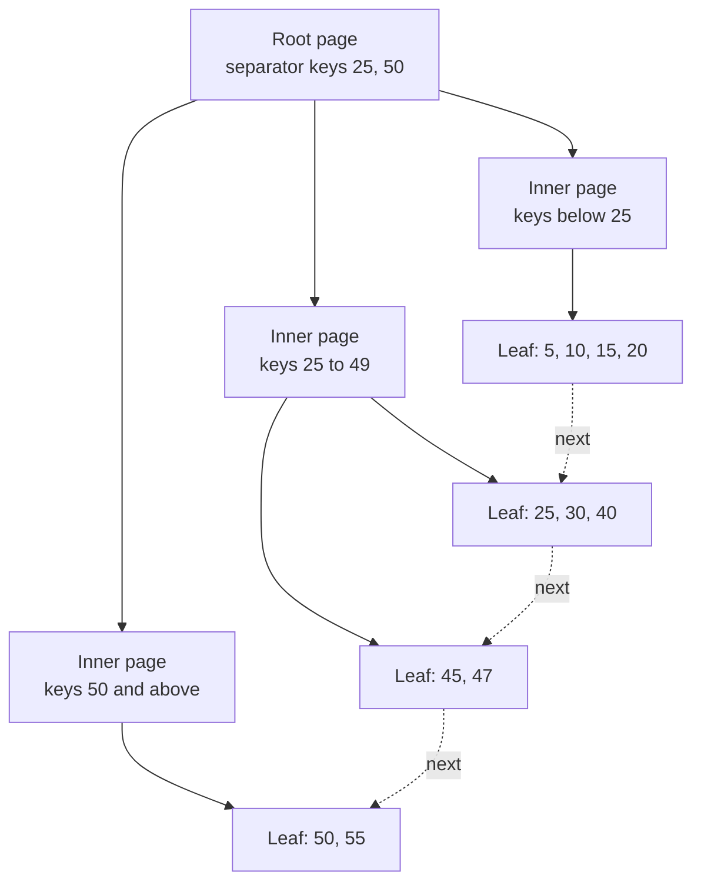

# Indexing

An index is a second data structure that the database keeps in step with a table, so that a query reads a few pages and not the whole table. This page explains the B+ tree on disk pages, the difference between clustered and heap storage, composite, covering, partial, and expression indexes, selectivity and statistics, the reasons why a query does not use an index, the write cost of each index, the effect of random keys, the other index types, and how to build an index on a live table.

## Why It Matters

Almost every backend interview asks "this query is slow, what do you do?", and the first answer is an index. The follow-up questions test whether you know why: what a B+ tree looks like on disk, why the column order of a composite index matters, what a covering index saves, and why the database sometimes ignores an index that exists. On the job, an index is the cheapest fix for read load (see [Scalability and Availability](../hld/fundamentals/01-scalability-and-availability.md)), and a wrong index is the most common reason for a slow table, a bloated disk, and a slow write path. This page gives you the mechanism, so that you can predict what the planner does and explain it.

## Core Concepts

**Page**: the fixed-size unit that a database reads from and writes to disk. PostgreSQL uses 8 kB pages by default ("usually 8 kB, although a different page size can be selected when compiling the server", PostgreSQL documentation, "Database Page Layout"). InnoDB uses 16 KB pages by default (MySQL 8.4 documentation, "The Physical Structure of an InnoDB Index"). The server sets the InnoDB page size when it initializes the instance, and you cannot change it afterwards. SQLite uses a configurable page size. An index lookup costs a number of page reads, not a number of comparisons.

**Index**: a separate, sorted structure that maps column values to the location of the rows that have these values. A table without an index on a column forces a **full table scan** (read every page of the table). An index lets the database jump to the matching rows.

**B+ tree**: a balanced tree in which each node is one page. Inner pages hold separator keys and pointers to child pages. Leaf pages hold the index entries. The leaves link to each other in key order. The tree theory (B-tree height bound, splits, why a binary tree fits a disk poorly) is on the DSA page [Trees and Balanced BSTs](../dsa/foundations/05-trees-and-balanced-bsts.md). This page does not repeat it. It covers the B+ tree as the storage structure of an index.

**Fanout**: the number of child pages that one inner page points to. A high fanout makes the tree shallow.

**Clustered index**: an index whose leaf pages hold the whole table rows, so that the table is stored in the order of the index key. InnoDB stores each table this way, with the primary key as the key.

**Heap table**: a table whose rows sit in pages in no key order. Every index on a heap table is separate from the rows and points to them. PostgreSQL stores tables as heaps.

**Secondary index**: any index other than the clustered index.

**Tuple identifier (TID)**: the PostgreSQL address of a row version: the page number in the heap and the slot number in that page. PostgreSQL also calls it the `ctid`. An index entry holds the key and a TID.

**Composite index** (also multicolumn index): an index on more than one column, sorted by the first column, then by the second column within equal first values, and so on.

**Covering index**: an index that holds all the columns that a query needs, so that the database answers the query from the index and never reads the table.

**Selectivity**: the fraction of the rows that a predicate selects. A predicate that selects 0.1 percent of the rows is highly selective. **Cardinality** has two uses. The cardinality of a column is the number of distinct values in it. The cardinality estimate of a plan node is the number of rows that the planner expects the node to return.

**Sargable predicate** (search-argument-able): a predicate whose form lets the database use an index to find the matching rows. `customer_id = 7` is sargable. `customer_id + 0 = 7` is not, because the index is sorted by `customer_id`, not by `customer_id + 0`. Page [05](05-query-execution-and-tuning.md) covers sargable rewrites in detail.

**Visibility map**: a PostgreSQL structure with one bit for each heap page. The bit says that all rows in the page are visible to all transactions. Index-only scans use it.

## How It Works

### Why an index helps: page reads

A database spends most of the time of a query on page reads. Assumption: a read from a page that is not in memory costs about 16 microseconds on an SSD (Colin Scott's latency model, approximate) and a read from memory costs about 100 nanoseconds (Jeff Dean's list, approximate). A real device can differ from the model, and a spinning disk costs about 10 milliseconds for a seek. See [Back-of-Envelope Estimation](../hld/back-of-envelope-estimation.md) for the latency table and its sources. A table of 100 million rows with 100 bytes for each row occupies about 10 GB, which is about 1.2 million pages of 8 kB. A full scan reads all of them. A B+ tree lookup reads about four pages. The index turns a query that reads a million pages into a query that reads four.

### The structure of a B+ tree index



- **Inner pages** hold only separator keys and child pointers. They hold no row data, so many keys fit in one page, and the fanout is high.
- **Leaf pages** hold the index entries in key order. Each leaf has a link to the next leaf (PostgreSQL also keeps a link to the previous leaf).
- **All leaves are at the same depth**, so every lookup reads the same number of pages.
- **A point lookup** reads the root, one inner page for each level, and one leaf. The top levels stay in the buffer pool, because every query uses them.
- **A range scan** finds the first matching entry with one lookup and then follows the leaf links. It reads consecutive leaves and does not return to the root. This is why `BETWEEN`, `>`, `<`, and `ORDER BY` use a B+ tree index.

### The height of a tree for one billion keys

The height depends on the number of entries that fit in one page. The calculation below uses a table of one billion rows and an index on a `bigint` column.

**PostgreSQL, 8 kB page (assumption: approximate numbers).** An index entry for a `bigint` key takes about 16 bytes (an 8-byte `IndexTupleData` header, from `src/include/access/itup.h`, plus the 8-byte key) and a 4-byte line pointer in the page (4 bytes for each `ItemIdData`, PostgreSQL documentation, "Database Page Layout"). That is about 20 bytes. A page has about 8 100 usable bytes after the page header (24 bytes, from the PostgreSQL page layout) and the special space at the end (the B-tree sibling links). So about 400 entries fit in a full page, and I use a fanout of 400 for inner pages. Leaves are not full: assume 70 percent fill, which is the average that random inserts produce (see "Page splits and fill factor" below for the source), so a leaf holds about 280 entries.

| Level | Pages | Calculation |
|---|---|---|
| Leaves | 3 571 429 | 1 000 000 000 / 280 |
| Inner level 2 | 8 929 | 3 571 429 / 400 |
| Inner level 3 | 23 | 8 929 / 400 |
| Root | 1 | 23 / 400, rounded up |

The tree has **four levels**, and a lookup reads four pages. The leaf level takes about 3.57 million pages of 8 kB, which is about 29 GB. The three upper levels take about 8 950 pages, which is about 70 MB. The upper levels fit in the buffer pool of any production server, so a lookup in a warm tree needs **one page read from disk** (the leaf), and in the best case none. Real inner pages are not full either. If inner pages are also 70 percent full (a fanout of 280), the levels are 3 571 429, 12 755, 46, and 1 pages. The tree still has four levels.

**InnoDB, 16 KB page (assumption).** A clustered index leaf holds whole rows. If a row takes 200 bytes (including the record header and the hidden transaction columns), a leaf holds about 70 rows (the page keeps 1/16 free on insert, so about 15/16 of 16 KB is usable, minus the page header and trailer). One billion rows need about 14 million leaves. An inner entry (key, 6 to 9 bytes of overhead, and the child page number) takes about 17 bytes for a `bigint` key, so a fanout of about 900 is a fair estimate. The upper levels are 14 million / 900 = about 16 000 pages, then 18 pages, then the root. The tree again has four levels.

The conclusion does not depend on the exact numbers: the fanout is in the hundreds, so the height of an index on a table of any realistic size is three to five. Each extra level multiplies the capacity by the fanout.

### Page splits and fill factor

An insert goes to the leaf where the key belongs. If the leaf has room, the entry goes in. If the leaf is full, the database **splits** it: it allocates a new page, moves about half of the entries to it, and inserts a separator key (and a pointer to the new page) in the parent page. If the parent is full, it splits too. A split of the root adds one level to the tree. This is the only way that the height grows.

Two rules control how full pages are:

- **Sequential inserts.** If the new key is greater than all keys in the rightmost leaf, the database does not move half of the entries. The left page stays nearly full, and the new key starts a new page. InnoDB documents this: for sequential inserts, "the resulting index pages are about 15/16 full" (MySQL 8.4, "The Physical Structure of an InnoDB Index"). A PostgreSQL B-tree uses a default `fillfactor` of 90 (PostgreSQL documentation, `CREATE INDEX`), which means that a build leaves 10 percent of each page free for later inserts.
- **Random inserts.** A split divides a full page in the middle, so each half is half full. Later inserts fill the pages again. InnoDB documents the result: with random inserts "the pages are from 1/2 to 15/16 full". The Java example below shows an average of about 70 percent for shuffled keys. The analysis of random insertions into B-trees gives the same value: Yao, "On random 2-3 trees", Acta Informatica 9, 1978, shows that the storage utilization of a high-order B-tree under random insertions is about ln 2, which is 69 percent.

**Fill factor** is the share of a page that the database fills when it builds the index or when it splits. A lower fill factor leaves room for future inserts and gives fewer splits, and it makes the index larger. A fill factor of 100 gives the smallest index and the most splits after the first inserts. PostgreSQL accepts values from 10 to 100 for a B-tree (default 90). InnoDB has the setting `innodb_fill_factor` for sorted index builds.

**Deletes.** PostgreSQL merges or removes a B-tree page only when it is completely empty (nbtree README in the PostgreSQL source). A page that is nearly empty stays in the tree. InnoDB tries to merge a page when its fill drops below `MERGE_THRESHOLD`, which is 50 percent by default. A table with many deletes can therefore leave sparse index pages. `REINDEX` in PostgreSQL and `ALTER TABLE ... ENGINE=InnoDB` or `OPTIMIZE TABLE` in MySQL rebuild an index. See `kb/databases/06-storage-engines.md` for bloat and vacuum.

### Clustered index against heap table

**InnoDB (clustered).** The table is the primary key B+ tree. The leaf pages of the primary key index hold the complete rows (MySQL 8.4: "Each `InnoDB` table has a special index called the clustered index that stores row data"). If you define no primary key, InnoDB uses the first `UNIQUE` index with all columns `NOT NULL`. If there is none, it makes a hidden 6-byte row ID and clusters on it. Each entry of a secondary index holds the secondary key columns and the **primary key columns** of the row ("each record in a secondary index contains the primary key columns for the row, as well as the columns specified for the secondary index. InnoDB uses this primary key value to search for the row in the clustered index").


A lookup through a secondary index therefore costs **two tree searches**: one in the secondary index, to get the primary key, and one in the clustered index, to get the row. A secondary index on a table with a long primary key is larger, because every entry repeats the key. MySQL says: "If the primary key is long, the secondary indexes use more space, so it is advantageous to have a short primary key."

**PostgreSQL (heap).** The table is a heap: rows are in pages in the order in which they were inserted into free space. Every index, including the primary key index, is a separate B+ tree whose leaf entries hold the key and a TID. A lookup reads the index, gets the TID, and reads that heap page (one more page read, usually a random one). All indexes are equal in this respect, so a primary key lookup also costs an index search and a heap fetch. PostgreSQL has a `CLUSTER` command that rewrites the table once in the order of an index. The command does not keep the order for later inserts.

**SQLite** also has a clustered design: a normal table is a B-tree keyed by the `rowid` (or by the `INTEGER PRIMARY KEY`), and an ordinary index entry holds the indexed columns plus the `rowid`. The plan `SEARCH ix_orders USING INTEGER PRIMARY KEY (rowid=?)` in the examples below shows a search in the table tree itself.

| Property | InnoDB clustered table | PostgreSQL heap table |
|---|---|---|
| Rows stored in | The leaves of the primary key B+ tree | Heap pages, in no key order |
| Secondary index entry holds | The primary key columns | A TID (heap page number and slot) |
| Primary key lookup | One tree search | One index search and one heap fetch |
| Secondary index lookup | Two tree searches | One index search and one heap fetch |
| Range scan on the primary key | Reads consecutive leaf pages (rows are contiguous) | Reads index leaves, then jumps to heap pages that can be far apart |
| Effect of a random primary key | Rows scatter over the clustered index, and every secondary index grows | Only the primary key index is affected. The heap fills in insert order |
| Effect of updating the primary key | Moves the row and changes every secondary index entry | Writes a new row version and a new entry in every index |
| Effect of a row move (update) | A secondary index entry stays valid while the primary key stays the same | A new row version has a new TID, so every index needs a new entry, unless the update is HOT (below) |

**PostgreSQL HOT updates.** A heap-only tuple (HOT) update avoids new index entries. It needs two conditions: the update changes no column that an index references (summarizing indexes such as BRIN are exempt), and the page of the old row has free space for the new row (PostgreSQL documentation, "Heap-Only Tuples"). Every extra index on a frequently updated column removes the chance of a HOT update.

### Hash indexes

A **hash index** applies a hash function to the key and stores the key in a bucket. A lookup computes the hash and goes straight to the bucket.

- **PostgreSQL** has a hash index type (`CREATE INDEX ... USING hash`). It stores only a 4-byte hash code and not the key, so it can be smaller than a B-tree on long values such as URLs. It supports only the `=` operator, only one column, and no uniqueness check. Every scan is lossy, so PostgreSQL rechecks the condition on the heap row. Since PostgreSQL 10, hash indexes are crash safe. A hash index cannot serve a range, an `ORDER BY`, or a prefix `LIKE`, so the B-tree is the right default.
- **InnoDB** has no user-created hash index on disk. It has an **adaptive hash index**: InnoDB builds an in-memory hash index on a prefix of an index key for the pages that queries access often, "based on the observed pattern of searches". The feature is automatic. It is partitioned (`innodb_adaptive_hash_index_parts`, default 8) and can become a point of contention under heavy concurrent joins. **In MySQL 8.4 the variable `innodb_adaptive_hash_index` is `OFF` by default. Before 8.4 it was `ON`** (MySQL 8.4 reference, system variables). You can turn it on with `SET GLOBAL innodb_adaptive_hash_index = ON`. Benchmark your workload before you do.
- The MySQL `MEMORY` engine also offers hash indexes. This page does not cover it.

### Composite indexes and the leftmost-prefix rule

A composite index on `(a, b, c)` is one B+ tree sorted by `a`, then `b` within equal `a`, then `c` within equal `(a, b)`. Think of a phone book sorted by last name and then first name. The book helps when you know the last name. It does not help when you know only the first name.

**The rule.** The PostgreSQL documentation states it exactly: "equality constraints on leading columns, plus any inequality constraints on the first column that does not have an equality constraint, will always be used to limit the portion of the index that is scanned. Constraints on columns to the right of these columns are checked in the index, so they'll always save visits to the table proper, but they do not necessarily reduce the portion of the index that has to be scanned."

For an index on `(a, b, c)`:

| Predicate | What the index does |
|---|---|
| `a = 1` | Narrows to the range of `a = 1` |
| `a = 1 AND b = 2` | Narrows to the range of `(1, 2)` |
| `a = 1 AND b = 2 AND c > 5` | Narrows to the part of the range of `(1, 2)` with `c > 5` |
| `a = 1 AND b > 2 AND c = 5` | Narrows by `a = 1 AND b > 2`. The index checks `c = 5` on each entry in that range, but it scans the whole `b > 2` range |
| `b = 2` | No narrowing in older versions. PostgreSQL 18 can use **skip scan** (below) if `a` has few distinct values |
| `a = 1 AND c = 5` | Narrows by `a = 1`. The index checks `c = 5` on the entries in that range |

**Column order.** Recommendation: put the columns with an equality condition first, then the column with a range condition, as the last key column that narrows the scan. A range condition on a column stops the narrowing for the columns to its right. Among equality columns, the order has less effect on the one query, and it matters for the other queries that can reuse the index. Put the column that many queries filter on alone first, so that one index serves several queries (a prefix is free). Do not keep both `(a)` and `(a, b)`: the longer index serves the queries of the shorter one. SQLite documents the same rule of thumb: "your database schema should never contain two indices where one index is a prefix of the other."

**Sort order.** The B+ tree stores entries in index order, so an index on `(customer_id, created_at)` returns the rows of one customer already sorted by `created_at`. The plan needs no sort step. A condition `WHERE customer_id = 7 ORDER BY created_at DESC LIMIT 10` reads the last 10 entries of the range of customer 7 by walking the leaf links backwards. The PostgreSQL documentation says that a B-tree index "can also be scanned backward", so you do not need a `DESC` index for this case. You need a mixed order index (`a ASC, b DESC`) only when a query sorts the columns in opposite directions. MySQL 8.0 and later (InnoDB only) store descending key parts in descending order. Before 8.0, MySQL ignored `DESC` in an index definition and scanned the index in reverse, at a performance penalty (MySQL 8.4, "Descending Indexes").

**Skip scan (PostgreSQL 18).** The PostgreSQL 18 release notes say: "Allow skip scans of btree indexes ... This allows multi-column btree indexes to be used in more cases such as when there are no restrictions on the first or early indexed columns (or there are non-equality ones), and there are useful restrictions on later indexed columns." The scan generates "a dynamic equality constraint internally, that matches every possible value in an index column". The documentation says that this works when the early column has few distinct values: "this approach is generally only taken when there are so few distinct `x` values that the planner expects the scan to skip over most of the index". If the early column has many distinct values, the entire index must be scanned, and the planner prefers a sequential scan. So the leftmost-prefix rule is still the design rule, and skip scan is a fallback for a leading column with few values (for example `status` or `country`). Recommendation: do not design a new index around skip scan, because it depends on the statistics of the early column. SQLite also has a skip-scan optimization when `ANALYZE` data shows that the early columns have few distinct values. MySQL has had a similar **skip scan range access method** since 8.0.13 (on by default, `optimizer_switch` flag `skip_scan`). It works only when the query references only columns of the index, has a range condition on a later column, and has no `GROUP BY` or `DISTINCT` (MySQL 8.4, "Range Optimization"). `EXPLAIN` shows `Using index for skip scan`.

### Covering indexes and index-only scans

A query that needs only the columns that are in an index does not need the table row.

- **InnoDB.** A secondary index entry contains the secondary key columns and the primary key columns. A query that needs only these columns is answered from the secondary index. `EXPLAIN` shows `Using index` in the `Extra` column. To extend what an index covers, add the extra column as a trailing key column (`INDEX (a, b, extra)`), because MySQL has no `INCLUDE` clause.
- **PostgreSQL.** A B-tree supports **index-only scans**. The query must reference only columns that the index stores. PostgreSQL has a second condition because of MVCC: the index entry does not say whether the row version is visible to your transaction. The database must check visibility. If the **visibility map** bit of the heap page is set, all rows in that page are visible, and the scan does not read the heap page. If the bit is not set, the scan reads the heap page to check the row. The documentation says: "it will be a win only if a significant fraction of the table's heap pages have their all-visible map bits set". `VACUUM` sets the bits, so a table with many recent updates gives few index-only scans until the next vacuum. `EXPLAIN (ANALYZE)` shows the number of `Heap Fetches` for an Index Only Scan. A high count means that the scan still visits the heap.
- **`INCLUDE`.** PostgreSQL 11 and later, SQL Server, and others let you add payload columns to an index without making them part of the search key: `CREATE INDEX tab_x_y ON tab(x) INCLUDE (y)`. The payload columns exist only in the leaf entries. They need not have a type that the index method can sort, they are ignored by a unique constraint, and they make the index larger. PostgreSQL supports `INCLUDE` for B-tree, GiST, and SP-GiST. A B-tree with included columns never uses deduplication. For a query `SELECT y FROM tab WHERE x = 'key'`, the `INCLUDE` index serves an index-only scan, and `y` does not affect the sort order or the unique check.

<!-- sql-skip: postgresql -->

```sql
-- PostgreSQL: a unique index on (order_id), with the payload column carried in the leaf
CREATE UNIQUE INDEX orders_order_id_inc ON orders (order_id) INCLUDE (total);
-- This query can run as an Index Only Scan, if the visibility map is current:
SELECT total FROM orders WHERE order_id = 1001;
```

Illustrative output, not from a real run (the shape of a PostgreSQL index-only scan plan):

```text
Index Only Scan using orders_order_id_inc on orders  (cost=0.43..8.45 rows=1 width=4)
  Index Cond: (order_id = 1001)
  Heap Fetches: 0
```

`Heap Fetches: 0` says that the visibility map let the scan skip the heap. Page [05](05-query-execution-and-tuning.md) explains how to read a plan.

### Partial and expression indexes

A **partial index** indexes only the rows that satisfy a predicate. It is smaller, so it is cheaper to maintain and to cache. The PostgreSQL documentation lists the uses: avoid indexing common values, index only the interesting rows (for example, unbilled orders), and enforce uniqueness over a subset of rows. The planner uses a partial index only if the query condition **implies** the index predicate. Parameterized conditions such as `x < ?` in a prepared statement cannot be proven to imply a fixed predicate when the planner plans the statement, so the index is not used then.

<!-- sql-skip: postgresql -->

```sql
-- PostgreSQL and SQLite: one active subscription per user, any number of cancelled ones
CREATE UNIQUE INDEX sub_one_active ON subscriptions (user_id) WHERE status = 'active';
```

An **expression index** (a functional index) stores the value of an expression for each row. In PostgreSQL: `CREATE INDEX ON users (lower(email))`. In MySQL 8.0.13 and later, the expression goes in extra parentheses: `CREATE INDEX idx ON users ((lower(email)))`. A query must use the same expression to use the index: `WHERE lower(email) = 'a@x.com'`. The database computes the expression for each row insertion and update. The PostgreSQL documentation says: "Index expressions are relatively expensive to maintain ... However, the index expressions are not recomputed during an indexed search." MySQL implements an expression index as a hidden virtual generated column. MySQL does not have partial indexes. To approximate one, index a generated column that is `NULL` for the rows that you do not want to find. This indexes the `NULL` rows too, so it saves less space than a real partial index.

### Unique indexes and constraints

A **unique index** rejects a second row with the same key. A `UNIQUE` or `PRIMARY KEY` constraint is implemented with a unique index in PostgreSQL and InnoDB. The check happens inside the index when the insert reaches the leaf, and it is safe under concurrency, because two concurrent inserts of the same key meet in the same leaf page. An application check ("SELECT, then INSERT if not found") is not safe, because two sessions can both see no row. Page [04](04-transactions-and-isolation.md) covers constraints as concurrency control. In SQL, `NULL` is not equal to another `NULL`, so PostgreSQL and MySQL both accept several rows with `NULL` in a unique column. (PostgreSQL 15 added `UNIQUE NULLS NOT DISTINCT` to change this. See page [01](01-relational-model-and-sql.md) for `NULL` semantics.)

### Selectivity, cardinality, and statistics

The planner chooses between a scan and an index with a cost estimate. The estimate needs the number of rows that each predicate returns, and this number comes from **statistics** that `ANALYZE` collects.

- **PostgreSQL.** `ANALYZE` samples the table and stores per-column statistics in `pg_statistic`, which you read through the view `pg_stats`: the fraction of nulls, `n_distinct`, a list of the **most common values** (MCV) with their frequencies, a **histogram** of the other values, and the correlation between the value order and the physical row order. `default_statistics_target` (default 100) sets the maximum number of entries in the MCV list and the histogram. The documentation says the statistics "are always approximate even when freshly updated". Autovacuum runs `ANALYZE` after enough rows change.
- **MySQL InnoDB.** `ANALYZE TABLE` samples random index pages to estimate the cardinality of each index (`innodb_stats_persistent_sample_pages`, default 20). InnoDB recalculates the statistics automatically after more than 10 percent of the rows change (`innodb_stats_auto_recalc`, enabled by default). MySQL 8.0 and later also support histograms for columns without an index (`ANALYZE TABLE ... UPDATE HISTOGRAM`).
- **Estimate.** For `WHERE status = 'open'`, the planner finds the frequency of `'open'` in the MCV list, and multiplies it by the row count. For a range, it uses the histogram. For several predicates, the PostgreSQL planner "normally assumes that multiple conditions are independent of each other". If two columns correlate (city and zip code), the estimate is too low. `CREATE STATISTICS` makes extended statistics for such column sets.

**The decision between an index and a scan.** An index scan reads index pages and then, for each matching row, one table page, usually at a random place. A sequential scan reads all table pages in order, which is cheaper per page. PostgreSQL models this with `seq_page_cost` (default 1.0) and `random_page_cost` (default 4.0). So when a predicate returns a large share of the table, the sequential scan wins. There is no fixed threshold. The break-even share depends on the row width, the correlation, and the cost settings. Assumption: on a spinning disk, the break-even share is a few percent of the rows, and on an SSD with a lower `random_page_cost` it is higher. Measure it with `EXPLAIN` and your own data. PostgreSQL has a third option, the **bitmap heap scan**: it scans the index, collects the matching TIDs into a bitmap in memory, sorts them by page, and then reads the heap pages in physical order, once each. This makes the heap access sequential-like and lets the planner combine several indexes with AND and OR (a `BitmapAnd` or `BitmapOr` node). The bitmap loses the index order, so an `ORDER BY` needs a separate sort.

### When the database does not use an index

| Cause | Example | Fix |
|---|---|---|
| A function or expression on the column | `WHERE date(created_at) = '2026-01-05'`, `WHERE lower(email) = 'a@x.com'`, `WHERE price * 1.2 > 100` | Rewrite the predicate to a range on the bare column (`created_at >= '2026-01-05' AND created_at < '2026-01-06'`), or create an expression index |
| A leading wildcard in `LIKE` | `WHERE name LIKE '%son'` | A B-tree sorts by the start of the string, so only `LIKE 'son%'` can use it. Use a trigram index (PostgreSQL `pg_trgm` with GIN or GiST) or a full-text index |
| An implicit type conversion | `WHERE phone = 5551234` where `phone` is `varchar` (MySQL compares as numbers and converts every row) | Compare with a value of the column type. In MySQL, a string column compared with a number is converted row by row, which disables the index |
| Low selectivity | `WHERE is_active = true` on a table where 95 percent of the rows are active | The scan is cheaper. Index the rare value with a partial index, or choose a different access path |
| `OR` across columns | `WHERE a = 1 OR b = 2` | The database needs an index on each column to combine them (PostgreSQL `BitmapOr`, MySQL index merge, SQLite `MULTI-INDEX OR`). With only one index, it scans the table. Rewrite as `UNION ALL` of two queries that each use an index |
| The leftmost column is missing | Index `(a, b)`, query on `b` only | Add an index that leads with `b`, or reorder. In PostgreSQL 18, skip scan helps if `a` has few values |
| A small table | A table of 50 rows that fits in one page | A scan of one page is cheaper than an index lookup plus a heap fetch. This is correct behavior |
| Stale or missing statistics | A bulk load, followed by a query before `ANALYZE` | Run `ANALYZE` (PostgreSQL) or `ANALYZE TABLE` (MySQL) |
| A different collation or operator class | A `varchar` index with the default collation and a query that needs `LIKE 'abc%'` in a non-C locale | In PostgreSQL, create the index with `text_pattern_ops` (or `varchar_pattern_ops`) for prefix `LIKE` in a non-C locale |
| A negative or not-equal condition | `WHERE status <> 'done'` | A B-tree operator class has no `<>` operator (PostgreSQL documentation, "Interfacing Extensions To Indexes": "it would almost never be useful to use a `<>` WHERE clause in an index search"). The planner scans or uses a partial index |
| A hint or setting that blocks it | `enable_indexscan = off`, an `INVISIBLE` index in MySQL | Check the settings. `INVISIBLE` indexes exist so that you can test a drop without dropping |

!!! warning "Check the plan, not the schema"
    An index that exists is not an index that the database uses. After you add an index, run `EXPLAIN` on the real query with realistic data and statistics. A table of 100 rows in a test database says nothing about a table of 100 million rows in production. Page [05](05-query-execution-and-tuning.md) covers how to read the plan.

### Seeing it in SQLite

SQLite runs on any machine, and `EXPLAIN QUERY PLAN` prints how it uses indexes. The examples below run in the page build, and each result is the real output of SQLite 3.51. SQLite's planner differs from PostgreSQL and MySQL in details, but the ideas are the same. The table has 2 000 rows. The setup block creates it with no index except the primary key.

```sql
DROP TABLE IF EXISTS ix_orders;
CREATE TABLE ix_orders (
  id INTEGER PRIMARY KEY,
  customer_id INTEGER NOT NULL,
  status TEXT NOT NULL,
  created_day INTEGER NOT NULL,
  total INTEGER NOT NULL,
  email TEXT,
  code TEXT
);
WITH RECURSIVE n(i) AS (SELECT 1 UNION ALL SELECT i + 1 FROM n WHERE i < 2000)
INSERT INTO ix_orders
SELECT i, i % 100, CASE WHEN i % 50 = 0 THEN 'open' ELSE 'done' END, i % 365,
       (i * 7) % 500, 'user' || i || '@example.com', CAST(i AS TEXT)
FROM n;
```

**No index: a full scan.** `SCAN` means that SQLite reads every row.

```sql
EXPLAIN QUERY PLAN SELECT * FROM ix_orders WHERE customer_id = 7;
```

<!-- sql-result -->

```text
QUERY PLAN
`--SCAN ix_orders
```

**With an index: a search.**

```sql
CREATE INDEX ix_orders_cust ON ix_orders (customer_id);
```

```sql
EXPLAIN QUERY PLAN SELECT * FROM ix_orders WHERE customer_id = 7;
```

<!-- sql-result -->

```text
QUERY PLAN
`--SEARCH ix_orders USING INDEX ix_orders_cust (customer_id=?)
```

**A covering index.** If the query reads only the indexed column, SQLite never reads the table row. The plan says `COVERING INDEX`.

```sql
EXPLAIN QUERY PLAN SELECT customer_id FROM ix_orders WHERE customer_id = 7;
```

<!-- sql-result -->

```text
QUERY PLAN
`--SEARCH ix_orders USING COVERING INDEX ix_orders_cust (customer_id=?)
```

**The table tree.** A search by the `INTEGER PRIMARY KEY` searches the table B-tree itself, so the table is already an index on `rowid`.

```sql
EXPLAIN QUERY PLAN SELECT * FROM ix_orders WHERE id = 7;
```

<!-- sql-result -->

```text
QUERY PLAN
`--SEARCH ix_orders USING INTEGER PRIMARY KEY (rowid=?)
```

**A function on the column.** The index on `customer_id` cannot answer a condition on `customer_id + 0`.

```sql
EXPLAIN QUERY PLAN SELECT * FROM ix_orders WHERE customer_id + 0 = 7;
```

<!-- sql-result -->

```text
QUERY PLAN
`--SCAN ix_orders
```

**A secondary index stores the row key.** An index entry holds the `rowid`, so rows with equal `customer_id` come out in `rowid` order. The query below asks for that order, and the plan has no sort step (a sort step would print `USE TEMP B-TREE FOR ORDER BY`). This is the SQLite form of the InnoDB rule that a secondary index entry holds the primary key.

```sql
EXPLAIN QUERY PLAN SELECT * FROM ix_orders WHERE customer_id = 7 ORDER BY id;
```

<!-- sql-result -->

```text
QUERY PLAN
`--SEARCH ix_orders USING INDEX ix_orders_cust (customer_id=?)
```

**A composite index.** The index has the columns in the order equality, equality, range.

```sql
CREATE INDEX ix_orders_cs ON ix_orders (customer_id, status, created_day);
```

```sql
EXPLAIN QUERY PLAN
SELECT * FROM ix_orders WHERE customer_id = 7 AND status = 'open' AND created_day > 10;
```

<!-- sql-result -->

```text
QUERY PLAN
`--SEARCH ix_orders USING INDEX ix_orders_cs (customer_id=? AND status=? AND created_day>?)
```

The query below filters on the first two columns, and it needs only `created_day`, which is the third column. The index covers it, and the entries of one `(customer_id, status)` range are already sorted by `created_day`, so there is no sort step.

```sql
EXPLAIN QUERY PLAN
SELECT created_day FROM ix_orders
WHERE customer_id = 7 AND status = 'open' ORDER BY created_day;
```

<!-- sql-result -->

```text
QUERY PLAN
`--SEARCH ix_orders USING COVERING INDEX ix_orders_cs (customer_id=? AND status=?)
```

**The leftmost column is missing.** The condition is on `status`, which is the second column of the only index that contains it. SQLite cannot narrow the scan without statistics.

```sql
EXPLAIN QUERY PLAN SELECT * FROM ix_orders WHERE status = 'open';
```

<!-- sql-result -->

```text
QUERY PLAN
`--SCAN ix_orders
```

**A string prefix.** The standard SQLite `LIKE` is case-insensitive for ASCII letters, and a normal index sorts by case-sensitive order, so `LIKE 'user1%'` cannot use it. A range on the same column can.

```sql
CREATE INDEX ix_orders_email ON ix_orders (email);
```

```sql
EXPLAIN QUERY PLAN SELECT * FROM ix_orders WHERE email LIKE 'user1%';
```

<!-- sql-result -->

```text
QUERY PLAN
`--SCAN ix_orders
```

```sql
EXPLAIN QUERY PLAN
SELECT * FROM ix_orders WHERE email >= 'user1' AND email < 'user2';
```

<!-- sql-result -->

```text
QUERY PLAN
`--SEARCH ix_orders USING INDEX ix_orders_email (email>? AND email<?)
```

**A leading wildcard.** No B-tree can serve it.

```sql
EXPLAIN QUERY PLAN SELECT * FROM ix_orders WHERE email LIKE '%1@example.com';
```

<!-- sql-result -->

```text
QUERY PLAN
`--SCAN ix_orders
```

**A partial index.** The index holds only the rows with `status = 'open'`, 40 of the 2 000 rows. The query condition includes the index predicate, so SQLite uses it.

```sql
CREATE INDEX ix_orders_open ON ix_orders (created_day) WHERE status = 'open';
```

```sql
EXPLAIN QUERY PLAN SELECT * FROM ix_orders WHERE status = 'open' AND created_day = 5;
```

<!-- sql-result -->

```text
QUERY PLAN
`--SEARCH ix_orders USING INDEX ix_orders_open (created_day=?)
```

**An expression index.** The query repeats the indexed expression.

```sql
CREATE INDEX ix_orders_lower ON ix_orders (lower(email));
```

```sql
EXPLAIN QUERY PLAN SELECT * FROM ix_orders WHERE lower(email) = 'user5@example.com';
```

<!-- sql-result -->

```text
QUERY PLAN
`--SEARCH ix_orders USING INDEX ix_orders_lower (<expr>=?)
```

### The write cost of an index

Every index must change on every write that touches its columns. This is the price of each index:

- **Insert.** The database inserts one entry in every index of the table. A table with six indexes does seven tree insertions for one row (in PostgreSQL, one heap insert and six index inserts). Each insert can split a page.
- **Update.** If the update changes an indexed column, the database removes the old entry and adds a new one in that index. In PostgreSQL, an update writes a new row version, and it needs a new entry in every index unless the update is HOT. In InnoDB, an update of a non-indexed column changes the record in place in the clustered index, and the secondary indexes stay unchanged. If the update changes a secondary index column, InnoDB delete-marks the old secondary index record and inserts a new one, and purge removes the old record later (MySQL 8.4, "InnoDB Multi-Versioning").
- **Delete.** The entries are marked or removed. Space returns later (vacuum in PostgreSQL, purge in InnoDB).
- **Space.** An index takes disk space and buffer pool space. A rarely used index still takes both.
- **Buffer pool misses for secondary indexes.** A secondary index is updated in an order that follows the indexed value, not the insert order, so the page that must change can be outside the buffer pool. InnoDB has a **change buffer** that caches changes to secondary index pages that are not in memory, and merges them when a read loads the page. In MySQL 8.4, the default of `innodb_change_buffering` is `none`, so the change buffer does no work unless you enable it. Before 8.4 the default was `all` (MySQL 8.4 reference, "InnoDB system variable default values in MySQL 8.4 differing from MySQL 8.0").

Recommendation: index for the queries that you run, not for the queries that you might run. Find unused indexes (PostgreSQL `pg_stat_user_indexes.idx_scan`, MySQL `sys.schema_unused_indexes`) and drop them. In MySQL, make an index `INVISIBLE` first to test the effect, because making it visible again is instant, while a dropped index must be built again if you need it back.

### Random keys against ordered keys

The key of the primary key index decides where each insert goes.

- **Ordered keys** (a sequence, `AUTO_INCREMENT`, UUIDv7, Snowflake IDs): every insert goes to the rightmost leaf. The hot pages stay in the buffer pool. Pages fill to the fill factor before they split. The index is compact.
- **Random keys** (UUIDv4): every insert goes to a random leaf. If the index is larger than memory, most inserts need a disk read to load the leaf. Splits happen all over the tree, and pages end at about 70 percent full (the Java example measures this). In PostgreSQL with `full_page_writes` on, the first change to a page after a checkpoint writes the whole page into the write-ahead log, and random inserts touch many more pages between checkpoints.
- **InnoDB** also stores the rows in the primary key index. A random primary key scatters the rows, and every secondary index repeats the key, so a 16-byte UUID makes every secondary index entry 8 bytes longer than a `bigint` key would.

Page [UUIDs and other ID schemes](../hld/fundamentals/15-unique-id-generation.md) gives the ID formats, the UUIDv7 layout, and the collision math. PostgreSQL 18 adds `uuidv7()` (PostgreSQL 18 release notes). Recommendation: use a time-ordered ID as a primary key in a B+ tree engine, unless the ID must be unguessable, and then use the random ID as a separate unique column. An LSM engine has less penalty for random keys (see `kb/databases/06-storage-engines.md`).

### Other index types

| Type | Structure | Use it for | Notes |
|---|---|---|---|
| B-tree | B+ tree | Equality, range, sort, prefix `LIKE`, `IS NULL` | The default in PostgreSQL, MySQL, and SQLite |
| Hash | Hash table | Equality on long keys | Among these three products, only PostgreSQL has a user-created hash index (crash safe since PostgreSQL 10). MySQL has hash indexes only in the `MEMORY` and `NDB` engines |
| GIN (PostgreSQL) | An inverted index: one entry for each component value | Arrays, `jsonb` containment (`@>`), full-text search, trigrams | Slow to update: one row inserts many keys. The `fastupdate` option (on by default) collects new entries in a pending list and moves them in bulk. PostgreSQL 18 can build a GIN index in parallel |
| GiST (PostgreSQL) | A balanced tree framework with operator classes | Geometric types, ranges, nearest-neighbor search (`ORDER BY location <-> point`), exclusion constraints | One framework, many strategies |
| SP-GiST (PostgreSQL) | Non-balanced partitioned trees (quadtrees, k-d trees, tries) | Points, text with a common prefix | |
| BRIN (PostgreSQL) | A min and max summary for each range of table blocks | Huge tables whose column order matches the physical order (a time column in an append-only table) | Tiny index. Poor if the column values are scattered |
| R-tree, spatial | A tree of bounding boxes | Geometry | MySQL `SPATIAL` indexes, SQLite R*Tree module |
| Full-text, inverted | Term to posting list | Text search | Home page: [Search and Indexing](../hld/fundamentals/11-search-and-indexing.md) |

- **Inverted indexes.** A GIN index in PostgreSQL and the text index of a search engine map a component (a term, an array element) to the rows that contain it. Page [Search and Indexing](../hld/fundamentals/11-search-and-indexing.md) explains posting lists, analysis, and ranking.
- **Geospatial indexes.** A B-tree sorts in one dimension, so it cannot answer "within 2 km" on two columns. Geohash, S2, H3, and the R-tree solve this. Page [Geospatial Indexing](../hld/fundamentals/18-geospatial-indexing.md) covers them. PostgreSQL implements an R-tree as a GiST index (PostGIS).
- **BRIN** stores for each range of heap blocks the minimum and maximum of the column, so a query skips the ranges that cannot match. The PostgreSQL documentation says BRIN indexes "are most effective for columns whose values are well-correlated with the physical order of the table rows".
- **Bitmap index scan** is not an index type in PostgreSQL. It is a way to use one or more B-tree, GIN, or other indexes (above). Some other products (Oracle) have a persistent bitmap index type. This page does not cover that.

### Building an index on a live table

A normal `CREATE INDEX` in PostgreSQL "locks out writes (but not reads) on the table until it's done". On a table of 500 GB, that is a long outage for writers.

- **PostgreSQL: `CREATE INDEX CONCURRENTLY`.** It builds the index "without taking any locks that prevent concurrent inserts, updates, or deletes on the table". The cost: it "must perform two scans of the table, and in addition it must wait for all existing transactions that could potentially modify or use the index to terminate". It takes more total work and longer wall-clock time. It cannot run inside a transaction block. If it fails (for example, a unique violation, or a cancel), it leaves an `INVALID` index that is ignored by queries but still costs maintenance. Drop it, or run `REINDEX INDEX CONCURRENTLY`, and retry. A concurrent build is not supported on a partitioned table (build on each partition, then attach). `REINDEX ... CONCURRENTLY` rebuilds a bloated index without blocking writes.
- **MySQL InnoDB online DDL.** `ALTER TABLE ... ADD INDEX` (or `CREATE INDEX`) runs in place and permits concurrent DML. The MySQL 8.4 table of online operations lists "Creating or adding a secondary index": in place yes, rebuilds table no, permits concurrent DML yes. "Dropping an index" is in place, and it only modifies metadata. Adding a primary key rebuilds the table ("an expensive operation"). The server keeps a log of the changes made during the build and applies it at the end. You can state `ALGORITHM=INPLACE, LOCK=NONE` in the statement, and then MySQL gives an error if it cannot honor it, so you find out before it blocks writers.
- **Tools.** For changes that online DDL cannot do, gh-ost and pt-online-schema-change copy the table in the background. Page [02](02-schema-design-and-normalization.md) covers schema evolution.
- **A step that people forget.** Run `ANALYZE` after the build and after a bulk load, so that the planner has statistics.

<!-- sql-skip: postgresql -->

```sql
-- PostgreSQL: build without blocking writes (do not wrap in BEGIN ... COMMIT)
CREATE INDEX CONCURRENTLY idx_orders_customer ON orders (customer_id);
-- If it failed, find invalid indexes:
SELECT indexrelid::regclass FROM pg_index WHERE NOT indisvalid;
```

<!-- sql-skip: mysql -->

```sql
-- MySQL 8.4: fail fast if the server cannot build the index in place without locking
ALTER TABLE orders ADD INDEX idx_orders_customer (customer_id), ALGORITHM=INPLACE, LOCK=NONE;
```

## Trade-offs and When to Use

| Choice | Use it when | Cost |
|---|---|---|
| B-tree on one column | A column appears alone in an equality or range predicate | One extra tree to maintain on every write |
| Composite index | Several columns appear together, or one query filters and sorts | A wider index. Only the leftmost prefix helps other queries |
| Covering index or `INCLUDE` | A hot query reads a few columns and visits many rows | A larger index. In PostgreSQL, the visibility map must be current |
| Partial index | A query always filters on a rare value (`status = 'open'`) | Only queries that imply the predicate use it |
| Expression index | The query filters on a function of a column | Computation on every write. The query must repeat the expression |
| Hash index (PostgreSQL) | Equality on a long key such as a URL | No range, no sort, one column |
| GIN | Array, `jsonb`, or text membership | Slower writes, larger size |
| BRIN | A huge table with naturally ordered data | Weak filtering if the data is not ordered |
| No index | The table is small, or the query reads most rows, or the table takes heavy writes and few reads | Scans cost more as the table grows |
| Clustered primary key (InnoDB) | Lookups and range scans by the primary key | A random or wide key hurts every secondary index |

**Decision procedure.** Start from the queries. For each frequent or slow query, write the predicate columns and the sort columns. Put the equality columns first, the range column next, and a covering column last only if the saving justifies the size. Check that an existing index does not already serve the query as a prefix. Create the index, run `EXPLAIN`, and measure on realistic data. Remove an index that no query uses.

## Java Example

The program below is a small B+ tree with four keys for each page, so that you can see the splits. It prints every split, the structure by level, and a range scan along the linked leaves. It then inserts 3 000 keys in ascending order and in shuffled order with 32 keys for each page, and prints the leaf fill. Last, it computes the height of an index for one billion keys from the assumed fanout of this page. The tree keeps keys only. A real index keeps a TID or a primary key with each key. The leaf split follows the sequential-insert rule: a new largest key in the last leaf starts a new page and leaves the old page full.

```java
import java.util.ArrayList;
import java.util.Collections;
import java.util.List;
import java.util.Random;

public class Main {
    public static void main(String[] args) {
        // Part 1: a small tree (4 keys per page) that logs every split.
        BPlusTree tree = new BPlusTree(4, true);
        int[] keys = {10, 20, 30, 40, 50, 25, 35, 45, 60, 70, 5, 15, 55, 65, 75, 80};
        for (int key : keys) {
            tree.insert(key);
        }
        System.out.println("--- structure, level by level ---");
        tree.printLevels();

        // Part 2: a range scan follows the leaf chain.
        System.out.println("--- range scan 22..58 ---");
        int[] pages = new int[1];
        List<Integer> hits = tree.range(22, 58, pages);
        System.out.println("keys   = " + hits);
        System.out.println("pages  = " + pages[0] + " (tree height " + tree.height() + ")");

        // Part 3: ascending keys against shuffled keys, 32 keys per page.
        System.out.println("--- 3000 keys, 32 keys per page ---");
        List<Integer> ascending = new ArrayList<>();
        for (int i = 1; i <= 3000; i++) {
            ascending.add(i);
        }
        List<Integer> shuffled = new ArrayList<>(ascending);
        Collections.shuffle(shuffled, new Random(42));
        report("ascending", ascending);
        report("shuffled ", shuffled);

        // Part 4: the height of a tree for one billion keys.
        System.out.println("--- height for 1_000_000_000 keys ---");
        heightFor(1_000_000_000L, 280, 400);
    }

    static void report(String name, List<Integer> input) {
        BPlusTree tree = new BPlusTree(32, false);
        for (int key : input) {
            tree.insert(key);
        }
        System.out.printf("%s: leaves=%d, average leaf fill=%.0f%%, height=%d, splits=%d%n",
                name, tree.leafCount(), tree.averageLeafFill() * 100, tree.height(), tree.splits());
    }

    // leafEntries: entries per leaf page. fanout: children per inner page.
    static void heightFor(long keys, int leafEntries, int fanout) {
        long pages = (keys + leafEntries - 1) / leafEntries;
        int level = 1;
        System.out.println("level " + level + " (leaves): " + pages + " pages");
        while (pages > 1) {
            pages = (pages + fanout - 1) / fanout;
            level++;
            String name = pages == 1 ? " (root)" : "";
            System.out.println("level " + level + name + ": " + pages + " pages");
        }
        System.out.println("a lookup reads " + level + " pages");
    }
}

class BPlusTree {
    private static class Node {
        final int id;
        final boolean leaf;
        final List<Integer> keys = new ArrayList<>();
        final List<Node> children = new ArrayList<>();
        Node next;

        Node(int id, boolean leaf) {
            this.id = id;
            this.leaf = leaf;
        }
    }

    private static class Split {
        final int separator;
        final Node right;

        Split(int separator, Node right) {
            this.separator = separator;
            this.right = right;
        }
    }

    private final int maxKeys;
    private final boolean log;
    private int nextId = 1;
    private int splits = 0;
    private Node root;

    BPlusTree(int maxKeys, boolean log) {
        this.maxKeys = maxKeys;
        this.log = log;
        this.root = new Node(nextId++, true);
    }

    void insert(int key) {
        Split split = insert(root, key);
        if (split != null) {
            Node newRoot = new Node(nextId++, false);
            newRoot.keys.add(split.separator);
            newRoot.children.add(root);
            newRoot.children.add(split.right);
            root = newRoot;
            say("  new root page " + root.id + " " + root.keys + ", height " + height());
        }
    }

    private Split insert(Node node, int key) {
        if (node.leaf) {
            int pos = 0;
            while (pos < node.keys.size() && node.keys.get(pos) < key) {
                pos++;
            }
            node.keys.add(pos, key);
            if (node.keys.size() <= maxKeys) {
                return null;
            }
            return splitLeaf(node, pos);
        }
        int child = 0;
        while (child < node.keys.size() && node.keys.get(child) <= key) {
            child++;
        }
        Split split = insert(node.children.get(child), key);
        if (split == null) {
            return null;
        }
        node.keys.add(child, split.separator);
        node.children.add(child + 1, split.right);
        if (node.keys.size() <= maxKeys) {
            return null;
        }
        return splitInner(node);
    }

    private Split splitLeaf(Node node, int insertedAt) {
        splits++;
        Node right = new Node(nextId++, true);
        boolean appendAtEnd = node.next == null && insertedAt == node.keys.size() - 1;
        // A new largest key in the last leaf keeps the left page full.
        int cut = appendAtEnd ? node.keys.size() - 1 : node.keys.size() / 2;
        right.keys.addAll(node.keys.subList(cut, node.keys.size()));
        node.keys.subList(cut, node.keys.size()).clear();
        right.next = node.next;
        node.next = right;
        say("split leaf " + node.id + " -> " + node.id + node.keys + " | " + right.id + right.keys
                + ", separator " + right.keys.get(0) + (appendAtEnd ? " (append split)" : ""));
        return new Split(right.keys.get(0), right);
    }

    private Split splitInner(Node node) {
        splits++;
        int mid = node.keys.size() / 2;
        int separator = node.keys.get(mid);
        Node right = new Node(nextId++, false);
        right.keys.addAll(node.keys.subList(mid + 1, node.keys.size()));
        right.children.addAll(node.children.subList(mid + 1, node.children.size()));
        node.keys.subList(mid, node.keys.size()).clear();
        node.children.subList(mid + 1, node.children.size()).clear();
        say("split inner " + node.id + " -> " + node.id + node.keys + " | " + right.id + right.keys
                + ", separator " + separator + " moves up");
        return new Split(separator, right);
    }

    List<Integer> range(int low, int high, int[] pagesRead) {
        Node node = root;
        pagesRead[0] = 1;
        while (!node.leaf) {
            int child = 0;
            while (child < node.keys.size() && node.keys.get(child) <= low) {
                child++;
            }
            node = node.children.get(child);
            pagesRead[0]++;
        }
        List<Integer> result = new ArrayList<>();
        while (node != null) {
            for (int key : node.keys) {
                if (key > high) {
                    return result;
                }
                if (key >= low) {
                    result.add(key);
                }
            }
            node = node.next;
            if (node != null) {
                pagesRead[0]++;
            }
        }
        return result;
    }

    int height() {
        int h = 1;
        for (Node node = root; !node.leaf; node = node.children.get(0)) {
            h++;
        }
        return h;
    }

    int splits() {
        return splits;
    }

    int leafCount() {
        return leaves().size();
    }

    double averageLeafFill() {
        int keys = 0;
        List<Node> leaves = leaves();
        for (Node leaf : leaves) {
            keys += leaf.keys.size();
        }
        return (double) keys / ((double) leaves.size() * maxKeys);
    }

    private List<Node> leaves() {
        Node node = root;
        while (!node.leaf) {
            node = node.children.get(0);
        }
        List<Node> result = new ArrayList<>();
        for (; node != null; node = node.next) {
            result.add(node);
        }
        return result;
    }

    void printLevels() {
        List<Node> level = List.of(root);
        int depth = 1;
        while (!level.isEmpty()) {
            StringBuilder line = new StringBuilder("level " + depth + ":");
            List<Node> below = new ArrayList<>();
            for (Node node : level) {
                line.append(" ").append(node.id).append(node.keys);
                below.addAll(node.children);
            }
            System.out.println(line);
            level = below;
            depth++;
        }
    }

    private void say(String text) {
        if (log) {
            System.out.println(text);
        }
    }
}
```

<!-- expected-output -->

```text
split leaf 1 -> 1[10, 20, 30, 40] | 2[50], separator 50 (append split)
  new root page 3 [50], height 2
split leaf 1 -> 1[10, 20] | 4[25, 30, 40], separator 25
split leaf 4 -> 4[25, 30] | 5[35, 40, 45], separator 35
split leaf 2 -> 2[50, 55] | 6[60, 65, 70], separator 60
split leaf 6 -> 6[60, 65, 70, 75] | 7[80], separator 80 (append split)
split inner 3 -> 3[25, 35] | 8[60, 80], separator 50 moves up
  new root page 9 [50], height 3
--- structure, level by level ---
level 1: 9[50]
level 2: 3[25, 35] 8[60, 80]
level 3: 1[5, 10, 15, 20] 4[25, 30] 5[35, 40, 45] 2[50, 55] 6[60, 65, 70, 75] 7[80]
--- range scan 22..58 ---
keys   = [25, 30, 35, 40, 45, 50, 55]
pages  = 7 (tree height 3)
--- 3000 keys, 32 keys per page ---
ascending: leaves=94, average leaf fill=100%, height=3, splits=97
shuffled : leaves=133, average leaf fill=70%, height=3, splits=137
--- height for 1_000_000_000 keys ---
level 1 (leaves): 3571429 pages
level 2: 8929 pages
level 3: 23 pages
level 4 (root): 1 pages
a lookup reads 4 pages
```

How to read the output:

- The first leaf split is an **append split**: key 50 is a new largest key in the last leaf, so page 1 stays full (10, 20, 30, 40) and page 2 starts with 50. A page split of the root creates page 3 and raises the height to 2.
- The insert of 25 splits page 1 in the middle (a normal split). The new page 4 gets the upper half, and the separator 25 goes to the parent.
- When the root page 3 overflows, it splits as an inner page. The middle separator, 50, **moves up** into a new root (page 9). It does not stay in the child, which is the difference between an inner split and a leaf split (a leaf split **copies** the separator up, because the leaf must keep the key to hold the row).
- The range scan from 22 to 58 reads the root, one inner page, and the leaf where the search for 22 lands. It then follows four links to the neighbor leaves, and it stops when it reads key 60. It never returns to the root. That is 7 pages.
- Ascending inserts fill each leaf to 100 percent (the real engines use 90 to 94 percent). Shuffled inserts give about 70 percent, 133 leaves instead of 94, and 40 more splits. This is the physical cost of a random key: a larger index and more page writes.

## Interview Angle

### Questions

??? question "Why does a database use a B+ tree for an index and not a binary tree or a hash table?"

    The cost of a lookup on disk is the number of pages read, not the number of comparisons. A binary tree has one key in each node, so a lookup in 10^8 keys visits about 27 nodes, and each node can be a separate page read. A B+ tree fills each node with hundreds of keys, so its height for 10^9 keys is four (with a fanout of about 400), and the top levels stay in memory, so a lookup often costs one disk read.

    A B+ tree keeps the keys in sorted order, and the leaves link to each other. That serves equality, range scans, `ORDER BY`, and prefix matches with one structure. A hash table serves equality only. It has no order, so it cannot serve a range or a sort. PostgreSQL offers a hash index for equality on long keys, and the B-tree remains the default for this reason.

    Trade-off: a B+ tree costs a page write for each index on each insert, and pages split as the tree grows. The theory of the tree is on the DSA page for balanced trees.

??? question "What is the difference between a clustered index and a secondary index? How does InnoDB differ from PostgreSQL?"

    A clustered index stores the table rows in its leaf pages, in key order. A secondary index is a separate structure that points to the rows. In InnoDB the table is the primary key B+ tree, so the primary key is the clustered index. A secondary index entry holds the secondary key and the **primary key** of the row, so a lookup through a secondary index searches two trees: the secondary index, then the clustered index.

    PostgreSQL stores a table as a heap, and every index (including the primary key) is a separate B+ tree whose entries hold a TID, the heap page and slot. A lookup reads the index, then fetches the heap page.

    Consequences. In InnoDB, a long or random primary key enlarges every secondary index, and a primary key range scan reads contiguous pages. In PostgreSQL, an update that creates a new row version needs a new entry in every index, unless it is a HOT update. In both, an index range scan that returns many rows can be slower than a sequential scan because of the random row fetches.

??? question "A table has an index on `(a, b, c)`. Which of these queries can use it: `WHERE a = 1`, `WHERE b = 2`, `WHERE a = 1 AND c = 3`, `WHERE a = 1 AND b > 2 AND c = 3`?"

    The index is sorted by `a`, then `b`, then `c`. The rule: equality conditions on the leading columns, plus a range condition on the first column without equality, narrow the index range. Conditions to the right are checked on the entries inside that range.

    - `a = 1` uses the index and narrows to the range of `a = 1`.
    - `b = 2` has no condition on `a`. Before PostgreSQL 18, the index cannot narrow the scan (a full index scan is possible, but it is rarely better than a table scan). PostgreSQL 18 has skip scan, which can use the index when `a` has few distinct values. MySQL has a skip scan range access method with narrow conditions (only index columns in the query, a range condition on a later column). SQLite has a skip scan when `ANALYZE` shows few distinct values in `a`. Otherwise the engine treats `b = 2` as a non-prefix query.
    - `a = 1 AND c = 3` narrows by `a = 1`, then checks `c = 3` on each entry in that range. `b` has no condition, so `c` does not narrow the scan. Exception: PostgreSQL 18 skip scan also applies to a middle column without a condition. If `b` has few distinct values, the scan can jump to each `(1, b, 3)` position.
    - `a = 1 AND b > 2 AND c = 3` narrows by `a = 1 AND b > 2`. The `c = 3` check runs inside that range, which can be large.

    So I put equality columns first and the range column after them. I also check the real plan, because the planner can choose a different path.

??? question "What is a covering index? What is an index-only scan, and why does PostgreSQL still visit the heap sometimes?"

    A covering index contains every column that a query reads, so the database answers the query from the index and does not read the table row. It saves the second lookup (the heap fetch in PostgreSQL, the clustered index search in InnoDB). In InnoDB, a secondary index holds the primary key columns too, so it covers a query on those columns. MySQL shows `Using index` in `EXPLAIN`.

    PostgreSQL has an extra check. The index entry carries no transaction visibility data, because of MVCC. The scan must know whether the row version is visible to the current snapshot. The **visibility map** has a bit for each heap page that says that all rows in the page are visible to all transactions. If the bit is set, the scan skips the heap. If not, the scan visits the heap page. `VACUUM` sets the bits. A table with many recent updates has few set bits, so the scan shows a high `Heap Fetches` count in `EXPLAIN ANALYZE` and gains little.

    `INCLUDE` adds payload columns to the leaf entries without making them part of the key. This keeps the sort order and the uniqueness check on the key columns, and the cost is a larger index.

??? question "You add an index and the query is still slow. The plan shows a sequential scan. List the reasons, and how you find the real one."

    First read the plan and the predicate. The usual reasons:

    1. A function or expression on the indexed column (`WHERE date(created_at) = ...`, `lower(email) = ...`). Fix: rewrite as a range on the bare column, or create an expression index.
    2. A leading wildcard (`LIKE '%x'`). A B-tree cannot serve it. Fix: a trigram or full-text index.
    3. An implicit type conversion (a string column compared with a number in MySQL). Fix: use the column type for the literal.
    4. The predicate is not selective. If it returns 20 percent of the rows, a sequential scan is cheaper than 20 percent random row fetches. This is correct behavior.
    5. The column is not the leftmost column of the index, or an `OR` has no index on one side.
    6. The table is small, so one page scan is cheaper.
    7. Stale statistics: the planner thinks the table is empty or the value is common. Fix: `ANALYZE`.
    8. The planner estimates the row count badly because two columns correlate. Fix: extended statistics.

    To find the real one, I run `EXPLAIN (ANALYZE, BUFFERS)` on the exact query with real parameter values, compare the estimated rows with the actual rows, and check `pg_stats` for the column. I test with `SET enable_seqscan = off` in a session to see whether the index plan is cheaper or not. If the index plan is slower, the planner was right.

??? question "Why can adding indexes slow a system down? How many indexes are too many?"

    Every index is a B+ tree that the database updates on every insert, and on every update or delete that changes an indexed column. A table with six indexes does seven structure updates for each insert. Each insert can split pages, write to the write-ahead log, and load pages into the buffer pool. Indexes also take disk and memory, so they push the useful data out of the buffer pool. In PostgreSQL, an index on a frequently updated column removes the chance of HOT updates, so each update writes new entries in all indexes. The write amplification also loads replicas, which replay the same changes.

    There is no fixed number. The test is: does a real query use the index, and is the read benefit larger than the write cost? I measure with `pg_stat_user_indexes` (`idx_scan` equal to zero means unused), or `sys.schema_unused_indexes` in MySQL, drop duplicates (a prefix of another index), and look for write-heavy tables. A read-mostly table can carry many indexes. A table with 10 000 inserts per second should carry few.

??? question "Why is a random UUID primary key a problem for a B+ tree table, and what do you do about it?"

    A sequential key inserts at the rightmost leaf. That page is in the buffer pool, and the page fills before it splits, so the index stays compact (InnoDB documents about 15/16 full). A random key (UUIDv4) inserts into a random leaf. If the index is larger than memory, most inserts first read a leaf from disk. Splits occur all over the tree, and the pages end at 50 to 90 percent full (InnoDB documents 1/2 to 15/16 for random inserts, and a simple simulation gives about 70 percent). In PostgreSQL, random inserts touch many more pages between checkpoints, and each first touch writes a full page into the write-ahead log. In InnoDB, the primary key is also the clustered index, so rows scatter, and a 16-byte key enlarges every secondary index.

    Options: use a time-ordered ID (UUIDv7, which PostgreSQL 18 generates with `uuidv7()`, or a Snowflake-style ID), which keeps the insert at the right edge and gives a roughly sortable key. If the ID must not reveal time or volume, keep a `bigint` primary key and put the random ID in a separate unique column. Trade-off: UUIDv7 leaks the creation time. The ID formats are on the unique ID page of the HLD section.

??? question "How do you add an index to a table with 500 million rows in production without taking an outage?"

    In PostgreSQL, use `CREATE INDEX CONCURRENTLY`. A normal `CREATE INDEX` blocks writes until it finishes. The concurrent build takes no lock that blocks inserts, updates, or deletes, but it scans the table twice and waits for older transactions, so it takes longer and more I/O. It cannot run inside a transaction. If it fails, it leaves an `INVALID` index that costs maintenance, so I check `pg_index.indisvalid`, drop it, and retry. I run it off-peak, watch replication lag and I/O, and limit long-running transactions, because they block the finish.

    In MySQL InnoDB, `ALTER TABLE ... ADD INDEX` runs in place and permits concurrent DML. I state `ALGORITHM=INPLACE, LOCK=NONE` so the statement fails at once if the server cannot honor it. Online DDL logs the concurrent changes and applies them at the end. A metadata lock at the start and the end can queue behind a long transaction, so I check for long transactions first. For changes that online DDL does not support, I use gh-ost or pt-online-schema-change.

    After the build, I run `ANALYZE`, verify with `EXPLAIN` that the new plan uses the index, and keep the old index until I confirm the gain.

??? question "What is selectivity, and how does the planner know whether to use an index?"

    Selectivity is the fraction of rows that a predicate selects. The planner multiplies it by the row count to estimate the cardinality (rows returned) of each plan node. It gets the selectivity from statistics that `ANALYZE` collects: the null fraction, the number of distinct values, the most common values with their frequencies, and a histogram of the rest. PostgreSQL stores them in `pg_statistic` (view `pg_stats`), with up to 100 entries by default. InnoDB estimates the cardinality of an index from a sample of pages.

    With the estimate, the planner prices each plan: a sequential scan reads all pages in order (`seq_page_cost`, 1.0 by default), and an index scan reads index pages plus one table page for each matching row at a random place (`random_page_cost`, 4.0 by default). A highly selective predicate favors the index, and a predicate that returns a large share of the table favors the scan. A bitmap heap scan sits in between, because it sorts the TIDs and reads each heap page once.

    When the estimate is wrong, the plan is wrong: stale statistics after a bulk load, correlated columns (the planner multiplies the selectivities as if they were independent), or a skewed distribution. I fix it with `ANALYZE`, a higher statistics target, or `CREATE STATISTICS`.

??? question "Compare a PostgreSQL GIN, GiST, and BRIN index. When do you use each?"

    A **GIN** index is an inverted index: for each component value of a column (an array element, a `jsonb` key, a text term or trigram), it stores the list of rows that contain it. Use it for containment queries (`@>`, `&&`, full-text `@@`, trigram `LIKE '%x%'`). Reads are fast, and writes are slower, because one row inserts many keys. PostgreSQL collects new entries in an unsorted pending list (`fastupdate`, on by default) and moves them to the main structure in bulk at vacuum time or when the list exceeds `gin_pending_list_limit`. The costs: a search must also scan the pending list, and the insert that overflows the list pays for the whole cleanup. **GiST** is a framework for balanced trees with operator classes. Use it for geometric data, range types, nearest-neighbor queries, and exclusion constraints. It can return approximate matches that the executor rechecks. **BRIN** stores the minimum and maximum of each block range. Use it for a huge append-only table where the column follows the physical order (a timestamp), because the index is a few kilobytes and a query skips the ranges that cannot match. It is useless if the values are scattered.

    A B-tree serves equality and range on sortable values and remains the default. For text search at scale or geo queries, the HLD pages on search and geospatial indexing show when to leave the database for a dedicated engine.

### Follow-up Questions

??? question "A query uses `ORDER BY created_at DESC LIMIT 20` with `WHERE user_id = 7`. What index do you create?"

    An index on `(user_id, created_at)`. The equality column comes first and the sort column second. The database seeks to the end of the range for `user_id = 7`, and reads 20 entries backwards along the leaf links. It reads about one leaf page and needs no sort and no scan of the other rows of the user. A B-tree can be scanned in either direction, so `created_at DESC` needs no special index. If the query also fetches a few columns, I consider a covering variant.

??? question "Why does InnoDB recommend a short primary key?"

    Every secondary index entry repeats the primary key columns, and the clustered index uses the key to order the rows. A long key (a UUID string of 36 characters, or a composite of several columns) makes every secondary index larger. That uses more buffer pool and more disk, and it lowers the fanout, so the secondary trees get taller. An auto-increment `bigint` key is 8 bytes and sequential.

??? question "What is the difference between a unique index and a unique constraint?"

    In PostgreSQL and MySQL, a unique constraint is implemented with a unique index. The constraint is the logical rule and the index is the mechanism. In PostgreSQL, a unique constraint can be declared `DEFERRABLE`, and a unique index cannot. A partial unique index (`WHERE status = 'active'`) exists only as an index, because a constraint has no `WHERE` clause. Both give a safe check under concurrency, because two inserts of the same key meet in the same leaf page.

??? question "When is a sequential scan better than an index scan?"

    When the query reads a large share of the table, because an index scan fetches each row with a separate, often random, page read, and a sequential scan reads pages in order. When the table is small (one page). When the data is cached and the index adds an extra step. The planner decides with its cost model, and the break-even point depends on the row width, the physical correlation of the column, and the cost settings. A bitmap heap scan covers the middle range.

### Red Flags

- "An index always makes a query faster." Indexes slow writes, take space, and the planner ignores them for low selectivity.
- "Put an index on every column." This is the write-amplification trap. Index for queries.
- "Put the most selective column first in a composite index." The order depends on equality against range, and on which queries share the prefix. Selectivity alone is a weak rule.
- "A B-tree is a binary tree." It has hundreds of keys in each node.
- "A hash index is faster than a B-tree for everything." It serves equality only, and in PostgreSQL it is rarely worth it.
- "The primary key in InnoDB is just a unique index." It is the clustered index: it holds the rows and appears in every secondary index.
- "A covering index in PostgreSQL never reads the heap." It reads the heap for pages that the visibility map does not mark all-visible.
- "I added the index, so it works." You must check the plan with real data.
- "`CREATE INDEX` on a live table is safe." In PostgreSQL it blocks writes unless you use `CONCURRENTLY`.

## Common Mistakes

| Mistake | Why it hurts | Fix |
|---|---|---|
| A function on the indexed column in `WHERE` | The index cannot be used | Rewrite as a range on the bare column, or create an expression index |
| A composite index in the wrong order | The leading column has no condition, and the index cannot narrow the scan | Equality columns first, then the range column |
| Both `(a)` and `(a, b)` | The shorter index is redundant and costs writes | Drop `(a)` |
| An index on a low-cardinality column alone (`is_active`, `gender`) | The planner scans instead | Use a partial index on the rare value, or add the column to a composite index |
| Random UUID primary key on a big table | Page splits, cache misses, large secondary indexes | A time-ordered ID or `bigint` primary key |
| `CREATE INDEX` without `CONCURRENTLY` on a live PostgreSQL table | Blocks writes during the build | `CREATE INDEX CONCURRENTLY`, and check for an `INVALID` leftover |
| No `ANALYZE` after a bulk load | Bad estimates, a wrong plan | `ANALYZE` after the load |
| Leaving unused indexes | Slower writes, more disk and memory | Find them with the stats views and drop them (test with `INVISIBLE` in MySQL) |
| Index on a column of a rarely queried table with many writes | Pure cost | Add indexes for measured queries only |
| Wide `SELECT *` over a covering index | The query needs columns outside the index, so no index-only scan | Select only the needed columns |
| Assuming that a test table with 1 000 rows predicts production | The planner picks a scan on a small table | Test with production-size data and statistics |

## Commonly Confused With

| Looks like | Difference | Deciding question |
|---|---|---|
| Clustered index and primary key | In InnoDB they are the same structure. In PostgreSQL the primary key is a separate index, and the table is a heap | Does the engine store rows in the index leaves? |
| Clustered index and a covering index | A clustered index holds the whole row. A covering index holds the columns of one query | Does the index hold all the table columns, or the ones that the query needs? |
| Composite index and several single-column indexes | A composite index narrows by several columns in one tree. Separate indexes combine with a bitmap AND or index merge, which costs more | Do the columns appear together in the same query? |
| Index key columns and `INCLUDE` columns | Key columns decide the order and the uniqueness check. `INCLUDE` columns are payload | Is the column in a `WHERE` or `ORDER BY`, or only in `SELECT`? |
| Selectivity and cardinality | Selectivity is a fraction of rows that a predicate returns. Cardinality is a count of distinct values (of a column) or a count of rows (an estimate in a plan) | Is the number a fraction or a count? |
| B+ tree and B-tree | A B+ tree keeps rows or row pointers only in the leaves and links the leaves | Do inner nodes hold data? |
| Index scan and index-only scan | An index scan visits the table for each match. An index-only scan skips the table when the visibility map allows | Does the plan show `Heap Fetches`? |
| Index scan and bitmap heap scan | A bitmap scan collects TIDs, sorts them by page, and reads each heap page once | Does the query return many scattered rows? |
| Inverted index and B-tree index | An inverted index maps a term to rows. A B-tree maps a whole value to rows | Is the query a membership or a text search? |
| Hash index (PostgreSQL) and the InnoDB adaptive hash index | The first is an on-disk index that you create. The second is an in-memory structure that InnoDB builds on its own, and it is off by default in MySQL 8.4 | Do you create it, or does the engine? |

## Quick Reference Card

- An index turns a table scan into a few page reads. The B+ tree has a fanout of hundreds, so the height is three to five for any real table. One billion keys: four levels, with PostgreSQL 8 kB pages and an assumed fanout of 400.
- Inner pages hold separators. Leaves hold entries and link to each other, so ranges and sorts are cheap.
- Split: a full page splits in the middle (about 70 percent average fill for random keys). A sequential insert keeps the left page full (InnoDB 15/16, PostgreSQL fillfactor 90).
- InnoDB: the table is the primary key tree. A secondary index entry holds the primary key, so a lookup is two tree searches. PostgreSQL: a heap, and an index entry holds a TID.
- Composite `(a, b, c)`: equality columns first, then one range column. The index helps only through its leftmost prefix. PostgreSQL 18 adds skip scan for a leading column with few values.
- Covering: all query columns in the index. InnoDB secondary indexes include the primary key. PostgreSQL needs `INCLUDE` or key columns plus the visibility map.
- Partial index: only the rows that match a predicate. Expression index: the query repeats the expression. MySQL has no partial index.
- No index use: a function on the column, a leading wildcard, an implicit conversion, low selectivity, `OR` without an index on each side, a missing leftmost column, a small table, stale statistics.
- Each index costs a write on every insert and on indexed-column updates. Drop unused indexes.
- UUIDv4 keys cause random page splits. Use UUIDv7 or a sequence.
- Live build: PostgreSQL `CREATE INDEX CONCURRENTLY` (check for `INVALID`). MySQL online DDL (`ALGORITHM=INPLACE, LOCK=NONE`).
- MySQL 8.4: the adaptive hash index and the change buffer are both off by default.
- Read the plan with `EXPLAIN` on real data. See page [05](05-query-execution-and-tuning.md).

## Further Reading

- PostgreSQL documentation, "Indexes" chapter (`https://www.postgresql.org/docs/current/indexes.html`): index types, multicolumn indexes, partial and expression indexes, index-only scans, and bitmap scans. Read it for the exact rules of the leftmost prefix and the visibility map.
- PostgreSQL documentation, `CREATE INDEX` (`https://www.postgresql.org/docs/current/sql-createindex.html`): `CONCURRENTLY`, `INCLUDE`, and the `fillfactor` default of 90.
- PostgreSQL documentation, "B-Tree Indexes" and the nbtree README in the source (`https://github.com/postgres/postgres/blob/master/src/backend/access/nbtree/README`): the implementation, with Lehman and Yao links, high keys, and page deletion.
- PostgreSQL documentation, "Database Page Layout" (`https://www.postgresql.org/docs/current/storage-page-layout.html`): the 8 kB page, line pointers, and the TID.
- PostgreSQL 18 release notes (`https://www.postgresql.org/docs/18/release-18.html`): skip scan, parallel GIN builds, and `uuidv7()`.
- PostgreSQL documentation, "Statistics Used by the Planner" (`https://www.postgresql.org/docs/current/planner-stats.html`): MCV lists, histograms, and extended statistics.
- MySQL 8.4 Reference Manual, "Clustered and Secondary Indexes" (`https://dev.mysql.com/doc/refman/8.4/en/innodb-index-types.html`): why a secondary index holds the primary key.
- MySQL 8.4 Reference Manual, "The Physical Structure of an InnoDB Index" (`https://dev.mysql.com/doc/refman/8.4/en/innodb-physical-structure.html`): the 16 KB page, the fill factor, and `MERGE_THRESHOLD`.
- MySQL 8.4 Reference Manual, "Adaptive Hash Index", "Change Buffer", "Online DDL Operations" (`https://dev.mysql.com/doc/refman/8.4/en/innodb-online-ddl-operations.html`), "Online DDL Performance and Concurrency", "Descending Indexes", "Range Optimization" (skip scan), and "What Is New in MySQL 8.4" (the changed InnoDB defaults): the in-memory structures, the online index build, and the version facts on this page.
- SQLite documentation, "The SQLite Query Planner" (`https://www.sqlite.org/queryplanner.html`): a short, clear explanation of indexes, covering indexes, and multi-column indexes, with the examples that this page's SQLite plans follow.
- Bayer and McCreight, "Organization and Maintenance of Large Ordered Indexes", Acta Informatica, 1972: the original B-tree paper.
- Yao, "On random 2-3 trees", Acta Informatica 9, 1978, pp. 159-170 (DOI 10.1007/BF00289075): the average storage utilization of a B-tree under random insertions, about ln 2 (69 percent).
- Lehman and Yao, "Efficient Locking for Concurrent Operations on B-Trees", ACM TODS, 1981: the right-link design that PostgreSQL uses.
- Markus Winand, *Use The Index, Luke* (`https://use-the-index-luke.com/`): a practical guide to SQL indexing for developers.
- Related pages: [Trees and Balanced BSTs](../dsa/foundations/05-trees-and-balanced-bsts.md), [Unique ID Generation](../hld/fundamentals/15-unique-id-generation.md), [Search and Indexing](../hld/fundamentals/11-search-and-indexing.md), [Geospatial Indexing](../hld/fundamentals/18-geospatial-indexing.md), [Choosing a Database](../hld/fundamentals/04-choosing-a-database.md).
