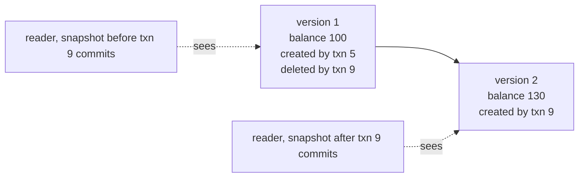
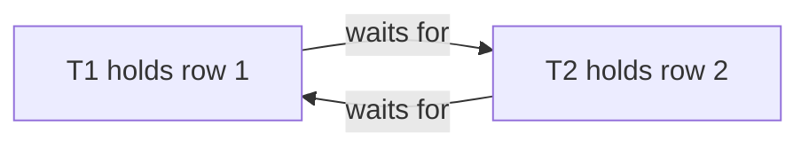

# Transactions and Isolation

A transaction groups reads and writes so that the database treats them as one unit. Isolation decides what concurrent transactions see of each other. The isolation levels have names that every vendor shares and behaviors that differ by vendor. This page explains the mechanisms (multi-version concurrency control, locks, serializable snapshot isolation), the anomalies, what PostgreSQL and MySQL InnoDB do at each level, and the application patterns that make concurrent writes correct.

## Why It Matters

Interviewers ask "What are the isolation levels?", "What is write skew?", "How do you stop two users from booking the same seat?", and "Why does the same code behave differently on PostgreSQL and MySQL?". A candidate who recites the four SQL standard levels and their anomaly table gets partial credit. A candidate who says what the default level of each product is, which anomalies remain at that level, and which tool fixes each one (a row lock, a version column, a constraint, a higher level with a retry loop) gets the senior answer. On the job, the same knowledge decides whether a balance, a stock count, or a seat assignment stays correct under load, and why a service that works in a test fails once two requests overlap. The Spring side of the topic (`@Transactional`, propagation, rollback rules) is in [Spring Data and transactions](../java/19-spring-data-and-transactions.md). This page owns the database side.

!!! info "Versions"
    Checked on 2026-11-05. PostgreSQL 18 is the current major release, and the page cites `https://www.postgresql.org/docs/current/`. MySQL statements are for InnoDB in MySQL 8.4 (a long-term support release). The MySQL 9.7 isolation-level page states the same default level (`REPEATABLE READ`) and the same `SERIALIZABLE` rule as the 8.4 page. Oracle statements are from the Oracle Database Concepts guide at the `/oracle-database/23/` documentation path. The text of that guide names the product "Oracle AI Database". The local PostgreSQL, MySQL, and Oracle servers were not run: the sandbox cannot start them. Every timeline below is derived from the documentation and labeled as such. The SQL blocks that run use SQLite through `tools/run_sql.py`.

## Core Concepts

**Transaction**: a sequence of reads and writes that the database runs as one unit of work. It ends with `COMMIT` (the changes become permanent and visible) or `ROLLBACK` (the changes are discarded). The PostgreSQL tutorial describes it as "a single, all-or-nothing operation".

**Autocommit**: a mode in which each statement is its own transaction. In MySQL, each new connection starts with autocommit enabled (MySQL manual, "autocommit, Commit, and Rollback"). PostgreSQL has the same effect: "If you do not issue a `BEGIN` command, then each individual statement has an implicit `BEGIN` and (if successful) `COMMIT` wrapped around it". A JDBC connection also starts in auto-commit mode (see [JDBC, JPA, and Hibernate](../java/16-jdbc-jpa-and-hibernate.md)).

**Savepoint**: a named point inside a transaction. `ROLLBACK TO` the savepoint discards the changes after it and keeps the earlier changes, and the transaction continues. In PostgreSQL, `ROLLBACK TO` is also "the only way to regain control of a transaction block that was put in aborted state by the system due to an error", short of rolling back the whole transaction.

**ACID**: the four properties of a transaction (Haerder and Reuter, 1983). The table "ACID and the mechanism behind each property" below gives each one with its mechanism.

**Schedule (history)**: the interleaved order in which the operations of concurrent transactions run. A schedule is **serializable** if its result equals the result of some serial order of the same committed transactions.

**Anomaly (phenomenon)**: a result that no serial order of the transactions can produce. The next section defines each one.

**Isolation level**: a setting that says which anomalies the database may allow. The SQL standard names four levels: `READ UNCOMMITTED`, `READ COMMITTED`, `REPEATABLE READ`, and `SERIALIZABLE`.

**Multi-version concurrency control (MVCC)**: a scheme in which a write creates a new version of a row and keeps the old version for a while. A reader picks the version that its snapshot can see, so readers do not block writers and writers do not block readers.

**Snapshot**: the description of which transactions count as committed for a reader. A row version is visible to a transaction if the transaction that created it is in the snapshot and no transaction in the snapshot deleted it.

**Snapshot isolation (SI)**: an isolation level in which each transaction reads from a snapshot taken at its start, and a transaction aborts if it tries to write a row that a concurrent committed transaction already changed ("first committer wins"). Berenson et al. (1995) define it and show that it allows write skew. Fekete et al. (2005) describe Oracle's `SERIALIZABLE` level as an implementation of snapshot isolation.

**Serializable snapshot isolation (SSI)**: snapshot isolation plus a check at runtime that finds the read-write dependency patterns that can produce non-serializable results, and aborts one transaction of the pattern. PostgreSQL uses it for `SERIALIZABLE`. The check is conservative: it aborts on a pattern that can, but need not, form a cycle, so it can abort a transaction that no anomaly would harm.

**Lock**: a marker on a resource (a row, a range of an index, a table) that blocks other transactions that need a conflicting lock. A **shared (S) lock** lets many readers hold it together. An **exclusive (X) lock** allows one holder.

**Two-phase locking (2PL)**: a rule that a transaction first acquires locks (growing phase) and then releases locks (shrinking phase), and never acquires a lock after it released one. Eswaran et al. (1976) show that this rule makes every schedule serializable. **Strict 2PL** holds all exclusive locks until the transaction ends, so no other transaction reads or overwrites uncommitted data and an abort cannot cascade to other transactions.

**Deadlock**: a state in which each of two or more transactions waits for a lock that another one of them holds, so none can continue.

**Optimistic locking**: no lock is held while the application thinks. The write states the version that the application read, and the write succeeds only if the stored version is unchanged. **Pessimistic locking**: the transaction locks the rows first (`SELECT ... FOR UPDATE`) and works under the lock.

**Serialization failure**: an error that tells the application to retry the transaction. PostgreSQL reports it with SQLSTATE `40001`.

### ACID and the mechanism behind each property

| Property | Meaning | Mechanism | Where |
|---|---|---|---|
| Atomicity | All the changes of a transaction happen, or none does | PostgreSQL: a rolled-back transaction leaves row versions that no snapshot can see. InnoDB: the undo log restores the old version of a row | Two sentences below. Details in [Storage Engines](06-storage-engines.md) |
| Consistency | A transaction moves the database from one valid state to another | The database enforces declared constraints (`NOT NULL`, `CHECK`, `UNIQUE`, foreign keys). The application enforces the invariants that no constraint can state | [Schema design](02-schema-design-and-normalization.md) |
| Isolation | Concurrent transactions do not see each other's partial work, to the degree that the level promises | MVCC snapshots, locks, and SSI checks | This page |
| Durability | A committed transaction survives a crash | The write-ahead log (WAL, also called the redo log) reaches stable storage before the commit returns | [Storage Engines](06-storage-engines.md) |

Atomicity in PostgreSQL: an update does not overwrite the old row. It writes a new row version and marks the old version as deleted by the updating transaction (`xmax`). If the transaction rolls back, other transactions never treat its row versions as committed, so no undo step runs. Atomicity in InnoDB: the engine updates the row in place and keeps the old version in the undo log, so a rollback copies the old values back. The MySQL manual ("Locking Reads") says that InnoDB builds old versions "by applying undo logs on an in-memory copy of the record". The physical side (VACUUM and purge) is in [Storage Engines](06-storage-engines.md).

The "C" of ACID is not the "C" of CAP. ACID consistency means that a transaction keeps the invariants. CAP consistency means linearizability of a single object across replicas. See [consistency and CAP](../hld/fundamentals/07-consistency-and-cap.md).

!!! warning "Consistency needs the application"
    A database cannot keep an invariant that it cannot see. "At least one doctor is on call" and "a customer has at most three open loans" are invariants over several rows. No `CHECK` constraint states them. The application must protect them with a lock, a constraint on a helper row, or the `SERIALIZABLE` level.

## How It Works

### The anomalies

Each anomaly below uses two transactions, T1 and T2. The definitions follow Berenson et al., "A Critique of ANSI SQL Isolation Levels" (SIGMOD 1995). In their notation, `w1[x]` means that T1 writes `x`, `r2[x]` means that T2 reads `x`, and `c1` and `a1` mean that T1 commits or aborts.

#### Dirty write (P0)

`w1[x] ... w2[x] ... (c1 or a1)`. T2 overwrites a value that T1 wrote and has not yet committed. Berenson et al. show why it is bad: if T1 then aborts, the system cannot restore the old value without destroying the write of T2, and a constraint across two rows can break. They require every isolation level to forbid it.

| Step | Session A | Session B | What each sees |
|---|---|---|---|
| 1 | `UPDATE t SET x = 1, y = 1` (row id 1) | | A holds an uncommitted version |
| 2 | | `UPDATE t SET x = 2, y = 2` (row id 1) | A database that allows dirty writes lets B overwrite both columns now |
| 3 | `ROLLBACK` | | The old values of A are gone, or A erases the values of B |

PostgreSQL and InnoDB make B wait at step 2, because an update takes an exclusive row lock until the transaction ends. PostgreSQL's documentation says that an updater "will wait for the first updating transaction to commit or roll back". PostgreSQL and InnoDB do not allow dirty writes at any level.

#### Dirty read (P1)

T2 reads a value that T1 wrote and has not yet committed. If T1 aborts, T2 used a value that never existed.

| Step | Session A | Session B | What each sees |
|---|---|---|---|
| 1 | `UPDATE account SET balance = 0 WHERE id = 1` | | A sees 0. The row is uncommitted |
| 2 | | `SELECT balance FROM account WHERE id = 1` | At `READ UNCOMMITTED` in the standard: B sees 0. In PostgreSQL: B sees 100 |
| 3 | `ROLLBACK` | | The balance is 100 again. B used a value that never committed |

#### Non-repeatable read (fuzzy read, P2)

T1 reads a row. T2 changes the row and commits. T1 reads the row again and gets a different value.

| Step | Session A | Session B | What each sees |
|---|---|---|---|
| 1 | `BEGIN; SELECT balance FROM account WHERE id = 1` | | A sees 100 |
| 2 | | `UPDATE account SET balance = 50 WHERE id = 1; COMMIT` | B committed |
| 3 | `SELECT balance FROM account WHERE id = 1` | | `READ COMMITTED`: A sees 50. `REPEATABLE READ`: A sees 100 |

#### Phantom read (P3)

T1 reads the set of rows that match a predicate. T2 inserts (or deletes) a row that matches the predicate and commits. T1 runs the same predicate again and gets a different set.

| Step | Session A | Session B | What each sees |
|---|---|---|---|
| 1 | `BEGIN; SELECT count(*) FROM booking WHERE room = 7` | | A sees 2 |
| 2 | | `INSERT INTO booking (room, ...) VALUES (7, ...); COMMIT` | B committed a new matching row |
| 3 | `SELECT count(*) FROM booking WHERE room = 7` | | `READ COMMITTED`: A sees 3. PostgreSQL `REPEATABLE READ`: A sees 2 |

A non-repeatable read concerns a row that A already read. A phantom concerns a row that did not exist when A read the predicate. A row lock cannot lock a row that does not exist yet, so phantoms need a predicate lock, a range lock, or a snapshot.

#### Lost update (P4)

T1 reads `x`. T2 writes `x` and commits. T1 writes `x` based on its old read and commits. The write of T2 is lost. Berenson et al.: `r1[x] ... w2[x] ... w1[x] ... c1`.

| Step | Session A | Session B | What each sees |
|---|---|---|---|
| 1 | `BEGIN; SELECT balance FROM account WHERE id = 1` | | A sees 100 |
| 2 | | `BEGIN; SELECT balance FROM account WHERE id = 1` | B sees 100 |
| 3 | | `UPDATE account SET balance = 150 WHERE id = 1; COMMIT` | B writes 100 + 50 |
| 4 | `UPDATE account SET balance = 130 WHERE id = 1; COMMIT` | | A writes 100 + 30. The final balance is 130. The deposit of B is lost |

The anomaly needs a value that the application computed from an earlier read. The outcome of step 4 depends on the product and the level:

| Product and level | Step 4 (`SET balance = 130`) | Final balance |
|---|---|---|
| PostgreSQL `READ COMMITTED` | Succeeds. It overwrites the committed 150 | 130 (update lost) |
| PostgreSQL `REPEATABLE READ` | Fails with `could not serialize access due to concurrent update` (`40001`). A retry reads 150 and writes 180 | 180 |
| InnoDB `REPEATABLE READ` or `READ COMMITTED` | Succeeds. No check compares the row with the snapshot of A | 130 (update lost) |
| PostgreSQL `SERIALIZABLE` | Fails with `40001`, as at `REPEATABLE READ` | 180 after a retry |

The InnoDB row is derived from the rule that DML ignores the snapshot (see "The snapshot does not cover writes" below). The statement `UPDATE account SET balance = balance + 30 WHERE id = 1` reads and writes inside one statement. It does not lose the update at `READ COMMITTED` in PostgreSQL, or at either level in InnoDB, because the second updater waits for the row lock and then applies its change to the newest row version. At PostgreSQL `REPEATABLE READ`, this statement fails with `40001` instead, and a retry succeeds.

#### Read skew (A5A)

T1 reads `x`, then T2 changes `x` and `y` together and commits, then T1 reads `y`. T1 sees a state that never existed: the old `x` and the new `y`. Berenson et al.: `r1[x] ... w2[x] ... w2[y] ... c2 ... r1[y]`.

| Step | Session A | Session B | What each sees |
|---|---|---|---|
| 1 | `BEGIN; SELECT balance FROM account WHERE id = 1` | | A sees 100 (account 1 of two, total 200) |
| 2 | | `UPDATE account SET balance = balance - 40 WHERE id = 1; UPDATE account SET balance = balance + 40 WHERE id = 2; COMMIT` | The total is still 200 |
| 3 | `SELECT balance FROM account WHERE id = 2` | | `READ COMMITTED`: A sees 140, so A adds 100 + 140 = 240. A snapshot level: A sees 100, total 200 |

#### Write skew (A5B)

T1 and T2 each read overlapping data, and each writes a different item. Each write is valid alone, and the two together break an invariant. Berenson et al.: `r1[x] ... r2[y] ... w1[y] ... w2[x] ... (c1 and c2 occur)`. Snapshot isolation allows it, because the two write sets do not overlap, so first-committer-wins sees no conflict.

The standard example: a hospital needs at least one doctor on call. Alice and Bob are both on call. Each one asks to go off call.

| Step | Session A (Alice) | Session B (Bob) | What each sees |
|---|---|---|---|
| 1 | `BEGIN; SELECT count(*) FROM doctor WHERE on_call` | | A sees 2 |
| 2 | | `BEGIN; SELECT count(*) FROM doctor WHERE on_call` | B sees 2 |
| 3 | `UPDATE doctor SET on_call = false WHERE name = 'alice'` | | A changes row 1. No lock conflict |
| 4 | | `UPDATE doctor SET on_call = false WHERE name = 'bob'` | B changes row 2. No lock conflict |
| 5 | `COMMIT` | `COMMIT` | Both succeed. Zero doctors are on call |

At `REPEATABLE READ` in PostgreSQL (snapshot isolation) and in InnoDB (plain reads), both transactions commit. At PostgreSQL `SERIALIZABLE`, the database aborts one of them. The next block shows the PostgreSQL behavior. PostgreSQL quotes the error text in its documentation. The statements are for PostgreSQL and SQLite cannot run two sessions.

<!-- sql-skip: postgresql -->
```sql
-- Both sessions run: BEGIN ISOLATION LEVEL SERIALIZABLE;
-- Session A: SELECT count(*) FROM doctor WHERE on_call;                 -- 2
-- Session B: SELECT count(*) FROM doctor WHERE on_call;                 -- 2
-- Session A: UPDATE doctor SET on_call = false WHERE name = 'alice';
-- Session B: UPDATE doctor SET on_call = false WHERE name = 'bob';
-- Session A: COMMIT;                                                    -- succeeds
-- Session B: COMMIT;
-- ERROR:  could not serialize access due to read/write dependencies among transactions
-- SQLSTATE 40001. Session B retries the whole transaction and now reads count = 1.
```

Other examples of write skew: two users book the last meeting-room slot (each reads "free", each inserts a booking), two transactions pick the same username (each reads "no row", each inserts), and two withdrawals from two accounts of one customer whose combined balance must stay positive.

The anomalies by their root cause:

| Anomaly | What breaks | Row lock enough? |
|---|---|---|
| Dirty write, dirty read | A transaction uses uncommitted data | Yes (write locks, or versions) |
| Non-repeatable read, read skew | The same row or related rows change between two reads | Yes with a snapshot or read locks |
| Lost update | A write is based on a stale read | Yes: `SELECT ... FOR UPDATE`, or a version column |
| Phantom | The set of rows that match a predicate changes | No: the new row has no lock. Needs a snapshot, a range lock, or a constraint |
| Write skew | Two writes to different rows break a rule over both | No: the rows differ. Needs a lock on the rows that the decision read, a constraint, or `SERIALIZABLE` |

### The SQL standard levels

The standard defines the levels by the phenomena that each one allows. Berenson et al. note that the ANSI wording is ambiguous and omits dirty writes, and they restate the table by their P0 to P3 phenomena. The table below is the standard form. The PostgreSQL manual prints it as Table 13.1, "Transaction Isolation Levels", and adds the note "Allowed, but not in PG" to the dirty-read cell of `READ UNCOMMITTED` and to the phantom cell of `REPEATABLE READ`.

| Level | Dirty read | Non-repeatable read | Phantom read | Serialization anomaly |
|---|---|---|---|---|
| Read uncommitted | Allowed | Possible | Possible | Possible |
| Read committed | Not possible | Possible | Possible | Possible |
| Repeatable read | Not possible | Not possible | Possible | Possible |
| Serializable | Not possible | Not possible | Not possible | Not possible |

A **serialization anomaly** is "a result which is not consistent with all possible orderings of those transactions run one at a time" (the PostgreSQL manual's wording). Lost update, read skew, and write skew are serialization anomalies. Snapshot isolation allows write skew and other serialization anomalies, for example a read-only transaction that sees a state that no serial order produces (Fekete, O'Neil, and O'Neil, 2004). The standard table does not list them, and this is the weakness that Berenson et al. criticize: a level that passes the three standard checks can still give wrong results. `REPEATABLE READ` in the standard says nothing about write skew.

### What real products do

The standard sets a floor. Each product implements each level in its own way, and the same level name gives different behavior.

| | PostgreSQL 18 | MySQL 8.4 InnoDB | Oracle Database |
|---|---|---|---|
| Default level | `READ COMMITTED` | `REPEATABLE READ` | `READ COMMITTED` |
| `READ UNCOMMITTED` | Accepted, runs as `READ COMMITTED` | Works: plain reads can see uncommitted rows (dirty reads) | Not offered |
| `READ COMMITTED` | Each statement reads a new snapshot | Each consistent read gets a fresh snapshot. Gap locking is off for searches and scans | Each statement reads a snapshot as of its start |
| `REPEATABLE READ` | Snapshot isolation. Also prevents phantoms. Aborts on a concurrent update | Snapshot from the first read. Locking reads and DML use next-key locks | Not offered |
| `SERIALIZABLE` | SSI: true serializability with `40001` retries | Lock-based: plain `SELECT` becomes `SELECT ... FOR SHARE` when autocommit is off | A snapshot taken at transaction start, and `ORA-08177` on a conflict |
| Other | `SERIALIZABLE READ ONLY DEFERRABLE` | | A read-only mode |

Sources: PostgreSQL "Transaction Isolation" (13.2); MySQL "Transaction Isolation Levels" (17.7.2.1); Oracle Database Concepts, "Data Concurrency and Consistency". The next sections explain each product.

#### PostgreSQL

The PostgreSQL manual: "In PostgreSQL, you can request any of the four standard transaction isolation levels, but internally only three distinct isolation levels are implemented, i.e., PostgreSQL's Read Uncommitted mode behaves like Read Committed." The manual also says that Repeatable Read "does not allow phantom reads". PostgreSQL has no dirty reads at any level. Set the level in `BEGIN TRANSACTION ISOLATION LEVEL ...`, or with `SET TRANSACTION` as the first statement: the manual says "The transaction isolation level cannot be changed after the first query or data-modification statement". The default comes from `default_transaction_isolation`.

**Read Committed.** Each statement sees the rows that were committed when the statement began, plus the changes of its own transaction. Two statements of one transaction can see different data. For `UPDATE`, `DELETE`, `SELECT FOR UPDATE`, and `SELECT FOR SHARE`, the manual describes what happens when another transaction changed a target row in the meantime. The statement waits for the other transaction. If the other transaction rolls back, the statement continues with the original row. If it commits and deleted the row, the statement skips the row. If it commits an update, the statement "will attempt to apply its operation to the updated version of the row" after it re-evaluates the `WHERE` clause on the new version. The effects:

- `UPDATE account SET balance = balance + 30 WHERE id = 1` does not lose an update, because it works on the newest version.
- A read in step 1 followed by `UPDATE ... SET balance = 130` (a value that the application computed) does lose the update.

**Repeatable Read.** The transaction sees a snapshot as of its first query. It sees no change that another transaction commits later. If it tries to update, delete, or lock a row that another transaction changed and committed after the snapshot, the manual says the transaction "will be rolled back with the message `ERROR: could not serialize access due to concurrent update`", because "a repeatable read transaction cannot modify or lock rows changed by other transactions after the repeatable read transaction began". The application "should abort the current transaction and retry the whole transaction from the beginning." The manual adds that "only updating transactions might need to be retried; read-only transactions will never have serialization conflicts." This is snapshot isolation: it prevents dirty reads, non-repeatable reads, phantoms, read skew, and lost updates, and it allows write skew. The manual's sentence "read-only transactions will never have serialization conflicts" applies to this level only. At `SERIALIZABLE`, a read-only transaction can fail.

**Serializable.** The manual: "This level emulates serial transaction execution for all committed transactions". It "is implemented using a technique known in academic database literature as Serializable Snapshot Isolation, which builds on Snapshot Isolation by adding checks for serialization anomalies." PostgreSQL keeps predicate locks with the mode `SIReadLock`, and the manual states: "In PostgreSQL these locks do not cause any blocking and therefore can not play any part in causing a deadlock." The locks let the database detect when a write would have changed the result of an earlier read of a concurrent transaction. Cahill et al. call this dependency a **rw-antidependency**: T1 read a version of an item, and a concurrent T2 wrote a newer version. They show that every non-serializable execution under snapshot isolation contains a "dangerous structure": a transaction (the pivot) that has both an incoming and an outgoing rw-antidependency with concurrent transactions. Ports and Grittner describe PostgreSQL's check: if it finds a dangerous structure, it aborts one of the transactions involved, and it skips the abort in some cases where the commit order shows that no cycle can form. The check does not track write-read and write-write dependencies, so it cannot tell whether a real cycle exists. It therefore also aborts some transactions that no anomaly would harm (a false positive). The PostgreSQL manual says the same in its own words: the level "doesn't always prevent errors from being raised that would not occur in true serial execution". The manual adds that coarse predicate locks raise the rate of failures: a sequential scan takes a relation-level predicate lock, and the database combines page-level locks into a relation-level lock when the lock table runs short of memory. An index scan and a larger `max_pred_locks_per_transaction` reduce the rate. When the check finds a pattern, the database aborts one transaction with `could not serialize access due to read/write dependencies among transactions`. The code is always SQLSTATE `40001`, and the manual says an environment "must have a generalized way of handling serialization failures" because "it will be very hard to predict exactly which transactions might contribute to the read/write dependencies". A read-only transaction at plain `SERIALIZABLE` can still receive a serialization failure, and the manual says that data read in it is not valid until it commits. A transaction that is `SERIALIZABLE READ ONLY DEFERRABLE` "may block when first acquiring its snapshot, after which it is able to run without the normal overhead of a SERIALIZABLE transaction and without any risk of contributing to or being canceled by a serialization failure". The manual calls this mode "well suited for long-running reports or backups".

Ports and Grittner (VLDB 2012) describe the implementation, and Cahill, Roehm, and Fekete (SIGMOD 2008) introduced SSI.

#### MySQL InnoDB

The MySQL manual: "The default isolation level for InnoDB is REPEATABLE READ." The level is set with `SET TRANSACTION ISOLATION LEVEL` or the `transaction_isolation` variable.

**Consistent nonlocking reads.** A plain `SELECT` does not lock. It reads from a snapshot (the read view). The manual says that in `REPEATABLE READ`, "all consistent reads within the same transaction read the snapshot established by the first such read in that transaction". In `READ COMMITTED`, "each consistent read within a transaction sets and reads its own fresh snapshot". The manual says that InnoDB rebuilds old row versions from the undo log.

**The snapshot does not cover writes.** The manual states: "The snapshot of the database state applies to SELECT statements within a transaction, not necessarily to DML statements." It gives an example: a `SELECT COUNT(c2) FROM t1 WHERE c2 = 'abc'` returns 0, then `UPDATE t1 SET c2 = 'cba' WHERE c2 = 'abc'` affects 10 rows that another transaction committed after the snapshot, and a later select in the same transaction sees those 10 rows. The manual says that "if a transaction does update or delete rows committed by a different transaction, those changes do become visible to the current transaction". Two consequences follow from this rule. First, an `UPDATE` works on the newest committed row, so `SET balance = balance + 30` does not lose an update. Second, InnoDB has no first-committer-wins check. The statement waits for the other writer's row lock, and then it overwrites the row. A read in the application followed by `UPDATE ... SET balance = 130` loses the update at `REPEATABLE READ` in InnoDB, while PostgreSQL aborts it with `40001`. (This conclusion is derived from the quoted rule and the lock behavior. The manual does not use the words "lost update" in these sections.)

**Locking reads.** `SELECT ... FOR UPDATE` and `SELECT ... FOR SHARE` lock the rows that the search touches, and they see the newest committed data, not the snapshot: the manual advises "to see the 'freshest' state of the database, use either the READ COMMITTED isolation level or a locking read". The manual: `FOR UPDATE` "locks the rows and any associated index entries, the same as if you issued an UPDATE statement for those rows". `FOR SHARE` "sets a shared mode lock on any rows that are read. Other sessions can read the rows, but cannot modify them until your transaction commits." "All locks set by FOR SHARE and FOR UPDATE queries are released when the transaction is committed or rolled back." A locking read in an outer query does not lock the rows of a table in a subquery unless the subquery has its own locking clause.

**Record, gap, and next-key locks.** InnoDB locks index records. The manual's definitions:

| Lock | Definition (MySQL manual) | Purpose |
|---|---|---|
| Record lock | "a lock on an index record". If the table has no index, InnoDB uses a hidden clustered index | Protects one row |
| Gap lock | "a lock on a gap between index records, or a lock on the gap before the first or after the last index record". Gap locks are "purely inhibitive": they only stop inserts into the gap, and they do not conflict with each other | Blocks phantoms |
| Next-key lock | "a combination of a record lock on the index record and a gap lock on the gap before the index record" | The default for searches and scans at `REPEATABLE READ`: it "prevents phantom rows" |
| Insert intention lock | A gap lock that an `INSERT` sets before it inserts. Inserts at different positions in one gap do not block each other | Lets concurrent inserts proceed |
| Intention lock (IS, IX) | Table-level locks that "indicate which type of lock (shared or exclusive) a transaction requires later for a row in a table" | Lets a table lock request check for row locks without a scan |
| `AUTO-INC` lock | A table-level lock for inserts into a table with an `AUTO_INCREMENT` column, controlled by `innodb_autoinc_lock_mode` | Gives consecutive ids |

Gap locking depends on the search. The manual says that for a unique index with a unique search condition, "InnoDB locks only the index record found, not the gap before it", and for other conditions it "locks the index range scanned, using gap locks or next-key locks to block insertions by other sessions into the gaps covered by the range". If a search uses only some columns of a multiple-column unique index, gap locking occurs. If the column is not indexed, the scan touches every record of the table, and InnoDB locks the records and gaps that it scans. Recommendation: index the columns that appear in `WHERE` clauses of locking reads and updates. The MySQL deadlock page gives the same advice.

At `READ COMMITTED`, "gap locking is disabled for searches and index scans and is used only for foreign-key constraint checking and duplicate-key checking", so "phantom row problems may occur, as other sessions can insert new rows into the gaps". Some teams choose `READ COMMITTED` for InnoDB to reduce gap-lock waits, and they accept phantoms. `READ COMMITTED` also changes `UPDATE`: if a row is already locked, InnoDB does a "semi-consistent" read of the latest committed version, so that a row that does not match the `WHERE` clause is not locked or waited for.

**Serializable.** The manual: it "is like REPEATABLE READ, but InnoDB implicitly converts all plain SELECT statements to SELECT ... FOR SHARE if autocommit is disabled". If autocommit is enabled, a plain `SELECT` is its own transaction. The manual says it "therefore is known to be read only and can be serialized if performed as a consistent (nonlocking) read", so it takes no lock. Inside a transaction that you open with autocommit off, reads take shared locks, so a reader can block a writer and the reverse, and deadlocks become more likely.

**`READ UNCOMMITTED`.** Plain `SELECT` statements run without locks, "but a possible earlier version of a row might be used. Thus, using this isolation level, such reads are not consistent. This is also called a dirty read."

**Write skew in InnoDB.** At `REPEATABLE READ` with plain reads, the on-call example commits in both sessions. At `SERIALIZABLE` (autocommit off), each plain `SELECT` takes shared locks on the on-call rows. Each session then needs an exclusive lock on its own row, and the other session holds a shared lock on it. Both wait, InnoDB detects the deadlock, and it rolls back one session (error 1213). The invariant holds, and the application retries. The fix at `REPEATABLE READ` is a locking read: each session runs `SELECT ... FROM doctor WHERE on_call = 1 FOR UPDATE`. The second session then waits for the first, and when it resumes, its locking read sees the committed state with count 1 and it does not go off call. The fix works because the locking read reads the newest data and locks it.

#### Oracle

The Oracle Database Concepts guide: "Oracle AI Database offers the read committed (default) and serializable isolation levels. Also, the database offers a read-only mode." It also states that the database "never permits a dirty read". In `SERIALIZABLE`, "a transaction sees only changes committed at the time the transaction (not the query) began and changes made by the transaction itself", and "Oracle AI Database permits a serializable transaction to modify a row only if changes to the row made by other transactions were already committed when the serializable transaction began." If the transaction tries to change a row that a later commit changed, the database raises `ORA-08177`. That rule is snapshot isolation with first-committer-wins behavior, so Oracle's `SERIALIZABLE` is not serializable in the sense of the standard: write skew is possible. The Oracle page does not use the terms "snapshot isolation" or "write skew", but a paper does. Fekete et al. (ACM TODS 2005) write: "In the Oracle implementation of Snapshot Isolation (referred to as the SERIALIZABLE Isolation Level by Oracle ...)", and they state that snapshot isolation "does not guarantee serializability in all cases". Berenson et al. (1995) show that snapshot isolation allows write skew. The paper describes Oracle Release 9.2, so the claim for the current release rests on the unchanged rule on the Oracle page (a serializable transaction cannot modify a row that another transaction committed after the transaction began). Oracle documentation does not state it. Oracle's `READ ONLY` mode behaves like `SERIALIZABLE` but rejects all writes (except by the user `SYS`).

### Multi-version concurrency control

MVCC keeps several versions of a row. A write creates a new version and does not overwrite the old one in place for the readers. A reader chooses the version that its snapshot sees. The visibility rule has two parts.

1. **Creator rule.** A version is visible if the transaction that created it is the reader itself, or the creator committed before the reader's snapshot was taken.
2. **Deleter rule.** The version is hidden if the transaction that deleted or replaced it is the reader itself, or committed before the snapshot was taken. Otherwise it stays visible.

An update is a delete of the old version plus the creation of a new version. The snapshot records which transactions were still running at the time, because a transaction with a smaller id can still be uncommitted.



- **PostgreSQL** stores the versions in the table (the heap). Two system columns describe each version. `xmin` is "the identity (transaction ID) of the inserting transaction for this row version". `xmax` is "the identity (transaction ID) of the deleting transaction, or zero for an undeleted row version". An update inserts a new version and sets `xmax` on the old one. Versions that no snapshot can see anymore are removed later by VACUUM.
- **InnoDB** stores the newest version in the clustered index and keeps old versions in the undo log. A reader that needs an older version builds it from the undo log. A background purge removes undo records that no read view needs.

A long transaction keeps its snapshot, so the engine cannot remove the old versions that the snapshot may need. The PostgreSQL manual notes that "an open transaction prevents vacuuming away recently-dead tuples that may be visible only to this transaction", which "can contribute to table bloat". The physical details (VACUUM, autovacuum, purge, transaction ID wraparound) are in [Storage Engines](06-storage-engines.md).

### Locks

MVCC removes the conflict between readers and writers. Two writers of one row still need a lock, and some patterns need a lock on rows that a transaction only reads.

**Row locks in PostgreSQL.** The manual lists four row-level modes:

| Mode | Meaning |
|---|---|
| `FOR UPDATE` | The strongest. Blocks other `FOR UPDATE`, `FOR NO KEY UPDATE`, `FOR SHARE`, and `FOR KEY SHARE` on the row. "This prevents them from being locked, modified or deleted by other transactions until the current transaction ends" |
| `FOR NO KEY UPDATE` | Weaker: it does not block `FOR KEY SHARE`. An `UPDATE` takes this mode unless it changes a column that has a unique index usable in a foreign key. `DELETE` and such an `UPDATE` take `FOR UPDATE` |
| `FOR SHARE` | A shared lock. Blocks writers and `FOR UPDATE`, and lets other `FOR SHARE` holders in |
| `FOR KEY SHARE` | The weakest. Blocks only `FOR UPDATE` |

Row locks block only writers and lockers of the same row. They do not block plain reads. A plain `UPDATE` also takes a row lock. Table-level lock modes also exist (`ACCESS SHARE` to `ACCESS EXCLUSIVE`). A plain `SELECT` takes `ACCESS SHARE`, an `UPDATE` takes `ROW EXCLUSIVE`, and many forms of `ALTER TABLE` take `ACCESS EXCLUSIVE`, which conflicts with every other mode. Table 13.2 of the manual gives the conflicts.

**Row locks in InnoDB.** `FOR UPDATE` takes exclusive (X) record locks (and gap locks at `REPEATABLE READ`). `FOR SHARE` takes shared (S) locks. A transaction takes an intention lock on the table first, `IS` before an S row lock and `IX` before an X row lock. The manual: "Intention locks do not block anything except full table requests (for example, LOCK TABLES ... WRITE)." The matrix is: `X` conflicts with all four modes. `IX` conflicts with `X` and `S`. `S` conflicts with `X` and `IX`. `IS` conflicts only with `X`.

**`NOWAIT` and `SKIP LOCKED`.** `SELECT ... FOR UPDATE NOWAIT` fails at once, with an error, if a row is locked. `SELECT ... FOR UPDATE SKIP LOCKED` leaves out the rows that are locked. PostgreSQL and MySQL 8.4 support them. The PostgreSQL manual says: "Skipping locked rows provides an inconsistent view of the data, so this is not suitable for general purpose work, but can be used to avoid lock contention with multiple consumers accessing a queue-like table." The MySQL manual says the same. This is the standard pattern for a job queue: many workers each claim different rows.

<!-- sql-skip: postgresql -->
```sql
-- A worker claims up to 10 jobs. Other workers skip the rows that this transaction locks.
BEGIN;
SELECT id, payload
FROM job
WHERE status = 'PENDING'
ORDER BY id
LIMIT 10
FOR UPDATE SKIP LOCKED;
-- ... process the jobs, then mark them:
UPDATE job SET status = 'DONE' WHERE id = ANY (:claimed_ids);
COMMIT;
```

The `LIMIT` stops the locking once enough rows were returned. If the worker crashes, its connection closes, the transaction rolls back, and the rows become claimable again. A processing step that takes minutes holds a transaction open for minutes, which has a cost (see "Long transactions"). Recommendation: for slow jobs, claim by `UPDATE job SET status = 'RUNNING', claimed_at = now() WHERE id IN (SELECT id ... FOR UPDATE SKIP LOCKED LIMIT 10) RETURNING id`, commit, and process outside the transaction. The statement uses a lease and needs a job that reclaims stale `RUNNING` rows.

**Two-phase locking.** A lock-based engine applies 2PL. A transaction holds the locks that it took until it ends (strict 2PL), so no other transaction reads or overwrites its uncommitted changes. 2PL gives serializability (Eswaran et al., 1976), and it blocks readers and writers against each other, which is its cost. InnoDB at `SERIALIZABLE` uses this model. PostgreSQL and InnoDB at lower levels use MVCC for reads and 2PL-style exclusive row locks for writes.

**Advisory locks.** PostgreSQL offers locks with an application-defined meaning ("the system does not enforce their use"). They protect a business key that has no row, for example "one export job per customer".

### Deadlocks

A deadlock occurs when transactions wait for each other in a cycle.



| Step | Session A | Session B | What each sees |
|---|---|---|---|
| 1 | `BEGIN; UPDATE account SET balance = balance - 10 WHERE id = 1` | | A holds the lock on row 1 |
| 2 | | `BEGIN; UPDATE account SET balance = balance - 10 WHERE id = 2` | B holds the lock on row 2 |
| 3 | `UPDATE account SET balance = balance + 10 WHERE id = 2` | | A waits for B |
| 4 | | `UPDATE account SET balance = balance + 10 WHERE id = 1` | B waits for A. The engine detects the cycle and aborts one transaction |

**Detection.** The engine keeps a wait-for graph: a node for each transaction and an edge from a waiting transaction to the holder of the lock that it needs. A cycle is a deadlock. The engine aborts one transaction (the victim), which releases its locks.

- **PostgreSQL** does not check at every wait. It waits `deadlock_timeout` (default one second, per the manual) and then checks. The manual says: "PostgreSQL automatically detects deadlock situations and resolves them by aborting one of the transactions involved, allowing the other(s) to complete. (Exactly which transaction will be aborted is difficult to predict and should not be relied upon.)" The error has SQLSTATE `40P01` (`deadlock_detected`). Predicate locks of SSI cannot take part in a deadlock.
- **InnoDB** detects deadlocks at once when `innodb_deadlock_detect` is on (the default). The manual: InnoDB "tries to pick small transactions to roll back, where the size of a transaction is determined by the number of rows inserted, updated, or deleted." If the wait-for list reaches 200 transactions, or the checking thread must examine more than 1,000,000 locks, InnoDB treats the situation as a deadlock and rolls back the checking transaction. On systems with very high concurrency, detection can slow down, and the manual says it "may be more efficient to disable deadlock detection and rely on the innodb_lock_wait_timeout setting". `SHOW ENGINE INNODB STATUS` shows the last deadlock, and `innodb_print_all_deadlocks` writes all of them to the error log. MySQL reports a deadlock victim with error 1213 (SQLSTATE `40001`, message "Deadlock found when trying to get lock; try restarting transaction", per the MySQL server error reference).

**What the victim sees.** The statement that waited fails with an error, and the transaction is rolled back (PostgreSQL marks it aborted, and the application must issue `ROLLBACK`). The application must retry the whole transaction. The InnoDB manual: "even if your application logic is correct, you must still handle the case where a transaction must be retried." The isolation level does not remove deadlocks: "the possibility of deadlocks is not affected by the isolation level, because the isolation level changes the behavior of read operations, while deadlocks occur because of write operations."

**Prevention.**

1. **Lock in a fixed order.** The PostgreSQL manual: "The best defense against deadlocks is generally to avoid them by being certain that all applications using a database acquire locks on multiple objects in a consistent order." A transfer between accounts locks the account with the lower id first. See the wallet transfer in [concurrency in LLD](../lld/fundamentals/09-concurrency-in-lld.md) for the same rule in memory, and the [Splitwise case study](../lld/case-studies/06-splitwise/README.md) for the pair row update order.
2. **Take the strongest lock first.** The manual advises that the first lock on an object "is the most restrictive mode that will be needed for that object". Use `FOR UPDATE` in the first read and not `FOR SHARE` followed by an update. Two transactions that both hold a shared lock and both try to upgrade deadlock.
3. **Keep transactions short.** MySQL: "keep transactions that insert or update data small enough that they do not stay open for long periods of time".
4. **Index the columns of locking statements.** MySQL: "create indexes on the columns used in SELECT ... FOR UPDATE and UPDATE ... WHERE statements", because a scan without an index locks more rows.
5. **Retry.** Both manuals say to retry deadlock victims.

**Timeouts.** A waiter without a deadlock waits for the holder. The PostgreSQL manual: "a transaction seeking either a table-level or row-level lock will wait indefinitely for conflicting locks to be released". The settings that bound the wait:

| Setting | Product | Default | Effect |
|---|---|---|---|
| `deadlock_timeout` | PostgreSQL | 1 second | The wait before the deadlock check. Not a limit on the wait |
| `lock_timeout` | PostgreSQL | 0 (off) | Aborts a statement that waits longer than the value for a lock |
| `statement_timeout` | PostgreSQL | 0 (off) | Aborts a statement that runs longer than the value |
| `idle_in_transaction_session_timeout` | PostgreSQL | 0 (off) | Ends a session that sits idle inside an open transaction. Frees locks and vacuum |
| `transaction_timeout` | PostgreSQL 17 and later (new in the PostgreSQL 17 release notes) | 0 (off) | Ends a session that stays in one transaction longer than the value. Prepared transactions are not subject to it |
| `innodb_lock_wait_timeout` | InnoDB | 50 seconds | A transaction waits at most this long for a row lock, then gets error 1205 (`Lock wait timeout exceeded; try restarting transaction`). Only the statement rolls back, and the transaction stays open, unless the server runs with `--innodb-rollback-on-timeout` |

The PostgreSQL manual recommends against setting `lock_timeout` in `postgresql.conf`: it would affect all sessions. Set it per session or per role.

!!! warning "InnoDB lock wait timeout does not roll back the transaction"
    After error 1205, the earlier statements of the transaction still hold their locks and their changes. An application that treats the timeout as "the transaction failed" and continues can commit a half-done transaction. Roll back on error 1205 unless the server uses `--innodb-rollback-on-timeout`.

### Patterns that make writes correct

Pick the lightest tool that protects the invariant. In this order of preference:

1. **A single atomic statement.** `UPDATE account SET balance = balance + 30 WHERE id = 1`. The database does the read and write under the row lock. No lost update at `READ COMMITTED` in PostgreSQL or InnoDB.
2. **A constraint.** The database enforces it for every writer, whatever the application does.
3. **A conditional update with a row count check.** `UPDATE stock SET qty = qty - 1 WHERE sku = ? AND qty >= 1`, then test that one row changed.
4. **Optimistic locking** with a version column and a retry loop.
5. **Pessimistic locking** with `SELECT ... FOR UPDATE`.
6. **A higher isolation level** (`SERIALIZABLE`) with a retry loop.

#### Constraints as concurrency control

A unique constraint stops two transactions from inserting the same key, whatever the isolation level. The second inserter waits for the first one to finish. If the first commits, the second gets a unique violation (SQLSTATE `23505`). If the first rolls back, the second proceeds. A foreign key stops an insert of a child whose parent a concurrent transaction deletes. A `CHECK (qty >= 0)` stops a negative stock count.

The next blocks run on SQLite. They show the conditional update and its row count, and a unique key that rejects a double booking.

```sql
DROP TABLE IF EXISTS stock;
CREATE TABLE stock (sku TEXT PRIMARY KEY, qty INTEGER NOT NULL CHECK (qty >= 0));
INSERT INTO stock VALUES ('widget', 1);
```

The first buyer runs the conditional update. `changes()` is the SQLite function for the number of rows that the last statement changed. The JDBC call `executeUpdate` returns the same number.

```sql
UPDATE stock SET qty = qty - 1 WHERE sku = 'widget' AND qty >= 1;
SELECT changes() AS rows_changed;
```

<!-- sql-result -->

```text
rows_changed
1
```

The second buyer runs the same statement. The condition fails, no row changes, and the application reports "sold out".

```sql
UPDATE stock SET qty = qty - 1 WHERE sku = 'widget' AND qty >= 1;
SELECT changes() AS rows_changed;
```

<!-- sql-result -->

```text
rows_changed
0
```

The same statement without the `AND qty >= 1` condition runs `qty = qty - 1` on a row with `qty = 0`, and the `CHECK` constraint rejects the result. The condition is still the better design, because it returns "zero rows" and not an exception. In PostgreSQL and InnoDB, two concurrent conditional updates are safe at `READ COMMITTED`: the second waits for the row lock, re-reads the new row, and evaluates `qty >= 1` on it. At PostgreSQL `REPEATABLE READ`, the second one aborts with `40001` instead, and the application retries.

A unique key as the arbiter for a double booking:

```sql
DROP TABLE IF EXISTS seat_hold;
CREATE TABLE seat_hold (
    show_id INTEGER NOT NULL,
    seat_id INTEGER NOT NULL,
    user_name TEXT NOT NULL,
    PRIMARY KEY (show_id, seat_id)
);
INSERT INTO seat_hold VALUES (1, 12, 'alice');
```

Bob tries to hold the same seat. `ON CONFLICT DO NOTHING` (PostgreSQL and SQLite syntax) turns the unique violation into "zero rows inserted".

```sql
INSERT INTO seat_hold VALUES (1, 12, 'bob') ON CONFLICT DO NOTHING;
SELECT changes() AS rows_inserted;
```

<!-- sql-result -->

```text
rows_inserted
0
```

MySQL spells it `INSERT IGNORE` or `INSERT ... ON DUPLICATE KEY UPDATE`. See [relational model and SQL](01-relational-model-and-sql.md) for upserts. The movie-ticket and hotel case studies use the same idea: see [hotel booking](../lld/case-studies/20-hotel-booking/README.md).

**The exclusion constraint (PostgreSQL).** A unique constraint compares keys for equality. A booking conflict is an overlap of ranges, and a unique key cannot state it. A PostgreSQL exclusion constraint states it: "no two rows may satisfy this operator on these columns". PostgreSQL checks it through an index, and it holds under concurrency, because a second inserter of an overlapping row waits for the first to finish and then fails with SQLSTATE `23P01` (`exclusion_violation`). The PostgreSQL manual on serialization failures lists `23P01` next to `23505` as errors that an application sometimes retries, and it warns that they can also be permanent. The hotel-booking page has a `daterange` example with `btree_gist`. This block shows a meeting room with a time range:

<!-- sql-skip: postgresql -->
```sql
CREATE EXTENSION IF NOT EXISTS btree_gist;
CREATE TABLE meeting (
    id      bigserial PRIMARY KEY,
    room_id int NOT NULL,
    during  tstzrange NOT NULL,
    EXCLUDE USING gist (room_id WITH =, during WITH &&)
);
-- The second insert fails with SQLSTATE 23P01 if the ranges overlap:
INSERT INTO meeting (room_id, during)
VALUES (1, tstzrange('2026-11-05 10:00+00', '2026-11-05 11:00+00'));
INSERT INTO meeting (room_id, during)
VALUES (1, tstzrange('2026-11-05 10:30+00', '2026-11-05 11:30+00'));
```

If the table keeps cancelled rows, add `WHERE (status <> 'CANCELLED')` to the `EXCLUDE` clause, so that the constraint checks only active rows (the hotel-booking page does the same). MySQL has no exclusion constraint. In MySQL, lock a parent row (the room) with `SELECT ... FOR UPDATE`, then check for overlap and insert. Or store one row for each time slot and use a unique key on (room, slot).

#### Optimistic locking

Add a `version` column. The reader remembers the version. The writer states it in the `WHERE` clause and increments it: `UPDATE doc SET body = ?, version = version + 1 WHERE id = ? AND version = ?`. If the row count is 0, another writer won. The application reads again and retries, or it reports the conflict to the user. [Concurrency in LLD](../lld/fundamentals/09-concurrency-in-lld.md) has the worked SQL example and the in-memory demo, and JPA gives the same behavior with a `@Version` field. The next section compares it with pessimistic locking.

#### Retrying

A retry must repeat the whole transaction, including the reads that decided what to write. The PostgreSQL manual: "It is important to retry the complete transaction, including all logic that decides which SQL to issue and/or which values to use. Therefore, PostgreSQL does not offer an automatic retry facility, since it cannot do so with any guarantee of correctness." It also says that "transaction retry does not guarantee that the retried transaction will complete; multiple retries may be needed". The errors to retry:

| Error | Product | Retry? |
|---|---|---|
| SQLSTATE `40001` serialization failure | PostgreSQL (`REPEATABLE READ`, `SERIALIZABLE`) | Yes, unconditionally ("recommendable") |
| SQLSTATE `40P01` deadlock detected | PostgreSQL | Yes ("may also be advisable") |
| SQLSTATE `23505` unique violation, `23P01` exclusion violation | PostgreSQL | Sometimes: with care, because these can be permanent errors |
| Error 1213 deadlock (SQLSTATE `40001`) | MySQL | Yes |
| Error 1205 lock wait timeout (SQLSTATE `HY000`) | MySQL | Roll back first. Retry if the cause is transient. The retry loop below does not match it, because its SQLSTATE differs |

The retry loop below uses only `java.sql`. It wraps a transaction body, retries on the SQLSTATE values `40001` and `40P01` (MySQL's deadlock error 1213 also has the SQLSTATE `40001`, so the same test covers it), uses a bounded number of attempts, and waits with a random delay between attempts so that two colliding transactions do not collide again at the same instant. The Java driver reports `SQLException.getSQLState()`. The Spring-level way to do the same is in [Spring Data and transactions](../java/19-spring-data-and-transactions.md). The JDBC basics (`setAutoCommit`, `commit`, `rollback`, `setTransactionIsolation`) are in [JDBC, JPA, and Hibernate](../java/16-jdbc-jpa-and-hibernate.md).

```java
import java.sql.Connection;
import java.sql.PreparedStatement;
import java.sql.SQLException;
import javax.sql.DataSource;

class TransactionRunner {
    interface Body {
        void run(Connection connection) throws SQLException;
    }

    private final DataSource dataSource;

    TransactionRunner(DataSource dataSource) {
        this.dataSource = dataSource;
    }

    /** Runs the body in one transaction and retries the whole body on a retryable error. */
    void run(int isolation, int maxAttempts, Body body) throws SQLException {
        for (int attempt = 1; ; attempt++) {
            try (Connection connection = dataSource.getConnection()) {
                connection.setAutoCommit(false);
                connection.setTransactionIsolation(isolation);
                try {
                    body.run(connection);
                    connection.commit();
                    return;
                } catch (SQLException e) {
                    connection.rollback();
                    if (!isRetryable(e) || attempt == maxAttempts) {
                        throw e;
                    }
                }
            }
            sleepWithJitter(attempt);
        }
    }

    // 40001 = serialization failure. 40P01 = PostgreSQL deadlock detected.
    static boolean isRetryable(SQLException e) {
        String state = e.getSQLState();
        return "40001".equals(state) || "40P01".equals(state);
    }

    private static void sleepWithJitter(int attempt) throws SQLException {
        long delayMillis = (long) (10 * Math.pow(2, attempt) * (0.5 + Math.random()));
        try {
            Thread.sleep(delayMillis);
        } catch (InterruptedException ie) {
            Thread.currentThread().interrupt();
            throw new SQLException("interrupted while waiting to retry", ie);
        }
    }

    /** Optimistic update: returns false if another writer changed the row first. */
    static boolean updateIfVersion(Connection c, long id, String body, long version)
            throws SQLException {
        String sql = "UPDATE doc SET body = ?, version = version + 1 WHERE id = ? AND version = ?";
        try (PreparedStatement ps = c.prepareStatement(sql)) {
            ps.setString(1, body);
            ps.setLong(2, id);
            ps.setLong(3, version);
            return ps.executeUpdate() == 1;
        }
    }
}
```

The class has no `main` method, because the KB runner has no JDBC driver. `javac` checks that it compiles. The retry body must not have side effects outside the database (an email, a call to a payment API), because a retry repeats them. Make those calls idempotent or run them after the commit.

#### Atomic commit for the outbox

A service that updates its state and must publish an event faces the dual-write problem: the database write and the broker publish are two systems, and a crash between them loses one. The transactional outbox solves it with local atomicity. The service inserts the business row and an `outbox` row in one database transaction. Both commit, or both roll back. A relay reads the `outbox` table later and publishes the events. This depends on one property of this page: a commit is atomic and durable. The relay runs after the commit, and it publishes at least once, so consumers must tolerate duplicates. The pattern, the relay, and the inbox are in [distributed transactions](../hld/distributed-systems/03-distributed-transactions.md). A transaction that spans two databases or a database and a broker needs two-phase commit or a saga, and that is outside this page.

#### Isolation is not distributed consistency

Isolation (this page) controls how concurrent transactions on one database see each other. Consistency models (linearizability, causal consistency) control what reads from replicas return after a write. A `SERIALIZABLE` database on one node says nothing about a read from a lagging replica. A replicated system can be linearizable and still allow write skew between transactions, and a serializable database can serve stale reads from a replica. [Consistency and CAP](../hld/fundamentals/07-consistency-and-cap.md) lists "serializability" next to "linearizability" and explains the difference: serializability is a property of whole transactions over many objects, and linearizability is a real-time order of operations on one object. A database that combines both is called strictly serializable. Brewer (2012) writes that "Isolation is at the core of the CAP theorem": a system that requires serializable isolation needs communication between nodes, so it can operate on at most one side of a partition (as that page quotes).

### Long transactions

A transaction that stays open costs more than the time that it uses:

- **Locks.** It holds its row locks until it ends. Other writers wait, and the queue can fill the connection pool.
- **Old versions.** Its snapshot keeps old row versions alive. PostgreSQL cannot vacuum them, and the table bloats. InnoDB cannot purge the undo records, and the undo history grows. This is the manual's point about `idle_in_transaction_session_timeout`.
- **A connection.** A transaction holds one connection from the pool (see the HikariCP section of [JDBC, JPA, and Hibernate](../java/16-jdbc-jpa-and-hibernate.md)).
- **A bigger conflict window.** Under snapshot isolation and optimistic locking, a longer transaction has a higher chance that a concurrent transaction changes what it read, so it aborts and retries more often.

The usual causes: a transaction that waits for user input, a call to a remote service inside the transaction, a `@Transactional` method that does a slow report, and a connection that an application forgot to commit or close. Fixes: keep remote calls outside the transaction, set `idle_in_transaction_session_timeout` or `transaction_timeout` in PostgreSQL, set `innodb_lock_wait_timeout` in InnoDB, and run long read-only reports on a replica or as `SERIALIZABLE READ ONLY DEFERRABLE` in PostgreSQL.

## Trade-offs and When to Use

| Choice | Protects against | Cost | Choose it when |
|---|---|---|---|
| `READ COMMITTED` | Dirty reads | Non-repeatable reads, phantoms, read skew, lost updates for read-then-write code, write skew | A single statement does each unit of work. The default in PostgreSQL and Oracle |
| `REPEATABLE READ` (PostgreSQL) | All of the above except write skew and the other serialization anomalies | Aborts with `40001`. The code needs a retry loop | A transaction reads several times and needs one consistent view (a report, an export) |
| `REPEATABLE READ` (InnoDB) | Non-repeatable reads and read skew for plain reads | Gap locks (more waits and deadlocks). Lost updates for read-then-write code | The default. Use locking reads or atomic statements for writes |
| `SERIALIZABLE` (PostgreSQL) | Every anomaly | Predicate-lock memory, false-positive aborts, a retry loop | The invariant spans several rows and you cannot name a lock for it |
| `SERIALIZABLE` (InnoDB) | Every anomaly, by locks | Readers block writers and the reverse. More deadlocks | Rare. Prefer explicit locking reads on `REPEATABLE READ` |
| Atomic `UPDATE ... SET x = x + n` | Lost update on one row | Covers one row only | Counters, balances, stock |
| Conditional `UPDATE ... WHERE cond` + row count | Lost update and check-then-act on one row | The application must handle 0 rows | Stock, seat state, status transitions |
| Optimistic locking (version column) | Lost update over a long think time | Retries under contention. A write that conflicts is wasted work | Low contention, user edits, multi-step flows without a long lock |
| Pessimistic locking (`FOR UPDATE`) | Lost update and write skew on the rows that you lock | Waits, deadlocks, lock held across the transaction | High contention on a few rows, or a decision that must read a set of rows |
| Constraint (unique, exclusion, `CHECK`, foreign key) | The invariant for all writers | Covers only invariants that a constraint can state | Any invariant that a constraint can state. Use it first |
| Advisory lock | A business key without a row | Application discipline: the database does not enforce use | Serialize work on a key that has no row |

Recommendation for a new service on PostgreSQL: use `READ COMMITTED` with atomic statements and constraints for most work. Use `SERIALIZABLE` with a tested retry loop for the few transactions with a multi-row invariant. Recommendation for MySQL InnoDB: keep the default `REPEATABLE READ` or choose `READ COMMITTED`, and use `SELECT ... FOR UPDATE` for every read-then-write decision.

## Java Example

The first program is an MVCC simulation. A `Store` keeps row versions with a creator (`xmin`) and a deleter (`xmax`), as PostgreSQL does. A transaction takes a snapshot (the next transaction id and the set of running transactions). Visibility follows the two rules above. A write checks first-committer-wins: if the visible version already has a deleter, the write is rejected. A real engine would wait for a running writer. The simulation rejects the write at once, which is also what the engine does after the other writer commits.

The demo shows four things: a snapshot transaction keeps reading the old value while a `READ COMMITTED` transaction sees the new one, first-committer-wins stops a lost update, write skew succeeds under snapshot isolation, and a shared guard row turns the write skew into a write-write conflict. The guard row is the simulation's equivalent of locking the rows that the decision read.

```java
import java.util.ArrayList;
import java.util.HashSet;
import java.util.List;
import java.util.Set;

public class Mvcc {
    public static void main(String[] args) {
        System.out.println("-- 1. Snapshot against read committed");
        Store s1 = new Store();
        s1.seed("x", 100);
        Txn snap = s1.begin(false);
        Txn rc = s1.begin(true);
        System.out.println("both read x = " + snap.read("x") + " / " + rc.read("x"));
        Txn writer = s1.begin(false);
        writer.write("x", 120);
        writer.commit();
        System.out.println("snapshot txn reads x = " + snap.read("x"));
        System.out.println("read committed txn reads x = " + rc.read("x"));

        System.out.println("-- 2. Lost update: first committer wins");
        Store s2 = new Store();
        s2.seed("balance", 100);
        Txn a = s2.begin(false);
        Txn b = s2.begin(false);
        int seenA = a.read("balance");
        int seenB = b.read("balance");
        a.write("balance", seenA + 50);
        a.commit();
        System.out.println("A committed balance = " + s2.begin(false).read("balance"));
        boolean ok = b.tryWrite("balance", seenB + 50);
        System.out.println("B write accepted: " + ok);
        b.rollback();
        Txn retry = s2.begin(false);
        retry.write("balance", retry.read("balance") + 50);
        retry.commit();
        System.out.println("B after retry: balance = " + s2.begin(false).read("balance"));

        System.out.println("-- 3. Write skew under snapshot isolation");
        Store s3 = new Store();
        s3.seed("alice", 1);
        s3.seed("bob", 1);
        Txn t1 = s3.begin(false);
        Txn t2 = s3.begin(false);
        int c1 = t1.read("alice") + t1.read("bob");
        int c2 = t2.read("alice") + t2.read("bob");
        System.out.println("T1 sees " + c1 + " on call, T2 sees " + c2 + " on call");
        if (c1 >= 2) {
            t1.write("alice", 0);
        }
        if (c2 >= 2) {
            t2.write("bob", 0);
        }
        t1.commit();
        t2.commit();
        Txn check = s3.begin(false);
        int left = check.read("alice") + check.read("bob");
        System.out.println("on call after both commit: " + left);

        System.out.println("-- 4. Fix: both transactions write one shared guard row");
        Store s4 = new Store();
        s4.seed("alice", 1);
        s4.seed("bob", 1);
        s4.seed("guard", 0);
        Txn u1 = s4.begin(false);
        Txn u2 = s4.begin(false);
        int d1 = u1.read("alice") + u1.read("bob");
        int d2 = u2.read("alice") + u2.read("bob");
        u1.write("guard", 1);
        if (d1 >= 2) {
            u1.write("alice", 0);
        }
        u1.commit();
        System.out.println("U2 saw " + d2 + " on call before U1 committed");
        System.out.println("U2 write to guard accepted: " + u2.tryWrite("guard", 1));
        u2.rollback();
        Txn u3 = s4.begin(false);
        int d3 = u3.read("alice") + u3.read("bob");
        System.out.println("retried U2 sees " + d3 + " on call, so it must not go off call");
    }
}

class Version {
    final String key;
    final int value;
    final int xmin;
    int xmax;

    Version(String key, int value, int xmin) {
        this.key = key;
        this.value = value;
        this.xmin = xmin;
    }
}

class Store {
    final List<Version> versions = new ArrayList<>();
    final Set<Integer> committed = new HashSet<>();
    final Set<Integer> active = new HashSet<>();
    final Set<Integer> aborted = new HashSet<>();
    int nextId = 1;

    void seed(String key, int value) {
        versions.add(new Version(key, value, 0));
        committed.add(0);
    }

    Txn begin(boolean readCommitted) {
        Txn t = new Txn(this, nextId++, readCommitted);
        active.add(t.id);
        t.takeSnapshot();
        return t;
    }
}

class Txn {
    final Store store;
    final int id;
    final boolean readCommitted;
    int horizon;
    Set<Integer> activeAtSnapshot = new HashSet<>();

    Txn(Store store, int id, boolean readCommitted) {
        this.store = store;
        this.id = id;
        this.readCommitted = readCommitted;
    }

    void takeSnapshot() {
        horizon = store.nextId;
        activeAtSnapshot = new HashSet<>(store.active);
    }

    boolean sees(int txnId) {
        if (txnId == id) {
            return true;
        }
        return store.committed.contains(txnId) && txnId < horizon
            && !activeAtSnapshot.contains(txnId);
    }

    Version visible(String key) {
        Version found = null;
        for (Version v : store.versions) {
            if (v.key.equals(key) && sees(v.xmin) && !(v.xmax != 0 && sees(v.xmax))) {
                found = v;
            }
        }
        return found;
    }

    int read(String key) {
        if (readCommitted) {
            takeSnapshot();
        }
        return visible(key).value;
    }

    boolean tryWrite(String key, int value) {
        Version old = visible(key);
        if (old.xmax != 0 && old.xmax != id && !store.aborted.contains(old.xmax)) {
            return false;
        }
        old.xmax = id;
        store.versions.add(new Version(key, value, id));
        return true;
    }

    void write(String key, int value) {
        if (!tryWrite(key, value)) {
            throw new IllegalStateException("could not serialize access");
        }
    }

    void commit() {
        store.committed.add(id);
        store.active.remove(id);
    }

    void rollback() {
        store.aborted.add(id);
        store.active.remove(id);
    }
}
```

<!-- expected-output -->

```text
-- 1. Snapshot against read committed
both read x = 100 / 100
snapshot txn reads x = 100
read committed txn reads x = 120
-- 2. Lost update: first committer wins
A committed balance = 150
B write accepted: false
B after retry: balance = 200
-- 3. Write skew under snapshot isolation
T1 sees 2 on call, T2 sees 2 on call
on call after both commit: 0
-- 4. Fix: both transactions write one shared guard row
U2 saw 2 on call before U1 committed
U2 write to guard accepted: false
retried U2 sees 1 on call, so it must not go off call
```

Read the output against the page. In part 1, the snapshot transaction keeps 100 and the `READ COMMITTED` transaction sees 120, as in the non-repeatable read timeline. In part 2, the second writer cannot overwrite the version that the first writer replaced, so it rolls back and retries on the new value (200 in the end). In part 3, the two writes touch different versions (`alice`, `bob`), so no write-write conflict exists, and the invariant breaks. In part 4, both transactions write `guard`, so the second one conflicts. The retried transaction reads the new state (1 on call) and refuses. A real database offers the same fix as `SELECT ... FOR UPDATE` on the rows that the decision reads, or as the `SERIALIZABLE` level. The simulation has no read tracking, so it does not model SSI.

The second program is a wait-for graph. Each blocked lock request adds an edge from the requester to the lock holder. The detector follows the edges from the requester. If the path returns to the requester, the graph has a cycle. The simulation aborts the requester that closes the cycle. PostgreSQL's check runs in the transaction that waited longer than `deadlock_timeout`, and InnoDB picks the transaction with the smaller change count, so the real choice of victim differs. The second scenario shows that one lock order has no cycle.

```java
import java.util.ArrayList;
import java.util.HashMap;
import java.util.List;
import java.util.Map;

public class Wfg {
    static final Map<String, String> holder = new HashMap<>();
    static final Map<String, String> waitsFor = new HashMap<>();
    static final List<String> log = new ArrayList<>();

    static void lock(String txn, String row) {
        String owner = holder.get(row);
        if (owner == null || owner.equals(txn)) {
            holder.put(row, txn);
            log.add(txn + " locks " + row);
            return;
        }
        waitsFor.put(txn, owner);
        log.add(txn + " waits for " + owner + " (" + row + ")");
        String victim = findCycle(txn);
        if (victim != null) {
            log.add("deadlock: victim is " + victim + ", it rolls back and frees its rows");
            waitsFor.remove(victim);
            holder.values().removeIf(t -> t.equals(victim));
        }
    }

    // Follow the wait-for edges from the start. A path that returns to the start is a cycle.
    static String findCycle(String start) {
        String current = waitsFor.get(start);
        int steps = 0;
        while (current != null && steps <= waitsFor.size()) {
            if (current.equals(start)) {
                return start;
            }
            current = waitsFor.get(current);
            steps++;
        }
        return null;
    }

    public static void main(String[] args) {
        System.out.println("Opposite lock order:");
        lock("T1", "row1");
        lock("T2", "row2");
        lock("T1", "row2");
        lock("T2", "row1");
        log.forEach(System.out::println);

        log.clear();
        holder.clear();
        waitsFor.clear();
        System.out.println("Same lock order:");
        lock("T1", "row1");
        lock("T2", "row1");
        lock("T1", "row2");
        log.forEach(System.out::println);
    }
}
```

<!-- expected-output -->

```text
Opposite lock order:
T1 locks row1
T2 locks row2
T1 waits for T2 (row2)
T2 waits for T1 (row1)
deadlock: victim is T2, it rolls back and frees its rows
Same lock order:
T1 locks row1
T2 waits for T1 (row1)
T1 locks row2
```

## Interview Angle

### Questions

??? question "What are the four SQL isolation levels, and which anomaly does each one forbid?"

    **Direct answer:** `READ UNCOMMITTED` forbids nothing beyond dirty writes. `READ COMMITTED` also forbids dirty reads. `REPEATABLE READ` also forbids non-repeatable reads. `SERIALIZABLE` also forbids phantoms, and it makes the result equal to some serial order.

    **Reason:** the standard defines the levels by three phenomena: dirty read, non-repeatable read, and phantom read. Berenson et al. (1995) show that this is incomplete. It omits dirty writes, lost updates, read skew, and write skew, so a level can pass the three checks and still give a result that no serial order produces.

    **Edge case:** the names are a floor and not a contract. PostgreSQL's `REPEATABLE READ` also forbids phantoms, but it allows write skew. MySQL's `READ UNCOMMITTED` really allows dirty reads, and PostgreSQL's runs as `READ COMMITTED`. Name the product when you answer.

??? question "What isolation level does each of PostgreSQL, MySQL InnoDB, and Oracle use by default, and what does that level still allow?"

    **PostgreSQL:** `READ COMMITTED`. Each statement reads a fresh snapshot, so non-repeatable reads, phantoms, read skew, lost updates for read-then-write code, and write skew remain.

    **MySQL InnoDB:** `REPEATABLE READ`. Plain `SELECT` statements read one snapshot from the first read, so non-repeatable reads and read skew do not occur for plain reads. Write skew and lost updates remain for code that reads with plain `SELECT` and then writes, because `UPDATE` works on the newest committed row and the snapshot does not limit it (MySQL manual, "Consistent Nonlocking Reads").

    **Oracle:** `READ COMMITTED`, with a snapshot for each statement, and no dirty reads. Its `SERIALIZABLE` is a transaction-level snapshot that raises `ORA-08177` on a conflicting write, so it behaves as snapshot isolation.

    **Why it matters:** the same Java code with `@Transactional` and the default level behaves differently on PostgreSQL and on MySQL. A lost-update bug that PostgreSQL's `REPEATABLE READ` turns into an error is silent on InnoDB's `REPEATABLE READ`.

??? question "Explain write skew with an example. Which levels allow it, and how do you prevent it?"

    **Definition:** two transactions read overlapping data, and each writes a different row. Each write is valid alone, and together they break an invariant. Snapshot isolation allows it, because first-committer-wins only compares write sets, and these differ.

    **Example:** a hospital needs at least one doctor on call. Alice and Bob are on call. Each transaction counts the doctors on call (2), and each sets its own row to off call. Both commit, and zero doctors remain.

    **Levels:** it occurs at `READ COMMITTED`, at PostgreSQL `REPEATABLE READ`, at InnoDB `REPEATABLE READ` with plain reads, and at Oracle `SERIALIZABLE`. It does not occur at PostgreSQL `SERIALIZABLE` (SSI aborts one transaction with `40001`). It does not occur at InnoDB `SERIALIZABLE` with autocommit off: the plain reads take shared locks, the two updates then deadlock, and InnoDB rolls back one session with error 1213.

    **Prevention:** (1) use `SERIALIZABLE` and retry on `40001`. (2) Lock the rows that the decision reads, with `SELECT ... FOR UPDATE` on all on-call rows, so the second transaction waits and then sees count 1. (3) Write to a shared row (a counter or a parent row), so the writes conflict. (4) Use a constraint if one can state the rule.

??? question "What is the difference between a non-repeatable read and a phantom read? Does PostgreSQL's REPEATABLE READ allow phantoms?"

    A non-repeatable read means that a row that the transaction already read now has a different value. A phantom read means that the set of rows that match a predicate changed because another transaction inserted or deleted a matching row. A row lock stops the first but not the second, because the new row has no lock to wait on.

    The standard allows phantoms at `REPEATABLE READ`. PostgreSQL does not: its `REPEATABLE READ` is snapshot isolation, so the transaction sees one fixed snapshot, and the PostgreSQL manual says that the level "does not allow phantom reads". InnoDB prevents phantoms for locking reads and DML at `REPEATABLE READ` with next-key locks, and plain reads use the snapshot. At `READ COMMITTED`, InnoDB disables gap locks, so phantoms can occur.

??? question "How does MVCC work? What is a snapshot, and why do readers not block writers?"

    **Mechanism:** a write creates a new version of the row and keeps the old one. Each version records the transaction that created it and the one that deleted it. In PostgreSQL these are the `xmin` and `xmax` columns. A transaction gets a snapshot of which transactions were committed (and which were running). At `REPEATABLE READ`, PostgreSQL takes the snapshot when the first statement of the transaction starts, not at `BEGIN`, and InnoDB takes it at the first consistent read. At `READ COMMITTED`, each statement takes a new snapshot. It sees a version if the creator is visible and the deleter is not.

    **Why readers do not block writers:** a reader reads an old version, and a writer creates a new one. They touch different data. Two writers of the same row still conflict, and a row lock serializes them.

    **Cost:** the engine keeps old versions as long as a snapshot may need them. PostgreSQL removes dead versions with VACUUM. InnoDB removes undo records with purge. A long transaction delays both. Details are in [Storage Engines](06-storage-engines.md).

??? question "Two users try to book the last seat at the same time. How do you make the database prevent a double booking?"

    **Direct answer:** use the database to arbitrate. The best tools, in order: a unique constraint on (show, seat), a conditional update with a row count check, then a row lock.

    **Constraint:** `PRIMARY KEY (show_id, seat_id)` on a hold table. The second `INSERT` waits for the first, and then it fails with a unique violation if the first one committed. The application maps the violation to "seat taken".

    **Conditional update:** `UPDATE show_seat SET status = 'HELD', user_id = ? WHERE show_id = ? AND seat_id = ? AND status = 'FREE'`, then check that the row count is 1. Under concurrency, the second statement waits for the row lock, re-reads the row, finds `status = 'HELD'`, and changes 0 rows. This is the behavior at PostgreSQL `READ COMMITTED` and in InnoDB at both default levels. At PostgreSQL `REPEATABLE READ` or `SERIALIZABLE`, the second statement fails with SQLSTATE `40001` instead, and the retry then sees `HELD`.

    **Pessimistic lock:** `SELECT ... FOR UPDATE` on the seat, then check and write in the same transaction. It is needed when the decision reads several rows.

    **Do not:** read `status`, check it in Java, and then write, without a lock or a condition. That is a check-then-act race. For ranges of time (hotel nights), a PostgreSQL exclusion constraint states the overlap rule. For several servers, the distributed design is in the HLD ticket-booking page, and the lock-based options are limited (see `kb/hld/distributed-systems/05-distributed-locks-and-leases.md`).

??? question "What is the difference between optimistic and pessimistic locking? When do you choose each?"

    **Pessimistic:** lock first. `SELECT ... FOR UPDATE` takes an exclusive row lock, and other writers wait until the transaction ends. It is correct without retries, and it costs waits, deadlock risk, and a held lock for the whole transaction.

    **Optimistic:** no lock while the application works. The row has a `version`. The write is `UPDATE ... SET ..., version = version + 1 WHERE id = ? AND version = ?`. A row count of 0 means a conflict, and the application reads again and retries (or reports the conflict). Hibernate and JPA do this with `@Version`.

    **Choose optimistic** when conflicts are rare, the user thinks between read and write (an edit form), or a transaction would hold a lock across a slow step. **Choose pessimistic** when conflicts are frequent on a few rows (a hot counter, a popular seat), because optimistic retries waste work and can starve. Do not hold a pessimistic lock while waiting for a person.

    **Detail:** the retry must run the whole transaction again, not only the failed write.

??? question "How do deadlocks occur in a database, how does the engine handle them, and how do you prevent them?"

    **Cause:** two transactions hold row locks and each waits for a lock that the other holds. Example: one transfer updates account 1 then 2, and another updates account 2 then 1.

    **Detection:** the engine builds a wait-for graph and aborts one transaction when it finds a cycle. PostgreSQL checks after `deadlock_timeout` (1 second by default), and the victim gets SQLSTATE `40P01`. InnoDB detects at once (`innodb_deadlock_detect`, on by default) and prefers to roll back the transaction that changed the fewest rows. If detection is off, `innodb_lock_wait_timeout` (50 seconds by default) ends the wait.

    **What the application does:** catch the error, roll back, and retry the whole transaction.

    **Prevention:** acquire locks in one global order (for example, by ascending id), take the strongest lock first, keep transactions short, index the columns of locking statements so that a scan does not lock extra rows, and avoid mixing `FOR SHARE` followed by an upgrade. A lower isolation level does not remove deadlocks, because they come from writes (MySQL manual).

??? question "What does SELECT ... FOR UPDATE SKIP LOCKED do, and how would you build a job queue with it?"

    `FOR UPDATE` locks the rows that the query returns. `SKIP LOCKED` leaves out rows that another transaction has locked, instead of waiting. Several workers can run the same query, and each gets different rows.

    A worker runs `SELECT id FROM job WHERE status = 'PENDING' ORDER BY id LIMIT 10 FOR UPDATE SKIP LOCKED`, processes the rows, updates their status, and commits. If a worker crashes, its transaction rolls back and the rows become pending again.

    **Caveats:** both vendor manuals say that the result is "an inconsistent view of the data", so use it only for queue-like tables. A transaction that stays open during a slow job holds a connection and old versions. For slow jobs, claim the rows with an `UPDATE ... RETURNING` that sets `RUNNING` and a timestamp, commit, and process outside the transaction. A reaper then returns stale `RUNNING` rows to `PENDING`. Delivery is at least once, so jobs must be idempotent.

??? question "How does PostgreSQL implement SERIALIZABLE, and what must the application do?"

    **Mechanism:** Serializable Snapshot Isolation. Transactions run on snapshots, as at `REPEATABLE READ`. PostgreSQL also records what each transaction read in predicate locks (mode `SIReadLock`). These locks never block, so they cannot cause a deadlock. If the read-write dependencies among concurrent transactions can produce a result that no serial order gives, PostgreSQL aborts one of them with `could not serialize access due to read/write dependencies among transactions`, SQLSTATE `40001`.

    **Application duty:** retry the whole transaction on `40001`. The manual says PostgreSQL gives no automatic retry, and that it is "very hard to predict exactly which transactions might contribute to the read/write dependencies". The abort can also be a false positive: the check looks for two adjacent rw-antidependencies (a "dangerous structure") and cannot see whether a real cycle exists, so a transaction may abort although no anomaly would occur (Ports and Grittner, 2012; the manual says the level "doesn't always prevent errors from being raised that would not occur in true serial execution"). Index scans and enough predicate-lock memory (`max_pred_locks_per_transaction`) keep the rate low, because a sequential scan takes a relation-level predicate lock.

    **Tips:** keep transactions short, use `SERIALIZABLE READ ONLY DEFERRABLE` for long reports, and measure the retry rate. Running every transaction at `SERIALIZABLE` is a valid design if the application has a retry loop. Without the loop, it is a source of errors.

??? question "Why can the same @Transactional code behave differently on PostgreSQL and MySQL?"

    The default levels differ: `READ COMMITTED` against `REPEATABLE READ`. The same level name also means different things. PostgreSQL `REPEATABLE READ` aborts a transaction that updates a row changed after its snapshot (`40001`), and InnoDB `REPEATABLE READ` lets the update proceed on the newest row. InnoDB takes gap locks at `REPEATABLE READ` and so waits and deadlocks in places where PostgreSQL does not. MySQL's `READ UNCOMMITTED` allows dirty reads, and PostgreSQL's does not. `SERIALIZABLE` is lock-based in InnoDB and SSI in PostgreSQL. In Spring, `isolation = Isolation.DEFAULT` keeps the database default, which hides the difference. See [Spring Data and transactions](../java/19-spring-data-and-transactions.md).

    **Practice:** state the level in the code for transactions that matter, write the retry loop, and test on the production database engine (for example with Testcontainers), not on an in-memory database with different semantics.

??? question "A service updates its table and must publish an event to Kafka. How does the database help, and what does it not guarantee?"

    The database gives local atomicity. The service writes the business row and an `outbox` row in one transaction. Both commit or neither does, and a committed transaction is durable. A relay process reads the `outbox` table (by polling or by reading the database log) and publishes the events.

    It does not guarantee exactly-once delivery: the relay can publish a row, crash before it marks the row, and publish it again after a restart. Consumers must be idempotent. It also does not make the broker part of the transaction. The pattern is in [distributed transactions](../hld/distributed-systems/03-distributed-transactions.md). A transaction that must commit in two databases needs two-phase commit or a saga.

### Follow-up Questions

??? question "What is the difference between a lost update at READ COMMITTED when the code runs `UPDATE ... SET balance = balance + 30` and when it runs `SET balance = 130`?"

    The first statement reads and writes in one statement. The second updater waits for the row lock, then applies `balance + 30` to the newest committed version, so both changes survive. The second statement writes a value that the application computed from an earlier read, so it overwrites the other change. The fix is to move the computation into the SQL statement, or to lock the row with `SELECT ... FOR UPDATE` before the read, or to use a version column.

??? question "Why does InnoDB at REPEATABLE READ show a row in `UPDATE` that a plain `SELECT` in the same transaction cannot see?"

    A plain `SELECT` reads the snapshot from the first read. An `UPDATE` or `DELETE` works on the newest committed row version and takes a lock on it. If another transaction committed a matching row after the snapshot, the `UPDATE` changes it, and the transaction then sees its own change. The manual shows an example where a count returns 0, an update affects 10 rows, and the next count returns 10.

??? question "Does a higher isolation level always give a safer application?"

    No. A higher level removes more anomalies and adds costs. In PostgreSQL, `REPEATABLE READ` and `SERIALIZABLE` abort transactions, and an application without a retry loop turns those aborts into user errors. In InnoDB, `SERIALIZABLE` turns reads into shared locks, which raises waits and deadlocks. The level also cannot repair an invariant that spans two systems (a database and a broker). Choose the lowest level at which the application, with its constraints and locks, is correct, and test the retry path.

??? question "How would you add a unique rule that must hold only for active rows, for example one active booking for each room and day?"

    Use a partial unique index in PostgreSQL: `CREATE UNIQUE INDEX ON booking (room_id, day) WHERE status <> 'CANCELLED'`. SQLite supports partial indexes too. The `CREATE INDEX` syntax of MySQL 8.4 has no `WHERE` clause, so MySQL has no partial index. The workaround is a generated column that is `NULL` for cancelled rows, plus a unique index on it: `ALTER TABLE booking ADD COLUMN active_day DATE GENERATED ALWAYS AS (IF(status <> 'CANCELLED', day, NULL)) VIRTUAL, ADD UNIQUE KEY uq_active (room_id, active_day)`. The MySQL manual says "A `UNIQUE` index permits multiple `NULL` values for columns that can contain `NULL`", so any number of cancelled rows can share a room. InnoDB supports unique secondary indexes on virtual generated columns. This statement is for MySQL and SQLite cannot run it. The partial index is in [indexing](03-indexing.md).

??? question "What happens to a PostgreSQL transaction after an error inside it?"

    The transaction enters the aborted state. Every later statement fails until the application issues `ROLLBACK`, or `ROLLBACK TO` a savepoint that it set before the error (PostgreSQL manual, tutorial on transactions). This is why a retry loop rolls back before it retries, and why a savepoint around a risky statement (for example, an insert that can hit a unique violation) lets the rest of the transaction continue. `INSERT ... ON CONFLICT DO NOTHING` avoids the error altogether.

### Red Flags

- Reciting the three standard anomalies and not naming lost update, read skew, or write skew.
- Saying "`REPEATABLE READ` prevents phantoms" or "allows phantoms" without naming the product.
- Saying that PostgreSQL's `READ UNCOMMITTED` allows dirty reads. It runs as `READ COMMITTED`.
- Fixing a race with a `synchronized` block in Java on a service that runs on several servers.
- Reading a value, checking it in application code, and writing it back with no lock, no condition, and no version.
- Holding `SELECT ... FOR UPDATE` while calling a remote service or waiting for a user.
- Using `SERIALIZABLE` and giving no plan for `40001` errors.
- Saying that a deadlock is a bug that proper code cannot have. The vendor manuals say to retry.
- Treating `SKIP LOCKED` as a way to read consistent data.
- Mixing up ACID consistency and CAP consistency.

## Common Mistakes

| Mistake | Why it hurts | Fix |
|---|---|---|
| Read-then-write in the application with no lock, condition, or version | Lost update. Silent on InnoDB `REPEATABLE READ` and on `READ COMMITTED` | Use an atomic `UPDATE`, a conditional `UPDATE` with a row count check, `FOR UPDATE`, or a version column |
| Assuming that `REPEATABLE READ` protects an invariant over several rows | Write skew commits on snapshot levels | Lock the rows that the decision read, add a guard row, or use `SERIALIZABLE` with a retry |
| No retry on `40001`, `40P01`, or MySQL error 1213 | Users see errors for transient conflicts | Retry the whole transaction, with a bound and a jittered delay |
| Retrying only the failed statement | The transaction already rolled back, or its reads are stale | Re-run the whole transaction, including the reads |
| Side effects (email, HTTP call) inside a retried transaction | A retry repeats the side effect | Do side effects after the commit, or make them idempotent. Use an outbox for events |
| Locking rows in different orders | Deadlocks | Lock in one fixed order (for example, ascending id) |
| `FOR SHARE` then an update in the same transaction | Two holders both try to upgrade, and deadlock | Take `FOR UPDATE` first |
| An unindexed `WHERE` in a locking read or an update (InnoDB) | The scan locks many rows and gaps | Index the filter columns |
| Treating InnoDB error 1205 as a full rollback | The earlier statements of the transaction still hold locks and changes | Roll back explicitly on 1205 |
| Long transactions (user wait, remote call) | Held locks, bloat or undo growth, pool exhaustion | Keep transactions short. Set `idle_in_transaction_session_timeout` or `transaction_timeout` |
| Testing on H2 or SQLite and running on PostgreSQL or MySQL | The isolation semantics differ | Test on the production engine |
| `SKIP LOCKED` for general reads | An inconsistent view: it skips rows | Use it only for queue-like tables |
| Putting the isolation level on a method that joins an outer transaction | Spring ignores it for a joined transaction | Set it on the method that starts the transaction (see the Spring page) |

## Commonly Confused With

| Looks like | Difference | Deciding question |
|---|---|---|
| Non-repeatable read and phantom read | A non-repeatable read: a row that you read changed. A phantom: the set of rows that match your predicate changed | Did a row that I already read change, or did a new row appear? |
| Lost update and write skew | Lost update: two writers write the same item. Write skew: two writers write different items based on a shared read | Do the two writes touch the same row? |
| Snapshot isolation and serializable | Snapshot isolation allows write skew. Serializable does not | Can an invariant span rows that different transactions write? |
| PostgreSQL `REPEATABLE READ` and InnoDB `REPEATABLE READ` | PostgreSQL is snapshot isolation and aborts a conflicting update. InnoDB uses a snapshot for plain reads and lets updates work on the newest row, with gap locks | Which product am I on? |
| Isolation and consistency (CAP) | Isolation: concurrent transactions on one database. CAP consistency: linearizability across replicas | Are the clashing parties transactions or replicas? |
| Lock and latch | A lock protects a logical resource (row, range, table) for a transaction. A latch protects an in-memory structure (a page, an index node) for a few instructions | Does it protect data for a transaction or a memory structure for a thread? |
| Deadlock and lock wait | A deadlock is a cycle that never resolves without an abort. A lock wait ends when the holder commits | Is anyone in a cycle? |
| Optimistic locking and `SELECT ... FOR UPDATE` | Optimistic: no lock, a version check at write time, and a retry. Pessimistic: a lock until the transaction ends | Can I afford a retry, or is contention high? |
| Unique constraint and exclusion constraint | Unique: equal keys. Exclusion: any operator, for example overlapping ranges (PostgreSQL) | Is the conflict equality or overlap? |
| Atomicity and isolation | Atomicity: all or nothing for one transaction. Isolation: what concurrent transactions see of each other | Is the question about failure or about concurrency? |

## Quick Reference Card

- ACID: atomicity (undo or invisible versions), consistency (constraints plus application rules), isolation (MVCC, locks, SSI), durability (WAL before commit returns).
- Anomalies: dirty write, dirty read, non-repeatable read, phantom, lost update, read skew, write skew. A row lock or a version column stops lost updates. A row lock cannot stop phantoms or write skew, because the conflicting row does not exist or is a different row.
- Standard levels: `READ UNCOMMITTED`, `READ COMMITTED`, `REPEATABLE READ`, `SERIALIZABLE`. The names are a floor and not a contract.
- PostgreSQL: default `READ COMMITTED`. `READ UNCOMMITTED` runs as `READ COMMITTED`. `REPEATABLE READ` is snapshot isolation, no phantoms, aborts with `40001`, and allows write skew. `SERIALIZABLE` is SSI and needs a retry loop.
- InnoDB: default `REPEATABLE READ`. Plain reads use the snapshot from the first read. Updates and locking reads use the newest committed row. Next-key locks block phantoms for locking reads and DML. `READ COMMITTED` has no gap locks. `SERIALIZABLE` turns plain reads into `FOR SHARE` when autocommit is off.
- Oracle: default `READ COMMITTED`. `SERIALIZABLE` is a transaction snapshot with `ORA-08177`, so it acts as snapshot isolation.
- MVCC: a version has a creator and a deleter. A snapshot decides visibility. Readers do not block writers. Long transactions keep old versions alive.
- Fix list, lightest first: atomic `UPDATE`, constraint, conditional `UPDATE` with a row count check, version column, `FOR UPDATE`, `SERIALIZABLE` with retry.
- `SKIP LOCKED`: for job queues. An inconsistent view by design.
- Deadlock: a cycle in the wait-for graph. PostgreSQL checks after `deadlock_timeout` (1 s). InnoDB detects at once and rolls back the smaller transaction. Prevent with one lock order, short transactions, and indexes. Retry the victim.
- Timeouts: PostgreSQL `lock_timeout`, `statement_timeout`, `idle_in_transaction_session_timeout`, `transaction_timeout` (all off by default). InnoDB `innodb_lock_wait_timeout` = 50 s, statement rollback only.
- Retry the whole transaction on `40001` and `40P01`. Keep side effects out of the retried body.
- The outbox relies on one atomic local commit. The relay delivers at least once.
- Isolation is about concurrent transactions on one database. CAP consistency is about replicas.

## Further Reading

- [PostgreSQL manual: Transaction Isolation](https://www.postgresql.org/docs/current/transaction-iso.html). The levels, the anomaly table, Read Committed re-checks, snapshot isolation errors, and SSI.
- [PostgreSQL manual: Explicit Locking](https://www.postgresql.org/docs/current/explicit-locking.html). Table and row lock modes, their conflict tables, deadlocks, and advisory locks.
- [PostgreSQL manual: Serialization Failure Handling](https://www.postgresql.org/docs/current/mvcc-serialization-failure-handling.html). Which errors to retry and why a retry must cover the whole transaction.
- [PostgreSQL manual: SELECT, the locking clause](https://www.postgresql.org/docs/current/sql-select.html). `NOWAIT`, `SKIP LOCKED`, and `LIMIT` with locks.
- [PostgreSQL manual: System columns](https://www.postgresql.org/docs/current/ddl-system-columns.html). The definitions of `xmin` and `xmax`.
- [PostgreSQL manual: Client connection defaults](https://www.postgresql.org/docs/current/runtime-config-client.html). `lock_timeout`, `statement_timeout`, `idle_in_transaction_session_timeout`, and `transaction_timeout`.
- [MySQL 8.4 manual: Transaction Isolation Levels](https://dev.mysql.com/doc/refman/8.4/en/innodb-transaction-isolation-levels.html). What InnoDB does at each level.
- [MySQL 8.4 manual: Consistent Nonlocking Reads](https://dev.mysql.com/doc/refman/8.4/en/innodb-consistent-read.html). Snapshots and the rule that DML ignores the snapshot.
- [MySQL 8.4 manual: Locking Reads](https://dev.mysql.com/doc/refman/8.4/en/innodb-locking-reads.html). `FOR UPDATE`, `FOR SHARE`, `NOWAIT`, `SKIP LOCKED`.
- [MySQL 8.4 manual: InnoDB Locking](https://dev.mysql.com/doc/refman/8.4/en/innodb-locking.html). Record, gap, next-key, insert intention, and intention locks.
- [MySQL 8.4 manual: Deadlocks in InnoDB](https://dev.mysql.com/doc/refman/8.4/en/innodb-deadlocks.html) and [Deadlock Detection](https://dev.mysql.com/doc/refman/8.4/en/innodb-deadlock-detection.html). Victim selection and prevention.
- [Oracle Database Concepts: Data Concurrency and Consistency](https://docs.oracle.com/en/database/oracle/oracle-database/23/cncpt/data-concurrency-and-consistency.html). Oracle's isolation levels and `ORA-08177`.
- Berenson, Bernstein, Gray, Melton, O'Neil, and O'Neil, ["A Critique of ANSI SQL Isolation Levels"](https://www.cs.umb.edu/~poneil/iso.pdf), SIGMOD 1995. The definitions of dirty write, lost update, read skew, write skew, and snapshot isolation.
- Fekete, Liarokapis, O'Neil, O'Neil, and Shasha, "Making Snapshot Isolation Serializable", ACM Transactions on Database Systems 30(2), 2005, pp. 492-528. Describes Oracle's `SERIALIZABLE` level as snapshot isolation and gives the theory of when snapshot isolation produces non-serializable executions.
- Fekete, O'Neil, and O'Neil, "A Read-Only Transaction Anomaly Under Snapshot Isolation", ACM SIGMOD Record 33(3), 2004. The anomaly in which a read-only transaction sees a state that no serial order produces.
- Cahill, Roehm, and Fekete, "Serializable Isolation for Snapshot Databases", SIGMOD 2008, pp. 729-738, [DOI 10.1145/1376616.1376690](https://doi.org/10.1145/1376616.1376690). The rw-antidependency and "dangerous structure" rule behind serializable snapshot isolation.
- Ports and Grittner, ["Serializable Snapshot Isolation in PostgreSQL"](https://homes.cs.washington.edu/~drkp/papers/ssi-vldb12.pdf), Proceedings of the VLDB Endowment 5(12), 2012, pp. 1850-1861. How PostgreSQL implemented SSI, why it has false positives, and how SIREAD locks work.
- Eswaran, Gray, Lorie, and Traiger, "The Notions of Consistency and Predicate Locks in a Database System", Communications of the ACM 19(11), 1976, pp. 624-633, [DOI 10.1145/360363.360369](https://doi.org/10.1145/360363.360369). Shows that locks acquired in a growing phase and released in a shrinking phase give serializability, and introduces predicate locks.
- Haerder and Reuter, "Principles of Transaction-Oriented Database Recovery", ACM Computing Surveys 15(4), 1983, pp. 287-317, [DOI 10.1145/289.291](https://doi.org/10.1145/289.291). The paper that introduced the acronym ACID.
- [MySQL 8.4 manual: Server error reference](https://dev.mysql.com/doc/mysql-errors/8.4/en/server-error-reference.html). The SQLSTATE of error 1213 (`40001`) and error 1205 (`HY000`).
- [MySQL 8.4 manual: CREATE INDEX](https://dev.mysql.com/doc/refman/8.4/en/create-index.html). Unique indexes with several `NULL` values and functional key parts (no partial index).
- Kleppmann, *Designing Data-Intensive Applications*, O'Reilly, 2017, chapter 7 (transactions). A detailed treatment of the anomalies, snapshot isolation, and SSI.
- Related pages: [Spring Data and transactions](../java/19-spring-data-and-transactions.md), [concurrency in LLD](../lld/fundamentals/09-concurrency-in-lld.md), [distributed transactions](../hld/distributed-systems/03-distributed-transactions.md), [consistency and CAP](../hld/fundamentals/07-consistency-and-cap.md), [schema design](02-schema-design-and-normalization.md), [indexing](03-indexing.md), [query execution and tuning](05-query-execution-and-tuning.md).
