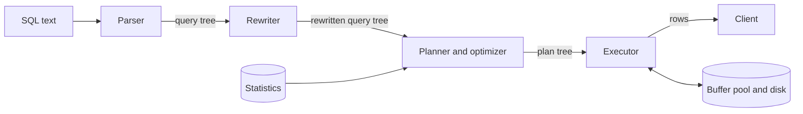
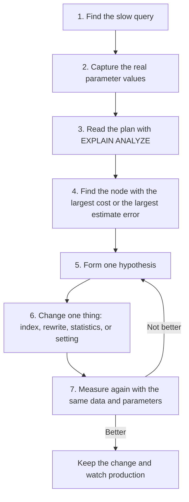

# Query Execution and Tuning

A SQL statement says what result you want. It does not say how to compute the result. The database decides the how: which index to read, in which order to join the tables, and which join algorithm to use. This page explains how the database makes that decision, how to read the decision (the query plan), and how to change it when the decision is bad. It also covers the N+1 problem, which is the most common cause of slow endpoints in services that use an ORM, and the pagination methods that scale.

## Why It Matters

Interviewers ask "This query is slow. What do you do?" in almost every backend round. A weak answer says "add an index". A strong answer reads the plan, compares the estimated rows with the actual rows, finds the step that costs the most, forms one hypothesis, changes one thing, and measures again. The same skill pays off on the job: a slow query is the most common production database problem, and most slow queries have one of five causes (a missing index, a stale statistic, a query shape that the planner cannot optimize, too many round trips, or too many rows returned). The page covers the life of a query, the cost-based optimizer, the access methods and join algorithms, how to read `EXPLAIN` output in PostgreSQL, MySQL, and SQLite, the N+1 problem, offset against keyset pagination, query rewrites, plan caching, and a tuning workflow. Index structure and the cases in which the planner ignores an index are in [indexing](03-indexing.md). Joins and the other SQL features are in [the relational model and SQL](01-relational-model-and-sql.md). JPA causes of the N+1 problem are in [JDBC, JPA, and Hibernate](../java/16-jdbc-jpa-and-hibernate.md).

!!! info "Versions"
    The page states PostgreSQL facts for PostgreSQL 18 (the current major release on 2026-11-05) and MySQL facts for MySQL 8.4 (an LTS release). SQLite examples ran on SQLite 3.51 through the KB runner. A PostgreSQL or MySQL plan that the text shows is either copied from the vendor documentation (with the page named) or marked "Illustrative output, not from a real run". The sandbox that produced this page cannot start a PostgreSQL or MySQL server.

## Core Concepts

**Query plan** (execution plan): the tree of operations that the database runs to compute a result. Each node is one operation, such as a scan of a table or a join of two inputs. A node takes rows from its child nodes and passes rows to its parent.

**Parser, rewriter, planner, executor**: the four stages that process a query. The parser checks the syntax and builds a query tree. The rewriter applies rules, for example it replaces a view with the query that defines the view. The planner (also called the optimizer) chooses the plan. The executor runs the plan.

**Cost-based optimizer**: a planner that estimates the cost of each candidate plan and picks the plan with the lowest estimate. PostgreSQL, MySQL, and SQLite all use a cost-based planner. The estimate is not a measurement. A wrong estimate can lead to a wrong plan.

**Cost**: the planner's estimate of the work of a plan, in arbitrary units. PostgreSQL measures cost "traditionally" in disk page fetches, with `seq_page_cost` (default 1.0) as the unit (PostgreSQL docs, "Using EXPLAIN"). You cannot convert a cost to milliseconds. You can only compare two costs from the same database.

**Statistics**: data that the database stores about the contents of each table and column, for example the row count, the number of distinct values, the most common values, and a histogram of the other values. The planner reads statistics to estimate how many rows each step returns.

**Cardinality**: the number of rows that a table, a step, or a result has. The **cardinality estimate** is the planner's guess. **Selectivity** is the fraction of rows that a condition keeps. If a table has 10,000 rows and a condition keeps 100 rows, the selectivity is 0.01 and the cardinality of the result is 100.

**Access method**: the way the database reads the rows of one table. Examples: a sequential scan (read the whole table), an index scan, an index-only scan, and a bitmap heap scan.

**Join algorithm**: the way the database combines the rows of two inputs. The three classic algorithms are nested loop, hash join, and merge join (also called sort-merge join).

**Sargable predicate**: a condition that the database can turn into an index search on the stored column. The word comes from "search argument able". `created_at >= '2026-01-01'` is sargable. `substr(created_at, 1, 4) = '2026'` is not, because the index stores `created_at` and not the result of `substr`.

**N+1 problem**: code that runs one query to load N parent rows, and then runs one more query for each parent, so the code runs 1 + N queries instead of one or two.

**Pagination**: returning a long result in pages. **Offset pagination** skips a number of rows (`OFFSET`). **Keyset pagination** (also called seek pagination) starts the next page after the sort key of the last row of the previous page.

**Prepared statement**: a statement that the database parses once and runs many times with different parameter values. **Generic plan**: a plan that does not depend on the parameter values. **Custom plan**: a plan that the planner builds for one set of parameter values.

**Buffer pool**: the memory area in which the database keeps recently used disk pages. PostgreSQL calls it `shared_buffers`. InnoDB calls it the buffer pool.

## How It Works

### The Life of a Query

The PostgreSQL documentation ("The Path of a Query") names four stages. MySQL and SQLite have the same stages, with different names for the internal structures.



1. **Parse.** The parser checks the syntax and builds a query tree. It does not look at the data. A syntax error ends the query here.
2. **Rewrite.** The rewriter applies rules from the catalog. The PostgreSQL docs give the main use: a query on a view becomes a query on the base tables of the view definition.
3. **Plan.** The planner builds the candidate plans (the docs call them paths), estimates the cost of each, and expands the cheapest one into the plan. This stage reads the statistics.
4. **Execute.** The executor walks the plan tree and pulls rows from the nodes. A scan node reads pages through the buffer pool. If a page is not in the buffer pool, the database reads it from disk.

Planning costs time. For a short query on an indexed key, planning can cost as much as execution. This is the reason for prepared statements (see "Prepared Statements and Plan Caching").

### Statistics and Cardinality Estimates

The planner cannot run each candidate plan to find the cheapest. It estimates. The estimate of the rows that each step returns comes from statistics. A wrong estimate at one step spreads to all steps above it, because each step uses the row estimate of its child to choose its own algorithm.

**What PostgreSQL stores** (PostgreSQL docs, "Statistics Used by the Planner"):

- `pg_class.reltuples` and `relpages`: the row count and the page count of a table or index. The docs say that `VACUUM`, `ANALYZE`, and a few DDL commands such as `CREATE INDEX` update them, and that the planner scales the stored values to match the current physical size of the table.
- `pg_stats` (a readable view on `pg_statistic`): for each column, `n_distinct` (the number of distinct values; a negative value means a fraction of the row count), `most_common_vals` with `most_common_freqs` (the most frequent values and how often each occurs), and `histogram_bounds` (bucket boundaries for the other values). The planner uses the most common values for an equality condition on a frequent value, and the histogram for a range condition.
- The sample: `ANALYZE` reads a random sample of the table, not the whole table. The docs say the estimates can change after each `ANALYZE` for this reason. The number of entries in each column's most-common-values list and histogram has the limit `default_statistics_target` (default 100). A column can have its own limit: `ALTER TABLE t ALTER COLUMN c SET STATISTICS 500`. A higher limit gives better estimates for skewed columns and costs more time in `ANALYZE`.
- Autovacuum runs `ANALYZE` in the background. After a bulk load or a large update, run `ANALYZE` yourself. Until `ANALYZE` runs, the planner works with old numbers.

**The independence assumption.** For `WHERE a = 1 AND b = 2`, the planner multiplies the two selectivities, as if the two columns were independent. This is wrong if the columns correlate, for example `city` and `zip_code`. The PostgreSQL docs say: "The planner normally assumes that multiple conditions are independent of each other, an assumption that does not hold when column values are correlated." The planner then underestimates the rows. The fix is **extended statistics**: `CREATE STATISTICS` with the kinds `dependencies` (functional dependencies between columns), `ndistinct` (the number of distinct combinations, which fixes `GROUP BY` estimates), and `mcv` (the most common combinations). `ANALYZE` collects them. Create them only for column groups that correlate strongly, because each one costs `ANALYZE` time.

<!-- sql-skip: postgresql -->
```sql
-- PostgreSQL: tell the planner that zip_code determines city.
CREATE STATISTICS zip_city (dependencies) ON city, zip_code FROM addresses;
ANALYZE addresses;
```

**Where estimates fail.** Estimates are poor in these cases: a condition on a function of a column (the planner has no statistics for the result of the function, unless an expression index exists), correlated columns, a column with a skewed distribution and a low statistics target, a join of several tables (each join multiplies the error of the previous estimates), a table that changed a lot since the last `ANALYZE`, and a parameter value that is far from the typical value (see "Prepared Statements and Plan Caching").

**MySQL.** InnoDB keeps persistent table and index statistics in the tables `mysql.innodb_table_stats` and `mysql.innodb_index_stats` (`innodb_stats_persistent` is on by default). It estimates them from a sample of `innodb_stats_persistent_sample_pages` index pages (default 20), and with `innodb_stats_auto_recalc` (on by default) it recalculates them when more than 10 percent of the rows of a table change (MySQL 8.4 docs, "Configuring Persistent Optimizer Statistics Parameters"). The index statistics hold the number of distinct values for each index prefix, and the optimizer also samples the index for a range condition. For a column without an index, MySQL 8.4 has **histogram statistics**, which exist only on demand: `ANALYZE TABLE t UPDATE HISTOGRAM ON col WITH 100 BUCKETS` creates one. The docs say the optimizer prefers its range-optimizer row estimates to the histogram, that histograms are "useful primarily for nonindexed columns", and that they "become progressively more out of date" because nothing refreshes them automatically (MySQL 8.4 docs, "Optimizer Statistics"). MySQL has no equivalent of the PostgreSQL extended statistics for correlated columns.

**SQLite.** SQLite stores statistics only after you run `ANALYZE`. They go to the table `sqlite_stat1`, one row per index. The `stat` column holds the number of rows, followed by the average number of rows that one value of each index column matches. The SQLite docs say the tables do not change as the data changes, and recommend `PRAGMA optimize`. The next blocks use a small schema that the rest of the page also uses. Customer 4 has no orders, on purpose.

```sql
DROP TABLE IF EXISTS qe_orders;
DROP TABLE IF EXISTS qe_customers;
CREATE TABLE qe_customers (
    id      INTEGER PRIMARY KEY,
    name    TEXT NOT NULL,
    country TEXT NOT NULL
);
CREATE TABLE qe_orders (
    id          INTEGER PRIMARY KEY,
    customer_id INTEGER NOT NULL REFERENCES qe_customers(id),
    status      TEXT NOT NULL,
    created_at  TEXT NOT NULL,
    total       INTEGER NOT NULL
);
INSERT INTO qe_customers VALUES (1, 'Asha', 'IN'), (2, 'Ben', 'US'),
                                (3, 'Chen', 'CN'), (4, 'Dina', 'IN');
WITH RECURSIVE n(i) AS (SELECT 1 UNION ALL SELECT i + 1 FROM n WHERE i < 12)
INSERT INTO qe_orders
SELECT i, (i % 3) + 1, CASE WHEN i % 4 = 0 THEN 'open' ELSE 'paid' END,
       printf('2026-01-%02d', i), i * 10
FROM n;
```

Orders 1 to 12 belong to customers 1, 2, and 3, in turn. Every fourth order has the status `open`. Each order has a different `created_at`.

### Cost Units and the Cost of a Scan

A PostgreSQL plan node shows `cost=0.00..470.00`. The first number is the **startup cost**: the work before the node returns its first row. The second number is the **total cost**: the work to return all rows. A sort has a high startup cost, because it must read all input before it returns a row. A sequential scan has a startup cost of 0.

The planner computes cost from a few parameters. These are the PostgreSQL 18 defaults (PostgreSQL docs, "Planner Cost Constants"):

| Parameter | Default | Meaning |
|---|---|---|
| `seq_page_cost` | 1.0 | One page fetch that is part of a sequential series |
| `random_page_cost` | 4.0 | One page fetch that is not sequential |
| `cpu_tuple_cost` | 0.01 | Processing one row |
| `cpu_index_tuple_cost` | 0.005 | Processing one index entry |
| `cpu_operator_cost` | 0.0025 | Running one operator or function |
| `effective_cache_size` | 4GB | The planner's guess of the cache that one query can use (it reserves no memory) |

The PostgreSQL docs show a worked example. The table `tenk1` has 345 pages and 10,000 rows. A sequential scan costs (pages × `seq_page_cost`) + (rows × `cpu_tuple_cost`) = 345 × 1.0 + 10,000 × 0.01 = 445. A filter `ten < 7` adds one operator call for each row: 10,000 × 0.0025 = 25, so the cost is 470. This matches the `cost=0.00..470.00` in the plan that the docs show.

The ratio of `random_page_cost` to `seq_page_cost` is why the planner prefers a sequential scan when a query needs a large share of the table: reading every page in order costs less per page than reading many pages at random. The PostgreSQL docs warn that the constants are averages over a workload, and that changing them after a few experiments is risky. Change a cost constant only after you measure many queries.

### Access Methods

| Access method | What it does | Best when | PostgreSQL name | MySQL `type` | SQLite name |
|---|---|---|---|---|---|
| Sequential (full) scan | Reads every page of the table in order | The query needs a large share of the rows, or the table is small | `Seq Scan` | `ALL` | `SCAN t` |
| Index scan | Walks the index, and for each match reads the row in the table | Few rows match | `Index Scan` | `ref`, `range`, `const`, `eq_ref` | `SEARCH t USING INDEX` |
| Index-only scan | Reads the answer from the index and skips the table | The index holds every column that the query needs | `Index Only Scan` | `Using index` in `Extra` | `USING COVERING INDEX` |
| Bitmap scan | Collects the locations of all matches from one or more indexes, sorts the locations, and then reads the table pages in physical order | A medium number of rows match, or an `OR` or `AND` across two indexes | `Bitmap Index Scan` and `Bitmap Heap Scan` | `index_merge` combines indexes. Multi-Range Read (`Using MRR` in `Extra`) sorts row identifiers before it reads the table | Not available |

Details that decide interview answers:

- **A sequential scan is not always bad.** The PostgreSQL planner always considers it (the docs: "a sequential scan plan is always created"). If a condition matches 30 percent of the table, an index scan makes many random page reads, and the sequential scan is cheaper. If the table is small (a few pages), the scan is cheaper than an index lookup.
- **An index scan reads the table row for each match.** In PostgreSQL the index entry points to a tuple in the heap, and the executor reads that heap page. If the matches lie on many different pages, the cost is one random page read for each match. In InnoDB, a secondary index stores the primary key, and the lookup then searches the primary key tree (see [indexing](03-indexing.md)).
- **A bitmap scan sits between the two.** PostgreSQL scans the index and builds a bitmap in memory of the matching rows. It then visits the table rows in physical order, "because that is how the bitmap is laid out" (PostgreSQL docs, "Combining Multiple Indexes"). This turns random reads into an ordered pass over the pages. A bitmap scan loses the order of the index, so a query with `ORDER BY` needs a separate sort. A bitmap scan can also combine indexes: `WHERE a = 5 OR b = 6` can use one index on `a` and one on `b`.
- **An index-only scan avoids the table only if the page is all-visible.** PostgreSQL keeps a visibility map with one bit for each heap page. The bit says that all rows on the page are visible to all transactions. For an entry on a page without the bit, the executor must still read the heap page to check visibility (PostgreSQL docs, "Index-Only Scans and Covering Indexes"). Running `VACUUM` sets the bits. In `EXPLAIN ANALYZE`, an `Index Only Scan` node reports `Heap Fetches`, the number of rows that needed the heap page. A high number means the index-only scan saves little. The query must also read only columns that the index holds, so `SELECT *` often defeats an index-only scan. `INCLUDE` adds payload columns to a B-tree index for this purpose.

The planner's choice depends on the estimate of the matching rows. This is the link between statistics and plans: if the planner estimates 10 rows and the real number is 400,000, it picks an index scan where a sequential scan or a hash join is the right plan.

### Join Algorithms

A join of tables A and B pairs the rows that satisfy the join condition. The planner picks one of three algorithms for each join in the plan.

#### Nested loop

For each row of the **outer** input, the algorithm finds the matching rows of the **inner** input.

```text
for each row a in outer:
    for each row b in inner:          # with an index on the join column: one index lookup
        if a.key == b.key: output (a, b)
```

- **Cost without an index:** N × M comparisons for N outer rows and M inner rows. With 20 customers and 100 orders, that is 2,000 comparisons.
- **Index nested loop:** if the inner table has an index on the join column, each outer row costs one index lookup, about log of M page reads, and not a scan of M rows. The total is N lookups.
- **Memory:** almost none.
- **Other strengths:** it starts returning rows at once (no build phase), so it suits a query with `LIMIT`. It works with any join condition, including `<` and `LIKE`.
- **The planner picks it** when the outer input is small (or a `LIMIT` stops the loop early) and the inner input has an index on the join column. The PostgreSQL docs describe it as "easy to implement but can be very time consuming" without an index.

#### Hash join

The algorithm reads the smaller input (the **build** input) and puts each row in a hash table by the join key. It then reads the larger input (the **probe** input) and, for each row, looks up the matching rows in the hash table.

```text
table = empty hash table
for each row b in build_input: table[b.key].add(b)        # build phase
for each row p in probe_input:                            # probe phase
    for each b in table[p.key]: output (b, p)
```

- **Cost:** N + M hash operations. Each input is read once.
- **Memory:** the hash table for the build input. In PostgreSQL the limit for a hash table is `work_mem` × `hash_mem_multiplier`. The defaults are 4MB and 2.0 (PostgreSQL docs, "Resource Consumption"), so 8MB. If the hash table does not fit, PostgreSQL splits both inputs into batches that it writes to temporary files and joins batch by batch. The join still works, with more I/O. `EXPLAIN ANALYZE` shows `Batches` greater than 1 in this case.
- **Limit:** in PostgreSQL the join operator must represent equality, because rows with different hash codes are never compared (PostgreSQL docs, "Operator Optimization Information"). MySQL is different: it also uses a hash join for a join without an equality condition (see below).
- **The planner picks it** for a large join with no useful index, when the inputs are not sorted.

#### Merge join (sort-merge join)

The algorithm sorts both inputs on the join key, and then scans both sorted inputs once, in step with each other.

```text
sort(left, by key); sort(right, by key)        # skipped if the input is already sorted
advance two cursors: if the keys are equal, output the pairs;
else advance the cursor that has the smaller key
```

- **Cost:** the sort cost of each input (about N log N) plus one pass over each input. If an input is already sorted (it comes from an index on the join key), the sort is free.
- **Memory:** the sorts. A sort that exceeds `work_mem` spills to disk (an external merge sort).
- **Limit:** in PostgreSQL the join operator must behave like equality (the docs: "in practice this means that the join operator must behave like equality"), so a merge join does not serve a `<` join condition.
- **The planner picks it** when both inputs are large and already sorted (an index scan), or when the query needs sorted output on the join key anyway (`ORDER BY` on the join column). The cost comparison also decides: if a hash table would be large, the sorts of a merge join can cost less than the batches of a spilling hash join.

#### Comparison

| Algorithm | Cost (N outer or build rows, M inner or probe rows) | Memory | Join conditions | Starts returning rows early | The planner picks it when |
|---|---|---|---|---|---|
| Nested loop, no index | N × M | Almost none | Any | Yes | Both inputs are tiny |
| Index nested loop | N index lookups | Almost none | Any that the index supports | Yes | The outer input is small and the inner input has an index |
| Hash join | N + M | Hash table of the build input (spills to disk in batches) | Equality (PostgreSQL) | No (after the build phase) | Large inputs, no useful index, equality |
| Merge join | Sorts + N + M | Sort buffers (spill to disk) | Equality (PostgreSQL) | After the sorts | Large inputs that are already sorted, or sorted output is needed |

#### What each database offers

- **PostgreSQL** has all three. The GUC settings `enable_nestloop`, `enable_hashjoin`, and `enable_mergejoin` switch each one off for the session. Use them to test a hypothesis ("does a hash join win?"), and do not set them in production.
- **MySQL** used a nested loop (and a block nested loop for joins without an index) before version 8.0.18. MySQL 8.0.18 added the hash join for inner equi-joins that have no usable index (release notes 8.0.18). MySQL 8.0.20 extended the hash join to every case where a block nested loop was used: inner non-equi joins, semijoins, antijoins, and outer joins. The 8.0.20 release notes say that the block nested loop "no longer exists and is replaced by a hash join in nearly all cases". The MySQL 9.7 manual page "Hash Join Optimization" still describes the same hash join for these cases and the same `join_buffer_size` limit. A MySQL hash join cannot use more memory than `join_buffer_size`. If it needs more, it writes files to disk (MySQL docs, "Hash Join Optimization"). The `Extra` column then shows `Using join buffer (hash join)`. MySQL does not have a merge join.
- **SQLite** has only the nested loop. The SQLite docs say "SQLite implements joins as nested loops". When no index exists for the inner table, SQLite can build an **automatic index** that lasts for one statement, if it expects more than log N lookups. The docs call this "almost the same thing as a hash join", with a B-tree instead of a hash table.

### Join Order

For a query with k tables, the planner can join the tables in many orders (up to k! orders, and the tree shape also changes). The order matters a lot: joining two small, selective inputs first keeps the intermediate results small. PostgreSQL uses a near-exhaustive search when the query has fewer than `geqo_threshold` items in the `FROM` list (default 12). With `geqo_threshold` or more items, it switches to a heuristic (the genetic query optimizer, GEQO), which can give a worse plan. Two more settings limit the search: `from_collapse_limit` and `join_collapse_limit` (both default 8). The planner reorders explicit `JOIN`s only up to `join_collapse_limit` items. Setting `join_collapse_limit` to 1 makes the planner keep the order that you wrote (PostgreSQL docs, "Query Planning").

Recommendation: do not force a join order. If the plan has a bad order, the cause is nearly always a bad cardinality estimate. Fix the estimate (fresh statistics, extended statistics, a rewrite) before you reach for a hint or a setting.

SQLite's plan for a join shows the nested loops from outer to inner. The next block shows the plan for a join of customers and orders. The planner chooses the customers as the outer loop and searches the orders by index for each customer.

```sql
CREATE INDEX qe_orders_cust ON qe_orders(customer_id);
```

```sql
EXPLAIN QUERY PLAN
SELECT c.name, o.total
FROM qe_customers c JOIN qe_orders o ON o.customer_id = c.id
WHERE c.country = 'IN';
```

<!-- sql-result -->

```text
QUERY PLAN
|--SCAN c
`--SEARCH o USING INDEX qe_orders_cust (customer_id=?)
```

### Sorts, LIMIT, and Top-N

A sort costs N log N and, in PostgreSQL, uses at most `work_mem` of memory before it writes to disk (the docs: sorts for `ORDER BY`, `DISTINCT`, and merge joins use `work_mem`). A sort must read all input before it returns the first row. The next three techniques avoid or shrink the sort.

1. **Read the rows in sorted order from an index.** If an index has the `ORDER BY` columns in the right order, the plan scans the index and needs no sort. The first block below shows a sort. The second block shows the plan after an index exists.
2. **Top-N.** With `ORDER BY x LIMIT 10`, the database needs only the 10 smallest rows. PostgreSQL then keeps a heap of 10 rows while it reads the input, and `EXPLAIN ANALYZE` shows `Sort Method: top-N heapsort`. The sort memory is small even for a large input, but the database still reads every input row.
3. **Index order plus `LIMIT`.** If the index delivers the order, the executor stops after 10 rows. This is the fast case: the cost does not depend on the table size. The PostgreSQL docs say that the planner takes `LIMIT` into account, so a query can get a different plan with a different `LIMIT`.

```sql
EXPLAIN QUERY PLAN
SELECT * FROM qe_orders ORDER BY total LIMIT 3;
```

<!-- sql-result -->

```text
QUERY PLAN
|--SCAN qe_orders
`--USE TEMP B-TREE FOR ORDER BY
```

The next index serves the sort on `created_at`, with `id` as the tie-breaker. The index also serves the keyset pagination query later in this page.

```sql
CREATE INDEX qe_orders_created ON qe_orders(created_at, id);
```

```sql
EXPLAIN QUERY PLAN
SELECT * FROM qe_orders ORDER BY created_at LIMIT 3;
```

<!-- sql-result -->

```text
QUERY PLAN
`--SCAN qe_orders USING INDEX qe_orders_created
```

The plan has no `USE TEMP B-TREE` line. SQLite reads the index in order, and `LIMIT 3` stops the scan after three rows.

### Reading a Plan

Read a plan from the innermost (most indented) node outwards, because the child nodes feed their parents. Look for three things: the access method of each table (is a large table scanned in full?), the join algorithm of each join, and the difference between the estimated rows and the actual rows.

#### PostgreSQL: EXPLAIN and EXPLAIN ANALYZE

`EXPLAIN` shows the plan and the estimates. It does not run the statement. `EXPLAIN ANALYZE` runs the statement and adds the measured values. The statement really runs, so `EXPLAIN ANALYZE` on an `UPDATE` changes data. The PostgreSQL docs show the safe form: wrap the statement in `BEGIN; ... ROLLBACK;`. In PostgreSQL 18, `ANALYZE` turns on `BUFFERS` too, which adds the page counts (PostgreSQL 18 docs, `EXPLAIN`).

The next example is copied from the PostgreSQL 18 documentation ("Using EXPLAIN"), for a sequential scan with a filter. This page wraps the long plan lines to fit the width and leaves out the `Planning Time` and `Execution Time` lines. The numbers are unchanged.

<!-- sql-skip: postgresql -->
```sql
EXPLAIN ANALYZE SELECT * FROM tenk1 WHERE ten < 7;
```

```text
 Seq Scan on tenk1  (cost=0.00..470.00 rows=7000 width=244)
                     (actual time=0.030..1.995 rows=7000.00 loops=1)
   Filter: (ten < 7)
   Rows Removed by Filter: 3000
   Buffers: shared hit=345
```

Each field has a meaning:

| Field | Meaning |
|---|---|
| `cost=0.00..470.00` | Estimated startup cost and total cost, in planner units |
| `rows=7000` | Estimated number of rows that the node returns |
| `width=244` | Estimated average row size in bytes |
| `actual time=0.030..1.995` | Measured time in milliseconds to the first row and to the last row, for one execution of the node |
| `rows=7000.00` (after `actual`) | Measured number of rows, averaged over `loops` |
| `loops=1` | The number of times that the executor ran the node |
| `Rows Removed by Filter` | Rows that the node read and the filter rejected. A large number next to a small result means the filter runs late: an index could help |
| `Buffers: shared hit=345` | 345 pages came from `shared_buffers`. `read=N` means N pages came from outside `shared_buffers` (the operating system cache or disk) |

The docs state that `actual time` and `rows` are averages for one execution, so the total time that a node spends is the `actual time` multiplied by `loops`. A node that sits inside a nested loop has `loops` equal to the number of outer rows. The next example, also from "Using EXPLAIN" (with `Planning` and `Execution Time` lines left out), shows a nested loop for `SELECT * FROM tenk1 t1, tenk2 t2 WHERE t1.unique1 < 10 AND t1.unique2 = t2.unique2`. The inner `Index Scan` ran 10 times at about 0.003 ms each.

```text
 Nested Loop  (cost=4.65..118.50 rows=10 width=488)
              (actual time=0.017..0.051 rows=10.00 loops=1)
   Buffers: shared hit=36 read=6
   ->  Bitmap Heap Scan on tenk1 t1  (cost=4.36..39.38 rows=10 width=244)
         (actual time=0.009..0.017 rows=10.00 loops=1)
         Recheck Cond: (unique1 < 10)
         Heap Blocks: exact=10
         Buffers: shared hit=3 read=5 written=4
         ->  Bitmap Index Scan on tenk1_unique1  (cost=0.00..4.36 rows=10 width=0)
               (actual time=0.004..0.004 rows=10.00 loops=1)
               Index Cond: (unique1 < 10)
               Index Searches: 1
               Buffers: shared hit=2
   ->  Index Scan using tenk2_unique2 on tenk2 t2  (cost=0.29..7.90 rows=1 width=244)
         (actual time=0.003..0.003 rows=1.00 loops=10)
         Index Cond: (unique2 = t1.unique2)
         Index Searches: 10
         Buffers: shared hit=24 read=6
```

The plan above is the source of three lessons. The `Bitmap Index Scan` builds the bitmap, and the `Bitmap Heap Scan` above it reads the table pages. The `Nested Loop` has two children: the first child is the outer input, and the second child is the inner input that runs once for each outer row (`loops=10`). The `Index Cond` of the inner scan refers to `t1.unique2`, the value of the current outer row.

**The estimate against the actual check.** Compare `rows=` (estimate) with the `rows=` after `actual` (measured) at every node. A difference of a factor of 10 or more marks the node where the plan went wrong. The planner chose the algorithms above that node with a wrong row count. The example below is hand-written. Illustrative output, not from a real run.

```text
Nested Loop  (cost=0.43..120.50 rows=3 width=40) (actual time=0.05..4210.30 rows=48000.00 loops=1)
  ->  Seq Scan on orders o  (cost=0.00..95.00 rows=3 width=24)
                            (actual time=0.02..35.10 rows=48000.00 loops=1)
        Filter: ((status = 'open') AND (region = 'EU'))
        Rows Removed by Filter: 152000
  ->  Index Scan using customers_pkey on customers c  (cost=0.43..8.45 rows=1 width=16)
                            (actual time=0.08..0.08 rows=1.00 loops=48000)
```

The planner estimated 3 rows and the scan returned 48,000. The estimate came from the independence assumption: `status = 'open'` and `region = 'EU'` correlate. With the estimate of 3 rows, a nested loop looks cheap. With 48,000 rows, the inner index scan runs 48,000 times, and a hash join would win. The fix is `CREATE STATISTICS` on `(status, region)`, then `ANALYZE`.

Other node types and fields to know:

- `Sort Method: quicksort Memory: 25kB` means the sort fit in memory. `Sort Method: external merge Disk: 10240kB` means the sort spilled to disk, and a larger `work_mem` may help.
- The `Hash` node under a `Hash Join` shows `Buckets` and `Batches`. `Batches: 1` means the hash table fit in memory. The docs say that a number of batches above 1 involves disk space, which the output does not show.
- `Heap Fetches` (on an `Index Only Scan`) counts the rows for which the visibility map did not allow skipping the heap.
- `Buffers: ... read=N` shows how much of the query went to disk. Run the query twice. The second run shows the warm-cache cost.

#### MySQL: EXPLAIN and EXPLAIN ANALYZE

MySQL `EXPLAIN` (traditional format) shows one row for each table in the query, in the order of the join. The next output is hand-written. Illustrative output, not from a real run.

```text
+----+-------+------+----------------+---------+------+----------+----------------------------+
| id | table | type | key            | key_len | rows | filtered | Extra                      |
+----+-------+------+----------------+---------+------+----------+----------------------------+
|  1 | c     | ref  | idx_country    | 6       |  400 |   100.00 | Using index                |
|  1 | o     | ref  | idx_customer   | 8       |   12 |   100.00 | NULL                       |
+----+-------+------+----------------+---------+------+----------+----------------------------+
```

The columns that matter (MySQL 8.4 docs, "EXPLAIN Output Format"):

- **`type`** (the join type, which describes the access method) from best to worst: `system` (one row), `const` (at most one row, read once, through a primary key or unique index compared with constants), `eq_ref` (one row for each row of the earlier tables, through a primary key or unique `NOT NULL` index), `ref` (all rows with a matching index value), `fulltext`, `ref_or_null`, `index_merge`, `unique_subquery`, `index_subquery`, `range` (an index range), `index` (a full scan of the index tree), and `ALL` (a full table scan). Aim for `ref`, `eq_ref`, `const`, or `range`. `ALL` on a large table, or `ALL` on the inner table of a join, is the first thing to check.
- **`key`** is the index that the optimizer chose. `possible_keys` lists the candidates. If `key` is `NULL`, no index is used.
- **`rows`** is the estimated number of rows that the step examines. For InnoDB it is an estimate. Multiply the `rows` of the steps to get a rough measure of the total work.
- **`filtered`** is the estimated percentage of the examined rows that the table condition keeps. The rows that go to the next table are `rows` × `filtered` / 100.
- **`Extra`** gives more detail. `Using index` means a covering index: the query reads the index only. `Using where` means a condition filters rows after the read. `Using index condition` means index condition pushdown. `Using filesort` means an extra sorting pass, and the name does not mean that a file is written: the docs say that a filesort "uses temporary disk files as necessary if the result set is too large to fit in memory" (MySQL 8.4 docs, "ORDER BY Optimization"). `Using temporary` means MySQL builds a temporary table, typical when `GROUP BY` and `ORDER BY` use different columns. `Using join buffer (hash join)` means a hash join.

**`EXPLAIN ANALYZE`** (MySQL 8.0.18 and later) runs the statement and prints a tree of iterators, each with the estimated cost and rows and the measured time, rows, and loops. It supports `SELECT`, multi-table `UPDATE` and `DELETE`, and `TABLE`. In 8.4 its default output is the tree format, and `FORMAT=TRADITIONAL` gives an error. `FORMAT=JSON` works only when the session sets `explain_json_format_version = 2` (MySQL 8.3 and later, from the MySQL blog post "New JSON format for EXPLAIN" and the 9.7 `EXPLAIN` page). With the default version 1, it gives an error. The next output is copied from the MySQL 8.4 documentation ("EXPLAIN Statement") for `EXPLAIN ANALYZE SELECT * FROM t1 JOIN t2 ON (t1.c1 = t2.c2)`. Each `actual` clause gives the time in milliseconds to the first row and to the last row, the number of rows, and the number of loops.

```text
EXPLAIN: -> Inner hash join (t2.c2 = t1.c1)  (cost=3.5 rows=5)
(actual time=0.121..0.131 rows=1 loops=1)
    -> Table scan on t2  (cost=0.07 rows=5)
(actual time=0.0126..0.0221 rows=5 loops=1)
    -> Hash
        -> Table scan on t1  (cost=0.75 rows=5)
(actual time=0.0372..0.0534 rows=5 loops=1)
```

Read it as you read the PostgreSQL plan: compare `rows=` in the estimate with `rows=` after `actual`.

#### SQLite: EXPLAIN QUERY PLAN

SQLite prints a tree that names the table, the index, and the search condition. The word `SCAN` means a full table scan. The word `SEARCH` means an index lookup.

```sql
EXPLAIN QUERY PLAN
SELECT id, total FROM qe_orders WHERE customer_id = 2;
```

The index `qe_orders_cust` exists at this point (the join section created it). Without the index, the plan for this query is `SCAN qe_orders`, a full table scan. With the index, the plan is a search.

<!-- sql-result -->

```text
QUERY PLAN
`--SEARCH qe_orders USING INDEX qe_orders_cust (customer_id=?)
```

If the query asks only for columns that the index holds, SQLite reads the index only. The `id` column is the row identifier, so the index on `customer_id` holds it too.

```sql
EXPLAIN QUERY PLAN
SELECT id FROM qe_orders WHERE customer_id = 2;
```

<!-- sql-result -->

```text
QUERY PLAN
`--SEARCH qe_orders USING COVERING INDEX qe_orders_cust (customer_id=?)
```

The words `COVERING INDEX` are the SQLite name for an index-only access. A query for `SELECT *` on the same condition shows `USING INDEX`: SQLite reads the index and then the table row. SQLite's `EXPLAIN QUERY PLAN` output is for people. The SQLite docs say the format "may change between SQLite releases" (it changed in 3.24.0 and 3.36.0), so do not parse it in code.

### The N+1 Problem

**The pattern.** Code loads a list of parent rows with one query. It then loops over the parents and runs one query for each parent to load a child, or a related row. For N parents, the code runs 1 + N queries.

```text
-- 1 query for the parents
SELECT id FROM qe_customers WHERE country = 'IN';           -- returns ids 1 and 4
-- N queries, one for each parent
SELECT id, total FROM qe_orders WHERE customer_id = 1;
SELECT id, total FROM qe_orders WHERE customer_id = 4;
```

With two customers the cost is invisible. With 1,000 customers the code runs 1,001 queries.

**Why the round trips dominate.** Each query is fast: an indexed lookup that reads a few pages from the buffer pool. The cost of one query is not the execution. It is the fixed cost that each statement pays: the network round trip between the application and the database, the parse and the plan (unless the statement is prepared), the borrow of a pooled connection, and the transfer of a small result. The total time is about (1 + N) × (fixed cost + execution). Assumption: a fixed cost of 0.5 ms for a round trip inside one data center. Then 1,001 queries cost about 500 ms of round trips, even if each query executes in 0.01 ms. One join costs one round trip. The N+1 pattern grows linearly with N and with the network latency. The pattern also holds the connection from the pool for the whole loop, which reduces the number of requests that the service can serve at the same time. The database's work is also higher: it parses and plans N statements, not one.

A second property makes the problem hard to see. Each individual query is fast, so the slow query log (`long_query_time` default 10 seconds in MySQL 8.4, `log_min_duration_statement` default -1 in PostgreSQL) does not list it, because each query stays far below the threshold. Look at the count of queries, not at the duration of one query.

**How to detect it.**

| Method | What you look at |
|---|---|
| Statement log in a test | Run the endpoint with a small data set, and count the statements. In PostgreSQL, `log_statement = 'all'` logs every statement (default `none`). Look for the same statement repeated with different parameter values |
| `pg_stat_statements` | The `calls` column of a statement. A statement of the form `... WHERE customer_id = $1` with `calls` far above the `calls` of the parent statement, and `rows` close to `calls` (about one row for each call), is the N+1 child. The view replaces constants with `$1`, so all N queries become one entry (PostgreSQL docs, `pg_stat_statements`) |
| Query count in the ORM | Hibernate statistics report the number of prepared statements (`getPrepareStatementCount()`, used in [JDBC, JPA, and Hibernate](../java/16-jdbc-jpa-and-hibernate.md)). Assert the count in an integration test, so a change that adds a query fails the build |
| Tracing | A trace of one request shows many identical short database spans under one parent span. |
| Metrics | A rise in queries per request (the ratio of database calls to HTTP requests) after a deploy |

PostgreSQL's `pg_stat_statements` needs `shared_preload_libraries = 'pg_stat_statements'` in `postgresql.conf` (a server restart), `compute_query_id` set to `auto` or `on`, and `CREATE EXTENSION pg_stat_statements` in the database (PostgreSQL docs, `pg_stat_statements`). The columns of PostgreSQL 18 are `calls`, `total_exec_time`, `mean_exec_time`, `rows`, `shared_blks_hit`, and `shared_blks_read`.

<!-- sql-skip: postgresql -->
```sql
-- PostgreSQL: the statements that run most often, with the rows each call returns.
SELECT calls, rows, round(rows::numeric / calls, 2) AS rows_per_call,
       round(total_exec_time::numeric, 1) AS total_ms, query
FROM pg_stat_statements
ORDER BY calls DESC
LIMIT 5;
```

**The SQL-level fixes.** The aim is to replace N queries with one or two.

1. **A join.** One query returns the parent and the child columns. This is the fix when the code needs the parent columns together with the child columns. The cost: a one-to-many join repeats each parent column for each child row, which increases the bytes of the result. A parent with no children disappears from an inner join (use a `LEFT JOIN` to keep it). The next result shows the join. Dina (customer 4) has country `IN` and no orders, so she is not in the result.
2. **A batch `IN` query (two queries in total).** Query 1 loads the parents. Query 2 loads all children with `WHERE customer_id IN (ids from query 1)`. The application then groups the children by parent in memory. The result has no repeated parent columns, and a parent without children simply has no rows. Use this fix when a join would multiply a large parent row, or when the code loads several child collections (two joins would multiply the rows together). The limit: a list of thousands of ids can exceed the limit of bind parameters of the driver or the database (the PostgreSQL protocol, for example, sends the number of parameters of a statement as a 16-bit integer), and a very long `IN` list makes the statement text and the planning work grow with its length. Split the ids into chunks. Assumption: a chunk size of a few hundred ids (the Java example below uses 500) keeps each statement far below these limits. No vendor document names this size, so measure it for your driver. PostgreSQL also accepts `= ANY(?)` with one array parameter (in JDBC, `Connection.createArrayOf`), which sends one parameter for any number of ids.
3. **An aggregate query.** If the code needs only a count or a sum for each parent, one `GROUP BY` query returns it. Do not load the children to count them in Java.

```sql
SELECT c.name, o.id, o.total
FROM qe_customers c
JOIN qe_orders o ON o.customer_id = c.id
WHERE c.country = 'IN'
ORDER BY o.id;
```

<!-- sql-result -->

```text
name | id | total
Asha | 3 | 30
Asha | 6 | 60
Asha | 9 | 90
Asha | 12 | 120
```

The batch version runs two statements. The ids come from the first statement (`SELECT id FROM qe_customers WHERE country = 'IN'` returns 1 and 4).

```sql
SELECT customer_id, id, total
FROM qe_orders
WHERE customer_id IN (1, 4)
ORDER BY customer_id, id;
```

<!-- sql-result -->

```text
customer_id | id | total
1 | 3 | 30
1 | 6 | 60
1 | 9 | 90
1 | 12 | 120
```

The aggregate version returns one row for each customer, including the customer with no orders. `LEFT JOIN` keeps customer 4, and `COUNT(o.id)` counts only the non-null order ids, so it gives 0.

```sql
SELECT c.name, COUNT(o.id) AS orders, COALESCE(SUM(o.total), 0) AS revenue
FROM qe_customers c
LEFT JOIN qe_orders o ON o.customer_id = c.id
GROUP BY c.id
ORDER BY c.id;
```

<!-- sql-result -->

```text
name | orders | revenue
Asha | 4 | 300
Ben | 4 | 220
Chen | 4 | 260
Dina | 0 | 0
```

**The JDBC version.** The next class uses only `java.sql`. It loads the parents with one statement and the children with one statement for each chunk of ids. It builds the `IN` list with one `?` for each id and binds each id, so it is safe against SQL injection. The runner has no JDBC driver, so this block compiles but does not run. Spring Data, JPA, and Hibernate hide this loop: how they cause N+1 and how `JOIN FETCH`, entity graphs, and `@BatchSize` fix it is in [JDBC, JPA, and Hibernate](../java/16-jdbc-jpa-and-hibernate.md).

```java
import java.sql.Connection;
import java.sql.PreparedStatement;
import java.sql.ResultSet;
import java.sql.SQLException;
import java.util.ArrayList;
import java.util.HashMap;
import java.util.List;
import java.util.Map;

class OrderLoader {
    record Order(long id, long customerId, long total) {}

    static final int CHUNK = 500; // Assumption: a size that stays below the parameter limits

    /** Loads the orders of many customers with one query for each chunk of ids. */
    static Map<Long, List<Order>> ordersByCustomer(Connection con, List<Long> customerIds)
            throws SQLException {
        Map<Long, List<Order>> result = new HashMap<>();
        for (int from = 0; from < customerIds.size(); from += CHUNK) {
            int to = Math.min(from + CHUNK, customerIds.size());
            List<Long> chunk = customerIds.subList(from, to);
            String marks = String.join(",", java.util.Collections.nCopies(chunk.size(), "?"));
            String sql = "SELECT id, customer_id, total FROM qe_orders"
                    + " WHERE customer_id IN (" + marks + ") ORDER BY customer_id, id";
            try (PreparedStatement ps = con.prepareStatement(sql)) {
                for (int i = 0; i < chunk.size(); i++) {
                    ps.setLong(i + 1, chunk.get(i));
                }
                try (ResultSet rs = ps.executeQuery()) {
                    while (rs.next()) {
                        Order o = new Order(rs.getLong(1), rs.getLong(2), rs.getLong(3));
                        result.computeIfAbsent(o.customerId(), k -> new ArrayList<>()).add(o);
                    }
                }
            }
        }
        return result;
    }
}
```

### Pagination: OFFSET Against Keyset

**Offset pagination** uses `LIMIT n OFFSET k`. To return page p of size n, the query uses `OFFSET (p - 1) × n`.

```sql
SELECT id, created_at
FROM qe_orders
ORDER BY created_at, id
LIMIT 3 OFFSET 9;
```

<!-- sql-result -->

```text
id | created_at
10 | 2026-01-10
11 | 2026-01-11
12 | 2026-01-12
```

The cost problem: the database cannot jump to row 9. It must produce the first 9 rows, in order, and then drop them. The PostgreSQL docs say: "The rows skipped by an `OFFSET` clause still have to be computed inside the server; therefore a large `OFFSET` might be inefficient." Page 1 reads 3 rows, page 1,000 with a page size of 20 reads 20,000 rows to return 20. The cost of a page grows linearly with its number. Assumption: MySQL also evaluates the skipped rows. The MySQL 8.4 "LIMIT Query Optimization" page does not describe the cost of `OFFSET`, so run `EXPLAIN ANALYZE` on a deep page in MySQL and read the row count of the child nodes.

A second problem is consistency. If a row is inserted or deleted in the already-read part of the result while the user pages, the offsets shift: the next page repeats a row or skips a row. And the PostgreSQL docs warn that `LIMIT` needs an `ORDER BY` that gives a unique order. Without one, the subset is unpredictable, and different pages can overlap.

**Keyset (seek) pagination** uses the sort key of the last row that the client has seen. The query asks for the rows after that key.

```sql
SELECT id, created_at
FROM qe_orders
WHERE (created_at, id) > ('2026-01-06', 6)
ORDER BY created_at, id
LIMIT 3;
```

<!-- sql-result -->

```text
id | created_at
7 | 2026-01-07
8 | 2026-01-08
9 | 2026-01-09
```

The client sends the `created_at` and `id` of the last row of the previous page (`'2026-01-06'` and `6`) and gets the next three rows. The plan shows an index search that starts at the key, with no skipped rows:

```sql
EXPLAIN QUERY PLAN
SELECT id, created_at
FROM qe_orders
WHERE (created_at, id) > ('2026-01-06', 6)
ORDER BY created_at, id
LIMIT 3;
```

<!-- sql-result -->

```text
QUERY PLAN
`--SEARCH qe_orders USING COVERING INDEX qe_orders_created (created_at>?)
```

The cost of every page is the same: one index seek and `n` rows. The cost does not depend on the page number.

Rules for keyset pagination:

- **The index.** The query needs an index on the sort columns in the same order, here `(created_at, id)`. Without the index, the database must sort the whole table for every page, and keyset pagination is no better than offset.
- **A unique tie-breaker.** `created_at` alone has duplicates. Two rows with the same `created_at` could split across pages, and the `>` comparison would skip one of them. Add a unique column (`id`) as the last sort column.
- **The comparison.** A row-value comparison `(a, b) > (x, y)` means "a > x, or a = x and b > y". PostgreSQL and SQLite accept it (SQLite since 3.15). MySQL accepts it, but its optimizer does not use it well. The MySQL 8.4 docs ("Row Constructor Expression Optimization") show that `WHERE c1 = 1 AND (c2, c3) > (1, 1)` on a primary key `(c1, c2, c3)` uses only `c1` (`type: ref`, `key_len: 4`), and that the expanded form `c1 = 1 AND (c2 > 1 OR (c2 = 1 AND c3 > 1))` gives `type: range` with all three columns (`key_len: 12`). The docs advise: "avoid mixing row constructors with AND/OR expressions. Use one or the other." So on MySQL write the expanded form: `WHERE a > :x OR (a = :x AND b > :y)`, and check the plan for `type: range`.
- **Descending order.** Use `<` and `ORDER BY a DESC, b DESC`. All sort columns must run in the same direction for a row-value comparison. With mixed directions, use the expanded form.
- **The limits.** Keyset pagination cannot jump to page 50, because the page has no number, only a position. It suits "next page", infinite scroll, and API cursors. For a page-number UI over a small result, offset is acceptable. The next-page cursor must carry the sort key of the last row. Spring Data offers keyset scrolling since version 3.1 (see [Spring Data and transactions](../java/19-spring-data-and-transactions.md)).
- **Counts.** `SELECT COUNT(*)` for a total is itself a scan of all matching rows. Show "next" without the total, or use an estimate.

### Prepared Statements and Plan Caching

A **prepared statement** separates the SQL text from its parameter values. The client sends the text once with placeholders (`WHERE id = $1`), and then sends only the values for each execution. The benefits: the database parses the text once, the application cannot make a SQL injection through the values (the values are never part of the SQL text), and the database can reuse the plan.

**PostgreSQL generic against custom plans.** For a prepared statement with parameters, PostgreSQL can keep a custom plan or a generic plan. A **custom plan** is built for the actual parameter values, so the planner uses the statistics for those values (for example the most common value, or a rare value). It costs planning time for every execution. A **generic plan** is built once without the values and reused. It saves planning time, and it is a worse plan if the best plan depends on the value. The rule in the PostgreSQL docs (`PREPARE`), for the default `plan_cache_mode = auto`: the first five executions use custom plans, and the server calculates the average estimated cost of those plans. It then builds a generic plan and compares its estimated cost with the average. The following executions use the generic plan if its cost is "not so much higher than the average custom-plan cost as to make repeated replanning seem preferable". The docs give no number for "not so much higher".

`plan_cache_mode` has three values: `auto` (the default), `force_custom_plan`, and `force_generic_plan`. Use `force_custom_plan` for a statement whose best plan depends on a skewed parameter.

<!-- sql-skip: postgresql -->
```sql
-- PostgreSQL: a skewed column. status = 'done' matches 95 percent of the rows,
-- status = 'failed' matches 0.1 percent. The best plan differs for each value.
PREPARE orders_by_status (text) AS
    SELECT * FROM orders WHERE status = $1;

EXECUTE orders_by_status('failed');   -- executions 1 to 5: a custom plan, an index scan
SET plan_cache_mode = force_custom_plan;   -- keep a custom plan for every execution
```

**The pitfall.** A statement runs fast with the value 'failed' and slow with 'done', or the reverse. The cause is often a generic plan that suits one value and not the other. Look for the slow run with `EXPLAIN (ANALYZE)` on the real parameter value, and compare it with the plan that the application uses (PostgreSQL's `auto_explain` module logs the plan of slow statements: load it with `session_preload_libraries = 'auto_explain'` and set `auto_explain.log_min_duration` to a threshold, for example `'3s'`. The default `-1` logs nothing. Add `auto_explain.log_analyze = on` to log actual rows and times, which costs extra time for every statement, and `auto_explain.sample_rate` to log only a share of the statements. PostgreSQL docs, `auto_explain`).

**Other databases and drivers.** MySQL has server-side prepared statements, and many drivers emulate them on the client by default. In JDBC, a `PreparedStatement` protects against SQL injection in both cases. Whether the server reuses a plan depends on the driver setting. Check the driver documentation. A pooler in transaction mode can restrict server-side prepared statements (see `kb/databases/09-scaling-a-database.md`).

### A Tuning Workflow

Tuning is an experiment loop. Change one thing at a time, and measure each change.



1. **Find the slow query.** Do not guess. Use data from production: the slow query log (MySQL: `slow_query_log` and `long_query_time`; the log is off by default and `long_query_time` is 10 seconds by default; each entry has `Query_time`, `Rows_sent`, and `Rows_examined`; `mysqldumpslow` summarizes it), PostgreSQL `log_min_duration_statement` (default -1, which disables it), or `pg_stat_statements`, which ranks statements by `total_exec_time`. Rank by the total time, not only by the time of one call: a statement of 2 ms that runs 5,000 times a second costs more than a statement of 2 s that runs once an hour.
2. **Capture the real parameter values.** A plan for `WHERE id = 1` can differ from a plan for `WHERE id = 9999999`. Use values from the slow case.
3. **Read the plan** with `EXPLAIN (ANALYZE, BUFFERS)` (PostgreSQL), `EXPLAIN ANALYZE` (MySQL 8.0.18 or later), or `EXPLAIN` in MySQL versions before it. Run it on a copy of production data, or on production for a `SELECT`. `EXPLAIN ANALYZE` runs the statement.
4. **Find the node** with the largest actual time (multiply by `loops`), or the first node where the estimated rows differ from the actual rows by a factor of 10 or more. Check for `Rows Removed by Filter` that is large compared with the rows that remain, for `Seq Scan` on a big table, for sorts that spill to disk, and for the `Buffers read` count.
5. **Form one hypothesis.** Examples: "The planner underestimates the rows because the columns correlate", "the filter has no index", "a function on the column blocks the index", "the query returns 2 million rows that the application discards".
6. **Change one thing.** Choices, in the usual order of cost: refresh the statistics (`ANALYZE`), add or change an index (see [indexing](03-indexing.md)), rewrite the query, add extended statistics, then change a setting such as `work_mem`. Do not change many things together, because you will not know which change helped.
7. **Measure again** with the same data and parameters. Compare the plan and the time. Run the query twice, because the first run fills the cache. Then check that the change did not slow down the writes (each index costs on every insert and update) or other queries.

Recommendation: write down the plan before and after each change. The plan, and not the time alone, tells you why a change helped, and it protects you when the data grows.

### Query Rewrites

| Rewrite | Why it helps | Notes |
|---|---|---|
| Make the predicate **sargable**: compare the bare column with a range or a constant | The index search needs the stored column value | `created_at >= '2026-01-01' AND created_at < '2026-02-01'`, not `substr(created_at, 1, 7) = '2026-01'` |
| Avoid a function on an indexed column | A function hides the column from the index | Or create an expression index. The cases in which a database ignores an index are in [indexing](03-indexing.md) |
| `EXISTS` instead of `IN` for a subquery (or the reverse) | See below | Check the plan |
| `UNION ALL` instead of `UNION` | `UNION` removes duplicates, which needs a sort or a hash over the whole result | Use `UNION ALL` when the parts cannot overlap, or when duplicates are fine |
| Name the columns instead of `SELECT *` | Fewer bytes to read, sort, and send. Allows an index-only scan | `SELECT *` also breaks when a column is added |
| Filter early, aggregate late | Fewer rows reach the join and the sort | A condition in `WHERE` is better than a `HAVING` on a non-aggregate |
| Return fewer rows: `LIMIT`, pagination, a narrower filter | The cheapest row is the row that the database never reads or sends | An unbounded query on a growing table is a latent incident |
| Replace a correlated subquery that runs for each row with a join or a window function | One pass instead of N probes | Check the plan: the planner may already do it |

**A sargable predicate in SQLite.** The next two plans use the index `qe_orders_created` on `created_at`. The function `substr` hides the column, so SQLite scans the table. The range comparison searches the index.

```sql
EXPLAIN QUERY PLAN
SELECT * FROM qe_orders WHERE substr(created_at, 1, 7) = '2026-01';
```

<!-- sql-result -->

```text
QUERY PLAN
`--SCAN qe_orders
```

```sql
EXPLAIN QUERY PLAN
SELECT * FROM qe_orders
WHERE created_at >= '2026-01-01' AND created_at < '2026-02-01';
```

<!-- sql-result -->

```text
QUERY PLAN
`--SEARCH qe_orders USING INDEX qe_orders_created (created_at>? AND created_at<?)
```

**`EXISTS` against `IN`.** `EXISTS (SELECT 1 FROM o WHERE o.customer_id = c.id)` returns true when the subquery finds a row, and the database can stop at the first match. `c.id IN (SELECT customer_id FROM o)` builds or probes the set of ids. For positive tests (`EXISTS` and `IN`), the planners of PostgreSQL and MySQL can turn both forms into a semijoin and often produce the same plan. The MySQL 8.4 docs say that since 8.0.16 an `EXISTS` subquery gets "the same semijoin transforms as a statement with an equivalent `IN` subquery predicate", and that from 8.0.17 `NOT IN` and `NOT EXISTS` subqueries become antijoins, "in most cases" not if the compared expressions are nullable. A subquery with `LIMIT`, `UNION`, or an aggregate does not qualify for the MySQL semijoin transform. Measure with `EXPLAIN` before you rewrite. The difference that matters is for the negative forms. `NOT IN` returns no rows at all if the subquery returns a `NULL`, because `x NOT IN (..., NULL)` is unknown (see [the relational model and SQL](01-relational-model-and-sql.md)). `NOT EXISTS` does not have this trap, and it is the usual correct form of an anti-join. Recommendation: write `EXISTS` and `NOT EXISTS` for the existence tests, and read the plan.

In SQLite, an `EXISTS` subquery is a correlated subquery that searches the index of the inner table once for each outer row:

```sql
EXPLAIN QUERY PLAN
SELECT id FROM qe_customers c
WHERE EXISTS (SELECT 1 FROM qe_orders o WHERE o.customer_id = c.id AND o.status = 'open');
```

<!-- sql-result -->

```text
QUERY PLAN
|--SCAN c
`--CORRELATED SCALAR SUBQUERY 1
   `--SEARCH o USING INDEX qe_orders_cust (customer_id=?)
```

**`UNION` against `UNION ALL`.** The plan of `UNION` has the line `UNION USING TEMP B-TREE`. The database builds a temporary structure to remove duplicates. `UNION ALL` has no such step.

```sql
EXPLAIN QUERY PLAN
SELECT status FROM qe_orders UNION SELECT status FROM qe_orders;
```

<!-- sql-result -->

```text
QUERY PLAN
`--COMPOUND QUERY
   |--LEFT-MOST SUBQUERY
   |  `--SCAN qe_orders
   `--UNION USING TEMP B-TREE
      `--SCAN qe_orders
```

```sql
EXPLAIN QUERY PLAN
SELECT status FROM qe_orders UNION ALL SELECT status FROM qe_orders;
```

<!-- sql-result -->

```text
QUERY PLAN
`--COMPOUND QUERY
   |--LEFT-MOST SUBQUERY
   |  `--SCAN qe_orders
   `--UNION ALL
      `--SCAN qe_orders
```

### Statistics in SQLite

The next block collects statistics and then reads them. The row for `qe_orders_cust` says: the index covers 12 rows, and one `customer_id` value matches 4 rows on average (12 orders over 3 customers). The planner uses these numbers to estimate that `customer_id = ?` returns 4 rows. The row for `qe_orders_created` says: 12 rows, and one value of `created_at` matches 1 row, and one pair of `(created_at, id)` matches 1 row.

```sql
ANALYZE;
```

```sql
SELECT tbl, idx, stat FROM sqlite_stat1 ORDER BY tbl, idx;
```

<!-- sql-result -->

```text
tbl | idx | stat
qe_customers | NULL | 4
qe_orders | qe_orders_created | 12 1 1
qe_orders | qe_orders_cust | 12 4
```

### Why a Buffer-Pool Hit Is Still Slower Than a Cache Lookup

The buffer pool keeps the pages of tables and indexes in memory, so a query that finds all its pages there does no disk I/O. It is still slower than a lookup in an in-memory cache such as Redis, because the database does more work for each query (see [caching](../hld/fundamentals/03-caching.md), which names the buffer pool and links here):

1. **The statement path.** The server receives the SQL text (or a prepared statement), parses it, rewrites it, and plans it. A prepared statement or a cached plan removes part of this work. The cache receives a key and does a hash lookup.
2. **The plan execution.** The executor walks a tree of nodes. An index lookup descends a B+ tree from the root to a leaf (a few page accesses, each with a latch or lock on the buffer page), and then reads the heap or clustered-index page.
3. **The transaction machinery.** The database checks the visibility of each row version against the snapshot of the transaction (see [transactions and isolation](04-transactions-and-isolation.md)) and takes locks where the isolation level requires them.
4. **The result.** The server turns the row into the wire format of the protocol, and the driver parses it back.
5. **The connection.** The call needs a pooled connection, and often a transaction `BEGIN` and `COMMIT`, which are more round trips unless the framework batches them.

The cache does one hash lookup and returns bytes. This is the reason that a cache in front of a database can serve a hot key faster. It is not a reason to cache without need: the cache adds an invalidation problem (see [caching](../hld/fundamentals/03-caching.md)). First tune the query. A well-tuned indexed lookup in a warm buffer pool is fast enough for most endpoints. This page gives no latency numbers for the two paths, because they depend on the hardware and the setup. Measure both.

## Trade-offs and When to Use

| Choice | Advantage | Cost | Use when |
|---|---|---|---|
| Sequential scan | No index needed. Sequential I/O | Reads the whole table | The query needs a large share of the rows, or the table is small |
| Index scan | Reads only matching rows | One random read for each matching row. Index maintenance on writes | A selective condition |
| Index-only scan | No table read | Needs a covering index and a mostly all-visible table (PostgreSQL) | A hot read path that selects few columns |
| Bitmap scan | Ordered table reads. Combines indexes with `AND` and `OR` | Loses index order. Needs memory for the bitmap | A medium number of matches |
| Nested loop | No build phase. Early first row | N × M without an index | A small outer input with an indexed inner input, or `LIMIT` |
| Hash join | N + M. Needs no index and no order | Memory (spills to disk in batches). Equality (PostgreSQL) | Large unsorted inputs |
| Merge join | N + M after sorting. Gives sorted output | Sort cost, unless the inputs are sorted | Large inputs that are already sorted |
| N+1 loop | Simple code | 1 + N round trips | Avoid on a list of unbounded size |
| Join (one query) | One round trip | Repeated parent columns. Rows multiply with several collections | The code needs parent and child columns together |
| Batch `IN` (two queries) | Two round trips. No repeated columns | Application grouping code. A chunk limit on a large id list | Large parent rows, or several child collections |
| Offset pagination | Page numbers. Simple | Cost grows with the page number. Drifts under writes | Small results, or the first pages only |
| Keyset pagination | Constant cost for each page. Stable under writes | No jump to a page number. Needs an index and a unique key | Infinite scroll, API cursors, large tables |
| Generic plan | No planning cost | A plan that can suit only some values | Statements whose plan does not depend on the parameter |
| Custom plan | A plan for the actual value | Planning cost for each execution | Skewed columns |

## Java Example

The first program runs three join algorithms over the same two in-memory tables, 20 customers and 100 orders. Each algorithm counts its operations, and the program checks that the three algorithms return the same rows. The second part of the program simulates a database that counts the statements it receives, and runs the N+1 pattern, the batch `IN` pattern, and the join pattern over the same data.

The counters have different units, so compare them as orders of magnitude. The nested loop counts one comparison for each (order, customer) pair: 100 × 20 = 2,000. The hash join counts one hash insert for each customer and one hash lookup for each order: 20 + 100 = 120. The sort-merge join counts the comparisons of both sorts plus the merge steps (679 in this run). The shape of the numbers is the point: the nested loop grows with N × M, the other two with N + M (plus the sort cost for the merge join).

```java
import java.util.ArrayList;
import java.util.Comparator;
import java.util.HashMap;
import java.util.List;
import java.util.Map;

public class Main {
    record Customer(int id, String name) {}
    record Order(int id, int customerId) {}
    record Joined(int orderId, String customer) {}

    static long comparisons;

    static List<Joined> nestedLoop(List<Customer> customers, List<Order> orders) {
        List<Joined> out = new ArrayList<>();
        for (Order o : orders) {                    // outer: orders
            for (Customer c : customers) {          // inner: full scan for each outer row
                comparisons++;
                if (c.id() == o.customerId()) out.add(new Joined(o.id(), c.name()));
            }
        }
        return out;
    }

    static List<Joined> hashJoin(List<Customer> customers, List<Order> orders) {
        Map<Integer, Customer> table = new HashMap<>();
        for (Customer c : customers) {              // build phase: the smaller input
            table.put(c.id(), c);
            comparisons++;                          // one hash insert
        }
        List<Joined> out = new ArrayList<>();
        for (Order o : orders) {                    // probe phase: the larger input
            comparisons++;                          // one hash lookup
            Customer c = table.get(o.customerId());
            if (c != null) out.add(new Joined(o.id(), c.name()));
        }
        return out;
    }

    static List<Joined> sortMergeJoin(List<Customer> customers, List<Order> orders) {
        Comparator<Customer> byCustomer = (a, b) -> {
            comparisons++;
            return a.id() - b.id();
        };
        Comparator<Order> byOrder = (a, b) -> {
            comparisons++;
            return a.customerId() - b.customerId();
        };
        List<Customer> cs = new ArrayList<>(customers);
        List<Order> os = new ArrayList<>(orders);
        cs.sort(byCustomer);                        // sort phase, both inputs
        os.sort(byOrder);
        List<Joined> out = new ArrayList<>();
        int i = 0;
        for (Order o : os) {                        // merge phase: one forward pass
            while (i < cs.size() && cs.get(i).id() < o.customerId()) {
                comparisons++;
                i++;
            }
            comparisons++;
            if (i < cs.size() && cs.get(i).id() == o.customerId()) {
                out.add(new Joined(o.id(), cs.get(i).name()));
            }
        }
        return out;
    }

    /** A fake database that counts the statements it receives. */
    static class CountingDb {
        final List<Order> orders;
        final List<Customer> customers;
        int statements;
        CountingDb(List<Customer> customers, List<Order> orders) {
            this.customers = customers;
            this.orders = orders;
        }
        List<Order> selectAllOrders() { statements++; return orders; }
        Customer selectCustomer(int id) {
            statements++;
            for (Customer c : customers) if (c.id() == id) return c;
            return null;
        }
        List<Customer> selectCustomersIn(List<Integer> ids) {
            statements++;
            List<Customer> found = new ArrayList<>();
            for (Customer c : customers) if (ids.contains(c.id())) found.add(c);
            return found;
        }
        List<Joined> selectJoin() { statements++; return hashJoin(customers, orders); }
    }

    static String key(List<Joined> rows) {
        List<String> parts = new ArrayList<>();
        for (Joined j : rows) parts.add(j.orderId() + ":" + j.customer());
        parts.sort(Comparator.naturalOrder());
        return String.join(",", parts);
    }

    public static void main(String[] args) {
        List<Customer> customers = new ArrayList<>();
        for (int id = 1; id <= 20; id++) customers.add(new Customer(id, "c" + id));
        List<Order> orders = new ArrayList<>();
        for (int id = 1; id <= 100; id++) orders.add(new Order(id, (id * 7) % 20 + 1));

        System.out.println("customers=" + customers.size() + " orders=" + orders.size());
        List<List<Joined>> results = new ArrayList<>();
        String[] names = {"nested loop", "hash join", "sort-merge join"};
        for (int k = 0; k < 3; k++) {
            comparisons = 0;
            List<Joined> rows = switch (k) {
                case 0 -> nestedLoop(customers, orders);
                case 1 -> hashJoin(customers, orders);
                default -> sortMergeJoin(customers, orders);
            };
            results.add(rows);
            System.out.println(names[k] + ": rows=" + rows.size() + " operations=" + comparisons);
        }
        boolean same = key(results.get(0)).equals(key(results.get(1)))
                && key(results.get(1)).equals(key(results.get(2)));
        System.out.println("same rows: " + same);

        CountingDb db = new CountingDb(customers, orders);
        List<Joined> viaLoop = new ArrayList<>();
        for (Order o : db.selectAllOrders()) {
            viaLoop.add(new Joined(o.id(), db.selectCustomer(o.customerId()).name()));
        }
        System.out.println("N+1: statements=" + db.statements);

        db.statements = 0;
        List<Order> all = db.selectAllOrders();
        List<Integer> ids = new ArrayList<>();
        for (Order o : all) if (!ids.contains(o.customerId())) ids.add(o.customerId());
        Map<Integer, Customer> byId = new HashMap<>();
        for (Customer c : db.selectCustomersIn(ids)) byId.put(c.id(), c);
        List<Joined> viaBatch = new ArrayList<>();
        for (Order o : all) viaBatch.add(new Joined(o.id(), byId.get(o.customerId()).name()));
        System.out.println("batch IN: statements=" + db.statements);

        db.statements = 0;
        List<Joined> viaJoin = db.selectJoin();
        System.out.println("join: statements=" + db.statements);
        System.out.println("same rows: " + (key(viaLoop).equals(key(viaBatch))
                && key(viaBatch).equals(key(viaJoin))));
    }
}
```

<!-- expected-output -->

```text
customers=20 orders=100
nested loop: rows=100 operations=2000
hash join: rows=100 operations=120
sort-merge join: rows=100 operations=679
same rows: true
N+1: statements=101
batch IN: statements=2
join: statements=1
same rows: true
```

With 100 orders the N+1 loop runs 101 statements. The batch version runs 2 and the join runs 1. All three return the same rows. In a real service, each statement is a network round trip.

## Interview Angle

### Questions

??? question "A query is slow in production. Walk me through what you do."

    Start from data, not from a guess. First, find the query that costs the most: rank statements by total time with `pg_stat_statements` (PostgreSQL) or the slow query log (MySQL), because a fast query that runs thousands of times a second can cost more than a rare slow one. Second, get the real parameter values of a slow call. Third, run `EXPLAIN (ANALYZE, BUFFERS)` and read the plan from the innermost node: look at the access method of each table, the join algorithms, the nodes with the largest `actual time` times `loops`, and the first node where the estimated rows differ from the actual rows by a factor of 10 or more. That node is where the plan went wrong.

    Then form one hypothesis and change one thing: refresh statistics with `ANALYZE`, add or change an index, rewrite a non-sargable predicate, or add extended statistics for correlated columns. Measure again with the same data and parameters, and compare the plans, not only the times. Last, check the side effects: an index slows every write, and a rewrite can change the result for `NULL` values. If the query is fast but the endpoint is slow, count the queries per request, because the cause may be N+1.

??? question "How does the query optimizer choose a plan, and why does a wrong estimate give a bad plan?"

    A cost-based optimizer builds candidate plans, estimates the cost of each from the statistics and the cost constants, and picks the cheapest. The statistics are the row counts, the number of distinct values, the most common values, and the histogram of each column. From them the planner estimates the selectivity of each condition and so the number of rows at each step.

    The estimate of a step feeds the choice at the steps above it. If the planner thinks a filter returns 3 rows, it picks an index nested loop. If the filter returns 48,000 rows, that loop runs 48,000 index lookups, and a hash join would be much cheaper. Common causes of wrong estimates: stale statistics (run `ANALYZE`), correlated columns, because the planner multiplies selectivities as if the columns were independent (fix with `CREATE STATISTICS`), a function on a column, which has no statistics, and a skewed value with a low statistics target. The fix is nearly always to correct the estimate, not to force a plan.

??? question "Explain the three join algorithms and when the database picks each."

    A nested loop takes each row of the outer input and looks for matches in the inner input. Without an index it costs N × M comparisons. With an index on the inner join column it costs N index lookups. It needs almost no memory, returns rows at once, and handles any join condition. The planner picks it when the outer input is small, or when a `LIMIT` ends the loop early.

    A hash join builds a hash table on the smaller input and probes it with each row of the larger input. It costs about N + M and needs no index and no sorted input. It needs memory for the hash table. If the table exceeds `work_mem` × `hash_mem_multiplier` in PostgreSQL, it splits the work into batches on disk. It needs an equality condition in PostgreSQL. The planner picks it for large unsorted inputs.

    A merge join sorts both inputs on the join key and scans them once. It costs the sorts plus N + M, and it is cheap if the inputs are already sorted, for example from an index on the join key, or if the query needs sorted output. In PostgreSQL it also needs an equality condition. MySQL has nested loop and hash join (since 8.0.18) and no merge join. SQLite has only nested loops, with automatic indexes as a substitute.

??? question "How do you read `EXPLAIN ANALYZE` output? What do you look at first?"

    I read from the innermost node outward, because children feed parents. For each node I check four things. First, the access method: a `Seq Scan` on a large table with a selective filter is a candidate for an index, and `Rows Removed by Filter` much larger than the returned rows confirms it. Second, the estimated `rows` against the actual `rows`: a gap of a factor of 10 or more shows a statistics problem. Third, the time: `actual time` is per execution, so I multiply by `loops` to get the total of a node inside a nested loop. Fourth, `Buffers`: `read` counts pages that came from outside `shared_buffers`, and `hit` counts pages from it.

    I also check sorts that spill (`Sort Method: external merge Disk`), hash joins with more than one batch, and `Heap Fetches` on an index-only scan. I remember that `EXPLAIN ANALYZE` runs the statement, so I wrap a write in a transaction and roll it back.

??? question "What is the N+1 problem? How do you detect it and fix it?"

    The N+1 problem is code that runs one query to load N parent rows and then one query for each parent, so it runs 1 + N queries instead of one or two. Every query is fast, but each costs a round trip, a parse, a plan, and a pooled connection. With 1,000 parents the code runs 1,001 queries, and the time grows linearly with N and with the network latency. ORMs cause it through lazy loading: touching a lazy association inside a loop runs one query for each parent.

    I detect it by counting queries, because the slow query log does not show it. In a test, I assert the statement count (for Hibernate, the statistics). In production, `pg_stat_statements` shows a statement with a very high `calls` count and about one row for each call, and a trace shows many identical short database spans in one request. The fixes: one join (one round trip, but parent columns repeat for each child), a batch `IN` query (two round trips, and the application groups the children), an aggregate `GROUP BY` if only a count is needed, and in JPA `JOIN FETCH`, an entity graph, or `@BatchSize`. I choose by the shape of the data: a join for a one-to-one or a small collection, a batch query for a large parent row or several collections.

??? question "Compare offset pagination and keyset pagination. When does each fit?"

    Offset pagination (`LIMIT n OFFSET k`) makes the database produce and discard the first k rows, so the cost of a page grows with its number. It also drifts: if rows are inserted or deleted while the user pages, the next page repeats or skips rows. It gives page numbers and a jump to any page.

    Keyset pagination remembers the sort key of the last row and asks for the rows after it: `WHERE (created_at, id) > (?, ?) ORDER BY created_at, id LIMIT n`. With an index on `(created_at, id)` the database seeks to the key, so every page costs the same, and the pages are stable under writes. It needs an index on the sort columns, a unique tie-breaker column, and it cannot jump to page 50. I use keyset for infinite scroll, API cursors, and large tables, and offset for small results with page numbers. For a count, I avoid `COUNT(*)` on a large table, or I use an estimate.

??? question "You added an index, but the planner still does a sequential scan. Why?"

    The planner picks the cheapest plan by its estimate, and it may be right. If the condition matches a large share of the table, reading the pages in order is cheaper than many random reads through an index. If the table is small, the scan is cheaper than an index descent. Other causes are in the predicate: a function on the column, an implicit type conversion, a leading wildcard in `LIKE`, or a condition that skips the leftmost column of a composite index (the full list is in the indexing page; PostgreSQL 18, MySQL (range skip scan since 8.0.13, `Using index for skip scan` in `Extra`), and SQLite (after `ANALYZE`) can skip over a leftmost column that has few distinct values, so the index may still help). A further cause is a bad estimate: stale statistics make the planner think the filter is unselective.

    To check, I run `EXPLAIN ANALYZE` and compare the estimated and actual rows. I test the hypothesis with `SET enable_seqscan = off` in a session (PostgreSQL) to see the cost of the index plan, and I do not leave that setting on. If the index plan is faster, the estimate or the cost constants are wrong (`random_page_cost`, statistics). If it is slower, the planner was right.

??? question "What are prepared statements, and what is the plan-caching pitfall?"

    A prepared statement separates the SQL text from the parameter values. The database parses the text once, and the application sends only the values on each run. This removes SQL injection through the values and saves parse time, and it lets the database reuse a plan. In PostgreSQL, the first five executions use custom plans (planned for the actual values). The server then builds a generic plan (planned without the values), compares its estimated cost with the average of the custom plans, and uses the generic plan if it is not much more expensive.

    The pitfall is skew. If `status = 'done'` matches 95 percent of the rows and `status = 'failed'` matches 0.1 percent, the best plans differ, and a generic plan suits only one. The symptom is a statement that is fast in `psql` with a literal and slow from the application. The fix is `plan_cache_mode = force_custom_plan` for that statement or role, or a query change. I check the plan with the real parameter value.

??? question "Why is a query that the buffer pool serves still slower than a Redis lookup?"

    A buffer-pool hit removes the disk read, not the other work. The database still receives and parses the statement (or finds a prepared one), plans it, executes the plan tree, descends a B+ tree through several buffer pages with latches, checks the visibility of each row version against the transaction snapshot, converts the row to the wire format, and sends it over a pooled connection. Redis does a hash lookup on a key and returns bytes.

    This is the reason a cache helps for hot keys. It is not a reason to add a cache first: a cache adds an invalidation problem and a second system. I first tune the query and measure. An indexed lookup in a warm buffer pool is fast enough for most endpoints.

??? question "`EXISTS` or `IN`? `UNION` or `UNION ALL`? `SELECT *` or a column list?"

    For `EXISTS` against `IN`, modern planners often turn both into a semijoin with the same plan, so I read the plan before I rewrite. The real difference is for the negative form: `NOT IN` returns no rows if the subquery returns a `NULL`, and `NOT EXISTS` does not have this trap, so I write `NOT EXISTS` for an anti-join. `UNION` removes duplicates, which needs a sort or a hash over the whole result, and `UNION ALL` does not, so I use `UNION ALL` when the parts cannot overlap or duplicates are acceptable. `SELECT *` reads and sends columns that the code does not use, prevents an index-only scan (the query must read only columns in the index), and breaks when a column is added. I name the columns.

??? question "A query is fast in the development database and slow in production. Why?"

    The data differs, so the plan differs. A development table with 1,000 rows makes the planner choose a sequential scan, and it hides a missing index. A production table with 50 million rows needs the index. Skew is another cause: production has a customer with 2 million rows, and development has none. Statistics can be stale in production after a bulk load. A generic plan can suit the development values and not the production values. Production also has concurrent load: a lock wait, a cold buffer pool, or a connection pool that is exhausted. I reproduce the problem with a copy of production data (or its statistics), the real parameter values, and `EXPLAIN (ANALYZE, BUFFERS)`, and I compare the plan with the plan of the development database.

### Follow-up Questions

??? question "What does `EXPLAIN` show that `EXPLAIN ANALYZE` does not, and the reverse?"

    `EXPLAIN` shows the plan and the estimates without running the statement, so it is safe for any statement and costs almost nothing. `EXPLAIN ANALYZE` runs the statement and adds actual times, row counts, loops, and (with `BUFFERS`) page counts. Only the second one tells you whether the estimates were right. The cost is that the statement really runs: a write changes data, so wrap it in `BEGIN; ... ROLLBACK;`. The timing overhead of the instrumentation also adds some time to the measured run.

??? question "How can the planner choose a bad join order, and what do you do about it?"

    The planner estimates the size of each intermediate result. An error in one estimate propagates, and each join multiplies the error. A bad order then joins two large inputs before it applies a selective filter. PostgreSQL searches the orders exhaustively below `geqo_threshold` (default 12) items and uses a heuristic above it, and `join_collapse_limit` (default 8) limits how far it reorders explicit joins. I fix the estimates first (`ANALYZE`, extended statistics, a rewrite that exposes a selective filter). As a last resort in PostgreSQL I set `join_collapse_limit = 1` and write the joins in the order that I want, for that query only. I do not leave it as a global setting.

??? question "Why does MySQL show `Using filesort` when it does not use a file?"

    The name is historical. It means that MySQL needs an extra pass to sort the rows instead of reading them in index order. The sort runs in memory if it fits and may use temporary files if it does not. It is not an error. It is a cost: if the query has `ORDER BY` and `LIMIT`, an index in the right order removes the sort and lets the executor stop after `LIMIT` rows.

??? question "How do you make an `ORDER BY ... LIMIT` query fast on a large table?"

    I create an index in the order of the `ORDER BY` columns (and, if the query has an equality filter, put the equality columns first). The executor then reads the index in order and stops after `LIMIT` rows, so the cost does not depend on the table size. Without an index, the database reads the whole input. PostgreSQL then keeps a heap of the top rows (`top-N heapsort`), which saves memory, but it still reads every row.

??? question "What can you do when you cannot add an index (a read-only third-party database)?"

    I rewrite the query to be sargable, reduce the columns and the rows, use `LIMIT` and keyset pagination, and move aggregation into a materialized view or a summary table that I build on my side. I check for statistics (`ANALYZE`), a larger `work_mem` for sorts and hashes in the session, and the join order. If the data is read-heavy and the table is outside my control, I copy it to a database that I control and index it there.

### Red Flags

- Saying "add an index" before looking at the plan.
- Reading only the total time of `EXPLAIN ANALYZE` and not comparing the estimated and actual rows.
- Treating a `Seq Scan` as always bad, or an index as always good.
- Confusing `EXPLAIN` (a plan with estimates) and `EXPLAIN ANALYZE` (a plan that runs the statement), and running `EXPLAIN ANALYZE` on a `DELETE` in production without a transaction.
- Explaining N+1 only as a "JPA problem", without the round-trip cost model and without a way to count queries.
- Proposing `OFFSET` for an infinite scroll over a large table, or keyset pagination without a unique tie-breaker.
- Forcing a join order or an index hint before checking the statistics.
- Using the measured time of one run and calling the change an improvement, with no second run (warm cache) and no plan.
- Using a cache to hide a slow query before tuning it.

## Common Mistakes

| Mistake | Why it hurts | Fix |
|---|---|---|
| Tuning by guess, with no plan | The change may not touch the real bottleneck | Run `EXPLAIN (ANALYZE, BUFFERS)` and find the node with the largest cost or the largest estimate error |
| Comparing the cost of two plans across databases or as milliseconds | Cost is in arbitrary units | Compare costs only inside one database, and use `actual time` for milliseconds |
| Ignoring `loops` | The `actual time` is per execution, so the total is time × loops | Multiply by `loops` for a node inside a nested loop |
| Not running `ANALYZE` after a bulk load | The planner works with old row counts and picks a bad plan | Run `ANALYZE` after a large load or a large update |
| Using a function on an indexed column | The index cannot serve the condition | Rewrite as a range on the bare column, or create an expression index |
| Loading a list and then querying each row in a loop | N+1: 1 + N round trips | A join, a batch `IN` query, or an aggregate query. Assert the statement count in a test |
| `OFFSET` for deep pages | The cost grows with the offset | Keyset pagination with an index on the sort key and a unique tie-breaker |
| Keyset pagination on a non-unique column | Rows with equal keys split across pages and disappear | Add a unique column (`id`) to the sort key and to the comparison |
| Running `EXPLAIN ANALYZE` on a write without a transaction | The write really happens | `BEGIN; EXPLAIN ANALYZE ...; ROLLBACK;` |
| Testing a query on a tiny development table | The planner picks a scan, and the problem hides until production | Test with production-sized data, or at least production statistics |
| Judging a query by one run | The first run fills the cache | Run it twice and look at `Buffers` and the plan |
| Using `UNION` where `UNION ALL` is enough | An unneeded sort or hash for duplicates | Use `UNION ALL` when the parts cannot overlap |
| Changing the cost constants after one experiment | They are averages over a workload (PostgreSQL docs) | Change one only after you measure many queries |
| Setting `enable_seqscan = off` in production | It forces plans that are wrong for other queries | Use it in a session for an experiment only |

## Commonly Confused With

| Looks like | Difference | Deciding question |
|---|---|---|
| `EXPLAIN` against `EXPLAIN ANALYZE` | The first shows the estimated plan without running the statement. The second runs the statement and shows measured values | Do I need the real times, and is it safe to run the statement? |
| Estimated rows against actual rows | The estimate comes from statistics. The actual number is what the executor counted | Is there a gap of a factor of 10 or more at some node? |
| Cost against time | Cost is in planner units. Time is in milliseconds | Am I comparing two plans in one database (cost) or measuring speed (time)? |
| Sequential scan against full index scan | A sequential scan reads the table pages in order. MySQL `type: index` reads the whole index tree. Both read everything | Does the index cover the query, so the index scan reads less? |
| Index scan against bitmap scan | An index scan visits the table rows in index order, one by one. A bitmap scan collects the locations first and visits the table in physical order | Do a medium number of rows match, or do I combine indexes? |
| Index-only scan against covering index | A covering index holds all the columns. The index-only scan is the plan that uses it. In PostgreSQL it also needs the visibility map | Does `Heap Fetches` stay low? |
| Hash join against merge join | The first builds a hash table from one input. The second sorts both inputs and merges them | Are the inputs sorted already, or is sorted output needed? |
| Custom plan against generic plan | A custom plan is built for the actual parameter values. A generic plan is built once and reused | Does the best plan depend on the parameter value? |
| N+1 against a large join | N+1 runs many small queries. A join runs one large query and may return repeated parent columns | Is the cost in the number of round trips or in the size of the result? |
| Offset against keyset pagination | Offset skips rows and costs more on deep pages. Keyset seeks to a key | Do I need to jump to a page number? |
| `Using filesort` against a file on disk | The name means an extra sort pass. It does not mean that a file is written | Does the sort fit in memory (the sort buffer)? |
| `NOT IN` against `NOT EXISTS` | `NOT IN` returns nothing if the subquery has a `NULL`. `NOT EXISTS` does not have this problem | Can the subquery column be `NULL`? |

## Quick Reference Card

- **Stages:** parse, rewrite, plan, execute. The planner is cost-based and reads statistics.
- **Statistics:** `ANALYZE` samples the table. Run it after a bulk load. `default_statistics_target` is 100. `CREATE STATISTICS` fixes correlated columns.
- **Cost:** arbitrary units. `seq_page_cost` 1.0, `random_page_cost` 4.0, `cpu_tuple_cost` 0.01 (PostgreSQL defaults).
- **Access methods:** sequential scan (big share of the table), index scan (few rows), index-only scan (covering index and visibility map), bitmap scan (medium share, or `OR` across indexes).
- **Joins:** nested loop (N × M, or N lookups with an index; small outer), hash join (N + M, memory, equality), merge join (sorts plus N + M, sorted inputs). MySQL: no merge join, hash join since 8.0.18. SQLite: nested loops only.
- **Read a plan:** inside out. Compare estimated and actual rows. Multiply `actual time` by `loops`. Look at `Buffers`, `Rows Removed by Filter`, sort spills, and `Batches`.
- **`EXPLAIN ANALYZE` runs the statement.** Wrap a write in a transaction and roll it back.
- **MySQL `type`:** `const`, `eq_ref`, `ref`, `range` are good. `index` and `ALL` scan everything. `Extra`: `Using index` (covering), `Using filesort`, `Using temporary`.
- **SQLite:** `EXPLAIN QUERY PLAN`. `SCAN` is a full scan. `SEARCH ... USING INDEX` is a lookup. `COVERING INDEX` skips the table.
- **N+1:** 1 + N queries. Detect by counting queries (test assertion, `pg_stat_statements` calls, traces), because the slow query log misses it. Fix with a join, a batch `IN`, or a `GROUP BY`.
- **Pagination:** offset costs more on deep pages and drifts under writes. Keyset needs an index and a unique tie-breaker, and gives constant cost.
- **Prepared statements:** PostgreSQL uses custom plans for the first five executions, then compares with a generic plan. `plan_cache_mode` overrides.
- **Workflow:** find the slow query, capture parameters, read the plan, one hypothesis, one change, measure again.
- **Rewrites:** sargable predicates, no function on the column, `NOT EXISTS` over `NOT IN`, `UNION ALL` over `UNION`, name the columns.

## Further Reading

- [PostgreSQL: Using EXPLAIN](https://www.postgresql.org/docs/current/using-explain.html): the plan fields, the worked cost example, `EXPLAIN ANALYZE`, and `BUFFERS`.
- [PostgreSQL: Planner/Optimizer](https://www.postgresql.org/docs/current/planner-optimizer.html): how the planner generates scan paths and join methods, and how it searches join orders.
- [PostgreSQL: Statistics Used by the Planner](https://www.postgresql.org/docs/current/planner-stats.html): `pg_class`, `pg_stats`, and extended statistics.
- [PostgreSQL: Planner Cost Constants](https://www.postgresql.org/docs/current/runtime-config-query.html): the cost parameters, `plan_cache_mode`, and the join order settings.
- [PostgreSQL: PREPARE](https://www.postgresql.org/docs/current/sql-prepare.html): the rule for custom and generic plans.
- [PostgreSQL: pg_stat_statements](https://www.postgresql.org/docs/current/pgstatstatements.html): how to enable it and which columns it reports.
- [PostgreSQL: Combining Multiple Indexes](https://www.postgresql.org/docs/current/indexes-bitmap-scans.html) and [Index-Only Scans and Covering Indexes](https://www.postgresql.org/docs/current/indexes-index-only-scans.html): the mechanisms of the bitmap scan and the visibility map.
- [PostgreSQL: LIMIT and OFFSET](https://www.postgresql.org/docs/current/queries-limit.html): the cost of `OFFSET` and the need for a unique order.
- [PostgreSQL: Resource Consumption](https://www.postgresql.org/docs/current/runtime-config-resource.html): `work_mem` and `hash_mem_multiplier`.
- [PostgreSQL: The Path of a Query](https://www.postgresql.org/docs/current/query-path.html): the four stages.
- [MySQL 8.4: EXPLAIN Output Format](https://dev.mysql.com/doc/refman/8.4/en/explain-output.html): the `type` values, `key`, `rows`, `filtered`, and `Extra`.
- [MySQL 8.4: EXPLAIN Statement](https://dev.mysql.com/doc/refman/8.4/en/explain.html): `EXPLAIN ANALYZE` and its tree output.
- [MySQL 8.4: Hash Join Optimization](https://dev.mysql.com/doc/refman/8.4/en/hash-joins.html): when MySQL uses a hash join, and `join_buffer_size`.
- [MySQL 8.0.18 release notes](https://dev.mysql.com/doc/relnotes/mysql/8.0/en/news-8-0-18.html) and [8.0.20 release notes](https://dev.mysql.com/doc/relnotes/mysql/8.0/en/news-8-0-20.html): the hash join, `EXPLAIN ANALYZE`, and the end of the block nested loop.
- [MySQL 8.4: The Slow Query Log](https://dev.mysql.com/doc/refman/8.4/en/slow-query-log.html): the variables and the log fields.
- [SQLite: EXPLAIN QUERY PLAN](https://www.sqlite.org/eqp.html) and [SQLite: The Query Optimizer Overview](https://www.sqlite.org/optoverview.html): the output format, nested loops, automatic indexes, and `ANALYZE`.
- [PostgreSQL: Operator Optimization Information](https://www.postgresql.org/docs/current/xoper-optimization.html): the equality requirement of hash joins and merge joins.
- [PostgreSQL: auto_explain](https://www.postgresql.org/docs/current/auto-explain.html): the settings that log slow plans.
- [PostgreSQL: CREATE STATISTICS](https://www.postgresql.org/docs/current/sql-createstatistics.html) and [pg_stats](https://www.postgresql.org/docs/current/view-pg-stats.html): extended statistics, and `n_distinct`, `most_common_vals`, `histogram_bounds`.
- [PostgreSQL source: tuplesort.c](https://github.com/postgres/postgres/blob/master/src/backend/utils/sort/tuplesort.c): the sort method names that `EXPLAIN ANALYZE` prints (`top-N heapsort`, `quicksort`, `external sort`, `external merge`).
- [MySQL 8.4: Row Constructor Expression Optimization](https://dev.mysql.com/doc/refman/8.4/en/row-constructor-optimization.html): why the expanded keyset condition uses the index better.
- [MySQL 8.4: ORDER BY Optimization](https://dev.mysql.com/doc/refman/8.4/en/order-by-optimization.html): filesort and temporary files.
- [MySQL 8.4: Optimizing Subqueries with Semijoin](https://dev.mysql.com/doc/refman/8.4/en/semijoins.html): `IN` and `EXISTS` as semijoins, and antijoins.
- [MySQL 8.4: Optimizer Statistics](https://dev.mysql.com/doc/refman/8.4/en/optimizer-statistics.html) and [Persistent Optimizer Statistics](https://dev.mysql.com/doc/refman/8.4/en/innodb-persistent-stats.html): histograms and InnoDB statistics.
- [JDBC, JPA, and Hibernate](../java/16-jdbc-jpa-and-hibernate.md): how JPA causes the N+1 problem, and the JPA fixes.
- [Spring Data and transactions](../java/19-spring-data-and-transactions.md): the keyset scroll API.
- *Use The Index, Luke* (Markus Winand, `https://use-the-index-luke.com/sql/partial-results/fetch-next-page`): a free book on SQL indexing and tuning. The linked chapter compares the offset and the seek method.
