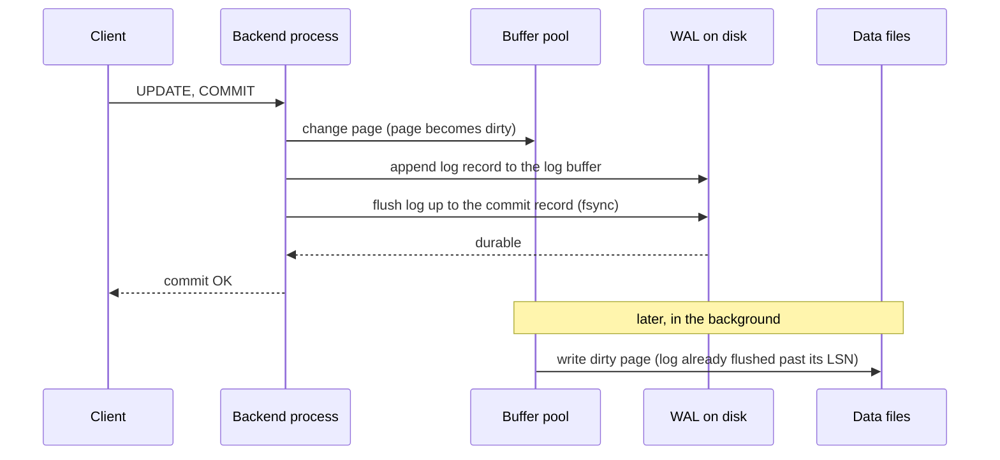
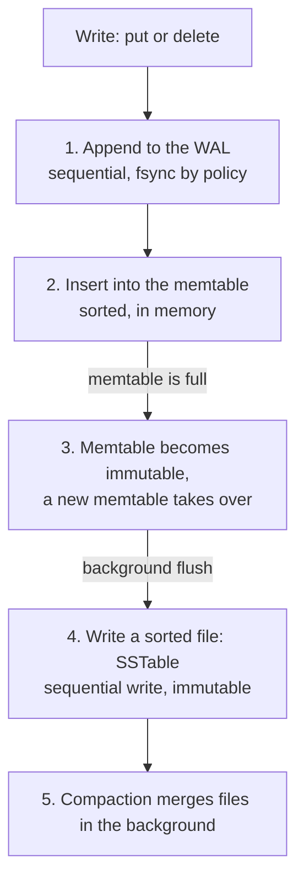
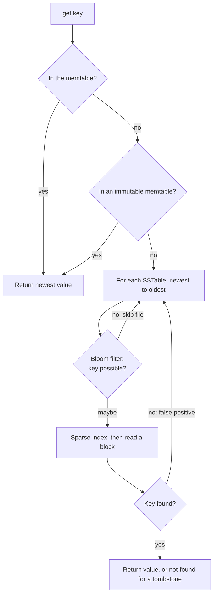

# Storage Engines

A storage engine is the part of a database that stores rows on disk, reads them back, and survives a crash. This page explains the physical side: pages, the buffer pool, the write-ahead log, checkpoints, torn pages, the cleanup that multi-version concurrency control (MVCC) needs, and the log-structured merge tree (LSM tree) as the alternative to the B+ tree. The logical side (isolation levels, anomalies) is in [transactions and isolation](04-transactions-and-isolation.md). The B+ tree as an index is in [indexing](03-indexing.md).

## Why It Matters

Interviewers ask "What does the write-ahead log do?", "Why is a write to an LSM tree fast?", "What is write amplification?", "Why does PostgreSQL need VACUUM?", and "B-tree or LSM tree for this workload?". A candidate who answers with the mechanism (what is written, in which order, to which file) and with the cost (random against sequential I/O, amplification) gives the senior answer. On the job, the same knowledge explains why a commit takes 1 ms and not 10 ms, why a table grows while the row count stays the same, why a long-running transaction fills the disk, and why a write-heavy service moves from a B-tree engine to an LSM engine. The choice of a database family for a design is in [choosing a database](../hld/fundamentals/04-choosing-a-database.md). This page owns the internals.

!!! info "Versions"
    Facts about PostgreSQL come from the PostgreSQL 18 documentation. Facts about InnoDB come from the MySQL 8.4 Reference Manual. Facts about RocksDB come from the RocksDB wiki, and facts about Cassandra from its current documentation. Each default value in this page is from those sources and was read on 2026-11-05. A default value can change in a later release, so check the documentation of your version.

## Core Concepts

**Page (block).** The unit that a database reads and writes. A table or an index is an array of pages of a fixed size. PostgreSQL uses 8 kB by default ("usually 8 kB, although a different page size can be selected when compiling the server"). InnoDB uses 16 KB by default (`innodb_page_size`, see [indexing](03-indexing.md)). A row is never smaller than its share of a page I/O: to read one 100-byte row, the engine reads one whole page.

**Buffer pool (shared buffers).** A region of memory that caches pages. The engine reads and writes pages through it. A **dirty page** is a page that changed in memory and not yet on disk. **Pinned** means that a process uses the page now, so the engine cannot evict it.

**Write-ahead log (WAL, redo log).** An append-only file of records that describe changes. PostgreSQL calls it the WAL. InnoDB calls it the redo log. The rule: the engine writes the log record to stable storage before it writes the changed data page. The PostgreSQL documentation states: "changes to data files (where tables and indexes reside) must be written only after those changes have been logged, that is, after WAL records describing the changes have been flushed to permanent storage."

**`fsync`.** The system call that forces data from the operating system cache to the storage device. A write that has not passed `fsync` can disappear in a power failure.

**Log sequence number (LSN).** The position of a record in the log. Each page stores the LSN of the last log record that changed it (the page LSN). Recovery uses the page LSN to decide whether a record is already applied.

**Checkpoint.** A point at which the engine has written all dirty pages that existed before the point. Recovery starts from the last checkpoint, so the log before it is no longer needed for crash recovery.

**Torn page (partial write).** A page write that a crash stops in the middle, so the page on disk holds part of the old content and part of the new content.

**Dead tuple.** A row version that no running transaction can see. PostgreSQL leaves dead tuples in the table until VACUUM removes them. InnoDB leaves old versions in the undo log until purge removes them.

**Log-structured merge tree (LSM tree).** A storage structure that never updates data on disk in place. Writes go to a log and to a sorted structure in memory. The engine writes the memory structure to disk as an immutable sorted file, and merges the files in the background. O'Neil et al. introduced it in 1996.

**Write, read, and space amplification.** The RocksDB tuning guide defines them. Write amplification is "the ratio of bytes written to storage versus bytes written to the database". Read amplification is "the number of disk reads per query". Space amplification is "the ratio of the size of database files on disk to data size".

### The storage hierarchy and the cost of random I/O

The [back-of-envelope estimation page](../hld/back-of-envelope-estimation.md) lists the latency numbers (Jeff Dean's list, approximate): a main memory reference takes about 100 ns, a disk seek about 10 ms, and reading 1 MB sequentially from a disk about 20 ms. Memory is therefore about 100 000 times faster than a disk seek.

The same page shows the effect of the access pattern. Reading 1 MB as one sequential read costs 20 ms. Reading the same 1 MB as 250 random 4 KB blocks costs 250 seeks, which is 2.5 s, or 125 times more. A storage engine design is a way to turn random I/O into sequential I/O, or to avoid I/O with memory:

- The buffer pool avoids reads.
- The write-ahead log turns many random page writes into one sequential append at commit.
- An LSM tree turns random key writes into sequential file writes.

An SSD has no seek, but the gap remains. The estimation page gives about 16 µs for an SSD random read (approximate, from Colin Scott's model), and an SSD still writes in blocks that are larger than one row. The ratios in this page hold for both devices, and the absolute numbers differ.

## How It Works

### Pages and the heap

A PostgreSQL table is a **heap**: an unordered array of pages. Each page has this layout (PostgreSQL documentation, "Database Page Layout"):

```text
+----------------+------------------+----------------+---------------+--------+
| PageHeaderData | ItemIdData array |  free space    | items (rows)  | special|
| 24 bytes       | 4 bytes per item | grows in both  | grow upward   | space  |
|                | grows downward   | directions     | from the end  |        |
+----------------+------------------+----------------+---------------+--------+
```

- The 24-byte page header holds the free space pointers and the page LSN.
- Each item identifier (line pointer, 4 bytes) holds the offset and length of one row version. A **tuple ID (TID)** is the pair (page number, item number). An index entry stores a TID. Because an index points to a line pointer, the engine can move a row inside a page without changing the index.
- The special space holds data of the index method (for example the sibling links of a B-tree page). It is empty in an ordinary table.
- A row version has a fixed header of 23 bytes on most machines, with `t_xmin` (inserting transaction), `t_xmax` (deleting transaction), and `t_ctid` (the TID of this version or of a newer version).
- A row that is wider than about 2 kB goes through **TOAST** (The Oversized-Attribute Storage Technique): PostgreSQL compresses the large fields and moves them out of line into a separate TOAST table, in chunks of about 2000 bytes. A TOASTed value can have at most 1 GB. The main row keeps an 18-byte pointer.

InnoDB stores a table differently: the table is the primary key B+ tree (a **clustered index**). The leaf pages hold the full rows in primary key order. See [indexing](03-indexing.md) for the consequences for secondary indexes.

### The buffer pool and its replacement policy

When a query needs a page, the engine looks for it in the buffer pool. If the page is there (a hit), the engine pins it and uses it. If not (a miss), the engine picks a victim page, writes it to disk if it is dirty, and reads the needed page into that slot. A miss costs one disk read, and a dirty victim adds one write.

**A pure LRU policy fails for scans.** One sequential scan of a big table reads every page once. With pure least-recently-used (LRU) eviction, the scan pushes the hot pages out. The two engines handle this in different ways.

**PostgreSQL: clock sweep.** The shared buffers have a usage counter for each buffer. The counter increments (up to a small limit) when a process pins the buffer. A pointer, `nextVictimBuffer`, moves in a circle through all buffers. For each unpinned buffer, if the usage count is above zero, the sweep decrements it and goes on. If the count is zero, the sweep picks the buffer as the victim (PostgreSQL source, `src/backend/storage/buffer/README`). Clock sweep approximates LRU with less bookkeeping, because a hit only increments a counter and does not move the page in a list. Large operations use a **buffer ring** so that they do not flush the pool: a sequential scan reuses a ring of 256 KB, a bulk write uses a ring of 16 MB (at most 1/8 of `shared_buffers`), and VACUUM uses a ring that the setting `vacuum_buffer_usage_limit` sets (same README).

**InnoDB: LRU with midpoint insertion.** The buffer pool is one list. A new page enters at the midpoint of the list, not at the head. The list has two sublists: the new (young) sublist holds 5/8 of the pool and the old sublist holds 3/8. The setting `innodb_old_blocks_pct` controls the old share (default 37, "corresponding to the original fixed ratio of 3/8"). A page moves to the head of the new sublist when a query accesses it while it is in the pool. The setting `innodb_old_blocks_time` (default 1000 ms) is a window after the first access of a page, during which another access does not move it to the head. A table scan reads a page and touches it a few times in quick succession, so the scan pages stay in the old sublist and leave the pool first (MySQL 8.4 manual, "Making the Buffer Pool Scan Resistant").

The data structure of an LRU list (a hash map plus a doubly linked list) is in the [LRU cache case study](../lld/case-studies/02-lru-and-lfu-cache/README.md).

Sizing:

- PostgreSQL `shared_buffers` defaults to 128 MB. The manual suggests 25 percent of the memory of a dedicated server with 1 GB or more of RAM as a starting value, and says that more than 40 percent is unlikely to work better, because PostgreSQL also relies on the operating system cache. A page can therefore sit in two caches (the shared buffers and the operating system cache).
- InnoDB `innodb_buffer_pool_size` defaults to 128 MB. The manual says that on dedicated servers up to 80 percent of physical memory is often assigned to the buffer pool.

**Why a buffer pool hit is not free.** A hit still takes a latch (a short lock on the buffer), a hash lookup, and a pin. A cache such as Redis answers from a key-value structure without this work. See [caching](../hld/fundamentals/03-caching.md) and [query execution and tuning](05-query-execution-and-tuning.md).

### The write-ahead log

A transaction changes several pages: a heap page, several index pages, and perhaps a page for the free space map. If the engine wrote all of them to disk at commit, a commit would cost several random writes, and a crash between two writes would leave the database inconsistent. The write-ahead log solves both problems.

**The protocol:**

1. The transaction changes pages in the buffer pool. The pages become dirty. The engine does not write them yet.
2. For each change, the engine appends a log record to the log buffer in memory.
3. At commit, the engine appends a commit record and flushes the log to stable storage (`fsync`) up to that record. Then the commit returns to the client.
4. Later, a background process writes the dirty data pages to disk. Before it writes a page, the engine makes sure that the log is flushed up to the page LSN of that page. This is the "write-ahead" rule.

The PostgreSQL manual states the benefit: "we do not need to flush data pages to disk on every transaction commit, because we know that in the event of a crash we will be able to recover the database using the log". It adds that "only the WAL file needs to be flushed to disk to guarantee that a transaction is committed, rather than every data file changed by the transaction". The commit costs one sequential append and one `fsync`, and the data pages go to disk in the background, in batches.



**Durability settings.** The commit waits for the flush. Each product lets you trade durability for speed:

| Setting | Product | Default | Effect |
|---|---|---|---|
| `fsync` | PostgreSQL | `on` | `off` "can result in unrecoverable data corruption in the event of a power failure or system crash". Never turn it off on data that you need |
| `synchronous_commit` | PostgreSQL | `on` | `off` reports success before the WAL flush. A crash can lose the latest commits, but the database stays consistent (PostgreSQL 18 documentation). It can change per transaction |
| `wal_sync_method` | PostgreSQL | `fdatasync` on Linux | The system call that forces the WAL to disk |
| `innodb_flush_log_at_trx_commit` | InnoDB | `1` | `1`: write and flush the redo log at each commit ("required for full ACID compliance"). `2`: write at each commit, flush once per second. `0`: write and flush once per second. With `0` or `2`, "up to one second of transactions can be lost in a crash". With `2` the log is already in the operating system cache, so a crash of the `mysqld` process alone does not lose it, and an operating system crash or power loss does |
| `commit_delay`, `commit_siblings` | PostgreSQL | `0`, `5` | Delay the flush so that several commits share one flush (group commit) |

**Group commit.** An `fsync` takes much longer than the CPU work of a commit. If a hundred sessions commit at the same time, the engine can flush the log once for all hundred commit records. The PostgreSQL setting `commit_delay` exists "to improve group commit throughput". The delay applies only if at least `commit_siblings` other transactions are active. The result is that commit throughput does not depend on the number of `fsync` calls per second. Recommendation: do not tune `commit_delay` before you measure; under concurrent load, commits already share flushes while one flush is running.

**The disk can lie.** A drive with a volatile write-back cache can report that a write is done before the data is on stable media. The PostgreSQL manual warns: "Many solid-state drives (SSD) also have volatile write-back caches", and "many of these do not honor cache flush commands by default". A durable commit needs a device that honors flush, or a power-loss-protected cache.

### Checkpoints

If the log grew without limit, recovery would replay it from the start. A checkpoint bounds the log and the recovery time.

PostgreSQL (manual, "WAL Configuration"): "Checkpoints are points in the sequence of transactions at which it is guaranteed that the heap and index data files have been updated with all information written before that checkpoint. At checkpoint time, all dirty data pages are flushed to disk and a special checkpoint record is written to the WAL file." A checkpoint starts every `checkpoint_timeout` (default 5 min) or when WAL is about to exceed `max_wal_size` (default 1 GB), whichever comes first. The setting `checkpoint_completion_target` (default 0.9) spreads the writes over 90 percent of the interval, so a checkpoint does not make a burst of I/O. A crash recovery "looks at the latest checkpoint record to determine the point in the WAL (known as the redo record) from which it should start the REDO operation".

InnoDB writes checkpoints into the redo log files. The redo log has 32 files in the `#innodb_redo` directory ("InnoDB tries to maintain 32 redo log files in total, with each file equal in size to 1/32 * `innodb_redo_log_capacity`"). Their total size is `innodb_redo_log_capacity`, which defaults to 104857600 bytes (100 MiB; the minimum is 8 MiB). That is small for a write-heavy server, so operators raise it, and a larger capacity means fewer forced checkpoints and a longer possible recovery. The manual says that "when doing a checkpoint, InnoDB stores the checkpoint LSN in the header of the file which contains this LSN. During recovery, all redo log files are checked and recovery starts at the latest checkpoint LSN" (MySQL 8.4 manual, "Redo Log").

A checkpoint is a trade-off:

| Longer interval or larger log | Shorter interval or smaller log |
|---|---|
| Fewer checkpoints, fewer page writes (a page that changes often is written once) | More page writes |
| Longer crash recovery (more log to replay) | Shorter crash recovery |
| Fewer full-page images (see "Torn pages") | More full-page images in PostgreSQL |

### Crash recovery and ARIES

Mohan et al. described the recovery method ARIES (ACM Transactions on Database Systems, 17(1), 1992). PostgreSQL and InnoDB are not exact copies of it, but the ideas are the same, and interviewers ask for them. The paper's abstract says that ARIES "supports partial rollbacks of transactions, fine-granularity (e.g., record) locking and recovery using write-ahead logging", and introduces "the paradigm of repeating history to redo all missing updates before performing the rollbacks of the loser transactions during restart after a system failure".

Two buffer policies explain why a log is needed. A **steal** policy lets the buffer manager write a dirty page of an uncommitted transaction to disk. Then recovery must undo changes on disk. A **no-force** policy lets a transaction commit without writing its pages to disk. Then recovery must redo changes that are not on disk. Databases use steal and no-force because they give the best performance (the paper argues that steal is "still very desirable" with large memories). The log makes both safe: redo information for the no-force case, undo information for the steal case.

Restart recovery has three passes:

1. **Analysis.** The engine reads the log from the last checkpoint to the end. It rebuilds the table of dirty pages and the table of transactions that were active. It computes the **redo start point**: the oldest log record whose change may not be on disk. It finds the **loser transactions**: those without a commit record.
2. **Redo.** The engine repeats history. It scans the log from the redo start point and reapplies each change, for all transactions, including the losers. A record is redone only if the page LSN is smaller than the record LSN, which makes redo idempotent. The paper says "no logging is performed when updates are redone".
3. **Undo.** The engine rolls back the loser transactions, in reverse order, in one sweep of the log. Each undo step writes a **compensation log record (CLR)**, so that a crash during recovery does not undo the same change twice.


PostgreSQL has no undo pass, because MVCC keeps old row versions in the heap. A transaction that was running at the crash has no commit record, so the commit log (`pg_xact`) never marks it as committed. After the restart, no snapshot treats its row versions as visible, and VACUUM removes them later. Recovery replays the WAL forward only: the PostgreSQL manual calls it "roll-forward recovery, also known as REDO". This is a consequence of the storage design and not a missing feature: the undo work is paid later as dead tuples. InnoDB has undo logs. After redo, it rolls back the incomplete transactions with the undo logs (MySQL 8.4 manual, "InnoDB Recovery"). The manual says that this rollback can take "three or four times the amount of time a transaction is active before it is interrupted", and that it runs in the background, after the server accepts connections.

Recommendation for an interview: say "analysis, redo, undo" and name the two ideas that matter, the page LSN check that makes redo idempotent, and the CLRs that make undo safe after a crash during recovery.

### Torn pages: full-page writes and the doublewrite buffer

A database page is 8 kB or 16 KB. A disk writes in sectors of 512 bytes or 4 KB. A power loss during a page write can leave a page with some sectors new and some old. The PostgreSQL manual describes it: a write request "might be for some multiple of 512 bytes (PostgreSQL typically writes 8192 bytes, or 16 sectors, at a time), and the process of writing could fail due to power loss at any time, meaning some of the 512-byte sectors were written while others were not".

The log cannot repair a torn page by itself. A redo record such as "insert a row at offset 200 of page 7" assumes that the page is in a known state. A torn page is in no known state. The two engines use two different fixes.

| | PostgreSQL | InnoDB |
|---|---|---|
| Fix | **Full-page writes** (`full_page_writes`, default `on`): the first change of a page after each checkpoint writes the whole page into the WAL | **Doublewrite buffer**: the engine writes a batch of pages to doublewrite files first, and then to the real positions in the data files |
| Recovery | Redo starts from a full-page image, so the torn on-disk page is replaced | If the data file page is torn, recovery takes the good copy from the doublewrite buffer, then applies the redo log |
| Cost | More WAL volume after each checkpoint, mostly for random writes. `wal_compression` (default `off`) compresses the images | Each page is written twice. The first write goes to the doublewrite files as "a large sequential chunk, with a single `fsync()` call"; the second write goes to the real position. The setting `innodb_doublewrite` defaults to `ON` (the manual: "enabled by default in most cases") |
| Can you turn it off? | Yes, if the file system prevents partial writes (the manual names ZFS as an example) | Yes (`OFF`), with the same condition |

The InnoDB manual says that the doublewrite buffer is "a storage area where InnoDB writes pages flushed from the buffer pool before writing the pages to their proper positions in the InnoDB data files", and that it is in doublewrite files (for example `#ib_16384_0.dblwr`). The setting `DETECT_ONLY` writes only metadata, so recovery detects a torn page and does not repair it.

This is also the reason that random keys cost more in PostgreSQL: many different pages change between two checkpoints, and each first change writes a full 8 kB image into the WAL. See [unique ID generation](../hld/fundamentals/15-unique-id-generation.md).

### In-place B-tree engines and copy-on-write B-trees

InnoDB and the PostgreSQL heap with B-tree indexes **update pages in place**: the engine overwrites a page at its position. This needs the write-ahead log and torn-page protection, because an overwrite that fails in the middle destroys the old page.

A **copy-on-write B-tree** never overwrites a page. A change writes a new copy of the leaf page and of every page on the path to the root, and then switches the root pointer in one atomic step. The old pages stay valid until the switch, so a crash leaves either the old tree or the new tree. LMDB uses this design. The LMDB source header (`lmdb.h`) states: "Data pages use a copy-on-write strategy so no active data pages are ever overwritten", and that this "eliminates the need of any special recovery procedures after a system crash". The header also states that "only one write transaction may be active at a time", which is why writers cannot deadlock. The Symas page lists "deadlock-free serialized writes", says that LMDB needs no external process, background cleanup, compaction, logs, or crash recovery procedure, that it uses memory-mapped files, and that "readers do not block writers, writers do not block readers" (a multi-version design). The cost: each change rewrites all pages on the path (a tree of height 4 writes at least 4 pages for one row), writes are serialized (one writer at a time), and the engine needs a way to reuse the old pages after the last reader that sees them has finished. Compare the in-place engines above: they need the log and torn-page protection, and LMDB trades that for write cost and the single writer.

### The physical side of MVCC

[Transactions and isolation](04-transactions-and-isolation.md) explains the visibility rules. This part explains where the old versions live and how the engine removes them.

#### PostgreSQL: dead tuples, VACUUM, and bloat

An `UPDATE` in PostgreSQL writes a new row version into the heap and sets `xmax` on the old version. A `DELETE` sets `xmax`. Neither one removes anything. A version stays in the heap while any snapshot can still see it. After that, it is a dead tuple, and its space is not free until VACUUM reclaims it.

**Pruning and HOT.** A heap-only tuple (HOT) update needs two conditions: no indexed column changes (summarizing indexes such as BRIN are exempt), and the page has room for the new version (PostgreSQL manual, "Heap-Only Tuples"). Then no index entry changes, and "row versions other than the oldest and the newest can be completely removed during normal operation, including SELECTs, instead of requiring periodic vacuum operations". The old line pointer "is converted to a redirect that points to the oldest version that may still be visible". Recommendation: for a table with frequent updates of non-indexed columns, set a `fillfactor` below 100 (for example 70 to 90) so that pages keep room for HOT updates. The manual states that decreasing `fillfactor` raises the chance that a page has room.

**VACUUM.** The manual lists four jobs (PostgreSQL 18, "Routine Vacuuming"): to recover or reuse disk space occupied by updated or deleted rows, to update the statistics for the planner, to update the visibility map (which speeds up index-only scans), and to protect against loss of very old data due to transaction ID wraparound. Standard VACUUM runs in parallel with normal queries. It marks the space inside a page as reusable, and "will not return the space to the operating system, except in the special case where one or more pages at the end of a table become entirely free". `VACUUM FULL` writes a complete new copy of the table without dead space, and "requires an ACCESS EXCLUSIVE lock on the table", so it blocks all access.

**Autovacuum.** A background launcher starts workers that vacuum tables automatically. A worker vacuums a table when the number of dead tuples exceeds `autovacuum_vacuum_threshold` (default 50) plus `autovacuum_vacuum_scale_factor` (default 0.2) times the number of rows. For a table of 100 million rows, that is about 20 million dead tuples before a vacuum starts (50 + 0.2 × 100 000 000). PostgreSQL 18 also has `autovacuum_vacuum_max_threshold` (default 100 000 000) as an upper cap on this number. Other defaults: `autovacuum_naptime` is 1 min, `autovacuum_max_workers` is 3, and `autovacuum_vacuum_cost_delay` is 2 ms (the cost delay throttles vacuum I/O).

**Bloat.** Table bloat is dead space that a table keeps because vacuum did not run, or ran and could not remove tuples. The causes:

- A long-running transaction. Its snapshot may need old versions, so vacuum cannot remove them. The PostgreSQL manual (the description of `idle_in_transaction_session_timeout`) notes that "an open transaction prevents vacuuming away recently-dead tuples that may be visible only to this transaction".
- An abandoned prepared transaction, a replication slot that holds back the horizon, or a standby with `hot_standby_feedback`.
- Autovacuum that is too slow for the update rate, for example on a huge table with the default scale factor.
- Many updates that are not HOT.

The effects of bloat: larger tables and indexes, more pages to read for a scan, a lower hit rate in the buffer pool, and slower index-only scans (the visibility map bits are not set). To fix it: remove the cause, lower the per-table `autovacuum_vacuum_scale_factor`, and, for an already bloated table, rebuild it with `VACUUM FULL` (exclusive lock) or an online tool such as `pg_repack`. It is a PostgreSQL extension that is not part of the core distribution, and its documentation says that it "works online, without holding an exclusive lock on the processed tables during processing". It needs extra disk space for the new copy.

<!-- sql-skip: postgresql -->

```sql
-- PostgreSQL: find tables with many dead tuples and the last autovacuum time.
SELECT relname, n_live_tup, n_dead_tup, last_autovacuum
FROM pg_stat_user_tables
ORDER BY n_dead_tup DESC
LIMIT 10;

-- PostgreSQL: vacuum a hot table sooner than the default 20 percent.
ALTER TABLE orders SET (autovacuum_vacuum_scale_factor = 0.02);
```

**Transaction ID wraparound.** PostgreSQL stores a 32-bit transaction ID (XID) in `xmin` and `xmax`. The manual says that "normal XIDs are compared using modulo-2^32 arithmetic", so "for every normal XID, there are two billion XIDs that are 'older' and two billion that are 'newer'". Without a fix, after about two billion transactions an old committed row would look as if it was inserted in the future, and it would become invisible. The fix is **freezing**: VACUUM marks a row as frozen when the inserting transaction is so old that its effects "are certain to be visible to all current and future transactions". A frozen row is visible regardless of the XID comparison. The manual requires that every table is vacuumed at least once every two billion transactions.

| Setting | Default | Meaning |
|---|---|---|
| `vacuum_freeze_min_age` | 50 million | How old an XID must be before vacuum freezes the row |
| `vacuum_freeze_table_age` | 150 million | The table age at which a vacuum scans the whole table to freeze (an aggressive vacuum) |
| `autovacuum_freeze_max_age` | 200 million | Autovacuum starts on the table at this age, even if autovacuum is off |

If vacuum falls behind, PostgreSQL warns when fewer than about 40 million transactions remain ("must be vacuumed within 39985967 transactions" in the manual's example), and "will refuse to assign new XIDs once there are fewer than three million transactions left". Then only read-only transactions can start. The fix is a database-wide `VACUUM`, not a restart. The manual says that a restart or single-user mode is "not necessary or desirable". The usual cause of a wraparound emergency is a blocker that holds the vacuum horizon back, for example a long transaction, a stale replication slot, or a prepared transaction.

<!-- sql-skip: postgresql -->

```sql
-- PostgreSQL: how close is each database to the wraparound limit?
-- The age is in transactions; autovacuum_freeze_max_age (200 million) forces vacuum.
SELECT datname, age(datfrozenxid) AS xid_age
FROM pg_database
ORDER BY xid_age DESC;
```

#### InnoDB: undo logs and purge

InnoDB updates a row in place in the clustered index. Each row has a 6-byte `DB_TRX_ID` (the last transaction that inserted or updated the row) and a 7-byte `DB_ROLL_PTR` (a pointer to an undo log record that "contains the information necessary to rebuild the content of the row before it was updated"). An undo log record "contains information about how to undo the latest change by a transaction to a clustered index record. If another transaction needs to see the original data as part of a consistent read operation, the unmodified data is retrieved from undo log records."

A reader that needs an older version follows the roll pointer, and applies the undo records until it reaches the version that its read view sees. A long chain means a slow read. A rollback uses the same undo records to restore the row.

A delete only marks the row. The manual says that "InnoDB only physically removes the corresponding row and its index records when it discards the update undo log record written for the deletion. This removal operation is called a purge". Purge runs in background threads. The setting `innodb_purge_threads` defaults to 1 if the server has 16 or fewer logical processors, and 4 otherwise. The **history list length** (in `SHOW ENGINE INNODB STATUS`) counts undo records that purge has not yet processed. It "is typically a low value, usually less than a few thousand, but a write-heavy workload or long running transactions can cause it to increase, even for transactions that are read only". The manual advises: "commit transactions regularly, including transactions that issue only consistent reads. Otherwise, InnoDB cannot discard data from the update undo logs, and the rollback segment may grow too big". The setting `innodb_max_purge_lag` (default 0, no limit) delays `INSERT`, `UPDATE`, and `DELETE` when purge falls behind.

<!-- sql-skip: mysql -->

```sql
-- MySQL: look at "History list length" in the TRANSACTIONS section.
SHOW ENGINE INNODB STATUS;
```

| | PostgreSQL | InnoDB |
|---|---|---|
| Where old versions live | In the table (heap), next to the live row | In the undo log (undo tablespaces) |
| What an update does | Writes a new version. The old version stays | Overwrites the row in place. The old values go to the undo log |
| Cleanup | VACUUM and autovacuum (and pruning) | Purge threads |
| What a long transaction causes | Table and index bloat, wasted space inside the table | A growing undo log and history list |
| Rollback cost | Cheap (the versions stay invisible) | Proportional to the work, because the engine copies old values back |
| Special problem | Transaction ID wraparound (32-bit XIDs) | None of the same kind |
| Index effect | A new version needs new index entries unless the update is HOT | Secondary index entries change only if an indexed column changes. Delete-marked entries wait for purge |

InnoDB also has a **change buffer**: the manual says it "caches changes to secondary index pages when those pages are not in the buffer pool", and merges them later when a read loads the page. It saves random reads for secondary index writes.

### LSM trees

A B+ tree engine pays one random page read and one page write for each random insert once the index is larger than memory. An LSM tree avoids the random write.

O'Neil et al. wrote the motivation (Acta Informatica, 1996): standard disk-based structures such as the B-tree "will effectively double the I/O cost of the transaction to maintain an index" for a table with a high insert rate. The LSM tree "uses an algorithm that defers and batches index changes, cascading the changes from a memory-based component through one or more disk components in an efficient manner reminiscent of merge sort". The paper also states the cost: "indexed finds requiring immediate response will lose I/O efficiency in some cases, so the LSM-tree is most useful in applications where index inserts are more common than finds".

#### The write path



1. The engine appends the change to the **write-ahead log** (Cassandra: the commit log). This makes the memtable recoverable.
2. The engine inserts the change into the **memtable**, a sorted in-memory structure. RocksDB uses a skip list by default ("The default implementation of memtable is based on skiplist"), and the default memtable size is 64 MB (`write_buffer_size`).
3. When the memtable is full, it becomes immutable, and a new memtable receives the writes.
4. A background thread **flushes** the immutable memtable to a **sorted string table (SSTable)**, an immutable file of key-value pairs in key order. "SSTables are immutable, and never written to again after the memtable is flushed" (Cassandra documentation). In RocksDB the first file lands in Level 0.
5. After the flush, the log segment is no longer needed. The Cassandra documentation says that "data in the commit log is purged after its corresponding data in the memtable is flushed to an SSTable on disk".

All disk writes are sequential: the log append and the SSTable write. A write does not read any data page. This is why an LSM engine takes high write rates.

Durability follows the log policy. Cassandra has two commit log modes: in `batch` mode "Cassandra won't acknowledge writes until the commit log has been fsynced to disk", and in `periodic` mode "writes are immediately acknowledged", so "Cassandra can lose up to the sync period or more if the sync is delayed". RocksDB, by default, flushes the WAL to the operating system after every user write. The RocksDB wiki says that this "guarantees process crash consistency". The wiki page does not say what the default guarantees after a machine crash, so treat a machine crash as a risk until you set the sync option (`WriteOptions::sync`) for your workload.

#### The SSTable and its indexes

An SSTable holds sorted key-value pairs, so a lookup can binary-search it. A large file needs an index that says where to look, and a filter that says whether to look at all. Cassandra's SSTable has these components (storage engine documentation):

| Component | Content |
|---|---|
| `Data.db` | "The actual data, i.e. the contents of rows". Partitions are sorted in token order, and rows inside a partition in clustering key order |
| `Index.db` | "An index from partition keys to positions in the Data.db file" |
| `Summary.db` | "A sampling of (by default) every 128th entry in the Index.db file". A **sparse index**: it points to the nearest earlier entry, and the engine scans from there |
| `Filter.db` | "A Bloom Filter of the partition keys in the SSTable" |
| `Statistics.db` | Metadata: timestamps, tombstones, clustering key ranges |

A **sparse index** holds one entry for many keys, so it fits in memory. It works because the data is sorted: the engine finds the last index entry that is at or before the key, and reads a short range from there.

A **Bloom filter** is a bit array with several hash functions. It answers "definitely not in the file" or "probably in the file". It has false positives and no false negatives. The math is in [probabilistic data structures](../hld/distributed-systems/04-probabilistic-data-structures.md). In an LSM engine, the filter has one job: to skip an SSTable that cannot hold the key, so that a point lookup does not read it. In RocksDB you enable the filter with a filter policy on the table options. The wiki says that "when the filter policy is set, every newly created SST file will contain a Bloom filter". The wiki example uses `NewBloomFilterPolicy(10)`, and the tuning guide says that the "default bits_per_key is 10, which yields ~1% false positive rate". The Cassandra setting `bloom_filter_fp_chance` has a default of 0.01 (0.1 for leveled compaction, see the probabilistic data structures page). The RocksDB wiki says that a whole-key filter serves point lookups only; it does not help a range scan, except when a prefix filter is configured. A filter costs memory (about 10 bits per key), so a store with 10 billion keys needs about 12.5 GB of filter (10 000 000 000 × 10 bits / 8 bits per byte).

#### The read path



The read looks in the memtable first, and then in the SSTables from the newest to the oldest. The first match is the newest version, so the search stops there. A key that does not exist is the worst case: the engine must check every file, and the Bloom filters make this cheap. A range scan must merge the iterators of the memtable and of every SSTable that overlaps the range, because the filters do not help.

#### Tombstones

An LSM engine cannot remove a key from an immutable file. A delete writes a **tombstone**: a marker with a timestamp. The Cassandra documentation says that "Cassandra treats a deletion as an insertion, and inserts a time-stamped deletion marker called a tombstone". A read that finds a tombstone first returns "not found", and does not look at older files. Compaction removes the old value and the tombstone later. The tombstone can go only when no older file below can hold an older version of the key. RocksDB defines this with the term "bottom-most" (a level is bottom-most for a key when no level below contains the key). In Cassandra, a tombstone also waits for `gc_grace_seconds` (default 864000 s, ten days), so that every replica gets the delete before the tombstone disappears. Many tombstones make reads slow, because a read must skip them.

#### Compaction

**Compaction** merges SSTables: it keeps the newest version of each key, drops overwritten values and expired tombstones, and writes a new sorted file. Then it deletes the old files. Compaction is the "merge" phase of the LSM tree. Compaction costs I/O and CPU, and it competes with foreground reads and writes. The strategy decides the amplification.

**Size-tiered compaction (STCS; RocksDB calls it "universal", a tiered style).** The engine merges files of similar size. In Cassandra, STCS "initiates compaction when Cassandra has accumulated a set number (default: 4) of similar-sized SSTables" (`min_threshold`, with `max_threshold` 32). The result is one bigger file. Each key is rewritten about once per size tier, so write amplification is low. A key can be in several files at once, so read amplification and space amplification are higher. A major compaction needs "the amount of disk space needed for both the new and old SSTables simultaneously". STCS is the Cassandra default: it "is useful as a fallback when other strategies don't fit the workload".

**Leveled compaction (LCS; RocksDB default "Level" style).** The files are in levels. Each level above Level 0 is one sorted run, split into non-overlapping files, so a key is in at most one file for each level. The target size of each level is the multiplier (`max_bytes_for_level_multiplier`, default 10; the tuning guide: "we do not recommend changing that") times the level above it. When a level exceeds its target, the engine picks a file and merges it with the overlapping files of the next level. Level 0 is special: it holds the flushed files, which overlap, and the wiki says that all L0 files must be picked up together "because they usually are overlapping". The read amplification is low (at most one file for each level, plus all of Level 0). The space amplification is low (most data sits in the last level; with dynamic level sizing about 90 percent of the data is in the last level and about 9 percent in the second-to-last, according to the RocksDB wiki). The write amplification is high: a byte is rewritten when it moves down each level. The RocksDB wiki says that write amplification of leveled compaction is "often larger than 10". Cassandra's documentation says that LCS "is optimized for read heavy workloads, or workloads with lots of updates and deletes".

**Other strategies.** Cassandra's Time Window strategy (TWCS) "is designed for TTL'ed, mostly immutable time-series data". The Unified strategy (UCS) "is a good choice for most workloads and is recommended for new workloads". RocksDB has a FIFO style that "drops oldest file when obsolete and can be used for cache-like data". The RocksDB compaction page also names a tiered+leveled hybrid: that is what RocksDB's default "Level" style is, because Level 0 is tiered.

| | Size-tiered (universal) | Leveled |
|---|---|---|
| Write amplification | Lower | Higher (RocksDB: often larger than 10) |
| Read amplification | Higher (many overlapping files) | Lower (one file for each level) |
| Space amplification | Higher (RocksDB universal compaction trades off space and read amplification for low write amplification, and a full compaction can temporarily double the disk use) | Lower |
| Best for | Write-heavy loads | Read-heavy loads, many updates and deletes |

#### The three amplifications

The three amplifications cannot all be low at once. The RocksDB wiki treats them as a trade-off: size-tiered compaction "minimizes write amplification at the cost of read and space amplification", and classic leveled compaction "minimizes space amplification at the cost of read and write amplification" (both quotes: RocksDB wiki, "Compaction").

A worked example of write amplification (Assumption, not a measurement: leveled compaction, multiplier 10. When a file moves from one level to the next, it merges with about 10 times its size of data in the lower level, so a byte is rewritten up to about 10 times for each level that it passes. The real value depends on the workload). A store has four levels below Level 0. A byte that arrives is written to the WAL (1), to Level 0 by the flush (1), and then merged into each of the four levels (up to about 10 each). The total is up to about 2 + 4 × 10 = 42 bytes written for each byte that the application writes. This is an upper estimate for a uniform workload, and the measured value is lower for many workloads. The point for the interview is the direction: leveled compaction trades write bandwidth for read speed. Measure your own value with the engine statistics.

### B-tree against LSM tree

| Property | B+ tree (InnoDB, PostgreSQL) | LSM tree (RocksDB, Cassandra) |
|---|---|---|
| Write path | Find the leaf page (a read if not in memory), change it in place, write the log record. The dirty page goes to disk later | Append to the log, insert into the memtable. Disk writes are sequential |
| Random-key insert, index larger than memory | About one random page read and, later, one page write for each insert, and page splits | No read. The write is an append and a memtable insert. Compaction pays later with sequential I/O |
| Point read | One path from the root to a leaf: the height of the tree (about 3 to 4 pages, the top pages cached) | The memtable, then up to one file for each level or tier, with Bloom filters that skip most files |
| Range scan | Follow the linked leaf pages: fast | Merge the iterators of all overlapping files: slower, and the filters do not help |
| Write amplification | A whole page (8 kB or 16 KB) for one changed row, plus the log (and a full-page image after a checkpoint in PostgreSQL) | The log, the flush, and each compaction rewrite. Often higher in total for leveled compaction |
| Space amplification | Pages are 50 to 90 percent full after splits ([indexing](03-indexing.md)). Bloat in PostgreSQL | Old versions until compaction. A big merge needs free space to hold old and new files |
| Predictable latency | Good, except at checkpoints and page splits | Compaction can cause latency spikes and write stalls when it falls behind |
| Delete | Mark and remove (vacuum or purge) | A tombstone, removed by compaction |
| Transactions and secondary indexes | Mature, with row locks and MVCC in the engine | Usually key-value level, and a secondary index is another LSM tree that the application or engine must keep in sync |
| Typical use | OLTP databases with mixed reads and writes | Write-heavy stores: time series, logs, messaging, metrics, key-value stores |

**Random-key insert cost.** [Unique ID generation](../hld/fundamentals/15-unique-id-generation.md) says that random keys such as UUIDv4 hurt B-tree indexes and cost less in an LSM engine. The reason, with numbers (Assumption: a 100 GB index with a 10 GB buffer pool, a random key, 8 kB pages): 90 percent of the leaf pages are not in memory. Each insert first reads one leaf page (about 10 ms on a spinning disk, about 16 µs on an SSD, approximate numbers from the estimation page), and later the dirty page is written back for one changed row of about 20 bytes. A page split writes two pages. In PostgreSQL, the first change of each page after a checkpoint also writes an 8 kB image into the WAL. In an LSM tree, the same insert costs one WAL append and one memtable insert, and the key reaches its place in the sorted files by sequential merges. A time-ordered key (UUIDv7 or a sequence) avoids the problem in a B-tree, because the inserts hit the rightmost leaf, which stays in memory.

**LSM storage in products.** The names:

- **LevelDB** (Google, by Jeff Dean and Sanjay Ghemawat): the original small LSM library, with leveled compaction.
- **RocksDB** (Facebook, now Meta): it builds on LevelDB (the RocksDB README: "built on earlier work on LevelDB by Sanjay Ghemawat and Jeff Dean"), with multi-threaded compaction, column families, and many tuning options. It is an embedded library that other systems use as their storage layer.
- **Cassandra**: an LSM engine on each node, with the commit log, memtables, SSTables, and the compaction strategies above.
- **MyRocks**: the RocksDB storage engine for MySQL. It keeps the MySQL SQL layer and replaces InnoDB with an LSM engine, so a table with write-heavy loads can use less disk space and fewer writes. The MyRocks project site describes it as "a RocksDB storage engine with MySQL" and claims "2x better compression compared to compressed InnoDB" and "10x less write amplification compared to InnoDB". Those are the project's own claims for its test workload, so measure your own.

### How one node stores a partition

A distributed store splits its data into partitions and puts each partition on some nodes ([partitioning and sharding](../hld/fundamentals/06-partitioning-and-sharding.md)). Inside one node, the partition is a set of keys in the node's storage engine. In Cassandra the node writes each partition's rows into the node's memtable and SSTables, sorted by partition token and then by the clustering columns, so the rows of one partition are next to each other in a file and a partition read is a sequential read. In a DynamoDB-style or key-value store, an LSM or B-tree engine on the node holds the items of all partitions that the node serves. The [key-value store case study](../hld/case-studies/03-key-value-store.md) uses this layout: the commit log, the memtable, SSTables with Bloom filters, and compaction, per node and per replica. A system that cannot tolerate a compaction burst runs each node below full disk and I/O capacity, because compaction needs spare capacity (the case study uses 60 percent utilization).

### Column storage

Column stores for analytics (ClickHouse, Parquet files) store each column apart. That layout is for scans over many rows and few columns. It has its home in [OLTP, OLAP, and warehousing](10-oltp-olap-and-warehousing.md).

## Trade-offs and When to Use

| Decision | Choose | When | Cost |
|---|---|---|---|
| Engine family | B+ tree (InnoDB, PostgreSQL) | Mixed reads and writes, range scans, transactions, secondary indexes | Random page writes. A random key hurts a big index |
| | LSM tree (RocksDB, Cassandra) | Write rate is high, data is append-heavy, reads are mostly by key | Compaction I/O and read amplification. Range scans are slower |
| Compaction strategy | Size-tiered | Write-heavy, space is available | More space. Higher read amplification |
| | Leveled | Read-heavy, updates and deletes, tight space | More write I/O |
| | Time window | TTL time series | Not good for out-of-order or updated data |
| Commit durability | Flush on each commit (`synchronous_commit = on`, `innodb_flush_log_at_trx_commit = 1`) | Money, orders, anything that you cannot lose | A commit waits for an `fsync` |
| | Flush each second or asynchronous | Metrics, caches, derived data | A crash can lose the last second or so of committed data |
| Torn-page protection | Keep full-page writes or the doublewrite buffer on | Always, unless the file system gives atomic page writes | Extra write volume |
| Checkpoint spacing | Longer | Write-heavy loads where fewer page writes matter | Longer recovery, more disk for the log |
| | Shorter | Fast restart matters | More I/O |
| Update-heavy PostgreSQL table | Lower `fillfactor`, tune autovacuum, fewer indexes | Frequent updates | Larger table |

Recommendation: start with a B+ tree engine (PostgreSQL or MySQL) for an OLTP system. Move to an LSM engine when profiling shows that the write rate or the random-key insert cost is the limit, and the read pattern is mostly by key. Say this in an interview, with the numbers that you measured or assumed.

## Java Example

The program simulates an LSM tree with the parts that this page describes: a `TreeMap` memtable, a write-ahead list, flushes to immutable sorted runs, tombstones, a Bloom filter for each run, and a compaction that merges runs when four exist. The memtable holds four entries. The scenario writes ten keys, updates one, deletes one, reads, crashes and replays the log, adds more writes that trigger a compaction, and prints the write amplification in entries. The Bloom filter uses 10 bits per key and three hash positions. The output is deterministic, because `String.hashCode` is specified by the JDK.

```java
import java.util.ArrayList;
import java.util.BitSet;
import java.util.List;
import java.util.Map;
import java.util.TreeMap;

public class Main {
    public static void main(String[] args) {
        LsmTree db = new LsmTree(4, 4);
        for (int i = 1; i <= 10; i++) {
            db.put(String.format("k%02d", i), "v" + i);
        }
        System.out.println("after 10 puts: " + db.describe());

        db.put("k03", "v3-new");
        db.delete("k05");
        System.out.println("after update k03 and delete k05: " + db.describe());

        System.out.println("get k03 = " + db.get("k03"));
        System.out.println("get k05 = " + db.get("k05") + " (tombstone hides the old value)");
        System.out.println("get k01 = " + db.get("k01"));
        System.out.println("read stats: " + db.stats());

        db.resetReadStats();
        for (int i = 20; i < 30; i++) {
            db.get("x" + i);
        }
        System.out.println("10 gets of absent keys: " + db.stats());

        db.put("k11", "v11");
        System.out.println("before crash: " + db.describe());
        db.crashAndRecover();
        System.out.println("after crash and WAL replay: " + db.describe());
        System.out.println("get k11 = " + db.get("k11"));

        db.put("k12", "v12");
        db.put("k13", "v13");
        db.put("k14", "v14");
        System.out.println("after 3 more puts (4 runs trigger compaction): " + db.describe());
        System.out.println("range k02..k07 = " + db.scan("k02", "k07"));
        System.out.println("get k05 = " + db.get("k05") + " (compaction dropped the tombstone)");
        System.out.println("write amplification: " + db.writeAmplification());
    }
}

class Bloom {
    private static final int K = 3;
    private final BitSet bits = new BitSet();
    private final int m;

    Bloom(int expectedKeys) {
        this.m = Math.max(16, expectedKeys * 10);
    }

    void add(String key) {
        for (int i = 0; i < K; i++) {
            bits.set(index(key, i));
        }
    }

    boolean mightContain(String key) {
        for (int i = 0; i < K; i++) {
            if (!bits.get(index(key, i))) {
                return false;
            }
        }
        return true;
    }

    private int index(String key, int i) {
        int h1 = key.hashCode();
        int h2 = Integer.rotateLeft(h1 * 0x9E3779B1, 15) | 1;
        return Math.floorMod(h1 + i * h2, m);
    }
}

class Run {
    final int id;
    final TreeMap<String, String> data;
    final Bloom bloom;

    Run(int id, Map<String, String> entries) {
        this.id = id;
        this.data = new TreeMap<>(entries);
        this.bloom = new Bloom(entries.size());
        for (String key : entries.keySet()) {
            bloom.add(key);
        }
    }
}

class LsmTree {
    static final String TOMBSTONE = "\u0000deleted";

    private final int memtableLimit;
    private final int compactionTrigger;
    private final TreeMap<String, String> memtable = new TreeMap<>();
    private final List<String> wal = new ArrayList<>();
    private final List<Run> runs = new ArrayList<>();
    private int nextRunId = 1;
    private int userWrites;
    private int entriesWritten;
    private int runProbes;
    private int bloomSkips;
    private int falsePositives;

    LsmTree(int memtableLimit, int compactionTrigger) {
        this.memtableLimit = memtableLimit;
        this.compactionTrigger = compactionTrigger;
    }

    void put(String key, String value) {
        write("PUT " + key + " " + value, key, value);
    }

    void delete(String key) {
        write("DEL " + key, key, TOMBSTONE);
    }

    private void write(String record, String key, String value) {
        wal.add(record);
        memtable.put(key, value);
        userWrites++;
        if (memtable.size() >= memtableLimit) {
            flush();
        }
    }

    private void flush() {
        runs.add(0, new Run(nextRunId++, memtable));
        entriesWritten += memtable.size();
        memtable.clear();
        wal.clear();
        if (runs.size() >= compactionTrigger) {
            compact();
        }
    }

    private void compact() {
        TreeMap<String, String> merged = new TreeMap<>();
        for (int i = runs.size() - 1; i >= 0; i--) {
            merged.putAll(runs.get(i).data);
        }
        merged.values().removeIf(TOMBSTONE::equals);
        runs.clear();
        runs.add(new Run(nextRunId++, merged));
        entriesWritten += merged.size();
    }

    String get(String key) {
        if (memtable.containsKey(key)) {
            return visible(memtable.get(key));
        }
        for (Run run : runs) {
            if (!run.bloom.mightContain(key)) {
                bloomSkips++;
                continue;
            }
            runProbes++;
            String value = run.data.get(key);
            if (value != null) {
                return visible(value);
            }
            falsePositives++;
        }
        return null;
    }

    private String visible(String value) {
        return TOMBSTONE.equals(value) ? null : value;
    }

    Map<String, String> scan(String from, String to) {
        TreeMap<String, String> view = new TreeMap<>();
        for (int i = runs.size() - 1; i >= 0; i--) {
            view.putAll(runs.get(i).data.subMap(from, true, to, true));
        }
        view.putAll(memtable.subMap(from, true, to, true));
        view.values().removeIf(TOMBSTONE::equals);
        return view;
    }

    void crashAndRecover() {
        memtable.clear();
        for (String record : wal) {
            String[] parts = record.split(" ", 3);
            memtable.put(parts[1], parts[0].equals("PUT") ? parts[2] : TOMBSTONE);
        }
    }

    void resetReadStats() {
        runProbes = 0;
        bloomSkips = 0;
        falsePositives = 0;
    }

    String stats() {
        return "run probes=" + runProbes + ", bloom skips=" + bloomSkips
                + ", false positives=" + falsePositives;
    }

    String writeAmplification() {
        return entriesWritten + " entries written to runs for " + userWrites + " user writes";
    }

    String describe() {
        StringBuilder sb = new StringBuilder();
        sb.append("memtable=").append(show(memtable));
        sb.append(", wal=").append(wal.size()).append(" records");
        for (Run run : runs) {
            sb.append("\n    run").append(run.id).append("=").append(show(run.data));
        }
        return sb.toString();
    }

    private String show(TreeMap<String, String> map) {
        if (map.size() > 6) {
            return map.size() + " entries, " + map.firstKey() + " to " + map.lastKey();
        }
        StringBuilder sb = new StringBuilder("{");
        for (Map.Entry<String, String> e : map.entrySet()) {
            if (sb.length() > 1) {
                sb.append(", ");
            }
            sb.append(e.getKey()).append("=")
              .append(TOMBSTONE.equals(e.getValue()) ? "<del>" : e.getValue());
        }
        return sb.append("}").toString();
    }
}
```

<!-- expected-output -->

```text
after 10 puts: memtable={k09=v9, k10=v10}, wal=2 records
    run2={k05=v5, k06=v6, k07=v7, k08=v8}
    run1={k01=v1, k02=v2, k03=v3, k04=v4}
after update k03 and delete k05: memtable={}, wal=0 records
    run3={k03=v3-new, k05=<del>, k09=v9, k10=v10}
    run2={k05=v5, k06=v6, k07=v7, k08=v8}
    run1={k01=v1, k02=v2, k03=v3, k04=v4}
get k03 = v3-new
get k05 = null (tombstone hides the old value)
get k01 = v1
read stats: run probes=3, bloom skips=2, false positives=0
10 gets of absent keys: run probes=1, bloom skips=29, false positives=1
before crash: memtable={k11=v11}, wal=1 records
    run3={k03=v3-new, k05=<del>, k09=v9, k10=v10}
    run2={k05=v5, k06=v6, k07=v7, k08=v8}
    run1={k01=v1, k02=v2, k03=v3, k04=v4}
after crash and WAL replay: memtable={k11=v11}, wal=1 records
    run3={k03=v3-new, k05=<del>, k09=v9, k10=v10}
    run2={k05=v5, k06=v6, k07=v7, k08=v8}
    run1={k01=v1, k02=v2, k03=v3, k04=v4}
get k11 = v11
after 3 more puts (4 runs trigger compaction): memtable={}, wal=0 records
    run5=13 entries, k01 to k14
range k02..k07 = {k02=v2, k03=v3-new, k04=v4, k06=v6, k07=v7}
get k05 = null (compaction dropped the tombstone)
write amplification: 29 entries written to runs for 16 user writes
```

Read the output as follows:

- After the first ten puts, two runs exist, and two entries are in the memtable, with two records in the log. The log holds exactly the entries that the memtable holds.
- The update of `k03` and the delete of `k05` fill the memtable, so a flush creates `run3`. It has the new `k03` and a tombstone for `k05`. The old values stay in `run1` and `run2`.
- `get k05` finds the tombstone in `run3` first, and returns `null` without a read of `run2`. `get k01` skips `run3` and `run2` because their Bloom filters say "no", and reads `run1`: three probes and two skips for the three reads.
- Ten reads of absent keys check 30 filters. The filters skip 29 of them, and one false positive costs a wasted read of one run. The filter can be wrong in this direction only.
- After `put k11`, the memtable is lost in the simulated crash. The recovery replays the one log record and restores `k11`.
- The fourth run triggers a compaction. It merges the runs from the oldest to the newest, so the newest value wins. It drops the tombstone, because the merge covers all runs. The result is one run of 13 entries.
- The write amplification is 29 entries written to runs for 16 user writes: 16 for the four flushes and 13 for the compaction. The real engine also writes the log, which this count does not include.

## Interview Angle

### Questions

??? question "What is the write-ahead log, and why does a database need it?"

    **Direct answer.** The write-ahead log is an append-only file in which the engine records each change before it writes the changed data page. A commit returns after the engine flushes the log (`fsync`), not after it writes the data pages.

    **Reason.** A transaction changes several pages in random places. Writing them all at commit costs several random writes, and a crash in the middle leaves a broken state. With the log, a commit is one sequential append and one flush, and the data pages go to disk later, in batches. After a crash, recovery replays the log to redo the changes that did not reach the data files. PostgreSQL states the rule: changes to data files "must be written only after those changes have been logged".

    **Trade-off.** The flush is the cost of a durable commit. Group commit lets many transactions share one flush. Settings such as `synchronous_commit = off` or `innodb_flush_log_at_trx_commit = 2` trade the last second of commits for speed. The database stays consistent, and the last commits can be lost.

??? question "What happens when a database crashes and restarts? Explain the recovery steps."

    **Direct answer.** The engine finds the last checkpoint and runs three passes in the ARIES model: analysis, redo, undo.

    **Steps.** Analysis reads the log from the last checkpoint and finds the dirty pages and the transactions that had not committed (the losers). Redo repeats history: it reapplies the changes from the oldest change that may not be on disk, for all transactions. A record is applied only if the page LSN is smaller than the record LSN, so redo is idempotent. Undo rolls back the losers and writes compensation log records, so a second crash during recovery does not repeat an undo.

    **Product differences.** PostgreSQL has only the redo pass in effect, because a transaction without a commit record is never marked committed, so its row versions stay invisible and need no undo. InnoDB redoes from the redo log and then rolls back active transactions with the undo logs. The checkpoint limits the log that recovery reads, so a longer checkpoint interval means a longer recovery.

??? question "What is a torn page, and how do PostgreSQL and InnoDB protect against it?"

    **Direct answer.** A torn page is a page that a crash left half-written, because the disk writes in sectors of 512 bytes or 4 KB and a page is 8 kB or 16 KB.

    **Why the log is not enough.** A redo record assumes that the page is in a known state, and a torn page is not.

    **PostgreSQL.** With `full_page_writes` (default `on`), the first change to a page after each checkpoint writes the whole page into the WAL. Recovery starts from that image. The cost is more WAL volume, mostly for random writes. `wal_compression` can reduce it.

    **InnoDB.** The doublewrite buffer: the engine writes pages to doublewrite files first, and then to their positions. If the data file page is torn, recovery takes the good copy from the doublewrite files. The cost is that each page is written twice.

    **When you can turn it off.** Only if the file system or storage guarantees atomic page writes (the PostgreSQL manual names ZFS).

??? question "How does an LSM tree work, and why is its write path fast?"

    **Direct answer.** An LSM tree turns every write into sequential I/O. The write goes to a write-ahead log and to a sorted in-memory table (the memtable). When the memtable is full, the engine writes it to disk as an immutable sorted file (an SSTable). Background compaction merges the files.

    **Why fast.** No write reads or overwrites a data page. The two disk writes are appends and a sequential file write. A random key costs the same as a sequential key.

    **Reads.** A read checks the memtable and then the files from the newest to the oldest. A Bloom filter and a sparse index for each file make most of the checks cheap.

    **Cost.** Reads can touch several files (read amplification), compaction rewrites data (write amplification), and old versions use space until a merge (space amplification). The LSM tree fits write-heavy loads with key lookups.

??? question "What are write, read, and space amplification, and how do compaction strategies change them?"

    **Definitions.** Write amplification is the bytes that the engine writes to storage divided by the bytes that the application writes. Read amplification is the number of disk reads for one query. Space amplification is the size of the files on disk divided by the size of the live data.

    **Strategies.** Size-tiered (universal) compaction merges files of similar size. It has low write amplification and higher read and space amplification, because many files overlap and a big merge needs temporary space. Leveled compaction keeps each level as non-overlapping files, so a key is in one file for each level. It has low read and space amplification and high write amplification (the RocksDB wiki says often larger than 10).

    **Choice.** Write-heavy workloads fit size-tiered compaction. Read-heavy workloads and workloads with many updates and deletes fit leveled compaction. Time-series data with TTL fits a time-window strategy. You cannot minimize all three, so measure the engine statistics for your load.

??? question "When would you choose an LSM engine, and when a B-tree engine?"

    **Direct answer.** Choose an LSM engine when the write rate is high, the data is append-heavy, and reads are mostly by key. Choose a B+ tree engine for mixed reads and writes with range scans, secondary indexes, and mature transactions.

    **Reasons.** A B+ tree updates a page in place. With an index larger than memory, a random insert reads one leaf page and later writes it back for one small row, and a page split writes more. An LSM tree absorbs the same insert as a log append and a memtable insert, and pays later with sequential compaction I/O.

    **Costs of LSM.** Slower range scans, because all overlapping files need a merge. Read amplification. Compaction spikes and write stalls. Harder secondary indexes.

    **Costs of a B+ tree.** Write amplification of a whole page for one row. Random page writes. Bloat or page fragmentation after many deletes.

    **Evidence.** Say what you measured: write rate, key pattern, read mix.

??? question "Why does PostgreSQL need VACUUM? What is bloat?"

    **Direct answer.** PostgreSQL does not overwrite a row on `UPDATE` or remove it on `DELETE`. It writes a new row version and leaves the old version, which becomes a dead tuple when no snapshot can see it. VACUUM reclaims that space for reuse, updates the visibility map for index-only scans, updates statistics, and freezes old rows against transaction ID wraparound.

    **Bloat.** Bloat is dead space that stays in a table or index. It grows when vacuum cannot keep up or cannot remove the tuples. A long transaction, an abandoned prepared transaction, or a stale replication slot holds back the oldest snapshot, so dead tuples that this snapshot might see stay.

    **Fix.** Find and end the blocker. Lower the per-table `autovacuum_vacuum_scale_factor` for big hot tables (the default 0.2 means 20 percent of the table must be dead). Use a lower `fillfactor` and avoid indexing frequently updated columns, to get HOT updates. Standard VACUUM does not shrink the file (except free pages at the end). `VACUUM FULL` does, with an exclusive lock.

??? question "What is transaction ID wraparound in PostgreSQL, and how does the database prevent it?"

    **Direct answer.** PostgreSQL stores 32-bit transaction IDs in row versions and compares them with modulo-2^32 arithmetic. Each ID has about two billion older and two billion newer IDs. If a row stays unfrozen for more than about two billion transactions, it would look as if it is from the future, and the row would disappear from view.

    **Prevention.** VACUUM freezes old rows. A frozen row is visible to all transactions, regardless of the ID comparison. Autovacuum starts a freeze vacuum on a table when its age passes `autovacuum_freeze_max_age` (200 million by default), even if autovacuum is off.

    **Failure mode.** If vacuum cannot finish, PostgreSQL warns at about 40 million remaining transactions, and at 3 million it refuses to assign new IDs, so only reads work. The fix is a database-wide VACUUM, and the usual cause is a blocker such as a long transaction or a stale replication slot.

??? question "How do InnoDB undo logs and purge differ from PostgreSQL dead tuples?"

    **Direct answer.** InnoDB updates the row in place and keeps the old values in the undo log. PostgreSQL writes a new row version into the table and keeps the old version there.

    **Consequences.** InnoDB reads an old version by following the roll pointer through undo records, and a rollback copies old values back. PostgreSQL reads an old version directly from the heap, and a rollback is cheap because the versions stay invisible. InnoDB cleans up with purge threads, and PostgreSQL with VACUUM.

    **Long transactions.** In both engines, a long transaction blocks cleanup. In InnoDB the history list length and the undo space grow. In PostgreSQL the table and indexes bloat. PostgreSQL has the extra risk of transaction ID wraparound.

??? question "How does the buffer pool decide which page to evict, and why is plain LRU a problem?"

    **Direct answer.** The buffer pool is a cache of pages in memory. When it is full, the engine evicts a page that it expects not to need.

    **Problem with LRU.** A sequential scan of a big table touches every page once. Under pure LRU, the scan fills the pool with pages that nobody reads again and evicts the hot pages.

    **InnoDB.** An LRU list with midpoint insertion. A new page enters the old sublist (3/8 of the list by default), and moves to the young sublist only when a query uses it after the `innodb_old_blocks_time` window (default 1000 ms). Scan pages leave first.

    **PostgreSQL.** A clock sweep with a usage counter for each buffer. A hit increments the counter. The sweep decrements counters and evicts a buffer at zero. Big scans and bulk operations use a small ring of buffers (256 KB for a sequential scan), so they do not take over the pool.

??? question "Why is a Bloom filter used in an LSM tree, and what does a false positive cost?"

    **Direct answer.** Each SSTable has a Bloom filter of its keys. On a point read, the engine asks the filter before it reads the file. A "no" is certain, so the engine skips the file. A "yes" means "maybe".

    **Why it matters.** Without filters, a read for a key that is not in the newest files would check every file, with one or more disk reads each. With a filter at 10 bits per key, the false positive rate is about 1 percent (RocksDB tuning guide), so almost all unneeded file reads disappear.

    **False positive cost.** One wasted read of one file (an index lookup and a block read). It never gives a wrong answer, because the real lookup decides.

    **Limits.** The filter does not help a range scan, and it takes memory (about 10 bits per key). See the probabilistic data structures page for the math.

??? question "What is a checkpoint, and what do you trade when you change the interval?"

    **Direct answer.** A checkpoint flushes the dirty pages that existed before it, and writes a checkpoint record. Recovery starts from the last checkpoint, so the log before it can be recycled.

    **Trade-off.** A longer interval (PostgreSQL `checkpoint_timeout` default 5 minutes, `max_wal_size` default 1 GB) gives fewer page writes, because a hot page is written once for many changes, and fewer full-page images. It also gives a longer crash recovery and more log on disk. A shorter interval gives faster recovery and more I/O. PostgreSQL spreads the checkpoint writes over `checkpoint_completion_target` (default 0.9) of the interval to avoid I/O bursts.

### Follow-up Questions

??? question "A table has 1 million rows, but it is 20 GB, and the size keeps growing. What do you check?"

    **Answer.** I check for bloat. In PostgreSQL I read `n_dead_tup` and `last_autovacuum` in `pg_stat_user_tables`. I look for the blocker that holds the vacuum horizon back: a long transaction (`pg_stat_activity`), an idle-in-transaction session, a prepared transaction, a stale replication slot. I check that autovacuum is on and not throttled too much for this table, and I lower the table's `autovacuum_vacuum_scale_factor`. I check whether the updates are HOT. To shrink the file, I use `VACUUM FULL` in a maintenance window or an online rebuild tool. In InnoDB, a growing table with deletes can be page fragmentation, and `OPTIMIZE TABLE` rebuilds it.

??? question "Why do you not flush data pages at commit?"

    **Answer.** Flushing data pages at commit costs several random writes, and the log gives the same durability with one sequential flush. The pages are in memory and in the log, and a background process writes them later. The engine writes the log before the page, so it can always redo the change. This is the no-force policy in the ARIES paper.

??? question "Does a write to an LSM tree ever read from disk?"

    **Answer.** The write itself does not read a data file: it appends to the log and inserts into the memtable. A write that must check a condition first (a unique key, a conditional update, a read-modify-write) does read, and the read path applies. Compaction reads files in the background.

??? question "How does a delete work in an LSM tree, and why can it slow reads?"

    **Answer.** A delete writes a tombstone that hides older values. The space comes back only after compaction merges the tombstone with the older versions, and, in Cassandra, after `gc_grace_seconds` (default ten days). Until then a read must scan past the tombstones in the range, so a partition with many deletes makes reads slow.

??? question "Why does the MVCC design change how you set fillfactor?"

    **Answer.** In PostgreSQL an update writes a new version, and it can stay on the same page (a HOT update) only if the page has free room. A `fillfactor` below 100 keeps room in each page for new versions of hot rows. In InnoDB an update overwrites the row in place, so the setting matters less for updates, and it affects the index build and splits.

### Red Flags

- Saying that a database "writes the data to disk at commit". The commit flushes the log, and the data pages go later.
- Saying that an LSM tree is "always faster than a B-tree". It has faster writes and slower range scans and reads in some cases, and it has compaction costs.
- Saying that VACUUM "shrinks the table" or that `DELETE` frees disk space at once.
- Saying that a Bloom filter can return a wrong "no" (a false negative). It cannot.
- Saying that the doublewrite buffer and the redo log are the same thing. One repairs torn pages. The other replays changes.
- Saying that `fsync = off` or `synchronous_commit = off` has the same risk. The first can corrupt the database. The second can lose only the latest commits.
- Naming the three recovery passes in the wrong order, or not knowing why redo repeats the changes of uncommitted transactions.
- Ignoring long transactions as a cause of bloat or undo growth.

## Common Mistakes

| Mistake | Why it hurts | Fix |
|---|---|---|
| Turning off `fsync` or full-page writes to gain speed on real data | A power loss can corrupt the database. The manual warns of "unrecoverable data corruption, or silent data corruption" | Keep them on. Tune `synchronous_commit` for data that you can lose |
| Leaving transactions open (idle in transaction) | Blocks vacuum and purge. Tables bloat, undo grows | Commit early. Set `idle_in_transaction_session_timeout` in PostgreSQL |
| Keeping the default autovacuum scale factor on a table with 500 million rows | Vacuum starts after about 100 million dead tuples, so the table bloats first | Lower the per-table scale factor, or set a fixed threshold |
| Running `VACUUM FULL` on a busy table | It takes an `ACCESS EXCLUSIVE` lock and blocks all access | Fix the cause of bloat. Use an online rebuild tool, or a maintenance window |
| A random primary key on a big B-tree table | Random page reads and splits, and full-page images in the WAL | Use a time-ordered key, or accept the cost with eyes open ([indexing](03-indexing.md)) |
| Choosing an LSM engine for a read-heavy workload with range scans | Read amplification and merge scans cost more | Measure first. Use a B+ tree engine for this pattern |
| Running an LSM store at 95 percent disk usage | A big compaction needs space for old and new files, and it can fail or stall writes | Keep free space for the largest merge, and monitor pending compactions |
| Setting `shared_buffers` to 80 percent of RAM in PostgreSQL | The operating system cache also holds pages, and the manual says that more than 40 percent is unlikely to work better | Start at 25 percent and measure |
| Deleting many rows with one big `DELETE` | One big transaction, many dead tuples or undo records, and a long vacuum or purge | Delete in batches, or drop a partition ([scaling a database](09-scaling-a-database.md)) |
| Counting on a WAL flush that the disk does not honor | A drive with a volatile cache can lose a "durable" commit | Use drives with power-loss protection and test flush behavior |

## Commonly Confused With

| Looks like | Difference | Deciding question |
|---|---|---|
| WAL (PostgreSQL) and redo log (InnoDB) | The same idea under two names: a log of changes that the engine writes before the data pages. InnoDB also has undo logs, which store old row versions | Does the log hold new changes to replay (redo), or old values to roll back (undo)? |
| Redo log and undo log (InnoDB) | Redo replays changes after a crash. Undo rolls back a transaction and builds old versions for readers | Is the engine moving forward or backward in time? |
| Checkpoint and commit | A commit makes one transaction durable by flushing the log. A checkpoint writes dirty pages and bounds recovery time | Does the event protect one transaction or the recovery time? |
| `fsync` and `synchronous_commit` | `fsync` is the system call that forces data to disk. `synchronous_commit` decides whether a commit waits for it | Is the question about the data's safety on disk, or about when the client gets the answer? |
| Full-page writes and doublewrite buffer | Both repair torn pages. PostgreSQL puts the page image in the WAL. InnoDB writes pages twice, to separate files | Which engine, and where is the clean copy kept? |
| VACUUM and VACUUM FULL | VACUUM marks space for reuse, runs with queries, and rarely shrinks the file. VACUUM FULL rewrites the table under an exclusive lock | Do you need the file smaller, and can you block the table? |
| Autovacuum and autovacuum for wraparound | The normal autovacuum starts at a dead-tuple threshold. The anti-wraparound vacuum starts at a transaction age and cannot be switched off | Is the trigger dead tuples or transaction age? |
| Dead tuple (PostgreSQL) and delete-marked row (InnoDB) | A dead tuple is an old version in the heap. A delete-marked row is a row that purge has not removed yet | Is the old data in the table or in an undo-based structure? |
| Memtable and buffer pool | The memtable holds recent writes in an LSM tree, sorted, and flushes into files. The buffer pool caches pages of on-disk structures | Does the structure hold new writes in order, or cached copies of disk pages? |
| Compaction (LSM) and VACUUM (PostgreSQL) | Both remove dead data in the background. Compaction also merges and sorts files, and VACUUM works in place on a heap | Does the engine rewrite sorted files, or clean pages in place? |
| Tombstone and a deleted row (B-tree) | A tombstone is a new record that hides older values until compaction. A B-tree engine removes or marks the row in place | Is the data in an immutable file? |
| Size-tiered and leveled compaction | Size-tiered merges files of similar size. Leveled keeps non-overlapping files for each level | Which amplification do you pay: write or read and space? |

## Quick Reference Card

- A commit flushes the log (`fsync`), not the data pages. The log is written before the page it describes (the write-ahead rule).
- Recovery: analysis, redo (repeat history, idempotent through the page LSN), undo (roll back the losers, with CLRs).
- Torn pages: PostgreSQL full-page images in the WAL (`full_page_writes = on`). InnoDB doublewrite buffer (`innodb_doublewrite = ON`).
- PostgreSQL defaults: `checkpoint_timeout` 5 min, `max_wal_size` 1 GB, `shared_buffers` 128 MB, `synchronous_commit` on, `autovacuum_vacuum_scale_factor` 0.2, `autovacuum_freeze_max_age` 200 million.
- InnoDB defaults: page 16 KB, `innodb_flush_log_at_trx_commit` 1, old sublist 37 percent (3/8), `innodb_old_blocks_time` 1000 ms, buffer pool 128 MB.
- PostgreSQL keeps old versions in the heap (VACUUM cleans, bloat, XID wraparound). InnoDB keeps them in the undo log (purge cleans, history list length).
- A long transaction blocks VACUUM and purge in both engines.
- LSM write path: log, memtable, flush to an immutable SSTable, compaction. All disk writes are sequential.
- LSM read path: memtable, then SSTables from newest to oldest. A Bloom filter skips files (10 bits per key, about 1 percent false positives). A sparse index finds the block.
- A delete is a tombstone. Compaction removes it, in Cassandra after `gc_grace_seconds` (ten days).
- Size-tiered compaction: low write amplification, high read and space amplification. Leveled: the reverse.
- B+ tree: in-place update, good range scans, random-key cost. LSM: sequential writes, compaction cost, slower range scans.
- 1 MB sequential read about 20 ms, the same 1 MB as 250 random 4 KB reads about 2.5 s (approximate, estimation page).

## Further Reading

- [PostgreSQL documentation, "Reliability and the Write-Ahead Log"](https://www.postgresql.org/docs/current/wal.html), including [WAL reliability](https://www.postgresql.org/docs/current/wal-reliability.html), [WAL configuration](https://www.postgresql.org/docs/current/wal-configuration.html), and [WAL settings](https://www.postgresql.org/docs/current/runtime-config-wal.html): the write-ahead rule, checkpoints, full-page writes, and the defaults used here.
- [PostgreSQL documentation, "Routine Vacuuming"](https://www.postgresql.org/docs/current/routine-vacuuming.html) and [autovacuum settings](https://www.postgresql.org/docs/current/runtime-config-vacuum.html): dead tuples, the visibility map, freezing, and wraparound.
- [PostgreSQL documentation, "Database Page Layout"](https://www.postgresql.org/docs/current/storage-page-layout.html), [TOAST](https://www.postgresql.org/docs/current/storage-toast.html), and [Heap-Only Tuples](https://www.postgresql.org/docs/current/storage-hot.html): the physical structure of a table.
- [PostgreSQL source, buffer manager README](https://github.com/postgres/postgres/blob/master/src/backend/storage/buffer/README): the clock sweep and the buffer rings.
- [MySQL 8.4 Reference Manual, InnoDB buffer pool](https://dev.mysql.com/doc/refman/8.4/en/innodb-buffer-pool.html), [midpoint insertion](https://dev.mysql.com/doc/refman/8.4/en/innodb-performance-midpoint_insertion.html), [redo log](https://dev.mysql.com/doc/refman/8.4/en/innodb-redo-log.html), [doublewrite buffer](https://dev.mysql.com/doc/refman/8.4/en/innodb-doublewrite-buffer.html), [undo logs](https://dev.mysql.com/doc/refman/8.4/en/innodb-undo-logs.html), [multi-versioning](https://dev.mysql.com/doc/refman/8.4/en/innodb-multi-versioning.html), and [purge](https://dev.mysql.com/doc/refman/8.4/en/innodb-purge-configuration.html): the InnoDB mechanisms.
- [RocksDB wiki](https://github.com/facebook/rocksdb/wiki), pages "RocksDB Overview", "MemTable", "Leveled Compaction", "Universal Compaction", "RocksDB Bloom Filter", and "RocksDB Tuning Guide": the LSM engine, compaction styles, and the definition of the amplifications.
- [Apache Cassandra documentation, storage engine](https://cassandra.apache.org/doc/latest/cassandra/architecture/storage-engine.html) and [compaction](https://cassandra.apache.org/doc/latest/cassandra/managing/operating/compaction/overview.html): the commit log, memtable, SSTable components, strategies, and tombstones.
- O'Neil, Cheng, Gawlick, O'Neil, "The Log-Structured Merge-Tree (LSM-Tree)", Acta Informatica, 1996 (<https://www.cs.umb.edu/~poneil/lsmtree.pdf>): the original paper and its argument for deferring and batching index changes.
- Mohan, Haderle, Lindsay, Pirahesh, Schwarz, "ARIES: A Transaction Recovery Method Supporting Fine-Granularity Locking and Partial Rollbacks Using Write-Ahead Logging", ACM Transactions on Database Systems 17(1), 1992: the analysis, redo, and undo passes, steal and no-force, and compensation log records.
- [Symas, LMDB](https://www.symas.com/lmdb) and the [LMDB source header `lmdb.h`](https://github.com/LMDB/lmdb/blob/mdb.master/libraries/liblmdb/lmdb.h): the copy-on-write B+ tree design and the single writer.
- [pg_repack](https://reorg.github.io/pg_repack/) and [MyRocks](https://myrocks.io/): the online rebuild extension and the RocksDB engine for MySQL.
- Related pages: [indexing](03-indexing.md) for the B+ tree as an index, [transactions and isolation](04-transactions-and-isolation.md) for MVCC visibility, [back-of-envelope estimation](../hld/back-of-envelope-estimation.md) for the latency numbers, and [key-value store case study](../hld/case-studies/03-key-value-store.md) for an LSM engine in a distributed design.
