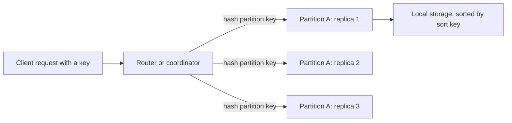

# NoSQL Families

"NoSQL" names every database that does not follow the relational model with full SQL. The families differ a lot from each other: a key-value store, a document store, a wide-column store, a graph database, and a time-series database have different data models, different storage layouts, and different limits. This page explains the data model and the internals of each family. The choice procedure ("which family do I pick for this system") has its home in [choosing a database](../hld/fundamentals/04-choosing-a-database.md), and this page does not repeat it.

## Why It Matters

Interviewers ask "How does DynamoDB store data?", "Why does Cassandra need one table per query?", "Embed or reference in MongoDB?", and "What is a tombstone?". A candidate who names a product and a family but cannot explain the partition key, the consistency options, or the limit that breaks the design gives a weak answer. On the job, the same knowledge decides whether a NoSQL system works: the partition key, the row key, or the document shape that you choose on day one limits every query that you can run later. The page gives the shared ideas first (schema on read, query-first modeling, the transaction scope), then one section for each family: the data model, how a request runs inside, the index and query model, the consistency options, the limits with numbers from the vendor documentation, and one modeling example.

!!! info "Versions and sources"
    Checked on 2026-11-05 against the vendor documentation. DynamoDB: the Developer Guide (the quotas, constraints, transactions, and GSI pages). MongoDB: the manual, which shows 9.0 as the current stable release (the release-notes page lists 8.3, 8.0, and 7.0 as previous stable releases). Cassandra: the `latest` documentation; the download page lists 5.0.9 (the latest GA series), 4.1.12, and 4.0.21, all released 2026-08-07. Bigtable: the schema design and replication pages. HBase: the reference guide and the ACID semantics page. Neo4j: the Cypher manual (it documents Cypher 25, from Neo4j 2025.06) and the store formats page. Prometheus: the storage page and the source file `tsdb/chunkenc/xor.go`. TimescaleDB (now published by Tiger Data) and InfluxDB 3 Core: the vendor documentation. The Gorilla and Spanner details come from the papers. Limits change between releases, so check the vendor page before you quote a number in a design review.

## Core Concepts

**NoSQL**: a name for databases that do not use the relational model with full SQL as their main interface. The name does not describe one design. Some NoSQL databases offer an SQL-like language (CQL in Cassandra, PartiQL in DynamoDB), and some relational databases store JSON.

**Schema on write and schema on read**: with schema on write, the database enforces a declared structure when a write arrives (a relational table). With schema on read, the database accepts a record of any shape, and the code that reads the record interprets it. A document store and DynamoDB (outside the key attributes) use schema on read. The schema does not disappear: it moves into the application code, and every reader must handle each shape that ever existed. A validation rule in the database can enforce part of the shape (MongoDB offers schema validation).

**Access pattern**: one query that the application runs, with the key, the result shape, and the rate. See [choosing a database](../hld/fundamentals/04-choosing-a-database.md) for the definition and the procedure.

**Query-first modeling**: a design method in which you list the queries first and then shape the data so that each query reads one partition or one item. A relational design starts from the entities and normalizes them. A NoSQL design starts from the queries and duplicates data on purpose. The Cassandra documentation says it directly: you start with the query model, and Cassandra works best with denormalized data.

**Partition key**: the attribute (or attributes) whose value decides which node stores a record. The database hashes the partition key value and maps the hash to a partition. All records with the same partition key value live together. See [partitioning and sharding](../hld/fundamentals/06-partitioning-and-sharding.md) for the theory of partitioning, hash against range, and hot keys.

**Sort key or clustering key**: the attribute that orders the records inside one partition. A query that gives the partition key and a range of the sort key reads one contiguous slice. DynamoDB calls it the sort key, Cassandra calls it the clustering column, and Bigtable has only one ordered row key, so the application builds the order into that key.

**Item collection**: in DynamoDB, the set of items that have the same partition key value (the table and its local secondary indexes together).

**Denormalization**: storing the same fact in more than one place so that a read needs no join. A write must then update every copy.

**Tunable consistency**: a database that lets each request choose how many replicas must respond. Cassandra and MongoDB (through read and write concerns) work this way. DynamoDB offers a smaller choice: an eventually consistent or a strongly consistent read. See [consistency and CAP](../hld/fundamentals/07-consistency-and-cap.md) for the theory.

**Transaction scope**: the largest set of records that one atomic operation can cover. In a relational database the scope is any rows. In NoSQL databases the scope is smaller: one item, one document, one partition, or a limited set of items. The scope is the main thing that a NoSQL design gives up.

**Tombstone**: a marker that records a delete in a store that does not overwrite data in place (an LSM store). Cassandra writes a tombstone for a delete and for an expired TTL.

**Compare-and-set (conditional write)**: a write that succeeds only if a stated condition on the stored value holds. It is the building block of optimistic concurrency in stores without general transactions.

### What NoSQL changes

| Topic | Relational database | Typical NoSQL database |
|---|---|---|
| Schema | Declared, enforced on write | Flexible, interpreted on read (the key attributes are fixed) |
| Query language | SQL with joins and ad hoc queries | A narrow API built around the key; no joins in most families |
| Modeling start | Entities, then normalization | Queries, then denormalization |
| Transaction scope | Any rows in one database | One item, document, or partition; a limited multi-item transaction in some products |
| Scale-out | Replicas for reads; sharding by hand for writes | Partitioning is part of the design from the first table |
| Constraints | Foreign keys, unique, check | Few: key uniqueness, conditional writes, optional validation |
| Cost of a new query | A new index or a join | A new table, a new index, or a data migration |

The cost of the right-hand column is flexibility in queries. The gain is predictable latency at a large scale, because each query reads one partition. This trade is the reason to choose a NoSQL family, and it applies only when the access patterns are known and narrow.

## How It Works

All the families in this page store records in partitions and replicate each partition. The sections below explain what differs. The diagram shows how a request finds its data in a partitioned store. Replication and failure handling have their home in [replication](../hld/fundamentals/05-replication.md).



### Key-value and DynamoDB

A key-value store maps a key to a value. DynamoDB is both a key-value and a document store: a table holds items, each item holds attributes, and the primary key identifies the item. The table has no fixed attribute set except the key attributes (DynamoDB Developer Guide, "Core components").

**Primary key.** A table has either a simple primary key (a partition key) or a composite primary key (a partition key and a sort key). DynamoDB uses the partition key value as the input to an internal hash function, and the hash decides the physical partition. All items with the same partition key value are stored together, in order of the sort key value. The partition key value is at most 2,048 bytes, and the sort key value is at most 1,024 bytes (Constraints page).

**Operations.**

- `GetItem` reads one item by its full primary key.
- `Query` reads the items of one partition key value, and it can restrict the sort key with a condition (equality, a range, `begins_with`). The result of one `Query` call is at most 1 MB, and the response carries a `LastEvaluatedKey` for the next page.
- `Scan` reads the whole table or index, 1 MB per call. A scan costs read capacity for every item that it reads, also for the items that a filter expression removes afterwards.
- `PutItem`, `UpdateItem`, and `DeleteItem` write one item. A `ConditionExpression` makes the write conditional (for example `attribute_not_exists(code)`), and the write fails if the condition is false. A conditional write is the compare-and-set that gives uniqueness and optimistic locking.
- `BatchGetItem` (at most 100 items, 16 MB) and `BatchWriteItem` (at most 25 put or delete requests, 16 MB) group requests for speed. A batch is not atomic.

A `Query` charges read capacity for the size of the items that match the key condition, before any filter. A `FilterExpression` removes items after the read, so it does not reduce the cost. The `Limit` parameter and the 1 MB page limit bound the work of one call, and the client loops on `LastEvaluatedKey`. Time to Live (TTL) deletes expired items in the background without write capacity, and DynamoDB Streams gives an ordered change log for each item that a consumer can read.

A conditional write is the tool for optimistic locking. The program sends the version that it read, and the write succeeds only if the stored version is still the same. The `ConditionExpression` below shows the pattern in the low-level API (JSON, not Java):

```json
{
  "TableName": "Orders",
  "Key": { "orderId": { "S": "o-17" } },
  "UpdateExpression": "SET #s = :new, version = version + :one",
  "ConditionExpression": "version = :seen AND #s = :old",
  "ExpressionAttributeNames": { "#s": "status" },
  "ExpressionAttributeValues": {
    ":new": { "S": "PAID" }, ":old": { "S": "CREATED" },
    ":seen": { "N": "3" }, ":one": { "N": "1" }
  }
}
```

If another writer changed the item first, DynamoDB rejects the request with `ConditionalCheckFailedException`, and the client reads again and retries. A rejected conditional write still consumes write capacity. See [Spring Data and transactions](../java/19-spring-data-and-transactions.md) for optimistic locking in Java code.

**Item size.** An item is at most 400 KB, and the limit counts attribute names and attribute values. The consequence for modeling: a record that can grow without bound (an array of all comments) does not belong in one item. Store the many side as separate items under the same partition key.

**Secondary indexes.**

| | Global secondary index (GSI) | Local secondary index (LSI) |
|---|---|---|
| Keys | A different partition key and sort key from the table | The same partition key as the table, a different sort key |
| Limit per table | 20 by default (a quota) | 5 |
| Created | At any time | When the table is created |
| Reads | Eventually consistent only | Eventually consistent or strongly consistent |
| Storage | Separate partitions, independent of the table | In the same partition as the base item |
| Size limit | None beyond the table | The item collection (table plus LSIs) of one partition key value is at most 10 GB |

DynamoDB copies the attributes that you project into the index (`KEYS_ONLY`, `INCLUDE`, or `ALL`). The Developer Guide states that a query on a GSI cannot fetch attributes from the base table, so the application must project every attribute that the query needs, or read the base table in a second call. For an LSI the query can fetch from the base table, at a higher read cost. Every write to the table also writes to each index that contains the item. A change to an indexed key attribute costs two index writes (delete the old entry, put the new one). A GSI has its own provisioned write capacity, and the guide warns that if a GSI has too little write capacity, writes to the base table are throttled, so the GSI write capacity should be at least the table's write capacity. The index key attributes must be top-level `String`, `Number`, or `Binary` attributes, and an item that lacks the index key attribute does not appear in the index. This property makes a **sparse index**: put the key attribute only on the items that the index must list (for example the open orders), and the index stays small. A GSI supports `Query` and `Scan` but not `GetItem` or `BatchGetItem`. A GSI key can also combine up to four attributes for the partition key and up to four for the sort key (multi-attribute keys), which removes the need for a concatenated string key in new designs.

**Consistency.** A read is eventually consistent by default. Set `ConsistentRead` to true for a strongly consistent read on a table or an LSI. A read from a GSI or from a stream is always eventually consistent, because DynamoDB updates a GSI asynchronously, within a fraction of a second under normal conditions and longer in rare failure cases. An eventually consistent read costs half of a strongly consistent read. A global table adds a Region-level choice (multi-Region eventual consistency by default, or multi-Region strong consistency). [Replication](../hld/fundamentals/05-replication.md) and [consistency and CAP](../hld/fundamentals/07-consistency-and-cap.md) cover both modes and the per-request choice.

**Capacity units.** One read capacity unit covers one strongly consistent read of an item up to 4 KB per second (or two eventually consistent reads). One write capacity unit covers one write of an item up to 1 KB per second. The default quota is 40,000 read and 40,000 write units per table (provisioned units or on-demand request units), and you can raise it. Both sizes round up. Example: a strongly consistent read of a 6 KB item costs 2 units (6 KB rounds up to 8 KB, two 4 KB blocks), an eventually consistent read of it costs 1 unit, and a write of a 2.5 KB item costs 3 units. A `Query` that returns 40 items of 1 KB each costs 10 units for a strongly consistent read (40 KB / 4 KB) and 5 for an eventually consistent read. The Developer Guide also states that a transactional read or write costs two units for each unit of the plain operation.

**Transactions.** `TransactWriteItems` groups up to 100 write actions (`Put`, `Update`, `Delete`, `ConditionCheck`) on distinct items, with at most 4 MB of data, in one or more tables of the same account and Region. All the actions succeed or none does. `TransactGetItems` reads up to 100 items atomically. The isolation between a transaction and a single-item read or write is serializable. The isolation between a transaction and a `Query`, `Scan`, or `BatchGetItem` is read-committed. A transaction costs two capacity units for each unit of a plain operation: one to prepare and one to commit. No two actions of one transaction may target the same item. A transaction cannot use an index. A transaction that fails still consumes the capacity of the items that it tried. Transactions are atomic only inside the Region that took the write: with a global table, another Region can show a partial transaction while the changes replicate. The same gradual propagation applies to GSIs and streams: after a transaction commits, its changes reach the GSIs and the stream one after the other, so a consumer must not assume that it sees the transaction as one unit. A client token makes `TransactWriteItems` idempotent for 10 minutes. Two transactions that touch the same item at the same time conflict, and one fails with `TransactionCanceledException`, which the SDK does not retry. The Developer Guide recommends that you keep transactions small, group attributes that change together into one item, and use `BatchWriteItem` for bulk loads.

**Single-table design.** The technique stores several entity types in one table, with generic key names (`PK` and `SK`) and key values that carry the type. For example, `PK = USER#u1` with `SK = PROFILE` for the profile, and `SK = ORDER#2026-03-02#o-3` for an order. One `Query` on `PK = USER#u1` returns the profile and the orders in one round trip, because they share a partition. The gain is fewer round trips and one table to run. The costs are a design that nobody can read without a key map, hard migrations when an access pattern changes, and a fixed set of queries. Many teams use one table for each entity instead, and they accept more round trips. Recommendation: use single-table design when you know that one request needs data of several entity types from the same partition, and not as a default. The Developer Guide takes the same position: single-table design suits entities with high access correlation and similar operational needs, and separate tables suit entities with independent access patterns or operational boundaries.

The key map is the design document of a single-table design. This one serves three patterns: the profile of a user, the latest orders of a user, and one order with its lines.

| Entity | `PK` | `SK` | Other attributes | Pattern served |
|---|---|---|---|---|
| User profile | `USER#u1` | `PROFILE` | `name`, `email` | `GetItem` for the profile |
| Order summary | `USER#u1` | `ORDER#2026-03-02T10:15#o-3` | `status`, `cents` | `Query` with `PK = USER#u1` and `begins_with(SK, "ORDER#")`, newest first |
| Order line | `ORDER#o-3` | `LINE#001` | `sku`, `qty` | `Query` with `PK = ORDER#o-3` returns the order lines |

The sort key `ORDER#<timestamp>#<id>` sorts the orders of a user by time, and the id at the end keeps the keys unique. A `Query` on `PK = USER#u1` without a sort key condition returns the profile and all orders in one call, and the application tells them apart by the `SK` prefix. A GSI whose keys are generic attributes (`GSI1PK`, `GSI1SK`) that different entity types fill with different values is an overloaded index. The cost of the design: when a new access pattern needs a new key, the application must backfill the new attribute into existing items, and a reader of the table needs the key map to understand it.

**Partition limits and hot keys.** DynamoDB spreads items over partitions by the hash of the partition key. The Developer Guide states that every partition delivers at most 3,000 read units and 1,000 write units per second, and that a partition holds at most 10 GB (the Constraints page states the 10 GB as the maximum partition size when it explains the LSI limit). The table total can be far below its quota while one partition is at its limit. A partition key with few values, or one value that gets most of the traffic (a celebrity, a date), concentrates the load on one partition, and DynamoDB throttles the requests (`ProvisionedThroughputExceededException` on a provisioned table, or throttling on an on-demand table). Adaptive capacity moves unused throughput toward busy partitions, and it does not lift the per-partition maximum. The fix is a key with high cardinality, or a suffix on the key that spreads one hot value over several partitions (write sharding). A write-sharded counter `views#2026-03-02#0` to `views#2026-03-02#9` takes ten times the write rate, and a reader queries the ten keys and adds them. See [partitioning and sharding](../hld/fundamentals/06-partitioning-and-sharding.md) for hot keys, caches, and write aggregation.

**Modeling example.** Access patterns for orders: (1) get one order by id, (2) list the latest orders of a user, (3) list the open orders of a restaurant.

| Table or index | Partition key | Sort key | Serves |
|---|---|---|---|
| `Orders` | `orderId` | none | Pattern 1 with `GetItem` |
| GSI `ByUser` | `userId` | `createdAt` | Pattern 2: `Query` with `ScanIndexForward = false` and `Limit` |
| GSI `ByRestaurantStatus` | `restaurantId#status` | `createdAt` | Pattern 3 |

The GSI `ByRestaurantStatus` has a key that changes when the status changes, so each status update deletes one index entry and writes another (two index writes). A strongly consistent read of `ByUser` is not possible, so a user who just placed an order can miss it in the list. The fix is to read the new order from the table by id in the same request flow, or to accept the delay. The key `restaurantId#status` also shows the hot-key risk: a restaurant with most of the open orders concentrates the index writes on one index partition, so the design needs a write-sharding suffix if one restaurant can exceed 1,000 writes per second.

### Document stores and MongoDB

A document store keeps self-contained records in a JSON-like form and can index and query the fields inside them. MongoDB stores documents in BSON (binary JSON), in collections.

**The document and its limits.** A BSON document is at most 16 MiB, and the nesting is at most 100 levels (MongoDB manual, "Limits and Thresholds"). A collection has at most 64 indexes, and a compound index has at most 32 fields. The limit on the document size is the reason to avoid an array that grows without bound. GridFS stores a larger file in chunks.

**Embedding against referencing.** The central design decision in a document store is which related data lives inside the document.

| | Embed (nested document or array) | Reference (store the id, read the other collection) |
|---|---|---|
| Read | One read returns the whole object | A second read, or a `$lookup` join in the aggregation pipeline |
| Write | One document is atomic | Writes to two documents need a transaction |
| Growth | The document grows and can reach 16 MiB | Each document stays small |
| Duplication | Shared data (a product name) is copied and must be updated everywhere | One copy |
| Fits | Data read together, owned by the parent, bounded in size (address, line items of an order) | Data shared by many parents, unbounded (all comments of a popular post), or read alone |

Recommendation: embed data that you read with the parent and that stays bounded. Reference data that has its own life or that grows without bound. A MongoDB write to one document is atomic, including its embedded parts, so embedding also gives you atomicity without a transaction.

**Storage and indexes.** The default storage engine is WiredTiger, which provides document-level concurrency, checkpointing, and compression (MongoDB manual, "Storage Engines"). MongoDB indexes are B-tree structures. A single-field or compound index works as in a relational database, with the leftmost-prefix rule for compound indexes (see [indexing](03-indexing.md) for the B+ tree and the prefix rule). The index types in the manual are: single field, compound, multikey (one index entry for each element of an array), wildcard (for unknown field names), geospatial (see [geospatial indexing](../hld/fundamentals/18-geospatial-indexing.md)), hashed (the basis of hashed sharding), text (see [search and indexing](../hld/fundamentals/11-search-and-indexing.md) for the inverted index idea), and clustered. Unique, partial, sparse, and TTL are index properties, not types. A compound index cannot index two fields that are both arrays in the same document, because it would store the Cartesian product of the two arrays. Each index costs write work, as in any B-tree system, so the limit of 64 indexes for each collection is a limit that you should not approach.

For a compound index, the manual recommends the **ESR rule**: put the fields for equality tests first, then the fields for sort, then the fields for range tests. Example: the query `{ userId: 7, status: "done" }` sorted by `createdAt` descending is served by the index `{ userId: 1, status: 1, createdAt: -1 }`, which reads the matching entries in sort order and needs no in-memory sort. A query that an index covers entirely (all filtered and returned fields are in the index, and the projection excludes `_id` unless it is in the index) reads no documents. `explain("executionStats")` shows the plan (`IXSCAN` against `COLLSCAN`), the keys examined, and the documents examined. A large gap between the documents returned and the keys or documents examined means that the index does not fit the query.

**How a write and a read are served.** The client driver sends a write to the primary of the replica set (or to `mongos` on a sharded cluster, which routes it to the primary of one shard). WiredTiger changes the document in its cache under document-level concurrency control, so two writes to different documents of one collection do not block each other, and it records the change in the journal and in the oplog in the same storage transaction. The secondaries pull the oplog and apply it, in order. A read goes to the primary by default. The read preference (`primary`, `primaryPreferred`, `secondary`, `secondaryPreferred`, `nearest`) lets the driver read from a secondary, which can return data that lags behind the primary. The read concern then sets what the returned data may be, as described below.

**The aggregation pipeline.** A query that goes beyond a filter uses a pipeline of stages (`$match`, `$group`, `$sort`, `$project`, `$lookup`, `$unwind`, and others). Each stage passes documents to the next. A pipeline has at most 1,000 stages. The manual states that stages that need more than 100 MB of memory spill to disk if disk use is allowed (`allowDiskUse`, with the server setting `allowDiskUseByDefault` since 6.0), and raise an error if not. MongoDB 9.0 adds a per-operation memory limit (the greater of 1 GB or 20% of the server memory by default), so read the "Limits and Thresholds" page for your version. Put `$match` and `$sort` first so that they can use an index. `$lookup` is a left outer join against another collection in the same database. It runs inside the pipeline and works best with an index on the foreign field. A design that needs many `$lookup` stages signals that the data belongs in one document or in a relational database.

```javascript
// Revenue per user for completed orders, highest first (MongoDB shell).
db.orders.aggregate([
  { $match: { status: "done" } },
  { $group: { _id: "$userId", total: { $sum: "$cents" }, n: { $sum: 1 } } },
  { $sort: { total: -1 } },
  { $limit: 10 }
])
```

**Replication and sharding.** A MongoDB deployment runs as a replica set: one primary takes the writes, and the secondaries copy the oplog (the log of operations). If the primary fails, the members elect a new primary. A sharded cluster partitions the collections over several replica sets (each shard must be a replica set) by a shard key. Three components serve a request. A `mongos` router has no persistent state, caches the cluster metadata from the config servers, and routes each operation. The config servers (a replica set) store the metadata that maps shard key ranges to shards. The shards store the data. If a query contains the shard key or a prefix of it, `mongos` sends a targeted operation to one shard or a few. If not, `mongos` runs a scatter-gather operation: it sends the query to all shards and merges the results, which costs more as the cluster grows. A `updateOne`, `replaceOne`, or `deleteOne` on a sharded collection must include the shard key or `_id`. A unique index on a sharded collection must include the full shard key as a prefix, so the shard key choice limits which uniqueness rules the database can enforce. The shard key itself is the main design decision: it needs high cardinality, an even write distribution, and a place in the common queries, and hashed sharding trades range queries for an even spread. The default chunk size is 128 MB. See [replication](../hld/fundamentals/05-replication.md) for replica sets and [partitioning and sharding](../hld/fundamentals/06-partitioning-and-sharding.md) for chunks, the balancer, and jumbo chunks.

- **Write concern** says how many members must acknowledge a write. `w: 1` returns after the primary applies the write, and the write can roll back if the primary fails before a secondary copies it. `w: "majority"` returns after a majority of data-bearing voting members have the write, and a failover does not lose it. The implicit default is `w: "majority"`, with an exception for a replica set that has an arbiter and few data-bearing members (then `w: 1`). The option `j: true` asks for the write to reach the on-disk journal. From MongoDB 8.0, a majority write returns when a majority has durably written the oplog entry, and the members apply the change after that, so a read on a secondary right after the write can miss it. A causally consistent session fixes that case.
- **Read concern** says which data a read may return. `local` (the default for reads on the primary and on secondaries, according to the manual's defaults page) returns the instance's data without a majority guarantee, so a rollback can remove it. `majority` returns only data that a majority acknowledged. `linearizable` returns data that reflects all majority-acknowledged writes that finished before the read started, only on the primary, and it is the slowest. `snapshot` returns majority-committed data from one point in time and is for transactions.

**Transactions.** MongoDB offers multi-document ACID transactions on replica sets and on sharded clusters (see [choosing a database](../hld/fundamentals/04-choosing-a-database.md) for the versions). A transaction must run for less than one minute by default (`transactionLifetimeLimitSeconds`, 60 seconds), and a transaction waits at most 5 milliseconds for a lock by default before it aborts (`maxTransactionLockRequestTimeoutMillis`). A write conflict with another transaction aborts one of them, and the application retries. A transaction that puts too much pressure on the WiredTiger cache aborts with a write conflict error, and one that cannot fit in the cache aborts with `TransactionTooLargeForCache`. Each oplog entry of a transaction must stay within the 16 MB BSON limit. Inside a transaction, the transaction-level read and write concerns apply, and the concerns of single operations are ignored. A causally consistent session with `majority` read and write concerns gives read-your-writes on secondaries. The documentation also states that a distributed transaction costs more than a single-document write and that a good data model reduces the need for it.

**Schema validation.** Schema on read does not mean that the database checks nothing. A collection can carry a validation rule (`$jsonSchema`) that rejects or warns about documents that break required fields, types, or ranges. A team adds validation after the shape stabilizes, and a field-version attribute (`schemaVersion`) lets readers handle old shapes during a migration.

**Common patterns.** The subset pattern keeps the most used part of a large related set in the parent (the latest comments). The extended reference pattern copies the few fields that a list view needs (the product name and price in an order line) next to the reference id, so the list needs no `$lookup`, at the cost of an update that must reach every copy. The bucket pattern groups many small records (sensor readings) into one document for each time window, so a collection has fewer documents and indexes.

**Modeling example.** A blog post with comments. Embed the author name and tags in the post. Do not embed all comments: a popular post can pass the 16 MiB limit and every new comment rewrites a large document. Store each comment as its own document with a `postId` and an index on `(postId, createdAt)`. Embed only the latest five comments in the post as a bounded preview (the subset pattern), and keep the full list in the `comments` collection. A new comment then runs two writes (insert the comment, push to the preview and trim it to five). If the preview must never disagree with the collection, run both writes in one transaction. If a short disagreement is acceptable, run them in sequence and repair the preview from the collection.

### Wide-column stores: Cassandra, Bigtable, and HBase

A wide-column store partitions rows by a key and sorts the rows inside a partition. The model comes from Google Bigtable (Chang et al., OSDI 2006). Cassandra combines the Bigtable data model with the Dynamo replication design (DeCandia et al., SOSP 2007).

#### Cassandra

**Data model.** A keyspace holds tables. A table has a primary key made of a partition key and zero or more clustering columns. The partition key decides the node. The clustering columns decide the order of rows inside the partition. The sort order of a query is fixed by the clustering columns that `CREATE TABLE` declares (Cassandra documentation, "Data modeling").

```cql
-- CQL (Cassandra Query Language). The runner does not execute it.
CREATE TABLE orders_by_user (
    user_id     text,
    created_at  timestamp,
    order_id    text,
    cents       int,
    PRIMARY KEY ((user_id), created_at, order_id)
) WITH CLUSTERING ORDER BY (created_at DESC, order_id ASC);
```

The `PRIMARY KEY ((user_id), created_at, order_id)` declares `user_id` as the partition key and `created_at`, `order_id` as clustering columns. The query `SELECT * FROM orders_by_user WHERE user_id = 'u1' LIMIT 20` reads the 20 newest rows of one partition. A composite partition key has its own inner parentheses: `PRIMARY KEY ((user_id, month), created_at)` hashes both columns together, so one partition holds one user and one month.

**How a request is served.** Any node can act as the coordinator for a request. The coordinator hashes the partition key to a token with the partitioner (`Murmur3Partitioner` is the default, and the documentation states that the partitioner cannot change without reloading all the data). The token falls on the hash ring, and the replication strategy (`NetworkTopologyStrategy` in production) picks the RF nodes that own that token. The coordinator sends a write to all replicas and waits for as many acknowledgments as the consistency level requires. For a read it asks enough replicas to satisfy the level and returns the newest version by cell time stamp. See [partitioning and sharding](../hld/fundamentals/06-partitioning-and-sharding.md) for the ring, the vnodes (`num_tokens` is 16 in the current `cassandra.yaml` reference), and the routing, and [replication](../hld/fundamentals/05-replication.md) for the replica set and the repair mechanisms.

**Query rules.** The CQL documentation restricts what a `WHERE` clause can do, because each rule keeps a query inside one partition. The partition key columns take equality only (or `IN`). The clustering columns restrict in order: you can restrict the first clustering column by a range only if you give equality on the columns before it. A query that does not meet these rules is rejected unless it adds `ALLOW FILTERING`, which runs a scan that the documentation describes as a full scan. A secondary index in the classic form (and the Storage-Attached Index, SAI, that Cassandra 5.0 adds) lets you filter on another column, and each index query fans out to many nodes, so an index does not replace a table that is designed for the query. Cassandra has no `JOIN` and no `GROUP BY` across partitions.

**Query-first design.** The Cassandra documentation states that you cannot perform joins, that denormalization is normal, that Cassandra has no referential integrity across tables, and that a query that searches one partition gives the best performance. The practical rule: one table for each query. If you need the orders of a user and the orders of a restaurant, you write two tables, `orders_by_user` and `orders_by_restaurant`, and the application writes to both. A logged batch keeps the writes atomic (all or none eventually complete). The documentation states that operations are isolated only inside a single partition, so a reader can see one table updated before the other, and that atomicity across partitions has a performance penalty. A batch is not a bulk-load tool: `batch_size_warn_threshold` defaults to 5 KiB and `batch_size_fail_threshold` to 50 KiB for a batch that spans several partitions, and an unlogged batch that spans more than 10 partitions logs a warning (`cassandra.yaml` reference).

**Write path and storage.** Cassandra stores data with a log-structured merge tree (LSM tree): a write goes to the commit log and to an in-memory memtable, and the node flushes the memtable to an immutable sorted file (SSTable). A read merges the memtable and the SSTables. Compaction merges SSTables in the background. The LSM design and its write, read, and space amplification have their home in [storage engines](06-storage-engines.md), and this page uses the result: a write is an append, so Cassandra writes fast, and a read can touch several files. The commit log syncs to disk periodically by default (`commitlog_sync: periodic`, so a node acknowledges a write before the sync), and the replicas, not the single log, give the durability. The read path checks the memtable, then the SSTables that can hold the partition (the Bloom filter skips most of the others), and merges the results by time stamp, so a partition that spreads over many SSTables costs more reads. See the read path in [storage engines](06-storage-engines.md).

**Compaction strategies.** The compaction strategy is a table option. Size-tiered compaction (STCS) is the default, and the 5.0 documentation calls it the fallback that fits workloads that are not strictly time-series. Leveled compaction (LCS) suits read-heavy workloads and workloads with many updates and deletes. Time-window compaction (TWCS) suits TTL'd, mostly immutable time-series data. Unified compaction (UCS) is the strategy that the 5.0 documentation recommends for new workloads.

**Replication and tunable consistency.** The replication factor (RF) says how many nodes hold each partition. The coordinator node of a request sends it to the replicas, and the consistency level says how many must answer.

The levels are `ANY` (writes only), `ONE`, `TWO`, `THREE`, `LOCAL_ONE`, `QUORUM`, `LOCAL_QUORUM`, `EACH_QUORUM`, and `ALL`. `QUORUM` means a majority of all replicas, `RF / 2 + 1` with integer division, and `LOCAL_QUORUM` means a majority inside the coordinator's data center. [Consistency and CAP](../hld/fundamentals/07-consistency-and-cap.md) has the full table of levels.

If the write level W and the read level R satisfy `W + R > RF`, the sets of replicas overlap (Cassandra documentation, "Dynamo"). With RF = 3, `QUORUM` writes (2) and `QUORUM` reads (2) overlap. `ONE` and `ONE` do not. The overlap rule gives a high probability of fresh reads and not linearizability: concurrent writes resolve by time stamp, and the other caveats of [replication](../hld/fundamentals/05-replication.md) (quorums section) apply. Cassandra keeps replicas converging with hinted handoff, read repair, and anti-entropy repair. The documentation calls the first two best effort and states that only repair guarantees convergence, so a cluster needs scheduled repair. `LOCAL_QUORUM` is a common choice in a multi-data-center cluster, because a request then does not wait for a remote data center.

**Lightweight transactions.** `INSERT ... IF NOT EXISTS` and `UPDATE ... IF` are compare-and-set operations on one partition. They use the Paxos consensus protocol, and the documentation warns that `IF NOT EXISTS` has a non-negligible performance cost. They give uniqueness and simple optimistic concurrency, and they are not general transactions. See [consensus and leader election](../hld/distributed-systems/02-consensus-and-leader-election.md).

**Tombstones and their read cost.** Cassandra does not overwrite or remove data in place, because SSTables are immutable. A delete writes a tombstone: a marker with a time stamp. The delete can cover a cell (one column value), a row, a range of clustering values, or a whole partition, and an expired TTL also becomes a tombstone. A read must merge the tombstones with the data they cover, so a partition with many tombstones makes reads slow, and a range scan over deleted rows reads all the tombstones before it finds live rows. Two settings in `cassandra.yaml` guard reads: `tombstone_warn_threshold` (default 1,000) logs a warning, and `tombstone_failure_threshold` (default 100,000) aborts the read. Both apply to the tombstones that one scan keeps in memory, within or across a partition (`cassandra.yaml` reference, "Safety thresholds"). Cassandra drops a tombstone in compaction only after `gc_grace_seconds` (default 864,000 seconds, ten days). The grace period gives a replica that was down time to receive the delete by repair. If a replica stays down longer than the grace period and the others drop the tombstone, the replica can bring the deleted data back (a "zombie"). Design rules that follow: do not use a table as a queue (each consumed item becomes a tombstone), give time-series data a TTL together with TWCS so that whole SSTables expire, and bound the size of a partition. The third Java program below shows the read cost of a queue-like table.

**Partition size.** The Cassandra documentation states a hard limit of 2 billion cells per partition and adds that performance problems start much earlier. The older 3.11 data modeling documentation gives a guideline of fewer than 100,000 values and less than 100 MB of disk space for each partition. Treat these as guidance and not as enforced limits. The guardrails `partition_size_warn_threshold` and `partition_size_fail_threshold` (disabled by default) report partitions above a size that you set. Cassandra checks them only when it writes an SSTable (flush or compaction), per SSTable, and the fail threshold only logs an error and does not stop the operation (`cassandra.yaml` reference). They are monitoring aids and not limits. The documented way to split a large partition is to add a column to the partition key, which is what bucketing does.

**Modeling example.** Chat messages. The query is "the latest 50 messages of a conversation". The table `messages_by_conversation` has the partition key `(conversation_id, bucket)` and the clustering columns `(sent_at DESC, message_id)`. The `bucket` is the month or the day of the message. The bucket keeps one partition from growing without bound for a conversation that lasts for years, at the cost that a read that crosses a bucket boundary reads two partitions. Choose the bucket from the measured volume: if a busy conversation writes 50,000 messages of 200 bytes a day, that is about 10 MB per day and 300 MB per month, which is above the 100 MB guideline, so a day bucket fits and a month bucket does not.

#### Bigtable and HBase

Bigtable maps a row key, a column, and a timestamp to a value. A table is sorted by row key, and the table splits into ranges of rows that servers hold (tablets in Bigtable, regions in HBase). Columns belong to column families, and the garbage collection policy (how many versions or how long to keep a cell) is set for each column family. The Bigtable guide recommends at most about 100 column families for each table, and the HBase reference guide recommends one to three, because HBase flushes and compacts per region and many families cause needless I/O. Bigtable sorts rows lexicographically by key as byte strings, and HBase treats row keys as uninterpreted bytes in the same order. Every operation on one row is atomic, and there is no multi-row transaction, so data that must change together belongs in one row.

**Query and index model.** The row key is the only index. A read is a single-row get, a scan of a key range or prefix, or a scan with a filter that still reads the range. The Bigtable guide recommends a continuous materialized view when you need a secondary index. A design lists the queries and builds the row key for the main one.

**How a request is served.** In Bigtable, a client library finds the tablet for a key, and the node that serves the tablet reads its memtable and its immutable SSTable files on a distributed file system (the Google File System in Chang et al., OSDI 2006) and merges the cells. Google manages the splits, the moves, and the compactions. In HBase, a region server holds a region (a key range). A write goes to the write-ahead log and the in-memory store, and HBase flushes the store to HFiles. A region splits when its files grow past `hbase.hregion.max.filesize` (10 GiB by default in the reference guide), and automatic splitting is the recommended setting for most uses. Both systems are LSM designs (see [storage engines](06-storage-engines.md)).

**Consistency.** Bigtable gives strong consistency and read-your-writes when an application profile uses single-cluster routing. With multi-cluster routing in a replicated instance, replication between clusters is eventually consistent (the replication delay is typically a few seconds or minutes), and Bigtable resolves two writes to the same cell by last write wins on server-side time. After a failover to another cluster, the instance reverts to eventual consistency (Bigtable replication overview). HBase mutations are atomic within a row ("All mutations are atomic within a row", HBase ACID semantics page). The same page states that an API that mutates several rows is not atomic across the rows, and that a scan is not a consistent view of the table (no snapshot isolation).

Row key rules from the Bigtable guide:

- A row key is at most 4 KB. Keep it short.
- A cell holds at most 10 MB (the guide advises that you store no more), the guide recommends that all values of a row stay under 100 MB, and a row must not exceed 256 MB. A column qualifier is at most 16 KB.
- A timestamp or a sequential id at the start of the key concentrates the writes on one server (hotspotting). Put a high-cardinality value, such as a user id or a device id, in front of the timestamp.
- To read the newest rows first, store a reversed timestamp (`Long.MAX_VALUE - timestamp`), and do not put it at the start of the key.
- Write a new row for each reading, for example `deviceId#metric#timestamp`, and do not update one row again and again.
- Related rows share a key prefix, so a scan of a prefix reads a contiguous range.

Example: `user#4711#9223370...` (the reversed timestamp) puts the newest event of user 4711 first in the scan of the prefix `user#4711#`. For HBase, the reference guide describes **salting** as a fix for hotspots: the writer adds a random prefix (one of N salts) to the row key so that the writes spread over N regions. The cost is that a reader must scan all N prefixes and merge the results, because the salt breaks the natural order. The design level comparison of the products is in [choosing a database](../hld/fundamentals/04-choosing-a-database.md).

!!! example "Bigtable row key for device metrics"
    Query: the readings of one device and one metric for the last hour. Row key: `deviceId#metric#reversedTimestamp`. A scan of the prefix `d-42#cpu#` starts at the newest reading, and `Limit` stops the scan. One row for each reading keeps the rows small and the writes spread over the devices. If a device writes 1,000 readings per second and all go to one row key prefix, that device is a hotspot, and a bucket (for example the hour) in the key bounds the range.

### Graph databases

A property graph has nodes and relationships. A node represents an entity, and a label classifies it (a node has zero or more labels). A relationship connects a source node to a target node, has one direction and exactly one type, and both nodes and relationships hold properties (key-value pairs) (Neo4j documentation, "Graph database concepts"). Neo4j runs ACID transactions on a graph, and it supports property indexes (and unique constraints) on node and relationship properties, which find the start nodes of a traversal. A traversal then follows relationships and does not use an index for each hop.

**Query language.** Cypher is Neo4j's declarative query language. A query draws a pattern and the database finds the matches. The Neo4j manual documents Cypher 25 as the current language version.

```cypher
// People that ana follows directly or through one other person, but not ana herself.
MATCH path = (a:Person {name: 'ana'})-[:FOLLOWS*1..2]->(p:Person)
WHERE p <> a
RETURN p.name AS person, min(length(path)) AS depth
ORDER BY depth, person;
```

**Storage and traversal.** A graph database stores relationships as first-class records. The term **index-free adjacency** (the book *Graph Databases* by Robinson, Webber, and Eifrem uses it, and Neo4j's training material uses it for native graph storage) means that each node record holds direct references to its relationships, so a traversal follows pointers from one node to its neighbors, and the cost of a hop depends on the number of neighbors, not on the size of the whole graph. A relational join looks up the neighbors through an index, and the cost of each hop grows with the index depth. The Neo4j store-format documentation (Neo4j operations manual, "Store formats") describes the formats `standard` and `aligned` as storing graph data in "linked list-like structures". The `block` format, the default for new databases, gives each node a static 128-byte block with a record for labels and properties and a record for relationships. A node whose relationships overflow the block moves them into a tree sorted by relationship type and direction. `aligned` is the default format of the Community Edition, and `standard` is deprecated from Neo4j 5.23. A node with a very large number of relationships (a supernode, such as a celebrity account) makes each traversal through it expensive, so a graph design avoids hubs or filters by relationship type first.

**Modeling example.** Access control for documents. Nodes: `(:User)`, `(:Group)`, and `(:Folder)`. Relationships: `(:User)-[:MEMBER_OF]->(:Group)`, `(:Group)-[:CAN_READ]->(:Folder)`, and `(:Folder)-[:CONTAINS]->(:Folder)`. The relationship type carries the verb, and a property such as `since` carries a fact about the relationship. A query "can ana read folder f9" follows a path of variable depth through groups and folders:

```cypher
// Does ana have a path to f9 through her groups and the folder tree?
MATCH (u:User {name: 'ana'})-[:MEMBER_OF*0..3]->(:Group)
      -[:CAN_READ]->(:Folder)-[:CONTAINS*0..]->(f:Folder {id: 'f9'})
RETURN count(*) > 0 AS allowed;
```

The property indexes find `ana` and `f9`, and the traversal follows relationships from there. In SQL, the same question needs one recursive CTE for the group chain and one for the folder tree, or a precomputed closure table. The rule of the section below applies: if the depth is small and fixed, SQL is enough, and if the hierarchy is deep and the checks are frequent, the graph query is shorter and states the path directly.

**When a recursive CTE is enough.** A relational database answers a shallow traversal with a recursive common table expression (CTE; the syntax is in [relational model and SQL](01-relational-model-and-sql.md)). The query below finds the people that `ana` reaches in at most two hops, with the shortest depth.

```sql
DROP TABLE IF EXISTS follows;
CREATE TABLE follows (src TEXT NOT NULL, dst TEXT NOT NULL, PRIMARY KEY (src, dst));
INSERT INTO follows VALUES
  ('ana', 'bob'), ('ana', 'cy'), ('bob', 'dee'), ('cy', 'dee'),
  ('cy', 'eli'), ('dee', 'fay'), ('eli', 'ana');
```

```sql
WITH RECURSIVE reach(person, depth) AS (
    SELECT dst, 1 FROM follows WHERE src = 'ana'
    UNION
    SELECT f.dst, r.depth + 1
    FROM reach r JOIN follows f ON f.src = r.person
    WHERE r.depth < 2
)
SELECT person, MIN(depth) AS depth
FROM reach
WHERE person <> 'ana'
GROUP BY person
ORDER BY depth, person;
```

<!-- sql-result -->

```text
person | depth
bob | 1
cy | 1
dee | 2
eli | 2
```

The primary key `(src, dst)` gives the join an index on `src`. This query is fine for depth 2 and 3 on a table that the database serves from memory. Recommendation: stay with the recursive CTE while the depth is small and fixed, the graph is a small part of the system, and the team runs a relational database already. Move to a graph database when the core feature is traversal of variable depth (recommendations, fraud rings, access-control hierarchies), the queries are frequent, and the relational form needs many self-joins. Graph partitioning across machines is hard, and few products do it well (see [choosing a database](../hld/fundamentals/04-choosing-a-database.md)).

### Time-series databases

**The workload.** A time-series database stores points of (series identifier, time stamp, value). The pattern: writes append in time order, reads scan a time range and aggregate, nothing updates a point after it is written, and old data expires or loses resolution. A **series** is one stream identified by a metric name and a set of labels (for example `cpu_usage{host="a1", core="3"}`). **Cardinality** is the number of distinct series, and it limits the system before the number of points does, because each series needs an index entry and an in-memory structure. A label with unbounded values (a user id, a request id) creates unbounded cardinality.

**Retention and downsampling.** Retention drops data older than a limit. Prometheus keeps 15 days by default (`--storage.tsdb.retention.time`). Downsampling replaces old raw points with aggregates (the average, minimum, and maximum of each hour), so that long-range charts stay cheap and the storage stays bounded. A system that keeps raw points for days and hourly aggregates for years is typical. Time-based layout makes retention cheap: a store that partitions data by time window drops a whole window as one file or chunk, and it does not delete point by point, so it creates no tombstones (compare Cassandra with TWCS, which expires whole SSTables for the same reason).

**Cardinality arithmetic.** The number of series is the product of the label values that occur together. 500 hosts with 8 cores and 20 metrics give 500 × 8 × 20 = 80,000 series. Adding a label `request_id` with one million values for each series creates up to 80 billion series, and the index and the head block then exhaust the memory long before the number of points matters.

**Compression: the Gorilla scheme.** The Gorilla paper (Pelkonen et al., VLDB 2015) describes the in-memory time-series database of Facebook. It compresses the time stamps and the values of one series separately, in blocks of two hours.

- **Time stamps use delta-of-delta encoding.** Most points arrive at a fixed interval, so the paper stores the difference between consecutive deltas. If the deltas are 60, 60, 59, and 61, the deltas of deltas are 0, -1, and 2. The block header holds the block's start time (aligned to the two-hour window), and the first time stamp is a 14-bit delta from it. The paper encodes a delta of delta D with a variable length: D = 0 takes one bit (`0`), D in [-63, 64] takes `10` plus 7 bits, D in [-255, 256] takes `110` plus 9 bits, D in [-2047, 2048] takes `1110` plus 12 bits, and any other value takes `1111` plus 32 bits. The paper reports that about 96% of the time stamps in its data compress to a single bit.
- **Values use XOR encoding.** Consecutive values of a series are often close, so the sign, the exponent, and the first mantissa bits of consecutive doubles match. The scheme XORs a value with the previous value and writes one of three codes. The code `0` means that the XOR is zero (the value did not change). The code `10` means that the meaningful bits fit inside the window of the previous non-zero XOR (at least as many leading and trailing zeros), so the scheme writes only the meaningful bits at the old position. The code `11` means a new window: 5 bits for the number of leading zeros, 6 bits for the length of the meaningful bits, then the meaningful bits. The paper reports that about 51% of the values compress to a single bit, about 30% use the code `10` with an average of 26.6 bits, and about 19% use the code `11` with an average of 36.9 bits.
- **The result.** The paper reports an average of 1.37 bytes per data point with two-hour blocks, a 12 times reduction from the 16 bytes of a raw (time stamp, value) pair. It also states that blocks longer than two hours give diminishing returns, and that Gorilla keeps the most recent 26 hours in memory.

The second Java example below counts the bits that this scheme uses for a short series.

**Products.**

- **Prometheus TSDB.** Prometheus keeps ingested samples in two-hour blocks. Each block has a chunks directory, a metadata file, and an index. The head block (the current block) is held in memory and protected by a write-ahead log (128 MB segments, compressed by default since 2.20.0), which Prometheus replays after a crash. Background compaction merges the two-hour blocks into larger blocks of up to 10% of the retention time or 31 days, whichever is smaller. The documentation states an average of 1 to 2 bytes per sample and a disk estimate of retention seconds times samples per second times bytes per sample. The local storage is not clustered or replicated, and Prometheus offers remote write and remote read to send data to another system. The chunk encoder in `tsdb/chunkenc/xor.go` descends from Damian Gryski's `go-tsz`, a Go implementation of the Gorilla scheme.
- **TimescaleDB.** A hypertable is a PostgreSQL table that partitions time-series data by time into chunks (the default chunk interval is 7 days in the Tiger Data reference), and a query on a time range touches only the chunks that overlap it. You use SQL, and joins with ordinary tables work. A retention policy drops whole chunks, which is a metadata operation and not a row-by-row delete, and a columnstore policy compresses older chunks (by default after one chunk interval). Because it is PostgreSQL, a transaction can write a time-series row and a relational row together.
- **InfluxDB.** InfluxDB 3 Core always stores data in the Parquet format (InfluxDB documentation, "Storage engine"). A write first goes to an in-memory write buffer, the server flushes the buffer to a write-ahead log in object storage every second by default, the data is queryable from memory after that, and every ten minutes by default the server persists the oldest data as Parquet files to object storage and keeps the newest five minutes in memory (InfluxDB documentation, "Data durability").

The three differ in operation: Prometheus is a monitoring system with a local store, TimescaleDB adds time-series features to PostgreSQL, and InfluxDB is a standalone time-series database. For the analytical stores ClickHouse and Druid, see [OLTP, OLAP, and warehousing](10-oltp-olap-and-warehousing.md).

**Modeling example.** CPU metrics. Series key: `(host, core)`. A row key for Bigtable or a clustering order for Cassandra is `(host, metric, day)` for the partition and `time` for the clustering column. The query "CPU of host a1 for the last hour" reads one partition, and the day bucket bounds the partition size.

### Search engines

A search engine builds an inverted index from terms to documents and ranks the results by relevance. It serves free-text queries, filters with facets, and autocomplete. The inverted index, the analysis chain, and the Elasticsearch architecture have their home in [search and indexing](../hld/fundamentals/11-search-and-indexing.md). Use the search engine as a derived store: the source of truth stays in another database, and a log feeds the index.

### NewSQL and distributed SQL

A NewSQL database keeps the relational model and SQL and adds partitioning and replication inside the database. Google Spanner (Corbett et al., OSDI 2012) is the reference design. CockroachDB is an open-source database in the same class. They give multi-row transactions across partitions at a cost: a transaction that spans partitions or regions runs a distributed commit and waits for replicas, so its latency is higher than a single-node commit.

In Spanner, each tablet has a Paxos state machine for replication with a long-lived leader, read-write transactions use two-phase locking, and a transaction that spans several Paxos groups runs two-phase commit over Paxos. Spanner assigns commit time stamps with the TrueTime API, which returns a time interval with a bounded uncertainty (about 4 ms on average, from 1 to 7 ms in the paper). A coordinator waits out the uncertainty before it makes the commit visible (commit wait). This wait gives external consistency: if transaction T1 commits before T2 starts, T1's time stamp is smaller than T2's. Read-only transactions run without locks at a snapshot time stamp. CockroachDB replicates each range with the Raft protocol (three replicas by default), speaks the PostgreSQL wire protocol, and offers `SERIALIZABLE` and `READ COMMITTED` isolation (CockroachDB architecture overview). See [choosing a database](../hld/fundamentals/04-choosing-a-database.md) for when distributed SQL beats sharding, and [distributed transactions](../hld/distributed-systems/03-distributed-transactions.md) for the commit protocols.

## Trade-offs and When to Use

The table summarizes what each family offers. It does not replace the decision procedure: use [choosing a database](../hld/fundamentals/04-choosing-a-database.md) to pick a family for a system. See [replication](../hld/fundamentals/05-replication.md), [partitioning and sharding](../hld/fundamentals/06-partitioning-and-sharding.md), and [consistency and CAP](../hld/fundamentals/07-consistency-and-cap.md) for the distributed theory behind the consistency column.

| Family | Product | Transaction scope | Consistency options | Index and query model | Hard limit to remember | Fits when |
|---|---|---|---|---|---|---|
| Key-value | DynamoDB | One item; up to 100 items with `TransactWriteItems` | Eventual or strong read; GSI eventual only | Primary key, GSI, LSI; no joins | 400 KB per item | Known key lookups at any scale, managed operation |
| Document | MongoDB | One document; multi-document transactions on replica sets and sharded clusters | Write concern and read concern for each operation | Secondary B-tree indexes, aggregation pipeline, `$lookup` | 16 MiB per document | Whole nested objects, varied fields |
| Wide-column | Cassandra | One partition for lightweight transactions; logged batch | `ONE` to `ALL`, `QUORUM`, `LOCAL_QUORUM` for each request | Primary key; one table for each query; limited secondary indexes | Tombstones and partition growth | Heavy writes, partition-local reads, multi-data-center |
| Wide-column | Bigtable, HBase | One row | Bigtable: strong with single-cluster routing, eventual across clusters. HBase: atomic within a row | Row key only | 4 KB row key, 10 MB cell | Huge sorted key ranges, time series by key prefix |
| Graph | Neo4j | ACID transaction on the graph | Depends on the deployment | Pattern matching with Cypher; property indexes for the start nodes | Partitioning a large graph; supernodes | Multi-hop traversal of variable depth |
| Time-series | Prometheus, TimescaleDB, InfluxDB | Per point, or per SQL transaction (TimescaleDB) | Product specific; Prometheus local storage is a single node | Time range plus labels | Series cardinality | Append-only points, range scans, retention |
| Search | Elasticsearch, OpenSearch | None across documents | Near real time for search | Inverted index | Index refresh delay | Free text, relevance (as a derived store) |
| Distributed SQL | Spanner, CockroachDB | Multi-row, across partitions | Strong | SQL | Cross-region commit latency | SQL and transactions beyond one node |

### Decisions inside a family

| Decision | Option A | Option B | Choose A when | Choose B when |
|---|---|---|---|---|
| DynamoDB: GSI or LSI | GSI | LSI | The alternate key needs another partition key, or you add it later | You need a strongly consistent read on the alternate order, and the item collection stays under 10 GB |
| DynamoDB: one table or many | Single-table design | One table per entity | One request reads several entity types of the same key | Access patterns change often, and readability matters more than round trips |
| MongoDB: embed or reference | Embed | Reference | The data is read together and bounded | The data is shared, unbounded, or read alone |
| Cassandra: consistency level | `LOCAL_QUORUM` for reads and writes | `ONE` | A read must see the latest write in the data center | Stale data is acceptable and latency matters most |
| Cassandra: compaction | Leveled or unified | Size-tiered or time-window | The load is read-heavy or has many updates | The load is write-heavy, or time-series with TTL |
| Time-series: raw or downsampled | Keep raw points | Keep aggregates | Debugging needs exact points | Long-range charts need cheap queries |

## Java Example

The first program stores one data set (the orders of three users) in three layouts: as documents (one document per user, with the orders embedded), as a wide-column partition (the partition key is the user, the clustering key is the day and the order id, held in a `TreeMap`), and as key-value items (the key is the order id, the value is opaque). Each layout answers three queries, and the program counts the reads. The count shows the lesson of the page: the layout decides which query is cheap. The program is a model of the data layouts, not of the storage engine of a product.

```java
import java.util.ArrayList;
import java.util.HashMap;
import java.util.List;
import java.util.Map;
import java.util.TreeMap;

public class Layouts {
    record Order(String user, String orderId, String day, int cents) { }

    static final List<Order> DATA = List.of(
        new Order("u1", "o-1", "2026-01-05", 1200),
        new Order("u1", "o-2", "2026-02-11", 800),
        new Order("u1", "o-3", "2026-03-02", 4500),
        new Order("u2", "o-4", "2026-02-11", 300),
        new Order("u2", "o-5", "2026-03-09", 9900),
        new Order("u3", "o-6", "2026-03-02", 150));

    public static void main(String[] args) {
        // Layout 1: document. One document per user. The orders are embedded.
        Map<String, List<Order>> documents = new TreeMap<>();
        for (Order o : DATA) {
            documents.computeIfAbsent(o.user(), k -> new ArrayList<>()).add(o);
        }
        // Layout 2: wide-column. Partition key = user. Clustering key = day + order id.
        Map<String, TreeMap<String, Order>> partitions = new TreeMap<>();
        for (Order o : DATA) {
            partitions.computeIfAbsent(o.user(), k -> new TreeMap<>())
                .put(o.day() + "#" + o.orderId(), o);
        }
        // Layout 3: key-value. The key is the order id. The value is opaque to the store.
        Map<String, String> items = new HashMap<>();
        for (Order o : DATA) {
            items.put(o.orderId(), o.user() + "|" + o.day() + "|" + o.cents());
        }

        System.out.println("Query A: profile and all orders of u1");
        System.out.println("  document:    reads=1 (one document, " + documents.get("u1").size()
            + " embedded orders)");
        System.out.println("  wide-column: reads=1 partition, rows=" + partitions.get("u1").size());
        int scanned = 0;
        int found = 0;
        for (String value : items.values()) {
            scanned++;
            if (value.startsWith("u1|")) {
                found++;
            }
        }
        System.out.println("  key-value:   reads=" + scanned + " values scanned, found=" + found
            + " (no index on the user)");

        System.out.println("Query B: the latest 2 orders of u2");
        TreeMap<String, Order> p = partitions.get("u2");
        int rows = 0;
        StringBuilder sb = new StringBuilder();
        for (Order o : p.descendingMap().values()) {
            if (rows == 2) {
                break;
            }
            rows++;
            sb.append(o.orderId()).append(' ');
        }
        System.out.println("  wide-column: reads=1 partition, rows read=" + rows + ", result="
            + sb.toString().trim());
        System.out.println("  document:    reads=1 document, then the application sorts "
            + documents.get("u2").size() + " orders");

        System.out.println("Query C: order o-6 by id");
        System.out.println("  key-value:   reads=1, value=" + items.get("o-6"));
        int docsRead = 0;
        for (List<Order> orders : documents.values()) {
            docsRead++;
            boolean hit = false;
            for (Order o : orders) {
                hit |= o.orderId().equals("o-6");
            }
            if (hit) {
                break;
            }
        }
        System.out.println("  document:    reads=" + docsRead
            + " documents (no index on orderId)");
    }
}
```

<!-- expected-output -->

```text
Query A: profile and all orders of u1
  document:    reads=1 (one document, 3 embedded orders)
  wide-column: reads=1 partition, rows=3
  key-value:   reads=6 values scanned, found=3 (no index on the user)
Query B: the latest 2 orders of u2
  wide-column: reads=1 partition, rows read=2, result=o-5 o-4
  document:    reads=1 document, then the application sorts 2 orders
Query C: order o-6 by id
  key-value:   reads=1, value=u3|2026-03-02|150
  document:    reads=3 documents (no index on orderId)
```

The second program counts the bits of the Gorilla scheme for eight points of one series. The time stamps arrive every 60 seconds, with one point 1 second late and one point missing. The values stay at 12.0, then change to 24.0 and 15.0. The program implements only the size of each code (the buckets of the paper), not a full bit writer. For the XOR scheme, it caps the stored count of leading zeros at 31, because the paper stores that count in 5 bits. The `ValueEncoder` keeps the window of the previous non-zero XOR, as the control bit `0` of the paper requires. The step from 12.0 to 24.0 gives 11 leading zeros and one meaningful bit, the example in Figure 2 of the paper. A real encoder also stores a meaningful length of 64 bits as 0, because the length field has 6 bits, and the sketch does not need that case.

```java
public class Gorilla {
    // Bits that the Gorilla time stamp scheme uses for one delta of delta (Pelkonen et al., 2015).
    static int timestampBits(long d) {
        if (d == 0) {
            return 1;
        }
        if (d >= -63 && d <= 64) {
            return 2 + 7;
        }
        if (d >= -255 && d <= 256) {
            return 3 + 9;
        }
        if (d >= -2047 && d <= 2048) {
            return 4 + 12;
        }
        return 4 + 32;
    }

    // Size of the Gorilla XOR code for each value. The encoder remembers the window of leading
    // and trailing zeros of the previous non-zero XOR.
    static class ValueEncoder {
        private int leading = -1;
        private int trailing = -1;

        int bits(double prev, double cur) {
            long x = Double.doubleToRawLongBits(prev) ^ Double.doubleToRawLongBits(cur);
            if (x == 0) {
                return 1; // code '0'
            }
            // The leading-zero count has 5 bits, so the scheme stores at most 31.
            int lead = Math.min(Long.numberOfLeadingZeros(x), 31);
            int trail = Long.numberOfTrailingZeros(x);
            if (leading >= 0 && lead >= leading && trail >= trailing) {
                return 2 + (64 - leading - trailing); // code '10' and the old window
            }
            leading = lead;
            trailing = trail;
            return 2 + 5 + 6 + (64 - lead - trail); // code '11', 5 + 6 bits, new window
        }
    }

    public static void main(String[] args) {
        long[] t = {0, 60, 120, 181, 240, 300, 420, 480};
        double[] v = {12.0, 12.0, 12.0, 24.0, 15.0, 15.0, 15.0, 15.0};
        ValueEncoder encoder = new ValueEncoder();
        long prevDelta = t[1] - t[0];
        int tsBits = 0;
        int valBits = 0;
        System.out.println("point  delta-of-delta  ts-bits  value-bits");
        for (int i = 2; i < t.length; i++) {
            long delta = t[i] - t[i - 1];
            long d = delta - prevDelta;
            prevDelta = delta;
            int tb = timestampBits(d);
            int vb = encoder.bits(v[i - 1], v[i]);
            tsBits += tb;
            valBits += vb;
            System.out.printf("%5d  %14d  %7d  %10d%n", i, d, tb, vb);
        }
        int points = t.length - 2;
        System.out.println("raw bits for these points: " + (points * 128));
        System.out.println("encoded bits: " + (tsBits + valBits) + " (timestamps " + tsBits
            + ", values " + valBits + ")");
    }
}
```

<!-- expected-output -->

```text
point  delta-of-delta  ts-bits  value-bits
    2               0        1           1
    3               1        9          14
    4              -2        9          17
    5               1        9           1
    6              60        9           1
    7             -60        9           1
raw bits for these points: 768
encoded bits: 81 (timestamps 46, values 35)
```

The six points that the program counts take 81 bits instead of 768 bits (six pairs of two 64-bit values). The sample is too small to match the 1.37 bytes of the paper, and the point of the sample is the mechanism: a regular interval costs one bit per time stamp, and a repeated value costs one bit.

The third program shows the read cost of a queue-like Cassandra table. A consumer deletes the first messages of a partition, and each read asks for the first 10 live rows. The read must pass every tombstone that sits before the live rows, so its cost grows with the number of consumed messages and not with the number of rows that it returns. The program applies the default thresholds of `cassandra.yaml` (warn above 1,000 tombstones, abort above 100,000). It is a model of the read cost, not of the storage engine.

```java
import java.util.ArrayList;
import java.util.List;

public class Tombstones {
    // One cell of a partition in clustering order. A tombstone marks a deleted row.
    record Cell(int clustering, boolean tombstone) { }

    static final int WARN = 1_000;
    static final int FAIL = 100_000;

    // Reads the first `limit` live rows of a partition. The read must pass every tombstone
    // that sits before the live rows, as a Cassandra scan does.
    static String read(List<Cell> partition, int limit) {
        int live = 0;
        int tombstones = 0;
        int cells = 0;
        for (Cell c : partition) {
            cells++;
            if (c.tombstone()) {
                tombstones++;
                if (tombstones > FAIL) {
                    return "cells=" + cells + " tombstones=" + tombstones
                        + " -> ABORT (failure threshold " + FAIL + ")";
                }
            } else if (++live == limit) {
                break;
            }
        }
        String note = tombstones > WARN ? " -> WARN (warn threshold " + WARN + ")" : "";
        return "cells=" + cells + " tombstones=" + tombstones + " live=" + live + note;
    }

    // A queue-like partition: the consumer deleted the first `consumed` messages.
    static List<Cell> queue(int consumed, int pending) {
        List<Cell> cells = new ArrayList<>();
        for (int i = 0; i < consumed; i++) {
            cells.add(new Cell(i, true));
        }
        for (int i = 0; i < pending; i++) {
            cells.add(new Cell(consumed + i, false));
        }
        return cells;
    }

    public static void main(String[] args) {
        for (int consumed : new int[] {10, 5_000, 200_000}) {
            System.out.println("consumed=" + consumed + ": " + read(queue(consumed, 50), 10));
        }
    }
}
```

<!-- expected-output -->

```text
consumed=10: cells=20 tombstones=10 live=10
consumed=5000: cells=5010 tombstones=5000 live=10 -> WARN (warn threshold 1000)
consumed=200000: cells=100001 tombstones=100001 -> ABORT (failure threshold 100000)
```

The output shows the failure mode: with 10 consumed messages the read touches 20 cells, with 5,000 it touches 5,010 cells and logs a warning, and with 200,000 it aborts. The fix is a different model (a bucketed partition per time window that expires as a whole under TWCS), not a larger threshold.

For a Java program that talks to a database, use the driver of the product. This page does not repeat JDBC ([JDBC, JPA, and Hibernate](../java/16-jdbc-jpa-and-hibernate.md)) or Spring transactions ([Spring Data and transactions](../java/19-spring-data-and-transactions.md)).

## Interview Angle

### Questions

??? question "What does NoSQL give up, and what does it give in return?"

    NoSQL is not one design, so I answer by family. Across the families, a NoSQL database gives up three things: ad hoc queries and joins (the query model is narrow and built around the key), a wide transaction scope (one item, document, or partition, with a limited multi-item transaction in some products), and the constraints of the relational model (no foreign keys, few unique rules). In return it gives a data layout where one query reads one partition, so latency stays predictable as the data grows, partitioning that is part of the design, and a flexible schema (the schema moves into the application).

    The condition is that the access patterns are known and narrow. If queries vary or the system needs multi-row invariants, I stay relational. I would not say "NoSQL scales better" without the access pattern that needs the scale. See [choosing a database](../hld/fundamentals/04-choosing-a-database.md) for the procedure.

??? question "Design a DynamoDB table for orders with these queries: get an order by id, list a user's latest orders."

    I start from the queries. For "get an order by id", the table has the partition key `orderId`, and `GetItem` serves the query. For "list a user's latest orders", I add a global secondary index with the partition key `userId` and the sort key `createdAt`, and I run a `Query` with `ScanIndexForward = false` and a `Limit`. The partition key `orderId` has high cardinality, so the load spreads evenly.

    The trade-offs: the GSI is eventually consistent, so a user can miss an order that they just placed. I either read the new order by id in the same flow or accept the delay. Each GSI costs write capacity, and the GSI keeps only the attributes that I project, so I project what the list view needs to avoid a fetch from the base table. Another design uses the partition key `userId` and the sort key `createdAt#orderId` in the table and a GSI on `orderId`. It makes the list a strongly consistent query and moves the cost to the lookup by id. I pick the design by which query is more frequent and which one needs strong consistency.

??? question "What is the difference between a GSI and an LSI in DynamoDB?"

    A global secondary index (GSI) has its own partition key and sort key, which can differ from the table's, lives in its own partitions, can be added at any time, and supports only eventually consistent reads. The default quota is 20 per table. A local secondary index (LSI) has the same partition key as the table and a different sort key, is stored with the base item in the same partition, must be created with the table, supports strongly consistent reads, and allows 5 per table.

    The LSI has one hard cost: the item collection (the table items and the LSI entries that share one partition key value) cannot exceed 10 GB, because it must stay in one partition. So I choose an LSI only when I need a strongly consistent read on a second sort order and I can bound the data for each partition key value. Otherwise I choose a GSI.

??? question "In MongoDB, when do you embed and when do you reference?"

    I embed data that the application reads together with its parent and that stays bounded, for example the address of a customer or the line items of an order. A single-document write is atomic, so embedding also gives atomicity without a transaction, and one read returns the whole object. I reference data that has its own life, that many parents share, or that grows without bound. The limit that makes this concrete is the BSON document size of 16 MiB: a post with all its comments embedded fails on a popular post, and every new comment rewrites a large document.

    Embedding duplicates shared data, so an update must change every copy. When I need both, I use the subset pattern: embed a bounded preview (the latest five comments) and keep the full list in a separate collection with an index on `(postId, createdAt)`. Referencing costs a second read or a `$lookup`, and writes that touch two documents need a transaction.

??? question "What do write concern `majority` and read concern `majority` guarantee in MongoDB?"

    A write with `w: "majority"` returns after a majority of the data-bearing voting members have the write, so a primary failover does not roll the write back. A write with `w: 1` returns after the primary applies it, and a failover before replication can lose it. `j: true` adds the requirement that the write reach the on-disk journal. The implicit default write concern is `majority`, with an exception for a replica set with an arbiter and few data-bearing members.

    A read with read concern `majority` returns only data that a majority acknowledged, so a rollback cannot remove what the read returned. The default read concern `local` returns the data of the node without that guarantee. `linearizable` reflects all majority-acknowledged writes that finished before the read started, only on the primary and at the highest latency. Two cautions: from MongoDB 8.0 a majority write returns when a majority has written the oplog entry and the members apply it afterwards, so a read on a secondary right after the write can miss it, and a causally consistent session fixes that. And a majority write that is acknowledged says nothing about the other documents in the application's invariant: only a transaction covers several documents.

??? question "Why does Cassandra need one table for each query, and what does that cost?"

    Cassandra answers a query well when it reads one partition, because the partition key tells the coordinator which replicas to ask and the clustering columns order the rows inside the partition. It has no joins, no referential integrity across tables, and a fixed sort order that the clustering columns set. So I list the queries first and build one table for each: `orders_by_user` for "latest orders of a user" and `orders_by_restaurant` for "orders of a restaurant". The same fact lives in both tables.

    The cost is write amplification and consistency work. The application writes to every table, a logged batch makes the writes eventually atomic but isolates only inside one partition, and an update must change every copy. A new query often needs a new table and a backfill of existing data. I accept this cost when the workload is write-heavy, the queries are known, and the system must stay available across data centers. If queries vary, I use a relational database.

??? question "What is a tombstone in Cassandra, and why does it slow reads?"

    SSTables are immutable, so Cassandra cannot remove a row in place. A delete writes a tombstone, a marker with a time stamp, and an expired TTL also becomes a tombstone. A read merges the data with the tombstones that cover it, so a partition with many tombstones forces the read to scan all of them before it returns live rows. A queue built on a table is the classic failure: every consumed message is a tombstone, and each read scans the dead messages. Cassandra logs a warning when one read scans more than `tombstone_warn_threshold` tombstones (1,000 by default) and aborts the read at `tombstone_failure_threshold` (100,000 by default), both settings in `cassandra.yaml`.

    A compaction drops a tombstone only after `gc_grace_seconds` (default ten days). The grace period exists so that a replica that was down can receive the delete through repair. If a replica stays down longer than the period and the others have dropped the tombstone, the deleted data can reappear. So I run repair within the grace period, I avoid queue-like tables, I give time-series data a TTL with time-window compaction so that whole files expire, and I bound the partition size.

??? question "A Cassandra cluster has RF = 3. What do you choose for the read and write consistency level?"

    I start from the guarantee. If a read must see the latest acknowledged write, I need `W + R > RF`. With RF = 3, `QUORUM` for both (2 + 2 > 3) gives that, and a single node can fail without an outage. In a multi-data-center cluster I use `LOCAL_QUORUM` for both, so a request does not wait for a remote data center, and the guarantee holds inside the local data center. If the data is a counter or a log where a stale read is acceptable, I use `ONE` for a lower latency and a higher availability. `ALL` fails when any replica is down, so I avoid it.

    A quorum does not make Cassandra linearizable: two concurrent writes still resolve by the time stamp (last write wins), and a compare-and-set needs a lightweight transaction (`IF` conditions, which use Paxos and cost more). I name this limit in the answer. See [consistency and CAP](../hld/fundamentals/07-consistency-and-cap.md).

??? question "How do you design a Bigtable row key for time-series data without creating a hotspot?"

    Bigtable sorts rows lexicographically by row key, and a range of rows is served by one server at a time. A key that starts with a time stamp or a sequential id sends every new write to the last range, so one server takes all the load. I put a high-cardinality value in front of the time, for example `deviceId#metric#timestamp`. The writes then spread across the devices, and a scan of the prefix `deviceId#metric#` returns one series in time order. If the application needs the newest rows first, I store a reversed time stamp (`Long.MAX_VALUE - timestamp`) after the prefix. I write one row for each reading and do not update one row again and again, and I keep the row key under 4 KB and a cell under 10 MB. A hashed prefix spreads the load even better, and it costs the natural sort order, so the scan of a range by time stops working.

??? question "Graph database or recursive CTE for 'friends of friends'?"

    For two or three hops on a graph that is a small part of a system, a recursive CTE on an edge table with an index on the source column is enough, and it keeps one database, one set of backups, and the transactions that I already have. I choose a graph database when traversal of variable depth is the core feature (recommendations, fraud rings, access-control hierarchies), the queries are frequent, and the relational form needs many self-joins. In a graph database each hop follows references from a node to its relationships (index-free adjacency), so the cost depends on the neighbors that the traversal touches and not on the size of the whole graph, and Cypher states the path as a pattern. The cost of the graph database is another store to run, and partitioning a large graph over machines is hard. I check the real query depth and frequency before I add it.

??? question "How does the Gorilla scheme compress time-series data?"

    It compresses the time stamps and the values of one series separately, in blocks of two hours. For time stamps it stores the delta of deltas: if points arrive every 60 seconds, the deltas are 60 and the deltas of deltas are 0, which takes one bit. A small jitter takes 9 bits, and larger changes take 12 or 16 bits or 36 bits at most. The paper reports that about 96% of the time stamps in its data compress to one bit. For values it XORs each double with the previous one. Close values share the sign, the exponent, and the first mantissa bits, so the XOR has many leading and trailing zeros, and the scheme stores only the meaningful bits. About 51% of the values compress to one bit because they equal the previous value. The paper reports 1.37 bytes per point on average, a 12 times reduction. The trade-off is that a reader decodes a block from its start, so the block length (two hours) balances the compression ratio against the read cost of a short range.

??? question "Do NoSQL databases support transactions?"

    Some do, with a smaller scope than a relational database, so I name the scope for each product. DynamoDB: single-item writes are atomic, and `TransactWriteItems` covers up to 100 items (4 MB) in one Region, at two capacity units for each unit of a plain operation. A transaction cannot use an index, and its changes reach the GSIs and streams gradually. MongoDB: a single-document write is atomic, and multi-document transactions work on replica sets and sharded clusters, with a default limit of under one minute and a higher cost than a single-document write. Cassandra: lightweight transactions cover one partition, through Paxos. Bigtable and HBase: one row (HBase multi-row APIs are not atomic). Spanner and CockroachDB (the NewSQL class) give multi-row transactions across partitions, at the price of a distributed commit. Redis and key-value stores offer limited forms (see [Redis](08-redis.md)).

    If the invariant spans more than the scope, I change the data model so that the data that must change together lives in one item, document, partition, or row. If I cannot, the design needs a saga or a relational database, see [distributed transactions](../hld/distributed-systems/03-distributed-transactions.md).

??? question "How do you choose a MongoDB index for a query that filters, sorts, and ranges?"

    I apply the ESR rule from the MongoDB manual: equality fields first, then the sort fields, then the range fields. For `{ userId: 7, status: "done" }` sorted by `createdAt` descending, the index is `{ userId: 1, status: 1, createdAt: -1 }`. The index narrows the scan to one user and one status, and it returns the entries already in the sort order, so the server does not sort in memory. A range field before the sort field would force an in-memory sort, because the range returns entries in the order of the range field. I check the plan with `explain("executionStats")`: an `IXSCAN` and a small gap between the keys examined and the documents returned mean that the index fits. Each extra index slows every write and uses memory, and a collection allows at most 64 indexes, so I drop indexes that no query uses. A compound index cannot hold two array fields from one document, so I model such a query differently.

??? question "A DynamoDB table throttles requests while the table-level throughput is far below the quota. What happened?"

    Throttling is per partition. A partition delivers at most 3,000 read units and 1,000 write units per second (Developer Guide, partition key design), and the table-level quota (40,000 units by default) does not help a hot partition. The usual cause is a partition key with low cardinality or one value with most of the traffic (a date, a popular item, a celebrity). Adaptive capacity moves unused throughput toward busy partitions, and it does not lift the per-partition maximum. A GSI can cause the same problem on its own partitions, and a GSI with too little write capacity throttles the base table writes. I find the hot key with CloudWatch Contributor Insights, then I fix the key: higher cardinality, a write-sharding suffix (the reader queries all suffixes), a cache for hot reads, or aggregation before the write. See [partitioning and sharding](../hld/fundamentals/06-partitioning-and-sharding.md).

??? question "How does Cassandra serve a write and a read?"

    Any node can be the coordinator. It hashes the partition key to a token with the partitioner (`Murmur3Partitioner` by default) and finds the RF replicas that own the token on the ring. For a write, it sends the mutation to all replicas and answers the client when the consistency level is met. On each replica, the write goes to the commit log and the memtable, and a later flush writes an immutable SSTable. For a read, the coordinator asks enough replicas to meet the level. Each replica merges its memtable and the SSTables that can hold the partition (Bloom filters skip most of the others) and returns the newest cells, including tombstones. The coordinator compares the answers by time stamp, returns the newest version, and repairs a stale replica in the background where the table has read repair on. The cost model follows from this: a write is an append, a read merges several files, and a wide or tombstone-heavy partition makes the merge slow.

### Follow-up Questions

??? question "What is single-table design, and when would you avoid it?"

    It stores several entity types in one DynamoDB table with generic `PK` and `SK` attributes, so that one `Query` returns related items of different types in one round trip. I avoid it when the team cannot read the key map, when access patterns change often (a new pattern can need a migration), or when the number of round trips is not the bottleneck. One table for each entity costs more round trips and is easier to evolve.

??? question "What makes a DynamoDB or Cassandra partition key a poor choice?"

    A key with few distinct values, or one value that gets most of the traffic. A date as the partition key sends all today's writes to one partition. The fix is a high-cardinality key, or a suffix that spreads a hot value over several partitions, at the cost that a read must query every suffix and merge the results. See [partitioning and sharding](../hld/fundamentals/06-partitioning-and-sharding.md).

??? question "When is a document store the wrong choice, and what do you use instead?"

    When the data has many-to-many relations that queries traverse, when many queries join several collections, or when the system needs strict cross-record constraints. A relational database fits these cases. PostgreSQL `jsonb` is a reasonable option when documents are a small part of a relational model.

??? question "How does Prometheus store data, and how does it relate to the Gorilla paper?"

    It keeps recent samples in a memory head block that a write-ahead log protects, writes two-hour blocks to disk, and compacts them into larger blocks (up to 10% of the retention time or 31 days). The documentation states an average of 1 to 2 bytes per sample. Its chunk encoder uses the Gorilla scheme: the source file `tsdb/chunkenc/xor.go` states that Damian Gryski wrote most of it as part of `go-tsz`, an implementation of the paper, and it encodes time stamps as delta of delta and values as XOR. One difference matters: Gorilla has a resolution of seconds, and Prometheus uses milliseconds, so the Prometheus code uses wider delta-of-delta ranges (14, 17, and 20 bits, then 64 bits) than the paper (7, 9, 12, and 32 bits). The local storage is a single node and is not replicated, so long-term and highly available storage uses remote write to another system.

### Red Flags

- Saying "NoSQL has no schema". The schema moves into the application and the readers must handle each shape.
- Choosing MongoDB because "it scales" without a shard key, or without a statement about the document size limit and the unbounded array.
- Designing Cassandra tables like relational tables and then asking for joins, or using a partition key with low cardinality.
- Using a Cassandra table as a queue, and not knowing that every delete writes a tombstone.
- Claiming that DynamoDB transactions are unlimited, or that a GSI can give a strongly consistent read.
- Putting a time stamp at the start of a Bigtable row key.
- Treating `QUORUM` in Cassandra as linearizable.
- Adding a graph database for two-hop queries without checking the depth and the frequency.

## Common Mistakes

| Mistake | Why it hurts | Fix |
|---|---|---|
| Modeling entities first in a wide-column or key-value store | The queries then need joins or full scans, which the store cannot run efficiently | List the access patterns first, and build one table or index for each |
| An unbounded array or partition | A MongoDB document reaches 16 MiB, a DynamoDB item reaches 400 KB, or a Cassandra partition grows until reads and repair slow down | Store the many side as separate documents, items, or rows. Add a bucket to the partition key |
| Reading a DynamoDB GSI right after a write and expecting the new item | GSI reads are eventually consistent | Read the base table with a strongly consistent read, or accept the delay |
| Scanning with a filter in DynamoDB | A scan reads and bills for every item, also the items that the filter removes | Add a key or an index for the query |
| A MongoDB transaction for every multi-document write | A transaction costs more, and a long one aborts at the 60-second default limit | Change the model so that one document holds the data that changes together, and keep transactions short |
| `w: 1` for important data in MongoDB | A failover can roll back the write | Use `w: "majority"` for data that must survive a failover |
| Deleting heavily in Cassandra | Tombstones slow reads and can abort a query | Use TTL with time-window compaction, avoid queue tables, and bound the partitions |
| Running repair less often than `gc_grace_seconds` | Deleted data can return | Schedule repair inside the grace period |
| A timestamp-first Bigtable row key | All the writes go to one server | Put a high-cardinality value in front of the time |
| A label with unbounded values in a time-series store | Series cardinality grows without bound | Keep ids out of labels. Store them as field values or in a log |

## Commonly Confused With

| Looks like | Difference | Deciding question |
|---|---|---|
| DynamoDB partition key against Cassandra partition key | Both pick the partition by a hash. DynamoDB hides the partition mechanics and bills by capacity. In Cassandra you run the cluster and pick the replication and consistency per request | Do I want a managed service or control over the cluster? |
| GSI against LSI | A GSI has its own partitions, any key, and eventual reads. An LSI shares the partition, keeps the partition key, supports strong reads, and caps the item collection at 10 GB | Do I need a strongly consistent read on a second sort order? |
| Cassandra wide-column against a relational table | Rows of one partition are stored together in clustering order. A relational table has no partition-local order or fixed access path | Does each query read one partition? |
| Bigtable row key against a Cassandra primary key | Bigtable has one ordered key and builds the structure into the key string. Cassandra separates the partition key and the clustering columns | Do I need a typed composite key or a byte string? |
| Embedded document against a relational join | Embedding reads the related data in one document and duplicates shared data. A join reads normalized tables and keeps one copy | Is the data read together, owned by the parent, and bounded? |
| MongoDB write concern against Cassandra consistency level | Both say how many replicas must acknowledge. MongoDB has one primary and the concern names the acknowledgment. Cassandra has no leader and the level is a replica count | Is the system single-leader or leaderless? |
| Index-free adjacency against a join index | Index-free adjacency follows stored pointers from a node to its relationships. A join looks up neighbors in an index | Is the depth variable and the query frequent? |
| Time-series database against a relational table with a time index | A time-series store compresses, expires, and downsamples. A relational table is simple and fits a small volume | Is the volume large, with retention and downsampling needs? |
| Tombstone against a dead tuple or a delete-marked row in a relational database | All three leave a deleted record that later reads can skip. PostgreSQL keeps a dead tuple until VACUUM, and InnoDB keeps a delete-marked record until purge (see [storage engines](06-storage-engines.md)). The two relational engines remove the record when no transaction needs it. A Cassandra tombstone must also stay for `gc_grace_seconds` (ten days by default) so that every replica receives the delete, and it covers older data in other SSTables | Must the delete marker outlive local visibility so that other replicas learn it? |

## Quick Reference Card

| Family | Core idea | Numbers to remember |
|---|---|---|
| DynamoDB | Partition key plus optional sort key; query-first; GSI and LSI | Item 400 KB. Partition key 2,048 bytes. Sort key 1,024 bytes. 20 GSIs (default) and 5 LSIs. LSI item collection 10 GB. Transaction 100 items, 4 MB. Query page 1 MB. Partition: 3,000 read units and 1,000 write units per second. Nesting 32 levels |
| MongoDB | BSON documents; embed or reference; write and read concerns | Document 16 MiB. Nesting 100 levels. 64 indexes. 1,000 pipeline stages. Stage memory 100 MB before spill. Transaction under 60 seconds by default. Chunk 128 MB |
| Cassandra | Partition key plus clustering columns; one table per query; tunable consistency; LSM | `W + R > RF`. `QUORUM = RF / 2 + 1`. `gc_grace_seconds` 864,000. Tombstone warn 1,000 and fail 100,000. Partition: 2 billion cells hard limit, about 100 MB guideline. Batch warn 5 KiB, fail 50 KiB |
| Bigtable and HBase | One sorted row key; row-level atomicity | Row key 4 KB. Cell 10 MB. Row values under 100 MB, row at most 256 MB. About 100 column families (Bigtable); 1 to 3 (HBase advice). HBase region split at 10 GiB |
| Graph | Nodes, typed directed relationships, properties; traversal | Use a recursive CTE for shallow depth |
| Time-series | Append, range scan, retention, downsampling; delta-of-delta and XOR | Gorilla: 1.37 bytes per point; 96% of time stamps in one bit; 51% of values in one bit. Prometheus: 1 to 2 bytes per sample, 15 days retention by default. TimescaleDB chunk: 7 days by default |

Rules to remember:

- List the access patterns first. The data model follows the queries.
- A hot or unbounded partition key, document, or row is the most common failure.
- The transaction scope is the main thing that NoSQL gives up. Put data that must change together in one item, document, partition, or row.
- Check the vendor documentation for a limit before you quote it. The numbers change between versions.

## Further Reading

- [Amazon DynamoDB Developer Guide: Constraints](https://docs.aws.amazon.com/amazondynamodb/latest/developerguide/Constraints.html). The item, key, index, transaction, batch, and query limits that this page quotes.
- [DynamoDB Developer Guide: Quotas](https://docs.aws.amazon.com/amazondynamodb/latest/developerguide/ServiceQuotas.html). The default quotas for tables, GSIs, LSIs, and throughput.
- [DynamoDB Developer Guide: Transactions](https://docs.aws.amazon.com/amazondynamodb/latest/developerguide/transaction-apis.html). The scope, the isolation levels, and the capacity cost of transactions.
- [DynamoDB Developer Guide: Read consistency](https://docs.aws.amazon.com/amazondynamodb/latest/developerguide/HowItWorks.ReadConsistency.html). Eventual and strong reads, and the GSI restriction.
- [DynamoDB Developer Guide: Global secondary indexes](https://docs.aws.amazon.com/amazondynamodb/latest/developerguide/GSI.html), [Partition key design](https://docs.aws.amazon.com/amazondynamodb/latest/developerguide/bp-partition-key-design.html), and [Modeling relational data](https://docs.aws.amazon.com/amazondynamodb/latest/developerguide/bp-modeling-nosql.html). Projection, GSI write throttling, the per-partition limits, and the single-table against multi-table guidance.
- [DynamoDB Developer Guide: Local secondary indexes](https://docs.aws.amazon.com/amazondynamodb/latest/developerguide/LSI.html). The item collection limit and the projection trade-off.
- DeCandia et al., ["Dynamo: Amazon's Highly Available Key-value Store"](https://www.allthingsdistributed.com/files/amazon-dynamo-sosp2007.pdf), SOSP 2007. The replication design that Cassandra uses.
- [MongoDB manual: Limits and Thresholds](https://www.mongodb.com/docs/manual/reference/limits/). Document size, nesting, indexes, pipeline memory, and transaction limits.
- [MongoDB manual: Write concern](https://www.mongodb.com/docs/manual/reference/write-concern/) and [Read concern](https://www.mongodb.com/docs/manual/reference/read-concern/). The levels and the defaults.
- [MongoDB manual: Transactions, production considerations](https://www.mongodb.com/docs/manual/core/transactions-production-consideration/). The runtime limit and the lock timeout.
- [Apache Cassandra documentation: Dynamo](https://cassandra.apache.org/doc/latest/cassandra/architecture/dynamo.html). Consistency levels, hinted handoff, read repair, and anti-entropy repair.
- [Apache Cassandra documentation: Data modeling](https://cassandra.apache.org/doc/latest/cassandra/developing/data-modeling/data-modeling_rdbms.html). Query-first design and the differences from a relational design.
- [Apache Cassandra documentation: Compaction overview](https://cassandra.apache.org/doc/latest/cassandra/managing/operating/compaction/overview.html) and [Tombstones](https://cassandra.apache.org/doc/latest/cassandra/managing/operating/compaction/tombstones.html). The strategies, `gc_grace_seconds`, and zombie data.
- [Apache Cassandra documentation: cassandra.yaml reference](https://cassandra.apache.org/doc/latest/cassandra/managing/configuration/cass_yaml_file.html) and [Evaluating and refining data models](https://cassandra.apache.org/doc/latest/cassandra/developing/data-modeling/data-modeling_refining.html). The tombstone, batch, and partition size settings, and the 2 billion cell limit.
- [MongoDB manual: Defaults](https://www.mongodb.com/docs/manual/reference/mongodb-defaults/), [Query router (mongos)](https://www.mongodb.com/docs/manual/core/sharded-cluster-query-router/), and [Index types](https://www.mongodb.com/docs/manual/core/indexes/index-types/). The default concerns, targeted against scatter-gather routing, and the index types.
- Chang et al., ["Bigtable: A Distributed Storage System for Structured Data"](https://research.google/pubs/bigtable-a-distributed-storage-system-for-structured-data/), OSDI 2006. The origin of the wide-column model.
- [Bigtable schema design guide](https://docs.cloud.google.com/bigtable/docs/schema-design) and [Bigtable replication overview](https://docs.cloud.google.com/bigtable/docs/replication-overview). The row key rules, the size recommendations, and the consistency of single-cluster and multi-cluster routing.
- [Apache HBase reference guide](https://hbase.apache.org/book.html) and [HBase ACID semantics](https://hbase.apache.org/acid-semantics.html). Row key design, salting, column families, region splitting, and the row-level atomicity guarantee.
- [Neo4j documentation: Graph database concepts](https://neo4j.com/docs/getting-started/appendix/graphdb-concepts/) and the [Cypher manual](https://neo4j.com/docs/cypher-manual/current/introduction/). The property graph model and the query language.
- [Neo4j operations manual: Store formats](https://neo4j.com/docs/operations-manual/current/database-internals/store-formats/). The `block`, `aligned`, and `standard` formats and the layout of nodes and relationships.
- Robinson, Webber, and Eifrem, *Graph Databases*, O'Reilly. A book on property graphs that uses the term index-free adjacency for native graph storage.
- Pelkonen et al., ["Gorilla: A Fast, Scalable, In-Memory Time Series Database"](https://www.vldb.org/pvldb/vol8/p1816-teller.pdf), VLDB 2015. The delta-of-delta and XOR encodings and the 1.37 bytes per point result.
- [Prometheus documentation: Storage](https://prometheus.io/docs/prometheus/latest/storage/) and the source file [`tsdb/chunkenc/xor.go`](https://github.com/prometheus/prometheus/blob/main/tsdb/chunkenc/xor.go). The two-hour blocks, the write-ahead log, retention, remote storage, and the chunk encoding that descends from `go-tsz`.
- [Tiger Data documentation: hypertables](https://www.tigerdata.com/docs/use-timescale/latest/hypertables) and [InfluxDB 3 Core: data durability](https://docs.influxdata.com/influxdb3/core/reference/internals/durability/). The TimescaleDB chunk model and the InfluxDB write path.
- Corbett et al., ["Spanner: Google's Globally-Distributed Database"](https://research.google/pubs/spanner-googles-globally-distributed-database-2/), OSDI 2012. The reference design for distributed SQL: Paxos groups, TrueTime, and commit wait.
- [CockroachDB architecture overview](https://docs.cockroachlabs.com/docs/stable/architecture/overview). Ranges, Raft replication, and the isolation levels.
- Kleppmann, *Designing Data-Intensive Applications*, O'Reilly, 2017, chapters 2 and 3. The standard treatment of data models and storage.
- [Choosing a database](../hld/fundamentals/04-choosing-a-database.md), [replication](../hld/fundamentals/05-replication.md), [partitioning and sharding](../hld/fundamentals/06-partitioning-and-sharding.md), and [consistency and CAP](../hld/fundamentals/07-consistency-and-cap.md) in this knowledge base. The design-level choice and the distributed theory.
