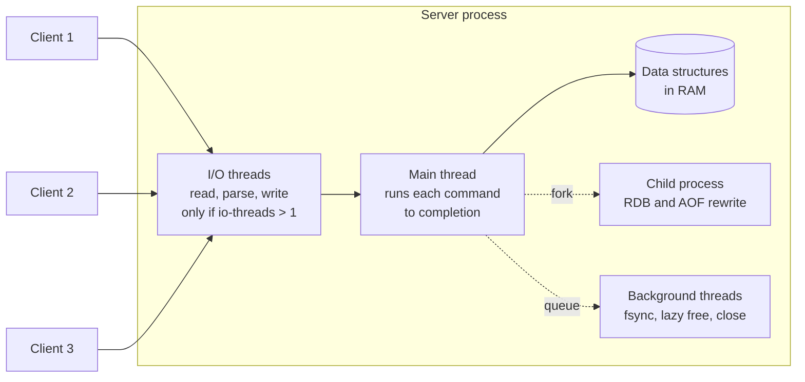
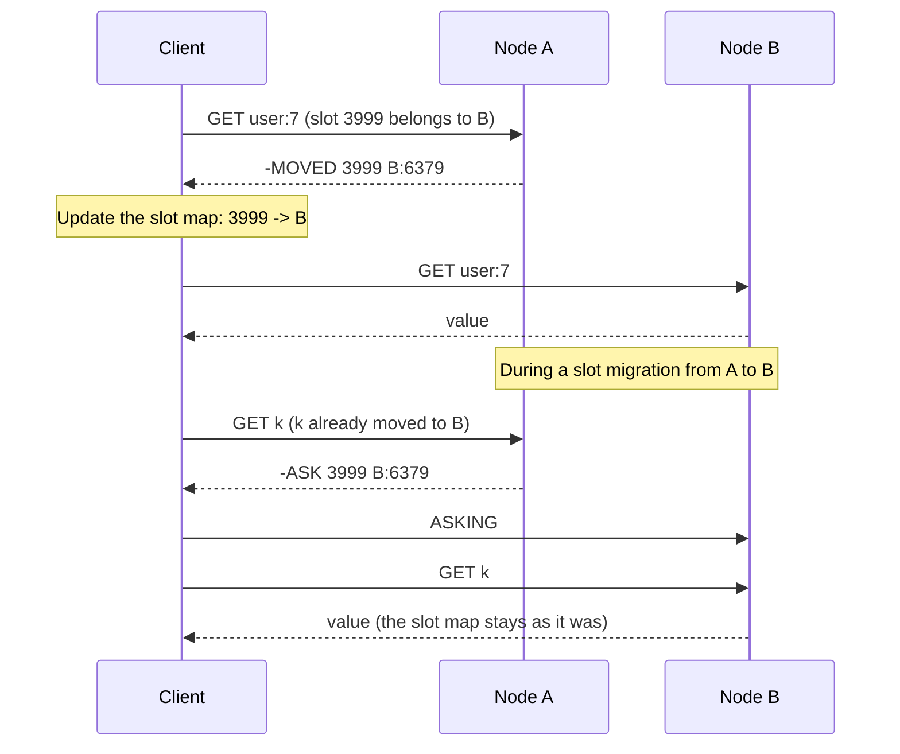

# Redis

Redis is an in-memory data structure server. A client sends a command such as `ZADD` or `INCR` over a TCP connection, and one thread inside the server runs the command against a data structure that lives in RAM. This page explains the architecture (one thread for commands, and what the I/O threads do), the data types with the time complexity of their main commands, how keys expire, how persistence works and what each option can lose, how replication, Sentinel, and Redis Cluster work, what transactions, Lua scripts, and pipelines guarantee, the common uses with a link to the page that owns each one, the operational pitfalls, and the license history that led to Valkey. Caching strategy, eviction policies, and the comparison with Memcached are on the [caching page](../hld/fundamentals/03-caching.md). This page does not repeat them.

## Why It Matters

Interviewers ask about Redis in almost every system design round: "Where do you keep the session?", "How do you rank 10 million players?", "How do you rate limit?", "What happens to the data when Redis restarts?". A candidate who answers "put it in Redis" and stops gets the follow-ups that this page prepares for: why a single-threaded server is fast, what `appendfsync everysec` can lose, why a Redis lock is not a correctness lock, and what a cluster does when a key moves. On the job, Redis is a shared dependency with sharp edges: one `KEYS *`, one 200 MB value, or one fork on a large instance can stall every client of the server. The choice between "Redis as a cache" and "Redis as a database" changes the persistence, replication, and recovery design.

!!! info "Versions and sources"
    Checked on 2026-11-05. **Redis:** the GitHub releases page marks 8.10.3 (released 2026-10-26) as the latest stable release, and the 8.12 release candidates (RC1 and RC2) are the newest pre-releases. The GitHub release dates are 8.0.0 on 2025-05-02, 8.2.0 on 2025-08-04, 8.4.0 on 2025-11-18, 8.6.0 on 2026-02-10, 8.8.0 on 2026-05-25, and 8.10.0 on 2026-07-29. **Java client:** Maven Central lists Jedis 8.0.2 as the newest stable version (8.1.0-beta2 is the newest pre-release). Configuration defaults come from `redis.conf` on the `8.10` branch. The `7.4` branch has the same defaults for `appendonly`, `appendfsync`, `aof-use-rdb-preamble`, `save`, `hz`, `io-threads`, and the encoding thresholds. Threaded I/O changed between 7.x and 8.x (see "Architecture"). **Valkey:** the valkey.io home page lists 9.1.3 (2026-10-26) as the latest release, and the download page lists 9.0.7 (2026-10-27) as the latest 9.0 patch. **Other sources:** the Redis command reference (each time complexity below comes from the command page), "Redis persistence", "Replication", "Scale with Redis Cluster", the Cluster specification, "Redis Sentinel", "Transactions", "Scripting with Lua", "Redis functions", "Pipelining", "Key eviction", the `EXPIRE` page, and the Redis licensing page. Defaults and limits change between releases, so check the page of the version that you run.

## Core Concepts

**Key and value**: Redis stores a map from a binary-safe string key to a value. The value is a string or one of the other data types. A key has exactly one type at a time.

**Keyspace**: the set of all keys on one server. A standalone server has 16 numbered databases by default. Redis Cluster supports only database 0 (Cluster specification).

**Command**: one request that the server runs to completion before it runs the next command (see "Architecture"). Each command page states its time complexity in big-O notation, with `N` named in the page.

**Atomic**: a command, a transaction, or a script is atomic in Redis if no other client's command runs in the middle of it. Atomic here does not mean "can roll back". Redis does not roll back (see "Transactions").

**Volatile key**: a key that has an expiry time. A key with no expiry is persistent.

**Event loop**: the main thread's cycle. It waits for sockets that have data, reads the requests, runs the commands one at a time, and writes the replies.

**Listpack and intset**: compact, contiguous encodings that Redis uses for small hashes, lists, sets, and sorted sets. A listpack is a serialized sequence of entries in one memory block. An intset is a sorted array of integers. Redis converts a value to a normal encoding when it grows past a threshold.

**RDB**: a point-in-time snapshot of the whole dataset in one compact file.

**AOF** (append-only file): a log of every write command. Redis replays it at startup.

**Fork and copy-on-write**: Redis persists in a child process that the operating system creates with `fork()`. The child shares the parent's memory pages. When the parent changes a page, the operating system copies that page first, so the child still sees the data of the fork moment.

**Replica**: a Redis server that holds a copy of a leader's data and receives the leader's stream of write commands. Redis documentation calls the leader the master. This page says leader. The glossary term for the node that follows is follower, and Redis calls it a replica (`REPLICAOF`).

**Hash slot**: one of 16 384 partitions of the key space in Redis Cluster. `HASH_SLOT = CRC16(key) mod 16384`.

**Hash tag**: the part of a key between the first `{` and the first `}` after it, if that part is not empty. Redis Cluster hashes only the hash tag, so keys with the same tag share one slot.

**Pipelining**: sending many commands without waiting for each reply, and then reading the replies. It saves round trips. It does not make the commands atomic.

## How It Works

### Architecture: one thread runs the commands

Redis executes commands on one main thread. The latency documentation says that Redis uses a "mostly" single-threaded design: one process serves all client requests in sequence, and threads do other work (for example background disk I/O). The consequence is the strongest guarantee in the product: while one command runs, no other command runs. `INCR`, `LPUSH`, `ZADD`, and `SET key value NX` need no lock, because no two of them overlap.



Why one thread is fast: the data is in RAM, the structures are simple, and a command that touches one key costs microseconds. A single thread has no lock contention, no context switch between commands, and no cache-line traffic between cores. The cost of a request is then dominated by the network and the system calls for socket reads and writes, not by the command. The Pipelining documentation says that serving a command is cheap for the data structures but costly for socket I/O, because each `read()` and `write()` is a system call.

What runs outside the main thread:

| Work | Where it runs | Source |
|---|---|---|
| Socket reads, protocol parsing, and socket writes | I/O threads, if `io-threads` is greater than 1. The default is off | `redis.conf` |
| `UNLINK`, `FLUSHALL ASYNC`, and the lazy-free options (`lazyfree-lazy-expire`, `lazyfree-lazy-eviction`, `lazyfree-lazy-user-del`) | A background thread frees the memory | `redis.conf`, `UNLINK` page |
| `fsync` of the AOF with `appendfsync everysec` | A background thread | Persistence page |
| RDB snapshot and AOF rewrite | A forked child process | Persistence page |

**I/O threads, from 7.x to 8.x.** In the 7.4 `redis.conf`, `io-threads` is off by default, the threads handle only socket writes, and a second option (`io-threads-do-reads`, default `no`) adds reads and parsing. The Redis 8.0 release notes announce "a new I/O threading implementation, which enables throughput increase on multi-core environments (set with the `io-threads` configuration parameter)". In the 8.10 `redis.conf` the threads handle reads, protocol parsing, and writes, the `io-threads-do-reads` option is gone, and the file still says "By default threading is disabled". The file advises to enable threads only on machines with at least 4 cores, to leave one core spare, and to enable them only if you have a performance problem with a high CPU use. In every version, the main thread still runs the commands, so the single-command atomicity holds with I/O threads on.

**A slow command blocks everyone.** Because one thread runs all commands, a command that takes 50 ms delays every other client by up to 50 ms. This is the root of the pitfalls in "Operational Pitfalls": `KEYS`, `SMEMBERS` on a huge set, a long Lua script, and a `DEL` of a huge key.

### Data types and their main commands

Each command page in the Redis reference states the time complexity. The table gives the main commands and the complexity from those pages. `N` is the size of the value, and `M` is the number of elements that the command returns or touches, as the command page defines it.

| Type | What it holds | Main commands and complexity | Typical use |
|---|---|---|---|
| String | Bytes, up to 512 MB (strings page) | `GET`, `SET`, `INCR`, `INCRBY`, `STRLEN`: O(1). `MGET`, `MSET`: O(N) for N keys. `GETRANGE`: O(N) for the returned bytes | Cache entries, counters, locks, flags |
| List | A sequence of strings, ordered by insertion | `LPUSH`, `RPUSH`: O(1) for each element. `LPOP`, `RPOP`: O(N) for the N returned elements (O(1) for one). `LMOVE`: O(1). `LRANGE`: O(S+N), where S is the distance from the list head or tail to the start offset. `LINDEX`: O(N) to traverse. `BLPOP`: blocks until an element exists | Simple queues, recent-items lists |
| Hash | Field-value pairs under one key | `HSET`, `HGET`, `HINCRBY`, `HLEN`: O(1). `HGETALL`, `HKEYS`: O(N) | An object with fields, a small record |
| Set | Unique strings, unordered | `SADD`: O(1) for each element. `SISMEMBER`, `SCARD`: O(1). `SMEMBERS`: O(N). `SINTER`: O(N*M) worst case, with N the size of the smallest set and M the number of sets. `SPOP`, `SRANDMEMBER`: O(1) without a count | Tags, unique visitors (exact), membership tests |
| Sorted set | Unique strings, each with a floating-point score, ordered by score and then by the string | `ZADD`, `ZINCRBY`: O(log N). `ZRANK`: O(log N). `ZSCORE`, `ZCARD`: O(1). `ZRANGE`: O(log N + M). `ZPOPMIN`: O(log N * M). `ZREM`: O(M log N) | Leaderboards, priority queues, time-ordered indexes, sliding-window limiters |
| Bitmap | Bits in a string (a view of the string type) | `SETBIT`, `GETBIT`: O(1). `BITCOUNT`, `BITOP`, `BITPOS`: O(N). A bit offset must be at least 0 and below 2^32, so a bitmap holds up to 512 MB | Daily-active flags for user IDs. One bit for each user, so 100 million users take 12.5 MB |
| HyperLogLog | A probabilistic count of distinct elements | `PFADD`: O(1). `PFCOUNT`: O(1) with a very small constant for one key. `PFMERGE`: O(N) for N sketches | Unique counts that tolerate an error. Up to 12 KB of memory and a standard error of 0.81% (HyperLogLog page) |
| Stream | An append-only log of entries with IDs, with consumer groups | `XADD`: O(1) for a new entry (O(N) when it trims). `XLEN`: O(1). `XRANGE`: O(N) for the returned elements. `XACK`: O(1) for each ID. `XAUTOCLAIM`: O(1) if `COUNT` is small | Event logs, work queues with acknowledgment |
| Geospatial | Longitude-latitude points, stored in a sorted set | `GEOADD`: O(log N) for each item. `GEODIST`: O(1). `GEOSEARCH`: O(N + log M), with N and M as the command page defines them. `GEORADIUS` is deprecated as of 6.2.0 (its page says so) | Nearby search (see the [geospatial page](../hld/fundamentals/18-geospatial-indexing.md)) |

**Notes on specific types.**

- **Strings and counters.** `INCR` and `INCRBY` parse the string as a 64-bit signed integer and add to it in one atomic step, so many clients can count without a lock. The `SET` command takes `NX` (set only if the key does not exist), `XX` (only if it exists), `GET` (return the old value), and an expiry (`EX`, `PX`, `EXAT`, `PXAT`, or `KEEPTTL`). `SET key value NX EX 30` is one atomic command that creates a key with an expiry only if no client has created it. This is the building block for a lock, a one-time token, and a dedupe key. Redis 8.4 added the options `IFEQ`, `IFNE`, `IFDEQ`, and `IFDNE`, which set the value only if the current value matches, and the `DELEX` command, which deletes a key only if the value matches (the Transactions page and the `SET` and `DELEX` command pages).
- **Lists.** A list gives push and pop at both ends in O(1), and access by position costs O(N). `LMOVE` (6.2) moves an element between two lists in one atomic step, and `BLMOVE` blocks while the source is empty. A blocking pop is the base of a simple queue, but the element is gone from the list the moment the consumer pops it. A consumer that crashes loses the element unless the consumer uses `LMOVE` to a processing list. A stream with a consumer group fixes this by design (see "Pub/sub and streams").
- **Hashes.** A hash stores many small fields under one key, which costs less memory than one string key for each field when the hash is small (see "Encodings"). Redis 7.4 added per-field expiry (`HEXPIRE`), and 8.0 added `HGETDEL`, `HGETEX`, and `HSETEX`.
- **Sets.** `SINTER` and `SUNION` read whole sets, so their cost grows with the set sizes. Use them on small sets, or on a replica, or compute the result offline.
- **Sorted sets.** The sorted set is the most useful structure for interview answers, so it has its own section below.
- **Geospatial.** Redis stores the points in a sorted set, so the `Z` commands also work on a geospatial key. Use `GEOSEARCH` for a radius or a box query.

#### Sorted sets: the skip list and the hash table

The Redis sorted-set documentation says that a sorted set is "implemented via a dual-ported data structure containing both a skip list and a hash table". Each structure answers a different question:

- The **hash table** maps a member to its score. `ZSCORE` is O(1), and `ZADD` finds the old score of a member in O(1) before it moves the member.
- The **skip list** keeps the members in order by `(score, member)`. It supports insert, delete, and rank in O(log N), and a range read of M elements in O(log N + M), because the elements are already sorted. A skip list is a linked list with extra "express" levels, so a search skips ahead. Each link stores a span, the number of elements between a node and the next node at that level (`src/server.h`), which gives `ZRANK` in O(log N). The Java example below keeps the same two roles with a `HashMap` and a `TreeSet`.

The ordering rules matter in interviews:

- A score is a double-precision floating-point number. A double represents every integer up to 2^53 exactly, so a score that encodes an integer and a tie-break must stay below that bound (see the [leaderboard case study](../hld/case-studies/16-leaderboard-and-top-k.md), which builds such a score).
- If two members have the same score, Redis orders them lexicographically by member (the sorted-sets page). With the `REV` option or with `ZREVRANGE`, the whole order reverses, so score ties come out in reverse lexicographic order (the `ZRANGE` page: "score ties are resolved by reverse lexicographical ordering"). `ZREVRANGE` still works, and its page says "Deprecated as of Redis v6.2.0" in favor of `ZRANGE ... REV`.
- `ZADD` has the options `NX`, `XX`, `GT`, `LT` (6.2), and `CH`. `ZADD` returns the number of new members, so an update returns 0 unless you pass `CH`.
- `ZRANGE ... BYSCORE` with `LIMIT offset count` walks `offset` elements first, so a deep offset costs O(N). Page by index range or by the last score seen.

#### Newer data types in Redis 8

The "Data types" page of the Redis documentation lists these types for Redis Open Source, in addition to the types above.

| Type | What it does | Since |
|---|---|---|
| JSON | Stores a JSON document, with commands to read and change one path | Included in the 8.0 distribution |
| Time series | Stores timestamped samples, with range queries and aggregation | Included in 8.0 |
| Probabilistic types | Bloom filter, cuckoo filter, count-min sketch, top-k, t-digest. The HyperLogLog type is older and is listed in the same group | Included in 8.0 (the HyperLogLog type is older) |
| Vector set | Stores vectors for similarity search with the HNSW algorithm | New in 8.0. The 8.0 release notes label it "[preview]". The current Data types page lists it with no such label |
| Array | A sparse, index-addressable sequence that maps integers in the range 0 to 2^64 - 1 to strings. Commands start with `AR` (`ARSET`, `ARGET`, `ARRING`, and others) | New in 8.8.0 (the command tables list "8.8.0") |
| Search and query | Secondary indexes and queries over hashes and JSON (`FT.*` commands) | Part of Redis 8 |

Before 8.0, these capabilities were separate modules (RediSearch, RedisJSON, RedisTimeSeries, RedisBloom) in Redis Stack. The 8.0 release notes say that the stand-alone modules are no longer needed because they are part of Redis. The Bloom filter and the count-min sketch in this group are the structures that the [probabilistic data structures page](../hld/distributed-systems/04-probabilistic-data-structures.md) explains.

### Encodings and thresholds

Redis stores small aggregate values in compact encodings. The memory-optimization page says that a small hash, list, set of integers, or sorted set "uses up to 10 times less memory (5 times less on average)" than the normal encoding, at some CPU cost. Redis converts a value to the normal encoding when it grows past a threshold, and it does this automatically. The `OBJECT ENCODING key` command shows the current encoding.

| Type | Compact encoding | Normal encoding | Threshold (default in `redis.conf` 8.10, same in 7.4) |
|---|---|---|---|
| Hash | `listpack` | `hashtable` | `hash-max-listpack-entries 512` and `hash-max-listpack-value 64` (bytes) |
| Sorted set | `listpack` | `skiplist` (with a hash table) | `zset-max-listpack-entries 128` and `zset-max-listpack-value 64` |
| Set of integers | `intset` | `hashtable` | `set-max-intset-entries 512` |
| Set of other strings | `listpack` (7.2 and later) | `hashtable` | `set-max-listpack-entries 128` and `set-max-listpack-value 64` |
| List | `listpack` for a small list, `quicklist` (a linked list of listpack nodes) for a larger list | `quicklist` | `list-max-listpack-size -2`, which means a node holds at most 8 KB |
| String | `int` for a 64-bit integer, `embstr` for a string up to 44 bytes, `raw` otherwise | | Fixed in the source, per the `OBJECT ENCODING` page |

Version notes from the memory-optimization page: Redis 6.2 and earlier call the compact encoding `ziplist` (the settings were `hash-max-ziplist-entries` and similar), Redis 7.0 and later call it `listpack`, and Redis 7.2 added the listpack encoding for sets. The 8.10 `redis.conf` also has a hash "template" encoding, which shares the field names of many similar hashes and is off by default (`hash-min-template-entries 0`). It is new in 8.10: the `redis.conf` of the 8.8 branch has no such option.

Why the thresholds matter: a hash with 100 small fields in a listpack is one memory block with no pointers, and a scan over it is fast because the data is contiguous. A hash with 1 000 fields converts to a hash table, and each field then costs more memory. If you store 10 million small objects, store each as a hash with fewer than 512 fields, and keep each field value under 64 bytes, then the memory stays low. If you raise the thresholds, a command on one key costs more CPU, because a listpack lookup is a linear scan.

### Key expiry

`EXPIRE key seconds` (O(1)) sets a time to live. Options `NX`, `XX`, `GT`, and `LT` (7.0) make it conditional. The expiry is stored as an absolute Unix time in milliseconds, so time passes while the server is down, and an RDB file that you load on a machine with a wrong clock can expire keys at load time (the `EXPIRE` page). A write that replaces a value (`SET`, `DEL`, and the `*STORE` commands) clears the expiry. A command that modifies the value in place (`INCR`, `LPUSH`, `HSET`) leaves it. `SET key value KEEPTTL` keeps the expiry. A non-positive timeout deletes the key. `TTL` returns -2 for a missing key and -1 for a key with no expiry.

The `EXPIRE` page says that Redis expires keys in two ways.

1. **Passive (lazy) expiry.** If a client accesses a key that has timed out, Redis deletes it and answers as if it did not exist.
2. **Active expiry.** Keys that nobody reads would stay in memory, so Redis also checks keys with a TTL in the background. The `EXPIRE` page says "periodically, Redis tests a few keys at random amongst the set of keys with an expiration" and deletes the expired ones.

The source file `src/expire.c` (branch `8.10`) shows the current details, and the numbers below come from its constants and comments:

- A "slow" cycle runs `hz` times each second (`hz` is 10 by default). It may use up to 25% of the CPU time of each period (`ACTIVE_EXPIRE_CYCLE_SLOW_TIME_PERC 25`). A "fast" cycle runs in each event-loop pass, for at most 1 000 microseconds, and it runs only if the last slow cycle stopped at its time limit or if the estimated share of expired keys that are still in memory is above the acceptable stale percentage (10 by default).
- In each database, a loop examines a batch of keys that have a TTL, 20 keys at the default effort (`ACTIVE_EXPIRE_CYCLE_KEYS_PER_LOOP 20`). The code reads them from the hash table of keys with a TTL, starting from a saved cursor.
- If more than 10% of the examined keys were already expired (`ACTIVE_EXPIRE_CYCLE_ACCEPTABLE_STALE 10`), the loop runs again for the same database, until the time limit. The latency documentation still describes an older rule (repeat while more than 25% of the sample was expired). The 8.10 source uses 10%, so this page follows the source.
- The setting `active-expire-effort` (1 to 10, default 1) raises the batch size and lowers the acceptable stale percentage. The `redis.conf` text says that the default effort tries to keep no more than about 10% of the keys expired but not yet freed.

The result: Redis does not guarantee that an expired key leaves memory at its deadline. A read never returns an expired key (the lazy check), but memory can stay used by keys that expired and that nobody read, up to a bounded share of the keys that have a TTL. The [key-value store with TTL](../lld/case-studies/19-key-value-store-with-ttl/README.md) LLD case study builds lazy expiry and an active sweep with a heap, and it names this page for how Redis does it.

**Expiry with replication and AOF.** The leader expires keys and sends a synthesized `DEL` to the AOF and to every replica. A replica does not expire keys by itself, and it uses its own clock only to hide keys that are already logically expired from reads. While a Lua script runs, no key expires, so the time is frozen for the script (Replication page). A replica that Redis promotes to leader starts to expire keys by itself.

**Eviction** is a different mechanism: it removes keys that have not expired when memory reaches `maxmemory`, and the default policy `noeviction` makes a write fail at the limit instead. The [caching page](../hld/fundamentals/03-caching.md) ("Eviction and TTL") lists the policies, explains approximate LRU and LFU, and gives the recommendations.

### Persistence

Redis can keep data on disk in two formats, and each has a durability cost. Facts here come from the "Redis persistence" page and the `redis.conf` of the 8.10 branch.

#### RDB snapshots

An RDB file is a compact, point-in-time image of the whole dataset. When Redis needs a snapshot (a `save` rule fires, or `BGSAVE` runs), it calls `fork()`. The child process writes the dataset to a temporary file and then replaces `dump.rdb`. The parent keeps serving clients. Copy-on-write keeps the child's view consistent: when the parent changes a memory page, the operating system copies the page first.

- **Default `save` rules** (8.10 and 7.4 `redis.conf`): a snapshot after 3 600 seconds if at least 1 key changed, after 300 seconds if at least 100 changed, and after 60 seconds if at least 10 000 changed. Setting `save ""` turns snapshots off.
- **What a crash loses:** all writes since the last snapshot. The persistence page says to "be prepared to lose the latest minutes of data".
- **The costs of the fork.** The page table of the process is copied during `fork()`. The latency page gives an example: a 24 GB instance has a page table of about 48 MB (24 GB / 4 KB pages * 8 bytes), and it lists measured fork times between about 9 and 13 ms for each GB on physical machines and VMware, and up to about 239 to 424 ms for each GB on old Xen virtual machines (approximate, measured on the hardware of that page). The fork blocks the main thread, so on a large instance every client waits for the fork. After the fork, each write to a shared page copies that page, so memory use grows during the snapshot. In the worst case, a busy instance copies almost all pages (the latency page describes this "copy on write of almost the whole process memory" for huge pages), so leave free memory for the fork.
- **Benefits:** one compact file, fast restart for a big dataset, and an easy backup. The persistence page recommends copying RDB files to another location regularly.

#### AOF

The append-only file logs every write command in the Redis protocol format, and Redis replays it at startup. It is off by default (`appendonly no`). The durability depends on `appendfsync`:

| `appendfsync` | When Redis calls `fsync` | What a crash or power loss can lose | Cost |
|---|---|---|---|
| `always` | Before it replies to the client. Redis writes the commands of a batch of clients or of a pipeline with one `write` and one `fsync` (group commit) | The persistence page describes it as "very safe". An acknowledged write is on disk (assuming the disk honors `fsync`) | Slow: each batch of writes waits for the disk |
| `everysec` (default) | Once each second, in a background thread | About one second of writes. The page says "you can only lose one second worth of writes". If a background `fsync` runs long, Redis delays the `write` by up to two seconds (latency page), so the worst case is higher | Small: the page says write performance is "still great" |
| `no` | Never. The operating system decides. The page says Linux "will flush data every 30 seconds" with typical settings | Up to tens of seconds, up to what the kernel holds | Smallest |

- **Rewrite.** An AOF grows with every write, and 100 `INCR` commands on one key leave 100 entries for one value. `BGREWRITEAOF` (or the automatic rule: `auto-aof-rewrite-percentage 100` and `auto-aof-rewrite-min-size 64mb`) forks a child that writes the shortest command sequence that rebuilds the dataset. In 7.0 and later, the AOF is "multi part": one base file and one or more incremental files, tracked by a manifest in a directory. During a rewrite the parent opens a new incremental file, and Redis swaps the manifest atomically when the child finishes.
- **The RDB preamble.** With `aof-use-rdb-preamble yes` (the default since at least 7.4), the base file is in RDB format, which is faster to write and load than a base file of commands. The incremental files hold commands.
- **Truncated file.** If the server crashes in the middle of a write, the last command can be partial. By default, Redis loads the file and drops the incomplete last command (`aof-load-truncated`). A corrupt middle needs `redis-check-aof`.
- **Both together.** If both are on and Redis restarts, it uses the AOF, because it is the most complete. The persistence page recommends using both when you want "a degree of data safety comparable to what PostgreSQL can provide", and it says AOF alone is discouraged because an RDB snapshot is good for backups, for faster restarts, and for bugs in the AOF engine.
- **`WAITAOF`** (7.2) blocks the client until the previous writes of its connection are fsynced to the AOF of the local server and, optionally, of N replicas. It returns the counts that reached the target, so the client must check them.

**The durability cost, in one place.** With no persistence, a restart loses everything. With RDB only, a crash loses minutes, and each snapshot costs a fork. With AOF `everysec`, a crash loses about one second, and the cost is a background fsync plus disk bandwidth for the log and its rewrites. With AOF `always`, an acknowledged write is on the local disk, and throughput drops to what the disk can sync. Even then, a single node is one machine: a disk failure loses the data, so replication and backups are the answer to machine loss (see the next section). The [choosing a database](../hld/fundamentals/04-choosing-a-database.md) page uses this cost when it compares Redis with a durable store. Redis 8.10 added a `BACKUP` command family (`BACKUP START`, `SEAL`, `LIST`, `CLEANUP`) that produces a restorable backup from a multi-part AOF without stopping writes (persistence page).

**Redis as a primary store: a decision.** If a restart or a failover must not lose acknowledged data, Redis alone is a weak choice: the replication is asynchronous (next section), and the best single-node setting (`always`) costs throughput. Recommendation: use Redis as a primary store only for data that you can rebuild or can afford to lose for about a second, and keep the source of truth in a durable database.

### Replication, Sentinel, and Redis Cluster

#### Replication

Redis replication is leader-follower and asynchronous by default (Replication page). A replica connects to the leader and runs `PSYNC` with the replication ID and offset that it has processed. Each leader has a replication ID (a random string that marks a history of the dataset) and an offset that grows with every byte of the replication stream. If the leader's backlog (`repl-backlog-size`, 1 MB in the sample `redis.conf`) still holds the missing part, the leader sends only that part (partial resynchronization). Otherwise the leader starts a full resynchronization: it forks, produces an RDB, sends it to the replica, and then sends the buffered commands. The leader can send the RDB to the replicas directly over the socket without a disk file (`repl-diskless-sync`, default `yes` in 8.10 and 7.4).

- **Lag and lost writes.** The leader acknowledges a write before any replica has it. If the leader fails before it sends the write, the write is lost after the failover.
- **`WAIT numreplicas timeout`** blocks the client until the replicas acknowledge the earlier writes of the connection. The documentation says that `WAIT` does not turn Redis into a CP system with strong consistency: "acknowledged writes can still be lost during a failover", but `WAIT` reduces the probability of loss. `min-replicas-to-write` and `min-replicas-max-lag` make the leader refuse writes if too few replicas are connected and recent, which bounds the loss window. Both are best-effort.
- **Expiry and eviction** happen on the leader, and the leader sends `DEL` commands to the replicas. A replica ignores `maxmemory` by default (`replica-ignore-maxmemory yes`).
- **A leader with no persistence that restarts by itself is dangerous.** The page describes the failure: the leader restarts empty, its replicas copy the empty dataset and erase their copies. Turn off the auto-restart, or keep persistence on.
- **Read scaling.** A replica is read-only by default (`replica-read-only`). A read from a replica can be stale, with the anomalies described on the [replication page](../hld/fundamentals/05-replication.md). From the operator's view of databases, the [scaling a database page](09-scaling-a-database.md) covers read routing.

#### Sentinel

Redis Sentinel is a set of separate processes that monitor a leader and its replicas, decide when the leader has failed, promote a replica, and tell clients where the new leader is (Sentinel page). Facts from that page:

- Run at least three Sentinel instances, on machines that fail independently.
- The **quorum** is the number of Sentinels that must agree that the leader is unreachable, to mark it as failing. The quorum is used only to detect the failure. To run the failover, one Sentinel must win an election with the vote of the majority of all Sentinels. A minority partition therefore never starts a failover.
- Sentinel with asynchronous replication does not guarantee that acknowledged writes survive a failover.
- Clients ask the Sentinels for the address of the current leader, so the client library must support Sentinel.

Sentinel provides high availability for one dataset on one leader. It does not split the dataset across machines.

#### Redis Cluster

Redis Cluster splits the key space over several leaders and gives each leader replicas. It gives both sharding and failover, with no proxy and no Sentinel (Cluster specification and "Scale with Redis Cluster").

- **Hash slots.** There are 16 384 slots. `HASH_SLOT = CRC16(key) mod 16384`. Each leader owns a set of slots. Moving a slot from one node to another means moving its keys, and it needs no downtime.
- **Hash tags.** If a key has a non-empty substring between the first `{` and the first `}` after it, only that substring is hashed. `user:{123}:profile` and `user:{123}:account` land in the same slot. `foo{}{bar}` is hashed as a whole, because the first braces are empty.
- **Multi-key limits.** A multi-key command, a transaction, or a Lua script works only if all keys are in the same slot. Otherwise the node returns an error (`CROSSSLOT Keys in request don't hash to the same slot`, from `src/cluster.c`). Only database 0 exists, and `SELECT` is not allowed.
- **Redirects.** Any node can receive any query. If the node does not own the slot, it replies `-MOVED <slot> <host>:<port>`, which says that the slot belongs to another node permanently, so the client updates its slot map and retries. While a slot migrates from node A to node B, a key that is not on A yet gets `-ASK <slot> <host>:<port>`, which means "ask node B for this one query": the client sends `ASKING` and then the command to B, and does not update its slot map.
- **Failure handling.** If a majority of leaders cannot reach a leader for `NODE_TIMEOUT`, one of its replicas takes over.
- **Write safety.** Cluster uses asynchronous replication, so "Redis Cluster will lose writes that were acknowledged by the system to the client" in some failures. A leader on the minority side of a partition accepts writes until `NODE_TIMEOUT` passes, and those writes can be lost after a failover on the majority side.
- **Size.** The specification states a goal of "linear scalability up to 1000 nodes".



Sharding theory (consistent hashing, hot partitions, resharding) is on the [partitioning and sharding page](../hld/fundamentals/06-partitioning-and-sharding.md). The distributed-systems side of failover is on the [replication page](../hld/fundamentals/05-replication.md).

### Transactions, scripts, and pipelining

Four tools group commands. Their guarantees differ, and interviewers test that difference.

| Tool | Atomic against other clients? | Reads inside it? | On error | Round trips |
|---|---|---|---|---|
| Pipeline | No. Other clients' commands can run between the pipelined commands | The client reads all replies at the end, so a later command cannot use an earlier reply | Each command succeeds or fails alone | One for the batch |
| `MULTI` / `EXEC` | Yes. The queued commands run in sequence with no other command in between | No. The commands only queue, so a command cannot use the result of an earlier one | No rollback. A command that fails at run time does not stop the others | One for the batch if the client pipelines it |
| `WATCH` + `MULTI` / `EXEC` | Yes, if no watched key changed | The client reads before `MULTI`, and `EXEC` aborts if a watched key changed | `EXEC` returns a null reply if a watched key changed. The client retries | Several, with a retry loop |
| Lua script (`EVAL`) or function (`FCALL`) | Yes. The server runs the whole script, and "all server activities are blocked during its entire runtime" | Yes. The script reads, decides, and writes in one atomic step | A runtime error stops the script, and the commands that ran before it stay. The scripting pages do not state this in one sentence. It follows from the no-rollback design and from the rule that `SCRIPT KILL` works only on a script that has not written | One |

**`MULTI` and `EXEC`** (Transactions page). `MULTI` starts a transaction. Redis answers `QUEUED` to each command, and `EXEC` runs them all. Two guarantees: the commands run in sequence, so no other client's request is served in the middle, and either all commands run (if `EXEC` is called) or none do (if the connection drops before `EXEC`). Errors come in two kinds. An error before `EXEC` (a wrong command name, a wrong number of arguments, or an out-of-memory condition) makes `EXEC` refuse the whole transaction. An error after `EXEC` (a list command on a string key) affects only that command, and "all the other commands in the queue are processed". Redis has no rollback, and the documentation says that supporting rollbacks "would have a significant impact on the simplicity and performance of Redis". `DISCARD` drops the queue before `EXEC`. A transaction is not isolation in the SQL sense (see the [transactions and isolation page](04-transactions-and-isolation.md) for isolation levels): it has no read inside the transaction and no rollback, and it is atomic only because the server is single-threaded.

**`WATCH` for optimistic locking.** `WATCH key` marks keys. If any watched key is modified between `WATCH` and `EXEC`, "the whole transaction aborts, and `EXEC` returns a null reply". This includes changes by Redis itself, such as expiry or eviction (before 6.0.9, an expired key did not abort the transaction). The client then reads the value again and retries. This is the same idea as the version column in optimistic locking (see the transactions page), with the key itself as the version. Since Redis 8.4, a single `SET key new IFEQ old` or `DELEX key IFEQ value` does compare-and-set and compare-and-delete in one command, which the documentation calls "much simpler and faster" than `WATCH`.

**Lua scripts and functions.** `EVAL script numkeys key... arg...` runs a Lua 5.1 script on the server. The script runs atomically: no other command runs until it ends. It can read, branch, and write several keys of several types. Rules and facts (Scripting and Functions pages):

- Pass every key that the script touches in `KEYS`, not inside the script text, so that the script runs correctly in a cluster, where all keys must be in one slot.
- Redis caches a script by the SHA1 of its text, and `EVALSHA` runs a cached script. The cache is volatile: it is cleared on restart, on a failover, and by `SCRIPT FLUSH`. A client must handle the `NOSCRIPT` error and load the script again.
- Replication: Redis 5.0 made "effects replication" the default (the replica receives the write commands that the script produced), and Redis 7.0 removed verbatim replication (sending the script text). Effects replication lets a script use the time or random values.
- A long script blocks the server. `busy-reply-threshold` (the older name `lua-time-limit` is an alias, default 5 000 ms) is not a kill switch. After it passes, Redis answers other clients with `BUSY`, and `SCRIPT KILL` can stop only a script that has not yet written.
- **Redis functions** (7.0) are the managed form: a library of functions that you load with `FUNCTION LOAD` and call with `FCALL`. The library is stored in the database, persisted to the AOF and RDB, and replicated, so it is "as durable as the data itself", and no client needs to ship the script text.

**Pipelining** (Pipelining page). Without a pipeline, each command costs one network round trip. If the round trip is 250 ms and the server can run 100 000 commands each second, a client that waits for each reply can send only four commands each second (the page's example). A pipeline sends many commands and reads the replies later, so it pays the round trip once. It also cuts the system calls on the server, because many commands arrive in one `read()` and many replies leave in one `write()`. The page says the throughput rises almost linearly with the pipeline length and reaches 10 times the baseline (read from the page's figure, so treat it as approximate). The page's own Ruby test over the loopback interface, where the round trip is already short, gained a factor of five. Limits: the server queues the replies in memory, so send batches of a bounded size (the page suggests about 10 000 commands), and a pipeline gives no atomicity and no ordering guarantee against other clients. In Redis Cluster, each command in a pipeline must go to the node that owns its key, so a client library must split a pipeline by node.

### Pub/sub and streams

| Aspect | Pub/sub (`PUBLISH`, `SUBSCRIBE`) | List as a queue (`LPUSH`, `BRPOP`) | Stream (`XADD`, `XREADGROUP`) |
|---|---|---|---|
| Delivery | At most once. The Pub/sub page says that a message is "forever lost" if the subscriber fails or is not connected | The pop removes the element, so a consumer crash loses it unless the consumer moves it to a second list | At least once with consumer groups and acknowledgment, or at most once. Messages persist in the stream |
| Stored? | No. The message goes to the subscribers that are connected now | Yes, until popped | Yes, until trimmed (`XTRIM`, `MAXLEN`, or `MINID`) |
| Many consumers | Every subscriber gets every message | Each element goes to one consumer | A group splits the entries among its consumers. Several groups each read all entries |
| Acknowledgment and retry | No | No | `XACK` marks an entry done. `XPENDING` lists the entries that a consumer received and did not acknowledge. `XAUTOCLAIM` (6.2) moves a stuck entry to another consumer |
| Replay | No | No | Yes: read from any entry ID |
| Use for | Live notifications where a miss is fine, cache invalidation hints | A simple job queue where a lost job is acceptable | Event logs and work queues that need acknowledgment |

A Redis stream is an append-only log, with entries `ID -> field-value pairs`, implemented as a radix tree (Streams page). An entry ID is a time in milliseconds and a sequence number, so IDs increase. A **consumer group** tracks, for each stream, the last delivered ID and a pending entries list (PEL) per consumer. `XREADGROUP` delivers each new entry to one consumer of the group, and the entry stays in that consumer's PEL until `XACK`. If the consumer dies, another consumer uses `XAUTOCLAIM` to take the entries that stayed pending past an idle time. This gives at-least-once delivery, so the consumer must be idempotent. Redis 8.2 added `XDELEX` and `XACKDEL` (acknowledge and delete), and 8.6 added support for idempotent production, which prevents duplicate entries when a producer retries (Streams page).

A stream is not Kafka. A stream lives in the memory of one node (or one slot in a cluster), and it has no partitions inside one key. See the [message queues and streams page](../hld/fundamentals/08-message-queues-and-streams.md) for the log model and when to choose a log-based broker.

### Common uses

Each use has a home page. This table gives the Redis commands and links to the home.

| Use | Commands | Notes | Home page |
|---|---|---|---|
| Cache | `GET`, `SET key value EX ttl`, `DEL` | Set a TTL with jitter. Choose `maxmemory` and a policy | [Caching](../hld/fundamentals/03-caching.md) |
| Session store | `SET session:{id} value EX 1800`, or a hash with `HSET`. `EXPIRE` or `GETEX` slides the expiry on each request | Loss of Redis logs users out, which many systems accept. A hash holds fields without a rewrite of the whole value | [Caching](../hld/fundamentals/03-caching.md) |
| Rate limiter | `INCR` plus `EXPIRE` in a `MULTI` block or a script; sorted set for a sliding log; a Lua script for a token bucket | Make the check and update atomic | [Rate limiting algorithms](../hld/fundamentals/13-rate-limiting-algorithms.md) |
| Leaderboard | `ZADD`, `ZINCRBY`, `ZRANGE ... REV`, `ZREVRANK` | Tie-break by member unless the score encodes the time | [Leaderboard and top-k](../hld/case-studies/16-leaderboard-and-top-k.md) |
| Distributed lock | `SET key token NX PX ttl`, release with `DELEX key IFEQ token` (8.4) or a Lua compare-and-delete | An efficiency lock, not a correctness lock, unless the resource checks a fencing token | [Distributed locks and leases](../hld/distributed-systems/05-distributed-locks-and-leases.md) |
| Queue | `LPUSH` with `BRPOP`/`LMOVE` for a simple queue. Streams with a consumer group for acknowledgment | See "Pub/sub and streams" | [Message queues and streams](../hld/fundamentals/08-message-queues-and-streams.md) |
| Counters | `INCR`, `INCRBY`, `HINCRBY` | Atomic with no lock. Write the total to the database in batches | This page |
| Unique counts | `PFADD`, `PFCOUNT`, `PFMERGE` (HyperLogLog). `SADD` and `SCARD` for an exact count | HyperLogLog: up to 12 KB, standard error 0.81%. A set grows with the number of members | [Probabilistic data structures](../hld/distributed-systems/04-probabilistic-data-structures.md) |
| Flags for many IDs | `SETBIT`, `GETBIT`, `BITCOUNT` | One bit for each ID. 100 million IDs take 12.5 MB | This page |
| Nearby search | `GEOADD`, `GEOSEARCH` | A sorted set underneath | [Geospatial indexing](../hld/fundamentals/18-geospatial-indexing.md) |

### Operational pitfalls

Every pitfall comes from the same fact: one thread runs all commands, and memory is the limit.

- **Big keys.** A big key is a key with a huge value or a collection with millions of elements. A command that touches it blocks the server (`HGETALL` on a hash of 5 million fields), and deleting it with `DEL` frees the memory in the main thread. Use `UNLINK`, which removes the key from the keyspace in O(1) and frees the memory in another thread. Find big keys with `redis-cli --bigkeys` or `--memkeys` (the `redis-cli` page: both use `SCAN`). Fix by splitting the value over several keys (for example `user:{id}:part:{n}`), by paging (`ZRANGE` with an index range, `HSCAN`), or by storing the blob outside Redis.
- **Hot keys.** One key that receives most of the traffic overloads the one node that owns it, and a cluster cannot spread it, because a key lives in one slot. The fixes (a local cache, copies of the key, reads from replicas) are in the hot-key section of the [caching page](../hld/fundamentals/03-caching.md).
- **`KEYS pattern` against `SCAN`.** `KEYS` is O(N) over the whole keyspace and blocks the server, and the latency page names `KEYS` in production as a common cause of slow commands. `SCAN cursor [MATCH pattern] [COUNT n]` returns a few keys for each call in O(1), and a full iteration is O(N) in many calls. Its guarantees: a full iteration returns every key that existed for the whole iteration, never returns a key that did not exist for the whole iteration, and may return the same key more than once, so the client must handle duplicates. Use `HSCAN`, `SSCAN`, and `ZSCAN` for large collections.
- **O(N) commands on large values.** `SMEMBERS`, `HGETALL`, `LRANGE 0 -1`, `SORT`, `SINTER` on large sets, `ZUNIONSTORE`, and `FLUSHALL` (without `ASYNC`) all take time in proportion to the size. Check the complexity line on the command page before you use a command on a collection that can grow.
- **Memory limits.** If the dataset exceeds RAM, Redis either evicts (with a policy) or rejects writes (`noeviction`). Redis also needs memory for the replication buffers, the client output buffers, and the fork. Set `maxmemory` below the machine RAM with room for those. The sample `redis.conf` limits client output buffers by class (`client-output-buffer-limit`), which stops a slow subscriber or replica from using all memory.
- **Memory fragmentation.** The allocator (jemalloc is the default on Linux, per the Redis README) can hold freed memory in fragments, so the resident set size of the process exceeds the data size. `INFO memory` reports `mem_fragmentation_ratio`, the ratio of `used_memory_rss` to `used_memory`. The `INFO` page says that `allocator_frag_ratio` is the true (external) fragmentation metric, so read both. Active defragmentation (`activedefrag`, off by default) moves values to reduce it.
- **The fork cost of persistence.** On a large instance, each RDB snapshot or AOF rewrite forks, and the fork pauses the main thread (see "Persistence"). Disable Linux transparent huge pages, as the latency page says. With huge pages, the page says, a few event-loop runs cause the copy-on-write of almost the whole process memory, which gives big latency and big memory use. Keep instances small enough that the fork pause and the copy-on-write memory are acceptable, and stagger the snapshots across the nodes of a cluster.
- **Slow scripts.** A script that loops over a large set blocks everything. Keep scripts short, and pass the keys in `KEYS`.
- **Missing TTLs.** A cache with no TTL and no `maxmemory` grows until the operating system kills the process. Set a TTL on every cache entry.
- **Clock jumps.** Expiry uses absolute wall-clock time, so a large clock change can expire many keys at once (the `EXPIRE` page).

Tools: `SLOWLOG GET` shows the commands that exceeded a time limit, and the latency monitor (`LATENCY DOCTOR`) and `INFO` give the fork time (`latest_fork_usec`) and memory figures.

### License history and Valkey

| Date | Event | Source |
|---|---|---|
| Up to Redis 7.2.x | BSD 3-clause license | Redis licensing page |
| 2024-03-20 | Redis announces that from 7.4 the core is under the Redis Source Available License v2 (RSALv2) or the Server Side Public License v1 (SSPLv1), and no longer under the BSD license | Redis blog, "Redis Adopts Dual Source-Available Licensing" |
| 2024-03-28 | The Linux Foundation announces Valkey, a fork that continues from Redis 7.2.4 under the BSD 3-clause license | Linux Foundation press release |
| 2025-05-01 | Redis announces AGPLv3 as a third option. Redis 8.0 (May 2025) is available under RSALv2, SSPLv1, or AGPLv3, at the user's choice | Redis blog "Redis is now available under the AGPLv3 open source license", Redis 8.0 release notes, licensing page |

Facts from the licensing page: Redis 7.2.x and earlier remain under BSD-3-Clause, 7.4.x to 7.8.x remain under the dual RSALv2/SSPLv1 license, and 8.0.0 and later are available under RSALv2, SSPLv1, or AGPLv3. The page says that RSALv2 and SSPLv1 are not open source licenses and that AGPLv3 is OSI-approved. RSALv2 forbids selling the software or offering it to others as a managed service, and SSPLv1 requires a provider of the software as a service to release the source of its management layers. The official Redis client libraries that the page lists (redis-py, node-redis, jedis, lettuce, and others) are under MIT, BSD, or Apache licenses.

Valkey is an open source fork under the Linux Foundation. Per valkey.io, the newest release line is 9.1 (9.1.3 on 2026-10-26), with 9.0, 8.1, 8.0, and 7.2 lines also maintained. Valkey forked from Redis 7.2.4, so the core data types and commands that this page describes (strings, hashes, sorted sets, streams, cluster, persistence) started from the Redis 7.2 design. That is an inference from the fork point, not a statement from the Valkey documentation, and Valkey has changed since the fork. After the fork, Redis and Valkey added different features, so a feature that this page attributes to Redis 8.x (for example the new data types and the `IFEQ` option of `SET`) is not a promise about Valkey. Check the Valkey documentation before you rely on a command.

## Trade-offs and When to Use

| Choice | Use when | Cost or risk |
|---|---|---|
| Redis as a cache in front of a database | The read load exceeds what the database serves, and stale data is tolerable | Invalidation races and stampedes (see the caching page). The cache must not become a required dependency |
| Redis for data structures (sorted sets, streams, HyperLogLog) | The structure maps to the problem, and the dataset fits in RAM | Memory cost for each key, and a single-node limit unless you use a cluster |
| Redis as the primary store | The data can be rebuilt, or a second of loss is acceptable, or you use `always` and accept the throughput | Asynchronous replication loses writes at failover. No relational queries or joins |
| Memcached | A simple multi-threaded cache with no persistence | See the caching page for the table |
| A relational database | You need durability, joins, constraints, and transactions with rollback | Slower per operation than RAM, and a disk-bound write path (see [storage engines](06-storage-engines.md)) |
| A document or wide-column store | The data is larger than RAM and you need a partitioned store | See [NoSQL families](07-nosql-families.md) |

**Persistence options compared**

| Mode | Loss on a crash | Restart time | Disk and CPU cost | Use for |
|---|---|---|---|---|
| None | Everything | Instant, empty | None | A pure cache that you can refill |
| RDB only | Minutes (depends on the `save` rules) | Fast | A fork at each snapshot | A cache with a warm restart, backups |
| AOF `everysec` | About 1 second | Slower (replays the log, or loads the RDB preamble then the increments) | A background fsync, rewrites | Data where a second of loss is acceptable |
| AOF `always` | The writes that were not yet acknowledged | Same as above | Each write batch waits for the disk | Data where loss is not acceptable on one node |
| RDB + AOF | About 1 second | Uses the AOF | Both costs | The persistence page's recommendation when data safety matters |

**Sentinel against Cluster against a single node**

| Option | Gives | Does not give | Use when |
|---|---|---|---|
| Single node with replicas and backups | Simplicity | Automatic failover | The dataset fits one machine, and a manual failover is acceptable |
| Sentinel | Automatic failover for one dataset, and discovery | More memory than one machine, or write scaling | The dataset fits one machine and you need automatic failover |
| Cluster | Sharding and failover, linear scale in the number of leaders | Multi-key operations across slots, multiple databases | The dataset or the write rate exceeds one machine |

## Java Example

### A sorted-set leaderboard in pure JDK

The program models the semantics of a Redis sorted set that matter in interviews: unique members, a score for each member, the order by `(score, member)`, `ZADD` returning the count of new members, `ZINCRBY`, `ZRANK` and `ZREVRANK`, `ZRANGE` and `ZREVRANGE` with negative indexes, and the reverse order of ties. It uses a `HashMap` (member to score) and a `TreeSet` (the order), the same two roles as the hash table and the skip list. The rank uses `headSet(...).size()`, which costs O(N) in the JDK. Redis keeps spans in its skip list, so `ZRANK` costs O(log N) there. Member names are ASCII, because Redis compares members as bytes and `String.compareTo` gives the same order only for ASCII.

```java
import java.util.ArrayList;
import java.util.Collections;
import java.util.HashMap;
import java.util.List;
import java.util.Map;
import java.util.TreeSet;

public class Main {
    public static void main(String[] args) {
        SortedSetSim board = new SortedSetSim();
        board.zadd("alice", 100);
        board.zadd("bob", 100);
        board.zadd("carol", 90);
        board.zadd("dave", 100);
        board.zadd("erin", 120);
        System.out.println("ZRANGE 0 -1      : " + board.zrange(0, -1, false));
        System.out.println("ZREVRANGE 0 -1   : " + board.zrange(0, -1, true));
        System.out.println("ZREVRANGE 0 2    : " + board.zrange(0, 2, true));
        System.out.println("ZRANK alice      : " + board.zrank("alice", false));
        System.out.println("ZREVRANK alice   : " + board.zrank("alice", true));
        System.out.println("ZREVRANK nobody  : " + board.zrank("nobody", true));

        System.out.println("ZADD alice 100   : " + board.zadd("alice", 100));
        System.out.println("ZADD frank 95    : " + board.zadd("frank", 95));
        System.out.println("ZINCRBY carol 15 : " + board.zincrby("carol", 15));
        System.out.println("ZINCRBY gina 7   : " + board.zincrby("gina", 7));
        System.out.println("ZADD GT erin 110 : " + board.zaddGt("erin", 110));
        System.out.println("ZSCORE erin      : " + board.zscore("erin"));
        System.out.println("ZADD GT erin 130 : " + board.zaddGt("erin", 130));
        System.out.println("ZSCORE erin      : " + board.zscore("erin"));
        System.out.println("ZREVRANGE 0 3    : " + board.zrange(0, 3, true));
        System.out.println("ZREVRANK carol   : " + board.zrank("carol", true));
        System.out.println("ZREM bob         : " + board.zrem("bob"));
        System.out.println("ZCARD            : " + board.zcard());
    }
}

/**
 * A model of the sorted-set semantics. Redis keeps a hash table (member to score) and a skip
 * list (ordered by score, then by member). This class uses a HashMap and a TreeSet in the same
 * roles. Redis compares members as raw bytes. String.compareTo gives the same order only for
 * ASCII names, so the demo uses ASCII names. A real skip list stores spans, so ZRANK costs
 * O(log N). The headSet(...).size() call below costs O(N): it keeps the code short.
 */
class SortedSetSim {
    private record Entry(double score, String member) implements Comparable<Entry> {
        public int compareTo(Entry other) {
            int byScore = Double.compare(score, other.score);
            return byScore != 0 ? byScore : member.compareTo(other.member);
        }

        @Override
        public String toString() {
            return member + ":" + Math.round(score * 100) / 100.0;
        }
    }

    private final Map<String, Double> scores = new HashMap<>();
    private final TreeSet<Entry> ordered = new TreeSet<>();

    /** Returns 1 if the member is new, 0 if the call only updated the score. */
    int zadd(String member, double score) {
        Double old = scores.put(member, score);
        if (old != null) {
            ordered.remove(new Entry(old, member));
        }
        ordered.add(new Entry(score, member));
        return old == null ? 1 : 0;
    }

    /**
     * ZADD with the GT option: updates an existing member only if the new score is greater.
     * Like ZADD without CH, it returns the number of new members, so an update returns 0.
     */
    int zaddGt(String member, double score) {
        Double old = scores.get(member);
        if (old != null && score <= old) {
            return 0;
        }
        return zadd(member, score);
    }

    Double zscore(String member) {
        return scores.get(member);
    }

    double zincrby(String member, double increment) {
        double next = scores.getOrDefault(member, 0.0) + increment;
        zadd(member, next);
        return next;
    }

    boolean zrem(String member) {
        Double old = scores.remove(member);
        return old != null && ordered.remove(new Entry(old, member));
    }

    int zcard() {
        return scores.size();
    }

    /** Rank from 0. Returns -1 where Redis returns nil. */
    int zrank(String member, boolean reverse) {
        Double score = scores.get(member);
        if (score == null) {
            return -1;
        }
        int ascending = ordered.headSet(new Entry(score, member)).size();
        return reverse ? ordered.size() - 1 - ascending : ascending;
    }

    /** ZRANGE start stop, or ZREVRANGE if reverse is true. A negative index counts from the end. */
    List<String> zrange(int start, int stop, boolean reverse) {
        int size = ordered.size();
        int from = start < 0 ? size + start : start;
        int to = stop < 0 ? size + stop : stop;
        List<Entry> all = new ArrayList<>(ordered);
        if (reverse) {
            Collections.reverse(all);
        }
        List<String> result = new ArrayList<>();
        for (int i = Math.max(from, 0); i <= Math.min(to, size - 1); i++) {
            result.add(all.get(i).toString());
        }
        return result;
    }
}
```

<!-- expected-output -->

```text
ZRANGE 0 -1      : [carol:90.0, alice:100.0, bob:100.0, dave:100.0, erin:120.0]
ZREVRANGE 0 -1   : [erin:120.0, dave:100.0, bob:100.0, alice:100.0, carol:90.0]
ZREVRANGE 0 2    : [erin:120.0, dave:100.0, bob:100.0]
ZRANK alice      : 1
ZREVRANK alice   : 3
ZREVRANK nobody  : -1
ZADD alice 100   : 0
ZADD frank 95    : 1
ZINCRBY carol 15 : 105.0
ZINCRBY gina 7   : 7.0
ZADD GT erin 110 : 0
ZSCORE erin      : 120.0
ZADD GT erin 130 : 0
ZSCORE erin      : 130.0
ZREVRANGE 0 3    : [erin:130.0, carol:105.0, dave:100.0, bob:100.0]
ZREVRANK carol   : 1
ZREM bob         : true
ZCARD            : 6
```

Read the output. The five members have scores 100, 100, 90, 100, and 120. `ZRANGE` lists `alice`, `bob`, and `dave` (all 100) in increasing name order. `ZREVRANGE` lists them in decreasing name order, `dave` first, because the whole order reverses. `ZREVRANK alice` is 3 and `ZRANK alice` is 1. `ZADD` of an existing member returns 0 (an update, not an addition). `ZADD ... GT erin 110` leaves the score at 120, and `GT 130` raises it to 130. Both calls return 0, because `ZADD` counts only new members.


### A client fragment with Jedis: `WATCH` and a pipeline

The fragment below uses the Jedis client, version 8.0.2 from Maven Central (`redis.clients:jedis:8.0.2`, with `slf4j-api` 1.7.36, `commons-pool2` 2.13.1, and the other jars that its POM lists). The fragment compiles against these jars, and running it needs a Redis server. The `takeOne` method uses `WATCH`, `MULTI`, and `EXEC` to take one unit of stock without going below zero. `WATCH`, `MULTI`, and `EXEC` must run on one connection, so the method opens its own `Jedis` connection instead of a pooled client that may use a different connection for each command. In Jedis 8.0.2 the `JedisPool` class carries `@Deprecated`, and `RedisClient` is the current pooled client. `exec()` returns `null` when a watched key changed, and the loop then reads again and retries. The `reverseRanks` method sends many `ZREVRANK` commands in one pipeline, so the batch pays one round trip.

<!-- fragment -->

```java
import java.util.ArrayList;
import java.util.List;
import redis.clients.jedis.Jedis;
import redis.clients.jedis.RedisClient;
import redis.clients.jedis.Pipeline;
import redis.clients.jedis.Response;
import redis.clients.jedis.Transaction;

public class RedisClientFragment implements AutoCloseable {
    private final RedisClient client = RedisClient.create("localhost", 6379);

    /** Takes one unit of stock with WATCH, MULTI, and EXEC. Returns false if the stock is 0. */
    public boolean takeOne(String stockKey) {
        // WATCH, MULTI, and EXEC must run on one connection. A pooled client may use a
        // different connection for each command, so this method opens a dedicated one.
        try (Jedis jedis = new Jedis("localhost", 6379)) {
            for (int attempt = 1; attempt <= 5; attempt++) {
                jedis.watch(stockKey);
                String raw = jedis.get(stockKey);
                if (raw == null || Long.parseLong(raw) <= 0) {
                    jedis.unwatch();
                    return false;
                }
                List<Object> replies;
                try (Transaction tx = jedis.multi()) {
                    tx.decr(stockKey);
                    replies = tx.exec();
                }
                if (replies != null) {
                    return true;
                }
                // exec() returned null: another client changed the key. Read it again and retry.
            }
            throw new IllegalStateException("Too much contention on " + stockKey);
        }
    }

    /** Reads the reverse rank of many members in one round trip. */
    public List<Long> reverseRanks(String board, List<String> members) {
        try (Pipeline pipeline = client.pipelined()) {
            List<Response<Long>> pending = new ArrayList<>();
            for (String member : members) {
                pending.add(pipeline.zrevrank(board, member));
            }
            pipeline.sync();
            List<Long> ranks = new ArrayList<>();
            for (Response<Long> response : pending) {
                ranks.add(response.get());
            }
            return ranks;
        }
    }

    @Override
    public void close() {
        client.close();
    }
}
```

In a production service, one command often replaces this code: `SET stock:42 new IFEQ old` on Redis 8.4 and later, or a Lua script that checks the stock and decrements it in one atomic step. The `WATCH` version shows the optimistic-locking idea in a form that works on every Redis version. For the JDBC side of a Java service, see [JDBC, JPA, and Hibernate](../java/16-jdbc-jpa-and-hibernate.md).

## Interview Angle

### Questions

??? question "Redis runs commands on one thread. Why is it fast, and what does that give you?"

    Direct answer: the data is in RAM, each command is short, and one thread avoids locks and context switches between commands. The single thread also makes each command atomic: no other command runs in the middle of it.

    Reason: the cost of a Redis request is mostly the network and the system calls for socket reads and writes, not the work on the data structure. A command such as `INCR` or `ZADD` takes microseconds, so one core can serve a large request rate, and a pipeline raises it further because many commands share one `read()` and one `write()` (Pipelining documentation). Because commands do not overlap, `INCR`, `LPUSH`, and `SET key value NX` need no lock, and `MULTI`/`EXEC` and Lua scripts can give multi-command atomicity cheaply.

    Trade-offs and edge cases: one slow command blocks all clients, so `KEYS`, `SMEMBERS` on a huge set, a long Lua script, and `DEL` of a huge key are incidents. Redis uses other threads for socket I/O (`io-threads`, off by default, with a new implementation in 8.0), background `fsync`, and lazy freeing, but the main thread still runs the commands. To use many cores for data, run several instances or use Redis Cluster.

??? question "What can you lose with RDB, with AOF `everysec`, and with AOF `always`? Which do you use?"

    Direct answer: RDB can lose the writes since the last snapshot, which is minutes with the default rules. AOF `everysec` can lose about one second. AOF `always` fsyncs before it replies, so an acknowledged write is on the local disk, at a large throughput cost.

    Reason: an RDB snapshot is taken by a forked child at intervals (defaults: 3 600 seconds with 1 change, 300 with 100, 60 with 10 000), so a crash loses everything after the last one. The AOF logs each write, and `appendfsync` decides when the log reaches the disk: after each batch (`always`), each second in a background thread (`everysec`, the default), or when the operating system decides (`no`, about 30 seconds on Linux).

    Which to use: for a cache, use no persistence or RDB only, so a restart is warm. For data that you cannot rebuild and can lose for a second, use AOF `everysec` with the RDB preamble (the default), plus periodic RDB copies for backup. The Redis persistence page recommends both when you want safety comparable to PostgreSQL. Edge cases: a single node is still one machine, so replication and off-machine backups cover disk loss, and replication is asynchronous, so a failover can lose acknowledged writes (`WAIT` reduces this and does not remove it).

??? question "Is a write to Redis lost if the leader fails right after it acknowledges the write? How do you reduce the risk?"

    Direct answer: it can be lost. Redis replication is asynchronous, so the leader acknowledges the client before the replicas have the write. If the leader fails before it sends the write and a replica becomes the leader, the write is gone.

    Reason: the Replication documentation says that Redis uses asynchronous replication with asynchronous acknowledgments. The same holds in Sentinel and Cluster failovers, and the Cluster documentation says it can lose acknowledged writes.

    Mitigations, each partial: `WAIT numreplicas timeout` blocks the client until the replicas acknowledge, so the loss window needs a failure of the leader and those replicas together, but the documentation says `WAIT` does not make Redis a CP system. `WAITAOF` (7.2) also waits for fsync on the local AOF or on replicas. `min-replicas-to-write` and `min-replicas-max-lag` make the leader refuse writes when no replica is close, which bounds the loss window. The design answer is to keep the source of truth in a durable store and make Redis data rebuildable.

??? question "Explain MULTI/EXEC, WATCH, and Lua scripts. Does Redis roll back a transaction?"

    Direct answer: `MULTI`/`EXEC` runs a queued batch of commands in sequence with no other client in between. Redis does not roll back. `WATCH` adds optimistic locking: `EXEC` aborts if a watched key changed. A Lua script runs a whole read-decide-write routine atomically on the server.

    Reason: in `MULTI`, commands only queue, so a command cannot use the reply of an earlier one. If a command is wrong at queue time, `EXEC` refuses the whole transaction. If a command fails at run time (a list command on a string), the other commands still run, because Redis chose simplicity and speed over rollback (Transactions documentation). `WATCH key` followed by a read, `MULTI`, the write, and `EXEC` gives compare-and-set: if another client changed the key, `EXEC` returns null and the client retries. A script (`EVAL`) can read a value, branch on it, and write, which a `MULTI` block cannot, and it takes one round trip.

    Trade-offs: a script blocks the server while it runs, so keep it short and pass keys in `KEYS`. A script has no rollback either. In Redis 8.4, `SET ... IFEQ` and `DELEX ... IFEQ` cover the common compare-and-set and compare-and-delete cases in one command.

??? question "How does Redis Cluster decide which node holds a key, and what are the limits for multi-key operations?"

    Direct answer: `CRC16(key) mod 16384` gives one of 16 384 hash slots, and each leader owns a range of slots. A multi-key command, transaction, or script works only if all its keys are in one slot, which you force with a hash tag such as `{user42}`.

    Reason: the client keeps a slot-to-node map and sends each command to the owner. If the node does not own the slot, it answers `-MOVED slot host:port`, and the client updates its map. During a migration, the source answers `-ASK` for keys that already moved, and the client sends `ASKING` and the command to the target for that one query, without updating its map. Moving slots needs no downtime.

    Trade-offs: only database 0 exists. Keys that must be updated together need the same hash tag, and a tag that puts too many keys in one slot makes a hot slot and an uneven cluster. Replication is asynchronous, so Cluster can lose acknowledged writes in a failure.

??? question "How does Redis expire keys? Can an expired key still use memory?"

    Direct answer: Redis expires a key in two ways. It deletes a timed-out key when a client accesses it (lazy expiry), and it also runs a background cycle that examines keys that have a TTL and deletes the expired ones (active expiry). An expired key that nobody reads can stay in memory for a time.

    Reason: lazy expiry alone would keep keys that nobody reads forever. The active cycle (in `expire.c`) runs `hz` times each second (10 by default) and examines batches of 20 keys for each database. If more than 10% of a batch was expired, it examines another batch, up to a CPU cap of 25% of the period for the slow cycle. This bounds the CPU cost and leaves some expired keys in memory. Reads never return them, because every access checks the deadline.

    Edge cases: replicas do not expire keys. The leader sends `DEL`, and a replica hides logically expired keys from reads. `INCR` and `HSET` keep the TTL, `SET` clears it unless you pass `KEEPTTL`. Do not confuse expiry with eviction, which removes live keys when `maxmemory` is reached (see the caching page).

??? question "Design a leaderboard with Redis. What happens with ties?"

    Direct answer: use one sorted set for each board, `ZINCRBY` or `ZADD` to update a score, `ZRANGE key 0 99 REV WITHSCORES` for the top 100, and `ZREVRANK` for a player's rank. Each is O(log N) or O(log N + M).

    Reason: a sorted set keeps members ordered by score in a skip list and finds a member's score in a hash table, so updates, rank, and range reads are all logarithmic and the data is always sorted. With ties, Redis orders equal scores by member name, and the reverse order reverses the ties too, so the player with the larger name ranks first in `REV`. If the product says that the earlier achiever wins, encode the time in the score (points times a factor, plus a decreasing time term) and keep it below 2^53 so the double is exact. The [leaderboard case study](../hld/case-studies/16-leaderboard-and-top-k.md) builds this score.

    Edge cases: `ZINCRBY` is not idempotent, so a replayed event adds twice. Use `ZADD` with an absolute score, or `ZADD GT`. One sorted set of 100 million members is about 10 GB in memory (an assumption of that case study), so large boards need sharding by board, and a cluster needs a hash tag for multi-board operations.

??? question "Pub/sub, a list, and a stream can all pass messages. When do you pick each?"

    Direct answer: pub/sub for live fan-out where a missed message is fine, a list for a simple queue where a lost job is acceptable, and a stream with a consumer group when the consumer must acknowledge each message and the system must retry.

    Reason: pub/sub has at-most-once delivery and no storage, so a subscriber that is down misses the message forever. A list pop removes the element, so a consumer that crashes after the pop loses the job (`LMOVE` to a processing list reduces this). A stream stores entries until trimmed. A consumer group delivers each entry to one consumer, keeps it in a pending list until `XACK`, and lets another consumer take it with `XAUTOCLAIM` after a timeout, which gives at-least-once delivery. The consumer must therefore be idempotent.

    Trade-offs: a stream is in the memory of one node, so it is not a replacement for a partitioned log such as Kafka when the volume or the retention is large (see the message queues page).

??? question "Is a Redis lock safe? What would you use it for?"

    Direct answer: `SET key token NX PX ttl` is safe as an efficiency lock, where a rare double execution is harmless. It is not safe as a correctness lock, because a lease can expire while the holder is paused, and a failover can lose the lock.

    Reason: replication is asynchronous, so a lock that exists on the leader can vanish after a failover, and two clients can hold it. A paused holder can also wake up after its lease expired and write, while a second holder works. Release with a compare-and-delete (`DELEX key IFEQ token` in 8.4, or a Lua script) so a client does not delete another client's lock. Redlock (several independent leaders) reduces the failover problem, and the [distributed locks page](../hld/distributed-systems/05-distributed-locks-and-leases.md) covers the Kleppmann and antirez debate.

    For correctness, make the protected resource check a fencing token, or avoid the lock with a unique constraint or an idempotent operation, or use a lock service built on consensus.

??? question "A Redis instance has high latency spikes. Where do you look?"

    Direct answer: first find what blocks the main thread. The usual causes are a slow command, a fork, an expired-key burst, a large key, memory swap, and a slow disk for `always`.

    Steps: run `SLOWLOG GET` to see commands over the limit (`KEYS`, `HGETALL`, `SMEMBERS`, a script). Check `INFO` for `latest_fork_usec` and the timing of snapshots or rewrites, and the memory figures for swap and fragmentation. Use the latency monitor (`LATENCY DOCTOR`). Run `redis-cli --bigkeys` or `--memkeys` to find large keys. Check whether many keys with the same TTL expire at once. Check the disk and `appendfsync`. Confirm that transparent huge pages are off, as the latency documentation advises.

    Fixes: replace `KEYS` with `SCAN`, `DEL` with `UNLINK`, split big keys, shorten scripts, add jitter to TTLs, keep the instance small enough that the fork pause is acceptable, and move heavy reads to a replica.

??? question "Redis changed its license. What happened, and what does it mean for you?"

    Direct answer: Redis was BSD-licensed up to 7.2.x. From 7.4 (the announcement was on 2024-03-20) it was under the dual RSALv2 and SSPLv1 licenses, which are not OSI open source licenses. The Linux Foundation announced Valkey on 2024-03-28, a BSD fork of Redis 7.2.4. Redis 8.0 (May 2025) added AGPLv3 as a third option, which is OSI-approved.

    What it means: for most companies that use Redis as a component and do not offer it as a managed service, the change has no effect. A cloud provider that sells Redis as a service needs a license from Redis, or uses Valkey. The official clients stay under MIT and similar licenses. If your policy forbids AGPL and source-available licenses, use a pre-7.4 build or Valkey, and check the feature set, because the two have diverged since the fork.

??? question "When would you not use Redis as the main database?"

    Direct answer: when you need durability that survives a failover, queries over many fields, joins, or data larger than the memory you can afford.

    Reason: Redis keeps the dataset in RAM, which costs more than disk. Replication is asynchronous, so a failover can lose acknowledged writes. It has secondary indexes only through the Redis Query Engine (a module before 8.0, part of Redis Open Source from 8.0), and it has no joins or multi-row transactions with rollback. A transaction is atomic and has no rollback. For a system of record, use a durable database (see [choosing a database](../hld/fundamentals/04-choosing-a-database.md)) and put Redis next to it as a cache, a counter, a queue, or an index that you can rebuild.

### Follow-up Questions

??? question "What does `SCAN` guarantee, and how does it differ from `KEYS`?"

    `KEYS pattern` is O(N) over the whole keyspace in one call, so it blocks the server. `SCAN` returns a small batch and a cursor in O(1) for each call, and you call it until the cursor is 0. A full iteration returns every key that existed for the whole iteration, never returns a key that did not exist for the whole iteration, and can return a key more than once, so the client must tolerate duplicates. Keys that are added or removed during the iteration may or may not appear.

??? question "Why does `HGETALL` on a hash with 1 million fields hurt other clients?"

    The command is O(N) and runs on the main thread, so no other command runs until it finishes. The reply also needs memory for the output buffer. Use `HSCAN` to read in batches, store the fields in several smaller hashes, or read only the fields that you need with `HMGET`.

??? question "How do you make sure that a retry of a pipelined `INCR` does not count twice?"

    A pipeline gives no idempotency: if the connection fails after the server ran the commands but before the client read the replies, the client does not know. Use a command that is safe to repeat (`SET` with an absolute value, `ZADD` with an absolute score), or store a request ID with `SET id value NX EX ttl` and increment only if that call succeeded, ideally inside a script or a `MULTI` block.

??? question "What is the difference between Sentinel and Cluster?"

    Sentinel gives failover for one dataset on one leader: it detects the failure with a quorum, elects a Sentinel leader by majority, promotes a replica, and tells clients the new address. Cluster splits the key space into 16 384 slots across several leaders, and each leader has replicas that take over. Sentinel does not give more memory or more write capacity. Cluster gives both, and it limits multi-key operations to one slot.

??? question "Why does a Lua script receive its keys in `KEYS`?"

    The server must know which keys the script uses, so that in a cluster it can check that they are in one slot and route the call. The documentation says a script "should only access keys whose names are given as input arguments". A script that builds key names inside the script text can work on a standalone server and fail in a cluster.

### Red Flags

- "Redis is single-threaded, so it cannot use more than one core" with no mention of I/O threads, background threads, the fork child, or running several instances.
- "Redis is durable because it has AOF" with no `appendfsync` setting and no mention of asynchronous replication.
- "Use `MULTI`/`EXEC` and it rolls back on error."
- "Use `KEYS user:*` to list the users in production."
- A lock with `SETNX` and no expiry, or a release with a plain `DEL`, or a Redis lock for money without a fencing token.
- A cache with no TTL, no `maxmemory`, and no eviction policy.
- "Put the whole table in one hash" or "one sorted set key for every user's data" with no thought for big keys and hot keys.
- "Redis Cluster supports transactions across any keys."
- "Pub/sub is a reliable queue."
- Quoting numbers (operations each second, fork time) with no source or no hardware context.

## Common Mistakes

| Mistake | Why it hurts | Fix |
|---|---|---|
| Running `KEYS *` or `FLUSHALL` in production | O(N) on the main thread blocks every client | `SCAN`, and `UNLINK` or `FLUSHALL ASYNC` |
| Deleting a big key with `DEL` | The main thread frees the memory and blocks | `UNLINK`, or delete the elements in batches first |
| A cache with no TTL and no `maxmemory` | Memory grows until the operating system kills the process | Set a TTL with jitter, `maxmemory`, and a policy (see the caching page) |
| `INCR` then `EXPIRE` in two calls | A client failure between them leaves a key with no expiry (the `INCR` documentation names this leak) | `MULTI`/`EXEC` or a script, or `SET key 0 EX ttl NX` and then `INCR`, so that the key always has an expiry |
| Releasing a lock with `DEL` | Another client's lock can be deleted after yours expired | Compare the token and delete in one step (`DELEX ... IFEQ` or Lua) |
| Using `appendfsync everysec` and assuming no loss | About one second of acknowledged writes can be lost | Choose the setting from the loss that the data tolerates, and say so |
| Persisting on a very large instance with a fork each minute | Each fork pauses the main thread and copy-on-write raises memory use | Smaller instances, fewer snapshots, free memory for the fork, THP off |
| Letting a Lua script loop over a large collection | The script blocks the server, and `BUSY` errors follow after the time limit | Keep scripts short and O(1) or O(log N), do bulk work with `SCAN` batches |
| Multi-key commands across slots in a cluster | The node refuses them (`CROSSSLOT`) | Hash tags for keys that must be together, and a design that needs few of them |
| Treating pub/sub as a durable queue | A disconnected subscriber loses messages | A stream with a consumer group |
| Trusting `WATCH` across connections from a pool | `WATCH`, `MULTI`, and `EXEC` must share one connection | Use a dedicated connection for the transaction |
| One hot key for a global counter in a cluster | One slot and one node take all the load | Shard the counter over several keys and sum them on read |

## Commonly Confused With

| Looks like | Difference | Deciding question |
|---|---|---|
| Expiry and eviction | Expiry removes a key whose TTL ended. Eviction removes live keys when memory reaches `maxmemory` | Did the key's time end, or did the memory limit force the removal? |
| `MULTI`/`EXEC` and a database transaction | Redis queues and runs the commands in sequence, with no rollback and no reads inside | Do I need rollback or a read inside the transaction? Then use a script, or a database |
| Pipeline and transaction | A pipeline saves round trips and gives no atomicity. A transaction gives atomicity and does not need a pipeline (a client can send it as one batch) | Do I need other clients kept out in the middle? |
| Sentinel and Cluster | Sentinel: failover for one dataset. Cluster: sharding and failover | Does the dataset or the write rate exceed one machine? |
| RDB and AOF | RDB: periodic snapshot, compact, can lose minutes. AOF: write log, can lose about a second or less | How much loss can the data tolerate? |
| Replication and backup | Replication copies writes to another node, including a mistaken `FLUSHALL`. A backup is a point-in-time copy | Can I recover from a wrong delete? |
| Pub/sub and streams | Pub/sub does not store messages and has at-most-once delivery. A stream stores entries and supports acknowledgment | Can I lose a message? |
| `MOVED` and `ASK` | `MOVED`: the slot moved for good, so update the map. `ASK`: a migration is in progress, so retry once at the target and keep the map | Is the migration finished? |
| Redis and Valkey | Valkey is the BSD fork of Redis 7.2.4 under the Linux Foundation. Since the fork, both added different features | Which license and which features does the project need? |
| A hash tag and a partition key | A hash tag forces keys into one slot inside a Redis Cluster. A partition key is the general idea of the key that picks a shard | Must these keys be in one slot for a multi-key command? |

## Quick Reference Card

- **Threads:** one main thread runs every command, so each command is atomic. `io-threads` (off by default, new implementation in 8.0) moves socket I/O. Fork child, fsync thread, and lazy free run elsewhere.
- **Complexity to remember:** `GET`, `SET`, `INCR`, `HGET`, `SADD`, `ZSCORE`, `ZCARD`: O(1). `ZADD`, `ZRANK`, `ZINCRBY`: O(log N). `ZRANGE`: O(log N + M). `SMEMBERS`, `HGETALL`, `KEYS`: O(N). `SINTER`: O(N*M).
- **Sorted set:** skip list plus hash table. Ties order by member. `REV` reverses ties. A score is a double, exact for integers up to 2^53.
- **Encodings (defaults):** hash 512 entries or 64 bytes, zset 128 or 64, intset 512, set listpack 128 or 64 (7.2 and later), list node 8 KB.
- **Expiry:** lazy on access, plus an active cycle (10 times each second, 20 keys each loop, repeat above 10% expired, 25% CPU cap). Replicas wait for the leader's `DEL`. `INCR` and `HSET` keep a TTL, `SET` clears it.
- **Eviction:** `maxmemory` default no limit, `noeviction` default policy. Details on the caching page.
- **RDB:** fork plus copy-on-write, `save 3600 1 300 100 60 10000`, loses minutes. **AOF:** `everysec` (default) loses about 1 second, `always` fsyncs before the reply, `no` leaves it to the kernel. Rewrite with a fork. RDB preamble on by default.
- **Replication:** asynchronous, `PSYNC` with replication ID and offset. `WAIT` and `WAITAOF` reduce loss and do not remove it.
- **Sentinel:** at least 3 processes, quorum detects, a majority authorizes the failover. **Cluster:** 16 384 slots, `CRC16 mod 16384`, hash tags, `MOVED` (update the map), `ASK` (one retry), only database 0, multi-key operations in one slot.
- **Transactions:** `MULTI`/`EXEC` is atomic and has no rollback. `WATCH` is optimistic locking. Lua and functions are atomic and block the server. A pipeline is not atomic. 8.4 added `SET IFEQ` and `DELEX`.
- **Messaging:** pub/sub is at most once. A list pop loses the item on a crash. A stream with a consumer group is at least once.
- **Pitfalls:** big keys, hot keys, `KEYS`, O(N) commands, slow scripts, fork pause, THP, missing TTL.
- **License:** BSD up to 7.2.x. RSALv2 or SSPLv1 for 7.4.x to 7.8.x. RSALv2, SSPLv1, or AGPLv3 from 8.0. Valkey: BSD fork of 7.2.4, announced 2024-03-28.

## Further Reading

- [Redis data types](https://redis.io/docs/latest/develop/data-types/): the list of types, with a link to the commands and the complexity of each.
- [Redis command reference](https://redis.io/docs/latest/commands/): the time complexity, the version of each option, and the exact semantics of each command. Read `EXPIRE`, `SET`, `ZADD`, `ZRANGE`, `WAIT`, `WAITAOF`, and `SCAN`.
- [Redis persistence](https://redis.io/docs/latest/operate/oss_and_stack/management/persistence/): RDB, AOF, `appendfsync`, the multi-part AOF, and the recommendation to use both.
- [Redis replication](https://redis.io/docs/latest/operate/oss_and_stack/management/replication/): `PSYNC`, the replication ID and offset, `WAIT`, and how expiry crosses the replication link.
- [Redis Sentinel](https://redis.io/docs/latest/operate/oss_and_stack/management/sentinel/): quorum against majority, and the deployment rules.
- [Scale with Redis Cluster](https://redis.io/docs/latest/operate/oss_and_stack/management/scaling/) and the [Cluster specification](https://redis.io/docs/latest/operate/oss_and_stack/reference/cluster-spec/): hash slots, hash tags, redirects, and write safety.
- [Transactions](https://redis.io/docs/latest/develop/using-commands/transactions/): `MULTI`, `EXEC`, `WATCH`, errors, and the reason for no rollback.
- [Scripting with Lua](https://redis.io/docs/latest/develop/programmability/eval-intro/) and [Redis functions](https://redis.io/docs/latest/develop/programmability/functions-intro/): atomic execution, the script cache, and replication of scripts.
- [Pipelining](https://redis.io/docs/latest/develop/using-commands/pipelining/): round-trip time and the effect on throughput.
- [Redis latency diagnosis](https://redis.io/docs/latest/operate/oss_and_stack/management/optimization/latency/): fork time, transparent huge pages, and slow commands.
- [Memory optimization](https://redis.io/docs/latest/operate/oss_and_stack/management/optimization/memory-optimization/): the compact encodings and their settings.
- [`redis.conf` on GitHub](https://github.com/redis/redis/blob/8.10/redis.conf) and [`src/expire.c`](https://github.com/redis/redis/blob/8.10/src/expire.c): the defaults and the active expiry code, on the 8.10 branch.
- [Redis Open Source 8.0 release notes](https://redis.io/docs/latest/operate/oss_and_stack/stack-with-enterprise/release-notes/redisce/redisos-8.0-release-notes/): the license choice, the built-in modules, and the new I/O threading.
- [Redis licenses](https://redis.io/legal/licenses/): the license of each version.
- [Redis Adopts Dual Source-Available Licensing](https://redis.io/blog/redis-adopts-dual-source-available-licensing/) and [Redis is now available under the AGPLv3 open source license](https://redis.io/blog/agplv3/): the two announcements.
- [Linux Foundation: Valkey announcement](https://www.linuxfoundation.org/press/linux-foundation-launches-open-source-valkey-community) and [valkey.io](https://valkey.io/): the fork and its current releases.
- [Jedis](https://github.com/redis/jedis): the Java client that the fragment uses.
