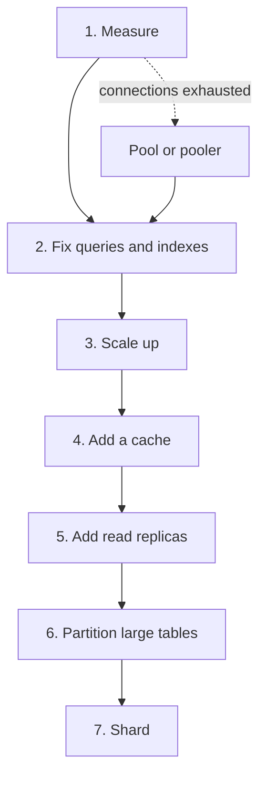

# Scaling a Database

A relational database starts as one server that handles every read and every write. As load grows, the server hits a limit: connections, CPU, memory, disk I/O, or the size of one table. This page explains the steps that raise those limits, in the order that costs the least, and the signal that tells you to take the next step. It covers the view of the database operator: connections and pools, read replicas, partitioning of a table inside one database, archiving, and backups. The theory of replication and sharding across nodes lives in the HLD pages, which this page links.

## Why It Matters

Interviewers ask "Your database is at 90 percent CPU. What do you do?" and "The service has 10 000 requests per second. How do you scale the database?" A weak answer says "add shards" or "add a cache" at once. A strong answer measures first, fixes queries and indexes, scales the machine up, and then adds read replicas, partitions, and shards in that order. Each step has a cost, and a senior engineer names the cost. On the job, the most common scaling failure is not data size. It is connections: a fleet of services opens more connections than the server accepts. This page also covers the backup question that ends many incident reviews: "Can we restore the data to 14:02, one minute before the bad `DELETE`?"

!!! info "Versions"
    This page states PostgreSQL 18 behavior (checked on 2026-11-05 against `postgresql.org/docs/18/`) and MySQL 8.4 behavior (checked against `dev.mysql.com/doc/refman/8.4/en/`). PgBouncer values come from the current configuration page of `pgbouncer.org`. A default value can change in a later release, so check your version before you rely on a number.

## Core Concepts

**Vertical scaling (scale up)**: a bigger machine with more CPU cores, more memory, and faster disks. It needs no application change. It has a ceiling and a price that grows faster than the capacity.

**Horizontal scaling (scale out)**: more machines. It has no hard ceiling, and it needs application and data changes.

**Connection**: a session between a client and the database server. Each connection holds server resources, such as a process or thread, memory, and an entry in the lock and snapshot tables.

**Connection pool**: a set of open connections that threads borrow and return. An application-side pool (HikariCP) lives in each application instance. A server-side pooler (PgBouncer) lives between all application instances and the database.

**Pooler**: a separate process that accepts many client connections and maps them to few server connections. PgBouncer is a pooler for PostgreSQL.

**Primary**: the server that accepts writes. MySQL calls it the source.

**Replica**: a server that holds a copy of the primary's data and applies the primary's changes. PostgreSQL calls a replica that serves queries a hot standby. MySQL calls it a replica.

**Replication lag**: the delay between a commit on the primary and the moment that a replica makes the change visible to queries.

**Physical replication**: the replica applies the primary's log at the level of disk pages. The PostgreSQL write-ahead log (WAL) stream is a physical log. **Logical replication** sends row changes, and the receiver applies them as SQL-level changes.

**Table partitioning**: the split of one logical table into several physical tables (partitions) inside one database. The database routes each row to a partition by the value of the partition key.

**Partition pruning**: the planner skips the partitions that cannot hold rows for the query.

**Sharding**: the split of data across several database servers. Each server holds a part. The theory is in [Partitioning and Sharding](../hld/fundamentals/06-partitioning-and-sharding.md).

**Base backup**: a copy of the database files taken while the server runs. **WAL archive**: the stored copy of every finished WAL segment. A base backup plus the WAL archive lets you restore the database to any point after the base backup. This restore is **point-in-time recovery (PITR)**.

## How It Works

### The Order of Steps

Scale in this order. Each step is cheaper and more reversible than the next one. Move to the next step only when the signal says the current step is exhausted.



| Step | What you do | Signal to move on |
|---|---|---|
| 1. Measure | Find the bottleneck resource (CPU, I/O wait, memory, locks, connections) and the top queries by total time (`pg_stat_statements`, slow query log). See [Query Execution and Tuning](05-query-execution-and-tuning.md) | You know the resource and the query that uses most of it |
| 2. Tune queries and indexes | Add or fix indexes, remove N+1 patterns, rewrite queries, update statistics. See [Indexing](03-indexing.md) | The top queries are already index-supported, and the resource is still saturated |
| 3. Scale up | More cores, more RAM (a larger cache hit ratio), faster storage | The next size costs much more for a small gain, or the largest machine is in use |
| 4. Add a cache | Serve repeated reads from memory outside the database. See [Caching](../hld/fundamentals/03-caching.md) | Read load is still the problem, the data tolerates staleness, and the hit ratio is high enough to pay for the extra system |
| 5. Add read replicas | Send reads that tolerate lag to replicas | The primary is saturated by writes, or replicas cannot absorb the reads that need fresh data |
| 6. Partition tables | Split a huge table by time or key inside one database | A table is so large that maintenance (vacuum, index build, delete of old rows) or index size hurts, and most queries touch one partition |
| 7. Shard | Split data across servers. See [Partitioning and Sharding](../hld/fundamentals/06-partitioning-and-sharding.md) | The write rate or the data size exceeds the largest single primary |

The order is a recommendation, not a law. A team can add a cache before it scales up, or add a replica for a reporting workload on day one. Connection exhaustion is a separate branch: it needs a pool or a pooler first, because no other step helps when the server refuses connections.

!!! warning "Replicas scale reads, not writes"
    Every replica applies every write of the primary. Adding replicas does not raise the write limit. If the primary is saturated by writes, replicas do not help. Only a bigger primary, fewer writes, or sharding raises the write limit.

### Connections

#### The server cost of a connection

PostgreSQL uses a "process per user" model. The `postmaster` process spawns one backend process for each client connection (PostgreSQL documentation, "How Connections Are Established"). Each backend has its own memory for sorts, hashes, and caches of catalog data. The server also keeps per-connection state in shared memory for locks and snapshots, so a large connection count raises the cost of every transaction even when most connections are idle.

The parameter `max_connections` sets the limit. Its default is typically 100, and it can be lower if the kernel settings do not support it (PostgreSQL 18 documentation, "Connections and Authentication"). Three of the connections are reserved for superusers by default (`superuser_reserved_connections`). A standby must set `max_connections` to the same value as the primary or a higher one, or the standby does not allow queries.

Assumption: the process-per-connection design is why a server with thousands of mostly idle connections wastes memory. The documentation states the design. The memory figure per connection depends on the workload, so measure it on your system.

#### Pool sizing

Opening a connection costs a network round trip, an authentication step, and a new backend process in PostgreSQL. An application-side pool avoids that cost by reusing connections. See [JDBC, JPA, and Hibernate](../java/16-jdbc-jpa-and-hibernate.md) for HikariCP settings and the pool API.

The pool size has an upper bound that the database sets, not the application. A worked example:

- The database has `max_connections = 100`. Three are reserved for superusers, so 97 remain for the application, and monitoring and migration tools also need some.
- A service runs 20 instances. Each instance has a pool of 10 (the HikariCP default `maximumPoolSize`). The fleet can open 200 connections.
- 200 is more than 97. When all instances are busy, the database refuses connections with an error such as "too many clients already".

Two fixes exist. Lower the pool size per instance (the total is `instances × pool size`), or put a pooler between the instances and the database so that the database sees fewer connections than the clients open.

The HikariCP wiki page "About Pool Sizing" gives this formula, which it attributes to the PostgreSQL project as a starting point:

```text
connections = ((core_count * 2) + effective_spindle_count)
```

The wiki states that the effective spindle count is zero if the active data set is fully cached, and that it approaches the number of spindles as the cache hit rate falls. The wiki tells you to test your application and to try pool settings around this starting point. It also cites an Oracle performance video in which a pool reduced from 2048 connections to 96 cut response times from about 100 ms to about 2 ms. Treat the formula as a starting point and not a rule.

The reason that a smaller pool can be faster: a database with 8 cores cannot run 500 queries at the same time. Extra connections only add context switches and lock contention, and the queries queue inside the database instead of in the pool.

#### PgBouncer and pool modes

PgBouncer is a lightweight connection pooler for PostgreSQL. Clients connect to PgBouncer as if it were PostgreSQL. PgBouncer holds a small set of real server connections and lends them to clients. It has three pool modes (PgBouncer documentation, "Features"):

| Mode | A server connection belongs to a client for | What it supports | Use |
|---|---|---|---|
| Session | The whole time the client stays connected | All PostgreSQL features. The documentation calls it the most polite method | Applications that need session state. It is the default of PgBouncer (`pool_mode` on the configuration page) |
| Transaction | The duration of one transaction. PgBouncer returns the connection to the pool when the transaction ends | Most features. Some session features do not work (below) | Many short transactions from many clients. The usual choice for a web fleet |
| Statement | One statement. Multi-statement transactions are not allowed | A client in autocommit mode only | Special cases, such as PL/Proxy |

In transaction mode, two consecutive transactions of one client can run on different server connections. Anything that the client stores in the server session before the transaction ends may be lost or may leak to another client. The PgBouncer feature table lists these as not supported in transaction pooling:

- `SET` and `RESET` (session settings),
- `LISTEN` (notifications),
- `WITH HOLD` cursors,
- SQL-level `PREPARE` and `DEALLOCATE`,
- temporary tables that preserve rows at commit (`ON COMMIT PRESERVE ROWS`) or delete rows (`DELETE ROWS`),
- the `LOAD` statement,
- session-level advisory locks.

Prepared statements deserve a closer look because JDBC drivers use them. Protocol-level prepared statements (the extended query protocol) work in transaction mode only if `max_prepared_statements` is set to a non-zero value. PgBouncer 1.21.0 (released 2023-10-16) added the support, with the setting at 0 (off). PgBouncer 1.24.0 changed the default to 200 (PgBouncer changelog, and the current configuration page). PgBouncer 1.22.0 added support for `DEALLOCATE ALL` and `DISCARD ALL` when the setting is non-zero. The feature table still lists SQL-level `PREPARE` and `DEALLOCATE` as not supported in transaction mode. Check the PgBouncer version that you run: before 1.21 no support exists, and from 1.21 to 1.23 you must set the value yourself.

A JDBC fragment shows how an application handles this. The PostgreSQL JDBC driver switches a statement to a server-side prepared statement after `prepareThreshold` executions (default 5, from the pgJDBC documentation). In transaction mode with a PgBouncer version that does not track prepared statements, a statement that the driver prepared on one server connection fails on another. The fixes are a PgBouncer version with `max_prepared_statements` set, or `prepareThreshold=0` in the JDBC URL, which the pgJDBC documentation describes as the way to disable server-side prepared statements.

PgBouncer resets a server connection before it gives it to another client. The setting `server_reset_query` defaults to `DISCARD ALL`. The documentation says that PgBouncer does not use it in transaction pooling mode, unless `server_reset_query_always` is on (default off).

Pool sizing at the pooler: `default_pool_size` is 20 server connections for each user and database pair, and `max_client_conn` is 100 by default (PgBouncer configuration documentation). Raise `max_client_conn` for a large fleet. Keep the sum of all pools below `max_connections` of the database.

#### Proxies such as RDS Proxy

A managed proxy does the same job as PgBouncer. Amazon RDS Proxy lets applications pool and share database connections, queues or throttles connection requests that the pool cannot serve at once, and connects to a standby instance after a failure while it keeps the application connections (AWS documentation, "Amazon RDS Proxy"). One limit from the AWS page "Avoiding pinning an RDS Proxy": RDS Proxy pins a session to one database connection when multiplexing could give wrong results. Every engine pins on a statement with text larger than 16 KB. For RDS for PostgreSQL, a `SET` command, `PREPARE`, a cursor, a temporary table, and a session-level advisory lock also pin (transaction-level advisory locks do not). A pinned session cannot share its connection until it ends, so the pooling gain is lost for that session. This matches the list of what PgBouncer transaction mode breaks.

### Read Replicas

This section covers replicas from the operator's view. The leader and follower theory, the anomalies, and the quorum rules are in [Replication](../hld/fundamentals/05-replication.md). Read that page first for synchronous against asynchronous replication, semisynchronous replication in MySQL, and Group Replication.

#### PostgreSQL streaming (physical) replication

A standby connects to the primary and receives the WAL as the primary writes it. The standby replays the WAL and keeps a byte-identical copy of the primary's data files. Replication is asynchronous by default (PostgreSQL 18 documentation, "High Availability, Load Balancing, and Replication"). The standby needs a base backup, and the primary needs a role with the `REPLICATION` privilege. `max_wal_senders` limits the concurrent standby connections and base backups, and its default is 10.

With `hot_standby = on` (the default) and a `standby.signal` file, the standby accepts read-only queries. Physical replication copies the whole cluster, so you cannot replicate one table, and the standby must run the same major version as the primary.

#### PostgreSQL logical replication

Logical replication uses a publication on the publisher and a subscription on the subscriber. The subscriber copies a snapshot of each table and then applies the row changes in the publisher's commit order (PostgreSQL 18 documentation, "Logical Replication"). The publisher needs `wal_level = logical`. The documentation lists these use cases: sending incremental changes of a subset of a database, consolidating several databases into one for analytics, replication between different major versions, and replication between different platforms.

Restrictions from the PostgreSQL 18 documentation:

- The schema and DDL commands are not replicated. You apply schema changes on both sides, and the documentation advises to apply additive changes on the subscriber first.
- Sequence data is not replicated. Identity columns replicate as table data, and the sequence on the subscriber keeps its start value. Before a failover to the subscriber, you set the sequences to a value above the data.
- Large objects are not replicated.
- Only tables, including partitioned tables, replicate. Views, materialized views, and foreign tables do not.
- A published table needs a replica identity (by default the primary key) so that the subscriber can find the row for an `UPDATE` or `DELETE`.

| | Physical (streaming) | Logical |
|---|---|---|
| What it ships | WAL records (page-level changes) | Row changes (decoded from the WAL) |
| Scope | The whole cluster | Chosen tables |
| Standby or subscriber is writable | No (read-only) | Yes (it is an ordinary database) |
| Cross-major-version | No | Yes |
| DDL and sequences | Replicated (it is a byte copy) | Not replicated |
| Typical use | Read replicas, failover, high availability | Version upgrades, data feeds, consolidation |

#### The MySQL binary log

MySQL replicates through the binary log. The source writes every change to its binary log. Each replica pulls the log, stores it in a local relay log, and executes the events (MySQL 8.4 documentation, "Replication Implementation"). The replica pulls the log, so a slow replica does not block the source. The formats are `STATEMENT`, `ROW`, and `MIXED`, and row-based logging is the default (see [Replication](../hld/fundamentals/05-replication.md)). The replica applier runs with `replica_parallel_workers` set to 4 by default in MySQL 8.4, which makes replicas multithreaded. `replica_preserve_commit_order` is `ON` by default, so the replica commits transactions in the source's order. `replica_parallel_type` defaults to `LOGICAL_CLOCK`, and the documentation deprecates the variable.

The same binary log also drives point-in-time recovery and change data capture (see [OLTP, OLAP, and Warehousing](10-oltp-olap-and-warehousing.md)).

#### Measuring replica lag

PostgreSQL gives two views of lag. The first query runs on the primary, and the second runs on a standby:

<!-- sql-skip: postgresql -->

```sql
-- PostgreSQL. On the primary: one row for each connected standby.
SELECT application_name, state, sync_state,
       pg_wal_lsn_diff(pg_current_wal_lsn(), replay_lsn) AS replay_lag_bytes,
       write_lag, flush_lag, replay_lag
FROM pg_stat_replication;

-- PostgreSQL. On a standby: the commit time of the last replayed transaction.
SELECT now() - pg_last_xact_replay_timestamp() AS replay_delay;
```

`pg_stat_replication` shows the byte distance between the primary and each standby. The columns `write_lag`, `flush_lag`, and `replay_lag` are intervals. The documentation defines `replay_lag` as the time between flushing recent WAL locally and receiving notice that the standby has written, flushed, and applied it. `pg_last_xact_replay_timestamp()` returns the time of the last replayed transaction, and it returns `NULL` if no transaction has been replayed. Caution (a consequence of the definition, not a quote): if the primary has no new commits, the value `now() - pg_last_xact_replay_timestamp()` grows although the standby is up to date. The `replay_lag` column has its own idle behavior: the documentation says that after a standby has caught up and no WAL activity follows, the last measured lag stays visible for a short time and then shows `NULL`. So a `NULL` in `replay_lag` can mean "idle and caught up". Alert on the byte distance, and on `replay_lag` while the primary has traffic. A heartbeat row, as in the MySQL advice below, gives a time-based measure that works on an idle system too.

MySQL: `SHOW REPLICA STATUS` shows `Seconds_Behind_Source`. The MySQL 8.4 manual defines it as the difference between the current time on the replica and the original timestamp of the event that the applier thread processes now, and it is 0 when no event is in process. The manual says that the column is useful only on fast networks, that NTP clock changes make it less reliable, that it is `NULL` when the applier thread is not running, and that on a multithreaded replica it may not reflect the most recent commit. Do not use this value as the only signal. Write a heartbeat row on the source at a fixed interval and read its age on the replica. The age of the heartbeat row does not depend on the applier thread state or on the timestamp of the event that the applier processes now.

#### Read routing and read-your-writes

A router sends writes to the primary and reads to replicas. The anomalies that lag causes (a user does not see their own write; time moves backward between two reads) and their fixes are in [Replication](../hld/fundamentals/05-replication.md). From the operator's side, these routing rules work:

1. **Time window after a write.** The application remembers the time of the user's last write. For a fixed window (for example, longer than the normal lag) it reads that user's data from the primary. The Java example below implements this.
2. **Lag limit.** The router skips replicas whose lag exceeds a limit and falls back to the primary when none qualifies.
3. **Log position token.** The application stores the log position of the user's last commit and reads only from a replica that has applied that position. In PostgreSQL, take `pg_current_wal_lsn()` after the commit, and compare it with `pg_last_wal_replay_lsn()` on the replica. In MySQL, take the transaction's GTID (with `session_track_gtids = OWN_GTID` the server returns the GTIDs of the session's own transactions to the client in the OK packet. The default is `OFF`, and `ALL_GTIDS` is the third value) and call `WAIT_FOR_EXECUTED_GTID_SET(gtid_set[, timeout])` on the replica. The MySQL manual defines the function as waiting until the server applies all transactions in the set, returning 0 on success and 1 on timeout.
4. **Synchronous commit to a standby.** PostgreSQL `synchronous_commit = remote_apply` makes the commit wait until a synchronous standby has replayed the commit record, so a read on that standby sees the write. The cost is a higher commit latency.
5. **Route by feature.** Reads that need fresh data (the checkout page) go to the primary. Reads that tolerate lag (a product list, a report) go to replicas.

A load balancer or a proxy can host the routing rule, and so can the application. Keep the rule in one place.

#### Query conflicts on a hot standby

A hot standby replays WAL from the primary, and it runs read queries at the same time. The two can conflict. The PostgreSQL 18 documentation ("Hot Standby") lists these conflicts:

- A vacuum cleanup record in the WAL removes row versions that a standby query can still see.
- A vacuum cleanup record conflicts with a query that accesses the target page, whether or not the removed data is visible to it.
- An `ACCESS EXCLUSIVE` lock on the primary (an explicit `LOCK` or a DDL command) conflicts with table access in standby queries.
- A dropped tablespace conflicts with standby queries that use it for temporary files.
- A dropped database conflicts with sessions connected to that database on the standby.

When a conflict occurs, the standby must either delay the WAL replay (and everything after it) or cancel the query. The delay is limited by `max_standby_streaming_delay` for WAL that arrives by streaming, and by `max_standby_archive_delay` for WAL that the standby reads from an archive. Both default to 30 seconds. A value of -1 makes the standby wait forever. After the delay, the standby cancels the conflicting query. A dropped database ends the whole session at once, whatever the delay setting says (documentation, section on handling query conflicts). The view `pg_stat_database_conflicts` on the standby counts the cancels and the reasons.

Two ways reduce the cancels, and each has a cost:

| Setting | Effect | Cost |
|---|---|---|
| `hot_standby_feedback = on` (default `off`) | The standby tells the primary which rows its queries still need. The primary's `VACUUM` keeps them. Cleanup conflicts disappear. Lock conflicts from `ACCESS EXCLUSIVE` remain | The primary keeps dead rows longer, which can cause table bloat. A long query on a standby affects the primary |
| A larger `max_standby_streaming_delay` | The standby waits longer before it cancels a query | Replay stops while the standby waits. The replica falls behind by as much as the delay. Reads on the replica are staler |

Recommendation: use separate standbys. One standby serves short, fresh reads with the defaults. Another standby serves long reports with a large delay or with feedback, and the team accepts its lag.

#### Failover in brief

Failover promotes a replica to primary after the primary fails. In PostgreSQL, `pg_ctl promote` or `pg_promote()` promotes a standby. The documentation states that PostgreSQL does not include the software that detects the failure and chooses the new primary, so teams use an external tool for that. The other replicas must follow the new primary. After a failover, asynchronous replication can have lost the last commits that the old primary had not shipped. The risks (split brain, fencing, lost writes) are in [Replication](../hld/fundamentals/05-replication.md).

### Table Partitioning Inside One Database

Table partitioning splits one large table into smaller physical tables. The application queries the parent table, and the database chooses the partitions. Sharding splits data across servers. Partitioning stays on one server. Do not confuse them.

PostgreSQL declarative partitioning offers three methods (PostgreSQL 18 documentation, "Table Partitioning"):

| Method | Rule | Typical key | Example use |
|---|---|---|---|
| Range | Each partition holds a range of key values. Ranges do not overlap | A time stamp or a date | One partition per month of events |
| List | Each partition lists the key values that it holds | A region or a tenant type | One partition per country group |
| Hash | Each partition holds the rows whose key hash has a given remainder when divided by a modulus | A user ID | Spread rows evenly when no range makes sense |

<!-- sql-skip: postgresql -->

```sql
-- PostgreSQL 18. The primary key must include the partition key column.
CREATE TABLE events (
    event_id    bigint GENERATED ALWAYS AS IDENTITY,
    occurred_at timestamptz NOT NULL,
    user_id     bigint NOT NULL,
    payload     jsonb,
    PRIMARY KEY (event_id, occurred_at)
) PARTITION BY RANGE (occurred_at);

CREATE TABLE events_2026_10 PARTITION OF events
    FOR VALUES FROM ('2026-10-01') TO ('2026-11-01');
CREATE TABLE events_2026_11 PARTITION OF events
    FOR VALUES FROM ('2026-11-01') TO ('2026-12-01');

-- A hash partition uses a modulus and a remainder:
-- CREATE TABLE t_p0 PARTITION OF t FOR VALUES WITH (MODULUS 4, REMAINDER 0);
```

The lower bound of a range partition is inclusive, and the upper bound is exclusive. A row whose key fits no partition causes an error. The documentation says to add the missing partition manually, or to create a `DEFAULT` partition. A tool or a scheduled job creates the partitions of the next months before the data arrives.

#### Partition pruning

The planner proves from the partition bounds that a partition cannot hold rows that match the `WHERE` clause, and it removes that partition from the plan (partition pruning). Pruning uses the bounds of the partition key, not an index. The documentation says that an index on the key columns is not strictly necessary, but in most cases it helps the queries that read the remaining partitions. A query that filters on the partition key reads one partition. A query without a filter on the key reads all partitions.

Pruning works at two moments. At plan time, the planner prunes with constants. At execution time, the executor prunes with values that it learns while it runs, such as parameters of a prepared statement or values from a subquery. The `EXPLAIN` output shows plan-time pruning as missing partitions, and a `Subplans Removed` line counts the partitions that the executor start removed. A partition that execution time pruning removed on every loop shows `(never executed)` in `EXPLAIN ANALYZE`. The documentation's warning about a comparison with a non-immutable function such as `CURRENT_TIMESTAMP` appears in the section on constraint exclusion, the older technique for inheritance-based partitioning. For a declarative partitioned table, read the `EXPLAIN` output of your own query to see which partitions remain.

The parameter `enable_partition_pruning` is on by default. The following output is the example from the PostgreSQL documentation ("Partition Pruning"). It is a query on a table `measurement` that has monthly partitions, with the filter `logdate >= DATE '2008-01-01'`:

```text
-- enable_partition_pruning = off
 Aggregate  (cost=188.76..188.77 rows=1 width=8)
   ->  Append  (cost=0.00..181.05 rows=3085 width=0)
         ->  Seq Scan on measurement_y2006m02  (cost=0.00..33.12 rows=617 width=0)
               Filter: (logdate >= '2008-01-01'::date)
         ... (every partition is scanned)
         ->  Seq Scan on measurement_y2008m01  (cost=0.00..33.12 rows=617 width=0)
               Filter: (logdate >= '2008-01-01'::date)

-- enable_partition_pruning = on (the default)
 Aggregate  (cost=37.75..37.76 rows=1 width=8)
   ->  Seq Scan on measurement_y2008m01  (cost=0.00..33.12 rows=617 width=0)
         Filter: (logdate >= '2008-01-01'::date)
```

#### Drop old partitions instead of deleting rows

A `DELETE` of 100 million old rows writes a delete mark for each row, writes WAL for each, leaves dead rows that `VACUUM` must clean, and holds locks for a long time. A partition per month turns the removal into a metadata change:

<!-- sql-skip: postgresql -->

```sql
-- PostgreSQL 18. Detach without blocking readers and writers of the parent.
ALTER TABLE events DETACH PARTITION events_2026_10 CONCURRENTLY;
-- Then archive the detached table (for example with pg_dump) and drop it.
DROP TABLE events_2026_10;
```

The documentation lists "bulk loads and deletes can be accomplished by adding or removing partitions" as a benefit. `DETACH PARTITION ... CONCURRENTLY` takes a `SHARE UPDATE EXCLUSIVE` lock on the parent, and it works in two transactions. The second transaction takes an `ACCESS EXCLUSIVE` lock on the partition only, after it waits for all transactions that use the partitioned table. It cannot run in a transaction block, and it is not allowed if the partitioned table has a default partition. If a concurrent detach is interrupted, `ALTER TABLE ... DETACH PARTITION ... FINALIZE` completes it. At most one partition of a table can be pending detach at a time.

#### Rules for primary keys and unique indexes

A unique index on a partitioned table checks uniqueness inside each partition. The database does not check across partitions. To make the global guarantee sound, the rule is: the constraint's columns must include all of the partition key columns, and the partition key must not contain expressions or function calls (PostgreSQL 18 documentation, "Limitations"). A primary key `(event_id)` on a table partitioned by `occurred_at` fails. The key `(event_id, occurred_at)` works, but it no longer guarantees that `event_id` alone is unique across the table. If the application needs a unique `event_id`, it must produce unique values itself (a sequence does), because the database does not enforce it across partitions. Other rules from the same section:

- An exclusion constraint on a partitioned table must include all partition key columns and compare them for equality.
- A `BEFORE ROW` trigger on `INSERT` cannot change the partition that receives the row.
- Updating the partition key of a row moves the row to another partition if it no longer fits the bounds of its old partition.

MySQL has the same rule in its own words: every unique key on a partitioned table, including the primary key, must use every column of the partitioning expression (MySQL 8.4 documentation, "Partitioning Keys, Primary Keys, and Unique Keys").

#### How many partitions

The PostgreSQL documentation says that the planner handles partition hierarchies of up to a few thousand partitions fairly well if queries prune all but a few of them. It warns that planning time and memory grow when many partitions remain after pruning, and that too few partitions leave indexes large and cache hit ratios low. It says: never assume that more partitions are better than fewer. Choose the partition key that most often appears in the `WHERE` clauses, and design the scheme so that data that you remove together sits in one partition.

#### Partitioning in MySQL

MySQL 8.4 supports `RANGE`, `LIST`, `HASH`, and `KEY` partitioning, with the rules about unique keys above (the full list of types is in the manual chapter "Partitioning"). The limits (MySQL 8.4 documentation, "Restrictions and Limitations on Partitioning"): a table that does not use the `NDB` engine can have at most 8192 partitions, including subpartitions, and an `InnoDB` table with user-defined partitioning cannot have foreign keys, and no foreign key can reference it. The foreign key limit often rules out partitioning for tables in a normalized schema.

#### What partitioning does not do

Partitioning does not add capacity beyond one server. All partitions share the primary's CPU, memory, and disk. It helps maintenance (drop, detach, vacuum of one partition) and queries that prune. It does not help a query that touches all partitions, and it adds planning cost.

### Sharding

Sharding splits the data across several database servers, and each server holds a subset of the rows. It raises the write limit and the data size limit beyond one machine, and it costs you joins across shards, transactions across shards, and rebalancing work. The partition key, the hash against range choice, consistent hashing, and resharding are in [Partitioning and Sharding](../hld/fundamentals/06-partitioning-and-sharding.md). Two tools exist at the database level. Vitess is an open-source database clustering system for horizontal scaling of MySQL (Vitess documentation, "What is Vitess"). Citus is an open-source extension of PostgreSQL that distributes tables across nodes (Citus documentation). Both hide part of the routing work, and neither removes the cost of cross-shard queries.

### Archiving Cold Data

Most tables are append-heavy, and the old rows are rarely read. Cold data raises storage cost, backup time, index size, and vacuum time. Options, from least to most work:

1. **Partition by time and detach.** Detach the old partition, dump it, store the dump in cheaper storage, and drop it. This is the case that partitioning serves best.
2. **Move rows to an archive table or database.** A job copies old rows to an archive table in batches and deletes them in small batches, so locks stay short. Index the archive table for the few queries that read it.
3. **Export to object storage in a columnar format.** Write old data as Parquet files to a data lake and query it with an analytical engine. See [Storage Types](../hld/fundamentals/10-storage-types.md) for lakes and file formats.
4. **Keep the data and tier the storage.** The PostgreSQL documentation lists the move of seldom-used data to cheaper and slower storage media as a benefit of partitioning (a partition can sit in its own tablespace).

Decide the retention rule first (for example, 13 months online), and write it down. Legal retention rules can require that you keep some data longer or delete it by a date.

### Backups and Point-in-Time Recovery

A backup is only as good as the last restore that you tested. Two kinds exist in PostgreSQL:

- **Logical backup** (`pg_dump`, `pg_dumpall`): SQL-level output of schema and rows. It restores into a new database, also on another major version. The documentation states that dumps are logical and cannot be used as part of a continuous-archiving solution, because they do not contain enough information for WAL replay. It takes time to restore a large database.
- **Physical backup** (a base backup, for example with `pg_basebackup`): a copy of the data files. With a continuous WAL archive, it supports PITR.

How PITR works in PostgreSQL (documentation, "Continuous Archiving and Point-in-Time Recovery"):

1. Set `wal_level` to `replica` or higher, set `archive_mode = on`, and give `archive_command` (or `archive_library`). The server then copies each finished WAL segment to the archive. The command must return a zero exit status if and only if it succeeds.
2. Take a base backup. `pg_basebackup` is the simplest way. The documentation states that you need a continuous sequence of archived WAL files that reaches back at least to the start of the backup.
3. To recover: stop the server, restore the base backup, set `restore_command` (how to fetch an archived segment) and a recovery target (a time, a named restore point, or a transaction ID), and create the file `recovery.signal` in the data directory. The server replays the WAL up to the target. The target must be after the end of the base backup. The default `recovery_target_action` is `pause`: the server stops at the target and accepts read-only queries, so you can check that the data is right. If the target is wrong, shut the server down, set a later target, and restart. If it is right, call `pg_wal_replay_resume()` or set the action to `promote`. When recovery ends, the server starts a new timeline.

<!-- sql-skip: postgresql -->

```sql
-- PostgreSQL 18, in postgresql.conf for the restored server
-- restore_command = 'cp /mnt/server/archivedir/%f %p'
-- recovery_target_time = '2026-11-05 14:02:00+00'
-- recovery_target_action = 'pause'   -- the default: stop at the target so you can check the data
-- Then create the empty file recovery.signal in the data directory and start the server.
-- After you check the data, call pg_wal_replay_resume() (or use 'promote' in the setting)
-- to end recovery. The server then starts a new timeline.
-- Take the time from the incident: one minute before the bad DELETE.
```

PostgreSQL 17 added incremental backups (PostgreSQL 17 release notes), and PostgreSQL 18 supports them with `pg_basebackup --incremental`. They need `summarize_wal = on` (default `off`), which makes the server write WAL summaries, and a restore combines the full backup and all incremental backups with `pg_combinebackup`. The documentation warns that PostgreSQL does not track which backups you still need, and that for a heavily modified database incremental backups are not much smaller than full ones.

MySQL 8.4: PITR combines a full backup with the binary log. Binary logging is on by default in MySQL 8.4. You restore the full backup, and then you replay the binary log events with `mysqlbinlog` piped into `mysql`, with options that select a range by time or by position, so that you stop before the bad statement (MySQL 8.4 documentation, "Point-in-Time (Incremental) Recovery").

Two numbers define a backup design. The **recovery point objective (RPO)** is how much data you can lose. With a WAL archive, the data that you can lose is the WAL that the server has not archived yet: at most the current WAL segment, and `archive_timeout` bounds how long it stays unarchived. A nightly dump loses up to a day. The **recovery time objective (RTO)** is how long the restore takes. A large database restores in hours, because the base backup must copy back and the WAL must replay. A replica is not a backup: it replays a bad `DELETE` as fast as the primary ran it. See [Multi-Region and Disaster Recovery](../hld/fundamentals/19-multi-region-and-disaster-recovery.md) for RPO, RTO, and cross-region design.

## Trade-offs and When to Use

| Step | Raises | Does not help | Main cost | Use when |
|---|---|---|---|---|
| Query and index tuning | Everything that the slow query uses | A workload that is already efficient | Engineer time. Indexes slow writes | Always first |
| Scale up | CPU, memory, I/O at once | A software limit such as lock contention | Money. A ceiling. A restart or a failover for the change | The fix is needed this week |
| Cache | Read capacity and latency | Writes. Reads that need fresh data | Staleness, invalidation, a new system to run | A read-heavy workload with a high hit ratio |
| Read replicas | Read capacity | Write capacity | Lag anomalies, routing, replica cost | Reads dominate and tolerate some lag |
| Connection pooler | The number of clients per server connection | Query speed | A new hop, features lost in transaction mode | Many clients, or many instances, open too many connections |
| Table partitioning | Maintenance, pruned queries, removal of old data | Capacity beyond one server. Queries without the key | Key and unique index rules, planning cost, partition management | One huge table with a time or key pattern |
| Sharding | Write capacity and data size | Cross-shard joins and transactions | Large: routing, resharding, cross-shard queries | One primary can no longer carry the writes or the data |
| Archiving | Storage, backup time, vacuum time | Hot-data load | A second place to query | A table grows without bound |

## Java Example

The example has two parts. A pool uses a `Semaphore` for the permits and a queue for the idle connections. It shows how a caller waits when the pool is empty, and how a caller times out. A read router sends reads to a replica unless the user wrote within a window, and it skips replicas that lag too much. The router takes the time as a parameter, so the output is deterministic. The code needs only the JDK. It simulates the logic. It does not talk to a database. For real JDBC code and HikariCP, see [JDBC, JPA, and Hibernate](../java/16-jdbc-jpa-and-hibernate.md).

```java
import java.util.ArrayDeque;
import java.util.HashMap;
import java.util.List;
import java.util.Map;
import java.util.concurrent.CountDownLatch;
import java.util.concurrent.Semaphore;
import java.util.concurrent.TimeUnit;
import java.util.concurrent.atomic.AtomicInteger;

public class ScalingDemo {
    public static void main(String[] args) throws Exception {
        poolDemo();
        routerDemo();
    }

    static void poolDemo() throws Exception {
        ConnectionPool pool = new ConnectionPool(2);
        Connection a = pool.borrow(100);
        Connection b = pool.borrow(100);
        System.out.println("borrowed " + a.id() + " and " + b.id()
                + ", free permits: " + pool.freePermits());

        try {
            pool.borrow(50);
        } catch (PoolTimeoutException e) {
            System.out.println("caller 1: " + e.getMessage());
        }

        AtomicInteger waiterGot = new AtomicInteger(-1);
        CountDownLatch waiterReady = new CountDownLatch(1);
        Thread waiter = new Thread(() -> {
            try {
                waiterReady.countDown();
                Connection c = pool.borrow(10_000);
                waiterGot.set(c.id());
                pool.release(c);
            } catch (InterruptedException e) {
                Thread.currentThread().interrupt();
            }
        });
        waiter.start();
        waiterReady.await();
        System.out.println("caller 2 asks for a connection from the empty pool");
        pool.release(a);
        waiter.join();
        System.out.println("caller 2 got connection " + waiterGot.get());
        pool.release(b);
        System.out.println("free permits after release: " + pool.freePermits());
    }

    static void routerDemo() {
        Map<String, Long> lag = new HashMap<>();
        lag.put("replica-1", 100L);
        lag.put("replica-2", 5_000L);
        lag.put("replica-3", 200L);
        ReplicaRouter router = new ReplicaRouter(
                List.of("replica-1", "replica-2", "replica-3"), lag, 2_000, 1_000);

        router.recordWrite("alice", 0);
        System.out.println("alice reads at 500 ms:  " + router.routeRead("alice", 500));
        System.out.println("alice reads at 2500 ms: " + router.routeRead("alice", 2_500));
        System.out.println("bob reads at 500 ms:    " + router.routeRead("bob", 500));
        System.out.println("bob reads at 600 ms:    " + router.routeRead("bob", 600));
        router.setLag("replica-1", 9_000);
        router.setLag("replica-3", 9_000);
        System.out.println("all replicas lag, bob:  " + router.routeRead("bob", 700));
    }
}

record Connection(int id) {}

class PoolTimeoutException extends RuntimeException {
    PoolTimeoutException(String message) {
        super(message);
    }
}

class ConnectionPool {
    private final int size;
    private final Semaphore permits;
    private final ArrayDeque<Connection> idle = new ArrayDeque<>();

    ConnectionPool(int size) {
        this.size = size;
        this.permits = new Semaphore(size, true);
        for (int i = 0; i < size; i++) {
            idle.add(new Connection(i));
        }
    }

    Connection borrow(long timeoutMillis) throws InterruptedException {
        if (!permits.tryAcquire(timeoutMillis, TimeUnit.MILLISECONDS)) {
            throw new PoolTimeoutException(
                    "no connection after " + timeoutMillis + " ms, pool size " + size);
        }
        synchronized (idle) {
            return idle.poll();
        }
    }

    void release(Connection connection) {
        synchronized (idle) {
            idle.add(connection);
        }
        permits.release();
    }

    int freePermits() {
        return permits.availablePermits();
    }
}

class ReplicaRouter {
    private final List<String> replicas;
    private final Map<String, Long> lagMillis;
    private final long windowMillis;
    private final long maxLagMillis;
    private final Map<String, Long> lastWrite = new HashMap<>();
    private int next = 0;

    ReplicaRouter(List<String> replicas, Map<String, Long> lagMillis,
                  long windowMillis, long maxLagMillis) {
        this.replicas = replicas;
        this.lagMillis = new HashMap<>(lagMillis);
        this.windowMillis = windowMillis;
        this.maxLagMillis = maxLagMillis;
    }

    void recordWrite(String user, long nowMillis) {
        lastWrite.put(user, nowMillis);
    }

    void setLag(String replica, long lag) {
        lagMillis.put(replica, lag);
    }

    String routeRead(String user, long nowMillis) {
        Long wrote = lastWrite.get(user);
        if (wrote != null && nowMillis - wrote < windowMillis) {
            return "primary";
        }
        for (int i = 0; i < replicas.size(); i++) {
            int index = (next + i) % replicas.size();
            String candidate = replicas.get(index);
            if (lagMillis.get(candidate) <= maxLagMillis) {
                next = (index + 1) % replicas.size();
                return candidate;
            }
        }
        return "primary";
    }
}
```

<!-- expected-output -->

```text
borrowed 0 and 1, free permits: 0
caller 1: no connection after 50 ms, pool size 2
caller 2 asks for a connection from the empty pool
caller 2 got connection 0
free permits after release: 2
alice reads at 500 ms:  primary
alice reads at 2500 ms: replica-1
bob reads at 500 ms:    replica-3
bob reads at 600 ms:    replica-1
all replicas lag, bob:  primary
```

The pool uses a fair semaphore, so waiting callers get connections in arrival order. Caller 1 shows the wait: it blocks for 50 ms and then times out. The main thread starts caller 2 and waits on a `CountDownLatch` until caller 2 is about to call `borrow`, and then it releases connection 0. Caller 2 may block on the semaphore before the release or take the permit after it. The result is the same in both cases, because the only free connection is connection 0, so the output does not depend on the schedule. The demo does not use a spin loop or a sleep to wait for a thread. `borrow` first acquires a permit, and only then takes a connection from the queue, so the queue is never empty when a permit is held. This is the same shape as a real pool: the permit count is the pool limit, and the timeout is `connectionTimeout`. The router chooses by two rules. Within the window after a write, the user reads from the primary. Otherwise the router skips replicas whose lag exceeds the limit, and it falls back to the primary if none qualifies.

## Interview Angle

### Questions

??? question "The database is at 90 percent CPU. How do you scale it?"

    Measure first, and scale in order of cost. First find the cause: look at `pg_stat_statements` or the slow query log for the queries that use the most total time, and check whether CPU is query work or connection overhead. Second, fix the queries: add a missing index, remove an N+1 pattern, update statistics. Most CPU problems end here, and the fix is cheaper than any hardware. Third, scale up if the queries are already efficient. Fourth, offload reads: a cache for repeated reads, read replicas for reads that tolerate lag. If the CPU comes from writes, replicas do not help, because each replica applies every write. Fifth, partition a huge table to cut maintenance cost, and shard only when one primary cannot carry the write rate or the data size. The trade-off: each step adds an operational cost, so I take the next step only when the signal says the current one is used up.

??? question "Why can a smaller connection pool give higher throughput?"

    The database can run only as many queries in parallel as it has CPU cores and disk parallelism. A pool larger than that does not add parallel work. It adds context switches, lock contention, and memory use per connection, and the queries wait inside the database instead of in the pool. The HikariCP wiki gives a starting formula, `(core_count * 2) + effective_spindle_count`, and cites a case where cutting a pool from 2048 to 96 connections cut response times from about 100 ms to about 2 ms. The formula is a starting point: I test around it with the real workload. The bound also comes from the server: pool size times instance count must stay below `max_connections` (default typically 100 in PostgreSQL). If threads wait for connections, I first look for long transactions and leaked connections before I raise the size.

??? question "What does PgBouncer transaction pooling break?"

    In transaction mode PgBouncer gives a server connection to a client for one transaction, and the next transaction can run on another server connection. So anything that lives in the server session breaks: `SET` and `RESET`, `LISTEN`, `WITH HOLD` cursors, SQL-level `PREPARE` and `DEALLOCATE`, session-level advisory locks, and temporary tables that persist beyond the transaction. Protocol-level prepared statements, which JDBC drivers use, work only when `max_prepared_statements` is set to a non-zero value in a PgBouncer version that supports it. The fix: use `SET LOCAL` inside the transaction, use transaction-level advisory locks, and keep session state out of the application. If the application needs session features, use session mode for that service. The benefit of transaction mode: thousands of clients share a few dozen server connections.

??? question "A user posts a comment and does not see it after the redirect. The service reads from a replica. What do you do?"

    This is replication lag: the write went to the primary, and the read reached a replica that has not applied it yet. The goal is read-your-writes for that user. Options, from simple to precise: read from the primary for a short window after the user's last write; read from the primary for data that the user can modify, and from replicas for the rest; or store the log position of the user's commit and read only from a replica that has applied it (PostgreSQL LSN comparison, or `WAIT_FOR_EXECUTED_GTID_SET` in MySQL). A synchronous standby with `synchronous_commit = remote_apply` also works, at the cost of commit latency. I also skip replicas above a lag limit and fall back to the primary. I monitor lag (`pg_stat_replication`, `Seconds_Behind_Source` plus a heartbeat row), because the window must be longer than the real lag.

??? question "Queries on the replica fail with 'canceling statement due to conflict with recovery'. Why, and what are the options?"

    A hot standby replays the primary's WAL while it runs queries. If the WAL contains a vacuum cleanup record that removes row versions that a standby query can still see, or an `ACCESS EXCLUSIVE` lock from the primary, the standby must delay replay or cancel the query. It waits up to `max_standby_streaming_delay` (default 30 seconds), and then cancels the query. Options: raise the delay, which makes the replica lag behind by that much; set `hot_standby_feedback = on`, which makes the primary keep the dead rows that standby queries need, and risks bloat on the primary; or move long reports to a dedicated standby with a large delay, and keep another standby for short, fresh reads. There is no free option: the choice trades lag, bloat, and cancels.

??? question "What is the difference between partitioning and sharding, and what is the catch with primary keys on partitioned tables?"

    Partitioning splits one table into several physical tables inside one database server. Sharding splits data across several servers. Partitioning helps maintenance (detach or drop an old partition, vacuum a small one) and queries that prune to one partition. It does not add capacity beyond the server. Sharding adds write capacity and storage, and it costs cross-shard joins and transactions. The catch in PostgreSQL: a primary key or unique constraint on a partitioned table must include all partition key columns, because each partition enforces uniqueness alone. A table partitioned by `occurred_at` needs a key like `(event_id, occurred_at)`, and `event_id` alone is not unique by constraint. MySQL has the same rule for every unique key, and InnoDB partitioned tables cannot have foreign keys.

??? question "A 5 TB event table keeps 24 months of data. How do you remove data older than 24 months without hurting production?"

    Do not run one large `DELETE`: it writes WAL for every row, creates dead rows that `VACUUM` must clean, and holds locks. Instead partition the table by month on the time stamp. Each month, create the next partitions ahead of time, then run `ALTER TABLE ... DETACH PARTITION ... CONCURRENTLY` for the oldest one, which needs only a `SHARE UPDATE EXCLUSIVE` lock on the parent. Dump or export the detached table to archive storage if the data must be kept, and `DROP TABLE` it. The cost is a metadata operation. Caveats: the primary key must include the time stamp, a default partition blocks the concurrent detach, and queries must filter on the time stamp to benefit from pruning. If the table is not yet partitioned, I migrate with a new partitioned table and a backfill in batches.

??? question "Someone ran `DELETE FROM orders` without a `WHERE` at 14:03. How do you recover?"

    A replica does not help, because it replayed the delete. I use point-in-time recovery. In PostgreSQL I need a base backup and the continuous WAL archive that reaches back to the backup. I restore the base backup on a new server, set `restore_command` and a recovery target of 14:02, create `recovery.signal`, and start the server. The server replays the WAL up to the target and, with the default `recovery_target_action = pause`, stops there. I check that the table is intact, then resume or promote, and the server opens on a new timeline. Then I copy the lost rows back (`pg_dump` of the table from the recovered server, or a targeted insert) so that the production database keeps the writes after 14:03. In MySQL the equivalent is a full backup plus `mysqlbinlog` with a stop time or position before the statement. The prerequisite is that archiving and backups were running and that someone tested the restore. The data that I can lose is the WAL that was not yet archived (the RPO), and the RTO is the restore time, which can be hours for a large database.

??? question "When do you choose logical replication over streaming replication?"

    Streaming (physical) replication ships the WAL and produces a byte-identical, read-only copy of the whole cluster on the same major version. It suits read replicas and failover. Logical replication ships row changes of chosen tables to a database that stays writable and that can run a different major version or platform. I choose it for a zero-downtime major version upgrade, for a feed of some tables to another system, or to consolidate several databases for analytics. Its limits: DDL and sequence values do not replicate, large objects do not replicate, and an updated table needs a replica identity such as a primary key. Before a failover to a logical subscriber, I must set the sequences above the maximum of the data.

### Follow-up Questions

- How would you find out whether a slow endpoint is slow because of the query or because of waiting for a pooled connection? (Compare the pool's wait time metric with the query time. See [JDBC, JPA, and Hibernate](../java/16-jdbc-jpa-and-hibernate.md).)
- What happens to reads on a replica when the primary is idle and the replica lag metric uses `now() - pg_last_xact_replay_timestamp()`? (The value grows although the replica is current.)
- How do you add a partition key to an existing large table with no downtime? (Create the partitioned table, backfill in batches, replicate new writes, then swap names in a short transaction.)
- Why does a unique constraint on a hash-partitioned table need the partition key? (Each partition enforces uniqueness for its own rows only.)
- How do you split reads between a transactional workload and a reporting workload? (A dedicated replica for reports, with its own conflict settings, or a warehouse. See [OLTP, OLAP, and Warehousing](10-oltp-olap-and-warehousing.md).)
- How do CQRS read models relate to read replicas? (A replica is a physical copy. A CQRS read model is a different schema that you build from events. See [Event-Driven Architecture](../hld/fundamentals/16-event-driven-architecture.md).)

### Red Flags

- "Add read replicas" as the answer to a write bottleneck.
- "Shard" as the first step, before indexes, pooling, and a bigger machine.
- A pool size of several hundred per instance, with no calculation of `instances × pool size` against `max_connections`.
- "A replica is our backup."
- Reading from a replica right after a write, with no mention of lag.
- "Partitioning makes every query faster." A query that does not filter on the key reads all partitions.
- "`hot_standby_feedback` has no downside."

## Common Mistakes

| Mistake | Why it hurts | Fix |
|---|---|---|
| Pool per instance times instance count exceeds `max_connections` | Connection errors at peak load or during a deploy that starts new instances before it stops old ones | Compute the total. Lower the pool size, or use PgBouncer |
| A very large pool "to be safe" | More context switching and contention. Queries queue inside the database | Start near the HikariCP formula, then test |
| Using transaction pooling with session state | `SET`, advisory locks, and temporary tables behave wrongly or leak between clients | Use `SET LOCAL` and transaction-level locks, or session mode for that service |
| Reading right after a write from a replica | The user does not see their own write | A routing rule: window, position token, or primary for fresh data |
| Alerting on `now() - pg_last_xact_replay_timestamp()` alone | The value grows on an idle primary, and it causes false alerts | Alert on byte lag and on `replay_lag`, and add a heartbeat |
| A long report on the same hot standby as the user-facing reads | Cancelled queries, or a lagging replica | A dedicated standby for reports |
| `hot_standby_feedback` on without monitoring the primary | Bloat on the primary because `VACUUM` cannot remove dead rows | Monitor dead rows and the oldest standby xmin. Limit query length on the standby |
| Partitioning by a column that queries do not filter on | No pruning. Every query scans all partitions | Partition by the column in the common `WHERE` clause |
| A primary key without the partition key column | The `CREATE TABLE` fails | Add the partition key column, and enforce the original key in the application if needed |
| Thousands of tiny partitions | Longer planning time and more memory | Choose partition size from the data and query pattern. Stay within a few thousand |
| Not creating future partitions | Inserts fail when a row fits no partition | Automate partition creation ahead of time, and consider a default partition |
| Backups that nobody restored | The backup does not work on the day that you need it | Schedule a restore test, and time it to learn the RTO |
| Logical replication without a plan for sequences and DDL | After failover, inserts reuse identity values, or the subscriber breaks on a schema change | Set sequences before a switchover, and apply schema changes to both sides in a safe order |

## Commonly Confused With

| Looks like | Difference | Deciding question |
|---|---|---|
| Partitioning against sharding | Partitioning splits a table inside one server. Sharding splits data across servers | Does the data stay on one machine? |
| Replication against backup | A replica copies every change, including a bad `DELETE`. A backup with WAL or binary log keeps history you can rewind | Can I return to 14:02? |
| Physical against logical replication | Physical ships WAL for the whole cluster. Logical ships row changes of chosen tables | Do I need one table, another major version, or a writable copy? |
| Application pool against PgBouncer | The first lives in each application instance. The second sits between all instances and the database | Is the total of all pools above `max_connections`? |
| Session against transaction pool mode | The first holds a server connection for the client's whole session. The second holds it for one transaction | Does the application depend on session state? |
| `max_connections` against pool size | The first is the server limit. The second is one application's share of it | Does `instances × pool size` fit under the limit? |
| Replica lag in bytes against lag in seconds | Bytes show how much WAL is not yet replayed. Seconds show how stale the data looks | Do I measure size of backlog or the age of data? |
| Scale up against scale out | Scale up grows one machine. Scale out adds machines and changes the application or the data layout | Is there a bigger machine, and does it fit the budget? |
| `DETACH PARTITION` against `DROP TABLE` | Detach unlinks the partition and keeps the data as a standalone table. Drop deletes it | Do I need to archive the data before I remove it? |

## Quick Reference Card

- Scale in order: measure, fix queries and indexes, scale up, cache, read replicas, partition, shard. Connections need a pool first.
- Replicas scale reads. Writes scale only with a bigger primary, fewer writes, or sharding.
- PostgreSQL: one backend process per connection. `max_connections` is typically 100. A standby needs a value at least as high as the primary's.
- Pool total = instances × pool size. Keep it below `max_connections`. HikariCP starting point: `(cores * 2) + effective_spindles`. Test around it.
- PgBouncer modes: session (default), transaction, statement. Transaction mode breaks `SET`, `LISTEN`, `WITH HOLD` cursors, SQL-level `PREPARE`, and session advisory locks. Protocol-level prepared statements need `max_prepared_statements` above 0.
- Physical replication: whole cluster, same major version, read-only. Logical replication: chosen tables, writable, no DDL or sequences, needs `wal_level = logical`.
- Lag: `pg_stat_replication` (bytes, `replay_lag`), `Seconds_Behind_Source` plus a heartbeat in MySQL.
- Read-your-writes: window after write, lag limit, log position token, `remote_apply`, or the primary for fresh data.
- Hot standby conflicts: delay up to `max_standby_streaming_delay` (30 s default), then cancel. `hot_standby_feedback` (off by default) trades cancels for primary bloat.
- Partitioning: range, list, hash. Prune with the key in `WHERE`. Detach or drop old partitions instead of `DELETE`. Unique keys must include all partition key columns (MySQL has the same rule).
- A replica is not a backup. PITR needs a base backup and the WAL archive (PostgreSQL) or the binary log (MySQL), and a restore that you tested.

## Further Reading

- [PostgreSQL: Connections and Authentication](https://www.postgresql.org/docs/18/runtime-config-connection.html): the `max_connections` default and the standby rule.
- [PostgreSQL: How Connections Are Established](https://www.postgresql.org/docs/18/connect-estab.html): the process-per-connection model.
- [PgBouncer: Features](https://www.pgbouncer.org/features.html): pool modes, the feature matrix for transaction pooling, and prepared-statement support.
- [PgBouncer: Configuration](https://www.pgbouncer.org/config.html): `max_prepared_statements`, `default_pool_size`, `server_reset_query`.
- [PgBouncer: Changelog](https://www.pgbouncer.org/changelog.html): version 1.21.0 added protocol-level prepared statements.
- [pgJDBC: Server Prepared Statements](https://jdbc.postgresql.org/documentation/server-prepare/): `prepareThreshold` and how to disable server-side preparation.
- [HikariCP: About Pool Sizing](https://github.com/brettwooldridge/HikariCP/wiki/About-Pool-Sizing): the sizing formula and the Oracle case.
- [Amazon RDS Proxy](https://docs.aws.amazon.com/AmazonRDS/latest/UserGuide/rds-proxy.html): pooling, throttling, and pinning in a managed proxy.
- [PostgreSQL: High Availability, Load Balancing, and Replication](https://www.postgresql.org/docs/18/high-availability.html): the chapter on streaming replication and hot standby.
- [PostgreSQL: Hot Standby](https://www.postgresql.org/docs/18/hot-standby.html): query conflicts and `hot_standby_feedback`.
- [PostgreSQL: Replication settings](https://www.postgresql.org/docs/18/runtime-config-replication.html): the defaults of `max_standby_streaming_delay`, `hot_standby_feedback`, and `max_wal_senders`.
- [PostgreSQL: Logical Replication](https://www.postgresql.org/docs/18/logical-replication.html) and [its restrictions](https://www.postgresql.org/docs/18/logical-replication-restrictions.html): use cases and what does not replicate.
- [PostgreSQL: Table Partitioning](https://www.postgresql.org/docs/18/ddl-partitioning.html): methods, pruning, limitations, and partition count advice.
- [PostgreSQL: ALTER TABLE](https://www.postgresql.org/docs/18/sql-altertable.html): `DETACH PARTITION ... CONCURRENTLY` and `FINALIZE`.
- [PostgreSQL: Continuous Archiving and Point-in-Time Recovery](https://www.postgresql.org/docs/18/continuous-archiving.html): base backup, archive, recovery targets, incremental backups.
- [MySQL 8.4: Replication Implementation](https://dev.mysql.com/doc/refman/8.4/en/replication-implementation.html): the binary log and the relay log.
- [MySQL 8.4: SHOW REPLICA STATUS](https://dev.mysql.com/doc/refman/8.4/en/show-replica-status.html): the definition and the caveats of `Seconds_Behind_Source`.
- [MySQL 8.4: Partitioning Keys, Primary Keys, and Unique Keys](https://dev.mysql.com/doc/refman/8.4/en/partitioning-limitations-partitioning-keys-unique-keys.html) and [Restrictions and Limitations on Partitioning](https://dev.mysql.com/doc/refman/8.4/en/partitioning-limitations.html): the unique key rule, the foreign key limit, and the partition count limit.
- [MySQL 8.4: Point-in-Time Recovery](https://dev.mysql.com/doc/refman/8.4/en/point-in-time-recovery-binlog.html): backup plus binary log.
- [Vitess: What is Vitess](https://vitess.io/docs/overview/whatisvitess/) and [Citus documentation](https://docs.citusdata.com/en/stable/get_started/what_is_citus.html): the two sharding tools.
- Martin Kleppmann, "Designing Data-Intensive Applications", chapters 5 and 6: replication and partitioning theory behind this page.
