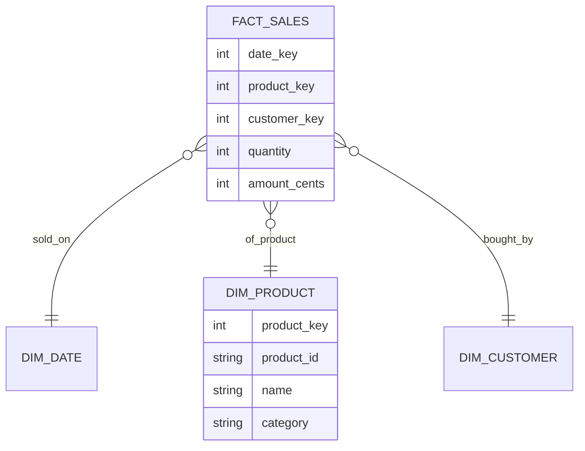

# OLTP, OLAP, and Warehousing

A database that serves a checkout page and a database that answers "what was revenue by category and month?" do different work. The first reads and writes a few rows of a few tables, thousands of times per second. The second reads millions of rows of a few columns, a few times per minute. One design cannot serve both well. This page explains the two workloads, why column storage suits the second one, how analysts model data (facts, dimensions, slowly changing dimensions), how data moves from the first system to the second, and what the main products offer.

## Why It Matters

Interviewers ask "Why do you not run the analytics queries on the production database?" and "How do you get data from the order service into the warehouse?" System design rounds for products with reports, dashboards, or metrics need a warehouse or a real-time analytics store in the design. On the job, the common failure is a long report that slows the checkout database. The fix is a separate analytical system that a pipeline feeds. This page gives you the vocabulary (grain, star schema, slowly changing dimension, change data capture) and the mechanism behind the speed difference (column storage, compression, vectorized execution).

!!! info "Versions"
    Product statements come from vendor documentation read on 2026-11-05: Snowflake, BigQuery, Amazon Redshift, ClickHouse, Apache Druid, Apache Pinot, Debezium 3.7 (the version that the Debezium site marks as the latest stable release), PostgreSQL 18, and MySQL 8.4. Cloud products change often, so check the vendor page for a feature that you rely on.

## Core Concepts

**OLTP (online transaction processing)**: a workload of many short transactions that read or write a few rows by key. The database is the system of record. Example: place an order.

**OLAP (online analytical processing)**: a workload of few, large queries that scan many rows and aggregate them. Example: revenue by category for each month.

**Row store**: a storage layout that keeps all columns of one row together. **Column store**: a layout that keeps all values of one column together.

**Data warehouse**: a database that stores integrated, historical data for analysis. It is fed from other systems and is not the system of record.

**Fact table**: a table that records measurements of a business process, one row for each event at a declared grain, for example one row for each order line. **Dimension table**: a table that holds the descriptive context of the facts, for example product, customer, and date.

**Grain**: what exactly one row of a fact table represents. Kimball defines it as the exact meaning of a single fact table row, and says to declare it before you choose dimensions or facts.

**Star schema**: a fact table in the center, joined directly to dimension tables. **Snowflake schema**: a star schema in which the dimension tables are normalized into further tables.

**Slowly changing dimension (SCD)**: a dimension whose attributes change over time, for example a product that moves to another category. The SCD types are strategies for what to do with the old value.

**Surrogate key**: a key that the warehouse generates (an integer) and that has no business meaning. It replaces the source system's natural key as the join key.

**ETL (extract, transform, load)**: the pipeline transforms data before it loads it into the warehouse. **ELT (extract, load, transform)**: the pipeline loads raw data first and transforms it inside the warehouse with SQL.

**Change data capture (CDC)**: a method that reads the changes of a source database from its transaction log (the PostgreSQL WAL or the MySQL binary log) and publishes them as events.

**MPP (massively parallel processing)**: a design in which many nodes each process a part of the data in parallel, and a coordinator combines the results.

**HTAP (hybrid transactional and analytical processing)**: one database that serves both workloads. It usually keeps a row store and a column store of the same data.

## How It Works

### OLTP Against OLAP

| | OLTP | OLAP |
|---|---|---|
| Query shape | Point lookups and short range scans by key. Insert and update of single rows | Scans of many rows. Aggregates (`SUM`, `COUNT`), group by, joins of a large fact table with small dimensions |
| Rows touched per query | A few | Millions to billions |
| Columns touched per query | Most of the row | A few columns of a wide table |
| Data volume | Gigabytes to a few terabytes of current data | Terabytes to petabytes of history |
| Users | Many (customers, services) | Few (analysts, dashboards, models) |
| Latency target | Milliseconds | Seconds to minutes. Real-time analytics stores aim at under a second |
| Write pattern | Many small transactions | Bulk loads and append-only streams. Updates are rare |
| Consistency need | Strong. Concurrent transactions must stay correct | A loaded snapshot is enough. Data is often hours old |
| Schema | Normalized (see [Schema Design and Normalization](02-schema-design-and-normalization.md)) | Denormalized (star schema) |
| Typical engine | PostgreSQL, MySQL | Snowflake, BigQuery, Redshift, ClickHouse |

Mixing the two on one database causes harm. A report that scans a 500 million row table fills the buffer pool with pages that the web requests do not need, holds a snapshot open for a long time (which blocks the cleanup of old row versions, see [Transactions and Isolation](04-transactions-and-isolation.md)), and uses I/O that the checkout needs. A read replica removes part of the harm (see [Scaling a Database](09-scaling-a-database.md)). The long query still pays the row-store price: it reads every column of every row.

### Row Storage Against Column Storage

A row store writes the values of one row next to each other. A column store writes the values of one column next to each other. Take a table `orders(id, country, status, amount, quantity)`:

```text
Row layout (one page holds whole rows):
  | 1 BR NEW 120 2 | 2 DE PAID 340 1 | 3 IN NEW 90 5 | 4 US PAID 410 3 | ...

Column layout (one file or block run for each column):
  id:       1 2 3 4 ...
  country:  BR DE IN US ...
  status:   NEW PAID NEW PAID ...
  amount:   120 340 90 410 ...
  quantity: 2 1 5 3 ...
```

**Why a column store reads less for an aggregate.** The query `SELECT SUM(amount) FROM orders` needs one column. A row store reads the pages that hold whole rows, so it reads all five columns to use one. A column store reads only the `amount` data. For a table with 50 columns and a query that uses 3, the column store reads about 3/50 of the data. The ClickHouse documentation gives the same reason: only the columns that the query needs are read from disk. This is the same effect that the Parquet format gives for files (see [Storage Types](../hld/fundamentals/10-storage-types.md)).

**Compression.** The values of one column have one type and often similar values, so they compress well. Abadi, Madden, and Ferreira (SIGMOD 2006) state that compression ratios are generally higher in column stores, because consecutive entries in a column are often quite similar to each other, while adjacent attributes in a tuple are not. Three schemes matter:

| Scheme | Idea | Works best when | Example |
|---|---|---|---|
| Run-length encoding (RLE) | Store a value and the length of its run: `(value, count)` | The column is sorted or has long runs of equal values | `BR BR BR DE DE` becomes `(BR,3) (DE,2)` |
| Dictionary encoding | Store each distinct value once, and store a small integer code for each row | A column has few distinct values (status, country) | `NEW`, `PAID` become codes 0 and 1 |
| Bit-packing | Store each code in the fewest bits that fit the range | Small integers: 4 distinct codes need 2 bits | 1 000 codes at 2 bits use 250 bytes |

The same paper notes that an operator can work directly on compressed data. If a run-length encoded column says that the value 42 appears 1000 times in a row, a `SUM` can multiply 42 by 1000 without it decompressing the run. It also notes that a column store can store different columns in different sort orders, and that sorted data is usually quite compressible.

**Vectorized execution.** The executor processes a batch of values of one column at a time (a vector), not one row at a time. A tight loop over an array of same-size values suits the CPU. The Abadi paper notes that the CPU overhead of iterating through a page of column values tends to be less than for a page of tuples (especially when all values in a column have the same size), and that this allows faster decompression with vectorized code that uses the super-scalar properties of modern CPUs.

**Why a column store pays more for writes.** A new row must be written into one place in each column, so a row with 5 columns touches 5 places, not 1. Compression makes an in-place update harder: changing one value can change a run or the dictionary. Column stores therefore avoid updates in place. ClickHouse, for example, writes each insert as a new data part and merges parts in the background (ClickHouse documentation, "MergeTree"). The consequences for a design: load in large batches, avoid single-row inserts and frequent updates, and treat updates and deletes as expensive.

| | Row store | Column store |
|---|---|---|
| Point lookup of a full row | One page read. Fast | Reads many column blocks. Slower |
| Aggregate of 1 to 3 columns over many rows | Reads all columns. Slow | Reads only those columns. Fast |
| Insert of one row | One place | One place for each column. Buffered and merged later |
| Update of one value | In place | Costly. Often a rewrite of a part |
| Compression ratio | Lower. Mixed types in one page | Higher. One type and similar values |

C-Store (Stonebraker et al., VLDB 2005) is the research column store. The compression paper above describes how its authors extended C-Store. A product can offer both layouts: the Citus documentation lists columnar storage as one of its features next to sharding. So "row store" and "column store" describe the layout of a table and not a whole product.

### Massively Parallel Processing

An MPP warehouse spreads each table over many nodes and runs each query on all nodes at once. Amazon Redshift shows the pattern (Redshift documentation, "Data warehouse system architecture"). A cluster has a leader node and compute nodes. The leader node parses the query, builds the plan, compiles code, and sends it to the compute nodes. The compute nodes run it on their part of the data, and they send intermediate results back to the leader, which does the final aggregation. Each compute node is split into slices that work in parallel. When you create a table, you can set a distribution key, and the rows spread over the slices by that key. A good key lets joins and aggregates run in parallel without moving rows across the network. A bad key puts most rows on a few slices and makes them the bottleneck.

Newer cloud warehouses separate storage from compute. Snowflake describes a hybrid of shared-disk and shared-nothing designs. Data sits in a central store, and "virtual warehouses" (clusters of compute) run queries. BigQuery describes a storage layer and a compute layer that scale independently. The next section lists the products.

### Dimensional Modeling

Ralph Kimball's dimensional modeling is the standard way to model a warehouse. The steps are: choose the business process, declare the grain, identify the dimensions, and identify the facts (the "four step dimensional design process" in the Kimball techniques list).

The grain comes first. Kimball writes that the grain declaration is a binding contract on the design, and he encourages you to start from the lowest level of detail (atomic grain). A reason follows from the definition (my reasoning, not Kimball's wording): you can roll up atomic rows to any coarser grain, and you cannot split an aggregated row back into its parts.

Example. Process: online sales. Grain: one row for each order line. Dimensions: date, product, customer. Facts: quantity and amount. This gives a star schema:



| | Star schema | Snowflake schema |
|---|---|---|
| Dimension tables | One wide, denormalized table for each dimension | Normalized into several tables (product, category, department) |
| Joins for a query | One join for each dimension | Several joins for one dimension |
| Storage | More repeated text | Less repeated text |
| Ease of use | Simple for analysts and BI tools | More joins to write and to plan |
| Typical choice | The default. Kimball's technique page "Snowflaked Dimensions" says to avoid snowflakes, because business users find them hard to understand and navigate, and because they can hurt query performance. A flattened dimension holds exactly the same information | When a shared sub-dimension has a clear reason, such as a hierarchy that many dimensions share (a judgment, not a Kimball rule) |

Facts also have types. An additive fact (quantity, amount) sums across all dimensions. A semi-additive fact (an account balance) sums across some dimensions but not time. A non-additive fact (a ratio) never sums. Store the parts of a ratio (numerator and denominator) and compute the ratio at query time.

#### Surrogate keys

A dimension row has a surrogate key, an integer that the warehouse assigns. The fact table stores the surrogate key as a foreign key. Reasons: the source system's key can change or be reused, two source systems can use the same key for different things, and (most important here) one natural key can have several rows with different attribute values over time. The surrogate key identifies one version of the entity.

#### Slowly changing dimensions

A product moves from the category "Toys" to "Games" on 2026-07-01. What does the report "revenue by category" show for sales before that date? The SCD type decides. Kimball's techniques list includes these types:

| Type | Name | What it does to the old value | History kept | Use when |
|---|---|---|---|---|
| 0 | Retain original | Never changes the attribute | Original only | Attributes that must not change (original credit score) |
| 1 | Overwrite | Replaces the old value in place | None | A correction, or history has no value |
| 2 | Add new row | Keeps the old row, adds a new row with a new surrogate key | Full | Reports must show the attribute as it was at the time |
| 3 | Add new attribute | Adds a column such as `previous_category` | One previous value | Only the last change matters |

Types 4 to 7 exist (mini-dimensions and hybrids). Types 1 and 2 are the ones that interviews ask for.

The example below uses SQLite. A Type 2 dimension has the columns `valid_from`, `valid_to`, and `is_current`. The fact table stores the surrogate key of the version that was current when the sale happened. First, the setup:

```sql
DROP TABLE IF EXISTS fact_sales;
DROP TABLE IF EXISTS dim_product;
CREATE TABLE dim_product (
    product_key INTEGER PRIMARY KEY,
    product_id  TEXT NOT NULL,
    name        TEXT NOT NULL,
    category    TEXT NOT NULL,
    valid_from  TEXT NOT NULL,
    valid_to    TEXT NOT NULL,
    is_current  INTEGER NOT NULL
);
CREATE TABLE fact_sales (
    sale_date    TEXT NOT NULL,
    product_key  INTEGER NOT NULL REFERENCES dim_product (product_key),
    quantity     INTEGER NOT NULL,
    amount_cents INTEGER NOT NULL
);
INSERT INTO dim_product VALUES
    (1, 'P-100', 'Chess set', 'Toys', '2026-01-01', '9999-12-31', 1),
    (2, 'P-200', 'Desk lamp', 'Home', '2026-01-01', '9999-12-31', 1);
INSERT INTO fact_sales VALUES
    ('2026-05-10', 1, 2, 4000),
    ('2026-06-20', 1, 1, 2000),
    ('2026-05-15', 2, 1, 3500);
```

On 2026-07-01 the product `P-100` moves to "Games". The Type 2 change closes the old row and inserts a new row with a new surrogate key. The loader assigns the new key to later facts:

```sql
UPDATE dim_product
SET valid_to = '2026-06-30', is_current = 0
WHERE product_id = 'P-100' AND is_current = 1;
INSERT INTO dim_product VALUES
    (3, 'P-100', 'Chess set', 'Games', '2026-07-01', '9999-12-31', 1);
INSERT INTO fact_sales VALUES
    ('2026-07-05', 3, 3, 6000),
    ('2026-07-20', 2, 2, 7000),
    ('2026-08-02', 3, 1, 2000),
    ('2026-08-09', 2, 1, 3500);
```

The dimension now holds both versions:

```sql
SELECT product_key, product_id, category, valid_from, valid_to, is_current
FROM dim_product
ORDER BY product_key;
```

<!-- sql-result -->

```text
product_key | product_id | category | valid_from | valid_to | is_current
1 | P-100 | Toys | 2026-01-01 | 2026-06-30 | 0
2 | P-200 | Home | 2026-01-01 | 9999-12-31 | 1
3 | P-100 | Games | 2026-07-01 | 9999-12-31 | 1
```

Revenue by category follows the star: join the fact to the dimension on the surrogate key. Each sale counts under the category that held at the time of the sale:

```sql
SELECT p.category, SUM(f.amount_cents) AS revenue_cents
FROM fact_sales f
JOIN dim_product p ON p.product_key = f.product_key
GROUP BY p.category
ORDER BY p.category;
```

<!-- sql-result -->

```text
category | revenue_cents
Games | 8000
Home | 14000
Toys | 6000
```

A Type 1 overwrite gives a different answer. If the loader had overwritten the category in place, all sales of `P-100` would count under "Games". The next query shows that view by joining each sale to the current version of its product:

```sql
SELECT c.category, SUM(f.amount_cents) AS revenue_cents
FROM fact_sales f
JOIN dim_product o ON o.product_key = f.product_key
JOIN dim_product c ON c.product_id = o.product_id AND c.is_current = 1
GROUP BY c.category
ORDER BY c.category;
```

<!-- sql-result -->

```text
category | revenue_cents
Games | 14000
Home | 14000
```

Games shows 14000 here and 8000 above. The 6000 of earlier sales moved from "Toys" to "Games". Which answer is correct depends on the business question, and that is the reason to choose the SCD type with the stakeholders before the load. Type 2 costs more storage and a more complex load. A query for "current state" filters on `is_current = 1`.

!!! tip "Interview answer for SCD Type 2"
    Say the three parts: the dimension keeps one row for each version, with effective dates and a current flag. The fact table stores the surrogate key of the version that was valid at the event. A new version needs a new surrogate key, which is why the warehouse does not use the natural key as the join key.

### ETL, ELT, and Change Data Capture

| | ETL | ELT |
|---|---|---|
| Order | Extract, transform on a separate engine, load the result | Extract, load raw data, transform in the warehouse |
| Where the work runs | An ETL server or a Spark job | The warehouse, as SQL (for example with `dbt`) |
| Raw data kept | Often not | Yes. You can rebuild the transforms |
| Fits | Limited warehouse compute, strict data shape before load | Cloud warehouses with cheap storage and elastic compute |

Many cloud warehouses separate storage from compute, so ELT became common. The pipeline concepts (batch, stream, orchestration) are in [Batch and Stream Processing](../hld/fundamentals/17-batch-and-stream-processing.md).

How does data leave the OLTP database? Three methods:

1. **Periodic full extract.** Copy the whole table every night. Simple. It does not scale, and it puts load on the source.
2. **Incremental extract by query.** Select the rows with `updated_at` after the last run. It misses hard deletes, and it needs a reliable `updated_at` column and an index on it.
3. **Change data capture (CDC).** Read the database log. It sees every insert, update, and delete in commit order, including deletes, and it puts little query load on the source.

Debezium is an open-source CDC platform. Its PostgreSQL connector uses logical decoding. With the `pgoutput` plug-in (the standard plug-in in PostgreSQL 10 and later), it turns the replication event stream into change events. On the first start the connector takes a consistent snapshot of the tables, and then it streams row-level changes. An event carries the operation (`op`: `c` create, `u` update, `d` delete, `r` read during a snapshot), and the row values before and after the change (`before` and `after`, and `after` is null for a delete). Debezium publishes the events to Kafka topics. See [Message Queues and Streams](../hld/fundamentals/08-message-queues-and-streams.md) for Kafka.

Operational risk: the connector uses a replication slot, and the slot makes PostgreSQL keep every WAL segment that the connector still needs. The Debezium documentation says that slots retain all required WAL even during Debezium outages, tells you to monitor replication slots closely, and warns that WAL disk use can grow far beyond the usual. A stopped connector can fill the primary's disk. The same hazard applies to any replication slot (see [Replication](../hld/fundamentals/05-replication.md)). In MySQL the source of changes is the binary log, and the Debezium MySQL connector reads the binlog (see [Scaling a Database](09-scaling-a-database.md)).

CDC also feeds the reporting need that [Microservices and Monoliths](../hld/fundamentals/14-microservices-and-monoliths.md) names: one analytics query needs data from many services, so each service streams its changes to a warehouse. The transactional outbox and event-driven designs are in [Event-Driven Architecture](../hld/fundamentals/16-event-driven-architecture.md).

### Products

Each product below has one property that defines it. The statements come from the vendor documentation.

| Product | Kind | Defining property (from the vendor docs) |
|---|---|---|
| Snowflake | Cloud warehouse | A hybrid of shared-disk and shared-nothing architectures. It separates storage from compute. Compute runs in virtual warehouses. Data is stored in an internal compressed columnar format in micro-partitions |
| BigQuery | Cloud warehouse | Serverless. Separate storage and compute layers that scale independently. Data is in a columnar storage format |
| Amazon Redshift | Cloud warehouse | A cluster with a leader node and compute nodes that run queries in parallel on slices of data (MPP). Based on PostgreSQL. Managed storage on Amazon S3 lets storage and compute scale separately |
| ClickHouse | Real-time OLAP database | A column-oriented SQL database for OLAP. The MergeTree engine writes each insert as a part that background merges combine, and its primary index is sparse (one entry for each granule of 8192 rows by default) |
| Apache Druid | Real-time analytics database | Column-oriented. It ingests in real time or in batches, and the data is queryable at once. It partitions data by time first. It can summarize data at ingestion time |
| Apache Pinot | Real-time OLAP datastore | A distributed OLAP datastore for user-facing analytics, with low latency at high query rates (the docs speak of hundreds of thousands of queries per second). Columnar, with smart indexing and pre-aggregation techniques |

**How to choose, as a rule of thumb (a recommendation, not a vendor claim).** A cloud warehouse (Snowflake, BigQuery, Redshift) suits internal analytics, BI tools, and ELT with SQL: analysts run ad hoc queries, and the data is minutes to hours old. A real-time OLAP database (ClickHouse, Druid, Pinot) suits workloads that need fresh data and low latency at high concurrency, such as a dashboard inside a product that thousands of users open, or metrics over event streams. Check the real workload: the number of concurrent queries, the freshness need, the query shapes, and the operating cost.

The OLAP paragraphs of [Choosing a Database](../hld/fundamentals/04-choosing-a-database.md) place ClickHouse and Druid in a design as derived stores that you feed from the system of record.

#### Lakes, lakehouses, and table formats

A data lake stores files (Parquet, ORC) in object storage, and several engines read them. A table format (Iceberg, Delta Lake, Hudi) adds a metadata layer with atomic commits, snapshots, and schema evolution, so a lake can behave like a warehouse table. A lakehouse is this combination of a lake and a warehouse-like table layer. Lakes, file formats, and table formats have their home in [Storage Types](../hld/fundamentals/10-storage-types.md). This page covers the warehouse side only.

#### HTAP in brief

HTAP systems serve transactions and analytics from one database. A common design keeps a row store for transactions and a column copy of the same data for analytical queries, and it replicates changes from one to the other inside the system. The benefit: analytics on fresh data without a pipeline. The cost: the two workloads still compete for resources unless the system isolates them, and the analytical performance of such a system is lower than a dedicated warehouse on a large data set. Assumption: this describes the common design and not one product. Check the product's documentation for how it isolates the workloads.

### Materialized Views and Pre-Aggregation

A query that sums 2 billion fact rows is slow even on a column store. If many users run the same aggregate, compute it once. A **materialized view** stores the result of a query as a table. In PostgreSQL, `REFRESH MATERIALIZED VIEW` replaces the contents completely. The option `CONCURRENTLY` refreshes the view without locking out readers, and it needs a unique index on the view that uses only column names and covers all rows (PostgreSQL 18 documentation). The view is not updated by itself: you schedule the refresh. Kimball calls the same idea "aggregated fact tables or cubes". Apache Druid offers summarization at ingestion time, which is pre-aggregation on the way in.

A pre-aggregated table has a cost: it holds one fixed grain, so a question at a finer grain needs the base table, and it can go stale. SQLite has no materialized views, so this example builds the summary table by hand:

```sql
DROP TABLE IF EXISTS summary_monthly;
CREATE TABLE summary_monthly AS
SELECT substr(f.sale_date, 1, 7) AS month,
       p.category,
       SUM(f.amount_cents) AS revenue_cents
FROM fact_sales f
JOIN dim_product p ON p.product_key = f.product_key
GROUP BY substr(f.sale_date, 1, 7), p.category;
```

A dashboard reads the small table, not the fact table:

```sql
SELECT month, category, revenue_cents
FROM summary_monthly
ORDER BY month, category;
```

<!-- sql-result -->

```text
month | category | revenue_cents
2026-05 | Home | 3500
2026-05 | Toys | 4000
2026-06 | Toys | 2000
2026-07 | Games | 6000
2026-07 | Home | 7000
2026-08 | Games | 2000
2026-08 | Home | 3500
```

### Analytical SQL

#### Window functions over time

Window functions compute values across related rows without collapsing them (see [Relational Model and SQL](01-relational-model-and-sql.md)). Analytical queries use them for change over time and for running totals. The query below computes monthly revenue, the change from the previous month with `LAG`, and the running total:

```sql
WITH monthly AS (
    SELECT substr(sale_date, 1, 7) AS month, SUM(amount_cents) AS revenue_cents
    FROM fact_sales
    GROUP BY substr(sale_date, 1, 7)
)
SELECT month,
       revenue_cents,
       revenue_cents - LAG(revenue_cents) OVER (ORDER BY month) AS change_cents,
       SUM(revenue_cents) OVER (ORDER BY month) AS running_cents
FROM monthly
ORDER BY month;
```

<!-- sql-result -->

```text
month | revenue_cents | change_cents | running_cents
2026-05 | 7500 | NULL | 7500
2026-06 | 2000 | -5500 | 9500
2026-07 | 13000 | 11000 | 22500
2026-08 | 5500 | -7500 | 28000
```

The first month has no previous month, so `LAG` returns `NULL`.

#### ROLLUP and CUBE

`GROUP BY ROLLUP (a, b)` returns the groups `(a, b)`, `(a)`, and the grand total `()`. It is a shorthand for `GROUPING SETS` of every prefix of the list (PostgreSQL 18 documentation). `CUBE (a, b)` returns every subset of the list: `(a, b)`, `(a)`, `(b)`, and `()`. Columns that are not in a grouping set return `NULL` in that row, and the function `GROUPING()` tells a subtotal `NULL` from a data `NULL`. SQLite does not support `ROLLUP` or `CUBE` (SQLite 3.51 reports `no such function: rollup`), so the statement below runs on PostgreSQL:

<!-- sql-skip: postgresql -->

```sql
-- PostgreSQL 18. Revenue by month and category, with subtotals per month and a grand total.
SELECT month, category, SUM(revenue_cents) AS revenue_cents,
       GROUPING(month, category) AS grouping_bits
FROM summary_monthly
GROUP BY ROLLUP (month, category)
ORDER BY month, category;
```

MySQL 8.4 supports `GROUP BY ... WITH ROLLUP` (and the form `ROLLUP (...)`), and its manual page on `GROUP BY` modifiers does not mention `CUBE`:

<!-- sql-skip: mysql -->

```sql
-- MySQL 8.4. The same subtotals with the WITH ROLLUP modifier.
SELECT month, category, SUM(revenue_cents) AS revenue_cents
FROM summary_monthly
GROUP BY month, category WITH ROLLUP;
```

## Trade-offs and When to Use

| Choice | Benefit | Cost | Pick it when |
|---|---|---|---|
| Analytics on the OLTP primary | No new system | Slows transactions. Row store reads all columns | Tiny data and rare queries |
| Analytics on a read replica | Isolates the primary from the load. No pipeline | Still a row store. Replica conflicts and lag. Same schema as OLTP | Moderate reports on moderate data |
| Cloud warehouse | Columnar speed at large scale. SQL. Little operations work | Data is a copy with a delay. Cost depends on use | Internal analytics and BI |
| Real-time OLAP store | Low latency under high concurrency. Fresh data | Fewer SQL features (joins, updates) in some engines. A new system to run | User-facing dashboards and event metrics |
| Star schema | Simple queries and fast aggregation | Redundant text. A load process that must maintain keys | Reporting on a known business process |
| Snowflake schema | Less redundancy | More joins | A shared hierarchy with a clear reason |
| SCD Type 2 | Correct history | Storage. Complex load. Queries must pick a version | Reports must reflect attributes at event time |
| Pre-aggregation | Fast dashboards | Fixed grain. Stale until refresh | Many users run the same aggregate |
| CDC | Complete, ordered, low load on the source | Slot and log management. Operations work | The warehouse must follow the source closely |
| HTAP | Fresh analytics without a pipeline | Workload competition. Product-specific limits | Light analytics on live data |

## Java Example

The program stores one table in two layouts: a list of row objects, and one array for each column. It runs `SELECT SUM(amount)` on both and counts the values that each layout reads. Then it encodes a sorted column with run-length encoding, and a text column with a dictionary and with bit-packing. It prints counts and sizes, not times, so the output is the same on every run. The code needs only the JDK. The sizes assume one byte for each character of the ASCII status text, and the one-byte code per row stands for the simplest dictionary encoding (a dictionary of up to 256 entries).

```java
import java.util.ArrayList;
import java.util.Comparator;
import java.util.LinkedHashMap;
import java.util.List;
import java.util.Map;

public class RowVersusColumn {
    record Order(int id, String country, String status, int amount, int quantity) {}

    static final String[] COUNTRIES = {"BR", "DE", "IN", "US"};
    static final String[] STATUSES = {"NEW", "PAID", "SHIPPED", "RETURNED"};
    static final int ROWS = 1_000;
    static final int COLUMNS = 5;

    public static void main(String[] args) {
        List<Order> rowStore = new ArrayList<>();
        for (int i = 0; i < ROWS; i++) {
            rowStore.add(new Order(i, COUNTRIES[(i * 7 + 3) % 4],
                    STATUSES[(i * i + i / 3) % 4], 100 + (i * 37) % 900, 1 + i % 5));
        }
        rowStore.sort(Comparator.comparing(Order::country));

        // Column layout: one array for each column, in the same row order.
        int[] ids = new int[ROWS];
        String[] country = new String[ROWS];
        String[] status = new String[ROWS];
        int[] amount = new int[ROWS];
        int[] quantity = new int[ROWS];
        for (int i = 0; i < ROWS; i++) {
            Order o = rowStore.get(i);
            ids[i] = o.id();
            country[i] = o.country();
            status[i] = o.status();
            amount[i] = o.amount();
            quantity[i] = o.quantity();
        }

        // Query: SELECT SUM(amount) FROM orders
        long rowSum = 0;
        long rowValuesRead = 0;
        for (Order o : rowStore) {
            rowValuesRead += COLUMNS;       // a row scan reads the whole row
            rowSum += o.amount();
        }
        long columnSum = 0;
        long columnValuesRead = 0;
        for (int v : amount) {
            columnValuesRead++;             // a column scan reads one array
            columnSum += v;
        }
        System.out.println("SUM(amount): row layout " + rowSum + ", column layout " + columnSum);
        System.out.println("values read: row layout " + rowValuesRead
                + ", column layout " + columnValuesRead);

        // Write cost: insert one row.
        System.out.println("storage places touched by one insert: row layout 1, column layout "
                + COLUMNS);

        // Run-length encoding of the country column (the table is sorted by country).
        List<String> runs = new ArrayList<>();
        int start = 0;
        for (int i = 1; i <= ROWS; i++) {
            if (i == ROWS || !country[i].equals(country[start])) {
                runs.add(country[start] + "x" + (i - start));
                start = i;
            }
        }
        System.out.println("country values: " + ROWS + ", run-length pairs: " + runs.size()
                + " " + runs);

        // Dictionary encoding and bit-packing of the status column.
        Map<String, Integer> dictionary = new LinkedHashMap<>();
        int rawBytes = 0;
        for (String s : status) {
            rawBytes += s.length();
            dictionary.putIfAbsent(s, dictionary.size());
        }
        int dictionaryBytes = 0;
        for (String s : dictionary.keySet()) {
            dictionaryBytes += s.length();
        }
        int bitsPerCode = 32 - Integer.numberOfLeadingZeros(dictionary.size() - 1);
        int packedBytes = (ROWS * bitsPerCode + 7) / 8;
        System.out.println("status raw text bytes: " + rawBytes);
        System.out.println("status with a one-byte code per row: "
                + (dictionaryBytes + ROWS) + " (dictionary " + dictionaryBytes + " + codes "
                + ROWS + ")");
        System.out.println("status bit-packed at " + bitsPerCode + " bits: "
                + (dictionaryBytes + packedBytes) + " (dictionary " + dictionaryBytes
                + " + codes " + packedBytes + ")");
    }
}
```

<!-- expected-output -->

```text
SUM(amount): row layout 548200, column layout 548200
values read: row layout 5000, column layout 1000
storage places touched by one insert: row layout 1, column layout 5
country values: 1000, run-length pairs: 4 [BRx250, DEx250, INx250, USx250]
status raw text bytes: 5329
status with a one-byte code per row: 1022 (dictionary 22 + codes 1000)
status bit-packed at 2 bits: 272 (dictionary 22 + codes 250)
```

Both layouts return the same sum. The column layout reads 1 000 values and the row layout reads 5 000, which is the ratio 1 to 5 for a one-column query on a five-column table. The sorted `country` column of 1 000 values becomes 4 pairs. The `status` column falls from 5 329 bytes of text to 1 022 bytes with a one-byte code for each row, and to 272 bytes when the codes use 2 bits each. The insert line shows the price: one new row touches five places in the column layout. The "values read" count is a model of the data that a scan must read. A real engine also reads page headers, and it can skip blocks by their statistics.

## Interview Angle

### Questions

??? question "Why do you not run analytics queries on the production OLTP database?"

    The two workloads need different things. OLTP serves many short transactions that touch a few rows, and it needs low latency and strong consistency. An analytics query scans millions of rows and aggregates a few columns. On a row-store OLTP database, the scan reads every column of every row, fills the buffer pool with pages that the web requests do not need, uses the I/O that transactions need, and holds a snapshot open for a long time, which delays the cleanup of old row versions. The first step is a read replica, which isolates the primary but keeps the row-store cost and adds replica conflicts and lag. The lasting answer is a separate analytical system: a column store (a warehouse or an OLAP database) that a pipeline feeds, usually with change data capture. The trade-off is that the analytics data is a copy with a delay, and the pipeline needs operations work.

??? question "Why is a column store faster for aggregates and slower for single-row writes?"

    An aggregate such as `SUM(amount)` needs one column. A column store keeps each column's values together, so it reads only that column, about 3/50 of the data for 3 columns of a 50-column table. The values of one column have one type and similar values, so they compress well (run-length encoding for sorted columns, dictionary encoding and bit-packing for low-cardinality columns), and the engine can operate on the compressed form and process vectors of values per CPU cycle. The price is on writes. A new row must be written to every column, so it touches many places. Compressed, sorted columns are hard to update in place. Engines therefore write data in batches, for example ClickHouse writes each insert as a new part and merges parts in the background. So: load in batches, avoid single-row updates, and keep OLTP in a row store.

??? question "Design a star schema for an online store's sales reporting. What is the grain?"

    I start with the business process, orders, and I declare the grain first: one row for each order line, the lowest level of detail, because I can roll up atomic rows to any coarser grain, and I cannot split aggregated rows. The fact table `fact_sales` holds the foreign keys `date_key`, `product_key`, and `customer_key`, and the additive measures `quantity` and `amount_cents`. Dimensions are `dim_date`, `dim_product` (name, category, brand), and `dim_customer` (region, segment). Each dimension has a surrogate key. I keep dimensions denormalized (a star), so a query needs one join for each dimension. Money is an integer in cents. Ratios such as average price are computed at query time from the sums, since a ratio is not additive. I would add the order ID as a degenerate dimension on the fact row. The trade-off against a snowflake schema: a star repeats text such as the category name, and it needs fewer joins.

??? question "A product changes category. How does the warehouse keep the history correct? Explain SCD Type 2."

    A Type 2 slowly changing dimension keeps one row for each version of the product. Each row has its own surrogate key, `valid_from`, `valid_to`, and an `is_current` flag. When the category changes, the loader sets `valid_to` and `is_current = 0` on the old row, and inserts a new row with a new surrogate key and the new category. The loader assigns the surrogate key of the version that is valid at the event to each new fact row. A report that joins facts to the dimension on the surrogate key then shows each sale under the category that held at the time of the sale. Type 1 overwrites the value and loses the history, so past revenue moves to the new category. Type 3 adds a `previous_category` column, which keeps one old value. I choose the type with the business: Type 2 costs storage and a more complex load, and it is right when reports must reflect the past.

??? question "How do you get data from the order service's PostgreSQL database into the warehouse?"

    I compare three methods. A nightly full copy is simple and does not scale. An incremental query on `updated_at` is cheap, but it misses hard deletes and relies on a reliable column. Change data capture reads the transaction log, so it sees every insert, update, and delete in commit order, and the source sees little query load. With Debezium on PostgreSQL, the connector takes a consistent snapshot, then streams logical decoding output (the `pgoutput` plug-in) as change events with `op`, `before`, and `after` fields, usually into Kafka. A consumer loads the events into the warehouse, where an ELT job (SQL, for example with dbt) builds the star schema. The risk: the connector holds a replication slot, so PostgreSQL keeps WAL until the connector confirms it. A stopped connector can fill the disk of the primary, so I monitor slot lag and set `max_slot_wal_keep_size` or an alert. Delivery needs idempotent loads: the Debezium FAQ says that after a consumer crash or a connector crash the application sees every event at least once, and it can see duplicates. I do not assume exactly-once delivery.

??? question "Snowflake, BigQuery, Redshift, ClickHouse, Druid, Pinot: how do you choose?"

    I start from the workload. For internal analytics, BI tools, and ad hoc SQL over large history, a cloud warehouse fits: Snowflake and BigQuery separate storage and compute, and BigQuery is serverless, while Redshift is an MPP cluster with a leader node and compute nodes (and managed storage on S3). Data is minutes to hours old, and concurrency is moderate. For user-facing analytics with a fresh-data need, low latency, and many concurrent queries, such as a dashboard inside the product, I look at a real-time OLAP store: ClickHouse (column-oriented SQL, MergeTree parts with background merges), Druid (real-time and batch ingestion, time partitioning, optional ingestion-time summarization), or Pinot (built for user-facing analytics at high query rates). I then check the query shapes (joins, updates, deletes), the freshness need, the concurrency, the team's operations skill, and the cost. I treat all of them as derived stores that a pipeline feeds from the system of record.

??? question "A dashboard query over 2 billion fact rows takes 40 seconds. What do you do?"

    I check first that the query uses the columns and filters that the column store can exploit: select only needed columns, filter on the partition or sort key so that the engine skips blocks, and avoid joining large tables when a small dimension join suffices. Then I look at the physical design: sort or cluster the table by the common filter column, and check the distribution key in an MPP warehouse so joins do not move rows. If many users run the same aggregate, I pre-aggregate: a summary table or a materialized view at the grain that the dashboard needs (for example day and category), refreshed on a schedule. In PostgreSQL, `REFRESH MATERIALIZED VIEW CONCURRENTLY` keeps readers unblocked but needs a unique index. The trade-off: the summary has a fixed grain and it can be stale. If concurrency is the problem and not a single query, a real-time OLAP store or a warehouse cluster with more compute is the next step.

??? question "ETL or ELT, and where does the data lake fit?"

    ETL transforms before the load, on a separate engine. ELT loads raw data first and transforms inside the warehouse with SQL. Cloud warehouses with cheap storage and elastic compute made ELT common: the raw data stays, so I can rebuild the transforms after a bug, and the transform is SQL that analysts can read. ETL still fits when the target has limited compute or when data must be reshaped or masked before it lands. A data lake keeps raw files (Parquet, ORC) in object storage that several engines read, and a table format such as Iceberg adds atomic commits and snapshots, so the lake can act as a warehouse. I treat the lake as a cheap, open landing zone for raw history, and a warehouse or OLAP store as the fast serving layer. The lake, file formats, and table formats are covered in the HLD storage page.

### Follow-up Questions

- What is the difference between a semi-additive and a non-additive fact, and how do you store a ratio? (A balance does not sum across time. A ratio never sums, so store numerator and denominator.)
- How do you load a late-arriving fact for a product version that already closed? (Join on the date range of `valid_from` and `valid_to`, not on `is_current`.)
- What is a degenerate dimension? (An identifier such as the order number that sits in the fact table and has no dimension table. Kimball lists it as a dimension technique.)
- How does a hard delete in the source reach the warehouse? (CDC emits a delete event. A query on `updated_at` never sees it.)
- Why does a distribution key matter in an MPP warehouse? (It decides which slice holds each row, so a good key allows parallel work without network movement, and a skewed key makes one slice the bottleneck.)
- Where does CQRS fit? (A CQRS read model is a derived store like a warehouse, built from the write side. See [Event-Driven Architecture](../hld/fundamentals/16-event-driven-architecture.md).)

### Red Flags

- "Run the reports on the production database at night." (Row-store scans harm transactions, and the long snapshot delays cleanup.)
- "A column store is faster for everything."
- "Use the source system's natural key as the dimension key." (It cannot identify versions.)
- "Updates in a column store are fine." (They are costly in most engines.)
- "CDC has no operational cost." (A replication slot can fill the source's disk.)
- A fact table with no declared grain.
- "A materialized view is always current." (You must refresh it.)

## Common Mistakes

| Mistake | Why it hurts | Fix |
|---|---|---|
| Analytics queries on the OLTP primary | Slows checkout. Long snapshots delay vacuum or purge | A replica for light reports, a warehouse for the rest |
| No declared grain | Rows mean different things. Sums double count | Write the grain as one sentence before the design |
| Mixing grains in one fact table | Joins and sums give wrong totals | One grain for each fact table |
| Overwriting dimension attributes when history matters | Past reports change | SCD Type 2 with surrogate keys |
| Joining facts to `is_current = 1` rows for history | Every sale is shown under the current attribute | Join on the surrogate key stored in the fact |
| Natural keys as warehouse join keys | Reused or changed keys break joins. No place for versions | Surrogate keys |
| Single-row inserts and updates in a column store | Many small parts or rewrites. Poor performance | Batch loads. Treat the data as append-only |
| Storing a ratio as a fact | Averages of averages give wrong results | Store numerator and denominator |
| A stopped CDC connector with an active slot | WAL grows until the source disk is full | Monitor slot lag. Set `max_slot_wal_keep_size`. Drop unused slots |
| Using `updated_at` extracts and expecting deletes | Deleted rows stay in the warehouse | CDC, soft deletes, or a periodic key comparison |
| A distribution key with a few hot values | One node does most of the work | A key with many distinct, evenly used values |
| Pre-aggregating at the wrong grain | The dashboard cannot answer new questions | Keep the atomic fact table, and add summaries on top |

## Commonly Confused With

| Looks like | Difference | Deciding question |
|---|---|---|
| OLTP against OLAP | OLTP serves short transactions on a few rows. OLAP scans many rows for aggregates | Does the query touch few rows by key, or scan most of a table? |
| Row store against column store | One keeps rows together. The other keeps each column together | Does the query read most columns of few rows, or few columns of many rows? |
| Data warehouse against data lake | A warehouse is a managed, schema-enforced store for SQL. A lake is files in object storage that many engines read | Do I need managed SQL speed, or cheap open storage? |
| Star against snowflake schema | A star has denormalized dimensions. A snowflake normalizes them | Do I want fewer joins or less repeated text? |
| SCD Type 1 against Type 2 | Type 1 overwrites. Type 2 adds a row | Must old reports keep the old value? |
| Surrogate key against natural key | The first is generated by the warehouse. The second comes from the source | Must one entity have several versions? |
| ETL against ELT | ETL transforms before the load. ELT transforms in the warehouse | Where does the transform run, and is the raw data kept? |
| CDC against `updated_at` extraction | CDC reads the log and sees deletes. The query sees only changed rows that it can find | Do I need deletes and every intermediate change? |
| Materialized view against a normal view | A materialized view stores the result and needs a refresh. A normal view runs its query every time | Do I accept stale data for speed? |
| Warehouse against real-time OLAP store | A warehouse suits internal analytics. A real-time OLAP store suits fresh, low-latency, high-concurrency queries | Who runs the queries, and how fresh must the data be? |
| HTAP against warehouse plus pipeline | HTAP serves both from one system. The pipeline separates the systems | Can one system isolate the two workloads for my load? |

## Quick Reference Card

- OLTP: short transactions, few rows, row store, normalized, milliseconds. OLAP: large scans and aggregates, few columns, column store, denormalized.
- A column store reads only the needed columns, compresses well (RLE, dictionary, bit-packing), and runs vectorized. A write touches every column, so load in batches.
- MPP: a coordinator and many nodes, each with a part of the data. The distribution key decides the balance.
- Kimball steps: choose the process, declare the grain, choose dimensions, choose facts. Declare the grain first, at the atomic level.
- Fact: measurements at a grain. Dimension: descriptive context. Star: denormalized dimensions. Snowflake: normalized dimensions.
- Surrogate key: an integer from the warehouse, one for each version of an entity.
- SCD: Type 1 overwrite, Type 2 add a row (with dates and a current flag), Type 3 add a column.
- ETL transforms before the load. ELT loads raw data and transforms in the warehouse.
- CDC reads the log (PostgreSQL logical decoding, MySQL binary log). It sees deletes. Monitor replication slots.
- Products: Snowflake (hybrid architecture, storage and compute separate), BigQuery (serverless), Redshift (MPP, leader and compute nodes), ClickHouse (column-oriented, MergeTree parts), Druid (real-time, time partitioned), Pinot (user-facing analytics).
- Materialized view: a stored query result, refreshed by command. `ROLLUP` gives prefix subtotals. `CUBE` gives all subsets. SQLite has neither.

## Further Reading

- [Kimball Group: Dimensional Modeling Techniques](https://www.kimballgroup.com/data-warehouse-business-intelligence-resources/kimball-techniques/dimensional-modeling-techniques/): the list of fact, dimension, and slowly changing dimension techniques.
- Kimball Group technique pages [Type 1: Overwrite](https://www.kimballgroup.com/data-warehouse-business-intelligence-resources/kimball-techniques/dimensional-modeling-techniques/type-1/), [Type 2: Add New Row](https://www.kimballgroup.com/data-warehouse-business-intelligence-resources/kimball-techniques/dimensional-modeling-techniques/type-2/), [Snowflaked Dimensions](https://www.kimballgroup.com/data-warehouse-business-intelligence-resources/kimball-techniques/dimensional-modeling-techniques/snowflake-dimension/), and [Four-Step Dimensional Design Process](https://www.kimballgroup.com/data-warehouse-business-intelligence-resources/kimball-techniques/dimensional-modeling-techniques/four-4-step-design-process/): the definitions that this page uses.
- [Kimball Group: Grain](https://www.kimballgroup.com/data-warehouse-business-intelligence-resources/kimball-techniques/dimensional-modeling-techniques/grain/): the definition of grain and the rule to declare it first.
- Ralph Kimball and Margy Ross, "The Data Warehouse Toolkit", 3rd edition: the full treatment of star schemas and slowly changing dimensions.
- [Abadi, Madden, Ferreira, "Integrating Compression and Execution in Column-Oriented Database Systems", SIGMOD 2006](https://doi.org/10.1145/1142473.1142548): why column stores compress well, and how operators work on compressed data.
- [Stonebraker et al., "C-Store: A Column-oriented DBMS", VLDB 2005](https://www.vldb.org/archives/website/2005/program/paper/thu/p553-stonebraker.pdf): the research column store (a read-optimized store with a write-optimized store beside it).
- [Snowflake: Key Concepts and Architecture](https://docs.snowflake.com/en/user-guide/intro-key-concepts): the hybrid architecture, virtual warehouses, and micro-partitions.
- [BigQuery: Introduction](https://docs.cloud.google.com/bigquery/docs/introduction): the serverless design and the storage and compute layers.
- [Amazon Redshift: Data warehouse system architecture](https://docs.aws.amazon.com/redshift/latest/dg/c_high_level_system_architecture.html): leader node, compute nodes, slices, and distribution keys.
- [ClickHouse: Introduction](https://clickhouse.com/docs/intro) and [MergeTree](https://clickhouse.com/docs/engines/table-engines/mergetree-family/mergetree): column orientation, parts, background merges, the sparse index.
- [Apache Druid: Design](https://druid.apache.org/docs/latest/design/): real-time analytics, columnar storage, and time partitioning.
- [Apache Pinot documentation](https://docs.pinot.apache.org/): the real-time distributed OLAP datastore for user-facing analytics.
- [Debezium: PostgreSQL connector](https://debezium.io/documentation/reference/stable/connectors/postgresql.html), [MySQL connector](https://debezium.io/documentation/reference/stable/connectors/mysql.html) (reads the binlog), and the [Debezium FAQ](https://debezium.io/documentation/faq/) (at-least-once delivery): logical decoding, snapshots, change events, replication slot hazards, and duplicates.
- [PostgreSQL: REFRESH MATERIALIZED VIEW](https://www.postgresql.org/docs/18/sql-refreshmaterializedview.html) and [GROUPING SETS, CUBE, and ROLLUP](https://www.postgresql.org/docs/18/queries-table-expressions.html): materialized views and analytical grouping.
- [MySQL 8.4: GROUP BY Modifiers](https://dev.mysql.com/doc/refman/8.4/en/group-by-modifiers.html): `WITH ROLLUP` and `GROUPING()`.
- Martin Kleppmann, "Designing Data-Intensive Applications", chapter 3: OLTP against OLAP, star schemas, and column storage.
