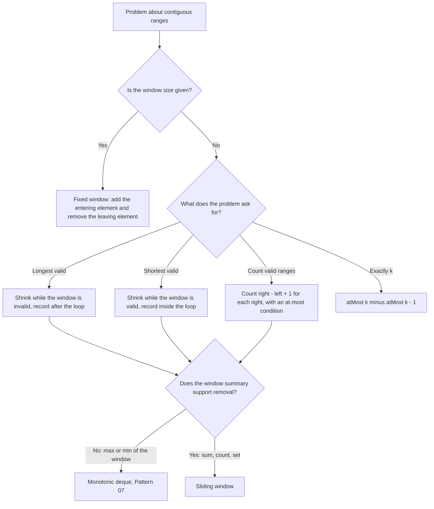

# Pattern 01: Sliding Window

## Overview

A sliding window is a range `[left, right]` of an array or a string that moves from left to right. The code keeps one summary of the range (a sum, a set, a count table). When the range moves, the code changes the summary by the elements that enter and leave. The technique turns a search over all O(n²) ranges into one pass of O(n) work, when the problem has the property that this page names.

After this page you can:

1. Write the update "subtract the element that leaves, add the element that enters" for a fixed window, and count the operations that it saves.
2. Derive the variable window for [LC 209: Minimum Size Subarray Sum](https://leetcode.com/problems/minimum-size-subarray-sum/) from the O(n²) brute force, and prove that the end of the best range never moves left.
3. Explain why a loop inside a loop still costs O(n), with the count of pointer moves.
4. Choose the shrink condition: shrink while the window is invalid (longest valid window), or shrink while the window is valid (shortest valid window).
5. Decide for a new problem whether a window applies, by testing two properties of the problem, and show a failing input when it does not.
6. Count the subarrays that satisfy "at most k" with `right - left + 1`, and turn "exactly k" into the difference of two "at most" counts.

## Prerequisites

| You need | Why this page needs it | Where to learn it |
|---|---|---|
| Arrays, strings, indexes, `substring` | A window is a range of indexes. The code reads `a[right]` and `a[left]` | [Arrays, Strings, and Linked Lists](../foundations/02-arrays-strings-linked-lists.md) |
| Counting operations and O-notation | The page counts additions and pointer moves before it states O(n) | [Complexity Analysis](../foundations/01-complexity-analysis.md) |
| `HashMap` and `HashSet` | The frequency-map examples ([LC 3](https://leetcode.com/problems/longest-substring-without-repeating-characters/), [LC 438](https://leetcode.com/problems/find-all-anagrams-in-a-string/), [LC 76](https://leetcode.com/problems/minimum-window-substring/), [LC 992](https://leetcode.com/problems/subarrays-with-k-different-integers/)) keep counts in a map or a set | [Hash Tables](../foundations/04-hash-tables.md) |

Three words that the page uses from the start:

- A **subarray** (or **substring** for a string) is a run of elements that sit next to each other. In `[2, 3, 1, 2]`, the run `[3, 1]` is a subarray. The pair `[2, 1]` taken from positions 0 and 2 is not a subarray. It is a **subsequence**: it keeps the order but may skip elements.
- The **window** is the subarray from index `left` to index `right`, both ends included. Its length is `right - left + 1`.
- A **fixed window** has the same length `k` at every position. A **variable window** changes its length as the code moves `left` and `right`.

## Motivation

### Problem 1: the best sum of k consecutive elements (fixed window)

Given an array and a number `k`, find the largest sum of `k` consecutive elements. For `a = [2, 1, 5, 1, 3, 2]` and `k = 3`, the answer is 9 (the elements 5, 1, 3).

**First attempt: add every window from scratch.** The array has `n - k + 1 = 4` windows. For each window, add its 3 elements:

```text
index     0  1  2  3  4  5
value     2  1  5  1  3  2
window 0  2  1  5            2 + 1 + 5 = 8
window 1     1  5  1         1 + 5 + 1 = 7
window 2        5  1  3      5 + 1 + 3 = 9
window 3           1  3  2   1 + 3 + 2 = 6
```

The attempt makes 4 x 3 = 12 additions. The answer is correct. The cost is the problem. For `n = 100000` and `k = 10000`, the attempt makes `(n - k + 1) x k = 900,010,000` additions. The cost is O(n x k).

**The waste.** Compare window 0 and window 1. Both contain the elements 1 and 5. The attempt adds them twice. Each window differs from the window before it in exactly two places: one element leaves on the left, and one element enters on the right. The attempt ignores this and re-adds `k - 1` elements that it already added.

### Problem 2: the shortest range with a large enough sum (variable window)

This problem is [LC 209: Minimum Size Subarray Sum](https://leetcode.com/problems/minimum-size-subarray-sum/). Given an array of **positive** integers and a number `target`, find the length of the shortest subarray whose sum is at least `target`. Return 0 if no subarray qualifies.

For `nums = [2, 3, 1, 2, 4, 3]` and `target = 7`, the answer is 2 (the subarray `[4, 3]` has sum 7).

The window size is not given here. The best range can have any length, so the code cannot fix `k`.

**First attempt: try every start.** For each start index, add elements to the right until the sum reaches `target`. Record the length. Move to the next start.

| start | elements added until sum >= 7 | sum | end index | length |
|---|---|---|---|---|
| 0 | 2, 3, 1, 2 | 8 | 3 | 4 |
| 1 | 3, 1, 2, 4 | 10 | 4 | 4 |
| 2 | 1, 2, 4 | 7 | 4 | 3 |
| 3 | 2, 4, 3 | 9 | 5 | 3 |
| 4 | 4, 3 | 7 | 5 | 2 |
| 5 | 3 | 3 | none | none |

The attempt makes 4 + 4 + 3 + 3 + 2 + 1 = 17 additions and finds the answer 2. When no subarray qualifies, start 0 adds `n` elements, start 1 adds `n - 1` elements, and so on. The total is `n(n + 1) / 2`. For `n = 100000`, that is 5,000,050,000 additions. The cost is O(n²).

**A faster rule that fails.** One idea: when a range reaches the target, record it and restart at the element after the range ends. This rule skips starts. Take `nums = [5, 1, 6]` with `target = 7`. The range `[5, 1, 6]` reaches 12 at index 2, and the rule restarts at index 3 and stops. It returns 3. The range `[1, 6]` has length 2 and sum 7. The rule never tried start 1.

**The gap.** Look at the "end index" column: 3, 4, 4, 5, 5. When the start moves from 0 to 1, the attempt scans again from index 1 and re-adds 3, 1, 2. It already added them for start 0. The end index never went down. If the code can show that the end never moves left, it does not need to scan again. The Derivation shows this.

## Derivation

### The fixed window: update, do not recompute

**Question.** When the window moves one step to the right, which elements change?

The window `[i, i + k - 1]` becomes `[i + 1, i + k]`. The element `a[i]` leaves. The element `a[i + k]` enters. All other elements stay. So:

```text
new sum = old sum - a[i] + a[i + k]
```

Write `right = i + k` for the index of the entering element. The leaving element has index `right - k`.

**Count the work.** The first window needs `k` additions. Each of the other `n - k` windows needs 1 addition (the entering element) and 1 subtraction (the leaving element).

| Method | Operations on `a = [2, 1, 5, 1, 3, 2]`, `k = 3` | Operations for `n = 100000`, `k = 10000` |
|---|---|---|
| Add every window | 4 x 3 = 12 | 900,010,000 |
| Update the sum | 3 + 3 x 2 = 9 | 190,000 |

The second count is `k + 2(n - k)`. It is at most `2n`, so the time is O(n). The first count grows with the product `n x k`.

**Trace.** The sum starts at 8 (window `[0, 2]`). Each row is one slide.

```text
window [0..2] sum = 8, best = 8
right = 3: add 1, remove 2 -> window [1..3] sum = 7, best = 8
right = 4: add 3, remove 1 -> window [2..4] sum = 9, best = 9
right = 5: add 2, remove 5 -> window [3..5] sum = 6, best = 9
```

**Why it is correct.** The invariant is: after the step for index `right`, the variable `sum` equals `a[right - k + 1] + ... + a[right]`. The first window establishes the invariant by direct addition. One step keeps it: the new sum adds `a[right]`, which is in the new window and not in the old one, and subtracts `a[right - k]`, which is in the old window and not in the new one. The other `k - 1` elements are in both windows and stay in the sum. Because the invariant holds after every step, `best` is the maximum over all windows.

```java
static int maxSumFixed(int[] a, int k) {
    if (k <= 0 || k > a.length) throw new IllegalArgumentException("k must be in 1..n");
    int sum = 0;
    for (int i = 0; i < k; i++) sum += a[i];   // window 0: indexes 0 .. k - 1
    int best = sum;
    for (int right = k; right < a.length; right++) {
        sum += a[right];       // the element that enters
        sum -= a[right - k];   // the element that leaves
        best = Math.max(best, sum);
    }
    return best;
}
```

The first loop stops at `i < k`, not `i <= k`: it adds exactly `k` elements. The second loop starts at `right = k`, because window 0 is already built. At `right = k`, the index `right - k` is 0, the first element of window 0.

### The variable window: the end never moves left

Go back to [LC 209: Minimum Size Subarray Sum](https://leetcode.com/problems/minimum-size-subarray-sum/) and the table of starts and ends. Define `end(i)` as the smallest index `j` such that `nums[i] + ... + nums[j] >= target`. If no such `j` exists, write `end(i) = infinity`. The brute force computes `end(0), end(1), ...` and each time scans from index `i`.

**Question.** When the start moves from `i` to `i + 1`, where can `end(i + 1)` be? Can it be left of `end(i)`?

**Claim.** `end(i + 1) >= end(i)`, when all values are positive.

**Reason.** If `end(i + 1) = infinity`, the claim holds. Otherwise suppose `end(i + 1) = j` and `j < end(i)`. Then `nums[i + 1] + ... + nums[j] >= target`. The range from `i` to `j` has one more element, `nums[i]`, and `nums[i] > 0`. So `nums[i] + ... + nums[j]` is larger, and it is at least `target`. That means `end(i) <= j`. This contradicts `j < end(i)`. So `end(i + 1) >= end(i)`.

In words: a range that starts one index earlier has a larger sum, because every value is positive. A start further left reaches the target no later than a start further right.

**Consequence.** The code does not need to scan from `i + 1` to find `end(i + 1)`. It can keep the sum of the range `[left, right]`, and it can move `left` one step at a time while the sum still reaches the target. The right end stays where it is.

**The algorithm, derived from the question:**

1. Keep `left`, `right`, and `sum` = the sum of `nums[left..right]`.
2. For each `right` from 0 to `n - 1`, add `nums[right]` to `sum`. (The window grows by one.)
3. While `sum >= target`, the window is valid. Record its length. Then remove `nums[left]` from `sum` and add 1 to `left`. (The window shrinks, to test whether a shorter valid window ends at the same `right`.)
4. The loop in step 3 ends when the window is invalid. Go to the next `right`.

**Trace** for `nums = [2, 3, 1, 2, 4, 3]` and `target = 7`:

```text
right = 0: add 2 -> sum = 2, left = 0
  sum 2 < 7: stop, left = 0
right = 1: add 3 -> sum = 5, left = 0
  sum 5 < 7: stop, left = 0
right = 2: add 1 -> sum = 6, left = 0
  sum 6 < 7: stop, left = 0
right = 3: add 2 -> sum = 8, left = 0
  sum 8 >= 7: window [0..3] length 4, best = 4; remove 2
  sum 6 < 7: stop, left = 1
right = 4: add 4 -> sum = 10, left = 1
  sum 10 >= 7: window [1..4] length 4, best = 4; remove 3
  sum 7 >= 7: window [2..4] length 3, best = 3; remove 1
  sum 6 < 7: stop, left = 3
right = 5: add 3 -> sum = 9, left = 3
  sum 9 >= 7: window [3..5] length 3, best = 3; remove 2
  sum 7 >= 7: window [4..5] length 2, best = 2; remove 4
  sum 3 < 7: stop, left = 5
answer = 2, right moves = 6, left moves = 5, n = 6
```

Read the row for `right = 4`. The window `[1..4]` has sum 10. The code records length 4, removes 3, and the sum is 7. The window `[2..4]` still reaches 7. The code records length 3, removes 1, and the sum is 6. Now the window is invalid, so the loop ends. The inner loop ran twice for this `right`.

**Why it is correct.** The invariant is: at the start of each outer step, the window `[left, right - 1]` has sum less than `target`, and every start `s < left` has already been checked against some end `e <= right - 1` where it reached the target. Two facts make the code correct:

1. *The code does not skip a candidate.* For a fixed `right`, the starts that reach the target are all starts from 0 up to some largest start `s*` (a start further left has a larger sum). The inner loop walks `left` through the starts from its current value up to `s*` and records each length. The last one recorded, at `s*`, is the shortest for this `right`.
2. *The code does not need to go back.* For a start `s < left`, the code removed `s` because `[s, e]` already reached the target for some `e <= right`. That range has length `e - s + 1`, which is not longer than `right - s + 1`. So `s` cannot give a shorter range with a later end. This is the claim `end(i + 1) >= end(i)` in another form.

**Count the pointer moves.** The trace above has 6 values of `right` and 5 moves of `left`, a total of 11 moves for `n = 6`. The code has a loop inside a loop, so a reader may write "n times n". Count the work as the number of moves of each pointer:

- `right` goes from 0 to `n - 1` once. It makes `n` moves.
- `left` only moves right (the code adds 1 and never subtracts). It never passes `right + 1`, because the window is empty when `left = right + 1` and the sum is 0, which is less than `target` (the constraint of [LC 209](https://leetcode.com/problems/minimum-size-subarray-sum/) gives `target >= 1`). So `left` makes at most `n` moves in the whole run.
- Each pass of the inner loop moves `left` by one. The number of inner passes **over the whole run** equals the number of moves of `left`, which is at most `n`.

The inner loop can run many times for one value of `right`. It cannot run many times for every value of `right`, because the passes draw from one budget of `n` moves. Each pass of the inner loop does O(1) work, and so does the rest of each outer step. The total work is at most `n + n = 2n` steps, which is O(n). The same count says: each element enters the window once and leaves at most once. This kind of count is an **amortized** argument. The cost of one outer step varies, and the sum over all steps is bounded.

```java
static int minSubArrayLen(int target, int[] nums) {
    int best = Integer.MAX_VALUE, left = 0, sum = 0;
    for (int right = 0; right < nums.length; right++) {
        sum += nums[right];                        // grow: nums[right] enters
        while (sum >= target) {                    // the window is valid
            best = Math.min(best, right - left + 1);
            sum -= nums[left];                     // shrink: nums[left] leaves
            left++;
        }
    }
    return best == Integer.MAX_VALUE ? 0 : best;   // LC 209 returns 0 for "no window"
}
```

### Longest valid window and shortest valid window

[LC 209: Minimum Size Subarray Sum](https://leetcode.com/problems/minimum-size-subarray-sum/) asks for the shortest valid window. [LC 3: Longest Substring Without Repeating Characters](https://leetcode.com/problems/longest-substring-without-repeating-characters/) asks for the longest valid window. The two problems need loops with different shrink conditions. The reason is a property of the validity test.

| | Longest valid window (for example [LC 3](https://leetcode.com/problems/longest-substring-without-repeating-characters/)) | Shortest valid window (for example [LC 209](https://leetcode.com/problems/minimum-size-subarray-sum/)) |
|---|---|---|
| Property that the problem needs | If a window is valid, every window inside it is valid (a window with no repeats, after removing an element, still has no repeats) | If a window is valid, every window that contains it is valid (a range with sum >= target, after adding a positive element, still has sum >= target) |
| The loop shrinks | while the window is **invalid** | while the window is **valid** |
| When the code records the answer | after the shrink loop, because the window is valid again | inside the shrink loop, because the window is invalid when the loop ends |
| Invariant after the shrink loop | `[left, right]` is valid, and `left` is the smallest start for which it is valid | `[left, right]` is invalid (or empty), and the code recorded every valid start before `left` |

**Longest: reason in full.** Fix `right`. By the first property, the valid starts form a range from some smallest start `s` up to `right` (the range is empty if even the one-element window `[right, right]` is invalid, and then the best window for this `right` is empty): any start larger than a valid start gives a window inside the valid window. The best window for this `right` begins at `s`. Now move to `right + 1`. If `[x, right + 1]` is valid, then `[x, right]` is valid (it is inside). So the smallest valid start for `right + 1` is at least `s`. The code finds it by moving `left` right while the window is invalid. It never moves `left` back.

**Shortest: reason in full.** Fix `right`. By the second property, the valid starts form a range from 0 up to some largest start `s*`. The best window for this `right` begins at `s*`, and the code must find `s*`. It starts at `left` and shrinks while the window is valid. (If `left` is already past `s*`, the window is invalid and the loop does not run.) It stops at the first invalid window, one step past `s*`. The code records the length at each valid step, so it records `right - s* + 1`. The code must record inside the loop, because the window after the loop is invalid. This is the mistake of recording after the loop (see Common Mistakes).

### The precondition: what fails with a negative number

The proof used `nums[i] > 0`. Remove that, and the claim fails. Run the same code on `nums = [1, -1, 4]` with `target = 4`:

```text
right = 0: add 1  -> sum 1   (< 4)
right = 1: add -1 -> sum 0   (< 4)
right = 2: add 4  -> sum 4   (>= 4): window [0..2] length 3, best = 3; remove 1 -> sum 3, left = 1
           sum 3 < 4: stop
```

The code returns 3. The correct answer is 1, because the subarray `[4]` alone has sum 4. The window never tests `[4]`, because to reach it the code must remove `-1`, and the window `[-1, 4]` has sum 3 (less than the target), so the shrink loop stops first. The shrink loop assumes that a shorter window has a smaller sum. With a negative value, a shorter window can have a larger sum.

The program in the Implementation section prints both answers: `window answer = 3, brute force answer = 1`.

For arrays with negative values, use another technique:

- To count the subarrays with sum exactly `k` ([LC 560](https://leetcode.com/problems/subarray-sum-equals-k/)), use a prefix sum with a hash map. See [Pattern 04: Prefix Sum](../04-prefix-sum/README.md).
- To find the shortest subarray with sum at least `k` ([LC 862](https://leetcode.com/problems/shortest-subarray-with-sum-at-least-k/)), use a prefix sum with a monotonic deque. See [Pattern 07: Monotonic Stack and Queue](../07-monotonic-stack-queue/README.md).

## The Pattern

A sliding window keeps a range `[left, right]` and a summary of the range. The code moves `right` once through the input and moves `left` only to the right. At each step it changes the summary by the elements that enter and leave. The technique applies when each element enters once and leaves at most once. For that, the problem must have a validity test with a monotone property: a property that stays true when the window shrinks, or stays true when the window grows (see the table above).



**The vocabulary.** The page used each of these terms before it named them.

| Term | What it was in the examples | The question to ask in a new problem |
|---|---|---|
| Window | The range `[left, right]` | "Is the answer a contiguous range?" |
| Window state | `sum`, a set of characters, a table of counts | "Which summary of the range do I need to answer the question?" |
| Expand | Add `a[right]` to the state | "What changes when one element enters?" |
| Shrink | Remove `a[left]` from the state and add 1 to `left` | "Can I remove one element from the state, in O(1)?" |
| Valid window | `sum >= target`, no repeated character, at most `k` zeros | "What is the test that says a window is acceptable?" |
| Shrink condition | `while (sum >= target)` or `while (window is invalid)` | "Longest valid: shrink while invalid. Shortest valid: shrink while valid" |
| Monotone property | A valid window stays valid when it shrinks (longest), or when it grows (shortest) | "If I add or remove one element, does the answer to 'valid?' move in one direction only?" |
| Amortized cost | `left` and `right` make at most `n` moves each | "How many moves can each pointer make in total?" |

### Variations A to E

Each variation changes one thing: the window state, or the question that the loop answers.

| Variation | Problem type | What it uses | Selecting property |
|---|---|---|---|
| A. Maximum or minimum of each fixed window | The largest element of every window of size `k` ([LC 239: Sliding Window Maximum](https://leetcode.com/problems/sliding-window-maximum/)) | Monotonic deque, see Pattern 07 | The state must answer "what is the maximum now?" after a removal. A running sum or a count can remove an element. A maximum cannot, because the leaving element may be the maximum |
| B. Window with a frequency constraint | Longest substring with at most `k` distinct characters ([LC 340: Longest Substring with At Most K Distinct Characters](https://leetcode.com/problems/longest-substring-with-at-most-k-distinct-characters/) (premium)) | A map from element to count | The shrink condition is "distinct count > k". The map holds the counts, and its `size()` is the distinct count |
| C. Window with multiple conditions | Find all anagrams of a pattern in a string ([LC 438: Find All Anagrams in a String](https://leetcode.com/problems/find-all-anagrams-in-a-string/)) | Two count tables (the need and the window) and a counter of letters whose counts match | The window size is fixed, and the test compares two tables. The match counter replaces a full comparison |
| D. Counting valid windows | Count subarrays with sum exactly `k`, for non-negative values ([LC 930: Binary Subarrays With Sum](https://leetcode.com/problems/binary-subarrays-with-sum/), [LC 1248: Count Number of Nice Subarrays](https://leetcode.com/problems/count-number-of-nice-subarrays/)) | `atMost(k) - atMost(k - 1)` | "At most" is monotone. "Exactly" is not. The atMost difference needs every value >= 0. Removing a negative value from the left raises the sum, so shrinking does not restore "sum <= k". With negative values, use prefix sum with a hash map ([LC 560: Subarray Sum Equals K](https://leetcode.com/problems/subarray-sum-equals-k/), Pattern 04) |
| E. Sum of subarray minimums | The sum of the minimum of every subarray ([LC 907: Sum of Subarray Minimums](https://leetcode.com/problems/sum-of-subarray-minimums/)) | Not a window. A monotonic stack finds the span in which each element is the minimum | The answer is a sum over all subarrays, and the minimum cannot be maintained under removal. See Pattern 07 |

## Worked Examples

The examples go from the easiest change to the hardest. Each one changes one thing about [LC 209](https://leetcode.com/problems/minimum-size-subarray-sum/) or the fixed window.

### Example 1: Longest Substring Without Repeating Characters (LC 3)

**Statement.** Find the length of the longest substring of `s` that has no repeated character. For `"abcbda"` the answer is 4 (`"cbda"`).

**What changed.** The window state is a set of characters (not a sum). The window is valid when the set has no duplicate. The problem asks for the longest valid window, so the loop shrinks while the window is **invalid**.

**From brute force.** The brute force checks every substring for duplicates: O(n²) substrings, and a check for each, so O(n³) (or O(n²) with a set that stops at the first duplicate). A window avoids this: the window `[left, right]` always has no duplicate. When `s[right]` enters and the set already holds it, the window has a duplicate, and `s[right]` is the character that causes it. The code removes characters from the left until the duplicate is gone.

**Trace** for `"abcbda"`:

```text
right = 0: add 'a' -> window "a", best = 1
right = 1: add 'b' -> window "ab", best = 2
right = 2: add 'c' -> window "abc", best = 3
right = 3: 'b' is in the window, remove 'a' (left 0 -> 1)
right = 3: 'b' is in the window, remove 'b' (left 1 -> 2)
right = 3: add 'b' -> window "cb", best = 3
right = 4: add 'd' -> window "cbd", best = 3
right = 5: add 'a' -> window "cbda", best = 4
```

At `right = 3`, the character `b` is already in the window `"abc"`. The code removes `a`, and then removes `b`. After the second removal, the old `b` has left, and the new `b` can enter. The window is `"cb"`.

```java
static int longestWithoutRepeat(String s) {
    Set<Character> inWindow = new HashSet<>();
    int left = 0, best = 0;
    for (int right = 0; right < s.length(); right++) {
        while (inWindow.contains(s.charAt(right))) {   // the entering character is a duplicate
            inWindow.remove(s.charAt(left));
            left++;
        }
        inWindow.add(s.charAt(right));
        best = Math.max(best, right - left + 1);       // the window is valid here
    }
    return best;
}
```

**Complexity.** Time O(n): each character enters the set once and leaves at most once. Space O(min(n, A)), where `A` is the size of the alphabet.

**An improvement that you can derive.** Look at the trace for `right = 3`. The loop removed `a` and `b`: every character up to and including the earlier copy of `b`. The code knows where the earlier `b` is, if it stores the index of the last place where it saw each character. Then `left` can jump to `lastSeen['b'] + 1 = 2` in one step. The set is no longer needed: a map from character to its last index replaces it.

```java
static int longestWithoutRepeatJump(String s) {
    Map<Character, Integer> lastSeen = new HashMap<>();
    int left = 0, best = 0;
    for (int right = 0; right < s.length(); right++) {
        char c = s.charAt(right);
        Integer previous = lastSeen.get(c);
        if (previous != null && previous >= left) left = previous + 1;  // jump past the old copy
        lastSeen.put(c, right);
        best = Math.max(best, right - left + 1);
    }
    return best;
}
```

The test `previous >= left` is required. Take `"abba"`. At `right = 3`, the character `a` has `lastSeen = 0`, but `left` is already 2 (the second `b` moved it). The old `a` is outside the window. Without the test, the code sets `left = 1`, moves `left` backward, and counts the window `"bba"` (length 3) that has a repeated `b`. With the test, the answer is 2. The Implementation program prints both results (`with max = 2, without max = 3`).

The jump version still makes one pass and O(n) work. It removes the inner loop. It does not change the O(n) bound, which the set version already has.

### Example 2: Max Consecutive Ones III (LC 1004), "at most k violations"

**Statement.** An array holds 0s and 1s. You may flip at most `k` zeros to ones. Find the longest run of ones that you can make. For `[1, 1, 0, 0, 1, 1, 1, 0, 1]` and `k = 2`, the answer is 7.

**What changed.** The window state is a count of zeros. The window is valid when it has at most `k` zeros: a window with up to `k` zeros can become all ones after `k` flips. The question is "the longest valid window", so the loop shrinks while the window is invalid (zeros > k). Validity is monotone: removing an element never adds a zero.

**Trace** (`k = 2`):

| right | value | zeros | window `[left..right]` | length | best |
|---|---|---|---|---|---|
| 0 | 1 | 0 | [0..0] | 1 | 1 |
| 1 | 1 | 0 | [0..1] | 2 | 2 |
| 2 | 0 | 1 | [0..2] | 3 | 3 |
| 3 | 0 | 2 | [0..3] | 4 | 4 |
| 4 | 1 | 2 | [0..4] | 5 | 5 |
| 5 | 1 | 2 | [0..5] | 6 | 6 |
| 6 | 1 | 2 | [0..6] | 7 | 7 |
| 7 | 0 | 3, then 2 | [3..7] | 5 | 7 |
| 8 | 1 | 2 | [3..8] | 6 | 7 |

At `right = 7`, the third zero enters and makes the window invalid. The loop removes elements from the left until it removes a zero. It removes `1, 1, 0` (indexes 0, 1, 2), and `left` becomes 3.

```java
static int longestOnes(int[] nums, int k) {
    int left = 0, zeros = 0, best = 0;
    for (int right = 0; right < nums.length; right++) {
        if (nums[right] == 0) zeros++;
        while (zeros > k) {                 // more than k zeros: the window is invalid
            if (nums[left] == 0) zeros--;
            left++;
        }
        best = Math.max(best, right - left + 1);
    }
    return best;
}
```

**Complexity.** Time O(n), space O(1), with the same count of moves as in [LC 209](https://leetcode.com/problems/minimum-size-subarray-sum/).

[LC 424: Longest Repeating Character Replacement](https://leetcode.com/problems/longest-repeating-character-replacement/) has the same shape. The validity test there is "window length minus the count of its most frequent letter is at most `k`". The Practice Problems section solves it.

### Example 3: Find All Anagrams in a String (LC 438), a fixed window with a frequency table

**Statement.** Given strings `s` and `p` of lowercase letters, return every start index in `s` where a substring of length `len(p)` is an anagram of `p` (the same letters with the same counts). For `s = "abab"` and `p = "ab"`, the answer is `[0, 1, 2]`.

**What changed.** The window size is fixed at `len(p)`. The window state is a table of 26 counts. The window is valid when its table equals the table of `p`.

**From brute force to the counter.** The brute force sorts every substring: O(n x m log m). A window removes the repeated work: slide one step, add 1 to the count of the entering letter, subtract 1 from the count of the leaving letter. The new problem is the **test**. The code can compare the two tables with `Arrays.equals` at every step. That is 26 comparisons for each of `n` steps: O(26n), which is O(n). It is correct, and it is the version to write first.

**Question.** Can the code answer "do the tables match?" in O(1)? One step changes two entries of the window table. The match of the other 24 entries does not change. So the code can keep `matches`, the number of the 26 letters whose window count equals their need count. The table is equal when `matches = 26`.

**How to update `matches` when one count changes.** Before the change, check whether the count matched its need. If yes, subtract 1 from `matches`. Change the count. After the change, check again. If it matches now, add 1 to `matches`. Do this for the entering letter and for the leaving letter.

**Trace** for `s = "abab"`, `p = "ab"` (`need`: a = 1, b = 1). At the start, the 24 letters that are not in `p` have count 0 and need 0, so `matches = 24`.

```text
start matches=24
right=0 add a matches=25
right=1 add b matches=26
  anagram at 0
right=2 add a matches=25
  remove a matches=26
  anagram at 1
right=3 add b matches=25
  remove b matches=26
  anagram at 2
```

At `right = 2`, the letter `a` enters. Its count goes from 1 (a match) to 2 (no match), so `matches` drops to 25. Then the first `a` leaves. Its count goes from 2 to 1 (a match again), so `matches` returns to 26.

```java
static List<Integer> findAnagrams(String s, String p) {
    List<Integer> starts = new ArrayList<>();
    if (p.length() > s.length()) return starts;
    int[] need = new int[26], window = new int[26];
    for (char c : p.toCharArray()) need[c - 'a']++;
    int matches = 0;
    for (int c = 0; c < 26; c++) if (need[c] == 0) matches++;   // 0 equals 0 for absent letters
    for (int right = 0; right < s.length(); right++) {
        int in = s.charAt(right) - 'a';
        if (window[in] == need[in]) matches--;     // this letter matches now, so it will change
        window[in]++;
        if (window[in] == need[in]) matches++;
        if (right >= p.length()) {                 // p.length() + 1 letters: remove one
            int out = s.charAt(right - p.length()) - 'a';
            if (window[out] == need[out]) matches--;
            window[out]--;
            if (window[out] == need[out]) matches++;
        }
        if (matches == 26) starts.add(right - p.length() + 1);
    }
    return starts;
}
```

The code adds first and removes second, so the window briefly holds `len(p) + 1` letters. The test `right >= p.length()` removes the leaving letter from the second step onward. The window start is `right - p.length() + 1`.

**Complexity.** Time O(n + 26) = O(n). Space O(26) = O(1). [LC 567: Permutation in String](https://leetcode.com/problems/permutation-in-string/) uses the same code and returns `true` at the first match.

### Example 4: Minimum Window Substring (LC 76), the shortest valid window with a count condition

**Statement.** Given strings `s` and `t`, find the shortest substring of `s` that contains every character of `t`, with its multiplicity. Return `""` if none exists. For `s = "ADOBECODEBANC"` and `t = "ABC"`, the answer is `"BANC"`.

**What changed.** The problem asks for the shortest valid window, as in [LC 209](https://leetcode.com/problems/minimum-size-subarray-sum/): the loop shrinks while the window is **valid**. The window state is a count table, as in [LC 438](https://leetcode.com/problems/find-all-anagrams-in-a-string/). The window is valid when every character of `t` appears in the window at least as many times as in `t`. The new part is the validity test, because the window can hold more of a character than `t` needs.

**The slow version.** Keep two tables, `need` (counts in `t`) and `window`. After each change, check `window[c] >= need[c]` for every character `c`. The loop is correct, and it costs O(alphabet) for each step. The check is the part to improve.

**Question.** One step changes the count of one character. Which result of the check can change? Only the result for that character. The check "for all `c`" flips from true to false or from false to true only when that one character crosses its need.

- On **add**, the count of `c` goes up. The status of `c` changes from "short" to "enough" exactly when the new count equals `need[c]`. If the count goes from `need[c]` to `need[c] + 1`, the status stays "enough".
- On **remove**, the count of `c` goes down. The status changes from "enough" to "short" exactly when the count was equal to `need[c]` before the removal.

So the code keeps `formed`, the number of distinct characters in `t` with `window[c] >= need[c]`. The target is `required`, the number of distinct characters in `t`. The window is valid when `formed == required`. The status changes only at the equality, so a count above the need does not change `formed`.

**Trace** for `s = "ADOBECODEBANC"`, `t = "ABC"` (`required = 3`):

=== "right 0 to 5"

    ```text
    right=0 add A -> formed=1 (A reached its need)
    right=1 add D -> formed=1
    right=2 add O -> formed=1
    right=3 add B -> formed=2 (B reached its need)
    right=4 add E -> formed=2
    right=5 add C -> formed=3 (C reached its need)
      covers [0..5] "ADOBEC" len 6 best 6; remove A
    ```

    The characters A, B, and C enter. At `right = 5`, `formed` reaches 3, so the window `"ADOBEC"` covers `t`. The code records length 6 and removes `A`. The count of `A` goes from 1 (equal to its need) to 0, so `formed` drops to 2.

=== "right 6 to 10"

    ```text
    right=6 add O -> formed=2
    right=7 add D -> formed=2
    right=8 add E -> formed=2
    right=9 add B -> formed=2
    right=10 add A -> formed=3 (A reached its need)
      covers [1..10] "DOBECODEBA" len 10 best 6; remove D
      covers [2..10] "OBECODEBA" len 9 best 6; remove O
      covers [3..10] "BECODEBA" len 8 best 6; remove B
      covers [4..10] "ECODEBA" len 7 best 6; remove E
      covers [5..10] "CODEBA" len 6 best 6; remove C
    ```

    The window holds no `A` until `right = 10`, so `formed` stays at 2. When `A` enters, the window `[1..10]` covers `t` again, with length 10. The loop removes `D`, `O`, `B`, and `E`. None of these removals changes `formed`: `D`, `O`, and `E` are not in `t`, and `B` has count 2 (above its need of 1) before the removal. Removing `C` takes the count of `C` from 1 to 0, so `formed` drops to 2.

=== "right 11 to 12"

    ```text
    right=11 add N -> formed=2
    right=12 add C -> formed=3 (C reached its need)
      covers [6..12] "ODEBANC" len 7 best 6; remove O
      covers [7..12] "DEBANC" len 6 best 6; remove D
      covers [8..12] "EBANC" len 5 best 5; remove E
      covers [9..12] "BANC" len 4 best 4; remove B
    ```

    The letter `N` is not in `t` and changes nothing. At `right = 12`, `C` enters and `formed` is 3 again. The loop removes `O`, `D`, `E`, and `B`. Each removal that keeps the window valid gives a shorter window, down to `"BANC"` with length 4. Removing `B` makes `formed` drop to 2, and the loop stops.

The answer is `"BANC"`, the shortest window that the code recorded.


```java
static String minWindow(String s, String t) {
    int[] need = new int[128], window = new int[128];
    int required = 0;
    for (char c : t.toCharArray()) {
        if (need[c] == 0) required++;      // count each distinct character once
        need[c]++;
    }
    int formed = 0, left = 0, bestStart = 0, bestLen = Integer.MAX_VALUE;
    for (int right = 0; right < s.length(); right++) {
        char in = s.charAt(right);
        window[in]++;
        if (need[in] > 0 && window[in] == need[in]) formed++;
        while (formed == required) {                       // the window covers t
            if (right - left + 1 < bestLen) {
                bestLen = right - left + 1;
                bestStart = left;
            }
            char out = s.charAt(left);
            if (need[out] > 0 && window[out] == need[out]) formed--;   // check before the change
            window[out]--;
            left++;
        }
    }
    return bestLen == Integer.MAX_VALUE ? "" : s.substring(bestStart, bestStart + bestLen);
}
```

Two lines need care. On add, the test runs **after** `window[in]++`, because the status changes when the count **reaches** the need. On remove, the test runs **before** `window[out]--`, because the status changes when the count **leaves** the need. The test `need[c] > 0` skips characters that are not in `t`. The table is an array, so it has no entries to remove. A count of 0 stays in the array and means "this character is not in the window". A map version of this code needs those zero counts for its equality tests (see the warning under Mistake 6).

**Complexity.** Time O(n + m) for `|s| = n` and `|t| = m`: each character of `s` enters once and leaves at most once. Space O(alphabet) = O(128).

### Example 5: Subarrays with K Different Integers (LC 992), count with exactly k distinct values

**Statement.** Count the subarrays of `nums` that have exactly `k` distinct values. For `nums = [1, 2, 1, 2, 3]` and `k = 2`, the answer is 7.

**What changed.** The problem asks for a **count**, not a length, and the condition is **exactly** `k`. The loop must handle both.

**Why "exactly k" does not work with a window.** For a fixed `right`, list the starts that give exactly 2 distinct values. Take `right = 4` (the value 3):

```text
index  0  1  2  3  4
value  1  2  1  2  3
right = 4
start 4:  [3]            1 distinct   too few
start 3:  [2, 3]         2 distinct   exactly 2
start 2:  [1, 2, 3]      3 distinct   too many
start 1:  [2, 1, 2, 3]   3 distinct   too many
start 0:  [1, 2, 1, 2, 3] 3 distinct  too many
```

Moving `left` to the right can fix "too many". It cannot fix "too few". The test has two ways to fail, on opposite sides, so no single shrink condition works. "At most 2 distinct" has one way to fail ("too many"), and extending a window to the left can only make it fail: the property is monotone.

**Counting with "at most".** For a fixed `right`, let `left` be the smallest start such that `[left, right]` has at most `k` distinct values. Every start from `left` to `right` also works, because a window inside a valid window has at most `k` distinct values. So the number of valid subarrays that end at `right` is `right - left + 1`. For `right = 3` and `k = 2` (here `left = 0`):

```text
index   0  1  2  3
value   1  2  1  2
start 0: [1  2  1  2]   at most 2 distinct
start 1:    [2  1  2]   at most 2 distinct
start 2:       [1  2]   at most 2 distinct
start 3:          [2]   at most 2 distinct     4 subarrays = 3 - 0 + 1
```

The count is the sum of `right - left + 1` over all `right`.

**From "at most" to "exactly".** The starts with at most `k` distinct values form a range `[left_k, right]`. The starts with at most `k - 1` distinct values form a range `[left_(k-1), right]`, inside the first. The starts with exactly `k` distinct values are the difference: `left_k` up to `left_(k-1) - 1`. The count for this `right` is `(right - left_k + 1) - (right - left_(k-1) + 1)`. Sum over all `right`:

```text
exactly(k) = atMost(k) - atMost(k - 1)
```

**Trace** of the two counts for `nums = [1, 2, 1, 2, 3]`:

| right | atMost(2): left | adds `right - left + 1` | total | atMost(1): left | adds | total |
|---|---|---|---|---|---|---|
| 0 | 0 | 1 | 1 | 0 | 1 | 1 |
| 1 | 0 | 2 | 3 | 1 | 1 | 2 |
| 2 | 0 | 3 | 6 | 2 | 1 | 3 |
| 3 | 0 | 4 | 10 | 3 | 1 | 4 |
| 4 | 3 | 2 | 12 | 4 | 1 | 5 |

The answer is `12 - 5 = 7`.

`counts.merge(key, delta, Integer::sum)` adds `delta` to the count of `key` (it inserts the key with `delta` if the key is absent) and returns the new count. The code uses the returned value to detect a count of 0.

```java
static int subarraysWithKDistinct(int[] nums, int k) {
    return atMostKDistinct(nums, k) - atMostKDistinct(nums, k - 1);
}

static int atMostKDistinct(int[] nums, int k) {
    Map<Integer, Integer> counts = new HashMap<>();
    int left = 0, total = 0;
    for (int right = 0; right < nums.length; right++) {
        counts.merge(nums[right], 1, Integer::sum);
        while (counts.size() > k) {                   // more than k distinct values: invalid
            int out = nums[left];
            if (counts.merge(out, -1, Integer::sum) == 0) counts.remove(out);
            left++;
        }
        total += right - left + 1;                    // all subarrays that end at right
    }
    return total;
}
```

The code removes a map entry when its count reaches 0, because `counts.size()` is the distinct count. When `k = 1`, the call `atMostKDistinct(nums, 0)` returns 0: the loop shrinks the window to empty, and `right - left + 1 = 0`.

**Complexity.** Time O(n): two passes, each O(n) by the pointer-move count. Space O(k) map entries (at most `k + 1` at a time).

For sums with non-negative values, the same difference solves [LC 930](https://leetcode.com/problems/binary-subarrays-with-sum/) and [LC 1248](https://leetcode.com/problems/count-number-of-nice-subarrays/).

## Implementation

The four loops of this page have one skeleton each. Each skeleton below is a method that appears above in a worked example. The comments mark the three places where the problem changes the loop: how an element enters the state, the test for a valid window, and when the code records the answer. For another problem, you change those three places and keep the rest.

```java
// Template 1: fixed window of size k, in one loop. Derived in "The fixed window".
static int maxSumFixedOneLoop(int[] a, int k) {
    if (k <= 0 || k > a.length) throw new IllegalArgumentException("k must be in 1..n");
    int sum = 0, best = Integer.MIN_VALUE;
    for (int right = 0; right < a.length; right++) {
        sum += a[right];                                 // the element at right enters
        if (right >= k) sum -= a[right - k];             // from right = k, one element leaves
        if (right >= k - 1) best = Math.max(best, sum);  // the window holds k elements
    }
    return best;
}

// Template 2: longest valid window (LC 1004). Shrink while invalid. Record after the loop.
static int longestOnes(int[] nums, int k) {
    int left = 0, zeros = 0, best = 0;
    for (int right = 0; right < nums.length; right++) {
        if (nums[right] == 0) zeros++;                   // the element enters the state
        while (zeros > k) {                              // the test for an INVALID window
            if (nums[left] == 0) zeros--;                // the element leaves the state
            left++;
        }
        best = Math.max(best, right - left + 1);         // the window is valid here
    }
    return best;
}

// Template 3: shortest valid window (LC 209). Shrink while valid. Record inside the loop.
static int minSubArrayLen(int target, int[] nums) {
    int best = Integer.MAX_VALUE, left = 0, sum = 0;
    for (int right = 0; right < nums.length; right++) {
        sum += nums[right];                              // the element enters the state
        while (sum >= target) {                          // the test for a VALID window
            best = Math.min(best, right - left + 1);     // the window is valid here
            sum -= nums[left];                           // the element leaves the state
            left++;
        }
    }
    return best == Integer.MAX_VALUE ? 0 : best;
}

// Template 4: count the windows that satisfy an "at most" condition (LC 992 helper).
// "Valid" must be monotone: a window inside a valid window is valid.
static int atMostKDistinct(int[] nums, int k) {
    Map<Integer, Integer> counts = new HashMap<>();
    int left = 0, total = 0;
    for (int right = 0; right < nums.length; right++) {
        counts.merge(nums[right], 1, Integer::sum);      // the element enters the state
        while (counts.size() > k) {                      // the test for an INVALID window
            int out = nums[left];
            if (counts.merge(out, -1, Integer::sum) == 0) counts.remove(out);
            left++;
        }
        total += right - left + 1;                       // all valid windows that end at right
    }
    return total;
}
```

Notes on the lines that readers get wrong:

- Templates 2 and 4 use `while (invalid)`. The window is valid after the loop, so `right - left + 1` is the length of a valid window. An empty window is valid in these two problems (0 zeros, 0 distinct values), so the loop stops at the latest when `left` is `right + 1`.
- Template 3 uses `while (valid)`. An empty window must be invalid (the empty sum 0 is below a positive target). If an empty window were valid, `left` would pass `right` and the code would read `nums[left]` out of range.
- In template 1, the code adds first and removes second. The state briefly holds `k + 1` elements. The test `right >= k` removes `a[right - k]`. The test `right >= k - 1` is the first index where the window holds `k` elements.
- The order `sum -= nums[left]; left++;` matters. If you reverse the two lines, `nums[left]` reads the wrong element.
- `right < a.length` visits every index once. A loop `right <= a.length` reads one element past the end.

The complete program below prints the traces of this page: the operation counts of the fixed window, the trace of [LC 209](https://leetcode.com/problems/minimum-size-subarray-sum/), the failing run with a negative number, the set trace of [LC 3](https://leetcode.com/problems/longest-substring-without-repeating-characters/), and the edge cases (an empty array, one element, all elements equal, the answer at the start, the answer at the end, and `k > n`).

```java
import java.util.HashMap;
import java.util.HashSet;
import java.util.Map;
import java.util.Set;

public class SlidingWindowTrace {
    public static void main(String[] args) {
        System.out.println("== fixed window: operation counts ==");
        countFixedOperations(new int[]{2, 1, 5, 1, 3, 2}, 3);
        System.out.println("n = 100000, k = 10000: brute force adds = " + bruteAdds(100000, 10000)
                + ", sliding operations = " + slidingOps(100000, 10000));

        System.out.println("== fixed window: trace ==");
        traceFixed(new int[]{2, 1, 5, 1, 3, 2}, 3);

        System.out.println("== LC 209: trace, target 7 ==");
        traceShortest(7, new int[]{2, 3, 1, 2, 4, 3});

        System.out.println("== LC 209 on a negative number, target 4 ==");
        int[] withNegative = {1, -1, 4};
        System.out.println("window answer = " + minSubArrayLen(4, withNegative)
                + ", brute force answer = " + minSubArrayLenBrute(4, withNegative));

        System.out.println("== LC 3: set version, abcbda ==");
        traceSet("abcbda");
        System.out.println("jump version: abcbda -> " + longestWithoutRepeatJump("abcbda"));
        System.out.println("abba: with max = " + longestWithoutRepeatJump("abba")
                + ", without max = " + jumpWithoutMax("abba"));

        System.out.println("== edge cases ==");
        System.out.println("LC 209 empty array: " + minSubArrayLen(7, new int[]{}));
        System.out.println("LC 209 one element 7: " + minSubArrayLen(7, new int[]{7}));
        System.out.println("LC 209 one element 5: " + minSubArrayLen(7, new int[]{5}));
        System.out.println("LC 209 all equal 2,2,2,2 target 6: "
                + minSubArrayLen(6, new int[]{2, 2, 2, 2}));
        System.out.println("LC 209 answer at the end 1,1,1,9 target 9: "
                + minSubArrayLen(9, new int[]{1, 1, 1, 9}));
        System.out.println("LC 209 answer at the start 9,1,1,1 target 9: "
                + minSubArrayLen(9, new int[]{9, 1, 1, 1}));
        System.out.println("LC 3 empty string: " + longestWithoutRepeat(""));
        System.out.println("LC 3 one character: " + longestWithoutRepeat("a"));
        System.out.println("LC 3 all equal: " + longestWithoutRepeat("bbbb"));
        System.out.println("fixed window k = n: " + maxSumFixed(new int[]{4, -1, 2}, 3));
        try {
            maxSumFixed(new int[]{4, -1, 2}, 4);
        } catch (IllegalArgumentException e) {
            System.out.println("fixed window k > n: " + e.getMessage());
        }
    }

    static void countFixedOperations(int[] a, int k) {
        int n = a.length;
        int windows = n - k + 1;
        System.out.println("brute force: " + windows + " windows x " + k + " additions = "
                + windows * k + " additions");
        System.out.println("sliding: " + k + " additions for window 0, then " + (windows - 1)
                + " slides x 2 operations = " + (k + (windows - 1) * 2) + " operations");
    }

    static long bruteAdds(long n, long k) {
        return (n - k + 1) * k;
    }

    static long slidingOps(long n, long k) {
        return k + (n - k) * 2;
    }

    static void traceFixed(int[] a, int k) {
        int sum = 0;
        for (int i = 0; i < k; i++) sum += a[i];
        int best = sum;
        System.out.println("window [0.." + (k - 1) + "] sum = " + sum + ", best = " + best);
        for (int right = k; right < a.length; right++) {
            int out = a[right - k];
            int in = a[right];
            sum += in;
            sum -= out;
            best = Math.max(best, sum);
            System.out.println("right = " + right + ": add " + in + ", remove " + out
                    + " -> window [" + (right - k + 1) + ".." + right + "] sum = " + sum
                    + ", best = " + best);
        }
    }

    static int maxSumFixed(int[] a, int k) {
        if (k <= 0 || k > a.length) throw new IllegalArgumentException("k must be in 1..n");
        int sum = 0;
        for (int i = 0; i < k; i++) sum += a[i];
        int best = sum;
        for (int right = k; right < a.length; right++) {
            sum += a[right];
            sum -= a[right - k];
            best = Math.max(best, sum);
        }
        return best;
    }

    static void traceShortest(int target, int[] nums) {
        int best = Integer.MAX_VALUE, left = 0, sum = 0;
        int rightMoves = 0, leftMoves = 0;
        for (int right = 0; right < nums.length; right++) {
            sum += nums[right];
            rightMoves++;
            System.out.println("right = " + right + ": add " + nums[right] + " -> sum = " + sum
                    + ", left = " + left);
            while (sum >= target) {
                best = Math.min(best, right - left + 1);
                System.out.println("  sum " + sum + " >= " + target + ": window [" + left + ".."
                        + right + "] length " + (right - left + 1) + ", best = " + best
                        + "; remove " + nums[left]);
                sum -= nums[left];
                left++;
                leftMoves++;
            }
            System.out.println("  sum " + sum + " < " + target + ": stop, left = " + left);
        }
        System.out.println("answer = " + best + ", right moves = " + rightMoves
                + ", left moves = " + leftMoves + ", n = " + nums.length);
    }

    static int minSubArrayLen(int target, int[] nums) {
        int best = Integer.MAX_VALUE, left = 0, sum = 0;
        for (int right = 0; right < nums.length; right++) {
            sum += nums[right];
            while (sum >= target) {
                best = Math.min(best, right - left + 1);
                sum -= nums[left];
                left++;
            }
        }
        return best == Integer.MAX_VALUE ? 0 : best;
    }

    static int minSubArrayLenBrute(int target, int[] nums) {
        int best = Integer.MAX_VALUE;
        for (int start = 0; start < nums.length; start++) {
            int sum = 0;
            for (int end = start; end < nums.length; end++) {
                sum += nums[end];
                if (sum >= target) {
                    best = Math.min(best, end - start + 1);
                    break;
                }
            }
        }
        return best == Integer.MAX_VALUE ? 0 : best;
    }

    static void traceSet(String s) {
        Set<Character> inWindow = new HashSet<>();
        int left = 0, best = 0;
        for (int right = 0; right < s.length(); right++) {
            char c = s.charAt(right);
            while (inWindow.contains(c)) {
                System.out.println("right = " + right + ": '" + c + "' is in the window, remove '"
                        + s.charAt(left) + "' (left " + left + " -> " + (left + 1) + ")");
                inWindow.remove(s.charAt(left));
                left++;
            }
            inWindow.add(c);
            best = Math.max(best, right - left + 1);
            System.out.println("right = " + right + ": add '" + c + "' -> window \""
                    + s.substring(left, right + 1) + "\", best = " + best);
        }
    }

    static int longestWithoutRepeat(String s) {
        Set<Character> inWindow = new HashSet<>();
        int left = 0, best = 0;
        for (int right = 0; right < s.length(); right++) {
            while (inWindow.contains(s.charAt(right))) {
                inWindow.remove(s.charAt(left));
                left++;
            }
            inWindow.add(s.charAt(right));
            best = Math.max(best, right - left + 1);
        }
        return best;
    }

    static int longestWithoutRepeatJump(String s) {
        Map<Character, Integer> lastSeen = new HashMap<>();
        int left = 0, best = 0;
        for (int right = 0; right < s.length(); right++) {
            char c = s.charAt(right);
            Integer previous = lastSeen.get(c);
            if (previous != null && previous >= left) left = previous + 1;
            lastSeen.put(c, right);
            best = Math.max(best, right - left + 1);
        }
        return best;
    }

    static int jumpWithoutMax(String s) {
        Map<Character, Integer> lastSeen = new HashMap<>();
        int left = 0, best = 0;
        for (int right = 0; right < s.length(); right++) {
            char c = s.charAt(right);
            Integer previous = lastSeen.get(c);
            if (previous != null) left = previous + 1; // wrong: left can move to the left
            lastSeen.put(c, right);
            best = Math.max(best, right - left + 1);
        }
        return best;
    }
}
```

<!-- expected-output -->
```text
== fixed window: operation counts ==
brute force: 4 windows x 3 additions = 12 additions
sliding: 3 additions for window 0, then 3 slides x 2 operations = 9 operations
n = 100000, k = 10000: brute force adds = 900010000, sliding operations = 190000
== fixed window: trace ==
window [0..2] sum = 8, best = 8
right = 3: add 1, remove 2 -> window [1..3] sum = 7, best = 8
right = 4: add 3, remove 1 -> window [2..4] sum = 9, best = 9
right = 5: add 2, remove 5 -> window [3..5] sum = 6, best = 9
== LC 209: trace, target 7 ==
right = 0: add 2 -> sum = 2, left = 0
  sum 2 < 7: stop, left = 0
right = 1: add 3 -> sum = 5, left = 0
  sum 5 < 7: stop, left = 0
right = 2: add 1 -> sum = 6, left = 0
  sum 6 < 7: stop, left = 0
right = 3: add 2 -> sum = 8, left = 0
  sum 8 >= 7: window [0..3] length 4, best = 4; remove 2
  sum 6 < 7: stop, left = 1
right = 4: add 4 -> sum = 10, left = 1
  sum 10 >= 7: window [1..4] length 4, best = 4; remove 3
  sum 7 >= 7: window [2..4] length 3, best = 3; remove 1
  sum 6 < 7: stop, left = 3
right = 5: add 3 -> sum = 9, left = 3
  sum 9 >= 7: window [3..5] length 3, best = 3; remove 2
  sum 7 >= 7: window [4..5] length 2, best = 2; remove 4
  sum 3 < 7: stop, left = 5
answer = 2, right moves = 6, left moves = 5, n = 6
== LC 209 on a negative number, target 4 ==
window answer = 3, brute force answer = 1
== LC 3: set version, abcbda ==
right = 0: add 'a' -> window "a", best = 1
right = 1: add 'b' -> window "ab", best = 2
right = 2: add 'c' -> window "abc", best = 3
right = 3: 'b' is in the window, remove 'a' (left 0 -> 1)
right = 3: 'b' is in the window, remove 'b' (left 1 -> 2)
right = 3: add 'b' -> window "cb", best = 3
right = 4: add 'd' -> window "cbd", best = 3
right = 5: add 'a' -> window "cbda", best = 4
jump version: abcbda -> 4
abba: with max = 2, without max = 3
== edge cases ==
LC 209 empty array: 0
LC 209 one element 7: 1
LC 209 one element 5: 0
LC 209 all equal 2,2,2,2 target 6: 3
LC 209 answer at the end 1,1,1,9 target 9: 1
LC 209 answer at the start 9,1,1,1 target 9: 1
LC 3 empty string: 0
LC 3 one character: 1
LC 3 all equal: 1
fixed window k = n: 5
fixed window k > n: k must be in 1..n
```

## Complexity and Trade-offs

| Variant | Time | Space | Reason |
|---|---|---|---|
| Fixed window, sum | O(n) | O(1) | `k` additions for the first window, then 2 operations for each of `n - k` slides: at most `2n` |
| Shortest window, positive sum ([LC 209](https://leetcode.com/problems/minimum-size-subarray-sum/)) | O(n) | O(1) | `right` makes `n` moves. `left` only moves right and makes at most `n` moves. The inner loop passes total at most `n` |
| Longest window with a set ([LC 3](https://leetcode.com/problems/longest-substring-without-repeating-characters/)) | O(n) | O(min(n, A)) | Each character enters once and leaves at most once. `A` is the size of the alphabet |
| Window with a count map (`k` distinct) | O(n) | O(k) | The same move count. Each map operation is O(1) on average. The map holds at most `k + 1` keys |
| Fixed window with a match counter ([LC 438](https://leetcode.com/problems/find-all-anagrams-in-a-string/)) | O(n) | O(26) | Two count updates and two comparisons for each step. Building the first tables takes O(m) |
| Shortest covering window ([LC 76](https://leetcode.com/problems/minimum-window-substring/)) | O(n + m) | O(alphabet) | Each character of `s` enters once and leaves at most once. Building `need` takes O(m) |
| Count with atMost ([LC 992](https://leetcode.com/problems/subarrays-with-k-different-integers/)) | O(n) | O(k) | Two passes of O(n) |
| Brute force, fixed window | O(n x k) | O(1) | `k` additions for each of `n - k + 1` windows |
| Brute force, variable window | O(n²) | O(1) | For each start, scan to the right |

**Alternatives for [LC 209](https://leetcode.com/problems/minimum-size-subarray-sum/).**

| Alternative | Time | Space | When it is better |
|---|---|---|---|
| Brute force over every start | O(n²) | O(1) | The input has a few thousand elements or fewer, and the code must be short. For `n = 1000` the code does at most about 500,000 additions |
| Prefix sums with binary search | O(n log n) | O(n) | The values are positive, so the prefix sums increase. For each start `i`, binary search finds the first prefix that is at least `prefix[i] + target`: `n` searches of O(log n) each. The prefix array also answers many queries on the same array. The window is faster for one query |
| Prefix sums with a hash map | O(n) | O(n) | The values can be negative and the question is a count of subarrays with sum exactly `k` ([LC 560](https://leetcode.com/problems/subarray-sum-equals-k/)) |
| Prefix sums with a monotonic deque | O(n) | O(n) | The values can be negative and the question is the shortest subarray with sum at least `k` ([LC 862](https://leetcode.com/problems/shortest-subarray-with-sum-at-least-k/)) |

**Alternatives for [LC 3](https://leetcode.com/problems/longest-substring-without-repeating-characters/).** The map from character to last index (the jump version) has the same O(n) time as the set version. It makes one pass without an inner loop. The set version is easier to explain, and it extends to problems where the code cannot compute the jump. An `int[128]` array replaces the map when the characters are ASCII, which avoids boxing.

## Recognition Guide

**Signals in the statement.**

- The words "subarray", "substring", "contiguous", "consecutive", or "window".
- A question about an optimal range: "longest", "shortest", "maximum sum of", "count of" ranges that satisfy a condition.
- "At most k" or "at least k" about a property of the range: distinct values, zeros, a sum with positive values, a product with positive values.
- A fixed length `k` ("every window of size `k`").

**Signals in the constraints.**

- `n` is 10^5 or more, so an O(n²) scan over all ranges is too slow.
- The values are positive, or the property that the code must keep is a count or a set (a property that supports removal).

**Looks similar, but needs another technique.**

| Problem | Why a window fails | Use instead |
|---|---|---|
| [LC 560: Subarray Sum Equals K](https://leetcode.com/problems/subarray-sum-equals-k/) | The values can be negative, so a window sum does not rise and fall in one direction | [Pattern 04: Prefix Sum](../04-prefix-sum/README.md) with a hash map |
| [LC 239: Sliding Window Maximum](https://leetcode.com/problems/sliding-window-maximum/) | The window state must answer "what is the maximum?" after a removal, and a sum or count cannot | [Pattern 07: Monotonic Stack and Queue](../07-monotonic-stack-queue/README.md) (monotonic deque) |
| [LC 862: Shortest Subarray with Sum at Least K](https://leetcode.com/problems/shortest-subarray-with-sum-at-least-k/) | Negative values break the claim that the end never moves left | [Pattern 07](../07-monotonic-stack-queue/README.md) (prefix sum with a monotonic deque) |
| [LC 167: Two Sum II - Input Array Is Sorted](https://leetcode.com/problems/two-sum-ii-input-array-is-sorted/) | The answer uses two elements, not every element of a range, and the array is sorted | [Pattern 02: Two Pointers](../02-two-pointers/README.md) |
| [LC 1143: Longest Common Subsequence](https://leetcode.com/problems/longest-common-subsequence/) | The answer is a subsequence, not a contiguous range | [Pattern 15: Dynamic Programming](../15-dynamic-programming/README.md) |
| [LC 907: Sum of Subarray Minimums](https://leetcode.com/problems/sum-of-subarray-minimums/) | The code needs the minimum of every subarray, and a window cannot keep a minimum under removal | [Pattern 07](../07-monotonic-stack-queue/README.md) (monotonic stack) |

**The preconditions, each with a counterexample.**

| Precondition | Counterexample | What goes wrong |
|---|---|---|
| The values are positive (or non-negative) for a sum or product window | `[1, -1, 4]`, target 4 | The window returns 3. The right answer is 1 (the Derivation shows the run) |
| The validity test is monotone: it moves in one direction when the window shrinks or grows | "Exactly 2 distinct" on `[1, 2, 1, 2, 3]` | A window of 2 distinct values fails on both sides ("too few" and "too many"). Use `atMost(2) - atMost(1)` |
| The answer is a contiguous range | Longest increasing subsequence of `[1, 5, 2, 6, 3, 7]` ([LC 300: Longest Increasing Subsequence](https://leetcode.com/problems/longest-increasing-subsequence/)) | The longest increasing run (a window) has length 2. The longest increasing subsequence has length 4 (1, 2, 3, 7) |
| The window state supports removal in O(1) | The maximum of each window of size `k` | A running maximum cannot remove the leaving element. Use a monotonic deque |

## Common Mistakes

The program below runs the wrong version of each mistake on a small input and prints the wrong result next to the right one.

```java
import java.util.HashMap;
import java.util.Map;

public class MistakesDemo {
    public static void main(String[] args) {
        int[] values = {2, 1, 5, 1, 3, 2};
        System.out.println("1 first window with i <= k: " + maxSumOffByOne(values, 3)
                + " (correct 9)");
        try {
            maxSumNoInitialWindow(values, 3);
        } catch (ArrayIndexOutOfBoundsException e) {
            System.out.println("2 no initial window: " + e.getMessage());
        }
        System.out.println("3a if instead of while: "
                + shortestWithIf(7, new int[]{1, 1, 1, 1, 7}) + " (correct 1)");
        System.out.println("3b shrink while left < right: "
                + longestAlwaysShrink("abcbda") + " (correct 4)");
        System.out.println("4 exactly k with one pass: "
                + countDistinctAtMostOnePass(new int[]{1, 2, 1, 2, 3}, 2) + " (correct 7)");
        System.out.println("5 record after the loop: "
                + shortestRecordAfter(7, new int[]{2, 3, 1, 2, 4, 3}) + " (correct 2)");
        try {
            atMostTwoKeepZero(new int[]{1, 2, 1, 2, 3, 3});
        } catch (ArrayIndexOutOfBoundsException e) {
            System.out.println("6 map keeps zero counts: " + e.getMessage());
        }
        System.out.println("7 window on a subsequence problem: "
                + longestIncreasingRun(new int[]{1, 5, 2, 6, 3, 7})
                + " (the longest increasing subsequence has length 4)");
        System.out.println("8 last-seen jump without the left check: "
                + jumpWithoutLeftCheck("abba") + " (correct 2)");
    }

    // Mistake 1: the loop adds k + 1 elements.
    static int maxSumOffByOne(int[] a, int k) {
        int sum = 0;
        for (int i = 0; i <= k; i++) sum += a[i];
        int best = sum;
        for (int right = k; right < a.length; right++) {
            sum += a[right] - a[right - k];
            best = Math.max(best, sum);
        }
        return best;
    }

    // Mistake 2: the slide starts at index 0, so right - k is negative.
    static int maxSumNoInitialWindow(int[] a, int k) {
        int sum = 0, best = Integer.MIN_VALUE;
        for (int right = 0; right < a.length; right++) {
            sum += a[right] - a[right - k];
            best = Math.max(best, sum);
        }
        return best;
    }

    // Mistake 3a: "if" removes one element for each step, and the window stays valid too long.
    static int shortestWithIf(int target, int[] nums) {
        int best = Integer.MAX_VALUE, left = 0, sum = 0;
        for (int right = 0; right < nums.length; right++) {
            sum += nums[right];
            if (sum >= target) {
                best = Math.min(best, right - left + 1);
                sum -= nums[left];
                left++;
            }
        }
        return best == Integer.MAX_VALUE ? 0 : best;
    }

    // Mistake 3b: the loop shrinks although the window is valid.
    static int longestAlwaysShrink(String s) {
        int left = 0, best = 0;
        for (int right = 0; right < s.length(); right++) {
            while (left < right) left++;
            best = Math.max(best, right - left + 1);
        }
        return best;
    }

    // Mistake 4: one pass counts the windows that have at most k distinct values.
    static int countDistinctAtMostOnePass(int[] nums, int k) {
        Map<Integer, Integer> counts = new HashMap<>();
        int left = 0, total = 0;
        for (int right = 0; right < nums.length; right++) {
            counts.merge(nums[right], 1, Integer::sum);
            while (counts.size() > k) {
                if (counts.merge(nums[left], -1, Integer::sum) == 0) counts.remove(nums[left]);
                left++;
            }
            total += right - left + 1;
        }
        return total;
    }

    // Mistake 5: the window is invalid when the loop ends, so its length does not count.
    static int shortestRecordAfter(int target, int[] nums) {
        int best = Integer.MAX_VALUE, left = 0, sum = 0;
        for (int right = 0; right < nums.length; right++) {
            sum += nums[right];
            while (sum >= target) {
                sum -= nums[left];
                left++;
            }
            best = Math.min(best, right - left + 1);
        }
        return best == Integer.MAX_VALUE ? 0 : best;
    }

    // Mistake 6: the code never removes a key, so size() counts values that left the window.
    static int atMostTwoKeepZero(int[] items) {
        Map<Integer, Integer> counts = new HashMap<>();
        int left = 0, best = 0;
        for (int right = 0; right < items.length; right++) {
            counts.merge(items[right], 1, Integer::sum);
            while (counts.size() > 2) {
                counts.merge(items[left], -1, Integer::sum);
                left++;
            }
            best = Math.max(best, right - left + 1);
        }
        return best;
    }

    // Mistake 7: a window finds the longest increasing run, not the longest subsequence.
    static int longestIncreasingRun(int[] a) {
        int left = 0, best = 1;
        for (int right = 1; right < a.length; right++) {
            if (a[right] <= a[right - 1]) left = right;
            best = Math.max(best, right - left + 1);
        }
        return best;
    }

    // Mistake 8: a stale index moves left to the left.
    static int jumpWithoutLeftCheck(String s) {
        Map<Character, Integer> lastSeen = new HashMap<>();
        int left = 0, best = 0;
        for (int right = 0; right < s.length(); right++) {
            Integer previous = lastSeen.get(s.charAt(right));
            if (previous != null) left = previous + 1;
            lastSeen.put(s.charAt(right), right);
            best = Math.max(best, right - left + 1);
        }
        return best;
    }
}
```

<!-- expected-output -->
```text
1 first window with i <= k: 10 (correct 9)
2 no initial window: Index -3 out of bounds for length 6
3a if instead of while: 5 (correct 1)
3b shrink while left < right: 1 (correct 4)
4 exactly k with one pass: 12 (correct 7)
5 record after the loop: 1 (correct 2)
6 map keeps zero counts: Index 6 out of bounds for length 6
7 window on a subsequence problem: 2 (the longest increasing subsequence has length 4)
8 last-seen jump without the left check: 3 (correct 2)
```

### Mistake 1: off-by-one error in the window boundaries

The first loop `for (int i = 0; i <= k; i++)` adds `k + 1` elements. On `[2, 1, 5, 1, 3, 2]` with `k = 3`, the code returns 10. The right answer is 9. **Fix:** loop while `i < k`, so the first window holds exactly `k` elements.

### Mistake 2: sliding before the first window exists

The code starts the slide at `right = 0` and subtracts `a[right - k]`. For `right = 0` and `k = 3`, the index is `-3`, and Java throws `Index -3 out of bounds for length 6`. **Fix:** build the first window with a loop over `0 .. k - 1`, then slide from `right = k`. (Or guard the removal with `if (right >= k)`.)

### Mistake 3: shrinking too much or too little

Two forms of this mistake:

- **`if` in place of `while`.** For `[1, 1, 1, 1, 7]` and target 7, the code with `if (sum >= target)` removes one element for each `right` and returns 5. The right answer is 1 (`[7]`). One new element can make the window valid by a large margin, and the code must remove several elements. **Fix:** use `while`.
- **Shrinking when the window is valid.** The loop `while (left < right) left++` shrinks the window to one element at each step. For `"abcbda"` it returns 1. The right answer is 4. **Fix:** shrink only on the condition that the problem sets: `while (the window is invalid)` for the longest window.

### Mistake 4: a window for "exactly k"

A single pass that shrinks while the distinct count is above `k` counts the windows with **at most** `k` distinct values. For `[1, 2, 1, 2, 3]` and `k = 2`, it returns 12. The right answer is 7. **Fix:** return `atMost(k) - atMost(k - 1)`. For sums, this works only when every value is non-negative.

### Mistake 5: recording the answer at the wrong time

For the shortest window, the code that records the length **after** the `while (sum >= target)` loop records the length of an invalid window. On `[2, 3, 1, 2, 4, 3]` with target 7, it records the length 1 at `right = 0` (the window `[2]` has sum 2) and returns 1. The right answer is 2. **Fix:** for the shortest valid window, record inside the loop. For the longest valid window, record after the loop.

### Mistake 6: a map that keeps zero counts

When the code measures distinct values with `map.size()`, an entry with count 0 still counts. In the program, the map never removes a key, `size()` stays above 2, and `left` runs past the end of the array (`Index 6 out of bounds for length 6`). **Fix:** remove the entry when its count reaches 0.

!!! warning "The exception"
    Remove-at-zero is correct only when `map.size()` measures the distinct count. In [LC 76](https://leetcode.com/problems/minimum-window-substring/) the code compares each count with a need count. There a count of 0 or a negative count has a meaning, and the `formed` update depends on equality tests on the counts. If the code removes entries there, `formed` goes wrong. Check which model the problem uses before you apply the fix.

### Mistake 7: a window for a subsequence problem

A subarray is contiguous, and a window finds contiguous ranges only. On `[1, 5, 2, 6, 3, 7]`, the window finds an increasing run of length 2. The longest increasing subsequence has length 4. **Fix:** read the statement for "subsequence" (not contiguous) and use dynamic programming.

### Mistake 8: a stale index in the last-seen jump

In [LC 3](https://leetcode.com/problems/longest-substring-without-repeating-characters/), the code `left = previous + 1` without the test `previous >= left` moves `left` backward when the old copy is outside the window. On `"abba"` it returns 3. The right answer is 2. **Fix:** write `left = Math.max(left, previous + 1)`, or test `previous >= left`.

## Practice Problems

| # | Problem | Difficulty | What it adds |
|---|---|---|---|
| P1 | [LC 643: Maximum Average Subarray I](https://leetcode.com/problems/maximum-average-subarray-i/) | Easy | The fixed window with a sum, and an average at the end |
| P2 | [LC 219: Contains Duplicate II](https://leetcode.com/problems/contains-duplicate-ii/) | Easy | A fixed window whose state is a set |
| P3 | [LC 1456: Maximum Number of Vowels in a Substring of Given Length](https://leetcode.com/problems/maximum-number-of-vowels-in-a-substring-of-given-length/) | Medium | A fixed window whose entering and leaving values are 0 or 1 |
| P4 | [LC 904: Fruit Into Baskets](https://leetcode.com/problems/fruit-into-baskets/) | Medium | A variable window with a count map (the `k`-distinct shape) |
| P5 | [LC 1493: Longest Subarray of 1's After Deleting One Element](https://leetcode.com/problems/longest-subarray-of-1s-after-deleting-one-element/) | Medium | At most one violation, and the answer is the length minus 1 |
| P6 | [LC 713: Subarray Product Less Than K](https://leetcode.com/problems/subarray-product-less-than-k/) | Medium | Counting windows with `right - left + 1`, with a product |
| P7 | [LC 424: Longest Repeating Character Replacement](https://leetcode.com/problems/longest-repeating-character-replacement/) | Medium | A validity test that uses the most frequent count in the window |
| P8 | [LC 567: Permutation in String](https://leetcode.com/problems/permutation-in-string/) | Medium | The fixed window with the match counter, and a yes-or-no answer |
| P9 | [LC 1658: Minimum Operations to Reduce X to Zero](https://leetcode.com/problems/minimum-operations-to-reduce-x-to-zero/) | Medium | A problem that does not look like a window, and a target of the form "total minus x" |
| P10 | [LC 30: Substring with Concatenation of All Words](https://leetcode.com/problems/substring-with-concatenation-of-all-words/) | Hard | A window over words, with one pass for each alignment |

### P1. Maximum Average Subarray I (LC 643, Easy)

Given an array and `k`, find the contiguous subarray of length `k` with the largest average, and return that average. For `[1, 12, -5, -6, 50, 3]` and `k = 4`, the answer is `12.75`.

??? tip "Hint 1: where to look"

    Two windows of the same length have the largest sum exactly when they have the largest average. Which of the two numbers is easier to maintain?

??? tip "Hint 2: the idea"

    Maximize the sum of the window with the fixed-window update. Divide by `k` once, at the end.

??? tip "Hint 3: the plan"

    1. Add the first `k` elements into `sum`. Set `best = sum`.
    2. For each `right` from `k` to `n - 1`, add `nums[right]` and subtract `nums[right - k]`.
    3. Update `best` with the larger sum.
    4. Return `best / k` as a `double`.

??? success "Solution"

    The brute force adds `k` elements for each window: O(n x k). The window update gives O(n).
    The window sums for the example are 2, 51, 42. The best is 51, and 51 / 4 = 12.75.

    ```java
    static double findMaxAverage(int[] nums, int k) {
        long sum = 0;
        for (int i = 0; i < k; i++) sum += nums[i];
        long best = sum;
        for (int right = k; right < nums.length; right++) {
            sum += nums[right] - nums[right - k];
            best = Math.max(best, sum);
        }
        return (double) best / k;
    }
    ```

    Time O(n), space O(1). The mistake that this problem invites: `best / k` with two integers is integer division, and it drops the fraction. Cast to `double` before the division.

### P4. Fruit Into Baskets (LC 904, Medium)

Trees stand in a row. Each tree has a fruit type (an integer). You pick fruit from a run of neighboring trees, and your two baskets can hold one type each. Find the largest number of trees in a run that has at most two types. For `[1, 2, 1, 2, 3]` the answer is 4 (`[1, 2, 1, 2]`).

??? tip "Hint 1: where to look"

    The run must be contiguous, and the condition is about how many different types it holds. Does the condition stay true when you remove one tree from either end?

??? tip "Hint 2: the idea"

    This is the problem "the longest range with at most `k` distinct values", with `k = 2`. Keep a count of each type in the window.

??? tip "Hint 3: the plan"

    1. Keep a map from type to count, and a pointer `left`.
    2. For each `right`, add its type to the map.
    3. While the map has more than 2 types, remove the type at `left` (delete the entry at count 0) and add 1 to `left`.
    4. Update the best length with `right - left + 1`.

??? success "Solution"

    A window is valid when the map has at most 2 keys. If a window is valid, a window inside it is valid, so the loop shrinks while the window is invalid and records after the loop. This is the shape of [LC 3](https://leetcode.com/problems/longest-substring-without-repeating-characters/) with a count map in place of a set. The same code solves [LC 340](https://leetcode.com/problems/longest-substring-with-at-most-k-distinct-characters/) (premium) with any `k`.

    ```java
    static int longestAtMostKDistinct(int[] items, int k) {
        Map<Integer, Integer> counts = new HashMap<>();
        int left = 0, best = 0;
        for (int right = 0; right < items.length; right++) {
            counts.merge(items[right], 1, Integer::sum);
            while (counts.size() > k) {
                int out = items[left];
                if (counts.merge(out, -1, Integer::sum) == 0) counts.remove(out);
                left++;
            }
            best = Math.max(best, right - left + 1);
        }
        return best;
    }
    ```

    Call it with `k = 2`. Time O(n), space O(k). The mistake that this problem invites: a count of 0 left in the map, so `size()` counts a type that already left the window (Mistake 6).

### P6. Subarray Product Less Than K (LC 713, Medium)

Given an array of positive integers and `k`, count the contiguous subarrays whose product is less than `k`. For `[10, 5, 2, 6]` and `k = 100`, the answer is 8.

??? tip "Hint 1: where to look"

    When you add a positive integer to a range, does the product go up or down? What does that say about the windows inside a valid window?

??? tip "Hint 2: the idea"

    Every window inside a valid window is valid (the product of fewer positive integers, each at least 1, is not larger). So for each `right`, all starts from `left` to `right` are valid. Count them.

??? tip "Hint 3: the plan"

    1. Keep `product` of the window, and `left`.
    2. For each `right`, multiply `product` by `nums[right]`.
    3. While `product >= k`, divide by `nums[left]` and add 1 to `left`.
    4. Add `right - left + 1` to the total.
    5. Handle `k <= 1` first: no product of positive integers is below 1.

??? success "Solution"

    The brute force multiplies every range: O(n²). Window trace for the example: `right = 0`: product 10, adds 1 (total 1). `right = 1`: product 50, adds 2 (total 3). `right = 2`: product 100, which is not below 100, so remove 10: product 10, `left = 1`, adds 2 (total 5). `right = 3`: product 60, adds 3 (total 8).

    ```java
    static int countProductBelow(int[] nums, int k) {
        if (k <= 1) return 0;
        long product = 1;
        int left = 0, total = 0;
        for (int right = 0; right < nums.length; right++) {
            product *= nums[right];
            while (product >= k) {
                product /= nums[left];
                left++;
            }
            total += right - left + 1;
        }
        return total;
    }
    ```

    Time O(n), space O(1). The mistake that this problem invites: no guard for `k <= 1`. With `k = 1`, the product is never below `k`, the loop moves `left` past `right`, and the code reads `nums[left]` out of range.

### P7. Longest Repeating Character Replacement (LC 424, Medium)

A string of capital letters and a number `k`: you may change at most `k` letters. Find the length of the longest run of one repeated letter that you can make. For `"AABABBA"` and `k = 1`, the answer is 4.

??? tip "Hint 1: where to look"

    For a given range, how many letters must you change to make the range one letter? Which letter should the range become?

??? tip "Hint 2: the idea"

    Keep the most frequent letter and change all the others. The number of changes is the length of the window minus the count of its most frequent letter. The window is valid when this number is at most `k`.

??? tip "Hint 3: the plan"

    1. Keep 26 counts for the window.
    2. For each `right`, add the letter.
    3. While `length - max(counts) > k`, remove the letter at `left` and add 1 to `left`.
    4. Record `right - left + 1` after the loop.

??? success "Solution"

    The window is valid when `length - maxCount <= k`. If a window is valid, a window inside it is valid: removing a letter lowers the length by 1 and lowers `maxCount` by at most 1. So the loop shrinks while invalid and records after the loop. The code below finds `maxCount` by a scan of 26 counts.

    ```java
    static int characterReplacement(String s, int k) {
        int[] counts = new int[26];
        int left = 0, best = 0;
        for (int right = 0; right < s.length(); right++) {
            counts[s.charAt(right) - 'A']++;
            while ((right - left + 1) - maxOf(counts) > k) {
                counts[s.charAt(left) - 'A']--;
                left++;
            }
            best = Math.max(best, right - left + 1);
        }
        return best;
    }

    static int maxOf(int[] values) {
        int max = 0;
        for (int v : values) max = Math.max(max, v);
        return max;
    }
    ```

    Time O(26 x n) = O(n), space O(26). The mistake that this problem invites: forgetting to decrement the count of the leaving letter, so the count of the window no longer matches the window.

### P9. Minimum Operations to Reduce X to Zero (LC 1658, Medium)

At each move, you remove the first or the last element of `nums` and subtract it from `x`. Find the smallest number of moves that makes `x` exactly 0, or return -1. For `[3, 2, 20, 1, 1, 3]` and `x = 10`, the answer is 5.

??? tip "Hint 1: where to look"

    The elements that you remove form a prefix and a suffix. What do the elements that you keep look like?

??? tip "Hint 2: the idea"

    The kept elements are one contiguous range. Its sum is `total - x`. Fewest moves means the longest kept range. The values are positive, so a window finds it.

??? tip "Hint 3: the plan"

    1. Compute `target = total - x`. If `target < 0`, return -1.
    2. Slide a window. After adding `nums[right]`, shrink while `sum > target`.
    3. If `sum == target`, record the length. Start the best length at -1.
    4. Return `n - best`, or -1 if no window had the sum `target`.

??? success "Solution"

    The brute force tries every pair of (prefix length, suffix length): O(n²) pairs, or O(n³) with a sum for each. The window finds the longest range with a given sum in O(n), because the values are positive: the validity test "sum <= target" is monotone, and the code records a window only when the sum equals `target`. For the example, `total = 30` and `target = 20`. The longest range with sum 20 is `[20]` (length 1). The answer is `6 - 1 = 5`.

    ```java
    static int minOperations(int[] nums, int x) {
        long total = 0;
        for (int v : nums) total += v;
        long target = total - x;
        if (target < 0) return -1;
        int left = 0, longest = -1;
        long sum = 0;
        for (int right = 0; right < nums.length; right++) {
            sum += nums[right];
            while (sum > target) {
                sum -= nums[left];
                left++;
            }
            if (sum == target) longest = Math.max(longest, right - left + 1);
        }
        return longest == -1 ? -1 : nums.length - longest;
    }
    ```

    Time O(n), space O(1). The mistake that this problem invites: starting `longest` at 0. If the code starts at 0, then "no range has the sum `target`" looks the same as "the kept range is empty", and the code returns `n` in place of -1. An empty kept range is valid only when `x` equals the total (the answer is `n`). Start at -1 so that the two cases differ.

### P10. Substring with Concatenation of All Words (LC 30, Hard)

All words in `words` have the same length. Find every start index in `s` where a substring is a concatenation of all the words, each used once, in any order. For `s = "barfoothefoobarman"` and `words = ["foo", "bar"]`, the answer is `[0, 9]`.

??? tip "Hint 1: where to look"

    Every word has the same length `w`. A match is a sequence of word-sized pieces. How many different alignments can a start index have, with respect to `w`?

??? tip "Hint 2: the idea"

    For each offset from 0 to `w - 1`, cut `s` into pieces of length `w`. Treat each piece as one "character". The problem becomes a window over pieces: the window is valid when it has the right count of each word.

??? tip "Hint 3: the plan"

    1. Count the words in `need`.
    2. For each offset `0 .. w - 1`: keep a map `window`, a count `used`, and `left = offset`.
    3. For each piece at `right = offset, offset + w, ...`: if the piece is not in `need`, clear the window and set `left` after the piece.
    4. Else add the piece. While its count is above its need, remove the piece at `left` and move `left` by `w`.
    5. If `used` equals the number of words, record `left`.

??? success "Solution"

    The brute force tests each start: cut `count x w` characters into words and compare the counts. That costs O(n x count x w). The window reuses the work between neighboring pieces: each offset is one pass.

    Trace for offset 0 on `"barfoothefoobarman"`: `right = 0` adds `bar` (used 1). `right = 3` adds `foo` (used 2 = count), so the code records 0. `right = 6` is `the`, which is not a word: clear the window, `left = 9`. `right = 9` adds `foo`. `right = 12` adds `bar` (used 2), so the code records 9. `right = 15` is `man`: clear. Offsets 1 and 2 find no word.

    ```java
    static List<Integer> findSubstring(String s, String[] words) {
        List<Integer> result = new ArrayList<>();
        int w = words[0].length(), count = words.length, n = s.length();
        Map<String, Integer> need = new HashMap<>();
        for (String word : words) need.merge(word, 1, Integer::sum);
        for (int offset = 0; offset < w; offset++) {
            Map<String, Integer> window = new HashMap<>();
            int left = offset, used = 0;
            for (int right = offset; right + w <= n; right += w) {
                String word = s.substring(right, right + w);
                if (!need.containsKey(word)) {       // no match can contain this piece
                    window.clear();
                    used = 0;
                    left = right + w;
                    continue;
                }
                window.merge(word, 1, Integer::sum);
                used++;
                while (window.get(word) > need.get(word)) {   // one word too many
                    window.merge(s.substring(left, left + w), -1, Integer::sum);
                    used--;
                    left += w;
                }
                if (used == count) result.add(left);
            }
        }
        Collections.sort(result);
        return result;
    }
    ```

    Each offset makes `n / w` steps, and each step costs O(w) for `substring` and hashing. The total time is `w x (n / w) x w = O(n x w)`. Space O(count x w). The mistake that this problem invites: forgetting to clear the window when a piece is not a word, so an old window joins two separate runs of words.

### More problems by difficulty

These tables keep every problem of the old page. The ladder above is the order to follow. Problems that appear on this page in a full solution are marked with the example number.

**Easy**

| Problem | What it adds |
|---|---|
| Maximum Sum Subarray of Size K (LeetCode version: [LC 643](https://leetcode.com/problems/maximum-average-subarray-i/)) | The basic fixed window |
| [LC 485: Max Consecutive Ones](https://leetcode.com/problems/max-consecutive-ones/) | Run counting, not a variable window: the code counts the current run of ones and resets the count at each zero. There is no shrink condition and no `left` pointer |

**Medium**

| Problem | LC # | What it adds |
|---|---|---|
| Average of Subarrays of Size K (LeetCode version: [LC 1343](https://leetcode.com/problems/number-of-sub-arrays-of-size-k-and-average-greater-than-or-equal-to-threshold/)) | 1343 | A fixed window that counts windows above a threshold |
| [LC 3: Longest Substring Without Repeating Characters](https://leetcode.com/problems/longest-substring-without-repeating-characters/) | 3 | A variable window with a set (Worked Example 1) |
| [LC 340: Longest Substring with At Most K Distinct Characters](https://leetcode.com/problems/longest-substring-with-at-most-k-distinct-characters/) (premium) | 340 | A variable window with a count map and at most `k` distinct values |
| [LC 438: Find All Anagrams in a String](https://leetcode.com/problems/find-all-anagrams-in-a-string/) | 438 | A fixed window with the match counter (Worked Example 3) |
| [LC 567: Permutation in String](https://leetcode.com/problems/permutation-in-string/) | 567 | The same as 438, with a yes-or-no answer |
| [LC 904: Fruit Into Baskets](https://leetcode.com/problems/fruit-into-baskets/) | 904 | At most 2 distinct values, the same as `k = 2` |
| [LC 1004: Max Consecutive Ones III](https://leetcode.com/problems/max-consecutive-ones-iii/) | 1004 | At most `k` zeros in the window (Worked Example 2) |
| [LC 713: Subarray Product Less Than K](https://leetcode.com/problems/subarray-product-less-than-k/) | 713 | A variable window that shrinks when the product is at least `k` |
| [LC 209: Minimum Size Subarray Sum](https://leetcode.com/problems/minimum-size-subarray-sum/) | 209 | The shortest window with sum at least `target` (Derivation) |
| [LC 1052: Grumpy Bookstore Owner](https://leetcode.com/problems/grumpy-bookstore-owner/) | 1052 | A fixed window that finds the best extra benefit |
| [LC 2962: Count Subarrays Where Max Element Appears at Least K Times](https://leetcode.com/problems/count-subarrays-where-max-element-appears-at-least-k-times/) | 2962 | A window that tracks the count of the maximum element |

**Hard**

| Problem | LC # | What it adds |
|---|---|---|
| [LC 239: Sliding Window Maximum](https://leetcode.com/problems/sliding-window-maximum/) | 239 | A monotonic deque (Pattern 07) |
| [LC 76: Minimum Window Substring](https://leetcode.com/problems/minimum-window-substring/) | 76 | A variable window with two count tables (Worked Example 4) |
| [LC 727: Minimum Window Subsequence](https://leetcode.com/problems/minimum-window-subsequence/) (premium) | 727 | A minimum window with a subsequence match: dynamic programming and two pointers |
| [LC 30: Substring with Concatenation of All Words](https://leetcode.com/problems/substring-with-concatenation-of-all-words/) | 30 | Multiple fixed windows (P10) |
| [LC 992: Subarrays with K Different Integers](https://leetcode.com/problems/subarrays-with-k-different-integers/) | 992 | `atMost(k) - atMost(k - 1)` (Worked Example 5) |

### Tell Them Apart

For each pair, decide which technique each problem needs before you open the answer.

??? question "Pair 1: [LC 209](https://leetcode.com/problems/minimum-size-subarray-sum/) (shortest subarray with sum at least `target`, positive values) and [LC 560](https://leetcode.com/problems/subarray-sum-equals-k/) (count subarrays with sum equal to `k`, any values)"

    [LC 209](https://leetcode.com/problems/minimum-size-subarray-sum/) needs a sliding window. [LC 560](https://leetcode.com/problems/subarray-sum-equals-k/) needs a prefix sum with a hash map.

    The deciding property is the sign of the values. In [LC 209](https://leetcode.com/problems/minimum-size-subarray-sum/) the values are positive, so a longer range has a larger sum, and the end of the best range never moves left. In [LC 560](https://leetcode.com/problems/subarray-sum-equals-k/) the values can be negative, so a longer range can have a smaller sum, and no pointer rule is safe. The code stores each prefix sum in a hash map and counts earlier prefixes equal to `prefix - k`. See [Pattern 04](../04-prefix-sum/README.md).

??? question "Pair 2: [LC 3](https://leetcode.com/problems/longest-substring-without-repeating-characters/) (longest substring with no repeated character) and [LC 300](https://leetcode.com/problems/longest-increasing-subsequence/) (longest increasing subsequence)"

    [LC 3](https://leetcode.com/problems/longest-substring-without-repeating-characters/) needs a sliding window. [LC 300](https://leetcode.com/problems/longest-increasing-subsequence/) needs dynamic programming.

    The deciding property is contiguity. A substring has no gaps, and a window is a range without gaps. A subsequence may skip elements, so the answer is not a range, and the pointers cannot describe it. See [Pattern 15](../15-dynamic-programming/README.md).

??? question "Pair 3: [LC 239](https://leetcode.com/problems/sliding-window-maximum/) (the maximum of every window of size `k`) and [LC 643](https://leetcode.com/problems/maximum-average-subarray-i/) (the average of the best window of size `k`)"

    [LC 643](https://leetcode.com/problems/maximum-average-subarray-i/) needs a plain fixed window. [LC 239](https://leetcode.com/problems/sliding-window-maximum/) needs a window with a monotonic deque.

    The deciding property is the window state. The sum supports removal: subtract the leaving element. The maximum does not: if the leaving element is the maximum, the code does not know the next maximum without a scan. The deque keeps the candidates for the maximum in order, so the front is always the answer. See [Pattern 07](../07-monotonic-stack-queue/README.md).

??? question "Pair 4: [LC 1004](https://leetcode.com/problems/max-consecutive-ones-iii/) (longest run of ones with at most `k` flips) and [LC 53](https://leetcode.com/problems/maximum-subarray/) (the largest sum of a subarray, with negative values)"

    [LC 1004](https://leetcode.com/problems/max-consecutive-ones-iii/) needs a sliding window. [LC 53](https://leetcode.com/problems/maximum-subarray/) needs Kadane's algorithm (dynamic programming).

    The deciding property is monotone validity. In [LC 1004](https://leetcode.com/problems/max-consecutive-ones-iii/) the window is valid when it holds at most `k` zeros, and removing an element never breaks that, so a window shrinks and grows in one direction. In [LC 53](https://leetcode.com/problems/maximum-subarray/) the sum changes in both directions when a window grows (a negative value lowers the sum, a positive value raises it), so no shrink rule is safe. See [Pattern 15](../15-dynamic-programming/README.md).

## Interview Follow-ups

??? question "Why is this O(n) and not O(n²), when the code has a loop inside a loop?"

    The direct answer: the two pointers make at most `n` moves each, so the total work is at most `2n`.

    The reason: `right` goes from 0 to `n - 1` once. `left` only moves to the right and never passes `right + 1`, so it makes at most `n` moves in the whole run. Each pass of the inner loop moves `left` by one. The passes over the whole run equal the moves of `left`. The inner loop can run many times for one `right`, but the passes share one budget of `n`. Another way to say it: each element enters the window once and leaves at most once. This is an amortized argument.

??? question "What if the input has negative numbers?"

    The direct answer: the shortest-subarray window gives wrong results, so use another technique.

    The reason: the code relies on "a shorter window has a smaller sum", which holds for positive values only. On `[1, -1, 4]` with target 4, the window returns 3 and the right answer is 1. To count subarrays with sum `k`, use a prefix sum with a hash map ([LC 560](https://leetcode.com/problems/subarray-sum-equals-k/), O(n)). To find the shortest subarray with sum at least `k`, use a prefix sum with a monotonic deque ([LC 862](https://leetcode.com/problems/shortest-subarray-with-sum-at-least-k/), O(n)).

??? question "How do you decide whether the loop shrinks while the window is valid or while it is invalid?"

    The direct answer: for the longest valid window, shrink while the window is invalid. For the shortest valid window, shrink while the window is valid.

    The reason: for the longest window, the loop must return to a valid window before the code records, so it removes elements until the window is valid. For the shortest window, every valid window ending at `right` is a candidate, and the shortest one starts at the largest valid `left`. The loop walks `left` to the right, records each valid length, and stops when the window turns invalid. Each rule needs the matching monotone property: valid windows stay valid when they shrink (longest), or when they grow (shortest).

??? question "Can you solve [LC 3](https://leetcode.com/problems/longest-substring-without-repeating-characters/) in one pass, and without an inner loop?"

    The direct answer: yes. Store the last index of each character in a map and move `left` to `lastSeen[c] + 1` when `c` repeats inside the window.

    The reason: the inner loop of the set version removes every character up to and including the earlier copy of `c`. The index of that copy is `lastSeen[c]`, so `left` can jump to it in one step. The code must use `max(left, lastSeen[c] + 1)`, because the stored index can be left of the window (on `"abba"`, the stored index of `a` is 0 while `left` is 2). Both versions are O(n).

??? question "How do you count subarrays, not find the longest one?"

    The direct answer: for a monotone condition, add `right - left + 1` for each `right`.

    The reason: for a fixed `right`, `left` is the smallest start for which the window is valid. Every start between `left` and `right` also gives a valid window, because a window inside a valid window is valid. So `right - left + 1` subarrays end at `right`. The sum over all `right` is the count. This works only when the condition is monotone, such as "at most k distinct" or "product less than k" with positive values.

??? question "Why can't one window loop count subarrays with exactly k distinct values?"

    The direct answer: "exactly k" is not monotone, so no single shrink condition fits.

    The reason: for a fixed `right`, a window with too few distinct values needs to grow to the left, and a window with too many needs to shrink from the left. One pointer cannot do both. "At most k" fails only on one side. So the code counts the windows with at most `k` and subtracts the windows with at most `k - 1`: `exactly(k) = atMost(k) - atMost(k - 1)`.

??? question "In [LC 76](https://leetcode.com/problems/minimum-window-substring/), why does `formed` change only when a count equals its need?"

    The direct answer: `formed` counts the characters whose window count is at least their need count, and a count crosses that line only at the equality.

    The reason: when the code adds a character, its count rises by 1. The status moves from "short" to "enough" only when the new count equals the need. A count above the need was already "enough". When the code removes a character, the status moves from "enough" to "short" only when the count was equal to the need before the removal. So each step updates `formed` for one character, in O(1), and the code never compares the two tables.

??? question "Why does the sum update work for a fixed window but not for the maximum of the window?"

    The direct answer: the sum can remove the leaving element in O(1). The maximum cannot.

    The reason: after the sum removes `a[right - k]`, the new sum is exact. A maximum that removes its leaving element is exact only if the leaving element was not the maximum. If it was the maximum, the next maximum is unknown without a scan of the window. A monotonic deque keeps the candidates in decreasing order, so the front is the maximum and the code drops the leaving element from the front in O(1). See [Pattern 07](../07-monotonic-stack-queue/README.md).

??? question "How do you return the window itself, not its length?"

    The direct answer: store the start index of the best window next to its length.

    The reason: when the code updates the best length, it also stores `bestStart = left`. At the end it returns `Arrays.copyOfRange(a, bestStart, bestStart + bestLen)` (or `s.substring`). The code in [LC 76](https://leetcode.com/problems/minimum-window-substring/) does this. Copying the window at every update would cost O(n) for each update, so store the index and copy once.

??? question "In [LC 424](https://leetcode.com/problems/longest-repeating-character-replacement/), the code scans 26 counts at each step. Is that a problem?"

    The direct answer: no. The scan costs 26 operations, a constant, so the total time is O(26 x n) = O(n).

    The reason: the window test needs the count of the most frequent letter in the current window. After a removal, that count can go down, and the code cannot know the new maximum without a look at the counts. The alphabet has 26 letters, so the look costs a constant. Some published solutions keep a `maxCount` that never decreases, and they replace the `while` with an `if`. This page does not use that form, because its correctness proof is longer than the proof of the plain version. In an interview, write the plain version, and say that the scan is O(26).

??? question "Can the window run over a stream, when the input does not fit in memory?"

    The direct answer: yes, if the code can hold the window in memory.

    The reason: the code reads each element once at `right` and needs the element at `left` only when it leaves. For a fixed window it keeps the last `k` elements in a queue. For a variable window it keeps the elements between `left` and `right` in a queue, and the worst-case size is the length of the longest window. The state (sum, map) stays small.

### How to talk through a window problem

Say these things in this order. Each line gives the interviewer one fact that the interviewer can check.

1. "The question is about a contiguous range, so I will test a window. A window needs a monotone validity test, so I check that first: if a valid window shrinks (or grows), does it stay valid?"
2. "The brute force checks all O(n²) ranges. For `n = 10^5` that is about 5 x 10^9 operations, which is too slow."
3. "When the window moves one step, one element enters and one leaves. I keep the [sum / count table / set] and update it in O(1) per step."
4. "I want the [longest / shortest] valid window, so I shrink while the window is [invalid / valid], and I record the answer [after / inside] the loop."
5. "Each pointer moves at most `n` times, so the time is O(n), and the space is [O(1) / O(k)]."
6. "Let me trace a small input before I write code." Then trace, with the values of `left`, `right`, and the state at each step.
7. After the code: "These are my edge cases: an empty input, one element, all elements equal, the answer at the first or the last position, `k` larger than `n`."

## Commonly Confused With

| Looks like | Difference | Deciding question |
|---|---|---|
| Sliding window on "subarray sum = k" | Prefix sum with a hash map ([Pattern 04](../04-prefix-sum/README.md)) | Can values be negative? If yes, the window sum is not monotone, so use a prefix sum with a hash map ([LC 560](https://leetcode.com/problems/subarray-sum-equals-k/)) |
| Sliding window on "find a pair with sum = target" | Two pointers ([Pattern 02](../02-two-pointers/README.md)) | Does the answer depend on 2 elements, or on every element in a contiguous range? 2 elements: two pointers ([LC 167](https://leetcode.com/problems/two-sum-ii-input-array-is-sorted/)) |
| Sliding window for "max of each window of size k" | Monotonic deque ([Pattern 07](../07-monotonic-stack-queue/README.md)) | Must the window state support removing the max or min? If yes, use a monotonic deque ([LC 239](https://leetcode.com/problems/sliding-window-maximum/)) |
| Sliding window on "longest common subsequence" | Dynamic programming ([Pattern 15](../15-dynamic-programming/README.md)) | Does the problem say "subsequence"? If yes, the elements need not be contiguous, so use dynamic programming ([LC 1143](https://leetcode.com/problems/longest-common-subsequence/)) |

The full decision procedure is in [How to Choose a Pattern](../how-to-choose-a-pattern.md).

## Quick Reference Card

**When to use.** The answer is a contiguous range, and the validity test is monotone (a valid window stays valid when it shrinks, or when it grows), and the window state supports removal in O(1).

**The invariant.** After each step, the state describes exactly the elements in `[left, right]`, and `left` only moves right.

| Template | Shrink condition | Record the answer | Return |
|---|---|---|---|
| Fixed window of size `k` | none: add `a[right]`, remove `a[right - k]` | from `right = k - 1` | best sum or count |
| Longest valid window | `while (!valid)` | after the loop: `right - left + 1` | max length |
| Shortest valid window | `while (valid)` | inside the loop: `right - left + 1` | min length, or 0 if none |
| Count of windows (at most) | `while (!valid)` | after the loop: add `right - left + 1` | the total |
| Exactly k | `atMost(k) - atMost(k - 1)` | as in the count | the difference |

**Complexity.** O(n) time. `right` and `left` make at most `n` moves each. The space is O(1) for sums, and O(k) or O(alphabet) for a map or table.

**The top mistakes.**

1. Use a window for a sum with negative values (use a prefix sum with a hash map).
2. Use `if` where the code needs `while`.
3. Record the shortest window after the loop, when the window is invalid.
4. Use a window for "exactly k" without the atMost difference.
5. Leave a zero count in a map that `size()` measures, or remove a zero count in the `formed` version of [LC 76](https://leetcode.com/problems/minimum-window-substring/).
6. Forget `previous >= left` in the last-seen jump.

## Mastery Checklist

The levels are from the [Mastery Tracker](../../mastery-tracker.md). Test each statement with the page closed.

- [ ] L2 Understand: I trace the shortest-window loop on a new array of 6 elements and get the right `left`, `right`, and `sum` at each step.
- [ ] L3 Explain: I explain in under 3 minutes why the end of the best range never moves left (all values are positive), and why the nested loop costs O(n).
- [ ] L3 Explain: I name the two properties that a problem needs for a window, and I give a counterexample input for each.
- [ ] L4 Solve a familiar problem: I write [LC 209](https://leetcode.com/problems/minimum-size-subarray-sum/) from an empty file, without a template, and state its complexity.
- [ ] L4 Solve a familiar problem: I write [LC 3](https://leetcode.com/problems/longest-substring-without-repeating-characters/) with a set and with the last-seen jump, and I explain `previous >= left`.
- [ ] L4 Solve a familiar problem: I write [LC 76](https://leetcode.com/problems/minimum-window-substring/) with the `formed` counter and explain where each test runs, before or after the count changes.
- [ ] L5 Solve a new problem: for a problem that I have not seen, I derive the shrink condition (longest or shortest, valid or invalid) without the page.
- [ ] L5 Solve a new problem: I turn a statement with "exactly k" into `atMost(k) - atMost(k - 1)` and justify the count `right - left + 1`.
- [ ] L6 Solve under time: I solve a Medium window problem in 25 minutes, speaking aloud, with the edge cases (empty input, one element, `k > n`).

## Next Topics

- [Pattern 02: Two Pointers](../02-two-pointers/README.md): pointers that move toward each other on a sorted array, for problems about pairs.
- [Pattern 04: Prefix Sum](../04-prefix-sum/README.md): the technique for subarray sums when values can be negative ([LC 560](https://leetcode.com/problems/subarray-sum-equals-k/)).
- [Pattern 07: Monotonic Stack and Queue](../07-monotonic-stack-queue/README.md): the deque for the maximum of a window ([LC 239](https://leetcode.com/problems/sliding-window-maximum/)) and for shortest subarrays with negative values ([LC 862](https://leetcode.com/problems/shortest-subarray-with-sum-at-least-k/)).
- [Roadmap](../../roadmap.md): the order of all patterns and where this page sits.
