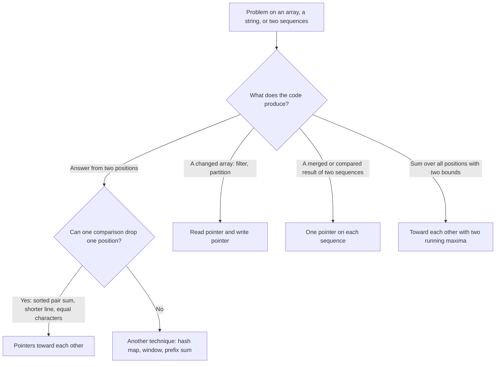

# Pattern 02: Two Pointers

## Overview

Two pointers is a technique that keeps two indexes on one array or string, or one index on each of two sequences. Each step compares the elements at the two indexes and moves one index. The comparison must prove that the element that the index leaves behind cannot belong to any answer that is still open. The proof lets the code skip a whole group of candidates (for example every pair that uses one element) and turns a search over O(n²) pairs into one pass of O(n) steps.

After this page you can:

1. Derive the pointer rule for a pair with a target sum in a sorted array from the O(n²) brute force, and prove that the rule does not discard the answer.
2. State the invariant "if a solution exists, it is inside `[lo, hi]`" and use the same form of argument on a new problem, for example [LC 11: Container With Most Water](https://leetcode.com/problems/container-with-most-water/) and [LC 42: Trapping Rain Water](https://leetcode.com/problems/trapping-rain-water/).
3. Write an in-place filter with a read pointer and a write pointer, and state its invariant: everything before `write` is the result so far.
4. Reduce [LC 15: 3Sum](https://leetcode.com/problems/3sum/) to the pair problem, explain the outer skip and the low skip with the duplicate triplets that the code produces without them, and explain why the high skip is optional.
5. Decide for a new problem whether two pointers applies, name the property that decides it, and give a counterexample input when it does not apply.
6. Tell two pointers apart from a sliding window, a hash map, a prefix sum, and fast and slow pointers.

## Prerequisites

| You need | Why this page needs it | Where to learn it |
|---|---|---|
| Arrays and strings: indexes, writing to `a[i]`, `charAt` | A pointer is an index. The code reads and writes `a[lo]`, `a[hi]`, `a[write]` | [Arrays, Strings, and Linked Lists](../foundations/02-arrays-strings-linked-lists.md) |
| Sorting | The pair rule needs sorted input. [LC 15](https://leetcode.com/problems/3sum/) sorts first and pays O(n log n) for it | [Sorting Algorithms](../foundations/08-sorting-algorithms.md) |
| Counting operations and O-notation | The page counts pointer moves before it states O(n) | [Complexity Analysis](../foundations/01-complexity-analysis.md) |
| Hash map: `put` and `get` by key | Only the comparison with [LC 1](https://leetcode.com/problems/two-sum/) uses it | [Hash Tables](../foundations/04-hash-tables.md) |
| Sliding window | The window is the same-direction relative of this technique. The Recognition Guide says exactly how the two differ | [Pattern 01: Sliding Window](../01-sliding-window/README.md) |

Terms that the page uses from the start:

- A **pointer** is an index variable. It is not a Java reference. In `lo = 0`, the variable `lo` points at the element `a[0]`.
- An array is **sorted** when `a[0] <= a[1] <= ... <= a[n - 1]` (non-decreasing). Equal neighbors are allowed.
- An algorithm works **in place** when it changes the input array and uses O(1) extra memory.
- A **brute force** solution tests every candidate answer and keeps the one that fits. It is the first solution that a reader writes, and the page measures each technique against it.
- An **invariant** is a statement that is true before the first step of a loop and after every step. To prove a loop correct, show three things: the invariant holds at the start, one step keeps it true, and it gives the answer when the loop ends.
- A **greedy** step takes the best choice that is available now and never undoes it. A greedy algorithm needs a proof that no later choice can do better.
- A **subsequence** keeps the order of the elements but may skip elements. In `[1, 2, 4, 7]`, the values `[1, 4]` are a subsequence. A **subarray** has no gaps.

## Motivation

### Problem 1: a pair with a target sum (sorted input)

This problem is [LC 167: Two Sum II - Input Array Is Sorted](https://leetcode.com/problems/two-sum-ii-input-array-is-sorted/). Given an array `a` sorted in non-decreasing order and a number `target`, find two different positions `i < j` with `a[i] + a[j] == target`. Return the two positions. LeetCode counts positions from 1 and promises one answer. This page counts from 0 and also handles "no answer".

```text
index    0   1   2   3   4    5
value    1   2   4   7   11   15      target = 15
```

The answer is the positions 2 and 4, because `4 + 11 = 15`.

**First attempt: check every pair.** The array has `6 x 5 / 2 = 15` pairs. The attempt tests them in this order: (0,1), (0,2), (0,3), (0,4), (0,5), (1,2), (1,3), (1,4), (1,5), (2,3), (2,4). It finds the answer at the 11th test. When no pair has the target sum, the attempt tests all `n(n - 1) / 2` pairs. For `n = 100000`, that is 4,999,950,000 tests. The cost is O(n²).

**A faster rule that fails.** Keep `hi` at the last position and move `lo` from left to right. This rule tests only `n - 1` pairs, the pairs that use the last element. On the example, the sums are `1 + 15 = 16`, `2 + 15 = 17`, `4 + 15 = 19`, `7 + 15 = 22`, and `11 + 15 = 26`. None equals 15, so the rule reports "no pair". The pair (2, 4) exists. The rule skipped it because it did not move `hi`.

**The waste.** Look at the first pair of the attempt that uses the last element: (0, 5), with sum `1 + 15 = 16`. The sum is above the target. The attempt then tests (1, 5), (2, 5), (3, 5), and (4, 5) as well. Each of these pairs has a left element that is at least 1, so each sum is at least 16. One test of (0, 5) already shows that. The attempt runs 5 tests where 1 test is enough. The Derivation turns this observation into a rule.

### Problem 2: remove duplicates in place (sorted input)

This problem is [LC 26: Remove Duplicates from Sorted Array](https://leetcode.com/problems/remove-duplicates-from-sorted-array/). Given a sorted array, change the array in place so that each value appears once, and keep the order. Return the number `k` of values that remain. The first `k` cells must hold the result. The cells after `k` do not matter.

```text
index    0   1   2   3   4   5   6
value    1   1   2   2   2   3   3      result: k = 3, first 3 cells = [1, 2, 3]
```

**First attempt: build a new array.** Copy each value that differs from the previous value into a new array. The result is correct. The attempt uses O(n) extra memory, and the problem asks for in-place work.

**Second attempt: delete each duplicate and shift.** Scan from left to right. When a cell equals the cell before it, delete the cell: move every cell on its right one place to the left. On the example, the deletions shift 5, 3, 2, and 0 cells, a total of 10 moves for 7 elements. Take the array `[1, 1, 1, ..., 1, 2]` with `n` cells. The first deletion shifts `n - 2` cells, the next shifts `n - 3`, and so on. The total is `(n - 2)(n - 1) / 2`. For `n = 100000`, that is 4,999,850,001 moves. The cost is O(n²).

**The waste.** The attempt moves a cell when it deletes a duplicate, and it moves the same cell again at the next deletion. But the final position of each value is known before any move: the first copy of the k-th distinct value ends at position `k - 1`. The Derivation writes each kept value once, at its final position.

## Derivation

### Pointers that move toward each other

Go back to the array `[1, 2, 4, 7, 11, 15]` with `target = 15`.

**Question 1.** The sum of the smallest value and the largest value is `1 + 15 = 16`. It is above the target. Which pairs can the code discard without a test?

**Answer.** Every pair that uses the position of the largest value (position 5). Take any such pair `(i, 5)` with `i < 5`. The array is sorted, so `a[i] >= a[0]`. Then:

```text
a[i] + a[5]  >=  a[0] + a[5]  =  16  >  15
```

The smallest possible partner, `a[0]`, already makes the sum too large. Every other partner is at least as large, so every other partner makes the sum too large as well. One test discards 5 pairs, and the position 5 cannot be part of any answer. The code can remove position 5 from the search.

**Question 2.** What if the sum of the smallest and the largest value is below the target?

**Answer.** Every pair that uses the position of the smallest value is too small. Take the pair `(0, j)` with `j > 0`. The array is sorted, so `a[j] <= a[hi]` for every position `j` up to `hi`. Then `a[0] + a[j] <= a[0] + a[hi] < target`. The largest possible partner already makes the sum too small. The code can remove position 0 from the search.

**The algorithm, derived from the two answers.**

1. Keep two pointers `lo` and `hi`. The range `[lo, hi]` holds the positions that can still belong to an answer. Start with `lo = 0` and `hi = n - 1`.
2. Compute `sum = a[lo] + a[hi]`.
3. If `sum == target`, return the pair.
4. If `sum < target`, remove position `lo` (Question 2): add 1 to `lo`.
5. If `sum > target`, remove position `hi` (Question 1): subtract 1 from `hi`.
6. Repeat while `lo < hi`. A pair needs two different positions.

**Trace** for `a = [1, 2, 4, 7, 11, 15]` and `target = 15`. The legend: `lo` and `hi` mark the two pointers of the step. The code reads the two marked cells.

```text
test 1: 1 + 15 = 16 > 15: discard position 5
index      0     1     2     3     4     5
value      1     2     4     7     11    15
           lo                            hi

test 2: 1 + 11 = 12 < 15: discard position 0
index      0     1     2     3     4     5
value      1     2     4     7     11    15
           lo                      hi

test 3: 2 + 11 = 13 < 15: discard position 1
index      0     1     2     3     4     5
value      1     2     4     7     11    15
                 lo                hi

test 4: 4 + 11 = 15 == 15: found
index      0     1     2     3     4     5
value      1     2     4     7     11    15
                       lo          hi
```

Count the pairs. Test 1 discards the 5 pairs that use position 5. Test 2 discards the 4 pairs that use position 0 (inside `[0, 4]`). Test 3 discards the 3 pairs that use position 1 (inside `[1, 4]`). That is 12 pairs discarded by 3 tests. The range `[2, 4]` holds the last 3 pairs, and test 4 finds the answer among them. The brute force needed 11 tests on the same input.

**Why it is correct.** The invariant is: if a pair with the target sum exists, then it uses two positions inside `[lo, hi]`.

1. *At the start.* The range is the whole array, so the invariant holds.
2. *One step keeps it.* Suppose the invariant holds before a step, and the step has `sum > target`. By Question 1, every pair `(i, hi)` with `lo <= i < hi` has a sum above the target. So no answer uses `hi`. By the invariant, an answer (if it exists) uses two positions in `[lo, hi]`, and neither is `hi`, so both lie in `[lo, hi - 1]`. The step sets `hi = hi - 1`, and the invariant holds. The case `sum < target` is the mirror image with Question 2.
3. *At the end.* The loop stops when `lo == hi`, and the range holds one position. No pair fits in it. By the invariant, no answer exists. An empty array (`hi = -1`) and a one-element array never enter the loop, and the same reason applies: the range holds fewer than two positions. If the loop returns because `sum == target`, the pair is a valid answer.

**Count the moves.** Each step either returns, or makes `hi - lo` smaller by exactly 1. The value `hi - lo` starts at `n - 1`, and the loop runs while it is at least 1. So the loop runs at most `n - 1` times. The trace used 4 tests for `n = 6`, and the bound is 5. For `n = 100000`, the loop makes at most 99,999 tests, and the brute force makes up to 4,999,950,000. Each test costs O(1), so the time is O(n), and the space is O(1). The input must be sorted already. Sorting costs O(n log n) and would dominate.

```java
static int[] pairWithSum(int[] a, int target) {
    int lo = 0, hi = a.length - 1;
    while (lo < hi) {                      // a pair needs two different positions
        int sum = a[lo] + a[hi];
        if (sum == target) return new int[]{lo, hi};  // LC 167 wants {lo + 1, hi + 1}
        if (sum < target) lo++;            // a[lo] is too small for every partner in range
        else hi--;                         // a[hi] is too large for every partner in range
    }
    return new int[0];                     // the range is empty: no pair exists
}
```

The loop condition is `lo < hi`, not `lo <= hi`. With `lo == hi`, the code would add one element to itself (Common Mistakes, mistake 5). LeetCode counts positions from 1, so a LeetCode submission returns `{lo + 1, hi + 1}`.

#### The rule needs sorted input

The discard proof used the sentence "`a[i] >= a[0]` because the array is sorted". Remove the sentence and the proof fails. Run the same code on the unsorted array `[4, 1, 7, 2]` with `target = 3`. The pair at positions 1 and 3 has the sum `1 + 2 = 3`.

```text
index    0   1   2   3
value    4   1   7   2

lo=0 hi=3:  4 + 2 = 6  > 3   the rule discards position 3
lo=0 hi=2:  4 + 7 = 11 > 3   the rule discards position 2
lo=0 hi=1:  4 + 1 = 5  > 3   the rule discards position 1
lo=0 hi=0:  the loop ends. Output: no pair
```

The first step is wrong. It discards position 3, and the answer uses position 3. The proof says "every partner of position 3 is at least `a[0] = 4`". That sentence is false here, because `a[1] = 1` is smaller than `a[0]`. The rule needs the sorted order. The Complexity section shows how to handle unsorted input.

#### Compare with the hash map (LC 1)

[LC 1: Two Sum](https://leetcode.com/problems/two-sum/) asks the same question on an array that is **not sorted**, and it asks for the original positions. A hash map answers it in one pass. For each element `a[j]`, the code looks up `target - a[j]` among the elements it has already seen, and then stores `a[j]` with its position.

```java
static int[] pairWithMap(int[] a, int target) {
    Map<Integer, Integer> indexOf = new HashMap<>();   // value -> position of the last copy seen
    for (int j = 0; j < a.length; j++) {
        Integer i = indexOf.get(target - a[j]);        // look up before the store, so that an
        if (i != null) return new int[]{i, j};         // element cannot pair with itself
        indexOf.put(a[j], j);
    }
    return new int[0];
}
```

| Situation | Better choice | Reason |
|---|---|---|
| The input is sorted and the memory limit is O(1) | Two pointers | O(n) time and O(1) extra space. The map costs O(n) memory |
| The input is not sorted and the answer needs the original positions ([LC 1](https://leetcode.com/problems/two-sum/)) | Hash map | O(n) time and O(n) space. Sorting moves the elements, and the code must carry each position with its value. That costs O(n log n) time and O(n) memory, so it is worse |
| The input is not sorted, the answer is "yes or no" or the values (not the positions), the code may reorder the array, and memory is tight | Sort, then two pointers | O(n log n) time and O(1) extra space (plus the space of the sort) |
| The input is sorted and the memory limit is not tight | Either | Both run in O(n). Choose the two-pointer code when the interviewer states the O(1) space requirement |

### Pointers that move in the same direction

Go back to [LC 26](https://leetcode.com/problems/remove-duplicates-from-sorted-array/) and the array `[1, 1, 2, 2, 2, 3, 3]`.

**Question 1.** Where does the first copy of each distinct value end up, before any move happens?

**Answer.** The result keeps the distinct values in their original order. The first distinct value goes to position 0, the second to position 1, and so on. So the code needs a counter `write`: the position where the next distinct value goes.

**Question 2.** How does the code know that `a[read]` is a new value, and not a copy of a value that it has kept already?

**Answer.** The array is sorted, so equal values sit next to each other. The last kept value is the largest value seen so far. The cell `a[read]` is new exactly when it differs from the last kept value, `a[write - 1]`.

**The algorithm.**

1. Keep two pointers. `read` goes through every cell once, from left to right. `write` marks the next free cell of the result.
2. The cell `a[0]` is new, so start with `write = 1` and `read = 1`.
3. For each `read`: if `a[read] != a[write - 1]`, copy `a[read]` to `a[write]` and add 1 to `write`.
4. Return `write`.

**Trace** for `[1, 1, 2, 2, 2, 3, 3]`. The legend: `(x)` is the cell that the step reads. `[x]` is the cell at `write`, which the step may write. `W` marks `write` (the next free cell of the result), and `R` marks `read`. Every cell left of `W` is the result so far. Each block shows the array before the step.

```text
start: write = 1
index      0     1     2     3     4     5     6
value      1     1     2     2     2     3     3
                 W

read = 1: 1 equals a[0] = 1: skip
index      0     1     2     3     4     5     6
value      1    (1)    2     2     2     3     3
                W,R

read = 2: 2 differs from a[0] = 1: a[1] = 2, write = 2
index      0     1     2     3     4     5     6
value      1    [1]   (2)    2     2     3     3
                 W     R

read = 3: 2 equals a[1] = 2: skip
index      0     1     2     3     4     5     6
value      1     2    [2]   (2)    2     3     3
                       W     R

read = 4: 2 equals a[1] = 2: skip
index      0     1     2     3     4     5     6
value      1     2    [2]    2    (2)    3     3
                       W           R

read = 5: 3 differs from a[1] = 2: a[2] = 3, write = 3
index      0     1     2     3     4     5     6
value      1     2    [2]    2     2    (3)    3
                       W                 R

read = 6: 3 equals a[2] = 3: skip
index      0     1     2     3     4     5     6
value      1     2     3    [2]    2     3    (3)
                             W                 R

result: k = 3, the first 3 cells = [1, 2, 3]
```

**Why it is correct.** The invariant is: before the step for `read`, the cells `a[0 .. write - 1]` hold the distinct values of `a[0 .. read - 1]`, in order, each once. In words: everything before `write` is the result so far.

1. *At the start.* With `read = 1` and `write = 1`, the cell `a[0]` holds the only value of `a[0 .. 0]`.
2. *One step keeps it.* The last cell of the result, `a[write - 1]`, holds the largest value of `a[0 .. read - 1]` (the array is sorted). The cell `a[read]` is at least as large. If it is larger, it is a new value, and the code appends it. If it is equal, the value is in the result already, and the code appends nothing. In both cases the invariant holds for `read + 1`.
3. *No unread cell is overwritten.* The pointer `write` starts at 1 and `read` starts at 1, and `write` grows by at most 1 for each step in which `read` grows by exactly 1. So `write <= read` before every step. The code writes only to `a[write]`, a cell at or left of `a[read]`, and it has read that cell already (or it is the same cell).

**Count the work.** The loop makes `n - 1` comparisons and at most `n - 1` writes. On the example, that is 6 comparisons and 2 writes. The shifting attempt needed 10 moves on the same input. The time is O(n), and the space is O(1).

```java
static int removeDuplicates(int[] a) {
    if (a.length == 0) return 0;               // a[0] does not exist
    int write = 1;                             // a[0] is kept
    for (int read = 1; read < a.length; read++) {
        if (a[read] != a[write - 1]) {         // a new value: compare with the last kept value
            a[write++] = a[read];
        }
    }
    return write;                              // the number of kept values
}
```

The code compares with `a[write - 1]`, the last kept value, and not with `a[read - 1]`. Both give the same result for this problem. The `a[write - 1]` form extends to "keep at most k copies" (see Implementation).

**The empty array.** Without the first line, the code returns 1 for an empty array (Common Mistakes, mistake 6).

### What changed: Move Zeroes (LC 283)

[LC 283: Move Zeroes](https://leetcode.com/problems/move-zeroes/) asks: move every zero to the end of the array in place, and keep the order of the non-zero values. For `[0, 1, 0, 3, 12]`, the result is `[1, 3, 12, 0, 0]`.

**What changed compared with LC 26.**

1. The test is "`a[read]` is not zero". It does not compare with a kept value. The input need not be sorted.
2. The removed values (the zeros) must still exist at the end of the array. The code must not overwrite them. So it swaps `a[read]` with `a[write]`, and the zeros end up after the kept values.

**The invariant.** Before the step for `read`: the cells `a[0 .. write - 1]` hold the non-zero values of `a[0 .. read - 1]`, in order, and the cells `a[write .. read - 1]` are all zeros. The array has three regions: kept, zeros, and unread.

**Why the swap is safe.** If `write < read`, the cell `a[write]` is a zero (it is the first cell of the zero region), and `a[read]` is non-zero. The swap puts the non-zero value at the end of the kept region and moves one zero to the end of the zero region. If `write == read`, the zero region is empty, and the swap exchanges a cell with itself.

**Trace** for `[0, 1, 0, 3, 12]`. The legend is the same as for LC 26: `(x)` is read, `[x]` is the cell at `write`. Each block shows the array before the step.

```text
start: write = 0
index      0     1     2     3     4
value      0     1     0     3     12
           W

read = 0: 0 is zero: skip
index      0     1     2     3     4
value     (0)    1     0     3     12
          W,R

read = 1: 1 is not zero: swap a[0] and a[1], write = 1
index      0     1     2     3     4
value     [0]   (1)    0     3     12
           W     R

read = 2: 0 is zero: skip
index      0     1     2     3     4
value      1    [0]   (0)    3     12
                 W     R

read = 3: 3 is not zero: swap a[1] and a[3], write = 2
index      0     1     2     3     4
value      1    [0]    0    (3)    12
                 W           R

read = 4: 12 is not zero: swap a[2] and a[4], write = 3
index      0     1     2     3     4
value      1     3    [0]    0    (12)
                       W           R

result: [1, 3, 12, 0, 0]
```

```java
static void moveZeroes(int[] a) {
    int write = 0;                             // the next cell for a non-zero value
    for (int read = 0; read < a.length; read++) {
        if (a[read] != 0) {
            int t = a[write]; a[write] = a[read]; a[read] = t;   // a[write] is 0 or a[read]
            write++;
        }
    }
}
```

The code does `n` reads and at most `n` swaps. The time is O(n), and the space is O(1). The same loop partitions an array around any test. A pivot is a chosen value that splits the elements into the ones below it and the rest. Replace `a[read] != 0` with `a[read] < pivot`, and the loop moves every value below the pivot to the front (see Implementation).

## The Pattern

Two pointers searches a set of candidates (pairs of positions, or positions for a write) without testing each candidate. The code keeps two indexes. Each step makes one comparison. The comparison must prove that a group of candidates cannot hold the answer, or cannot beat the best answer so far. The code then moves one pointer past that group and does not move it back. Each step moves a pointer by one position, and a pointer never moves back. Two pointers that move toward each other make at most `n - 1` moves in total. A read pointer and a write pointer make at most `n` moves each.

**The invariant has the same form in every example.** For pointers that move toward each other: *the answer, if it exists, is inside `[lo, hi]`, or the code has recorded it already*. For a read pointer and a write pointer: *everything before `write` is the result for everything before `read`*.

**What the pattern needs.** The pattern does not need a sorted array. It needs a **discard argument**: one comparison that proves that the element at one pointer belongs to no answer that is still open. Sorted order is one source of such an argument (the pair sum in [LC 167](https://leetcode.com/problems/two-sum-ii-input-array-is-sorted/)). The height of the shorter line is another (the container in [LC 11](https://leetcode.com/problems/container-with-most-water/)). The two running maxima are a third (the rain water in [LC 42](https://leetcode.com/problems/trapping-rain-water/)). The symmetry of a palindrome is a fourth ([LC 125](https://leetcode.com/problems/valid-palindrome/)). When you meet a new problem, ask for the discard argument first. If you cannot state it in two sentences, the pattern does not apply.

**The vocabulary.** The page used each of these terms before it named them, except the last one, which the Recognition Guide uses.

| Term | What it was in the examples | The question to ask in a new problem |
|---|---|---|
| Pointer | `lo`, `hi`, `read`, `write`, `i`, `j` | "Which positions must the code keep track of?" |
| Candidate set | The pairs `(i, j)` with `lo <= i < j <= hi` | "What is the set of answers that are still possible?" |
| Discard argument | "`a[lo] + a[hi]` is too large, so every pair with `hi` is too large" | "Which comparison proves that a group of candidates cannot be the answer?" |
| Invariant | "If a solution exists, it is inside `[lo, hi]`" | "What stays true after each step?" |
| Read pointer and write pointer | `read` visits every cell. `write` marks the next cell of the result | "Where does the next element come from, and where does the next kept element go?" |
| Region | `a[0 .. write - 1]` kept, `a[write .. read - 1]` skipped, `a[read ..]` unread | "What do I know about each part of the array?" |
| Monotone quantity | In a sorted array, moving `lo` right never lowers the sum | "When a pointer moves, does the quantity that I compare move in one direction only?" |



### The variants

Each variant changes one thing: where the pointers start, which way they move, or what the comparison proves.

| Variant | Where the pointers start and move | The property of the problem that selects it | Examples |
|---|---|---|---|
| A. Pair with a target sum | Both ends, toward each other | Sorted input, and a pair sum that rises when the left pointer moves right | [LC 167](https://leetcode.com/problems/two-sum-ii-input-array-is-sorted/), [LC 16](https://leetcode.com/problems/3sum-closest/), [LC 259](https://leetcode.com/problems/3sum-smaller/) (premium) |
| B. Fix one (or two) indexes, then run A | An outer index, then both ends of the rest | The answer has three (or four) values, and the order of the values does not matter, so the code may sort | [LC 15](https://leetcode.com/problems/3sum/), [LC 18](https://leetcode.com/problems/4sum/) |
| C. A value of a pair that the shorter side limits | Both ends, toward each other | The value of a pair is limited by the smaller of two numbers, and moving the smaller side is the only move that can help | [LC 11](https://leetcode.com/problems/container-with-most-water/), [LC 42](https://leetcode.com/problems/trapping-rain-water/) |
| D. Symmetric test | Both ends, toward each other | The answer is a yes or no about mirrored positions | [LC 125](https://leetcode.com/problems/valid-palindrome/), [LC 680](https://leetcode.com/problems/valid-palindrome-ii/), [LC 344](https://leetcode.com/problems/reverse-string/) |
| E. Fill from the back | Both ends of the input, and the write pointer at the end of the output | The next output element is at one of the two ends of the input | [LC 977](https://leetcode.com/problems/squares-of-a-sorted-array/), [LC 88](https://leetcode.com/problems/merge-sorted-array/) |
| F. Read and write | Both start at the left, move right | The task changes the array in place, and a test decides which elements stay | [LC 26](https://leetcode.com/problems/remove-duplicates-from-sorted-array/), [LC 27](https://leetcode.com/problems/remove-element/), [LC 80](https://leetcode.com/problems/remove-duplicates-from-sorted-array-ii/), [LC 283](https://leetcode.com/problems/move-zeroes/) |
| G. Three regions | A boundary at each end, and one read pointer between them | Each element has one of three kinds, and the order within a kind does not matter | [LC 75](https://leetcode.com/problems/sort-colors/) |
| H. One pointer on each sequence | Both start at the left of their own sequence | Two sorted sequences, or one sequence tested against another | [LC 88](https://leetcode.com/problems/merge-sorted-array/), [LC 392](https://leetcode.com/problems/is-subsequence/), [LC 986](https://leetcode.com/problems/interval-list-intersections/) |
| I. Pointers that move apart | Both start at one position, move away from each other | The answer grows outward from a known position, and the code extends toward the better side | [LC 1793](https://leetcode.com/problems/maximum-score-of-a-good-subarray/) |

## Worked Examples

Each example changes one thing about the anchor problem. The examples are in the order Easy, Medium, Medium, Medium, Hard.

### Example 1: merge two sorted arrays in place (LC 88)

[LC 88: Merge Sorted Array](https://leetcode.com/problems/merge-sorted-array/). The array `a` has `m + n` cells. Its first `m` cells hold sorted values, and its last `n` cells hold zeros as free space. The array `b` has `n` sorted values. Merge `b` into `a` so that `a` is sorted. Use no other array.

```text
a = [1, 3, 5, 0, 0, 0]   m = 3
b = [2, 4, 6]            n = 3         result: a = [1, 2, 3, 4, 5, 6]
```

**What changed.** The pointers sit on two different arrays, and the output goes into one of the two inputs. The code must decide where to write, so that it does not destroy a value that it has not read.

**First attempts.**

- Copy `b` after `a`'s values and sort the whole array. This takes O((m + n) log(m + n)) time and ignores that both parts are sorted.
- Merge into a new array. This takes O(m + n) time and O(m + n) memory.
- Merge from the front, in place. Take `a = [4, 5, 6, 0, 0, 0]` and `b = [1, 2, 3]`. The smallest value is `b[0] = 1`, and the code writes it to `a[0]`. That cell holds the unread value 4. The value 4 is lost. The Common Mistakes program runs this version and prints `[1, 1, 1, 1, 2, 3]`.

**Question.** Where is the free space in `a`? At the end, in the last `n` cells. So the code should write the largest values first, into the last cells, and move toward the front.

**The algorithm.**

1. Keep `i = m - 1` (the last unread value of `a`), `j = n - 1` (the last unread value of `b`), and `k = m + n - 1` (the next cell to write).
2. The largest unread value is `a[i]` or `b[j]`. Copy the larger one to `a[k]`, then move the pointer that it came from and move `k`.
3. Stop when `b` has no unread value (`j < 0`). The values that remain in `a[0 .. i]` are already in their final cells.

**Why the code never overwrites an unread value.** Before each step, `k = i + j + 1`. This holds at the start (`m - 1 + n - 1 + 1 = m + n - 1`), and each step lowers `k` and one of `i` and `j` by exactly 1. The unread values of `a` sit in `a[0 .. i]`. The write goes to `a[k]`. While `j >= 0`, we have `k = i + j + 1 >= i + 1`, so `a[k]` lies to the right of every unread value of `a`. The write never touches an unread value of `a`. The unread values of `b` live in `b`, so a write to `a` cannot touch them. When `j` becomes `-1`, we have `k = i`, and every remaining value of `a` sits in its final cell.

**The invariant.** Before each step, the cells `a[k + 1 .. m + n - 1]` hold the largest `m + n - 1 - k` values of the two inputs, in sorted order. The unread values are `a[0 .. i]` and `b[0 .. j]`, and each is at most the values in the result.

**Trace** for the example. Each row is the array after the step.

| Step | `i` | `j` | `k` before | Compare | Copy | `a` after |
|---|---|---|---|---|---|---|
| 1 | 2 | 2 | 5 | `a[2] = 5` against `b[2] = 6`: 5 is not larger | `b[2]` | `[1, 3, 5, 0, 0, 6]` |
| 2 | 2 | 1 | 4 | `a[2] = 5` against `b[1] = 4`: 5 is larger | `a[2]` | `[1, 3, 5, 0, 5, 6]` |
| 3 | 1 | 1 | 3 | `a[1] = 3` against `b[1] = 4`: 3 is not larger | `b[1]` | `[1, 3, 5, 4, 5, 6]` |
| 4 | 1 | 0 | 2 | `a[1] = 3` against `b[0] = 2`: 3 is larger | `a[1]` | `[1, 3, 3, 4, 5, 6]` |
| 5 | 0 | 0 | 1 | `a[0] = 1` against `b[0] = 2`: 1 is not larger | `b[0]` | `[1, 2, 3, 4, 5, 6]` |

After step 5, `j = -1`, and the loop stops. The implementation program prints the same trace.

```java
static void mergeFromBack(int[] a, int m, int[] b, int n) {
    int i = m - 1, j = n - 1, k = m + n - 1;
    while (j >= 0) {                                  // when b is used up, a is in place
        if (i >= 0 && a[i] > b[j]) a[k--] = a[i--];   // a[i] is the larger unread value
        else a[k--] = b[j--];                         // b[j] is larger, or a has no unread value
    }
}
```

On a tie (`a[i] == b[j]`), the code copies `b[j]`. The condition uses `>`, not `>=`, so the copy from `b` lands at the larger index. This keeps the values of `a` before equal values of `b` in the result.

**Complexity.** Each step writes one cell, and there are at most `m + n` writes. Time O(m + n), space O(1).

**A second problem of the same shape: [LC 392: Is Subsequence](https://leetcode.com/problems/is-subsequence/).** The question: is the string `s` a subsequence of the string `t`? The match may skip any characters of `t`. **Question.** Where in `t` should the code look for `s[0]`, and then for `s[1]`? At the earliest place that it appears, after the previous match. An earlier match leaves more characters of `t` for the rest of `s`, so the earliest match is a greedy step that loses nothing. This gives two pointers: `i` on `s` and `j` on `t`. The code moves `j` over every character of `t`. When `t[j]` equals `s[i]`, it moves `i`. The answer is yes when `i` reaches the end of `s`. The invariant: `s[0 .. i - 1]` is the longest prefix of `s` that is a subsequence of `t[0 .. j - 1]`. For `s = "ace"` and `t = "abcde"`: `a` matches at `j = 0`, `c` at `j = 2`, `e` at `j = 4`, so the answer is yes. For `s = "aec"`, the code matches `a` at 0, `e` at 4, then finds no `c` after position 4, so the answer is no. The code is in the Implementation section. The time is O(|t|), and the space is O(1).

### Example 2: 3Sum (LC 15)

[LC 15: 3Sum](https://leetcode.com/problems/3sum/). Given an array of integers, return all sets of three values, at three different positions, whose sum is 0. The result must not contain the same triplet of values twice. The array is not sorted.

```text
nums = [-1, 0, 1, 2, -1, -4]        result: [[-1, -1, 2], [-1, 0, 1]]
```

**What changed.** (1) The answer has three values. (2) The input is not sorted. (3) The code must return all answers, and each triplet of values only once.

**First attempt: three loops.** Test every triple of positions. For `n = 3000`, that is about 4.5 x 10^9 triples, so the cost is O(n³).

**Question 1.** If the code fixes the first value `a[i]`, what is left to find? Two more values whose sum is `-a[i]`. That is the anchor problem with the target `-a[i]`. So the code needs the array sorted, and it can run the pair loop of `pairWithSum` once for each `i`. The loop must find every pair, not only the first one, so it keeps going after a hit.

**Question 2.** In which part of the array should the pair search run? Sort the array first. A triplet at the sorted positions `i < j < k` is found when the code fixes `i`, the smallest position. So the pair search for `i` runs on `a[i + 1 .. n - 1]` only. A search to the left of `i` would find only triplets that the code has found already.

The sort costs O(n log n). Then the code runs one pair search of O(n) for each of the `n - 2` values of `i`. The time is O(n²), and the space is O(1) besides the sort and the output.

**Question 3.** What does the code output if it adds no duplicate handling? A **skip** is a line that jumps over a repeated value. The **outer skip** works on `i`. The **low skip** and the **high skip** work on `lo` and `hi` after a hit. The program below runs the loop with each skip as a switch. It prints the result for two inputs. The first input has a repeated value in the middle and at the right. The second input has a repeated value at the left.

```java
import java.util.ArrayList;
import java.util.Arrays;
import java.util.List;

public class ThreeSumDuplicates {
    public static void main(String[] args) {
        int[][] inputs = {{-2, 0, 0, 2, 2}, {-1, -1, 0, 1, 2}};
        String[] names = {"no skip", "outer only", "outer + low", "outer + high", "all three"};
        boolean[][] flags = {
            {false, false, false}, {true, false, false}, {true, true, false},
            {true, false, true}, {true, true, true}};
        for (int[] input : inputs) {
            System.out.println("input " + Arrays.toString(input));
            for (int k = 0; k < names.length; k++) {
                System.out.println("  " + String.format("%-13s", names[k]) + " -> "
                        + threeSum(input, flags[k][0], flags[k][1], flags[k][2]));
            }
        }
    }

    // The three skips are switches here, so that the output of each stage can be printed.
    static List<List<Integer>> threeSum(int[] nums, boolean skipOuter, boolean skipLow,
                                        boolean skipHigh) {
        int[] a = nums.clone();
        Arrays.sort(a);
        List<List<Integer>> result = new ArrayList<>();
        for (int i = 0; i < a.length - 2; i++) {
            if (skipOuter && i > 0 && a[i] == a[i - 1]) continue;
            int lo = i + 1, hi = a.length - 1;
            while (lo < hi) {
                int sum = a[i] + a[lo] + a[hi];
                if (sum < 0) lo++;
                else if (sum > 0) hi--;
                else {
                    result.add(List.of(a[i], a[lo], a[hi]));
                    lo++; hi--;
                    if (skipLow) while (lo < hi && a[lo] == a[lo - 1]) lo++;
                    if (skipHigh) while (lo < hi && a[hi] == a[hi + 1]) hi--;
                }
            }
        }
        return result;
    }
}
```

<!-- expected-output -->
```text
input [-2, 0, 0, 2, 2]
  no skip       -> [[-2, 0, 2], [-2, 0, 2]]
  outer only    -> [[-2, 0, 2], [-2, 0, 2]]
  outer + low   -> [[-2, 0, 2]]
  outer + high  -> [[-2, 0, 2]]
  all three     -> [[-2, 0, 2]]
input [-1, -1, 0, 1, 2]
  no skip       -> [[-1, -1, 2], [-1, 0, 1], [-1, 0, 1]]
  outer only    -> [[-1, -1, 2], [-1, 0, 1]]
  outer + low   -> [[-1, -1, 2], [-1, 0, 1]]
  outer + high  -> [[-1, -1, 2], [-1, 0, 1]]
  all three     -> [[-1, -1, 2], [-1, 0, 1]]
```

Read the output in this order.

1. **No skip.** Both inputs give a triplet twice. The input `[-1, -1, 0, 1, 2]` gives `[-1, 0, 1]` twice. The input `[-2, 0, 0, 2, 2]` gives `[-2, 0, 2]` twice. There are two different causes.
2. **The outer skip.** On `[-1, -1, 0, 1, 2]`, the code fixes the first `-1` at `i = 0` and finds `[-1, -1, 2]` and `[-1, 0, 1]`. Then it fixes the second `-1` at `i = 1` and finds `[-1, 0, 1]` again. When `a[i] == a[i - 1]`, every pair that the code can use at `i` (the cells after `i`) is also available at `i - 1` (the cells after `i - 1`, which include everything after `i`). The code has found every triplet for this value already. So the code skips `i` when `a[i] == a[i - 1]`. It compares with the cell before. If it compared with the cell after, it would skip the first copy and lose `[-1, -1, 2]` (Common Mistakes, mistake 2). The row "outer only" fixes this input. It does not fix `[-2, 0, 0, 2, 2]`.
3. **The inner skip, low side.** On `[-2, 0, 0, 2, 2]`, the code fixes `-2` and needs a pair with sum 2. It finds `0 + 2` with `lo = 1` and `hi = 4`. Then it moves to `lo = 2` and `hi = 3`, and it finds `0 + 2` again. The pair sum is fixed, so after a hit with the value `x` at `lo`, any other hit with the value `x` at `lo` has the same partner, and the same triplet. So after a hit, the code moves `lo` past every copy of `x`: `lo++`, then `while (a[lo] == a[lo - 1]) lo++`. The row "outer + low" is correct on both inputs.
4. **The inner skip, high side.** The high skip is the mirror image: after a hit, move `hi` past every copy of its value. The rows "outer + low", "outer + high", and "all three" print the same output, so one inner skip is enough. The reason: take the code with the low skip and without the high skip. After a hit, `hi--` can land on a copy of the old `a[hi]`. The low skip has then moved `lo` to a value larger than the old `a[lo]`, or `lo` has reached `hi` and the loop ends. In the first case the new sum is larger than the hit sum 0, so the ordinary rule `sum > 0` moves `hi` down, and the code records nothing, until `hi` has left the copies. The high skip makes the same moves in a loop of its own. The skip on one side only saves loop passes, and the time stays O(n²). Recommendation: write both skips, so that the two loops are mirror images. An interviewer expects to see the outer skip compare with the cell before, at least one inner skip, and the reason for each. A solution with one inner skip is correct if you can give the reason above.

**Question 4.** Can the code stop early? Yes. If `a[i] > 0`, then `a[i + 1]` and `a[i + 2]` are at least `a[i]`, so the sum is positive. No later `i` can give 0, and the code stops.

**Trace** for `[-1, 0, 1, 2, -1, -4]`. After sorting, the array is `[-4, -1, -1, 0, 1, 2]`.

=== "i = 0"

    ```text
    i=0 (-4): need a pair with sum 4
      lo=1 hi=5 sum=-3 < 0: lo++
      lo=2 hi=5 sum=-3 < 0: lo++
      lo=3 hi=5 sum=-2 < 0: lo++
      lo=4 hi=5 sum=-1 < 0: lo++
    ```

    The largest possible pair in `a[1 .. 5]` is `1 + 2 = 3`, which is below 4. The pointer `lo` runs to `hi`, and the loop ends.

=== "i = 1"

    ```text
    i=1 (-1): need a pair with sum 1
      lo=2 hi=5 sum=0 == 0: record [-1, -1, 2]
      lo=3 hi=4 sum=0 == 0: record [-1, 0, 1]
    ```

    After the first hit, `lo = 3` and `hi = 4`. The cell `a[3] = 0` differs from `a[2] = -1`, and `a[4] = 1` differs from `a[5] = 2`, so the two skip loops do nothing. The second hit moves `lo` to 4 and `hi` to 3, and the loop ends.

=== "i = 2"

    ```text
    i=2: same as a[1], skip
    ```

    `a[2] = -1` equals `a[1] = -1`. Every triplet that starts with `-1` is found at `i = 1` already.

=== "i = 3"

    ```text
    i=3 (0): need a pair with sum 0
      lo=4 hi=5 sum=3 > 0: hi--
    ```

    Then `lo = 4` and `hi = 4`, and the loop ends. The next `i` is 4, and the outer loop stops (`i < n - 2`).

The result is `[[-1, -1, 2], [-1, 0, 1]]`. The implementation program prints the same trace.

```java
static List<List<Integer>> threeSum(int[] nums) {
    int[] a = nums.clone();                         // sort a copy: the caller keeps its order
    Arrays.sort(a);
    List<List<Integer>> result = new ArrayList<>();
    for (int i = 0; i < a.length - 2; i++) {        // i needs two cells after it
        if (a[i] > 0) break;                        // all three values would be positive
        if (i > 0 && a[i] == a[i - 1]) continue;    // outer skip: compare with the cell before
        int lo = i + 1, hi = a.length - 1;
        while (lo < hi) {
            int sum = a[i] + a[lo] + a[hi];
            if (sum < 0) lo++;
            else if (sum > 0) hi--;
            else {
                result.add(List.of(a[i], a[lo], a[hi]));
                lo++; hi--;
                while (lo < hi && a[lo] == a[lo - 1]) lo++;   // inner skip, low side
                while (lo < hi && a[hi] == a[hi + 1]) hi--;   // inner skip, high side
            }
        }
    }
    return result;
}
```

**Complexity.** Sorting costs O(n log n). The outer loop runs at most `n - 2` times, and each pair search makes at most `n` pointer moves. The total is O(n²). The space is O(1) besides the sort and the output. [LC 18: 4Sum](https://leetcode.com/problems/4sum/) fixes two indexes and runs the pair search for the rest. Its time is O(n³). The Implementation section has the code, and it uses `long` for the sum.

### Example 3: Container With Most Water (LC 11)

[LC 11: Container With Most Water](https://leetcode.com/problems/container-with-most-water/). The array `h` holds the heights of vertical lines at positions `0 .. n - 1`. Pick two lines. They form a container. Its water is `(j - i) x min(h[i], h[j])`. Find the largest water.

```text
h = [1, 8, 6, 2, 5, 4, 8, 3, 7]        answer: 49  (positions 1 and 8: 7 x min(8, 7))
```

**What changed.** (1) The code does not look for a target. It maximizes a number. (2) The array is not sorted, and sorting would destroy the positions, which set the width. (3) The discard argument comes from the heights and the widths, not from sorted order.

**First attempt: test every pair.** There are `n(n - 1) / 2` containers, so the cost is O(n²).

**Question 1.** Which container is the widest? The one with `lo = 0` and `hi = n - 1`. Every other container is narrower, so it can win only with a larger height. Start there.

**Question 2.** The code holds the container `(lo, hi)` and its area. Which pointer can it move, and what does it lose?

**Answer.** Let `h[lo] <= h[hi]`, so the shorter line is at `lo`, and the area is `(hi - lo) x h[lo]`. Take any other container that uses `lo`, with a partner `j` such that `lo < j < hi`.

```text
width  = j - lo  <  hi - lo        (the partner is closer)
height = min(h[lo], h[j])  <=  h[lo]
area   = width x height  <=  (j - lo) x h[lo]  <=  (hi - lo) x h[lo]  =  the current area
```

Every container that uses `lo` and a partner left of `hi` is not larger than the current one. The last step of the chain is `<` when `h[lo] > 0` and `=` when `h[lo] = 0`. The code has recorded the current area. So it can discard position `lo` and move `lo` one step right. If `h[hi] < h[lo]`, the same argument discards `hi`. If the heights are equal, either move is safe, because each end is a shorter line (or tied).

**The invariant.** The variable `best` is at least the area of every container that has an end outside `[lo, hi]`. The best container overall is `best` or a container inside `[lo, hi]`.

**Why it holds.** At the start, `[lo, hi]` is the whole array, so no container has an end outside it, and the statement is true. A step records the area of `(lo, hi)`. Then it discards the shorter end. By Question 2, every container that uses that end and a partner inside the range is not larger than the area just recorded. So after the move, every container that has an end outside the new range is covered by `best`. When `lo == hi`, no container is left inside, so `best` is the maximum. If the array has fewer than 2 lines, the loop does not run, no container exists, and `best` stays 0.

**A rule that looks similar and fails: move the taller line.** Moving the taller line cannot increase the area of the next container: the next container is narrower, and the shorter line still limits its height. That fact makes the rule look safe, and the rule fails. On `h = [1, 8, 6, 2, 5, 4, 8, 3, 7]` it starts with the lines of height 1 and 7. It moves the taller line (height 7, position 8) and discards position 8. But the best container uses position 8: positions 1 and 8 give `7 x 7 = 49`. The rule returns 8. The reason: the proof above needs that every partner of the discarded end is limited by that end's own height. A taller end does not limit its partners, so a container that uses it and a taller partner can win. The Common Mistakes program runs this rule.

**Trace** for the example. Click through the 8 steps.

=== "Step 1"

    ```text
    index      0     1     2     3     4     5     6     7     8
    value      1     8     6     2     5     4     8     3     7
               lo                                              hi
    area = 8 x min(1, 7) = 8 x 1 = 8, best = 8
    the shorter line is at lo: lo moves
    ```

=== "Step 2"

    ```text
    index      0     1     2     3     4     5     6     7     8
    value      1     8     6     2     5     4     8     3     7
                     lo                                        hi
    area = 7 x min(8, 7) = 7 x 7 = 49, best = 49
    the shorter line is at hi: hi moves
    ```

=== "Step 3"

    ```text
    index      0     1     2     3     4     5     6     7     8
    value      1     8     6     2     5     4     8     3     7
                     lo                                  hi
    area = 6 x min(8, 3) = 6 x 3 = 18, best = 49
    the shorter line is at hi: hi moves
    ```

=== "Step 4"

    ```text
    index      0     1     2     3     4     5     6     7     8
    value      1     8     6     2     5     4     8     3     7
                     lo                            hi
    area = 5 x min(8, 8) = 5 x 8 = 40, best = 49
    the heights tie: either end is safe, the code moves hi
    ```

=== "Step 5"

    ```text
    index      0     1     2     3     4     5     6     7     8
    value      1     8     6     2     5     4     8     3     7
                     lo                      hi
    area = 4 x min(8, 4) = 4 x 4 = 16, best = 49
    the shorter line is at hi: hi moves
    ```

=== "Step 6"

    ```text
    index      0     1     2     3     4     5     6     7     8
    value      1     8     6     2     5     4     8     3     7
                     lo                hi
    area = 3 x min(8, 5) = 3 x 5 = 15, best = 49
    the shorter line is at hi: hi moves
    ```

=== "Step 7"

    ```text
    index      0     1     2     3     4     5     6     7     8
    value      1     8     6     2     5     4     8     3     7
                     lo          hi
    area = 2 x min(8, 2) = 2 x 2 = 4, best = 49
    the shorter line is at hi: hi moves
    ```

=== "Step 8"

    ```text
    index      0     1     2     3     4     5     6     7     8
    value      1     8     6     2     5     4     8     3     7
                     lo    hi
    area = 1 x min(8, 6) = 1 x 6 = 6, best = 49
    the shorter line is at hi: hi moves
    ```


The code records 49 at step 2. In steps 3 to 8, the height at `hi` is at most `h[1] = 8`, so the shorter end is `hi` (step 4 is a tie, and the code moves `hi`). No later step beats 49.

```java
static int maxArea(int[] h) {
    int lo = 0, hi = h.length - 1, best = 0;
    while (lo < hi) {
        best = Math.max(best, (hi - lo) * Math.min(h[lo], h[hi]));
        if (h[lo] < h[hi]) lo++;           // the shorter line gains nothing from a closer partner
        else hi--;                         // a tie moves hi: either end is safe
    }
    return best;
}
```

The area is at most `(n - 1) x max(h)`. If that product can exceed 2,147,483,647, use `long`.

**Complexity.** Each step moves one pointer, and `hi - lo` falls by 1. The loop runs at most `n - 1` times. Time O(n), space O(1).

### Example 4: Sort Colors (LC 75)

[LC 75: Sort Colors](https://leetcode.com/problems/sort-colors/). The array holds only the values 0, 1, and 2. Sort it in place, with one pass and without a library sort.

```text
a = [2, 0, 2, 1, 1, 0]        result: [0, 0, 1, 1, 2, 2]
```

**What changed.** The array has three kinds of values, not two. This problem is known as the Dutch national flag problem. A single write pointer (as in Move Zeroes) separates two kinds only. The code needs two boundaries and one read pointer.

**First attempts.** `Arrays.sort` takes O(n log n) time. A counting pass followed by a writing pass takes O(n) time but reads the array twice. A Move Zeroes loop that moves the 0s to the front, followed by a second loop that moves the 1s, takes two passes. The question is how to do it in one pass.

**Question.** What does the code know about each cell at any moment? Name four regions with `low`, `mid`, and `high`:

```text
a[0 .. low - 1]       all 0      (done)
a[low .. mid - 1]     all 1      (done)
a[mid .. high]        not yet looked at
a[high + 1 .. n - 1]  all 2      (done)
```

This is the invariant. At the start, `low = mid = 0` and `high = n - 1`, so three regions are empty and the unread region is the whole array. The code looks at `a[mid]`. There are three cases, and each case keeps the invariant.

| `a[mid]` | The action | Why it keeps the invariant |
|---|---|---|
| 0 | Swap `a[low]` and `a[mid]`. Add 1 to `low` and to `mid` | The cell `a[low]` is the first cell of the 1-region, or the same cell as `a[mid]` if the 1-region is empty. After the swap, `a[low]` holds 0 (joins the 0-region), and `a[mid]` holds a 1 that came from the 1-region (or is the same cell). A value that is known to be 1 sits left of the new `mid`, so `mid` can advance |
| 1 | Add 1 to `mid` | The value 1 is at the end of the 1-region already |
| 2 | Swap `a[mid]` and `a[high]`. Subtract 1 from `high`. **Do not move `mid`** | The 2 now sits at the start of the 2-region. The cell `a[mid]` now holds the value that came from `a[high]`, a cell of the unread region. The code has not looked at it. It can be 0, 1, or 2, so `mid` stays and the next step looks at it |

The loop runs while `mid <= high`. When `mid > high`, the unread region is empty, and the three finished regions cover the array in the order 0, 1, 2.

**Why `mid` does not advance after a swap with `high`.** The value that arrives at `a[mid]` is unread. If the code adds 1 to `mid`, it treats that value as a finished 1. Take `[1, 2, 0]`: the code moves `mid` past the 1, swaps the 2 with the 0 to get `[1, 0, 2]`, and then moves `mid` to 2, past the 0. The loop ends, and the output `[1, 0, 2]` is wrong. The Common Mistakes program runs this version.

**Trace** for `[2, 0, 2, 1, 1, 0]`. Each row is the state after the step.

| Step | `a[mid]` | Action | `low` | `mid` | `high` | Array |
|---|---|---|---|---|---|---|
| start | | | 0 | 0 | 5 | `[2, 0, 2, 1, 1, 0]` |
| 1 | 2 | swap with `high`, `high--` | 0 | 0 | 4 | `[0, 0, 2, 1, 1, 2]` |
| 2 | 0 | swap with `low`, `low++`, `mid++` | 1 | 1 | 4 | `[0, 0, 2, 1, 1, 2]` |
| 3 | 0 | swap with `low`, `low++`, `mid++` | 2 | 2 | 4 | `[0, 0, 2, 1, 1, 2]` |
| 4 | 2 | swap with `high`, `high--` | 2 | 2 | 3 | `[0, 0, 1, 1, 2, 2]` |
| 5 | 1 | `mid++` | 2 | 3 | 3 | `[0, 0, 1, 1, 2, 2]` |
| 6 | 1 | `mid++` | 2 | 4 | 3 | `[0, 0, 1, 1, 2, 2]` |

Step 1 brings the last value (a 0) to `a[0]`. Step 1 does not move `mid`, and step 2 reads the cell again. That is the case from the explanation above. After step 6, `mid = 4 > high = 3`, and the loop ends.

```java
static void sortColors(int[] a) {
    int low = 0, mid = 0, high = a.length - 1;
    while (mid <= high) {
        if (a[mid] == 0) {
            int t = a[low]; a[low] = a[mid]; a[mid] = t;   // a 1 (or the same cell) comes to mid
            low++; mid++;
        } else if (a[mid] == 1) {
            mid++;
        } else {
            int t = a[mid]; a[mid] = a[high]; a[high] = t; // an unread value comes to mid
            high--;                                        // mid stays
        }
    }
}
```

The loop condition is `mid <= high`, not `mid < high`: when `mid == high`, the cell between them is unread and needs a look.

**Complexity.** Each step either adds 1 to `mid` or subtracts 1 from `high`, so the unread region shrinks by 1. There are at most `n` steps. Time O(n) in one pass, space O(1).

### Example 5: Trapping Rain Water (LC 42)

[LC 42: Trapping Rain Water](https://leetcode.com/problems/trapping-rain-water/). The array `h` holds the heights of bars of width 1. After rain, water stays between the bars. Find the total volume.

```text
h = [2, 0, 1, 0, 3, 1, 2]        answer: 6
```

**What changed.** (1) The answer is a sum over all positions, not one pair. (2) The water at a position depends on two numbers, the tallest bar on each side. (3) The pointers carry running maxima.

**Step 1: the water above one position.** The water above position `i` rises to the lower of the two walls. The left wall is the tallest bar in `h[0 .. i]`. The right wall is the tallest bar in `h[i .. n - 1]`. The two ranges include `h[i]`, so the result is not negative:

```text
water(i) = min(leftMax(i), rightMax(i)) - h[i]
```

**First attempt: scan both sides for each position.** For each `i`, scan left and scan right. The cost is O(n²).

**Second attempt: prefix maxima.** The arrays `leftMax` and `rightMax` hold all the maxima. Two passes fill them, and a third pass sums the water. For the example:

```text
index        0  1  2  3  4  5  6
h            2  0  1  0  3  1  2
leftMax      2  2  2  2  3  3  3
rightMax     3  3  3  3  3  2  2
min          2  2  2  2  3  2  2
water        0  2  1  2  0  1  0      total 6
```

```java
static int trapWithPrefixMax(int[] h) {
    int n = h.length;
    if (n == 0) return 0;
    int[] leftMax = new int[n], rightMax = new int[n];
    leftMax[0] = h[0];
    for (int i = 1; i < n; i++) leftMax[i] = Math.max(leftMax[i - 1], h[i]);
    rightMax[n - 1] = h[n - 1];
    for (int i = n - 2; i >= 0; i--) rightMax[i] = Math.max(rightMax[i + 1], h[i]);
    int water = 0;
    for (int i = 0; i < n; i++) water += Math.min(leftMax[i], rightMax[i]) - h[i];
    return water;
}
```

The time is O(n). The space is O(n) for two arrays. This is correct, and it is the version to write first. The waste: the code stores `n` values of each maximum, and then reads each value once.

**Question.** The formula needs the smaller of two numbers. Does the code need both numbers exactly at every position?

**Answer.** No. It needs the smaller one exactly, and a lower bound on the larger one. Walk two pointers inward, with two running maxima:

```text
leftMax  = max of h[0 .. lo]        (exact for position lo)
rightMax = max of h[hi .. n - 1]    (exact for position hi)
```

Compare the two maxima. Take the case `leftMax <= rightMax`. The true right wall of position `lo` is `max(h[lo .. n - 1])`. The range `h[hi .. n - 1]` lies inside `h[lo .. n - 1]` because `lo <= hi`. So the true right wall is at least `rightMax`, and `rightMax` is at least `leftMax`. The smaller wall of position `lo` is therefore `leftMax`, and `water(lo) = leftMax - h[lo]`. The code needs no other information about the right side. Add the water, then move `lo` right.

The case `leftMax > rightMax` is the mirror image. The true left wall of position `hi` is `max(h[0 .. hi])`, which contains `h[0 .. lo]`, so it is at least `leftMax`, which is larger than `rightMax`. The smaller wall of `hi` is `rightMax`, and `water(hi) = rightMax - h[hi]`. Add the water, then move `hi` left.

**The invariant.** Every position left of `lo` and every position right of `hi` has its water added to the total. At each comparison, `leftMax = max(h[0 .. lo])` and `rightMax = max(h[hi .. n - 1])`.

**Why the last position works.** When `lo == hi`, both maxima include `h[lo]`, and both walls of that position are exact. The formula holds with either branch, so the loop condition is `lo <= hi`.

**Trace** for `h = [2, 0, 1, 0, 3, 1, 2]`. Click through the 7 steps.

=== "Step 1"

    ```text
    index      0     1     2     3     4     5     6
    value      2     0     1     0     3     1     2
               lo                                  hi
    leftMax = 2, rightMax = 2
    leftMax 2 <= rightMax 2: water at 0 = 2 - 2 = 0, total 0; lo moves
    ```

=== "Step 2"

    ```text
    index      0     1     2     3     4     5     6
    value      2     0     1     0     3     1     2
                     lo                            hi
    leftMax = 2, rightMax = 2
    leftMax 2 <= rightMax 2: water at 1 = 2 - 0 = 2, total 2; lo moves
    ```

=== "Step 3"

    ```text
    index      0     1     2     3     4     5     6
    value      2     0     1     0     3     1     2
                           lo                      hi
    leftMax = 2, rightMax = 2
    leftMax 2 <= rightMax 2: water at 2 = 2 - 1 = 1, total 3; lo moves
    ```

=== "Step 4"

    ```text
    index      0     1     2     3     4     5     6
    value      2     0     1     0     3     1     2
                                 lo                hi
    leftMax = 2, rightMax = 2
    leftMax 2 <= rightMax 2: water at 3 = 2 - 0 = 2, total 5; lo moves
    ```

=== "Step 5"

    ```text
    index      0     1     2     3     4     5     6
    value      2     0     1     0     3     1     2
                                       lo          hi
    leftMax = 3, rightMax = 2
    leftMax 3 > rightMax 2: water at 6 = 2 - 2 = 0, total 5; hi moves
    ```

=== "Step 6"

    ```text
    index      0     1     2     3     4     5     6
    value      2     0     1     0     3     1     2
                                       lo    hi
    leftMax = 3, rightMax = 2
    leftMax 3 > rightMax 2: water at 5 = 2 - 1 = 1, total 6; hi moves
    ```

=== "Step 7"

    ```text
    index      0     1     2     3     4     5     6
    value      2     0     1     0     3     1     2
                                     lo,hi
    leftMax = 3, rightMax = 3
    leftMax 3 <= rightMax 3: water at 4 = 3 - 3 = 0, total 6; lo moves
    ```


Steps 5 and 6 move `hi`, because the left wall (3) is higher than the right wall (2). The total is 6, the same as the prefix-maximum answer.

```java
static int trap(int[] h) {
    int lo = 0, hi = h.length - 1, leftMax = 0, rightMax = 0, water = 0;
    while (lo <= hi) {
        leftMax = Math.max(leftMax, h[lo]);     // exact: the tallest bar in h[0 .. lo]
        rightMax = Math.max(rightMax, h[hi]);   // exact: the tallest bar in h[hi .. n - 1]
        if (leftMax <= rightMax) {              // the right wall of lo is at least rightMax
            water += leftMax - h[lo];
            lo++;
        } else {                                // the left wall of hi is at least leftMax
            water += rightMax - h[hi];
            hi--;
        }
    }
    return water;
}
```

The starting value 0 for both maxima is safe, because heights are not negative.

**Complexity.** Each step moves one pointer, so the loop runs `n` times. Time O(n). Space O(1), against O(n) for the prefix-maximum version.

## Implementation

The templates below each came out of an example above. The first program holds the templates that the examples did not write in full, and it prints the results for small inputs and edge cases. The second program prints the traces of the examples, so that you can compare each trace in the text with a run.

### The templates

| Template | Derived in | Problems |
|---|---|---|
| Pair with a target sum, opposite ends | Derivation, part 1 | [LC 167](https://leetcode.com/problems/two-sum-ii-input-array-is-sorted/) |
| All distinct pairs with a target sum | Example 2 (the two inner skips) | The pair step inside [LC 15](https://leetcode.com/problems/3sum/) |
| Keep what passes a test | Derivation, part 2 | [LC 27](https://leetcode.com/problems/remove-element/), [LC 26](https://leetcode.com/problems/remove-duplicates-from-sorted-array/), [LC 80](https://leetcode.com/problems/remove-duplicates-from-sorted-array-ii/) |
| Partition around a pivot | Move Zeroes | The partition step of quicksort |
| Three regions | Example 4 | [LC 75](https://leetcode.com/problems/sort-colors/) |
| Fix one index, then the pair template | Example 2 | [LC 15](https://leetcode.com/problems/3sum/), [LC 16](https://leetcode.com/problems/3sum-closest/), [LC 259](https://leetcode.com/problems/3sum-smaller/) (premium), [LC 18](https://leetcode.com/problems/4sum/) |
| Symmetric test and swap | Pattern, variant D | [LC 125](https://leetcode.com/problems/valid-palindrome/), [LC 344](https://leetcode.com/problems/reverse-string/) |
| Fill from the back | Example 1 | [LC 88](https://leetcode.com/problems/merge-sorted-array/), [LC 977](https://leetcode.com/problems/squares-of-a-sorted-array/) |
| One pointer on each sequence | Example 1 | [LC 392](https://leetcode.com/problems/is-subsequence/), [LC 986](https://leetcode.com/problems/interval-list-intersections/) |
| Pair the heaviest with the lightest | Practice, P6 | [LC 881](https://leetcode.com/problems/boats-to-save-people/) |

Lines that need an explanation:

- **`a[hi] == a[hi + 1]` in a skip loop.** The skip runs after `hi--`, so the cell `hi + 1` exists. The test `lo < hi` stops the loop before the pointers cross.
- **`write < k || a[read] != a[write - k]` in `keepAtMost`.** The first `k` values stay. After that, the code compares `a[read]` with the cell `k` places before `write`. The result is sorted, so if that cell equals `a[read]`, the result holds `k` copies of the value already.
- **`count += hi - lo` in the 3Sum Smaller template.** If `a[i] + a[lo] + a[hi] < target`, then each partner between `lo + 1` and `hi` gives a smaller or equal sum, because the array is sorted. So the code counts all `hi - lo` partners at once and moves `lo`.
- **`long sum` in 4Sum.** Four `int` values can add up to more than 2,147,483,647, and the `int` sum wraps around (mistake 8).
- **`if (lo < hi && a[lo] + a[hi] <= limit) lo++; hi--; boats++;` in the boats template.** The heaviest person (at `hi`) takes a boat. The lightest person joins that boat if the two fit and are two different people.
- **`first[i][1] < second[j][1]` in the interval template.** The interval that ends first cannot meet any later interval of the other list, because the other list's next interval starts after its current interval ends. So the code drops the interval that ends first.

```java
import java.util.ArrayList;
import java.util.Arrays;
import java.util.HashMap;
import java.util.List;
import java.util.Map;

public class TwoPointerTemplates {
    public static void main(String[] args) {
        System.out.println("hash map pair (LC 1): "
                + Arrays.toString(pairWithMap(new int[]{3, 2, 4}, 6)) + " "
                + Arrays.toString(pairWithMap(new int[]{3, 3}, 6)) + " "
                + Arrays.toString(pairWithMap(new int[]{}, 6)));
        System.out.print("distinct pairs, sum 6 in [1, 1, 2, 3, 3, 3, 5, 5]:");
        for (int[] p : distinctPairsWithSum(new int[]{1, 1, 2, 3, 3, 3, 5, 5}, 6)) {
            System.out.print(" " + Arrays.toString(p));
        }
        System.out.println();
        System.out.println("distinct pairs, all equal [3, 3, 3], sum 6: "
                + distinctPairsWithSum(new int[]{3, 3, 3}, 6).size() + " pair");
        System.out.println("distinct pairs, empty input: "
                + distinctPairsWithSum(new int[]{}, 6).size());

        int[] r = {3, 2, 2, 3, 4};
        int kept = removeValue(r, 3);
        System.out.println("remove value 3 (LC 27): " + kept + " "
                + Arrays.toString(Arrays.copyOf(r, kept)));
        int[] d = {1, 1, 1, 2, 2, 3};
        kept = keepAtMost(d, 2);
        System.out.println("keep at most 2 copies (LC 80): " + kept + " "
                + Arrays.toString(Arrays.copyOf(d, kept)));
        System.out.println("keep at most 1 copy, empty input: " + keepAtMost(new int[]{}, 1));
        int[] p = {5, 1, 7, 2, 9, 3};
        int less = partitionLess(p, 5);
        System.out.println("partition around 5: " + less + " values below, " + Arrays.toString(p));

        System.out.println("closest 3-sum to 1 in [-1, 2, 1, -4] (LC 16): "
                + threeSumClosest(new int[]{-1, 2, 1, -4}, 1));
        System.out.println("triplets below 2 in [-2, 0, 1, 3] (LC 259): "
                + countTripletsBelow(new int[]{-2, 0, 1, 3}, 2));
        System.out.println("4Sum, target 0, [1, 0, -1, 0, -2, 2] (LC 18): "
                + fourSum(new int[]{1, 0, -1, 0, -2, 2}, 0));
        int big = 1_000_000_000;
        System.out.println("4Sum, four values of 10^9, target -294967296: "
                + fourSum(new int[]{big, big, big, big}, -294967296));

        System.out.println("palindrome \"A man, a plan, a canal: Panama\" (LC 125): "
                + isPalindrome("A man, a plan, a canal: Panama"));
        System.out.println("palindrome \"race a car\": " + isPalindrome("race a car"));
        System.out.println("palindrome \"\" and \" \": " + isPalindrome("") + " "
                + isPalindrome(" "));
        char[] word = "hello".toCharArray();
        reverse(word);
        System.out.println("reverse \"hello\" (LC 344): " + new String(word));
        System.out.println("squares of [-4, -1, 0, 3, 10] (LC 977): "
                + Arrays.toString(sortedSquares(new int[]{-4, -1, 0, 3, 10})));
        System.out.println("squares of [-7, -3, 2, 3, 11]: "
                + Arrays.toString(sortedSquares(new int[]{-7, -3, 2, 3, 11})));
        System.out.println("squares of [] and [-2]: " + Arrays.toString(sortedSquares(new int[]{}))
                + " " + Arrays.toString(sortedSquares(new int[]{-2})));
        System.out.println("\"ace\" in \"abcde\" (LC 392): " + isSubsequence("ace", "abcde"));
        System.out.println("\"aec\" in \"abcde\": " + isSubsequence("aec", "abcde"));
        System.out.println("\"\" in \"abc\": " + isSubsequence("", "abc") + ", \"a\" in \"\": "
                + isSubsequence("a", ""));
        int[][] first = {{0, 2}, {5, 10}, {13, 23}, {24, 25}};
        int[][] second = {{1, 5}, {8, 12}, {15, 24}, {25, 26}};
        System.out.println("interval intersections (LC 986): "
                + Arrays.deepToString(intervalIntersection(first, second)));
        System.out.println("interval intersections, empty list: "
                + Arrays.deepToString(intervalIntersection(new int[][]{}, second)));
        System.out.println("boats, weights [3, 2, 2, 1], limit 3 (LC 881): "
                + boatsNeeded(new int[]{3, 2, 2, 1}, 3));
        System.out.println("boats, one person: " + boatsNeeded(new int[]{3}, 3));
    }

    // Hash map version of the pair problem (LC 1): any order, returns indexes.
    static int[] pairWithMap(int[] a, int target) {
        Map<Integer, Integer> indexOf = new HashMap<>();
        for (int j = 0; j < a.length; j++) {
            Integer i = indexOf.get(target - a[j]);
            if (i != null) return new int[]{i, j};
            indexOf.put(a[j], j);
        }
        return new int[0];
    }

    // Template: all distinct pairs with a given sum, input sorted.
    static List<int[]> distinctPairsWithSum(int[] sorted, int target) {
        List<int[]> pairs = new ArrayList<>();
        int lo = 0, hi = sorted.length - 1;
        while (lo < hi) {
            int sum = sorted[lo] + sorted[hi];
            if (sum < target) lo++;
            else if (sum > target) hi--;
            else {
                pairs.add(new int[]{sorted[lo], sorted[hi]});
                lo++; hi--;
                while (lo < hi && sorted[lo] == sorted[lo - 1]) lo++;
                while (lo < hi && sorted[hi] == sorted[hi + 1]) hi--;
            }
        }
        return pairs;
    }

    // Template: keep the elements that pass a test, in order (LC 27).
    static int removeValue(int[] a, int value) {
        int write = 0;
        for (int read = 0; read < a.length; read++) {
            if (a[read] != value) a[write++] = a[read];
        }
        return write;
    }

    // Template: keep at most k copies of each value, sorted input.
    // LC 26 uses k = 1. LC 80 uses k = 2.
    static int keepAtMost(int[] a, int k) {
        int write = 0;
        for (int read = 0; read < a.length; read++) {
            if (write < k || a[read] != a[write - k]) a[write++] = a[read];
        }
        return write;
    }

    // Template: values below the pivot first. Returns how many values are below the pivot.
    static int partitionLess(int[] a, int pivot) {
        int write = 0;
        for (int read = 0; read < a.length; read++) {
            if (a[read] < pivot) {
                int t = a[write]; a[write] = a[read]; a[read] = t;
                write++;
            }
        }
        return write;
    }

    // LC 16: the sum of three values that is closest to the target.
    static int threeSumClosest(int[] nums, int target) {
        int[] a = nums.clone();
        Arrays.sort(a);
        int best = a[0] + a[1] + a[2];
        for (int i = 0; i < a.length - 2; i++) {
            int lo = i + 1, hi = a.length - 1;
            while (lo < hi) {
                int sum = a[i] + a[lo] + a[hi];
                if (Math.abs(sum - target) < Math.abs(best - target)) best = sum;
                if (sum == target) return sum;
                if (sum < target) lo++; else hi--;
            }
        }
        return best;
    }

    // LC 259: count the triplets with a sum below the target.
    static int countTripletsBelow(int[] nums, int target) {
        int[] a = nums.clone();
        Arrays.sort(a);
        int count = 0;
        for (int i = 0; i < a.length - 2; i++) {
            int lo = i + 1, hi = a.length - 1;
            while (lo < hi) {
                if (a[i] + a[lo] + a[hi] < target) {
                    count += hi - lo; // every partner between lo + 1 and hi also fits
                    lo++;
                } else {
                    hi--;
                }
            }
        }
        return count;
    }

    // LC 18: fix two indexes, then run the pair template.
    static List<List<Integer>> fourSum(int[] nums, int target) {
        int[] a = nums.clone();
        Arrays.sort(a);
        int n = a.length;
        List<List<Integer>> result = new ArrayList<>();
        for (int i = 0; i < n - 3; i++) {
            if (i > 0 && a[i] == a[i - 1]) continue;
            for (int j = i + 1; j < n - 2; j++) {
                if (j > i + 1 && a[j] == a[j - 1]) continue;
                int lo = j + 1, hi = n - 1;
                while (lo < hi) {
                    long sum = (long) a[i] + a[j] + a[lo] + a[hi]; // long: four ints can overflow
                    if (sum < target) lo++;
                    else if (sum > target) hi--;
                    else {
                        result.add(List.of(a[i], a[j], a[lo], a[hi]));
                        lo++; hi--;
                        while (lo < hi && a[lo] == a[lo - 1]) lo++;
                    }
                }
            }
        }
        return result;
    }

    // LC 125: ignore everything that is not a letter or digit.
    static boolean isPalindrome(String s) {
        int lo = 0, hi = s.length() - 1;
        while (lo < hi) {
            while (lo < hi && !Character.isLetterOrDigit(s.charAt(lo))) lo++;
            while (lo < hi && !Character.isLetterOrDigit(s.charAt(hi))) hi--;
            char left = Character.toLowerCase(s.charAt(lo));
            char right = Character.toLowerCase(s.charAt(hi));
            if (left != right) return false;
            lo++; hi--;
        }
        return true;
    }

    // LC 344: reverse in place.
    static void reverse(char[] a) {
        int lo = 0, hi = a.length - 1;
        while (lo < hi) {
            char t = a[lo]; a[lo] = a[hi]; a[hi] = t;
            lo++; hi--;
        }
    }

    // LC 977: the largest square is at one of the two ends. Fill the result from the back.
    static int[] sortedSquares(int[] a) {
        int[] result = new int[a.length];
        int lo = 0, hi = a.length - 1;
        for (int k = a.length - 1; k >= 0; k--) {
            int left = a[lo] * a[lo], right = a[hi] * a[hi];
            if (left > right) { result[k] = left; lo++; }
            else { result[k] = right; hi--; }
        }
        return result;
    }

    // LC 392: one pointer on each sequence.
    static boolean isSubsequence(String s, String t) {
        int i = 0;
        for (int j = 0; j < t.length() && i < s.length(); j++) {
            if (s.charAt(i) == t.charAt(j)) i++;
        }
        return i == s.length();
    }

    // LC 986: both lists are sorted and have no overlaps inside a list.
    static int[][] intervalIntersection(int[][] first, int[][] second) {
        List<int[]> result = new ArrayList<>();
        int i = 0, j = 0;
        while (i < first.length && j < second.length) {
            int start = Math.max(first[i][0], second[j][0]);
            int end = Math.min(first[i][1], second[j][1]);
            if (start <= end) result.add(new int[]{start, end});
            if (first[i][1] < second[j][1]) i++; else j++; // drop the interval that ends first
        }
        return result.toArray(new int[0][]);
    }

    // LC 881: the heaviest person always takes a boat. Add the lightest if the two fit.
    static int boatsNeeded(int[] weights, int limit) {
        int[] a = weights.clone();
        Arrays.sort(a);
        int lo = 0, hi = a.length - 1, boats = 0;
        while (lo <= hi) {
            if (lo < hi && a[lo] + a[hi] <= limit) lo++;
            hi--;
            boats++;
        }
        return boats;
    }
}
```

<!-- expected-output -->
```text
hash map pair (LC 1): [1, 2] [0, 1] []
distinct pairs, sum 6 in [1, 1, 2, 3, 3, 3, 5, 5]: [1, 5] [3, 3]
distinct pairs, all equal [3, 3, 3], sum 6: 1 pair
distinct pairs, empty input: 0
remove value 3 (LC 27): 3 [2, 2, 4]
keep at most 2 copies (LC 80): 5 [1, 1, 2, 2, 3]
keep at most 1 copy, empty input: 0
partition around 5: 3 values below, [1, 2, 3, 5, 9, 7]
closest 3-sum to 1 in [-1, 2, 1, -4] (LC 16): 2
triplets below 2 in [-2, 0, 1, 3] (LC 259): 2
4Sum, target 0, [1, 0, -1, 0, -2, 2] (LC 18): [[-2, -1, 1, 2], [-2, 0, 0, 2], [-1, 0, 0, 1]]
4Sum, four values of 10^9, target -294967296: []
palindrome "A man, a plan, a canal: Panama" (LC 125): true
palindrome "race a car": false
palindrome "" and " ": true true
reverse "hello" (LC 344): olleh
squares of [-4, -1, 0, 3, 10] (LC 977): [0, 1, 9, 16, 100]
squares of [-7, -3, 2, 3, 11]: [4, 9, 9, 49, 121]
squares of [] and [-2]: [] [4]
"ace" in "abcde" (LC 392): true
"aec" in "abcde": false
"" in "abc": true, "a" in "": false
interval intersections (LC 986): [[1, 2], [5, 5], [8, 10], [15, 23], [24, 24], [25, 25]]
interval intersections, empty list: []
boats, weights [3, 2, 2, 1], limit 3 (LC 881): 3
boats, one person: 1
```

The next program runs the traced version of each example. Each traced method does the same work as the clean method in the text, and it prints one line for each step.

```java
import java.util.ArrayList;
import java.util.Arrays;
import java.util.List;

public class TwoPointersTrace {
    public static void main(String[] args) {
        System.out.println("== LC 167: pair with a target sum, sorted input ==");
        int[] sorted = {1, 2, 4, 7, 11, 15};
        System.out.println("brute force checks before it finds the pair: "
                + bruteForceChecks(sorted, 15) + " of " + 6 * 5 / 2);
        System.out.println("answer = " + show(tracedPairWithSum(sorted, 15)));
        System.out.println("edge cases:");
        System.out.println("  empty          -> " + show(pairWithSum(new int[]{}, 5)));
        System.out.println("  one element    -> " + show(pairWithSum(new int[]{5}, 5)));
        System.out.println("  all equal      -> " + show(pairWithSum(new int[]{3, 3, 3}, 6)));
        System.out.println("  answer at ends -> " + show(pairWithSum(new int[]{1, 5, 9}, 10)));
        System.out.println("  no pair        -> " + show(pairWithSum(new int[]{1, 2, 4}, 100)));
        System.out.println("  unsorted input -> " + show(pairWithSum(new int[]{4, 1, 7, 2}, 3))
                + " (the pair 1 + 2 exists)");

        System.out.println();
        System.out.println("== LC 26: remove duplicates from a sorted array ==");
        int[] dup = {1, 1, 2, 2, 2, 3, 3};
        int kept = tracedRemoveDuplicates(dup);
        System.out.println("result = " + show(Arrays.copyOf(dup, kept)));
        System.out.println("  empty -> " + removeDuplicates(new int[]{}));
        System.out.println("  one element -> " + removeDuplicates(new int[]{9}));
        System.out.println("  all equal -> " + removeDuplicates(new int[]{4, 4, 4, 4}));

        System.out.println();
        System.out.println("== LC 283: move zeroes ==");
        tracedMoveZeroes(new int[]{0, 1, 0, 3, 12});

        System.out.println();
        System.out.println("== LC 15: 3Sum ==");
        System.out.println("answer = " + tracedThreeSum(new int[]{-1, 0, 1, 2, -1, -4}));
        System.out.println("  all zeros -> " + threeSum(new int[]{0, 0, 0, 0}));
        System.out.println("  two elements -> " + threeSum(new int[]{1, -1}));

        System.out.println();
        System.out.println("== LC 11: container with most water ==");
        System.out.println("answer = " + tracedMaxArea(new int[]{1, 8, 6, 2, 5, 4, 8, 3, 7}));
        System.out.println("  two lines -> " + maxArea(new int[]{4, 3}));

        System.out.println();
        System.out.println("== LC 75: sort colors ==");
        tracedSortColors(new int[]{2, 0, 2, 1, 1, 0});

        System.out.println();
        System.out.println("== LC 42: trapping rain water ==");
        int[] bars = {2, 0, 1, 0, 3, 1, 2};
        System.out.println("prefix-maximum answer = " + trapWithPrefixMax(bars));
        System.out.println("two-pointer answer = " + tracedTrap(bars));
        System.out.println("  empty -> " + trap(new int[]{}) + ", one bar -> " + trap(new int[]{5})
                + ", ascending -> " + trap(new int[]{1, 2, 3}));

        System.out.println();
        System.out.println("== LC 88: merge from the back ==");
        tracedMerge(new int[]{1, 3, 5, 0, 0, 0}, 3, new int[]{2, 4, 6}, 3);
        int[] onlySecond = {0, 0};
        mergeFromBack(onlySecond, 0, new int[]{7, 8}, 2);
        System.out.println("  first array empty -> " + show(onlySecond));
    }

    static String show(int[] a) { return Arrays.toString(a); }

    static void swap(int[] a, int i, int j) { int t = a[i]; a[i] = a[j]; a[j] = t; }

    // ---- LC 167 ----

    static int bruteForceChecks(int[] a, int target) {
        int checks = 0;
        for (int i = 0; i < a.length; i++) {
            for (int j = i + 1; j < a.length; j++) {
                checks++;
                if (a[i] + a[j] == target) return checks;
            }
        }
        return checks;
    }

    static int[] pairWithSum(int[] a, int target) {
        int lo = 0, hi = a.length - 1;
        while (lo < hi) {
            int sum = a[lo] + a[hi];
            if (sum == target) return new int[]{lo, hi};
            if (sum < target) lo++; else hi--;
        }
        return new int[0];
    }

    static int[] tracedPairWithSum(int[] a, int target) {
        int lo = 0, hi = a.length - 1, step = 0;
        while (lo < hi) {
            int sum = a[lo] + a[hi];
            step++;
            String head = "step " + step + ": lo=" + lo + " hi=" + hi + "  "
                    + a[lo] + " + " + a[hi] + " = " + sum;
            if (sum == target) {
                System.out.println(head + " == " + target + ": found");
                return new int[]{lo, hi};
            }
            if (sum < target) {
                System.out.println(head + " < " + target + ": discard index " + lo);
                lo++;
            } else {
                System.out.println(head + " > " + target + ": discard index " + hi);
                hi--;
            }
        }
        return new int[0];
    }

    // ---- LC 26 and LC 283 ----

    static int removeDuplicates(int[] a) {
        if (a.length == 0) return 0;
        int write = 1;
        for (int read = 1; read < a.length; read++) {
            if (a[read] != a[write - 1]) a[write++] = a[read];
        }
        return write;
    }

    static int tracedRemoveDuplicates(int[] a) {
        int write = 1;
        System.out.println("start      write=1 " + show(a));
        for (int read = 1; read < a.length; read++) {
            String action;
            if (a[read] != a[write - 1]) {
                a[write++] = a[read];
                action = "new value " + a[read] + ", written";
            } else {
                action = "same as a[" + (write - 1) + "], skipped";
            }
            System.out.println("read=" + read + "     write=" + write + " " + show(a)
                    + "  " + action);
        }
        return write;
    }

    static void tracedMoveZeroes(int[] a) {
        int write = 0;
        System.out.println("start        write=0 " + show(a));
        for (int read = 0; read < a.length; read++) {
            String action = "zero, skipped";
            if (a[read] != 0) {
                swap(a, write, read);
                write++;
                action = "non-zero, swapped into place";
            }
            System.out.println("read=" + read + "       write=" + write + " " + show(a)
                    + "  " + action);
        }
    }

    // ---- LC 15 ----

    static List<List<Integer>> threeSum(int[] nums) {
        int[] a = nums.clone();
        Arrays.sort(a);
        List<List<Integer>> result = new ArrayList<>();
        for (int i = 0; i < a.length - 2; i++) {
            if (a[i] > 0) break;
            if (i > 0 && a[i] == a[i - 1]) continue;
            int lo = i + 1, hi = a.length - 1;
            while (lo < hi) {
                int sum = a[i] + a[lo] + a[hi];
                if (sum < 0) lo++;
                else if (sum > 0) hi--;
                else {
                    result.add(List.of(a[i], a[lo], a[hi]));
                    lo++; hi--;
                    while (lo < hi && a[lo] == a[lo - 1]) lo++;
                    while (lo < hi && a[hi] == a[hi + 1]) hi--;
                }
            }
        }
        return result;
    }

    static List<List<Integer>> tracedThreeSum(int[] nums) {
        int[] a = nums.clone();
        Arrays.sort(a);
        System.out.println("sorted = " + show(a));
        List<List<Integer>> result = new ArrayList<>();
        for (int i = 0; i < a.length - 2; i++) {
            if (a[i] > 0) {
                System.out.println("i=" + i + ": a[i] > 0, stop");
                break;
            }
            if (i > 0 && a[i] == a[i - 1]) {
                System.out.println("i=" + i + ": same as a[" + (i - 1) + "], skip");
                continue;
            }
            int lo = i + 1, hi = a.length - 1;
            System.out.println("i=" + i + " (" + a[i] + "): need a pair with sum " + (-a[i]));
            while (lo < hi) {
                int sum = a[i] + a[lo] + a[hi];
                String head = "  lo=" + lo + " hi=" + hi + " sum=" + sum;
                if (sum < 0) {
                    System.out.println(head + " < 0: lo++");
                    lo++;
                } else if (sum > 0) {
                    System.out.println(head + " > 0: hi--");
                    hi--;
                } else {
                    System.out.println(head + " == 0: record " + List.of(a[i], a[lo], a[hi]));
                    result.add(List.of(a[i], a[lo], a[hi]));
                    lo++; hi--;
                    while (lo < hi && a[lo] == a[lo - 1]) lo++;
                    while (lo < hi && a[hi] == a[hi + 1]) hi--;
                }
            }
        }
        return result;
    }

    // ---- LC 11 ----

    static int maxArea(int[] h) {
        int lo = 0, hi = h.length - 1, best = 0;
        while (lo < hi) {
            best = Math.max(best, (hi - lo) * Math.min(h[lo], h[hi]));
            if (h[lo] < h[hi]) lo++; else hi--;
        }
        return best;
    }

    static int tracedMaxArea(int[] h) {
        int lo = 0, hi = h.length - 1, best = 0;
        while (lo < hi) {
            int width = hi - lo, height = Math.min(h[lo], h[hi]);
            best = Math.max(best, width * height);
            String move = h[lo] < h[hi] ? "lo++" : "hi--";
            System.out.println("lo=" + lo + " hi=" + hi + " heights " + h[lo] + "," + h[hi]
                    + " area = " + width + " x " + height + " = " + width * height
                    + " best=" + best + " -> " + move);
            if (h[lo] < h[hi]) lo++; else hi--;
        }
        return best;
    }

    // ---- LC 75 ----

    static void tracedSortColors(int[] a) {
        int low = 0, mid = 0, high = a.length - 1;
        System.out.println("start                 low=0 mid=0 high=5 " + show(a));
        while (mid <= high) {
            String action;
            int seen = a[mid];
            if (a[mid] == 0) {
                swap(a, low, mid);
                low++; mid++;
                action = "0: swap with low, low++ mid++";
            } else if (a[mid] == 1) {
                mid++;
                action = "1: mid++";
            } else {
                swap(a, mid, high);
                high--;
                action = "2: swap with high, high--";
            }
            System.out.println("saw " + seen + "  " + String.format("%-30s", action)
                    + " low=" + low + " mid=" + mid + " high=" + high + " " + show(a));
        }
    }

    // ---- LC 42 ----

    static int trapWithPrefixMax(int[] h) {
        int n = h.length;
        if (n == 0) return 0;
        int[] leftMax = new int[n], rightMax = new int[n];
        leftMax[0] = h[0];
        for (int i = 1; i < n; i++) leftMax[i] = Math.max(leftMax[i - 1], h[i]);
        rightMax[n - 1] = h[n - 1];
        for (int i = n - 2; i >= 0; i--) rightMax[i] = Math.max(rightMax[i + 1], h[i]);
        int water = 0;
        for (int i = 0; i < n; i++) water += Math.min(leftMax[i], rightMax[i]) - h[i];
        return water;
    }

    static int trap(int[] h) {
        int lo = 0, hi = h.length - 1, leftMax = 0, rightMax = 0, water = 0;
        while (lo <= hi) {
            leftMax = Math.max(leftMax, h[lo]);
            rightMax = Math.max(rightMax, h[hi]);
            if (leftMax <= rightMax) { water += leftMax - h[lo]; lo++; }
            else { water += rightMax - h[hi]; hi--; }
        }
        return water;
    }

    static int tracedTrap(int[] h) {
        int lo = 0, hi = h.length - 1, leftMax = 0, rightMax = 0, water = 0;
        while (lo <= hi) {
            leftMax = Math.max(leftMax, h[lo]);
            rightMax = Math.max(rightMax, h[hi]);
            String line = "lo=" + lo + " hi=" + hi + " leftMax=" + leftMax
                    + " rightMax=" + rightMax + ": ";
            if (leftMax <= rightMax) {
                water += leftMax - h[lo];
                System.out.println(line + "water at " + lo + " = " + (leftMax - h[lo])
                        + ", total " + water);
                lo++;
            } else {
                water += rightMax - h[hi];
                System.out.println(line + "water at " + hi + " = " + (rightMax - h[hi])
                        + ", total " + water);
                hi--;
            }
        }
        return water;
    }

    // ---- LC 88 ----

    static void mergeFromBack(int[] a, int m, int[] b, int n) {
        int i = m - 1, j = n - 1, k = m + n - 1;
        while (j >= 0) {
            if (i >= 0 && a[i] > b[j]) a[k--] = a[i--];
            else a[k--] = b[j--];
        }
    }

    static void tracedMerge(int[] a, int m, int[] b, int n) {
        int i = m - 1, j = n - 1, k = m + n - 1;
        System.out.println("start " + show(a) + " i=" + i + " j=" + j + " k=" + k);
        while (j >= 0) {
            String action;
            if (i >= 0 && a[i] > b[j]) {
                action = "a[" + i + "]=" + a[i] + " > b[" + j + "]=" + b[j] + ": copy a[i]";
                a[k--] = a[i--];
            } else {
                String left = i >= 0 ? "a[" + i + "]=" + a[i] + " <= " : "a is used up, ";
                action = left + "b[" + j + "]=" + b[j] + ": copy b[j]";
                a[k--] = b[j--];
            }
            System.out.println(show(a) + " i=" + i + " j=" + j + " k=" + k + "  " + action);
        }
    }
}
```

<!-- expected-output -->
```text
== LC 167: pair with a target sum, sorted input ==
brute force checks before it finds the pair: 11 of 15
step 1: lo=0 hi=5  1 + 15 = 16 > 15: discard index 5
step 2: lo=0 hi=4  1 + 11 = 12 < 15: discard index 0
step 3: lo=1 hi=4  2 + 11 = 13 < 15: discard index 1
step 4: lo=2 hi=4  4 + 11 = 15 == 15: found
answer = [2, 4]
edge cases:
  empty          -> []
  one element    -> []
  all equal      -> [0, 2]
  answer at ends -> [0, 2]
  no pair        -> []
  unsorted input -> [] (the pair 1 + 2 exists)

== LC 26: remove duplicates from a sorted array ==
start      write=1 [1, 1, 2, 2, 2, 3, 3]
read=1     write=1 [1, 1, 2, 2, 2, 3, 3]  same as a[0], skipped
read=2     write=2 [1, 2, 2, 2, 2, 3, 3]  new value 2, written
read=3     write=2 [1, 2, 2, 2, 2, 3, 3]  same as a[1], skipped
read=4     write=2 [1, 2, 2, 2, 2, 3, 3]  same as a[1], skipped
read=5     write=3 [1, 2, 3, 2, 2, 3, 3]  new value 3, written
read=6     write=3 [1, 2, 3, 2, 2, 3, 3]  same as a[2], skipped
result = [1, 2, 3]
  empty -> 0
  one element -> 1
  all equal -> 1

== LC 283: move zeroes ==
start        write=0 [0, 1, 0, 3, 12]
read=0       write=0 [0, 1, 0, 3, 12]  zero, skipped
read=1       write=1 [1, 0, 0, 3, 12]  non-zero, swapped into place
read=2       write=1 [1, 0, 0, 3, 12]  zero, skipped
read=3       write=2 [1, 3, 0, 0, 12]  non-zero, swapped into place
read=4       write=3 [1, 3, 12, 0, 0]  non-zero, swapped into place

== LC 15: 3Sum ==
sorted = [-4, -1, -1, 0, 1, 2]
i=0 (-4): need a pair with sum 4
  lo=1 hi=5 sum=-3 < 0: lo++
  lo=2 hi=5 sum=-3 < 0: lo++
  lo=3 hi=5 sum=-2 < 0: lo++
  lo=4 hi=5 sum=-1 < 0: lo++
i=1 (-1): need a pair with sum 1
  lo=2 hi=5 sum=0 == 0: record [-1, -1, 2]
  lo=3 hi=4 sum=0 == 0: record [-1, 0, 1]
i=2: same as a[1], skip
i=3 (0): need a pair with sum 0
  lo=4 hi=5 sum=3 > 0: hi--
answer = [[-1, -1, 2], [-1, 0, 1]]
  all zeros -> [[0, 0, 0]]
  two elements -> []

== LC 11: container with most water ==
lo=0 hi=8 heights 1,7 area = 8 x 1 = 8 best=8 -> lo++
lo=1 hi=8 heights 8,7 area = 7 x 7 = 49 best=49 -> hi--
lo=1 hi=7 heights 8,3 area = 6 x 3 = 18 best=49 -> hi--
lo=1 hi=6 heights 8,8 area = 5 x 8 = 40 best=49 -> hi--
lo=1 hi=5 heights 8,4 area = 4 x 4 = 16 best=49 -> hi--
lo=1 hi=4 heights 8,5 area = 3 x 5 = 15 best=49 -> hi--
lo=1 hi=3 heights 8,2 area = 2 x 2 = 4 best=49 -> hi--
lo=1 hi=2 heights 8,6 area = 1 x 6 = 6 best=49 -> hi--
answer = 49
  two lines -> 3

== LC 75: sort colors ==
start                 low=0 mid=0 high=5 [2, 0, 2, 1, 1, 0]
saw 2  2: swap with high, high--      low=0 mid=0 high=4 [0, 0, 2, 1, 1, 2]
saw 0  0: swap with low, low++ mid++  low=1 mid=1 high=4 [0, 0, 2, 1, 1, 2]
saw 0  0: swap with low, low++ mid++  low=2 mid=2 high=4 [0, 0, 2, 1, 1, 2]
saw 2  2: swap with high, high--      low=2 mid=2 high=3 [0, 0, 1, 1, 2, 2]
saw 1  1: mid++                       low=2 mid=3 high=3 [0, 0, 1, 1, 2, 2]
saw 1  1: mid++                       low=2 mid=4 high=3 [0, 0, 1, 1, 2, 2]

== LC 42: trapping rain water ==
prefix-maximum answer = 6
lo=0 hi=6 leftMax=2 rightMax=2: water at 0 = 0, total 0
lo=1 hi=6 leftMax=2 rightMax=2: water at 1 = 2, total 2
lo=2 hi=6 leftMax=2 rightMax=2: water at 2 = 1, total 3
lo=3 hi=6 leftMax=2 rightMax=2: water at 3 = 2, total 5
lo=4 hi=6 leftMax=3 rightMax=2: water at 6 = 0, total 5
lo=4 hi=5 leftMax=3 rightMax=2: water at 5 = 1, total 6
lo=4 hi=4 leftMax=3 rightMax=3: water at 4 = 0, total 6
two-pointer answer = 6
  empty -> 0, one bar -> 0, ascending -> 0

== LC 88: merge from the back ==
start [1, 3, 5, 0, 0, 0] i=2 j=2 k=5
[1, 3, 5, 0, 0, 6] i=2 j=1 k=4  a[2]=5 <= b[2]=6: copy b[j]
[1, 3, 5, 0, 5, 6] i=1 j=1 k=3  a[2]=5 > b[1]=4: copy a[i]
[1, 3, 5, 4, 5, 6] i=1 j=0 k=2  a[1]=3 <= b[1]=4: copy b[j]
[1, 3, 3, 4, 5, 6] i=0 j=0 k=1  a[1]=3 > b[0]=2: copy a[i]
[1, 2, 3, 4, 5, 6] i=0 j=-1 k=0  a[0]=1 <= b[0]=2: copy b[j]
  first array empty -> [7, 8]
```

## Complexity and Trade-offs

| Variant | Time | Space | Reason |
|---|---|---|---|
| Pair with a target sum, sorted input | O(n) | O(1) | `hi - lo` falls by 1 at each step, from `n - 1`, so at most `n - 1` steps |
| Brute force, all pairs | O(n²) | O(1) | `n(n - 1) / 2` pairs |
| Pair with a target sum, unsorted input, sort first | O(n log n) | O(1) plus the sort | The sort dominates. The positions are lost |
| Pair with a target sum, hash map | O(n) | O(n) | One pass. The map holds up to `n` values |
| Read and write, in-place filter | O(n) | O(1) | `read` visits each cell once, and `write <= read` |
| 3Sum, 3Sum Closest, 3Sum Smaller | O(n²) | O(1) plus the sort and the output | Sort in O(n log n). Then `n - 2` pair searches of at most `n` moves each |
| 4Sum | O(n³) | O(1) plus the sort and the output | Two fixed indexes, `n²` choices, and a pair search of at most `n` moves for each |
| k-Sum, k at least 3 | O(n^(k-1)) | O(1) plus the sort and the output | `k - 2` fixed indexes, then the pair search |
| Container With Most Water | O(n) | O(1) | `hi - lo` falls by 1 at each step |
| Trapping Rain Water, two pointers | O(n) | O(1) | One step for each position |
| Trapping Rain Water, prefix maxima | O(n) | O(n) | Three passes, and two arrays |
| Sort Colors | O(n) | O(1) | The unread region shrinks by 1 at each step |
| Merge from the back | O(m + n) | O(1) | One write for each cell of the result |
| Subsequence check | O(`t.length()`) | O(1) | `j` visits each character of `t` once |
| Squares of a sorted array | O(n) | O(n) for the result | One write for each cell of the result. The space is the output |

### The alternatives, and which constraint decides

| Alternative | Time | Space | When it is better |
|---|---|---|---|
| Brute force over all pairs | O(n²) | O(1) | The input has a few thousand elements or fewer, and the code must be short. For `n = 1000`, the code tests at most 499,500 pairs |
| Binary search for the partner of each element | O(n log n) | O(1) | The array is sorted and you want a simple proof. It does not beat two pointers. Use it when one element is fixed and only its partner is open |
| Hash map | O(n) | O(n) | The input is not sorted and the answer needs the original positions ([LC 1](https://leetcode.com/problems/two-sum/)). Also the counting problems over several arrays ([LC 454](https://leetcode.com/problems/4sum-ii/)) |
| Sort, then two pointers | O(n log n) | O(1) plus the sort | The input is not sorted, the answer is values or a yes-or-no, and the memory limit is O(1) |
| Prefix sums with a hash map | O(n) | O(n) | The question is about the sum of a contiguous range, and values can be negative ([LC 560](https://leetcode.com/problems/subarray-sum-equals-k/)) |
| Prefix maxima arrays | O(n) | O(n) | The code must stay easy to read and the memory is free ([LC 42](https://leetcode.com/problems/trapping-rain-water/)). Write this version first, then derive the two-pointer version |

**The three constraints that decide.**

1. **O(1) extra space.** If the interviewer states it, you cannot use a hash map or a copy. Use two pointers, and sort in place if the input is not sorted.
2. **Sorted input.** If the input is sorted, two pointers beats a hash map on memory and equals it on time. If the input is not sorted and the code sorts it, the cost becomes O(n log n).
3. **The answer needs original positions.** Sorting moves the elements. If the problem returns positions (LC 1) and the order of the input matters, use a hash map. Two pointers on a sorted copy cannot return the original positions without a second structure that holds them.

## Recognition Guide

**Signals in the statement.**

- A pair, a triplet, or a quadruplet of values with a sum or a difference.
- "In place", "without extra space", "remove", "move", "partition", or "sort an array of 0, 1, and 2".
- The words "sorted", "palindrome", "reverse", "merge", "subsequence", or "container".
- Two sorted sequences that the code must combine or compare in one pass.

**Signals in the constraints.**

- `n` is 10^5 or more. Then O(n²) over all pairs is about 5 x 10^9 tests, which is too slow, and O(n log n) or O(n) is the target.
- The memory limit is O(1), or the statement says "in place".
- The input is sorted, or the answer does not depend on the order of the input (so sorting is allowed).

**Looks similar, but needs another technique.**

| Problem | Why two pointers does not fit | Use instead |
|---|---|---|
| [LC 1: Two Sum](https://leetcode.com/problems/two-sum/) | The array is not sorted, and the answer needs the original positions. Sorting would move the elements | A hash map from value to position, in [Pattern 05: Hashing and Frequency Maps](../05-hashing-frequency/README.md) |
| [LC 560: Subarray Sum Equals K](https://leetcode.com/problems/subarray-sum-equals-k/) | The answer is a count of contiguous ranges, and values can be negative. No comparison proves that a position leaves every answer, and sorting destroys contiguity | A prefix sum with a hash map, in [Pattern 04: Prefix Sum](../04-prefix-sum/README.md) |
| [LC 209: Minimum Size Subarray Sum](https://leetcode.com/problems/minimum-size-subarray-sum/) | The answer is about the sum of every element between the pointers. The code must keep that sum | A sliding window, in [Pattern 01](../01-sliding-window/README.md) |
| [LC 3: Longest Substring Without Repeating Characters](https://leetcode.com/problems/longest-substring-without-repeating-characters/) | The answer is a range whose validity depends on every character inside it. The code keeps a set of those characters | A sliding window, in [Pattern 01](../01-sliding-window/README.md) |
| [LC 141: Linked List Cycle](https://leetcode.com/problems/linked-list-cycle/) | The pointers move at different speeds through a list that has no order. The answer is "the pointers meet", not a comparison of values | Fast and slow pointers, in [Pattern 03](../03-fast-slow-pointers/README.md) |
| [LC 121: Best Time to Buy and Sell Stock](https://leetcode.com/problems/best-time-to-buy-and-sell-stock/) | The buy position must come before the sell position. Sorting the prices destroys that order, and the pair rule then reports a profit that no pair of days can give | One pass with the lowest price so far (see mistake 10 for the wrong output) |
| [LC 454: 4Sum II](https://leetcode.com/problems/4sum-ii/) | The four values come from four different arrays, and the answer counts index tuples. Sorting does not help | A hash map of pair sums, in [Pattern 05](../05-hashing-frequency/README.md) |
| [LC 448: Find All Numbers Disappeared in an Array](https://leetcode.com/problems/find-all-numbers-disappeared-in-an-array/) | The values are in the range 1 to n, and the answer uses the values as indexes. No comparison of two pointers decides anything | Cyclic sort or index-as-hash, in [Pattern 05](../05-hashing-frequency/README.md) |

### How a sliding window differs from two pointers

Both techniques put two indexes on an array and move them in O(n) steps. The difference is what the code knows about the elements between the pointers.

| Question | Two pointers | Sliding window |
|---|---|---|
| What is the answer about? | The elements at the two pointers, or a result that the code builds in place | A contiguous range as a whole |
| What does the code keep? | Nothing about the cells between the pointers (or two running maxima, as in LC 42) | A summary of the range: a sum, a set, a count table |
| Which way do the pointers move? | Toward each other, away from each other, in the same direction at different jobs (read and write), or on two sequences | Both move right. `left` does not pass `right` |
| Why is a move safe? | A discard argument: sorted order, the shorter line, a mirrored character | A monotone validity test: a test whose answer changes only once as the window grows, for example a valid window that stays valid when it shrinks |
| What does the input need? | Depends on the discard argument. A pair sum needs sorted input. A filter with a test on each element needs no order. [LC 26](https://leetcode.com/problems/remove-duplicates-from-sorted-array/) needs sorted input because it compares neighbors | A monotone test. A sum window needs non-negative values |
| Cost | O(n) | O(n) |

Some problems can use either. [LC 209](https://leetcode.com/problems/minimum-size-subarray-sum/) fits a window best, because the sum of the range is the point of the question. A related problem, [LC 5: Longest Palindromic Substring](https://leetcode.com/problems/longest-palindromic-substring/), moves two pointers apart from each centre (variant I). This page does not solve it.

### The preconditions, each with a counterexample

| Precondition | Counterexample | What goes wrong |
|---|---|---|
| The input is sorted, for the pair rule | `[4, 1, 7, 2]`, target 3 | The rule returns "no pair". The pair at positions 1 and 3 exists (mistake 1) |
| Each pointer move is backed by a discard argument | "Move the taller line" on `[1, 8, 6, 2, 5, 4, 8, 3, 7]` | The rule returns 8. The best container is 49 (mistake 3) |
| The input is sorted, for a filter that compares neighbors | `[1, 2, 1]` with the LC 26 code | The code keeps all three values and returns 3. The distinct values are 1 and 2 |
| The answer does not depend on the order of the input, when the code sorts first | Prices `[7, 1, 5, 3, 6, 4]`, best profit with the buy before the sell | The sorted version reports 6. The right answer is 5 (mistake 10) |
| The answer uses two elements, or an in-place result, and not a range | `[1, 2, 4, 7]`, a range with sum 8 | No range of neighbors has sum 8, but the pair 1 and 7 does (mistake 7) |
| The answer needs the values only, when the code sorts first | [LC 1](https://leetcode.com/problems/two-sum/) on `[3, 2, 4]`, target 6 | The sorted array `[2, 3, 4]` gives the pair at sorted positions 0 and 2. The original positions are 1 and 2 |

## Common Mistakes

The program below runs the wrong version of each mistake on a small input and prints the wrong result. The list after the program gives the fix.

```java
import java.util.ArrayList;
import java.util.Arrays;
import java.util.List;

public class Mistakes {
    public static void main(String[] args) {
        // Mistake 1: the pair rule on unsorted input
        int[] unsorted = {4, 1, 7, 2};
        System.out.println("1. unsorted [4, 1, 7, 2], target 3: rule gives "
                + Arrays.toString(pairWithSum(unsorted, 3))
                + ", but the pair at indexes 1 and 3 exists");

        // Mistake 2: duplicate handling in 3Sum
        int[] inner = {-2, 0, 0, 2, 2};
        System.out.println("2a. no skip, [-2, 0, 0, 2, 2]: " + threeSum(inner, false, false));
        System.out.println("2b. outer skip against the next element, [-1, -1, 2]: "
                + threeSumWrongOuter(new int[]{-1, -1, 2}));

        // Mistake 3: wrong pointer in Container With Most Water
        int[] heights = {1, 8, 6, 2, 5, 4, 8, 3, 7};
        System.out.println("3a. container, shorter line moves = " + maxArea(heights)
                + ", taller line moves = " + maxAreaMoveTaller(heights));
        int[] hills = {3, 9, 9, 1};
        System.out.println("3b. container [3, 9, 9, 1], shorter line moves = " + maxArea(hills)
                + ", left pointer moves = " + maxAreaAlwaysLeft(hills));

        // Mistake 4: mid advances after the swap with high
        int[] colors = {1, 2, 0};
        sortColorsWrong(colors);
        System.out.println("4. sort colors [1, 2, 0] with mid++ after the high swap: "
                + Arrays.toString(colors));

        // Mistake 5: lo <= hi uses one element twice
        System.out.println("5. [2, 5], target 4, loop while lo <= hi: "
                + Arrays.toString(pairWithSumLessOrEqual(new int[]{2, 5}, 4)));

        // Mistake 6: no check for a small array
        try {
            pairWithSumReadsFirst(new int[]{}, 5);
        } catch (ArrayIndexOutOfBoundsException e) {
            System.out.println("6a. empty array, sum read before the loop: " + e.getMessage());
        }
        System.out.println("6b. LC 26 with write = 1 on an empty array returns "
                + removeDuplicatesNoGuard(new int[]{}) + " instead of 0");

        // Mistake 7: a window used for a pair question
        System.out.println("7. [1, 2, 4, 7], pair with sum 8, window of neighbors: "
                + windowFindsSum(new int[]{1, 2, 4, 7}, 8) + " (1 + 7 exists)");

        // Mistake 8: int overflow in 4Sum
        int big = 1_000_000_000;
        int[] fours = {big, big, big, big};
        System.out.println("8. 4Sum with an int sum, four values of 10^9, target -294967296:");
        System.out.println("   quadruplets found = " + fourSumIntSum(fours, -294967296).size()
                + ", the real sum = " + 4L * big);

        // Mistake 9: merge from the front
        int[] target = {4, 5, 6, 0, 0, 0};
        mergeFromFront(target, 3, new int[]{1, 2, 3}, 3);
        System.out.println("9. merge from the front: " + Arrays.toString(target));

        // Mistake 10: sort first when the order matters
        int[] prices = {7, 1, 5, 3, 6, 4};
        int[] sortedPrices = prices.clone();
        Arrays.sort(sortedPrices);
        System.out.println("10. best profit by sorting: "
                + (sortedPrices[sortedPrices.length - 1] - sortedPrices[0])
                + ", with the buy day before the sell day: " + bestProfit(prices));
    }

    static int[] pairWithSum(int[] a, int target) {
        int lo = 0, hi = a.length - 1;
        while (lo < hi) {
            int sum = a[lo] + a[hi];
            if (sum == target) return new int[]{lo, hi};
            if (sum < target) lo++; else hi--;
        }
        return new int[0];
    }

    static List<List<Integer>> threeSum(int[] nums, boolean skipOuter, boolean skipInner) {
        int[] a = nums.clone();
        Arrays.sort(a);
        List<List<Integer>> result = new ArrayList<>();
        for (int i = 0; i < a.length - 2; i++) {
            if (skipOuter && i > 0 && a[i] == a[i - 1]) continue;
            int lo = i + 1, hi = a.length - 1;
            while (lo < hi) {
                int sum = a[i] + a[lo] + a[hi];
                if (sum < 0) lo++;
                else if (sum > 0) hi--;
                else {
                    result.add(List.of(a[i], a[lo], a[hi]));
                    lo++; hi--;
                    if (skipInner) {
                        while (lo < hi && a[lo] == a[lo - 1]) lo++;
                        while (lo < hi && a[hi] == a[hi + 1]) hi--;
                    }
                }
            }
        }
        return result;
    }

    static List<List<Integer>> threeSumWrongOuter(int[] nums) {
        int[] a = nums.clone();
        Arrays.sort(a);
        List<List<Integer>> result = new ArrayList<>();
        for (int i = 0; i < a.length - 2; i++) {
            if (i + 1 < a.length && a[i] == a[i + 1]) continue; // wrong: compares with the next one
            int lo = i + 1, hi = a.length - 1;
            while (lo < hi) {
                int sum = a[i] + a[lo] + a[hi];
                if (sum < 0) lo++;
                else if (sum > 0) hi--;
                else {
                    result.add(List.of(a[i], a[lo], a[hi]));
                    lo++; hi--;
                }
            }
        }
        return result;
    }

    static int maxArea(int[] h) {
        int lo = 0, hi = h.length - 1, best = 0;
        while (lo < hi) {
            best = Math.max(best, (hi - lo) * Math.min(h[lo], h[hi]));
            if (h[lo] < h[hi]) lo++; else hi--;
        }
        return best;
    }

    static int maxAreaMoveTaller(int[] h) {
        int lo = 0, hi = h.length - 1, best = 0;
        while (lo < hi) {
            best = Math.max(best, (hi - lo) * Math.min(h[lo], h[hi]));
            if (h[lo] < h[hi]) hi--; else lo++;
        }
        return best;
    }

    static int maxAreaAlwaysLeft(int[] h) {
        int lo = 0, hi = h.length - 1, best = 0;
        while (lo < hi) {
            best = Math.max(best, (hi - lo) * Math.min(h[lo], h[hi]));
            lo++;
        }
        return best;
    }

    static void sortColorsWrong(int[] a) {
        int low = 0, mid = 0, high = a.length - 1;
        while (mid <= high) {
            if (a[mid] == 0) { swap(a, low, mid); low++; mid++; }
            else if (a[mid] == 1) mid++;
            else { swap(a, mid, high); high--; mid++; } // wrong: the swapped-in value is unread
        }
    }

    static void swap(int[] a, int i, int j) { int t = a[i]; a[i] = a[j]; a[j] = t; }

    static int[] pairWithSumLessOrEqual(int[] a, int target) {
        int lo = 0, hi = a.length - 1;
        while (lo <= hi) {
            int sum = a[lo] + a[hi];
            if (sum == target) return new int[]{lo, hi};
            if (sum < target) lo++; else hi--;
        }
        return new int[0];
    }

    static int[] pairWithSumReadsFirst(int[] a, int target) {
        int lo = 0, hi = a.length - 1;
        int sum = a[lo] + a[hi]; // fails when the array is empty
        while (lo < hi) {
            if (sum == target) return new int[]{lo, hi};
            if (sum < target) lo++; else hi--;
            sum = a[lo] + a[hi];
        }
        return new int[0];
    }

    static int removeDuplicatesNoGuard(int[] a) {
        int write = 1;
        for (int read = 1; read < a.length; read++) {
            if (a[read] != a[write - 1]) a[write++] = a[read];
        }
        return write;
    }

    static String windowFindsSum(int[] a, int target) {
        int left = 0, sum = 0;
        for (int right = 0; right < a.length; right++) {
            sum += a[right];
            while (sum > target && left <= right) sum -= a[left++];
            if (sum == target) return "found [" + left + ".." + right + "]";
        }
        return "not found";
    }

    static List<List<Integer>> fourSumIntSum(int[] nums, int target) {
        int[] a = nums.clone();
        Arrays.sort(a);
        int n = a.length;
        List<List<Integer>> result = new ArrayList<>();
        for (int i = 0; i < n - 3; i++) {
            if (i > 0 && a[i] == a[i - 1]) continue;
            for (int j = i + 1; j < n - 2; j++) {
                if (j > i + 1 && a[j] == a[j - 1]) continue;
                int lo = j + 1, hi = n - 1;
                while (lo < hi) {
                    int sum = a[i] + a[j] + a[lo] + a[hi]; // wrong: int overflows
                    if (sum < target) lo++;
                    else if (sum > target) hi--;
                    else {
                        result.add(List.of(a[i], a[j], a[lo], a[hi]));
                        lo++; hi--;
                    }
                }
            }
        }
        return result;
    }

    static void mergeFromFront(int[] a, int m, int[] b, int n) {
        int i = 0, j = 0;
        for (int k = 0; k < m + n; k++) {
            if (j >= n || (i < m && a[i] <= b[j])) { a[k] = a[i]; i++; }
            else { a[k] = b[j]; j++; }
        }
    }

    static int bestProfit(int[] prices) {
        int minSoFar = Integer.MAX_VALUE, best = 0;
        for (int p : prices) {
            minSoFar = Math.min(minSoFar, p);
            best = Math.max(best, p - minSoFar);
        }
        return best;
    }
}
```

<!-- expected-output -->
```text
1. unsorted [4, 1, 7, 2], target 3: rule gives [], but the pair at indexes 1 and 3 exists
2a. no skip, [-2, 0, 0, 2, 2]: [[-2, 0, 2], [-2, 0, 2]]
2b. outer skip against the next element, [-1, -1, 2]: []
3a. container, shorter line moves = 49, taller line moves = 8
3b. container [3, 9, 9, 1], shorter line moves = 9, left pointer moves = 3
4. sort colors [1, 2, 0] with mid++ after the high swap: [1, 0, 2]
5. [2, 5], target 4, loop while lo <= hi: [0, 0]
6a. empty array, sum read before the loop: Index 0 out of bounds for length 0
6b. LC 26 with write = 1 on an empty array returns 1 instead of 0
7. [1, 2, 4, 7], pair with sum 8, window of neighbors: not found (1 + 7 exists)
8. 4Sum with an int sum, four values of 10^9, target -294967296:
   quadruplets found = 1, the real sum = 4000000000
9. merge from the front: [1, 1, 1, 1, 2, 3]
10. best profit by sorting: 6, with the buy day before the sell day: 5
```

1. **Use the pair rule on an unsorted array.** The input `[4, 1, 7, 2]` with target 3 gives "no pair", and the pair at positions 1 and 3 exists. Fix: check that the input is sorted, or sort a copy (if positions do not matter), or use a hash map (if they do).
2. **Mishandle duplicates in 3Sum.** (a) With no skip, the input `[-2, 0, 0, 2, 2]` gives `[-2, 0, 2]` twice. (b) With the outer skip written as `a[i] == a[i + 1]`, the input `[-1, -1, 2]` gives an empty result. The skip must compare with the cell before (`a[i] == a[i - 1]`), so that the first copy still runs. Fix: skip `i` when `i > 0 && a[i] == a[i - 1]`, and skip past copies of `lo` after a hit.
3. **Move the wrong pointer in Container With Most Water.** Moving the taller line gives 8 on the example, and the answer is 49. Moving only the left pointer gives 3 on `[3, 9, 9, 1]`, and the answer is 9. Fix: move the shorter line (the proof is in Example 3).
4. **Advance `mid` after a swap with `high` in Sort Colors.** The input `[1, 2, 0]` gives `[1, 0, 2]`. The value that the swap brings to `mid` is unread. Fix: leave `mid` where it is after the swap with `high`, and advance it after the swap with `low`.
5. **Loop while `lo <= hi` in a pair search.** The input `[2, 5]` with target 4 returns the positions `[0, 0]`: the code uses the value 2 twice. Fix: use `lo < hi`.
6. **Skip the check for a small input.** The correct pair loop with `lo < hi` handles an empty array and a one-element array. The failure comes from code that reads `a[lo]` or `a[hi]` before the loop (case 6a: an exception on an empty array), or from a same-direction loop that starts with `write = 1` (case 6b: the LC 26 code returns 1 for an empty array, and the right answer is 0). Fix: return early for `a.length == 0`, or start the loop so that it reads no cell before the test.
7. **Use a window for a pair question.** On `[1, 2, 4, 7]` with a pair sum of 8, a window of neighbors reports "not found", and the pair 1 and 7 exists. Fix: ask whether the answer is a range (window) or two elements (pair rule).
8. **Add four `int` values in 4Sum.** Four values of 1,000,000,000 sum to 4,000,000,000, and an `int` sum wraps around to -294,967,296. With the target -294,967,296, the code reports a quadruplet that does not add up to the target. Fix: add in `long`.
9. **Merge from the front, in place.** The input `[4, 5, 6, 0, 0, 0]` with `[1, 2, 3]` gives `[1, 1, 1, 1, 2, 3]`: the code overwrote the unread values. Fix: fill from the back (Example 1).
10. **Sort first when the order of the input matters.** On the prices `[7, 1, 5, 3, 6, 4]`, the largest minus the smallest is 6. The best profit with the buy before the sell is 5. Fix: do not sort. Ask whether the answer depends on the original positions.

## Practice Problems

| # | Problem | Difficulty | What it adds |
|---|---|---|---|
| P1 | [LC 27: Remove Element](https://leetcode.com/problems/remove-element/) | Easy | A read and write filter with a test on the value, and no sorted order |
| P2 | [LC 125: Valid Palindrome](https://leetcode.com/problems/valid-palindrome/) | Easy | Both pointers skip characters that do not count, inside the loop |
| P3 | [LC 977: Squares of a Sorted Array](https://leetcode.com/problems/squares-of-a-sorted-array/) | Easy | The two ends hold the largest candidates, and the write pointer moves from the back |
| P4 | [LC 680: Valid Palindrome II](https://leetcode.com/problems/valid-palindrome-ii/) | Easy | One mismatch is allowed, and the code tries both ways to skip it |
| P5 | [LC 80: Remove Duplicates from Sorted Array II](https://leetcode.com/problems/remove-duplicates-from-sorted-array-ii/) | Medium | The filter keeps up to `k` copies: compare with the cell `k` places back |
| P6 | [LC 881: Boats to Save People](https://leetcode.com/problems/boats-to-save-people/) | Medium | A greedy pairing after a sort, and a proof that the lightest person is the best partner of the heaviest |
| P7 | [LC 16: 3Sum Closest](https://leetcode.com/problems/3sum-closest/) | Medium | The pair search tracks the closest sum, and an exact hit is not required |
| P8 | [LC 986: Interval List Intersections](https://leetcode.com/problems/interval-list-intersections/) | Medium | One pointer on each list, and the interval that ends first moves |
| P9 | [LC 18: 4Sum](https://leetcode.com/problems/4sum/) | Medium | Two fixed indexes with their own skips, and a `long` sum |
| P10 | [LC 1793: Maximum Score of a Good Subarray](https://leetcode.com/problems/maximum-score-of-a-good-subarray/) | Hard | Pointers that start together and move apart, with a greedy choice of the side |

The lesson text solves part of this ladder in full. The template program in [Implementation](#the-templates) holds the code of P1, P2, P3, P6, P7, P8, and P9, and the solution of each of these problems points to it. Attempt each problem, and open its hints, before you read that code.

### P1. Remove Element (LC 27, Easy)

Given an array and a value `val`, remove every copy of `val` in place. Return the number `k` of values that remain. The first `k` cells hold them, in any order. For `[3, 2, 2, 3]` and `val = 3`, `k = 2`, and the first two cells are `[2, 2]`.

??? tip "Hint 1: where to look"

    The result keeps some of the cells and drops the others, and the order of the kept cells may stay as it is. How many cells does the result have, and where does each kept cell go?

??? tip "Hint 2: the idea"

    This is the read and write filter of LC 26 with a different test. The test does not compare neighbors, so the input need not be sorted.

??? tip "Hint 3: the plan"

    1. Set `write = 0`.
    2. For each `read` from 0 to `n - 1`: if `a[read] != val`, copy it to `a[write]` and add 1 to `write`.
    3. Return `write`.

??? success "Solution"

    The brute force deletes each copy of `val` and shifts the cells on its right: O(n²) in the worst case, the same waste as in Motivation, problem 2. The filter writes each kept value once, at its final position. The invariant: before the step for `read`, the cells `a[0 .. write - 1]` hold the values of `a[0 .. read - 1]` that differ from `val`, in order. The invariant holds at the start (both ranges are empty), and one step keeps it, because the code appends `a[read]` exactly when it differs from `val`. The code is `removeValue` in the template program in [Implementation](#the-templates). On `[3, 2, 2, 3]` with `val = 3`: `read = 0` skips, `read = 1` and `read = 2` copy 2 to cells 0 and 1, `read = 3` skips, and the result is `k = 2`. Time O(n), space O(1). The mistake that this problem invites: count the copies of `val` and return `n - count` without moving any cell. The first `k` cells must hold the kept values, and `[3, 2, 2, 3]` with `val = 3` would leave `[3, 2]` in the first two cells.

### P2. Valid Palindrome (LC 125, Easy)

A string is a palindrome if, after the code removes every character that is not a letter or a digit and ignores the case, it reads the same forward and backward. Decide for a string. For `"A man, a plan, a canal: Panama"`, the answer is yes. For `"race a car"`, the answer is no.

??? tip "Hint 1: where to look"

    In a palindrome, which positions must hold the same character? What does one pair that differs prove?

??? tip "Hint 2: the idea"

    Two pointers move toward each other. A mismatch ends the search with "no". A match shrinks the range by one character at each end. Characters that do not count must be passed over without a comparison.

??? tip "Hint 3: the plan"

    1. Set `lo = 0` and `hi = n - 1`.
    2. While `lo < hi`: move `lo` right while the character at `lo` is not a letter or a digit. Move `hi` left in the same way. Keep `lo < hi` as a condition of these two inner loops.
    3. Compare the two characters in lower case. If they differ, return false.
    4. Move both pointers inward. At the end, return true.

??? success "Solution"

    The brute force builds a cleaned string and compares it with its reverse. That uses O(n) memory. The two-pointer loop uses O(1). The discard argument is the mirror: a palindrome has `s[lo] == s[hi]` for every pair of mirrored positions, so the pair `(lo, hi)` is either a counterexample (return false) or proven (move on). A character that does not count has no mirror partner, so the code removes it from its side and compares the next character.

    Trace for `"A b, a"`: `lo = 0` is `A`, `hi = 5` is `a`. They match ignoring case. `lo = 1` is a space, so `lo` moves to 2 (`b`). `hi = 4` is a space and `hi = 3` is a comma, so `hi` moves to 2 (`b`). The pointers meet, and the loop ends. The answer is yes.

    The code is `isPalindrome` in the template program in [Implementation](#the-templates). Its structure is the three steps of Hint 3. The edge cases: the empty string and a string with no letter or digit give true.

    Time O(n), space O(1). The mistake that this problem invites: leave out `lo < hi` in the two inner loops. On the input `"  "` (two spaces), `lo` runs past `hi` and then `s.charAt(lo)` throws an exception.

### P3. Squares of a Sorted Array (LC 977, Easy)

Given an array sorted in non-decreasing order that can hold negative numbers, return the array of the squares, sorted. For `[-4, -1, 0, 3, 10]`, the answer is `[0, 1, 9, 16, 100]`.

??? tip "Hint 1: where to look"

    Where is the largest square? Think about the two ends of the array.

??? tip "Hint 2: the idea"

    The largest square comes from the element with the largest absolute value, and that element is at one of the two ends. Fill the output from its last cell, taking the larger of the two end squares each time.

??? tip "Hint 3: the plan"

    1. Create the output array. Set `lo = 0` and `hi = n - 1`.
    2. For `k` from `n - 1` down to 0: compare `a[lo]²` and `a[hi]²`.
    3. Write the larger one to `result[k]`, and move the pointer that it came from.

??? success "Solution"

    The brute force squares every element and sorts: O(n log n). The discard argument: the array is sorted, so `|a[lo]|` is the largest absolute value among the negatives, and `|a[hi]|` is the largest among the non-negatives. The largest square in `a[lo .. hi]` is one of the two end squares. The code writes it to the last free cell and drops that end.

    Trace for `[-4, -1, 0, 3, 10]`: `k = 4`: 16 against 100, write 100, `hi = 3`. `k = 3`: 16 against 9, write 16, `lo = 1`. `k = 2`: 1 against 9, write 9, `hi = 2`. `k = 1`: 1 against 0, write 1, `lo = 2`. `k = 0`: 0 against 0, write 0.

    The code is `sortedSquares` in the template program in [Implementation](#the-templates). The loop counts `k` down from `n - 1`, because the largest square goes to the last cell.

    Time O(n), space O(n) for the output. The mistake that this problem invites: fill the output from the front. The smallest square is in the middle of the array (near the sign change), not at an end, so the front fill needs a search for it.

### P4. Valid Palindrome II (LC 680, Easy)

A string is given. Decide whether it becomes a palindrome after the code removes at most one character. For `"abca"`, the answer is yes (remove `c` or `b`). For `"abc"`, the answer is no.

??? tip "Hint 1: where to look"

    Compare the string with its reverse. If the string is not a palindrome, where is the first pair of mirrored positions that differ? What must the removed character be?

??? tip "Hint 2: the idea"

    Move two pointers inward while the characters match. At the first mismatch `s[lo] != s[hi]`, one of these two characters must go, because every pair outside `[lo, hi]` matched already. Only two cases remain.

??? tip "Hint 3: the plan"

    1. Run the two-pointer comparison of P2, without the skipping of other characters.
    2. At the first mismatch, test whether `s[lo + 1 .. hi]` is a palindrome, and whether `s[lo .. hi - 1]` is a palindrome. Use a helper that checks one range with two pointers.
    3. The answer is yes if either range is a palindrome. If the loop ends with no mismatch, the answer is yes.

??? success "Solution"

    The brute force removes each character in turn and tests the rest: O(n²). The discard argument: the pairs outside `[lo, hi]` match, so the removed character, if the string needs one, is `s[lo]` or `s[hi]`. Removing any other character leaves the mismatching pair in the string. So two range checks decide the answer, and the code never needs a second mismatch. Each range check scans at most `n` characters and runs once, so the time is O(n) in total (at most about 2n character comparisons for the two checks plus n for the first loop). The space is O(1).

    ```java
    static boolean validPalindromeAfterOneRemoval(String s) {
        int lo = 0, hi = s.length() - 1;
        while (lo < hi) {
            if (s.charAt(lo) != s.charAt(hi)) {
                // one of the two characters must go
                return isPalindromeRange(s, lo + 1, hi) || isPalindromeRange(s, lo, hi - 1);
            }
            lo++; hi--;
        }
        return true;                     // no mismatch: nothing to remove
    }

    static boolean isPalindromeRange(String s, int lo, int hi) {
        while (lo < hi) {
            if (s.charAt(lo) != s.charAt(hi)) return false;
            lo++; hi--;
        }
        return true;
    }
    ```

    Trace for `"abca"`: `lo = 0`, `hi = 3`: `a` equals `a`. `lo = 1`, `hi = 2`: `b` differs from `c`. The range `s[2 .. 2]` is `"c"`, a palindrome, so the answer is yes. The mistake that this problem invites: test only the removal of `s[lo]`. On `"cbbcc"`, the first mismatch is `s[1] = b` against `s[3] = c`. The range `s[2 .. 3] = "bc"` is not a palindrome, and the code answers no. The range `s[1 .. 2] = "bb"` is a palindrome (removing `s[3]` leaves `"cbbc"`), so the answer is yes. Test both ranges.

### P5. Remove Duplicates from Sorted Array II (LC 80, Medium)

Given a sorted array, change it in place so that each value appears at most twice. Return the new length. For `[1, 1, 1, 2, 2, 3]`, the length is 5 and the first five cells are `[1, 1, 2, 2, 3]`.

??? tip "Hint 1: where to look"

    In the result, equal values sit next to each other. What does the code have to know about the result before it may append one more copy of a value?

??? tip "Hint 2: the idea"

    The result is sorted. If `a[read]` equals the cell two places before `write` in the result, then the result holds two copies of this value already.

??? tip "Hint 3: the plan"

    1. The first two values stay: copy while `write < 2`.
    2. After that, copy `a[read]` to `a[write]` only if `a[read] != a[write - 2]`.
    3. Return `write`.

??? success "Solution"

    The invariant is the one of LC 26 with a count: before each step, `a[0 .. write - 1]` holds the values of `a[0 .. read - 1]` with at most two copies of each, in order. If `a[read] == a[write - 2]`, the values `a[write - 2]`, `a[write - 1]`, and `a[read]` are equal (sorted), so a third copy would break the rule. If they differ, `a[read]` is larger than `a[write - 2]`, so it has fewer than two copies in the result.

    Trace for `[1, 1, 1, 2, 2, 3]`: `read = 0, 1` copy (`write < 2`), `write = 2`. `read = 2`: `1 == a[0]`, skip. `read = 3`: `2 != a[0]`, copy, `write = 3`. `read = 4`: `2 != a[1]`, copy, `write = 4`. `read = 5`: `3 != a[2]`, copy, `write = 5`.

    ```java
    static int removeDuplicatesAtMostTwice(int[] a) {
        int write = 0;
        for (int read = 0; read < a.length; read++) {
            if (write < 2 || a[read] != a[write - 2]) a[write++] = a[read];
        }
        return write;
    }
    ```

    Time O(n), space O(1). The mistake that this problem invites: compare with `a[read - 2]`. The code may have overwritten that cell, so it holds a different value than the original input.

### P6. Boats to Save People (LC 881, Medium)

Each person has a weight. Each boat carries at most two people, and the total weight must not exceed `limit`. Each person weighs at most `limit`. Find the smallest number of boats. For the weights `[3, 2, 2, 1]` and `limit = 3`, the answer is 3.

??? tip "Hint 1: where to look"

    Look at the heaviest person. Whom can that person share a boat with?

??? tip "Hint 2: the idea"

    If the heaviest person cannot share a boat with the lightest person, then the heaviest person cannot share a boat with anyone. If they can share, sharing is not worse than another choice.

??? tip "Hint 3: the plan"

    1. Sort the weights. Put `lo` at the lightest person and `hi` at the heaviest.
    2. The heaviest person takes a boat. If `lo < hi` and the two fit, the lightest person joins.
    3. Count the boat. Move `hi` left, and move `lo` right if the lightest person joined.

??? success "Solution"

    The discard argument has two parts. First: every other person weighs at least as much as the lightest, so if the lightest does not fit with the heaviest, nobody does, and the heaviest goes alone. Second: suppose the two fit. Take a best plan, and let `p` be the heaviest person and `l` the lightest person. If `p` and `l` already share a boat, the plan has the pair that the code makes. If not, there are two cases. (a) `p` goes alone. Move `l` into the boat of `p`: the two fit, and the old boat of `l` holds one person fewer, so the count does not rise. (b) `p` shares a boat with `q`, and `l` is in another boat, alone or with `r`. Swap `q` and `l`. The new boat `p, l` fits, because `l <= q` and `p + q <= limit`. The new boat `q, r` fits, because `r <= p` (`p` is the heaviest), so `q + r <= q + p <= limit`. The count does not change. So a best plan exists that pairs `p` with `l`, and the code can commit to that pair. If only one person remains, `l = p`, and the code lets that person go alone (`lo < hi` fails).

    Trace for `[1, 2, 2, 3]` sorted, `limit = 3`: `lo = 0, hi = 3`: `1 + 3 = 4 > 3`, the person with 3 goes alone, boats = 1, `hi = 2`. `1 + 2 = 3`, they share, boats = 2, `lo = 1`, `hi = 1`. `lo == hi`: the person with 2 goes alone, boats = 3.

    The code is `boatsNeeded` in the template program in [Implementation](#the-templates).

    Time O(n log n) for the sort, then O(n). Space O(1) besides the sort. The mistake that this problem invites: let `lo == hi` pair a person with the same person, which counts one person twice. The test `lo < hi` prevents it.

### P7. 3Sum Closest (LC 16, Medium)

Given an array of at least three integers and a `target`, return the sum of three values whose sum is closest to the target. For `[-1, 2, 1, -4]` and `target = 1`, the answer is 2 (`-1 + 2 + 1`).

??? tip "Hint 1: where to look"

    The structure of 3Sum is the same. What changes when the answer need not be an exact hit?

??? tip "Hint 2: the idea"

    Fix one index and run the pair rule. The rule needs no exact hit: it moves toward the target. At each step, test whether the new sum is closer than the best one so far.

??? tip "Hint 3: the plan"

    1. Sort. Start `best` at the sum of the first three values.
    2. For each `i`, set `lo = i + 1` and `hi = n - 1`.
    3. Compute the sum. If its distance from the target is smaller than the distance of `best`, update `best`. If the sum equals the target, return it.
    4. If the sum is below the target, move `lo`. Otherwise, move `hi`.

??? success "Solution"

    The discard argument is the one of the anchor problem. If `sum < target`, every pair `(lo, j)` has a sum at most `sum`, so it is farther below the target than `sum`, or it is as close. The code moves `lo` and loses no closer sum. If `sum > target`, the mirror image holds for `hi`. No exact hit is needed, because the code tests each sum that it reaches.

    The code is `threeSumClosest` in the template program in [Implementation](#the-templates).

    Time O(n²), space O(1) besides the sort. The mistake that this problem invites: start `best` at `Integer.MAX_VALUE` and compute `Math.abs(best - target)`. For `target = -1`, `Integer.MAX_VALUE - (-1)` overflows to `Integer.MIN_VALUE`, `Math.abs` of it stays negative, and `best` never updates. Start `best` at a real sum.

### P8. Interval List Intersections (LC 986, Medium)

Two lists of closed intervals are given. Inside each list, the intervals are sorted and do not overlap. Return the intersections of the two lists. For `first = [[0,2],[5,10],[13,23],[24,25]]` and `second = [[1,5],[8,12],[15,24],[25,26]]`, the answer is `[[1,2],[5,5],[8,10],[15,23],[24,24],[25,25]]`.

??? tip "Hint 1: where to look"

    Two intervals intersect when the larger start is at most the smaller end. After you test a pair, which of the two intervals can still meet another interval?

??? tip "Hint 2: the idea"

    The interval that ends first cannot meet any later interval of the other list, because the next interval of the other list starts after its current interval ends. So that interval is finished.

??? tip "Hint 3: the plan"

    1. Put `i` on the first list and `j` on the second list.
    2. The intersection starts at `max(start_i, start_j)` and ends at `min(end_i, end_j)`. If the start is at most the end, record it.
    3. Move the pointer of the interval with the smaller end.

??? success "Solution"

    The brute force tests every pair of intervals: O(m x n). The discard argument: the interval `X` with the smaller end has no later partner. The partners that start before `X` ends are the current interval of the other list (tested now) and the earlier ones (finished). A later interval of the other list starts after the current one ends, which is at or after `X` ends, so it cannot meet `X`. The code drops `X`.

    Trace for the example: `[0,2]` and `[1,5]` give `[1,2]`, and `2 < 5` moves `i`. `[5,10]` and `[1,5]` give `[5,5]`, and `5 < 10` moves `j`. `[5,10]` and `[8,12]` give `[8,10]`, and `10 < 12` moves `i`. `[13,23]` and `[8,12]`: start 13, end 12, no intersection, and `12 < 23` moves `j`. `[13,23]` and `[15,24]` give `[15,23]`, and `i` moves. `[24,25]` and `[15,24]` give `[24,24]`, and `24 < 25` moves `j`. `[24,25]` and `[25,26]` give `[25,25]`, and `25 < 26` moves `i`. The loop ends.

    The code is `intervalIntersection` in the template program in [Implementation](#the-templates).

    Time O(m + n), space O(1) besides the output. The mistake that this problem invites: move both pointers after a hit. One of the two intervals can meet the next interval of the other list. Move only the one that ends first.

### P9. 4Sum (LC 18, Medium)

Given an array and a `target`, return all sets of four values, at four different positions, whose sum is `target`. The result has no repeated set of values. For `[1, 0, -1, 0, -2, 2]` and `target = 0`, the answer is `[[-2,-1,1,2],[-2,0,0,2],[-1,0,0,1]]`.

??? tip "Hint 1: where to look"

    The sum has four terms. Which of them can loops choose, so that the rest is a problem that you know?

??? tip "Hint 2: the idea"

    Fix two indexes, `i` and `j`, with `i < j`. The rest is the pair problem on the cells after `j`, with the target `target - a[i] - a[j]`. Each fixed index needs its own duplicate skip.

??? tip "Hint 3: the plan"

    1. Sort.
    2. For each `i`, skip a copy of the previous value. For each `j > i`, skip a copy of the previous value (but not the first value after `i`).
    3. Run the pair loop on `j + 1 .. n - 1`, with a `long` sum.
    4. After a hit, move `lo` past its copies.

??? success "Solution"

    The brute force tests all `n⁴ / 24` quadruplets. The fixed indexes cost `n²` choices, and each pair loop costs at most `n` moves, so the time is O(n³). The outer skips follow the 3Sum argument: when `a[i] == a[i - 1]`, every quadruplet that starts with this value was found at `i - 1`. For `j`, the same holds for `a[j] == a[j - 1]` when `j > i + 1` (the first `j` after `i` has no earlier copy that belongs to the same `i`).

    The code is `fourSum` in the template program in [Implementation](#the-templates). It has one inner skip (the low skip), which is enough (see Example 2, item 4).

    Time O(n³), space O(1) besides the sort and the output. The mistake that this problem invites: an `int` sum (mistake 8). The condition `j > i + 1` is also easy to miss. With `j > 0`, the code skips `j = i + 1` when `a[i] == a[i + 1]`, and it loses a quadruplet such as `[0, 0, 0, 0]`.

### P10. Maximum Score of a Good Subarray (LC 1793, Hard)

Given an array of positive integers and a position `k`, a subarray `a[i .. j]` is *good* if `i <= k <= j`. Its score is `min(a[i .. j]) x (j - i + 1)`. Find the largest score of a good subarray. For `[1, 4, 3, 7, 4, 5]` and `k = 3`, the answer is 15 (the subarray `a[1 .. 5]`: minimum 3, length 5).

??? tip "Hint 1: where to look"

    Every good subarray contains position `k`. What happens to the minimum when the subarray grows by one cell at either end?

??? tip "Hint 2: the idea"

    Start with the subarray `a[k .. k]` and grow it one cell at a time. The minimum falls only when the new cell is smaller than the current minimum. To keep the minimum high for as long as possible, grow toward the larger of the two neighbors.

??? tip "Hint 3: the plan"

    1. Set `lo = hi = k`, `min = a[k]`, and `best = min`.
    2. While a neighbor exists: if only one side exists, grow that side. Otherwise, grow toward the larger of `a[lo - 1]` and `a[hi + 1]`.
    3. After each growth, update `min` with the new cell, and update `best` with `min x length`.

??? success "Solution"

    The brute force tries every pair `(i, j)` around `k` and finds the minimum of each: O(n²) with a running minimum. The discard argument is about thresholds. Take any threshold `t`. The best good subarray whose minimum is at least `t` is the widest one: all cells around `k` with values at least `t`. The greedy growth reaches this widest subarray before it adds any cell below `t`. The reason: at each step the code adds the larger neighbor. It adds a cell below `t` only when both neighbors are below `t`, or when only one neighbor exists and it is below `t`. At that moment the widest subarray for `t` is complete. If the code never adds a cell below `t`, it ends with the whole array, which is the widest subarray for `t`. The optimal good subarray has some minimum `t*`, and it lies inside the widest subarray for `t*`, which has a score at least as high. The code records that subarray, so `best` is the maximum.

    Trace for `[1, 4, 3, 7, 4, 5]` and `k = 3`: start `[7]`, score 7. The neighbors are 3 (left) and 4 (right): grow right to `[7, 4]`, minimum 4, score 8. The neighbors are 3 and 5: grow right to `[7, 4, 5]`, minimum 4, score 12. The right side ends, so grow left: `[3, 7, 4, 5]`, minimum 3, score 12. Then `[4, 3, 7, 4, 5]`, minimum 3, score 15. Then the whole array, minimum 1, score 6. The answer is 15.

    ```java
    static long maxGoodScore(int[] a, int k) {
        int lo = k, hi = k;
        long min = a[k], best = min;
        while (lo > 0 || hi < a.length - 1) {
            if (lo == 0) hi++;                           // only the right side is left
            else if (hi == a.length - 1) lo--;           // only the left side is left
            else if (a[lo - 1] >= a[hi + 1]) lo--;       // grow toward the larger neighbor
            else hi++;
            min = Math.min(min, Math.min(a[lo], a[hi])); // one of these two cells is new
            best = Math.max(best, min * (hi - lo + 1));
        }
        return best;
    }
    ```

    Time O(n), space O(1). The mistake that this problem invites: grow toward the smaller neighbor, or stop when the minimum falls. The best subarray may need a smaller minimum with a larger length (in the trace, the score rises from 12 to 15 after the minimum falls from 4 to 3).

### More problems by level

The ladder above is the order to work in. The tables below hold the other problems of the pattern.

| LC | Problem | Difficulty | Core idea |
|---|---|---|---|
| 125 | [Valid Palindrome](https://leetcode.com/problems/valid-palindrome/) | Easy | Opposite direction, skip characters that do not count |
| 88 | [Merge Sorted Array](https://leetcode.com/problems/merge-sorted-array/) | Easy | Fill from the back, so that no unread value is overwritten |
| 283 | [Move Zeroes](https://leetcode.com/problems/move-zeroes/) | Easy | Read and write pointers, swap non-zero values to the front |
| 26 | [Remove Duplicates from Sorted Array](https://leetcode.com/problems/remove-duplicates-from-sorted-array/) | Easy | Read and write pointers, compare with the last kept value |
| 977 | [Squares of a Sorted Array](https://leetcode.com/problems/squares-of-a-sorted-array/) | Easy | Two ends, compare the absolute values, fill from the back |
| 680 | [Valid Palindrome II](https://leetcode.com/problems/valid-palindrome-ii/) | Easy | One mismatch, test both ways to skip it |
| 15 | [3Sum](https://leetcode.com/problems/3sum/) | Medium | Fix one index, then the pair rule, with three duplicate skips |
| 16 | [3Sum Closest](https://leetcode.com/problems/3sum-closest/) | Medium | Fix one index, track the closest pair sum |
| 11 | [Container With Most Water](https://leetcode.com/problems/container-with-most-water/) | Medium | Move the shorter line inward |
| 75 | [Sort Colors](https://leetcode.com/problems/sort-colors/) | Medium | Three regions with three pointers (the Dutch national flag) |
| 763 | [Partition Labels](https://leetcode.com/problems/partition-labels/) | Medium | A scan with an end pointer that extends to the last occurrence of each letter (a greedy scan, see [Pattern 14](../14-greedy/README.md)) |
| 881 | [Boats to Save People](https://leetcode.com/problems/boats-to-save-people/) | Medium | Greedy pairing of the lightest and the heaviest person |
| 986 | [Interval List Intersections](https://leetcode.com/problems/interval-list-intersections/) | Medium | One pointer on each list, drop the interval that ends first |
| 18 | [4Sum](https://leetcode.com/problems/4sum/) | Medium | Fix two indexes, then the pair rule |
| 845 | [Longest Mountain in Array](https://leetcode.com/problems/longest-mountain-in-array/) | Medium | Expand from each peak to both sides |
| 167 | [Two Sum II - Input Array Is Sorted](https://leetcode.com/problems/two-sum-ii-input-array-is-sorted/) | Medium | The basic opposite-direction rule |
| 259 | [3Sum Smaller](https://leetcode.com/problems/3sum-smaller/) (premium) | Medium | A hit counts all partners between `lo` and `hi` |
| 42 | [Trapping Rain Water](https://leetcode.com/problems/trapping-rain-water/) | Hard | Two pointers with running maxima |
| 76 | [Minimum Window Substring](https://leetcode.com/problems/minimum-window-substring/) | Hard | The home of this problem is the sliding window ([Pattern 01](../01-sliding-window/README.md)) |

### Tell Them Apart

Each pair looks alike. Decide which technique each problem needs, then open the answer.

??? question "[LC 167: Two Sum II - Input Array Is Sorted](https://leetcode.com/problems/two-sum-ii-input-array-is-sorted/) and [LC 1: Two Sum](https://leetcode.com/problems/two-sum/): which technique does each one need?"

    LC 167 needs two pointers. LC 1 needs a hash map. The statements are almost the same: find two positions whose values add up to a target. The deciding property is the order of the input. LC 167 is sorted, so one comparison of `a[lo] + a[hi]` with the target proves that one end belongs to no pair, and the code runs in O(n) time and O(1) space. LC 1 is not sorted, so no comparison proves that, and the answer needs the original positions, which sorting would move. The hash map answers in O(n) time and O(n) space.

??? question "[LC 15: 3Sum](https://leetcode.com/problems/3sum/) and [LC 560: Subarray Sum Equals K](https://leetcode.com/problems/subarray-sum-equals-k/): which technique does each one need?"

    LC 15 needs sorting and two pointers. LC 560 needs a prefix sum with a hash map. Both ask for a sum equal to a target. The deciding property is whether the elements must be contiguous. In LC 15, the three values come from any positions, so the code may sort. In LC 560, the answer is a contiguous subarray, so sorting destroys the structure that the question is about, and the values can be negative, so no pointer move can be proven safe. The prefix sum turns "a subarray with sum `k`" into "two prefix sums that differ by `k`", and the hash map counts them.

??? question "[LC 11: Container With Most Water](https://leetcode.com/problems/container-with-most-water/) and [LC 42: Trapping Rain Water](https://leetcode.com/problems/trapping-rain-water/): both use two pointers from the two ends. What differs?"

    Both use two pointers, and the discard arguments differ. LC 11 asks for one pair of lines with the largest `width x min height`. The code moves the shorter line, because every container that uses the shorter line and a narrower width is not larger. LC 42 asks for the sum of the water at all positions. The code moves the pointer on the side with the smaller running maximum, because that maximum is the exact wall that limits the water at that position. LC 11 keeps the best value of one pair. LC 42 adds a value at each step.

??? question "[LC 18: 4Sum](https://leetcode.com/problems/4sum/) and [LC 454: 4Sum II](https://leetcode.com/problems/4sum-ii/): which technique does each one need?"

    LC 18 needs sorting, two fixed indexes, and two pointers, in O(n³). LC 454 needs a hash map of pair sums, in O(n²). The deciding property is where the four values come from. In LC 18, all four come from one array, and the answer lists values, so the code may sort. In LC 454, they come from four different arrays, and the answer counts index tuples, so sorting does not help. The code stores every sum of one value from each of the first two arrays, and looks up the negative of each sum of the other two.

## Interview Follow-ups

??? question "Why is two pointers O(n) when the loop moves two pointers? Why not O(n²)?"

    The direct answer: each step moves a pointer by one position and does not move it back, so the total number of steps is at most `n`.

    The reason: in the pair search, `hi - lo` starts at `n - 1` and falls by exactly 1 at each step. The loop stops when it reaches 0. So the loop runs at most `n - 1` times. In a read and write filter, `read` visits each cell once, and `write` does not pass `read`. The cost is the number of pointer moves, not the number of pairs that the pointers could form.

??? question "The array is not sorted. Can you still use two pointers?"

    The direct answer: for a pair sum, sort first (if the positions do not matter) or use a hash map (if they do).

    The reason: the discard argument "every partner of `a[hi]` is at least `a[lo]`" holds only in a sorted array. Sorting costs O(n log n) and moves the elements, so the code loses the original positions unless it stores them with the values. A hash map keeps the positions and costs O(n) time and O(n) memory. For problems with no sorted order in the argument (a palindrome test, a filter with a test on each element, Container With Most Water), the input does not need to be sorted.

??? question "What changes if the pair rule must return every pair, and the array has duplicates?"

    The direct answer: after a hit, move `lo` past all copies of its value, and `hi` past all copies of its value, then continue.

    The reason: the sum is fixed after a hit. Any other hit that reuses the value at `lo` needs the same partner, so it gives the same pair of values. The code moves `lo` past the copies and avoids reporting that pair again. If the problem asks for pairs of positions, not of values, the code must count the copies instead: when `a[lo] == a[hi]`, all `c` copies pair with each other, which gives `c(c - 1) / 2` pairs.

??? question "Why does 3Sum sort the array, and why does the pair search run only to the right of `i`?"

    The direct answer: sorting makes the pair rule valid and groups equal values, so duplicate skips are possible. The search runs only to the right to avoid finding the same triplet again.

    The reason: a triplet at sorted positions `i < j < k` is found when the code fixes `i`, the smallest position. A search to the left of `i` can find only triplets whose smallest position is left of `i`, and the code found them earlier. The sort costs O(n log n), and the pair searches cost O(n²) in total, so the sort does not change the bound.

??? question "In Container With Most Water, why is it safe to move the shorter line?"

    The direct answer: every other container that uses the shorter line, with a partner inside the current range, is not larger than the container that the code has recorded.

    The reason: take the shorter line at `lo` with height `h`. Any partner `j` inside the range is closer than `hi`, so the width is smaller. The height of the container is at most `h`, because the shorter line limits it. A smaller width and a height of at most `h` give an area that is not larger than `(hi - lo) x h`. The code recorded that area, so it loses nothing when it drops `lo`. If the code dropped the taller line, it could drop the best container: the taller line has no such limit on its partners.

??? question "In Sort Colors, why does `mid` stay after a swap with `high` and advance after a swap with `low`?"

    The direct answer: the value that arrives at `mid` from `high` is unread. The value that arrives from `low` is known to be a 1.

    The reason: the cells between `low` and `mid` hold only 1s. A swap with `low` puts a 1 (or the same cell) at `mid`, so the cell at `mid` is finished. A swap with `high` puts a value from the unread region at `mid`. That value can be 0, 1, or 2, so the code must read it. If it moved `mid`, the input `[1, 2, 0]` would end as `[1, 0, 2]`.

??? question "How does the two-pointer solution of Trapping Rain Water know which side to process?"

    The direct answer: it processes the side with the smaller running maximum, because that maximum is the smaller wall of the position at that pointer.

    The reason: let `leftMax = max(h[0 .. lo])` and `rightMax = max(h[hi .. n - 1])`. If `leftMax <= rightMax`, the true right wall of position `lo` is at least `rightMax`, so it is at least `leftMax`. The water at `lo` is `leftMax - h[lo]`, and the right side is not needed. The other case is the mirror image. Each step is O(1), and it moves one pointer, so the time is O(n) with O(1) space.

??? question "Can you merge two sorted arrays in place, without extra space?"

    The direct answer: yes, if the first array has free cells at its end. Fill from the back.

    The reason: the largest unread value is at `a[i]` or `b[j]`, and the code writes it to the last free cell `k`. While `b` still has an unread value, `k = i + j + 1`, which is greater than `i`, so the write never overwrites an unread value of `a`. When `b` is used up, the rest of `a` is in place. The time is O(m + n), and the space is O(1).

??? question "How is a sliding window different from two pointers?"

    The direct answer: a window keeps a summary of the range between its pointers. Two pointers do not.

    The reason: a window answers a question about a whole contiguous range (a sum, a count of distinct values) and moves `left` and `right` both to the right, with a monotone validity test. Two pointers answer a question about the elements at the pointers, or build a result in place, and they justify each move with a discard argument. For a pair sum in a sorted array, no range summary exists. For the shortest subarray with a large sum, the range sum is the whole point.

??? question "What changes if the input is a linked list?"

    The direct answer: a pointer that moves forward works the same. A pointer that must move backward needs a doubly linked list, or a different method.

    The reason: the read and write filter and the two-sequence merge move only forward, so they work on a singly linked list. The opposite-direction rule needs `hi - 1`, and a singly linked list gives no step back. The options are to copy the values into an array (O(n) memory), to reverse the second half of the list (O(1) memory, and it changes the list), or to use recursion (O(n) stack).

## Commonly Confused With

| Looks like | Difference | Deciding question |
|---|---|---|
| Two pointers on "find two numbers that sum to target" | Hash map ([Pattern 05](../05-hashing-frequency/README.md)) | Is the array sorted, or may you sort it? If the array is not sorted and the output needs the original indexes, use a hash map ([LC 1](https://leetcode.com/problems/two-sum/) against [LC 167](https://leetcode.com/problems/two-sum-ii-input-array-is-sorted/)) |
| Two pointers on "longest or shortest subarray with property X" | Sliding window ([Pattern 01](../01-sliding-window/README.md)) | Does the answer depend on every element between the pointers? If yes, use a sliding window ([LC 209](https://leetcode.com/problems/minimum-size-subarray-sum/)) |
| Same-direction slow and fast on an array | Fast and slow pointers ([Pattern 03](../03-fast-slow-pointers/README.md)) | Do the pointers move at different speeds to find a cycle or a middle? If yes, use Floyd's algorithm ([LC 141](https://leetcode.com/problems/linked-list-cycle/), [LC 876](https://leetcode.com/problems/middle-of-the-linked-list/)) |
| Two pointers on "values in 1 to n, find the missing or duplicate value" | Cyclic sort or index-as-hash ([Pattern 05](../05-hashing-frequency/README.md)) | Are the values in the range 1 to n, and is the extra space limited to O(1)? If yes, place each value at the index `value - 1` ([LC 448](https://leetcode.com/problems/find-all-numbers-disappeared-in-an-array/)) |

The full decision procedure is in [How to Choose a Pattern](../how-to-choose-a-pattern.md).

## Quick Reference Card

**When to use.** The problem needs a result that uses two positions, or a change to the array in place, and one comparison can prove that a pointer's element belongs to no open answer (a discard argument). Sorted order is one source of the argument. It is not the only source.

**The invariants.**

- Toward each other: if a solution exists, it is inside `[lo, hi]`, or the code has recorded it.
- Read and write: everything before `write` is the result so far for everything before `read`.
- Three regions: `a[0 .. low - 1]` are 0, `a[low .. mid - 1]` are 1, `a[mid .. high]` are unread, `a[high + 1 ..]` are 2.

| Template | The rule | Complexity |
|---|---|---|
| Pair with a target sum (sorted) | `sum < target`: `lo++`. `sum > target`: `hi--` | O(n), O(1) |
| Fix one index, then the pair rule | Sort. Skip `a[i] == a[i - 1]`. Skip copies after a hit | O(n²) |
| Container With Most Water | Record the area, then move the shorter line | O(n), O(1) |
| Trapping Rain Water | Move the side with the smaller running maximum, add `max - h` | O(n), O(1) |
| Read and write filter | Copy `a[read]` to `a[write++]` when it passes the test | O(n), O(1) |
| Keep at most `k` copies | Copy when `write < k` or `a[read] != a[write - k]` | O(n), O(1) |
| Sort Colors | 0: swap with `low`, `low++`, `mid++`. 1: `mid++`. 2: swap with `high`, `high--` | O(n), O(1) |
| Merge in place | Fill from the back with the larger of `a[i]` and `b[j]` | O(m + n), O(1) |
| Two sequences | Move the pointer whose element is finished | O(m + n), O(1) |

**The top mistakes.**

1. The pair rule on an unsorted array.
2. A missing duplicate skip in 3Sum, or a skip that compares with the next cell.
3. The wrong pointer in Container With Most Water.
4. `mid++` after a swap with `high`.
5. `lo <= hi` in a pair search.
6. A sum in `int` where four values can overflow.
7. A merge from the front in place.
8. A sort that destroys the order that the answer needs.

## Mastery Checklist

The levels are from the [Mastery Tracker](../../mastery-tracker.md). Test each statement with the page closed.

- [ ] **L2** Understand: I trace the pair rule on a new sorted array of 6 elements and get the right `lo`, `hi`, and sum at each step.
- [ ] **L3** Explain: I explain in under 3 minutes why moving one pointer cannot skip the answer in [LC 167: Two Sum II - Input Array Is Sorted](https://leetcode.com/problems/two-sum-ii-input-array-is-sorted/), and I give the unsorted counterexample with its wrong output.
- [ ] **L3** Explain: I explain why moving the shorter line is safe in [LC 11: Container With Most Water](https://leetcode.com/problems/container-with-most-water/), and I show a similar rule that fails.
- [ ] **L4** Solve a familiar problem: I write [LC 26: Remove Duplicates from Sorted Array](https://leetcode.com/problems/remove-duplicates-from-sorted-array/) and [LC 283: Move Zeroes](https://leetcode.com/problems/move-zeroes/) from an empty file, and I state the invariant for each.
- [ ] **L4** Solve a familiar problem: I write [LC 15: 3Sum](https://leetcode.com/problems/3sum/) from an empty file explain the outer skip and the low skip with an input that needs each, and say why the high skip is optional.
- [ ] **L4** Solve a familiar problem: I write [LC 75: Sort Colors](https://leetcode.com/problems/sort-colors/) and explain why `mid` stays after the swap with `high`.
- [ ] **L5** Solve a new problem: for a problem that I have not seen, I state the discard argument in two sentences, or I say that none exists and name the better technique.
- [ ] **L5** Solve a new problem: I derive [LC 42: Trapping Rain Water](https://leetcode.com/problems/trapping-rain-water/) with two pointers from the prefix-maximum version, and I explain why the side with the smaller maximum is safe.
- [ ] **L6** Solve under time: I solve a Medium two-pointer problem in 25 minutes, speaking aloud, with the edge cases (empty input, one element, all values equal, the answer at the first or last position).
- [ ] **L6** Solve under time: I solve a Hard two-pointer problem, for example [LC 1793: Maximum Score of a Good Subarray](https://leetcode.com/problems/maximum-score-of-a-good-subarray/), in 40 minutes, speaking aloud, with tests and the complexity.

## Next Topics

- [Pattern 03: Fast and Slow Pointers](../03-fast-slow-pointers/README.md): pointers that move at different speeds, for cycles and middles in linked lists.
- [Pattern 06: Binary Search on Answer](../06-binary-search-on-answer/README.md): the technique that searches a sorted range of answers, for problems in which two pointers do not apply.
- [Pattern 20: Intervals](../20-intervals/README.md): sort-and-sweep problems, with the interval pointer rule of [LC 986](https://leetcode.com/problems/interval-list-intersections/) as a first step.
- [Roadmap](../../roadmap.md): the order of all patterns and where this page sits.
