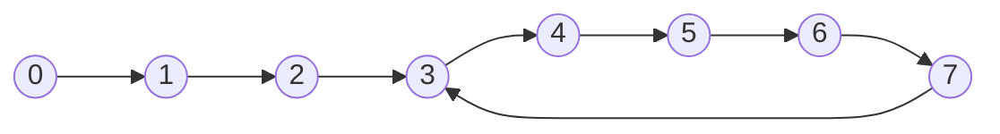
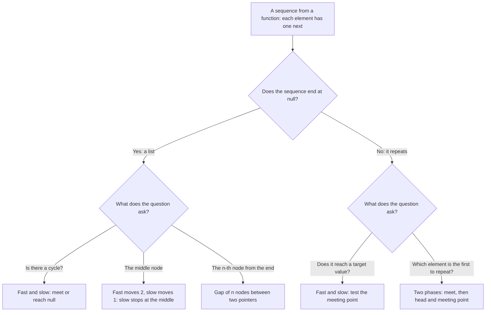

# Pattern 03: Fast and Slow Pointers and Linked List Techniques

## Overview

Fast and slow pointers (also called Floyd's cycle-finding algorithm, or "tortoise and hare") are two references that walk the same sequence at different speeds. The slow pointer moves one step at a time. The fast pointer moves two steps. The distance between them holds information that one pointer cannot hold, so the technique answers questions about cycles and middles with O(1) extra memory. The page also teaches the second half of the topic: how to rewire the `next` references of a linked list (reverse, remove, merge, reorder) without losing a node.

After this page you can:

1. Prove that the fast pointer meets the slow pointer inside a cycle, and that the fast pointer reaches `null` if the list has no cycle.
2. Derive the formula `a = k * c - b` (the tail length `a`, the cycle length `c`, the distance `b` from the cycle start to the meeting point, and a whole number `k`: Question 5 defines them) from the distances that the two pointers walk, and use it to find the first node of the cycle ([LC 142: Linked List Cycle II](https://leetcode.com/problems/linked-list-cycle-ii/)).
3. Explain why the loop condition is `fast != null && fast.next != null`, show the `NullPointerException` of each shorter condition, and say which middle node the loop returns.
4. Turn a function from a finite set to itself into an implicit linked list, and find its cycle: the array of [LC 287: Find the Duplicate Number](https://leetcode.com/problems/find-the-duplicate-number/) and the digit sums of [LC 202: Happy Number](https://leetcode.com/problems/happy-number/).
5. Rewire nodes without losing one: reverse a list, use a dummy head, keep a gap of `n` nodes between two pointers, merge two sorted lists, reverse a sublist, and reverse in groups of `k`. For each assignment you can name the variable that holds the node that the assignment would otherwise lose.
6. Decide for a new problem whether the technique applies, and name the problem types where it does not (an array with a sorted order, a graph, a design problem).

## Prerequisites

| You need | Why this page needs it | Where to learn it |
|---|---|---|
| Linked lists: a node, `val`, `next`, `null`, the head | Every algorithm on this page reads and rewrites `next` references | [Arrays, Strings, and Linked Lists](../foundations/02-arrays-strings-linked-lists.md) |
| `HashSet` | The first solution of the anchor problem stores the visited nodes in a set | [Hash Tables](../foundations/04-hash-tables.md) |
| Counting steps and O-notation | The page counts the iterations of each loop before it states O(n) | [Complexity Analysis](../foundations/01-complexity-analysis.md) |
| Recursion | The recursive reverse, merge, and merge sort on a list call themselves on the rest of the list. The page also measures the stack depth | [Recursion](../foundations/09-recursion.md) |

The code uses the LeetCode shape of a node. A node holds an `int` value and a reference to the next node. The last node of a list holds `null`.

```java
public class ListNode {
    public int val;
    public ListNode next;

    public ListNode() {}

    public ListNode(int val) { this.val = val; }

    public ListNode(int val, ListNode next) { this.val = val; this.next = next; }
}
```

Two words that the page uses from the start:

- A **cycle** in a linked list is a set of nodes in which each node is reachable from itself by following `next`. A list has a cycle if some node's `next` points to a node that the walk already visited (an earlier node, or the node itself).
- Two nodes are the **same node** if they are the same object. In Java, `a == b` compares references and tells whether two variables hold the same node. Two different nodes can hold the same `val`.

Four words from arithmetic that the proofs use:

- `x mod c` is the remainder of `x` divided by `c`. `7 mod 5 = 2`.
- `c` **divides** `x` if `x` is a multiple of `c`, that is, if `x mod c = 0`. `5` divides `15`.
- `floor(x)` rounds `x` down and `ceil(x)` rounds `x` up. `floor(7 / 2) = 3` and `ceil(7 / 2) = 4`. In Java, `7 / 2` on integers is `floor(7 / 2)`. The page [Math for Complexity Analysis](../foundations/00-math-for-complexity.md) explains floor and ceiling.
- `|S|` is the number of elements of the set `S`.

The programs on this page that have a `main` method define their own `ListNode` class, so that you can copy each one into one file and run it. The other code blocks use the `ListNode` above.

## Motivation

### The anchor problem: does the list have a cycle?

This problem is [LC 141: Linked List Cycle](https://leetcode.com/problems/linked-list-cycle/). Given the head of a singly linked list, return `true` if some node can be reached again by following `next` references, and `false` if the walk ends at `null`.

This page uses one list for most examples. Each node holds its own number as its value, so the text can name a node by its value:

```text
0 -> 1 -> 2 -> 3 -> 4 -> 5 -> 6 -> 7
                ^                   |
                +-------------------+      the last node (7) points back to node 3
```

The answer for this list is `true`. The list `0 -> 1 -> 2 -> 3 -> null` has no cycle, and its answer is `false`.

### Attempt 1: follow `next` until `null`

The first idea is the loop that visits every node of a list:

```text
node = head
while node != null:
    node = node.next
```

On the list above, this loop never ends. After node 7, the walk goes back to node 3 and repeats nodes 3 to 7 forever. The loop has no way to learn that it repeats. A step limit does not help: any limit is too small for some long list, and a large limit makes the loop slow on a list that does contain a cycle.

### Attempt 2: remember the nodes that you visited

To learn that the walk repeats, the code must remember where it has been. A `HashSet` of nodes does that:

```java
static boolean hasCycleWithSet(ListNode head) {
    Set<ListNode> seen = new HashSet<>();       // no equals: the set compares identity
    for (ListNode node = head; node != null; node = node.next) {
        if (!seen.add(node)) return true;       // false: the node is already in the set
    }
    return false;
}
```

`seen.add(node)` returns `false` if the set already holds `node`. `ListNode` does not override `equals`, so the set compares nodes by identity: it finds the same node, not a node with an equal value.

Trace on the list above. Each row is one pass of the loop:

```text
read   node   seen before the read          seen.add(node)
1      0      {}                            true
2      1      {0}                           true
3      2      {0, 1}                        true
4      3      {0, 1, 2}                     true
5      4      {0, 1, 2, 3}                  true
6      5      {0, 1, 2, 3, 4}               true
7      6      {0, 1, 2, 3, 4, 5}            true
8      7      {0, 1, 2, 3, 4, 5, 6}         true
9      3      {0, 1, 2, 3, 4, 5, 6, 7}      false -> return true
```

The code is correct. On a list without a cycle, it reads every node once and stores every node, so its time is O(n) and its memory is O(n) for `n` nodes. The memory is the problem. A problem statement can ask for O(1) extra memory, and the follow-up of [LC 141](https://leetcode.com/problems/linked-list-cycle/) asks for it. Then the set is not allowed.

### The gap

Look at row 9. The set answers one question only: "Have I been at this node before?" It stores every node to answer that question once, at the end. The information that the code needs is small: a single fact about the walk. The question for the next section is:

> With no memory of the nodes that the walk visited, what can show that the walk repeats?

## Derivation

### Question 1: what does a second walker give?

One pointer cannot know anything about its past, so use two pointers. Two pointers that move at the same speed stay on the same node or keep the same distance forever, so they learn nothing about a repeat. Give them different speeds. Let both start at the head. The **slow** pointer moves 1 node in each step. The **fast** pointer moves 2 nodes in each step. Call the sequence of nodes that you reach by following `next` from the head the **walk**: node `w(0)` is the head, and node `w(t)` is the node after `t` moves. After `t` steps, the slow pointer is at `w(t)` and the fast pointer is at `w(2t)`. This is the **invariant** of the technique (a statement that stays true after every step), and the rest of the page uses it.

Two cases can happen:

- **The list has no cycle.** The walk is finite. The fast pointer is always ahead of the slow pointer, so it reaches `null` first. The loop ends, and the answer is `false`.
- **The list has a cycle.** The walk never ends. Both pointers enter the cycle and run around it. If they stand on the same node after some step, the walk has come back to a node that it visited before, and the answer is `true`.

The second case needs a proof. A faster pointer could, in principle, pass the slow pointer without ever standing on the same node. The next question shows that this cannot happen for the speeds 1 and 2.

### Question 2: why must the fast pointer meet the slow pointer?

Name the parts of the list. The **tail** is the run of nodes before the cycle. Its length is `a`. The **cycle** has `c` nodes. The **cycle start** is the first node of the cycle (the node that the walk reaches first from the head). For the list above, `a = 3` (nodes 0, 1, 2), `c = 5` (nodes 3 to 7), and the cycle start is node 3.



The slow pointer enters the cycle after `a` steps. At that moment the fast pointer is inside the cycle: it has made `2a` moves, `2a >= a`, so it has passed the cycle start, and the walk never leaves the cycle again. If `a = 0`, both pointers start on the cycle.

Define the **gap** `g` for a step in which both pointers are inside the cycle: the number of nodes that the fast pointer must still move forward along the cycle to stand on the node of the slow pointer. The gap is a whole number from 0 to `c - 1`. If the gap is 0, the pointers stand on the same node.

**What does one step do to the gap?** The slow pointer moves 1 node forward, so its node is 1 node farther from the fast pointer. The fast pointer moves 2 nodes forward, so it gets 2 nodes closer. The net change is 1 closer:

```text
new gap = old gap - 1       (when the old gap is at least 1)
```

The gap goes down by exactly 1 in each step. It takes the values `g, g - 1, ..., 1, 0`. It cannot skip 0: to pass the slow pointer, the gap would have to change from 1 to a value below 0, and a step changes it by 1 only. When the gap is 1, one step moves the slow pointer to the next node and the fast pointer two nodes ahead, and both stand on the same node. This is the reason that the fast pointer **cannot jump over** the slow pointer.

**Edge case: `a = 0`.** If the head is on the cycle, both pointers start on the same node (gap 0), and the code compares them only after the first move. After the first step the gap is `c - 1` (the gap of 0 changed by 1 and wrapped around the cycle), so the pointers meet after `c` steps.

**Trace** of the loop on the list above (`a = 3`, `c = 5`). The column "gap" is defined only while both pointers are inside the cycle:

```text
step 1: slow = 1, fast = 2, gap = -
step 2: slow = 2, fast = 4, gap = -
step 3: slow = 3, fast = 6, gap = 2
step 4: slow = 4, fast = 3, gap = 1
step 5: slow = 5, fast = 5, gap = 0  -> meet
```

In step 3, the slow pointer is at node 3, the cycle start, and the fast pointer is at node 6. The fast pointer needs 2 more moves (from 6 to 7, and from 7 to 3) to stand on node 3, so the gap is 2. Step 4 gives gap 1, and step 5 gives gap 0: both pointers stand on node 5.

**The converse.** If the list has no cycle, the two pointers never stand on the same node after the first step. After `t >= 1` steps, the slow pointer is at index `t` of the walk and the fast pointer is at index `2t`. The indexes differ, and every node of a list without a cycle has one index. So `slow == fast` is false until the loop ends. The check `slow == fast` gives `true` if and only if the list has a cycle.

**Count the steps.** Count the iterations of the loop, not the nodes:

- *No cycle.* The fast pointer is at index `2t` after `t` steps. The loop runs while `2t <= n - 2`, so it runs `floor(n / 2)` times. For `n = 8` that is 4 iterations.
- *With a cycle.* The slow pointer enters the cycle in step `a`. The gap is at most `c - 1` at that moment and it goes down by 1 in each step. The pointers meet in step `a` or later, and at most `c - 1` steps after step `a`: at most `a + c - 1 = n - 1` steps if `a >= 1`, and exactly `c = n` steps if `a = 0`. The trace above needs 5 steps for `n = 8`.

Each iteration does a constant amount of work: two pointer moves and one comparison. The time is at most `n` iterations, which is O(n). The code keeps two references, so the extra memory is O(1).

### Question 3: what changes with other speeds?

Speed 2 was one choice. The proof used only the net change of the gap. Take the fast pointer with speed 3 and the slow pointer with speed 1, both starting at the head. After `t` steps, with `t >= a`, both pointers are in the cycle. Measure each position as the distance from the cycle start. The slow pointer is at `(t - a) mod c`. The fast pointer is at `(3t - a) mod c`. The pointers stand on the same node if and only if `c` divides `2t`. The number `t = c * ceil(a / c)` (or `t = c` if `a = 0`) always satisfies this, so speeds 1 and 3 also meet. The program in the Implementation section prints the meeting for two lists:

```text
a = 3, c = 5: meet at node 5 after 5 steps
a = 7, c = 3: meet at node 9 after 9 steps
```

Speed 3 meets, but speed 2 is the usual choice, for three reasons:

1. **The gap changes by 1.** With speed 2 the gap goes down by exactly 1, so the proof needs no case analysis of the cycle length. With speed 3 the gap changes by 2, and the fast pointer can pass the slow pointer without standing on the same node. Take `a = 0` and `c = 5`: after step 2 the fast pointer is at node 1 and the slow pointer is at node 2, so the fast pointer is one node behind. After step 3 the fast pointer is at node 4 and the slow pointer is at node 3: the fast pointer has passed the slow pointer. The pointers meet later, in step 5. The proof then depends on `c` dividing `2t`.
2. **The formula of the next question needs speed 2.** The second phase of the cycle-start algorithm uses `fast distance = 2 x slow distance`. With speed 3, the distances satisfy `2 * (a + b) = (m - 3j) * c`, where `m` is the number of laps that fast made and `j` the number that slow made. The second phase ends on the cycle start only if `c` divides `a + b`, which means that `m - 3j` is even. If `m - 3j` is odd, the number `a + b` is an odd multiple of `c / 2`, so `c` is even, and the two pointers of the second phase stay `c / 2` nodes apart on the cycle: they never meet. A program that tried every list with `a` from 0 to 12 and `c` from 1 to 12 (156 lists) found: the first phase meets in all 156 lists, and the second phase fails in 45 of them. All 45 have an even `c`. With an odd `c`, the second phase works in every list. The list with `a = 1` and `c = 2` is the smallest failure with a tail: the first phase ends at node 1 after 1 step, and the two pointers of the second phase never meet:

```text
a = 1, c = 2, phase 1: meet at node 1 after 1 steps
a = 1, c = 2, phase 2: no meeting in 20 steps
```

3. **Less work.** Speed 3 moves a pointer 3 nodes in each step, and the loop must test that three nodes exist. Speed 2 is the smallest speed that is greater than the slow pointer's speed, so it does the least work.

### Question 4: why does the loop test `fast != null && fast.next != null`?

The step `fast = fast.next.next` has two dereferences (a dereference reads a field of an object: `.next` reads the field `next` of the object that stands left of the dot):

1. `fast.next` needs `fast` to be a node. If `fast` is `null`, this read throws `NullPointerException`.
2. `.next` on that result needs `fast.next` to be a node. If `fast.next` is `null`, the second read throws `NullPointerException`.

So the loop must check `fast != null` (for the first dereference) and `fast.next != null` (for the second). The operator `&&` evaluates its left side first and stops if that side is `false` (JLS section 15.23), so the order `fast != null && fast.next != null` is safe. The two checks match the two ways that a list without a cycle can end. After `t` steps, `fast` is at index `2t`. If `n` is odd, index `2t` reaches the last node `n - 1`, and `fast.next == null`. If `n` is even, index `2t` reaches `n`, and `fast == null`.

Each shorter condition fails on a concrete list. The program of the Common Mistakes section runs them. Here is the failure of the condition `fast != null` on the list `[1, 2, 3]`:

```text
start:       slow = 1, fast = 1
iteration 1: fast != null -> slow = 2, fast = 3
iteration 2: fast != null (node 3) -> slow = 3, fast = fast.next.next
             fast.next is null, so the second .next reads a field of null -> NullPointerException
```

| Loop condition | A list on which it fails | What happens |
|---|---|---|
| `fast != null` | `[1, 2, 3]` (odd length) | Iteration 2 reads `fast.next.next` on the last node: `NullPointerException` |
| `fast.next != null` | `[1, 2]` (even length) | After iteration 1, `fast` is `null`, and the test reads `null.next`: `NullPointerException` |
| `fast.next != null` | `[]` (empty list) | The first test reads `head.next` on `null`: `NullPointerException` |
| `fast.next != null && fast != null` | `[]` | `&&` evaluates the left side first, and it reads `null.next`: `NullPointerException` |
| `fast != null && fast.next != null` | none | Each dereference is guarded by the test before it |

### The code and its proof

```java
static boolean hasCycle(ListNode head) {
    ListNode slow = head, fast = head;
    while (fast != null && fast.next != null) {   // fast needs two more nodes to take two steps
        slow = slow.next;                         // one step
        fast = fast.next.next;                    // two steps
        if (slow == fast) return true;            // the same node, not the same value
    }
    return false;                                 // fast fell off the end: the list has an end
}
```

**Why it is correct.** The invariant: after `t` iterations, `slow` is the node `w(t)` and `fast` is the node `w(2t)` of the walk, as long as the loop has not ended. We have shown two facts. First, if the list has no cycle, `fast` reaches `null` and the loop ends with `false` (no cycle means the walk is finite, and `fast` has index `2t`, which passes the end after `floor(n / 2)` iterations). Second, if the list has a cycle, the gap argument shows that `slow == fast` happens after at most `n` iterations. The code returns `true` at that moment. An empty list and a list of one node without a cycle make the loop test fail at once, and the code returns `false`. A node that points to itself (`a = 0`, `c = 1`) has `slow == fast` after the first step.

### Question 5: where does the cycle start? (LC 142)

[LC 142: Linked List Cycle II](https://leetcode.com/problems/linked-list-cycle-ii/) asks for the first node of the cycle, or `null` if the list has no cycle. The set solution changes in one place: it returns the first node that `add` rejects. That node is the cycle start, because the walk visits each tail node once and comes back to the cycle start before it comes back to any other node of the cycle. It still uses O(n) memory.

The meeting point of the two pointers is some node on the cycle. It is not the cycle start in general (in the trace above, the pointers meet at node 5, and the cycle start is node 3). The question is: **what does the meeting point tell us about the cycle start?**

Name three lengths:

- `a`: the number of nodes in the tail (from the head to the cycle start, not counting the cycle start).
- `b`: the distance from the cycle start to the meeting point, measured along the cycle in the direction of `next`. It is a whole number with `0 <= b < c`.
- `c`: the number of nodes in the cycle.

```text
head --- a moves ---> cycle start --- b moves ---> meeting point
                          ^                              |
                          +------ c - b moves -----------+
```

When the pointers meet, count the moves that each one made.

- The **slow** pointer moved `a + b` times to reach the meeting point, plus `j` full laps of the cycle if it went around. So its distance is `a + b + j*c`. (If `a >= 1`, then `j = 0`, because the slow pointer meets the fast pointer less than `c` steps after it enters the cycle. If `a = 0`, then `j = 1`. The derivation does not need to know `j`.)
- The **fast** pointer moved `a + b` times plus `m` full laps: `a + b + m*c`.
- The fast pointer moves 2 nodes while the slow pointer moves 1, so the fast distance is twice the slow distance:

```text
a + b + m*c = 2 * (a + b + j*c)
          m*c = a + b + 2*j*c
        a + b = (m - 2j) * c
```

Write `k = m - 2j`. It is a whole number, and `a + b = k * c` shows that `a + b` is a multiple of `c`. Therefore:

```text
a = k * c - b
```

**What does `a = k*c - b` mean?** It says: start at the meeting point, which is `b` nodes past the cycle start, and walk `a` nodes. You end at `b + a = k*c` nodes past the cycle start. That is `k` full laps after the cycle start, so you stand on the cycle start. And a pointer that starts at the head and walks `a` nodes also ends on the cycle start. Two pointers that walk at the same speed, one from the head and one from the meeting point, arrive at the cycle start after the same number of steps, `a`.

**The second phase:** keep one pointer at the meeting point. Put a new pointer (`walker`) at the head. Move both one node at a time until they are the same node. That node is the cycle start.

**Why the first meeting is at the cycle start.** Before step `a`, `walker` is on the tail, and the other pointer is on the cycle. A node of the tail is not a node of the cycle, so they cannot meet before step `a`. After exactly `a` steps both are on the cycle start. So the first meeting is the cycle start. If `a = 0`, the meeting point is the head itself (`b = 0`), the loop of the second phase does not run, and the code returns the head.

**Check the formula with numbers.** The list above has `a = 3`, `c = 5`. The pointers meet at node 5, which is `b = 2` nodes past the cycle start (node 3). The distances are: slow `a + b = 5`, fast `2 x 5 = 10 = a + b + 1*c`, so `m = 1`, `j = 0`, `k = 1`. The formula gives `a = 1 * 5 - 2 = 3`. The program prints both phases:

```text
step 1: slow = 1, fast = 2, gap = -
step 2: slow = 2, fast = 4, gap = -
step 3: slow = 3, fast = 6, gap = 2
step 4: slow = 4, fast = 3, gap = 1
step 5: slow = 5, fast = 5, gap = 0  -> meet
a = 3, b = 2, c = 5, n = 8, steps = 5
phase 2 step 1: walker = 1, other = 6
phase 2 step 2: walker = 2, other = 7
phase 2 step 3: walker = 3, other = 3
cycle start = 3, k = 1, a = k * c - b = 3
```

In the second phase, `walker` goes `1, 2, 3` and the other pointer goes `6, 7, 3`. Both stand on node 3 after 3 steps.

**The tail is longer than the cycle.** Take a list with `a = 7` and `c = 3`: nodes 0 to 6 are the tail, and nodes 7, 8, 9 are the cycle (node 9 points to node 7). The fast pointer goes around the small cycle many times before the pointers meet. The formula still holds, with a larger `k`:

```text
step 1: slow = 1, fast = 2, gap = -
step 2: slow = 2, fast = 4, gap = -
step 3: slow = 3, fast = 6, gap = -
step 4: slow = 4, fast = 8, gap = -
step 5: slow = 5, fast = 7, gap = -
step 6: slow = 6, fast = 9, gap = -
step 7: slow = 7, fast = 8, gap = 2
step 8: slow = 8, fast = 7, gap = 1
step 9: slow = 9, fast = 9, gap = 0  -> meet
a = 7, b = 2, c = 3, n = 10, steps = 9
phase 2 step 1: walker = 1, other = 7
phase 2 step 2: walker = 2, other = 8
phase 2 step 3: walker = 3, other = 9
phase 2 step 4: walker = 4, other = 7
phase 2 step 5: walker = 5, other = 8
phase 2 step 6: walker = 6, other = 9
phase 2 step 7: walker = 7, other = 7
cycle start = 7, k = 3, a = k * c - b = 7
```

The pointers meet at node 9 after 9 steps, so `b = 2`. The slow pointer walked 9 nodes, so `a + b = 9`. The fast pointer walked 18 nodes. The number `a + b = 9` is a multiple of `c = 3`: `9 = 3 * 3`, so `k = 3`, and `a = 3 * 3 - 2 = 7`. The fast pointer made `m = 3` laps, and the slow pointer made none (`j = 0`). In the second phase, `walker` walks 7 nodes. The other pointer starts at node 9, walks around the cycle twice (6 nodes) and 1 more node, and stands on node 7 together with `walker`. The loop of the second phase takes `a = 7` steps, which is more than `c = 3`, and it still stops at the cycle start.

```java
static ListNode findCycleStart(ListNode head) {
    ListNode slow = head, fast = head;
    while (fast != null && fast.next != null) {
        slow = slow.next;
        fast = fast.next.next;
        if (slow == fast) {                       // phase 1 ends: both are on the cycle
            ListNode walker = head;               // phase 2: one pointer from the head,
            while (walker != slow) {              // one from the meeting point, both at speed 1
                walker = walker.next;
                slow = slow.next;
            }
            return walker;                        // the cycle start
        }
    }
    return null;                                  // no cycle
}
```

**Edge cases.** The program prints these results: an empty list has no cycle, a single node that points to itself has the cycle start at that node, and a list in which every node is on the cycle (`a = 0`) returns the head.

**Complexity.** Phase 1 takes at most `n` iterations. Phase 2 takes `a < n` iterations. The time is O(n), and the extra memory is O(1).

### The length of the cycle

The meeting point is on the cycle. Walk from it until you return to it, and count the nodes. The count is `c`. The old page called this the cycle length template.

```java
static int cycleLength(ListNode head) {
    ListNode slow = head, fast = head;
    while (fast != null && fast.next != null) {
        slow = slow.next;
        fast = fast.next.next;
        if (slow == fast) {                       // both are on the cycle
            int length = 1;
            for (ListNode node = slow.next; node != slow; node = node.next) length++;
            return length;                        // one full lap from the meeting point
        }
    }
    return 0;                                     // no cycle
}
```

The time is O(n): phase 1 takes at most `n` iterations, and the count loop takes `c` iterations.

The same lap visits every node of the cycle. A problem that asks for all nodes of the cycle fits the method too: add each node to a list during the lap. The list is the answer and uses O(c) memory. The walk from one start has at most one cycle, because each node has one `next`, so "which cycle?" has one answer. (A function on a finite set can have several cycles in different parts of its graph, but one walk reaches only one of them.)

## The Pattern

Take any function `f` that maps a finite set `S` into itself, and a start element `x0`. The sequence `x0`, `x1 = f(x0)`, `x2 = f(x1)`, ... has to repeat: it has more than `|S|` elements, and they all come from `S`. Once an element repeats, the whole sequence repeats from there, because `f` gives the same output for the same input. So the sequence has the shape of the Greek letter rho: a **tail** of `a` elements that occur once, followed by a **cycle** of `c` elements that occur again and again. A linked list is the same shape with `f(node) = node.next`. The difference is that a list may end at `null`, and then the sequence has no cycle.

The slow pointer is at `x_t` after `t` steps, and the fast pointer is at `x_(2t)`. The pointers stand on the same element (`x_t = x_(2t)` with `t >= 1`) exactly when `t >= a` and `c` divides `t`. For `t < a`, the element `x_t` is in the tail, it occurs once, so `x_(2t) = x_t` would need `2t = t`. For `t >= a`, both elements are in the cycle, and they are the same element when `2t - t = t` is a multiple of `c`. The smallest such `t` is `c * ceil(a / c)`, or `c` if `a = 0`, and it is at most `a + c`.



**The vocabulary.** The page used each term before it named it.

| Term | What it was in the examples | The question to ask in a new problem |
|---|---|---|
| Next function `f` | `node.next`, `nums[i]`, the digit-square sum | "Does each element have exactly one next element, and does `f` stay inside a finite set?" |
| Walk | The sequence `x0, f(x0), f(f(x0)), ...` | "What is the start element?" |
| Tail (`a`) and cycle (`c`) | Nodes 0 to 2 and nodes 3 to 7 of the anchor list | "Can the walk repeat?" |
| Slow and fast pointer | `slow = w(t)`, `fast = w(2t)` | "Is the answer a fact about where the pointers stand?" |
| Gap | Steps that fast must move to reach slow along the cycle | "Does the gap change by exactly 1 in each step?" |
| Meeting point | The node where `slow == fast` | "What does the meeting point tell me?" (a cycle exists, `a + b` is a multiple of `c`) |
| Cycle start | The first node of the cycle, found in phase 2 | "Which element is the first one that the walk visits twice?" |
| Gap pointers | Two pointers `n` nodes apart | "Is the question about a position counted from the end?" |

**The variants.** Each one changes the question, and the property of the problem selects it.

| Variant | Problems | Property that selects it |
|---|---|---|
| A. Detect a repeat | [LC 141](https://leetcode.com/problems/linked-list-cycle/), [LC 202](https://leetcode.com/problems/happy-number/) | The question is a yes-or-no answer about whether the walk repeats, and the memory limit is O(1) |
| B. Find the first repeated element (cycle start) | [LC 142](https://leetcode.com/problems/linked-list-cycle-ii/), [LC 287](https://leetcode.com/problems/find-the-duplicate-number/) | The answer is an element where two different predecessors meet |
| C. The length of the cycle | The cycle length template in the Derivation | The question asks how many elements repeat |
| D. The middle | [LC 876](https://leetcode.com/problems/middle-of-the-linked-list/), [LC 234](https://leetcode.com/problems/palindrome-linked-list/), [LC 143](https://leetcode.com/problems/reorder-list/), [LC 148](https://leetcode.com/problems/sort-list/) | The list has an end, and the question needs the node at half the length |
| E. A fixed gap | [LC 19](https://leetcode.com/problems/remove-nth-node-from-end-of-list/) | The question counts from the end of a list |
| F. Rewiring | [LC 206](https://leetcode.com/problems/reverse-linked-list/), [LC 21](https://leetcode.com/problems/merge-two-sorted-lists/), [LC 92](https://leetcode.com/problems/reverse-linked-list-ii/), [LC 25](https://leetcode.com/problems/reverse-nodes-in-k-group/), [LC 160](https://leetcode.com/problems/intersection-of-two-linked-lists/) | The question changes the order or the links of the nodes, and the memory limit is O(1). These problems use no fast pointer. They appear in the same interviews, and they need a second invariant |

**The second invariant: rewiring.** A node of a singly linked list is held by the `next` field of its predecessor, and by nothing else. When the code writes `x.next = y`, the old value of `x.next` loses its only reference. The node is lost, together with every node behind it, unless a variable holds it. So before each assignment to a `next` field, ask: "Which node does this field hold now, and which variable holds it?" If no variable holds it and the code still needs it, save it first. The techniques below are the safe orders of such assignments.

## Worked Examples

Examples 1 to 3 keep the two-pointer walk and change what `next` is, or what the question is. After them, the section teaches the rewiring techniques one at a time, and then uses them in Examples 4 and 5, which combine the middle with a reversal.

### Example 1: Find the Duplicate Number (LC 287)

**The problem.** [LC 287: Find the Duplicate Number](https://leetcode.com/problems/find-the-duplicate-number/) gives an array `nums` of `n + 1` integers. Each integer is from 1 to `n`. The problem guarantees that one number occurs more than once (it can occur more than twice), and that every other number occurs once. Return the repeated number. The problem forbids changing the array and allows O(1) extra memory. For `nums = [1, 3, 4, 2, 2]`, the answer is 2.

**What changed.** There is no `ListNode`. The `next` function comes from the array, and the answer is the cycle start, not a yes-or-no value.

**Why the simple solutions break the constraints.**

| Idea | Cost | The constraint that it breaks |
|---|---|---|
| A `HashSet` of the numbers seen | O(n) time, O(n) memory | The O(1) memory limit |
| Sort the array, compare neighbors | O(n log n) time | Sorting changes the array. A sorted copy needs O(n) memory |
| A counting array of size `n + 1` | O(n) time, O(n) memory | The O(1) memory limit |
| Negate `nums[nums[i]]` to mark a number as seen | O(n) time, O(1) memory | It changes the array (it also needs the array to be restored) |
| Compare every pair | O(n²) time, O(1) memory | It is correct and keeps both constraints, but it is slow. The pointer method does the same in O(n) |

**Question: why is this array a linked list?** Use each index `i` as a node, and use `nums[i]` as the index of the next node. This is a function `f(i) = nums[i]`:

- Every index from 0 to `n` has exactly one value, so every node has exactly one next node.
- Every value is from 1 to `n`, which is a valid index. So `f` maps the set of indexes `{0, 1, ..., n}` into itself, and the walk from index 0 never leaves the array and never ends.

A walk that never ends inside a finite set repeats, so the walk from index 0 has a cycle. For `[1, 3, 4, 2, 2]` the walk is `0 -> 1 -> 3 -> 2 -> 4 -> 2 -> 4 -> ...`. The tail is `0, 1, 3` (`a = 3`) and the cycle is `2, 4` (`c = 2`).

**Question: why is index 0 not in the cycle?** No value equals 0, so no index has 0 as its next node. A cycle needs a node that points into it from the cycle, so index 0 is not on the cycle. It is the head of the tail, and `a >= 1`.

**Question: why is the repeated number the cycle start?** Call the cycle start `s`. It has two predecessors on the walk: the last node of the tail, `p`, and the last node of the cycle, `q`. They are different nodes (`p` is not in the cycle), and `nums[p] = nums[q] = s`. So the number `s` occurs at two indexes. The problem has one repeated number, so `s` is that number. This is why phase 2 of the cycle-start algorithm returns the answer: the cycle start is the repeated number.

**Trace** for `[1, 3, 4, 2, 2]`. The loop uses `do ... while`, because `slow` and `fast` start equal:

```text
nums = [1, 3, 4, 2, 2]
step 1: slow = 1, fast = 3
step 2: slow = 3, fast = 4
step 3: slow = 2, fast = 4
step 4: slow = 4, fast = 4
phase 2 step 1: walker = 1, other = 2
phase 2 step 2: walker = 3, other = 4
phase 2 step 3: walker = 2, other = 2
duplicate = 2
```

The meeting point is index 4, which is `b = 1` node past the cycle start (index 2). Check the formula: `a = k * c - b` gives `3 = 2 * 2 - 1`, so `k = 2`. In phase 2, `walker` goes `1, 3, 2`, and the other pointer goes `2, 4, 2`. Both stand on index 2, the repeated number.

```java
static int findDuplicate(int[] nums) {
    // The "next" of index i is nums[i]. Index 0 is the head: no value equals 0.
    int slow = 0, fast = 0;
    do {                                          // do-while: slow and fast start equal
        slow = nums[slow];
        fast = nums[nums[fast]];
    } while (slow != fast);                       // phase 1: meet inside the cycle
    int walker = 0;
    while (walker != slow) {                      // phase 2: head and meeting point
        walker = nums[walker];
        slow = nums[slow];
    }
    return walker;                                // the cycle start is the repeated value
}
```

**Complexity.** The walk has `n + 1` nodes. Phase 1 takes at most `n + 1` iterations (the meeting bound `a + c`), and phase 2 takes `a` iterations. The time is O(n) and the extra memory is O(1). The code reads the array and never writes it. The edge cases `[1, 1]` and `[2, 2, 2, 2, 2]` print 1 and 2 in the program of the Implementation section: the second array has a tail of 1 node (index 0) and a cycle of 1 node (index 2, which points to itself).

### Example 2: Happy Number (LC 202)

**The problem.** [LC 202: Happy Number](https://leetcode.com/problems/happy-number/): replace a positive integer `n` by the sum of the squares of its digits. Repeat. The number is happy if the process reaches 1. Otherwise the process loops forever in a cycle that does not hold 1. Return whether `n` is happy. For `n = 19` the chain is `19 -> 82 -> 68 -> 100 -> 1`, so the answer is `true`. For `n = 2` the answer is `false`.

**What changed.** There is no list and no array. The `next` function is computed: `f(x)` is the sum of the squares of the digits of `x`. The set of values that the walk can reach is not given. Also, the walk has no `null`: the question is whether the walk reaches 1.

**Question: does the walk always repeat?** The fast and slow pointers end only if the walk repeats, and that needs a finite set. Show that the walk stays in a finite set.

- A number with `d` digits has each digit at most 9, so `f(x) <= 81 * d`.
- If `d >= 4`, then `81 * d < 10^(d - 1) <= x`. For `d = 4`: `324 < 1000`. If it holds for `d`, it holds for `d + 1`, because `81 * (d + 1) <= 2 * 81 * d < 2 * 10^(d - 1) < 10^d`. So `f(x) < x` for every `x >= 1000`.
- So the walk goes down while it is at least 1000, and it falls below 1000 after finitely many steps. A number below 1000 has at most 3 digits, so `f(x) <= 243`, and the walk stays below 1000 forever.
- Every `f(x)` of a positive number is at least 1, because a positive number has a non-zero digit.

So the walk stays in `{1, ..., 999}` after at most a few steps, and it repeats. For a Java `int` (at most 10 digits), the first value `f(n)` is at most `10 * 81 = 810`.

**Question: how does the answer "1" fit the cycle picture?** `f(1) = 1`. So 1 is a cycle of length 1, and a walk that reaches 1 stays there. If the walk's cycle contains 1, the cycle is exactly `{1}`, because `f(1) = 1`. So: the number is happy if and only if the cycle is `{1}`. After the pointers meet, they stand on a cycle element. That element is 1 if the cycle is `{1}`, and it is not 1 otherwise. The test `slow == 1` decides.

**Trace.** The loop is a `do ... while` as before. Slow is `x_t`, and fast is `x_(2t)`:

```text
n = 19
step 1: slow = 82, fast = 68
step 2: slow = 68, fast = 1
step 3: slow = 100, fast = 1
step 4: slow = 1, fast = 1
meet at 1, happy = true
n = 2
step 1: slow = 4, fast = 16
step 2: slow = 16, fast = 58
step 3: slow = 37, fast = 145
step 4: slow = 58, fast = 20
step 5: slow = 89, fast = 16
step 6: slow = 145, fast = 58
step 7: slow = 42, fast = 145
step 8: slow = 20, fast = 20
meet at 20, happy = false
```

For `n = 19`, the tail is `19, 82, 68, 100` (`a = 4`) and the cycle is `{1}` (`c = 1`). The pointers meet at the smallest `t >= 4` that `c = 1` divides, which is 4: both stand on 1. For `n = 2`, the tail is `2` (`a = 1`) and the cycle is `4, 16, 37, 58, 89, 145, 42, 20` (`c = 8`). The pointers meet at `t = 8`, on node 20, which is not 1. The answer is `false`.

```java
static int digitSquareSum(int n) {
    int sum = 0;
    for (; n > 0; n /= 10) {
        int digit = n % 10;
        sum += digit * digit;
    }
    return sum;
}

static boolean isHappy(int n) {
    int slow = n, fast = n;
    do {                                          // the sequence never ends, so no null check
        slow = digitSquareSum(slow);
        fast = digitSquareSum(digitSquareSum(fast));
    } while (slow != fast);
    return slow == 1;                             // the cycle is either {1} or another cycle
}
```

**Complexity.** One digit-square sum takes O(log n) time (one step per digit). After the first value, the walk stays in `{1, ..., 999}`, so `a + c` is at most 1,000 and the loop runs at most 1,000 iterations. The time is O(log n) plus a constant, and the extra memory is O(1). A `HashSet` of the values seen also needs a bounded amount of memory here, because the walk stays in 999 values. The pointer version needs no set.

### Example 3: Middle of the Linked List (LC 876)

**The problem.** [LC 876: Middle of the Linked List](https://leetcode.com/problems/middle-of-the-linked-list/): return the middle node of a singly linked list. If the list has two middle nodes, return the second. For `[1, 2, 3, 4, 5]` the answer is the node with value 3. For `[1, 2, 3, 4, 5, 6]` the answer is the node with value 4.

**What changed.** The list has no cycle. The pointers use their speed ratio: the slow pointer has walked half as far as the fast pointer. The loop ends when the fast pointer reaches the end.

**Brute force.** Walk the list once to count `n`. Walk again `floor(n / 2)` steps. Two loops. The reads of `next` are `n` and `floor(n / 2)`.

**Question: where is the slow pointer when the fast pointer cannot move on?** After `t` steps, `slow` is at index `t` and `fast` is at index `2t`. The loop runs while `fast != null && fast.next != null`, which is the same as `2t <= n - 2`. So the loop runs `floor(n / 2)` times and `slow` stops at index `floor(n / 2)`:

- If `n` is odd (`n = 2m + 1`), the index is `m`, the one middle node.
- If `n` is even (`n = 2m`), the index is `m`. The two middle nodes are at indexes `m - 1` and `m`, so the loop returns the second middle.

```text
n = 1: (slow, fast) after each step: none -> second middle 1, first middle 1
n = 2: (slow, fast) after each step: (2, null) -> second middle 2, first middle 1
n = 3: (slow, fast) after each step: (2, 3) -> second middle 2, first middle 2
n = 4: (slow, fast) after each step: (2, 3) (3, null) -> second middle 3, first middle 2
n = 5: (slow, fast) after each step: (2, 3) (3, 5) -> second middle 3, first middle 3
n = 6: (slow, fast) after each step: (2, 3) (3, 5) (4, null) -> second middle 4, first middle 3
```

Each pair in the output is `(slow, fast)` after one step. For `n = 6`, the loop stops when `fast` becomes `null`, and `slow` is at node 4, the second middle.

**Which loop returns the other middle?** Test `fast.next != null && fast.next.next != null`. The loop stops one iteration earlier when `n` is even: `fast` at index `2t` needs index `2t + 2` to exist, so the loop runs while `2t + 2 <= n - 1`, which is `floor((n - 1) / 2)` times. Then `slow` is at index `floor((n - 1) / 2)`: the one middle if `n` is odd, and the first middle if `n` is even. This version reads `head.next`, so the list must have at least one node.

| `n` | Second middle (index `n / 2`) | First middle (index `(n - 1) / 2`) |
|---|---|---|
| 1 | 0 | 0 |
| 2 | 1 | 0 |
| 3 | 1 | 1 |
| 4 | 2 | 1 |
| 5 | 2 | 2 |
| 6 | 3 | 2 |

When to use which: [LC 876](https://leetcode.com/problems/middle-of-the-linked-list/) asks for the second middle. A problem that cuts the list into two halves ([LC 234](https://leetcode.com/problems/palindrome-linked-list/), [LC 143](https://leetcode.com/problems/reorder-list/), [LC 148](https://leetcode.com/problems/sort-list/)) needs the first middle, because it is the last node of the first half, and `slow.next` is the first node of the second half.

```java
static ListNode middleSecond(ListNode head) {     // index n / 2: the second middle if n is even
    ListNode slow = head, fast = head;
    while (fast != null && fast.next != null) {
        slow = slow.next;
        fast = fast.next.next;
    }
    return slow;
}
```

```java
static ListNode middleFirst(ListNode head) {      // index (n - 1) / 2: the first middle
    ListNode slow = head, fast = head;            // the list must have at least one node
    while (fast.next != null && fast.next.next != null) {
        slow = slow.next;
        fast = fast.next.next;
    }
    return slow;
}
```

**Complexity.** The loop runs `floor(n / 2)` times. The fast pointer reads `n` or `n - 1` nodes and the slow pointer reads `floor(n / 2)` nodes, so the number of `next` reads is about the same as for the two-loop version (`n` and `floor(n / 2)`). The gain is that the code needs no counter, and that the loop works on a walk whose length it does not know. Time O(n), memory O(1).

### Rewiring nodes: the techniques

The next seven techniques change `next` references. Each one gives the problem, the failing first attempt, the order of the assignments, a trace that prints the pointer values, and the code. The program in the Implementation section prints each trace.

#### Technique 1: reverse a list (LC 206)

**The problem.** [LC 206: Reverse Linked List](https://leetcode.com/problems/reverse-linked-list/): return the head of the list with all arrows reversed. `[1, 2, 3, 4]` becomes `[4, 3, 2, 1]`. Use O(1) extra memory.

**First attempt.** Copy the values into an array and write them back in reverse order, or build a new list with new nodes. Both use O(n) extra memory. The problem asks for the nodes themselves to turn around.

**Question: what must change in each node?** The `next` of node `i` must become node `i - 1`. Walk from the left. At the node `curr`, the code needs the node before it: keep it in `prev`. The assignment `curr.next = prev` flips the arrow. But it overwrites the only reference to the rest of the list, so the code must save `curr.next` before the flip. Then both pointers advance. The four assignments:

```text
1. next = curr.next     save the rest of the list before the arrow is cut
2. curr.next = prev      flip the arrow
3. prev = curr           prev moves onto curr
4. curr = next           curr moves onto the saved rest
```

**Why this order.** Assignment 1 must come before 2: after assignment 2 the old `curr.next` is gone. Assignment 3 must come before 4: assignment 4 changes `curr`, and `prev = curr` would copy the new value. Assignment 2 uses `prev` and `curr` before they move.

Swap assignments 1 and 2 and run on `[1, 2, 3]`. In the first pass `curr.next = prev` sets `1.next = null`. Then `next = curr.next` saves `null`. The loop ends after one pass, and nodes 2 and 3 are unreachable. The program prints the result:

```text
swapped order on [1, 2, 3]: 1 -> null
```

**Trace** on `[1, 2, 3, 4]`. Each line shows `prev`, `curr`, and the two chains that exist after the step: the reversed part (from `prev`) and the rest (from `curr`):

```text
start: prev = null, curr = 1 | rest = 1 -> 2 -> 3 -> 4 -> null
step 1: prev = 1, curr = 2 | reversed = 1 -> null | rest = 2 -> 3 -> 4 -> null
step 2: prev = 2, curr = 3 | reversed = 2 -> 1 -> null | rest = 3 -> 4 -> null
step 3: prev = 3, curr = 4 | reversed = 3 -> 2 -> 1 -> null | rest = 4 -> null
step 4: prev = 4, curr = null | reversed = 4 -> 3 -> 2 -> 1 -> null | rest = null
result: 4 -> 3 -> 2 -> 1 -> null
```

**Why it is correct.** The invariant: at the start of each iteration, `prev` is the head of a chain that holds the first `i` nodes in reverse order and ends with `null`, `curr` is the head of the chain that holds the other `n - i` nodes in their old order, and every node is in exactly one of the two chains. At the start, `i = 0`: `prev` is `null` (an empty chain) and `curr` is the head. One pass moves the first node of the rest to the front of the reversed chain: the node `curr` points to `prev`, which is the old front, so the reversed chain grows by one node. The saved `next` becomes the new `curr`, so no node leaves both chains. When `curr` is `null`, `i = n`, and `prev` is the head of the whole reversed list. An empty list gives `prev = null`, and a list of one node gives that node.

```java
static ListNode reverseList(ListNode head) {
    ListNode prev = null, curr = head;
    while (curr != null) {
        ListNode next = curr.next;   // 1. save the rest of the list before it is cut off
        curr.next = prev;            // 2. flip the arrow
        prev = curr;                 // 3. prev moves onto curr
        curr = next;                 // 4. curr moves onto the saved rest
    }
    return prev;                     // prev is the old last node, the new head
}
```

The time is O(n) (one pass, `n` iterations) and the extra memory is O(1).

**The recursive version.** Question: what is the answer for the list that starts at `head`, if the recursion already reversed the list that starts at `head.next`? The reversed rest has the old second node at its end. Attach `head` after that node: `head.next.next = head`. Then `head` is the last node, so it must point to `null`: `head.next = null`. The base case is a list of 0 or 1 nodes, which is its own reversal. The recursion returns the head of the reversed rest, which is also the head of the whole result.

```text
reverse(1)
  reverse(2)
    reverse(3)
      base case: return 3
    head = 2: after the two assignments the chain from 3 is 3 -> 2 -> null
  head = 1: after the two assignments the chain from 3 is 3 -> 2 -> 1 -> null
result: 3 -> 2 -> 1 -> null
```

```java
static ListNode reverseListRecursive(ListNode head) {
    if (head == null || head.next == null) return head;   // zero or one node: already reversed
    ListNode newHead = reverseListRecursive(head.next);   // reverses everything after head
    head.next.next = head;                                // the old second node now points back
    head.next = null;                                     // head is the last node: cut its arrow
    return newHead;
}
```

The time is O(n). The recursion goes `n` calls deep, so the stack uses O(n) memory, and Java has no tail call removal. In the measurement of the Common Mistakes section (mistake 18, one run on one machine), the recursive reverse of a list of 1,000,000 nodes threw `StackOverflowError`. The depth at which the error occurs depends on the stack size and the frame size ([the stack depth limit](../foundations/09-recursion.md#java-facts-the-stack-depth-limit)). Use the loop when the list can be long. If the line `head.next = null` is missing, the old first node still points to the old second node, and the result has a cycle (mistake 9).

#### Technique 2: the dummy head (LC 203)

**The problem.** [LC 203: Remove Linked List Elements](https://leetcode.com/problems/remove-linked-list-elements/): remove every node whose value equals `target`, and return the head. `[7, 7, 1, 2]` with `target = 7` becomes `[1, 2]`.

**First attempt.** Keep `prev` and `curr`. When `curr` matches, write `prev.next = curr.next`. Otherwise move `prev`. This works for a match in the middle. For `[7, 7, 1]`, the first node matches while `prev` is still `null`, and `prev.next` throws `NullPointerException` (mistake 10). The head has no predecessor, so removing it is a different operation: the variable `head` changes, not a `next` field.

**Fix without a dummy.** Before the loop, move `head` forward while it matches. Then run the loop for the other nodes. This works, and it has two code paths for one operation.

**Question: how do we give the head a predecessor?** Put a new node, the **dummy head** (also called a sentinel), in front of the real head. Its value is never used. Now every real node has a predecessor, so the same assignment `prev.next = prev.next.next` removes any node, including the first one. The result is `dummy.next`. The code must not return `head`: the head may have been removed.

**Trace** on `[7, 7, 1, 2]` with `target = 7` (the node `D` is the dummy, with value 0):

```text
remove 7 from 7 -> 7 -> 1 -> 2 -> null
prev = 0, prev.next = 7 matches: unlink
    list = D -> 7 -> 1 -> 2 -> null
prev = 0, prev.next = 7 matches: unlink
    list = D -> 1 -> 2 -> null
prev = 0, prev.next = 1 stays: move prev
    list = D -> 1 -> 2 -> null
prev = 1, prev.next = 2 stays: move prev
    list = D -> 1 -> 2 -> null
result: 1 -> 2 -> null
```

After an unlink, `prev` stays on the same node. The new `prev.next` may also match (the two 7s in the trace). If `prev` moves after an unlink, it points at a removed node and the next match is written into that removed node (mistake 11: `[1, 2, 2, 3]` with target 2 returns `[1, 2, 3]`).

```java
static ListNode removeElements(ListNode head, int target) {
    ListNode dummy = new ListNode(0, head);   // every real node now has a predecessor
    ListNode prev = dummy;
    while (prev.next != null) {
        if (prev.next.val == target) {
            prev.next = prev.next.next;       // unlink; do not move prev
        } else {
            prev = prev.next;                 // keep the node; move prev
        }
    }
    return dummy.next;                        // not head: the head may have been removed
}
```

The time is O(n): each pass moves `prev` or unlinks one node, and there are `n` nodes. The extra memory is O(1): one dummy node. The same dummy appears in [LC 19](https://leetcode.com/problems/remove-nth-node-from-end-of-list/), [LC 21](https://leetcode.com/problems/merge-two-sorted-lists/), [LC 92](https://leetcode.com/problems/reverse-linked-list-ii/), and [LC 25](https://leetcode.com/problems/reverse-nodes-in-k-group/), each time for the same bug: an operation that can change the head.

#### Technique 3: a gap of n nodes (LC 19)

**The problem.** [LC 19: Remove Nth Node From End of List](https://leetcode.com/problems/remove-nth-node-from-end-of-list/): remove the `n`-th node from the end (`n = 1` is the last node) and return the head. The problem guarantees that `n` is at most the length. `[1, 2, 3, 4, 5]` with `n = 2` becomes `[1, 2, 3, 5]`.

**First attempt: two passes.** Count the length `L` in one pass. The node to remove is at index `L - n` (0-indexed). Walk `L - n - 1` steps to its predecessor in the second pass. This is correct, with two loops and a counter.

**Question: can one pointer find the position from the end without knowing `L`?** Use a second pointer that stays a fixed distance behind the first. Number the dummy head 0 and the real nodes 1 to `L`. The target is at position `L - n + 1`, so the code needs its predecessor, at position `L - n`. Put both pointers on the dummy. Move `fast` `n` times: it stands at position `n`, and `slow` stands at position 0, so the gap is `n` nodes. Now move both pointers one node at a time while `fast.next != null`. Each move keeps the gap at `n`. The loop ends when `fast` stands on the last node, position `L`. Then `slow` stands at position `L - n`, the predecessor of the target.

**Why the dummy.** If `n = L`, the target is the first node, and `slow` must stay on a node before the head. The dummy is that node.

**Trace** for `n = 2` and for `n = 5` on `[1, 2, 3, 4, 5]`:

```text
n = 2 after the gap: slow = D(0), fast = 2
  slow = 1, fast = 3
  slow = 2, fast = 4
  slow = 3, fast = 5
  fast.next is null: remove the node after slow (3), which is 4
result: 1 -> 2 -> 3 -> 5 -> null
```

```text
n = 5 after the gap: slow = D(0), fast = 5
  fast.next is null: remove the node after slow (0), which is 1
result: 2 -> 3 -> 4 -> 5 -> null
```

With `n = 5`, the gap loop moves `fast` to the last node. The test `fast.next != null` is false at once, `slow` stays on the dummy (value 0), and the node after it, the head, is removed.

```java
static ListNode removeNthFromEnd(ListNode head, int n) {
    ListNode dummy = new ListNode(0, head);
    ListNode slow = dummy, fast = dummy;
    for (int i = 0; i < n; i++) fast = fast.next;   // open a gap of n nodes
    while (fast.next != null) {                     // stop when fast is on the last node
        slow = slow.next;
        fast = fast.next;
    }
    slow.next = slow.next.next;                     // slow is the node before the target
    return dummy.next;
}
```

The time is O(n): `fast` reads `L` nodes in total. The extra memory is O(1).

**Finding the node instead of removing it.** To return the `k`-th node from the end (`k = 1` is the last node), start both pointers on the head, move `fast` exactly `k` times, then move both until `fast` is `null`. The loop stops later by one node than the removal loop, because `slow` must stand on the target, not on its predecessor. The off-by-one rule: `k` moves for `k` nodes of gap (mistake 4).

```java
static ListNode kthFromEnd(ListNode head, int k) {  // k = 1 is the last node
    ListNode slow = head, fast = head;
    for (int i = 0; i < k; i++) fast = fast.next;   // exactly k moves: fast is k nodes ahead
    while (fast != null) {                          // stop when fast is past the last node
        slow = slow.next;
        fast = fast.next;
    }
    return slow;
}
```

#### Technique 4: merge two sorted lists (LC 21)

**The problem.** [LC 21: Merge Two Sorted Lists](https://leetcode.com/problems/merge-two-sorted-lists/): merge two sorted lists into one sorted list by splicing the existing nodes. `[1, 2, 4]` and `[1, 3, 4]` give `[1, 1, 2, 3, 4, 4]`.

**First attempt.** Copy all values into an array, sort it, and build a new list. It costs O((n + m) log (n + m)) time and O(n + m) memory, and it ignores that the inputs are sorted.

**Question: which node is the first node of the result?** The smaller of the two heads. After that node leaves its list, the question repeats on the rest: compare the two heads, and take the smaller. So the code needs `last`, the last node of the merged part, to which it appends the chosen node. For the first choice, `last` has no node yet. The dummy head solves this, as in Technique 2: start with `last = dummy`, and return `dummy.next`.

When one list is empty, the other list is already sorted and linked, so one assignment appends all of it: `last.next = (a != null) ? a : b`.

**Trace** on `[1, 2, 4]` and `[1, 3, 4]`. "merged so far" is the chain from the first merged node to `last`. The `a` and `b` chains are the lists that remain:

```text
step 1: a = 1, b = 1 -> take a
    merged so far = 1 | a = 2 -> 4 -> null | b = 1 -> 3 -> 4 -> null
step 2: a = 2, b = 1 -> take b
    merged so far = 1 -> 1 | a = 2 -> 4 -> null | b = 3 -> 4 -> null
step 3: a = 2, b = 3 -> take a
    merged so far = 1 -> 1 -> 2 | a = 4 -> null | b = 3 -> 4 -> null
step 4: a = 4, b = 3 -> take b
    merged so far = 1 -> 1 -> 2 -> 3 | a = 4 -> null | b = 4 -> null
step 5: a = 4, b = 4 -> take a
    merged so far = 1 -> 1 -> 2 -> 3 -> 4 | a = null | b = 4 -> null
append the rest of b: merged = 1 -> 1 -> 2 -> 3 -> 4 -> 4 -> null
result: 1 -> 1 -> 2 -> 3 -> 4 -> 4 -> null
```

In step 1, both heads equal 1. The test `a.val <= b.val` takes the node of `a`, so equal values keep the order of the inputs: a merge is **stable** if a node of `a` stays before an equal node of `b`. With `<`, the code takes from `b` on a tie, and the result is still sorted but not stable.

**Invariant.** The merged part holds the smallest nodes of both lists in sorted order. `a` and `b` hold the other nodes in sorted order. Each node is in exactly one chain. Every node in `a` and in `b` is at least as large as `last`'s value. One step takes the smaller of the two heads, which is at least `last.val`, so the merged part stays sorted.

```java
static ListNode mergeTwoLists(ListNode a, ListNode b) {
    ListNode dummy = new ListNode(0);
    ListNode last = dummy;                    // the last node of the merged list so far
    while (a != null && b != null) {
        if (a.val <= b.val) {                 // <= keeps equal values in their original order
            last.next = a;
            a = a.next;
        } else {
            last.next = b;
            b = b.next;
        }
        last = last.next;
    }
    last.next = (a != null) ? a : b;          // append the rest of the list that is not empty
    return dummy.next;
}
```

The time is O(n + m): each pass takes one node. The extra memory is O(1): the dummy node and a few pointers. The code creates no new nodes except the dummy.

The recursive version states the same idea: the smaller head is first, and its `next` is the merge of the rest.

```java
static ListNode mergeTwoListsRecursive(ListNode a, ListNode b) {
    if (a == null) return b;
    if (b == null) return a;
    if (a.val <= b.val) {
        a.next = mergeTwoListsRecursive(a.next, b);   // a is first; merge the rest behind it
        return a;
    }
    b.next = mergeTwoListsRecursive(a, b.next);
    return b;
}
```

It takes O(n + m) time and O(n + m) stack memory.

#### Technique 5: reverse a sublist (LC 92)

**The problem.** [LC 92: Reverse Linked List II](https://leetcode.com/problems/reverse-linked-list-ii/): reverse the nodes from position `left` to position `right` (1-indexed). `[1, 2, 3, 4, 5]` with `left = 2` and `right = 4` becomes `[1, 4, 3, 2, 5]`.

**First attempt.** Reverse the sublist with the loop of Technique 1. Then reconnect: the node before the sublist must point to the new first node, and the old first node of the sublist (now the last) must point to the node after the sublist. This needs four saved nodes, and it fails when `left = 1`, because there is no node before the sublist.

**Question: is there a move that keeps the node before the sublist in place the whole time?** Yes. Keep `before`, the node at position `left - 1`, and `curr`, the first node of the sublist. The node `curr` stays in place and ends as the last node of the sublist. Repeat `right - left` times: take the node after `curr` (call it `moved`) and put it right after `before`. This is **head insertion**: the sublist grows at its front.

Three assignments move the node. The order matters:

```text
1. curr.next = moved.next    close the gap behind moved: curr now skips moved
2. moved.next = before.next  moved points at the current front of the sublist
3. before.next = moved       before points at moved: moved is the new front
```

Assignment 2 must come before 3. After 3, `before.next` is `moved`, so `moved.next = before.next` would give `moved.next = moved`, a cycle of one node. The program prints the wrong order on `[1, 2, 3, 4, 5]` (`before.next = moved` first): the chain after node 1 is `3 -> 3 -> 3 -> ...` and never ends.

**Trace** on `[1, 2, 3, 4, 5]` with `left = 2`, `right = 4`. The line "before = 1, curr = 2" shows the start. After each move the line shows the whole list:

```text
before = 1, curr = 2
move 1: moved = 3 | list = 1 -> 3 -> 2 -> 4 -> 5 -> null
move 2: moved = 4 | list = 1 -> 4 -> 3 -> 2 -> 5 -> null
result: 1 -> 4 -> 3 -> 2 -> 5 -> null
wrong order of the three assignments: 1 -> 3 -> 3 -> 3 -> 3 -> 3 -> ...
```

**Invariant.** After `i` moves, the nodes that were at positions `left`, ..., `left + i` are in reverse order directly after `before`, `curr` is the last node of that group, and `curr.next` is the node at position `left + i + 1`. Each move takes that node and puts it first in the group. After `right - left` moves, the group holds positions `left` to `right` in reverse order, and `curr.next` is the node at position `right + 1`, which was never changed.

```java
static ListNode reverseBetween(ListNode head, int left, int right) {
    ListNode dummy = new ListNode(0, head);
    ListNode before = dummy;
    for (int i = 1; i < left; i++) before = before.next;   // the node at position left - 1
    ListNode curr = before.next;                           // first node of the sublist
    for (int i = 0; i < right - left; i++) {
        ListNode moved = curr.next;                        // the node to move to the front
        curr.next = moved.next;                            // 1. close the gap behind moved
        moved.next = before.next;                          // 2. moved points at the current front
        before.next = moved;                               // 3. before points at moved
    }
    return dummy.next;
}
```

The dummy head makes `left = 1` work: `before` is the dummy. The time is O(right), at most O(n). The extra memory is O(1).

#### Technique 6: reverse in groups of k (LC 25) and swap pairs (LC 24)

**The problem.** [LC 25: Reverse Nodes in k-Group](https://leetcode.com/problems/reverse-nodes-in-k-group/): reverse each run of `k` nodes. If fewer than `k` nodes remain at the end, leave them as they are. `[1, 2, 3, 4, 5]` with `k = 2` becomes `[2, 1, 4, 3, 5]`. With `k = 3` it becomes `[3, 2, 1, 4, 5]`. The case `k = 2` is [LC 24: Swap Nodes in Pairs](https://leetcode.com/problems/swap-nodes-in-pairs/).

**Question: what are the sub-problems?** A group needs four steps, and each one is a technique that this page has derived:

1. *Is there a full group?* Walk `k` nodes from `groupPrev` (the node before the group). If the walk reaches `null`, fewer than `k` nodes remain: stop and leave them.
2. *Reverse exactly `k` nodes.* Use the loop of Technique 1, with two changes. The loop stops at `groupNext` (the node after the group). And `prev` starts as `groupNext`, not as `null`, so the old first node of the group, which becomes the last, points to the rest of the list.
3. *Reconnect.* `groupPrev.next` must point to `kth`, the old last node of the group, which is now the first.
4. *Move on.* The old first node of the group is now the last node of the group, and it is the `groupPrev` of the next group.

The dummy head gives the first group a `groupPrev`.

**Trace** with `k = 2` and with `k = 3` on `[1, 2, 3, 4, 5]`. The line "after the loop" shows the state before the reconnect: `groupPrev.next` still holds the old first node, and the chain that starts at `kth` is already reversed:

```text
group 1: groupPrev = 0, kth = 2, groupNext = 3
    after the loop: groupPrev.next = 1, chain from kth = 2 -> 1 -> 3 -> 4 -> 5 -> null
    reconnected: list = 2 -> 1 -> 3 -> 4 -> 5 -> null | groupPrev = 1
group 2: groupPrev = 1, kth = 4, groupNext = 5
    after the loop: groupPrev.next = 3, chain from kth = 4 -> 3 -> 5 -> null
    reconnected: list = 2 -> 1 -> 4 -> 3 -> 5 -> null | groupPrev = 3
group 3: fewer than 2 nodes remain, stop
result: 2 -> 1 -> 4 -> 3 -> 5 -> null
```

```text
group 1: groupPrev = 0, kth = 3, groupNext = 4
    after the loop: groupPrev.next = 1, chain from kth = 3 -> 2 -> 1 -> 4 -> 5 -> null
    reconnected: list = 3 -> 2 -> 1 -> 4 -> 5 -> null | groupPrev = 1
group 2: fewer than 3 nodes remain, stop
result: 3 -> 2 -> 1 -> 4 -> 5 -> null
```

For `k = 2`, group 3 would hold only node 5, so the walk of step 1 reaches `null` and the code stops. Node 5 stays.

```java
static ListNode reverseKGroup(ListNode head, int k) {
    if (k <= 1) return head;
    ListNode dummy = new ListNode(0, head);
    ListNode groupPrev = dummy;                   // the node before the current group
    while (true) {
        ListNode kth = groupPrev;
        for (int i = 0; i < k; i++) {             // walk k nodes forward
            kth = kth.next;
            if (kth == null) return dummy.next;   // fewer than k nodes remain: keep them
        }
        ListNode groupNext = kth.next;            // the first node after the group
        ListNode prev = groupNext;                // the group's old first node will point here
        ListNode curr = groupPrev.next;
        while (curr != groupNext) {               // the loop of reverseList, stopped at groupNext
            ListNode next = curr.next;
            curr.next = prev;
            prev = curr;
            curr = next;
        }
        ListNode oldFirst = groupPrev.next;       // it is the last node of the reversed group
        groupPrev.next = kth;                     // the node before the group -> new first
        groupPrev = oldFirst;                     // the next group starts after oldFirst
    }
}
```

The guard `k <= 1` returns the head at once: with `k = 0` the walk of step 1 does nothing, `kth` equals `groupPrev`, and `groupPrev.next = kth` makes a node point to itself. The time is O(n): each node is visited once by the walk and once by the reversal. The extra memory is O(1).

#### Technique 7: the intersection of two lists (LC 160)

**The problem.** [LC 160: Intersection of Two Linked Lists](https://leetcode.com/problems/intersection-of-two-linked-lists/): two lists can share their end, which means that from some node on they are the same nodes. Return the first shared node, or `null` if there is none. Neither list has a cycle.

**First attempts.** Put the nodes of list A into a set and scan list B: O(n) memory. Count both lengths, advance the longer list by the difference, then move both pointers together until they stand on the same node: O(1) memory, with three loops.

**Question: can the two pointers cancel the length difference without counting?** Let A have `m` nodes, B have `n` nodes, and let the lists share `s` nodes (`s = 0` if they do not meet). Write `u = m - s` and `v = n - s` for the nodes that only A has and the nodes that only B has. Two pointers that start at the two heads reach the shared part after `u` and `v` steps. They reach it together only if `u = v`. The pointer on the shorter side needs a delay of `|u - v|` steps. Where can a delay come from, with no counter? Let each pointer walk both lists, one after the other, in opposite orders. The pointer on A walks the `u` unique nodes of A, the `s` shared nodes, the end of A, and then the `v` unique nodes of B. The pointer on B walks the `v` unique nodes of B, the `s` shared nodes, the end of B, and then the `u` unique nodes of A. Both walks hold the same parts (`u`, `v`, `s`, and one end), only in a different order, so both pointers have walked the same number of nodes when they reach the first shared node for the second time. To walk the lists in this order, a pointer that finishes its list jumps to the head of the other list. So pointer `a` walks A, then B. Pointer `b` walks B, then A.

Count the positions that each pointer walks until it first stands on the first shared node by the second route, counting the `null` after a list as one position:

- Pointer `a` walks the `m - s` unique nodes of A, the `s` shared nodes, one `null`, then the `n - s` unique nodes of B: `(m - s) + s + 1 + (n - s) = m + n - s + 1` positions.
- Pointer `b` walks `(n - s) + s + 1 + (m - s) = m + n - s + 1` positions.

The two counts are equal. So the pointers stand on the first shared node after the same number of steps, and the loop `while (a != b)` stops there. If `m = n`, they stand on it together at the first route. If the lists share nothing (`s = 0`), both pointers walk `m + n + 1` positions and stand on `null` together, and the loop stops with `a == b == null`. The result is `null`, the correct answer.

**Trace** with A = `[1, 2, 8, 9]` and B = `[5, 8, 9]` (the nodes 8 and 9 are shared, `m = 4`, `n = 3`, `s = 2`), and with two lists that share nothing:

```text
step 0: a = 1, b = 5
step 1: a = 2, b = 8
step 2: a = 8, b = 9
step 3: a = 9, b = null
step 4: a = null, b = 1
step 5: a = 5, b = 2
step 6: a = 8, b = 8
meeting node value = 8, is the shared node: true
```

The pointers meet at step 6 = `4 + 3 - 2 + 1`. The result is the shared node, not a node with an equal value.

```text
step 0: a = 1, b = 5
step 1: a = 2, b = 6
step 2: a = null, b = 7
step 3: a = 5, b = null
step 4: a = 6, b = 1
step 5: a = 7, b = 2
step 6: a = null, b = null
meeting node = null
```

With no shared node, both pointers become `null` at step 6 = `2 + 3 + 1`.

```java
static ListNode getIntersectionNode(ListNode headA, ListNode headB) {
    ListNode a = headA, b = headB;
    while (a != b) {                                   // null == null ends the loop with no match
        a = (a == null) ? headB : a.next;              // after the end of A, walk B
        b = (b == null) ? headA : b.next;              // after the end of B, walk A
    }
    return a;
}
```

The jump happens at `null`, not at the last node. A version that jumps at the last node never stands on `null`, so on lists with no shared node it loops forever (mistake 17). The time is O(m + n). The extra memory is O(1).

### Example 4: Palindrome Linked List (LC 234)

**The problem.** [LC 234: Palindrome Linked List](https://leetcode.com/problems/palindrome-linked-list/): return whether the values of a singly linked list read the same forward and backward. `[1, 2, 3, 2, 1]` gives `true`. `[1, 2, 3, 1]` gives `false`. The follow-up asks for O(n) time and O(1) memory.

**What changed.** This problem combines the middle (Example 3) and the reversal (Technique 1).

**Brute force.** Copy the values into an array. Compare the first and last elements, then move inward. It costs O(n) memory. A singly linked list cannot walk backward, which is why the copy is needed.

**Question: how can a list walk backward?** Reverse the second half. Then walking forward through the reversed second half reads the original list from the end. Compare it with the first half from the head. Four steps:

1. Find the **first middle** (Example 3). Then `slow.next` is the head of the second half for both parities: the second half has `floor(n / 2)` nodes, and the first half has `ceil(n / 2)` nodes (an odd list keeps its middle node in the first half, and the comparison skips it).
2. Reverse the list that starts at `slow.next`.
3. Compare from `head` and from the reversed head, until the reversed half ends. The second half is not longer than the first, so it ends first.
4. Reverse the second half again and attach it, to **restore** the list.

With the second middle in step 1, the code reverses a shorter half, compares fewer nodes, and gives wrong answers: `[1, 2, 3, 1]` gives `true` (mistake 2).

**Why restore?** After the first reversal, `slow.next` still points to the old first node of the second half, which is now the last node of the reversed half. The chain from `head` ends one node early. The trace shows that the last node (value 1) is not reachable from `head`:

```text
first middle = 3, reversed second half = 1 -> 2 -> null
list from head now = 1 -> 2 -> 3 -> 2 -> null
compare 1 and 1
compare 2 and 2
restored: 1 -> 2 -> 3 -> 2 -> 1 -> null
result: true
```

The line "list from head now" is `1 -> 2 -> 3 -> 2 -> null`. The node 1 at the end is in the reversed chain only. A caller that reads the list afterward sees a shorter list (mistake 14). The code restores before it returns, also when the comparison stops early:

```text
first middle = 2, reversed second half = 1 -> 3 -> null
list from head now = 1 -> 2 -> 3 -> null
compare 1 and 1
compare 2 and 3
restored: 1 -> 2 -> 3 -> 1 -> null
result: false
```

The comparison stops at the second pair (2 and 3), and the restore still runs, because the code uses a flag and a `break`, not an early `return`.

The code of this example is in the block after Example 5. Example 5 uses the same first two steps (the first middle and the reversal of the second half), so one block holds both methods and the two helper methods that they call.

The time is O(n): the middle takes `n / 2` iterations, each reversal `n / 2`, and the comparison `n / 2`. The extra memory is O(1). The list changes during the call, so a thread that reads the list at the same time sees a broken list. Recommendation: use the array copy when the list is shared.

### Example 5: Reorder List (LC 143)

**The problem.** [LC 143: Reorder List](https://leetcode.com/problems/reorder-list/): rewrite the list `L0 -> L1 -> ... -> L(n-1)` in place as `L0 -> L(n-1) -> L1 -> L(n-2) -> ...`. `[1, 2, 3, 4, 5]` becomes `[1, 5, 2, 4, 3]`.

**Question: what is the order of the result?** It alternates the nodes of the first half, in their order, and the nodes of the second half, in reverse order. So the plan is: find the first middle, reverse the second half, and interleave the two halves. The first half is not shorter than the second half, so the loop runs while the second half has nodes.

The first half must **end** at the middle: set `firstMiddle.next = null`. Without the cut, the last node of the first half still points to the old first node of the second half, the interleave loop reaches it, and the result has a cycle (mistake 13).

**Trace** on `[1, 2, 3, 4, 5]`:

```text
first half = 1 -> 2 -> 3 -> null | second half reversed = 5 -> 4 -> null
step 1: list = 1 -> 5 -> 2 -> 3 -> null
step 2: list = 1 -> 5 -> 2 -> 4 -> 3 -> null
```

In each step, the loop saves both rests (`firstRest`, `secondRest`) before it writes, links `first -> second -> firstRest`, and moves both pointers to the saved nodes. This is the rewiring invariant: no assignment runs before the node that it overwrites is held by a variable.

The code of Examples 4 and 5 is one block. The helpers `middleFirst` and `reverseList` are the methods of Example 3 and Technique 1, copied here so that the block compiles.

```java
static ListNode middleFirst(ListNode head) {             // copy of Example 3
    ListNode slow = head, fast = head;
    while (fast.next != null && fast.next.next != null) {
        slow = slow.next;
        fast = fast.next.next;
    }
    return slow;
}

static ListNode reverseList(ListNode head) {             // copy of Technique 1
    ListNode prev = null, curr = head;
    while (curr != null) {
        ListNode next = curr.next;
        curr.next = prev;
        prev = curr;
        curr = next;
    }
    return prev;
}

static boolean isPalindrome(ListNode head) {             // Example 4
    if (head == null || head.next == null) return true;
    ListNode firstMiddle = middleFirst(head);
    ListNode reversed = reverseList(firstMiddle.next);   // reverse the second half
    boolean same = true;
    ListNode left = head, right = reversed;
    while (right != null) {                              // the second half is not longer
        if (left.val != right.val) { same = false; break; }
        left = left.next;
        right = right.next;
    }
    firstMiddle.next = reverseList(reversed);            // restore the list before the return
    return same;
}

static void reorderList(ListNode head) {                 // Example 5
    if (head == null || head.next == null) return;
    ListNode firstMiddle = middleFirst(head);
    ListNode second = reverseList(firstMiddle.next);   // the second half, reversed
    firstMiddle.next = null;                           // cut: the first half ends at firstMiddle
    ListNode first = head;
    while (second != null) {                           // the first half is not shorter
        ListNode firstRest = first.next;
        ListNode secondRest = second.next;
        first.next = second;                           // first -> second
        second.next = firstRest;                       // second -> the rest of the first half
        first = firstRest;
        second = secondRest;
    }
}
```

The time is O(n) (three passes of about `n / 2` or `n` steps). The extra memory is O(1).

## Implementation

The page derived each template above. This table lists them, the place where each is derived, and the lines that a new problem changes.

| Template | Derived in | What a new problem changes |
|---|---|---|
| Detect a cycle in a list | Derivation, "The code and its proof" | Nothing. The loop condition has two checks because each step dereferences twice |
| Find the cycle start (two phases) | Derivation, Question 5 | The `next` step. Phase 2 reuses `slow` as the pointer that starts at the meeting point |
| Cycle length | Derivation, "The length of the cycle" | The `for` loop counts one lap from the meeting point |
| Walk over a function (array, digits) | Examples 1 and 2 | The function `f`. Use `do ... while`, because the pointers start equal and the walk has no `null` |
| Middle (second or first) | Example 3 | The loop condition: two checks for the second middle, `fast.next` and `fast.next.next` for the first |
| Gap pointers | Technique 3 | The number of moves that opens the gap, and `fast.next` or `fast` in the loop test |
| Reverse a list | Technique 1 | The order of the four assignments. A group or sublist changes the stop node and the first `prev` |
| Dummy head | Technique 2 | Nothing. Create the dummy before the loop, return `dummy.next` |
| Merge two sorted lists | Technique 4 | The comparison, `<=` or `<`, and the test that picks a node |
| Reverse a sublist, reverse in groups | Techniques 5 and 6 | `left` and `right`, or `k` |
| Intersection | Technique 7 | The jump happens at `null` |

**Lines that need an explanation.**

- `do { ... } while (slow != fast)` in [LC 287](https://leetcode.com/problems/find-the-duplicate-number/) and [LC 202](https://leetcode.com/problems/happy-number/): `slow` and `fast` start equal, so a `while` loop would stop before the first move (mistake 3). The list versions use `while (fast != null && fast.next != null)` and compare after the move.
- `fast = nums[nums[fast]]`: two applications of the function `f`. The call `digitSquareSum(digitSquareSum(fast))` does the same for digits.
- In phase 2, the variable `slow` keeps the meeting point and `walker` starts at the head. Both move one node at a time. The loop `while (walker != slow)` runs `a` times.
- `for (int i = 0; i < n; i++) fast = fast.next` makes exactly `n` moves. With `i <= n`, it makes `n + 1` moves (mistake 4).
- `a.val <= b.val` in the merge takes the node of `a` on a tie, so the merge is stable.
- `return dummy.next` and not `return head`, because the head can change.
- `ListNode next = curr.next` in the reversal runs before `curr.next = prev`. The order of the four assignments is the whole technique.

**Program 1: the cycle family.** The program runs [LC 141](https://leetcode.com/problems/linked-list-cycle/), [LC 142](https://leetcode.com/problems/linked-list-cycle-ii/), [LC 287](https://leetcode.com/problems/find-the-duplicate-number/), [LC 202](https://leetcode.com/problems/happy-number/), and [LC 876](https://leetcode.com/problems/middle-of-the-linked-list/). It prints the traces of the Derivation and the Worked Examples, and then the edge cases: an empty list, one node, a node that points to itself, a list that is one cycle (`a = 0`), a list of equal values without a cycle, and arrays with a value repeated many times. The program has its own `ListNode` class.

```java
public class CycleTrace {
    static class ListNode {
        int val;
        ListNode next;
        ListNode(int val) { this.val = val; }
    }

    // Builds nodes 0 .. a + c - 1. Each node holds its own index.
    // The last node points back to node a.
    static ListNode[] rho(int a, int c) {
        ListNode[] nodes = new ListNode[a + c];
        for (int i = 0; i < nodes.length; i++) nodes[i] = new ListNode(i);
        for (int i = 0; i + 1 < nodes.length; i++) nodes[i].next = nodes[i + 1];
        nodes[a + c - 1].next = nodes[a];
        return nodes;
    }

    static ListNode build(int... values) {
        ListNode dummy = new ListNode(0), last = dummy;
        for (int v : values) { last.next = new ListNode(v); last = last.next; }
        return dummy.next;
    }

    static boolean hasCycle(ListNode head) {
        ListNode slow = head, fast = head;
        while (fast != null && fast.next != null) {
            slow = slow.next;
            fast = fast.next.next;
            if (slow == fast) return true;
        }
        return false;
    }

    static ListNode findCycleStart(ListNode head) {
        ListNode slow = head, fast = head;
        while (fast != null && fast.next != null) {
            slow = slow.next;
            fast = fast.next.next;
            if (slow == fast) {
                ListNode walker = head;
                while (walker != slow) {
                    walker = walker.next;
                    slow = slow.next;
                }
                return walker;
            }
        }
        return null;
    }

    static int findDuplicate(int[] nums) {
        int slow = 0, fast = 0;
        do {
            slow = nums[slow];
            fast = nums[nums[fast]];
        } while (slow != fast);
        int walker = 0;
        while (walker != slow) {
            walker = nums[walker];
            slow = nums[slow];
        }
        return walker;
    }

    static int digitSquareSum(int n) {
        int sum = 0;
        for (; n > 0; n /= 10) {
            int digit = n % 10;
            sum += digit * digit;
        }
        return sum;
    }

    static boolean isHappy(int n) {
        int slow = n, fast = n;
        do {
            slow = digitSquareSum(slow);
            fast = digitSquareSum(digitSquareSum(fast));
        } while (slow != fast);
        return slow == 1;
    }

    static ListNode middleSecond(ListNode head) {
        ListNode slow = head, fast = head;
        while (fast != null && fast.next != null) {
            slow = slow.next;
            fast = fast.next.next;
        }
        return slow;
    }

    static ListNode middleFirst(ListNode head) {
        ListNode slow = head, fast = head;
        while (fast.next != null && fast.next.next != null) {
            slow = slow.next;
            fast = fast.next.next;
        }
        return slow;
    }

    // The gap: how many steps fast must move forward along the cycle to reach slow.
    static String gap(ListNode slow, ListNode fast, int a, int c) {
        if (slow.val < a || fast.val < a) return "-";   // a pointer is still on the tail
        return String.valueOf(((slow.val - fast.val) % c + c) % c);
    }

    static void traceDetect(int a, int c) {
        ListNode[] nodes = rho(a, c);
        ListNode head = nodes[0], slow = head, fast = head;
        int step = 0;
        while (fast != null && fast.next != null) {
            slow = slow.next;
            fast = fast.next.next;
            step++;
            boolean meet = slow == fast;
            System.out.println("step " + step + ": slow = " + slow.val + ", fast = " + fast.val
                    + ", gap = " + gap(slow, fast, a, c) + (meet ? "  -> meet" : ""));
            if (meet) break;
        }
        int b = ((slow.val - a) % c + c) % c;
        System.out.println("a = " + a + ", b = " + b + ", c = " + c + ", n = " + (a + c)
                + ", steps = " + step);
        ListNode walker = head;
        step = 0;
        while (walker != slow) {
            walker = walker.next;
            slow = slow.next;
            step++;
            System.out.println("phase 2 step " + step + ": walker = " + walker.val
                    + ", other = " + slow.val);
        }
        System.out.println("cycle start = " + walker.val + ", k = " + ((a + b) / c)
                + ", a = k * c - b = " + ((a + b) / c * c - b));
    }

    // The same loop with fast moving `speed` nodes. The cap stops a loop that never ends.
    static String meetWithSpeed(int a, int c, int speed, int cap) {
        ListNode[] nodes = rho(a, c);
        ListNode slow = nodes[0], fast = nodes[0];
        for (int step = 1; step <= cap; step++) {
            slow = slow.next;
            for (int i = 0; i < speed; i++) fast = fast.next;
            if (slow == fast) return "meet at node " + slow.val + " after " + step + " steps";
        }
        return "no meeting in " + cap + " steps";
    }

    // Phase 2 with a fast pointer of speed 3: the meeting node does not satisfy a = k * c - b.
    static String phaseTwoWithSpeed3(int a, int c) {
        ListNode[] nodes = rho(a, c);
        ListNode slow = nodes[0], fast = nodes[0];
        do {
            slow = slow.next;
            fast = fast.next.next.next;
        } while (slow != fast);
        ListNode walker = nodes[0];
        for (int step = 1; step <= 20; step++) {
            walker = walker.next;
            slow = slow.next;
            if (walker == slow) return "phase 2 ends at node " + walker.val + " (cycle start "
                    + a + ")";
        }
        return "phase 2: no meeting in 20 steps";
    }

    static void traceDuplicate(int[] nums) {
        System.out.println("nums = " + java.util.Arrays.toString(nums));
        int slow = 0, fast = 0, step = 0;
        do {
            slow = nums[slow];
            fast = nums[nums[fast]];
            step++;
            System.out.println("step " + step + ": slow = " + slow + ", fast = " + fast);
        } while (slow != fast);
        int walker = 0;
        step = 0;
        while (walker != slow) {
            walker = nums[walker];
            slow = nums[slow];
            step++;
            System.out.println("phase 2 step " + step + ": walker = " + walker
                    + ", other = " + slow);
        }
        System.out.println("duplicate = " + walker);
    }

    static void traceHappy(int n) {
        System.out.println("n = " + n);
        int slow = n, fast = n, step = 0;
        do {
            slow = digitSquareSum(slow);
            fast = digitSquareSum(digitSquareSum(fast));
            step++;
            System.out.println("step " + step + ": slow = " + slow + ", fast = " + fast);
        } while (slow != fast);
        System.out.println("meet at " + slow + ", happy = " + (slow == 1));
    }

    static void traceMiddle(int n) {
        int[] values = new int[n];
        for (int i = 0; i < n; i++) values[i] = i + 1;
        ListNode head = build(values);
        ListNode slow = head, fast = head;
        StringBuilder sb = new StringBuilder("n = " + n + ": (slow, fast) after each step:");
        if (n == 1) sb.append(" none");
        while (fast != null && fast.next != null) {
            slow = slow.next;
            fast = fast.next.next;
            sb.append(" (").append(slow.val).append(", ")
                    .append(fast == null ? "null" : String.valueOf(fast.val)).append(")");
        }
        System.out.println(sb + " -> second middle " + middleSecond(head).val
                + ", first middle " + middleFirst(head).val);
    }

    public static void main(String[] args) {
        System.out.println("== LC 141 and LC 142: tail a = 3, cycle c = 5 ==");
        traceDetect(3, 5);
        System.out.println("== tail longer than the cycle: a = 7, c = 3 ==");
        traceDetect(7, 3);
        System.out.println("== fast moves 3 nodes for each step of slow ==");
        System.out.println("a = 3, c = 5: " + meetWithSpeed(3, 5, 3, 50));
        System.out.println("a = 7, c = 3: " + meetWithSpeed(7, 3, 3, 50));
        System.out.println("a = 1, c = 2, phase 1: " + meetWithSpeed(1, 2, 3, 50));
        System.out.println("a = 1, c = 2, " + phaseTwoWithSpeed3(1, 2));
        System.out.println("== LC 287 ==");
        traceDuplicate(new int[]{1, 3, 4, 2, 2});
        System.out.println("== LC 202 ==");
        traceHappy(19);
        traceHappy(2);
        System.out.println("== LC 876 ==");
        for (int n = 1; n <= 6; n++) traceMiddle(n);
        System.out.println("== edge cases ==");
        System.out.println("empty list: hasCycle = " + hasCycle(null)
                + ", start = " + findCycleStart(null));
        System.out.println("one node, no cycle: hasCycle = " + hasCycle(build(7)));
        ListNode self = build(7);
        self.next = self;
        System.out.println("one node pointing at itself: hasCycle = " + hasCycle(self)
                + ", start value = " + findCycleStart(self).val);
        ListNode[] whole = rho(0, 4);
        System.out.println("the whole list is a cycle: start value = "
                + findCycleStart(whole[0]).val);
        System.out.println("two nodes, no cycle: hasCycle = " + hasCycle(build(1, 2)));
        System.out.println("[1, 1, 1] has no cycle: hasCycle = " + hasCycle(build(1, 1, 1)));
        System.out.println("LC 287 [2, 2, 2, 2, 2]: " + findDuplicate(new int[]{2, 2, 2, 2, 2}));
        System.out.println("LC 287 [1, 1]: " + findDuplicate(new int[]{1, 1}));
        System.out.println("LC 202: 1 -> " + isHappy(1) + ", 7 -> " + isHappy(7)
                + ", 4 -> " + isHappy(4));
    }
}
```

<!-- expected-output -->
```text
== LC 141 and LC 142: tail a = 3, cycle c = 5 ==
step 1: slow = 1, fast = 2, gap = -
step 2: slow = 2, fast = 4, gap = -
step 3: slow = 3, fast = 6, gap = 2
step 4: slow = 4, fast = 3, gap = 1
step 5: slow = 5, fast = 5, gap = 0  -> meet
a = 3, b = 2, c = 5, n = 8, steps = 5
phase 2 step 1: walker = 1, other = 6
phase 2 step 2: walker = 2, other = 7
phase 2 step 3: walker = 3, other = 3
cycle start = 3, k = 1, a = k * c - b = 3
== tail longer than the cycle: a = 7, c = 3 ==
step 1: slow = 1, fast = 2, gap = -
step 2: slow = 2, fast = 4, gap = -
step 3: slow = 3, fast = 6, gap = -
step 4: slow = 4, fast = 8, gap = -
step 5: slow = 5, fast = 7, gap = -
step 6: slow = 6, fast = 9, gap = -
step 7: slow = 7, fast = 8, gap = 2
step 8: slow = 8, fast = 7, gap = 1
step 9: slow = 9, fast = 9, gap = 0  -> meet
a = 7, b = 2, c = 3, n = 10, steps = 9
phase 2 step 1: walker = 1, other = 7
phase 2 step 2: walker = 2, other = 8
phase 2 step 3: walker = 3, other = 9
phase 2 step 4: walker = 4, other = 7
phase 2 step 5: walker = 5, other = 8
phase 2 step 6: walker = 6, other = 9
phase 2 step 7: walker = 7, other = 7
cycle start = 7, k = 3, a = k * c - b = 7
== fast moves 3 nodes for each step of slow ==
a = 3, c = 5: meet at node 5 after 5 steps
a = 7, c = 3: meet at node 9 after 9 steps
a = 1, c = 2, phase 1: meet at node 1 after 1 steps
a = 1, c = 2, phase 2: no meeting in 20 steps
== LC 287 ==
nums = [1, 3, 4, 2, 2]
step 1: slow = 1, fast = 3
step 2: slow = 3, fast = 4
step 3: slow = 2, fast = 4
step 4: slow = 4, fast = 4
phase 2 step 1: walker = 1, other = 2
phase 2 step 2: walker = 3, other = 4
phase 2 step 3: walker = 2, other = 2
duplicate = 2
== LC 202 ==
n = 19
step 1: slow = 82, fast = 68
step 2: slow = 68, fast = 1
step 3: slow = 100, fast = 1
step 4: slow = 1, fast = 1
meet at 1, happy = true
n = 2
step 1: slow = 4, fast = 16
step 2: slow = 16, fast = 58
step 3: slow = 37, fast = 145
step 4: slow = 58, fast = 20
step 5: slow = 89, fast = 16
step 6: slow = 145, fast = 58
step 7: slow = 42, fast = 145
step 8: slow = 20, fast = 20
meet at 20, happy = false
== LC 876 ==
n = 1: (slow, fast) after each step: none -> second middle 1, first middle 1
n = 2: (slow, fast) after each step: (2, null) -> second middle 2, first middle 1
n = 3: (slow, fast) after each step: (2, 3) -> second middle 2, first middle 2
n = 4: (slow, fast) after each step: (2, 3) (3, null) -> second middle 3, first middle 2
n = 5: (slow, fast) after each step: (2, 3) (3, 5) -> second middle 3, first middle 3
n = 6: (slow, fast) after each step: (2, 3) (3, 5) (4, null) -> second middle 4, first middle 3
== edge cases ==
empty list: hasCycle = false, start = null
one node, no cycle: hasCycle = false
one node pointing at itself: hasCycle = true, start value = 7
the whole list is a cycle: start value = 0
two nodes, no cycle: hasCycle = false
[1, 1, 1] has no cycle: hasCycle = false
LC 287 [2, 2, 2, 2, 2]: 2
LC 287 [1, 1]: 1
LC 202: 1 -> true, 7 -> true, 4 -> false
```

**Program 2: rewiring.** The program runs the techniques with the trace of the pointer values: reversal (iterative and recursive), the dummy head, the gap, the merge, the sublist, the groups, the reorder, the intersection, and the palindrome check. The method `log` prints a trace line only while `trace` is on, so the last part of `main` can run the edge cases without the trace. The edge cases are an empty list, one node, all nodes equal, a match at the first or the last node, `left == right`, `k` equal to 1, to the length, and above the length, and a list that shares all its nodes with the other.

```java
public class RewireTrace {
    static class ListNode {
        int val;
        ListNode next;
        ListNode(int val) { this.val = val; }
        ListNode(int val, ListNode next) { this.val = val; this.next = next; }
    }

    static boolean trace = true;

    // Prints a trace line only while trace is on. The edge cases at the end run with trace off.
    static void log(String line) {
        if (trace) System.out.println(line);
    }

    static ListNode build(int... values) {
        ListNode dummy = new ListNode(0), last = dummy;
        for (int v : values) { last.next = new ListNode(v); last = last.next; }
        return dummy.next;
    }

    // Prints the chain that starts at node, for example "1 -> 2 -> null".
    static String show(ListNode node) {
        StringBuilder sb = new StringBuilder();
        int count = 0;
        for (; node != null && count < 6; node = node.next, count++) {
            sb.append(node.val).append(" -> ");
        }
        return sb.append(node == null ? "null" : "...").toString();
    }

    // Prints the chain from first up to and including last.
    static String showTo(ListNode first, ListNode last) {
        StringBuilder sb = new StringBuilder();
        for (ListNode node = first; node != null; node = node.next) {
            sb.append(node.val);
            if (node == last) return sb.toString();
            sb.append(" -> ");
        }
        return sb.toString();
    }

    static String val(ListNode node) { return node == null ? "null" : String.valueOf(node.val); }

    static ListNode reverseList(ListNode head) {
        ListNode prev = null, curr = head;
        while (curr != null) {
            ListNode next = curr.next;
            curr.next = prev;
            prev = curr;
            curr = next;
        }
        return prev;
    }

    static ListNode middleFirst(ListNode head) {
        ListNode slow = head, fast = head;
        while (fast.next != null && fast.next.next != null) {
            slow = slow.next;
            fast = fast.next.next;
        }
        return slow;
    }

    static ListNode reverseTraced(ListNode head) {
        ListNode prev = null, curr = head;
        log("start: prev = null, curr = " + val(curr) + " | rest = " + show(curr));
        int step = 0;
        while (curr != null) {
            ListNode next = curr.next;
            curr.next = prev;
            prev = curr;
            curr = next;
            step++;
            log("step " + step + ": prev = " + val(prev) + ", curr = " + val(curr)
                    + " | reversed = " + show(prev) + " | rest = " + show(curr));
        }
        return prev;
    }

    // The loop with the first two assignments swapped: the only reference to the rest is lost.
    static ListNode reverseWrongOrder(ListNode head) {
        ListNode prev = null, curr = head;
        while (curr != null) {
            curr.next = prev;
            ListNode next = curr.next;   // this is prev, not the old next
            prev = curr;
            curr = next;
        }
        return prev;
    }

    static ListNode reverseRecursiveTraced(ListNode head, int depth) {
        String pad = "  ".repeat(depth);
        log(pad + "reverse(" + val(head) + ")");
        if (head == null || head.next == null) {
            log(pad + "  base case: return " + val(head));
            return head;
        }
        ListNode newHead = reverseRecursiveTraced(head.next, depth + 1);
        head.next.next = head;
        head.next = null;
        log(pad + "  head = " + head.val + ": after the two assignments the chain from "
                + val(newHead) + " is " + show(newHead));
        return newHead;
    }

    static ListNode removeElementsTraced(ListNode head, int target) {
        ListNode dummy = new ListNode(0, head);
        ListNode prev = dummy;
        log("remove " + target + " from " + show(head));
        while (prev.next != null) {
            if (prev.next.val == target) {
                log("prev = " + prev.val + ", prev.next = " + prev.next.val
                        + " matches: unlink");
                prev.next = prev.next.next;
            } else {
                log("prev = " + prev.val + ", prev.next = " + prev.next.val
                        + " stays: move prev");
                prev = prev.next;
            }
            log("    list = D -> " + show(dummy.next));
        }
        return dummy.next;
    }

    static ListNode removeNthTraced(ListNode head, int n) {
        ListNode dummy = new ListNode(0, head);
        ListNode slow = dummy, fast = dummy;
        for (int i = 0; i < n; i++) fast = fast.next;
        log("n = " + n + " after the gap: slow = D(0), fast = " + val(fast));
        while (fast.next != null) {
            slow = slow.next;
            fast = fast.next;
            log("  slow = " + val(slow) + ", fast = " + val(fast));
        }
        log("  fast.next is null: remove the node after slow ("
                + val(slow) + "), which is " + val(slow.next));
        slow.next = slow.next.next;
        return dummy.next;
    }

    static ListNode mergeTraced(ListNode a, ListNode b) {
        ListNode dummy = new ListNode(0);
        ListNode last = dummy;
        int step = 0;
        while (a != null && b != null) {
            step++;
            String take = a.val <= b.val ? "a" : "b";
            log("step " + step + ": a = " + val(a) + ", b = " + val(b) + " -> take "
                    + take);
            if (a.val <= b.val) {
                last.next = a;
                a = a.next;
            } else {
                last.next = b;
                b = b.next;
            }
            last = last.next;
            log("    merged so far = " + showTo(dummy.next, last)
                    + " | a = " + show(a) + " | b = " + show(b));
        }
        last.next = (a != null) ? a : b;
        log("append the rest of " + (a != null ? "a" : "b") + ": merged = "
                + show(dummy.next));
        return dummy.next;
    }

    static ListNode reverseBetweenTraced(ListNode head, int left, int right) {
        ListNode dummy = new ListNode(0, head);
        ListNode before = dummy;
        for (int i = 1; i < left; i++) before = before.next;
        ListNode curr = before.next;
        log("before = " + before.val + ", curr = " + curr.val);
        for (int i = 0; i < right - left; i++) {
            ListNode moved = curr.next;
            curr.next = moved.next;
            moved.next = before.next;
            before.next = moved;
            log("move " + (i + 1) + ": moved = " + moved.val + " | list = "
                    + show(dummy.next));
        }
        return dummy.next;
    }

    // The three assignments of one move in the wrong order.
    static ListNode reverseBetweenWrongOrder(ListNode head, int left, int right) {
        ListNode dummy = new ListNode(0, head);
        ListNode before = dummy;
        for (int i = 1; i < left; i++) before = before.next;
        ListNode curr = before.next;
        for (int i = 0; i < right - left; i++) {
            ListNode moved = curr.next;
            before.next = moved;           // before.next now holds moved ...
            moved.next = before.next;      // ... so moved points at itself
            curr.next = moved.next;
        }
        return dummy.next;
    }

    static ListNode reverseKGroupTraced(ListNode head, int k) {
        ListNode dummy = new ListNode(0, head);
        ListNode groupPrev = dummy;
        int group = 0;
        while (true) {
            ListNode kth = groupPrev;
            for (int i = 0; i < k; i++) {
                kth = kth.next;
                if (kth == null) {
                    log("group " + (group + 1) + ": fewer than " + k
                            + " nodes remain, stop");
                    return dummy.next;
                }
            }
            group++;
            ListNode groupNext = kth.next;
            log("group " + group + ": groupPrev = " + groupPrev.val + ", kth = "
                    + kth.val + ", groupNext = " + val(groupNext));
            ListNode prev = groupNext;
            ListNode curr = groupPrev.next;
            while (curr != groupNext) {
                ListNode next = curr.next;
                curr.next = prev;
                prev = curr;
                curr = next;
            }
            ListNode oldFirst = groupPrev.next;
            log("    after the loop: groupPrev.next = " + val(groupPrev.next)
                    + ", chain from kth = " + show(kth));
            groupPrev.next = kth;
            groupPrev = oldFirst;
            log("    reconnected: list = " + show(dummy.next) + " | groupPrev = "
                    + groupPrev.val);
        }
    }

    static void reorderTraced(ListNode head) {
        ListNode firstMiddle = middleFirst(head);
        ListNode second = reverseList(firstMiddle.next);
        firstMiddle.next = null;
        log("first half = " + show(head) + " | second half reversed = " + show(second));
        ListNode first = head;
        int step = 0;
        while (second != null) {
            ListNode firstRest = first.next;
            ListNode secondRest = second.next;
            first.next = second;
            second.next = firstRest;
            first = firstRest;
            second = secondRest;
            step++;
            log("step " + step + ": list = " + show(head));
        }
    }

    static ListNode intersectionTraced(ListNode headA, ListNode headB) {
        ListNode a = headA, b = headB;
        int step = 0;
        log("step 0: a = " + val(a) + ", b = " + val(b));
        while (a != b) {
            a = (a == null) ? headB : a.next;
            b = (b == null) ? headA : b.next;
            step++;
            log("step " + step + ": a = " + val(a) + ", b = " + val(b));
        }
        return a;
    }

    static boolean isPalindromeTraced(ListNode head) {
        ListNode firstMiddle = middleFirst(head);
        ListNode reversed = reverseList(firstMiddle.next);
        log("first middle = " + firstMiddle.val + ", reversed second half = "
                + show(reversed));
        log("list from head now = " + show(head));
        boolean same = true;
        ListNode left = head, right = reversed;
        while (right != null) {
            log("compare " + left.val + " and " + right.val);
            if (left.val != right.val) { same = false; break; }
            left = left.next;
            right = right.next;
        }
        firstMiddle.next = reverseList(reversed);
        log("restored: " + show(head));
        return same;
    }

    // Shares the nodes from the node with value 8 onward.
    static ListNode[] sharedTail() {
        ListNode shared = build(8, 9);
        ListNode a = build(1, 2);
        ListNode b = build(5);
        a.next.next = shared;
        b.next = shared;
        return new ListNode[]{a, b, shared};
    }

    public static void main(String[] args) {
        System.out.println("== reverse [1, 2, 3, 4] ==");
        ListNode reversed = reverseTraced(build(1, 2, 3, 4));
        System.out.println("result: " + show(reversed));
        System.out.println("swapped order on [1, 2, 3]: "
                + show(reverseWrongOrder(build(1, 2, 3))));
        System.out.println("== reverse [1, 2, 3] with recursion ==");
        System.out.println("result: " + show(reverseRecursiveTraced(build(1, 2, 3), 0)));
        System.out.println("== dummy head: remove 7 from [7, 7, 1, 2] ==");
        System.out.println("result: " + show(removeElementsTraced(build(7, 7, 1, 2), 7)));
        System.out.println("== gap: remove the 2nd node from the end of [1, 2, 3, 4, 5] ==");
        System.out.println("result: " + show(removeNthTraced(build(1, 2, 3, 4, 5), 2)));
        System.out.println("== gap: remove the 5th node from the end of [1, 2, 3, 4, 5] ==");
        System.out.println("result: " + show(removeNthTraced(build(1, 2, 3, 4, 5), 5)));
        System.out.println("== merge [1, 2, 4] and [1, 3, 4] ==");
        System.out.println("result: " + show(mergeTraced(build(1, 2, 4), build(1, 3, 4))));
        System.out.println("== reverse positions 2 to 4 of [1, 2, 3, 4, 5] ==");
        System.out.println("result: " + show(reverseBetweenTraced(build(1, 2, 3, 4, 5), 2, 4)));
        System.out.println("wrong order of the three assignments: "
                + show(reverseBetweenWrongOrder(build(1, 2, 3, 4, 5), 2, 4)));
        System.out.println("== reverse [1, 2, 3, 4, 5] in groups of 2 ==");
        System.out.println("result: " + show(reverseKGroupTraced(build(1, 2, 3, 4, 5), 2)));
        System.out.println("== reverse [1, 2, 3, 4, 5] in groups of 3 ==");
        System.out.println("result: " + show(reverseKGroupTraced(build(1, 2, 3, 4, 5), 3)));
        System.out.println("== reorder [1, 2, 3, 4, 5] ==");
        ListNode toReorder = build(1, 2, 3, 4, 5);
        reorderTraced(toReorder);
        System.out.println("== intersection: A = [1, 2, 8, 9], B = [5, 8, 9] ==");
        ListNode[] lists = sharedTail();
        ListNode meet = intersectionTraced(lists[0], lists[1]);
        System.out.println("meeting node value = " + val(meet) + ", is the shared node: "
                + (meet == lists[2]));
        System.out.println("== intersection: A = [1, 2], B = [5, 6, 7], no shared node ==");
        System.out.println("meeting node = "
                + val(intersectionTraced(build(1, 2), build(5, 6, 7))));
        System.out.println("== palindrome [1, 2, 3, 2, 1] ==");
        System.out.println("result: " + isPalindromeTraced(build(1, 2, 3, 2, 1)));
        System.out.println("== palindrome [1, 2, 3, 1] ==");
        System.out.println("result: " + isPalindromeTraced(build(1, 2, 3, 1)));
        System.out.println("== edge cases ==");
        trace = false;
        System.out.println("reverse [] = " + show(reverseTraced(null)) + ", [1] = "
                + show(reverseTraced(build(1))) + ", [1, 2] = " + show(reverseTraced(build(1, 2))));
        System.out.println("remove 7 from [] = " + show(removeElementsTraced(null, 7)));
        System.out.println("remove 7 from [7, 7, 7] = "
                + show(removeElementsTraced(build(7, 7, 7), 7)));
        System.out.println("remove 7 from [1, 2, 3] = "
                + show(removeElementsTraced(build(1, 2, 3), 7)));
        System.out.println("remove 7 from [1, 2, 7] = "
                + show(removeElementsTraced(build(1, 2, 7), 7)));
        System.out.println("remove the last node of [1] = " + show(removeNthTraced(build(1), 1)));
        System.out.println("remove the last node of [1, 2, 3] = "
                + show(removeNthTraced(build(1, 2, 3), 1)));
        System.out.println("merge [] and [1, 2] = " + show(mergeTraced(null, build(1, 2))));
        System.out.println("merge [] and [] = " + show(mergeTraced(null, null)));
        System.out.println("merge [2, 2] and [2] = " + show(mergeTraced(build(2, 2), build(2))));
        System.out.println("reverse positions 2 to 2 of [1, 2, 3] = "
                + show(reverseBetweenTraced(build(1, 2, 3), 2, 2)));
        System.out.println("reverse positions 1 to 3 of [1, 2, 3] = "
                + show(reverseBetweenTraced(build(1, 2, 3), 1, 3)));
        System.out.println("reverse positions 1 to 1 of [5] = "
                + show(reverseBetweenTraced(build(5), 1, 1)));
        System.out.println("groups of 1 on [1, 2, 3] = "
                + show(reverseKGroupTraced(build(1, 2, 3), 1)));
        System.out.println("groups of 3 on [1, 2, 3] = "
                + show(reverseKGroupTraced(build(1, 2, 3), 3)));
        System.out.println("groups of 4 on [1, 2, 3] = "
                + show(reverseKGroupTraced(build(1, 2, 3), 4)));
        System.out.println("groups of 2 on [] = " + show(reverseKGroupTraced(null, 2)));
        ListNode one = build(1), two = build(1, 2), four = build(1, 2, 3, 4);
        reorderTraced(one);
        reorderTraced(two);
        reorderTraced(four);
        System.out.println("reorder [1] = " + show(one) + ", [1, 2] = " + show(two)
                + ", [1, 2, 3, 4] = " + show(four));
        System.out.println("palindrome [7] = " + isPalindromeTraced(build(7))
                + ", [4, 4] = " + isPalindromeTraced(build(4, 4))
                + ", [4, 5] = " + isPalindromeTraced(build(4, 5)));
        ListNode[] shared = sharedTail();
        System.out.println("intersection of a list with itself = "
                + val(intersectionTraced(shared[0], shared[0]))
                + ", B is the shared tail = " + val(intersectionTraced(shared[0], shared[2])));
    }
}
```

<!-- expected-output -->
```text
== reverse [1, 2, 3, 4] ==
start: prev = null, curr = 1 | rest = 1 -> 2 -> 3 -> 4 -> null
step 1: prev = 1, curr = 2 | reversed = 1 -> null | rest = 2 -> 3 -> 4 -> null
step 2: prev = 2, curr = 3 | reversed = 2 -> 1 -> null | rest = 3 -> 4 -> null
step 3: prev = 3, curr = 4 | reversed = 3 -> 2 -> 1 -> null | rest = 4 -> null
step 4: prev = 4, curr = null | reversed = 4 -> 3 -> 2 -> 1 -> null | rest = null
result: 4 -> 3 -> 2 -> 1 -> null
swapped order on [1, 2, 3]: 1 -> null
== reverse [1, 2, 3] with recursion ==
reverse(1)
  reverse(2)
    reverse(3)
      base case: return 3
    head = 2: after the two assignments the chain from 3 is 3 -> 2 -> null
  head = 1: after the two assignments the chain from 3 is 3 -> 2 -> 1 -> null
result: 3 -> 2 -> 1 -> null
== dummy head: remove 7 from [7, 7, 1, 2] ==
remove 7 from 7 -> 7 -> 1 -> 2 -> null
prev = 0, prev.next = 7 matches: unlink
    list = D -> 7 -> 1 -> 2 -> null
prev = 0, prev.next = 7 matches: unlink
    list = D -> 1 -> 2 -> null
prev = 0, prev.next = 1 stays: move prev
    list = D -> 1 -> 2 -> null
prev = 1, prev.next = 2 stays: move prev
    list = D -> 1 -> 2 -> null
result: 1 -> 2 -> null
== gap: remove the 2nd node from the end of [1, 2, 3, 4, 5] ==
n = 2 after the gap: slow = D(0), fast = 2
  slow = 1, fast = 3
  slow = 2, fast = 4
  slow = 3, fast = 5
  fast.next is null: remove the node after slow (3), which is 4
result: 1 -> 2 -> 3 -> 5 -> null
== gap: remove the 5th node from the end of [1, 2, 3, 4, 5] ==
n = 5 after the gap: slow = D(0), fast = 5
  fast.next is null: remove the node after slow (0), which is 1
result: 2 -> 3 -> 4 -> 5 -> null
== merge [1, 2, 4] and [1, 3, 4] ==
step 1: a = 1, b = 1 -> take a
    merged so far = 1 | a = 2 -> 4 -> null | b = 1 -> 3 -> 4 -> null
step 2: a = 2, b = 1 -> take b
    merged so far = 1 -> 1 | a = 2 -> 4 -> null | b = 3 -> 4 -> null
step 3: a = 2, b = 3 -> take a
    merged so far = 1 -> 1 -> 2 | a = 4 -> null | b = 3 -> 4 -> null
step 4: a = 4, b = 3 -> take b
    merged so far = 1 -> 1 -> 2 -> 3 | a = 4 -> null | b = 4 -> null
step 5: a = 4, b = 4 -> take a
    merged so far = 1 -> 1 -> 2 -> 3 -> 4 | a = null | b = 4 -> null
append the rest of b: merged = 1 -> 1 -> 2 -> 3 -> 4 -> 4 -> null
result: 1 -> 1 -> 2 -> 3 -> 4 -> 4 -> null
== reverse positions 2 to 4 of [1, 2, 3, 4, 5] ==
before = 1, curr = 2
move 1: moved = 3 | list = 1 -> 3 -> 2 -> 4 -> 5 -> null
move 2: moved = 4 | list = 1 -> 4 -> 3 -> 2 -> 5 -> null
result: 1 -> 4 -> 3 -> 2 -> 5 -> null
wrong order of the three assignments: 1 -> 3 -> 3 -> 3 -> 3 -> 3 -> ...
== reverse [1, 2, 3, 4, 5] in groups of 2 ==
group 1: groupPrev = 0, kth = 2, groupNext = 3
    after the loop: groupPrev.next = 1, chain from kth = 2 -> 1 -> 3 -> 4 -> 5 -> null
    reconnected: list = 2 -> 1 -> 3 -> 4 -> 5 -> null | groupPrev = 1
group 2: groupPrev = 1, kth = 4, groupNext = 5
    after the loop: groupPrev.next = 3, chain from kth = 4 -> 3 -> 5 -> null
    reconnected: list = 2 -> 1 -> 4 -> 3 -> 5 -> null | groupPrev = 3
group 3: fewer than 2 nodes remain, stop
result: 2 -> 1 -> 4 -> 3 -> 5 -> null
== reverse [1, 2, 3, 4, 5] in groups of 3 ==
group 1: groupPrev = 0, kth = 3, groupNext = 4
    after the loop: groupPrev.next = 1, chain from kth = 3 -> 2 -> 1 -> 4 -> 5 -> null
    reconnected: list = 3 -> 2 -> 1 -> 4 -> 5 -> null | groupPrev = 1
group 2: fewer than 3 nodes remain, stop
result: 3 -> 2 -> 1 -> 4 -> 5 -> null
== reorder [1, 2, 3, 4, 5] ==
first half = 1 -> 2 -> 3 -> null | second half reversed = 5 -> 4 -> null
step 1: list = 1 -> 5 -> 2 -> 3 -> null
step 2: list = 1 -> 5 -> 2 -> 4 -> 3 -> null
== intersection: A = [1, 2, 8, 9], B = [5, 8, 9] ==
step 0: a = 1, b = 5
step 1: a = 2, b = 8
step 2: a = 8, b = 9
step 3: a = 9, b = null
step 4: a = null, b = 1
step 5: a = 5, b = 2
step 6: a = 8, b = 8
meeting node value = 8, is the shared node: true
== intersection: A = [1, 2], B = [5, 6, 7], no shared node ==
step 0: a = 1, b = 5
step 1: a = 2, b = 6
step 2: a = null, b = 7
step 3: a = 5, b = null
step 4: a = 6, b = 1
step 5: a = 7, b = 2
step 6: a = null, b = null
meeting node = null
== palindrome [1, 2, 3, 2, 1] ==
first middle = 3, reversed second half = 1 -> 2 -> null
list from head now = 1 -> 2 -> 3 -> 2 -> null
compare 1 and 1
compare 2 and 2
restored: 1 -> 2 -> 3 -> 2 -> 1 -> null
result: true
== palindrome [1, 2, 3, 1] ==
first middle = 2, reversed second half = 1 -> 3 -> null
list from head now = 1 -> 2 -> 3 -> null
compare 1 and 1
compare 2 and 3
restored: 1 -> 2 -> 3 -> 1 -> null
result: false
== edge cases ==
reverse [] = null, [1] = 1 -> null, [1, 2] = 2 -> 1 -> null
remove 7 from [] = null
remove 7 from [7, 7, 7] = null
remove 7 from [1, 2, 3] = 1 -> 2 -> 3 -> null
remove 7 from [1, 2, 7] = 1 -> 2 -> null
remove the last node of [1] = null
remove the last node of [1, 2, 3] = 1 -> 2 -> null
merge [] and [1, 2] = 1 -> 2 -> null
merge [] and [] = null
merge [2, 2] and [2] = 2 -> 2 -> 2 -> null
reverse positions 2 to 2 of [1, 2, 3] = 1 -> 2 -> 3 -> null
reverse positions 1 to 3 of [1, 2, 3] = 3 -> 2 -> 1 -> null
reverse positions 1 to 1 of [5] = 5 -> null
groups of 1 on [1, 2, 3] = 1 -> 2 -> 3 -> null
groups of 3 on [1, 2, 3] = 3 -> 2 -> 1 -> null
groups of 4 on [1, 2, 3] = 1 -> 2 -> 3 -> null
groups of 2 on [] = null
reorder [1] = 1 -> null, [1, 2] = 1 -> 2 -> null, [1, 2, 3, 4] = 1 -> 4 -> 2 -> 3 -> null
palindrome [7] = true, [4, 4] = true, [4, 5] = false
intersection of a list with itself = 1, B is the shared tail = 8
```

## Complexity and Trade-offs

| Variant | Time | Space | Reason |
|---|---|---|---|
| Cycle detection with a `HashSet` | O(n) | O(n) | One read and one set insertion for each node, and the set holds every visited node |
| Cycle detection with two pointers | O(n) | O(1) | At most `n` iterations (the meeting bound `a + c`), and two references |
| Cycle start (two phases) | O(n) | O(1) | Phase 1 takes at most `n` iterations. Phase 2 takes `a < n` iterations |
| Cycle length | O(n) | O(1) | Phase 1, then `c` more iterations |
| Find the Duplicate Number ([LC 287](https://leetcode.com/problems/find-the-duplicate-number/)) | O(n) | O(1) | The walk has `n + 1` nodes. The array is not changed |
| Happy Number ([LC 202](https://leetcode.com/problems/happy-number/)) | O(log n) | O(1) | One digit-square sum costs one step for each digit. The walk stays in 999 values |
| Middle node | O(n) | O(1) | `floor(n / 2)` iterations |
| Remove the `n`-th node from the end | O(n) | O(1) | `fast` reads `L` nodes, `slow` reads `L - n` |
| Reverse a list, loop | O(n) | O(1) | One pass, four assignments in each pass |
| Reverse a list, recursion | O(n) | O(n) | `n` calls on the stack |
| Merge two sorted lists, loop | O(n + m) | O(1) | One node is taken in each pass |
| Merge two sorted lists, recursion | O(n + m) | O(n + m) | One call for each node |
| Reverse a sublist | O(right) | O(1) | `right - left` moves after the walk to `left - 1` |
| Reverse in groups of `k` | O(n) | O(1) | The walk and the reversal each visit a node once |
| Intersection | O(m + n) | O(1) | Each pointer walks at most `m + n + 1` positions |
| Palindrome list | O(n) | O(1) | The middle, the reversal, the comparison, and the restore take `n / 2` steps each, or `n` |
| Reorder list | O(n) | O(1) | The middle, the reversal, the interleave |

**The hash set against the two pointers.** The set solves every problem of this page that asks for a repeat, and it returns the first repeated element in one pass. The two pointers use O(1) memory.

| Alternative | Time | Memory | When it is better |
|---|---|---|---|
| `HashSet` of visited nodes | At most `n` evaluations of `next` | O(n) | The problem allows O(n) memory ([LC 217: Contains Duplicate](https://leetcode.com/problems/contains-duplicate/)), the code must be short, or computing `next` is expensive: the set evaluates `next` at most `n` times, and the two pointers evaluate it `t + 2t = 3t` times for `t` steps |
| Two pointers | At most `3n` evaluations of `next` (`t <= n` steps) | O(1) | The problem requires O(1) memory ([LC 141](https://leetcode.com/problems/linked-list-cycle/) follow-up, [LC 287](https://leetcode.com/problems/find-the-duplicate-number/)), or the structure is too large to store |
| Sort a copy, scan | O(n log n) | O(n) | The problem allows a copy. The code is short, but [LC 287](https://leetcode.com/problems/find-the-duplicate-number/) forbids changing the array |
| Binary search on the value range ([LC 287](https://leetcode.com/problems/find-the-duplicate-number/)) | O(n log n) | O(1) | The cycle argument is not available. For a value `mid`, count the numbers that are at most `mid`. If the count is greater than `mid`, a repeated number is in `1..mid`, because `mid` slots cannot hold more than `mid` different numbers |
| Array copy for palindrome | O(n) | O(n) | The list is shared with other threads, so the list must not change, even for a moment |

**Recursion depth in Java.** The recursive reverse, merge, and merge sort call themselves on the rest of the list. The reverse and the merge go `n` calls deep. Java keeps a fixed stack for each thread, and a call that needs more room throws `StackOverflowError` ([the stack depth limit](../foundations/09-recursion.md#java-facts-the-stack-depth-limit)). The program of the Common Mistakes section measures one case on one machine: a recursive reverse of 1,000,000 nodes throws `StackOverflowError`, and the loop reverses the same list. The merge sort of [LC 148](https://leetcode.com/problems/sort-list/) goes only `log n` calls deep, because each call halves the list, so its recursion is safe on a long list. Use a loop for the reverse and the merge when the list can be long.

## Recognition Guide

**Signals in the statement.**

- The words "cycle", "loop", "circular", or "repeats", with a linked list or with a sequence that applies one rule again and again.
- "Find the middle", "the n-th node from the end", or "check whether a list reads the same backward".
- "Find the duplicate", when the numbers are indexes into the same array.
- "Starting point of the cycle", "happy number", or any rule of the form "replace a number by a function of the number, repeat".
- An instruction to rewire nodes: "reverse", "merge", "reorder", "in place", "without extra space", "do not change the values of the nodes".

**Signals in the constraints.**

- The problem requires O(1) extra memory, so a set of visited elements is not allowed.
- The input is a linked list, or an array whose values are indexes of the same array.
- The problem forbids changing the input (so marking and sorting are not allowed), or the input is a stream that the code cannot store.

**Looks similar, but needs another technique.**

| Problem | Property that rules fast and slow out | Use instead |
|---|---|---|
| [LC 217: Contains Duplicate](https://leetcode.com/problems/contains-duplicate/) | The problem has no memory limit and the values are not indexes in a range. A set answers in O(n) time with the shortest code. The cycle view needs `f` to map the set into itself, and arbitrary values break that | A `HashSet`. See [Pattern 05: Hashing and Frequency](../05-hashing-frequency/README.md) |
| [LC 167: Two Sum II - Input Array Is Sorted](https://leetcode.com/problems/two-sum-ii-input-array-is-sorted/) | The array is sorted and the answer is a pair. The pointers use the order: they start at the two ends and move by a comparison. They do not move at different speeds, and no cycle exists | Opposite-end pointers. See [Pattern 02: Two Pointers](../02-two-pointers/README.md) |
| Cycle detection in a directed graph ([LC 207: Course Schedule](https://leetcode.com/problems/course-schedule/)) | A node can have more than one outgoing edge, so there is no single `next`. The walk must choose an edge. A walker that follows the first edge can miss a cycle (the counterexample below) | Depth-first search with node states, or topological sort. See [Pattern 11: Graph Traversal](../11-graph-traversal/README.md) and [Pattern 12: Topological Sort](../12-topological-sort/README.md) |
| [LC 146: LRU Cache](https://leetcode.com/problems/lru-cache/) | This is a design problem with operations by key, each in O(1). The linked list is one part of the design (a doubly linked list with removal by node handle), and the walk is not the question | A hash map with a doubly linked list. See [Pattern 26: Design Data Structures](../26-design-data-structures/README.md) |
| [LC 442: Find All Duplicates in an Array](https://leetcode.com/problems/find-all-duplicates-in-an-array/) | The question asks for all repeated numbers, not one, and the problem allows changing the array. The cycle argument finds one element that has two predecessors | Index marking or cyclic sort. See [Pattern 05](../05-hashing-frequency/README.md) |
| [LC 125: Valid Palindrome](https://leetcode.com/problems/valid-palindrome/) | The input is an array or a string, so two pointers can start at both ends. The list version needs the middle and a reversal because a list has no backward step | Opposite-end pointers on the string. See [Pattern 02](../02-two-pointers/README.md) |

**Why a graph breaks the method.** The method needs a function: each element has exactly one next element, so the walk from a start is one path, and it has at most one cycle. A directed graph can give a node several outgoing edges. Take the graph with the edges `0 -> 1`, `0 -> 2`, `1 -> 3`, and `2 -> 0`. It has the cycle `0 -> 2 -> 0`. A walker that always follows the first edge goes `0, 1, 3` and stops at node 3, which has no edge. It reports "no cycle", and the answer is wrong. Two pointers on such a graph do not help, because the pointers cannot know which edge leads into the cycle. The correct solutions record the state of each node (not visited, on the current path, finished), and that needs O(V) memory.

**The preconditions, each with a counterexample.**

| Precondition | Counterexample | What goes wrong |
|---|---|---|
| Each element has exactly one next element | The graph above (`0 -> 1`, `0 -> 2`, `1 -> 3`, `2 -> 0`) | The walker that follows one edge misses the cycle `0 -> 2 -> 0` |
| `f` maps the set into itself, and the set is finite | [LC 287](https://leetcode.com/problems/find-the-duplicate-number/) with a value out of range: `[1, 5, 2, 2]` | The walk `0, 1, 5` reads `nums[5]` and throws `ArrayIndexOutOfBoundsException` (index 5 out of bounds for length 4) |
| The start (index 0 in [LC 287](https://leetcode.com/problems/find-the-duplicate-number/)) is not on the cycle: no value equals the start | `[0, 1, 1]` (the value 0 breaks the rule) | `nums[0] = 0` is a cycle of length 1 at the start. Both pointers stay on index 0, phase 2 stops at once, and the code returns 0, which is not repeated |
| The code compares nodes, not values | The list `[1, 1, 1]` with no cycle | A test `slow.val == fast.val` returns `true` (mistake 7) |
| In phase 2, one pointer starts at the head and both move one node at a time | The anchor list with `a = 3` and `c = 5` | Without the reset, the code returns node 5, the meeting point (mistake 6) |
| For a palindrome check in O(1) memory: the list may change during the call, and the code restores it | The list `[1, 2, 3, 2, 1]` | Without the restore, the list afterwards is `[1, 2, 3, 2]` (mistake 14) |

## Common Mistakes

The program below runs the wrong version of each mistake on a small input. It prints the wrong result next to the correct one. The mistakes 8 and 12 are in Program 2 (the output lines for the swapped order of the reversal and of the sublist move).

```java
public class MistakesDemo {
    static class ListNode {
        int val;
        ListNode next;
        ListNode(int val) { this.val = val; }
        ListNode(int val, ListNode next) { this.val = val; this.next = next; }
    }

    static ListNode build(int... values) {
        ListNode dummy = new ListNode(0), last = dummy;
        for (int v : values) { last.next = new ListNode(v); last = last.next; }
        return dummy.next;
    }

    static String show(ListNode node) {
        StringBuilder sb = new StringBuilder("[");
        int count = 0;
        for (; node != null && count < 8; node = node.next, count++) {
            sb.append(count == 0 ? "" : ", ").append(node.val);
        }
        return sb.append(node == null ? "]" : ", ...]").toString();
    }

    static ListNode reverseList(ListNode head) {
        ListNode prev = null, curr = head;
        while (curr != null) {
            ListNode next = curr.next;
            curr.next = prev;
            prev = curr;
            curr = next;
        }
        return prev;
    }

    static ListNode middleFirst(ListNode head) {
        ListNode slow = head, fast = head;
        while (fast.next != null && fast.next.next != null) {
            slow = slow.next;
            fast = fast.next.next;
        }
        return slow;
    }

    static ListNode middleSecond(ListNode head) {
        ListNode slow = head, fast = head;
        while (fast != null && fast.next != null) {
            slow = slow.next;
            fast = fast.next.next;
        }
        return slow;
    }

    // Mistake 1: one null check instead of two.
    static boolean hasCycleOnlyFast(ListNode head) {
        ListNode slow = head, fast = head;
        while (fast != null) {
            slow = slow.next;
            fast = fast.next.next;
            if (slow == fast) return true;
        }
        return false;
    }

    static boolean hasCycleOnlyNext(ListNode head) {
        ListNode slow = head, fast = head;
        while (fast.next != null) {
            slow = slow.next;
            fast = fast.next.next;
            if (slow == fast) return true;
        }
        return false;
    }

    static boolean hasCycleSwappedChecks(ListNode head) {
        ListNode slow = head, fast = head;
        while (fast.next != null && fast != null) {      // reads fast.next before it tests fast
            slow = slow.next;
            fast = fast.next.next;
            if (slow == fast) return true;
        }
        return false;
    }

    // Mistake 2: the palindrome check with the second middle, as if it were the first middle.
    static boolean palindromeWithSecondMiddle(ListNode head) {
        ListNode middle = middleSecond(head);
        ListNode reversed = reverseList(middle.next);
        for (ListNode left = head, right = reversed; right != null;
                left = left.next, right = right.next) {
            if (left.val != right.val) return false;
        }
        return true;
    }

    // Mistake 3: the meeting test comes before the first move, so slow == fast at the head.
    static boolean hasCycleTestFirst(ListNode head) {
        ListNode slow = head, fast = head;
        while (fast != null && fast.next != null) {
            if (slow == fast) return true;
            slow = slow.next;
            fast = fast.next.next;
        }
        return false;
    }

    static int findDuplicateWhile(int[] nums) {
        int slow = 0, fast = 0;
        while (slow != fast) {                  // never runs: slow and fast start equal
            slow = nums[slow];
            fast = nums[nums[fast]];
        }
        int walker = 0;
        while (walker != slow) {
            walker = nums[walker];
            slow = nums[slow];
        }
        return walker;
    }

    static int digitSquareSum(int n) {
        int sum = 0;
        for (; n > 0; n /= 10) sum += (n % 10) * (n % 10);
        return sum;
    }

    static boolean isHappyWhile(int n) {
        int slow = n, fast = n;
        while (slow != fast) {                  // never runs: slow and fast start equal
            slow = digitSquareSum(slow);
            fast = digitSquareSum(digitSquareSum(fast));
        }
        return slow == 1;
    }

    // Mistake 4: k + 1 moves for the gap.
    static ListNode kthFromEndOffByOne(ListNode head, int k) {
        ListNode slow = head, fast = head;
        for (int i = 0; i <= k; i++) fast = fast.next;
        while (fast != null) {
            slow = slow.next;
            fast = fast.next;
        }
        return slow;
    }

    static ListNode kthFromEnd(ListNode head, int k) {
        ListNode slow = head, fast = head;
        for (int i = 0; i < k; i++) fast = fast.next;
        while (fast != null) {
            slow = slow.next;
            fast = fast.next;
        }
        return slow;
    }

    // Mistake 5: return the meeting index of phase 1 as the answer.
    static int findDuplicatePhaseOneOnly(int[] nums) {
        int slow = 0, fast = 0;
        do {
            slow = nums[slow];
            fast = nums[nums[fast]];
        } while (slow != fast);
        return slow;
    }

    // Mistake 6: phase 2 without moving one pointer back to the head.
    static ListNode findCycleStartNoReset(ListNode head) {
        ListNode slow = head, fast = head;
        while (fast != null && fast.next != null) {
            slow = slow.next;
            fast = fast.next.next;
            if (slow == fast) {
                while (slow != fast) {
                    slow = slow.next;
                    fast = fast.next;
                }
                return slow;
            }
        }
        return null;
    }

    // Mistake 7: compare values, not nodes.
    static boolean hasCycleByValue(ListNode head) {
        ListNode slow = head, fast = head;
        while (fast != null && fast.next != null) {
            slow = slow.next;
            fast = fast.next.next;
            if (slow.val == fast.val) return true;
        }
        return false;
    }

    // Mistake 9: the recursive reversal without head.next = null.
    static ListNode reverseRecursiveNoCut(ListNode head) {
        if (head == null || head.next == null) return head;
        ListNode newHead = reverseRecursiveNoCut(head.next);
        head.next.next = head;
        return newHead;
    }

    static ListNode reverseRecursive(ListNode head) {
        if (head == null || head.next == null) return head;
        ListNode newHead = reverseRecursive(head.next);
        head.next.next = head;
        head.next = null;
        return newHead;
    }

    // Mistake 10: remove all nodes with a value, with no dummy head and no head special case.
    static ListNode removeElementsNoDummy(ListNode head, int target) {
        ListNode prev = null, curr = head;
        while (curr != null) {
            if (curr.val == target) prev.next = curr.next;
            else prev = curr;
            curr = curr.next;
        }
        return head;
    }

    // Mistake 11: prev moves even after an unlink.
    static ListNode removeElementsMovePrev(ListNode head, int target) {
        ListNode dummy = new ListNode(0, head);
        ListNode prev = dummy, curr = head;
        while (curr != null) {
            if (curr.val == target) prev.next = curr.next;
            prev = curr;
            curr = curr.next;
        }
        return dummy.next;
    }

    // Mistake 13: reorder without cutting the first half.
    static void reorderNoCut(ListNode head) {
        ListNode firstMiddle = middleFirst(head);
        ListNode second = reverseList(firstMiddle.next);
        ListNode first = head;
        while (second != null) {
            ListNode firstRest = first.next;
            ListNode secondRest = second.next;
            first.next = second;
            second.next = firstRest;
            first = firstRest;
            second = secondRest;
        }
    }

    // Mistake 14: the palindrome check that does not restore the list.
    static boolean palindromeNoRestore(ListNode head) {
        ListNode firstMiddle = middleFirst(head);
        ListNode reversed = reverseList(firstMiddle.next);
        for (ListNode left = head, right = reversed; right != null;
                left = left.next, right = right.next) {
            if (left.val != right.val) return false;
        }
        return true;
    }

    // Mistake 15: remove the n-th node from the end with no dummy head.
    static ListNode removeNthNoDummy(ListNode head, int n) {
        ListNode slow = head, fast = head;
        for (int i = 0; i < n; i++) fast = fast.next;
        while (fast.next != null) {
            slow = slow.next;
            fast = fast.next;
        }
        slow.next = slow.next.next;
        return head;
    }

    // Mistake 16: the merge sort on a list that cuts at the second middle.
    static ListNode mergeTwoLists(ListNode a, ListNode b) {
        ListNode dummy = new ListNode(0), last = dummy;
        while (a != null && b != null) {
            if (a.val <= b.val) { last.next = a; a = a.next; }
            else { last.next = b; b = b.next; }
            last = last.next;
        }
        last.next = a != null ? a : b;
        return dummy.next;
    }

    static ListNode sortListSecondMiddle(ListNode head) {
        if (head == null || head.next == null) return head;
        ListNode middle = middleSecond(head);
        ListNode second = middle.next;
        middle.next = null;
        return mergeTwoLists(sortListSecondMiddle(head), sortListSecondMiddle(second));
    }

    // Mistake 17: the intersection loop that switches lists at the last node, not at null.
    static String intersectionSwitchAtLastNode(ListNode headA, ListNode headB, int cap) {
        ListNode a = headA, b = headB;
        for (int step = 1; step <= cap; step++) {
            if (a == b) return "met after " + step + " steps";
            a = (a.next == null) ? headB : a.next;
            b = (b.next == null) ? headA : b.next;
        }
        return "no end after " + cap + " steps";
    }

    static void run(String label, Runnable action) {
        try {
            action.run();
        } catch (NullPointerException e) {
            System.out.println(label + ": NullPointerException");
        } catch (StackOverflowError e) {
            System.out.println(label + ": StackOverflowError");
        }
    }

    public static void main(String[] args) {
        run("1a while (fast != null) on [1, 2, 3]", () -> hasCycleOnlyFast(build(1, 2, 3)));
        run("1b while (fast.next != null) on [1, 2]", () -> hasCycleOnlyNext(build(1, 2)));
        run("1c while (fast.next != null) on an empty list", () -> hasCycleOnlyNext(null));
        run("1d while (fast.next != null && fast != null) on an empty list",
                () -> hasCycleSwappedChecks(null));
        System.out.println("2 palindrome with the second middle on [1, 2, 3, 1]: "
                + palindromeWithSecondMiddle(build(1, 2, 3, 1)) + " (correct false)");
        System.out.println("3a test before the first move on [1, 2, 3]: "
                + hasCycleTestFirst(build(1, 2, 3)) + " (correct false)");
        System.out.println("3b findDuplicate with while on [1, 3, 4, 2, 2]: "
                + findDuplicateWhile(new int[]{1, 3, 4, 2, 2}) + " (correct 2)");
        System.out.println("3c isHappy with while on 19: " + isHappyWhile(19) + " (correct true)");
        System.out.println("4 kth from end, k + 1 moves, k = 2 on [1, 2, 3, 4, 5]: "
                + kthFromEndOffByOne(build(1, 2, 3, 4, 5), 2).val + " (correct "
                + kthFromEnd(build(1, 2, 3, 4, 5), 2).val + ")");
        System.out.println("5 meeting index as the answer on [1, 3, 4, 2, 2]: "
                + findDuplicatePhaseOneOnly(new int[]{1, 3, 4, 2, 2}) + " (correct 2)");
        ListNode[] nodes = new ListNode[8];
        for (int i = 0; i < 8; i++) nodes[i] = new ListNode(i);
        for (int i = 0; i < 7; i++) nodes[i].next = nodes[i + 1];
        nodes[7].next = nodes[3];
        System.out.println("6 phase 2 without the reset, start of the cycle with a = 3, c = 5: "
                + findCycleStartNoReset(nodes[0]).val + " (correct 3)");
        System.out.println("7 compare values on [1, 1, 1]: " + hasCycleByValue(build(1, 1, 1))
                + " (correct false)");
        System.out.println("9 recursive reverse without the cut, [1, 2, 3]: "
                + show(reverseRecursiveNoCut(build(1, 2, 3))) + " (correct [3, 2, 1])");
        run("10 no dummy head, remove 7 from [7, 7, 1]",
                () -> removeElementsNoDummy(build(7, 7, 1), 7));
        System.out.println("11 prev moves after an unlink, remove 2 from [1, 2, 2, 3]: "
                + show(removeElementsMovePrev(build(1, 2, 2, 3), 2)) + " (correct [1, 3])");
        ListNode toReorder = build(1, 2, 3, 4, 5);
        reorderNoCut(toReorder);
        System.out.println("13 reorder without the cut, [1, 2, 3, 4, 5]: " + show(toReorder)
                + " (correct [1, 5, 2, 4, 3])");
        ListNode palindrome = build(1, 2, 3, 2, 1);
        boolean result = palindromeNoRestore(palindrome);
        System.out.println("14 palindrome without the restore: " + result + ", list afterwards "
                + show(palindrome) + " (correct [1, 2, 3, 2, 1])");
        run("15 remove the 5th from the end of [1, 2, 3, 4, 5], no dummy",
                () -> removeNthNoDummy(build(1, 2, 3, 4, 5), 5));
        run("16 sort [2, 1] with the second middle", () -> sortListSecondMiddle(build(2, 1)));
        System.out.println("17 intersection, switch at the last node, no shared node: "
                + intersectionSwitchAtLastNode(build(1, 2), build(5, 6, 7), 100));
        ListNode longList = null;
        for (int i = 0; i < 1_000_000; i++) longList = new ListNode(i, longList);
        ListNode toReverse = longList;
        run("18 recursive reverse of 1,000,000 nodes", () -> reverseRecursive(toReverse));
        System.out.println("18 the loop reverses 1,000,000 nodes: first value "
                + reverseList(longList).val);
    }
}
```

<!-- expected-output -->
```text
1a while (fast != null) on [1, 2, 3]: NullPointerException
1b while (fast.next != null) on [1, 2]: NullPointerException
1c while (fast.next != null) on an empty list: NullPointerException
1d while (fast.next != null && fast != null) on an empty list: NullPointerException
2 palindrome with the second middle on [1, 2, 3, 1]: true (correct false)
3a test before the first move on [1, 2, 3]: true (correct false)
3b findDuplicate with while on [1, 3, 4, 2, 2]: 0 (correct 2)
3c isHappy with while on 19: false (correct true)
4 kth from end, k + 1 moves, k = 2 on [1, 2, 3, 4, 5]: 3 (correct 4)
5 meeting index as the answer on [1, 3, 4, 2, 2]: 4 (correct 2)
6 phase 2 without the reset, start of the cycle with a = 3, c = 5: 5 (correct 3)
7 compare values on [1, 1, 1]: true (correct false)
9 recursive reverse without the cut, [1, 2, 3]: [3, 2, 1, 2, 1, 2, 1, 2, ...] (correct [3, 2, 1])
10 no dummy head, remove 7 from [7, 7, 1]: NullPointerException
11 prev moves after an unlink, remove 2 from [1, 2, 2, 3]: [1, 2, 3] (correct [1, 3])
13 reorder without the cut, [1, 2, 3, 4, 5]: [1, 5, 2, 4, 3, 4, 3, 4, ...] (correct [1, 5, 2, 4, 3])
14 palindrome without the restore: true, list afterwards [1, 2, 3, 2] (correct [1, 2, 3, 2, 1])
15 remove the 5th from the end of [1, 2, 3, 4, 5], no dummy: NullPointerException
16 sort [2, 1] with the second middle: StackOverflowError
17 intersection, switch at the last node, no shared node: no end after 100 steps
18 recursive reverse of 1,000,000 nodes: StackOverflowError
18 the loop reverses 1,000,000 nodes: first value 0
```

Mistake 18 is a **measurement** of one run on one machine, not a property of Java. The result depends on the thread stack size of the machine and on the size of the frame of the method. The program creates 1,000,000 nodes. The recursion page lists default thread stacks of 1 MB or 2 MB, by platform, and measures a depth of tens of thousands of calls on one machine, so 1,000,000 nested calls do not fit in a default stack on the platforms that it lists. A larger stack (the `-Xss` option) can give another result.

| # | Mistake | Failing input | Wrong output | Fix |
|---|---|---|---|---|
| 1 | One null check for the two dereferences of `fast.next.next` | `[1, 2, 3]` with `while (fast != null)`. `[1, 2]` and `[]` with `while (fast.next != null)`. `[]` with the checks swapped | `NullPointerException` in each case (lines 1a to 1d) | `while (fast != null && fast.next != null)`, in this order |
| 2 | The second middle where the code needs the first middle (or the reverse) | A palindrome check that uses the second middle, on `[1, 2, 3, 1]` | `true`, and the correct answer is `false` (line 2) | Use the first middle when `slow.next` must start the second half. Use `fast.next != null && fast.next.next != null` |
| 3 | The meeting test before the first move, or `while` where the code needs `do ... while` | `[1, 2, 3]` with the test first. [LC 287](https://leetcode.com/problems/find-the-duplicate-number/) on `[1, 3, 4, 2, 2]` and [LC 202](https://leetcode.com/problems/happy-number/) on 19 with `while (slow != fast)` | `true` for a list without a cycle. 0 instead of 2. `false` instead of `true` (lines 3a to 3c) | Move first, then compare. Use `do ... while` when the pointers start equal and the walk has no `null` |
| 4 | An off-by-one number of moves for the gap | The 2nd node from the end of `[1, 2, 3, 4, 5]` with `i <= k` | 3 instead of 4 (line 4) | `k` moves for a gap of `k` nodes: `i < k` |
| 5 | The meeting point as the answer of [LC 287](https://leetcode.com/problems/find-the-duplicate-number/) | `[1, 3, 4, 2, 2]` | 4 instead of 2 (line 5) | Run phase 2. The meeting point is on the cycle, and the repeated number is the cycle start |
| 6 | Phase 2 without moving one pointer back to the head | The anchor list (`a = 3`, `c = 5`) | Node 5 instead of node 3 (line 6) | Set `walker = head`, keep `slow` at the meeting point, and move both one node at a time |
| 7 | Compare the values of the nodes, not the nodes | `[1, 1, 1]`, no cycle | `true` (line 7) | Compare references: `slow == fast` |
| 8 | The assignments of the reversal in the wrong order (`curr.next = prev` before `next = curr.next`) | `[1, 2, 3]` | `1 -> null`: nodes 2 and 3 are lost (Program 2, "swapped order") | Save `next` first, flip, then advance `prev` and `curr` |
| 9 | The recursive reverse without `head.next = null` | `[1, 2, 3]` | `[3, 2, 1, 2, 1, 2, 1, 2, ...]`: a cycle (line 9) | Cut the old arrow after `head.next.next = head` |
| 10 | Removing nodes without a dummy head or a head case | Remove 7 from `[7, 7, 1]` | `NullPointerException` (line 10) | Put a dummy node before the head. Return `dummy.next` |
| 11 | Moving `prev` after an unlink | Remove 2 from `[1, 2, 2, 3]` | `[1, 2, 3]` instead of `[1, 3]` (line 11) | Move `prev` only when the node stays |
| 12 | The three assignments of a sublist move in the wrong order | `[1, 2, 3, 4, 5]` from 2 to 4 with `before.next = moved` first | `1 -> 3 -> 3 -> 3 -> ...`: a node points at itself (Program 2) | Close the gap, link `moved` to the front, then link `before` to `moved` |
| 13 | Reorder without the cut `firstMiddle.next = null` | `[1, 2, 3, 4, 5]` | `[1, 5, 2, 4, 3, 4, 3, 4, ...]`: a cycle (line 13) | Cut the first half before the interleave |
| 14 | Palindrome check without the restore | `[1, 2, 3, 2, 1]` | `true`, but the list is now `[1, 2, 3, 2]` (line 14) | Reverse the second half again and attach it before the return |
| 15 | Remove the `n`-th node from the end without a dummy head | The 5th node from the end of `[1, 2, 3, 4, 5]` | `NullPointerException` (line 15): `fast` becomes `null` after the gap loop, and `fast.next` throws | Start both pointers on a dummy node |
| 16 | Merge sort on a list that cuts at the second middle | `[2, 1]` | `StackOverflowError` (line 16): one half is the whole list, so the recursion does not shrink | Cut after the first middle |
| 17 | The intersection loop that jumps at the last node, not at `null` | `[1, 2]` and `[5, 6, 7]`, no shared node | No end after 100 steps (line 17) | Jump when the pointer is `null`, so both pointers become `null` together |
| 18 | The recursive reverse on a long list | A list of 1,000,000 nodes | `StackOverflowError` (line 18) | Use the loop |

## Practice Problems

| # | Problem | Difficulty | What it adds |
|---|---|---|---|
| P1 | [LC 141: Linked List Cycle](https://leetcode.com/problems/linked-list-cycle/) | Easy | The anchor problem. The Derivation solves it in full: attempt it before you read that section |
| P2 | [LC 206: Reverse Linked List](https://leetcode.com/problems/reverse-linked-list/) | Easy | The reversal and the order of its four assignments. Technique 1 solves it in full: attempt it before you read that section |
| P3 | [LC 83: Remove Duplicates from Sorted List](https://leetcode.com/problems/remove-duplicates-from-sorted-list/) | Easy | Unlink a node and stay on the same node |
| P4 | [LC 2095: Delete the Middle Node of a Linked List](https://leetcode.com/problems/delete-the-middle-node-of-a-linked-list/) | Medium | A middle loop that stops one node early, so the code can remove the middle |
| P5 | [LC 24: Swap Nodes in Pairs](https://leetcode.com/problems/swap-nodes-in-pairs/) | Medium | The three assignments that swap one pair, with a dummy head |
| P6 | [LC 328: Odd Even Linked List](https://leetcode.com/problems/odd-even-linked-list/) | Medium | Two chains built in one pass, and the loop test of the fast pointer |
| P7 | [LC 61: Rotate List](https://leetcode.com/problems/rotate-list/) | Medium | A list closed into a ring and cut at a computed position |
| P8 | [LC 148: Sort List](https://leetcode.com/problems/sort-list/) | Medium | The first middle cuts the list, and the merge joins the halves |
| P9 | [LC 25: Reverse Nodes in k-Group](https://leetcode.com/problems/reverse-nodes-in-k-group/) | Hard | Technique 6 solves it in full: attempt it before you read that section. It combines the walk, the reversal, and the reconnect |
| P10 | [LC 23: Merge k Sorted Lists](https://leetcode.com/problems/merge-k-sorted-lists/) | Hard | A merge of `k` lists as a merge of two lists, applied in pairs |

The Derivation and the Worked Examples also solve [LC 142](https://leetcode.com/problems/linked-list-cycle-ii/), [LC 287](https://leetcode.com/problems/find-the-duplicate-number/), [LC 202](https://leetcode.com/problems/happy-number/), [LC 876](https://leetcode.com/problems/middle-of-the-linked-list/), [LC 203](https://leetcode.com/problems/remove-linked-list-elements/), [LC 19](https://leetcode.com/problems/remove-nth-node-from-end-of-list/), [LC 21](https://leetcode.com/problems/merge-two-sorted-lists/), [LC 92](https://leetcode.com/problems/reverse-linked-list-ii/), [LC 160](https://leetcode.com/problems/intersection-of-two-linked-lists/), [LC 234](https://leetcode.com/problems/palindrome-linked-list/), and [LC 143](https://leetcode.com/problems/reorder-list/). Attempt each of them before you read its section, and use the ladder to practice on problems that the text does not solve.

### P3. Remove Duplicates from Sorted List (LC 83, Easy)

Given the head of a sorted list, delete nodes so that each value appears once, and return the list. `[1, 1, 2, 3, 3]` becomes `[1, 2, 3]`.

??? tip "Hint 1: where to look"

    In a sorted list, where are two nodes with equal values?

??? tip "Hint 2: the idea"

    Equal values are neighbors. Compare a node with the node after it. If they are equal, the second one is redundant: skip it by changing one `next`.

??? tip "Hint 3: the plan"

    1. Start `curr` at the head.
    2. While `curr` and `curr.next` exist: if the values are equal, set `curr.next = curr.next.next`. Otherwise move `curr` forward.
    3. Return the head. The head never needs removal, because the first node of each run stays, so no dummy head is needed.

??? success "Solution"

    A set of seen values solves the problem for an unsorted list, with O(n) memory. The sorted order makes the set unnecessary: equal values are neighbors, so one comparison with the next node is enough.

    Trace on `[1, 1, 2, 3, 3]`: `curr = 1`, the next value is 1: unlink it (`1 -> 2 -> 3 -> 3`) and stay on `curr`. The next value is 2: move. `curr = 2`, the next value is 3: move. `curr = 3`, the next value is 3: unlink it. `curr.next` is `null`: stop. The result is `[1, 2, 3]`.

    ```java
    static ListNode deleteDuplicates(ListNode head) {      // the list is sorted
        ListNode curr = head;
        while (curr != null && curr.next != null) {
            if (curr.val == curr.next.val) {
                curr.next = curr.next.next;                // unlink the copy; stay on curr
            } else {
                curr = curr.next;
            }
        }
        return head;
    }
    ```

    Time O(n), space O(1). The mistake that this problem invites: moving `curr` after an unlink. On `[1, 1, 1]`, the code unlinks the second node, moves to the third node, and stops with `[1, 1]`. After an unlink, the node after `curr` is a new node that may also match, so `curr` stays.

### P4. Delete the Middle Node of a Linked List (LC 2095, Medium)

Delete the node at index `floor(n / 2)` (0-indexed) of a list of `n` nodes, and return the head. `[1, 2, 3, 4]` becomes `[1, 2, 4]`. `[1]` becomes the empty list.

??? tip "Hint 1: where to look"

    To remove a node from a singly linked list, which node does the code have to hold?

??? tip "Hint 2: the idea"

    The code needs the node before the middle. The loop of [LC 876](https://leetcode.com/problems/middle-of-the-linked-list/) stops `slow` on the middle. Change the start of `fast` so that `slow` stops one node earlier.

??? tip "Hint 3: the plan"

    1. If the list has 0 or 1 nodes, return `null`.
    2. Start `slow` at the head and `fast` two nodes ahead (`head.next.next`).
    3. While `fast != null && fast.next != null`, move `slow` by one and `fast` by two.
    4. Set `slow.next = slow.next.next` and return the head.

??? success "Solution"

    The brute force counts `n`, then walks to index `floor(n / 2) - 1`: two passes. Starting `fast` two nodes ahead makes `slow` stop at index `floor(n / 2) - 1` in one pass. On `[1, 2, 3, 4]`: `slow = 1`, `fast = 3` (index 2). `fast.next` is 4: move, `slow = 2`, `fast = null`. Stop. The node after `slow` is 3: remove it. The result is `[1, 2, 4]`.

    ```java
    static ListNode deleteMiddle(ListNode head) {          // deletes the node at index n / 2
        if (head == null || head.next == null) return null;
        ListNode slow = head;                              // slow stays one node before the middle
        ListNode fast = head.next.next;                    // fast starts two nodes ahead of slow
        while (fast != null && fast.next != null) {
            slow = slow.next;
            fast = fast.next.next;
        }
        slow.next = slow.next.next;
        return head;
    }
    ```

    Time O(n), space O(1). The mistake that this problem invites: no guard for a list of one node. With `head.next == null`, `head.next.next` throws `NullPointerException`. A list of two nodes gives `fast = null`: the loop does not run, and `slow.next = slow.next.next` removes the second node, which is index 1 = `floor(2 / 2)`.

### P5. Swap Nodes in Pairs (LC 24, Medium)

Swap every two adjacent nodes by changing links, not values, and return the head. `[1, 2, 3, 4]` becomes `[2, 1, 4, 3]`. `[1, 2, 3]` becomes `[2, 1, 3]`.

??? tip "Hint 1: where to look"

    After a pair is swapped, which node is the last one of that pair, and which node must point to the next pair?

??? tip "Hint 2: the idea"

    Keep a pointer `prev` on the node before the current pair. The first pair has no node before it, so start with a dummy head. Rewire three links for each pair, in an order that never loses the second node.

??? tip "Hint 3: the plan"

    1. Create a dummy node that points to the head. Set `prev = dummy`.
    2. While `prev.next` and `prev.next.next` exist: let `first = prev.next` and `second = first.next`.
    3. Set `first.next = second.next`, then `second.next = first`, then `prev.next = second`.
    4. Move `prev` to `first` (the last node of the pair).

??? success "Solution"

    This is [LC 25](https://leetcode.com/problems/reverse-nodes-in-k-group/) with `k = 2`, and the code can be shorter because a group has two nodes. Trace on `[1, 2, 3, 4]`: `prev = D`, `first = 1`, `second = 2`. `1.next = 3`, `2.next = 1`, `D.next = 2`: the list is `2, 1, 3, 4`. `prev = 1`, `first = 3`, `second = 4`. `3.next = null`, `4.next = 3`, `1.next = 4`: the list is `2, 1, 4, 3`.

    ```java
    static ListNode swapPairs(ListNode head) {
        ListNode dummy = new ListNode(0, head);
        ListNode prev = dummy;                             // the node before the current pair
        while (prev.next != null && prev.next.next != null) {
            ListNode first = prev.next, second = first.next;
            first.next = second.next;                      // 1. first skips over second
            second.next = first;                           // 2. second points back at first
            prev.next = second;                            // 3. the node before the pair -> second
            prev = first;                                  // first is now the last node of the pair
        }
        return dummy.next;
    }
    ```

    Time O(n), space O(1). The mistake that this problem invites: the assignment `second.next = first` before `first.next = second.next`. The second assignment then copies the new value, `first`, and `first.next = first` makes a node that points at itself. The loop test uses two checks for the same reason as the fast pointer: the code reads `prev.next.next`.

### P6. Odd Even Linked List (LC 328, Medium)

Group all nodes at odd positions first, then all nodes at even positions. The position is the place in the list (the first node is position 1), not the value. Keep the order inside each group, and use O(1) extra memory. `[1, 2, 3, 4, 5]` becomes `[1, 3, 5, 2, 4]`.

??? tip "Hint 1: where to look"

    In `[1, 2, 3, 4, 5]` and its answer `[1, 3, 5, 2, 4]`, which nodes keep their order relative to each other, and which node of the answer is the first one that was at an even position?

??? tip "Hint 2: the idea"

    Build the two chains in one pass: the odd chain takes every other node, and the even chain takes the nodes in between. Remember the head of the even chain, and attach it to the end of the odd chain.

??? tip "Hint 3: the plan"

    1. If the list has fewer than 2 nodes, return it.
    2. Set `odd = head`, `even = head.next`, `evenHead = even`.
    3. While `even != null && even.next != null`: `odd.next = even.next`, move `odd`; `even.next = odd.next`, move `even`.
    4. Set `odd.next = evenHead`. Return the head.

??? success "Solution"

    The brute force copies the values into two arrays and writes them back: O(n) memory. The two-chain loop reuses the nodes. Trace on `[1, 2, 3, 4, 5]`: `odd = 1`, `even = 2`, `evenHead = 2`. Pass 1: `1.next = 3`, `odd = 3`, `2.next = 4`, `even = 4`. Pass 2: `3.next = 5`, `odd = 5`, `4.next = null`, `even = null`. The loop stops. `5.next = 2`. The result is `1 -> 3 -> 5 -> 2 -> 4`.

    ```java
    static ListNode oddEvenList(ListNode head) {           // group by position, not by value
        if (head == null || head.next == null) return head;
        ListNode odd = head, even = head.next, evenHead = even;
        while (even != null && even.next != null) {        // the same test as the fast pointer
            odd.next = even.next;                          // link the next odd-position node
            odd = odd.next;
            even.next = odd.next;                          // link the next even-position node
            even = even.next;
        }
        odd.next = evenHead;                               // the odd chain ends, the even chain follows
        return head;
    }
    ```

    Time O(n), space O(1). The loop test is the test of the fast pointer, for the same reason: the body reads `even.next`, so `even` must not be `null`, and the body reads `even.next.next` through `odd.next = even.next`. The mistake that this problem invites: the test `while (even.next != null)`. On `[1, 2, 3]`, pass 1 sets `even = null`, and the test reads `null.next`: `NullPointerException`.

### P7. Rotate List (LC 61, Medium)

Rotate the list to the right by `k` places: the last `k` nodes move to the front. `[1, 2, 3, 4, 5]` with `k = 2` becomes `[4, 5, 1, 2, 3]`. The value `k` can be larger than the length.

??? tip "Hint 1: where to look"

    What is the result of rotating a list of `n` nodes by `n` places? What does that say about `k = n + 2`?

??? tip "Hint 2: the idea"

    Rotating by `k` is rotating by `k mod n`. The new head is the node at index `n - (k mod n)`. The old last node must point to the old head, and the node before the new head must become the last node.

??? tip "Hint 3: the plan"

    1. Walk to the last node and count `n`. If `k mod n == 0`, return the head.
    2. Find the new last node, at index `n - shift - 1`.
    3. Set the new head to its `next`. Set its `next` to `null`.
    4. Set the old last node's `next` to the old head. Return the new head.

??? success "Solution"

    The brute force rotates by one place `k` times, which costs O(n x k). The arithmetic gives the cut position at once. Trace on `[1, 2, 3, 4, 5]` with `k = 2`: `n = 5`, `shift = 2`. The new last node is at index `5 - 2 - 1 = 2` (value 3). The new head is 4. Cut `3.next = null` and link `5.next = 1`: the result is `4 -> 5 -> 1 -> 2 -> 3`.

    ```java
    static ListNode rotateRight(ListNode head, int k) {
        if (head == null || head.next == null) return head;
        int length = 1;
        ListNode last = head;
        while (last.next != null) {                        // find the length and the last node
            last = last.next;
            length++;
        }
        int shift = k % length;                            // rotating by length changes nothing
        if (shift == 0) return head;
        ListNode newTail = head;
        for (int i = 0; i < length - shift - 1; i++) newTail = newTail.next;
        ListNode newHead = newTail.next;                   // the last `shift` nodes move to the front
        newTail.next = null;
        last.next = head;
        return newHead;
    }
    ```

    Time O(n), space O(1). The mistake that this problem invites: no `k % length`. With `k = 7` on `[1, 2, 3, 4, 5]`, the loop `length - 7 - 1` has a negative bound and does not run, `newTail` is the head, and the code returns `[2, 3, 4, 5, 1]`. The correct answer is `[4, 5, 1, 2, 3]`.

### P8. Sort List (LC 148, Medium)

Sort a singly linked list in ascending order in O(n log n) time. `[4, 2, 1, 3]` becomes `[1, 2, 3, 4]`.

??? tip "Hint 1: where to look"

    A list has no index access. Which of the sorting algorithms that you know does not need `a[i]`, and splits the input into parts that are sorted by the same method?

??? tip "Hint 2: the idea"

    Merge sort: cut the list in two halves, sort each half by the same method, and merge the sorted halves with the merge of [LC 21](https://leetcode.com/problems/merge-two-sorted-lists/). The two halves must be separate lists.

??? tip "Hint 3: the plan"

    1. If the list has 0 or 1 nodes, return it.
    2. Find the first middle. Set `second = firstMiddle.next`, and cut: `firstMiddle.next = null`.
    3. Return `merge(sort(head), sort(second))`.

??? success "Solution"

    The brute force copies the values into an array, sorts it, and writes the values back: O(n) memory. The merge sort reuses the nodes. Trace on `[4, 2, 1, 3]`: the first middle is 2. The halves are `[4, 2]` and `[1, 3]`. `[4, 2]` splits into `[4]` and `[2]` and merges into `[2, 4]`. `[1, 3]` merges into itself. The final merge gives `[1, 2, 3, 4]`. The code uses the first middle because it makes both halves shorter than the list: on `[2, 1]` the first middle is node 2, and the halves are `[2]` and `[1]`.

    The helpers `middleFirst` and `mergeTwoLists` are the methods of Example 3 and Technique 4, copied so that the block compiles.

    ```java
    static ListNode middleFirst(ListNode head) {             // copy of Example 3
        ListNode slow = head, fast = head;
        while (fast.next != null && fast.next.next != null) {
            slow = slow.next;
            fast = fast.next.next;
        }
        return slow;
    }

    static ListNode mergeTwoLists(ListNode a, ListNode b) {   // copy of Technique 4
        ListNode dummy = new ListNode(0);
        ListNode last = dummy;
        while (a != null && b != null) {
            if (a.val <= b.val) { last.next = a; a = a.next; }
            else { last.next = b; b = b.next; }
            last = last.next;
        }
        last.next = (a != null) ? a : b;
        return dummy.next;
    }

    static ListNode sortList(ListNode head) {
        if (head == null || head.next == null) return head;
        ListNode firstMiddle = middleFirst(head);          // first middle: no half is the list
        ListNode second = firstMiddle.next;
        firstMiddle.next = null;                           // cut the list into two separate lists
        return mergeTwoLists(sortList(head), sortList(second));
    }

    ```

    The recursion is `log n` deep, and each level does O(n) work for the middle and the merge, so the time is O(n log n) and the stack space is O(log n). The mistake that this problem invites: cutting at the second middle. On `[2, 1]`, the second middle is node 1, the right half is `null`, the left half is the whole list, and the recursion never shrinks: `StackOverflowError` (mistake 16).

### P10. Merge k Sorted Lists (LC 23, Hard)

Given an array of `k` sorted lists, merge them into one sorted list. `[[1, 4, 5], [1, 3, 4], [2, 6]]` gives `[1, 1, 2, 3, 4, 4, 5, 6]`. The array can be empty, and a list in it can be empty.

??? tip "Hint 1: where to look"

    You can already merge two sorted lists in O(n + m). In what order should you merge `k` lists so that the same node is not walked many times?

??? tip "Hint 2: the idea"

    Merging the lists one after another walks the early lists again in every merge. Merge them in pairs, like the rounds of a tournament: the number of lists halves in each round.

??? tip "Hint 3: the plan"

    1. If the array is empty, return `null`.
    2. Define `mergeRange(lo, hi)`: if `lo == hi`, return that list. Otherwise merge `mergeRange(lo, mid)` and `mergeRange(mid + 1, hi)` with the merge of two lists.
    3. Return `mergeRange(0, k - 1)`.

??? success "Solution"

    Let `N` be the number of nodes in all lists. Merging the lists one after another into a running result costs up to O(k x N): the nodes of the first list are walked in each of the `k - 1` merges. Merging in pairs has `log k` rounds, and each round walks every node once, so the time is O(N log k). Trace on the example: `mergeRange(0, 2)` has `mid = 1`. It merges `mergeRange(0, 1)`, which is the merge of `[1, 4, 5]` and `[1, 3, 4]`, `[1, 1, 3, 4, 4, 5]`, with `mergeRange(2, 2)`, `[2, 6]`. The result is `[1, 1, 2, 3, 4, 4, 5, 6]`.

    The helper `mergeTwoLists` is the method of Technique 4, copied so that the block compiles.

    ```java
    static ListNode mergeTwoLists(ListNode a, ListNode b) {   // copy of Technique 4
        ListNode dummy = new ListNode(0);
        ListNode last = dummy;
        while (a != null && b != null) {
            if (a.val <= b.val) { last.next = a; a = a.next; }
            else { last.next = b; b = b.next; }
            last = last.next;
        }
        last.next = (a != null) ? a : b;
        return dummy.next;
    }

    static ListNode mergeKLists(ListNode[] lists) {
        if (lists.length == 0) return null;
        return mergeRange(lists, 0, lists.length - 1);
    }

    static ListNode mergeRange(ListNode[] lists, int lo, int hi) {
        if (lo == hi) return lists[lo];
        int mid = lo + (hi - lo) / 2;
        return mergeTwoLists(mergeRange(lists, lo, mid), mergeRange(lists, mid + 1, hi));
    }

    ```

    The extra memory is O(log k) for the recursion. A min-heap of the `k` heads gives the same O(N log k) time with O(k) memory ([Pattern 16: Heap and Priority Queue](../16-heap-priority-queue/README.md)). The mistake that this problem invites: reading `lists[0]` on an empty array. The guard `lists.length == 0` returns `null` first. An empty list in the array is a `null` entry, and the merge of two lists handles `null`.

### More problems by difficulty

These tables keep every problem of the old page. The ladder above is the order to follow. The column "Where" says where this page solves the problem.

**Easy**

| Problem | Where | What it adds |
|---|---|---|
| [LC 141: Linked List Cycle](https://leetcode.com/problems/linked-list-cycle/) | Derivation | Basic cycle detection |
| [LC 876: Middle of the Linked List](https://leetcode.com/problems/middle-of-the-linked-list/) | Example 3 | The fast pointer travels twice as far as the slow pointer |
| [LC 206: Reverse Linked List](https://leetcode.com/problems/reverse-linked-list/) | Technique 1 | The loop with `prev`, `curr`, `next` |
| [LC 202: Happy Number](https://leetcode.com/problems/happy-number/) | Example 2 | Cycle detection on digit sums |
| [LC 234: Palindrome Linked List](https://leetcode.com/problems/palindrome-linked-list/) | Example 4 | The middle, the reversal, the comparison, and the restore |
| [LC 160: Intersection of Two Linked Lists](https://leetcode.com/problems/intersection-of-two-linked-lists/) | Technique 7 | Two pointers that cancel the length difference |
| [LC 203: Remove Linked List Elements](https://leetcode.com/problems/remove-linked-list-elements/) | Technique 2 | The dummy head |
| [LC 21: Merge Two Sorted Lists](https://leetcode.com/problems/merge-two-sorted-lists/) | Technique 4 | The dummy head and the append of the rest |
| [LC 83: Remove Duplicates from Sorted List](https://leetcode.com/problems/remove-duplicates-from-sorted-list/) | P3 | Unlink and stay |

**Medium**

| Problem | LC # | Where | What it adds |
|---|---|---|---|
| [LC 142: Linked List Cycle II](https://leetcode.com/problems/linked-list-cycle-ii/) | 142 | Derivation | The cycle start with two phases |
| [LC 287: Find the Duplicate Number](https://leetcode.com/problems/find-the-duplicate-number/) | 287 | Example 1 | An array as a linked list |
| [LC 143: Reorder List](https://leetcode.com/problems/reorder-list/) | 143 | Example 5 | The middle, the reversal, and the interleave |
| [LC 148: Sort List](https://leetcode.com/problems/sort-list/) | 148 | P8 | The first middle for merge sort |
| [LC 92: Reverse Linked List II](https://leetcode.com/problems/reverse-linked-list-ii/) | 92 | Technique 5 | The dummy head and head insertion |
| [LC 24: Swap Nodes in Pairs](https://leetcode.com/problems/swap-nodes-in-pairs/) | 24 | P5 | Reverse in groups of `k = 2` |
| [LC 19: Remove Nth Node From End of List](https://leetcode.com/problems/remove-nth-node-from-end-of-list/) | 19 | Technique 3 | The fast pointer starts `n` nodes ahead |
| [LC 2095: Delete the Middle Node of a Linked List](https://leetcode.com/problems/delete-the-middle-node-of-a-linked-list/) | 2095 | P4 | A middle loop that stops early |
| [LC 328: Odd Even Linked List](https://leetcode.com/problems/odd-even-linked-list/) | 328 | P6 | Two chains in one pass |
| [LC 61: Rotate List](https://leetcode.com/problems/rotate-list/) | 61 | P7 | A ring and a cut |

**Hard**

| Problem | LC # | Where | What it adds |
|---|---|---|---|
| [LC 25: Reverse Nodes in k-Group](https://leetcode.com/problems/reverse-nodes-in-k-group/) | 25 | Technique 6 | Count `k` nodes, reverse, and reconnect |
| [LC 23: Merge k Sorted Lists](https://leetcode.com/problems/merge-k-sorted-lists/) | 23 | P10 | The merge of two lists in pairs (divide and conquer). A min-heap also works ([Pattern 16](../16-heap-priority-queue/README.md)) |

### Tell Them Apart

For each pair, decide which technique each problem needs before you open the answer.

??? question "Pair 1: [LC 287](https://leetcode.com/problems/find-the-duplicate-number/) (find the repeated number in an array of `n + 1` numbers from 1 to `n`, without changing the array and with O(1) memory) and [LC 217](https://leetcode.com/problems/contains-duplicate/) (does an array of integers contain a repeated number?)"

    [LC 287](https://leetcode.com/problems/find-the-duplicate-number/) needs fast and slow pointers. [LC 217](https://leetcode.com/problems/contains-duplicate/) needs a hash set.

    The deciding property is the constraint. [LC 217](https://leetcode.com/problems/contains-duplicate/) has no memory limit, and its values are arbitrary integers, so the set answers in O(n) time. [LC 287](https://leetcode.com/problems/find-the-duplicate-number/) forbids the set (O(1) memory) and the sort (no change to the array). Its values are valid indexes of the same array, so each index has exactly one next index, and the walk from index 0 has a cycle that starts at the repeated number. In [LC 217](https://leetcode.com/problems/contains-duplicate/), a value such as `1000000` is not an index of a short array, so the walk is not defined. See [Pattern 05](../05-hashing-frequency/README.md).

??? question "Pair 2: [LC 141](https://leetcode.com/problems/linked-list-cycle/) (is there a cycle in a linked list?) and [LC 207](https://leetcode.com/problems/course-schedule/) (is there a cycle in the directed graph of course prerequisites?)"

    [LC 141](https://leetcode.com/problems/linked-list-cycle/) needs fast and slow pointers. [LC 207](https://leetcode.com/problems/course-schedule/) needs a depth-first search with node states, or a topological sort.

    The deciding property is the number of outgoing edges. A list node has one `next`, so the walk is one path. A course can be a prerequisite of several courses, so a node has several outgoing edges, and the walker must choose one. A walker that follows the first edge misses the cycle `0 -> 2 -> 0` in the graph `0 -> 1`, `0 -> 2`, `1 -> 3`, `2 -> 0`. The search must explore all edges and record which nodes are on the current path. See [Pattern 11](../11-graph-traversal/README.md) and [Pattern 12](../12-topological-sort/README.md).

??? question "Pair 3: [LC 876](https://leetcode.com/problems/middle-of-the-linked-list/) (return the middle node of a list) and [LC 19](https://leetcode.com/problems/remove-nth-node-from-end-of-list/) (remove the `n`-th node from the end of a list)"

    Both problems use two pointers in one pass, but the pointers have different relations. [LC 876](https://leetcode.com/problems/middle-of-the-linked-list/) needs two pointers with different speeds. [LC 19](https://leetcode.com/problems/remove-nth-node-from-end-of-list/) needs two pointers with the same speed and a fixed gap.

    The deciding property is what the question measures. "The middle" is a fraction of the length (half), and a speed ratio of 2 to 1 gives a fraction: when the fast pointer is at the end, the slow pointer is at half. "The `n`-th from the end" is a distance from the end, and a gap of `n` nodes gives a distance: when the front pointer is at the end, the back pointer is `n` nodes before it. [LC 19](https://leetcode.com/problems/remove-nth-node-from-end-of-list/) also needs a dummy head, because `n` can equal the length.

??? question "Pair 4: [LC 234](https://leetcode.com/problems/palindrome-linked-list/) (is a linked list a palindrome?) and [LC 125](https://leetcode.com/problems/valid-palindrome/) (is a string a palindrome, after the code ignores some characters?)"

    [LC 234](https://leetcode.com/problems/palindrome-linked-list/) needs the middle, a reversal, and a comparison. [LC 125](https://leetcode.com/problems/valid-palindrome/) needs two pointers from the two ends.

    The deciding property is the direction of access. A string has an index at each end, so one pointer starts at the left end and one at the right end, and both move inward. A singly linked list has no backward step and no access by index, so the code cannot put a pointer on the last node and move it back. The code makes the second half walkable in the other direction: it finds the middle and reverses the second half. See [Pattern 02](../02-two-pointers/README.md).

## Interview Follow-ups

??? question "Why does the fast pointer always meet the slow pointer when the list has a cycle?"

    The direct answer: inside the cycle, the gap between the two pointers goes down by exactly 1 in each step, so it reaches 0 and cannot be skipped.

    The reason: the slow pointer moves 1 node and the fast pointer moves 2 nodes, so the distance that the fast pointer must still cover along the cycle changes by `2 - 1 = 1`. A change of 1 takes the values `g, g - 1, ..., 1, 0` in order. If the tail has at least 1 node (`a >= 1`), the pointers meet at most `c - 1` steps after the slow pointer enters the cycle. If the head is on the cycle (`a = 0`), they meet after exactly `c` steps. If the list has no cycle, the fast pointer reaches `null` first, and the two pointers never stand on the same node, because their indexes `t` and `2t` are different.

??? question "Why does the loop test `fast != null && fast.next != null`?"

    The direct answer: the step `fast = fast.next.next` has two dereferences, and each needs a node that exists.

    The reason: `fast.next` needs `fast != null`. The second `.next` needs `fast.next != null`. The two tests match the two ways that a list ends: `fast.next == null` when `n` is odd, and `fast == null` when `n` is even. The order matters because `&&` stops at the first `false`: `fast.next != null && fast != null` reads `null.next` on an empty list.

??? question "Why does a speed of 2 work, and what happens with a speed of 3?"

    The direct answer: speed 2 changes the gap by exactly 1, so the fast pointer cannot skip the slow pointer. Speed 3 also meets in every list, but the second phase of the cycle-start algorithm fails in some lists (those with an even cycle length `c` and an odd `m - 3j`).

    The reason: with speeds 1 and 3, the pointers stand on the same node if and only if `c` divides `2t`, and `t = c * ceil(a / c)` always works, so they meet. The gap changes by 2, so the fast pointer can pass the slow pointer in one step and meet it later. For the cycle start, the formula `a = k*c - b` needs `fast distance = 2 x slow distance`. With speed 3, the relation is `2(a + b) = (m - 3j)c`, and for `a = 1`, `c = 2`, the second phase never meets (it fails when `m - 3j` is odd, which needs an even `c`).

??? question "Why do the head and the meeting point reach the cycle start together?"

    The direct answer: the distance from the head to the cycle start is `a`, and `a = k*c - b`, so walking `a` nodes from the meeting point ends on the cycle start.

    The reason: when the pointers meet, the slow pointer has walked `a + b` (plus laps) and the fast pointer has walked twice as far. The difference between the two distances is a whole number of laps, so `a + b` is a multiple of `c`. The meeting point is `b` nodes past the cycle start. Walking `a = k*c - b` nodes more adds `b + a = k*c`, which is `k` full laps, back to the cycle start. Before step `a`, the pointer from the head is on the tail and the other pointer is on the cycle, so they cannot stand on the same node. At step `a` the first pointer is on the cycle start. So the first node that both pointers share is the cycle start. The formula holds when the tail is longer than the cycle (`k` is larger), when the head is the cycle start (`a = 0`), and for a cycle of length 1.

??? question "How do you find the length of the cycle?"

    The direct answer: after the pointers meet, walk one lap from the meeting point and count the nodes.

    The reason: the meeting point is on the cycle, and following `next` from a node of the cycle returns to the same node after exactly `c` moves. The time is O(n) for the first phase plus `c` for the count, and the memory is O(1).

??? question "Which middle does your loop return for an even-length list, and how do you get the other?"

    The direct answer: the loop `while (fast != null && fast.next != null)` returns the second middle. The loop `while (fast.next != null && fast.next.next != null)` returns the first middle.

    The reason: the first loop runs `floor(n / 2)` times, so `slow` is at index `floor(n / 2)`, which is the second of the two middle nodes when `n` is even. The second loop needs two more nodes after `fast`, so it runs `floor((n - 1) / 2)` times. Use the first middle when the code must cut the list, as in merge sort, palindrome check, and reorder: `slow` is then the last node of the first half.

??? question "Why is [LC 287](https://leetcode.com/problems/find-the-duplicate-number/) a cycle problem, and why is index 0 never in the cycle?"

    The direct answer: the array defines a function from the indexes to the indexes, and the repeated number is the node with two incoming arrows.

    The reason: each value is between 1 and `n`, so it is a valid index, and each index has exactly one next index. The walk from index 0 never ends, so it repeats: it has a cycle. No value is 0, so no index points to index 0, and index 0 is the head of the tail. The cycle start has one predecessor in the tail and one in the cycle, so its number occurs twice. The problem has one repeated number, so it is the cycle start. An alternative is binary search on the value: count the numbers that are at most `mid`. If the count is greater than `mid`, the repeated number is in `1..mid`. It takes O(n log n) time and O(1) memory.

??? question "How can reversing a list lose nodes, and what is the safe order?"

    The direct answer: writing `curr.next = prev` first overwrites the only reference to the rest of the list, so the code must save `curr.next` first.

    The reason: the four assignments are: save `next`, flip `curr.next`, move `prev` onto `curr`, move `curr` onto `next`. The first must precede the second, and the third must precede the fourth, because `prev = curr` must copy the old `curr`. The invariant: at the start of each iteration, `prev` holds the reversed part, `curr` holds the rest, and each node is in one of the two chains.

??? question "Why do you need a dummy head?"

    The direct answer: a dummy head gives the first node a predecessor, so the code that changes or removes the head uses the same assignment as the code for any other node.

    The reason: without it, removing the head changes the variable `head`, not a `next` field, and the code needs a separate case for it ([LC 203](https://leetcode.com/problems/remove-linked-list-elements/) on `[7, 7, 1]` throws `NullPointerException`). With a dummy node, the code returns `dummy.next`, which is the new head. The cost is one node of memory.

??? question "Why does the two-pointer solution of [LC 160](https://leetcode.com/problems/intersection-of-two-linked-lists/) stop when the lists do not intersect?"

    The direct answer: both pointers walk `m + n + 1` positions and reach `null` together.

    The reason: pointer `a` walks list A (`m` nodes), then `null`, then list B (`n` nodes), then `null`. Pointer `b` walks B and then A. After `m + n + 1` steps, each pointer has walked `m` and `n` nodes and one `null`, and both stand on the final `null`. The test `a != b` is `false` for `null == null`, so the loop stops and the code returns `null`. If the lists share `s` nodes, both pointers stand on the first shared node after `m + n - s + 1` steps (or earlier, if `m = n`).

??? question "How would you check a palindrome list in O(1) memory without damaging the list?"

    The direct answer: reverse the second half, compare, and reverse it again to restore the list.

    The reason: the code finds the first middle, reverses the list after it, compares the first half with the reversed second half until the second half ends, and reverses the second half again before the return. The restore must run on every path, including a mismatch, so the code uses a flag and a `break`, not an early `return`. The list changes during the call, so another thread that reads the list sees a broken list. If the list is shared, copy the values into an array (O(n) memory).

??? question "Can you use fast and slow pointers to find a cycle in a graph?"

    The direct answer: no. The method needs one outgoing edge for each node.

    The reason: a walk is defined only when each node has exactly one next node. In a directed graph a node can have several outgoing edges, and a walker that picks one edge can miss the cycle: in the graph `0 -> 1`, `0 -> 2`, `1 -> 3`, `2 -> 0`, the first edge from 0 leads to node 3 and the walker stops. Use a depth-first search that marks each node as not visited, on the current path, or finished. A cycle exists if the search reaches a node that is on the current path.

## Commonly Confused With

| Looks like | Difference | Deciding question |
|---|---|---|
| Fast and slow pointers for "does the list have a cycle?" | A `HashSet` of visited nodes ([Pattern 05](../05-hashing-frequency/README.md)) | Does the problem require O(1) extra memory? If no, a hash set also works. If yes, use Floyd's algorithm ([LC 141](https://leetcode.com/problems/linked-list-cycle/)) |
| Floyd on "find the duplicate in [1..n]" | Index marking or cyclic sort ([Pattern 05](../05-hashing-frequency/README.md)) | May you modify the array? If yes, index marking or cyclic sort works ([LC 442](https://leetcode.com/problems/find-all-duplicates-in-an-array/)). If no, use Floyd ([LC 287](https://leetcode.com/problems/find-the-duplicate-number/)) |
| Fast and slow pointers for "detect a cycle" in a graph | Depth-first search with node states, or a topological sort ([Pattern 11](../11-graph-traversal/README.md), [Pattern 12](../12-topological-sort/README.md)) | Can a node have more than one outgoing edge? If yes, it is a graph, not a linked list: use a depth-first search or a topological sort ([LC 207](https://leetcode.com/problems/course-schedule/)) |
| Fast and slow pointers for "find a pair in a sorted array" | Opposite-end pointers ([Pattern 02](../02-two-pointers/README.md)) | Do the pointers start at opposite ends and move by a comparison? If yes, use two pointers ([LC 167](https://leetcode.com/problems/two-sum-ii-input-array-is-sorted/)) |

The full decision procedure is in [How to Choose a Pattern](../how-to-choose-a-pattern.md).

## Quick Reference Card

**When to use.** The input is a linked list or a sequence that applies one function again and again. The question is about a cycle, a middle, or a position from the end, and the problem allows O(1) extra memory only. For rewiring problems: the order, the links, or the head of a list changes in place.

**The invariant.** After `t` steps, `slow` is at `x_t` and `fast` is at `x_(2t)`. They meet exactly when `t >= a` and `c` divides `t`. For rewiring: before each write to a `next` field, a variable holds the node that the field holds now.

| Template | Loop or order | Result |
|---|---|---|
| Detect a cycle | `while (fast != null && fast.next != null)`: move, then compare `slow == fast` | `true` on a meeting, `false` at the end |
| Cycle start | After the meeting, `walker = head`, move `walker` and `slow` by one until they are equal | The cycle start, `a = k*c - b` |
| Cycle length | After the meeting, walk one lap and count | `c` |
| Walk over a function | `do { slow = f(slow); fast = f(f(fast)); } while (slow != fast)` | The meeting element, then phase 2 for the start |
| Second middle | `while (fast != null && fast.next != null)` | Index `floor(n / 2)` |
| First middle | `while (fast.next != null && fast.next.next != null)` | Index `floor((n - 1) / 2)` |
| Gap | Dummy head, `fast` moves `n` times, then both move while `fast.next != null` | `slow` is the predecessor of the `n`-th node from the end |
| Reverse | `next = curr.next; curr.next = prev; prev = curr; curr = next` | `prev` is the new head |
| Sublist move | `curr.next = moved.next; moved.next = before.next; before.next = moved` | Head insertion after `before` |
| Merge | Dummy head, `last`, take the smaller head, append the rest | `dummy.next` |
| Intersection | Jump to the other head at `null` | The first shared node, or `null` |

**Complexity.** O(n) time and O(1) memory for the loops. The recursive reverse and merge use O(n) stack memory.

**The top mistakes.**

1. One null check where `fast.next.next` needs two.
2. Compare `slow == fast` before the first move, or use `while` where a `do ... while` is needed.
3. Skip the reset of one pointer in phase 2.
4. Compare values of nodes, not the nodes.
5. Write `curr.next = prev` before the save of `curr.next`.
6. Remove or change the head without a dummy node.
7. Use the second middle where a cut needs the first middle.
8. Forget the cut (`head.next = null`, `firstMiddle.next = null`) or the restore of a reversed half.

## Mastery Checklist

The levels are from the [Mastery Tracker](../../mastery-tracker.md). Test each statement with the page closed.

- [ ] **L2** I trace the fast and slow pointers on a new list with a tail of 2 nodes and a cycle of 4 nodes, and I get the right `slow`, `fast`, and gap at each step, and the right result of phase 2.
- [ ] **L2** I trace the reversal of a list of 4 nodes, and at each step I write `prev`, `curr`, `next`, and the two chains.
- [ ] **L3** I explain in under 3 minutes why the fast pointer cannot jump over the slow pointer, why the loop condition has two checks, and what happens with a speed of 3.
- [ ] **L3** I derive `a = k*c - b` from the two distances, and I explain why the second phase ends on the cycle start, with the counterexample of a graph with two outgoing edges for the limit of the method.
- [ ] **L4** I write [LC 141](https://leetcode.com/problems/linked-list-cycle/) and [LC 142](https://leetcode.com/problems/linked-list-cycle-ii/) from an empty file, and I state their complexity.
- [ ] **L4** I write [LC 206](https://leetcode.com/problems/reverse-linked-list/), [LC 21](https://leetcode.com/problems/merge-two-sorted-lists/), and [LC 19](https://leetcode.com/problems/remove-nth-node-from-end-of-list/) from an empty file, and I explain the order of the assignments and the dummy head.
- [ ] **L5** For a problem that I have not seen, such as "repeat an operation on a number until it reaches a target or loops", I decide whether the walk is a function on a finite set, name the next function, and solve it without hints.
- [ ] **L5** I solve [LC 234](https://leetcode.com/problems/palindrome-linked-list/) or [LC 143](https://leetcode.com/problems/reorder-list/) without a template: I choose the middle, say why the cut needs the first middle, and restore or cut the list.
- [ ] **L6** I solve a Medium problem of this page ([LC 142](https://leetcode.com/problems/linked-list-cycle-ii/), [LC 287](https://leetcode.com/problems/find-the-duplicate-number/), or [LC 148](https://leetcode.com/problems/sort-list/)) in 25 minutes, speaking aloud, with the edge cases (empty list, one node, a cycle that starts at the head).
- [ ] **L6** I solve [LC 25](https://leetcode.com/problems/reverse-nodes-in-k-group/) in 40 minutes, speaking aloud, with tests for `k = 1`, `k` equal to the length, and `k` larger than the length.

## Next Topics

- [Pattern 02: Two Pointers](../02-two-pointers/README.md): pointers that start at the two ends of a sorted array, for problems about pairs.
- [Pattern 26: Design Data Structures](../26-design-data-structures/README.md): the doubly linked list inside the LRU cache ([LC 146](https://leetcode.com/problems/lru-cache/)), where the rewiring of this page meets a hash map.
- [Pattern 10: Tree Patterns](../10-tree-patterns/README.md): the recursion on the rest of a list becomes the recursion on two subtrees.
- [Pattern 04: Prefix Sum](../04-prefix-sum/README.md): the next pattern in the order of the roadmap, for questions about sums over ranges of an array.
- [Roadmap](../../roadmap.md): the order of all patterns and where this page sits.
