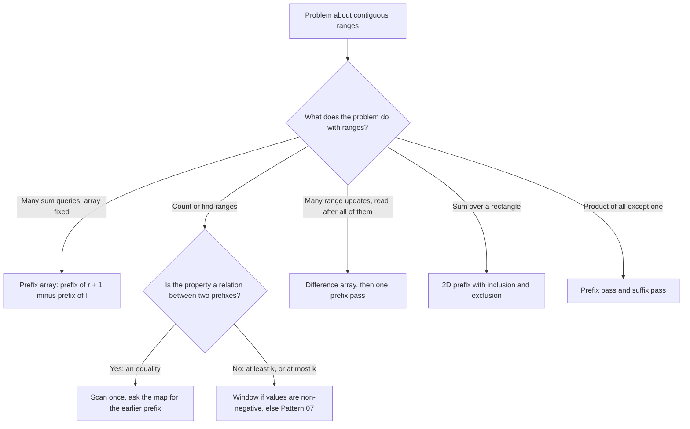

# Pattern 04: Prefix Sum and Difference Array

## Overview

A prefix sum stores, for each position, the sum of all elements before that position. With these stored sums, the sum of any range is one subtraction. The technique turns a question about a range into a question about two prefixes. The difference array is the inverse technique: it stores the change between neighbors, so that adding a value to a whole range costs two updates.

After this page you can:

1. Build the prefix array of a fixed array, explain why it has `n + 1` entries, and answer a range-sum query with one subtraction.
2. Rewrite "the sum of a range equals `k`" as "an earlier prefix equals `prefix[j] - k`", and count such ranges with a hash map from prefix value to count.
3. Choose the map key for a new "count the subarrays with property X" problem (the prefix, its remainder, a balance of +1 and -1, or a XOR; Examples 1 and 2 and The Pattern define them), and choose what the map stores (a count, the first index, or the last index).
4. Show, with a failing input for each, why the map starts with the entry `{0: 1}`, why the code looks up before it inserts, and why Java's `%` needs `Math.floorMod` for negative values.
5. Extend the idea to two dimensions with inclusion and exclusion, and to products with a prefix pass and a suffix pass.
6. Apply many range updates with a difference array and read the final array with one prefix pass, with the end of each update at `r + 1`.

## Prerequisites

| You need | Why this page needs it | Where to learn it |
|---|---|---|
| Arrays, indexes, and ranges `a[l..r]` | Every formula on this page reads `a[i]` or an entry of a second array at a shifted index | [Arrays, Strings, and Linked Lists](../foundations/02-arrays-strings-linked-lists.md) |
| Counting operations and O-notation | The page counts additions and map operations before it states O(n) | [Complexity Analysis](../foundations/01-complexity-analysis.md) |
| A hash map, and the form "ask the map about earlier elements" | The solution of [LC 560: Subarray Sum Equals K](https://leetcode.com/problems/subarray-sum-equals-k/) keeps a map from a prefix value to a count and asks the map, at each step, about the prefixes that came earlier | [Hashing and Frequency Maps](../05-hashing-frequency/README.md) |
| Bitwise XOR `^` and the shift `1 << v` | Variation C and practice problem P6 use the XOR of two numbers (`a ^ a = 0`, `a ^ 0 = a`) and a bit that toggles | [Bit Manipulation](../19-bit-manipulation/README.md) |
| The sliding window | The page shows the input on which a window gives a wrong count, and the window page proves where a window works | [Sliding Window](../01-sliding-window/README.md) |

Terms that the page uses from the start:

- A **range** `a[l..r]` is the run of elements from index `l` to index `r`, both ends included. A **subarray** is the same thing: elements that sit next to each other.
- A **prefix of length `j`** is the first `j` elements, `a[0..j-1]`. The **empty prefix** has length 0 and sum 0.
- A **query** is one question about a range, such as "what is the sum of `a[2..5]`?".
- An **invariant** is a statement that is true after every step of a loop. A proof of a loop states the invariant, shows that the first step makes it true, and shows that each step keeps it true.

## Motivation

### Problem 1: many range-sum queries on a fixed array (LC 303)

This problem is [LC 303: Range Sum Query - Immutable](https://leetcode.com/problems/range-sum-query-immutable/). The array does not change. The code receives many queries `(l, r)`. Each query asks for the sum of `a[l..r]`.

Take `a = [3, 1, 4, 1, 5, 9]` and three queries. The answers are 8, 11, and 19.

```text
index     0  1  2  3  4  5
value     3  1  4  1  5  9
query 1   3  1  4            (0, 2) -> 3 + 1 + 4 = 8
query 2      1  4  1  5      (1, 4) -> 1 + 4 + 1 + 5 = 11
query 3         4  1  5  9   (2, 5) -> 4 + 1 + 5 + 9 = 19
```

**First attempt: add the elements of each query.** The three queries add 3 + 4 + 4 = 11 elements. The cost of one query is its length, which is at most `n`. Assume `n = 100000` and `q = 100000` queries that each cover the whole array. Then the attempt makes `n x q = 10,000,000,000` additions. The program in the Implementation section prints these counts.

**The waste.** Query 1 and query 2 both contain `a[1]` and `a[2]`, so the attempt adds `1 + 4` twice. The attempt keeps nothing between two queries, so each query starts from zero and repeats work that an earlier query did.

### Problem 2: count the subarrays with sum exactly k, with negative values (LC 560)

This problem is [LC 560: Subarray Sum Equals K](https://leetcode.com/problems/subarray-sum-equals-k/). Given an array of integers that can be negative, and a number `k`, count the subarrays whose sum is exactly `k`.

Take `a = [1, 2, -2, 3, 0, 2]` and `k = 3`. The answer is 6. Six subarrays have sum 3: `a[0..1]`, `a[1..3]`, `a[1..4]`, `a[2..5]`, `a[3..3]`, and `a[3..4]`.

**First attempt: try every start and extend to the right.** For each start `i`, keep a running sum and add `a[i]`, `a[i+1]`, and so on. Count each time the sum equals `k`. The attempt makes 6 + 5 + 4 + 3 + 2 + 1 = 21 additions for `n = 6`. For `n` elements it makes `n(n + 1) / 2`. For `n = 100000`, that is 5,000,050,000 additions. The cost is O(n²).

**A faster rule that fails: the sliding window.** [Pattern 01](../01-sliding-window/README.md) solves "shortest subarray with a large sum" in O(n) with a window. The same idea suggests this code for "sum exactly `k`": add `a[right]`; while the sum is above `k`, remove `a[left]`; count the window when its sum equals `k`.

```java
static int windowCountEqualK(int[] a, int k) {
    int left = 0, sum = 0, count = 0;
    for (int right = 0; right < a.length; right++) {
        sum += a[right];
        while (sum > k && left <= right) {   // assumes that removing a[left] lowers the sum
            sum -= a[left];
            left++;
        }
        if (sum == k) count++;
    }
    return count;
}
```

The Implementation program runs it on the input above:

```text
a = [1, 2, -2, 3, 0, 2], k = 3
sum 3: a[0..1] = [1, 2]
sum 3: a[1..3] = [2, -2, 3]
sum 3: a[1..4] = [2, -2, 3, 0]
sum 3: a[2..5] = [-2, 3, 0, 2]
sum 3: a[3..3] = [3]
sum 3: a[3..4] = [3, 0]
window finds a[0..1] = [1, 2]
window finds a[1..3] = [2, -2, 3]
window finds a[1..4] = [2, -2, 3, 0]
window finds a[2..5] = [-2, 3, 0, 2]
brute force count = 6, window count = 4
```

The window returns 4. The correct count is 6. It never counts `a[3..3]` and `a[3..4]`. At `right = 3` the window sum is 4. The code removes `a[0]` and stops at sum 3, with `left = 1`. It never tests the start 3. As the start moves from 1 to 2 to 3, the sum of the window that ends at index 3 goes 3, 1, 3: it falls and then rises again. The code assumed that the sum only falls when `left` moves right. That holds when every value is positive, and it fails here because of `-2`.

**The gap.** The brute force checks `n(n + 1) / 2` pairs of (start, end) one by one, and most pairs are not answers. The window fails because it relies on the sign of the values. The code needs a test that, for one end, finds in O(1) how many starts give the sum `k`, and that does not depend on the sign of the values.

## Derivation

### Part 1: range sums on a fixed array (LC 303)

**Question 1.** Which sums can the code compute once and reuse?

A range `(l, r)` has two ends, so the array has `n(n + 1) / 2` ranges. Storing the sum of every range costs O(n²) numbers. That is as many as the brute force of Problem 2 checks. A smaller set is needed.

**Question 2.** Is there a small set of sums that builds every range sum?

Look at the ranges that start at index 0. There are only `n` of them. The sum of `a[0..4]` is the sum of `a[0..0]` followed by the sum of `a[1..4]`:

```text
index        0  1  2  3  4  5
value        3  1  4  1  5  9
a[0..4]      3  1  4  1  5       = 14
a[0..0]      3                   = 3
a[1..4]         1  4  1  5       = 11 = 14 - 3
```

So `sum(a[l..r]) = sum(a[0..r]) - sum(a[0..l-1])`. Each range sum is the difference of two sums that start at index 0.

**Question 3.** What happens when `l = 0`?

Then `a[0..l-1]` is the empty range, and the formula needs the entry for index -1. An array of length `n` that holds `sum(a[0..i])` at index `i` has no such entry. The program shows two bugs of this form on the query `(0, 2)`:

```text
p = [3, 4, 8, 9, 14, 23] (p[i] = a[0] + ... + a[i])
p[r] - p[l] on (0, 2): 8 - 3 = 5, correct 8 (a[0] is lost)
p[r] - p[l] on (1, 4): 14 - 4 = 10, correct 11 (a[1] is lost)
p[r] - p[l - 1] on (0, 2): Index -1 out of bounds for length 6
```

The formula `p[r] - p[l]` drops `a[l]` for every query, not only for `l = 0`. The formula `p[r] - p[l - 1]` is correct for `l >= 1` and crashes for `l = 0`. A branch `if (l == 0)` would repair it, but a branch for one query shape is a sign that the definition is wrong.

The fix is to store the sum of the first `j` elements at index `j`, and to include `j = 0`. Define `prefix[j] = a[0] + ... + a[j-1]`, with `prefix[0] = 0` (the sum of no elements). The array has `n + 1` entries. Then `sum(a[0..r])` is `prefix[r + 1]` and `sum(a[0..l-1])` is `prefix[l]`, and the formula needs no branch:

```text
sum(l, r) = prefix[r + 1] - prefix[l]
```

The build rule follows from the definition: the first `j + 1` elements are the first `j` elements plus `a[j]`, so `prefix[j + 1] = prefix[j] + a[j]`.

```java
static long[] buildPrefixSums(int[] a) {
    long[] prefix = new long[a.length + 1];      // prefix[0] = 0 is the empty prefix
    for (int i = 0; i < a.length; i++) {
        prefix[i + 1] = prefix[i] + a[i];        // the first i + 1 elements
    }
    return prefix;
}

static long rangeSum(long[] prefix, int l, int r) {   // a[l..r], both ends included
    return prefix[r + 1] - prefix[l];
}
```

The array has type `long[]` so that the sums cannot overflow. The Complexity section gives the arithmetic.

**Trace** on `a = [3, 1, 4, 1, 5, 9]`:

```text
prefix[0] = 0
i = 0: prefix[1] = prefix[0] + a[0] = 0 + 3 = 3
i = 1: prefix[2] = prefix[1] + a[1] = 3 + 1 = 4
i = 2: prefix[3] = prefix[2] + a[2] = 4 + 4 = 8
i = 3: prefix[4] = prefix[3] + a[3] = 8 + 1 = 9
i = 4: prefix[5] = prefix[4] + a[4] = 9 + 5 = 14
i = 5: prefix[6] = prefix[5] + a[5] = 14 + 9 = 23
prefix = [0, 3, 4, 8, 9, 14, 23]
```

```text
sum(0, 2) = prefix[3] - prefix[0] = 8 - 0 = 8
sum(1, 4) = prefix[5] - prefix[1] = 14 - 3 = 11
sum(2, 5) = prefix[6] - prefix[2] = 23 - 4 = 19
```

Query 1 reads `prefix[3] = 8` and `prefix[0] = 0`. Query 2 reads `prefix[5] = 14` and `prefix[1] = 3`. Each answer matches the sum that the first attempt computed by addition.

**Count the work.** Counted from the trace and the program output:

| Method | Operations for the 3 queries above | Operations for `n = 100000`, `q = 100000`, whole-array queries |
|---|---|---|
| Add the elements of each query | 3 + 4 + 4 = 11 | 10,000,000,000 |
| Build `prefix`, then subtract once per query | 6 + 3 = 9 | 100,000 + 100,000 = 200,000 |

The build makes `n` additions. Each query makes one subtraction, so `q` queries make `q` subtractions. The total is `n + q`, which is O(n + q). One query costs O(1). The extra space is `n + 1` entries.

**Why it is correct.** The invariant (the statement that is true after every step) is: after the loop step for `i`, `prefix[i + 1]` equals the sum of the first `i + 1` elements. The base case is `prefix[0] = 0`, the sum of no elements. One step keeps the invariant: the first `i + 1` elements are the first `i` elements plus `a[i]`. For a query `(l, r)` with `0 <= l <= r <= n - 1`, `prefix[r + 1]` holds `a[0..r]` and `prefix[l]` holds `a[0..l-1]`. Every element of the second sum is in the first sum, and the subtraction leaves exactly `a[l..r]`. The edge case is the empty range: for `l = r + 1`, the formula gives `prefix[r + 1] - prefix[r + 1] = 0`, which is the sum of no elements.

### Part 2: count subarrays with sum k, with negative values (LC 560)

**Question 1.** What does "the sum of a range equals `k`" say in terms of prefixes?

Let `prefix[j]` be the sum of the first `j` elements, as in Part 1. The range that starts at index `i` and ends at index `j - 1` has sum `prefix[j] - prefix[i]`, with `0 <= i < j <= n`. The condition is:

```text
prefix[j] - prefix[i] = k      with i < j
```

Every subarray corresponds to exactly one pair `(i, j)` with `i < j`. The pair `(i, j)` stands for the range `a[i..j-1]`. So the problem is: count the pairs `(i, j)` with `i < j` and `prefix[j] - prefix[i] = k`.

**Question 2.** For one fixed `j`, which values of `i` count?

Move `prefix[i]` to one side: `prefix[i] = prefix[j] - k`. The right side is a number that the code knows once it has read `j`. So for each `j` the question is: **how many earlier prefixes equal `prefix[j] - k`?** The code does not need to look at every `i`. It needs the count of earlier prefixes with one given value.

A question "how many earlier elements have this value?" is the question that a hash map answers in O(1). The map goes from a prefix value to the number of times that value occurred among `prefix[0], ..., prefix[j-1]`. This is the "ask the map about earlier elements" form of [Hashing and Frequency Maps](../05-hashing-frequency/README.md). The code keeps one running sum, not the whole array. It reads one element at a time:

1. Add `a[j-1]` to the running sum. Now the running sum is `prefix[j]`.
2. Look up `prefix[j] - k` in the map. Add the stored count to the answer.
3. Add `prefix[j]` to the map (count 1 more).

The map holds the count of each value. The code never asks about the sign of a value. It asks whether two numbers are equal. This is why the idea works with negative values, where the window did not.

**Trace** on `a = [1, 2, -2, 3, 0, 2]` and `k = 3`. The program prints the map after each step:

```text
start: map = {0=1}, count = 0
j = 1: a = 1, prefix = 1, look up 1 - 3 = -2 -> 0, count = 0, map = {0=1, 1=1}
j = 2: a = 2, prefix = 3, look up 3 - 3 = 0 -> 1, count = 1, map = {0=1, 1=1, 3=1}
j = 3: a = -2, prefix = 1, look up 1 - 3 = -2 -> 0, count = 1, map = {0=1, 1=2, 3=1}
j = 4: a = 3, prefix = 4, look up 4 - 3 = 1 -> 2, count = 3, map = {0=1, 1=2, 3=1, 4=1}
j = 5: a = 0, prefix = 4, look up 4 - 3 = 1 -> 2, count = 5, map = {0=1, 1=2, 3=1, 4=2}
j = 6: a = 2, prefix = 6, look up 6 - 3 = 3 -> 1, count = 6, map = {0=1, 1=2, 3=1, 4=2, 6=1}
```

Read step `j = 4`. The running sum is `prefix[4] = 4`. The code looks up `4 - 3 = 1`. The map holds `1=2`: the prefix 1 occurred at `j = 1` and at `j = 3`. So two ranges end at `a[3]` with sum 3: `a[1..3]` (from `prefix[1]`) and `a[3..3]` (from `prefix[3]`). Both appear in the list of six subarrays. Step `j = 5` finds the same two starts, and its ranges are `a[1..4]` and `a[3..4]`. The element `a[4] = 0` extends each of the two ranges without changing the sum.

**Question 3.** Why does the map start with the entry `{0: 1}`?

The subarray `a[0..j-1]` starts at index 0. Its sum is `prefix[j] - prefix[0]`, and `prefix[0] = 0`. The pair `(0, j)` is only counted if the map holds the value 0 before step 1. The empty prefix is the first earlier prefix. The first entry that the code puts in the map before the loop starts is the **seed**. The seed of this map is `0 -> 1`: the value 0 occurred once. The program shows the count without the seed:

```text
a = [3], k = 3: without the seed 0, with the seed 1
a = [1, 2, -2, 3, 0, 2], k = 3: without the seed 5
```

On `a = [3]` with `k = 3`, the array has one subarray with sum 3. Without the seed the code returns 0, because at `j = 1` it looks up `3 - 3 = 0` and finds nothing. On the trace input, the code returns 5 and misses the range `a[0..1]`, which is the pair `(0, 2)`: `prefix[2] - prefix[0] = 3 - 0`.

**Question 4.** Why does the code look up before it inserts?

The condition has `i < j`. At step `j`, the map must hold `prefix[0], ..., prefix[j-1]` and not `prefix[j]`. If the code inserts `prefix[j]` first, the lookup can find `prefix[j]` itself. That happens when `prefix[j] - k = prefix[j]`, which means `k = 0`. The code then counts the pair `(j, j)`, an empty range. The program shows both orders:

```text
a = [1], k = 0: insert first 1, look up first 0
a = [0], k = 0: insert first 2, look up first 1
```

On `a = [1]` with `k = 0`, no non-empty subarray has sum 0, and the wrong order returns 1. For `k != 0`, the wrong order gives the right count, because `prefix[j] - k` never equals `prefix[j]`. A test set with only `k != 0` does not find this bug.

```java
static long countSubarraysWithSum(int[] a, long k) {
    Map<Long, Integer> seen = new HashMap<>();   // prefix value -> count of earlier prefixes
    seen.put(0L, 1);                             // the seed: the empty prefix
    long prefix = 0, count = 0;
    for (int x : a) {
        prefix += x;                             // prefix[j]
        count += seen.getOrDefault(prefix - k, 0);   // look up first ...
        seen.merge(prefix, 1, Integer::sum);         // ... then insert
    }
    return count;
}
```

The method returns `long`, because the count can reach `n(n + 1) / 2`, which is larger than the `int` range once `n` is 65,536 or more. The Complexity section gives the arithmetic.

**Count the work.** For `n = 6`, the code makes 6 lookups and 6 insertions: 12 map operations. The first attempt made 21 additions. For `n = 100000`, the map code makes 200,000 map operations, and the first attempt makes 5,000,050,000 additions. A hash map operation costs O(1) on average. The time is O(n) on average, and the space is O(n), because the map holds at most `n + 1` different prefix values.

**Why it is correct.** The invariant is: before step `j`, the map holds, for each value `v`, the number of indexes `i` with `0 <= i < j` and `prefix[i] = v`. The seed makes this true for `j = 1`, where only `prefix[0]` exists. Step `j` adds `prefix[j]` after the lookup, so the invariant holds for `j + 1`. At step `j`, the stored count for `prefix[j] - k` is the number of `i < j` with `prefix[i] = prefix[j] - k`, which is the number of subarrays that end at `a[j-1]` and have sum `k`. Each subarray has one end, so it is counted at exactly one step. The sum over all steps is the answer. For an empty array the loop does not run, and the answer is 0.

### Part 3: many range updates, then one read (LC 1109)

Parts 1 and 2 answer questions about ranges. This part does the reverse: the code changes ranges, then reads the array once.

This problem is [LC 1109: Corporate Flight Bookings](https://leetcode.com/problems/corporate-flight-bookings/). There are `n` flights, numbered from 1. A booking `[first, last, seats]` adds `seats` to every flight from `first` to `last`. After all bookings, return the number of seats booked on each flight.

Take `n = 5` and the bookings `[1, 2, 10]`, `[2, 3, 20]`, and `[2, 5, 25]`. The answer is `[10, 55, 45, 25, 25]`.

**First attempt: loop over each range.** Each booking adds `seats` to each flight in its range. The three bookings touch 2 + 2 + 4 = 8 flights. The cost of one booking is its length, at most `n`. Assume `n = 100000` bookings that each cover the whole array: the cost is 10,000,000,000 additions.

**Question 1.** The work of one update is the length of its range. What changes between neighbors when the code adds `v` to a range?

Which description of the array stays unchanged inside the range? Inside the range, every element rises by `v`, so the steps from one element to the next stay the same. Only the two ends of the range change a step. So store the steps. Define the **difference array** `d` of an array `a`: `d[0] = a[0]` and `d[i] = a[i] - a[i-1]` for `i >= 1`. Add `v` to `a[l..r]` and check each `d[i]`:

- For `l < i <= r`, both `a[i]` and `a[i-1]` rise by `v`. The difference `d[i]` does not change.
- For `i = l`, `a[l]` rises and `a[l-1]` does not. So `d[l]` rises by `v`.
- For `i = r + 1`, `a[r+1]` does not rise and `a[r]` does. So `d[r+1]` falls by `v`.
- For `i < l` and for `i > r + 1`, neither `a[i]` nor `a[i-1]` changes.

Only two entries of `d` change, however long the range is:

```text
index           0  1  2  3  4  5
a (all zero)    0  0  0  0  0  0
add 7 to a[2..4]
a after         0  0  7  7  7  0
d after         0  0  7  0  0 -7        d[l] += 7, d[r + 1] -= 7
```

**Question 2.** How does the code get `a` back from `d`?

By the definition, `d[i] = a[i] - a[i-1]`, so `a[i] = d[0] + d[1] + ... + d[i]`. The array `a` is the running sum of `d`: one prefix pass. So the code does q updates of two operations each, and one prefix pass of `n` steps at the end.

If `r = n - 1`, then `r + 1 = n` is outside `a`. The code needs the entry `d[n]` to write `d[r + 1] -= v`. The code never reads it, but it must exist. The array `d` has length `n + 1`.

```java
static int[] applyRangeAdds(int n, int[][] updates) {   // each update is {l, r, v}, 0-indexed
    int[] diff = new int[n + 1];                 // one extra slot for r + 1 when r = n - 1
    for (int[] u : updates) {
        diff[u[0]] += u[2];                      // from l on, every value rises by v
        diff[u[1] + 1] -= u[2];                  // from r + 1 on, the rise is cancelled
    }
    int[] a = new int[n];
    int running = 0;
    for (int i = 0; i < n; i++) {
        running += diff[i];                      // running = diff[0] + ... + diff[i]
        a[i] = running;
    }
    return a;
}
```

**Trace** for the flight bookings. The problem numbers flights from 1, and the code indexes from 0. A booking `[first, last, seats]` becomes `l = first - 1` and `r = last - 1`, so the second write goes to `diff[r + 1] = diff[last]`.

=== "Start"

    ```text
    diff = [0, 0, 0, 0, 0, 0]
    ```

=== "Booking 1"

    ```text
    booking [1, 2, 10] -> l = 0, r = 1: diff[0] += 10, diff[2] -= 10
      diff = [10, 0, -10, 0, 0, 0]
    ```

=== "Booking 2"

    ```text
    booking [2, 3, 20] -> l = 1, r = 2: diff[1] += 20, diff[3] -= 20
      diff = [10, 20, -10, -20, 0, 0]
    ```

=== "Booking 3"

    ```text
    booking [2, 5, 25] -> l = 1, r = 4: diff[1] += 25, diff[5] -= 25
      diff = [10, 45, -10, -20, 0, -25]
    ```

=== "Read i = 0"

    ```text
    i = 0: running = 10 -> a[0] = 10
    ```

=== "Read i = 1"

    ```text
    i = 1: running = 55 -> a[1] = 55
    ```

=== "Read i = 2"

    ```text
    i = 2: running = 45 -> a[2] = 45
    ```

=== "Read i = 3"

    ```text
    i = 3: running = 25 -> a[3] = 25
    ```

=== "Read i = 4"

    ```text
    i = 4: running = 25 -> a[4] = 25
    ```

```text
answer = [10, 55, 45, 25, 25]
```

Read the last booking `[2, 5, 25]`: `l = 1` and `r = 4`, so `r + 1 = 5 = n`. The write `diff[5] -= 25` goes to the extra slot. The program output shows that a diff array of length `n` fails on this write:

```text
add 7 to a[3..4], n = 5. diff[r] -= v gives [0, 0, 0, 7, 0], correct [0, 0, 0, 7, 7]
diff of length n, diff[r + 1] -= v with r = 4: Index 5 out of bounds for length 5
```

The first line shows the other bug of this family: `diff[r] -= v` stops the update one index early, and the last flight misses its seats.

**Why it is correct.** Let `D[i] = diff[0] + ... + diff[i]`. At the start all entries are 0, so `D[i] = 0` for every `i`. One update `(l, r, v)` adds `v` to `diff[l]`, so `D[i]` rises by `v` for every `i >= l`. It subtracts `v` from `diff[r + 1]`, so `D[i]` falls by `v` for every `i >= r + 1`. The net change of `D[i]` is `+v` for `l <= i <= r`, and 0 for `i < l` and for `i > r`. The final pass computes `D[i]`, so `a[i]` equals the sum of the `v` of all updates whose range contains `i`. Additions commute, so the order of the updates does not matter.

**Count the work.** The three bookings write 6 entries, and the final pass makes 5 additions. The first attempt added to 8 flights. For `n = 100000` bookings of the whole array, the difference array makes 200,000 writes and 100,000 additions in the final pass, and the first attempt makes 10,000,000,000 additions. The time is O(n + q), and the space is O(n).

**The two techniques are inverses.** The prefix array of Part 1 sums `a` from the left. The difference array takes the neighbor differences of `a`. One undoes the other. The program shows both on `[1, 3, 5, 2, 4]`:

```text
a          = [1, 3, 5, 2, 4]
prefix     = [0, 1, 4, 9, 11, 15]
difference = [1, 2, 2, -3, 2]
prefix sum of the difference = [1, 3, 5, 2, 4]
```

The running sum of the difference array returns the original array. This is the reason for the final pass of Part 3.

The code can also start from an array `arr` that is not all zero. Build `d` from `arr` with the definition, apply the updates, and run the final pass:

```java
static int[] applyToExisting(int[] arr, int[][] updates) {   // each update is {l, r, v}
    int n = arr.length;
    int[] diff = new int[n + 1];
    for (int i = 0; i < n; i++) diff[i] = arr[i] - (i == 0 ? 0 : arr[i - 1]);
    for (int[] u : updates) {
        diff[u[0]] += u[2];
        diff[u[1] + 1] -= u[2];
    }
    int[] result = new int[n];
    int running = 0;
    for (int i = 0; i < n; i++) {
        running += diff[i];
        result[i] = running;
    }
    return result;
}
```

The program output for `arr = [4, 1, 3, 2, 5]` and the updates `(1, 3, +10)` and `(0, 1, -2)` shows the difference array after the build and after each update:

```text
arr = [4, 1, 3, 2, 5], updates {l, r, v} = [[1, 3, 10], [0, 1, -2]]
diff built from arr = [4, -3, 2, -1, 3, 0]
update [1, 3, 10] -> diff = [4, 7, 2, -1, -7, 0]
update [0, 1, -2] -> diff = [2, 7, 4, -1, -7, 0]
result = [2, 9, 13, 12, 5]
```

## The Pattern

A property of a range is a relation between two prefixes. The code scans the array once, keeps the prefix so far, and asks a map for the earlier prefix that completes the relation. For queries on a fixed array, the relation is a subtraction of two stored prefixes. For updates, the difference array is the inverse of the prefix array: two writes change a whole range, and one prefix pass reads the result.

**Invariants.**

1. `prefix[j]` is the sum of the first `j` elements, with `prefix[0] = 0`.
2. The sum of `a[l..r]` is `prefix[r + 1] - prefix[l]`.
3. In the map form, before step `j` the map describes exactly `prefix[0..j-1]`.
4. In the difference form, the prefix sum of `diff` up to `i` equals `a[i]`.



**The vocabulary.** The page used each of these terms before it named them.

| Term | What it was in the examples | The question to ask in a new problem |
|---|---|---|
| Prefix | `prefix[j]`, the sum of the first `j` elements | "Which running value describes everything before this position?" |
| Empty prefix | `prefix[0] = 0` | "Which ranges start at index 0? The empty prefix must exist for them" |
| Relation | `prefix[j] - prefix[i] = k` | "Can I write the property of the range as a relation between two prefixes?" |
| Map key | The prefix value, its remainder, a balance | "What must be equal for two prefixes to make a valid range?" |
| Seed | The entry `0 -> 1`, or `0 -> 0` | "What is the first earlier prefix, before the first element?" |
| Difference array | `diff[i] = a[i] - a[i-1]` | "Are there many range updates and a read only at the end?" |
| Inverse | The prefix sum undoes the difference | "Do I need the array back after the updates?" |

### The map key and the map value for each family

The key must be a value that is equal for two prefixes exactly when the range between them has the property. The map value depends on the question: count the ranges, find the longest, or find the shortest. Two words in the table need a definition. The **balance** is the running total of +1 and -1 values (Example 2 derives it). The **mask** is a whole number whose bits record yes-or-no facts, here the parity of a count (practice problem P6 derives it).

| Family | The property of the range | The relation between `prefix[i]` and `prefix[j]` | The map key | The map stores | The seed | Example |
|---|---|---|---|---|---|---|
| Sum equals `k`, count | sum = `k` | `prefix[i] = prefix[j] - k` | the prefix | count | `0 -> 1` | [LC 560](https://leetcode.com/problems/subarray-sum-equals-k/), [LC 930](https://leetcode.com/problems/binary-subarrays-with-sum/) |
| Sum equals `k`, longest | sum = `k` | the same | the prefix | the first index of the key | `0 -> 0` | [LC 325: Maximum Size Subarray Sum Equals k](https://leetcode.com/problems/maximum-size-subarray-sum-equals-k/) (premium) |
| Sum divisible by `k` | sum mod `k` = 0 | `prefix[i] mod k = prefix[j] mod k` | `Math.floorMod(prefix, k)` | count (or the first index) | `0 -> 1` (or `0 -> 0`) | [LC 974](https://leetcode.com/problems/subarray-sums-divisible-by-k/), [LC 523](https://leetcode.com/problems/continuous-subarray-sum/) |
| Equal count of two kinds | count of kind A = count of kind B | map A to +1 and B to -1: `prefix[i] = prefix[j]` | the balance | the first index | `0 -> 0` | [LC 525](https://leetcode.com/problems/contiguous-array/) |
| Even count of each kind | every count is even | the bit masks of the parities are equal | the mask | the first index | `0 -> 0` | [LC 1371](https://leetcode.com/problems/find-the-longest-substring-containing-vowels-in-even-counts/) |
| XOR equals `t` | XOR of the range = `t` | `x[i] = x[j] XOR t` | the prefix XOR | count | `0 -> 1` | Range XOR queries below |
| Shortest range | any of the above | the same relation | the same key | the last index of the key (overwrite) | `0 -> 0` | [LC 1590](https://leetcode.com/problems/make-sum-divisible-by-p/) |
| Product of all except one | the product of two ranges | prefix product times suffix product | none: two passes | none | prefix product 1 | [LC 238](https://leetcode.com/problems/product-of-array-except-self/) |

Three rules decide what the map stores:

- **Count the ranges: store a count.** The seed is `0 -> 1`: the value of the empty prefix occurred once.
- **Longest range: store the first index and never overwrite it.** For a fixed `j`, the valid starts are the indexes `i` whose prefix has the key. The length is `j - i`, and it is largest for the smallest `i`. Overwriting the stored index with a later one makes the range shorter. The seed is `0 -> 0`: the empty prefix has index 0. The code uses `putIfAbsent`, or it inserts only when the key is missing.
- **Shortest range: store the last index.** For the same reason, the length `j - i` is smallest for the largest `i`. The code overwrites the stored index at each step.

The seed has a different meaning in the two forms. In the count form the value 1 is a count. In the index form the value 0 is the index of the empty prefix. Mixing them gives wrong answers (see Common Mistakes, Mistake 12).

### Variations

Each variation changes one thing: the operation, the order of the values, or the shape of the data.

| Variation | Problem type | What it uses | Selecting property |
|---|---|---|---|
| A. Range query on a fixed array | [LC 303](https://leetcode.com/problems/range-sum-query-immutable/), [LC 724: Find Pivot Index](https://leetcode.com/problems/find-pivot-index/) | Prefix array | The array does not change between queries |
| B. Count or longest by a map key | [LC 560](https://leetcode.com/problems/subarray-sum-equals-k/), [LC 525](https://leetcode.com/problems/contiguous-array/) | Prefix with a hash map | The property is an equality between two prefixes |
| C. Range XOR | XOR of `a[l..r]` | Prefix XOR | XOR is its own inverse, so `x[r+1] XOR x[l]` removes the first `l` elements |
| D. Prefix with binary search | Shortest subarray with sum at least `target`, positive values | Prefix array and binary search | The prefix array of positive values is strictly increasing, so it is sorted |
| E. Maximum subarray | [LC 53: Maximum Subarray](https://leetcode.com/problems/maximum-subarray/) | Prefix minus the smallest earlier prefix | The best range that ends at `j` starts at the smallest earlier prefix |
| F. 2D prefix | [LC 304](https://leetcode.com/problems/range-sum-query-2d-immutable/) | Prefix over a rectangle | The array is a grid and the query is a rectangle |
| G. Difference array | [LC 1109](https://leetcode.com/problems/corporate-flight-bookings/), [LC 370](https://leetcode.com/problems/range-addition/) (premium) | Two point updates, one prefix pass | Many range updates, with reads after the last update |
| H. Range increment, then point queries | The value of one position after all updates | The same difference array | Only the final array matters |
| I. 2D with updates | A rectangle sum with point updates | A 2D Fenwick tree: a table of partial sums with an update and a prefix query that each loop over O(log n) entries in each dimension. See [Pattern 21](../21-segment-tree-and-fenwick-tree/README.md) | The prefix table is stale after a change |

**C. Range XOR.** The XOR of two equal numbers is 0, so `(a[0] XOR ... XOR a[r]) XOR (a[0] XOR ... XOR a[l-1])` leaves `a[l] XOR ... XOR a[r]`. The array of prefix XORs has the same leading entry as the sum version, `x[0] = 0`. The relation `x[j] XOR x[i] = t` gives `x[i] = x[j] XOR t`, the same shape as `prefix[i] = prefix[j] - k`. So the count code is the code of [LC 560](https://leetcode.com/problems/subarray-sum-equals-k/) with `XOR` in place of `+` and `-`.

```java
static int[] buildPrefixXor(int[] a) {
    int[] x = new int[a.length + 1];             // x[0] = 0, the XOR of no elements
    for (int i = 0; i < a.length; i++) x[i + 1] = x[i] ^ a[i];
    return x;
}

static int rangeXor(int[] x, int l, int r) {
    return x[r + 1] ^ x[l];
}

static long countSubarraysWithXor(int[] a, int target) {
    Map<Integer, Integer> seen = new HashMap<>();
    seen.put(0, 1);                              // the empty prefix
    int x = 0;
    long count = 0;
    for (int v : a) {
        x ^= v;
        count += seen.getOrDefault(x ^ target, 0);   // x[i] = x[j] XOR target
        seen.merge(x, 1, Integer::sum);
    }
    return count;
}
```

The program output for `a = [5, 1, 6, 2, 7]` and the range `(1, 3)`:

```text
a = [5, 1, 6, 2, 7], prefixXor = [0, 5, 4, 2, 0, 7]
xor(1, 3) = prefixXor[4] ^ prefixXor[1] = 0 ^ 5 = 5, direct 5
```

**D. Prefix with binary search.** For positive values, the prefix array is strictly increasing. For each start `i`, the shortest range that starts at `i` and reaches `target` ends at the first `j` with `prefix[j] >= prefix[i] + target`. A sorted array supports binary search, so each start costs O(log n). The total is O(n log n). The window of [Pattern 01](../01-sliding-window/README.md) solves [LC 209: Minimum Size Subarray Sum](https://leetcode.com/problems/minimum-size-subarray-sum/) in O(n), so use the window for one query. Use the prefix array when the same array answers many queries.

```java
static int shortestSubarrayAtLeast(int[] a, int target) {   // all values positive
    long[] prefix = new long[a.length + 1];
    for (int i = 0; i < a.length; i++) prefix[i + 1] = prefix[i] + a[i];
    int best = Integer.MAX_VALUE;
    for (int i = 0; i < a.length; i++) {
        long need = prefix[i] + target;
        int lo = i + 1, hi = a.length + 1;       // first j in [i + 1, n] with prefix[j] >= need
        while (lo < hi) {
            int mid = (lo + hi) >>> 1;
            if (prefix[mid] >= need) hi = mid; else lo = mid + 1;
        }
        if (lo <= a.length) best = Math.min(best, lo - i);   // lo = n + 1 means no such j
    }
    return best == Integer.MAX_VALUE ? 0 : best;
}
```

With one negative value the prefix array is not sorted, and the binary search can return wrong answers. Use [Pattern 07](../07-monotonic-stack-queue/README.md) for that case.

**E. Maximum subarray.** The sum of the range that ends at `a[j]` and starts at `a[i]` is `prefix[j+1] - prefix[i]`. For a fixed `j`, the largest sum comes from the smallest `prefix[i]` with `i <= j`. So the code keeps the smallest prefix seen so far. [LC 53: Maximum Subarray](https://leetcode.com/problems/maximum-subarray/) has its home in [Pattern 15: Dynamic Programming](../15-dynamic-programming/README.md), which derives Kadane's algorithm. Kadane's algorithm is this idea with the subtraction folded into one variable: with `dp[i]` as the best sum of a range that ends at `i`, `dp[i] = max(a[i], dp[i - 1] + a[i])`, and the answer is the largest `dp[i]`. Both forms are below. The problem guarantees at least one element.

```java
static long maxSubarrayByPrefix(int[] a) {
    long prefix = 0, smallestEarlier = 0, best = Long.MIN_VALUE;
    for (int x : a) {
        prefix += x;
        best = Math.max(best, prefix - smallestEarlier);   // the smallest prefix before x
        smallestEarlier = Math.min(smallestEarlier, prefix);
    }
    return best;
}

static int maxSubarrayKadane(int[] a) {
    int current = a[0], best = a[0];             // start at a[0], not 0: an all-negative input
    for (int i = 1; i < a.length; i++) {
        current = Math.max(a[i], current + a[i]);   // restart at i, or extend
        best = Math.max(best, current);
    }
    return best;
}
```

The first method updates `best` before it updates `smallestEarlier`. This keeps the range non-empty: the range must contain at least one element. Starting `best` at 0 in either method returns 0 for an all-negative array such as `[-3, -1, -2]`, where the answer is -1.

**Maximum product subarray ([LC 152: Maximum Product Subarray](https://leetcode.com/problems/maximum-product-subarray/)).** This problem looks like a prefix problem, but a prefix product has no safe inverse: `P[r+1] / P[l]` is `0 / 0` once a zero is in the prefix. The method tracks the largest and the smallest product of a range that ends at `i`. A negative `a[i]` turns the smallest product into the largest. A zero resets both through the candidate `a[i]`.

```java
static int maxProductSubarray(int[] a) {
    int curMax = a[0], curMin = a[0], best = a[0];
    for (int i = 1; i < a.length; i++) {
        int x = a[i];
        int fromMax = curMax * x, fromMin = curMin * x;   // build both from the OLD values
        curMax = Math.max(x, Math.max(fromMax, fromMin));
        curMin = Math.min(x, Math.min(fromMax, fromMin));
        best = Math.max(best, curMax);
    }
    return best;
}
```

**F and I. Two dimensions.** Worked Example 4 derives the 2D prefix. A 2D prefix table is stale after a point update, for the same reason as the 1D table (see Complexity and Trade-offs).

## Worked Examples

The examples go from the smallest change to the largest. Each one changes one thing about [LC 560](https://leetcode.com/problems/subarray-sum-equals-k/) or [LC 303](https://leetcode.com/problems/range-sum-query-immutable/). Try each problem for 10 minutes before you read its section.

### Example 1: Subarray Sums Divisible by K (LC 974), the remainder as the key

Given an array of integers that can be negative, and a positive number `k`, count the subarrays whose sum is divisible by `k`. This is [LC 974: Subarray Sums Divisible by K](https://leetcode.com/problems/subarray-sums-divisible-by-k/). For `a = [4, 5, 0, -2, -3, 1]` and `k = 5`, the answer is 7.

**What changed.** The condition is "divisible by `k`", not "equal to `k`". The relation between the two prefixes changes, so the map key changes.

**From brute force to the solution.** The brute force sums every range and tests `sum % k == 0`. It makes `n(n + 1) / 2` additions. Use the prefixes: the range `a[i..j-1]` has sum `prefix[j] - prefix[i]`. This difference is divisible by `k` when `prefix[j] - prefix[i] = k x m` for some whole number `m`. Then `prefix[j] = prefix[i] + k x m`, so both prefixes leave the same remainder when divided by `k`. The reverse holds too: if both prefixes leave the same remainder, their difference is a multiple of `k`. So the condition is **the remainder of `prefix[i]` equals the remainder of `prefix[j]`**.

The map key is the remainder. The lookup is the remainder of `prefix[j]` itself, not `prefix[j] - k`, because the relation is "equal remainders". There are only `k` possible remainders, so an array of length `k` replaces the map. The seed is `0 -> 1`: the empty prefix has remainder 0.

**The negative remainder.** Java's `%` gives a result that is negative only when the dividend is negative ([JLS section 15.17.3](https://docs.oracle.com/javase/specs/jls/se21/html/jls-15.html#jls-15.17.3)). The value `-2 % 5` is `-2`. The numbers `-2` and `3` differ by 5, so they have the same remainder class, and the code must give them the same key. The raw `%` gives them the keys `-2` and `3`. The method `Math.floorMod(x, k)` returns a value from 0 to `k - 1` for positive `k` ([`Math.floorMod` in the javadoc](https://docs.oracle.com/en/java/javase/21/docs/api/java.base/java/lang/Math.html#floorMod(long,long))). The program shows the failure on `a = [1, -2]` with `k = 2`. The prefixes are 0, 1, and -1. The subarray `[-2]` has sum -2, which is divisible by 2, but the raw keys of 1 and -1 differ:

```text
-2 % 5 = -2, 3 % 5 = 3, Math.floorMod(-2, 5) = 3
a = [1, -2], k = 2: raw % gives 0, floorMod gives 1
```

**Trace** on `a = [4, 5, 0, -2, -3, 1]` and `k = 5`. The program prints the non-zero entries of the remainder table:

```text
start: map = {0=1}, count = 0
j = 1: a = 4, prefix = 4, key = 4, look up -> 0, count = 0, map = {0=1, 4=1}
j = 2: a = 5, prefix = 9, key = 4, look up -> 1, count = 1, map = {0=1, 4=2}
j = 3: a = 0, prefix = 9, key = 4, look up -> 2, count = 3, map = {0=1, 4=3}
j = 4: a = -2, prefix = 7, key = 2, look up -> 0, count = 3, map = {0=1, 2=1, 4=3}
j = 5: a = -3, prefix = 4, key = 4, look up -> 3, count = 6, map = {0=1, 2=1, 4=4}
j = 6: a = 1, prefix = 5, key = 0, look up -> 1, count = 7, map = {0=2, 2=1, 4=4}
```

Read step `j = 3`. The element is 0, so the prefix stays 9 and the key stays 4. The table holds `4=2` (the prefixes at `j = 1` and `j = 2`), so two ranges end at `a[2]`: `a[2..2] = [0]` and `a[1..2] = [5, 0]`. The code adds 2. The last step `j = 6` has the prefix 5 and key 0, and the table holds `0=1` from the seed: the range `a[0..5]` has sum 5.

```java
static long countDivisibleSubarrays(int[] a, int k) {   // k > 0
    int[] seen = new int[k];                     // seen[r] = earlier prefixes with remainder r
    seen[0] = 1;                                 // the seed: the empty prefix has remainder 0
    long prefix = 0, count = 0;
    for (int x : a) {
        prefix += x;
        int key = (int) Math.floorMod(prefix, (long) k);   // 0 .. k - 1, even for a negative prefix
        count += seen[key];                      // look up first ...
        seen[key]++;                             // ... then insert
    }
    return count;
}
```

**Complexity.** Time O(n). Space O(k). The proof is the proof of [LC 560](https://leetcode.com/problems/subarray-sum-equals-k/) with "equal remainder" in place of "equal to `prefix[j] - k`". The mistake that this problem invites is the raw `%` on a negative prefix (Common Mistakes, Mistake 4).

### Example 2: Contiguous Array (LC 525), a balance, the longest range, and the first index

Given an array of 0s and 1s, find the length of the longest subarray that has the same number of 0s and 1s. This is [LC 525: Contiguous Array](https://leetcode.com/problems/contiguous-array/). For `a = [0, 0, 1, 0, 0, 0, 1, 1]`, the answer is 6 (the subarray `a[2..7] = [1, 0, 0, 0, 1, 1]`).

**What changed.** Two things. The property is "equal counts of two kinds", which is not a sum. The question is the longest range, not the number of ranges, so the map must store an index and not a count.

**From brute force to the solution.** The brute force tracks the number of 1s minus the number of 0s for each start, and records the length when the difference is 0. It costs O(n²).

*How does the code write "equal counts" as a sum?* Replace each 0 by -1 and keep each 1 as +1. A range has equal counts exactly when its new sum is 0. Let `prefix[j]` be the sum of the first `j` new values. This sum is the **balance**: the number of 1s minus the number of 0s among the first `j` elements. The range `a[i..j-1]` has sum 0 when `prefix[j] - prefix[i] = 0`, that is, when `prefix[i] = prefix[j]`. The map key is the balance.

*Which index does the map store?* For a fixed `j`, every earlier `i` with the same balance gives a valid range of length `j - i`. The length is largest for the smallest `i`. So the code stores the **first** index of each balance and never changes it. The code inserts only when the balance is new. When the balance is already in the map, the code computes `j - first[balance]` and keeps the larger length.

*What is the seed?* The balance of the empty prefix is 0, and its index is 0. The seed is `0 -> 0`. The range `a[0..j-1]` has balance 0 at step `j`, and its length is `j - 0`.

**One convention for every index map on this page.** The stored number is the prefix length `j` (the number of elements before the range), so the empty prefix has the number 0, and the length of a range is `j - i`. Many other sources store the array index of the last element of the prefix instead. Then the empty prefix has the number -1, the seed is `0 -> -1`, and the length of a range is still the difference of the two stored numbers. The two forms differ by 1 in every stored number, and both give the same answers. Do not mix the seed of one form with the loop of the other: a seed `0 -> 0` with array indexes shortens every answer by 1 in the cases that start at index 0.

**Trace** on `a = [0, 0, 1, 0, 0, 0, 1, 1]`. Click through the steps. The map `first` shows the first index of each balance.

=== "Start"

    ```text
    start: first = {0=0}, best = 0
    ```

=== "Step 1"

    ```text
    j = 1: a = 0 -> -1, bal = -1, new, store 1, best = 0, first = {-1=1, 0=0}
    ```

=== "Step 2"

    ```text
    j = 2: a = 0 -> -1, bal = -2, new, store 2, best = 0, first = {-2=2, -1=1, 0=0}
    ```

=== "Step 3"

    ```text
    j = 3: a = 1 -> +1, bal = -1, seen at 1, length 2, best = 2, first = {-2=2, -1=1, 0=0}
    ```

=== "Step 4"

    ```text
    j = 4: a = 0 -> -1, bal = -2, seen at 2, length 2, best = 2, first = {-2=2, -1=1, 0=0}
    ```

=== "Step 5"

    ```text
    j = 5: a = 0 -> -1, bal = -3, new, store 5, best = 2, first = {-3=5, -2=2, -1=1, 0=0}
    ```

=== "Step 6"

    ```text
    j = 6: a = 0 -> -1, bal = -4, new, store 6, best = 2, first = {-4=6, -3=5, -2=2, -1=1, 0=0}
    ```

=== "Step 7"

    ```text
    j = 7: a = 1 -> +1, bal = -3, seen at 5, length 2, best = 2, first = {-4=6, -3=5, -2=2, -1=1, 0=0}
    ```

=== "Step 8"

    ```text
    j = 8: a = 1 -> +1, bal = -2, seen at 2, length 6, best = 6, first = {-4=6, -3=5, -2=2, -1=1, 0=0}
    ```


Read step 8. The balance is -2. The first index of -2 is 2 (stored at step 2), so the range is `a[2..7]` with length 6. The code did not use the later index 4, where the balance was -2 again. That would give a range of length 4. The program shows the result when the code overwrites the stored index with the latest index:

```text
a = [0, 1, 0, 1]: keep the first index 4, overwrite with the latest index 2
```

```java
static int longestEqualZerosOnes(int[] a) {
    Map<Integer, Integer> first = new HashMap<>();   // balance -> first prefix index with it
    first.put(0, 0);                             // the seed: the empty prefix, index 0
    int balance = 0, best = 0;
    for (int j = 1; j <= a.length; j++) {
        balance += a[j - 1] == 1 ? 1 : -1;       // a 1 counts +1, a 0 counts -1
        Integer i = first.get(balance);
        if (i == null) first.put(balance, j);    // a new balance: remember its first index
        else best = Math.max(best, j - i);       // a known balance: do not overwrite
    }
    return best;
}
```

**Complexity.** Time O(n) on average. Space O(n), because the balance takes at most `n + 1` different values. The mistake that this problem invites is the overwrite (Mistake 8). A second mistake is the seed `0 -> 1`, which treats the stored value as a count (Mistake 12).

### Example 3: Product of Array Except Self (LC 238), prefix and suffix without division

Given an array of integers, return an array `result` where `result[i]` is the product of all elements except `a[i]`. Do not use division. This is [LC 238: Product of Array Except Self](https://leetcode.com/problems/product-of-array-except-self/). For `a = [1, 2, 3, 4]`, the answer is `[24, 12, 8, 6]`. This page assumes that every answer fits in an `int`.

**What changed.** The operation is a product. The question is about all elements except one, which is two ranges: `a[0..i-1]` on the left and `a[i+1..n-1]` on the right. One is a prefix and the other is a suffix. The code needs no map and no subtraction.

**From brute force to the solution.** The brute force multiplies `n - 1` elements for each `i`. It makes `n(n - 1)` multiplications, and the time is O(n²). The idea of one total product divided by `a[i]` costs O(n). It fails when the array has a zero. The program shows `a = [1, 0, 3]`:

```text
a = [1, 0, 3], product of all = 0, correct answer = [0, 3, 0]
index 0: 0 / 1 = 0
index 1: 0 / 0 throws ArithmeticException: / by zero
index 2: 0 / 3 = 0
```

The total product is 0. The division `0 / 0` for the zero element throws an exception. The correct result is `[0, 3, 0]`.

*What does "all elements except `a[i]`" consist of?* The elements to the left of `i` and the elements to the right of `i`. Write `L[i]` for the product of `a[0..i-1]` and `R[i]` for the product of `a[i+1..n-1]`. Then `result[i] = L[i] x R[i]`. The empty product has the value 1, in the same way as the empty sum has the value 0, so `L[0] = 1` and `R[n-1] = 1`. Each `L[i + 1] = L[i] x a[i]`. A left pass fills `result[i]` with `L[i]`. A right pass walks from the end, keeps `R[i]` in one variable, and multiplies it into `result[i]`. This uses O(1) extra space besides the output array.

**Trace** on `a = [1, 2, 3, 4]`:

Click through the steps. The left pass fills `result`, and the right pass multiplies the suffix products into it.

```text
a = [1, 2, 3, 4]
```

=== "Left i = 0"

    ```text
    left pass, i = 0: result[0] = 1 (product of the elements before i), then left = 1 * 1 = 1
    ```

=== "Left i = 1"

    ```text
    left pass, i = 1: result[1] = 1 (product of the elements before i), then left = 1 * 2 = 2
    ```

=== "Left i = 2"

    ```text
    left pass, i = 2: result[2] = 2 (product of the elements before i), then left = 2 * 3 = 6
    ```

=== "Left i = 3"

    ```text
    left pass, i = 3: result[3] = 6 (product of the elements before i), then left = 6 * 4 = 24
    ```

=== "Right i = 3"

    ```text
    right pass, i = 3: result[3] = 6 * 1 = 6, then right = 1 * 4 = 4
    ```

=== "Right i = 2"

    ```text
    right pass, i = 2: result[2] = 2 * 4 = 8, then right = 4 * 3 = 12
    ```

=== "Right i = 1"

    ```text
    right pass, i = 1: result[1] = 1 * 12 = 12, then right = 12 * 2 = 24
    ```

=== "Right i = 0"

    ```text
    right pass, i = 0: result[0] = 1 * 24 = 24, then right = 24 * 1 = 24
    ```

```text
result = [24, 12, 8, 6]
```

```java
static int[] productExceptSelf(int[] a) {
    int n = a.length;
    int[] result = new int[n];
    int left = 1;                                // the product of the elements before i
    for (int i = 0; i < n; i++) {
        result[i] = left;                        // store first ...
        left *= a[i];                            // ... then include a[i] for the next index
    }
    int right = 1;                               // the product of the elements after i
    for (int i = n - 1; i >= 0; i--) {
        result[i] *= right;
        right *= a[i];
    }
    return result;
}
```

**Complexity.** Time O(n): two passes of `n` steps each. Extra space O(1) besides the output. The order of the two lines in each loop matters: if `left *= a[i]` came first, `result[i]` would include `a[i]`. The mistake that this problem invites is the division (Mistake 11).

### Example 4: Range Sum Query 2D (LC 304), four rectangles

A matrix does not change. Each query gives the corners of a rectangle, and the code returns the sum of the rectangle. This is [LC 304: Range Sum Query 2D - Immutable](https://leetcode.com/problems/range-sum-query-2d-immutable/). For the matrix below, the query "rows 1 to 2, columns 1 to 2" has the answer 11 (the numbers 6, 3, 2, and 0).

```text
        col 0  col 1  col 2  col 3
row 0     3      0      1      4
row 1     5      6      3      2
row 2     1      2      0      1
```

**What changed.** The array has two dimensions. A range becomes a rectangle, and the answer is no longer the difference of two prefixes, but a combination of four.

**From brute force to the solution.** The brute force adds every cell of the rectangle: up to `rows x cols` additions per query. Reuse the idea of Part 1. Define `P[i][j]` as the sum of the rectangle that has its corner at row 0 and column 0, and that covers the first `i` rows and the first `j` columns. The row 0 and the column 0 of `P` are 0, the empty rectangles, like `prefix[0] = 0`.

*Which rectangles give the query?* The query rectangle `T` has corners `(r1, c1)` and `(r2, c2)`. Cut the big rectangle `P[r2+1][c2+1]` into four parts:

```text
                 columns 0..c1-1    columns c1..c2
rows 0..r1-1          Z                  U
rows r1..r2           L                  T      <- T is the query rectangle

P[r2 + 1][c2 + 1] = Z + U + L + T       the whole picture
P[r1][c2 + 1]     = Z + U               the top row of parts
P[r2 + 1][c1]     = Z + L               the left column of parts
P[r1][c1]         = Z                   the top-left part
```

Subtract the top row and the left column from the whole: `(Z + U + L + T) - (Z + U) - (Z + L) = T - Z`. The code subtracted `Z` twice. Add `Z` back once:

```text
T = P[r2 + 1][c2 + 1] - P[r1][c2 + 1] - P[r2 + 1][c1] + P[r1][c1]
```

This is **inclusion and exclusion**: add the whole, remove the two overlapping strips, and add back the part that the code removed twice.

*How does the code build `P`?* The same picture gives the build rule. The rectangle `(i, j)` is the cell `m[i-1][j-1]`, plus the rectangle `(i-1, j)` above it, plus the rectangle `(i, j-1)` to its left. The two rectangles overlap in the rectangle `(i-1, j-1)`, so the code subtracts it once:

```text
P[i][j] = m[i-1][j-1] + P[i-1][j] + P[i][j-1] - P[i-1][j-1]
```

**Trace.** The program prints the table `P` for the matrix above. Each row of `P` is one value of `i` from 0 to 3, and each column is one value of `j` from 0 to 4:

```text
matrix (3 rows, 4 columns):
  [3, 0, 1, 4]
  [5, 6, 3, 2]
  [1, 2, 0, 1]
P[i][j] = sum of the first i rows and the first j columns:
  [0, 0, 0, 0, 0]
  [0, 3, 3, 4, 8]
  [0, 8, 14, 18, 24]
  [0, 9, 17, 21, 28]
P[2][3] = m[1][2] + P[1][3] + P[2][2] - P[1][2] = 3 + 4 + 14 - 3 = 18
```

The last line of the output applies the build rule: `P[2][3] = 3 + 4 + 14 - 3 = 18`. The cell `m[1][2] = 3` is added to the rectangle above (`P[1][3] = 4`) and the rectangle to the left (`P[2][2] = 14`). The overlap `P[1][2] = 3` is removed once.

The query on rows 1 to 2 and columns 1 to 2:

```text
sum of rows 1..2, columns 1..2 = P[3][3] - P[1][3] - P[3][1] + P[1][1]
  = 21 - 4 - 9 + 3 = 11
```

```java
static int[][] buildPrefix2D(int[][] m) {
    int rows = m.length, cols = rows == 0 ? 0 : m[0].length;
    int[][] p = new int[rows + 1][cols + 1];     // row 0 and column 0 stay 0
    for (int i = 1; i <= rows; i++) {
        for (int j = 1; j <= cols; j++) {
            p[i][j] = m[i - 1][j - 1] + p[i - 1][j] + p[i][j - 1] - p[i - 1][j - 1];
        }
    }
    return p;
}

static int sum2D(int[][] p, int r1, int c1, int r2, int c2) {   // both corners included
    return p[r2 + 1][c2 + 1] - p[r1][c2 + 1] - p[r2 + 1][c1] + p[r1][c1];
}
```

**Complexity.** The build takes O(rows x cols) time and space. A query takes O(1): four reads. The mistake that this problem invites is the sign of the overlap in the build rule. The program output for `+` in place of `-`:

```text
build with + in place of - for the overlap: P[3][4] = 164, correct 28
```

### Example 5: Car Pooling (LC 1094), a difference array on a timeline

A vehicle has a number of seats `capacity`. Each trip is `[passengers, from, to]`: the passengers board at position `from` and leave at position `to`. Return whether the vehicle never holds more passengers than `capacity`. This is [LC 1094: Car Pooling](https://leetcode.com/problems/car-pooling/). For the trips `[[2, 1, 5], [3, 3, 7]]`, the load is 5 between positions 3 and 4, so the answer is `false` for capacity 4 and `true` for capacity 5.

**What changed.** The updates are ranges on a timeline, the same as in Part 3. Two things differ. The code does not read the final array. It checks the running value at each position against `capacity`. And the passengers leave at `to`, so the trip covers the positions `from` to `to - 1`. The end of the update is `r + 1 = (to - 1) + 1 = to`, so the second write is `diff[to]`, not `diff[to + 1]`.

**From brute force to the solution.** The brute force adds `passengers` to each position of each trip. A trip of length `L` costs `L`. The difference array adds `passengers` to `diff[from]` and subtracts it from `diff[to]`. A prefix pass gives the load at each position.

**Trace.** The program prints the difference array and the load for both capacities:

```text
trips = [[2, 1, 5], [3, 3, 7]], capacity = 4
  diff = [0, 2, 0, 3, 0, -2, 0, -3]
  load at positions 0..7 = [0, 2, 2, 5, 5, 3, 3, 0], peak = 5, answer = false
trips = [[2, 1, 5], [3, 3, 7]], capacity = 5
  diff = [0, 2, 0, 3, 0, -2, 0, -3]
  load at positions 0..7 = [0, 2, 2, 5, 5, 3, 3, 0], peak = 5, answer = true
```

The load is 5 at positions 3 and 4, where both trips are on board. The peak is 5. It is more than 4 and not more than 5.

```java
static boolean carPooling(int[][] trips, int capacity) {
    int last = 0;
    for (int[] t : trips) last = Math.max(last, t[2]);
    int[] diff = new int[last + 1];              // positions 0 .. last
    for (int[] t : trips) {
        diff[t[1]] += t[0];                      // the passengers board at from
        diff[t[2]] -= t[0];                      // and leave at to: the trip covers from .. to - 1
    }
    int load = 0;
    for (int d : diff) {
        load += d;                               // the load at this position
        if (load > capacity) return false;
    }
    return true;
}
```

The program shows the effect of `diff[to + 1]` on trips where one trip ends at the position where another starts:

```text
trips = [[2, 1, 5], [3, 5, 7]], capacity 3: diff[to] gives true, diff[to + 1] gives false
```

With the trips `[[2, 1, 5], [3, 5, 7]]` and capacity 3, the first trip leaves at position 5 and the second boards at position 5. The load is never above 3. The version with `to + 1` keeps the first trip on board for one more position and reports `false`.

**Complexity.** Time O(n + p), where `n` is the number of trips and `p` is the largest `to`. Space O(p). Each trip gives two events: a boarding at `from` and a departure at `to`. A solution that sorts the events and sweeps over them has the same shape, with O(n log n) time and no array of length `p`. The page [Pattern 20: Intervals](../20-intervals/README.md) covers sweeps over sorted endpoints, merging, and counting overlaps. This page's difference array is the version for small integer positions.

## Implementation

Each template below is a method that appears above. The comments mark the lines that a new problem changes.

| Template | Method on this page | Derived in | The lines that a new problem changes |
|---|---|---|---|
| Prefix array, range query | `buildPrefixSums`, `rangeSum` | Derivation, Part 1 | The operation (`+`, or `^` for XOR) and its start value (0) |
| Count by map | `countSubarraysWithSum` | Derivation, Part 2 | The lookup key (`prefix - k`) and what the code inserts |
| Count by remainder | `countDivisibleSubarrays` | Example 1 | The key (`Math.floorMod(prefix, k)`), and the lookup (the key itself) |
| Longest by first index | `longestEqualZerosOnes` | Example 2 | The step (+1 or -1), and the rule "insert only when the key is new" |
| Shortest by last index | `minSubarrayToRemove` | Practice, P5 | The insert becomes an overwrite |
| Prefix and suffix passes | `productExceptSelf` | Example 3 | The start value 1 and the operation `*` |
| 2D prefix | `buildPrefix2D`, `sum2D` | Example 4 | The signs of the four terms |
| Difference array | `applyRangeAdds`, `applyToExisting` | Derivation, Part 3 | The length `n + 1` and the end `r + 1` |
| Sweep on a timeline | `carPooling` | Example 5 | The end of the range: `to`, when the range is half-open |

Notes on the lines that readers get wrong:

- In the map templates, the lookup comes before the insert. The map must describe `prefix[0..j-1]` at step `j`.
- The seed has two forms. For counts it is `0 -> 1`. For indexes it is `0 -> 0`: the page stores prefix lengths, so the empty prefix has the number 0 (Example 2 relates this to the `0 -> -1` form).
- `prefix[l]` is the sum of the first `l` elements, and `prefix[r + 1]` is the sum of the first `r + 1` elements. The index `r + 1` is the end of the range plus one, and the same `+ 1` appears in `diff[r + 1]`.
- The array `diff` has length `n + 1`. The loop of the final pass stops at `i < n`. The entry `diff[n]` is only a place to write the cancel of an update that reaches the last element.
- In `productExceptSelf`, the code writes `result[i]` before it multiplies `left` by `a[i]`.
- A `long` variable holds the prefix. The code takes the remainder in `long` arithmetic and casts the result, which is below `k`, to `int`.

The first program prints the traces of Part 1, Part 2, Example 1, and Example 2, and the failing runs of the mistakes that go with them. It also prints the edge cases: an empty array, one element, all elements equal, the answer at the first position, and the answer at the last position. The trace methods in it have the logic of the methods above, plus print statements.

```java
import java.util.Arrays;
import java.util.HashMap;
import java.util.Map;
import java.util.TreeMap;

public class PrefixSumTrace {
    public static void main(String[] args) {
        int[] a = {3, 1, 4, 1, 5, 9};
        int[][] queries = {{0, 2}, {1, 4}, {2, 5}};

        System.out.println("== LC 303: operation counts ==");
        countRangeOperations(a, queries);

        System.out.println("== LC 303: build the prefix array ==");
        long[] prefix = tracePrefixBuild(a);

        System.out.println("== LC 303: answer the queries ==");
        for (int[] q : queries) {
            long viaPrefix = prefix[q[1] + 1] - prefix[q[0]];
            System.out.println("sum(" + q[0] + ", " + q[1] + ") = prefix[" + (q[1] + 1)
                    + "] - prefix["
                    + q[0] + "] = " + prefix[q[1] + 1] + " - " + prefix[q[0]] + " = " + viaPrefix);
        }

        System.out.println("== LC 303: the wrong formula ==");
        System.out.println("prefix[r] - prefix[l] on (0, 2): " + prefix[2] + " - " + prefix[0]
                + " = "
                + (prefix[2] - prefix[0]) + ", correct 8 (a[2] is lost)");

        System.out.println("== LC 303: the length-n form fails ==");
        showLengthNFailure(a);

        System.out.println("== LC 560: the window fails ==");
        int[] b = {1, 2, -2, 3, 0, 2};
        showWindowFailure(b, 3);

        System.out.println("== LC 560: trace of the map ==");
        traceCount(b, 3, true, true, true);

        System.out.println("== LC 560: without the seed {0: 1} ==");
        System.out.println("a = [3], k = 3: without the seed "
                + traceCount(new int[]{3}, 3, false, true, false)
                + ", with the seed " + traceCount(new int[]{3}, 3, true, true, false));
        System.out.println("a = " + Arrays.toString(b) + ", k = 3: without the seed "
                + traceCount(b, 3, false, true, false));

        System.out.println("== LC 560: insert before look up ==");
        System.out.println("a = [1], k = 0: insert first "
                + traceCount(new int[]{1}, 0, true, false, false)
                + ", look up first " + traceCount(new int[]{1}, 0, true, true, false));
        System.out.println("a = [0], k = 0: insert first "
                + traceCount(new int[]{0}, 0, true, false, false)
                + ", look up first " + traceCount(new int[]{0}, 0, true, true, false));

        System.out.println("== LC 974: trace, k = 5 ==");
        traceDivisible(new int[]{4, 5, 0, -2, -3, 1}, 5);

        System.out.println("== LC 974: Java remainder of a negative number ==");
        System.out.println("-2 % 5 = " + (-2 % 5) + ", 3 % 5 = " + (3 % 5)
                + ", Math.floorMod(-2, 5) = " + Math.floorMod(-2, 5));
        System.out.println("a = [1, -2], k = 2: raw % gives "
                + countDivisibleRaw(new int[]{1, -2}, 2)
                + ", floorMod gives " + countDivisibleFloorMod(new int[]{1, -2}, 2));

        System.out.println("== LC 525: trace ==");
        traceLongestBalanced(new int[]{0, 0, 1, 0, 0, 0, 1, 1}, true);

        System.out.println("== LC 525: overwrite the first index ==");
        System.out.println("a = [0, 1, 0, 1]: keep the first index "
                + traceLongestBalanced(new int[]{0, 1, 0, 1}, false)
                + ", overwrite with the latest index "
                + longestBalancedOverwrite(new int[]{0, 1, 0, 1}));

        System.out.println("== LC 525: the seed is an index, not a count ==");
        System.out.println("a = [0, 1]: seed 0 -> 0 gives "
                + longestBalancedWithSeed(new int[]{0, 1}, 0)
                + ", seed 0 -> 1 gives " + longestBalancedWithSeed(new int[]{0, 1}, 1));

        System.out.println("== edge cases ==");
        System.out.println("LC 560 empty array, k = 0: "
                + traceCount(new int[]{}, 0, true, true, false));
        System.out.println("LC 560 one element 5, k = 5: "
                + traceCount(new int[]{5}, 5, true, true, false));
        System.out.println("LC 560 all equal 2,2,2,2, k = 4: "
                + traceCount(new int[]{2, 2, 2, 2}, 4, true, true, false));
        System.out.println("LC 560 answer at the start 3,1,1, k = 3: "
                + traceCount(new int[]{3, 1, 1}, 3, true, true, false));
        System.out.println("LC 560 answer at the end 1,1,3, k = 3: "
                + traceCount(new int[]{1, 1, 3}, 3, true, true, false));
        System.out.println("LC 974 empty array: " + countDivisibleFloorMod(new int[]{}, 3));
        System.out.println("LC 974 one element 3, k = 3: "
                + countDivisibleFloorMod(new int[]{3}, 3));
        System.out.println("LC 525 empty array: " + traceLongestBalanced(new int[]{}, false));
        System.out.println("LC 525 one element 1: " + traceLongestBalanced(new int[]{1}, false));
        System.out.println("LC 525 all equal 1,1,1: "
                + traceLongestBalanced(new int[]{1, 1, 1}, false));
        System.out.println("LC 525 whole array 0,1,1,0: "
                + traceLongestBalanced(new int[]{0, 1, 1, 0}, false));
    }

    // Prints the addition counts of the brute force and of the prefix array.
    static void countRangeOperations(int[] a, int[][] queries) {
        long bruteAdds = 0;
        StringBuilder parts = new StringBuilder();
        for (int[] q : queries) {
            int length = q[1] - q[0] + 1;
            bruteAdds += length;
            parts.append(parts.length() == 0 ? "" : " + ").append(length);
        }
        System.out.println("a = " + Arrays.toString(a) + ", queries (l, r): (0, 2) (1, 4) (2, 5)");
        System.out.println("brute force: " + parts + " = " + bruteAdds + " additions");
        System.out.println("prefix array: " + a.length + " additions to build + " + queries.length
                + " subtractions = " + (a.length + queries.length) + " operations");
        long n = 100000, q = 100000;
        System.out.println("n = " + n + ", q = " + q + ", every query covers the whole array:");
        System.out.println("brute force = " + n * q + " additions, prefix array = " + (n + q)
                + " operations");
    }

    static long[] tracePrefixBuild(int[] a) {
        long[] prefix = new long[a.length + 1];
        System.out.println("prefix[0] = 0");
        for (int i = 0; i < a.length; i++) {
            prefix[i + 1] = prefix[i] + a[i];
            System.out.println("i = " + i + ": prefix[" + (i + 1) + "] = prefix[" + i + "] + a["
                    + i + "] = "
                    + prefix[i] + " + " + a[i] + " = " + prefix[i + 1]);
        }
        System.out.println("prefix = " + Arrays.toString(prefix));
        return prefix;
    }

    // The array p has length n: p[i] = a[0] + ... + a[i], with no leading zero.
    static void showLengthNFailure(int[] a) {
        long[] p = new long[a.length];
        long run = 0;
        for (int i = 0; i < a.length; i++) {
            run += a[i];
            p[i] = run;
        }
        System.out.println("p = " + Arrays.toString(p) + " (p[i] = a[0] + ... + a[i])");
        System.out.println("p[r] - p[l] on (0, 2): " + p[2] + " - " + p[0] + " = " + (p[2] - p[0])
                + ", correct 8 (a[0] is lost)");
        System.out.println("p[r] - p[l] on (1, 4): " + p[4] + " - " + p[1] + " = " + (p[4] - p[1])
                + ", correct 11 (a[1] is lost)");
        try {
            System.out.println("p[r] - p[l - 1] on (0, 2): " + (p[2] - p[0 - 1]));
        } catch (ArrayIndexOutOfBoundsException e) {
            System.out.println("p[r] - p[l - 1] on (0, 2): " + e.getMessage());
        }
    }

    // Window code that assumes a larger window has a larger sum. It is wrong for negative values.
    static int windowCountEqualK(int[] a, int k, boolean print) {
        int left = 0, sum = 0, count = 0;
        for (int right = 0; right < a.length; right++) {
            sum += a[right];
            while (sum > k && left <= right) {
                sum -= a[left];
                left++;
            }
            if (sum == k) {
                count++;
                if (print) {
                    System.out.println("window finds a[" + left + ".." + right + "] = "
                            + Arrays.toString(Arrays.copyOfRange(a, left, right + 1)));
                }
            }
        }
        return count;
    }

    static void showWindowFailure(int[] a, int k) {
        System.out.println("a = " + Arrays.toString(a) + ", k = " + k);
        int brute = 0;
        for (int i = 0; i < a.length; i++) {
            int sum = 0;
            for (int j = i; j < a.length; j++) {
                sum += a[j];
                if (sum == k) {
                    brute++;
                    System.out.println("sum " + k + ": a[" + i + ".." + j + "] = "
                            + Arrays.toString(Arrays.copyOfRange(a, i, j + 1)));
                }
            }
        }
        int window = windowCountEqualK(a, k, true);
        System.out.println("brute force count = " + brute + ", window count = " + window);
    }

    // Counts the subarrays with sum k and prints each step.
    // lookFirst = false reverses the look up and the insert.
    static long traceCount(int[] a, int k, boolean seeded, boolean lookFirst, boolean print) {
        TreeMap<Long, Integer> seen = new TreeMap<>();
        if (seeded) seen.put(0L, 1);
        long prefix = 0, count = 0;
        if (print) System.out.println("start: map = " + seen + ", count = 0");
        for (int j = 1; j <= a.length; j++) {
            prefix += a[j - 1];
            long wanted = prefix - k;
            if (!lookFirst) seen.merge(prefix, 1, Integer::sum);
            int found = seen.getOrDefault(wanted, 0);
            count += found;
            if (lookFirst) seen.merge(prefix, 1, Integer::sum);
            if (print) {
                System.out.println("j = " + j + ": a = " + a[j - 1] + ", prefix = " + prefix
                        + ", look up "
                        + prefix + " - " + k + " = " + wanted + " -> " + found + ", count = "
                        + count
                        + ", map = " + seen);
            }
        }
        return count;
    }

    static void traceDivisible(int[] a, int k) {
        TreeMap<Integer, Integer> seen = new TreeMap<>();
        seen.put(0, 1);
        long prefix = 0;
        int count = 0;
        System.out.println("start: map = " + seen + ", count = 0");
        for (int j = 1; j <= a.length; j++) {
            prefix += a[j - 1];
            int key = (int) Math.floorMod(prefix, (long) k);
            int found = seen.getOrDefault(key, 0);
            count += found;
            seen.merge(key, 1, Integer::sum);
            System.out.println("j = " + j + ": a = " + a[j - 1] + ", prefix = " + prefix
                    + ", key = " + key
                    + ", look up -> " + found + ", count = " + count + ", map = " + seen);
        }
    }

    static int countDivisibleRaw(int[] a, int k) {
        Map<Integer, Integer> seen = new HashMap<>();
        seen.put(0, 1);
        int prefix = 0, count = 0;
        for (int x : a) {
            prefix += x;
            int key = prefix % k;                     // negative for a negative prefix
            count += seen.getOrDefault(key, 0);
            seen.merge(key, 1, Integer::sum);
        }
        return count;
    }

    static int countDivisibleFloorMod(int[] a, int k) {
        Map<Integer, Integer> seen = new HashMap<>();
        seen.put(0, 1);
        int prefix = 0, count = 0;
        for (int x : a) {
            prefix += x;
            int key = Math.floorMod(prefix, k);       // always in 0 .. k - 1
            count += seen.getOrDefault(key, 0);
            seen.merge(key, 1, Integer::sum);
        }
        return count;
    }

    static int traceLongestBalanced(int[] a, boolean print) {
        TreeMap<Integer, Integer> first = new TreeMap<>();
        first.put(0, 0);
        int balance = 0, best = 0;
        if (print) System.out.println("start: first = " + first + ", best = 0");
        for (int j = 1; j <= a.length; j++) {
            int step = a[j - 1] == 1 ? 1 : -1;
            balance += step;
            Integer i = first.get(balance);
            String note;
            if (i == null) {
                first.put(balance, j);
                note = "new, store " + j;
            } else {
                best = Math.max(best, j - i);
                note = "seen at " + i + ", length " + (j - i);
            }
            if (print) {
                System.out.println("j = " + j + ": a = " + a[j - 1] + " -> "
                        + (step > 0 ? "+1" : "-1")
                        + ", bal = " + balance + ", " + note + ", best = " + best
                        + ", first = " + first);
            }
        }
        return best;
    }

    static int longestBalancedOverwrite(int[] a) {
        Map<Integer, Integer> last = new HashMap<>();
        last.put(0, 0);
        int balance = 0, best = 0;
        for (int j = 1; j <= a.length; j++) {
            balance += a[j - 1] == 1 ? 1 : -1;
            Integer i = last.get(balance);
            if (i != null) best = Math.max(best, j - i);
            last.put(balance, j);                     // wrong: overwrites the first index
        }
        return best;
    }

    static int longestBalancedWithSeed(int[] a, int seedIndex) {
        Map<Integer, Integer> first = new HashMap<>();
        first.put(0, seedIndex);
        int balance = 0, best = 0;
        for (int j = 1; j <= a.length; j++) {
            balance += a[j - 1] == 1 ? 1 : -1;
            Integer i = first.get(balance);
            if (i == null) first.put(balance, j);
            else best = Math.max(best, j - i);
        }
        return best;
    }
}
```

<!-- expected-output -->
```text
== LC 303: operation counts ==
a = [3, 1, 4, 1, 5, 9], queries (l, r): (0, 2) (1, 4) (2, 5)
brute force: 3 + 4 + 4 = 11 additions
prefix array: 6 additions to build + 3 subtractions = 9 operations
n = 100000, q = 100000, every query covers the whole array:
brute force = 10000000000 additions, prefix array = 200000 operations
== LC 303: build the prefix array ==
prefix[0] = 0
i = 0: prefix[1] = prefix[0] + a[0] = 0 + 3 = 3
i = 1: prefix[2] = prefix[1] + a[1] = 3 + 1 = 4
i = 2: prefix[3] = prefix[2] + a[2] = 4 + 4 = 8
i = 3: prefix[4] = prefix[3] + a[3] = 8 + 1 = 9
i = 4: prefix[5] = prefix[4] + a[4] = 9 + 5 = 14
i = 5: prefix[6] = prefix[5] + a[5] = 14 + 9 = 23
prefix = [0, 3, 4, 8, 9, 14, 23]
== LC 303: answer the queries ==
sum(0, 2) = prefix[3] - prefix[0] = 8 - 0 = 8
sum(1, 4) = prefix[5] - prefix[1] = 14 - 3 = 11
sum(2, 5) = prefix[6] - prefix[2] = 23 - 4 = 19
== LC 303: the wrong formula ==
prefix[r] - prefix[l] on (0, 2): 4 - 0 = 4, correct 8 (a[2] is lost)
== LC 303: the length-n form fails ==
p = [3, 4, 8, 9, 14, 23] (p[i] = a[0] + ... + a[i])
p[r] - p[l] on (0, 2): 8 - 3 = 5, correct 8 (a[0] is lost)
p[r] - p[l] on (1, 4): 14 - 4 = 10, correct 11 (a[1] is lost)
p[r] - p[l - 1] on (0, 2): Index -1 out of bounds for length 6
== LC 560: the window fails ==
a = [1, 2, -2, 3, 0, 2], k = 3
sum 3: a[0..1] = [1, 2]
sum 3: a[1..3] = [2, -2, 3]
sum 3: a[1..4] = [2, -2, 3, 0]
sum 3: a[2..5] = [-2, 3, 0, 2]
sum 3: a[3..3] = [3]
sum 3: a[3..4] = [3, 0]
window finds a[0..1] = [1, 2]
window finds a[1..3] = [2, -2, 3]
window finds a[1..4] = [2, -2, 3, 0]
window finds a[2..5] = [-2, 3, 0, 2]
brute force count = 6, window count = 4
== LC 560: trace of the map ==
start: map = {0=1}, count = 0
j = 1: a = 1, prefix = 1, look up 1 - 3 = -2 -> 0, count = 0, map = {0=1, 1=1}
j = 2: a = 2, prefix = 3, look up 3 - 3 = 0 -> 1, count = 1, map = {0=1, 1=1, 3=1}
j = 3: a = -2, prefix = 1, look up 1 - 3 = -2 -> 0, count = 1, map = {0=1, 1=2, 3=1}
j = 4: a = 3, prefix = 4, look up 4 - 3 = 1 -> 2, count = 3, map = {0=1, 1=2, 3=1, 4=1}
j = 5: a = 0, prefix = 4, look up 4 - 3 = 1 -> 2, count = 5, map = {0=1, 1=2, 3=1, 4=2}
j = 6: a = 2, prefix = 6, look up 6 - 3 = 3 -> 1, count = 6, map = {0=1, 1=2, 3=1, 4=2, 6=1}
== LC 560: without the seed {0: 1} ==
a = [3], k = 3: without the seed 0, with the seed 1
a = [1, 2, -2, 3, 0, 2], k = 3: without the seed 5
== LC 560: insert before look up ==
a = [1], k = 0: insert first 1, look up first 0
a = [0], k = 0: insert first 2, look up first 1
== LC 974: trace, k = 5 ==
start: map = {0=1}, count = 0
j = 1: a = 4, prefix = 4, key = 4, look up -> 0, count = 0, map = {0=1, 4=1}
j = 2: a = 5, prefix = 9, key = 4, look up -> 1, count = 1, map = {0=1, 4=2}
j = 3: a = 0, prefix = 9, key = 4, look up -> 2, count = 3, map = {0=1, 4=3}
j = 4: a = -2, prefix = 7, key = 2, look up -> 0, count = 3, map = {0=1, 2=1, 4=3}
j = 5: a = -3, prefix = 4, key = 4, look up -> 3, count = 6, map = {0=1, 2=1, 4=4}
j = 6: a = 1, prefix = 5, key = 0, look up -> 1, count = 7, map = {0=2, 2=1, 4=4}
== LC 974: Java remainder of a negative number ==
-2 % 5 = -2, 3 % 5 = 3, Math.floorMod(-2, 5) = 3
a = [1, -2], k = 2: raw % gives 0, floorMod gives 1
== LC 525: trace ==
start: first = {0=0}, best = 0
j = 1: a = 0 -> -1, bal = -1, new, store 1, best = 0, first = {-1=1, 0=0}
j = 2: a = 0 -> -1, bal = -2, new, store 2, best = 0, first = {-2=2, -1=1, 0=0}
j = 3: a = 1 -> +1, bal = -1, seen at 1, length 2, best = 2, first = {-2=2, -1=1, 0=0}
j = 4: a = 0 -> -1, bal = -2, seen at 2, length 2, best = 2, first = {-2=2, -1=1, 0=0}
j = 5: a = 0 -> -1, bal = -3, new, store 5, best = 2, first = {-3=5, -2=2, -1=1, 0=0}
j = 6: a = 0 -> -1, bal = -4, new, store 6, best = 2, first = {-4=6, -3=5, -2=2, -1=1, 0=0}
j = 7: a = 1 -> +1, bal = -3, seen at 5, length 2, best = 2, first = {-4=6, -3=5, -2=2, -1=1, 0=0}
j = 8: a = 1 -> +1, bal = -2, seen at 2, length 6, best = 6, first = {-4=6, -3=5, -2=2, -1=1, 0=0}
== LC 525: overwrite the first index ==
a = [0, 1, 0, 1]: keep the first index 4, overwrite with the latest index 2
== LC 525: the seed is an index, not a count ==
a = [0, 1]: seed 0 -> 0 gives 2, seed 0 -> 1 gives 1
== edge cases ==
LC 560 empty array, k = 0: 0
LC 560 one element 5, k = 5: 1
LC 560 all equal 2,2,2,2, k = 4: 3
LC 560 answer at the start 3,1,1, k = 3: 1
LC 560 answer at the end 1,1,3, k = 3: 1
LC 974 empty array: 0
LC 974 one element 3, k = 3: 1
LC 525 empty array: 0
LC 525 one element 1: 0
LC 525 all equal 1,1,1: 0
LC 525 whole array 0,1,1,0: 4
```

The second program prints the traces of Examples 3 to 5, of the difference array, and of the prefix XOR. It prints the overflow arithmetic and the edge cases of those methods. Its trace methods have the logic of `productExceptSelf`, `buildPrefix2D`, `sum2D`, `applyRangeAdds`, and `carPooling` above, plus print statements, so that the file compiles alone.

```java
import java.util.Arrays;

public class ArrayTricksTrace {
    public static void main(String[] args) {
        System.out.println("== LC 238: trace ==");
        traceProductExceptSelf(new int[]{1, 2, 3, 4}, true);

        System.out.println("== LC 238: division fails on a zero ==");
        showDivisionFailure(new int[]{1, 0, 3});

        System.out.println("== LC 304: prefix table ==");
        int[][] m = {{3, 0, 1, 4}, {5, 6, 3, 2}, {1, 2, 0, 1}};
        int[][] p = tracePrefix2D(m, true);

        System.out.println("== LC 304: query ==");
        traceQuery2D(p, 1, 1, 2, 2, true);

        System.out.println("== LC 304: a wrong sign ==");
        int[][] wrong = buildPrefix2DWrongSign(m);
        System.out.println("build with + in place of - for the overlap: P[3][4] = " + wrong[3][4]
                + ", correct " + p[3][4]);

        System.out.println("== difference array: LC 1109, first trace ==");
        int[][] bookings = {{1, 2, 10}, {2, 3, 20}, {2, 5, 25}};
        traceBookings(5, bookings, true);

        System.out.println("== difference array: the bound r + 1 ==");
        showBoundFailures(5, new int[]{3, 4, 7});

        System.out.println("== difference array and prefix sum are inverses ==");
        showInverse(new int[]{1, 3, 5, 2, 4});

        System.out.println("== difference array: update on an existing array ==");
        traceExistingArray(new int[]{4, 1, 3, 2, 5}, new int[][]{{1, 3, 10}, {0, 1, -2}});

        System.out.println("== LC 1094: trace ==");
        traceCarPooling(new int[][]{{2, 1, 5}, {3, 3, 7}}, 4);
        traceCarPooling(new int[][]{{2, 1, 5}, {3, 3, 7}}, 5);

        System.out.println("== LC 1094: the end index ==");
        int[][] trips = {{2, 1, 5}, {3, 5, 7}};
        System.out.println("trips = [[2, 1, 5], [3, 5, 7]], capacity 3: diff[to] gives "
                + carPooling(trips, 3, 0) + ", diff[to + 1] gives " + carPooling(trips, 3, 1));

        System.out.println("== prefix range XOR ==");
        showPrefixXor(new int[]{5, 1, 6, 2, 7}, 1, 3);

        System.out.println("== overflow of a prefix sum ==");
        showOverflow();

        System.out.println("== edge cases ==");
        System.out.println("LC 238 one element 7: "
                + Arrays.toString(traceProductExceptSelf(new int[]{7}, false)));
        System.out.println("LC 238 two elements 3,4: "
                + Arrays.toString(traceProductExceptSelf(new int[]{3, 4}, false)));
        System.out.println("LC 238 all equal 2,2,2: "
                + Arrays.toString(traceProductExceptSelf(new int[]{2, 2, 2}, false)));
        System.out.println("LC 238 one zero 4,0,5: "
                + Arrays.toString(traceProductExceptSelf(new int[]{4, 0, 5}, false)));
        System.out.println("LC 238 two zeros 0,0,5: "
                + Arrays.toString(traceProductExceptSelf(new int[]{0, 0, 5}, false)));
        System.out.println("LC 1109 no bookings, n = 3: "
                + Arrays.toString(traceBookings(3, new int[0][], false)));
        System.out.println("LC 1109 one flight, one booking: "
                + Arrays.toString(traceBookings(1, new int[][]{{1, 1, 9}}, false)));
        System.out.println("LC 1109 update at the last flight: "
                + Arrays.toString(traceBookings(4, new int[][]{{4, 4, 5}}, false)));
        System.out.println("LC 1109 update on all flights: "
                + Arrays.toString(traceBookings(4, new int[][]{{1, 4, 2}}, false)));
        System.out.println("LC 304 one cell: "
                + traceQuery2D(tracePrefix2D(new int[][]{{8}}, false), 0, 0, 0, 0, false));
        System.out.println("LC 304 whole matrix: " + traceQuery2D(p, 0, 0, 2, 3, false));
        System.out.println("LC 304 first row: " + traceQuery2D(p, 0, 0, 0, 3, false));
        System.out.println("LC 1094 no trips: " + carPooling(new int[0][], 0, 0));
        System.out.println("LC 1094 one trip over capacity: "
                + carPooling(new int[][]{{5, 0, 3}}, 4, 0));
    }

    static int[] traceProductExceptSelf(int[] a, boolean print) {
        int n = a.length;
        int[] result = new int[n];
        int left = 1;
        if (print) System.out.println("a = " + Arrays.toString(a));
        for (int i = 0; i < n; i++) {
            result[i] = left;
            if (print) {
                System.out.println("left pass, i = " + i + ": result[" + i + "] = " + left
                        + " (product of the elements before i), then left = " + left + " * "
                        + a[i] + " = " + (left * a[i]));
            }
            left *= a[i];
        }
        int right = 1;
        for (int i = n - 1; i >= 0; i--) {
            int before = result[i];
            result[i] *= right;
            if (print) {
                System.out.println("right pass, i = " + i + ": result[" + i + "] = " + before
                        + " * " + right + " = " + result[i] + ", then right = " + right + " * "
                        + a[i] + " = " + (right * a[i]));
            }
            right *= a[i];
        }
        if (print) System.out.println("result = " + Arrays.toString(result));
        return result;
    }

    static void showDivisionFailure(int[] a) {
        int total = 1;
        for (int x : a) total *= x;
        System.out.println("a = " + Arrays.toString(a) + ", product of all = " + total
                + ", correct answer = " + Arrays.toString(traceProductExceptSelf(a, false)));
        for (int i = 0; i < a.length; i++) {
            try {
                System.out.println("index " + i + ": " + total + " / " + a[i] + " = "
                        + (total / a[i]));
            } catch (ArithmeticException e) {
                System.out.println("index " + i + ": " + total + " / " + a[i]
                        + " throws ArithmeticException: " + e.getMessage());
            }
        }
    }

    static int[][] buildPrefix2DWrongSign(int[][] m) {
        int rows = m.length, cols = m[0].length;
        int[][] p = new int[rows + 1][cols + 1];
        for (int i = 1; i <= rows; i++) {
            for (int j = 1; j <= cols; j++) {
                p[i][j] = m[i - 1][j - 1] + p[i - 1][j] + p[i][j - 1] + p[i - 1][j - 1];
            }
        }
        return p;
    }

    static int[][] tracePrefix2D(int[][] m, boolean print) {
        int rows = m.length, cols = m[0].length;
        int[][] p = new int[rows + 1][cols + 1];
        for (int i = 1; i <= rows; i++) {
            for (int j = 1; j <= cols; j++) {
                p[i][j] = m[i - 1][j - 1] + p[i - 1][j] + p[i][j - 1] - p[i - 1][j - 1];
            }
        }
        if (print) {
            System.out.println("matrix (3 rows, 4 columns):");
            for (int[] row : m) System.out.println("  " + Arrays.toString(row));
            System.out.println("P[i][j] = sum of the first i rows and the first j columns:");
            for (int[] row : p) System.out.println("  " + Arrays.toString(row));
            System.out.println("P[2][3] = m[1][2] + P[1][3] + P[2][2] - P[1][2] = " + m[1][2]
                    + " + " + p[1][3] + " + " + p[2][2] + " - " + p[1][2] + " = " + p[2][3]);
        }
        return p;
    }

    static int traceQuery2D(int[][] p, int r1, int c1, int r2, int c2, boolean print) {
        int whole = p[r2 + 1][c2 + 1], top = p[r1][c2 + 1];
        int left = p[r2 + 1][c1], corner = p[r1][c1];
        int result = whole - top - left + corner;
        if (print) {
            System.out.println("sum of rows " + r1 + ".." + r2 + ", columns " + c1 + ".." + c2
                    + " = P[" + (r2 + 1) + "][" + (c2 + 1) + "] - P[" + r1 + "][" + (c2 + 1)
                    + "] - P[" + (r2 + 1) + "][" + c1 + "] + P[" + r1 + "][" + c1 + "]");
            System.out.println("  = " + whole + " - " + top + " - " + left + " + " + corner
                    + " = " + result);
        }
        return result;
    }

    // Each booking is {first, last, seats}, flights counted from 1, as in the problem.
    static int[] traceBookings(int n, int[][] bookings, boolean print) {
        int[] diff = new int[n + 1];
        if (print) System.out.println("diff = " + Arrays.toString(diff));
        for (int[] b : bookings) {
            int l = b[0] - 1, r = b[1] - 1, v = b[2];
            diff[l] += v;
            diff[r + 1] -= v;
            if (print) {
                System.out.println("booking " + Arrays.toString(b) + " -> l = " + l + ", r = " + r
                        + ": diff[" + l + "] += " + v + ", diff[" + (r + 1) + "] -= " + v);
                System.out.println("  diff = " + Arrays.toString(diff));
            }
        }
        int[] a = new int[n];
        int running = 0;
        for (int i = 0; i < n; i++) {
            running += diff[i];
            a[i] = running;
            if (print) {
                System.out.println("i = " + i + ": running = " + running + " -> a[" + i + "] = "
                        + a[i]);
            }
        }
        if (print) System.out.println("answer = " + Arrays.toString(a));
        return a;
    }

    static void showBoundFailures(int n, int[] update) {
        int l = update[0], r = update[1], v = update[2];
        int[] exact = traceBookings(n, new int[][]{{l + 1, r + 1, v}}, false);
        int[] early = new int[n + 1];
        early[l] += v;
        early[r] -= v;                                    // wrong: stops one index early
        int[] a = new int[n];
        int running = 0;
        for (int i = 0; i < n; i++) {
            running += early[i];
            a[i] = running;
        }
        System.out.println("add 7 to a[3..4], n = 5. diff[r] -= v gives " + Arrays.toString(a)
                + ", correct " + Arrays.toString(exact));
        int[] tight = new int[n];
        try {
            tight[l] += v;
            tight[r + 1] -= v;
        } catch (ArrayIndexOutOfBoundsException e) {
            System.out.println("diff of length n, diff[r + 1] -= v with r = 4: " + e.getMessage());
        }
    }

    static void showInverse(int[] a) {
        int n = a.length;
        int[] prefix = new int[n + 1];
        for (int i = 0; i < n; i++) prefix[i + 1] = prefix[i] + a[i];
        int[] diff = new int[n];
        for (int i = 0; i < n; i++) diff[i] = a[i] - (i == 0 ? 0 : a[i - 1]);
        int[] back = new int[n];
        int running = 0;
        for (int i = 0; i < n; i++) {
            running += diff[i];
            back[i] = running;
        }
        System.out.println("a          = " + Arrays.toString(a));
        System.out.println("prefix     = " + Arrays.toString(prefix));
        System.out.println("difference = " + Arrays.toString(diff));
        System.out.println("prefix sum of the difference = " + Arrays.toString(back));
    }

    static void traceExistingArray(int[] arr, int[][] updates) {
        int n = arr.length;
        int[] diff = new int[n + 1];
        for (int i = 0; i < n; i++) diff[i] = arr[i] - (i == 0 ? 0 : arr[i - 1]);
        System.out.println("arr = " + Arrays.toString(arr) + ", updates {l, r, v} = "
                + Arrays.deepToString(updates));
        System.out.println("diff built from arr = " + Arrays.toString(diff));
        for (int[] u : updates) {
            diff[u[0]] += u[2];
            diff[u[1] + 1] -= u[2];
            System.out.println("update " + Arrays.toString(u) + " -> diff = "
                    + Arrays.toString(diff));
        }
        int[] result = new int[n];
        int running = 0;
        for (int i = 0; i < n; i++) {
            running += diff[i];
            result[i] = running;
        }
        System.out.println("result = " + Arrays.toString(result));
    }

    // endShift = 0: the passengers leave at "to" (correct). endShift = 1: one index late.
    static boolean carPooling(int[][] trips, int capacity, int endShift) {
        int last = 0;
        for (int[] t : trips) last = Math.max(last, t[2] + endShift);
        int[] diff = new int[last + 1];
        for (int[] t : trips) {
            diff[t[1]] += t[0];
            diff[t[2] + endShift] -= t[0];
        }
        int load = 0;
        for (int d : diff) {
            load += d;
            if (load > capacity) return false;
        }
        return true;
    }

    static void traceCarPooling(int[][] trips, int capacity) {
        int last = 0;
        for (int[] t : trips) last = Math.max(last, t[2]);
        int[] diff = new int[last + 1];
        for (int[] t : trips) {
            diff[t[1]] += t[0];
            diff[t[2]] -= t[0];
        }
        StringBuilder loads = new StringBuilder();
        int load = 0, peak = 0;
        for (int d : diff) {
            load += d;
            peak = Math.max(peak, load);
            loads.append(loads.length() == 0 ? "" : ", ").append(load);
        }
        System.out.println("trips = " + Arrays.deepToString(trips) + ", capacity = " + capacity);
        System.out.println("  diff = " + Arrays.toString(diff));
        System.out.println("  load at positions 0.." + last + " = [" + loads + "], peak = " + peak
                + ", answer = " + (peak <= capacity));
    }

    static void showPrefixXor(int[] a, int l, int r) {
        int[] x = new int[a.length + 1];
        for (int i = 0; i < a.length; i++) x[i + 1] = x[i] ^ a[i];
        int direct = 0;
        for (int i = l; i <= r; i++) direct ^= a[i];
        System.out.println("a = " + Arrays.toString(a) + ", prefixXor = " + Arrays.toString(x));
        System.out.println("xor(" + l + ", " + r + ") = prefixXor[" + (r + 1) + "] ^ prefixXor["
                + l + "] = " + x[r + 1] + " ^ " + x[l] + " = " + (x[r + 1] ^ x[l])
                + ", direct " + direct);
    }

    static void showOverflow() {
        int[] a = {1_500_000_000, 1_500_000_000, 1_500_000_000};
        int intPrefix = 0;
        long longPrefix = 0;
        for (int x : a) {
            intPrefix += x;
            longPrefix += x;
        }
        System.out.println("three values of 1500000000: int prefix = " + intPrefix
                + ", long prefix = " + longPrefix);
        System.out.println("Integer.MAX_VALUE = " + Integer.MAX_VALUE
                + ", 100000 * 1000000000 = " + 100000L * 1_000_000_000L);
    }
}
```

<!-- expected-output -->
```text
== LC 238: trace ==
a = [1, 2, 3, 4]
left pass, i = 0: result[0] = 1 (product of the elements before i), then left = 1 * 1 = 1
left pass, i = 1: result[1] = 1 (product of the elements before i), then left = 1 * 2 = 2
left pass, i = 2: result[2] = 2 (product of the elements before i), then left = 2 * 3 = 6
left pass, i = 3: result[3] = 6 (product of the elements before i), then left = 6 * 4 = 24
right pass, i = 3: result[3] = 6 * 1 = 6, then right = 1 * 4 = 4
right pass, i = 2: result[2] = 2 * 4 = 8, then right = 4 * 3 = 12
right pass, i = 1: result[1] = 1 * 12 = 12, then right = 12 * 2 = 24
right pass, i = 0: result[0] = 1 * 24 = 24, then right = 24 * 1 = 24
result = [24, 12, 8, 6]
== LC 238: division fails on a zero ==
a = [1, 0, 3], product of all = 0, correct answer = [0, 3, 0]
index 0: 0 / 1 = 0
index 1: 0 / 0 throws ArithmeticException: / by zero
index 2: 0 / 3 = 0
== LC 304: prefix table ==
matrix (3 rows, 4 columns):
  [3, 0, 1, 4]
  [5, 6, 3, 2]
  [1, 2, 0, 1]
P[i][j] = sum of the first i rows and the first j columns:
  [0, 0, 0, 0, 0]
  [0, 3, 3, 4, 8]
  [0, 8, 14, 18, 24]
  [0, 9, 17, 21, 28]
P[2][3] = m[1][2] + P[1][3] + P[2][2] - P[1][2] = 3 + 4 + 14 - 3 = 18
== LC 304: query ==
sum of rows 1..2, columns 1..2 = P[3][3] - P[1][3] - P[3][1] + P[1][1]
  = 21 - 4 - 9 + 3 = 11
== LC 304: a wrong sign ==
build with + in place of - for the overlap: P[3][4] = 164, correct 28
== difference array: LC 1109, first trace ==
diff = [0, 0, 0, 0, 0, 0]
booking [1, 2, 10] -> l = 0, r = 1: diff[0] += 10, diff[2] -= 10
  diff = [10, 0, -10, 0, 0, 0]
booking [2, 3, 20] -> l = 1, r = 2: diff[1] += 20, diff[3] -= 20
  diff = [10, 20, -10, -20, 0, 0]
booking [2, 5, 25] -> l = 1, r = 4: diff[1] += 25, diff[5] -= 25
  diff = [10, 45, -10, -20, 0, -25]
i = 0: running = 10 -> a[0] = 10
i = 1: running = 55 -> a[1] = 55
i = 2: running = 45 -> a[2] = 45
i = 3: running = 25 -> a[3] = 25
i = 4: running = 25 -> a[4] = 25
answer = [10, 55, 45, 25, 25]
== difference array: the bound r + 1 ==
add 7 to a[3..4], n = 5. diff[r] -= v gives [0, 0, 0, 7, 0], correct [0, 0, 0, 7, 7]
diff of length n, diff[r + 1] -= v with r = 4: Index 5 out of bounds for length 5
== difference array and prefix sum are inverses ==
a          = [1, 3, 5, 2, 4]
prefix     = [0, 1, 4, 9, 11, 15]
difference = [1, 2, 2, -3, 2]
prefix sum of the difference = [1, 3, 5, 2, 4]
== difference array: update on an existing array ==
arr = [4, 1, 3, 2, 5], updates {l, r, v} = [[1, 3, 10], [0, 1, -2]]
diff built from arr = [4, -3, 2, -1, 3, 0]
update [1, 3, 10] -> diff = [4, 7, 2, -1, -7, 0]
update [0, 1, -2] -> diff = [2, 7, 4, -1, -7, 0]
result = [2, 9, 13, 12, 5]
== LC 1094: trace ==
trips = [[2, 1, 5], [3, 3, 7]], capacity = 4
  diff = [0, 2, 0, 3, 0, -2, 0, -3]
  load at positions 0..7 = [0, 2, 2, 5, 5, 3, 3, 0], peak = 5, answer = false
trips = [[2, 1, 5], [3, 3, 7]], capacity = 5
  diff = [0, 2, 0, 3, 0, -2, 0, -3]
  load at positions 0..7 = [0, 2, 2, 5, 5, 3, 3, 0], peak = 5, answer = true
== LC 1094: the end index ==
trips = [[2, 1, 5], [3, 5, 7]], capacity 3: diff[to] gives true, diff[to + 1] gives false
== prefix range XOR ==
a = [5, 1, 6, 2, 7], prefixXor = [0, 5, 4, 2, 0, 7]
xor(1, 3) = prefixXor[4] ^ prefixXor[1] = 0 ^ 5 = 5, direct 5
== overflow of a prefix sum ==
three values of 1500000000: int prefix = 205032704, long prefix = 4500000000
Integer.MAX_VALUE = 2147483647, 100000 * 1000000000 = 100000000000000
== edge cases ==
LC 238 one element 7: [1]
LC 238 two elements 3,4: [4, 3]
LC 238 all equal 2,2,2: [4, 4, 4]
LC 238 one zero 4,0,5: [0, 20, 0]
LC 238 two zeros 0,0,5: [0, 0, 0]
LC 1109 no bookings, n = 3: [0, 0, 0]
LC 1109 one flight, one booking: [9]
LC 1109 update at the last flight: [0, 0, 0, 5]
LC 1109 update on all flights: [2, 2, 2, 2]
LC 304 one cell: 8
LC 304 whole matrix: 28
LC 304 first row: 8
LC 1094 no trips: true
LC 1094 one trip over capacity: false
```

## Complexity and Trade-offs

| Variant | Time | Space | Reason |
|---|---|---|---|
| Build the prefix array | O(n) | O(n) | `n` additions and `n + 1` entries |
| Range sum with the prefix array | O(1) per query | O(1) | One subtraction. `q` queries cost O(q) |
| Range sum without preprocessing | O(n) per query | O(1) | Up to `n` additions per query. `q` queries cost O(n x q) |
| Count with a map ([LC 560](https://leetcode.com/problems/subarray-sum-equals-k/)) | O(n) on average | O(n) | One lookup and one insert for each of `n` elements. The map holds at most `n + 1` keys |
| Count by remainder ([LC 974](https://leetcode.com/problems/subarray-sums-divisible-by-k/)) | O(n) | O(k) | One array read and one write for each element. The array has `k` entries |
| Longest by first index ([LC 525](https://leetcode.com/problems/contiguous-array/)) | O(n) on average | O(n) | The balance takes at most `n + 1` values |
| 2D prefix ([LC 304](https://leetcode.com/problems/range-sum-query-2d-immutable/)) | O(rows x cols) build, O(1) per query | O(rows x cols) | One cell computation for each of `rows x cols` cells. A query reads four cells |
| Difference array | O(1) per update, O(n) for the final pass | O(n) | Two writes for each update, then `n` additions. `q` updates and one read cost O(n + q) |
| Prefix and suffix products ([LC 238](https://leetcode.com/problems/product-of-array-except-self/)) | O(n) | O(1) besides the output | Two passes of `n` steps |
| Prefix with binary search | O(n log n) | O(n) | `n` binary searches over `n + 1` entries |
| Brute force for [LC 560](https://leetcode.com/problems/subarray-sum-equals-k/) | O(n²) | O(1) | `n(n + 1) / 2` additions |

A hash map operation costs O(1) on average. A degenerate set of keys can make one operation slower. For [LC 974](https://leetcode.com/problems/subarray-sums-divisible-by-k/) the key range is `0 .. k - 1`, so the array removes this risk.

**Alternatives.**

| Alternative | Time | Space | When it is better |
|---|---|---|---|
| Sliding window for "sum equals `k`" | O(n) | O(1) | Every value is non-negative. A window gives a correct count only then, and it uses no extra space. With negative values it gives wrong counts (Motivation) |
| Brute force over every start | O(n²) | O(1) | The array has a few thousand elements or fewer, and short code matters more than speed |
| Fenwick tree (binary indexed tree): partial sums stored so that an update and a prefix query each touch O(log n) entries | O(log n) per update and per query | O(n) | Updates and queries mix. See [Pattern 21](../21-segment-tree-and-fenwick-tree/README.md) |
| Segment tree: a tree whose nodes hold the answer for a range, so that an update and a range query each touch O(log n) nodes | O(log n) per update and per query | O(n) | Updates mix with queries, or the operation is a maximum or a minimum. See [Pattern 21](../21-segment-tree-and-fenwick-tree/README.md) |

**The point update costs O(n).** Suppose a prefix array exists and one value changes. Take `a = [3, 1, 4, 1, 5, 9]` with `prefix = [0, 3, 4, 8, 9, 14, 23]`, and set `a[1]` to 10, an increase of 9. Every prefix that includes `a[1]` changes. These are `prefix[2]` to `prefix[6]`, five entries, and each rises by 9: `[0, 3, 13, 17, 18, 23, 32]`. A change at index `i` repairs `n - i` entries, up to `n` for `i = 0`. An array that alternates one update and one query makes each pair cost O(n), the same as no preprocessing. A Fenwick tree makes each update and each query cost O(log n). This is the reason for the row for [LC 307](https://leetcode.com/problems/range-sum-query-mutable/) in the Recognition Guide.

**Overflow.** The sum of many `int` values can exceed the `int` range, which ends at 2,147,483,647. Assumption: `n = 100000` values with absolute value up to 1,000,000,000. Then a prefix can reach `100000 x 1,000,000,000 = 100,000,000,000,000`, which is 10^14. That is far above the `int` range, so the prefix needs `long`. The program shows a smaller case: three values of 1,500,000,000 give the `int` prefix 205,032,704 and the `long` prefix 4,500,000,000. The `int` sum wraps around by 2^32 = 4,294,967,296 (4,500,000,000 - 4,294,967,296 = 205,032,704). The wrapped prefix still gives correct differences for the range sums that fit in `int`, but it breaks the equality test of a map: two different prefixes can wrap to one value. Use `long` for the prefix in every map solution. The count of subarrays also needs `long` when `n` is 65,536 or more, because `n(n + 1) / 2` for `n = 65,536` is 2,147,516,416, which is above 2,147,483,647. The difference array has the same risk: `diff` and the running sum use `long` when the updates can add up beyond the `int` range.

## Recognition Guide

**Signals in the statement.**

- "The sum of the elements between indexes `i` and `j`", asked many times on one array. Words such as "cumulative" and "running total".
- "Count the subarrays with sum `k`", "divisible by `k`", "equal number of", "with an even count of".
- "Longest subarray with sum zero (or equal counts)".
- "Add `v` to every element from `l` to `r`", repeated, and "after all operations return the array".
- A timeline of events with starts and ends, and a question about the load at each point.
- "The product of all other elements", with "do not use division".
- A grid and a query for the sum of a rectangle.

**Signals that rule it out.**

- A single range query on one array: a loop costs O(n), the same as building the prefix array. Use the prefix array when the code answers many queries.
- The elements are not contiguous (a subsequence): see [Pattern 15: Dynamic Programming](../15-dynamic-programming/README.md).
- The question asks for the minimum or the maximum of a range: the minimum and the maximum have no inverse.

**Signals in the constraints.**

- Many queries or many updates (`q` is 10^5 or more) on one array of 10^5 elements or more: an O(n) cost per query is too slow.
- Values can be negative, and the question is about an exact sum: the window does not apply.
- The array does not change between queries (prefix array), or the updates all come before the one read (difference array).

**Looks similar, but needs another technique.**

| Problem | The property that rules prefix sum out | Use instead |
|---|---|---|
| [LC 209: Minimum Size Subarray Sum](https://leetcode.com/problems/minimum-size-subarray-sum/) | The values are positive, so a longer range has a larger sum and the end of the best range never moves left. A window does the work in O(1) space | [Pattern 01: Sliding Window](../01-sliding-window/README.md) |
| [LC 53: Maximum Subarray](https://leetcode.com/problems/maximum-subarray/) | The question is the largest sum, not a target. There is no equality for a map to match. The min-prefix form works, but the standard answer is Kadane's algorithm | [Pattern 15: Dynamic Programming](../15-dynamic-programming/README.md) |
| [LC 862: Shortest Subarray with Sum at Least K](https://leetcode.com/problems/shortest-subarray-with-sum-at-least-k/) | The values can be negative, and the condition is "at least `k`", not an equality. A map matches equal prefixes only. The code needs the nearest earlier prefix that is small enough | [Pattern 07: Monotonic Stack and Queue](../07-monotonic-stack-queue/README.md) (prefix sum with a monotonic deque) |
| [LC 307: Range Sum Query - Mutable](https://leetcode.com/problems/range-sum-query-mutable/) | The array changes between queries, so the prefix array is stale after each update and costs O(n) to repair | [Pattern 21: Segment Tree and Fenwick Tree](../21-segment-tree-and-fenwick-tree/README.md) |
| [LC 713: Subarray Product Less Than K](https://leetcode.com/problems/subarray-product-less-than-k/) | The question is "less than", not an equality, and the values are positive. A product window is monotone | [Pattern 01: Sliding Window](../01-sliding-window/README.md) |
| [LC 1004: Max Consecutive Ones III](https://leetcode.com/problems/max-consecutive-ones-iii/) | The condition is "at most `k` zeros", which stays true when the range shrinks. A window uses O(1) space | [Pattern 01: Sliding Window](../01-sliding-window/README.md) |
| [LC 327: Count of Range Sum](https://leetcode.com/problems/count-of-range-sum/) | The condition is a sum inside an interval `[lower, upper]`, not one value. The code needs the number of earlier prefixes inside an interval, which a hash map cannot return | Counting pairs by order: see [Pattern 21](../21-segment-tree-and-fenwick-tree/README.md) (Fenwick tree over compressed values) |

**The preconditions, each with a counterexample.**

| Precondition | Counterexample | What goes wrong |
|---|---|---|
| The array does not change between queries | `a = [3, 1, 4, 1, 5, 9]`, then `a[1]` becomes 10, then the query `(0, 2)` | The stale prefix array gives `prefix[3] - prefix[0] = 8`. The correct sum is 3 + 10 + 4 = 17 |
| The operation has an inverse (subtraction for a sum, XOR for XOR) | The maximum of `a[1..2]` for `a = [5, 1, 2]` | Every prefix maximum is 5, so no formula built from prefix maxima returns the correct answer, 2. The maximum has no inverse |
| The property is an equality between two prefixes | Count the subarrays with sum **at least** 2 in `[1, 2]` | The map finds equal prefixes only. It counts `a[1..1]` (sum 2) and misses `a[0..1]` (sum 3). It returns 1. The correct count is 2 |
| A product has no zero when the code divides | `a = [1, 0, 3]` and the division of the total product by `a[i]` | The division `0 / 0` throws an exception (Example 3) |
| The values are non-negative, when a window replaces the map | `a = [1, 2, -2, 3, 0, 2]`, `k = 3` | The window returns 4. The correct count is 6 (Motivation) |
| The updates come before the read (difference array) | One read of `a[i]` after each of `q` updates | Each read needs a prefix pass of O(n), so `q` reads cost O(n x q), the cost of the brute force. Use a Fenwick tree for a read after each update |

**Prefix sum or difference array?**

| Scenario | Use this |
|---|---|
| Many range sum queries | Prefix sum |
| Many range updates, one read at the end | Difference array |
| Find subarrays with a specific sum | Prefix sum with a hash map |
| A timeline: when do events overlap, what is the load? | Difference array |
| Range sum queries on a grid | 2D prefix sum |
| "Add `x` to the range `[l, r]`" many times | Difference array |

## Common Mistakes

Each mistake below has a failing input and the wrong output. The wrong outputs come from the programs in the Implementation section, unless the text says otherwise.

### Mistake 1: a prefix array of length n

```java
static long[] wrongPrefixLengthN(int[] a) {
    return new long[a.length];       // wrong: p[i] = a[0] + ... + a[i], no empty prefix
}

static long[] rightPrefixLengthN1(int[] a) {
    return new long[a.length + 1];   // right: prefix[0] = 0, prefix[n] = the sum of the whole array
}
```

Input `a = [3, 1, 4, 1, 5, 9]`, query `(0, 2)`. The length-`n` form with `p[r] - p[l]` returns 5, and the correct sum is 8. With `p[r] - p[l - 1]` the query throws an index error at index -1. The fix is the array of length `n + 1`.

### Mistake 2: the wrong formula for the range sum

```java
static long wrongRangeSum(long[] prefix, int l, int r) {
    return prefix[r] - prefix[l];       // misses a[r]
}

static long rightRangeSum(long[] prefix, int l, int r) {
    return prefix[r + 1] - prefix[l];   // a[l..r], both ends included
}
```

Input `a = [3, 1, 4, 1, 5, 9]` with the correct prefix array, query `(0, 2)`. The wrong formula returns `prefix[2] - prefix[0] = 4`, and the correct sum is 8. The fix: the end index of the range plus one.

### Mistake 3: no seed in the map

```java
static Map<Long, Integer> wrongStartMap() {
    return new HashMap<>();                  // wrong: empty map
}

static Map<Long, Integer> rightStartMap() {
    return new HashMap<>(Map.of(0L, 1));     // right: the empty prefix occurred once
}
```

Input `a = [3]`, `k = 3`. Without the seed the code returns 0, and the correct count is 1. On `[1, 2, -2, 3, 0, 2]` with `k = 3` it returns 5, and the correct count is 6. The fix: put `0 -> 1` in the map before the loop.

### Mistake 4: the raw remainder of a negative prefix

```java
static int wrongKey(int prefix, int k) {
    return prefix % k;                    // wrong: negative for a negative prefix
}

static int rightKey(int prefix, int k) {
    return Math.floorMod(prefix, k);      // right: 0 .. k - 1
}
```

Input `a = [1, -2]`, `k = 2`. The raw `%` gives 0, and the correct count is 1. The fix: `Math.floorMod`, or `((prefix % k) + k) % k`.

### Mistake 5: the bound of the difference array

```java
static void wrongEnd(int n, int r, int v) {
    int[] diff = new int[n];       // wrong: diff[r + 1] is out of range when r = n - 1
    diff[r] -= v;                  // wrong: the update stops one index early
}

static void rightEnd(int n, int r, int v) {
    int[] diff = new int[n + 1];   // right
    diff[r + 1] -= v;              // right
}
```

Input: add 7 to `a[3..4]` with `n = 5`. With `diff[r]`, the result is `[0, 0, 0, 7, 0]`, and the correct result is `[0, 0, 0, 7, 7]`. With a `diff` of length `n`, the write `diff[5]` throws an index error. The fix: length `n + 1`, and the end at `r + 1`.

### Mistake 6: a sign error in the 2D build

```java
static int wrongCell(int[][] m, int[][] p, int i, int j) {
    return m[i-1][j-1] + p[i-1][j] + p[i][j-1] + p[i-1][j-1];   // wrong: the overlap is added twice
}

static int rightCell(int[][] m, int[][] p, int i, int j) {
    return m[i-1][j-1] + p[i-1][j] + p[i][j-1] - p[i-1][j-1];   // right
}
```

Input: the 3 by 4 matrix of Example 4. The wrong build gives `P[3][4] = 164`, and the correct value is 28. The fix: subtract the overlap once.

### Mistake 7: the insert before the look up

```java
static long wrongStep(Map<Long, Integer> seen, long prefix, long k, long count) {
    seen.merge(prefix, 1, Integer::sum);               // wrong: insert first
    return count + seen.getOrDefault(prefix - k, 0);
}
```

Input `a = [1]`, `k = 0`. The wrong order returns 1, and the correct count is 0. On `a = [0]`, `k = 0`, it returns 2, and the correct count is 1. For `k != 0` the bug does not show. The fix: look up first, then insert.

### Mistake 8: overwrite the first index in a "longest" map

```java
static void wrongStore(Map<Integer, Integer> last, int balance, int j) {
    last.put(balance, j);          // wrong: overwrites the first index with the latest index
}

static void rightStore(Map<Integer, Integer> first, int balance, int j) {
    first.putIfAbsent(balance, j); // right for the longest range: keep the first index
}
```

Input `a = [0, 1, 0, 1]` for [LC 525](https://leetcode.com/problems/contiguous-array/). The overwrite returns 2, and the correct answer is 4. The same bug in [LC 523](https://leetcode.com/problems/continuous-subarray-sum/) returns `false` on `a = [0, 0]` with `k = 6`, and the correct answer is `true` (see P4 in the Practice Problems section; this output comes from a test, not from the programs above). The fix: insert only when the key is new.

### Mistake 9: an `int` prefix that overflows

```java
static int wrongTotal(int[] a) {
    int prefix = 0;      // wrong when the sum can pass 2,147,483,647
    for (int x : a) prefix += x;
    return prefix;
}

static long rightTotal(int[] a) {
    long prefix = 0;     // right
    for (int x : a) prefix += x;
    return prefix;
}
```

Input: three values of 1,500,000,000. The `int` prefix is 205,032,704, and the `long` prefix is 4,500,000,000. The fix: `long`.

### Mistake 10: a window for "sum equals k" with negative values

Input `a = [1, 2, -2, 3, 0, 2]`, `k = 3`. The window returns 4, and the correct count is 6 (the Motivation section prints the run). The fix: the prefix map. A window needs non-negative values.

### Mistake 11: division in "product except self"

Input `a = [1, 0, 3]`. The division of the total product 0 by `a[1] = 0` throws `ArithmeticException: / by zero`. The correct result is `[0, 3, 0]`. The fix: the prefix pass and the suffix pass of Example 3.

### Mistake 12: the seed of a count map in an index map

```java
static void wrongSeed(Map<Integer, Integer> first) {
    first.put(0, 1);   // wrong: 1 is a count, but this map stores indexes
}

static void rightSeed(Map<Integer, Integer> first) {
    first.put(0, 0);   // right: the empty prefix has index 0
}
```

Input `a = [0, 1]` for [LC 525](https://leetcode.com/problems/contiguous-array/). With the seed `0 -> 1`, the code returns 1, and the correct answer is 2. The fix: the seed of an index map is `0 -> 0`.

### Mistake 13: the end of a half-open range in the difference array

```java
static void wrongDeparture(int[] diff, int[] t) {
    diff[t[2] + 1] -= t[0];   // wrong when the trip ends at to, before the next boarding at to
}

static void rightDeparture(int[] diff, int[] t) {
    diff[t[2]] -= t[0];       // right: the trip covers from .. to - 1
}
```

Input: the trips `[[2, 1, 5], [3, 5, 7]]` with capacity 3 for [LC 1094](https://leetcode.com/problems/car-pooling/). With `to + 1` the code returns `false`, and the correct answer is `true`. The fix: check whether the range includes its end. For an inclusive end `r`, write `diff[r + 1]`. For a half-open end `to`, write `diff[to]`.

## Practice Problems

| # | Problem | Difficulty | What it adds |
|---|---|---|---|
| P1 | [LC 1480: Running Sum of 1d Array](https://leetcode.com/problems/running-sum-of-1d-array/) | Easy | The build loop of Part 1 as the whole problem. The answer array is `prefix[1..n]`, without the leading zero. No full treatment: attempt it, then compare with `buildPrefixSums` |
| P2 | [LC 724: Find Pivot Index](https://leetcode.com/problems/find-pivot-index/) | Easy | A relation between a prefix and the total, with no map |
| P3 | [LC 930: Binary Subarrays With Sum](https://leetcode.com/problems/binary-subarrays-with-sum/) | Medium | [LC 560](https://leetcode.com/problems/subarray-sum-equals-k/) on 0 and 1 values, where an array of counts replaces the map |
| P4 | [LC 523: Continuous Subarray Sum](https://leetcode.com/problems/continuous-subarray-sum/) | Medium | The remainder key with the first index, and a length of at least 2 |
| P5 | [LC 1590: Make Sum Divisible by P](https://leetcode.com/problems/make-sum-divisible-by-p/) | Medium | The shortest range, and a lookup key that the code computes first |
| P6 | [LC 1371: Find the Longest Substring Containing Vowels in Even Counts](https://leetcode.com/problems/find-the-longest-substring-containing-vowels-in-even-counts/) | Medium | A bit mask of parities as the key |
| P7 | [LC 2381: Shifting Letters II](https://leetcode.com/problems/shifting-letters-ii/) | Medium | A difference array with +1 and -1, and a wrap around the alphabet |
| P8 | [LC 1031: Maximum Sum of Two Non-Overlapping Subarrays](https://leetcode.com/problems/maximum-sum-of-two-non-overlapping-subarrays/) | Medium | Range sums from a prefix array, and the best earlier window kept in a variable. No full treatment |
| P9 | [LC 1074: Number of Submatrices That Sum to Target](https://leetcode.com/problems/number-of-submatrices-that-sum-to-target/) | Hard | A reduction from two dimensions to one, then the map of [LC 560](https://leetcode.com/problems/subarray-sum-equals-k/) |

The text of this page already solves [LC 303](https://leetcode.com/problems/range-sum-query-immutable/) (Part 1), [LC 560](https://leetcode.com/problems/subarray-sum-equals-k/) (Part 2), [LC 1109](https://leetcode.com/problems/corporate-flight-bookings/) (Part 3), [LC 974](https://leetcode.com/problems/subarray-sums-divisible-by-k/) (Example 1), [LC 525](https://leetcode.com/problems/contiguous-array/) (Example 2), [LC 238](https://leetcode.com/problems/product-of-array-except-self/) (Example 3), [LC 304](https://leetcode.com/problems/range-sum-query-2d-immutable/) (Example 4), and [LC 1094](https://leetcode.com/problems/car-pooling/) (Example 5). Attempt each of them before you read its section.

### P2. Find Pivot Index (LC 724, Easy)

Given an array of integers, return the leftmost index whose left sum equals its right sum, or -1 if none exists. The left sum of index 0 is 0 (no elements), and so is the right sum of the last index. For `[1, 7, 3, 6, 5, 6]`, the answer is 3: the elements before it sum to 11, and the elements after it sum to 11.

??? tip "Hint 1: where to look"

    Take any index `i`. The left sum, the element `a[i]`, and the right sum together cover the whole array. What does that say about the three numbers and the total?

??? tip "Hint 2: the idea"

    The right sum is `total - left - a[i]`. So the code needs only the left sum as a running value, and the total from one pass.

??? tip "Hint 3: the plan"

    1. Compute `total` in one pass.
    2. Walk `i` from 0, with `left = 0` for the elements before `i`.
    3. At each `i`, compute `right = total - left - a[i]`. If `left == right`, return `i`.
    4. Add `a[i]` to `left`. Return -1 after the loop.

??? success "Solution"

    The brute force sums the left part and the right part for each index: O(n²). In prefix terms, the left sum is `prefix[i]` and the right sum is `total - prefix[i + 1]`. The condition `prefix[i] = total - prefix[i + 1]` involves only two stored values, so one running variable is enough. For the example, `total = 28`:

    ```text
    i = 0: left = 0,  right = 27
    i = 1: left = 1,  right = 20
    i = 2: left = 8,  right = 17
    i = 3: left = 11, right = 11   -> pivot 3
    ```

    ```java
    static int pivotIndex(int[] a) {
        long total = 0;
        for (int x : a) total += x;
        long left = 0;                               // the sum of a[0..i-1]
        for (int i = 0; i < a.length; i++) {
            long right = total - left - a[i];        // the sum of a[i+1..n-1]
            if (left == right) return i;             // the first match is the leftmost
            left += a[i];
        }
        return -1;
    }
    ```

    Time O(n), space O(1). The mistake that this problem invites: a loop that starts at index 1, because "the left side must have elements". For `[2, 1, -1]` the right answer is 0 (left sum 0, right sum `1 + (-1) = 0`), and the loop from 1 returns -1.

### P3. Binary Subarrays With Sum (LC 930, Medium)

Given an array of 0s and 1s and a number `goal >= 0`, count the subarrays whose sum is exactly `goal`. For `[1, 0, 1, 0, 1]` and `goal = 2`, the answer is 4.

??? tip "Hint 1: where to look"

    Every value is 0 or 1. How large can the sum of a prefix be, and how many different sums can occur?

??? tip "Hint 2: the idea"

    This is [LC 560](https://leetcode.com/problems/subarray-sum-equals-k/) with a known range of prefix values, 0 to `n`. An array of counts can replace the hash map.

??? tip "Hint 3: the plan"

    1. Make `seen = new int[n + 1]` and set `seen[0] = 1`.
    2. For each element, add it to `prefix`.
    3. If `prefix >= goal`, add `seen[prefix - goal]` to the count.
    4. Then add 1 to `seen[prefix]`.

??? success "Solution"

    The relation is the one of Part 2: count the earlier prefixes equal to `prefix - goal`. The prefix of a 0-and-1 array is not negative and at most `n`, so an array indexes it directly. Trace for `[1, 0, 1, 0, 1]` and `goal = 2`. The array `seen` is shown for the indexes 0 to 5:

    ```text
    j = 1: a = 1, prefix = 1, found 0, count = 0, seen = [1, 1, 0, 0, 0, 0]
    j = 2: a = 0, prefix = 1, found 0, count = 0, seen = [1, 2, 0, 0, 0, 0]
    j = 3: a = 1, prefix = 2, found 1, count = 1, seen = [1, 2, 1, 0, 0, 0]
    j = 4: a = 0, prefix = 2, found 1, count = 2, seen = [1, 2, 2, 0, 0, 0]
    j = 5: a = 1, prefix = 3, found 2, count = 4, seen = [1, 2, 2, 1, 0, 0]
    ```

    ```java
    static int countBinarySubarraysWithSum(int[] a, int goal) {
        int[] seen = new int[a.length + 1];      // seen[v] = earlier prefixes equal to v
        seen[0] = 1;                             // the seed: the empty prefix
        int prefix = 0, count = 0;
        for (int x : a) {
            prefix += x;
            if (prefix >= goal) count += seen[prefix - goal];   // guard: the index must not be negative
            seen[prefix]++;
        }
        return count;
    }
    ```

    Time O(n), space O(n). The values are non-negative, so the window of [Pattern 01](../01-sliding-window/README.md) with `atMost(goal) - atMost(goal - 1)` also works. The prefix version needs no monotone property. The mistake that this problem invites: the read `seen[prefix - goal]` without the guard. For `[1]` and `goal = 2`, the index is -1 and the code throws an index error.

### P4. Continuous Subarray Sum (LC 523, Medium)

Given an array of integers and a positive number `k`, decide whether some subarray of length at least 2 has a sum that is a multiple of `k`. For `[23, 2, 4, 6, 7]` and `k = 6`, the answer is `true` (the subarray `[2, 4]` has sum 6).

??? tip "Hint 1: where to look"

    Suppose a range has a sum that is a multiple of `k`. Compare the sum of everything before the range with the sum of everything up to the end of the range. What do the two sums have in common? The range must also hold at least 2 elements.

??? tip "Hint 2: the idea"

    The key is the remainder of the prefix, as in [LC 974](https://leetcode.com/problems/subarray-sums-divisible-by-k/). The range needs at least 2 elements, so the code needs the earliest prefix with the same remainder.

??? tip "Hint 3: the plan"

    1. Keep a map from remainder to the first prefix index with it. Seed it with `0 -> 0`.
    2. For each `j`, compute the remainder of `prefix[j]`.
    3. If the remainder is new, store `j`. Do not overwrite it.
    4. If the remainder is known and `j - first >= 2`, return `true`.

??? success "Solution"

    The brute force sums every range of length 2 or more: O(n²). Two prefixes with the same remainder give a range with sum divisible by `k`. The range is `a[i..j-1]` with `j - i` elements, so the code needs `j - i >= 2`. For a fixed `j`, the largest `j - i` comes from the smallest `i`. If the first stored index does not give a length of 2, no later index gives it either. So the code stores the first index and never overwrites it. Trace for `[23, 2, 4, 6, 7]` and `k = 6`:

    ```text
    j = 1: prefix = 23, key = 5, new: first[5] = 1
    j = 2: prefix = 25, key = 1, new: first[1] = 2
    j = 3: prefix = 29, key = 5, known at 1, length 3 - 1 = 2 >= 2 -> true
    ```

    ```java
    static boolean checkSubarrayMultiple(int[] a, int k) {   // k > 0
        Map<Long, Integer> first = new HashMap<>();   // remainder -> first prefix index
        first.put(0L, 0);                             // the seed: the empty prefix
        long prefix = 0;
        for (int j = 1; j <= a.length; j++) {
            prefix += a[j - 1];
            long key = Math.floorMod(prefix, (long) k);
            Integer i = first.get(key);
            if (i == null) first.put(key, j);         // keep the first index
            else if (j - i >= 2) return true;         // at least 2 elements
        }
        return false;
    }
    ```

    Time O(n), space O(min(n, k)). The mistakes that this problem invites: overwriting the stored index (for `[0, 0]` and `k = 6` the code returns `false`, and the right answer is `true`), and the test `j - i >= 1` (for `[6, 1]` and `k = 6` the code returns `true` for the single element `[6]`, and the right answer is `false`). Both outputs come from a test run, not from the programs on this page.

### P5. Make Sum Divisible by P (LC 1590, Medium)

Given an array of positive integers and a number `p`, remove the shortest subarray (it may be empty, but it may not be the whole array) so that the sum of the remaining elements is divisible by `p`. Return its length, or -1 if no such subarray exists. For `[3, 1, 4, 2]` and `p = 6`, the answer is 1 (remove `[4]`).

??? tip "Hint 1: where to look"

    Suppose the code removes a range and the rest has a sum that `p` divides. How does the sum of the removed range relate to the total sum, when both are read modulo `p`?

??? tip "Hint 2: the idea"

    The removed range must have sum with remainder `r`. That is a relation between two prefixes: the remainder of `prefix[j]` minus the remainder of `prefix[i]` equals `r`, modulo `p`. For each `j`, the code asks for the earlier prefix with the remainder `(key - r) mod p`. The shortest range comes from the latest such `i`.

??? tip "Hint 3: the plan"

    1. Compute `r = total % p`. If `r == 0`, return 0.
    2. Keep a map from remainder to the last prefix index. Seed it with `0 -> 0`.
    3. For each `j`, find `wanted = (key - r + p) % p`. If the map holds it, the range has length `j - last[wanted]`.
    4. Then overwrite `last[key] = j`.
    5. Return -1 if the best length equals `n`.

??? success "Solution"

    The brute force removes each range and tests the rest: O(n²). The relation is "the range sum has remainder `r`". For one `j`, every earlier `i` with the remainder `(key - r) mod p` works, and the length `j - i` is smallest for the largest `i`. So this map stores the last index and overwrites at each step: the opposite of [LC 525](https://leetcode.com/problems/contiguous-array/). Trace for `[3, 1, 4, 2]` and `p = 6`. The total is 10, so `r = 4`:

    ```text
    j = 1: prefix = 3,  key = 3, wanted = 5, not in the map. last[3] = 1
    j = 2: prefix = 4,  key = 4, wanted = 0, last[0] = 0, length 2. last[4] = 2
    j = 3: prefix = 8,  key = 2, wanted = 4, last[4] = 2, length 1. last[2] = 3
    j = 4: prefix = 10, key = 4, wanted = 0, last[0] = 0, length 4. last[4] = 4
    best = 1
    ```

    ```java
    static int minSubarrayToRemove(int[] a, int p) {
        long total = 0;
        for (int x : a) total += x;
        int need = (int) (total % p);                // the remainder of the range to remove
        if (need == 0) return 0;
        Map<Integer, Integer> last = new HashMap<>();   // remainder -> last prefix index
        last.put(0, 0);                              // the seed: the empty prefix
        long prefix = 0;
        int best = a.length;                         // a length of n means "the whole array"
        for (int j = 1; j <= a.length; j++) {
            prefix += a[j - 1];
            int key = (int) (prefix % p);
            int wanted = (key - need + p) % p;       // the earlier remainder that completes it
            Integer i = last.get(wanted);
            if (i != null) best = Math.min(best, j - i);
            last.put(key, j);                        // overwrite: the shortest range, last index
        }
        return best == a.length ? -1 : best;
    }
    ```

    Time O(n), space O(min(n, p)). The values are positive, so `prefix % p` is not negative. The mistake that this problem invites: keeping the first index, as in the "longest" problems. For `[3, 5]` and `p = 3`, the code with the first index returns -1, and the right answer is 1 (remove `[5]`). The output comes from a test run.

### P6. Find the Longest Substring Containing Vowels in Even Counts (LC 1371, Medium)

Given a string of lowercase letters, return the length of the longest substring in which each of `a`, `e`, `i`, `o`, `u` appears an even number of times. Zero is even. For `"eleet"`, the answer is 4 (`"leet"` has two `e` letters and no other vowel).

??? tip "Hint 1: where to look"

    The condition does not need the counts, only whether each count is even or odd. How many different combinations of five even-or-odd values exist?

??? tip "Hint 2: the idea"

    Keep the five parities as a 5-bit mask. A vowel toggles its bit. Two prefixes with the same mask differ by a range in which every vowel count is even. This is the "equal count" idea of [LC 525](https://leetcode.com/problems/contiguous-array/), with XOR in place of a sum.

??? tip "Hint 3: the plan"

    1. Make `first = new int[32]`, filled with -1, and set `first[0] = 0`.
    2. For each character, toggle its bit if it is a vowel.
    3. If `first[mask]` is -1, store the current length `j`. Otherwise record `j - first[mask]`.

??? success "Solution"

    The brute force counts the vowels of every substring: O(n²). With the mask, a range has even counts exactly when the masks of its two end prefixes are equal, because XOR cancels the pairs. The question is the longest range, so the map stores the first index of each mask. There are 32 masks, so an array replaces the map. Trace for `"eleet"`, where `e` is bit 1 and the mask after `e` is 2:

    ```text
    j = 1: 'e', mask = 2, new: first[2] = 1
    j = 2: 'l', mask = 2, known at 1, length 1
    j = 3: 'e', mask = 0, known at 0, length 3
    j = 4: 'e', mask = 2, known at 1, length 3
    j = 5: 't', mask = 2, known at 1, length 4
    best = 4
    ```

    ```java
    static int longestEvenVowels(String s) {
        int[] first = new int[32];                   // mask -> first prefix length with that mask
        Arrays.fill(first, -1);                      // -1 means "not seen"
        first[0] = 0;                                // the seed: the empty prefix has mask 0
        int mask = 0, best = 0;
        for (int j = 1; j <= s.length(); j++) {
            int v = "aeiou".indexOf(s.charAt(j - 1));
            if (v >= 0) mask ^= 1 << v;              // a vowel toggles its bit
            if (first[mask] == -1) first[mask] = j;
            else best = Math.max(best, j - first[mask]);
        }
        return best;
    }
    ```

    Time O(n), space O(32). The mistake that this problem invites: no seed `first[0] = 0`. For `"bcbcbc"` there is no vowel, so the whole string is the answer, 6. Without the seed the code stores `first[0] = 1` at `j = 1` and returns 5. The output comes from a test run.

### P7. Shifting Letters II (LC 2381, Medium)

Given a string of lowercase letters and a list of shifts `[start, end, direction]`, apply every shift and return the string. A shift with direction 1 moves each letter in `start..end` forward by one place in the alphabet (`z` becomes `a`). A shift with direction 0 moves each letter back by one place (`a` becomes `z`). For `"abc"` and the shifts `[0, 1, 0]`, `[1, 2, 1]`, `[0, 2, 1]`, the answer is `"ace"`.

??? tip "Hint 1: where to look"

    Each shift changes a whole range by the same amount, and the string is read only after all shifts. What do the shifts do to the net amount for each letter?

??? tip "Hint 2: the idea"

    The net shift of a letter is the sum of the shifts that cover it: +1 for forward, -1 for backward. That is a range update, so a difference array applies. The running sum gives the net shift of each letter. Then the code wraps it around the 26 letters.

??? tip "Hint 3: the plan"

    1. Make `diff` of length `n + 1`. For each shift, write `+1` or `-1` at `start` and the opposite at `end + 1`.
    2. Walk `i` with a running sum. The running sum is the net shift of letter `i`.
    3. Compute the new letter with `Math.floorMod(letter + net, 26)`.

??? success "Solution"

    The brute force moves each letter of each range: O(n x m) for `m` shifts. The difference array makes each shift O(1). Trace for `"abc"`:

    ```text
    shift [0, 1, 0]: diff[0] -= 1, diff[2] += 1  -> diff = [-1, 0, 1, 0]
    shift [1, 2, 1]: diff[1] += 1, diff[3] -= 1  -> diff = [-1, 1, 1, -1]
    shift [0, 2, 1]: diff[0] += 1, diff[3] -= 1  -> diff = [0, 1, 1, -2]
    running sum: 0, 1, 2 -> a + 0 = a, b + 1 = c, c + 2 = e -> "ace"
    ```

    ```java
    static String shiftingLetters(String s, int[][] shifts) {
        int n = s.length();
        int[] diff = new int[n + 1];                 // one extra slot for end + 1
        for (int[] sh : shifts) {
            int v = sh[2] == 1 ? 1 : -1;
            diff[sh[0]] += v;
            diff[sh[1] + 1] -= v;
        }
        StringBuilder out = new StringBuilder();
        int net = 0;
        for (int i = 0; i < n; i++) {
            net += diff[i];                          // the net shift of letter i
            out.append((char) ('a' + Math.floorMod(s.charAt(i) - 'a' + net, 26)));
        }
        return out.toString();
    }
    ```

    Time O(n + m), space O(n). The mistake that this problem invites: the raw `%` on a negative number. For `"a"` and the shift `[0, 0, 0]`, the value `(0 - 1) % 26` is -1 in Java, and the code builds the character `'a' - 1`, a backtick, in place of `'z'`. The output comes from a test run.

### P9. Number of Submatrices That Sum to Target (LC 1074, Hard)

Given a matrix of integers (values can be negative) and a number `target`, count the rectangles of cells whose sum equals `target`. For `[[1, -1], [-1, 1]]` and `target = 0`, the answer is 5.

??? tip "Hint 1: where to look"

    A rectangle is defined by a top row, a bottom row, a left column, and a right column. If the problem asked about one row of numbers in place of a grid, which problem of this page would it be?

??? tip "Hint 2: the idea"

    Fix the top row and the bottom row, and add the rows between them column by column. This gives one row of numbers. A rectangle is now a range of columns in that row, and the question is [LC 560](https://leetcode.com/problems/subarray-sum-equals-k/) on that row.

??? tip "Hint 3: the plan"

    1. For each `top`, make `colSum = new int[cols]`, all zero.
    2. For each `bottom` from `top` to the last row, add row `bottom` to `colSum`.
    3. Count the subarrays of `colSum` with sum `target` with the map of [LC 560](https://leetcode.com/problems/subarray-sum-equals-k/), and add the count to the total.

??? success "Solution"

    The brute force tries every pair of corners and sums the rectangle: there are about `(rows x cols)²` rectangles, and each sum takes up to `rows x cols` steps. The 2D prefix table of Example 4 reduces each sum to O(1), and the count of rectangles is still O(rows² x cols²). The reduction to one dimension is faster. Each pair `(top, bottom)` gives a one-dimensional array, and the map counts its subarrays in O(cols). The time is O(rows² x cols). Trace for `[[1, -1], [-1, 1]]` and `target = 0`:

    ```text
    top = 0, bottom = 0: colSum = [1, -1],  subarrays with sum 0: [1, -1]           -> 1
    top = 0, bottom = 1: colSum = [0, 0],   subarrays with sum 0: [0], [0], [0, 0]  -> 3
    top = 1, bottom = 1: colSum = [-1, 1],  subarrays with sum 0: [-1, 1]           -> 1
    total = 5
    ```

    ```java
    static int numSubmatricesWithSum(int[][] m, int target) {
        int rows = m.length, cols = m[0].length, total = 0;
        for (int top = 0; top < rows; top++) {
            int[] colSum = new int[cols];            // reset for each top row
            for (int bottom = top; bottom < rows; bottom++) {
                for (int c = 0; c < cols; c++) colSum[c] += m[bottom][c];
                Map<Long, Integer> seen = new HashMap<>();   // the loop of LC 560 on colSum
                seen.put(0L, 1);
                long prefix = 0;
                for (int x : colSum) {
                    prefix += x;
                    total += seen.getOrDefault(prefix - target, 0);
                    seen.merge(prefix, 1, Integer::sum);
                }
            }
        }
        return total;
    }
    ```

    Time O(rows² x cols). Space O(cols) plus the map. Choose the smaller of the two dimensions as `rows`. The mistake that this problem invites: reusing `colSum` across two values of `top`. Then the sums of the earlier top row stay in the array. For `[[1, 1], [1, 1]]` and `target = 1`, the code returns 2, and the right answer is 4. The output comes from a test run.

### More problems by difficulty

These tables keep every problem of the old page. The ladder above is the order to follow. A problem that this page solves in full carries a pointer to its section.

**Easy**

| Problem | LC # | What it adds |
|---|---|---|
| [Running Sum of 1d Array](https://leetcode.com/problems/running-sum-of-1d-array/) | 1480 | The basic prefix sum (P1) |
| [Range Sum Query - Immutable](https://leetcode.com/problems/range-sum-query-immutable/) | 303 | Precompute the prefix array, answer in O(1) (Derivation, Part 1) |
| [Find Pivot Index](https://leetcode.com/problems/find-pivot-index/) | 724 | The left sum equals the right sum (P2) |

**Medium**

| Problem | LC # | What it adds |
|---|---|---|
| [Subarray Sum Equals K](https://leetcode.com/problems/subarray-sum-equals-k/) | 560 | Prefix sum with a hash map (Derivation, Part 2) |
| [Contiguous Array](https://leetcode.com/problems/contiguous-array/) | 525 | Replace 0 by -1 and find the longest range with sum 0 (Example 2) |
| [Range Sum Query 2D - Immutable](https://leetcode.com/problems/range-sum-query-2d-immutable/) | 304 | The 2D prefix sum (Example 4) |
| [Product of Array Except Self](https://leetcode.com/problems/product-of-array-except-self/) | 238 | Prefix and suffix products (Example 3) |
| [Subarray Sums Divisible by K](https://leetcode.com/problems/subarray-sums-divisible-by-k/) | 974 | Prefix sum remainder with a map (Example 1) |
| [Continuous Subarray Sum](https://leetcode.com/problems/continuous-subarray-sum/) | 523 | A sum divisible by `k`, with a length of at least 2 (P4) |
| [Range Addition](https://leetcode.com/problems/range-addition/) (premium) | 370 | A difference array |
| [Corporate Flight Bookings](https://leetcode.com/problems/corporate-flight-bookings/) | 1109 | A difference array (Derivation, Part 3) |
| [Car Pooling](https://leetcode.com/problems/car-pooling/) | 1094 | A difference array on a timeline (Example 5) |
| [Maximum Sum of Two Non-Overlapping Subarrays](https://leetcode.com/problems/maximum-sum-of-two-non-overlapping-subarrays/) | 1031 | Prefix sums, and the best earlier window kept in a variable (P8) |
| [Maximum Subarray](https://leetcode.com/problems/maximum-subarray/) | 53 | The largest prefix minus the smallest earlier prefix, or Kadane's algorithm (The Pattern, variation E) |
| [Maximum Product Subarray](https://leetcode.com/problems/maximum-product-subarray/) | 152 | A Kadane variant that tracks the largest and the smallest product (The Pattern, variation E) |
| [Binary Subarrays With Sum](https://leetcode.com/problems/binary-subarrays-with-sum/) | 930 | The map as an array of counts (P3) |
| [Make Sum Divisible by P](https://leetcode.com/problems/make-sum-divisible-by-p/) | 1590 | The shortest range, with the last index (P5) |
| [Find the Longest Substring Containing Vowels in Even Counts](https://leetcode.com/problems/find-the-longest-substring-containing-vowels-in-even-counts/) | 1371 | A bit mask as the key (P6) |
| [Shifting Letters II](https://leetcode.com/problems/shifting-letters-ii/) | 2381 | A difference array with a wrap (P7) |

**Hard**

| Problem | LC # | What it adds |
|---|---|---|
| [Max Sum of Rectangle No Larger Than K](https://leetcode.com/problems/max-sum-of-rectangle-no-larger-than-k/) | 363 | Reduce to one dimension as in P9. The condition is "at most `k`", not an equality, so the hash map does not apply. This page does not solve it |
| [Count of Range Sum](https://leetcode.com/problems/count-of-range-sum/) | 327 | Count the prefix pairs whose difference is inside an interval. See [Pattern 21](../21-segment-tree-and-fenwick-tree/README.md) (counting pairs by order) |
| [Range Module](https://leetcode.com/problems/range-module/) | 715 | Not a prefix-sum problem. Its structure is a set of disjoint intervals: see [Pattern 20](../20-intervals/README.md) |
| [Number of Submatrices That Sum to Target](https://leetcode.com/problems/number-of-submatrices-that-sum-to-target/) | 1074 | Reduce 2D to 1D, then use the prefix map (P9) |

**Premium**

| Problem | LC # | What it adds |
|---|---|---|
| [Maximum Size Subarray Sum Equals k](https://leetcode.com/problems/maximum-size-subarray-sum-equals-k/) (premium) | 325 | The longest range with sum `k`: the map of [LC 560](https://leetcode.com/problems/subarray-sum-equals-k/) with the first index in place of the count |

### Tell Them Apart

For each pair, decide which technique each problem needs before you open the answer.

??? question "Pair 1: [LC 560: Subarray Sum Equals K](https://leetcode.com/problems/subarray-sum-equals-k/) (count the subarrays with sum `k`, any values) and [LC 209: Minimum Size Subarray Sum](https://leetcode.com/problems/minimum-size-subarray-sum/) (the shortest subarray with sum at least `target`, positive values)"

    [LC 560](https://leetcode.com/problems/subarray-sum-equals-k/) needs a prefix sum with a hash map. [LC 209](https://leetcode.com/problems/minimum-size-subarray-sum/) needs a sliding window.

    The deciding property is the sign of the values. In [LC 209](https://leetcode.com/problems/minimum-size-subarray-sum/) every value is positive, so a longer range has a larger sum and the end of the best range never moves left. In [LC 560](https://leetcode.com/problems/subarray-sum-equals-k/) the values can be negative, so the sum of a window rises and falls and no pointer rule is safe (the window returns 4 where the count is 6). The code instead compares two prefixes for equality, and equality does not depend on the sign. See [Pattern 01](../01-sliding-window/README.md).

??? question "Pair 2: [LC 303: Range Sum Query - Immutable](https://leetcode.com/problems/range-sum-query-immutable/) (many range sums on a fixed array) and [LC 307: Range Sum Query - Mutable](https://leetcode.com/problems/range-sum-query-mutable/) (the same, with updates between queries)"

    [LC 303](https://leetcode.com/problems/range-sum-query-immutable/) needs a prefix array. [LC 307](https://leetcode.com/problems/range-sum-query-mutable/) needs a Fenwick tree or a segment tree.

    The deciding property is whether the array changes between queries. A change at index `i` makes `n - i` entries of the prefix array stale, so each update costs O(n) and an alternating sequence of updates and queries costs O(n) per operation. A Fenwick tree answers both in O(log n). See [Pattern 21](../21-segment-tree-and-fenwick-tree/README.md).

??? question "Pair 3: [LC 525: Contiguous Array](https://leetcode.com/problems/contiguous-array/) (the longest subarray with equal 0s and 1s) and [LC 1004: Max Consecutive Ones III](https://leetcode.com/problems/max-consecutive-ones-iii/) (the longest subarray with at most `k` zeros)"

    [LC 525](https://leetcode.com/problems/contiguous-array/) needs a prefix balance with a map of first indexes. [LC 1004](https://leetcode.com/problems/max-consecutive-ones-iii/) needs a sliding window.

    The deciding property is the shape of the condition. "At most `k` zeros" stays true when the window shrinks, so a window with a shrink loop is valid and uses O(1) space. "Equal counts" does not move in one direction: a range with equal counts can contain a range with unequal counts, and a range with unequal counts can grow into one with equal counts. A shrink rule has no safe direction, so the code writes the condition as `prefix[i] = prefix[j]` and asks a map. See [Pattern 01](../01-sliding-window/README.md).

??? question "Pair 4: [LC 238: Product of Array Except Self](https://leetcode.com/problems/product-of-array-except-self/) (the product of everything except one element) and [LC 152: Maximum Product Subarray](https://leetcode.com/problems/maximum-product-subarray/) (the largest product of a subarray)"

    [LC 238](https://leetcode.com/problems/product-of-array-except-self/) needs a prefix pass and a suffix pass. [LC 152](https://leetcode.com/problems/maximum-product-subarray/) needs a pass that tracks the largest and the smallest product that ends at each index.

    The deciding property is the question. [LC 238](https://leetcode.com/problems/product-of-array-except-self/) asks for a value at every index, built from the range to its left and the range to its right. [LC 152](https://leetcode.com/problems/maximum-product-subarray/) searches over all ranges for the best product, and a negative value swaps the largest and the smallest. See [Pattern 15](../15-dynamic-programming/README.md).

## Interview Follow-ups

??? question "Why does the prefix array have n + 1 entries, not n?"

    The direct answer: the extra entry `prefix[0] = 0` is the sum of no elements, and it makes the formula `prefix[r + 1] - prefix[l]` work for ranges that start at index 0.

    The reason: `sum(l, r) = sum(0..r) - sum(0..l-1)`. For `l = 0`, the second term is the sum of no elements. An array of length `n` has no entry for it, so the code needs a branch for `l = 0`. A leading 0 removes the branch. The same entry is the seed `{0: 1}` in the map form: the empty prefix is the first earlier prefix.

??? question "Why is the [LC 560](https://leetcode.com/problems/subarray-sum-equals-k/) solution O(n) and not O(n²)?"

    The direct answer: the code makes one pass, and each step makes one map lookup and one map insert, each O(1) on average.

    The reason: the brute force checks `n(n + 1) / 2` pairs `(i, j)`. The code does not check each pair. For one `j`, the condition `prefix[j] - prefix[i] = k` fixes the value of `prefix[i]`, so the map returns the count of matching earlier prefixes in one lookup. The space is O(n), because the map holds up to `n + 1` prefix values. The solution trades O(n) space for O(n) time.

??? question "Why does the map start with {0: 1}?"

    The direct answer: the entry stands for the empty prefix, and it counts the subarrays that start at index 0.

    The reason: a subarray `a[0..j-1]` has sum `prefix[j] - prefix[0]`, with `prefix[0] = 0`. The code finds the pair `(0, j)` only if the map holds the value 0 before the first step. Without the seed, `[3]` with `k = 3` returns 0, and the correct count is 1. In a map of first indexes, the seed is `0 -> 0`, the index of the empty prefix.

??? question "Why does the code look up before it inserts?"

    The direct answer: at step `j` the map must hold only the prefixes before `j`, because the pair `(i, j)` needs `i < j`.

    The reason: if the code inserts `prefix[j]` first, the lookup of `prefix[j] - k` can find `prefix[j]` itself when `k = 0`. That counts the empty range `(j, j)`. For `[1]` and `k = 0`, the wrong order returns 1, and the correct count is 0. For `k != 0` the bug does not show, so a test set must include `k = 0`.

??? question "Why does a sliding window fail for the sum k with negative numbers?"

    The direct answer: the window code assumes that the sum falls when `left` moves right and rises when `right` moves right. A negative value breaks both.

    The reason: with the array `[1, 2, -2, 3, 0, 2]` and `k = 3`, the window returns 4, and the correct count is 6. The window stops shrinking at the first sum that equals `k`, and it never moves `left` past that point to test a later start. The prefix method compares two prefixes for equality, so it does not need the sign of any value.

??? question "How do you handle negative remainders in 'sum divisible by k'?"

    The direct answer: use `Math.floorMod(prefix, k)`, or `((prefix % k) + k) % k`.

    The reason: Java's `%` gives a result that is negative only when the dividend is negative ([JLS section 15.17.3](https://docs.oracle.com/javase/specs/jls/se21/html/jls-15.html#jls-15.17.3)). The prefixes `-2` and `3` differ by 5, so they are in the same class modulo 5, but `-2 % 5` is `-2`, and `3 % 5` is 3. The code puts them in different keys and misses the range. For `[1, -2]` and `k = 2`, the raw `%` returns 0, and the correct count is 1. `Math.floorMod` returns a value from 0 to `k - 1` for positive `k`.

??? question "How do you decide what the map stores: a count, the first index, or the last index?"

    The direct answer: a count for "how many ranges", the first index for "the longest range", and the last index for "the shortest range".

    The reason: for a fixed `j`, every earlier prefix with the right key gives a valid range of length `j - i`. A count adds them all. The length is largest for the smallest `i`, so the longest range needs the first index and the code never overwrites it. The length is smallest for the largest `i`, so the shortest range needs the last index and the code overwrites at each step. The seed follows the stored value: `0 -> 1` for a count, `0 -> 0` for an index.

??? question "What changes when the array is updated between queries?"

    The direct answer: the prefix array is stale, and repairing it costs O(n). Use a Fenwick tree or a segment tree.

    The reason: a change at index `i` changes every prefix from `prefix[i + 1]` to `prefix[n]`, which is `n - i` entries. A mixed sequence of `q` updates and queries costs O(n) per update, so O(n x q) in total, the same as no preprocessing. A Fenwick tree keeps partial sums so that an update and a query each touch O(log n) entries. See [Pattern 21](../21-segment-tree-and-fenwick-tree/README.md).

??? question "How do you extend the prefix sum to a matrix, and why is there an addition at the end?"

    The direct answer: `P[i][j]` is the sum of the first `i` rows and the first `j` columns. A query is `P[r2+1][c2+1] - P[r1][c2+1] - P[r2+1][c1] + P[r1][c1]`.

    The reason: the big rectangle contains the query rectangle `T`, the top-left part `Z`, the strip `U` above `T`, and the strip `L` left of `T`. Subtracting the top row of parts (`Z + U`) and the left column of parts (`Z + L`) removes `Z` twice, so the code adds `Z` back once. The build uses the same picture: the cell, plus the rectangle above, plus the rectangle to the left, minus the overlap that both rectangles contain.

??? question "Product of Array Except Self: why not divide the total product by each element?"

    The direct answer: a zero in the array makes the total 0 and makes the division fail, and the problem forbids division.

    The reason: for `[1, 0, 3]`, the total is 0, and the division for the zero element is `0 / 0`, which throws. The prefix and suffix passes avoid the division: `result[i]` is the product of `a[0..i-1]` times the product of `a[i+1..n-1]`. With one zero in the array, every result is 0 except the result at the zero. With two or more zeros, every result is 0. The passes compute both cases without a special case. The extra space is O(1) besides the output.

??? question "In the difference array, why is the end at r + 1 and why does the array have length n + 1?"

    The direct answer: the update must stop after index `r`, so the cancel goes at `r + 1`. When `r = n - 1`, that index is `n`, so the array needs `n + 1` entries.

    The reason: the final value `a[i]` is the sum of `diff[0..i]`. A `+v` at `l` raises every `a[i]` for `i >= l`. A `-v` at `r + 1` cancels that rise for `i >= r + 1`, so only `l..r` keep it. A `-v` at `r` would cancel one index early, and the last element of the range would miss its update. The code never reads `diff[n]`, but the write must have a place.

??? question "What is the relation between a prefix sum and a difference array?"

    The direct answer: they are inverse operations.

    The reason: the prefix sum of the difference array of `a` is `a`, and the difference array of the prefix array is `a`. Use the prefix array when the code reads many ranges of a fixed array. Use the difference array when the code makes many range updates and reads the array once at the end. If the code needs a read after each update, neither works: use a Fenwick tree.

??? question "When does the prefix sum overflow, and what do you do?"

    The direct answer: when the sum of the values can pass the `int` range, use `long` for the prefix.

    The reason: with 100,000 values of up to 1,000,000,000, the prefix reaches 10^14, and the `int` limit is 2,147,483,647. In the map form, a wrapped `int` prefix can make two different prefixes equal, so the count is wrong. The count of subarrays can also pass the `int` range, because it can reach `n(n + 1) / 2`.

??? question "How do you count the subarrays with sum at least k when values can be negative?"

    The direct answer: the plain hash map does not apply, because it finds earlier prefixes that equal one value. The code needs the number of earlier prefixes that are at most `prefix[j] - k`. That is a counting problem over ordered values: see [Pattern 21](../21-segment-tree-and-fenwick-tree/README.md) (Fenwick tree over compressed values).

    The reason: an inequality needs the count of earlier prefixes in a range of values, and a map does not keep its keys in order. For the shortest such subarray ([LC 862](https://leetcode.com/problems/shortest-subarray-with-sum-at-least-k/)), a monotonic deque over the prefix sums gives O(n). See [Pattern 07](../07-monotonic-stack-queue/README.md).

### How to talk through a prefix-sum problem

Say these things in this order. Each line gives the interviewer one fact that the interviewer can check.

1. "The question is about a range, so I will write it in terms of two prefixes: `prefix[j] - prefix[i]`."
2. "The brute force checks all `n(n + 1) / 2` ranges, which is O(n²). For `n = 10^5` that is about 5 x 10^9 steps."
3. "The array [does / does not] change between queries, and the values [can / cannot] be negative, so [a prefix array / a window / a Fenwick tree] fits."
4. "I want [the count / the longest / the shortest], so the map stores [a count / the first index / the last index]. The key is [the prefix / its remainder / a balance of +1 and -1]."
5. "The map starts with the empty prefix, and the code looks up before it inserts."
6. "The time is O(n) and the space is O(n). The prefix needs `long`."
7. "Let me trace a small input before I write code." Then trace the prefix, the lookup, and the map at each step.
8. After the code: "These are my edge cases: an empty array, one element, all elements equal, the answer at the first or the last position, `k = 0`, and a negative value."

## Commonly Confused With

| Looks like | Difference | Deciding question |
|---|---|---|
| Prefix sum with a hash map for "the shortest subarray with sum at least `k`" | Sliding window ([Pattern 01](../01-sliding-window/README.md)) when every value is non-negative, with O(1) space ([LC 209](https://leetcode.com/problems/minimum-size-subarray-sum/)). With negative values, the exact count of [LC 560](https://leetcode.com/problems/subarray-sum-equals-k/) needs a prefix map, and the shortest subarray with sum at least `k` ([LC 862](https://leetcode.com/problems/shortest-subarray-with-sum-at-least-k/)) needs a prefix sum with a monotonic deque ([Pattern 07](../07-monotonic-stack-queue/README.md)) | Are all values non-negative? If yes, use a window. If not, is the condition an equality (map) or "at least" (deque)? |
| Prefix sum for "range sum queries" | Fenwick tree (binary indexed tree: point update and prefix sum in O(log n); [Pattern 21](../21-segment-tree-and-fenwick-tree/README.md)) | Does the array change between queries? If yes, a prefix array needs an O(n) rebuild per update, so use a Fenwick tree ([LC 307](https://leetcode.com/problems/range-sum-query-mutable/)) |
| Prefix sum for "add `val` to every element in `[l, r]`" | Difference array | Are the operations range updates, with reads only after all updates? If yes, use a difference array ([LC 1109](https://leetcode.com/problems/corporate-flight-bookings/)) |
| Prefix sum for "the minimum or maximum of a range" | The minimum and the maximum have no inverse, so subtraction cannot remove a prefix. For a window that slides over the array, use a monotonic deque ([Pattern 07](../07-monotonic-stack-queue/README.md), [LC 239](https://leetcode.com/problems/sliding-window-maximum/)). For queries on arbitrary ranges, use a segment tree ([Pattern 21](../21-segment-tree-and-fenwick-tree/README.md)) | Is the operation a sum, a XOR, or a count (invertible), or a minimum or maximum? |
| Prefix sum with a hash map for "the maximum subarray sum" | Kadane's algorithm ([Pattern 15](../15-dynamic-programming/README.md)) | Does the problem give a target sum `k`? If yes, use a prefix sum with a hash map ([LC 560](https://leetcode.com/problems/subarray-sum-equals-k/)). If it asks for the largest sum, use Kadane's algorithm ([LC 53](https://leetcode.com/problems/maximum-subarray/)) |

The full decision procedure is in [How to Choose a Pattern](../how-to-choose-a-pattern.md).

## Quick Reference Card

**When to use.** A question about a contiguous range that can be written as a relation between two prefixes (an equality of prefix sums, remainders, balances, or XORs), or many range updates with a read at the end, or many range queries on a fixed array.

**The invariant.** `prefix[j]` is the sum of the first `j` elements, with `prefix[0] = 0`. The range `a[l..r]` has the sum `prefix[r + 1] - prefix[l]`. In the map form, before step `j` the map describes `prefix[0..j-1]`.

| Template | The core lines | The map stores | Seed |
|---|---|---|---|
| Prefix array | `prefix[i + 1] = prefix[i] + a[i]`; `sum(l, r) = prefix[r + 1] - prefix[l]` | none | `prefix[0] = 0` |
| Sum equals `k`, count | look up `prefix - k`, then insert `prefix` | count | `0 -> 1` |
| Sum divisible by `k` | key = `Math.floorMod(prefix, k)`, look up the key | count (or first index) | `0 -> 1` (or `0 -> 0`) |
| Equal counts of two kinds | map one kind to +1, the other to -1; key = balance | first index | `0 -> 0` |
| Longest range | insert only when the key is new | first index | `0 -> 0` |
| Shortest range | overwrite at every step | last index | `0 -> 0` |
| 2D prefix | `P[i][j] = m + up + left - overlap`; query: whole - top - left + corner | none | row 0 and column 0 are 0 |
| Difference array | `diff[l] += v`; `diff[r + 1] -= v`; running sum | none | `diff` has length `n + 1` |
| Product except self | left pass stores the prefix product, right pass multiplies the suffix | none | 1 |

**Kadane's algorithm and the product variant.** For the largest subarray sum: `current = max(a[i], current + a[i])`, with `current` and `best` started at `a[0]`, not 0. For the largest subarray product: track both the largest and the smallest product that ends at `i`, and build both from the old values.

**Complexity.** Prefix array: O(n) build, O(1) per query. Map form: O(n) time on average, O(n) space. Difference array: O(1) per update, O(n) for the final pass. 2D: O(rows x cols) build, O(1) per query. The point update of a prefix array costs O(n).

**The top mistakes.**

1. A prefix array of length `n`, or `prefix[r] - prefix[l]` in place of `prefix[r + 1] - prefix[l]`.
2. No seed `0 -> 1`, or the insert before the look up.
3. The raw `%` on a negative prefix: use `Math.floorMod`.
4. Overwriting the first index in a "longest" map, or keeping the first index in a "shortest" map.
5. A `diff` array of length `n`, or the cancel at `r` in place of `r + 1`.
6. An `int` prefix that overflows.
7. A sliding window for an exact sum with negative values.

## Mastery Checklist

The levels are from the [Mastery Tracker](../../mastery-tracker.md). Test each statement with the page closed.

- [ ] **L2** I build the prefix array for a new array of 6 elements and answer 3 queries by hand. I trace the map of [LC 560](https://leetcode.com/problems/subarray-sum-equals-k/) on a new input that has a negative number, and write the map after each step.
- [ ] **L2** I trace a difference array on a new input of 5 elements with 3 updates, including one update that ends at the last index, and I read the final array with a running sum.
- [ ] **L3** I explain in under 3 minutes why the brute force of [LC 303](https://leetcode.com/problems/range-sum-query-immutable/) repeats work, how the prefix array removes it, and why the array has `n + 1` entries.
- [ ] **L3** I explain why the map of [LC 560](https://leetcode.com/problems/subarray-sum-equals-k/) starts with `0 -> 1`, why the code looks up before it inserts, and why a sliding window fails on negative values. I give a failing input for each.
- [ ] **L4** I write [LC 560](https://leetcode.com/problems/subarray-sum-equals-k/) and [LC 974](https://leetcode.com/problems/subarray-sums-divisible-by-k/) from an empty file, with `long` and `Math.floorMod`, and I state the complexity.
- [ ] **L4** I write [LC 1109](https://leetcode.com/problems/corporate-flight-bookings/) and [LC 304](https://leetcode.com/problems/range-sum-query-2d-immutable/) from an empty file, with `n + 1`, `r + 1`, and the four terms of the rectangle formula.
- [ ] **L5** For a problem that I have not seen and that has no label, I choose the map key and the stored value (count, first index, or last index), name the property that decides, and solve it.
- [ ] **L5** I state when the technique does not apply (a changing array, a minimum or a maximum, an "at least" condition, a window with non-negative values) and I name the right technique for each.
- [ ] **L6** I solve a Medium prefix-sum problem in 25 minutes, speaking aloud, with tests for an empty array, one element, `k = 0`, and a negative value.
- [ ] **L6** I solve [LC 1074](https://leetcode.com/problems/number-of-submatrices-that-sum-to-target/) in 40 minutes, speaking aloud, with the complexity and the edge cases.

## Next Topics

- [Pattern 05: Hashing and Frequency Maps](../05-hashing-frequency/README.md): the map forms that this page uses, "ask the map about earlier elements", in full.
- [Pattern 07: Monotonic Stack and Queue](../07-monotonic-stack-queue/README.md): the prefix sum with a monotonic deque for the shortest subarray with sum at least `k` when values can be negative ([LC 862](https://leetcode.com/problems/shortest-subarray-with-sum-at-least-k/)).
- [Pattern 21: Segment Tree and Fenwick Tree](../21-segment-tree-and-fenwick-tree/README.md): range queries when the array changes between queries ([LC 307](https://leetcode.com/problems/range-sum-query-mutable/)).
- [Roadmap](../../roadmap.md): the order of all patterns and where this page sits.
