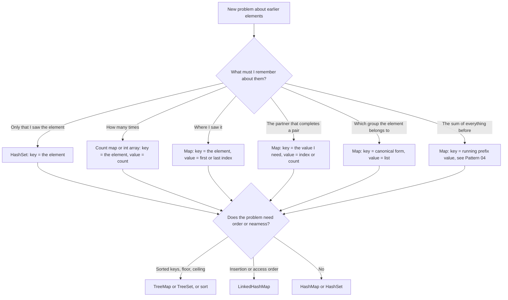

# Pattern 05: Hashing and Frequency Maps

## Overview

A hash map answers the question "have I seen this key, and what did I store under it?" in O(1) time on average. The technique on this page scans the input once. Before each element, the code asks the map a question about the elements that came before. Then it records the element in the map. The technique replaces a search through the earlier elements (O(n) work) with one map lookup (O(1) work on average).

After this page you can:

1. Derive the one-pass solution of [LC 1: Two Sum](https://leetcode.com/problems/two-sum/) from the O(n²) brute force, and show the bug that appears when the code inserts before it looks up.
2. Ask, for a problem that you have not seen, "what must I remember about the elements that I have already seen, and under which key?", and answer with one of the families in the table of The Pattern.
3. Choose between a `HashSet`, a count map, an `int[26]`, a map of lists, a `LinkedHashMap`, and a `TreeMap`, and give the reason for the choice.
4. Derive the rule "start counting only from the head of a run" in [LC 128: Longest Consecutive Sequence](https://leetcode.com/problems/longest-consecutive-sequence/), and give the exact count that proves the nested loop costs O(n).
5. Build a canonical key for grouping ([LC 49: Group Anagrams](https://leetcode.com/problems/group-anagrams/)), and compare the sorted-string key with the count key.
6. State the hashing facts that an interviewer asks: average O(1) against worst-case cost, why an `int[]` or a mutable object is a bad key, the `equals` and `hashCode` contract, and the iteration order of `HashMap`, `LinkedHashMap`, and `TreeMap`.

## Prerequisites

| You need | Why this page needs it | Where to learn it |
|---|---|---|
| A hash table: a structure that stores key-value pairs and finds a key in O(1) time on average | Every example asks the map one question for each element. The page uses the O(1) average cost and does not explain how the table works inside | [Hash Tables](../foundations/04-hash-tables.md) |
| Arrays, strings, indexes | The code reads `a[j]` and `s.charAt(i)`, converts a string to a `char[]`, and sorts a copy | [Arrays, Strings, and Linked Lists](../foundations/02-arrays-strings-linked-lists.md) |
| Counting operations and O-notation | The page counts pair checks and map operations before it states O(n) | [Complexity Analysis](../foundations/01-complexity-analysis.md) |
| The Java map and set calls | The calls in the next table appear in every example | [Java Toolkit](../java-toolkit.md) |

Five words that the page uses from the start:

- A **map** stores **entries**. Each entry has a **key** and a **value**. The map finds the entry for a key. In `{3=1, 5=0}`, the key 3 has the value 1.
- A **set** stores keys only. It answers "is this key in the set?".
- A **complement** is the value that completes a pair. In Two Sum with target 9, the complement of 2 is 7.
- A **hash code** is the `int` that the method `hashCode()` of a key returns. The map uses it to choose where to store the entry. The [Hash Tables](../foundations/04-hash-tables.md) page explains how.
- An **anagram** of a word is another word with the same letters in a different order, each letter with the same count.

The Java calls that the page uses, with their first use:

| Call | What it does | First used |
|---|---|---|
| `Map<Integer, Integer> m = new HashMap<>();` | Creates an empty map from `Integer` keys to `Integer` values | Derivation |
| `m.put(k, v)` | Stores `v` under `k`. If `k` has a value, it replaces that value | Derivation |
| `m.get(k)` | Returns the value of `k`, or `null` if `k` is absent. The result has type `Integer`, so `int x = m.get(k);` throws `NullPointerException` when `k` is absent | Derivation |
| `m.containsKey(k)` | Returns `true` if `k` is in the map | Mistakes |
| `m.getOrDefault(k, 0)` | Returns the value of `k`, or 0 if `k` is absent. It does not insert | Anagram |
| `m.merge(k, 1, Integer::sum)` | If `k` is absent, stores 1. If not, stores the old value plus 1. `Integer::sum` is a reference to the method that adds two ints. If the function returns `null`, `merge` removes the entry. `Integer::sum` returns a number, not `null`, so a count that reaches 0 stays in the map | Anagram |
| `m.computeIfAbsent(k, x -> new ArrayList<>())` | If `k` is absent, builds a value with the function and stores it. Returns the stored value, so `.add(w)` can follow at once | Group Anagrams |
| `Set<Integer> s = new HashSet<>();` `s.add(x)` `s.contains(x)` | A set. `add` returns `false` if `x` was already in the set | Worked Examples |
| `int[] count = new int[26];` `count[c - 'a']++` | An array used as a map for the 26 lowercase letters. The type `char` is a number, so `'c' - 'a'` is 2. The index is the key. The array holds the counts | Anagram |

## Motivation

### The anchor problem: Two Sum

This problem is [LC 1: Two Sum](https://leetcode.com/problems/two-sum/). Given an array `nums` of integers and a number `target`, return the **indexes** of two different elements whose values add up to `target`. The array is not sorted. The problem guarantees exactly one such pair, and the answer may come in any order.

Take `nums = [5, 3, 8, 2, 7]` and `target = 9`. The answer is `[3, 4]`, because `nums[3] + nums[4] = 2 + 7 = 9`.

```text
index     0  1  2  3  4
value     5  3  8  2  7
                   ^--^   2 + 7 = 9
```

**First attempt: check every pair.** For each index `i`, test each later index `j`. Stop when `nums[i] + nums[j] == target`.

| i | j values tested | Sums | Match |
|---|---|---|---|
| 0 | 1, 2, 3, 4 | 8, 13, 7, 12 | none |
| 1 | 2, 3, 4 | 11, 5, 10 | none |
| 2 | 3, 4 | 10, 15 | none |
| 3 | 4 | 9 | yes: `[3, 4]` |

The attempt tests 4 + 3 + 2 + 1 = 10 pairs here, and the answer sits in the last pair. For `n` elements, the attempt tests `n(n - 1) / 2` pairs. For `n = 100000`, that is 4,999,950,000 pair tests. The cost is O(n²).

**A faster idea that gives a wrong answer: sort, then search.** If the array is sorted, a pair can be found faster. Sort `[5, 3, 8, 2, 7]` and the array becomes `[2, 3, 5, 7, 8]`. The sum 9 appears at the positions 0 and 3 (2 + 7). The problem asks for the indexes in the original array, which are 3 and 4. The sort moved every element, so the positions in the sorted array are not the answer. A fix exists (sort pairs of value and index), but it costs O(n log n) time and still needs extra space. The Complexity section compares it with the map.

**The waste.** Look at what the brute force does for one index `i`. It asks: "Is there a later element whose value is `target - nums[i]`?" It answers by reading the later elements one by one. That is a **search by value** in an unsorted array, and it costs O(n). The code runs `n` of these searches. Two searches for different `i` read the same elements again.

## Derivation

The derivation asks one question at a time. Each answer gives one line of the algorithm.

### Question 1: which earlier value do I need?

Stand at index `j` and scan from left to right. Which value would make a pair with `nums[j]`? The pair needs `nums[i] + nums[j] = target`, so `nums[i] = target - nums[j]`. There is exactly one such value. Call it the complement of `nums[j]`.

Every pair has a left element (the smaller index) and a right element (the larger index). If the scan stops at the right element of the pair, the left element is already behind the scan. So the code looks only at **earlier** elements. It meets every pair once, at its right element.

### Question 2: how fast can I find out whether I have seen the value, and where?

The code needs a structure with one operation: given a value, return the index where the scan saw it, or report that the scan did not see it. A linear search over the earlier elements costs O(j). A **hash map** from value to index does the same in O(1) time on average (see [Hash Tables](../foundations/04-hash-tables.md)). The map is the structure with the key "value" and the value "index".

### Question 3: when does the code record `nums[j]`?

The code must record `nums[j]` so that later elements can find it. It can record `nums[j]` before the lookup or after it. The order matters. Take `nums = [3, 2, 4]` and `target = 6`. The right answer is `[1, 2]` (2 + 4).

**Record first, then look up (wrong).**

```java
static int[] twoSumInsertFirst(int[] a, int target) {
    Map<Integer, Integer> indexOf = new HashMap<>();
    for (int j = 0; j < a.length; j++) {
        indexOf.put(a[j], j);                      // records a[j] first
        Integer i = indexOf.get(target - a[j]);    // a[j] can find itself
        if (i != null) return new int[]{i, j};
    }
    return new int[0];
}
```

At `j = 0`, the code stores `3 -> 0`. The complement of 3 is `6 - 3 = 3`. The lookup finds the entry that the code just stored, at index 0. The method returns `[0, 0]`: one element used twice. The input `[3, 3]` with target 6 gives the same wrong output `[0, 0]`, where the right answer is `[0, 1]`. The Implementation program prints both outputs.

**Look up first, then record (right).** At `j = 0` the map is empty, so the lookup misses, and the code records `3 -> 0`. At `j = 1`, the value is 2, and the complement is 4. The map has no 4. The code records `2 -> 1`. At `j = 2`, the value is 4, and the complement is 2. The map holds `2 -> 1`, so the answer is `[1, 2]`.

The rule: **ask the question first, then record the element.** The lookup then sees only the elements before `j`.

### The algorithm and its trace

1. Create an empty map `indexOf` from value to index.
2. For each `j` from 0 to `n - 1`:
    1. Compute `need = target - nums[j]`.
    2. Look up `need` in the map. If it is present at index `i`, return `[i, j]`.
    3. Store `nums[j] -> j` in the map.
3. If the loop ends, no pair exists.

The trace for `nums = [5, 3, 8, 2, 7]` and `target = 9`. The map content is printed in key order so that it is easy to read.

| j | `nums[j]` | need = 9 - `nums[j]` | Map before the step | Lookup | Action |
|---|---|---|---|---|---|
| 0 | 5 | 4 | `{}` | miss | store `5 -> 0` |
| 1 | 3 | 6 | `{5=0}` | miss | store `3 -> 1` |
| 2 | 8 | 1 | `{3=1, 5=0}` | miss | store `8 -> 2` |
| 3 | 2 | 7 | `{3=1, 5=0, 8=2}` | miss | store `2 -> 3` |
| 4 | 7 | 2 | `{2=3, 3=1, 5=0, 8=2}` | hit: 2 is at index 3 | return `[3, 4]` |

At `j = 4`, the code needs the value 2. The map says that the scan saw 2 at index 3. The code returns `[3, 4]` without reading `nums[0]` to `nums[3]` again.

```java
static int[] twoSum(int[] a, int target) {
    Map<Integer, Integer> indexOf = new HashMap<>();   // value -> index, for indexes < j
    for (int j = 0; j < a.length; j++) {
        Integer i = indexOf.get(target - a[j]);        // Integer, not int: get can return null
        if (i != null) return new int[]{i, j};
        indexOf.put(a[j], j);                          // record after the lookup
    }
    return new int[0];                                 // no pair
}
```

The variable `i` has type `Integer` because `get` returns `null` for a missing key. An `int` would throw `NullPointerException` at the unboxing.

### Why it is correct

The invariant (a statement that stays true after every step): **before the step for index `j`, the map holds every value that appears at an index less than `j`.** If a value appears at several of those indexes, the map holds the largest of them, because `put` replaces the old entry.

- *The invariant holds at the start.* Before `j = 0`, the map is empty, and no index is less than 0.
- *One step keeps the invariant.* Step `j` stores `nums[j] -> j` after its lookup. Before step `j + 1`, the map holds the values at the indexes less than `j`, and the value at index `j`.
- *The code finds a pair if one exists.* Let `(i, j)` with `i < j` be a pair with `nums[i] + nums[j] = target`. Before step `j`, the map holds the value `nums[i]` at index `i` or at a larger index `i'` with `i < i' < j` and `nums[i'] = nums[i]`. The lookup of `target - nums[j] = nums[i]` hits. The returned pair has the right sum. If the loop returns at an earlier step, that pair also has the right sum, by the same argument.
- *The code does not use an element twice.* The map holds only indexes less than `j`, so the returned `i` differs from `j`.

The input `[3, 3]` with target 6 shows the replacement rule. At `j = 0`, the code stores `3 -> 0`. At `j = 1`, the lookup of `6 - 3 = 3` hits index 0, and the code returns `[0, 1]`.

### The cost, counted from the trace

The trace has 5 lookups and 4 stores: 9 map operations, for `n = 5`. In general, the loop makes at most `n` lookups and at most `n` stores. Each costs O(1) on average. For `n = 100000`, that is at most 200,000 map operations, against 4,999,950,000 pair tests for the brute force.

| Method | Work for `n = 5` (this input) | Work for `n = 100000` | Extra space |
|---|---|---|---|
| Test every pair | 10 pair tests | 4,999,950,000 pair tests | O(1) |
| Map, one pass | 5 lookups + 4 stores | at most 100,000 lookups + 100,000 stores | O(n): up to `n` entries |

Time: O(n) on average. Space: O(n). The map trades memory for time: it keeps one entry for each earlier element, so that no later step searches. The section "Hashing facts" says what "on average" means and when the cost is worse.

## The Pattern

The reusable idea: **scan the input once. Before each element, ask the map a question about the elements that came before. Then record the element.** The skill is to name the question and the key. In Two Sum the question is "did I see the value `target - x`?" and the key is the value. In a new problem, ask: "what must I remember about the elements that I have already seen, and under which key?"

The invariant of the pattern: before the step for element `j`, the map holds a summary of the elements `0` to `j - 1`, filed under the key that the question uses.



### The families

Each family is one choice of question, key, and value. The old page listed them as separate templates. They are one pattern. The names in the first column that this page has not yet used (canonical form, two-way mapping, index as key) are defined in the Worked Examples.

| Family | Question before recording the element `x` | Structure | Key | Value | Problems |
|---|---|---|---|---|---|
| Seen before | "Is `x` already in the set?" | `HashSet` | the element | none | [LC 217: Contains Duplicate](https://leetcode.com/problems/contains-duplicate/) |
| Count | "How many times did I see `x`?" | `HashMap` or `int[]` | the element | the count | [LC 242: Valid Anagram](https://leetcode.com/problems/valid-anagram/), [LC 387: First Unique Character in a String](https://leetcode.com/problems/first-unique-character-in-a-string/), [LC 347: Top K Frequent Elements](https://leetcode.com/problems/top-k-frequent-elements/) |
| Last or first index | "Where did I see `x`?" | `HashMap` | the element | the last (or first) index | [LC 219: Contains Duplicate II](https://leetcode.com/problems/contains-duplicate-ii/), [LC 3: Longest Substring Without Repeating Characters](https://leetcode.com/problems/longest-substring-without-repeating-characters/) |
| Complement | "Did I see the value that completes `x`?" | `HashMap` | the value that the pair needs | index or count | [LC 1: Two Sum](https://leetcode.com/problems/two-sum/), [LC 454: 4Sum II](https://leetcode.com/problems/4sum-ii/) |
| Canonical form | "Which group does `x` belong to?" | `HashMap` of lists | a form that is equal for all members of a group | the list of members | [LC 49: Group Anagrams](https://leetcode.com/problems/group-anagrams/), [LC 15: 3Sum](https://leetcode.com/problems/3sum/) (to remove duplicate triples) |
| Running prefix value | "How many earlier prefixes have the value `p - k`?" | `HashMap` | the running prefix sum | count or first index | [LC 560: Subarray Sum Equals K](https://leetcode.com/problems/subarray-sum-equals-k/) |
| Two-way mapping | "What did I pair with `x` before?" | two `HashMap`s | the element on one side | the partner | [LC 205: Isomorphic Strings](https://leetcode.com/problems/isomorphic-strings/), [LC 290: Word Pattern](https://leetcode.com/problems/word-pattern/) |
| Index as key | "Is the slot of the value `x` marked?" | the input array | the value minus 1 | a sign or a swapped value | [LC 448: Find All Numbers Disappeared in an Array](https://leetcode.com/problems/find-all-numbers-disappeared-in-an-array/), [LC 41: First Missing Positive](https://leetcode.com/problems/first-missing-positive/) |

The running prefix value uses a prefix sum (the sum of the elements before the current position). Two sentences are enough here: the sum of a subarray equals the difference of two prefix sums, so "a subarray ending here with sum `k`" becomes "an earlier prefix with value `prefix - k`". [Pattern 04: Prefix Sum](../04-prefix-sum/README.md) derives this.

### The vocabulary

The page used each term below before it named it. The page defines the terms of the later examples after those examples.

| Term | What it was in Two Sum | The question to ask in a new problem |
|---|---|---|
| Key | The value `nums[j]`, in the map | "What do I look up by?" |
| Value (of an entry) | The index `j` | "What do I need to know about the key later?" |
| Lookup | `indexOf.get(need)` | "What is the question that I ask about the earlier elements?" |
| Record | `indexOf.put(nums[j], j)` | "What must later elements be able to find?" |
| Complement | `target - nums[j]` | "Which key would complete the answer for this element?" |
| Invariant | The map holds all values at indexes `< j` | "What does the map hold before each step?" |
| Look up first, then record | The lookup comes before the `put` | "Can the element answer its own question by accident?" |

### What selects the structure

| Property of the problem | Structure | Reason |
|---|---|---|
| Only presence matters | `HashSet` | A set stores no value |
| The key set is small and fixed (26 lowercase letters, digits) | `int[]` | An array index replaces hashing. No boxing |
| Each key needs a number | `HashMap<K, Integer>` | `merge(k, 1, Integer::sum)` counts |
| Each key needs a group of items | `HashMap<K, List<T>>` | `computeIfAbsent(k, x -> new ArrayList<>()).add(item)` |
| The output must follow insertion order, or access order | `LinkedHashMap`, `LinkedHashSet` | The iteration order follows the order of insertion (or access) |
| The question uses order: smallest key above `x`, keys in a range, sorted iteration | `TreeMap`, `TreeSet` | A tree keeps keys sorted. Each operation costs O(log n) |

## Worked Examples

The examples go from the easiest change to the hardest. Each one changes one thing about [LC 1](https://leetcode.com/problems/two-sum/): what the map stores, what the key is, or when the map is built.

### Example 1: Valid Anagram (LC 242), a frequency count

**Statement.** [LC 242: Valid Anagram](https://leetcode.com/problems/valid-anagram/). Given two strings `s` and `t` of lowercase letters, return `true` if `t` is an anagram of `s`: it has the same letters, and each letter has the same count. For `"listen"` and `"silent"` the answer is `true`. For `"aacc"` and `"ccac"` the answer is `false`, because `s` has two `a` and `t` has one.

**What changed.** Two Sum stored a position (an index). This problem stores a **count**. The question is not "where did I see it?" but "how many times did I see it?".

**From brute force.** The first idea: for each letter of `s`, find an unused copy in `t` and cross it out. Each search reads `t`, so the cost is O(n²). The second idea: sort both strings and compare. The cost is O(n log n), and it is correct. Ask: "What must I remember about `s`?" The order of the letters does not matter. Only the number of times that each letter occurs matters. So the map has the key "letter" and the value "count in `s`".

Then `t` must use each letter exactly as often as `s`. The code subtracts one for each letter of `t`. If a count falls below 0, then `t` has a letter more times than `s` has it, and the answer is `false`.

If the code passes without a negative count, is the answer `true`? Take equal lengths. The counts sum to `|s|` after the first pass. The second pass subtracts `|t|`, so the sum is `|s| - |t| = 0`. Counts that did not fall below 0 and sum to 0 are all 0. So `t` uses every letter exactly as often as `s`. Without the length test, the proof fails: `"ab"` and `"a"` would pass, because no count goes below 0.

**Trace** for `s = "aacc"` and `t = "ccac"`. The output of the Implementation program has the same lines.

```text
count s[0]=a -> a=1
count s[1]=a -> a=2
count s[2]=c -> a=2 c=1
count s[3]=c -> a=2 c=2
subtract t[0]=c -> a=2 c=1
subtract t[1]=c -> a=2
subtract t[2]=a -> a=1
subtract t[3]=c -> a=1 c=-1  negative: return false
```

After `t[3] = c`, the count of `c` is -1. `t` has three `c`, and `s` has two.

```java
static boolean isAnagramArray(String s, String t) {
    if (s.length() != t.length()) return false;     // without this, "ab" and "a" pass
    int[] count = new int[26];                      // key: letter - 'a', value: count
    for (int i = 0; i < s.length(); i++) count[s.charAt(i) - 'a']++;
    for (int i = 0; i < t.length(); i++) {
        if (--count[t.charAt(i) - 'a'] < 0) return false;   // t has one letter too many
    }
    return true;
}
```

The expression `--count[x] < 0` decrements first and then compares the new value with 0. The expression `count[x]-- < 0` would compare the old value, and the code would miss the first extra letter.

The same logic with a `HashMap` for an alphabet that is larger than 26 lowercase letters:

```java
static boolean isAnagramMap(String s, String t) {
    if (s.length() != t.length()) return false;
    Map<Character, Integer> count = new HashMap<>();
    for (char c : s.toCharArray()) count.merge(c, 1, Integer::sum);
    for (char c : t.toCharArray()) {
        int left = count.getOrDefault(c, 0) - 1;    // a letter that s lacks gives -1
        if (left < 0) return false;
        count.put(c, left);
    }
    return true;
}
```

**`int[26]` against `HashMap`: when each one is right.**

| | `int[26]` | `HashMap<Character, Integer>` |
|---|---|---|
| Key set | The 26 lowercase letters, stated in the problem | Any characters: upper case, digits, symbols |
| Cost of one step | An array index. No hash, no boxing | A hash, an `equals` call, and boxing of the `Character` and the `Integer` |
| Space | 26 ints, whatever the input length | One entry for each different letter in the input |
| A character outside the key set | `'A' - 'a'` is -32, so the index is negative and the code throws `ArrayIndexOutOfBoundsException` | Works |
| Right when | The statement says "lowercase English letters" | The statement allows other characters, or does not state the alphabet |

For a larger fixed alphabet, size the array to the alphabet: `new int[128]` for ASCII, indexed by `c`. The type `char` is a 16-bit UTF-16 unit, so `new int[65536]` covers every `char` value. A character outside the Basic Multilingual Plane takes two `char` units (a surrogate pair). To count such characters as one, iterate with `s.codePoints()` and use a `HashMap<Integer, Integer>`.

**Complexity.** Time O(n): one pass over each string, with O(1) work for each character. Space O(1) for `int[26]`, because 26 does not grow with `n`. Space O(min(n, A)) for the `HashMap`, where `A` is the size of the alphabet.

### Example 2: Group Anagrams (LC 49), a canonical key

**Statement.** [LC 49: Group Anagrams](https://leetcode.com/problems/group-anagrams/). Given a list of lowercase words, put the words that are anagrams of each other into one group. The groups may come in any order. For `["eat", "tea", "tan", "ate", "nat", "bat"]` the groups are `[["eat", "tea", "ate"], ["tan", "nat"], ["bat"]]`.

**What changed.** In the examples so far, the key was the element itself. Here the key is a **value computed from the element**, and the map value is a **list** of all elements that share the key.

**From brute force.** The first idea: keep a list of groups. For each new word, compare it with the first word of each group, with the check of Example 1. If a group matches, add the word to it. If none matches, start a new group. With `m` words of length `k`, and in the worst case `m` groups, the code makes about `m²/2` comparisons of cost O(k) each: O(m²k).

The waste: each word is compared with words that are not its anagrams, and the comparison starts again every time. Ask: **"Can I compute, from one word alone, a value that is equal for two words exactly when they are anagrams?"** If the code has such a value, a map from that value to a list groups all words in one pass: the lookup replaces the search through the groups.

The value must have two properties:

1. Two anagrams give the same value.
2. Two words that are not anagrams give different values.

Two candidates have both properties, because both depend only on the multiset of letters of the word (the letters with their counts):

- **The sorted word.** Sort the letters. `"eat"`, `"tea"`, and `"ate"` all become `"aet"`.
- **The count of each letter.** `"eat"` has one `a`, one `e`, one `t`. The code writes this as the string `"a1e1t1"`: each letter that occurs, followed by its count, in alphabetical order. Each count is followed by a letter or by the end of the string, so the digits of one count cannot join the digits of the next. Two different count lists give two different strings. (Without the letters, the counts 1 and 11 next to each other and the counts 11 and 1 would both give `111`. Mistake 9 shows this.)

A value that is the same for all members of a group, and different for different groups, is a **canonical form**. The map key is the canonical form of the word.

**Trace.** The output of the Implementation program:

```text
eat -> sorted key aet, count key a1e1t1
tea -> sorted key aet, count key a1e1t1
tan -> sorted key ant, count key a1n1t1
ate -> sorted key aet, count key a1e1t1
nat -> sorted key ant, count key a1n1t1
bat -> sorted key abt, count key a1b1t1
```

The map after each word, with the sorted key:

| Word | Key | Map after the step |
|---|---|---|
| eat | aet | `{aet=[eat]}` |
| tea | aet | `{aet=[eat, tea]}` |
| tan | ant | `{aet=[eat, tea], ant=[tan]}` |
| ate | aet | `{aet=[eat, tea, ate], ant=[tan]}` |
| nat | ant | `{aet=[eat, tea, ate], ant=[tan, nat]}` |
| bat | abt | `{aet=[eat, tea, ate], ant=[tan, nat], abt=[bat]}` |

```java
static String sortedKey(String w) {
    char[] c = w.toCharArray();
    Arrays.sort(c);
    return new String(c);                              // a String is an immutable, safe key
}

// Letter, then its count, for each letter that occurs: "eat" -> "a1e1t1".
static String countKey(String w) {
    int[] count = new int[26];
    for (int i = 0; i < w.length(); i++) count[w.charAt(i) - 'a']++;
    StringBuilder key = new StringBuilder();
    for (int c = 0; c < 26; c++)
        if (count[c] > 0) key.append((char) ('a' + c)).append(count[c]);
    return key.toString();
}

static List<List<String>> groupBySortedKey(String[] words) {
    Map<String, List<String>> groups = new LinkedHashMap<>();   // keeps first-seen order
    for (String w : words)
        groups.computeIfAbsent(sortedKey(w), k -> new ArrayList<>()).add(w);
    return new ArrayList<>(groups.values());
}
```

`groupByCountKey` is the same method with `countKey(w)` in place of `sortedKey(w)`. A `HashMap` also gives a correct answer. The code uses a `LinkedHashMap` because its output order is the order of first appearance, so the printed result is the same on every run.

**The key must be an immutable value with content equality.** A `char[]` or an `int[]` as a key does not work: arrays compare by identity (see "Hashing facts"). That is why the code converts the sorted `char[]` to a `String`, and the count array to a `String`.

**The two keys compared.** Let `m` be the number of words and `k` the length of the longest word.

| | Sorted key | Count key |
|---|---|---|
| Cost to build the key for one word | O(k log k): the sort | O(k + 26): one pass over the word, one pass over the 26 counts |
| Length of the key | `k` characters | At most 26 letters, plus the digits of their counts |
| Cost of one map operation | O(k): hashing and comparing a string of length `k` | O(length of the key), which is at most O(k) |
| Total time | O(m x k log k) | O(m x (k + 26)) |
| Right when | Words are short, or the alphabet is not fixed | Words are long and the alphabet is small and fixed |
| Works for any characters | Yes | Only when the code can index the counts (here, lowercase letters) |

The "O(1) per map operation" claim of the hash map counts one hash and one comparison as O(1). For a `String` key of length `k`, the hash and the comparison read all `k` characters, so one operation costs O(k) (the `String` class stores its hash after the first computation, so a second `get` with the same `String` object does not read the characters again).

**Complexity.** Time O(m x k log k) with the sorted key, O(m x (k + 26)) with the count key. Space O(m x k) for the keys and the lists.

### Example 3: Longest Consecutive Sequence (LC 128), the set and the run head

**Statement.** [LC 128: Longest Consecutive Sequence](https://leetcode.com/problems/longest-consecutive-sequence/). Given an unsorted array of integers, return the length of the longest run of consecutive values: `x, x + 1, x + 2, ...`. The order of the elements in the array does not matter. The array may hold duplicates. For `[100, 4, 200, 1, 3, 2]` the answer is 4 (the values 1, 2, 3, 4). The goal here is a method that is faster than sorting, so O(n) time.

**What changed.** The question is not about the elements before the current element. It is about the **whole input**: "is `x + 1` somewhere in the array?". So the code builds the set from all elements first and asks the questions after. The rule "look up first, then record" belongs to problems where a pair is met at its second element. Here no pair is met: the map is built in full before the first question.

**From brute force.**

*Attempt 1: sort and scan.* Sort the array. Walk through it, skip repeated values, and count the length of each run of values that grow by 1. The sorted array of the example is `[1, 2, 3, 4, 100, 200]`, with runs of length 4, 1, and 1. The answer is correct. The cost is O(n log n) for the sort, and the goal is O(n).

*Attempt 2: a set, and walk up from every value.* Put all values in a `HashSet`. For each value `x` in the set, test `x + 1`, `x + 2`, ... until a value is missing. The number of steps is the run length from `x`. This is correct. Take the input `[1, 2, 3, ..., n]`. The walk from 1 takes `n - 1` steps, the walk from 2 takes `n - 2` steps, and so on: n(n - 1)/2 steps in total, which is O(n²). The Common Mistakes program counts this: for the run 1 to 1000, the walk makes 499,500 steps.

**The waste.** The walk from 2 repeats the second half of the walk from 1. The walk from 1 already visited 2, 3, 4, and so on. Ask: **"Which numbers can start a run?"** A number `x` starts a run only if `x - 1` is not in the set. If `x - 1` is in the set, then `x` lies inside a run that begins further left, and the walk from that run's start covers `x`. Call a number with no predecessor in the set a **run head**. One set lookup (`contains(x - 1)`) tells whether `x` is a head. The code walks only from heads.

**Trace** for `[100, 4, 200, 1, 3, 2]`. The code visits the set in the order of the input here, so that the lines are easy to read. The set has no order, and the result does not depend on it.

```text
x=100: head, run 100..100, length 1, best = 1
x=4: 3 is in the set, x is not a head
x=200: head, run 200..200, length 1, best = 1
x=1: head, run 1..4, length 4, best = 4
x=3: 2 is in the set, x is not a head
x=2: 1 is in the set, x is not a head
```

```java
static int longestConsecutive(int[] nums) {
    Set<Integer> set = new HashSet<>();
    for (int x : nums) set.add(x);
    int best = 0;
    for (int x : set) {                                // the set, not the array: no repeats
        if (set.contains(x - 1)) continue;             // x is inside a run, not its head
        int end = x;
        while (set.contains(end + 1)) end++;           // walk the run once
        best = Math.max(best, end - x + 1);
    }
    return best;
}
```

**Why the nested loop costs O(n) in total.** The `while` loop sits inside the `for` loop, so a reader may write "n times n". Count what the `while` loop does over the whole run, not for one `x`:

1. The `for` loop visits each different value once, and the `contains(x - 1)` test costs O(1) on average. That is at most `n` tests.
2. The `while` loop runs only for run heads. Each maximal run has exactly one head.
3. For a run of length `L`, the `while` loop makes `L - 1` steps: it steps onto each value of the run except the head.
4. Each value of the set belongs to exactly one maximal run. So the lengths of the runs add up to the number of different values, `d`, and the `while` loop makes `d - (number of runs)` steps in total, which is less than `n`.

Another way to say it: **a value is stepped onto at most once, by the walk of the head of its own run**, because a walk reaches `y` only from `y - 1`, and a head has no `y - 1` in the set. So the steps are charged to different values. The total is at most `n` tests, plus at most `n` steps, plus the `n` inserts that build the set: O(n).

**Iterate over the set, not over the array.** If the loop runs over the array, a repeated head repeats its walk. Take 1000 copies of 1, followed by 2, 3, ..., 1002. The set holds 1 to 1002. The loop over the set makes 1,001 inner steps. The loop over the array makes 1,000 walks of 1,001 steps each: 1,001,000 steps. The Implementation program prints both numbers.

**Overflow.** The code computes `x - 1` and `end + 1` as `int`. If the input can hold `Integer.MIN_VALUE` or `Integer.MAX_VALUE`, these expressions overflow, and the code can join the two ends into a wrong run: for `{Integer.MIN_VALUE, Integer.MAX_VALUE}` the code above returns 2, and the right answer is 1. Fix: if the input can hold these two values, store the numbers in a `Set<Long>` and use `long` for `x` and `end` (a `long` expression such as `x - 1` does not overflow here, and the set must hold `Long` values, because `Set<Integer>.contains(long)` never finds an `Integer`). Another fix keeps `int` and tests `x == Integer.MIN_VALUE` before `contains(x - 1)` and `end == Integer.MAX_VALUE` before `contains(end + 1)`.

**Complexity.** Time O(n) on average. Space O(n) for the set.

### Example 4: Top K Frequent Elements (LC 347), count, then bucket by count

**Statement.** [LC 347: Top K Frequent Elements](https://leetcode.com/problems/top-k-frequent-elements/). Given an integer array `nums` and a number `k`, return the `k` values that occur most often. The answer may come in any order. The problem guarantees that the answer is unique. For `[1, 1, 1, 2, 2, 3]` and `k = 2`, the answer is `[1, 2]`.

**What changed.** The map (a count map, as in Example 1) is only the first stage. The second stage is a question about the **order of the counts**: which counts are the largest? The code needs to select, not to look up.

**From brute force.** Stage 1 is a count map: O(n). Stage 2 options:

*Attempt 1: sort the distinct values by count.* With `m` distinct values, the sort costs O(m log m), and `m` can be as large as `n`. So the total is O(n log n). It is correct, and it does more work than the question needs: the code orders all `m` values, and the problem asks only for the top `k`.

*Attempt 2: look at what the counts are.* A count is an integer between 1 and `n`. How many different counts can there be? At most `n`. So the code can use an array indexed by the count, with `n + 1` cells, as a sorted structure: **`bucket[f]` holds the values that occur exactly `f` times.** Filling the buckets costs O(m). Reading from the highest `f` down gives the values in order of count, without a comparison sort.

The scan: start at `f = n` and go down. For each non-empty bucket, take its values until the result has `k` values.

**Trace** for `[1, 1, 1, 2, 2, 3]` and `k = 2`. The output of the Implementation program:

```text
count = {1=3, 2=2, 3=1}
bucket[1] = [3]
bucket[2] = [2]
bucket[3] = [1]
scan f=3: take 1, result = [1]
scan f=2: take 2, result = [1, 2]
```

The scan starts at `f = 6` (the array length). The buckets 6, 5, and 4 are empty. At `f = 3`, the code takes the value 1. At `f = 2`, it takes the value 2. The result has `k = 2` values, so the scan stops.

```java
static int[] topKFrequent(int[] nums, int k) {
    Map<Integer, Integer> count = new HashMap<>();
    for (int x : nums) count.merge(x, 1, Integer::sum);
    List<List<Integer>> bucket = new ArrayList<>();    // bucket.get(f): values with count f
    for (int f = 0; f <= nums.length; f++) bucket.add(new ArrayList<>());
    for (Map.Entry<Integer, Integer> e : count.entrySet())
        bucket.get(e.getValue()).add(e.getKey());
    int[] result = new int[k];
    int size = 0;
    for (int f = nums.length; f >= 1 && size < k; f--)  // highest frequency first
        for (int x : bucket.get(f))
            if (size < k) result[size++] = x;
    return result;
}
```

The array of buckets has `n + 1` cells because a count can be `n` (all elements equal). The loop stops at `f >= 1` because no value has count 0.

**The heap form.** A min-heap of size `k` over the entries of the count map keeps the `k` largest counts. It costs O(m log k) after the count. See [Pattern 16: Heap and Priority Queue](../16-heap-priority-queue/README.md). Bucket sort costs O(n) and uses an extra O(n) array of lists. The heap uses O(m + k) space and wins when `k` is much smaller than `m` and the extra array of `n + 1` lists is a concern.

**Complexity.** Time O(n): the count is O(n), the buckets are O(m), and the scan visits at most `n` buckets and `m` values. Space O(n) for the map and the buckets.

### Example 5: Insert Delete GetRandom O(1) (LC 380), a map inside a design

**Statement.** [LC 380: Insert Delete GetRandom O(1)](https://leetcode.com/problems/insert-delete-getrandom-o1/). Build a set of integers with three operations, each in O(1) on average: `insert(v)` adds `v` and returns `false` if it was already present; `remove(v)` removes `v` and returns `false` if it was absent; `getRandom()` returns one current element, each element with the same probability.

**What changed.** The map is no longer the whole solution. It is one part of a data structure, and its entries must stay consistent with a second structure.

**Reasoning.** Look at what each operation needs.

- A `HashSet` gives `insert`, `remove`, and `contains` in O(1). It cannot give `getRandom`: it has no way to pick the element at a random position in O(1).
- An `ArrayList` gives `getRandom` in O(1): pick a random index. But `remove(v)` needs the position of `v` (a search, O(n)), and then shifts every later element (O(n)).

The map fixes the first problem: a `HashMap<Integer, Integer>` from value to its **index in the list** finds `v`'s position in O(1). The shift is the second problem. Ask: **does the list need to keep its order?** No. `getRandom` needs only that every element has some index from 0 to `size - 1`. So `remove(v)` can overwrite the slot of `v` with the last element of the list, and then delete the last slot. Deleting the last slot of an `ArrayList` costs O(1).

The code updates the map for the moved element: the old last element now has the index of `v`.

The invariant: **the list holds each element exactly once, and `indexOf.get(v)` is the position of `v` in the list, for every element `v`.** Each operation restores it before it returns.

**Trace.** `insert(1)`, `insert(2)`, `insert(3)`, then `remove(1)`:

```text
insert 1:  list [1]        map {1=0}
insert 2:  list [1, 2]     map {1=0, 2=1}
insert 3:  list [1, 2, 3]  map {1=0, 2=1, 3=2}
remove 1:  i = 0 (position of 1), last = 3
           list[0] = 3  -> list [3, 2, 3]   map {1=0, 2=1, 3=0}   (3 moves to index 0)
           drop the last slot -> list [3, 2]
           remove key 1       -> map {2=1, 3=0}
```

```java
class RandomizedSet {
    private final Map<Integer, Integer> indexOf = new HashMap<>();   // value -> index in values
    private final List<Integer> values = new ArrayList<>();
    private final Random random = new Random();

    boolean insert(int v) {
        if (indexOf.containsKey(v)) return false;
        indexOf.put(v, values.size());                 // v goes to the end of the list
        values.add(v);
        return true;
    }

    boolean remove(int v) {
        Integer i = indexOf.get(v);
        if (i == null) return false;
        int last = values.get(values.size() - 1);
        values.set(i, last);                           // the last element fills the gap
        indexOf.put(last, i);                          // before remove(v): handles v == last
        values.remove(values.size() - 1);              // int argument: removes by index
        indexOf.remove(v);
        return true;
    }

    int getRandom() {
        return values.get(random.nextInt(values.size()));
    }
}
```

When `v` is the last element, `last == v`. The code sets `values[i] = v`, stores `v -> i`, deletes the last slot, and then removes the key `v`. The order of the last two lines matters: if `indexOf.remove(v)` ran first, `indexOf.put(last, i)` would store `v` again.

`values.remove(values.size() - 1)` passes an `int`, so the call removes the element at that index. If the argument were an `Integer`, Java would call `remove(Object)` and search for that value.

**Complexity.** Each operation is O(1) on average. Space O(n).

**LRU Cache ([LC 146: LRU Cache](https://leetcode.com/problems/lru-cache/)) has the same form.** The structure must find a key in O(1), and it must also move that key to the "most recent" end in O(1). A map from key to a node of a **doubly linked list** (a list in which each node links to both its neighbors; see [Arrays, Strings, and Linked Lists](../foundations/02-arrays-strings-linked-lists.md)) finds the node, and the list holds the order of use: removing a node and adding it at the front costs O(1) because the node has links to both neighbors. The full code is on the home page, [LRU and LFU caches](../../lld/case-studies/02-lru-and-lfu-cache/README.md), and [Pattern 26: Design Data Structures](../26-design-data-structures/README.md) summarizes it, with the `LinkedHashMap` shortcut. [LC 460: LFU Cache](https://leetcode.com/problems/lfu-cache/) and [LC 432: All O`one Data Structure](https://leetcode.com/problems/all-oone-data-structure/) combine a map with buckets of keys that have the same count, the same idea as the buckets of Example 4. Pattern 26 holds the O(1) template for LFU Cache.

**A map from old objects to new objects.** [LC 138: Copy List with Random Pointer](https://leetcode.com/problems/copy-list-with-random-pointer/) uses the map as a table of copies. The key is the **original node**, the value is its **copy**. Pass 1 creates a copy for each original node. Pass 2 sets `copy.next` and `copy.random` by looking up the copy of `original.next` and `original.random`. The key class `Node` has no `equals` or `hashCode`, so the map compares nodes by identity, and that is what this problem needs: two different nodes with equal values are different keys. The problem is in the practice ladder (P8).

### More forms of the pattern

The old page listed these as separate templates. Each is one of the families above, and each is derived here from the same question.

**First unique element ([LC 387: First Unique Character in a String](https://leetcode.com/problems/first-unique-character-in-a-string/)).** The question has two parts: "how many times does each letter occur?" and "which letter comes first in the input?". The map answers the first part and loses the order. So the code makes two passes: pass 1 counts, and pass 2 walks the string in input order and returns the first character with count 1. The ladder (P2) has the full treatment.

**A window with a count map ([LC 340: Longest Substring with At Most K Distinct Characters](https://leetcode.com/problems/longest-substring-with-at-most-k-distinct-characters/) (premium)).** The map is the state of a sliding window: it holds the counts of the elements between `left` and `right`. The window is valid while the number of different elements, `map.size()`, is at most `k`. The code must delete an entry when its count falls to 0, because `size()` counts entries and not positive counts. [Pattern 01: Sliding Window](../01-sliding-window/README.md) derives the window. The map part:

```java
static int longestWithKDistinct(int[] arr, int k) {
    Map<Integer, Integer> freq = new HashMap<>();
    int left = 0, best = 0;
    for (int right = 0; right < arr.length; right++) {
        freq.merge(arr[right], 1, Integer::sum);                  // the element enters
        while (freq.size() > k) {                                 // too many different values
            if (freq.merge(arr[left], -1, Integer::sum) == 0)     // the element leaves
                freq.remove(arr[left]);                           // delete the zero entry
            left++;
        }
        best = Math.max(best, right - left + 1);
    }
    return best;
}
```

`merge` returns the new count. A count of 0 does not remove the entry, because `Integer::sum` returns the number 0 and not `null`. The code removes the entry itself.

**The sum of several elements: K-Sum and 4Sum II.** Take [LC 15: 3Sum](https://leetcode.com/problems/3sum/): find all triples with sum 0, without repeated triples. Fix the first element `nums[i]`. The rest is a Two Sum problem for the target `-nums[i]` on the elements after `i`: the same scan, with a set of the values seen. The new problem is the repeated triples. The code stores each triple in its **canonical form** (the three values in sorted order) in a `LinkedHashSet` of lists. Two triples with the same values in a different order give the same list, and the set keeps one.

```java
static Set<List<Integer>> threeSumHash(int[] nums) {
    Set<List<Integer>> result = new LinkedHashSet<>();     // canonical form: the sorted triple
    for (int i = 0; i < nums.length; i++) {
        Set<Integer> seen = new HashSet<>();               // values after i that the scan passed
        for (int j = i + 1; j < nums.length; j++) {
            int need = -nums[i] - nums[j];
            if (seen.contains(need)) {
                List<Integer> triple = Arrays.asList(nums[i], nums[j], need);
                Collections.sort(triple);
                result.add(triple);
            }
            seen.add(nums[j]);
        }
    }
    return result;
}
```

This costs O(n²) time and O(n) extra space, plus the output. The standard solution sorts the array and uses two pointers instead. It needs no set and removes duplicates by skipping equal neighbors: see [Pattern 02: Two Pointers](../02-two-pointers/README.md). For K-Sum in general, fix `k - 2` elements and solve Two Sum for the rest. The cost grows by a factor of `n` for each fixed element.

[LC 454: 4Sum II](https://leetcode.com/problems/4sum-ii/) gives four arrays `a`, `b`, `c`, `d`, each of length `n`, and asks for the number of index tuples `(i, j, k, l)` with `a[i] + b[j] + c[k] + d[l] = 0`. The brute force tests `n⁴` tuples. Ask: which sums can I pair? Split the four arrays into two halves. The sums `a[i] + b[j]` take `n²` values. Store them in a map from sum to **count** (the complement family with a count as the value). Then, for each sum `c[k] + d[l]`, add the count that is stored under its complement `-(c[k] + d[l])`. The cost is O(n²) time and O(n²) space.

```java
static int fourSumCount(int[] a, int[] b, int[] c, int[] d) {
    Map<Integer, Integer> sumCount = new HashMap<>();      // sum of a[i] + b[j] -> how many pairs
    for (int x : a) for (int y : b) sumCount.merge(x + y, 1, Integer::sum);
    int total = 0;
    for (int x : c) for (int y : d) total += sumCount.getOrDefault(-(x + y), 0);
    return total;
}
```

**Subarray with a target property.** [LC 560: Subarray Sum Equals K](https://leetcode.com/problems/subarray-sum-equals-k/) stores prefix sums in a map and looks up `prefix - k`. [Pattern 04: Prefix Sum](../04-prefix-sum/README.md) derives it.

**Rolling hash and Rabin-Karp.** A hash of a substring can be updated in O(1) when the window moves by one character, which gives O(1) substring comparison with a verification step for collisions. [Pattern 22: String Algorithms](../22-string-algorithms/README.md) has the full treatment, with collision handling and KMP as the alternative.

#### Variation F: index as key, with cyclic sort and negation marking { #variation-f }

Other pages of this KB call this form "Variation F" of Pattern 05. The trigger: the values lie in `[1..n]` (or `[0..n]`) and the problem asks for O(1) extra space. A hash map from value to "seen" would use O(n) space. Ask: **where could the map live?** The array has `n` slots, and the values are the numbers 1 to `n`. Give each value `v` the slot `v - 1`. The array then works as the map, and the key `v` is the index `v - 1`. Two ways to store the "seen" bit in the slot:

1. **Negation marking.** When the code reads a value `v`, it negates `nums[v - 1]`. A slot that is negative means "`v` was seen". The code must read each value with `Math.abs`, because an earlier step may have negated it.
2. **Cyclic sort.** Swap each value into its own slot `v - 1`. At the end, a slot `i` with `nums[i] != i + 1` shows that `i + 1` is missing.

Negation marking for [LC 448: Find All Numbers Disappeared in an Array](https://leetcode.com/problems/find-all-numbers-disappeared-in-an-array/) and [LC 442: Find All Duplicates in an Array](https://leetcode.com/problems/find-all-duplicates-in-an-array/):

```java
static List<Integer> findDisappeared(int[] nums) {           // LC 448: values in 1..n
    for (int i = 0; i < nums.length; i++) {
        int v = Math.abs(nums[i]);                           // an earlier step may have negated it
        if (nums[v - 1] > 0) nums[v - 1] = -nums[v - 1];     // mark: v was seen
    }
    List<Integer> missing = new ArrayList<>();
    for (int i = 0; i < nums.length; i++)
        if (nums[i] > 0) missing.add(i + 1);                 // never marked: i + 1 is missing
    return missing;
}

static List<Integer> findDuplicates(int[] nums) {            // LC 442: values occur 1-2 times
    List<Integer> duplicates = new ArrayList<>();
    for (int i = 0; i < nums.length; i++) {
        int v = Math.abs(nums[i]);
        if (nums[v - 1] < 0) duplicates.add(v);              // already marked: v is a duplicate
        else nums[v - 1] = -nums[v - 1];
    }
    return duplicates;
}
```

Cyclic sort for [LC 41: First Missing Positive](https://leetcode.com/problems/first-missing-positive/). The answer is a number from 1 to `n + 1`, because `n` values cannot cover more than `n` positive numbers. So the code ignores values that are at most 0 or larger than `n`, and swaps every other value into its own slot.

Trace for `[3, 4, -1, 1]`:

```text
i=0: v=3, nums[2] = -1 != 3, swap  -> [-1, 4, 3, 1]
i=0: v=-1 is out of range          -> i = 1
i=1: v=4, nums[3] = 1 != 4, swap   -> [-1, 1, 3, 4]
i=1: v=1, nums[0] = -1 != 1, swap  -> [1, -1, 3, 4]
i=1: v=-1 is out of range          -> i = 2
i=2: v=3, nums[2] = 3, in place    -> i = 3
i=3: v=4, nums[3] = 4, in place    -> i = 4
scan: nums[0] = 1, nums[1] = -1 != 2  -> the answer is 2
```

```java
static int firstMissingPositive(int[] nums) {
    int n = nums.length, i = 0;
    while (i < n) {
        int v = nums[i];
        // Swap only if v has a slot and that slot does not hold v already.
        // The test nums[i] != i + 1 would loop forever on duplicates.
        if (v >= 1 && v <= n && nums[v - 1] != v) {
            nums[i] = nums[v - 1];
            nums[v - 1] = v;                  // v is now in its own slot
        } else {
            i++;                              // v is in place, a duplicate, or out of range
        }
    }
    for (i = 0; i < n; i++) if (nums[i] != i + 1) return i + 1;
    return n + 1;                             // 1..n are all present
}
```

A swap runs only when slot `v - 1` does not hold `v`. After the swap, slot `v - 1` holds `v`. The swap does not touch any other slot that holds its own value, because it changes only slot `i` and slot `v - 1`, and slot `v - 1` did not hold its own value before. So each swap adds one slot that holds its own value, and a slot that holds its own value never changes again. There are `n` slots, so the code makes at most `n` swaps. Every other loop step increases `i`, which happens at most `n` times. The loop makes at most `2n` steps: O(n) time, O(1) extra space. The test `nums[v - 1] != v` is the line that readers get wrong. For `[1, 1]` the test `nums[i] != i + 1` at `i = 1` finds `nums[1] = 1 != 2`, swaps `nums[1]` with `nums[0]` (both hold 1), and repeats without end. The Common Mistakes program shows this.

Both methods change the input array. If the problem forbids that, use another technique.

| Problem | How index-as-key applies |
|---|---|
| [LC 268: Missing Number](https://leetcode.com/problems/missing-number/) | The values are in `[0..n]` and the length is `n`. The slot of `v` is `v`. The value `n` has no slot, so the code skips it. The sum formula and XOR also work |
| [LC 448: Find All Numbers Disappeared in an Array](https://leetcode.com/problems/find-all-numbers-disappeared-in-an-array/) | Negation marking. The slots that stay positive name the missing values |
| [LC 442: Find All Duplicates in an Array](https://leetcode.com/problems/find-all-duplicates-in-an-array/) | Negation marking. A slot that is already negative marks a duplicate |
| [LC 41: First Missing Positive](https://leetcode.com/problems/first-missing-positive/) | Ignore values at most 0 or larger than `n`. After the cyclic sort, the first slot `i` with `nums[i] != i + 1` gives the answer `i + 1`. If there is none, the answer is `n + 1` |
| [LC 287: Find the Duplicate Number](https://leetcode.com/problems/find-the-duplicate-number/) | If the array may not change, neither method applies. Use Floyd's cycle detection: [Pattern 03: Fast and Slow Pointers](../03-fast-slow-pointers/README.md) |

### The vocabulary of the examples

| Term | What it was | The question to ask in a new problem |
|---|---|---|
| Frequency map | The counts of Example 1 and Example 4 | "Do I need how many, and not where?" |
| Canonical form | The sorted word, or the count key, in Example 2 | "What value is equal for all members of a group and different for other groups?" |
| Run head | A value `x` with `x - 1` not in the set, in Example 3 | "Which elements can start the structure that I look for?" |
| Bucket | `bucket[f]` in Example 4 | "Is the quantity that I sort a small integer?" |
| Identity key | The `Node` in `LC 138` | "Should two equal-looking objects be different keys?" |
| Index as key | The slot `v - 1` in the cyclic sort | "Are the keys the numbers 1 to `n`, and is extra space limited?" |

## Implementation

Each template below is a method that a worked example derived. The comments mark the places where a problem changes the code: the question (the lookup), the key, and the value that the code records.

```java
// Family: seen before. The set answers "is x already in the set?" (LC 217).
static boolean containsDuplicate(int[] nums) {
    Set<Integer> seen = new HashSet<>();
    for (int x : nums) {
        if (!seen.add(x)) return true;             // add returns false if x was already there
    }
    return false;
}

// Family: count. The map answers "how many times did I see x?".
static Map<Integer, Integer> countOf(int[] nums) {
    Map<Integer, Integer> count = new HashMap<>();
    for (int x : nums) count.merge(x, 1, Integer::sum);
    return count;
}

// Family: last index. The map answers "where did I see x last?" (LC 219).
static boolean containsNearbyDuplicate(int[] nums, int k) {
    Map<Integer, Integer> lastIndex = new HashMap<>();
    for (int j = 0; j < nums.length; j++) {
        Integer i = lastIndex.get(nums[j]);                 // the question, before the record
        if (i != null && j - i <= k) return true;
        lastIndex.put(nums[j], j);                          // replace the old index by the new one
    }
    return false;
}

// Count, then a second pass in input order (LC 387).
static int firstUniqueChar(String s) {
    int[] count = new int[26];
    for (int i = 0; i < s.length(); i++) count[s.charAt(i) - 'a']++;
    for (int i = 0; i < s.length(); i++) {
        if (count[s.charAt(i) - 'a'] == 1) return i;        // the first letter with count 1
    }
    return -1;
}
```

The families "complement" (`twoSum`, `fourSumCount`), "canonical form" (`groupBySortedKey`, `groupByCountKey`, `threeSumHash`), "set with run heads" (`longestConsecutive`), "count then bucket" (`topKFrequent`), and "index as key" (`findDisappeared`, `findDuplicates`, `firstMissingPositive`) appear in the Worked Examples. The program below runs the four that carry a trace.

Notes on the lines that readers get wrong:

- In `twoSum`, the lookup comes before the `put`. The reverse order returns `[0, 0]` for `[3, 3]` and target 6.
- `get` returns `Integer`. Assign it to an `Integer`, test it against `null`, and only then use it as a number.
- `count.merge(x, 1, Integer::sum)` and `count.put(x, count.getOrDefault(x, 0) + 1)` do the same work. `merge` is shorter. Both leave a count of 0 in the map after a decrement.
- In `isAnagramArray`, the length test comes first. Without it, `"ab"` and `"a"` pass.
- In `longestConsecutive`, the loop runs over the set. A loop over the array repeats the walk of a repeated head.
- In `topKFrequent`, the bucket list has `nums.length + 1` entries, because the highest count is `nums.length`.
- In `containsNearbyDuplicate`, the `put` replaces the old index. The newest index is the closest one to every later element, so the code keeps only the newest.

The complete program below prints the traces of this page and the edge cases: an empty array, one element, all elements equal, the answer at the first position, the answer at the last position, and a negative number.

```java
import java.util.ArrayList;
import java.util.Arrays;
import java.util.HashMap;
import java.util.HashSet;
import java.util.LinkedHashMap;
import java.util.LinkedHashSet;
import java.util.List;
import java.util.Map;
import java.util.Set;
import java.util.TreeMap;

public class HashingTrace {
    public static void main(String[] args) {
        // ---- Two Sum: the trace of the Derivation, the bug, and the edge cases
        System.out.println("== Two Sum, nums = [5, 3, 8, 2, 7], target = 9");
        twoSumTraced(new int[]{5, 3, 8, 2, 7}, 9);
        System.out.println("insert before lookup, [3, 2, 4], target 6: "
                + Arrays.toString(twoSumInsertFirst(new int[]{3, 2, 4}, 6)));
        System.out.println("insert before lookup, [3, 3], target 6:    "
                + Arrays.toString(twoSumInsertFirst(new int[]{3, 3}, 6)));
        System.out.println("lookup before insert, [3, 2, 4], target 6: "
                + Arrays.toString(twoSum(new int[]{3, 2, 4}, 6)));
        System.out.println("lookup before insert, [3, 3], target 6:    "
                + Arrays.toString(twoSum(new int[]{3, 3}, 6)));
        System.out.println("empty: " + Arrays.toString(twoSum(new int[]{}, 5))
                + ", one element: " + Arrays.toString(twoSum(new int[]{5}, 5)));
        System.out.println("answer at the start: " + Arrays.toString(twoSum(new int[]{1, 2, 9}, 3))
                + ", at the end: " + Arrays.toString(twoSum(new int[]{9, 5, 1, 2}, 3)));
        System.out.println("all equal: " + Arrays.toString(twoSum(new int[]{4, 4, 4}, 8))
                + ", negative: " + Arrays.toString(twoSum(new int[]{-3, 4, 3, 90}, 0)));

        // ---- Valid Anagram: count s, then subtract t
        System.out.println();
        System.out.println("== Valid Anagram, s = aacc, t = ccac");
        anagramTraced("aacc", "ccac");
        System.out.println("listen/silent: " + isAnagramArray("listen", "silent")
                + " " + isAnagramMap("listen", "silent")
                + ", empty/empty: " + isAnagramArray("", "")
                + ", a/empty: " + isAnagramArray("a", "")
                + ", ab/a: " + isAnagramArray("ab", "a"));

        // ---- Group Anagrams: the canonical key
        System.out.println();
        System.out.println("== Group Anagrams");
        String[] words = {"eat", "tea", "tan", "ate", "nat", "bat"};
        for (String w : words)
            System.out.println(w + " -> sorted key " + sortedKey(w) + ", count key " + countKey(w));
        System.out.println("by sorted key: " + groupBySortedKey(words));
        System.out.println("by count key:  " + groupByCountKey(words));
        System.out.println("empty input: " + groupByCountKey(new String[]{})
                + ", one empty string: " + groupByCountKey(new String[]{""}));

        // ---- Longest Consecutive Sequence
        System.out.println();
        System.out.println("== Longest Consecutive Sequence, nums = [100, 4, 200, 1, 3, 2]");
        longestConsecutiveTraced(new int[]{100, 4, 200, 1, 3, 2});
        int[] many = new int[2001];
        Arrays.fill(many, 0, 1000, 1);
        for (int i = 1000; i <= 2000; i++) many[i] = i - 998;
        System.out.println("1000 copies of 1, then 2..1002, inner steps:");
        System.out.println("  loop over the set   = " + longestConsecutiveSteps(many, false));
        System.out.println("  loop over the array = " + longestConsecutiveSteps(many, true));
        System.out.println("empty: " + longestConsecutive(new int[]{})
                + ", one: " + longestConsecutive(new int[]{7})
                + ", all equal: " + longestConsecutive(new int[]{7, 7, 7})
                + ", whole array: " + longestConsecutive(new int[]{3, 1, 2})
                + ", [0, 3, 7, 2, 5, 8, 4, 6, 0, 1]: "
                + longestConsecutive(new int[]{0, 3, 7, 2, 5, 8, 4, 6, 0, 1}));

        // ---- Top K Frequent Elements
        System.out.println();
        System.out.println("== Top K Frequent Elements, nums = [1, 1, 1, 2, 2, 3], k = 2");
        topKTraced(new int[]{1, 1, 1, 2, 2, 3}, 2);
        System.out.println("one element: " + Arrays.toString(topKFrequent(new int[]{1}, 1))
                + ", all equal: " + Arrays.toString(topKFrequent(new int[]{4, 4, 4}, 1)));
    }

    // Template: seen-before / complement. Look up first, then record.
    static int[] twoSum(int[] a, int target) {
        Map<Integer, Integer> indexOf = new HashMap<>();   // value -> index, indexes < j only
        for (int j = 0; j < a.length; j++) {
            Integer i = indexOf.get(target - a[j]);        // the question about earlier elements
            if (i != null) return new int[]{i, j};
            indexOf.put(a[j], j);                          // then record the element
        }
        return new int[0];
    }

    // The bug: the element is recorded before the question is asked.
    static int[] twoSumInsertFirst(int[] a, int target) {
        Map<Integer, Integer> indexOf = new HashMap<>();
        for (int j = 0; j < a.length; j++) {
            indexOf.put(a[j], j);
            Integer i = indexOf.get(target - a[j]);
            if (i != null) return new int[]{i, j};
        }
        return new int[0];
    }

    static void twoSumTraced(int[] a, int target) {
        Map<Integer, Integer> indexOf = new HashMap<>();
        for (int j = 0; j < a.length; j++) {
            int need = target - a[j];
            String before = new TreeMap<>(indexOf).toString();   // sorted by key, to read
            Integer i = indexOf.get(need);
            if (i != null) {
                System.out.println("j=" + j + " a[j]=" + a[j] + " need=" + need
                        + " map=" + before + " -> hit, index " + i + ", answer ["
                        + i + ", " + j + "]");
                return;
            }
            System.out.println("j=" + j + " a[j]=" + a[j] + " need=" + need
                    + " map=" + before + " -> miss, put " + a[j] + "->" + j);
            indexOf.put(a[j], j);
        }
    }

    // Template: frequency map with int[26]. Count s, then subtract t.
    static boolean isAnagramArray(String s, String t) {
        if (s.length() != t.length()) return false;        // without this, "ab" and "a" pass
        int[] count = new int[26];
        for (int i = 0; i < s.length(); i++) count[s.charAt(i) - 'a']++;
        for (int i = 0; i < t.length(); i++) {
            if (--count[t.charAt(i) - 'a'] < 0) return false;   // t has one letter too many
        }
        return true;                                       // equal lengths and no negative count
    }

    // The same with a HashMap, for an alphabet that is not 26 lowercase letters.
    static boolean isAnagramMap(String s, String t) {
        if (s.length() != t.length()) return false;
        Map<Character, Integer> count = new HashMap<>();
        for (char c : s.toCharArray()) count.merge(c, 1, Integer::sum);
        for (char c : t.toCharArray()) {
            int left = count.getOrDefault(c, 0) - 1;
            if (left < 0) return false;
            count.put(c, left);
        }
        return true;
    }

    static void anagramTraced(String s, String t) {
        int[] count = new int[26];
        for (int i = 0; i < s.length(); i++) {
            count[s.charAt(i) - 'a']++;
            System.out.println("count s[" + i + "]=" + s.charAt(i) + " -> " + show(count));
        }
        for (int i = 0; i < t.length(); i++) {
            int now = --count[t.charAt(i) - 'a'];
            System.out.println("subtract t[" + i + "]=" + t.charAt(i) + " -> " + show(count)
                    + (now < 0 ? "  negative: return false" : ""));
            if (now < 0) return;
        }
        System.out.println("no negative count: return true");
    }

    static String show(int[] count) {
        StringBuilder sb = new StringBuilder();
        for (int c = 0; c < 26; c++)
            if (count[c] != 0) sb.append(sb.length() > 0 ? " " : "").append((char) ('a' + c))
                    .append('=').append(count[c]);
        return sb.length() == 0 ? "(all zero)" : sb.toString();
    }

    static String sortedKey(String w) {
        char[] c = w.toCharArray();
        Arrays.sort(c);
        return new String(c);
    }

    // Letter, then its count, for each letter that occurs: "eat" -> "a1e1t1".
    static String countKey(String w) {
        int[] count = new int[26];
        for (int i = 0; i < w.length(); i++) count[w.charAt(i) - 'a']++;
        StringBuilder key = new StringBuilder();
        for (int c = 0; c < 26; c++)
            if (count[c] > 0) key.append((char) ('a' + c)).append(count[c]);
        return key.toString();
    }

    static List<List<String>> groupBySortedKey(String[] words) {
        Map<String, List<String>> groups = new LinkedHashMap<>();  // insertion order: stable output
        for (String w : words)
            groups.computeIfAbsent(sortedKey(w), k -> new ArrayList<>()).add(w);
        return new ArrayList<>(groups.values());
    }

    static List<List<String>> groupByCountKey(String[] words) {
        Map<String, List<String>> groups = new LinkedHashMap<>();
        for (String w : words)
            groups.computeIfAbsent(countKey(w), k -> new ArrayList<>()).add(w);
        return new ArrayList<>(groups.values());
    }

    // Template: set, and "start only from a run head".
    static int longestConsecutive(int[] nums) {
        Set<Integer> set = new HashSet<>();
        for (int x : nums) set.add(x);
        int best = 0;
        for (int x : set) {                                // the set, not the array: no repeats
            if (set.contains(x - 1)) continue;             // x is inside a run, not its head
            int end = x;
            while (set.contains(end + 1)) end++;           // walk the run once
            best = Math.max(best, end - x + 1);
        }
        return best;
    }

    // Counts the steps of the inner loop, over the set or over the array.
    static long longestConsecutiveSteps(int[] nums, boolean overArray) {
        Set<Integer> set = new HashSet<>();
        for (int x : nums) set.add(x);
        long steps = 0;
        Iterable<Integer> source = overArray ? toList(nums) : set;
        for (int x : source) {
            if (set.contains(x - 1)) continue;
            int end = x;
            while (set.contains(end + 1)) { end++; steps++; }
        }
        return steps;
    }

    static List<Integer> toList(int[] a) {
        List<Integer> list = new ArrayList<>();
        for (int x : a) list.add(x);
        return list;
    }

    static void longestConsecutiveTraced(int[] nums) {
        Set<Integer> set = new LinkedHashSet<>();          // input order: a readable trace
        for (int x : nums) set.add(x);
        int best = 0;
        for (int x : set) {
            if (set.contains(x - 1)) {
                System.out.println("x=" + x + ": " + (x - 1) + " is in the set, x is not a head");
                continue;
            }
            int end = x;
            while (set.contains(end + 1)) end++;
            best = Math.max(best, end - x + 1);
            System.out.println("x=" + x + ": head, run " + x + ".." + end + ", length "
                    + (end - x + 1) + ", best = " + best);
        }
    }

    // Template: count map, then bucket sort by frequency.
    static int[] topKFrequent(int[] nums, int k) {
        Map<Integer, Integer> count = new HashMap<>();
        for (int x : nums) count.merge(x, 1, Integer::sum);
        List<List<Integer>> bucket = new ArrayList<>();    // bucket.get(f): values with count f
        for (int f = 0; f <= nums.length; f++) bucket.add(new ArrayList<>());
        for (Map.Entry<Integer, Integer> e : count.entrySet())
            bucket.get(e.getValue()).add(e.getKey());
        int[] result = new int[k];
        int size = 0;
        for (int f = nums.length; f >= 1 && size < k; f--)  // highest frequency first
            for (int x : bucket.get(f))
                if (size < k) result[size++] = x;
        return result;
    }

    static void topKTraced(int[] nums, int k) {
        Map<Integer, Integer> count = new HashMap<>();
        for (int x : nums) count.merge(x, 1, Integer::sum);
        System.out.println("count = " + new TreeMap<>(count));
        List<List<Integer>> bucket = new ArrayList<>();
        for (int f = 0; f <= nums.length; f++) bucket.add(new ArrayList<>());
        for (Map.Entry<Integer, Integer> e : new TreeMap<>(count).entrySet())
            bucket.get(e.getValue()).add(e.getKey());
        for (int f = 1; f <= nums.length; f++)
            if (!bucket.get(f).isEmpty())
                System.out.println("bucket[" + f + "] = " + bucket.get(f));
        List<Integer> result = new ArrayList<>();
        for (int f = nums.length; f >= 1 && result.size() < k; f--)
            for (int x : bucket.get(f))
                if (result.size() < k) {
                    result.add(x);
                    System.out.println("scan f=" + f + ": take " + x + ", result = " + result);
                }
    }
}
```

<!-- expected-output -->
```text
== Two Sum, nums = [5, 3, 8, 2, 7], target = 9
j=0 a[j]=5 need=4 map={} -> miss, put 5->0
j=1 a[j]=3 need=6 map={5=0} -> miss, put 3->1
j=2 a[j]=8 need=1 map={3=1, 5=0} -> miss, put 8->2
j=3 a[j]=2 need=7 map={3=1, 5=0, 8=2} -> miss, put 2->3
j=4 a[j]=7 need=2 map={2=3, 3=1, 5=0, 8=2} -> hit, index 3, answer [3, 4]
insert before lookup, [3, 2, 4], target 6: [0, 0]
insert before lookup, [3, 3], target 6:    [0, 0]
lookup before insert, [3, 2, 4], target 6: [1, 2]
lookup before insert, [3, 3], target 6:    [0, 1]
empty: [], one element: []
answer at the start: [0, 1], at the end: [2, 3]
all equal: [0, 1], negative: [0, 2]

== Valid Anagram, s = aacc, t = ccac
count s[0]=a -> a=1
count s[1]=a -> a=2
count s[2]=c -> a=2 c=1
count s[3]=c -> a=2 c=2
subtract t[0]=c -> a=2 c=1
subtract t[1]=c -> a=2
subtract t[2]=a -> a=1
subtract t[3]=c -> a=1 c=-1  negative: return false
listen/silent: true true, empty/empty: true, a/empty: false, ab/a: false

== Group Anagrams
eat -> sorted key aet, count key a1e1t1
tea -> sorted key aet, count key a1e1t1
tan -> sorted key ant, count key a1n1t1
ate -> sorted key aet, count key a1e1t1
nat -> sorted key ant, count key a1n1t1
bat -> sorted key abt, count key a1b1t1
by sorted key: [[eat, tea, ate], [tan, nat], [bat]]
by count key:  [[eat, tea, ate], [tan, nat], [bat]]
empty input: [], one empty string: [[]]

== Longest Consecutive Sequence, nums = [100, 4, 200, 1, 3, 2]
x=100: head, run 100..100, length 1, best = 1
x=4: 3 is in the set, x is not a head
x=200: head, run 200..200, length 1, best = 1
x=1: head, run 1..4, length 4, best = 4
x=3: 2 is in the set, x is not a head
x=2: 1 is in the set, x is not a head
1000 copies of 1, then 2..1002, inner steps:
  loop over the set   = 1001
  loop over the array = 1001000
empty: 0, one: 1, all equal: 1, whole array: 3, [0, 3, 7, 2, 5, 8, 4, 6, 0, 1]: 9

== Top K Frequent Elements, nums = [1, 1, 1, 2, 2, 3], k = 2
count = {1=3, 2=2, 3=1}
bucket[1] = [3]
bucket[2] = [2]
bucket[3] = [1]
scan f=3: take 1, result = [1]
scan f=2: take 2, result = [1, 2]
one element: [1], all equal: [4]
```

## Complexity and Trade-offs

| Variant | Time | Space | Reason |
|---|---|---|---|
| Two Sum, test every pair | O(n²) | O(1) | `n(n - 1) / 2` pair tests |
| Two Sum, one pass with a map | O(n) average | O(n) | At most `n` lookups and `n` stores, each O(1) on average. The map holds up to `n` entries |
| Two Sum, sort pairs of (value, index), then two pointers | O(n log n) | O(n) | The sort dominates. The pairs need O(n) space |
| Contains Duplicate, set | O(n) average | O(n) | One `add` for each element |
| Contains Duplicate, sort and compare neighbors | O(n log n) | O(1) to O(log n) extra, plus a copy if the input must stay | The sort dominates. Extra space depends on the sort |
| Count with `int[26]` | O(n) | O(1) | An array index for each element. 26 cells whatever `n` is |
| Count with `HashMap` | O(n) average | O(d) | `d` different keys |
| Group Anagrams, sorted key | O(m x k log k) | O(m x k) | A sort of `k` characters for each of `m` words |
| Group Anagrams, count key | O(m x (k + 26)) | O(m x k) | One pass over the word and 26 counts for each word |
| Longest Consecutive, set with run heads | O(n) average | O(n) | At most `n` head tests and `n` walk steps in total |
| Longest Consecutive, sort | O(n log n) | O(1) to O(n) | The sort dominates |
| Top K, count and bucket | O(n) average | O(n) | The count is O(n). The buckets fill in O(d). The scan reads at most `n + 1` buckets |
| Top K, count and sort the distinct values | O(n + d log d) | O(d) | The sort of `d` values |
| Top K, count and heap of size `k` | O(n + d log k) | O(d + k) | `d` heap operations of cost O(log k) |
| Insert Delete GetRandom | O(1) average per operation | O(n) | A map lookup, a list append, a swap with the last element |
| Index as key (negation, cyclic sort) | O(n) | O(1) extra | At most `2n` steps. It changes the input |

In the table, `n` is the input length, `d` is the number of different values, `m` is the number of words, and `k` is the length of a word.

### The alternatives

**A hash map against sorting and two pointers.** Sorting makes equal values and nearby values neighbors, and two pointers then find pairs without a map. The sort costs O(n log n) time. After the sort, the pointers need O(1) extra space. Use sort and two pointers when the input is already sorted ([LC 167](https://leetcode.com/problems/two-sum-ii-input-array-is-sorted/)), when the problem forbids extra space, or when the problem asks for all unique tuples ([LC 15](https://leetcode.com/problems/3sum/): after the sort, equal values are neighbors, so the code skips them with one comparison). Use the map when the input is not sorted, the problem needs the original indexes, and O(n) extra space is allowed. The map gives O(n) time, and the sort gives O(n log n).

**A hash map against a fixed array as a map.** When the keys are small integers in a known range (26 letters, ASCII codes, the values 1 to `n`), an array indexed by the key does the work of the map. It has no hash, no boxing, and no collisions, and its space is the size of the key range. It fails when the key range is large or unknown: a key range of 10⁹ values needs an array of 10⁹ cells.

**A hash map against a `TreeMap`.** A `TreeMap` keeps the keys sorted. Each operation costs O(log n), which is slower than the O(1) average of a `HashMap`. Use a `TreeMap` or `TreeSet` when the question uses order: the smallest key at least `x` (`ceilingKey`), the largest key at most `x` (`floorKey`), the keys in a range, or the keys in sorted order. A hash map cannot answer these questions in less than O(n). An example is [LC 220: Contains Duplicate III](https://leetcode.com/problems/contains-duplicate-iii/): two values within distance `t` of each other, at indexes within distance `k`. The question is about nearby values, not equal values, so the code asks a `TreeSet` for the `ceiling` of `x - t` and tests it against `x + t`. A `TreeMap` also accepts a `Comparator`, so the keys can have a custom order.

**A `LinkedHashMap`.** It is a hash map with a linked list through its entries. Its iteration order is the insertion order, or the access order if the map is created with `accessOrder = true` (the base of a short LRU cache). Operations cost O(1) on average.

### Hashing facts

The facts below come from the JDK 21 javadoc and source for `HashMap`, `LinkedHashMap`, `TreeMap`, and `Object`. The [Hash Tables](../foundations/04-hash-tables.md) page explains the mechanism behind them. In this section, a **bucket** is a slot of the hash table that holds the entries with the same index, as defined on that page. It is not a count bucket of Example 4.

**Average O(1) against worst case O(n).** The `HashMap` javadoc says that the class provides constant-time performance for `get` and `put` "assuming the hash function disperses the elements properly among the buckets". That is the average case. The cost of one operation is the cost to find the bucket plus the cost to search the bucket. The cost is worse in these cases:

- *Many keys share a bucket.* If all `n` keys have the same hash code, every operation searches one bucket. If the bucket is a linked list, one operation costs O(n). Since Java 8, `HashMap` turns a long bucket into a balanced tree when the table has at least 64 buckets, and the javadoc says that the class "may use comparison order among keys to help break ties" when the keys are `Comparable`. So in JDK 21, a tree bucket costs O(log n) per operation when the keys have different hash codes or are `Comparable` (such as `String` and `Integer`). Many keys with identical hash codes that are not `Comparable` can still cost O(n), and so can a list bucket in a table of fewer than 64 buckets. The [Hash Tables](../foundations/04-hash-tables.md) page gives the thresholds. An interviewer who asks for "the worst case of a hash map" expects O(n) and the reason: all keys collide.
- *A resize happens.* When the number of entries exceeds the load factor times the capacity, the table is rebuilt with twice the buckets. That one `put` costs O(n). The amortized cost stays O(1): the average cost of one `put` over a long series of `put` calls, where the rare O(n) rebuild is spread over the many cheap calls.
- *The key is long.* The O(1) counts one hash and one comparison as one step. For a `String` of length `k`, both read `k` characters, so one operation costs O(k). [LC 49](https://leetcode.com/problems/group-anagrams/) pays this cost.
- *Iteration is slow for a mostly empty table.* The javadoc says that iteration over a view takes time proportional to the capacity plus the size.

**Why a mutable object must not be a key.** The map files an entry in the bucket that the key's hash code selects, at the time of the `put`. If the key changes after the `put` so that its hash code changes, a later lookup computes a new hash code and looks in another bucket. The entry is still in the map and the code cannot find it. The `Object.hashCode` contract names this: the hash code must stay the same only while the information that `equals` uses does not change.

```java
import java.util.ArrayList;
import java.util.HashMap;
import java.util.List;
import java.util.Map;

public class MutableKey {
    public static void main(String[] args) {
        List<Integer> key = new ArrayList<>(List.of(1, 2));
        Map<List<Integer>, String> map = new HashMap<>();
        map.put(key, "value");
        System.out.println("before: " + map.get(key));
        key.add(3);                                   // the key changes after the insert
        System.out.println("after, same object: " + map.get(key) + ", containsKey "
                + map.containsKey(key));
        System.out.println("after, equal list:  " + map.get(List.of(1, 2, 3)));
        System.out.println("size " + map.size() + ", the entry is still in the map: "
                + map.values());
    }
}
```

<!-- expected-output -->
```text
before: value
after, same object: null, containsKey false
after, equal list:  null
size 1, the entry is still in the map: [value]
```

**Why an `int[]` must not be a key.** An array does not override `equals` and `hashCode`. It uses the versions of `Object`: two arrays are equal only if they are the same object, and the hash code comes from the identity of the object. Two arrays with the same contents are two different keys. The `main` method has four statements:

```java
import java.util.HashMap;
import java.util.Map;

public class ArrayKey {
    public static void main(String[] args) {
        int[] a = {1, 2}, b = {1, 2};
        Map<int[], String> map = new HashMap<>();
        map.put(a, "first");
        System.out.println(a.equals(b) + " " + map.get(b) + " " + map.get(a));
    }
}
```

<!-- expected-output -->
```text
false null first
```

`a.equals(b)` is `false`, and `map.get(b)` is `null`, although `a` and `b` hold the same numbers. Only the same object, `a`, finds the entry. To use the contents of an array as a key, convert the array to a `String` (`Arrays.toString(a)`), to a `List<Integer>`, or to one `long` if the numbers are small. `Arrays.equals(a, b)` and `Arrays.hashCode(a)` compare contents, but `HashMap` does not call them.

**The `equals` and `hashCode` contract.** A hash map finds a key by its hash code, and then confirms it with `equals`. The `Object.hashCode` javadoc states three rules: (1) while the data that `equals` uses does not change, `hashCode` returns the same number on each call during one run of the program; (2) if `a.equals(b)` is `true`, then `a.hashCode()` and `b.hashCode()` return the same number; (3) if `a.equals(b)` is `false`, the hash codes may be equal or different. Rule 2 is the one that breaks programs: a class that overrides `equals` and not `hashCode` has equal objects with different hash codes, so the map files them in different buckets and `get` returns `null` for an equal key. Override both methods with the same fields, or use a `record`, which does it for you. [Collections Internals](../../java/04-collections-internals.md) covers the JDK implementations and the contract in more detail.

**Iteration order.** The javadoc of `HashMap` says that it "makes no guarantees as to the order of the map" and that the order may change over time (for example, after a resize). `LinkedHashMap` iterates in insertion order by default, and re-inserting an existing key does not change the order. `TreeMap` iterates in the sorted order of its keys (the natural order or its `Comparator`), and its `containsKey`, `get`, `put`, and `remove` cost O(log n). `HashSet`, `LinkedHashSet`, and `TreeSet` follow the same rules as their maps.

```java
import java.util.HashMap;
import java.util.LinkedHashMap;
import java.util.Map;
import java.util.TreeMap;

public class IterationOrder {
    public static void main(String[] args) {
        String[] keys = {"banana", "apple", "cherry", "date"};
        Map<String, Integer> hash = new HashMap<>();
        Map<String, Integer> linked = new LinkedHashMap<>();
        Map<String, Integer> tree = new TreeMap<>();
        for (int i = 0; i < keys.length; i++) {
            hash.put(keys[i], i);
            linked.put(keys[i], i);
            tree.put(keys[i], i);
        }
        System.out.println("HashMap       " + hash.keySet());
        System.out.println("LinkedHashMap " + linked.keySet());
        System.out.println("TreeMap       " + tree.keySet());
    }
}
```

<!-- expected-output -->
```text
HashMap       [banana, date, apple, cherry]
LinkedHashMap [banana, apple, cherry, date]
TreeMap       [apple, banana, cherry, date]
```

The `HashMap` line is the order that JDK 21 gives for these four keys. The javadoc does not promise it, and another JDK version or another key set can give another order. A program must not depend on it.

Sources for the facts: the JDK 21 javadoc of [`HashMap`](https://docs.oracle.com/en/java/javase/21/docs/api/java.base/java/util/HashMap.html), [`LinkedHashMap`](https://docs.oracle.com/en/java/javase/21/docs/api/java.base/java/util/LinkedHashMap.html), [`TreeMap`](https://docs.oracle.com/en/java/javase/21/docs/api/java.base/java/util/TreeMap.html), and [`Object.hashCode`](https://docs.oracle.com/en/java/javase/21/docs/api/java.base/java/lang/Object.html#hashCode()).

## Recognition Guide

### Signals in the problem statement

- The statement asks about **counts, frequencies, or occurrences**: "how many times", "the most frequent", "the first element that occurs once".
- The statement asks whether something **exists or repeats**: "contains", "duplicate", "have I seen".
- The statement asks for a **pair or a tuple that completes a value**: "two numbers that add up to", "a pair with difference `k`".
- The statement asks for **the same letters, a permutation, or an anagram**.
- The statement asks to **group** items by a property, or to **map** items to items.
- The statement asks for **O(1) insert, delete, or lookup** in a data structure that you design.

### Signals in the constraints

- `n` up to 10⁵ or 10⁶, so O(n²) is too slow: 10¹⁰ steps for `n = 10⁵`.
- The input is **unsorted**, and the answer is not an ordered structure.
- The problem asks for **indexes or counts**, which a sort would lose or make harder.
- The statement allows **O(n) extra space**. If it forbids extra space, look at the next table.

### Which structure to use

| Need | Structure | Example |
|---|---|---|
| Presence only | `HashSet` | Check whether an element was seen |
| Count the occurrences | `HashMap<T, Integer>`, or `int[]` for a small fixed alphabet | Frequency count |
| Store an index | `HashMap<T, Integer>` | Two Sum |
| Store all indexes | `HashMap<T, List<Integer>>` | All positions of a value |
| Group items | `HashMap<Key, List<T>>` | Group Anagrams |
| Output in insertion order | `LinkedHashMap`, `LinkedHashSet` | First-seen order of groups, LRU order |
| Sorted iteration or a range query | `TreeMap`, `TreeSet` | The smallest key at least `x` |

### Looks similar, but needs another technique

| Problem | The property that rules out a plain hash map | The right technique |
|---|---|---|
| [LC 167: Two Sum II - Input Array Is Sorted](https://leetcode.com/problems/two-sum-ii-input-array-is-sorted/) | The array is sorted. Two pointers use the order and need O(1) extra space. A map costs O(n) space and ignores the order | Two pointers, one at each end: [Pattern 02](../02-two-pointers/README.md) |
| [LC 3: Longest Substring Without Repeating Characters](https://leetcode.com/problems/longest-substring-without-repeating-characters/) | The question is about a contiguous range, not about all earlier elements. The set holds the elements of the window only, and the code removes elements when the window shrinks | Sliding window, with a set or a last-index map as its state: [Pattern 01](../01-sliding-window/README.md) |
| [LC 560: Subarray Sum Equals K](https://leetcode.com/problems/subarray-sum-equals-k/) | The values can be negative, so a window of two pointers fails. The map is right, but its key is the running prefix sum, not the element | Prefix sum with a map: [Pattern 04](../04-prefix-sum/README.md) |
| [LC 287: Find the Duplicate Number](https://leetcode.com/problems/find-the-duplicate-number/) | If the array may not change and the extra space must be O(1), a set (O(n) space) and negation marking (changes the array) both fail | Cycle detection with a slow and a fast pointer: [Pattern 03](../03-fast-slow-pointers/README.md) |
| [LC 136: Single Number](https://leetcode.com/problems/single-number/) | Every value appears twice except one. If the extra space must be O(1), a count map (O(n) space) fails | XOR of all values (`a ^ a = 0`, `a ^ 0 = a`): [Pattern 19](../19-bit-manipulation/README.md) |
| [LC 217: Contains Duplicate](https://leetcode.com/problems/contains-duplicate/) with a memory limit | The set needs O(n) space. If the input may be reordered, a sort needs O(1) to O(log n) extra space | Sort, then compare neighbors: O(n log n) time |
| [LC 220: Contains Duplicate III](https://leetcode.com/problems/contains-duplicate-iii/) | The test is "values within distance `t`", not "values equal". A hash lookup finds only equal keys | A `TreeSet` with `ceiling` in a window of indexes |

### Preconditions of the technique, with a failing input

1. **The question must be an equality test on a key.** A hash lookup finds a key that equals the key that the code computes. It cannot find "the nearest key" or "any key at most `x`". Counterexample: find the largest pair sum that does not exceed 9, in `[1, 4, 6]`. The code looks up `9 - 1 = 8`, `9 - 4 = 5`, and `9 - 6 = 3`. None is in the array, so the code finds no pair. The right answer is 7 (1 + 6). Sort the array and use two pointers, or use a `TreeSet` with `floor`.
2. **The key must have a stable `equals` and `hashCode`.** A mutable key and an `int[]` key fail: see the two programs in "Hashing facts". They show `map.get(...)` returning `null` for a key that is in the map.
3. **The problem must allow O(n) extra space.** A problem that asks for O(1) extra space (LC 41 and LC 442 ask for it) needs an array trick. If the array may not change and the space must be O(1), as in LC 287, it needs a pointer technique. For LC 136 with O(1) space, it needs XOR.
4. **One hash and one comparison must cost O(1).** For a key that is a long string or a long list, one operation costs the length of the key. The total time grows by that factor.
5. **The output must not depend on the order of the map.** `HashMap` and `HashSet` give no order. A problem that prints groups or elements in input order needs a `LinkedHashMap`, or a second pass over the input, as in [LC 387](https://leetcode.com/problems/first-unique-character-in-a-string/). The Common Mistakes section has an input that shows `HashSet` printing `[1, 2, 3]` for the insertions 3, 1, 2.

## Common Mistakes

The program below runs the wrong version of each mistake on a small input and prints the wrong result. The numbers in the output match the numbers of the mistakes. The inputs and outputs of the mistakes that the page covered in an earlier section are in that section.

```java
import java.util.ArrayList;
import java.util.HashMap;
import java.util.HashSet;
import java.util.LinkedHashSet;
import java.util.List;
import java.util.Map;
import java.util.Set;

public class MistakesDemo {
    public static void main(String[] args) {
        // 1. get() returns null for a missing key, and null + 1 throws
        Map<Character, Integer> count = new HashMap<>();
        try {
            for (char c : "aab".toCharArray()) count.put(c, count.get(c) + 1);
        } catch (NullPointerException e) {
            System.out.println("1 get(key) + 1 on a new key: NullPointerException");
        }
        count.clear();
        for (char c : "aab".toCharArray()) count.put(c, count.getOrDefault(c, 0) + 1);
        System.out.println("1 getOrDefault: " + count);

        // 2. remove while iterating
        Map<Integer, String> map = new HashMap<>(Map.of(1, "a", 2, "b", 3, "c"));
        try {
            for (int key : map.keySet()) if (key < 3) map.remove(key);
        } catch (java.util.ConcurrentModificationException e) {
            System.out.println("2 remove inside the loop: ConcurrentModificationException");
        }
        map.keySet().removeIf(key -> key < 3);
        System.out.println("2 removeIf: " + map);

        // 3. a zero count stays in the map, and size() counts it
        Map<Integer, Integer> freq = new HashMap<>();
        freq.merge(7, 1, Integer::sum);
        freq.merge(7, -1, Integer::sum);
        System.out.println("3 after the count of 7 drops to 0: size = " + freq.size()
                + ", map = " + freq);

        try {
            longestWithKDistinctKeepZero(new int[]{1, 2, 1, 2, 3}, 2);
        } catch (ArrayIndexOutOfBoundsException e) {
            System.out.println("3 window that keeps zero counts: " + e.getMessage());
        }

        // 4. a class without equals and hashCode, against a record
        Map<Point, Integer> byClass = new HashMap<>();
        byClass.put(new Point(1, 2), 5);
        Map<PointRecord, Integer> byRecord = new HashMap<>();
        byRecord.put(new PointRecord(1, 2), 5);
        System.out.println("4 class: " + byClass.get(new Point(1, 2))
                + ", record: " + byRecord.get(new PointRecord(1, 2)));

        // 5. the set holds the element itself
        System.out.println("5 pair sum 6 in [3], set built first: "
                + pairExistsWrong(new int[]{3}, 6)
                + ", [0, 0] with target 0, lookup first: " + pairExists(new int[]{0, 0}, 0));

        // 6. HashSet iteration order
        Set<Integer> hashSet = new HashSet<>();
        Set<Integer> linkedSet = new LinkedHashSet<>();
        for (int x : new int[]{3, 1, 2}) { hashSet.add(x); linkedSet.add(x); }
        System.out.println("6 HashSet " + hashSet + ", LinkedHashSet " + linkedSet);

        // 7. == on two Integer counts
        Map<Character, Integer> m1 = new HashMap<>(), m2 = new HashMap<>();
        m1.put('x', 100); m2.put('x', 100);
        System.out.println("7 count 100: " + (m1.get('x') == m2.get('x'))
                + ", equals: " + m1.get('x').equals(m2.get('x')));
        m1.put('x', 1000); m2.put('x', 1000);
        System.out.println("7 count 1000: " + (m1.get('x') == m2.get('x'))
                + ", equals: " + m1.get('x').equals(m2.get('x')));

        // 8. anagram check without the length test
        System.out.println("8 ab / a without the length test: " + anagramNoLengthTest("ab", "a")
                + ", ba / a: " + anagramNoLengthTest("ba", "a"));

        // 9. a count key without a separator
        System.out.println("9 a + 11 b: " + rawKey("abbbbbbbbbbb").substring(0, 4)
                + ", 11 a + b: " + rawKey("aaaaaaaaaaab").substring(0, 4)
                + ", equal: " + rawKey("abbbbbbbbbbb").equals(rawKey("aaaaaaaaaaab")));

        // 10. no head test in Longest Consecutive Sequence
        int[] run = new int[1000];
        for (int i = 0; i < run.length; i++) run[i] = i + 1;
        System.out.println("10 run 1..1000: inner steps without the head test = "
                + steps(run, false) + ", with it = " + steps(run, true));

        // 11. negation marking without abs
        try {
            findDuplicatesNoAbs(new int[]{4, 3, 2, 7, 8, 2, 3, 1});
        } catch (ArrayIndexOutOfBoundsException e) {
            System.out.println("11 no abs: " + e.getMessage());
        }
        System.out.println("11 with abs: " + findDuplicates(new int[]{4, 3, 2, 7, 8, 2, 3, 1}));

        // 12. cyclic sort with the test nums[i] != i + 1
        System.out.println("12 [1, 1] with the test nums[i] != i + 1: "
                + cyclicSortSwaps(new int[]{1, 1}));
    }

    static class Point {
        final int x, y;
        Point(int x, int y) { this.x = x; this.y = y; }
    }

    record PointRecord(int x, int y) { }

    static boolean pairExistsWrong(int[] a, int target) {
        Set<Integer> all = new HashSet<>();
        for (int x : a) all.add(x);
        for (int x : a) if (all.contains(target - x)) return true;   // x finds itself
        return false;
    }

    static boolean pairExists(int[] a, int target) {
        Set<Integer> seen = new HashSet<>();
        for (int x : a) {
            if (seen.contains(target - x)) return true;
            seen.add(x);
        }
        return false;
    }

    static boolean anagramNoLengthTest(String s, String t) {
        int[] count = new int[26];
        for (char c : s.toCharArray()) count[c - 'a']++;
        for (char c : t.toCharArray()) if (--count[c - 'a'] < 0) return false;
        return true;
    }

    static String rawKey(String w) {
        int[] count = new int[26];
        for (char c : w.toCharArray()) count[c - 'a']++;
        StringBuilder sb = new StringBuilder();
        for (int c : count) sb.append(c);
        return sb.toString();
    }

    static long steps(int[] nums, boolean headTest) {
        Set<Integer> set = new HashSet<>();
        for (int x : nums) set.add(x);
        long steps = 0;
        for (int x : set) {
            if (headTest && set.contains(x - 1)) continue;
            int end = x;
            while (set.contains(end + 1)) { end++; steps++; }
        }
        return steps;
    }

    static int longestWithKDistinctKeepZero(int[] arr, int k) {
        Map<Integer, Integer> freq = new HashMap<>();
        int left = 0, best = 0;
        for (int right = 0; right < arr.length; right++) {
            freq.merge(arr[right], 1, Integer::sum);
            while (freq.size() > k) {
                freq.merge(arr[left], -1, Integer::sum);   // the entry stays, even at 0
                left++;
            }
            best = Math.max(best, right - left + 1);
        }
        return best;
    }

    static List<Integer> findDuplicatesNoAbs(int[] nums) {
        List<Integer> result = new ArrayList<>();
        for (int i = 0; i < nums.length; i++) {
            int v = nums[i];                       // may be negative after an earlier step
            if (nums[v - 1] < 0) result.add(v);
            else nums[v - 1] = -nums[v - 1];
        }
        return result;
    }

    static List<Integer> findDuplicates(int[] nums) {
        List<Integer> result = new ArrayList<>();
        for (int i = 0; i < nums.length; i++) {
            int v = Math.abs(nums[i]);
            if (nums[v - 1] < 0) result.add(v);
            else nums[v - 1] = -nums[v - 1];
        }
        return result;
    }

    // Counts the swaps of a cyclic sort whose test is nums[i] != i + 1. Stops after 10 swaps.
    static String cyclicSortSwaps(int[] nums) {
        int i = 0, swaps = 0;
        while (i < nums.length) {
            int v = nums[i];
            if (v >= 1 && v <= nums.length && nums[i] != i + 1) {
                if (++swaps > 10) return "still swapping after 10 swaps";
                nums[i] = nums[v - 1];
                nums[v - 1] = v;
            } else {
                i++;
            }
        }
        return "finished after " + swaps + " swaps";
    }
}
```

<!-- expected-output -->
```text
1 get(key) + 1 on a new key: NullPointerException
1 getOrDefault: {a=2, b=1}
2 remove inside the loop: ConcurrentModificationException
2 removeIf: {3=c}
3 after the count of 7 drops to 0: size = 1, map = {7=0}
3 window that keeps zero counts: Index 5 out of bounds for length 5
4 class: null, record: 5
5 pair sum 6 in [3], set built first: true, [0, 0] with target 0, lookup first: true
6 HashSet [1, 2, 3], LinkedHashSet [3, 1, 2]
7 count 100: true, equals: true
7 count 1000: false, equals: true
8 ab / a without the length test: true, ba / a: true
9 a + 11 b: 1110, 11 a + b: 1110, equal: true
10 run 1..1000: inner steps without the head test = 499500, with it = 999
11 no abs: Index -3 out of bounds for length 8
11 with abs: [2, 3]
12 [1, 1] with the test nums[i] != i + 1: still swapping after 10 swaps
```

### Mistake 1: Reading a missing key as a number

Failing input: count the letters of `"aab"` with `count.put(c, count.get(c) + 1)`. The first `a` has no entry, `get` returns `null`, and the unboxing throws `NullPointerException` (line 1 of the output).

Fix: `count.getOrDefault(c, 0) + 1`, or `count.merge(c, 1, Integer::sum)`.

### Mistake 2: Changing a map while the loop iterates over it

Failing input: the map `{1=a, 2=b, 3=c}`, and a loop over `keySet()` that removes the keys below 3. After the first `remove`, the next step of the loop throws `ConcurrentModificationException` (line 2). The iterators of a `HashMap` are fail-fast: the javadoc says that they throw this exception on a best-effort basis, and that a program must not depend on it. A removal at the very last step of a loop can pass without an exception, and the next run with another input can throw.

Fix: `map.keySet().removeIf(...)`, `map.entrySet().removeIf(...)`, an explicit `Iterator` and `iterator.remove()`, or collect the keys first and remove them after the loop.

### Mistake 3: Leaving a zero count in the map

Failing input: `merge(7, 1, Integer::sum)`, then `merge(7, -1, Integer::sum)`. The map is `{7=0}` and `size()` is 1 (line 3 of the output). A window that tests `size() > k` counts the entry. The window method of Example "A window with a count map", with the `remove` line deleted, throws `ArrayIndexOutOfBoundsException: Index 5 out of bounds for length 5` on `[1, 2, 1, 2, 3]` with `k = 2` (line 3 of the output): `size()` stays above 2, and `left` runs past the end of the array.

Fix: delete the entry when the count reaches 0: `if (map.merge(x, -1, Integer::sum) == 0) map.remove(x);`.

### Mistake 4: A key class without `equals` and `hashCode`

Failing input: `map.put(new Point(1, 2), 5)` followed by `map.get(new Point(1, 2))`, with a `Point` class that has two `int` fields and no `equals` and `hashCode`. The result is `null` (line 4 of the output): two different objects are two different keys. The same code with `record PointRecord(int x, int y)` returns 5.

Fix: override `equals` and `hashCode` with the same fields (for example `Objects.hash(x, y)`), or use a `record`. A class where object identity is the right key (the `Node` of [LC 138](https://leetcode.com/problems/copy-list-with-random-pointer/)) needs no override.

### Mistake 5: The element finds itself, and the zero and negative cases

Failing input: "does a pair with sum 6 exist?" for `[3]`. A code that builds the set from all elements first, and then tests `contains(6 - x)` for each `x`, finds the element 3 itself and returns `true` (line 5 of the output). The right answer is `false`. For `[0, 0]` with target 0, the right answer is `true`, and a lookup-first code returns `true`, because the first 0 is in the set when the second 0 is tested.

A related mistake sits in the problems that divide: for "product of all other elements" ([LC 238: Product of Array Except Self](https://leetcode.com/problems/product-of-array-except-self/)), the code that divides the total product by `nums[i]` fails when `nums` holds a 0: the total product is 0, and the division for the zero entry throws `ArithmeticException` (for `int` values). Do not assume that values are positive or non-zero. Test with `0` and with negative numbers.

Fix: look up first, then record. Test the inputs `[0, 0]`, `[3, 3]`, and a negative number.

### Mistake 6: Expecting a `HashSet` or `HashMap` to keep the insertion order

Failing input: insert 3, 1, 2 in this order into a `HashSet<Integer>`. The set prints `[1, 2, 3]`, and the code that expected `[3, 1, 2]` is wrong (line 6). The order is a property of the hash table, and the javadoc does not define it.

Fix: use a `LinkedHashSet` or `LinkedHashMap` when the output must follow the insertion order. Use a `TreeSet` or a sort for sorted output.

### Mistake 7: Comparing two `Integer` counts with `==`

Failing input: two maps that hold the count 1000 for the letter `x`. `m1.get('x') == m2.get('x')` is `false`, and `.equals(...)` is `true` (line 7). With the count 100, `==` gives `true`, because `Integer.valueOf` caches the values -128 to 127 and returns the same object for them. The code passes small tests and fails on large counts.

Fix: compare with `.equals`, or unbox first (`int a = m1.get('x');`).

### Mistake 8: The anagram check without the length test

Failing input: `"ab"` and `"a"`. The code that counts `s` and subtracts `t`, and tests only for a negative count, returns `true` (line 8): no count of `t` goes below 0, and the leftover `b` is never tested. The input `"ba"` and `"a"` fails the same way.

Fix: return `false` if the lengths differ, before the first pass. With equal lengths, "no negative count" proves "all counts are 0" (Example 1).

### Mistake 9: A count key without a separator

Failing input: the words `"abbbbbbbbbbb"` (one `a`, eleven `b`) and `"aaaaaaaaaaab"` (eleven `a`, one `b`). A key that appends the 26 counts as plain numbers gives `1110...` for both words (line 9), so Group Anagrams puts two words that are not anagrams in one group.

Fix: put a letter before each count, as `countKey` does (`a1b11` and `a11b1`), or join the counts with a separator (`Arrays.toString(count)`).

### Mistake 10: No head test in Longest Consecutive Sequence

Failing input: the values 1 to 1000. The code that walks up from every value, with no `contains(x - 1)` test, makes 499,500 inner steps. With the test it makes 999 (line 10). On 10⁵ values the same code makes about 5 x 10⁹ steps, which is too slow. Example 3 also shows the mistake of a loop over the array: 1,001,000 steps for 1000 copies of 1 followed by 2 to 1002.

Fix: walk only from run heads, and iterate over the set.

### Mistake 11: Negation marking without `Math.abs`

Failing input: [LC 442](https://leetcode.com/problems/find-all-duplicates-in-an-array/) on `[4, 3, 2, 7, 8, 2, 3, 1]`. An earlier step negated `nums[2]`. The code reads `v = nums[2] = -2` and indexes `nums[v - 1] = nums[-3]`, which throws `ArrayIndexOutOfBoundsException: Index -3 out of bounds for length 8` (line 11).

Fix: `int v = Math.abs(nums[i]);`.

### Mistake 12: The wrong test in the cyclic sort

Failing input: `[1, 1]`. With the test `nums[i] != i + 1`, the code at `i = 1` sees `1 != 2`, swaps `nums[1]` with `nums[0]` (both hold 1), and sees the same state again. The loop does not end (line 12 stops it after 10 swaps).

Fix: test the target slot, not the current slot: `nums[v - 1] != v`.

### Mistake 13: Recording the element before the lookup

Failing input: Two Sum on `[3, 2, 4]` with target 6. The code returns `[0, 0]` and the right answer is `[1, 2]`. The input `[3, 3]` with target 6 returns `[0, 0]`, and the right answer is `[0, 1]`. The Implementation program prints both. The Derivation explains the cause.

Fix: look up first, then record.

### Mistake 14: A mutable object as a key

Failing input: put a `List` in a map as a key, then add an element to the list. The program in "Hashing facts" prints `after, same object: null, containsKey false` and `size 1`: the entry is in the map, and no lookup finds it.

Fix: use an immutable key: a `String`, a `record`, an `Integer`, or `List.copyOf(list)` made before the `put`. If the key is a list of numbers, convert it to a `String` or an immutable list first.

## Practice Problems

| # | Problem | Difficulty | What it adds |
|---|---|---|---|
| P1 | [LC 217: Contains Duplicate](https://leetcode.com/problems/contains-duplicate/) | Easy | The set, and the question "seen before?". The code is in the Implementation section: attempt the problem before you read it |
| P2 | [LC 387: First Unique Character in a String](https://leetcode.com/problems/first-unique-character-in-a-string/) | Easy | A count, then a second pass that restores the input order. The idea is in "More forms of the pattern" and the code in the Implementation section: attempt the problem before you read them |
| P3 | [LC 219: Contains Duplicate II](https://leetcode.com/problems/contains-duplicate-ii/) | Easy | The map stores the last index, and the code tests a distance. The code is in the Implementation section: attempt the problem before you read it |
| P4 | [LC 205: Isomorphic Strings](https://leetcode.com/problems/isomorphic-strings/) | Easy | Two maps for a two-way rule |
| P5 | [LC 442: Find All Duplicates in an Array](https://leetcode.com/problems/find-all-duplicates-in-an-array/) | Medium | The array is the map: no extra space. The text solves it in full in "Variation F": attempt the problem before you read that section |
| P6 | [LC 454: 4Sum II](https://leetcode.com/problems/4sum-ii/) | Medium | A map of counts for the sums of half of the input. The text solves it in full in "More forms of the pattern": attempt the problem before you read that section |
| P7 | [LC 692: Top K Frequent Words](https://leetcode.com/problems/top-k-frequent-words/) | Medium | A count map plus a sort order with a tie-break |
| P8 | [LC 138: Copy List with Random Pointer](https://leetcode.com/problems/copy-list-with-random-pointer/) | Medium | A map from original objects to copies, with object identity as the key. Example 5 gives the idea: attempt the problem before you read it |
| P9 | [LC 41: First Missing Positive](https://leetcode.com/problems/first-missing-positive/) | Hard | The array is the map, with swaps instead of signs. The text solves it in full in "Variation F": attempt the problem before you read that section |
| P10 | [LC 76: Minimum Window Substring](https://leetcode.com/problems/minimum-window-substring/) | Hard | Two count tables as the state of a window: [Pattern 01](../01-sliding-window/README.md) derives it |

### P2. First Unique Character in a String (LC 387, Easy)

Given a string `s` of lowercase letters, return the index of the first character that occurs exactly once, or -1 if no such character exists. For `"loveleetcode"` the answer is 2 (the letter `v`). For `"aabb"` the answer is -1.

??? tip "Hint 1: where to look"

    What two facts does the answer need about each letter: how many times it occurs, and where it first occurs? Which fact does a count lose?

??? tip "Hint 2: the idea"

    A count map answers "how many" and loses the order. A second pass over the string, in input order, restores the order.

??? tip "Hint 3: the plan"

    1. Count each letter in an `int[26]`.
    2. Walk the string from index 0. Return the first index whose letter has count 1.
    3. If the walk ends, return -1.

??? success "Solution"

    The brute force checks, for each index, whether the letter occurs again anywhere else: O(n²).
    The count removes the repeated search. For `"loveleetcode"` the counts are l=2, o=2, v=1,
    e=4, t=1, c=1, d=1. The walk reads `l` (2), `o` (2), and `v` (1): the answer is 2.

    The code is `firstUniqueChar` in the [Implementation](#implementation) section.

    Time O(n), space O(1). The mistake that this problem invites: to loop over the entries of a
    `HashMap` and return the first key with count 1. The map has no input order, so the code
    returns the wrong letter. The second pass over the string gives the order.

### P3. Contains Duplicate II (LC 219, Easy)

Given an integer array `nums` and a number `k`, return `true` if two different indexes `i` and `j` exist with `nums[i] == nums[j]` and `|i - j| <= k`. For `[1, 2, 3, 1]` and `k = 3` the answer is `true` (the indexes 0 and 3). For `[1, 2, 3, 1, 2, 3]` and `k = 2` the answer is `false`.

??? tip "Hint 1: where to look"

    When the scan reaches index `j`, which earlier index of the same value is the best one to compare with?

??? tip "Hint 2: the idea"

    The closest earlier index, which is the latest one. Keep a map from value to its latest index.

??? tip "Hint 3: the plan"

    1. For each `j`, look up `nums[j]` in the map.
    2. If it is present at index `i` and `j - i <= k`, return `true`.
    3. Store `nums[j] -> j`, which replaces the older index.
    4. Return `false` after the loop.

??? success "Solution"

    The brute force tests every pair of indexes within distance `k`: O(n x k). The map tests one
    index for each `j`. Trace for `[1, 2, 3, 1]` and `k = 3`: the code stores `1 -> 0`,
    `2 -> 1`, `3 -> 2`. At `j = 3` it finds `1` at index 0. The distance is 3, which is at most
    3, so the answer is `true`.

    The code is `containsNearbyDuplicate` in the [Implementation](#implementation) section.

    Time O(n), space O(min(n, d)) for `d` different values. The mistake that this problem
    invites: to keep the first index of each value (`putIfAbsent`). On `[1, 0, 1, 1]` with
    `k = 1`, that code compares the last `1` with index 0 (distance 3) and returns `false`. The
    right answer is `true`, from the indexes 2 and 3.

### P4. Isomorphic Strings (LC 205, Easy)

Two strings `s` and `t` have the same length. They are isomorphic if the characters of `s` can be replaced to give `t`, where each character of `s` always becomes the same character, and two different characters never become the same character. The order stays. `"egg"` and `"add"` are isomorphic. `"foo"` and `"bar"` are not. `"badc"` and `"baba"` are not.

??? tip "Hint 1: where to look"

    At position `i`, what must stay consistent with the positions before it? Think of both directions: `s` to `t`, and `t` to `s`.

??? tip "Hint 2: the idea"

    A character of `s` must always map to the same character of `t`. A character of `t` must always come from the same character of `s`. One map checks the first rule only.

??? tip "Hint 3: the plan"

    1. Keep a map from `s`-characters to `t`-characters, and a map from `t`-characters to `s`-characters.
    2. At each position, if either map has an entry for the current character, the entry must match the other character.
    3. Then record the pair in both maps.

??? success "Solution"

    The brute force tests every pair of positions `(i, j)`: `s[i] == s[j]` must be equal to
    `t[i] == t[j]`. That is O(n²). The two maps carry the same information in O(n).
    Trace for `"badc"` and `"baba"`: `b -> b`, `a -> a`, then at `i = 2` the code reads `d` and
    `b`. The map from `t` to `s` says that `b` came from `b`, and the current `s` character is
    `d`, so the answer is `false`.

    ```java
    static boolean isIsomorphic(String s, String t) {
        if (s.length() != t.length()) return false;
        Map<Character, Character> sToT = new HashMap<>();
        Map<Character, Character> tToS = new HashMap<>();
        for (int i = 0; i < s.length(); i++) {
            char a = s.charAt(i), b = t.charAt(i);
            Character mappedA = sToT.get(a), mappedB = tToS.get(b);
            if (mappedA != null && mappedA != b) return false;
            if (mappedB != null && mappedB != a) return false;
            sToT.put(a, b);
            tToS.put(b, a);
        }
        return true;
    }
    ```

    Time O(n), space O(A) for an alphabet of size `A`. The mistake that this problem invites:
    one map only. For `"ab"` and `"aa"`, the map `a -> a, b -> a` raises no conflict, and the
    code returns `true`. The right answer is `false`, because `a` and `b` both become `a`.
    The comparison `mappedA != b` compares two `Character` objects with `!=`. Java unboxes a
    `Character` and a `char` for this comparison, so it compares the values. If both sides
    were `Character` objects, the comparison would test identity.

### P5. Find All Duplicates in an Array (LC 442, Medium)

An array `nums` of length `n` holds values from 1 to `n`. Each value occurs once or twice. Return the values that occur twice. The problem asks for O(n) time and O(1) extra space (the output does not count). For `[4, 3, 2, 7, 8, 2, 3, 1]` the answer is `[2, 3]`.

??? tip "Hint 1: where to look"

    A set of seen values uses O(n) space. The values are 1 to `n`, and the array has `n` slots. Where could the "seen" marks live?

??? tip "Hint 2: the idea"

    Use the slot `v - 1` of the array as the entry for the value `v`. Mark "seen" by changing the sign of the number in the slot.

??? tip "Hint 3: the plan"

    1. For each index `i`, read `v = |nums[i]|`.
    2. If `nums[v - 1]` is negative, `v` was seen before: add `v` to the answer.
    3. Otherwise, negate `nums[v - 1]`.

??? success "Solution"

    The set version is correct and uses O(n) space. The marks fit in the array, because each
    slot holds a value between 1 and `n`, which is positive, so the sign is free to use.
    Trace for `[4, 3, 2, 7, 8, 2, 3, 1]`:

    ```text
    i=0: v=4, nums[3]=7 > 0, negate  -> [4, 3, 2, -7, 8, 2, 3, 1]
    i=1: v=3, nums[2]=2 > 0, negate  -> [4, 3, -2, -7, 8, 2, 3, 1]
    i=2: v=2 (from -2), nums[1]=3, negate -> [4, -3, -2, -7, 8, 2, 3, 1]
    i=3: v=7 (from -7), nums[6]=3, negate -> [4, -3, -2, -7, 8, 2, -3, 1]
    i=4: v=8, nums[7]=1, negate      -> [4, -3, -2, -7, 8, 2, -3, -1]
    i=5: v=2, nums[1]=-3 < 0: 2 is a duplicate
    i=6: v=3 (from -3), nums[2]=-2 < 0: 3 is a duplicate
    i=7: v=1 (from -1), nums[0]=4, negate
    ```

    The code is `findDuplicates` in [Variation F](#variation-f).

    Time O(n), extra space O(1). The code changes the input. The mistake that this problem
    invites: to read `nums[i]` without `Math.abs`. The code then indexes with a negative number
    and throws `ArrayIndexOutOfBoundsException`.

### P6. 4Sum II (LC 454, Medium)

Four integer arrays `a`, `b`, `c`, and `d` have the same length `n`. Count the index tuples `(i, j, k, l)` with `a[i] + b[j] + c[k] + d[l] = 0`. For `a = [1, 2]`, `b = [-2, -1]`, `c = [-1, 2]`, `d = [0, 2]` the answer is 2.

??? tip "Hint 1: where to look"

    Four nested loops cost O(n⁴). Can you split the four arrays into two groups so that each group needs only two loops?

??? tip "Hint 2: the idea"

    Store every sum `a[i] + b[j]` in a map, with its count. For each sum `c[k] + d[l]`, look up its negative.

??? tip "Hint 3: the plan"

    1. For each pair from `a` and `b`, add 1 to `sumCount[x + y]`.
    2. For each pair from `c` and `d`, add `sumCount[-(x + y)]` (0 if absent) to the total.
    3. Return the total.

??? success "Solution"

    The sums `a + b` are `-1, 0, 0, 1`, so the map is `{-1=1, 0=2, 1=1}`. The sums `c + d` are
    `-1, 1, 2, 4`. Their negatives are `1, -1, -2, -4`, and the counts are `1, 1, 0, 0`. The
    total is 2.

    The code is `fourSumCount` in [More forms of the pattern](#more-forms-of-the-pattern).

    Time O(n²) on average, space O(n²). The mistake that this problem invites: to store the
    sums in a `HashSet`. The set loses the number of pairs for each sum. For four arrays
    `[0, 0]`, the right answer is 16, and a set gives 4.

### P7. Top K Frequent Words (LC 692, Medium)

Given an array of words and a number `k`, return the `k` most frequent words. Sort them by frequency from high to low. Words with the same frequency go in alphabetical order. For `["i", "love", "leetcode", "i", "love", "coding"]` and `k = 2` the answer is `["i", "love"]`. For `["the", "day", "is", "sunny", "the", "the", "the", "sunny", "is", "is"]` and `k = 4` the answer is `["the", "is", "sunny", "day"]`.

??? tip "Hint 1: where to look"

    After the count, what does the order of the output depend on? Is the count enough?

??? tip "Hint 2: the idea"

    The order depends on two keys: the count (larger first) and the word (smaller first). A map has no order, so the code sorts the distinct words with a comparator that uses both.

??? tip "Hint 3: the plan"

    1. Build a count map of the words.
    2. Put the distinct words in a list and sort it: by count descending, and for equal counts by `compareTo` ascending.
    3. Return the first `k` words.

??? success "Solution"

    A count map, and then a sort of the `d` distinct words: O(n + d log d). A heap of size `k`
    gives O(n + d log k) (see [Pattern 16](../16-heap-priority-queue/README.md)), and it needs a
    comparator with the same two keys. Bucket sort by count, as in Example 4, also works if the
    code sorts the words inside each bucket.

    ```java
    static List<String> topKWords(String[] words, int k) {
        Map<String, Integer> count = new HashMap<>();
        for (String w : words) count.merge(w, 1, Integer::sum);
        List<String> distinct = new ArrayList<>(count.keySet());
        distinct.sort((a, b) -> {
            int byCount = Integer.compare(count.get(b), count.get(a));   // larger count first
            return byCount != 0 ? byCount : a.compareTo(b);              // then smaller word first
        });
        return distinct.subList(0, k);
    }
    ```

    Time O(n + d log d), space O(d). The mistake that this problem invites: to sort by count
    only. Words with equal counts then keep the iteration order of the `HashMap`, which the
    javadoc does not define, so the output can differ from the required order. This problem
    needs an order, and a map does not give one. Use `Integer.compare` and not a subtraction
    in a comparator: the subtraction can overflow (see the [Java Toolkit](../java-toolkit.md)).

### P8. Copy List with Random Pointer (LC 138, Medium)

A linked list has nodes with a `val`, a `next` pointer, and a `random` pointer. The `random` pointer points to any node of the list or to `null`. Build a deep copy: new nodes with the same values, and with `next` and `random` pointers that point into the new list only. For the list `A -> B -> C` with `A.random = C`, `B.random = A`, and `C.random = null`, the copy has `A' -> B' -> C'` with `A'.random = C'`, `B'.random = A'`, and `C'.random = null`.

??? tip "Hint 1: where to look"

    When you copy `A`, its `random` pointer points to `C`, and the copy of `C` may not exist yet. What do you need to find the copy of any original node?

??? tip "Hint 2: the idea"

    A map from each original node to its copy. Create all copies first, and set the pointers after.

??? tip "Hint 3: the plan"

    1. Pass 1: for each original node `p`, create a copy and store `p -> copy`.
    2. Pass 2: for each original node `p`, set `copy(p).next = map.get(p.next)` and `copy(p).random = map.get(p.random)`.
    3. Return `map.get(head)`.

??? success "Solution"

    The map holds the copy of each node, so a pointer to an original node becomes a pointer to
    its copy in one lookup. `map.get(null)` returns `null`, so the end of the list and a `null`
    `random` pointer need no special case.

    ```java
    static class Node {
        int val;
        Node next, random;
        Node(int val) { this.val = val; }
    }

    static Node copyRandomList(Node head) {
        Map<Node, Node> copyOf = new HashMap<>();         // key: identity of the original node
        for (Node p = head; p != null; p = p.next) copyOf.put(p, new Node(p.val));
        for (Node p = head; p != null; p = p.next) {
            copyOf.get(p).next = copyOf.get(p.next);
            copyOf.get(p).random = copyOf.get(p.random);
        }
        return copyOf.get(head);
    }
    ```

    Time O(n), space O(n). `Node` does not override `equals` and `hashCode`, so the map compares
    nodes by identity. That is the right rule here. The mistake that this problem invites: a
    map keyed by the value `p.val`. Two nodes with the same value then share one entry, and the
    pointers of the copy join the wrong nodes.

### P9. First Missing Positive (LC 41, Hard)

Given an unsorted integer array, return the smallest positive integer that is not in it. The problem asks for O(n) time and O(1) extra space. For `[3, 4, -1, 1]` the answer is 2. For `[1, 2, 0]` the answer is 3. For `[7, 8, 9, 11, 12]` the answer is 1.

??? tip "Hint 1: where to look"

    The array has `n` elements. How large can the answer be? Which values of the array can matter?

??? tip "Hint 2: the idea"

    The answer is a number from 1 to `n + 1`. Values at most 0, and values above `n`, cannot change it. Use the array as the map from value to slot: the value `v` belongs in slot `v - 1`.

??? tip "Hint 3: the plan"

    1. Walk `i` from 0. If `nums[i]` is a value `v` from 1 to `n`, and slot `v - 1` does not hold `v` yet, swap `nums[i]` with `nums[v - 1]`. Do not advance `i`.
    2. Otherwise, advance `i`.
    3. Then scan for the first slot `i` with `nums[i] != i + 1`. Return `i + 1`. If there is none, return `n + 1`.

??? success "Solution"

    A set of all values, and a loop from 1 upward until a number is missing, is correct, and it
    uses O(n) space. The cyclic sort gives the same answer with the array as the set. Each swap
    puts one value into its own slot for good, so the code makes at most `n` swaps. The trace
    for `[3, 4, -1, 1]` is in Worked Examples. For `[7, 8, 9, 11, 12]`, every value is above
    `n = 5`, so the code makes no swap, and slot 0 holds 7, not 1: the answer is 1.

    The code is `firstMissingPositive` in [Variation F](#variation-f).

    Time O(n), extra space O(1). The mistake that this problem invites: the swap test
    `nums[i] != i + 1`, which loops forever on a duplicate such as `[1, 1]`. The test must look at
    the target slot: `nums[v - 1] != v`.

### Tell Them Apart

For each pair, decide which technique each problem needs before you open the answer.

??? question "Pair 1: [LC 1: Two Sum](https://leetcode.com/problems/two-sum/) and [LC 167: Two Sum II - Input Array Is Sorted](https://leetcode.com/problems/two-sum-ii-input-array-is-sorted/)"

    [LC 1](https://leetcode.com/problems/two-sum/) needs a hash map. [LC 167](https://leetcode.com/problems/two-sum-ii-input-array-is-sorted/) needs two pointers.

    The deciding property is the order of the input, together with the space limit. In [LC 1](https://leetcode.com/problems/two-sum/) the array is not sorted, so the code cannot tell from a sum which pointer to move, and it remembers the earlier elements in a map: O(n) time and O(n) space. In [LC 167](https://leetcode.com/problems/two-sum-ii-input-array-is-sorted/) the array is sorted, so two pointers need only constant extra space. If the sum is too small, the left pointer moves right. If the sum is too large, the right pointer moves left. See [Pattern 02](../02-two-pointers/README.md).

??? question "Pair 2: [LC 217: Contains Duplicate](https://leetcode.com/problems/contains-duplicate/) and [LC 287: Find the Duplicate Number](https://leetcode.com/problems/find-the-duplicate-number/)"

    [LC 217](https://leetcode.com/problems/contains-duplicate/) needs a hash set. [LC 287](https://leetcode.com/problems/find-the-duplicate-number/) needs cycle detection.

    Both ask for a repeated value, and the deciding property is the constraints. [LC 217](https://leetcode.com/problems/contains-duplicate/) allows extra space, so the set gives O(n) time. [LC 287](https://leetcode.com/problems/find-the-duplicate-number/) holds `n + 1` values in the range 1 to `n`. If the array may not change and the extra space must be O(1), a set uses too much space and negation marking changes the array. Reading each value as a pointer to the index with that number gives a linked list with a cycle, and the duplicate is the entry point of the cycle. See [Pattern 03](../03-fast-slow-pointers/README.md).

??? question "Pair 3: [LC 347: Top K Frequent Elements](https://leetcode.com/problems/top-k-frequent-elements/) and [LC 692: Top K Frequent Words](https://leetcode.com/problems/top-k-frequent-words/)"

    Both problems start with a count map. [LC 347](https://leetcode.com/problems/top-k-frequent-elements/) then needs only a selection by count: bucket sort or a heap. [LC 692](https://leetcode.com/problems/top-k-frequent-words/) also needs an order: frequency descending, and alphabetical order for ties, so it needs a sort with a comparator (or a heap with that comparator).

    The deciding property is whether the output has a required order. [LC 347](https://leetcode.com/problems/top-k-frequent-elements/) accepts the answer in any order and guarantees that it is unique. A map gives no order, so a problem that states an order must sort.

??? question "Pair 4: [LC 560: Subarray Sum Equals K](https://leetcode.com/problems/subarray-sum-equals-k/) and [LC 209: Minimum Size Subarray Sum](https://leetcode.com/problems/minimum-size-subarray-sum/)"

    [LC 560](https://leetcode.com/problems/subarray-sum-equals-k/) needs a hash map of prefix sums. [LC 209](https://leetcode.com/problems/minimum-size-subarray-sum/) needs a sliding window.

    The deciding property is the sign of the values. In [LC 209](https://leetcode.com/problems/minimum-size-subarray-sum/) the values are positive, so a longer range has a larger sum and two pointers can move in one direction. In [LC 560](https://leetcode.com/problems/subarray-sum-equals-k/) the values can be negative, so a longer range can have a smaller sum. The code stores each prefix sum in a map and counts earlier prefixes with the value `prefix - k`. See [Pattern 04](../04-prefix-sum/README.md) and [Pattern 01](../01-sliding-window/README.md).

### More problems by difficulty

These tables list the other problems of the pattern. The "Key insight" column states the family or the extra structure of each problem.

**Easy**

| Problem | LC # | Key insight |
|---|---|---|
| [Two Sum](https://leetcode.com/problems/two-sum/) | 1 | A map from value to index; look up the complement before the record |
| [Contains Duplicate](https://leetcode.com/problems/contains-duplicate/) | 217 | A set of seen elements |
| [Valid Anagram](https://leetcode.com/problems/valid-anagram/) | 242 | Compare frequency tables (Example 1) |
| [Single Number](https://leetcode.com/problems/single-number/) | 136 | A count map, or XOR for O(1) space |
| [Intersection of Two Arrays](https://leetcode.com/problems/intersection-of-two-arrays/) | 349 | A set of one array, tested against the other |
| [Missing Number](https://leetcode.com/problems/missing-number/) | 268 | Index as key, or the sum formula, or XOR |
| [Find All Numbers Disappeared in an Array](https://leetcode.com/problems/find-all-numbers-disappeared-in-an-array/) | 448 | Negate `nums[v - 1]` to mark `v` as seen |
| [Isomorphic Strings](https://leetcode.com/problems/isomorphic-strings/) | 205 | Two maps for a two-way mapping (P4) |
| [Word Pattern](https://leetcode.com/problems/word-pattern/) | 290 | Two maps, from pattern letter to word and from word to pattern letter |

**Medium**

| Problem | LC # | Key insight |
|---|---|---|
| [Group Anagrams](https://leetcode.com/problems/group-anagrams/) | 49 | A canonical form as the key (Example 2) |
| [Top K Frequent Elements](https://leetcode.com/problems/top-k-frequent-elements/) | 347 | Count map, then bucket sort by frequency (Example 4) |
| [Longest Consecutive Sequence](https://leetcode.com/problems/longest-consecutive-sequence/) | 128 | A set; walk only from run heads (Example 3) |
| [Longest Substring Without Repeating Characters](https://leetcode.com/problems/longest-substring-without-repeating-characters/) | 3 | A map from character to its last index, as the state of a window |
| [4Sum II](https://leetcode.com/problems/4sum-ii/) | 454 | Split into two halves; count the sums (P6) |
| [Subarray Sum Equals K](https://leetcode.com/problems/subarray-sum-equals-k/) | 560 | A map from prefix sum to count |
| [Encode and Decode TinyURL](https://leetcode.com/problems/encode-and-decode-tinyurl/) | 535 | Two maps: code to URL, and URL to code |
| [LRU Cache](https://leetcode.com/problems/lru-cache/) | 146 | A map and a doubly linked list |
| [Insert Delete GetRandom O(1)](https://leetcode.com/problems/insert-delete-getrandom-o1/) | 380 | A map and an array, with the swap with the last element (Example 5) |
| [Copy List with Random Pointer](https://leetcode.com/problems/copy-list-with-random-pointer/) | 138 | A map from old node to new node (P8) |
| [Find All Duplicates in an Array](https://leetcode.com/problems/find-all-duplicates-in-an-array/) | 442 | Negation marking: index as key (P5) |

**Hard**

| Problem | LC # | Key insight |
|---|---|---|
| [Minimum Window Substring](https://leetcode.com/problems/minimum-window-substring/) | 76 | Two count tables and a counter of satisfied letters |
| [Substring with Concatenation of All Words](https://leetcode.com/problems/substring-with-concatenation-of-all-words/) | 30 | A count map of words, matched in windows of whole words |
| [First Missing Positive](https://leetcode.com/problems/first-missing-positive/) | 41 | The array as the map: cyclic sort (P9) |
| [LFU Cache](https://leetcode.com/problems/lfu-cache/) | 460 | A map from key to value and count, and a map from count to keys: [Pattern 26](../26-design-data-structures/README.md) |
| [All O`one Data Structure](https://leetcode.com/problems/all-oone-data-structure/) | 432 | A map and a doubly linked list of count buckets: [Pattern 26](../26-design-data-structures/README.md) |

## Interview Follow-ups

??? question "Why is the one-pass Two Sum O(n) when a hash map operation can cost O(n)?"

    The direct answer: each operation costs O(1) on average, and the loop makes at most `2n` operations, so the expected time is O(n).

    The reason: the O(1) cost assumes that the hash function spreads the keys over the buckets. Then a bucket holds a constant number of entries on average. The worst case needs many keys in one bucket (identical hash codes). In JDK 8 and later a long bucket becomes a tree (in a table of at least 64 buckets), so the worst case per operation is O(log n) when the keys have different hash codes or are `Comparable`, such as `Integer`, and O(n) for many keys with equal hash codes that are not `Comparable`. State the average case, and say that you know the worst case.

??? question "What if the array is sorted, or the problem requires O(1) extra space?"

    The direct answer: use two pointers ([LC 167](https://leetcode.com/problems/two-sum-ii-input-array-is-sorted/)).

    The reason: in a sorted array, the sum of the two pointed values tells which pointer to move. A sum below the target needs a larger value, so the left pointer moves right. A sum above the target needs a smaller value, so the right pointer moves left. Each pointer moves at most `n` times, so the time is O(n) and the extra space is O(1). The map spends O(n) space on information that the order already gives.

??? question "What changes if the array has duplicates, or the problem asks for all pairs or for the number of pairs?"

    The direct answer: store counts or lists of indexes in the map, and handle the pair of a value with itself.

    The reason: for the number of pairs, a map from value to count gives the number of earlier elements that complete the current element: add `count.getOrDefault(need, 0)` at each step, and then record the current element. For all pairs of indexes, store a `List<Integer>` of indexes for each value, and add one pair for each index in the list of `need`. A value that is its own complement (`2 x = target`) works without a special case when the code looks up before it records, because the lookup sees only the earlier copies.

??? question "Why can't an `int[]` or a mutable object be a key, and what do you use?"

    The direct answer: an `int[]` uses identity for `equals` and `hashCode`, and a mutable key can change its hash code after the `put`.

    The reason: `HashMap` files an entry by the hash code that the key has at the time of the `put`. Two arrays with equal contents have different identity hash codes and are not `equals`, so `get` with a new array returns `null`. A list that changes after the `put` has a new hash code, so the lookup goes to another bucket and misses the entry. Use an immutable key with content equality: a `String` (`Arrays.toString(a)`), a `List.copyOf(list)`, a `record`, or a single `long` that encodes two small numbers.

??? question "When do you use `int[26]` and when a `HashMap` for counting?"

    The direct answer: `int[26]` when the problem states 26 lowercase letters (or another small fixed alphabet), and a `HashMap` otherwise.

    The reason: the array replaces hashing with an index, has no boxing, and takes constant space. A character outside the alphabet breaks it (`'A' - 'a'` is -32). The `HashMap` accepts any key and stores only the keys that occur. For Unicode text, a `char` is a UTF-16 unit and a character outside the Basic Multilingual Plane takes two of them, so count `codePoints()` in a `HashMap<Integer, Integer>` if the problem needs whole characters.

??? question "Why is the nested loop in Longest Consecutive Sequence O(n) and not O(n²)?"

    The direct answer: the inner loop starts only at run heads, and it steps onto each value at most once in the whole run of the algorithm.

    The reason: a value `x` is a head if `x - 1` is not in the set. Each maximal run has one head, and the inner loop for that head steps onto the other values of the run, one by one. The runs share no values, so the steps of all inner loops add up to fewer than `n`. The outer loop and the head tests cost O(n). Without the head test, the walk from every value repeats work, and the code costs O(n²) on the values 1 to `n`.

??? question "For Group Anagrams, do you use the sorted word or the count as the key?"

    The direct answer: both are correct. The count key is faster when words are long and the alphabet is small and fixed. The sorted key is shorter to write and works for any characters.

    The reason: sorting a word of length `k` costs O(k log k). The count key costs O(k + 26). For short words, the two costs are close, and the sorted key avoids the code for the counts and the separator. The key must be a `String` or another immutable value with content equality. It is not an array.

??? question "Can you find the top `k` frequent elements in O(n)? When is a heap better?"

    The direct answer: yes, with a count map and bucket sort by count.

    The reason: a count is an integer from 1 to `n`, so an array of `n + 1` buckets sorts the distinct values by count without comparisons. The heap costs O(n + d log k) for `d` different values. It uses O(d + k) space, with no array of `n + 1` lists, and it is shorter to adapt when the comparator has more than one key (as in [LC 692](https://leetcode.com/problems/top-k-frequent-words/)). Both start with the same count map.

??? question "What if the data does not fit in memory?"

    The direct answer: split the data into partitions by the hash of the key, and process each partition in memory.

    The reason: equal keys have equal hash codes (the `hashCode` contract), so all copies of a key land in the same partition. For duplicate detection or counting, each partition then needs only its own map. The partition step reads the input once and writes it to `p` files, and the maps need about `1 / p` of the memory each. This idea does not work for a question about order, such as the sorted keys of a `TreeMap`, without more steps.

??? question "What is the difference between `HashMap`, `LinkedHashMap`, and `TreeMap`?"

    The direct answer: `HashMap` has no defined order and O(1) average operations. `LinkedHashMap` is a hash map that iterates in insertion order (or access order) with O(1) average operations. `TreeMap` iterates in sorted key order and costs O(log n) per operation.

    The reason: `HashMap` files each key in a bucket from its hash code, so the order depends on the table. `LinkedHashMap` adds a linked list through the entries. `TreeMap` is a balanced tree, so it supports `floorKey`, `ceilingKey`, and range views, which a hash map cannot answer. Use the cheapest structure that answers the question that the problem asks.

??? question "Is the 'O(1) lookup' claim true for a `String` key?"

    The direct answer: it is O(1) in the number of keys, and O(k) in the length `k` of the key.

    The reason: the hash code of a `String` reads all of its characters, and the final `equals` reads them again. `String` caches its hash code after the first computation, so a repeated lookup with the same object skips the first cost. In Group Anagrams, the cost of a map operation is the length of the key, and the analysis must include it.

## Commonly Confused With

| Looks like | Difference | Deciding question |
|---|---|---|
| A hash map for "count letters and compare frequencies" | A counting array `int[26]` (Example 1) | Is the key set small and fixed, such as 26 lowercase letters? If yes, use a counting array, with no hashing ([LC 242](https://leetcode.com/problems/valid-anagram/)) |
| A hash map for "find the missing or duplicate values" | Cyclic sort or negation marking (index as key) | Are the values in `[1..n]`, and is extra space limited to O(1)? If yes, use the array as the map ([LC 448](https://leetcode.com/problems/find-all-numbers-disappeared-in-an-array/)) |
| A hash map for "pair with sum = target" | Two pointers ([Pattern 02](../02-two-pointers/README.md)) | Is the array already sorted? If yes, use two pointers with O(1) space ([LC 167](https://leetcode.com/problems/two-sum-ii-input-array-is-sorted/)) |
| A hash set for "contains duplicate" | Sorting | Is extra space limited, and may you reorder the input? If yes, sort and compare neighbors in O(n log n) ([LC 217](https://leetcode.com/problems/contains-duplicate/)) |
| A hash map and a sort for "top k frequent" | A heap ([Pattern 16](../16-heap-priority-queue/README.md)) or bucket sort | Is `k` much smaller than the number of different values `d`? If yes, a heap of size `k` costs O(d log k) and beats the sort, O(d log d). Bucket sort by count costs O(n) in both cases, because a count is an integer from 1 to `n` ([LC 347](https://leetcode.com/problems/top-k-frequent-elements/)). The full decision procedure is in [How to Choose a Pattern](../how-to-choose-a-pattern.md) |
| A hash map for "subarray with sum `k`" | A sliding window ([Pattern 01](../01-sliding-window/README.md)) | Are all values positive? If yes, a window may work. If values can be negative, use the prefix-sum map ([LC 560](https://leetcode.com/problems/subarray-sum-equals-k/)) |
| A hash map for "the value that occurs once" | XOR ([Pattern 19](../19-bit-manipulation/README.md)) | Does the problem ask for O(1) extra space, and does every other value occur twice? If yes, XOR all values ([LC 136](https://leetcode.com/problems/single-number/)) |

The full decision procedure is in [How to Choose a Pattern](../how-to-choose-a-pattern.md).

## Quick Reference Card

**When to use.** The problem asks about elements that you have already seen: whether, how many times, where, which partner, or which group. The question is an equality test on a key. O(n) extra space is allowed.

**The question to ask.** "What must I remember about the elements that I have already seen, and under which key?"

**The invariant.** Before the step for element `j`, the map holds a summary of the elements `0` to `j - 1`, under the key that the question uses. Ask first, record second.

| Family | Key | Value | Template |
|---|---|---|---|
| Seen before | the element | none (`HashSet`) | `if (!seen.add(x)) return true;` |
| Count | the element | the count | `count.merge(x, 1, Integer::sum)`, or `count[c - 'a']++` |
| Last or first index | the element | the index | `Integer i = map.get(x); ... map.put(x, j);` |
| Complement | `target - x` | index or count | look up `target - x`, then `put(x, j)` |
| Canonical form | sorted word, or letter-and-count string | list of members | `computeIfAbsent(key, k -> new ArrayList<>()).add(x)` |
| Run head | the element (`HashSet`) | none | `if (set.contains(x - 1)) continue;` then walk up |
| Count, then bucket | the element, then the count | count, then the list of elements | `bucket.get(count).add(x)`, scan from the top |
| Index as key | the slot `v - 1` | the sign, or the swapped value | `nums[v - 1] = -nums[v - 1]`, or swap into slot `v - 1` |

**Complexity.** O(n) time on average, and O(n) space, with `int[26]` O(1) space. A map operation costs O(1) on average, O(k) for a key of length `k`, and O(n) in the worst case (O(log n) when keys are `Comparable` or have different hash codes, and the table has at least 64 buckets).

**Facts.** `int[]` and mutable objects are not keys. Override `equals` and `hashCode` together. `HashMap` has no order, `LinkedHashMap` keeps insertion order, `TreeMap` keeps sorted order at O(log n) per operation.

**The top mistakes.**

1. Record before the lookup: Two Sum finds the element itself.
2. `map.get(k) + 1` on a missing key (use `getOrDefault` or `merge`).
3. A zero count left in a map that `size()` measures.
4. An `int[]` or a mutable object as a key.
5. A count key without a separator, or an anagram check without the length test.
6. Longest Consecutive Sequence without the head test, or a loop over the array instead of the set.
7. Negation marking without `Math.abs`, or a cyclic sort with the test `nums[i] != i + 1`.
8. `==` on two `Integer` counts.

## Mastery Checklist

The levels are from the [Mastery Tracker](../../mastery-tracker.md). Test each statement with the page closed.

- [ ] **L2** Understand: I trace Two Sum on a new array of 6 elements and write the map content before each step.
- [ ] **L2** Understand: I trace the anagram check on a new pair of strings and name the step where the count turns negative.
- [ ] **L3** Explain: I explain in under 3 minutes why the code must look up before it records, and I show an input where the other order gives a wrong answer.
- [ ] **L3** Explain: I explain why the nested loop of Longest Consecutive Sequence costs O(n), with the count of steps, why the loop must run over the set, and when the technique does not apply (for example, a "nearest value" question).
- [ ] **L3** Explain: I state the average and worst-case cost of a hash map operation, say why an `int[]` or a mutable object is not a safe key, and state the `equals` and `hashCode` contract.
- [ ] **L4** Solve a familiar problem: I write [LC 1](https://leetcode.com/problems/two-sum/), [LC 242](https://leetcode.com/problems/valid-anagram/), and [LC 49](https://leetcode.com/problems/group-anagrams/) from an empty file, without a template, and state the complexity of each.
- [ ] **L4** Solve a familiar problem: I write [LC 128](https://leetcode.com/problems/longest-consecutive-sequence/) with the head test, and [LC 347](https://leetcode.com/problems/top-k-frequent-elements/) with bucket sort, from an empty file.
- [ ] **L5** Solve a new problem: for a problem that I have not seen, I name the question, the key, and the value of the map, and I say which of the families it is.
- [ ] **L5** Solve a new problem: I decide between a map, two pointers, XOR, a cycle method, and a `TreeMap` for a new problem, and name the property that decides.
- [ ] **L6** Solve under time: I solve a Medium hashing problem in 25 minutes, speaking aloud, with the edge cases (empty input, one element, all elements equal, the answer at the first and at the last position).
- [ ] **L6** Solve under time: I solve a Hard hashing problem such as [LC 41](https://leetcode.com/problems/first-missing-positive/) in 40 minutes, speaking aloud, with tests and complexity.

## Next Topics

- [Pattern 04: Prefix Sum](../04-prefix-sum/README.md): the running prefix value as the key, for subarray sums with negative values ([LC 560](https://leetcode.com/problems/subarray-sum-equals-k/)).
- [Pattern 01: Sliding Window](../01-sliding-window/README.md): a count map or a set as the state of a window, for contiguous ranges ([LC 3](https://leetcode.com/problems/longest-substring-without-repeating-characters/), [LC 76](https://leetcode.com/problems/minimum-window-substring/)).
- [Pattern 26: Design Data Structures](../26-design-data-structures/README.md): maps combined with lists and buckets for LRU Cache, LFU Cache, and other O(1) designs.
- [Roadmap](../../roadmap.md): the order of all patterns and where this page sits.
