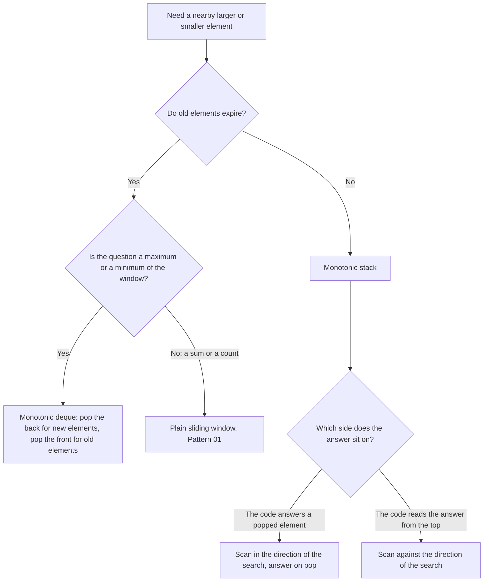

# Pattern 07: Monotonic Stack and Monotonic Queue

## Overview

A monotonic stack or a monotonic queue is a stack or a deque whose elements always stay in sorted order (all increasing, or all decreasing). The code keeps the structure sorted by discarding each element that can never be an answer again. The technique turns "for each element, search to the right or to the left" into one pass of O(n) work, and it turns "the maximum of every window" into one pass of O(n) work. The Pattern section names the property that decides when this works.

After this page you can:

1. Say which elements the structure may discard, and prove that a discarded element can never be an answer again.
2. Derive the stack for [LC 739: Daily Temperatures](https://leetcode.com/problems/daily-temperatures/) from the O(n²) brute force, and explain why the nested loop costs O(n).
3. Rebuild the four variants (next greater, next smaller, previous greater, previous smaller), and choose the scan direction and the comparison (strict or not) for a given tie rule.
4. Solve the problems that change one thing about the anchor: a circular array, two boundaries for each element, water between walls, a sum over all subarrays, and a stack that builds the answer.
5. Derive the monotonic deque for [LC 239: Sliding Window Maximum](https://leetcode.com/problems/sliding-window-maximum/) and for [LC 862: Shortest Subarray with Sum at Least K](https://leetcode.com/problems/shortest-subarray-with-sum-at-least-k/), and give the reason for each of its pops.
6. Decide for a new problem whether a monotonic structure applies, and name the property that decides it.

## Prerequisites

| You need | Why this page needs it | Where to learn it |
|---|---|---|
| Stack, queue, and deque operations, and `ArrayDeque` | The page uses `ArrayDeque` as a stack (`push`, `pop`, `peek`) and as a deque (`offerLast`, `pollLast`, `pollFirst`, `peekFirst`) | [Stacks, Queues, and Deques](../foundations/03-stacks-queues-deques.md) |
| Counting operations, O-notation, and amortized cost | The page counts pushes and pops before it states O(n) for a loop inside a loop | [Complexity Analysis](../foundations/01-complexity-analysis.md) |
| The sliding window | [LC 239](https://leetcode.com/problems/sliding-window-maximum/) is a fixed window whose state must report a maximum. The page assumes that you know why a running sum supports removal | [Pattern 01: Sliding Window](../01-sliding-window/README.md) |

Four words that the page uses from the start:

- A **stack** removes the element that entered last. A **deque** (double-ended queue) adds and removes elements at both ends.
- **Monotonic** means that the elements keep one order. In a **decreasing** stack, each element is not larger than the element under it. Sorted order is the only property that this page needs from the word.
- An **index** is a position in the input array. The structures on this page hold indexes, and the page explains why in the Derivation.
- **Amortized** cost is the total cost of a whole run divided over its steps. One step can be expensive. The total is bounded.

## Motivation

### Problem 1: days until a warmer day (stack)

This problem is [LC 739: Daily Temperatures](https://leetcode.com/problems/daily-temperatures/). Given the temperature of each day, return for each day the number of days to wait until a warmer day. If no later day is warmer, return 0 for that day.

For `temps = [30, 40, 50, 20, 10, 35, 60, 25]`, the answer is `[1, 1, 4, 2, 1, 1, 0, 0]`. Day 2 (50 degrees) waits 4 days, until day 6 (60 degrees).

**First attempt: scan to the right from every day.** For each day, compare the later days one by one until one is warmer. Stop at the first warmer day.

| day | temp | days compared | comparisons | answer |
|---|---|---|---|---|
| 0 | 30 | 40 | 1 | 1 |
| 1 | 40 | 50 | 1 | 1 |
| 2 | 50 | 20, 10, 35, 60 | 4 | 4 |
| 3 | 20 | 10, 35 | 2 | 2 |
| 4 | 10 | 35 | 1 | 1 |
| 5 | 35 | 60 | 1 | 1 |
| 6 | 60 | 25 | 1 | 0 |
| 7 | 25 | none | 0 | 0 |

The attempt makes 11 comparisons for 8 days. The cost depends on the input. The worst input is a **decreasing array**, for example `[8, 7, 6, 5, 4, 3, 2, 1]`. No day finds a warmer day, so each day compares with every later day: day `i` makes `n - 1 - i` comparisons. The total is `n(n - 1) / 2`. For `n = 100000`, that is 4,999,950,000 comparisons. The cost is O(n²).

**A faster rule that fails.** One idea: compare each day only with the next day. On `[30, 40, 50, 20, 10, 35, 60, 25]`, day 2 (50 degrees) meets day 3 (20 degrees), which is colder. The rule gives 0 for day 2. The right answer is 4.

**The waste.** Look at days 3 and 4 in the table (20 and 10 degrees). Both scan day 5 (35 degrees), and both find it warmer. The attempt starts a new scan for each day. It does not use the fact that days 3 and 4 wait for the same kind of event. On a decreasing array, every scan reads all the later days and learns nothing that the next scan can use. The Derivation shows what the scans can share.

### Problem 2: the largest value of every window (deque)

This problem is [LC 239: Sliding Window Maximum](https://leetcode.com/problems/sliding-window-maximum/). Given an array and a window size `k`, the window moves from the left end to the right end, one position at a time. Return the largest value of each window.

For `nums = [4, 2, 12, 3, 8, 1, 7, 5]` and `k = 3`, the answer is `[12, 12, 12, 8, 8, 7]`. The array has `n - k + 1 = 6` windows.

**First attempt: scan every window.** For each window, compare its `k` elements to find the largest. A window of 3 elements needs 2 comparisons, so the attempt makes 6 x 2 = 12 comparisons. For `n = 100000` and `k = 50000`, it makes `(n - k + 1)(k - 1) = 50001 x 49999 = 2,499,999,999` comparisons. The cost is O(n x k).

**A faster rule that fails.** The sliding-window page keeps a running sum: add the entering element, subtract the leaving element. Try the same rule with a running maximum `best`: when an element enters, set `best = max(best, element)`. The rule cannot remove an element, so `best` never goes down.

| window | elements | running `best` | right answer |
|---|---|---|---|
| `[0..2]` | 4, 2, 12 | 12 | 12 |
| `[1..3]` | 2, 12, 3 | 12 | 12 |
| `[2..4]` | 12, 3, 8 | 12 | 12 |
| `[3..5]` | 3, 8, 1 | 12 | 8 |

At the window `[3..5]`, the element 12 has left the window. The running maximum still says 12. To get 8, the rule needs to know the largest element that is left in the window, and a single variable does not hold it.

**The gap.** The brute force looks at every element of the window again for every window. It compares elements that lost to a larger element in an earlier window. For example, the 3 in the window `[2, 12, 3]` sits next to the larger 12 and is later followed by the larger 8. The attempt compares it again and again. If the code could name the elements that cannot be the maximum any more, it would not look at them. The Derivation shows which elements those are.

## Derivation

### The stack: waiting days

Go back to [LC 739: Daily Temperatures](https://leetcode.com/problems/daily-temperatures/). Scan the days from left to right, once. After each day, some earlier days have an answer and some do not.

**Question 1.** While I scan to the right, which earlier days are still waiting for an answer, and what do I know about their order?

A day is **waiting** when no later day that the scan has seen is warmer. The table lists the waiting days after each day of `[30, 40, 50, 20, 10, 35, 60, 25]`. Each entry is `day:temperature`, from the oldest waiting day to the newest.

| after day | new temp | waiting days, oldest to newest |
|---|---|---|
| 0 | 30 | 0:30 |
| 1 | 40 | 1:40 (day 0 is answered) |
| 2 | 50 | 2:50 (day 1 is answered) |
| 3 | 20 | 2:50, 3:20 |
| 4 | 10 | 2:50, 3:20, 4:10 |
| 5 | 35 | 2:50, 5:35 (days 3 and 4 are answered) |
| 6 | 60 | 6:60 (days 2 and 5 are answered) |
| 7 | 25 | 6:60, 7:25 |

Read the temperatures in each row from left to right: 50, 20, 10, then 50, 35, then 60, 25. They **decrease**. This is not an accident of the input. **Reason:** take two waiting days `j < m` (day `j` is older). If `temp[j] < temp[m]`, then day `m` is warmer than day `j`, so day `j` got its answer when the scan reached day `m`, and day `j` is not waiting. So `temp[j] >= temp[m]`. The oldest waiting day is the warmest, and the **newest waiting day is the coldest**.

**Question 2.** A new day `i` arrives. Which waiting days does it answer?

The new day answers each waiting day whose temperature is lower than `temp[i]`. The newest waiting day is the coldest. So:

- If the newest waiting day is **not** colder than `temp[i]`, then no waiting day is colder (all older ones are at least as warm as the newest one). Stop. The new day answers nobody.
- If the newest waiting day is colder, the new day answers it. Remove it from the waiting days. Now look at the new newest one, and ask the same question.

The code compares the new day only with the newest waiting day, and it adds and removes days at the newest end only. This is a **stack**. After the removals, the new day joins the waiting days: no day after it has been seen yet. The day under it, if any, is not colder than the new day (the loop stopped there), so the temperatures still decrease from the bottom to the top. The new day goes on top.

**The algorithm, derived from the two questions:**

1. Keep a stack of waiting days (indexes). The stack has temperatures that decrease from bottom to top.
2. For each day `i`, while the top of the stack is colder than `temp[i]`: pop it, and set its answer to `i - top`.
3. Push `i`.
4. After the last day, the days that remain on the stack have no warmer day. Their answer stays 0.

**Trace** for `temps = [30, 40, 50, 20, 10, 35, 60, 25]`. The stack lists `index:temperature` from the bottom to the top. The Implementation program prints this trace.

```text
i = 0 t = 30: no pop; push 0; stack [0:30]
i = 1 t = 40: pop 0 (days = 1); push 1; stack [1:40]
i = 2 t = 50: pop 1 (days = 1); push 2; stack [2:50]
i = 3 t = 20: no pop; push 3; stack [2:50, 3:20]
i = 4 t = 10: no pop; push 4; stack [2:50, 3:20, 4:10]
i = 5 t = 35: pop 4 (days = 1) pop 3 (days = 2); push 5; stack [2:50, 5:35]
i = 6 t = 60: pop 5 (days = 1) pop 2 (days = 4); push 6; stack [6:60]
i = 7 t = 25: no pop; push 7; stack [6:60, 7:25]
days = [1, 1, 4, 2, 1, 1, 0, 0]
```

Read the row for `i = 5`. The new temperature is 35. The top is day 4 (10 degrees), which is colder: pop it, and its answer is `5 - 4 = 1`. The new top is day 3 (20 degrees), which is colder: pop it, and its answer is `5 - 3 = 2`. The new top is day 2 (50 degrees), which is not colder than 35. The loop stops, and the code pushes day 5. Day 2 waited for 3 more days and is still waiting.

**The invariant.** After the step for day `i`, the stack holds exactly the days `j <= i` that have no warmer day in `j + 1 .. i`, and their temperatures do not increase from the bottom to the top.

**Why it is correct.** The invariant holds before the first day (the stack is empty). One step keeps it, in four parts:

1. Day `i` is warmer than a waiting day exactly when `temp[i] > temp[j]`. By Question 1, the waiting days are in decreasing order of temperature, so the days that `i` answers form a block at the top of the stack. The loop pops this block and stops at the first day that is not colder.
2. Each popped day `j` gets `i - j`. Day `i` is the first warmer day for `j`: `j` was waiting, so no day between `j` and `i` was warmer.
3. The days below the block stay waiting, because each is at least as warm as the day where the loop stopped, and that day is at least as warm as `temp[i]`.
4. The code pushes `i`. It has no warmer day after it so far. Its temperature is not larger than the temperature of the day under it, so the order holds.

The edge case: a day that never gets popped is never answered. Its answer stays at the initial 0, which is what the problem asks.

**Which elements does the stack discard, and why can a discarded element never be an answer again?** A popped day leaves the stack for two reasons.

1. It has its answer. Nobody needs to compare with it again as a waiting day.
2. It can never be the answer to a question about a **later** day. Take the question "which earlier day is the nearest one that is warmer than day `q`?" for a day `q` after day 5. Day 5 (35 degrees) popped days 3 and 4 (20 and 10 degrees). Day 5 is nearer to `q` than days 3 and 4, and it is warmer than both. If day 3 is warmer than `q`, then day 5 is warmer than `q` too, and day 5 is nearer. So days 3 and 4 are never the nearest warmer day of any later day.

(The stack answers this question too. After the pops, the top is the nearest earlier day that is not colder than the new day. The days on the stack are the only days that can be such an answer for a later day.)

The second reason is the one that carries over to the other variants and to the deque: **a candidate is discarded when a closer element that is at least as good exists.** The Pattern section states this as the discard rule.

**Count the work.** On the decreasing array of 1000 days, the brute force makes 499,500 comparisons. The stack code makes 999: each day compares once with the top and stops. The Implementation program prints both numbers. On an increasing array, each day makes one comparison and one pop, so the work is also about `n`.

The code has a loop inside a loop. Count the work as pushes and pops:

- Each day is pushed **once**. That makes `n` pushes.
- Each day is popped **at most once**, because a popped day does not return. That makes at most `n` pops.
- The inner loop does one comparison for each pop, and the outer loop adds at most one comparison that fails (or finds an empty stack) for each day. So the comparisons are at most `n + n = 2n`.

The inner loop can pop many days for one value of `i`. It cannot pop many days for every `i`, because all passes of the inner loop draw from one budget of `n` pops. The total work is at most `2n` steps, so the time is O(n). This is an amortized argument, the same one as for the pointers of the sliding window.

```java
static int[] daysUntilWarmer(int[] temps) {
    int n = temps.length;
    int[] days = new int[n];                      // 0 means "no warmer day"
    Deque<Integer> waiting = new ArrayDeque<>();  // indexes of the days with no answer yet
    for (int i = 0; i < n; i++) {
        while (!waiting.isEmpty() && temps[waiting.peek()] < temps[i]) {
            int j = waiting.pop();                // day i is the first warmer day for day j
            days[j] = i - j;
        }
        waiting.push(i);                          // day i now waits for its own answer
    }
    return days;
}
```

`ArrayDeque.push`, `pop`, and `peek` work at the head of the deque, so the head is the top of the stack. The test `!waiting.isEmpty()` comes first, because `peek()` returns `null` on an empty deque and the unboxing of `null` throws `NullPointerException`.

**Why the stack stores indexes, not temperatures.** Two reasons come from this problem:

1. The answer is a **distance**, `i - j`. A temperature does not tell the code where its day is.
2. The code gets a temperature from an index (`temps[j]`). It cannot get the index from a temperature, because two days can have the same temperature.

[LC 84: Largest Rectangle in Histogram](https://leetcode.com/problems/largest-rectangle-in-histogram/) shows a third reason: it needs a **width**, and a width is a difference of two indexes. A problem that asks only for the next greater **value**, with all values distinct, can store values ([LC 496](https://leetcode.com/problems/next-greater-element-i/) in the practice ladder). When in doubt, store the index.

### The deque: candidates for the maximum

Go back to [LC 239: Sliding Window Maximum](https://leetcode.com/problems/sliding-window-maximum/). The running maximum failed because the window loses its oldest element, and the maximum can be that element.

**Question 1.** Which elements of the window can never be the maximum again?

Take an element `x` at index `j` in the current window. Suppose the window also holds an element `y` at an index `p > j`, with `y >= x`. Then `x` can **never** be the maximum of any window from now on:

- `y` is newer than `x`, so `x` leaves the window before `y` does.
- While `x` is in a window, `y` is in the same window, and `y >= x`. So the maximum of that window is at least `y`, and `x` is never needed. If `y == x`, the value is the same, and `y` still gives it.

So an element that has a larger-or-equal element **to its right inside the window** is useless. The elements that remain are the ones with no larger-or-equal element to their right. Read them from the oldest to the newest: each one is **larger** than all the remaining ones after it. The remaining values **decrease** from the oldest to the newest.

For the window `[2, 12, 3]` (indexes 1 to 3): the 2 has the larger 12 to its right, so it is useless. The 12 has no larger element to its right, so it stays. The 3 has nothing to its right, so it stays. The remaining elements are 12 and 3. The oldest, 12, is the maximum.

**Question 2.** What happens to this list when the window moves one step?

- **A new element `a[i]` enters on the right.** Every remaining element that is `<= a[i]` now has a larger-or-equal element to its right, so it becomes useless. These elements are the smallest and the newest of the list, so they sit at the **back**. Remove them from the back, one by one, while the back is `<= a[i]`. Then add `i` at the back. The list stays in decreasing order.
- **The oldest element leaves on the left.** The list is ordered by age, so the oldest element is at the **front**. If the front index is `i - k` (the index that just left the window), remove it from the front.

The maximum of the window is the front of the list: it is the largest of the remaining elements, and every element that was removed was useless.

The code removes elements at the back (new elements push out smaller ones) and at the front (old elements expire). This is a **deque**: a stack at the back, and a queue at the front. A stack alone cannot remove old elements from the bottom.

**Why `if` and not `while` for the front?** Before the step for index `i`, all indexes in the deque are at least `i - k`, because the earlier steps removed everything older. So only the index `i - k` can expire now, and the code removes at most one element from the front in a step.

**Trace** for `nums = [4, 2, 12, 3, 8, 1, 7, 5]` and `k = 3`. The deque lists `index:value` from the front to the back. The Implementation program prints this trace.

```text
i = 0 a = 4: push 0; deque [0:4]; no output yet
i = 1 a = 2: push 1; deque [0:4, 1:2]; no output yet
i = 2 a = 12: pop back 1; pop back 0; push 2; deque [2:12]; max = 12
i = 3 a = 3: push 3; deque [2:12, 3:3]; max = 12
i = 4 a = 8: pop back 3; push 4; deque [2:12, 4:8]; max = 12
i = 5 a = 1: expire front 2; push 5; deque [4:8, 5:1]; max = 8
i = 6 a = 7: pop back 5; push 6; deque [4:8, 6:7]; max = 8
i = 7 a = 5: expire front 4; push 7; deque [6:7, 7:5]; max = 7
```

Read the row for `i = 4`. The new element is 8. The back is index 3 (value 3), and 3 is at most 8, so the code removes it. The next back is index 2 (value 12), which is larger, so the loop stops. The deque holds 12 and 8. The front is 12, and the window `[2, 3, 4]` has maximum 12. In the row for `i = 5`, index 2 leaves the window (`2 <= 5 - 3`), so the code removes 12 from the front. The new front is 8, the answer that the running maximum could not find.

**The invariant.** After the step for index `i`, the deque holds the indexes `j` of the window `[i - k + 1, i]` that have no index `p` in `(j, i]` with `a[p] >= a[j]`. Their values decrease from the front to the back, and the front is the maximum of the window.

**Why it is correct.** Before the first step the deque is empty. One step keeps the invariant in five parts:

1. The old front leaves only when its index is `i - k`, the one index that is not in the window `[i - k + 1, i]` any more.
2. The back pops remove exactly the indexes `j` with `a[j] <= a[i]`. Each of them now has a larger-or-equal element to its right (the new element `i`), so it is useless. The deque is in decreasing order, so the loop stops at the first index with `a[j] > a[i]`, and all indexes before it have larger values.
3. The indexes that stay still have no larger-or-equal element to their right: the new element is smaller than they are.
4. The new index `i` has nothing to its right, so it stays.
5. The front is the maximum. Take any window element that is not in the deque. It has a larger-or-equal element to its right inside the window. Follow that link, and repeat. Each link goes to a larger-or-equal value and to the right, so the chain ends at an element that is in the deque. The front of the deque is the largest element of the deque, so it is at least as large as every window element.

The code writes an answer only from `i = k - 1`, when the window has `k` elements.

**Count the work.** Each index is added to the back once. Each index is removed at most once, from the back or from the front. So the deque makes at most `n` adds and `n` removals, and the time is O(n). The space is O(k): the deque holds only indexes of the current window.

```java
static int[] maxSlidingWindow(int[] nums, int k) {
    int n = nums.length;
    int[] result = new int[n - k + 1];
    Deque<Integer> window = new ArrayDeque<>();   // indexes; values decrease front to back
    for (int i = 0; i < n; i++) {
        if (!window.isEmpty() && window.peekFirst() <= i - k) {
            window.pollFirst();                   // the oldest index left the window
        }
        while (!window.isEmpty() && nums[window.peekLast()] <= nums[i]) {
            window.pollLast();                    // a larger-or-equal element is to its right
        }
        window.offerLast(i);
        if (i >= k - 1) result[i - k + 1] = nums[window.peekFirst()];   // the window is complete
    }
    return result;
}
```

The deque stores **indexes** because the code must know when an element leaves the window. A value alone does not say how old the element is (Common Mistakes, number 7, shows the wrong output).

**The comparison with a heap.** A max-heap (`PriorityQueue`) also reports the maximum. The code adds `(value, index)` pairs. Before it reads the top, it removes the top while the top index is `<= i - k`. This removal is called lazy deletion: old pairs stay in the heap until they reach the top.

| | Monotonic deque | Heap with lazy deletion | Sorted map from value to count (`TreeMap`) |
|---|---|---|---|
| Time | O(n) | O(n log n) | O(n log k) |
| Space | O(k) | O(n), because old pairs stay until they reach the top | O(k) |
| When it is acceptable | The window moves in one direction and the question is a maximum or a minimum: it is the shortest code and the fastest | `n` is small, or the code must also answer "k-th largest" or arbitrary removals | The code needs the maximum and also the second maximum, or removals of any element |

The `TreeMap` column keeps each value of the window with its count. To remove the leaving element, the code lowers the count of its value by 1 and deletes the entry at 0. `lastKey()` gives the maximum, and the `TreeMap` has at most `k` entries, so each operation costs O(log k). The javadoc of `PriorityQueue` states that `remove(Object)` takes linear time, so a heap that holds `k` elements and removes the leaving element at once costs O(k) per removal. The total is O(n x k), not O(n log k). Use the deque when the window moves in one direction and the question is a maximum or a minimum. Use a heap when the elements do not expire in the order of arrival, or when the question is a k-th largest value ([Pattern 16: Heap](../16-heap-priority-queue/README.md)).

## The Pattern

A monotonic structure keeps a list of **candidates** for an answer, in sorted order. When a new element arrives, the code asks one question about each candidate: "Can this candidate still be the answer for some element or window, now that the new element exists?" If the answer is no, the code discards the candidate. Sorting makes the discarded candidates sit next to the new element, at the end of the structure, so the code finds them without a search. The stack in [LC 739](https://leetcode.com/problems/daily-temperatures/) is the case in which a candidate leaves when it gets its answer. The deque in [LC 239](https://leetcode.com/problems/sliding-window-maximum/) is the case in which a candidate leaves when a better candidate arrives, or when it gets too old.

**The discard rule**, in one sentence: an element is discarded when another element that is **closer to the query and at least as good** exists. In the deque, `y` is closer to every future window than `x` (it is newer) and at least as large. In the stack for the next greater element (scan from the right, see below), `y` is closer to every query on its left than `x`, and it is at least as large.

**The invariant.** The structure holds exactly the candidates that no other element beats, and they are in sorted order.

### Derive two variants in full

The stack for [LC 739](https://leetcode.com/problems/daily-temperatures/) scanned from left to right and answered the old days at the moment of the pop. Two other forms read the answer from the top of the stack. Derive each one from the discard rule.

**Variant 1: next greater element, scanning from the right.** For each index `i`, find the nearest index `j > i` with `a[j] > a[i]`. The answer for `i` lies to the right of `i`. So the scan goes from the right end to the left end: when the scan is at `i`, the indexes to the right are already seen, and the code can read the answer from the stack at once.

*Question.* Among the indexes to the right of `i`, which can still be the next greater element of `i`, or of any index to the left of `i`?

Take a candidate `j > i` with `a[j] <= a[i]`. It cannot be the next greater element of `i`, because it is not greater than `a[i]`. It cannot be the next greater element of an index `q < i` either: if `a[j] > a[q]`, then `a[i] >= a[j] > a[q]`, so `i` is also greater than `a[q]`, and `i` is nearer to `q` than `j`. So **when the scan reaches `i`, every candidate with `a[j] <= a[i]` is discarded.** The candidates that remain are all greater than `a[i]`. Read from the nearest to the farthest, they are the nearest first, and each one is greater than the one before it, because the pops removed everything that was not.

*The step for `i`:* pop the top while `a[top] <= a[i]`. If the stack is empty, `next[i] = -1`. Otherwise `next[i] = top`. Push `i`. The stack has the nearest candidate on top, and the values increase from the top to the bottom.

```java
static int[] nextGreaterIndex(int[] a) {
    int n = a.length;
    int[] next = new int[n];                      // -1 means "no greater element"
    Deque<Integer> candidates = new ArrayDeque<>();
    for (int i = n - 1; i >= 0; i--) {            // scan from the right
        while (!candidates.isEmpty() && a[candidates.peek()] <= a[i]) {
            candidates.pop();                     // a[i] is closer and at least as large
        }
        next[i] = candidates.isEmpty() ? -1 : candidates.peek();
        candidates.push(i);
    }
    return next;
}
```

**Variant 2: previous smaller element, scanning from the left.** For each index `i`, find the nearest index `j < i` with `a[j] < a[i]`. The answer lies to the left, so the scan goes from the left to the right: the indexes to the left are already seen.

*Question.* Among the indexes to the left of `i`, which can still be the previous smaller element of `i` or of any index to the right of `i`?

If `a[j] >= a[i]` for an earlier `j`, then `j` cannot be the previous smaller of any index `q > i`: if `a[j] < a[q]`, then `a[i] <= a[j] < a[q]`, and `i` is closer to `q`. And `j` cannot be the previous smaller of `i` itself, because `a[j] >= a[i]`. So pop while `a[top] >= a[i]`. The candidates that remain are strictly smaller than `a[i]` and increase from the bottom to the top.

```java
static int[] previousSmallerIndex(int[] a) {
    int n = a.length;
    int[] prev = new int[n];                      // -1 means "no smaller element"
    Deque<Integer> candidates = new ArrayDeque<>();
    for (int i = 0; i < n; i++) {                 // scan from the left
        while (!candidates.isEmpty() && a[candidates.peek()] >= a[i]) {
            candidates.pop();                     // a[i] is closer and at most as large
        }
        prev[i] = candidates.isEmpty() ? -1 : candidates.peek();
        candidates.push(i);
    }
    return prev;
}
```

### The rule that gives all four variants

The two variants differ in three choices. Each choice has a reason:

1. **The scan direction.** The code must have seen the candidates before it answers. For "next" the candidates are on the right, so scan from the right. For "previous" the candidates are on the left, so scan from the left. (The stack of [LC 739](https://leetcode.com/problems/daily-temperatures/) used the opposite arrangement: it scanned in the direction of the search and answered a waiting element when it popped it. Both arrangements work. The table lists both.)
2. **The order of the stack.** For "greater", the candidates that remain are larger than the new element, so a larger value sits below a smaller one, and the stack values **decrease** from the bottom to the top. For "smaller", the stack values **increase** from the bottom to the top.
3. **The pop condition.** Pop the candidates that the new element beats. For "greater", the new element beats a candidate that has a smaller value. Whether it also beats a candidate with an equal value depends on the tie rule. For a strict answer (the answer must be greater, not equal), the new element beats an equal candidate too, because an equal candidate cannot be the answer. The next section shows the effect.

| Variant | Scan | Stack, bottom to top | Pop while (strict answer) | The answer for `i` | An equal element |
|---|---|---|---|---|---|
| Next greater | right to left | decreasing | `a[top] <= a[i]` | `top` after the pops | popped, so it is never the answer |
| Next smaller | right to left | increasing | `a[top] >= a[i]` | `top` after the pops | popped, so it is never the answer |
| Previous greater | left to right | decreasing | `a[top] <= a[i]` | `top` after the pops | popped, so it is never the answer |
| Previous smaller | left to right | increasing | `a[top] >= a[i]` | `top` after the pops | popped, so it is never the answer |

To allow an equal element as the answer ("greater or equal"), change `<=` to `<` and `>=` to `>` in this table.

The same four variants in the arrangement of [LC 739](https://leetcode.com/problems/daily-temperatures/), where the scan goes in the direction of the search and the code answers the popped element:

| Variant | Scan | Stack, bottom to top | Pop while (strict answer) | The answer | An equal element |
|---|---|---|---|---|---|
| Next greater | left to right | decreasing | `a[top] < a[i]` | `i` is the answer for each popped element | stays, and `i` does not answer it |
| Next smaller | left to right | increasing | `a[top] > a[i]` | `i` is the answer for each popped element | stays, and `i` does not answer it |
| Previous greater | right to left | decreasing | `a[top] < a[i]` | `i` is the answer for each popped element | stays, and `i` does not answer it |
| Previous smaller | right to left | increasing | `a[top] > a[i]` | `i` is the answer for each popped element | stays, and `i` does not answer it |

To allow an equal element as the answer, change `<` to `<=` and `>` to `>=` in this table.

Other structures on this page fit the same two rules:

| Problem | Structure | Order | Pop while | Reason |
|---|---|---|---|---|
| [LC 84: Largest Rectangle in Histogram](https://leetcode.com/problems/largest-rectangle-in-histogram/) | stack, left to right | increasing | `a[top] > h` | the popped bar finds its next lower bar |
| [LC 239: Sliding Window Maximum](https://leetcode.com/problems/sliding-window-maximum/) | deque, left to right | decreasing | `a[back] <= a[i]` at the back, and an expired index at the front | a window maximum |
| Sliding window minimum | deque, left to right | increasing | `a[back] >= a[i]` at the back, and an expired index at the front | a window minimum |

### What equal values do

The pop condition decides what the code does with equal values. Run the left-to-right form on `a = [2, 2, 3]`, once with "pop while `a[top] < a[i]`" and once with "pop while `a[top] <= a[i]`". The Implementation program prints both results.

```text
pop on <:  next = [2, 2, -1], previous = [-1, 0, -1]
pop on <=: next = [1, 2, -1], previous = [-1, -1, -1]
```

(The value -1 stands for "none". Here `next` is the index that popped the element, or -1 if nobody popped it. `previous` is the index under the element after the pops.)

- **Pop on `<` (equal elements stay).** The element 2 at index 0 is not popped by the equal 2 at index 1, so `next[0]` is 2, the first strictly larger value. The element at index 1 sees the equal element at index 0 under it, so `previous[1] = 0`: the previous element that is greater **or equal**.
- **Pop on `<=` (equal elements leave).** The element at index 0 is popped by the equal element at index 1, so `next[0] = 1`: the next element that is greater **or equal**. The element at index 1 sees nothing under it, so `previous[1] = -1`: there is no previous **strictly** greater element.

One pop condition gives a pair: a strict answer on one side, and a non-strict answer on the other side. This pair is the rule that [LC 907](https://leetcode.com/problems/sum-of-subarray-minimums/) needs (Worked Example 4).

### One pass gives "previous" and "next"

In the left-to-right form, the loop does two things at the moment when day `i` arrives:

```text
while the top is beaten by i:   pop it; its NEXT answer is i
after the pops:                 the top (if any) is the PREVIOUS answer of i
push i
```

So one pass gives, for every element, the nearest element on each side that is not beaten by it. [LC 84](https://leetcode.com/problems/largest-rectangle-in-histogram/) and [LC 907](https://leetcode.com/problems/sum-of-subarray-minimums/) need both sides, and the examples below use this fact.

### The vocabulary

The page used each of these terms before it named them. Two more terms, boundary and sentinel, come with [LC 84](https://leetcode.com/problems/largest-rectangle-in-histogram/) in Worked Example 2, which defines them.

| Term | What it was in the examples | The question to ask in a new problem |
|---|---|---|
| Candidate | A waiting day, or an index that can still be the maximum | "Which elements can still be an answer for a future query?" |
| Monotonic order | Temperatures that decrease from the bottom of the stack to the top | "In which order do the surviving candidates sit?" |
| Discard (pop) | Remove a candidate that a closer and at-least-as-good element beats | "Which element beats which, and where do the beaten ones sit?" |
| Answer on pop | Write the answer for a popped element (`days[j] = i - j`) | "Does a popped element get its answer at the moment of the pop?" |
| Expire | Remove the front index when it leaves the window | "Do candidates also get too old?" |
| Amortized cost | `n` pushes and at most `n` pops | "How many times can one element enter and leave?" |

### Variations A to E, and where this page covers them

| Variation | Problem | Where |
|---|---|---|
| A. Days until a warmer day | [LC 739](https://leetcode.com/problems/daily-temperatures/): the next greater index, subtracted from `i` | Derivation |
| B. Stock span | [LC 901](https://leetcode.com/problems/online-stock-span/): the previous strictly greater index, `i - previous` | Practice P3 |
| C. Trapping rain water | [LC 42](https://leetcode.com/problems/trapping-rain-water/): layers of water between walls, or two pointers | Worked Example 3 |
| D. Maximal rectangle in a binary matrix | [LC 85](https://leetcode.com/problems/maximal-rectangle/): a histogram for each row | Practice P11 |
| E. Remove K digits | [LC 402](https://leetcode.com/problems/remove-k-digits/): a stack that builds the answer | Worked Example 5 |

### Which structure to use



## Worked Examples

The examples go from the easiest change to the hardest. Each one changes one thing about [LC 739](https://leetcode.com/problems/daily-temperatures/) or [LC 239](https://leetcode.com/problems/sliding-window-maximum/).

### Example 1: Next Greater Element II (LC 503), a circular array

**Statement.** [LC 503: Next Greater Element II](https://leetcode.com/problems/next-greater-element-ii/) gives a circular array: after the last element comes the first element again. For each element, find the first larger element when you walk to the right and wrap around. Return the value, or -1 if there is none. For `[5, 2, 7, 3, 1]`, the answer is `[7, 7, -1, 5, 5]`. The last 1 wraps to the first element 5, which is larger.

**What changed.** The search for the next greater element continues at the start of the array after the last element.

**From brute force.** For each index, walk up to `n - 1` steps to the right with the index `(i + step) % n`. The cost is O(n²). The stack code of [LC 739](https://leetcode.com/problems/daily-temperatures/) already finds the next greater element in the **straight** array. The elements to the left, which the wrap-around reaches, are the only new part. Walk through the array **twice**, with the index `i % n`. In the second walk, the elements at the end of the array see the elements at the beginning.

**Why two walks are enough.** For an index `j` in `0 .. n - 1`, the circular neighbors, in order, are `j + 1, j + 2, ..., j + n - 1` (the position `j + n` is `j` itself, which is not larger than itself). All of them are at most `2n - 2`, so the doubled walk over `0 .. 2n - 1` covers them. If no neighbor is larger, the answer is -1. The doubled walk finds nothing larger beyond `j + n - 1`, because the positions after that repeat values that the code already compared.

**The second walk only answers.** The code pushes an index only in the first walk (`i < n`). In the second walk the stack already holds every index that waits. A second push of the same index could write an answer for it twice, and the second write would replace the first one with a farther element.

**Trace** for `[5, 2, 7, 3, 1]`. The stack lists `index:value` from the bottom to the top.

| `i` | index `i % n` | value | pops (answer written) | push | stack after |
|---|---|---|---|---|---|
| 0 | 0 | 5 | none | 0 | 0:5 |
| 1 | 1 | 2 | none | 1 | 0:5, 1:2 |
| 2 | 2 | 7 | 1 gets 7, 0 gets 7 | 2 | 2:7 |
| 3 | 3 | 3 | none | 3 | 2:7, 3:3 |
| 4 | 4 | 1 | none | 4 | 2:7, 3:3, 4:1 |
| 5 | 0 | 5 | 4 gets 5, 3 gets 5 | none | 2:7 |
| 6 | 1 | 2 | none | none | 2:7 |
| 7 | 2 | 7 | none (7 is not less than 7) | none | 2:7 |
| 8 | 3 | 3 | none | none | 2:7 |
| 9 | 4 | 1 | none | none | 2:7 |

The index 2 (value 7) stays on the stack to the end. No element is larger, so its answer stays -1. The result is `[7, 7, -1, 5, 5]`.

```java
static int[] nextGreaterCircular(int[] nums) {
    int n = nums.length;
    int[] result = new int[n];
    Arrays.fill(result, -1);                      // -1 means "no greater element"
    Deque<Integer> waiting = new ArrayDeque<>();
    for (int i = 0; i < 2 * n; i++) {             // two walks over the array
        int value = nums[i % n];
        while (!waiting.isEmpty() && nums[waiting.peek()] < value) {
            result[waiting.pop()] = value;        // the answer is a value, as the problem asks
        }
        if (i < n) waiting.push(i);               // only the first walk pushes
    }
    return result;
}
```

**Complexity.** Time O(n): the loop runs `2n` times, and the code pushes `n` indexes and pops at most `n`. Space O(n).

### Example 2: Largest Rectangle in Histogram (LC 84), two boundaries for each element

**Statement.** [LC 84: Largest Rectangle in Histogram](https://leetcode.com/problems/largest-rectangle-in-histogram/) gives the heights of bars of width 1 that stand next to each other. Find the area of the largest rectangle that fits inside the bars. For `[2, 1, 5, 6, 2, 3]`, the answer is 10: the bars 5 and 6 give a rectangle of height 5 and width 2.

**What changed.** The answer for a bar is not one index. It is a **range**: the bar `i` is the lowest bar of the best rectangle that uses its height, and the range reaches to the left and to the right until a lower bar stops it.

**First attempt: for each bar, expand to both sides.** A rectangle with height `h[i]` can include every neighbor that is at least `h[i]`. Expand to the left while the bar is not lower, expand to the right while the bar is not lower, and take `h[i] x width`.

| bar | height | left end | right end | width | area |
|---|---|---|---|---|---|
| 0 | 2 | 0 | 0 | 1 | 2 |
| 1 | 1 | 0 | 5 | 6 | 6 |
| 2 | 5 | 2 | 3 | 2 | 10 |
| 3 | 6 | 3 | 3 | 1 | 6 |
| 4 | 2 | 2 | 5 | 4 | 8 |
| 5 | 3 | 5 | 5 | 1 | 3 |

The largest area is 10. The cost is O(n²): on `n` bars of equal height, each bar expands over all `n` bars, so the attempt reads `n x n` bars. For `n = 100000`, that is 10,000,000,000 reads.

**The question.** What does the expansion find? To the left, it stops at the **first lower bar**. To the right, it stops at the **first lower bar**. That is the "previous smaller" and the "next smaller" of the pattern. If `L` is the index of the first lower bar on the left (or -1 if none) and `R` is the index of the first lower bar on the right (or `n` if none), then the width is `R - L - 1`.

**One pass.** A **boundary** of a bar is the nearest lower bar on one side: it ends the range of the bar. The left-to-right form gives both boundaries (see "One pass gives previous and next"). Keep a stack of bars with **increasing** heights from the bottom to the top. When bar `i` arrives and the top is **higher** than `h[i]`, the arriving bar is the first lower bar to the right of the top, so `R = i`. The top is popped. The bar under it on the stack is the left boundary `L`. The popped bar defines a rectangle with height `h[popped]` and width `R - L - 1 = i - L - 1`.

**The width when the stack is empty.** After the pop, the stack can be empty. Then no lower bar exists to the left, so `L = -1`, and the width is `i - (-1) - 1 = i`. With a non-empty stack, the width is `i - top - 1`. The code needs the two cases. Without the empty-stack case, `stack.peek()` returns `null`, and the code throws `NullPointerException`.

**Why the width is right.** Let `i` pop the bar `j`, and let `k` be the bar under `j` on the stack (or none). Two facts give the width `i - k - 1`.

1. *Every bar between `j` and `i` is at least as high as `h[j]`.* Suppose a bar `m` with `j < m < i` has `h[m] < h[j]`. The stack heights do not decrease from the bottom to the top, so when `m` arrived, the pops of `m` reached `j` and removed it. Then `i` could not pop `j`. So `h[m] >= h[j]`. Also `h[i] < h[j]`, because `i` pops `j`. So `i` is the first lower bar to the right of `j`.
2. *Every bar between `k` and `j` is at least as high as `h[j]`.* Suppose some bar between `k` and `j` is lower than `h[j]`, and take the lowest of them, `m`. The bar `m` is not on the stack, because `k` is directly under `j`. So a bar `p` with `m < p < j` popped `m`, and `h[p] < h[m] < h[j]`. Then `p` is lower than `m` and lower than `h[j]`, which contradicts the choice of `m`. So no such bar exists.

The bar `k` itself has `h[k] <= h[j]`. If `h[k] < h[j]`, then `k` is the first lower bar to the left of `j`. If `h[k] == h[j]`, the code pops on `>`, so `k` stays under `j`. Then `i` pops `k` right after `j` (because `h[i] < h[j] = h[k]`), and the rectangle of `k` is at least as wide as the rectangle of `j`: it covers the same bars and all the bars that `k` itself reaches to the left. The rectangle of `j` is too narrow in this case, but the rectangle of `k` is the right one, so the largest area is correct. (The test `>=` also gives the right answer: the equal bar `i` pops `j` with a narrow rectangle, and the rectangle of `i` is the wide one.) With an empty stack, no bar to the left is lower, so the rectangle starts at index 0, and the width is `i`.

**The sentinel.** A **sentinel** is an extra element that the code adds at the end of the input so that the loop needs no special case. After the last bar, some bars are still on the stack. They have no lower bar to their right. Add a bar of height 0 at index `n`. It is lower than every bar of positive height, so it pops them all, and the formula `R = n` works. In the code, the loop runs to `i <= n`, and `h = 0` when `i == n`. The push of the sentinel index is harmless: nothing reads it.

**Trace** for `[2, 1, 5, 6, 2, 3]`. The stack lists `index:height` from the bottom to the top. The Implementation program prints this trace.

```text
i = 0 h = 2:
  push 0; stack [0:2]
i = 1 h = 1:
  pop 0 (height 2), width = i = 1, area = 2, best = 2
  push 1; stack [1:1]
i = 2 h = 5:
  push 2; stack [1:1, 2:5]
i = 3 h = 6:
  push 3; stack [1:1, 2:5, 3:6]
i = 4 h = 2:
  pop 3 (height 6), width = 4 - 2 - 1 = 1, area = 6, best = 6
  pop 2 (height 5), width = 4 - 1 - 1 = 2, area = 10, best = 10
  push 4; stack [1:1, 4:2]
i = 5 h = 3:
  push 5; stack [1:1, 4:2, 5:3]
i = 6 h = 0 (sentinel):
  pop 5 (height 3), width = 6 - 4 - 1 = 1, area = 3, best = 10
  pop 4 (height 2), width = 6 - 1 - 1 = 4, area = 8, best = 10
  pop 1 (height 1), width = i = 6, area = 6, best = 10
answer = 10
```

The six areas (2, 6, 10, 3, 8, 6) are the six areas of the table above, in the order of the pops. The stack finds the range of each bar in one pass.

```java
static int largestRectangle(int[] heights) {
    int n = heights.length, best = 0;
    Deque<Integer> stack = new ArrayDeque<>();    // indexes; heights increase bottom to top
    for (int i = 0; i <= n; i++) {                // i == n is the sentinel of height 0
        int h = i == n ? 0 : heights[i];
        while (!stack.isEmpty() && heights[stack.peek()] > h) {
            int height = heights[stack.pop()];    // i is the first lower bar on the right
            int width = stack.isEmpty() ? i : i - stack.peek() - 1;
            best = Math.max(best, height * width);
        }
        stack.push(i);
    }
    return best;
}
```

**Complexity.** Time O(n): each bar is pushed once and popped at most once. Space O(n). The area `height * width` is at most `n` times the largest height. The code uses `int`. If the heights and `n` are large enough that the product can pass 2,147,483,647, use `long`.

### Example 3: Trapping Rain Water (LC 42), layers between walls

**Statement.** [LC 42: Trapping Rain Water](https://leetcode.com/problems/trapping-rain-water/) gives the heights of bars. After rain, water stays between the bars. Return the total volume of water. For `[3, 0, 2, 0, 4]`, the answer is 7: the bars 3 and 4 are walls, and the water has depth 3 over the 0 at index 1, depth 1 over the 2 at index 2, and depth 3 over the 0 at index 3.

**What changed.** The answer is not a maximum. It is a sum of water, and the stack pops a bar to count the water **above** it, not to answer it.

**From brute force.** For each position, the water level is `min(max to the left, max to the right)`, and the water depth is the level minus the bar. A scan for the two maxima at each position gives O(n²).

**The question.** The water between two walls fills in **layers**. Which bar is the floor of the lowest layer, and where are its two walls? The floor is a bar that is lower than the bar before it and lower than a later bar. Its walls are the nearest higher-or-equal bar on the left and the bar that arrives on the right. That is the nearest-greater structure again.

Keep a stack of bars with heights that do **not increase** from the bottom to the top. When bar `i` arrives, while the top is **lower** than `h[i]`:

1. Pop the top. It is the **floor**.
2. If the stack is empty, the floor has no left wall. The water would run off to the left. Stop.
3. The new top is the **left wall**. The right wall is `i`.
4. The layer has width `i - leftWall - 1`. Its depth is `min(h[leftWall], h[i]) - h[floor]`: the water rises to the lower wall and stands on the floor. Add width x depth.

The loop continues: the left wall may now be lower than `h[i]`, so it becomes the next floor, and the code counts the next layer above the first.

**Trace** for `[3, 0, 2, 0, 4]`. The stack lists `index:height`.

| `i` | `h[i]` | floor popped | left wall | width | depth | water added | stack after |
|---|---|---|---|---|---|---|---|
| 0 | 3 | none | none | | | 0 | 0:3 |
| 1 | 0 | none (3 is not lower than 0) | none | | | 0 | 0:3, 1:0 |
| 2 | 2 | 1 (height 0) | 0 (height 3) | 2 - 0 - 1 = 1 | min(3, 2) - 0 = 2 | 2 | 0:3, 2:2 |
| 3 | 0 | none | none | | | 0 | 0:3, 2:2, 3:0 |
| 4 | 4 | 3 (height 0) | 2 (height 2) | 4 - 2 - 1 = 1 | min(2, 4) - 0 = 2 | 2 | 0:3, 2:2 |
| 4 | 4 | 2 (height 2) | 0 (height 3) | 4 - 0 - 1 = 3 | min(3, 4) - 2 = 1 | 3 | 0:3 |
| 4 | 4 | 0 (height 3) | none: the stack is empty, stop | | | 0 | 4:4 (after the push of 4) |

The total is 2 + 2 + 3 = 7.

```java
static int trap(int[] height) {
    int water = 0;
    Deque<Integer> stack = new ArrayDeque<>();    // indexes; heights do not increase upward
    for (int i = 0; i < height.length; i++) {
        while (!stack.isEmpty() && height[stack.peek()] < height[i]) {
            int floor = stack.pop();
            if (stack.isEmpty()) break;           // no left wall: the water would run off
            int leftWall = stack.peek();
            int width = i - leftWall - 1;
            int level = Math.min(height[leftWall], height[i]) - height[floor];
            water += width * level;               // one horizontal layer
        }
        stack.push(i);
    }
    return water;
}
```

An equal bar is **not** popped (the test is `<`), so two walls of equal height stay on the stack. The water between them was counted when the bars between them were popped.

**Complexity.** Time O(n): each bar is pushed once and popped at most once. Space O(n). The two-pointer form needs O(1) space: it keeps the maximum seen from the left end and from the right end, and it moves the pointer on the lower side. See [Pattern 02: Two Pointers](../02-two-pointers/README.md). The stack form is the one to use when the problem also asks for the layers or the walls.

### Example 4: Sum of Subarray Minimums (LC 907), count by contribution

**Statement.** [LC 907: Sum of Subarray Minimums](https://leetcode.com/problems/sum-of-subarray-minimums/) gives an array. For every contiguous subarray, take its smallest element. Return the sum of these minimums. The problem asks for the result modulo 1,000,000,007. For `[3, 1, 2, 4]`, the answer is 17.

**What changed.** The answer is a sum over all subarrays, and there are `n(n + 1) / 2` of them. The code cannot list them. It must **count**, for each element, how many subarrays have that element as their minimum.

**From brute force.** For each start, extend the end to the right and keep the running minimum. That is O(n²). For the example, the ten subarrays have minimums 3, 1, 2, 4, 1, 1, 2, 1, 1, 1, and the sum is 17.

**The question.** For the element at index `i`, which subarrays have `a[i]` as their minimum? A subarray `[l, r]` that contains `i` has `a[i]` as its minimum when it contains no smaller element: `l` is greater than the index of the previous smaller element, and `r` is smaller than the index of the next smaller element. If `prev` is that previous index (or -1) and `next` is that next index (or `n`), the choices are `l` in `prev + 1 .. i` and `r` in `i .. next - 1`. The count is `(i - prev) x (next - i)`, and the contribution to the sum is `a[i] x (i - prev) x (next - i)`.

**The tie rule.** The words "the previous smaller element" hide a choice about equal values. Take `[2, 2]`. The subarray `[2, 2]` has two elements that are a minimum. The count by contribution must give each subarray to **one** element.

| Rule | Index 0 (left, right choices) | Index 1 | Subarrays counted | Sum |
|---|---|---|---|---|
| Both sides stop at a **strictly smaller** element (equal elements are crossed) | 1 x 2 = 2 | 2 x 1 = 2 | 4: `[2, 2]` is counted twice | 2 x 2 + 2 x 2 = 8 |
| Both sides stop at a smaller **or equal** element | 1 x 1 = 1 | 1 x 1 = 1 | 2: `[2, 2]` is counted by nobody | 2 + 2 = 4 |
| Left stops at smaller or **equal**, right stops at **strictly smaller** | 1 x 2 = 2 | 1 x 1 = 1 | 3: each once | 2 x 2 + 2 x 1 = 6 |

The true sum is 2 + 2 + 2 = 6. The first two rules are wrong. The third rule gives each subarray to its **leftmost** minimum: a subarray that holds several equal minimums belongs to the leftmost one, because an equal element on the left blocks the range and an equal element on the right does not. The mirrored rule (left strictly smaller, right smaller-or-equal) gives each subarray to its rightmost minimum and is also correct. The rule is one strict side and one non-strict side. The Common Mistakes section prints the wrong results.

**One pass gives both sides.** The left-to-right form pops while `a[top] > a[i]`. The popped element has `next = i`, the first **strictly smaller** element to its right. After the pops, the top has `a[top] <= a[i]`, so `prev[i]` is the nearest element to the left that is smaller **or equal**. This is exactly the third rule. The code also initializes `next` to `n` for the elements that nobody pops and `prev` to -1 for the empty stack.

**Trace** for `[3, 1, 2, 4]`:

| `i` | `a[i]` | `prev` | `next` | left choices `i - prev` | right choices `next - i` | contribution |
|---|---|---|---|---|---|---|
| 0 | 3 | -1 | 1 | 1 | 1 | 3 x 1 x 1 = 3 |
| 1 | 1 | -1 | 4 | 2 | 3 | 1 x 2 x 3 = 6 |
| 2 | 2 | 1 | 4 | 1 | 2 | 2 x 1 x 2 = 4 |
| 3 | 4 | 2 | 4 | 1 | 1 | 4 x 1 x 1 = 4 |

The sum is 3 + 6 + 4 + 4 = 17.

```java
static int sumSubarrayMins(int[] arr) {
    int n = arr.length;
    int[] prev = new int[n];                      // nearest left index with a value <= arr[i]
    int[] next = new int[n];                      // nearest right index with a value < arr[i]
    Arrays.fill(next, n);                         // n means "no smaller element to the right"
    Deque<Integer> stack = new ArrayDeque<>();
    for (int i = 0; i < n; i++) {
        while (!stack.isEmpty() && arr[stack.peek()] > arr[i]) {
            next[stack.pop()] = i;                // strict: an equal element does not pop
        }
        prev[i] = stack.isEmpty() ? -1 : stack.peek();   // after the pops: a value <= arr[i]
        stack.push(i);
    }
    final long MOD = 1_000_000_007L;
    long sum = 0;
    for (int i = 0; i < n; i++) {
        long left = i - prev[i];
        long right = next[i] - i;
        sum = (sum + arr[i] * left % MOD * right) % MOD;   // long arithmetic: int would overflow
    }
    return (int) sum;
}
```

`arr[i] * left` has a `long` operand, so the product is a `long`. The same product with three `int` values can overflow: for an array of 200,001 elements with a 1 in the middle and 5 elsewhere, the contribution of the middle element is `1 x 100001 x 100001 = 10,000,200,001`, and the `int` product prints 1410265409. The array is a demonstration. Whatever limits the judge sets, the code must not depend on the `int` range for a product of three factors.

**Complexity.** Time O(n): one pass with the stack and one pass for the sum. Space O(n).

[LC 2104: Sum of Subarray Ranges](https://leetcode.com/problems/sum-of-subarray-ranges/) asks for the sum of (maximum minus minimum) over all subarrays. The sum of maximums uses the same counting with the order reversed. The answer is the sum of maximums minus the sum of minimums.

### Example 5: Remove K Digits (LC 402), a stack that builds the answer

**Statement.** [LC 402: Remove K Digits](https://leetcode.com/problems/remove-k-digits/) gives a string of digits `num` and a number `k`. Remove exactly `k` digits so that the remaining digits, in their original order, form the smallest possible number. Return the number as a string without leading zeros. If nothing remains, return `"0"`. For `"1432219"` and `k = 3`, the answer is `"1219"`.

**What changed.** The stack is not a list of waiting elements. The stack **is** the answer under construction. The pops are the deletions, and `k` limits their number.

**The question.** After the removals, all results have the same length, `n - k`. Numbers of the same length compare from the left: the first digit that differs decides. Which digit should the code delete first? Take a digit `x` that is **larger than the digit after it**. If the code deletes `x`, the next digit moves into the position of `x` and is smaller, so the number gets smaller at that position. If the digits never decrease (`1 2 2 9`), a deletion moves a larger-or-equal digit into the position, so the number does not get smaller, and the best deletion is the **last** digit.

So the first descent (a digit larger than its right neighbor) is the place to delete. The stack finds it: keep the digits that the code has kept so far, in non-decreasing order. When a new digit is **smaller than the top**, the top and the new digit form a descent, so delete the top (if `k` is still above 0). Repeat, because the new top may also be larger than the new digit.

**Why the greedy pop is safe.** The claim has two parts: (1) while a descent exists, some best plan deletes the first descent digit; (2) when no descent exists, deleting the last digits is best.

Part 1. Look at the current string and the number `k >= 1` of deletions that remain. Let `x` be the first digit that is larger than its right neighbor `y`. All digits before `x` do not decrease: no earlier digit is larger than its right neighbor. A **plan** is a choice of `k` digits to delete. All plans give strings of the same length, so the plan with the smaller string (compared from the left) is better. Take a best plan `S` that keeps `x`. Three cases cover every such plan.

1. `S` deletes `y`. Change `S`: delete `x` and keep `y`. The two results are equal except at the position of `x`, where the new result has `y` and the old result had `x`. Since `y < x`, the new result is smaller, which contradicts that `S` is best. This case does not happen.
2. `S` keeps `x` and `y`, and deletes a digit `w` that is after `y`. Change `S`: keep `w` and delete `x`. The digits before `x` are the same. At the position of `x`, the new result has `y` (the next kept digit) and the old result had `x`. Since `y < x`, the new result is smaller. This contradicts that `S` is best, so this case does not happen.
3. `S` keeps `x` and `y`, and all its deleted digits are before `x`. There is at least one (`k >= 1`). Let `w` be the last deleted digit. The digits between `w` and `x` are all kept: call them `c1, ..., cr` (`r` can be 0). All digits before `x` do not decrease, so `w <= c1 <= ... <= cr <= x`. Change `S`: keep `w` and delete `x`. The positions from `w` to `x` hold `w, c1, ..., cr` in place of `c1, ..., cr, x`. Each new digit is at most the digit that it replaces, so the new result is not larger. It is also a best plan, and it deletes `x`.

So some best plan deletes `x`. After this deletion, the rest of the plan is a best plan with `k - 1` deletions for the shorter string, and the argument repeats on the new first descent.

Part 2. If the string has no descent and `k` deletions remain, the digits do not decrease. The `i`-th digit of any result comes from an index that is at least `i`, so it is at least the `i`-th digit of the string. The result that deletes the last `k` digits keeps the first `n - k` digits, which is the smallest possible digit at each position.

**How the stack follows the proof.** The stack holds the digits kept so far, and while `k > 0` it does not decrease. When a new digit `d` arrives and the top is larger than `d`, the top and `d` are the first descent of the string that the code has not finished (the stack, then `d`, then the rest of the input). Part 1 says that deleting the top is safe. The code repeats the test with the new top. When `k` reaches 0, the code deletes nothing more and appends the rest of the digits.

**Trace** for `"1432219"` and `k = 3`. The stack is a string of the digits kept.

| digit | action | stack after | `k` left |
|---|---|---|---|
| 1 | push | 1 | 3 |
| 4 | 1 is not larger than 4: push | 14 | 3 |
| 3 | 4 is larger than 3: pop 4. 1 is not larger: push | 13 | 2 |
| 2 | 3 is larger than 2: pop 3. 1 is not larger: push | 12 | 1 |
| 2 | 2 is not larger than 2: push | 122 | 1 |
| 1 | 2 is larger than 1: pop 2. The next 2 is larger, but `k` is 0 now: push | 121 | 0 |
| 9 | `k` is 0: push | 1219 | 0 |

The result is `"1219"`.

**Two cleanups after the loop.**

- If `k` is still above 0, the digits in the stack do not decrease, so remove the last `k` digits (Part 2 of the proof). Example: `"112"` with `k = 1` gives `"11"`. The code assumes that `k` is at most the length of `num`, which the problem guarantees.
- Remove the leading zeros, and return `"0"` if nothing is left. Example: `"10200"` with `k = 1`: the digit 1 is popped by 0, and the stack becomes `"0200"`. After the cleanup, the answer is `"200"`.

```java
static String removeKDigits(String num, int k) {
    StringBuilder stack = new StringBuilder();    // the digits kept so far
    for (char digit : num.toCharArray()) {
        while (k > 0 && stack.length() > 0 && stack.charAt(stack.length() - 1) > digit) {
            stack.deleteCharAt(stack.length() - 1);   // it has a smaller right neighbor
            k--;
        }
        stack.append(digit);
    }
    stack.setLength(stack.length() - k);          // the digits do not decrease: drop the last k
    int start = 0;
    while (start < stack.length() - 1 && stack.charAt(start) == '0') start++;   // leading zeros
    String result = stack.substring(start);
    return result.isEmpty() ? "0" : result;
}
```

**Complexity.** Time O(n): each digit is appended once and deleted at most once. Space O(n).

**A variation: Remove Duplicate Letters (LC 316).** [LC 316: Remove Duplicate Letters](https://leetcode.com/problems/remove-duplicate-letters/) asks for the smallest string in dictionary order that holds each distinct letter of `s` once, in the original order of the letters. The problem guarantees that `s` has lowercase English letters only, and the code uses this fact (`c - 'a'`). The stack is the same, with two more rules:

1. **Pop only if the top letter occurs later.** The code pops a top letter that is larger than the new letter, but only if a later copy of that letter exists (`last[top] > i`). Then the pop is safe by the same argument as in the digit problem: the code can add the letter again later, and the position holds a smaller letter now. If no later copy exists, the letter must stay, because the answer needs it.
2. **Skip a letter that is already on the stack.** The code keeps the earlier copy. This page gives this rule with a test, not with a full proof. The test: run the code against a brute force that tries every subsequence of short strings. The part of the reason that the page can state is this. Every letter above the earlier copy `c` on the stack is larger than `c`. When such a letter `u` was pushed, `c` stayed below it, and `c` has a later copy (the new one), so the pop test `c > u` failed, and `u` is not `c` because the code skips letters that are on the stack. So the stack from `c` upward is `c` followed by larger letters. A full proof compares the answer that keeps the earlier `c` with every answer that uses the later `c`. This page does not give that proof.

```java
static String removeDuplicateLetters(String s) {
    int[] last = new int[26];                     // the last index of each letter
    for (int i = 0; i < s.length(); i++) last[s.charAt(i) - 'a'] = i;
    boolean[] inStack = new boolean[26];
    StringBuilder stack = new StringBuilder();
    for (int i = 0; i < s.length(); i++) {
        char c = s.charAt(i);
        if (inStack[c - 'a']) continue;           // keep the copy that is already placed
        while (stack.length() > 0 && stack.charAt(stack.length() - 1) > c
                && last[stack.charAt(stack.length() - 1) - 'a'] > i) {
            inStack[stack.charAt(stack.length() - 1) - 'a'] = false;   // it will return later
            stack.deleteCharAt(stack.length() - 1);
        }
        stack.append(c);
        inStack[c - 'a'] = true;
    }
    return stack.toString();
}
```

For `"cbacdcbc"`, the answer is `"acdb"`.

### Example 6: Shortest Subarray with Sum at Least K (LC 862), a deque on prefix sums

**Statement.** [LC 862: Shortest Subarray with Sum at Least K](https://leetcode.com/problems/shortest-subarray-with-sum-at-least-k/) gives an array that may hold **negative** numbers, and a number `k`. Return the length of the shortest non-empty subarray with sum at least `k`, or -1 if none exists. For `[1, -1, 4]` and `k = 4`, the answer is 1 (the subarray `[4]`).

**What changed.** The sliding window for [LC 209](https://leetcode.com/problems/minimum-size-subarray-sum/) needs positive values. With a negative number, the window returns 3 on `[1, -1, 4]` with `k = 4`, and the right answer is 1 (the sliding-window page shows this run). The code needs a different way to find the start.

**Prefix sums.** A **prefix sum** `P[j]` is the sum of the first `j` elements, with `P[0] = 0`. The sum of the subarray from index `i` to index `j - 1` is `P[j] - P[i]`. See [Pattern 04: Prefix Sum](../04-prefix-sum/README.md). For `[1, -1, 4]`, `P = [0, 1, 0, 4]`. The problem becomes: find indexes `i < j` with `P[j] - P[i] >= k` and the smallest `j - i`. The array `P` is not sorted, because the values can be negative.

**First attempt:** check every pair `(i, j)`: O(n²).

**The question.** Fix the end `j`. Which starts `i` can still give a shortest answer? The deque holds the candidate starts, and two kinds of starts can be discarded.

1. **A start that has produced an answer.** Suppose `P[j] - P[i] >= k`. The length is `j - i`. A later end `j'` gives `j' - i`, which is longer. So the start `i` can never give a shorter answer. **Pop it from the front** (the oldest start) as soon as it has an answer. The code records the length and removes the start.
2. **A start that another start beats.** Take starts `i1 < i2` with `P[i1] >= P[i2]`. For every later end `j`, `P[j] - P[i2] >= P[j] - P[i1]` (the start `i2` gives a sum that is at least as large), and `j - i2 < j - i1` (it is closer). So `i2` is always at least as good, and `i1` can never be the answer. **Pop `i1` from the back**, when the new start `i2` arrives. The new start is `j` itself, at the end of the step, because the end index `j` is also a start for later ends.

After the back pops, the deque holds starts in increasing index order, and their prefix sums **increase** from the front to the back. This order tells the code what to test at the front: the front has the **smallest** prefix sum, so it gives the **largest** `P[j] - P[i]`. If the front does not reach `k`, no other start in the deque does, and the code can stop. This is why the front test is a `while` loop that checks only the front.

**Trace** for `nums = [1, -1, 4]` and `k = 4`. The deque lists `index:prefix` from the front to the back. The Implementation program prints this trace.

```text
prefix = [0, 1, 0, 4]
end = 0 prefix = 0: no pop; push 0; deque [0:0]
end = 1 prefix = 1: no pop; push 1; deque [0:0, 1:1]
end = 2 prefix = 0: pop back 1; pop back 0; push 2; deque [2:0]
end = 3 prefix = 4: front 2 gives length 1; push 3; deque [3:4]
answer = 1
```

Read the row for `end = 2`. The new prefix sum is 0. The back is start 1 with prefix 1, and 1 is at least 0, so start 1 is beaten (start 2 is closer and its prefix is smaller). The next back is start 0 with prefix 0, and 0 is at least 0, so start 0 is beaten too (an equal prefix and a farther start). The deque holds only start 2. At `end = 3`, the prefix is 4, and `4 - 0 = 4 >= 4`: start 2 gives the subarray `[4]`, length `3 - 2 = 1`. The code removes start 2 from the front. The sliding window missed this answer. The deque finds it, because it never required the window to move in one direction.

**Why the code needs prefix index 0.** A subarray that starts at index 0 has the start `i = 0` in the formula `P[j] - P[0]`. The loop runs `end` from 0, so the start 0 enters the deque. Without it, a subarray such as `[5]` with `k = 5` is not found (Common Mistakes, number 10).

```java
static int shortestSubarray(int[] nums, int k) {
    int n = nums.length;
    long[] prefix = new long[n + 1];              // long: the sums can pass the int range
    for (int i = 0; i < n; i++) prefix[i + 1] = prefix[i] + nums[i];
    Deque<Integer> starts = new ArrayDeque<>();   // start indexes; prefix values increase
    int best = Integer.MAX_VALUE;
    for (int end = 0; end <= n; end++) {
        while (!starts.isEmpty() && prefix[end] - prefix[starts.peekFirst()] >= k) {
            best = Math.min(best, end - starts.pollFirst());   // pop 1: this start has its answer
        }
        while (!starts.isEmpty() && prefix[starts.peekLast()] >= prefix[end]) {
            starts.pollLast();                    // pop 2: the new start is closer and not larger
        }
        starts.offerLast(end);
    }
    return best == Integer.MAX_VALUE ? -1 : best;
}
```

The order of the two loops matters. The front loop runs first, because it uses the old deque. The back loop runs second and then adds `end`. The back loop uses `>=`, so a start with an equal prefix sum is removed: the new start is closer and gives the same sum.

**Complexity.** Time O(n): each start is added once and removed at most once. Space O(n) for the prefix array and the deque.

### Example 7: Longest Continuous Subarray With Absolute Diff at Most Limit (LC 1438), two deques

[LC 1438: Longest Continuous Subarray With Absolute Diff Less Than or Equal to Limit](https://leetcode.com/problems/longest-continuous-subarray-with-absolute-diff-less-than-or-equal-to-limit/) shows the deque inside a variable window. The practice ladder (P7) solves it in full. It changes one thing about [LC 239](https://leetcode.com/problems/sliding-window-maximum/): the window does not have a fixed size. A window is valid when its maximum minus its minimum is at most `limit`. The code keeps a decreasing deque for the maximum and an increasing deque for the minimum, and it moves `left` while the window is invalid.

## Implementation

The templates of this page have three shapes. Each shape is a method that appears above in a worked example, and the comments mark the lines that a new problem changes:

- **Answer on pop** (`daysUntilWarmer`, `nextGreaterCircular`, `largestRectangle`, `sumSubarrayMins`): scan in the direction of the search. The comparison in the `while` decides which elements the new element beats. The line inside the `while` records the answer for the popped element.
- **Answer from the top** (`nextGreaterIndex`, `previousSmallerIndex`): scan against the direction of the search. The line after the `while` reads the top.
- **Deque** (`maxSlidingWindow`, `shortestSubarray`): the back loop discards elements that a new element beats. The front check discards elements that expire or that already have an answer.

The program below runs the traces of this page, the counts of comparisons, the tie rule, and the edge cases (empty input, one element, all elements equal, a decreasing input, an increasing input, the answer at the first or last position). It contains each method once, in its final form.

```java
import java.util.ArrayDeque;
import java.util.Arrays;
import java.util.Deque;
import java.util.Iterator;

public class MonotonicTrace {
    public static void main(String[] args) {
        System.out.println("== LC 739: comparisons on a decreasing array of 1000 days ==");
        int[] decreasing = new int[1000];
        for (int i = 0; i < decreasing.length; i++) decreasing[i] = 1000 - i;
        System.out.println("brute force comparisons = " + bruteForceComparisons(decreasing)
                + ", stack comparisons = " + stackComparisons(decreasing));

        System.out.println("== LC 739 trace: temps = [30, 40, 50, 20, 10, 35, 60, 25] ==");
        traceDaysUntilWarmer(new int[]{30, 40, 50, 20, 10, 35, 60, 25});

        System.out.println("== variants on [2, 2, 3]: pop on <, then pop on <= ==");
        int[] ties = {2, 2, 3};
        System.out.println("pop on <:  " + describeGreater(ties, false));
        System.out.println("pop on <=: " + describeGreater(ties, true));

        System.out.println("== LC 84 trace: heights = [2, 1, 5, 6, 2, 3] ==");
        traceHistogram(new int[]{2, 1, 5, 6, 2, 3});

        System.out.println("== LC 239 trace: nums = [4, 2, 12, 3, 8, 1, 7, 5], k = 3 ==");
        traceWindowMax(new int[]{4, 2, 12, 3, 8, 1, 7, 5}, 3);

        System.out.println("== LC 862 trace: nums = [1, -1, 4], k = 4 ==");
        traceShortest(new int[]{1, -1, 4}, 4);

        System.out.println("== other answers ==");
        System.out.println("LC 503 [5, 2, 7, 3, 1]: "
                + show(nextGreaterCircular(new int[]{5, 2, 7, 3, 1})));
        System.out.println("LC 42 [3, 0, 2, 0, 4]: " + trap(new int[]{3, 0, 2, 0, 4}));
        System.out.println("LC 907 [3, 1, 2, 4]: " + sumSubarrayMins(new int[]{3, 1, 2, 4}));
        System.out.println("LC 907 [2, 2]: " + sumSubarrayMins(new int[]{2, 2}));
        System.out.println("LC 402 1432219, k = 3: " + removeKDigits("1432219", 3));
        System.out.println("LC 316 cbacdcbc: " + removeDuplicateLetters("cbacdcbc"));

        System.out.println("== edge cases ==");
        System.out.println("LC 739 empty: " + show(daysUntilWarmer(new int[]{})));
        System.out.println("LC 739 one day: " + show(daysUntilWarmer(new int[]{5})));
        System.out.println("LC 739 all equal: " + show(daysUntilWarmer(new int[]{5, 5, 5})));
        System.out.println("LC 739 decreasing: " + show(daysUntilWarmer(new int[]{3, 2, 1})));
        System.out.println("LC 739 increasing: " + show(daysUntilWarmer(new int[]{1, 2, 3})));
        System.out.println("LC 503 one element: " + show(nextGreaterCircular(new int[]{4})));
        System.out.println("LC 503 all equal: " + show(nextGreaterCircular(new int[]{2, 2})));
        System.out.println("LC 84 empty: " + largestRectangle(new int[]{}));
        System.out.println("LC 84 one bar: " + largestRectangle(new int[]{7}));
        System.out.println("LC 84 all equal 3, 3, 3: " + largestRectangle(new int[]{3, 3, 3}));
        System.out.println("LC 84 widest bar last 1, 1, 5: "
                + largestRectangle(new int[]{1, 1, 5}));
        System.out.println("LC 42 empty: " + trap(new int[]{}));
        System.out.println("LC 42 all equal: " + trap(new int[]{2, 2, 2}));
        System.out.println("LC 42 increasing: " + trap(new int[]{1, 2, 3}));
        System.out.println("LC 907 one element: " + sumSubarrayMins(new int[]{9}));
        System.out.println("LC 402 remove all: " + removeKDigits("12", 2));
        System.out.println("LC 402 leading zeros 10200, k = 1: " + removeKDigits("10200", 1));
        System.out.println("LC 402 k = 0: " + removeKDigits("112", 0));
        System.out.println("LC 239 k = 1: " + show(maxSlidingWindow(new int[]{3, 1, 2}, 1)));
        System.out.println("LC 239 k = n: " + show(maxSlidingWindow(new int[]{3, 1, 2}, 3)));
        System.out.println("LC 239 all equal: " + show(maxSlidingWindow(new int[]{4, 4, 4, 4}, 2)));
        System.out.println("LC 239 decreasing: "
                + show(maxSlidingWindow(new int[]{5, 4, 3, 2}, 2)));
        System.out.println("LC 862 one element 5, k = 5: " + shortestSubarray(new int[]{5}, 5));
        System.out.println("LC 862 no answer 1, 1, k = 5: " + shortestSubarray(new int[]{1, 1}, 5));
        System.out.println("LC 862 answer at the end 1, 1, 9, k = 9: "
                + shortestSubarray(new int[]{1, 1, 9}, 9));
    }

    static String show(int[] values) {
        return Arrays.toString(values);
    }

    // Answer on pop. Change the comparison to change which elements the new element beats.
    static int[] daysUntilWarmer(int[] temps) {
        int n = temps.length;
        int[] days = new int[n];
        Deque<Integer> waiting = new ArrayDeque<>();
        for (int i = 0; i < n; i++) {
            while (!waiting.isEmpty() && temps[waiting.peek()] < temps[i]) {
                int j = waiting.pop();
                days[j] = i - j;
            }
            waiting.push(i);
        }
        return days;
    }

    static int[] nextGreaterCircular(int[] nums) {
        int n = nums.length;
        int[] result = new int[n];
        Arrays.fill(result, -1);
        Deque<Integer> waiting = new ArrayDeque<>();
        for (int i = 0; i < 2 * n; i++) {
            int value = nums[i % n];
            while (!waiting.isEmpty() && nums[waiting.peek()] < value) {
                result[waiting.pop()] = value;
            }
            if (i < n) waiting.push(i);
        }
        return result;
    }

    static int largestRectangle(int[] heights) {
        int n = heights.length, best = 0;
        Deque<Integer> stack = new ArrayDeque<>();
        for (int i = 0; i <= n; i++) {
            int h = i == n ? 0 : heights[i];
            while (!stack.isEmpty() && heights[stack.peek()] > h) {
                int height = heights[stack.pop()];
                int width = stack.isEmpty() ? i : i - stack.peek() - 1;
                best = Math.max(best, height * width);
            }
            stack.push(i);
        }
        return best;
    }

    static int trap(int[] height) {
        int water = 0;
        Deque<Integer> stack = new ArrayDeque<>();
        for (int i = 0; i < height.length; i++) {
            while (!stack.isEmpty() && height[stack.peek()] < height[i]) {
                int floor = stack.pop();
                if (stack.isEmpty()) break;
                int leftWall = stack.peek();
                int width = i - leftWall - 1;
                int level = Math.min(height[leftWall], height[i]) - height[floor];
                water += width * level;
            }
            stack.push(i);
        }
        return water;
    }

    static int sumSubarrayMins(int[] arr) {
        int n = arr.length;
        int[] prev = new int[n];
        int[] next = new int[n];
        Arrays.fill(next, n);
        Deque<Integer> stack = new ArrayDeque<>();
        for (int i = 0; i < n; i++) {
            while (!stack.isEmpty() && arr[stack.peek()] > arr[i]) {
                next[stack.pop()] = i;
            }
            prev[i] = stack.isEmpty() ? -1 : stack.peek();
            stack.push(i);
        }
        final long MOD = 1_000_000_007L;
        long sum = 0;
        for (int i = 0; i < n; i++) {
            long left = i - prev[i];
            long right = next[i] - i;
            sum = (sum + arr[i] * left % MOD * right) % MOD;
        }
        return (int) sum;
    }

    static String removeKDigits(String num, int k) {
        StringBuilder stack = new StringBuilder();
        for (char digit : num.toCharArray()) {
            while (k > 0 && stack.length() > 0 && stack.charAt(stack.length() - 1) > digit) {
                stack.deleteCharAt(stack.length() - 1);
                k--;
            }
            stack.append(digit);
        }
        stack.setLength(stack.length() - k);
        int start = 0;
        while (start < stack.length() - 1 && stack.charAt(start) == '0') start++;
        String result = stack.substring(start);
        return result.isEmpty() ? "0" : result;
    }

    static String removeDuplicateLetters(String s) {
        int[] last = new int[26];
        for (int i = 0; i < s.length(); i++) last[s.charAt(i) - 'a'] = i;
        boolean[] inStack = new boolean[26];
        StringBuilder stack = new StringBuilder();
        for (int i = 0; i < s.length(); i++) {
            char c = s.charAt(i);
            if (inStack[c - 'a']) continue;
            while (stack.length() > 0 && stack.charAt(stack.length() - 1) > c
                    && last[stack.charAt(stack.length() - 1) - 'a'] > i) {
                inStack[stack.charAt(stack.length() - 1) - 'a'] = false;
                stack.deleteCharAt(stack.length() - 1);
            }
            stack.append(c);
            inStack[c - 'a'] = true;
        }
        return stack.toString();
    }

    // Deque. The back loop discards beaten elements. The front check discards old ones.
    static int[] maxSlidingWindow(int[] nums, int k) {
        int n = nums.length;
        int[] result = new int[n - k + 1];
        Deque<Integer> window = new ArrayDeque<>();
        for (int i = 0; i < n; i++) {
            if (!window.isEmpty() && window.peekFirst() <= i - k) window.pollFirst();
            while (!window.isEmpty() && nums[window.peekLast()] <= nums[i]) window.pollLast();
            window.offerLast(i);
            if (i >= k - 1) result[i - k + 1] = nums[window.peekFirst()];
        }
        return result;
    }

    static int shortestSubarray(int[] nums, int k) {
        int n = nums.length;
        long[] prefix = new long[n + 1];
        for (int i = 0; i < n; i++) prefix[i + 1] = prefix[i] + nums[i];
        Deque<Integer> starts = new ArrayDeque<>();
        int best = Integer.MAX_VALUE;
        for (int end = 0; end <= n; end++) {
            while (!starts.isEmpty() && prefix[end] - prefix[starts.peekFirst()] >= k) {
                best = Math.min(best, end - starts.pollFirst());
            }
            while (!starts.isEmpty() && prefix[starts.peekLast()] >= prefix[end]) {
                starts.pollLast();
            }
            starts.offerLast(end);
        }
        return best == Integer.MAX_VALUE ? -1 : best;
    }

    // Counters and traces. They repeat the loops above and print each step.
    static long bruteForceComparisons(int[] t) {
        long count = 0;
        for (int i = 0; i < t.length; i++) {
            for (int j = i + 1; j < t.length; j++) {
                count++;
                if (t[j] > t[i]) break;
            }
        }
        return count;
    }

    static long stackComparisons(int[] t) {
        long count = 0;
        Deque<Integer> waiting = new ArrayDeque<>();
        for (int i = 0; i < t.length; i++) {
            while (!waiting.isEmpty()) {
                count++;
                if (t[waiting.peek()] < t[i]) waiting.pop();
                else break;
            }
            waiting.push(i);
        }
        return count;
    }

    // Left to right, answer on pop. popEqual = false pops on <, true pops on <=.
    static String describeGreater(int[] a, boolean popEqual) {
        int n = a.length;
        int[] next = new int[n];
        int[] prev = new int[n];
        Arrays.fill(next, -1);
        Deque<Integer> stack = new ArrayDeque<>();
        for (int i = 0; i < n; i++) {
            while (!stack.isEmpty()
                    && (popEqual ? a[stack.peek()] <= a[i] : a[stack.peek()] < a[i])) {
                next[stack.pop()] = i;
            }
            prev[i] = stack.isEmpty() ? -1 : stack.peek();
            stack.push(i);
        }
        return "next = " + Arrays.toString(next) + ", previous = " + Arrays.toString(prev);
    }

    static String showStack(Deque<Integer> stack, int[] a) {
        StringBuilder sb = new StringBuilder("[");
        Iterator<Integer> it = stack.descendingIterator();   // the bottom comes first
        while (it.hasNext()) {
            int index = it.next();
            sb.append(sb.length() > 1 ? ", " : "").append(index).append(':').append(a[index]);
        }
        return sb.append(']').toString();
    }

    static String showDeque(Deque<Integer> deque, int[] a) {
        StringBuilder sb = new StringBuilder("[");
        for (int index : deque) {
            sb.append(sb.length() > 1 ? ", " : "").append(index).append(':').append(a[index]);
        }
        return sb.append(']').toString();
    }

    static void traceDaysUntilWarmer(int[] t) {
        int[] days = new int[t.length];
        Deque<Integer> waiting = new ArrayDeque<>();
        for (int i = 0; i < t.length; i++) {
            StringBuilder pops = new StringBuilder();
            while (!waiting.isEmpty() && t[waiting.peek()] < t[i]) {
                int j = waiting.pop();
                days[j] = i - j;
                pops.append(" pop ").append(j).append(" (days = ").append(days[j]).append(')');
            }
            waiting.push(i);
            System.out.println("i = " + i + " t = " + t[i] + ":"
                    + (pops.length() == 0 ? " no pop" : pops)
                    + "; push " + i + "; stack " + showStack(waiting, t));
        }
        System.out.println("days = " + Arrays.toString(days));
    }

    static void traceHistogram(int[] a) {
        int n = a.length, best = 0;
        Deque<Integer> stack = new ArrayDeque<>();
        for (int i = 0; i <= n; i++) {
            int h = i == n ? 0 : a[i];
            System.out.println("i = " + i + " h = " + h + (i == n ? " (sentinel)" : "") + ":");
            while (!stack.isEmpty() && a[stack.peek()] > h) {
                int j = stack.pop();
                int width = stack.isEmpty() ? i : i - stack.peek() - 1;
                int area = a[j] * width;
                best = Math.max(best, area);
                System.out.println("  pop " + j + " (height " + a[j] + "), width = "
                        + (stack.isEmpty() ? "i = " + i
                                : i + " - " + stack.peek() + " - 1 = " + width)
                        + ", area = " + area + ", best = " + best);
            }
            if (i < n) {
                stack.push(i);
                System.out.println("  push " + i + "; stack " + showStack(stack, a));
            }
        }
        System.out.println("answer = " + best);
    }

    static void traceWindowMax(int[] a, int k) {
        Deque<Integer> window = new ArrayDeque<>();
        for (int i = 0; i < a.length; i++) {
            String expire = "";
            if (!window.isEmpty() && window.peekFirst() <= i - k) {
                expire = " expire front " + window.pollFirst() + ";";
            }
            StringBuilder pops = new StringBuilder();
            while (!window.isEmpty() && a[window.peekLast()] <= a[i]) {
                pops.append(" pop back ").append(window.pollLast()).append(';');
            }
            window.offerLast(i);
            String out = i >= k - 1 ? " max = " + a[window.peekFirst()] : " no output yet";
            System.out.println("i = " + i + " a = " + a[i] + ":" + expire + pops + " push " + i
                    + "; deque " + showDeque(window, a) + ";" + out);
        }
    }

    static void traceShortest(int[] nums, int k) {
        int n = nums.length;
        long[] prefix = new long[n + 1];
        for (int i = 0; i < n; i++) prefix[i + 1] = prefix[i] + nums[i];
        System.out.println("prefix = " + Arrays.toString(prefix));
        Deque<Integer> starts = new ArrayDeque<>();
        int best = Integer.MAX_VALUE;
        for (int end = 0; end <= n; end++) {
            StringBuilder log = new StringBuilder();
            while (!starts.isEmpty() && prefix[end] - prefix[starts.peekFirst()] >= k) {
                int s = starts.pollFirst();
                best = Math.min(best, end - s);
                log.append(" front ").append(s).append(" gives length ")
                        .append(end - s).append(';');
            }
            while (!starts.isEmpty() && prefix[starts.peekLast()] >= prefix[end]) {
                log.append(" pop back ").append(starts.pollLast()).append(';');
            }
            starts.offerLast(end);
            StringBuilder dq = new StringBuilder("[");
            for (int s : starts) {
                dq.append(dq.length() > 1 ? ", " : "").append(s).append(':').append(prefix[s]);
            }
            System.out.println("end = " + end + " prefix = " + prefix[end] + ":"
                    + (log.length() == 0 ? " no pop;" : log) + " push " + end
                    + "; deque " + dq + "]");
        }
        System.out.println("answer = " + (best == Integer.MAX_VALUE ? -1 : best));
    }
}
```

<!-- expected-output -->
```text
== LC 739: comparisons on a decreasing array of 1000 days ==
brute force comparisons = 499500, stack comparisons = 999
== LC 739 trace: temps = [30, 40, 50, 20, 10, 35, 60, 25] ==
i = 0 t = 30: no pop; push 0; stack [0:30]
i = 1 t = 40: pop 0 (days = 1); push 1; stack [1:40]
i = 2 t = 50: pop 1 (days = 1); push 2; stack [2:50]
i = 3 t = 20: no pop; push 3; stack [2:50, 3:20]
i = 4 t = 10: no pop; push 4; stack [2:50, 3:20, 4:10]
i = 5 t = 35: pop 4 (days = 1) pop 3 (days = 2); push 5; stack [2:50, 5:35]
i = 6 t = 60: pop 5 (days = 1) pop 2 (days = 4); push 6; stack [6:60]
i = 7 t = 25: no pop; push 7; stack [6:60, 7:25]
days = [1, 1, 4, 2, 1, 1, 0, 0]
== variants on [2, 2, 3]: pop on <, then pop on <= ==
pop on <:  next = [2, 2, -1], previous = [-1, 0, -1]
pop on <=: next = [1, 2, -1], previous = [-1, -1, -1]
== LC 84 trace: heights = [2, 1, 5, 6, 2, 3] ==
i = 0 h = 2:
  push 0; stack [0:2]
i = 1 h = 1:
  pop 0 (height 2), width = i = 1, area = 2, best = 2
  push 1; stack [1:1]
i = 2 h = 5:
  push 2; stack [1:1, 2:5]
i = 3 h = 6:
  push 3; stack [1:1, 2:5, 3:6]
i = 4 h = 2:
  pop 3 (height 6), width = 4 - 2 - 1 = 1, area = 6, best = 6
  pop 2 (height 5), width = 4 - 1 - 1 = 2, area = 10, best = 10
  push 4; stack [1:1, 4:2]
i = 5 h = 3:
  push 5; stack [1:1, 4:2, 5:3]
i = 6 h = 0 (sentinel):
  pop 5 (height 3), width = 6 - 4 - 1 = 1, area = 3, best = 10
  pop 4 (height 2), width = 6 - 1 - 1 = 4, area = 8, best = 10
  pop 1 (height 1), width = i = 6, area = 6, best = 10
answer = 10
== LC 239 trace: nums = [4, 2, 12, 3, 8, 1, 7, 5], k = 3 ==
i = 0 a = 4: push 0; deque [0:4]; no output yet
i = 1 a = 2: push 1; deque [0:4, 1:2]; no output yet
i = 2 a = 12: pop back 1; pop back 0; push 2; deque [2:12]; max = 12
i = 3 a = 3: push 3; deque [2:12, 3:3]; max = 12
i = 4 a = 8: pop back 3; push 4; deque [2:12, 4:8]; max = 12
i = 5 a = 1: expire front 2; push 5; deque [4:8, 5:1]; max = 8
i = 6 a = 7: pop back 5; push 6; deque [4:8, 6:7]; max = 8
i = 7 a = 5: expire front 4; push 7; deque [6:7, 7:5]; max = 7
== LC 862 trace: nums = [1, -1, 4], k = 4 ==
prefix = [0, 1, 0, 4]
end = 0 prefix = 0: no pop; push 0; deque [0:0]
end = 1 prefix = 1: no pop; push 1; deque [0:0, 1:1]
end = 2 prefix = 0: pop back 1; pop back 0; push 2; deque [2:0]
end = 3 prefix = 4: front 2 gives length 1; push 3; deque [3:4]
answer = 1
== other answers ==
LC 503 [5, 2, 7, 3, 1]: [7, 7, -1, 5, 5]
LC 42 [3, 0, 2, 0, 4]: 7
LC 907 [3, 1, 2, 4]: 17
LC 907 [2, 2]: 6
LC 402 1432219, k = 3: 1219
LC 316 cbacdcbc: acdb
== edge cases ==
LC 739 empty: []
LC 739 one day: [0]
LC 739 all equal: [0, 0, 0]
LC 739 decreasing: [0, 0, 0]
LC 739 increasing: [1, 1, 0]
LC 503 one element: [-1]
LC 503 all equal: [-1, -1]
LC 84 empty: 0
LC 84 one bar: 7
LC 84 all equal 3, 3, 3: 9
LC 84 widest bar last 1, 1, 5: 5
LC 42 empty: 0
LC 42 all equal: 0
LC 42 increasing: 0
LC 907 one element: 9
LC 402 remove all: 0
LC 402 leading zeros 10200, k = 1: 200
LC 402 k = 0: 112
LC 239 k = 1: [3, 1, 2]
LC 239 k = n: [3]
LC 239 all equal: [4, 4, 4]
LC 239 decreasing: [5, 4, 3]
LC 862 one element 5, k = 5: 1
LC 862 no answer 1, 1, k = 5: -1
LC 862 answer at the end 1, 1, 9, k = 9: 1
```

Notes on the lines that readers get wrong:

- The test `!waiting.isEmpty()` comes **before** `peek()`. `ArrayDeque.peek()` returns `null` on an empty deque, and the unboxing of `null` throws `NullPointerException`.
- `ArrayDeque` is a stack through `push`, `pop`, and `peek` (the head), and a queue or a deque through `offerLast`, `pollFirst`, `pollLast`, `peekFirst`, and `peekLast`. Do not mix `push` with `offerLast` on one deque in one structure: `push` adds at the **front**, and `offerLast` adds at the back. The deque code of [LC 239](https://leetcode.com/problems/sliding-window-maximum/) uses only `offerLast`, `pollFirst`, `pollLast`, `peekFirst`, and `peekLast`.
- In `largestRectangle`, the loop runs to `i <= n`. `heights[i]` is read only for `i < n`. The code reads `h` instead of `heights[i]` in the comparison.
- In `daysUntilWarmer`, the comparison `<` pops only a strictly warmer day. With `<=`, an equal temperature would count as "warmer".
- In `maxSlidingWindow`, the front check uses `<=`: the index `i - k` is outside the window `[i - k + 1, i]`.
- In `shortestSubarray`, the front loop runs before the back loop. Reverse them and the code removes starts that it still needs.

## Complexity and Trade-offs

| Variant | Time | Space | Reason |
|---|---|---|---|
| Next or previous greater or smaller (stack) | O(n) | O(n) | Each index is pushed once and popped at most once. The stack can hold all `n` indexes (a decreasing input for "greater") |
| Circular next greater ([LC 503](https://leetcode.com/problems/next-greater-element-ii/)) | O(n) | O(n) | The loop runs `2n` times. At most `n` pushes and `n` pops |
| Largest rectangle ([LC 84](https://leetcode.com/problems/largest-rectangle-in-histogram/)) | O(n) | O(n) | `n + 1` iterations, each bar is pushed once and popped at most once |
| Trapping water, stack ([LC 42](https://leetcode.com/problems/trapping-rain-water/)) | O(n) | O(n) | Each bar is pushed once and popped at most once. Each pop adds one layer |
| Trapping water, two pointers | O(n) | O(1) | Two pointers make at most `n` moves in total. [Pattern 02](../02-two-pointers/README.md) |
| Sum of subarray minimums ([LC 907](https://leetcode.com/problems/sum-of-subarray-minimums/)) | O(n) | O(n) | One pass for the boundaries, one pass for the sum |
| Remove K digits ([LC 402](https://leetcode.com/problems/remove-k-digits/)) | O(n) | O(n) | Each digit is appended once and deleted at most once |
| Window maximum, deque ([LC 239](https://leetcode.com/problems/sliding-window-maximum/)) | O(n) | O(k) | Each index is added once and removed at most once. The deque holds indexes of one window |
| Shortest subarray with prefix sums ([LC 862](https://leetcode.com/problems/shortest-subarray-with-sum-at-least-k/)) | O(n) | O(n) | The prefix array has `n + 1` entries. Each start is added once and removed at most once |
| Brute force, next greater | O(n²) | O(1) | `n(n - 1) / 2` comparisons on a decreasing input |
| Brute force, window maximum | O(n x k) | O(1) | `k - 1` comparisons for each of `n - k + 1` windows |

**Alternatives for the window maximum ([LC 239](https://leetcode.com/problems/sliding-window-maximum/)).**

| Alternative | Time | Space | When it is better |
|---|---|---|---|
| Brute force over each window | O(n x k) | O(1) | `k` is a small constant (for example 3), and the code must be short |
| Max-heap with lazy deletion | O(n log n) | O(n) | The code must also support removals in any order, or the heap is already in the design. For one window maximum, the deque is shorter and faster |
| `TreeMap` of counts | O(n log k) | O(k) | The code needs the second largest value, or the median-like queries, and not only the maximum |
| Sparse table | O(n log n) to build, O(1) per query | O(n log n) | The array does not change and the queries are arbitrary ranges, not only windows. [Pattern 21](../21-segment-tree-and-fenwick-tree/README.md) names it without code |
| Segment tree | O(n) to build, O(log n) per query or update | O(n) | The array changes with point updates. [Pattern 21](../21-segment-tree-and-fenwick-tree/README.md) |

**Alternatives for the next greater element.** The brute force costs O(n²) and needs no extra space, and it is acceptable when `n` is a few thousand. For a fixed array, the stack is the shortest code and the fastest.

**Alternatives for trapping rain water.** The stack and the two-pointer forms have the same time. The two-pointer form uses O(1) space, so it is the better answer for [LC 42](https://leetcode.com/problems/trapping-rain-water/) alone. The stack form is better when the problem needs the layers or the walls.

## Recognition Guide

**Signals in the statement.**

- "Next greater element", "next smaller element", "previous greater", "previous smaller".
- "Days until a warmer temperature", "span of the stock price" (the number of consecutive earlier days with a price at most today's price).
- "Largest rectangle", "trapping water", "visible people in a queue": a bar or a person that is blocked by the first taller one.
- "The maximum (or minimum) of every window of size `k`".
- "The shortest subarray with a sum at least `k`", when the values can be negative.
- A sum or a count over all subarrays that depends on the minimum or the maximum of each subarray.
- "Remove `k` digits" or "the smallest subsequence": an output that is built from the left, where a later element can replace an earlier one.

**Signals in the constraints.**

- `n` is 10^5 or more, so an O(n²) scan is too slow.
- The question compares each element with a **nearby** element of a larger or smaller value, not with every other element.

**Looks similar, but needs another technique.**

| Problem | Why a monotonic structure fails | Use instead |
|---|---|---|
| [LC 643: Maximum Average Subarray I](https://leetcode.com/problems/maximum-average-subarray-i/) and [LC 209: Minimum Size Subarray Sum](https://leetcode.com/problems/minimum-size-subarray-sum/) (a window sum) | The window state is a sum, and a sum supports removal: subtract the element that leaves. No candidate list is needed | [Pattern 01: Sliding Window](../01-sliding-window/README.md) |
| [LC 215: Kth Largest Element in an Array](https://leetcode.com/problems/kth-largest-element-in-an-array/) and [LC 347: Top K Frequent Elements](https://leetcode.com/problems/top-k-frequent-elements/) | The question is about the k-th largest or the k largest, not the largest. A discarded element can still be the k-th largest | [Pattern 16: Heap](../16-heap-priority-queue/README.md) |
| [LC 155: Min Stack](https://leetcode.com/problems/min-stack/) | The stack must return **every** pushed element when popped. It keeps all elements and a second stack of minimums (an **auxiliary stack**). A monotonic stack throws elements away and cannot return them | A normal stack plus an auxiliary stack of minimums |
| [LC 20: Valid Parentheses](https://leetcode.com/problems/valid-parentheses/) and [LC 394: Decode String](https://leetcode.com/problems/decode-string/) | A pop depends on a **matching symbol**, not on the order of values | A plain stack |
| A range-minimum query with point updates | After an update, a discarded element can become a candidate again, because the element that beat it changed | [Pattern 21: Segment Tree and Fenwick Tree](../21-segment-tree-and-fenwick-tree/README.md) |
| [LC 42: Trapping Rain Water](https://leetcode.com/problems/trapping-rain-water/) when only the total is needed | The water at a bar needs only the maximum to its left and the maximum to its right, which two pointers keep in O(1) space | [Pattern 02: Two Pointers](../02-two-pointers/README.md) |
| [LC 560: Subarray Sum Equals K](https://leetcode.com/problems/subarray-sum-equals-k/) | The question is a count of subarrays with an exact sum, not a shortest length with a lower bound | [Pattern 04: Prefix Sum](../04-prefix-sum/README.md) with a hash map |

**The preconditions, each with a counterexample.**

| Precondition | Counterexample | What goes wrong |
|---|---|---|
| The answer for an element is decided by a comparison of values with a **nearby** element | "Find the nearest element whose value is exactly 7 away" | The comparison is an equality on a difference, not an order, so the elements between do not form a sorted list. Use a hash map |
| For the deque, old elements leave in the order of arrival | A window that removes the **maximum** at each step, not the oldest element | The front is no longer the oldest. The structure that supports removal of the maximum is a heap or a `TreeMap` |
| The code asks for one extreme (a maximum **or** a minimum) of the window | The median of every window | The discarded elements can become the median, so the code must keep the whole window in a sorted structure |
| The values do not change after the scan starts | `[4, 2, 5]` with the window maximum, and then 5 changes to 1 | The 2 was discarded when 5 arrived. After the change, 2 would be a candidate again, but the deque no longer holds it |
| The tie rule is chosen on purpose | `[2, 2]` with "sum of subarray minimums" | The same rule on both sides counts the subarray `[2, 2]` twice (sum 8) or never (sum 4). The right sum is 6 |
| For a subarray sum with **negative** values, the code uses prefix sums, not a window | `[1, -1, 4]` with `k = 4` | The window returns 3, and the right answer is 1 |

## Common Mistakes

The table lists each mistake with a failing input, the wrong output, and the fix. The program after the table runs the wrong version of each mistake and prints the wrong result next to the right one.

| # | Mistake | Failing input | Wrong output | Fix |
|---|---|---|---|---|
| 1 | The pop condition `<` where the answer must be **strictly** greater (scan from the right). An equal element stays on the stack and is reported as the next greater element. | `[2, 2]` | `[1, -1]`: index 1, value 2, is not greater than 2. The right answer is `[-1, -1]` | Pop on `<=` for a strict answer. Pop on `<` for a "greater or equal" answer |
| 2 | Scanning from the left and **reading the top** for "next" | `[1, 3, 2]` | `[-1, -1, 1]`, which is the previous greater. The next greater is `[1, -1, -1]` | Read the top for "next" only when the scan goes from the right. When the scan goes from the left, answer the popped element |
| 3 | No sentinel: the bars that remain on the stack are never processed | `[2, 4]` | 0. The right answer is 4 | Run the loop to `i <= n` with `h = 0` at `i == n` |
| 4 | The width `i - stack.peek() - 1` without the empty-stack case | `[2, 1, 2]` | `NullPointerException`: `peek()` returns `null` | `width = stack.isEmpty() ? i : i - stack.peek() - 1` |
| 5 | The same tie rule on both sides of the contribution count | `[2, 2]` (sum of subarray minimums) | 8 when both sides cross equal values. 4 when both sides stop at an equal value. The right answer is 6 | One side stops at an equal value, and the other side crosses it |
| 6 | Recording the window maximum before the window is complete | `[1, 3, -1, -3]` with `k = 3` | `[1, 3, 3, 3]`. The right answer is `[3, 3]` | Record only when `i >= k - 1` |
| 7 | A deque of **values** with an expiry test by value | `[2, 2, 1]` with `k = 2` | `[2, 1]`. The second window `[2, 1]` has maximum 2 | Store indexes, and expire the front when `index <= i - k` |
| 8 | `if` where the code needs `while` for the pops | `[50, 40, 30, 60]` | `[0, 0, 1, 0]`. The right answer is `[3, 2, 1, 0]` | Pop in a loop. One new element can answer many waiting days |
| 9 | The expiry test `index < i - k` | `[9, 1, 2]` with `k = 2` | `[9, 9]`. The window `[1, 2]` has maximum 2 | The index `i - k` is outside the window: use `<=` |
| 10 | No start at prefix index 0 | `[5]` with `k = 5` | -1. The right answer is 1 | Let the loop run `end` from 0 so that the start 0 enters the deque |
| 11 | `int` arithmetic in the contribution `a[i] * left * right` | 200,001 elements, a 1 in the middle and 5 elsewhere | 1410265409 for the contribution of the 1. The right value is 10,000,200,001 | Make `left` and `right` `long` before the multiplication |
| 12 | After the loop of [LC 402](https://leetcode.com/problems/remove-k-digits/): forgetting to remove the last `k` digits, or the leading zeros | `"112"` with `k = 1`, and `"10200"` with `k = 1` | `"112"` (the right answer is `"11"`), and `"0200"` (the right answer is `"200"`) | `stack.setLength(stack.length() - k)`, then strip the leading zeros |
| 13 | Stack water without the empty-stack check after the pop of the floor | `[1, 2]` | `NullPointerException`. The floor has no left wall | `if (stack.isEmpty()) break;` after the pop |

```java
import java.util.ArrayDeque;
import java.util.Arrays;
import java.util.Deque;

public class MistakesDemo {
    public static void main(String[] args) {
        System.out.println("1 next greater, pop on < only: "
                + Arrays.toString(nextGreaterPopLess(new int[]{2, 2}))
                + " (correct [-1, -1])");
        System.out.println("2 read the top while scanning left to right: "
                + Arrays.toString(wrongDirection(new int[]{1, 3, 2}))
                + " (next greater is [1, -1, -1])");
        System.out.println("3 histogram without the sentinel: "
                + histogramNoSentinel(new int[]{2, 4}) + " (correct 4)");
        try {
            histogramNoEmptyCheck(new int[]{2, 1, 2});
        } catch (NullPointerException e) {
            System.out.println("4 histogram width without the empty-stack case: "
                    + "NullPointerException");
        }
        System.out.println("5a minimums, both sides continue over equal values: "
                + sumMinsWithRules(new int[]{2, 2}, true, true) + " (correct 6)");
        System.out.println("5b minimums, both sides stop at an equal value: "
                + sumMinsWithRules(new int[]{2, 2}, false, false) + " (correct 6)");
        System.out.println("6 window maximum recorded from i = 0: "
                + Arrays.toString(windowMaxRecordEarly(new int[]{1, 3, -1, -3}, 3))
                + " (correct [3, 3])");
        System.out.println("7 deque of values: "
                + Arrays.toString(windowMaxValuesInDeque(new int[]{2, 2, 1}, 2))
                + " (correct [2, 2])");
        System.out.println("8 if instead of while: "
                + Arrays.toString(daysWithIf(new int[]{50, 40, 30, 60}))
                + " (correct [3, 2, 1, 0])");
        System.out.println("9 expire with < instead of <=: "
                + Arrays.toString(windowMaxLateExpire(new int[]{9, 1, 2}, 2))
                + " (correct [9, 2])");
        System.out.println("10 shortest subarray without prefix index 0: "
                + shortestWithoutZeroStart(new int[]{5}, 5) + " (correct 1)");
        int n = 200_001;
        int[] big = new int[n];
        Arrays.fill(big, 5);
        big[n / 2] = 1;
        int left = n / 2 + 1, right = n / 2 + 1;
        System.out.println("11 contribution in int: " + (big[n / 2] * left * right)
                + ", in long: " + ((long) big[n / 2] * left * right));
        System.out.println("12a remove k digits, tail not removed: "
                + removeNoTail("112", 1) + " (correct 11)");
        System.out.println("12b remove k digits, leading zeros kept: "
                + removeNoStrip("10200", 1) + " (correct 200)");
        try {
            trapNoEmptyCheck(new int[]{1, 2});
        } catch (NullPointerException e) {
            System.out.println("13 trapping water without the empty-stack break: "
                    + "NullPointerException");
        }
    }

    static int[] nextGreaterPopLess(int[] a) {
        int[] next = new int[a.length];
        Deque<Integer> stack = new ArrayDeque<>();
        for (int i = a.length - 1; i >= 0; i--) {
            while (!stack.isEmpty() && a[stack.peek()] < a[i]) stack.pop();   // should be <=
            next[i] = stack.isEmpty() ? -1 : stack.peek();
            stack.push(i);
        }
        return next;
    }

    static int[] wrongDirection(int[] a) {
        int[] answer = new int[a.length];
        Deque<Integer> stack = new ArrayDeque<>();
        for (int i = 0; i < a.length; i++) {            // left to right, but reads the top
            while (!stack.isEmpty() && a[stack.peek()] <= a[i]) stack.pop();
            answer[i] = stack.isEmpty() ? -1 : stack.peek();
            stack.push(i);
        }
        return answer;
    }

    static int histogramNoSentinel(int[] heights) {
        int best = 0;
        Deque<Integer> stack = new ArrayDeque<>();
        for (int i = 0; i < heights.length; i++) {      // should run to i <= n
            while (!stack.isEmpty() && heights[stack.peek()] > heights[i]) {
                int height = heights[stack.pop()];
                int width = stack.isEmpty() ? i : i - stack.peek() - 1;
                best = Math.max(best, height * width);
            }
            stack.push(i);
        }
        return best;
    }

    static int histogramNoEmptyCheck(int[] heights) {
        int n = heights.length, best = 0;
        Deque<Integer> stack = new ArrayDeque<>();
        for (int i = 0; i <= n; i++) {
            int h = i == n ? 0 : heights[i];
            while (!stack.isEmpty() && heights[stack.peek()] > h) {
                int height = heights[stack.pop()];
                int width = i - stack.peek() - 1;        // peek() is null when the stack is empty
                best = Math.max(best, height * width);
            }
            stack.push(i);
        }
        return best;
    }

    // Counts, for each element, the subarrays where it is the minimum. Each side either
    // continues over values equal to a[i] (cross = true) or stops at them (cross = false).
    static long sumMinsWithRules(int[] a, boolean crossEqualLeft, boolean crossEqualRight) {
        long sum = 0;
        for (int i = 0; i < a.length; i++) {
            int l = i - 1;
            while (l >= 0 && (crossEqualLeft ? a[l] >= a[i] : a[l] > a[i])) l--;
            int r = i + 1;
            while (r < a.length && (crossEqualRight ? a[r] >= a[i] : a[r] > a[i])) r++;
            sum += (long) a[i] * (i - l) * (r - i);
        }
        return sum;
    }

    static int[] windowMaxRecordEarly(int[] nums, int k) {
        int[] result = new int[nums.length];
        Deque<Integer> window = new ArrayDeque<>();
        for (int i = 0; i < nums.length; i++) {
            if (!window.isEmpty() && window.peekFirst() <= i - k) window.pollFirst();
            while (!window.isEmpty() && nums[window.peekLast()] <= nums[i]) window.pollLast();
            window.offerLast(i);
            result[i] = nums[window.peekFirst()];       // should wait for i >= k - 1
        }
        return result;
    }

    static int[] windowMaxValuesInDeque(int[] nums, int k) {
        int[] result = new int[nums.length - k + 1];
        Deque<Integer> window = new ArrayDeque<>();     // holds values, not indexes
        for (int i = 0; i < nums.length; i++) {
            if (i >= k && !window.isEmpty() && window.peekFirst() == nums[i - k]) {
                window.pollFirst();                      // may remove a newer copy of the value
            }
            while (!window.isEmpty() && window.peekLast() <= nums[i]) window.pollLast();
            window.offerLast(nums[i]);
            if (i >= k - 1) result[i - k + 1] = window.peekFirst();
        }
        return result;
    }

    static int[] daysWithIf(int[] temps) {
        int[] days = new int[temps.length];
        Deque<Integer> waiting = new ArrayDeque<>();
        for (int i = 0; i < temps.length; i++) {
            if (!waiting.isEmpty() && temps[waiting.peek()] < temps[i]) {   // should be while
                int j = waiting.pop();
                days[j] = i - j;
            }
            waiting.push(i);
        }
        return days;
    }

    static int[] windowMaxLateExpire(int[] nums, int k) {
        int[] result = new int[nums.length - k + 1];
        Deque<Integer> window = new ArrayDeque<>();
        for (int i = 0; i < nums.length; i++) {
            if (!window.isEmpty() && window.peekFirst() < i - k) {   // should be <=
                window.pollFirst();
            }
            while (!window.isEmpty() && nums[window.peekLast()] <= nums[i]) window.pollLast();
            window.offerLast(i);
            if (i >= k - 1) result[i - k + 1] = nums[window.peekFirst()];
        }
        return result;
    }

    static int shortestWithoutZeroStart(int[] nums, int k) {
        int n = nums.length;
        long[] prefix = new long[n + 1];
        for (int i = 0; i < n; i++) prefix[i + 1] = prefix[i] + nums[i];
        Deque<Integer> starts = new ArrayDeque<>();    // index 0 is never added
        int best = Integer.MAX_VALUE;
        for (int end = 1; end <= n; end++) {
            while (!starts.isEmpty() && prefix[end] - prefix[starts.peekFirst()] >= k) {
                best = Math.min(best, end - starts.pollFirst());
            }
            while (!starts.isEmpty() && prefix[starts.peekLast()] >= prefix[end]) {
                starts.pollLast();
            }
            starts.offerLast(end);
        }
        return best == Integer.MAX_VALUE ? -1 : best;
    }

    static String removeNoTail(String num, int k) {
        StringBuilder stack = new StringBuilder();
        for (char digit : num.toCharArray()) {
            while (k > 0 && stack.length() > 0 && stack.charAt(stack.length() - 1) > digit) {
                stack.deleteCharAt(stack.length() - 1);
                k--;
            }
            stack.append(digit);
        }
        return stack.toString();                        // the k that is left is never used
    }

    static String removeNoStrip(String num, int k) {
        StringBuilder stack = new StringBuilder();
        for (char digit : num.toCharArray()) {
            while (k > 0 && stack.length() > 0 && stack.charAt(stack.length() - 1) > digit) {
                stack.deleteCharAt(stack.length() - 1);
                k--;
            }
            stack.append(digit);
        }
        stack.setLength(stack.length() - k);
        return stack.toString();                        // "0200" is not a number without zeros
    }

    static int trapNoEmptyCheck(int[] height) {
        int water = 0;
        Deque<Integer> stack = new ArrayDeque<>();
        for (int i = 0; i < height.length; i++) {
            while (!stack.isEmpty() && height[stack.peek()] < height[i]) {
                int floor = stack.pop();
                int leftWall = stack.peek();             // null when the floor had no left wall
                water += (i - leftWall - 1)
                        * (Math.min(height[leftWall], height[i]) - height[floor]);
            }
            stack.push(i);
        }
        return water;
    }
}
```

<!-- expected-output -->
```text
1 next greater, pop on < only: [1, -1] (correct [-1, -1])
2 read the top while scanning left to right: [-1, -1, 1] (next greater is [1, -1, -1])
3 histogram without the sentinel: 0 (correct 4)
4 histogram width without the empty-stack case: NullPointerException
5a minimums, both sides continue over equal values: 8 (correct 6)
5b minimums, both sides stop at an equal value: 4 (correct 6)
6 window maximum recorded from i = 0: [1, 3, 3, 3] (correct [3, 3])
7 deque of values: [2, 1] (correct [2, 2])
8 if instead of while: [0, 0, 1, 0] (correct [3, 2, 1, 0])
9 expire with < instead of <=: [9, 9] (correct [9, 2])
10 shortest subarray without prefix index 0: -1 (correct 1)
11 contribution in int: 1410265409, in long: 10000200001
12a remove k digits, tail not removed: 112 (correct 11)
12b remove k digits, leading zeros kept: 0200 (correct 200)
13 trapping water without the empty-stack break: NullPointerException
```

## Practice Problems

| # | Problem | Difficulty | What it adds |
|---|---|---|---|
| P1 | [LC 496: Next Greater Element I](https://leetcode.com/problems/next-greater-element-i/) | Easy | The stack with a map, for a query set that is a subset of the array. The problem guarantees distinct values, so values can go on the stack |
| P2 | [LC 739: Daily Temperatures](https://leetcode.com/problems/daily-temperatures/) | Medium | The anchor problem. The Derivation solves it in full: attempt it before you read that section |
| P3 | [LC 901: Online Stock Span](https://leetcode.com/problems/online-stock-span/) | Medium | The previous strictly greater element, in an online setting, with a count that each stack entry carries |
| P4 | [LC 503: Next Greater Element II](https://leetcode.com/problems/next-greater-element-ii/) | Medium | A circular array. Worked Example 1 solves it in full: attempt it before you read that section |
| P5 | [LC 402: Remove K Digits](https://leetcode.com/problems/remove-k-digits/) | Medium | A stack that builds the answer, with a budget of `k` pops. Worked Example 5 solves it in full: attempt it before you read that section |
| P6 | [LC 907: Sum of Subarray Minimums](https://leetcode.com/problems/sum-of-subarray-minimums/) | Medium | Counting by contribution, and the tie rule. Worked Example 4 solves it in full: attempt it before you read that section |
| P7 | [LC 1438: Longest Continuous Subarray With Absolute Diff Less Than or Equal to Limit](https://leetcode.com/problems/longest-continuous-subarray-with-absolute-diff-less-than-or-equal-to-limit/) | Medium | Two deques (a maximum and a minimum) inside a variable window |
| P8 | [LC 962: Maximum Width Ramp](https://leetcode.com/problems/maximum-width-ramp/) | Medium | A stack that is built first and used second, in two passes in opposite directions |
| P9 | [LC 84: Largest Rectangle in Histogram](https://leetcode.com/problems/largest-rectangle-in-histogram/) | Hard | Two boundaries for each element, the width formula, and the sentinel. Worked Example 2 solves it in full: attempt it before you read that section |
| P10 | [LC 239: Sliding Window Maximum](https://leetcode.com/problems/sliding-window-maximum/) | Hard | The deque: expiry at the front, discards at the back. The Derivation solves it in full: attempt it before you read that section |
| P11 | [LC 85: Maximal Rectangle](https://leetcode.com/problems/maximal-rectangle/) | Hard | A reduction: each row of a matrix becomes a histogram |
| P12 | [LC 1944: Number of Visible People in a Queue](https://leetcode.com/problems/number-of-visible-people-in-a-queue/) | Hard | The popped elements are the answer: count the pops, not the top |

### P1. Next Greater Element I (LC 496, Easy)

Array `nums2` has distinct values (the problem guarantees this). Array `nums1` holds some of the values of `nums2`. For each value `x` in `nums1`, find the first larger value to the right of `x` inside `nums2`, or -1 if none exists. For `nums1 = [4, 1, 2]` and `nums2 = [1, 3, 4, 2]`, the answer is `[-1, 3, -1]`.

??? tip "Hint 1: where to look"

    Which array decides where "to the right" is: `nums1` or `nums2`? Does the order of `nums1` change any answer?

??? tip "Hint 2: the idea"

    The answers depend only on `nums2`. Compute the next greater value of every value of `nums2` in one pass, and store the results in a map. Then answer each query by a lookup.

??? tip "Hint 3: the plan"

    1. Scan `nums2` from left to right with a stack of waiting values.
    2. For each value, while the top is smaller, pop it and store `top -> value` in a map.
    3. Push the value.
    4. For each `x` in `nums1`, return `map.getOrDefault(x, -1)`.

??? success "Solution"

    The brute force finds each `x` in `nums2` and scans to the right: O(n x m). The stack gives all
    answers of `nums2` in one pass: O(n + m). Trace on `nums2 = [1, 3, 4, 2]`: push 1. The value 3 pops 1
    (`1 -> 3`), push 3. The value 4 pops 3 (`3 -> 4`), push 4. Push 2. The values 4 and 2 stay on the
    stack and have no answer. The queries 4, 1, 2 give -1, 3, -1.

    ```java
    static int[] nextGreaterElement(int[] nums1, int[] nums2) {
        Map<Integer, Integer> nextOf = new HashMap<>();
        Deque<Integer> waiting = new ArrayDeque<>();   // values: they are distinct
        for (int value : nums2) {
            while (!waiting.isEmpty() && waiting.peek() < value) {
                nextOf.put(waiting.pop(), value);
            }
            waiting.push(value);
        }
        int[] answer = new int[nums1.length];
        for (int i = 0; i < nums1.length; i++) answer[i] = nextOf.getOrDefault(nums1[i], -1);
        return answer;
    }
    ```

    Time O(n + m), space O(n). The stack holds values here, because the problem guarantees distinct
    values and asks for a value, not a distance. With repeated values (as in LC 503), store indexes.
    The mistake that this problem invites: scanning `nums1` instead of `nums2`, which loses the order
    that the answers depend on.

### P3. Online Stock Span (LC 901, Medium)

Design a class with a method `next(price)`. Each call gives the price of the next day. The method returns the **span** of that day: the number of consecutive days that end today (and include today) with a price at most today's price. For the prices 100, 80, 60, 70, 60, 75, 85, the spans are 1, 1, 1, 2, 1, 4, 6.

??? tip "Hint 1: where to look"

    For today's price, which earlier day stops the run? What do you know about the days between that day and today?

??? tip "Hint 2: the idea"

    The stopping day is the previous day with a strictly higher price. Earlier days that were absorbed by a popped day do not need a second look: if a day was popped, its span already counts the days under it. Let each stack entry carry its span.

??? tip "Hint 3: the plan"

    1. Keep a stack of `(price, span)` pairs. Prices decrease from the bottom to the top.
    2. Start with `span = 1` for today.
    3. While the top price is at most today's price, pop it and add its span to today's span.
    4. Push `(price, span)` and return `span`.

??? success "Solution"

    The brute force walks back from today: O(n) for each call, O(n²) for n calls. A popped entry
    stands for a block of days that all have prices at most the entry's price, which is at most today's
    price. So the code adds the whole block at once. Trace for 100, 80, 60, 70, 60, 75, 85: after 100, 80,
    60 the stack is `(100,1) (80,1) (60,1)`. The price 70 pops `(60,1)`: span 2, stack `(100,1) (80,1)
    (70,2)`. The price 60 pushes `(60,1)`. The price 75 pops `(60,1)` and `(70,2)`: span 4. The price 85
    pops `(75,4)` and `(80,1)`: span 6.

    ```java
    static class StockSpanner {
        private final Deque<int[]> stack = new ArrayDeque<>();   // {price, span}

        int next(int price) {
            int span = 1;
            while (!stack.isEmpty() && stack.peek()[0] <= price) {
                span += stack.pop()[1];
            }
            stack.push(new int[]{price, span});
            return span;
        }
    }
    ```

    Each call costs O(1) amortized, because each price is pushed once and popped at most once. The
    mistake that this problem invites: the test `<` instead of `<=`. The span counts equal prices, so
    for the prices 60, 60 the second span must be 2.

### P7. Longest Continuous Subarray With Absolute Diff Less Than or Equal to Limit (LC 1438, Medium)

Find the length of the longest subarray in which the difference between the largest and the smallest element is at most `limit`. For `nums = [8, 2, 4, 7]` and `limit = 4`, the answer is 2 (`[2, 4]`, or `[4, 7]`).

??? tip "Hint 1: where to look"

    Which two numbers of a window decide whether it is valid? What happens to the validity when the window loses an element at either end?

??? tip "Hint 2: the idea"

    The window is valid when `max - min <= limit`, and a smaller window of a valid window is valid. So a variable window works, but its state must report a maximum and a minimum after a removal. Keep one monotonic deque for each.

??? tip "Hint 3: the plan"

    1. For each `right`, add `right` to a decreasing deque (maximum) and to an increasing deque (minimum), popping the back as in LC 239.
    2. While the front of the maximum deque minus the front of the minimum deque is above `limit`, move `left` right by 1.
    3. After the move, drop a front index that is now smaller than `left`.
    4. Record `right - left + 1`.

??? success "Solution"

    The brute force checks every subarray: O(n²) at best. The window is valid if its maximum minus
    its minimum is at most `limit`. Shrinking never makes a valid window invalid, so the code shrinks
    while the window is invalid and records after the loop (the longest-valid-window shape of Pattern 01).
    The deques give the maximum and the minimum in O(1).

    ```java
    static int longestSubarrayLimit(int[] nums, int limit) {
        Deque<Integer> maxQ = new ArrayDeque<>();     // indexes; values decrease
        Deque<Integer> minQ = new ArrayDeque<>();     // indexes; values increase
        int left = 0, best = 0;
        for (int right = 0; right < nums.length; right++) {
            while (!maxQ.isEmpty() && nums[maxQ.peekLast()] <= nums[right]) maxQ.pollLast();
            maxQ.offerLast(right);
            while (!minQ.isEmpty() && nums[minQ.peekLast()] >= nums[right]) minQ.pollLast();
            minQ.offerLast(right);
            while (nums[maxQ.peekFirst()] - nums[minQ.peekFirst()] > limit) {
                left++;                               // the element at left - 1 leaves
                if (maxQ.peekFirst() < left) maxQ.pollFirst();
                if (minQ.peekFirst() < left) minQ.pollFirst();
            }
            best = Math.max(best, right - left + 1);
        }
        return best;
    }
    ```

    Trace on `[8, 2, 4, 7]` with `limit = 4`: at `right = 1` the maximum 8 and the minimum 2 differ by
    6, so `left` becomes 1 and the front of the maximum deque (index 0) expires; the window `[2]` is
    valid. At `right = 2` the window `[2, 4]` has difference 2: length 2. At `right = 3` the window
    `[2, 4, 7]` has difference 5, so `left` becomes 2, and the window `[4, 7]` is valid with length 2.
    The answer is 2. Time O(n), space O(n). The mistake that this problem invites: forgetting to expire
    the front of a deque when `left` moves, so a stale maximum stays at the front.

### P8. Maximum Width Ramp (LC 962, Medium)

A **ramp** is a pair of indexes `i < j` with `nums[i] <= nums[j]`. Its width is `j - i`. Return the largest width, or 0 if there is no ramp. For `[6, 0, 8, 2, 1, 5]`, the answer is 4 (`i = 1`, `j = 5`: 0 is at most 5).

??? tip "Hint 1: where to look"

    For a fixed right end `j`, take two left ends `i1 < i2` with `nums[i1] <= nums[i2]`. Is `i2` ever the better left end?

??? tip "Hint 2: the idea"

    A left end can only be the best if its value is smaller than every value before it. These left ends have decreasing values. Then scan the right ends from the right, and match each right end with the farthest left end it can use.

??? tip "Hint 3: the plan"

    1. Build a stack of left-end candidates: scan from the left, and push `i` when `nums[i]` is smaller than the value of the top.
    2. Scan `j` from `n - 1` down to 0.
    3. While the top candidate has `nums[top] <= nums[j]`, record `j - top` and pop the candidate.
    4. Return the largest width.

??? success "Solution"

    The brute force tries all pairs: O(n²). A left end `i2` with an earlier `i1` such that
    `nums[i1] <= nums[i2]` is useless: any right end that works for `i2` works for `i1` and gives a
    wider ramp. So the candidates are the indexes that set a new strict minimum. Trace on
    `[6, 0, 8, 2, 1, 5]`: the candidates are index 0 (value 6) and index 1 (value 0). The scan from the right
    meets `j = 5` (value 5): the top is index 1 (value 0, at most 5), so the width is 4 and index 1 is
    popped. The top is index 0 (value 6), which is more than 5: stop. At `j = 2` (value 8), index 0 (value 6) works:
    width 2. The answer is 4. After a candidate matches, it is popped, because a later (smaller) `j`
    gives a smaller width.

    ```java
    static int maxWidthRamp(int[] nums) {
        int n = nums.length;
        Deque<Integer> starts = new ArrayDeque<>();   // indexes with strictly decreasing values
        for (int i = 0; i < n; i++) {
            if (starts.isEmpty() || nums[i] < nums[starts.peek()]) starts.push(i);
        }
        int best = 0;
        for (int j = n - 1; j >= 0 && !starts.isEmpty(); j--) {
            while (!starts.isEmpty() && nums[starts.peek()] <= nums[j]) {
                best = Math.max(best, j - starts.pop());
            }
        }
        return best;
    }
    ```

    Time O(n): each index is pushed once and popped at most once. Space O(n). The mistake that this
    problem invites: pushing every index. Then the stack is not decreasing, and the pop loop stops at
    the first failure and misses candidates under it.

### P11. Maximal Rectangle (LC 85, Hard)

A matrix of characters (the problem gives a `char[][]`) holds `'0'` and `'1'`. Find the area of the largest rectangle that holds only `'1'`. For the rows `10100`, `10111`, `11111`, `10010`, the answer is 6 (a rectangle of 2 rows and 3 columns).

??? tip "Hint 1: where to look"

    Pick one row as the bottom edge of a rectangle. For each column, what limits how far up the rectangle can reach?

??? tip "Hint 2: the idea"

    Each row gives a histogram: the height of a column is the number of consecutive `'1'` cells that end at that row. The largest rectangle with its bottom on that row is the largest rectangle of that histogram.

??? tip "Hint 3: the plan"

    1. Keep an array `heights` with one entry for each column.
    2. For each row, update each column: `heights[c] + 1` if the cell is `'1'`, else 0.
    3. Compute the largest rectangle of `heights` with the stack of LC 84.
    4. Return the largest value over all rows.

??? success "Solution"

    The brute force checks every rectangle: there are O(R² x C²) rectangles, and each needs a check.
    The reduction runs the stack of LC 84 once for each row, which costs O(C), so the total is
    O(R x C). Trace for the example: the heights after the four rows are `[1, 0, 1, 0, 0]`,
    `[2, 0, 2, 1, 1]`, `[3, 1, 3, 2, 2]`, and `[4, 0, 0, 3, 0]`. The best histogram rectangles are 1, 3
    (the bars 2, 1, 1 give 3), 6 (the bars 3, 2, 2 give height 2 and width 3), and 4. The answer is 6.

    The code calls `largestRectangle` of Worked Example 2 once for each row. The block below does not
    repeat that method, so it is a fragment.

    <!-- fragment -->
    ```java
    static int maximalRectangle(char[][] matrix) {
        if (matrix.length == 0) return 0;
        int[] heights = new int[matrix[0].length];
        int best = 0;
        for (char[] row : matrix) {
            for (int c = 0; c < heights.length; c++) {
                heights[c] = row[c] == '1' ? heights[c] + 1 : 0;   // a '0' breaks the column
            }
            best = Math.max(best, largestRectangle(heights));
        }
        return best;
    }
    ```

    The mistake that this problem invites: a `'0'` that does not reset the height to 0. Then a column
    counts cells above a gap, and the rectangle is not solid.

### P12. Number of Visible People in a Queue (LC 1944, Hard)

People stand in a queue from left to right, and all heights are different (the problem guarantees this). A person can see a person to the right if everyone between them is shorter than both. For each person, return the number of people to the right that they can see. For `[10, 6, 8, 5, 11, 9]`, the answer is `[3, 1, 2, 1, 1, 0]`.

??? tip "Hint 1: where to look"

    Look to the right from one person. Which people are hidden, and who hides them? What happens to this picture when you add one more person at the left end?

??? tip "Hint 2: the idea"

    Scan from the right with a stack of heights. The top is the nearest person. Each person that the new person is taller than leaves the stack, and the new person sees each of them. The new person also sees the first taller person that stays.

??? tip "Hint 3: the plan"

    1. Scan from the last person to the first, with a stack of heights.
    2. For person `i`, while the top is shorter than `h[i]`, pop it and add 1 to the count of `i`.
    3. If the stack is not empty, add 1 more: the person who is taller and sees nobody between.
    4. Push `h[i]`.

??? success "Solution"

    The brute force checks every pair with a scan between them: O(n³), or O(n²) with a running
    maximum. The people that person `i` sees form a chain: the next person is visible, and the next
    visible person must be taller than everyone between, and so on until the first taller person.
    The stack holds exactly this chain. Trace for `[10, 6, 8, 5, 11, 9]`: person 5 (9): the stack is
    empty, count 0, push 9. Person 4 (11): pop 9 (count 1), the stack is empty, push 11. Person 3 (5):
    the top 11 is taller, count 1, push 5. Person 2 (8): pop 5 (count 1), the top 11 is taller (count
    2), push 8. Person 1 (6): the top 8 is taller, count 1, push 6. Person 0 (10): pop 6 and 8 (count 2),
    the top 11 is taller (count 3). The result is `[3, 1, 2, 1, 1, 0]`.

    ```java
    static int[] canSeePersonsCount(int[] heights) {
        int n = heights.length;
        int[] seen = new int[n];
        Deque<Integer> stack = new ArrayDeque<>();    // heights; the top is the nearest person
        for (int i = n - 1; i >= 0; i--) {
            while (!stack.isEmpty() && stack.peek() < heights[i]) {
                stack.pop();
                seen[i]++;                            // person i sees each shorter person it pops
            }
            if (!stack.isEmpty()) seen[i]++;          // and the first taller person, who stays
            stack.push(heights[i]);
        }
        return seen;
    }
    ```

    Time O(n), space O(n). The mistake that this problem invites: forgetting the extra `+1` for the
    taller person who stays on the stack. That person is visible too: nobody between is taller.

### More problems by difficulty

These tables keep every problem of the old page. The ladder above is the order to follow. Problems that this page solves in full are marked.

**Easy**

| Problem | LC # | What it adds |
|---|---|---|
| [LC 496: Next Greater Element I](https://leetcode.com/problems/next-greater-element-i/) | 496 | A hash map and a stack for a subset of queries (P1) |

**Medium**

| Problem | LC # | What it adds |
|---|---|---|
| [LC 503: Next Greater Element II](https://leetcode.com/problems/next-greater-element-ii/) | 503 | A circular array: two walks (Worked Example 1) |
| [LC 739: Daily Temperatures](https://leetcode.com/problems/daily-temperatures/) | 739 | The next greater index, and the distance (Derivation) |
| [LC 901: Online Stock Span](https://leetcode.com/problems/online-stock-span/) | 901 | The previous strictly greater element, with spans (P3) |
| [LC 456: 132 Pattern](https://leetcode.com/problems/132-pattern/) | 456 | The prefix minimum gives the smallest value, and a stack holds the candidates for the largest value of the pattern |
| [LC 402: Remove K Digits](https://leetcode.com/problems/remove-k-digits/) | 402 | An increasing stack that builds the answer (Worked Example 5) |
| [LC 316: Remove Duplicate Letters](https://leetcode.com/problems/remove-duplicate-letters/) | 316 | A stack, the last index of each letter, and a set of letters that are on the stack (Worked Example 5) |
| [LC 907: Sum of Subarray Minimums](https://leetcode.com/problems/sum-of-subarray-minimums/) | 907 | Contribution counting (Worked Example 4) |
| [LC 962: Maximum Width Ramp](https://leetcode.com/problems/maximum-width-ramp/) | 962 | A decreasing stack of starts (P8) |
| [LC 2104: Sum of Subarray Ranges](https://leetcode.com/problems/sum-of-subarray-ranges/) | 2104 | The sum of maximums minus the sum of minimums, each by contribution |
| [LC 1438: Longest Continuous Subarray With Absolute Diff Less Than or Equal to Limit](https://leetcode.com/problems/longest-continuous-subarray-with-absolute-diff-less-than-or-equal-to-limit/) | 1438 | Two deques in a variable window (P7) |

**Hard**

| Problem | LC # | What it adds |
|---|---|---|
| [LC 85: Maximal Rectangle](https://leetcode.com/problems/maximal-rectangle/) | 85 | A histogram for each row (P11) |
| [LC 84: Largest Rectangle in Histogram](https://leetcode.com/problems/largest-rectangle-in-histogram/) | 84 | The classic stack problem (Worked Example 2) |
| [LC 239: Sliding Window Maximum](https://leetcode.com/problems/sliding-window-maximum/) | 239 | The monotonic deque (Derivation) |
| [LC 42: Trapping Rain Water](https://leetcode.com/problems/trapping-rain-water/) | 42 | Stack or two pointers (Worked Example 3) |
| [LC 862: Shortest Subarray with Sum at Least K](https://leetcode.com/problems/shortest-subarray-with-sum-at-least-k/) | 862 | A monotonic deque on prefix sums (Worked Example 6) |
| [LC 1944: Number of Visible People in a Queue](https://leetcode.com/problems/number-of-visible-people-in-a-queue/) | 1944 | Counting pops (P12) |

### Tell Them Apart

For each pair, decide which technique each problem needs before you open the answer.

??? question "Pair 1: [LC 739](https://leetcode.com/problems/daily-temperatures/) (days until a warmer day) and [LC 239](https://leetcode.com/problems/sliding-window-maximum/) (the maximum of every window of size `k`)"

    [LC 739](https://leetcode.com/problems/daily-temperatures/) needs a monotonic **stack**. [LC 239](https://leetcode.com/problems/sliding-window-maximum/) needs a monotonic **deque**.

    The deciding property is **what leaves the structure, and from which end**. In [LC 739](https://leetcode.com/problems/daily-temperatures/), an element leaves only when a larger value arrives, and it leaves from the newest end, so one end is enough. In [LC 239](https://leetcode.com/problems/sliding-window-maximum/), an element also leaves when it gets too old. The oldest element is at the other end, so the code needs to remove from the front as well as from the back.

??? question "Pair 2: [LC 84](https://leetcode.com/problems/largest-rectangle-in-histogram/) (the largest rectangle under a histogram) and [LC 42](https://leetcode.com/problems/trapping-rain-water/) (the water that a histogram holds)"

    Both problems use a stack of bar indexes, with a pop that finds a boundary. They differ in what the pop **means**.

    In [LC 84](https://leetcode.com/problems/largest-rectangle-in-histogram/), the popped bar is the **lowest bar of a rectangle**. The code multiplies its height by the width between the two lower bars, and it needs the stack to increase. In [LC 42](https://leetcode.com/problems/trapping-rain-water/), the popped bar is the **floor** of a layer of water. The depth comes from the **lower of the two walls** minus the floor, and the stack does not increase. The deciding property is the quantity that the popped bar defines: a height that limits a rectangle, or a floor under water. [LC 42](https://leetcode.com/problems/trapping-rain-water/) also has a two-pointer form with O(1) space, because the water at a bar needs only the maximum on each side. [LC 84](https://leetcode.com/problems/largest-rectangle-in-histogram/) needs the first **lower** bar on each side, which two pointers do not give.

??? question "Pair 3: [LC 239](https://leetcode.com/problems/sliding-window-maximum/) (the maximum of every window of size `k`) and [LC 643](https://leetcode.com/problems/maximum-average-subarray-i/) (the best average of a window of size `k`)"

    [LC 643](https://leetcode.com/problems/maximum-average-subarray-i/) needs a plain fixed window. [LC 239](https://leetcode.com/problems/sliding-window-maximum/) needs a monotonic deque.

    The deciding property is the **window state**. A sum supports removal: subtract the leaving element. A maximum does not: if the leaving element is the maximum, the next maximum is unknown without a scan. The deque keeps the candidates for the maximum, so the front is always the answer. See [Pattern 01](../01-sliding-window/README.md).

??? question "Pair 4: [LC 239](https://leetcode.com/problems/sliding-window-maximum/) (the maximum of every window) and [LC 215](https://leetcode.com/problems/kth-largest-element-in-an-array/) (the k-th largest element of an array)"

    [LC 239](https://leetcode.com/problems/sliding-window-maximum/) needs a monotonic deque. [LC 215](https://leetcode.com/problems/kth-largest-element-in-an-array/) needs a heap (or a selection algorithm).

    The deciding property is whether an element that loses to a larger one can be **discarded**. In a window maximum, a smaller older element never becomes the maximum again, so the deque discards it. For the k-th largest, a smaller element can still be the k-th largest (the larger elements only push it down one rank), so no element can be discarded safely. A size-`k` min-heap keeps the `k` largest elements. See [Pattern 16](../16-heap-priority-queue/README.md).

## Interview Follow-ups

??? question "Why is this O(n) and not O(n²), when the code has a loop inside a loop?"

    The direct answer: each element is pushed once and popped at most once, so the total work is at most `2n`.

    The reason: the inner `while` loop can pop many elements for one value of `i`, but it pops an element only once in the whole run, because a popped element does not return. All passes of the inner loop draw from one budget of `n` pops. Each pass costs O(1), and each outer step adds O(1) more. The total is at most `n` pushes, `n` pops, and `n` failed comparisons. This is an amortized argument. The same count holds for the deque: each index is added once and removed at most once, from the back or from the front.

??? question "What does a monotonic stack discard, and why can the discarded element never be the answer?"

    The direct answer: it discards an element when another element that is closer to every future query and at least as good exists.

    The reason: in the next-greater scan from the right, a candidate `j` with `a[j] <= a[i]` loses to the new element `i`. For every index `q` to the left of `i`, `i` is nearer than `j`, and `a[i] >= a[j]`, so whenever `j` is greater than `a[q]`, `i` is too. In the window maximum, an element with a larger-or-equal element to its right inside the window loses, because the newer element stays in the window longer and is at least as large. A discarded element is never the first answer for any later query.

??? question "Why does the stack store indexes and not values?"

    The direct answer: the code needs positions to compute distances, widths, and expiry, and the value is always available from `a[index]`.

    The reason: [LC 739](https://leetcode.com/problems/daily-temperatures/) needs `i - j`. [LC 84](https://leetcode.com/problems/largest-rectangle-in-histogram/) needs the width between two indexes. The deque of [LC 239](https://leetcode.com/problems/sliding-window-maximum/) needs the age of the element to expire it, and a value test fails on `[2, 2, 1]` with `k = 2` (the page's mistake 7). A stack of values is correct only when the answer is a value and all values are distinct, as in [LC 496](https://leetcode.com/problems/next-greater-element-i/).

??? question "How do you handle duplicate values?"

    The direct answer: choose the pop condition on purpose. Pop on `<=` for a strict answer. Pop on `<` for a greater-or-equal answer.

    The reason: the pop condition decides whether an equal element is beaten. Run `[2, 2, 3]`: pop on `<` gives `next = [2, 2, -1]` and `previous = [-1, 0, -1]`. Pop on `<=` gives `next = [1, 2, -1]` and `previous = [-1, -1, -1]`. One condition gives a strict answer on one side and a non-strict answer on the other side. For a count over subarrays (LC 907), that is the rule that gives each subarray to exactly one element. For a "span" (LC 901), the problem says "at most", so equal prices must be popped.

??? question "How do you get the previous and the next smaller element in one pass?"

    The direct answer: in the left-to-right loop, the element that causes a pop is the next smaller element of the popped one, and the element under the top after the pops is the previous smaller element of the new one.

    The reason: when `i` pops `j`, `i` is the first element to the right of `j` that is smaller than `a[j]` (the stack held `j` because no smaller element came before). After the pops, the top is the nearest element to the left of `i` that was not popped by `i`, so it is not larger than `a[i]`. The two facts together give both boundaries of each element in O(n). [LC 84](https://leetcode.com/problems/largest-rectangle-in-histogram/) and [LC 907](https://leetcode.com/problems/sum-of-subarray-minimums/) use both.

??? question "Why does the circular version of next greater element need only two passes?"

    The direct answer: the answer for index `j` is within the next `n - 1` positions, and the doubled array holds them all.

    The reason: the positions `j + 1, ..., j + n - 1` come after `j` in the circle, and `j + n` is `j` itself. All these positions are below `2n`. If none of them is greater, the answer is -1, and the doubled array holds no new values beyond them. The code pushes indexes only in the first pass, so each index is on the stack once and gets one answer.

??? question "In the largest rectangle, how do you derive the width, and why do you need a sentinel?"

    The direct answer: for the popped bar, the right boundary is the current index `i`, and the left boundary is the bar under it on the stack. The width is `i - top - 1`, or `i` when the stack is empty.

    The reason: the bar under the popped bar is the nearest bar to the left with a lower or equal height, so every bar between them is at least as high as the popped bar. The current bar is the first lower bar to the right. The bars strictly between them have a width `i - top - 1`. With an empty stack, no lower bar exists to the left, and the rectangle starts at index 0, so the width is `i`. A sentinel of height 0 after the last bar pops every remaining bar, so no bar is left without its right boundary.

??? question "Can you solve trapping rain water in O(1) extra space?"

    The direct answer: yes, with two pointers.

    The reason: the water above a bar is `min(maxLeft, maxRight) - height`. Two pointers start at both ends and keep the maximum seen from each side. The pointer on the side with the lower maximum moves, because the water there is limited by that lower maximum, and the other side has a wall that is at least as high. The stack version stores walls and counts layers, with O(n) space. See [Pattern 02](../02-two-pointers/README.md).

??? question "Why does LC 862 need a deque, and why does a sliding window fail?"

    The direct answer: the array can hold negative values, so a longer window can have a smaller sum, and the window's pointer rule is not safe.

    The reason: the window removes elements from the left while the sum stays at least `k`, which assumes that a shorter window has a smaller sum. On `[1, -1, 4]` with `k = 4`, the window returns 3 and the right answer is 1. With prefix sums, the problem is `P[j] - P[i] >= k` with the smallest `j - i`. A start can leave the deque for two reasons: it already gave an answer (a later end gives a longer subarray), or a later start has a smaller-or-equal prefix sum (it is closer and gives a larger sum). Both discards are safe, and each start leaves once, so the time is O(n).

??? question "Monotonic deque, heap, or tree for the sliding window maximum: which do you choose?"

    The direct answer: the monotonic deque, when the window moves in one direction and the question is the maximum or the minimum.

    The reason: the deque takes O(n) time and O(k) space. A heap with lazy deletion takes O(n log n) time and keeps old pairs until they reach the top. A balanced tree of counts takes O(n log k) and supports any removal and the second maximum. Choose the heap or the tree when elements leave in an order other than the order of arrival, or when the question is the k-th largest. `PriorityQueue.remove(Object)` takes O(k), so a heap alone does not reach O(n log k).

??? question "Can you answer the queries online, one element at a time?"

    The direct answer: yes, for most variants, because the structure reads each element once from the left.

    The reason: the stack for the previous strictly greater element ([LC 901](https://leetcode.com/problems/online-stock-span/)) answers each new element at its arrival from the top of the stack, and it needs no future data. The deque for the window maximum answers each window when its last element arrives. The "next" variants cannot answer at arrival, because the answer is in the future. They answer an old element later, at the pop. See P3.

## Commonly Confused With

| Looks like | Difference | Deciding question |
|---|---|---|
| Monotonic stack for "max of each window of size k" | Monotonic deque | Do elements expire from the old end as the window moves? If yes, use a deque, with removals at both ends ([LC 239](https://leetcode.com/problems/sliding-window-maximum/)) |
| Monotonic deque for "kth largest in a stream or an array" | Heap ([Pattern 16](../16-heap-priority-queue/README.md)) | Does the question ask for the k-th largest instead of the maximum or the minimum? If yes, use a size-`k` heap ([LC 215](https://leetcode.com/problems/kth-largest-element-in-an-array/), [LC 703](https://leetcode.com/problems/kth-largest-element-in-a-stream/)) |
| Monotonic stack for "valid parentheses" or "decode string" | Plain stack | Does a pop depend on matching symbols instead of value order? If yes, use a plain stack ([LC 20](https://leetcode.com/problems/valid-parentheses/), [LC 394](https://leetcode.com/problems/decode-string/)) |
| Monotonic stack for "trapping rain water" | Two pointers ([Pattern 02](../02-two-pointers/README.md)) | Does each position need only the maximum to its left and the maximum to its right? If yes, use two pointers, with O(1) space ([LC 42](https://leetcode.com/problems/trapping-rain-water/)) |
| Monotonic stack for "get the minimum of a stack in O(1)" | Auxiliary stack of minimums | Must every pushed element come back when popped? If yes, keep all elements and a second stack ([LC 155](https://leetcode.com/problems/min-stack/)) |
| Monotonic deque for a window sum | Sliding window ([Pattern 01](../01-sliding-window/README.md)) | Does the window state support removal of one element in O(1), as a sum does? If yes, no candidate list is needed ([LC 643](https://leetcode.com/problems/maximum-average-subarray-i/)) |

The full decision procedure is in [How to Choose a Pattern](../how-to-choose-a-pattern.md).

## Quick Reference Card

**When to use.** Each element needs a nearby element with a larger or smaller value (a stack), or the maximum or the minimum of a window that slides in one direction (a deque). The values do not change during the scan.

**The invariant.** The structure holds exactly the candidates that no other element beats, in sorted order. A candidate is discarded when a closer and at-least-as-good element exists. Each element enters once and leaves at most once.

| Template | Scan | Order | Pop while | Answer |
|---|---|---|---|---|
| Next greater, answer on pop | left to right | decreasing (bottom to top) | `a[top] < a[i]` | `i` for each popped element |
| Next greater, read the top | right to left | decreasing | `a[top] <= a[i]` | `top` after the pops |
| Previous smaller, read the top | left to right | increasing | `a[top] >= a[i]` | `top` after the pops |
| Histogram | left to right, sentinel 0 at `n` | increasing | `h[top] > h` | width `i - top - 1`, or `i` if the stack is empty |
| Window maximum (deque) | left to right | decreasing (front to back) | back: `a[back] <= a[i]`. Front: `index <= i - k` | `a[front]` from `i >= k - 1` |
| Shortest subarray (deque of prefix sums) | left to right | increasing prefix sums | front: `P[end] - P[front] >= k`. Back: `P[back] >= P[end]` | the smallest `end - front` |

**Ties.** Pop on `<=` for a strict answer. Pop on `<` for a greater-or-equal answer. For a count over subarrays, use one strict side and one non-strict side.

**Complexity.** O(n) time. O(n) space for a stack, O(k) space for the window deque. A heap for the window maximum costs O(n log n).

**The top mistakes.**

1. Pop on `<` where the answer must be strict (equal elements stay, and a wrong answer appears).
2. Read the top while scanning in the direction of the search (the code finds the other direction's answer).
3. Forget the sentinel, or the empty-stack case of the width.
4. Use the same tie rule on both sides of a contribution count.
5. Record a window maximum before the window is complete, or expire with `<` instead of `<=`.
6. Store values in a deque that must expire elements by age.
7. Use a sliding window for a shortest subarray with negative values.

## Mastery Checklist

The levels are from the [Mastery Tracker](../../mastery-tracker.md). Test each statement with the page closed.

- [ ] **L2** I trace the stack for Daily Temperatures on a new array of 8 temperatures and write the stack after each day.
- [ ] **L2** I trace the deque for the window maximum on a new array of 8 values with `k = 3` and write the deque after each step.
- [ ] **L3** I explain in under 3 minutes why the waiting values decrease, which elements the stack discards, why a discarded element never becomes an answer, and why the nested loop costs O(n).
- [ ] **L3** I explain why the deque pops from the back for new elements and from the front for old elements, and I give a counterexample for a running maximum.
- [ ] **L4** I write [LC 739](https://leetcode.com/problems/daily-temperatures/) and [LC 239](https://leetcode.com/problems/sliding-window-maximum/) from an empty file, without a template, and state their complexity.
- [ ] **L4** I write [LC 84: Largest Rectangle in Histogram](https://leetcode.com/problems/largest-rectangle-in-histogram/) with the width formula and the sentinel, and I derive the width for the empty stack.
- [ ] **L5** For a problem that I have not seen, I choose between a stack, a deque, a heap, and a plain window, and I name the deciding property.
- [ ] **L5** I derive the tie rule for a count over subarrays ([LC 907](https://leetcode.com/problems/sum-of-subarray-minimums/)) from the input `[2, 2]` without the page.
- [ ] **L6** I solve a Medium stack or deque problem in 25 minutes, speaking aloud, with the edge cases (empty input, one element, all equal, decreasing, increasing).
- [ ] **L6** I solve a Hard problem of this pattern ([LC 84](https://leetcode.com/problems/largest-rectangle-in-histogram/), [LC 42](https://leetcode.com/problems/trapping-rain-water/), [LC 239](https://leetcode.com/problems/sliding-window-maximum/), or [LC 862](https://leetcode.com/problems/shortest-subarray-with-sum-at-least-k/)) in 40 minutes, speaking aloud, with tests and complexity.

## Next Topics

- [Pattern 16: Heap and Priority Queue](../16-heap-priority-queue/README.md): the structure for the k-th largest value and for removals in any order, when a deque cannot discard elements.
- [Pattern 04: Prefix Sum](../04-prefix-sum/README.md): the technique behind [LC 862](https://leetcode.com/problems/shortest-subarray-with-sum-at-least-k/) and the counts of subarrays with an exact sum.
- [Pattern 21: Segment Tree and Fenwick Tree](../21-segment-tree-and-fenwick-tree/README.md): the structure for range minimum and maximum queries when the values change, where a monotonic structure fails.
- [Roadmap](../../roadmap.md): the order of all patterns and where this page sits.
