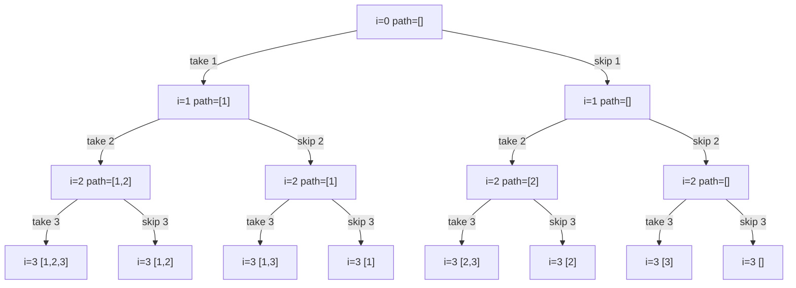
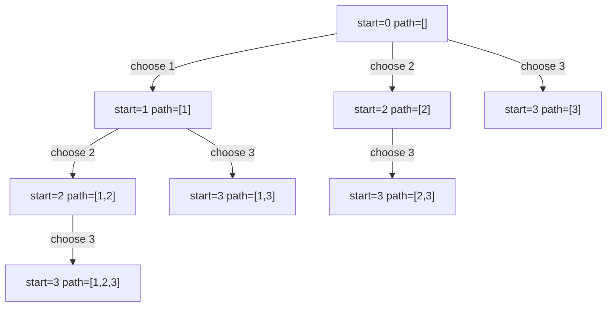
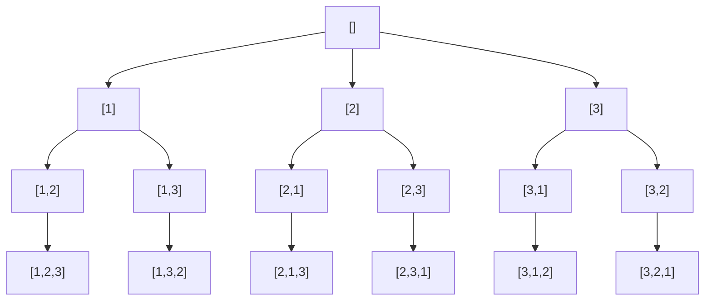
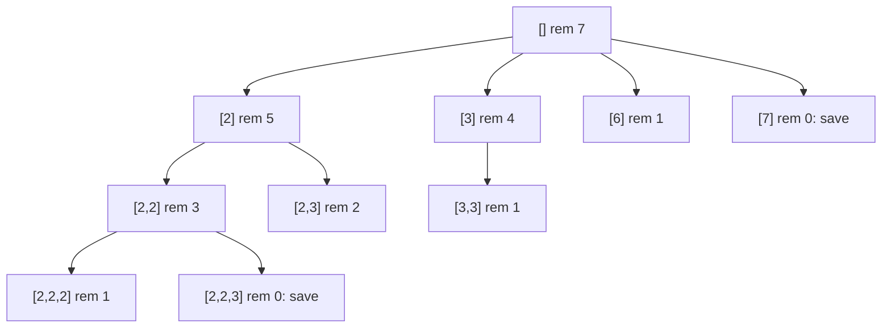
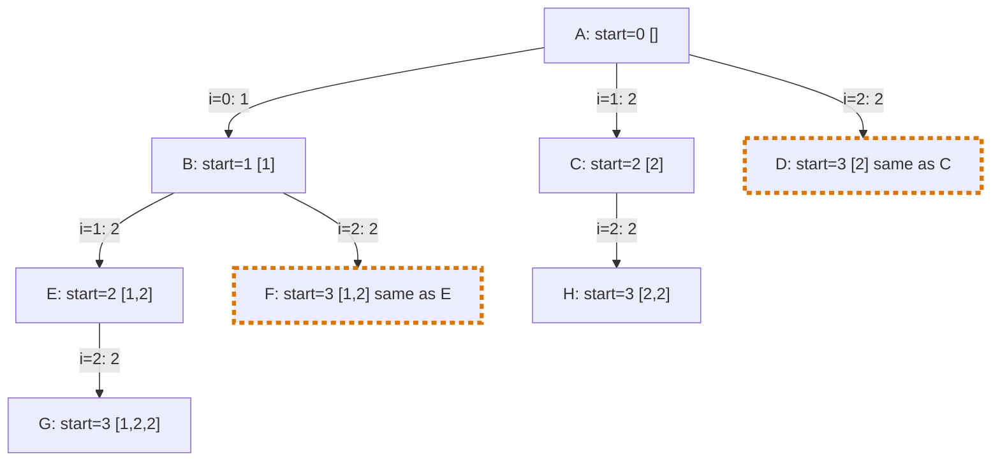
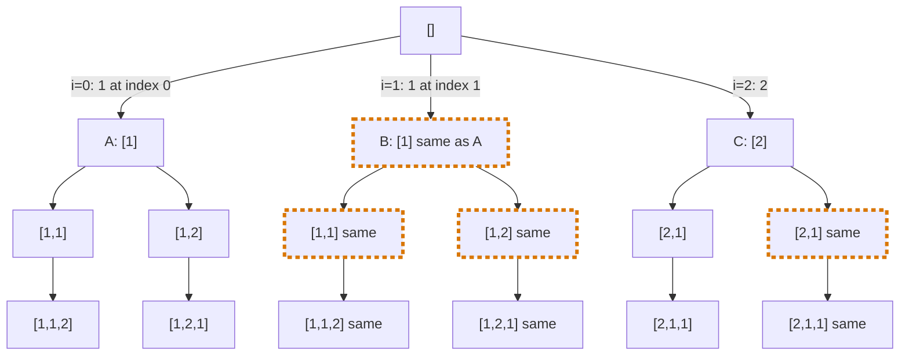

# Pattern 08: Recursion and Backtracking

## Overview

Backtracking is a search over a sequence of choices. The code makes one choice, explores everything that can follow it, **undoes** the choice, and then makes the next choice. It keeps one shared piece of state (a list, an array, a grid) that it changes and restores. It does not build a new copy of the state for each branch.

This page teaches the technique on one problem, Subsets, and then changes one thing at a time to reach permutations, combination sums, duplicates, N-Queens, and a grid search. The recursion basics (call stack, base case, how to trust the smaller call) are on a separate page. This page assumes them.

After this page you can:

1. Draw the decision tree of a new problem from three questions: what is a choice, when is the path complete, which choices are valid.
2. Trace a backtracking run and state what the shared `path` holds at each call and at each return.
3. Explain why the code must undo each choice, and show the wrong output that appears when it does not.
4. Write subsets, permutations, combination sums, duplicate handling, N-Queens, and word search in Java without a template.
5. Count the leaves of the tree and the work for each leaf, and use that count to read the constraint `n <= 20` or `n <= 10`.
6. Decide for a new problem whether it needs backtracking, dynamic programming, or plain graph traversal, and name the property that decides it.

## Prerequisites

| You need | Why this page needs it | Where to learn it |
|---|---|---|
| Recursion: call stack, base case, trust the smaller call, the recursion tree | Every algorithm on this page is a recursive method. This page does not teach these basics again | [Recursion](../foundations/09-recursion.md) |
| `ArrayList` operations: `add`, remove the last element, copy with `new ArrayList<>(list)` | The shared `path` is a list that the code grows and shrinks. The copy rule is the first bug in this lesson | [Java toolkit for problem solving](../java-toolkit.md) |
| Counting with powers and factorials (`2^n`, `n!`) | The complexity section counts the leaves of the tree | [Math for complexity](../foundations/00-math-for-complexity.md) |
| Big-O notation | The cost of each algorithm is counted from a trace and then written in O-notation | [Complexity analysis](../foundations/01-complexity-analysis.md) |
| Sorting an `int[]` | Duplicate handling and pruning in Combination Sum need sorted input | [Sorting algorithms](../foundations/08-sorting-algorithms.md) |
| Two-dimensional arrays (`char[][]`) | Word Search works on a grid | [Arrays, strings, and linked lists](../foundations/02-arrays-strings-linked-lists.md) |
| `StringBuilder`: `append`, `deleteCharAt` | Variation E and practice problems P5 and P6 build a string as the path and remove its last character | [Java toolkit for problem solving](../java-toolkit.md) |
| Bitwise and, or, not, and shift (`<<`) on an `int` | Practice problem P12 (Sudoku) stores a set of digits in the bits of one `int` | [Bit manipulation](../19-bit-manipulation/README.md) |

## Motivation

**The anchor problem: Subsets ([LC 78: Subsets](https://leetcode.com/problems/subsets/)).** Given an array of distinct integers, return every subset. A subset takes any number of the elements, in the original order, and may be empty. For `[1, 2, 3]` the answer has 8 subsets:

```text
[]  [1]  [2]  [3]  [1, 2]  [1, 3]  [2, 3]  [1, 2, 3]
```

The order of the 8 subsets in the answer does not matter.

**First attempt: nested loops.** Each element has two possibilities: it is in the subset or it is not. One loop can run over these two possibilities for one element. For 3 elements, use 3 loops:

```java
int[] nums = {1, 2, 3};
List<List<Integer>> result = new ArrayList<>();
for (int a = 0; a < 2; a++) {            // 1 = take nums[0], 0 = skip it
    for (int b = 0; b < 2; b++) {        // the same choice for nums[1]
        for (int c = 0; c < 2; c++) {    // the same choice for nums[2]
            List<Integer> subset = new ArrayList<>();
            if (a == 1) subset.add(nums[0]);
            if (b == 1) subset.add(nums[1]);
            if (c == 1) subset.add(nums[2]);
            result.add(subset);
        }
    }
}
```

This code gives the 8 subsets of `[1, 2, 3]`. It fails on every other input length. For `[1, 2, 3, 4]` the code needs a fourth loop, and the body needs a fourth `if`. The number of loops is fixed when you write the code, but the length of the input is known only when the program runs. No fixed set of loops handles an input of unknown length.

**The gap that this lesson closes:** the depth of the nesting must follow the length of the input. A method that calls itself has this property: each call is one level of nesting, and the program decides at run time how many levels to go down. The next section builds that method.

## Derivation

### Step 1: one loop level becomes one call

Look at what one loop level of the nested code does. It decides one element (take it or skip it), and then it hands control to the next level, which decides the next element. When the last level has decided, the code has a complete subset.

A method with the parameter `i` does the same work for any `i`:

```text
dfs(i): decide nums[i] (take it, or skip it), then call dfs(i + 1) for each decision.
        If i == nums.length, every element is decided. The path is complete.
```

The name `dfs` stands for depth-first search: the code follows one decision to the end before it returns and tries the other decision.

### Step 2: the decision tree

Draw every call and every decision for `[1, 2, 3]`. Each node is one call. A left edge is "take", and a right edge is "skip". The label of a node shows the index `i` and the elements that the code has taken so far.



Read the tree from the root to a leaf. The **root** is the top node, the first call. A **leaf** is a node with no child: the last call on a route. A node that has children is an inner node. The edges on a route from the root to a leaf are the decisions, and the label of the leaf is the subset that they build. The tree has 8 leaves, one for each of the 8 subsets, and 15 nodes in total (7 inner nodes and 8 leaves). This tree is the **decision tree**. The code does not build it in memory. The sequence of calls walks through it.

### Step 3: where does the code keep the elements that it took?

Each call must know which elements the code has taken so far. There are two ways to hold this knowledge.

- **A new list for each call.** Each call copies its parent's list and adds one element. Every node in the tree then costs a copy of up to `n` elements.
- **One shared list.** The code keeps one list, called `path`. Before the call for "take", the code adds `nums[i]` to `path`. After that call returns, the code removes `nums[i]` again. Each step changes one element.

This lesson uses the shared list. It saves the copying, and it gives the technique its name: after the code has explored a choice, it goes back (it **backtracks**) to the state before the choice.

### Step 4: the code and a full trace

The program below runs the method on `[1, 2, 3]`. It prints one line when a call starts and one line when the call returns. The indentation shows the depth. At a leaf, the program also saves the subset.

```java
import java.util.ArrayList;
import java.util.List;

public class SubsetsTrace {
    static int[] nums = {1, 2, 3};
    static List<List<Integer>> result = new ArrayList<>();
    static List<Integer> path = new ArrayList<>(); // the one shared list

    public static void main(String[] args) {
        dfs(0);
        System.out.println("result = " + result);
    }

    static void dfs(int i) {
        String pad = "  ".repeat(i);
        System.out.println(pad + "call   i=" + i + " path=" + path);
        if (i == nums.length) {
            result.add(new ArrayList<>(path)); // a copy: path changes later
            System.out.println(pad + "  save " + path);
        } else {
            path.add(nums[i]);                     // choice 1: take nums[i]
            dfs(i + 1);
            path.remove(path.size() - 1);          // undo the take
            dfs(i + 1);                            // choice 2: skip nums[i]
        }
        System.out.println(pad + "return i=" + i + " path=" + path);
    }
}
```

<!-- expected-output -->
```text
call   i=0 path=[]
  call   i=1 path=[1]
    call   i=2 path=[1, 2]
      call   i=3 path=[1, 2, 3]
        save [1, 2, 3]
      return i=3 path=[1, 2, 3]
      call   i=3 path=[1, 2]
        save [1, 2]
      return i=3 path=[1, 2]
    return i=2 path=[1, 2]
    call   i=2 path=[1]
      call   i=3 path=[1, 3]
        save [1, 3]
      return i=3 path=[1, 3]
      call   i=3 path=[1]
        save [1]
      return i=3 path=[1]
    return i=2 path=[1]
  return i=1 path=[1]
  call   i=1 path=[]
    call   i=2 path=[2]
      call   i=3 path=[2, 3]
        save [2, 3]
      return i=3 path=[2, 3]
      call   i=3 path=[2]
        save [2]
      return i=3 path=[2]
    return i=2 path=[2]
    call   i=2 path=[]
      call   i=3 path=[3]
        save [3]
      return i=3 path=[3]
      call   i=3 path=[]
        save []
      return i=3 path=[]
    return i=2 path=[]
  return i=1 path=[]
return i=0 path=[]
result = [[1, 2, 3], [1, 2], [1, 3], [1], [2, 3], [2], [3], []]
```

Click through the first branch of the trace. Each tab shows one step and the content of `path` after it.

=== "Move 1"

    `call i=0 path=[]`: the first call. Nothing is taken. The code adds `1` to `path`.

    ```text
    path = [1]
    ```

=== "Move 2"

    `call i=1 path=[1]`: the code took `1`. It adds `2`.

    ```text
    path = [1, 2]
    ```

=== "Move 3"

    `call i=2 path=[1, 2]`: the code adds `3`.

    ```text
    path = [1, 2, 3]
    ```

=== "Move 4"

    `call i=3 path=[1, 2, 3]`: `i` equals the length of the array. The code saves a copy of `[1, 2, 3]`.

    ```text
    path = [1, 2, 3]    result = [[1, 2, 3]]
    ```

=== "Move 5"

    `return i=3 path=[1, 2, 3]`: this call changed nothing, so `path` is the same as at the start of the call.

    ```text
    path = [1, 2, 3]
    ```

=== "Move 6"

    Back in the call `i=2`, the code removes `3` from `path`. Now `path` is `[1, 2]` again. The code makes the second choice, skip `3`: `call i=3 path=[1, 2]`. It saves `[1, 2]`.

    ```text
    path = [1, 2]       result = [[1, 2, 3], [1, 2]]
    ```

=== "Move 7"

    `return i=2 path=[1, 2]`: the call `i=2` started with `path=[1, 2]` and returns with `path=[1, 2]`.

    ```text
    path = [1, 2]
    ```

Compare each `call` line with the `return` line of the same indentation. The `path` values are always the same. Derivation Step 7 states this as the invariant.

The trace shows the cost. The tree has 15 calls: 8 leaves and 7 inner calls. Each inner call does one `add` and one `remove`. Each leaf copies the `path`, and the 8 copies hold `3 + 2 + 2 + 1 + 2 + 1 + 1 + 0 = 12` elements in total.

### Step 5: the bug that every reader makes

Every reader makes this bug once: the code saves `result.add(path)` and not `result.add(new ArrayList<>(path))`. The line looks correct. It stores the list. But `path` is one list object, and `result` stores a reference to that object, not a copy of its content. The program below runs three versions: the version that saves `path` itself, the version that skips the undo step (Step 6), and the correct version.

```java
import java.util.ArrayList;
import java.util.List;

public class SubsetsBugs {
    public static void main(String[] args) {
        int[] nums = {1, 2, 3};

        List<List<Integer>> noCopy = new ArrayList<>();
        dfs(nums, 0, new ArrayList<>(), noCopy, true, false);
        System.out.println("no copy: " + noCopy);
        System.out.println("same object? " + (noCopy.get(0) == noCopy.get(1)));

        List<List<Integer>> noUndo = new ArrayList<>();
        dfs(nums, 0, new ArrayList<>(), noUndo, false, true);
        System.out.println("no undo, one saved list on each line:");
        for (List<Integer> saved : noUndo) {
            System.out.println("  " + saved);
        }

        List<List<Integer>> right = new ArrayList<>();
        dfs(nums, 0, new ArrayList<>(), right, false, false);
        System.out.println("right:   " + right);
    }

    // saveSelf = true saves the path itself. skipUndo = true leaves out the remove step.
    static void dfs(int[] nums, int i, List<Integer> path, List<List<Integer>> result,
                    boolean saveSelf, boolean skipUndo) {
        if (i == nums.length) {
            result.add(saveSelf ? path : new ArrayList<>(path));
            return;
        }
        path.add(nums[i]);
        dfs(nums, i + 1, path, result, saveSelf, skipUndo);
        if (!skipUndo) path.remove(path.size() - 1);
        dfs(nums, i + 1, path, result, saveSelf, skipUndo);
    }
}
```

<!-- expected-output -->
```text
no copy: [[], [], [], [], [], [], [], []]
same object? true
no undo, one saved list on each line:
  [1, 2, 3]
  [1, 2, 3]
  [1, 2, 3, 3]
  [1, 2, 3, 3]
  [1, 2, 3, 3, 2, 3]
  [1, 2, 3, 3, 2, 3]
  [1, 2, 3, 3, 2, 3, 3]
  [1, 2, 3, 3, 2, 3, 3]
right:   [[1, 2, 3], [1, 2], [1, 3], [1], [2, 3], [2], [3], []]
```

The first line is the wrong output of this step: a list of 8 empty lists. The reason: the result holds 8 references to one list. The second line confirms it (`same object? true`). The code undoes every choice, so the one `path` list is empty when the run ends. All 8 references then show the empty list. Copy the content at the moment of the save: `new ArrayList<>(path)`.

### Step 6: why the code must undo each choice

Why does the code remove `nums[i]` after the "take" call? Remove that line and look at what happens. This trace has the call lines only. The remove step is missing.

```java
import java.util.ArrayList;
import java.util.List;

public class NoUndoTrace {
    static int[] nums = {1, 2, 3};
    static List<Integer> path = new ArrayList<>();

    public static void main(String[] args) {
        dfs(0);
    }

    static void dfs(int i) {
        String pad = "  ".repeat(i);
        System.out.println(pad + "call   i=" + i + " path=" + path);
        if (i == nums.length) {
            System.out.println(pad + "  save " + path);
            return;
        }
        path.add(nums[i]);
        dfs(i + 1);
        // the remove step is missing here
        dfs(i + 1);
    }
}
```

<!-- expected-output -->
```text
call   i=0 path=[]
  call   i=1 path=[1]
    call   i=2 path=[1, 2]
      call   i=3 path=[1, 2, 3]
        save [1, 2, 3]
      call   i=3 path=[1, 2, 3]
        save [1, 2, 3]
    call   i=2 path=[1, 2, 3]
      call   i=3 path=[1, 2, 3, 3]
        save [1, 2, 3, 3]
      call   i=3 path=[1, 2, 3, 3]
        save [1, 2, 3, 3]
  call   i=1 path=[1, 2, 3, 3]
    call   i=2 path=[1, 2, 3, 3, 2]
      call   i=3 path=[1, 2, 3, 3, 2, 3]
        save [1, 2, 3, 3, 2, 3]
      call   i=3 path=[1, 2, 3, 3, 2, 3]
        save [1, 2, 3, 3, 2, 3]
    call   i=2 path=[1, 2, 3, 3, 2, 3]
      call   i=3 path=[1, 2, 3, 3, 2, 3, 3]
        save [1, 2, 3, 3, 2, 3, 3]
      call   i=3 path=[1, 2, 3, 3, 2, 3, 3]
        save [1, 2, 3, 3, 2, 3, 3]
```

Follow the first wrong step. The call `i=3 path=[1, 2, 3]` saves `[1, 2, 3]` and returns. The code is now back in the call `i=2`. This call wants the "skip 3" branch, which must start from `[1, 2]`. But `path` still holds `[1, 2, 3]`, because nothing removed the `3`. The next call prints `i=3 path=[1, 2, 3]` and saves `[1, 2, 3]` a second time. The wrong state then grows with each branch. The saved lists in the output of the Step 5 program are `[1, 2, 3]` twice, then lists with repeated elements such as `[1, 2, 3, 3, 2, 3, 3]`. The correct answer has 8 different lists.

Each branch of the tree must start from the state that its parent had. The shared list has this state only if the code restores it after each branch.

### Step 7: the invariant, and why the result is correct

**Invariant.** When a call of `dfs` returns, `path` has the same content as when that call started.

The reason, in four steps:

1. A leaf call (`i == n`) does not change `path`. It only copies it. The invariant holds for a leaf.
2. An inner call does these steps in this order: it adds `nums[i]`, it calls `dfs(i + 1)`, it removes the last element, and it calls `dfs(i + 1)` again.
3. Each `dfs(i + 1)` returns with `path` unchanged, because the invariant holds for the calls with a larger `i`. (The proof starts at the leaves and goes up.)
4. So the first call starts with `path = P`, the add makes it `P + [nums[i]]`, the first `dfs(i + 1)` leaves it as `P + [nums[i]]`, the remove gives `P` again, and the second `dfs(i + 1)` leaves it as `P`. The call returns with `P`.

The invariant gives the correctness of the result. At the start of each branch, `path` holds exactly the elements that the code took on the route from the root to that node. Each leaf is a different route. So the 8 leaves hold 8 different subsets. Every subset is a route (a take or skip for each index), and the code follows every route, so no subset is missing.

**Cost, counted from the trace.** The trace has 15 calls for 3 elements. Each added element doubles the number of leaves, so `n` elements have `2^n` leaves and `2^(n+1) - 1` calls. The leaf copies hold `n · 2^(n-1)` elements in total, because each element is in half of the subsets (for `n = 3`: 3 · 4 = 12, as counted in Step 4). The recursion is `n + 1` calls deep, so the stack uses `O(n)` space apart from the result. The time is `O(n · 2^n)`. The Complexity section checks these counts with a program.

## The Pattern

A backtracking search walks a decision tree. At each node the code has a **path** (the choices so far). The code tries each valid choice, adds it to the path, explores below it, and removes it again. When the path is complete, the code saves a copy of it. One shared path is enough, because the invariant says that each branch starts from the state of its parent.

The three questions to ask in a new problem:

1. **What is a choice?** (One decision that moves the path one step further.)
2. **When is the path complete?** (The condition at which the code saves the path or returns an answer.)
3. **Which choices are valid?** (The test that removes a choice before the code adds it. A failed test cuts off the whole subtree below that choice.)

| Term | What it was in Subsets | The question to ask in a new problem |
|---|---|---|
| Choice | Take `nums[i]`, or skip it | What decision does one call make? |
| Path (state) | The list `path` | What do I need to know about the choices so far? |
| Decision tree | The tree of 15 calls | How many choices does a node have, and how deep is the tree? |
| Complete | `i == nums.length` | When is the path a full answer? |
| Valid choice | Both choices are always valid | Which choices lead to no answer at all? |
| Make, undo | `path.add(...)`, `path.remove(...)` | What must I restore so that the next branch starts clean? |
| Prune (cut off the subtree below a choice) | Not needed in Subsets | Can I tell, before I go down, that nothing below this node is an answer? |
| Backtrack | The return from a call | After the return, is the state the same as before the call? |

### Two shapes of the tree

The take-or-skip tree decides one index at a time. A second shape asks a different question at each node: "Which element do I add next?" The code then loops over the elements that come after the last pick. A parameter `start` marks where the loop begins. Every node of this tree is already a subset, so each call saves its path at the start.



The code of the second shape:

```java
import java.util.ArrayList;
import java.util.List;

public class StartTrace {
    static int[] nums = {1, 2, 3};
    static List<List<Integer>> result = new ArrayList<>();
    static List<Integer> path = new ArrayList<>();

    public static void main(String[] args) {
        dfs(0);
        System.out.println("result = " + result);
    }

    static void dfs(int start) {
        String pad = "  ".repeat(path.size());
        System.out.println(pad + "call   start=" + start + " path=" + path + " -> save");
        result.add(new ArrayList<>(path));         // every path is a complete subset
        for (int i = start; i < nums.length; i++) {
            path.add(nums[i]);                     // choose nums[i]
            dfs(i + 1);                            // next choice: only elements after i
            path.remove(path.size() - 1);          // undo
        }
        System.out.println(pad + "return start=" + start + " path=" + path);
    }
}
```

<!-- expected-output -->
```text
call   start=0 path=[] -> save
  call   start=1 path=[1] -> save
    call   start=2 path=[1, 2] -> save
      call   start=3 path=[1, 2, 3] -> save
      return start=3 path=[1, 2, 3]
    return start=2 path=[1, 2]
    call   start=3 path=[1, 3] -> save
    return start=3 path=[1, 3]
  return start=1 path=[1]
  call   start=2 path=[2] -> save
    call   start=3 path=[2, 3] -> save
    return start=3 path=[2, 3]
  return start=2 path=[2]
  call   start=3 path=[3] -> save
  return start=3 path=[3]
return start=0 path=[]
result = [[], [1], [1, 2], [1, 2, 3], [1, 3], [2], [2, 3], [3]]
```

The `start` index is what prevents repeats. After the code picks `2` at the root, the loop in that call can pick only `3`, not `1`. The subset `[2, 1]` can never appear, and `[1, 2]` appears once. The same invariant holds: the `return` line shows the same `path` as the `call` line of the same call.

**Both shapes, side by side.** Both trees produce the same 8 subsets, in a different order. The left half of the table lists the 15 calls of the take-or-skip tree in the order of the trace (Step 4). The right half lists the 8 calls of the start-index tree (the trace above).

| Call | Take or skip: `i`, `path` at the call | Saves | Start index: `start`, `path` at the call | Saves |
|---|---|---|---|---|
| 1 | 0, `[]` | | 0, `[]` | `[]` |
| 2 | 1, `[1]` | | 1, `[1]` | `[1]` |
| 3 | 2, `[1, 2]` | | 2, `[1, 2]` | `[1, 2]` |
| 4 | 3, `[1, 2, 3]` | `[1, 2, 3]` | 3, `[1, 2, 3]` | `[1, 2, 3]` |
| 5 | 3, `[1, 2]` | `[1, 2]` | 3, `[1, 3]` | `[1, 3]` |
| 6 | 2, `[1]` | | 2, `[2]` | `[2]` |
| 7 | 3, `[1, 3]` | `[1, 3]` | 3, `[2, 3]` | `[2, 3]` |
| 8 | 3, `[1]` | `[1]` | 3, `[3]` | `[3]` |
| 9 | 1, `[]` | | | |
| 10 | 2, `[2]` | | | |
| 11 | 3, `[2, 3]` | `[2, 3]` | | |
| 12 | 3, `[2]` | `[2]` | | |
| 13 | 2, `[]` | | | |
| 14 | 3, `[3]` | `[3]` | | |
| 15 | 3, `[]` | `[]` | | |

The take-or-skip tree makes 15 calls and saves only at the leaves (depth `n`). The start-index tree makes 8 calls, one for each subset, and saves at every call. It has no call that only passes the decision to the next index.

### Variants of the pattern

Each variant changes one part of the three questions. The property of the problem selects the variant.

| Variant | What it changes | The property of the problem that selects it | Example |
|---|---|---|---|
| Take or skip at each index | One yes/no choice per index | The answer is a subset or a selection, and the code decides each element in input order | [LC 78: Subsets](https://leetcode.com/problems/subsets/) |
| Choose the next from the remaining, with `start` | The loop starts at `start`, and the next call gets `i + 1` | The order of the picks does not matter: `[1, 2]` and `[2, 1]` are the same answer | [LC 77: Combinations](https://leetcode.com/problems/combinations/) |
| Choose from all unused, with a `used` array | The loop starts at 0, and an array marks the elements in the path | The order matters, and each element is used once | [LC 46: Permutations](https://leetcode.com/problems/permutations/) |
| Pass `i`, not `i + 1` | The next call may pick the same element again | The statement allows unlimited reuse of an element | [LC 39: Combination Sum](https://leetcode.com/problems/combination-sum/) |
| Sort, then skip an equal neighbor | A test in the loop skips a value that the same loop already tried | The input has equal values, and equal answers must appear once | [LC 90: Subsets II](https://leetcode.com/problems/subsets-ii/) |
| Sets for the constraints | Constant-time sets replace a scan of the path | The validity test asks "is this column or diagonal used?" | [LC 51: N-Queens](https://leetcode.com/problems/n-queens/) |
| Mark and restore a cell | The grid is the path | The path must not reuse a cell, and different paths may share cells | [LC 79: Word Search](https://leetcode.com/problems/word-search/) |
| Return `true` at the first answer | The method returns a boolean, and the caller stops the search | The problem asks for one solution, not all | [LC 37: Sudoku Solver](https://leetcode.com/problems/sudoku-solver/) |

### Variations A to E

These five problems keep the same structure. Each changes the choice or the validity test.

**Variation A: Palindrome Partitioning ([LC 131: Palindrome Partitioning](https://leetcode.com/problems/palindrome-partitioning/)).** Split a string into pieces so that each piece is a palindrome. The choice at a position is where the next piece ends. At each position the code tries each prefix that is a palindrome. The solution is in the practice ladder, problem P9.

**Variation B: Generate Parentheses ([LC 22: Generate Parentheses](https://leetcode.com/problems/generate-parentheses/)).** Generate all valid strings of `n` pairs. The code tracks two counts, `open` and `close`. The code may add `(` if `open < n`. The code may add `)` if `close < open`. The solution is in the practice ladder, problem P6.

**Variation C: Letter Combinations of a Phone Number ([LC 17: Letter Combinations of a Phone Number](https://leetcode.com/problems/letter-combinations-of-a-phone-number/)).** Each digit has its own list of letters. The choice at level `pos` is one letter of the digit at `pos`. The solution is in the practice ladder, problem P5.

**Variation D: Expression Add Operators ([LC 282: Expression Add Operators](https://leetcode.com/problems/expression-add-operators/)).** Put `+`, `-`, or `*` between the digits of a string so that the value equals a target. The state holds the text so far, its value, and its last term. A product must change only the last term, because `*` binds tighter than `+`: the new value is `value - last + last * number`.

**Variation E: all paths in a grid.** List every path from the top-left cell to the bottom-right cell if the moves are only down and right. The code appends a letter to the path before the move and removes it after the move. The count of paths is a binomial coefficient (choose which of the moves are the down moves), so for a question that asks only "how many paths", a table with one cell for each grid cell is enough (dynamic programming, [Pattern 15](../15-dynamic-programming/README.md)).

The program below holds variations D and E. The path in D is an immutable `String`, so the code needs no undo step: each call gets a new string and the caller's string does not change. The path in E is a `StringBuilder`, so it needs the undo step `deleteCharAt`.

```java
import java.util.ArrayList;
import java.util.List;

public class VariationsDemo {
    public static void main(String[] args) {
        System.out.println("grid paths 2 x 3: " + gridPaths(2, 3));
        System.out.println("grid paths 1 x 1, count: " + gridPaths(1, 1).size());
        System.out.println("grid paths 3 x 3, count: " + gridPaths(3, 3).size());
        System.out.println("\"123\", 6:  " + addOperators("123", 6));
        System.out.println("\"232\", 8:  " + addOperators("232", 8));
        System.out.println("\"105\", 5:  " + addOperators("105", 5));
        System.out.println("\"00\", 0:   " + addOperators("00", 0));
        System.out.println("\"3456237490\", 9191: " + addOperators("3456237490", 9191));
    }

    // Variation E: every path from the top-left to the bottom-right cell, moving down or right.
    static List<String> gridPaths(int rows, int cols) {
        List<String> result = new ArrayList<>();
        walk(0, 0, rows, cols, new StringBuilder(), result);
        return result;
    }

    private static void walk(int row, int col, int rows, int cols, StringBuilder path,
                             List<String> result) {
        if (row == rows - 1 && col == cols - 1) {
            result.add(path.toString());
            return;
        }
        if (row + 1 < rows) {
            path.append('D');
            walk(row + 1, col, rows, cols, path, result);
            path.deleteCharAt(path.length() - 1);
        }
        if (col + 1 < cols) {
            path.append('R');
            walk(row, col + 1, rows, cols, path, result);
            path.deleteCharAt(path.length() - 1);
        }
    }

    // Variation D: put +, -, or * between the digits (or nothing) so that the value is target.
    static List<String> addOperators(String digits, long target) {
        List<String> result = new ArrayList<>();
        extend(digits, target, 0, "", 0, 0, result);
        return result;
    }

    // expression = text so far, value = its value, last = the last term of the expression.
    // A product changes only the last term: value - last + last * number.
    private static void extend(String digits, long target, int pos, String expression,
                               long value, long last, List<String> result) {
        if (pos == digits.length()) {
            if (value == target) result.add(expression);
            return;
        }
        for (int end = pos; end < digits.length(); end++) {
            if (end > pos && digits.charAt(pos) == '0') break; // no number with a leading zero
            String part = digits.substring(pos, end + 1);
            long number = Long.parseLong(part);
            if (pos == 0) {
                extend(digits, target, end + 1, part, number, number, result);
                continue;
            }
            extend(digits, target, end + 1, expression + "+" + part, value + number, number,
                    result);
            extend(digits, target, end + 1, expression + "-" + part, value - number, -number,
                    result);
            extend(digits, target, end + 1, expression + "*" + part,
                    value - last + last * number, last * number, result);
        }
    }
}
```

<!-- expected-output -->
```text
grid paths 2 x 3: [DRR, RDR, RRD]
grid paths 1 x 1, count: 1
grid paths 3 x 3, count: 6
"123", 6:  [1+2+3, 1*2*3]
"232", 8:  [2+3*2, 2*3+2]
"105", 5:  [1*0+5, 10-5]
"00", 0:   [0+0, 0-0, 0*0]
"3456237490", 9191: []
```

## Worked Examples

Each example changes one thing about the anchor problem. The order goes from the smallest change to the largest.

### Example 1: Permutations (LC 46)

**Statement.** Given an array of distinct integers, return all orderings of the array ([LC 46: Permutations](https://leetcode.com/problems/permutations/)). For `[1, 2, 3]` the answer has 6 lists: `[1, 2, 3]`, `[1, 3, 2]`, `[2, 1, 3]`, `[2, 3, 1]`, `[3, 1, 2]`, `[3, 2, 1]`.

**What changed.** In Subsets, `[1, 2]` and `[2, 1]` were the same answer, so the start index let the code look only forward. Here they are two different answers. The order matters, so at each position the code may pick any element that is not in the path yet. There is no `start`. The code needs another way to know which elements the path holds. The path is complete when it has `n` elements, not when an index reaches the end.

**From brute force to the solution.**

1. *Brute force:* write `n` nested loops, one for each position, and skip the sequences with a repeated element. This has the same fault as in the motivation (the number of loops is fixed), and it also tries `n^n` sequences. For `n = 10` that is 10,000,000,000 sequences, and only 3,628,800 of them are valid.
2. *One call for each position.* A call decides position `path.size()`. The choice is "which element goes here".
3. *Which elements are valid?* An element is valid if it is not in the path. The test `path.contains(x)` scans the path, which costs `O(n)`. A `boolean[] used` array answers the same question in `O(1)`. The code sets `used[i] = true` when it adds `nums[i]` and `used[i] = false` when it removes it. This is a second piece of shared state, and it has the same undo rule as `path`.

The decision tree for `[1, 2, 3]`: each node has one child for each unused element.



The program prints one line for each call. `used=TFF` means that only `nums[0]` is in the path.

```java
import java.util.ArrayList;
import java.util.List;

public class PermutationsTrace {
    static int[] nums = {1, 2, 3};
    static List<List<Integer>> result = new ArrayList<>();
    static List<Integer> path = new ArrayList<>();
    static boolean[] used = new boolean[nums.length];

    public static void main(String[] args) {
        dfs();
        System.out.println("result = " + result);
    }

    static void dfs() {
        String pad = "  ".repeat(path.size());
        System.out.println(pad + "call path=" + path + " used=" + flags());
        if (path.size() == nums.length) {
            result.add(new ArrayList<>(path));
            System.out.println(pad + "  save " + path);
            return;
        }
        for (int i = 0; i < nums.length; i++) {
            if (used[i]) continue;                 // nums[i] is already in path
            used[i] = true;                        // choose nums[i]
            path.add(nums[i]);
            dfs();
            path.remove(path.size() - 1);          // undo both changes
            used[i] = false;
        }
    }

    static String flags() {
        StringBuilder text = new StringBuilder();
        for (boolean flag : used) text.append(flag ? 'T' : 'F');
        return text.toString();
    }
}
```

<!-- expected-output -->
```text
call path=[] used=FFF
  call path=[1] used=TFF
    call path=[1, 2] used=TTF
      call path=[1, 2, 3] used=TTT
        save [1, 2, 3]
    call path=[1, 3] used=TFT
      call path=[1, 3, 2] used=TTT
        save [1, 3, 2]
  call path=[2] used=FTF
    call path=[2, 1] used=TTF
      call path=[2, 1, 3] used=TTT
        save [2, 1, 3]
    call path=[2, 3] used=FTT
      call path=[2, 3, 1] used=TTT
        save [2, 3, 1]
  call path=[3] used=FFT
    call path=[3, 1] used=TFT
      call path=[3, 1, 2] used=TTT
        save [3, 1, 2]
    call path=[3, 2] used=FTT
      call path=[3, 2, 1] used=TTT
        save [3, 2, 1]
result = [[1, 2, 3], [1, 3, 2], [2, 1, 3], [2, 3, 1], [3, 1, 2], [3, 2, 1]]
```

Check the invariant on `used`: in the call `path=[1] used=TFF`, the loop takes `nums[1]` and the child shows `used=TTF`. When the child returns, the code sets `used[1] = false`, and the next child (`nums[2]`) starts from `used=TFF` again, so it shows `used=TFT`.

**Complexity.** The tree has `n!` leaves. The Complexity section counts about `e · n!` calls (2.718 · n!). Each call loops over `n` elements, and each leaf copies `n` elements, so the time is `O(n · n!)`. The space is `O(n)` for `path`, `used`, and the stack, apart from the result.

**The mistake that this problem invites:** reusing the start index from Subsets. Then the answer for `[1, 2, 3]` is only `[[1, 2, 3]]`. Common Mistakes, number 5, shows this output.

### Example 2: Combination Sum (LC 39)

**Statement.** Given distinct positive integers `candidates` and a positive `target`, return all different combinations of candidates that sum to `target`. The code may use the same candidate any number of times ([LC 39: Combination Sum](https://leetcode.com/problems/combination-sum/)). Two combinations are different if some number appears a different number of times. For `candidates = [2, 3, 6, 7]` and `target = 7` the answer is `[[2, 2, 3], [7]]`.

**What changed.** Three things change at once, and each has its own reason.

1. *Reuse is allowed.* After the code picks `candidates[i]`, the next pick may be `candidates[i]` again. In Subsets the next call received `i + 1`. Here it receives `i`.
2. *The path is complete when its sum reaches the target,* not when a length is reached. The code needs one more number for this: `remaining`, which is the target minus the sum of the path. A pick lowers `remaining` by its value.
3. *Some choices are invalid.* A candidate that is larger than `remaining` cannot lead to an answer. This is the first validity test that depends on a number that changes along the path. It cuts off whole subtrees.

**From brute force to the solution.**

1. *Pass `i + 1`, as in Subsets.* The code then uses each candidate at most once. The output for `[2, 3, 6, 7]` and `7` is `[[7]]`, which misses `[2, 2, 3]`. Reuse needs `i`.
2. *Pass `i`.* The code can pick `2, 2, 3`. It never picks `3, 2, 2`, because the loop in a call starts at `start`, so a later pick can never go back to a smaller index. So each multiset of candidates appears once. (A multiset is a collection in which the order does not count and a value can repeat.)
3. *When does the recursion stop?* All candidates are positive, so each pick lowers `remaining` by at least 1. After at most `target` picks, `remaining` is 0 or below. The code returns when `remaining == 0` (save) or `remaining < 0` (dead end).
4. *Prune.* Sort the candidates in ascending order. In the loop, once `candidates[i] > remaining`, every later candidate is also larger than `remaining`, because the array is sorted. So the code can `break` and skip all of them, not only this one.

The program below runs three versions on `[2, 3, 6, 7]` with target 7: the plain version (it prints its trace), the pruned version, and the wrong version with `i + 1`. It counts the calls of the first two.

```java
import java.util.ArrayList;
import java.util.Arrays;
import java.util.List;

public class CombinationSumTrace {
    static int calls;

    public static void main(String[] args) {
        int[] candidates = {2, 3, 6, 7};
        int target = 7;

        calls = 0;
        List<List<Integer>> plain = new ArrayList<>();
        dfsPlain(candidates, 0, target, new ArrayList<>(), plain);
        System.out.println("no pruning: " + plain + ", calls = " + calls);

        calls = 0;
        List<List<Integer>> pruned = new ArrayList<>();
        int[] sorted = candidates.clone();
        Arrays.sort(sorted);
        dfsPruned(sorted, 0, target, new ArrayList<>(), pruned);
        System.out.println("pruning:    " + pruned + ", calls = " + calls);

        List<List<Integer>> noReuse = new ArrayList<>();
        dfsWrongNext(sorted, 0, target, new ArrayList<>(), noReuse);
        System.out.println("i + 1:      " + noReuse);
    }

    // Tries every candidate and stops only when the remaining sum is 0 or below.
    static void dfsPlain(int[] c, int start, int remaining, List<Integer> path,
                         List<List<Integer>> result) {
        calls++;
        System.out.println("  ".repeat(path.size()) + "plain  path=" + path
                + " remaining=" + remaining);
        if (remaining < 0) return;
        if (remaining == 0) {
            result.add(new ArrayList<>(path));
            return;
        }
        for (int i = start; i < c.length; i++) {
            path.add(c[i]);
            dfsPlain(c, i, remaining - c[i], path, result); // i, not i + 1: reuse is allowed
            path.remove(path.size() - 1);
        }
    }

    // Needs a sorted array: after the first candidate that is too big, all later ones are too big.
    static void dfsPruned(int[] c, int start, int remaining, List<Integer> path,
                          List<List<Integer>> result) {
        calls++;
        if (remaining == 0) {
            result.add(new ArrayList<>(path));
            return;
        }
        for (int i = start; i < c.length; i++) {
            if (c[i] > remaining) break;
            path.add(c[i]);
            dfsPruned(c, i, remaining - c[i], path, result);
            path.remove(path.size() - 1);
        }
    }

    static void dfsWrongNext(int[] c, int start, int remaining, List<Integer> path,
                             List<List<Integer>> result) {
        if (remaining == 0) {
            result.add(new ArrayList<>(path));
            return;
        }
        for (int i = start; i < c.length; i++) {
            if (c[i] > remaining) break;
            path.add(c[i]);
            dfsWrongNext(c, i + 1, remaining - c[i], path, result);
            path.remove(path.size() - 1);
        }
    }
}
```

<!-- expected-output -->
```text
plain  path=[] remaining=7
  plain  path=[2] remaining=5
    plain  path=[2, 2] remaining=3
      plain  path=[2, 2, 2] remaining=1
        plain  path=[2, 2, 2, 2] remaining=-1
        plain  path=[2, 2, 2, 3] remaining=-2
        plain  path=[2, 2, 2, 6] remaining=-5
        plain  path=[2, 2, 2, 7] remaining=-6
      plain  path=[2, 2, 3] remaining=0
      plain  path=[2, 2, 6] remaining=-3
      plain  path=[2, 2, 7] remaining=-4
    plain  path=[2, 3] remaining=2
      plain  path=[2, 3, 3] remaining=-1
      plain  path=[2, 3, 6] remaining=-4
      plain  path=[2, 3, 7] remaining=-5
    plain  path=[2, 6] remaining=-1
    plain  path=[2, 7] remaining=-2
  plain  path=[3] remaining=4
    plain  path=[3, 3] remaining=1
      plain  path=[3, 3, 3] remaining=-2
      plain  path=[3, 3, 6] remaining=-5
      plain  path=[3, 3, 7] remaining=-6
    plain  path=[3, 6] remaining=-2
    plain  path=[3, 7] remaining=-3
  plain  path=[6] remaining=1
    plain  path=[6, 6] remaining=-5
    plain  path=[6, 7] remaining=-6
  plain  path=[7] remaining=0
no pruning: [[2, 2, 3], [7]], calls = 28
pruning:    [[2, 2, 3], [7]], calls = 10
i + 1:      [[7]]
```

The plain run makes 28 calls. 18 of them end with a negative `remaining`: they are dead ends that the code reaches only to find out that they are dead. The pruned run makes 10 calls and finds the same two combinations. The pruned tree:



The pruned tree has 10 nodes. The 18 calls that it removes (28 - 10) are exactly the 18 calls of the plain run that have a negative `remaining`. The pruned code never makes a pick that is too big.

**Complexity.** Let `N` be the number of candidates, `T` the target, and `M` the smallest candidate. The tree has at most `N` children for each node and at most `T / M` levels, so the number of nodes is at most about `N^(T/M)`. This is an upper bound, and it is loose, because the start index and the pruning remove most of the nodes. The space is `O(T / M)` for the path and the stack.

**The mistake that this problem invites:** a candidate of 0 or a negative candidate. Then `remaining` does not fall, and the recursion never ends. The Recognition Guide shows the output of this input.

### Example 3: Subsets II (LC 90)

**Statement.** The input may contain equal values. Return all different subsets ([LC 90: Subsets II](https://leetcode.com/problems/subsets-ii/)). For `[1, 2, 2]` the answer has 6 subsets: `[]`, `[1]`, `[1, 2]`, `[1, 2, 2]`, `[2]`, `[2, 2]`. The code from Subsets gives 8 lists, and `[1, 2]` and `[2]` each appear twice.

**What changed.** Two different indexes can hold the same value. The code treats `nums[1]` and `nums[2]` as different elements, so it builds the same list twice. The code must find the repeat in the tree and cut it.

**Derive the rule from the tree.** Draw the start-index tree for `[1, 2, 2]`. Name the two twos by their index: `2` at index 1 and `2` at index 2. The loop of each call picks the next element from `nums[start..]`.



The two dashed nodes `D` and `F` repeat a list that another node already has. Ask what `D` and `F` have in common. Both come from an edge with `i=2`, in a loop that has already used `i=1`, and `nums[1] == nums[2]`. Now compare the two nodes `C` and `D`, which are both children of the root. The subtree below `C` can still pick index 2 (`start=2`), so it contains everything that the subtree below `D` could contain. The same holds for `E` and `F`. So the later equal sibling adds nothing new.

This gives the rule. In one loop, if `nums[i]` equals the value that the same loop tried just before, skip `i`. The earlier equal value covers every list that `i` could start.

Now find the exact test.

- *"Equal to the value tried just before"* is `nums[i] == nums[i - 1]`. This test finds the earlier equal value only if equal values are neighbors. So the code **sorts the array first**.
- *"In the same loop"* means that `i - 1` was also a candidate of this loop, so `i - 1 >= start`, which is `i > start`. If `i == start`, the element `i - 1` is not in this loop. It is already in the path (the code picked it at a higher level). The code must still pick `nums[start]` then. The node `G` shows why: the list `[1, 2, 2]` needs the second `2` right after the first `2`, and that edge has `i == start`.

The rule: `if (i > start && nums[i] == nums[i - 1]) continue;`. The program prints the trace of the sorted input `[1, 2, 2]`. A `skip` line marks each cut.

```java
import java.util.ArrayList;
import java.util.Arrays;
import java.util.List;

public class SubsetsDupTrace2 {
    static List<List<Integer>> result = new ArrayList<>();
    static List<Integer> path = new ArrayList<>();

    public static void main(String[] args) {
        int[] nums = {2, 1, 2};
        Arrays.sort(nums);                         // [1, 2, 2]: equal values are neighbors
        dfs(nums, 0);
        System.out.println("result = " + result);
    }

    static void dfs(int[] nums, int start) {
        String pad = "  ".repeat(path.size());
        System.out.println(pad + "call start=" + start + " path=" + path + " -> save");
        result.add(new ArrayList<>(path));
        for (int i = start; i < nums.length; i++) {
            if (i > start && nums[i] == nums[i - 1]) {
                System.out.println(pad + "  skip i=" + i + ": equals nums[" + (i - 1)
                        + "] and i > start=" + start);
                continue;                          // this loop already tried this value
            }
            path.add(nums[i]);
            dfs(nums, i + 1);
            path.remove(path.size() - 1);
        }
    }
}
```

<!-- expected-output -->
```text
call start=0 path=[] -> save
  call start=1 path=[1] -> save
    call start=2 path=[1, 2] -> save
      call start=3 path=[1, 2, 2] -> save
    skip i=2: equals nums[1] and i > start=1
  call start=2 path=[2] -> save
    call start=3 path=[2, 2] -> save
  skip i=2: equals nums[1] and i > start=0
result = [[], [1], [1, 2], [1, 2, 2], [2], [2, 2]]
```

The two `skip` lines are the nodes `F` and `D` of the tree. The result has 6 lists, each once. The input `[2, 1, 2]` (unsorted) gives the same result because the code sorts first.

The test `i > 0` in place of `i > start` looks like the same rule, but it also skips the edge with `i == start`. On `[1, 2, 2]` it skips the second `2` when the first `2` is already in the path, and it prints `[[], [1], [1, 2], [2]]`: the lists `[1, 2, 2]` and `[2, 2]` are lost. The program in Common Mistakes, number 3, prints this output.

**Complexity.** The tree has at most `2^n` nodes, and each saved subset costs up to `n` to copy, so the time is `O(n · 2^n)`. The sort costs `O(n log n)`, which is smaller. The space is `O(n)` apart from the result.

### The same repeat in permutations (LC 47)

**Statement.** The input of Permutations may contain equal values. Return all different permutations ([LC 47: Permutations II](https://leetcode.com/problems/permutations-ii/)). For `[1, 1, 2]` the answer has 3 lists: `[1, 1, 2]`, `[1, 2, 1]`, `[2, 1, 1]`. The code of Example 1 gives 6 lists, and each of the 3 lists appears twice.

**What changed.** The Subsets II rule `i > start` cannot work here, because the loop of a permutation starts at 0 at every level, so there is no `start`. The repeats must be found in the tree again. Sort the array, and name the two ones by their index: `1` at index 0 and `1` at index 1. The tree below is the complete tree for `[1, 1, 2]`.



The node `B` repeats the node `A`: both hold `[1]`, and the subtree below `B` holds the same lists as the subtree below `A`. The second `[2, 1]` below `C` repeats the first one in the same way. Ask what the two repeated edges have in common. Each one has an index `i` with `nums[i] == nums[i - 1]`, and the loop has already tried index `i - 1` in the same call. Index `i - 1` is **not** in the path at that moment.

Now look at the edge from `A` to `[1, 1]`. It also has `nums[i] == nums[i - 1]`, with `i = 1`. But index 0 is in the path, because the code picked it one level higher. This edge must stay, because the list `[1, 1, 2]` needs it. So the test must tell two cases apart: index `i - 1` is in the path (keep the edge), or index `i - 1` is not in the path (skip the edge). The array `used` holds exactly this fact. The rule: `if (i > 0 && nums[i] == nums[i - 1] && !used[i - 1]) continue;`.

Why does `!used[i - 1]` mean "the loop already tried it"? The loop goes from index 0 upward, so it reaches `i - 1` before `i`. At that moment `i - 1` was free, because it is not in the path. The loop picked it, explored below it, and removed it again (the undo step sets `used[i - 1]` back to `false`). So the subtree of `i - 1` holds every list that `i` could start. If `used[i - 1]` is `true`, then `i - 1` sits in the path from an earlier level, and the loop of this call never tried it.

The program prints the trace for `[1, 1, 2]` with the rule, and the results of three versions. The skip rule 1 is the test `i > 0` without `used`.

```java
import java.util.ArrayList;
import java.util.List;

public class PermutationsDupTrace {
    static boolean trace;

    public static void main(String[] args) {
        int[] nums = {1, 1, 2};                    // sorted: the two 1s sit at index 0 and 1
        trace = true;
        List<List<Integer>> right = permutationsUnique(nums, 2);
        trace = false;
        System.out.println("result = " + right);
        System.out.println("no skip rule:         " + permutationsUnique(nums, 0));
        System.out.println("i > 0 only, no used:  " + permutationsUnique(nums, 1));
        System.out.println("[2, 2, 2], the rule:  " + permutationsUnique(new int[] {2, 2, 2}, 2));
        System.out.println("[5], the rule:        " + permutationsUnique(new int[] {5}, 2));
    }

    // rule 0: no skip. rule 1: skip an index whose left neighbor is equal.
    // rule 2: skip it only if the equal left neighbor is also not in the path.
    static List<List<Integer>> permutationsUnique(int[] sorted, int rule) {
        List<List<Integer>> result = new ArrayList<>();
        uniqueFrom(sorted, new boolean[sorted.length], new ArrayList<>(), result, rule);
        return result;
    }

    private static void uniqueFrom(int[] nums, boolean[] used, List<Integer> path,
                                   List<List<Integer>> result, int rule) {
        String pad = "  ".repeat(path.size());
        if (trace) System.out.println(pad + "call path=" + path);
        if (path.size() == nums.length) {
            result.add(new ArrayList<>(path));
            return;
        }
        for (int i = 0; i < nums.length; i++) {
            if (used[i]) continue;
            boolean equalLeft = i > 0 && nums[i] == nums[i - 1];
            if (rule == 1 && equalLeft) continue;
            if (rule == 2 && equalLeft && !used[i - 1]) {
                if (trace) System.out.println(pad + "  skip i=" + i + ": equals nums[" + (i - 1)
                        + "], and used[" + (i - 1) + "] is false");
                continue;                          // the loop already tried this value here
            }
            used[i] = true;
            path.add(nums[i]);
            uniqueFrom(nums, used, path, result, rule);
            path.remove(path.size() - 1);
            used[i] = false;
        }
    }
}
```

<!-- expected-output -->
```text
call path=[]
  call path=[1]
    call path=[1, 1]
      call path=[1, 1, 2]
    call path=[1, 2]
      call path=[1, 2, 1]
  skip i=1: equals nums[0], and used[0] is false
  call path=[2]
    call path=[2, 1]
      call path=[2, 1, 1]
    skip i=1: equals nums[0], and used[0] is false
result = [[1, 1, 2], [1, 2, 1], [2, 1, 1]]
no skip rule:         [[1, 1, 2], [1, 2, 1], [1, 1, 2], [1, 2, 1], [2, 1, 1], [2, 1, 1]]
i > 0 only, no used:  []
[2, 2, 2], the rule:  [[2, 2, 2]]
[5], the rule:        [[5]]
```

The two `skip` lines are the nodes `B` and the second `[2, 1]` of the tree. The rule `i > 0` without `used` returns an empty list. Every permutation must pick the second `1` at some step, the test depends only on `i`, so it blocks the second `1` in every call.

**Complexity.** The same as Example 1: `O(n · n!)` time as an upper bound (the rule removes calls, and the worst case is an input with no equal values), and `O(n)` space apart from the result.

### Example 4: N-Queens (LC 51)

**Statement.** Place `n` queens on an `n x n` board so that no two queens attack each other. A queen attacks along its row, its column, and both diagonals. Return every placement as a list of `n` strings, with `Q` for a queen and `.` for an empty cell ([LC 51: N-Queens](https://leetcode.com/problems/n-queens/)). For `n = 4` there are 2 placements:

```text
.Q..      ..Q.
...Q      Q...
Q...      ...Q
..Q.      .Q..
```

**What changed.** In the earlier examples, the test for a valid choice was cheap: an element is unused, or it fits the remaining sum. Here most choices are not allowed, and a test on the shared state cuts the tree down from billions of boards to thousands of placements. The state also grows: the path alone is not enough for a fast test.

**From brute force to the solution.**

1. *Choose `n` cells out of `n^2`.* For `n = 8` that is 4,426,165,368 boards. (For `n = 4` it is 1,820.)
2. *Two queens in one row attack each other.* So a valid board has exactly one queen in each row. The code can decide row by row, and the choice in a row is only "which column". This gives `8^8 = 16,777,216` boards for `n = 8`.
3. *Two queens in one column attack each other.* So the columns of the `n` queens are all different. The boards are now permutations of the columns: `8! = 40,320`. The code can reject a column that is already used, before it goes down.
4. *The diagonals.* Reject a cell that shares a diagonal with a queen in an earlier row. This is the test that the first version below does with a scan.

The first version scans the earlier rows. `queenCol[earlier]` is the column of the queen in row `earlier`. Two cells share a diagonal if the row difference equals the column difference.

```java
// First version: scan the rows above for a queen in the same column or on a diagonal.
static boolean isSafeByScan(int[] queenCol, int row, int col) {
    for (int earlier = 0; earlier < row; earlier++) {
        int earlierCol = queenCol[earlier];
        if (earlierCol == col || Math.abs(earlierCol - col) == row - earlier) return false;
    }
    return true;
}
```

The scan checks only the rows above, because the code places queens row by row and the rows below are empty. The scan costs `O(row)` for each test. The test can run in `O(1)` if the code remembers which columns and diagonals are used. A column needs one flag: `boolean[] colUsed`. Each diagonal needs an index. Look at a `4 x 4` board and write in each cell its `row - col`:

```text
row - col                   row + col
        col 0  1  2  3              col 0  1  2  3
row 0       0 -1 -2 -3      row 0       0  1  2  3
row 1       1  0 -1 -2      row 1       1  2  3  4
row 2       2  1  0 -1      row 2       2  3  4  5
row 3       3  2  1  0      row 3       3  4  5  6
```

In the left table, each diagonal that runs from the top-left to the bottom-right has one value: the main diagonal has all 0, the next one has all -1. Moving one step down and one step right adds 1 to the row and 1 to the column, so `row - col` stays the same. So two cells share this diagonal exactly when `row - col` is equal.

In the right table, each diagonal that runs from the top-right to the bottom-left has one value. Moving one step down and one step left adds 1 to the row and removes 1 from the column, so `row + col` stays the same.

The values of `row - col` go from `-(n - 1)` to `n - 1`, which are `2n - 1` values. An array index cannot be negative, so the code adds `n - 1`: the index is `row - col + n - 1`, from 0 to `2n - 2`. The values of `row + col` go from 0 to `2n - 2`. The state is now three arrays of booleans: `colUsed` (size `n`), `diagDownUsed` (size `2n - 1`, index `row - col + n - 1`), and `diagUpUsed` (size `2n - 1`, index `row + col`).

A placement changes three flags. The undo step must reset all three. If the code resets only the column, the diagonals stay marked, and the search finds 0 of the 2 solutions for `n = 4` (Common Mistakes, number 11, prints the counts for `n = 1` to `8`).

```java
import java.util.ArrayList;
import java.util.Arrays;
import java.util.List;

public class NQueensTrace {
    static int placements;

    public static void main(String[] args) {
        System.out.println("n = 4, one line for each placement and removal:");
        List<List<String>> boards = solveNQueens(4, true);
        System.out.println("solutions for n = 4: " + boards.size());
        for (List<String> board : boards) {
            System.out.println(board);
        }
        for (int n = 1; n <= 8; n++) {
            placements = 0;
            int count = solveNQueens(n, false).size();
            System.out.println("n = " + n + ": solutions = " + count
                    + ", placements = " + placements);
        }
    }

    static List<List<String>> solveNQueens(int n, boolean trace) {
        List<List<String>> result = new ArrayList<>();
        int[] queenCol = new int[n];               // queenCol[row] = column of that row's queen
        boolean[] colUsed = new boolean[n];
        boolean[] diagDownUsed = new boolean[2 * n - 1]; // index row - col + n - 1
        boolean[] diagUpUsed = new boolean[2 * n - 1];   // index row + col
        placeRow(0, n, queenCol, colUsed, diagDownUsed, diagUpUsed, result, trace);
        return result;
    }

    static void placeRow(int row, int n, int[] queenCol, boolean[] colUsed,
                         boolean[] diagDownUsed, boolean[] diagUpUsed,
                         List<List<String>> result, boolean trace) {
        if (row == n) {
            List<String> board = new ArrayList<>();
            for (int r = 0; r < n; r++) {
                char[] line = new char[n];
                Arrays.fill(line, '.');
                line[queenCol[r]] = 'Q';
                board.add(new String(line));
            }
            result.add(board);
            if (trace) System.out.println("  ".repeat(row) + "solution " + board);
            return;
        }
        for (int col = 0; col < n; col++) {
            int down = row - col + n - 1;
            int up = row + col;
            if (colUsed[col] || diagDownUsed[down] || diagUpUsed[up]) continue;
            colUsed[col] = true;                   // choose: put a queen at (row, col)
            diagDownUsed[down] = true;
            diagUpUsed[up] = true;
            queenCol[row] = col;
            placements++;
            if (trace) System.out.println("  ".repeat(row) + "place  (" + row + "," + col + ")");
            placeRow(row + 1, n, queenCol, colUsed, diagDownUsed, diagUpUsed, result, trace);
            if (trace) System.out.println("  ".repeat(row) + "remove (" + row + "," + col + ")");
            colUsed[col] = false;                  // undo all three marks
            diagDownUsed[down] = false;
            diagUpUsed[up] = false;
        }
    }
}
```

<!-- expected-output -->
```text
n = 4, one line for each placement and removal:
place  (0,0)
  place  (1,2)
  remove (1,2)
  place  (1,3)
    place  (2,1)
    remove (2,1)
  remove (1,3)
remove (0,0)
place  (0,1)
  place  (1,3)
    place  (2,0)
      place  (3,2)
        solution [.Q.., ...Q, Q..., ..Q.]
      remove (3,2)
    remove (2,0)
  remove (1,3)
remove (0,1)
place  (0,2)
  place  (1,0)
    place  (2,3)
      place  (3,1)
        solution [..Q., Q..., ...Q, .Q..]
      remove (3,1)
    remove (2,3)
  remove (1,0)
remove (0,2)
place  (0,3)
  place  (1,0)
    place  (2,2)
    remove (2,2)
  remove (1,0)
  place  (1,1)
  remove (1,1)
remove (0,3)
solutions for n = 4: 2
[.Q.., ...Q, Q..., ..Q.]
[..Q., Q..., ...Q, .Q..]
n = 1: solutions = 1, placements = 1
n = 2: solutions = 0, placements = 2
n = 3: solutions = 0, placements = 5
n = 4: solutions = 2, placements = 16
n = 5: solutions = 10, placements = 53
n = 6: solutions = 4, placements = 152
n = 7: solutions = 40, placements = 551
n = 8: solutions = 92, placements = 2056
```

Read the trace for `n = 4`. The code places `(0,0)`. In row 1 the columns 0 and 1 are blocked (column and diagonal), so it tries `(1,2)`: row 2 has no free cell, so the code removes `(1,2)` at once. It tries `(1,3)` and reaches `(2,1)`, where row 3 has no free cell. Then it removes everything and starts with `(0,1)`. The path `(0,1), (1,3), (2,0), (3,2)` reaches `row == n`, and the line `solution` appears.

The numbers at the end of the output show the effect of the tests. For `n = 8` the code makes 2,056 placements in total. Compare: 4,426,165,368 boards (any `n` cells), 16,777,216 boards (one queen in each row), 40,320 boards (also one queen in each column).

**Complexity.** The tree has at most `n!` leaves (one queen in each row, all columns different). The pruning cuts it further: the measured count for `n = 8` is 2,056 placements. Each placement costs `O(1)` with the three arrays. The upper bound that this page can prove is still factorial, so the Complexity section calls this exponential in the worst case. The space is `O(n)` for the arrays and the stack, apart from the result.

### Example 5: Word Search (LC 79)

**Statement.** A grid of letters and a word are given. Decide whether the word appears in the grid as a path of neighboring cells (up, down, left, right), where the path does not use the same cell twice ([LC 79: Word Search](https://leetcode.com/problems/word-search/)). In the grid below, `ABCCED` exists (it starts at the top-left cell), `SEE` exists, and `ABCB` does not exist.

```text
A B C E
S F C S
A D E E
```

**What changed.** The path is not a list that the code appends to. The path lives on the grid: the cells that the current route has used. The question has one answer (`true` or `false`), so the method returns a boolean, and the search can stop at the first success. The state that the code must change and restore is **one cell of the grid**: the code marks a cell when the route enters it, and restores the cell when the route leaves it.

**From brute force to the solution.**

1. *Pick the first cell.* Try each cell of the grid as the start of the word.
2. *Choice at each step:* one of the 4 neighbors. A neighbor is valid if it is inside the grid, its letter equals the next letter of the word, and the route has not used it.
3. *How does the code know that the route used a cell?* It keeps a `boolean[][] visited` array, or it writes a mark (`'#'`) into the cell. The mark saves the extra array. The mark must say "on the current route", and not "seen before".
4. *Why restore?* A cell that a failed route used may be the right cell for another route. The code restores the letter when it leaves the cell, so that the next route sees the original grid.

The program below prints each match and each restore for `ABCCED`, then checks more words and one-cell grids.

```java
public class WordSearchTrace {
    static boolean trace;

    public static void main(String[] args) {
        char[][] board = {
            {'A', 'B', 'C', 'E'},
            {'S', 'F', 'C', 'S'},
            {'A', 'D', 'E', 'E'}
        };
        trace = true;
        System.out.println("ABCCED -> " + wordExists(board, "ABCCED"));
        System.out.println("first row after the search: " + new String(board[0]));
        trace = false;
        System.out.println("SEE    -> " + wordExists(board, "SEE"));
        System.out.println("ABCB   -> " + wordExists(board, "ABCB"));
        System.out.println("A      -> " + wordExists(new char[][] {{'A'}}, "A"));
        System.out.println("AB     -> " + wordExists(new char[][] {{'A'}}, "AB"));
    }

    static boolean wordExists(char[][] board, String word) {
        for (int row = 0; row < board.length; row++) {
            for (int col = 0; col < board[0].length; col++) {
                if (matchFrom(board, word, row, col, 0)) return true;
            }
        }
        return false;
    }

    // Does word[index..] start at (row, col) and continue through unused neighbor cells?
    static boolean matchFrom(char[][] board, String word, int row, int col, int index) {
        if (index == word.length()) return true;
        if (row < 0 || row >= board.length || col < 0 || col >= board[0].length) return false;
        if (board[row][col] != word.charAt(index)) return false;
        if (trace) System.out.println("  ".repeat(index) + "match " + word.charAt(index)
                + " at (" + row + "," + col + ")");
        char saved = board[row][col];
        board[row][col] = '#';                     // mark: this cell is on the path now
        boolean found = matchFrom(board, word, row + 1, col, index + 1)
                || matchFrom(board, word, row - 1, col, index + 1)
                || matchFrom(board, word, row, col + 1, index + 1)
                || matchFrom(board, word, row, col - 1, index + 1);
        board[row][col] = saved;                   // restore: the path no longer has this cell
        if (trace) System.out.println("  ".repeat(index) + "restore " + saved
                + " at (" + row + "," + col + ")");
        return found;
    }
}
```

<!-- expected-output -->
```text
match A at (0,0)
  match B at (0,1)
    match C at (0,2)
      match C at (1,2)
        match E at (2,2)
          match D at (2,1)
          restore D at (2,1)
        restore E at (2,2)
      restore C at (1,2)
    restore C at (0,2)
  restore B at (0,1)
restore A at (0,0)
ABCCED -> true
first row after the search: ABCE
SEE    -> true
ABCB   -> false
A      -> true
AB     -> false
```

Read the trace. The route matches `A B C C E D` one cell at a time (`index` grows). When `index` reaches 6, the check `index == word.length()` returns `true`. The `||` chain stops at the first `true`, and each cell on the route restores its letter while the `true` returns up the stack. After the search, the first row reads `ABCE` again: the grid is as it was before. The invariant is the same as in Subsets: each call returns with the grid in the state in which it started.

**What happens without the restore.** The grid `B A A` and the word `AAB`: the only route is right to left, `(0,2)`, `(0,1)`, `(0,0)`. The search tries `(0,0)` first and fails at once, because it holds `B`. It then starts at `(0,1)`, marks it, moves to `(0,2)`, marks it, and finds no free `B` next to `(0,2)`. The start `(0,1)` fails. Without the restore, both cells keep the mark `#`. The later start at `(0,2)` then fails, because `(0,2)` shows `#`.

```java
public class WordSearchBug {
    public static void main(String[] args) {
        char[][] withRestore = {{'B', 'A', 'A'}};
        char[][] withoutRestore = {{'B', 'A', 'A'}};
        System.out.println("with restore:    " + wordExists(withRestore, "AAB", true));
        System.out.println("without restore: " + wordExists(withoutRestore, "AAB", false));
    }

    static boolean wordExists(char[][] board, String word, boolean restore) {
        for (int row = 0; row < board.length; row++) {
            for (int col = 0; col < board[0].length; col++) {
                if (matchFrom(board, word, row, col, 0, restore)) return true;
            }
        }
        return false;
    }

    static boolean matchFrom(char[][] board, String word, int row, int col, int index,
                             boolean restore) {
        if (index == word.length()) return true;
        if (row < 0 || row >= board.length || col < 0 || col >= board[0].length) return false;
        if (board[row][col] != word.charAt(index)) return false;
        char saved = board[row][col];
        board[row][col] = '#';
        boolean found = matchFrom(board, word, row + 1, col, index + 1, restore)
                || matchFrom(board, word, row - 1, col, index + 1, restore)
                || matchFrom(board, word, row, col + 1, index + 1, restore)
                || matchFrom(board, word, row, col - 1, index + 1, restore);
        if (restore) board[row][col] = saved;
        return found;
    }
}
```

<!-- expected-output -->
```text
with restore:    true
without restore: false
```

**Plain traversal marks differently.** [LC 79: Word Search](https://leetcode.com/problems/word-search/) needs the restore because the path may not reuse a cell, and different paths may share cells. A problem that asks "can you reach every cell" or "how many regions" does not care about the path. It marks a cell once and never restores it. That is plain depth-first search on a graph ([LC 200: Number of Islands](https://leetcode.com/problems/number-of-islands/), [Graph traversal](../11-graph-traversal/README.md)). The restore makes the same cell available to another route, so the same cell can be on many routes. Plain traversal visits each cell once.

**Complexity.** Let `R x C` be the size of the grid and `L` the length of the word. The code starts a search in each of the `R · C` cells. The first step has up to 4 neighbors, and each later step has at most 3, because the cell that the route came from carries the mark. So one search makes at most `4 · 3^(L-1)` calls, which is `O(3^L)`. The time is `O(R · C · 3^L)` as an upper bound: many calls end at once on a letter that does not match. The space is `O(L)` for the stack. The grid is changed and restored in place, so the code uses no extra array.

## Implementation

The program below holds the templates for Subsets (two shapes), Permutations (swap and used array), Combinations, Combination Sum, and Subsets with duplicates. Each one was derived above. The `main` method runs each template on the edge cases (empty input, one element, all elements equal, no answer) and prints the results.

Lines that are not obvious:

- `new ArrayList<>(path)` copies the content of `path` at the moment of the save (Step 5).
- `path.remove(path.size() - 1)` removes by index. For a `List<Integer>`, `path.remove(x)` with an `int x` also removes by index, not by value (Common Mistakes, number 9).
- In `chooseFrom`, `i <= n - stillNeeded + 1` stops the loop when too few numbers remain to fill the path. With `n = 4` and `k = 2`, the first call has `stillNeeded = 2`, so `i` stops at 3: a path that starts with 4 cannot get a second number.
- In `swapFrom`, the second `swap` undoes the first one. The array is then the same as before the loop step. The method needs a copy of the input (`input.clone()`), because the swaps change the array.
- In `sumFrom`, `break` (and not `continue`) is correct only on a sorted array (Recognition Guide, precondition 3). The recursive call passes `i`, not `i + 1`, because the same candidate may be used again.
- In `distinctFrom`, the test is `i > start`, not `i > 0` (Example 3).

```java
import java.util.ArrayList;
import java.util.Arrays;
import java.util.List;

public class BacktrackingTemplates {
    public static void main(String[] args) {
        System.out.println("T1 subsets [] = " + subsetsTakeOrSkip(new int[] {}));
        System.out.println("T1 subsets [7] = " + subsetsTakeOrSkip(new int[] {7}));
        System.out.println("T1 subsets [1,2,3] = " + subsetsTakeOrSkip(new int[] {1, 2, 3}));
        System.out.println("T2 subsets [] = " + subsetsStartIndex(new int[] {}));
        System.out.println("T2 subsets [1,2,3] = " + subsetsStartIndex(new int[] {1, 2, 3}));
        System.out.println("T3 perms swap [5] = " + permutationsSwap(new int[] {5}));
        System.out.println("T3 perms swap [1,2,3] = " + permutationsSwap(new int[] {1, 2, 3}));
        System.out.println("T4 perms used [1,2,3] = " + permutationsUsed(new int[] {1, 2, 3}));
        System.out.println("T4 perms used [5] = " + permutationsUsed(new int[] {5}));
        System.out.println("T5 combinations(4, 2) = " + combinations(4, 2));
        System.out.println("T5 combinations(3, 3) = " + combinations(3, 3));
        System.out.println("T5 combinations(3, 0) = " + combinations(3, 0));
        System.out.println("T6 combinationSum [2,3,6,7], 7 = "
                + combinationSum(new int[] {2, 3, 6, 7}, 7));
        System.out.println("T6 combinationSum [2], 1 = " + combinationSum(new int[] {2}, 1));
        System.out.println("T7 subsetsWithDuplicates [2,1,2] = "
                + subsetsWithDuplicates(new int[] {2, 1, 2}));
        System.out.println("T7 subsetsWithDuplicates [2,2,2] = "
                + subsetsWithDuplicates(new int[] {2, 2, 2}));
    }

    // Template 1: at each index, take the element or skip it.
    static List<List<Integer>> subsetsTakeOrSkip(int[] nums) {
        List<List<Integer>> result = new ArrayList<>();
        takeOrSkip(nums, 0, new ArrayList<>(), result);
        return result;
    }

    private static void takeOrSkip(int[] nums, int i, List<Integer> path,
                                   List<List<Integer>> result) {
        if (i == nums.length) {
            result.add(new ArrayList<>(path));
            return;
        }
        path.add(nums[i]);
        takeOrSkip(nums, i + 1, path, result);
        path.remove(path.size() - 1);
        takeOrSkip(nums, i + 1, path, result);
    }

    // Template 2: each call saves its path, then chooses the next element from nums[start..].
    static List<List<Integer>> subsetsStartIndex(int[] nums) {
        List<List<Integer>> result = new ArrayList<>();
        fromStart(nums, 0, new ArrayList<>(), result);
        return result;
    }

    private static void fromStart(int[] nums, int start, List<Integer> path,
                                  List<List<Integer>> result) {
        result.add(new ArrayList<>(path));
        for (int i = start; i < nums.length; i++) {
            path.add(nums[i]);
            fromStart(nums, i + 1, path, result);
            path.remove(path.size() - 1);
        }
    }

    // Template 3: position `start` takes each of the elements from start to the end, by a swap.
    static List<List<Integer>> permutationsSwap(int[] input) {
        int[] nums = input.clone();                // the swaps change the array
        List<List<Integer>> result = new ArrayList<>();
        swapFrom(nums, 0, result);
        return result;
    }

    private static void swapFrom(int[] nums, int start, List<List<Integer>> result) {
        if (start == nums.length) {
            List<Integer> copy = new ArrayList<>();
            for (int value : nums) copy.add(value);
            result.add(copy);
            return;
        }
        for (int i = start; i < nums.length; i++) {
            swap(nums, start, i);
            swapFrom(nums, start + 1, result);
            swap(nums, start, i);                  // undo: the array is as before the loop step
        }
    }

    private static void swap(int[] nums, int a, int b) {
        int temp = nums[a];
        nums[a] = nums[b];
        nums[b] = temp;
    }

    // Template 4: a used array marks the elements that are already in the path.
    static List<List<Integer>> permutationsUsed(int[] nums) {
        List<List<Integer>> result = new ArrayList<>();
        usedFrom(nums, new boolean[nums.length], new ArrayList<>(), result);
        return result;
    }

    private static void usedFrom(int[] nums, boolean[] used, List<Integer> path,
                                 List<List<Integer>> result) {
        if (path.size() == nums.length) {
            result.add(new ArrayList<>(path));
            return;
        }
        for (int i = 0; i < nums.length; i++) {
            if (used[i]) continue;
            used[i] = true;
            path.add(nums[i]);
            usedFrom(nums, used, path, result);
            path.remove(path.size() - 1);
            used[i] = false;
        }
    }

    // Template 5: choose k numbers from 1..n. The loop stops when too few numbers remain.
    static List<List<Integer>> combinations(int n, int k) {
        List<List<Integer>> result = new ArrayList<>();
        chooseFrom(n, k, 1, new ArrayList<>(), result);
        return result;
    }

    private static void chooseFrom(int n, int k, int start, List<Integer> path,
                                   List<List<Integer>> result) {
        if (path.size() == k) {
            result.add(new ArrayList<>(path));
            return;
        }
        int stillNeeded = k - path.size();
        for (int i = start; i <= n - stillNeeded + 1; i++) {
            path.add(i);
            chooseFrom(n, k, i + 1, path, result);
            path.remove(path.size() - 1);
        }
    }

    // Template 6: positive candidates, each usable any number of times.
    static List<List<Integer>> combinationSum(int[] candidates, int target) {
        int[] sorted = candidates.clone();
        Arrays.sort(sorted);
        List<List<Integer>> result = new ArrayList<>();
        sumFrom(sorted, 0, target, new ArrayList<>(), result);
        return result;
    }

    private static void sumFrom(int[] sorted, int start, int remaining, List<Integer> path,
                                List<List<Integer>> result) {
        if (remaining == 0) {
            result.add(new ArrayList<>(path));
            return;
        }
        for (int i = start; i < sorted.length; i++) {
            if (sorted[i] > remaining) break;      // sorted: every later candidate is too big
            path.add(sorted[i]);
            sumFrom(sorted, i, remaining - sorted[i], path, result); // i: reuse is allowed
            path.remove(path.size() - 1);
        }
    }

    // Template 7: sort first. At one loop level, use each distinct value once.
    static List<List<Integer>> subsetsWithDuplicates(int[] input) {
        int[] nums = input.clone();
        Arrays.sort(nums);
        List<List<Integer>> result = new ArrayList<>();
        distinctFrom(nums, 0, new ArrayList<>(), result);
        return result;
    }

    private static void distinctFrom(int[] nums, int start, List<Integer> path,
                                     List<List<Integer>> result) {
        result.add(new ArrayList<>(path));
        for (int i = start; i < nums.length; i++) {
            if (i > start && nums[i] == nums[i - 1]) continue;
            path.add(nums[i]);
            distinctFrom(nums, i + 1, path, result);
            path.remove(path.size() - 1);
        }
    }
}
```

<!-- expected-output -->
```text
T1 subsets [] = [[]]
T1 subsets [7] = [[7], []]
T1 subsets [1,2,3] = [[1, 2, 3], [1, 2], [1, 3], [1], [2, 3], [2], [3], []]
T2 subsets [] = [[]]
T2 subsets [1,2,3] = [[], [1], [1, 2], [1, 2, 3], [1, 3], [2], [2, 3], [3]]
T3 perms swap [5] = [[5]]
T3 perms swap [1,2,3] = [[1, 2, 3], [1, 3, 2], [2, 1, 3], [2, 3, 1], [3, 2, 1], [3, 1, 2]]
T4 perms used [1,2,3] = [[1, 2, 3], [1, 3, 2], [2, 1, 3], [2, 3, 1], [3, 1, 2], [3, 2, 1]]
T4 perms used [5] = [[5]]
T5 combinations(4, 2) = [[1, 2], [1, 3], [1, 4], [2, 3], [2, 4], [3, 4]]
T5 combinations(3, 3) = [[1, 2, 3]]
T5 combinations(3, 0) = [[]]
T6 combinationSum [2,3,6,7], 7 = [[2, 2, 3], [7]]
T6 combinationSum [2], 1 = []
T7 subsetsWithDuplicates [2,1,2] = [[], [1], [1, 2], [1, 2, 2], [2], [2, 2]]
T7 subsetsWithDuplicates [2,2,2] = [[], [2], [2, 2], [2, 2, 2]]
```

The swap version gives the 6 permutations in another order than the used-array version (`[3, 2, 1]` comes before `[3, 1, 2]`). The set of results is the same. The swap version is correct only for distinct elements: with equal elements it produces repeated lists.

**Where each template of the old page lives now.**

| Old template | Where it is now |
|---|---|
| 1. Subsets, include or exclude | Derivation (Step 4), and `subsetsTakeOrSkip` above |
| 2. Subsets, iterative add | The Pattern (second shape), and `subsetsStartIndex` above |
| 3. Permutations, swap | `permutationsSwap` above |
| 4. Permutations, used array | Worked Example 1, and `permutationsUsed` above |
| 5. Combinations, choose `k` from `n` | `combinations` above, and practice problem P2 |
| 6. Combination Sum, reusable elements | Worked Example 2, and `combinationSum` above |
| 7. Subsets or permutations with duplicates | Worked Example 3 (subsets), `subsetsWithDuplicates` above, and the section on permutations after Example 3 |
| 8. N-Queens | Worked Example 4 |
| 9. Sudoku solver | Practice problem P12 |
| 10. Word Search in a grid | Worked Example 5 |

## Complexity and Trade-offs

**Count the work of a backtracking run in two numbers: the number of leaves, and the work for each leaf.** Each node lies on a route from the root to some leaf, and a route has at most `depth + 1` nodes, so the tree has at most `leaves · (depth + 1)` nodes. So the leaves and the work for each leaf give the bound. The program below counts the calls of the two basic trees for `n = 1` to `10` and checks the arithmetic of the constraint signal.

```java
public class CountCalls {
    static long calls;

    public static void main(String[] args) {
        System.out.println(" n   subset leaves  subset calls   perm leaves   perm calls");
        for (int n = 1; n <= 10; n++) {
            calls = 0;
            takeOrSkip(0, n);
            long subsetCalls = calls;
            calls = 0;
            permute(0, n, new boolean[n]);
            long permCalls = calls;
            System.out.printf("%2d %14d %13d %13d %12d%n",
                    n, 1L << n, subsetCalls, factorial(n), permCalls);
        }
        int[] fifteen = new int[15];
        for (int i = 0; i < 15; i++) fifteen[i] = i + 1;
        calls = 0;
        sumOnce(fifteen, 0, 1000);
        System.out.println("pruning never fires: calls = " + calls + " = 2^15");
        System.out.println("2^20 * 20 = " + ((1L << 20) * 20));
        System.out.println("2^25 * 25 = " + ((1L << 25) * 25));
        System.out.println("10! * 10  = " + (factorial(10) * 10));
        System.out.println("11! * 11  = " + (factorial(11) * 11));
        System.out.println("12! * 12  = " + (factorial(12) * 12));
    }

    // Each element once, with the test that stops a branch whose next element is too big.
    static void sumOnce(int[] c, int start, int remaining) {
        calls++;
        if (remaining == 0) return;
        for (int i = start; i < c.length; i++) {
            if (c[i] > remaining) break;
            sumOnce(c, i + 1, remaining - c[i]);
        }
    }

    static void takeOrSkip(int i, int n) {
        calls++;
        if (i == n) return;
        takeOrSkip(i + 1, n);                      // take
        takeOrSkip(i + 1, n);                      // skip
    }

    static void permute(int size, int n, boolean[] used) {
        calls++;
        if (size == n) return;
        for (int i = 0; i < n; i++) {
            if (used[i]) continue;
            used[i] = true;
            permute(size + 1, n, used);
            used[i] = false;
        }
    }

    static long factorial(int n) {
        return n <= 1 ? 1 : n * factorial(n - 1);
    }
}
```

<!-- expected-output -->
```text
 n   subset leaves  subset calls   perm leaves   perm calls
 1              2             3             1            2
 2              4             7             2            5
 3              8            15             6           16
 4             16            31            24           65
 5             32            63           120          326
 6             64           127           720         1957
 7            128           255          5040        13700
 8            256           511         40320       109601
 9            512          1023        362880       986410
10           1024          2047       3628800      9864101
pruning never fires: calls = 32768 = 2^15
2^20 * 20 = 20971520
2^25 * 25 = 838860800
10! * 10  = 36288000
11! * 11  = 439084800
12! * 12  = 5748019200
```

Read the table.

- **Subsets.** Each element doubles the leaves: `2^n` leaves and `2^(n+1) - 1` calls (for `n = 3`: 8 and 15, as in the trace). Each leaf copies at most `n` elements, and the copies hold `n · 2^(n-1)` elements in total. The time is `O(n · 2^n)`.
- **Permutations.** The leaves are `n!`. The calls are about `e · n!` (for `n = 10`: 9,864,101 calls and 3,628,800 leaves, and 9,864,101 is 2.718 times 3,628,800). Each call loops over `n` elements, and each leaf copies `n` elements. The time is `O(n · n!)`.
- **Combinations.** The leaves are `C(n, k)`, and each copies `k` elements. With the loop bound `i <= n - stillNeeded + 1`, every call lies on a route to a leaf, so there are at most `1 + k · C(n, k)` calls (the `1` is the root call when `k = 0`). The time is `O(k · C(n, k))`.

| Variant | Time | Space (apart from the output) | Reason |
|---|---|---|---|
| Subsets (both shapes) | `O(n · 2^n)` | `O(n)` | `2^n` leaves, up to `n` elements to copy for each |
| Subsets II | `O(n · 2^n)` | `O(n)` | At most `2^n` leaves. The skip rule removes repeats and adds only a comparison |
| Permutations | `O(n · n!)` | `O(n)` | `n!` leaves, about `e · n!` calls, a loop of `n` in each call |
| Combinations `C(n, k)` | `O(k · C(n, k))` | `O(k)` | `C(n, k)` leaves, and the loop bound leaves no dead call |
| Combination Sum | Upper bound: about `N^(T/M)` | `O(T / M)` | `N` candidates, target `T`, smallest candidate `M`: at most `N` children and `T / M` levels. A loose bound |
| N-Queens | Upper bound: at most `n!` leaves. Measured: 2,056 placements for `n = 8` | `O(n)` | One queen in each row and column. The diagonal sets cut the tree further |
| Word Search | `O(R · C · 3^L)` (upper bound) | `O(L)` | `R · C` start cells, then at most 3 choices at each of `L` steps: the cell that the route came from carries the mark, so 3 of the 4 neighbors remain |
| Sudoku | Upper bound: `9^e` for `e` empty cells | `O(1)` (a fixed `9 x 9` grid) | The bound is loose. The row, column, and box tests cut most branches |

**Why backtracking is exponential in the worst case.** The tree has one leaf for each complete route, and the number of routes grows by a factor of 2 for each added element in Subsets, and by a factor of `n` in Permutations (`n! = n · (n - 1)!`). The code visits each route that it does not prune.

For a problem that asks for all answers, the output alone has this size: the subsets of `n` elements hold `n · 2^(n-1)` numbers. No algorithm can write the output in less time than its length. So for "list all" problems, the exponential time is the lower bound, not a fault of the method.

**What pruning changes, and what it does not.** Pruning removes a subtree before the code goes into it. It lowers the number of calls: the pruned run of Combination Sum made 10 calls and the plain run made 28, and the N-Queens search for `n = 8` made 2,056 placements out of the 40,320 leaves of the full permutation tree. Pruning does not change the worst-case bound, because the bound is for the input where the test never fires. The program above shows such an input: candidates `1` to `15`, each used at most once, target 1,000. The sum of all 15 candidates is 120, so no branch is too big, the test never fires, and the code makes `2^15 = 32,768` calls, the same as with no pruning. Write the cost of a pruned search as "exponential in the worst case", and add the measured count for a stated input, as the N-Queens numbers above do.

**The constraint signal.** The constraint tells you the size of the tree that the author expects.

*Assumption: for budgeting, assume about 10^8 simple operations per second. This figure is an assumption, not a measurement, and it follows [How to Choose a Pattern, Step 1](../how-to-choose-a-pattern.md#step-1-read-the-constraints).*

| Problem | Work | `n` | Calculation | Fits in about 10^8? |
|---|---|---|---|---|
| Subsets | `n · 2^n` | 20 | 20 · 1,048,576 = 20,971,520 | Yes |
| Subsets | `n · 2^n` | 25 | 25 · 33,554,432 = 838,860,800 | No |
| Permutations | `n · n!` | 10 | 10 · 3,628,800 = 36,288,000 | Yes |
| Permutations | `n · n!` | 11 | 11 · 39,916,800 = 439,084,800 | No |
| Permutations | `n · n!` | 12 | 12 · 479,001,600 = 5,748,019,200 | No |

So the limit under this assumption is about `n <= 20` for subsets and about `n <= 10` for permutations. (The table in How to Choose a Pattern lists 10 to 12 for `n!` work: `n = 11` needs 4 times the assumed budget, so it fits only if each operation is cheaper or pruning helps.) When the statement says `n <= 20` and asks for a subset choice, or `n <= 10` and asks for an ordering, expect a search over the tree. When the statement says `n <= 10^5`, no exponential search can work.

**Alternatives and when each is better.**

| Alternative | Time | When it is better than backtracking |
|---|---|---|
| Bitmask loop for subsets: for each mask from 0 to `2^n - 1`, read the set bits | `O(n · 2^n)` | The problem is "all subsets" with no pruning, and `n <= 20`. It needs no recursion. It cannot prune, and it does not extend to permutations or to placements with constraints |
| Dynamic programming over states | Polynomial in the number of states | The question asks for a count, a minimum, a maximum, or a yes/no, and different paths reach the same state (Recognition Guide) |
| Greedy | `O(n log n)` when the rule needs a sort | A fixed rule picks each step with no need to undo it, and a proof shows that the rule is correct |
| Plain DFS or BFS on a graph | `O(V + E)` | The question asks about reachability or the shortest path, not about all routes |

## Recognition Guide

### Signals in the statement

- "All", "every", "list", "generate", "print all", "find all": the output is a list of answers, so the code must visit each one.
- "Partition into", "split into", "divide into": the choice is a cut position (Palindrome Partitioning).
- "Constraint satisfaction": rules that a placement must meet (N-Queens, Sudoku).
- "All combinations", "all permutations", "all subsets", "all partitions", "all valid arrangements".
- "Place `n` items such that no two conflict" (N-Queens, Sudoku): a constraint problem with a choice at each position.
- "Does a path exist in a grid, where a cell may be used once": a path search with mark and restore.
- A sequence of choices, where an earlier choice limits a later one.

### Signals in the constraints

- `n <= 20` for a subset choice, or `n <= 10` for an ordering. A larger `n` with an exponential method is too slow (the arithmetic is in Complexity and Trade-offs).
- The output is a list of solutions, not one number.
- A short word: the Word Search cost grows as `3^L` for a word of length `L`.

### Backtracking against dynamic programming

Compare the question that the problem asks.

| Aspect | Backtracking | Dynamic programming |
|---|---|---|
| Output | All solutions, or one solution | A number (count, minimum, maximum), or a yes/no |
| Subproblems | The code does not share results between branches | Many paths reach the same state, and the code stores one answer for each state |
| Direction | Top-down: it explores a tree | Top-down with a memo, or bottom-up with a table |
| Pruning | Cuts invalid branches | Not needed: each state is solved once |
| Memoization | Helps only if the answer is one number and different paths reach the same state | The core technique |
| Time | Exponential in the worst case | Polynomial in the number of states. For sums, the number of states grows with the value of the target, so the time is pseudo-polynomial |

**One problem, both ways: [LC 39: Combination Sum](https://leetcode.com/problems/combination-sum/) lists the combinations, [LC 518: Coin Change II](https://leetcode.com/problems/coin-change-ii/) counts them.** Both problems take coins (candidates) and a target, and both allow unlimited reuse of a coin. LC 39 ([Combination Sum](https://leetcode.com/problems/combination-sum/)) asks for the combinations themselves. LC 518 ([Coin Change II](https://leetcode.com/problems/coin-change-ii/)) asks only how many there are.

- *Backtracking, in outline ([LC 39: Combination Sum](https://leetcode.com/problems/combination-sum/)).* The state is `(start, remaining)`, and the path holds the picks. The code must build each combination, because the output contains them. The output size is the cost, and no method can avoid it.
- *Dynamic programming, in outline ([LC 518: Coin Change II](https://leetcode.com/problems/coin-change-ii/)).* Many paths reach the same state. Take the coins `{1, 2, 3}` and the target 6. The routes `[1, 1, 2]` and `[2, 2]` both end with the last pick at coin 2 and a remaining sum of 2, so the subtree below is the same for both, and the code builds it twice. The DP keeps `ways[a]`, the number of combinations of the coins processed so far that sum to `a`. For each coin, in the outer loop, and for each `a` from the coin to the target, `ways[a] += ways[a - coin]`. The coin is in the outer loop so that each combination is counted once, in the order of the coins. The base is `ways[0] = 1`: one way to make 0, with no coin.

The program runs both on the same input, and then on coins `{1, 2, 5}` with amount 100.

```java
import java.util.ArrayList;
import java.util.Arrays;
import java.util.List;

public class ListVsCount {
    static long calls;

    public static void main(String[] args) {
        int[] coins = {2, 3, 6, 7};
        System.out.println("LC 39 lists:  " + listCombinations(coins, 7));
        System.out.println("LC 518 count: " + countCombinations(coins, 7));

        int[] small = {1, 2, 5};
        calls = 0;
        int listed = listCombinations(small, 100).size();
        System.out.println("amount 100, coins {1, 2, 5}");
        System.out.println("  backtracking lists " + listed + " combinations in " + calls
                + " calls");
        System.out.println("  table counts " + countCombinations(small, 100) + " combinations in "
                + (small.length * 100) + " table updates");
    }

    static List<List<Integer>> listCombinations(int[] candidates, int target) {
        int[] sorted = candidates.clone();
        Arrays.sort(sorted);
        List<List<Integer>> result = new ArrayList<>();
        dfs(sorted, 0, target, new ArrayList<>(), result);
        return result;
    }

    static void dfs(int[] c, int start, int remaining, List<Integer> path,
                    List<List<Integer>> result) {
        calls++;
        if (remaining == 0) {
            result.add(new ArrayList<>(path));
            return;
        }
        for (int i = start; i < c.length && c[i] <= remaining; i++) {
            path.add(c[i]);
            dfs(c, i, remaining - c[i], path, result);
            path.remove(path.size() - 1);
        }
    }

    // ways[a] = number of combinations of the coins processed so far that sum to a.
    static long countCombinations(int[] coins, int amount) {
        long[] ways = new long[amount + 1];
        ways[0] = 1;                               // one way to make 0: take no coin
        for (int coin : coins) {                   // coin in the outer loop: order does not count
            for (int a = coin; a <= amount; a++) {
                ways[a] += ways[a - coin];
            }
        }
        return ways[amount];
    }
}
```

<!-- expected-output -->
```text
LC 39 lists:  [[2, 2, 3], [7]]
LC 518 count: 2
amount 100, coins {1, 2, 5}
  backtracking lists 541 combinations in 19006 calls
  table counts 541 combinations in 300 table updates
```

For amount 100, the backtracking search builds 541 lists and makes 19,006 calls. The table counts the same 541 combinations in 300 updates (3 coins times 100 amounts). If the problem asks for the list, the 541 lists are the answer, and the first number is the cost. If the problem asks only for the count, the second number is the cost, and for a larger amount the gap grows without a limit.

**When to convert backtracking to DP:**

- The problem asks only for the count, not for the solutions.
- The same sub-state `(index, remaining)` is solved again and again.
- For a best-value question: the problem has optimal substructure (the best answer for the whole contains the best answers for its parts).

### Looks similar, but needs another technique

| Problem | The property that rules out backtracking | The right pattern |
|---|---|---|
| [LC 518: Coin Change II](https://leetcode.com/problems/coin-change-ii/) | The question asks for a count, and many paths reach the same state | [Dynamic programming](../15-dynamic-programming/README.md) |
| [LC 416: Partition Equal Subset Sum](https://leetcode.com/problems/partition-equal-subset-sum/) | The question asks "does a subset exist", not "list the subsets". With `n` above 20, `2^n` routes are too many, and different routes reach the same sum | [Dynamic programming](../15-dynamic-programming/README.md) |
| [LC 200: Number of Islands](https://leetcode.com/problems/number-of-islands/) | The question needs each cell once, not each route. A visited mark that the code never restores is enough | [Graph traversal](../11-graph-traversal/README.md) |
| [LC 1091: Shortest Path in Binary Matrix](https://leetcode.com/problems/shortest-path-in-binary-matrix/) | The question asks for the shortest path, not all paths. Level-by-level search finds it in one pass | [Graph traversal](../11-graph-traversal/README.md) (BFS) |
| [LC 55: Jump Game](https://leetcode.com/problems/jump-game/) | A fixed rule decides each step, with no need to undo it | [Greedy](../14-greedy/README.md) |

Before a search, check whether a loop or a formula answers the question. A question that asks for the largest sum of a subset of positive numbers needs no search: the answer is the sum of all numbers.

### Preconditions, each with a counterexample

Backtracking and its variants rely on conditions. The program below runs one input that breaks each of three conditions.

1. **Combination Sum needs positive candidates.** With a candidate `0`, picking it does not lower `remaining`, and the recursion never ends.
2. **The skip rule of Subsets II needs sorted input.** On the unsorted `[2, 1, 2]`, equal values are not neighbors, so the test `nums[i] == nums[i - 1]` does not find the repeat. The output has `[2]` twice, and it has `[1, 2]` and `[2, 1]`, which hold the same values.
3. **The `break` in Combination Sum needs sorted candidates.** On the unsorted `{3, 7, 2}` with target 5, the loop meets `7` and stops. It never reaches `2`, so it misses the answer `[3, 2]`.

```java
import java.util.ArrayList;
import java.util.List;

public class PreconditionDemos {
    public static void main(String[] args) {
        // Precondition 1: the candidates are positive.
        try {
            sumWithReuse(new int[] {0, 1}, 0, 1, new ArrayList<>(), new ArrayList<>());
            System.out.println("candidates {0, 1}: finished");
        } catch (StackOverflowError error) {
            System.out.println("candidates {0, 1}, target 1: StackOverflowError");
        }

        // Precondition 2: the skip rule needs sorted input.
        List<List<Integer>> unsorted = new ArrayList<>();
        skipRule(new int[] {2, 1, 2}, 0, new ArrayList<>(), unsorted);
        System.out.println("skip rule on unsorted [2, 1, 2]: " + unsorted);

        // Precondition 3: break needs sorted candidates.
        List<List<Integer>> missed = new ArrayList<>();
        sumWithBreak(new int[] {3, 7, 2}, 0, 5, new ArrayList<>(), missed);
        System.out.println("break on unsorted {3, 7, 2}, target 5: " + missed);
    }

    static void sumWithReuse(int[] c, int start, int remaining, List<Integer> path,
                             List<List<Integer>> result) {
        if (remaining == 0) {
            result.add(new ArrayList<>(path));
            return;
        }
        for (int i = start; i < c.length; i++) {
            if (c[i] > remaining) break;
            path.add(c[i]);
            sumWithReuse(c, i, remaining - c[i], path, result); // c[i] = 0 repeats this state
            path.remove(path.size() - 1);
        }
    }

    static void skipRule(int[] nums, int start, List<Integer> path, List<List<Integer>> result) {
        result.add(new ArrayList<>(path));
        for (int i = start; i < nums.length; i++) {
            if (i > start && nums[i] == nums[i - 1]) continue;
            path.add(nums[i]);
            skipRule(nums, i + 1, path, result);
            path.remove(path.size() - 1);
        }
    }

    static void sumWithBreak(int[] c, int start, int remaining, List<Integer> path,
                             List<List<Integer>> result) {
        if (remaining == 0) {
            result.add(new ArrayList<>(path));
            return;
        }
        for (int i = start; i < c.length; i++) {
            if (c[i] > remaining) break;
            path.add(c[i]);
            sumWithBreak(c, i, remaining - c[i], path, result);
            path.remove(path.size() - 1);
        }
    }
}
```

<!-- expected-output -->
```text
candidates {0, 1}, target 1: StackOverflowError
skip rule on unsorted [2, 1, 2]: [[], [2], [2, 1], [2, 1, 2], [2, 2], [1], [1, 2], [2]]
break on unsorted {3, 7, 2}, target 5: []
```

A fourth condition holds in all variants: **the state must be restorable.** The code must undo each change that it makes. The counterexample is a search that changes the state and does not restore it: `WordSearchBug` in Worked Example 5 and the no-undo run in Derivation, Step 6, both print wrong answers. If a choice changes state that the code cannot restore (for example, it overwrites a value and keeps no copy), the code needs a copy of the state at each node. Then the memory cost is the size of the state times the depth.

## Common Mistakes

Each mistake has an input that fails, the wrong output, and the fix. The programs in the Derivation and in the Worked Examples show the outputs of mistakes 1, 2, and 10. The first program below shows the outputs of mistakes 4, 5, 7, 9, and 8. The second program shows the outputs of mistake 3. The third program shows the output of mistake 11. Mistake 6 is a count of cell reads, not an output.

### Mistake 1: forgetting to copy before adding to the result

- *Input:* `[1, 2, 3]` in Subsets.
- *Wrong code:* `result.add(path)`.
- *Wrong output:* `[[], [], [], [], [], [], [], []]` (Derivation, Step 5).
- *Reason:* the result holds 8 references to the one list `path`, and `path` is empty at the end.
- *Fix:* `result.add(new ArrayList<>(path))`.

### Mistake 2: forgetting to undo the change

- *Input:* `[1, 2, 3]` in Subsets.
- *Wrong code:* `path.add(nums[i]); dfs(i + 1);` with no `remove` after the call.
- *Wrong output:* `[1, 2, 3]` twice, and lists such as `[1, 2, 3, 3, 2, 3, 3]` (Derivation, Step 6).
- *Fix:* `path.remove(path.size() - 1)` right after the call. The same rule holds for each other piece of shared state: `used[i] = false`, the three flags of N-Queens, and the restored cell of Word Search.

### Mistake 3: not handling duplicates, or handling them with the wrong test

- *Input:* `[1, 2, 2]` in Subsets II.
- *Wrong code 1 (no test):* the output has `[1, 2]` and `[2]` twice.
- *Wrong code 2 (`i > 0` in place of `i > start`):* the output is `[[], [1], [1, 2], [2]]`. It misses `[1, 2, 2]` and `[2, 2]`, because the test skips the second `2` even when the first `2` is already in the path.
- *Fix:* sort the input, then `if (i > start && nums[i] == nums[i - 1]) continue;`.

### Mistake 4: the wrong loop start or the wrong next index

- *Input:* `[1, 2, 3]` in Subsets, with the start-index shape.
- *Wrong code 1 (the loop starts at 0, not at `start`, and the call passes `i + 1`):* the recursion never ends, and the program throws `StackOverflowError`. It does not print duplicates first and then stop. The reason: the call with `start = 3` has no element left after index 2, but its loop still runs from 0, so it calls `dfs(1)`. That call reaches `dfs(3)` again, and the cycle repeats until the stack is full. (The old page said that this code "still generates duplicates". That is wrong: for `[1, 2, 3]` the run ends in `StackOverflowError`.)
- *Wrong code 2 (the call passes `start + 1`, not `i + 1`):* the output has 16 lists instead of 8, and it contains lists with a repeated element, such as `[1, 3, 3]`.
- *Fix:* `for (int i = start; ...)` and `dfs(i + 1)`.

### Mistake 5: confusing combinations and permutations

- *Input:* `[1, 2, 3]`.
- *Wrong code 1 (Permutations with a start index):* the output is `[[1, 2, 3]]`. The start index forbids `[2, 1, 3]`.
- *Wrong code 2 (Combinations of size 2 with a `used` array and no start index):* the output has 6 lists (`[1, 2]` and `[2, 1]` both appear) and the right answer has 3.
- *Fix:* if the order matters, loop from 0 and use `used`. If the order does not matter, loop from `start` and pass `i + 1`.

### Mistake 6: checking the whole board in N-Queens

- *Input:* `n = 8`.
- *Wrong code:* the validity test scans all `n x n` cells of the board for a queen that conflicts.
- *Result:* the answer does not change, because the test only has to be correct. The cost does: each test reads up to `n * n = 64` cells, and the three arrays need 3 reads. The cost of one test grows with `n^2`.
- *Fix:* only the rows above hold queens, so scan only those `row` rows (`isSafeByScan`), or use the three arrays for `O(1)`.

### Mistake 7: not pruning early

- *Input:* candidates `1` to `15`, each used at most once, target 3.
- *Wrong code:* the loop adds each candidate and calls itself, with no test on the remaining sum.
- *Output:* 20,482 calls. The pruned code makes 5 calls.
- *Fix:* sort, and stop the loop when `c[i] > remaining` (valid for positive numbers only).

### Mistake 8: stack overflow on deep recursion

- *Input:* a recursion that goes 10,000,000 levels deep.
- *Output:* `StackOverflowError`.
- *Reason:* the depth of the recursion is the length of the path. (The stack and its limit are on the [Recursion](../foundations/09-recursion.md) page.) For subsets, permutations, and combinations the depth is about `n`, which is small when `n <= 20`. The risk is a search whose depth follows the size of the input, for example a plain DFS over a grid of one million cells.
- *Fix:* use an explicit stack or a BFS (iterative), or reduce the depth. Raising the thread stack size is possible but is not a method for an interview.

### Mistake 9: `path.remove(x)` with an `int` removes an index

- *Input:* `path = [10]` and the code calls `path.remove(values[0])` where `values[0]` is 10.
- *Output:* `IndexOutOfBoundsException`. For a `List<Integer>`, the call `remove(int)` removes an index. `remove(Object)` would need `Integer.valueOf(10)`.
- *Fix:* `path.remove(path.size() - 1)`. In Java 21, `path.removeLast()` has the same effect.

### Mistake 10: forgetting to restore the cell in a grid search

- *Input:* grid `B A A`, word `AAB` (Worked Example 5).
- *Wrong code:* `board[row][col] = '#'` with no restore.
- *Wrong output:* `false`. The right answer is `true`.
- *Fix:* `board[row][col] = saved` after the four recursive calls.

### Mistake 11: undoing only one of the three N-Queens flags

- *Input:* `n = 4` in N-Queens (Worked Example 4).
- *Wrong code:* the undo step sets `colUsed[col] = false` and leaves `diagDownUsed[down]` and `diagUpUsed[up]` set.
- *Wrong output:* 0 solutions for `n = 4` (the right answer is 2), and 1 solution for `n = 5` (the right answer is 10).
- *Reason:* after the first branch returns, its diagonals still look occupied. The next branch sees blocked cells that no queen blocks, so it rejects valid placements.
- *Fix:* undo every change that the make step did: three flags in the make step, three flags in the undo step.

```java
import java.util.ArrayList;
import java.util.List;

public class MistakeDemos {
    static int[] nums = {1, 2, 3};
    static int calls;

    public static void main(String[] args) {
        // Mistake 4: the loop must start at start. Two wrong versions.
        List<List<Integer>> wrong = subsetsRecurseStartPlusOne();
        System.out.println("recurse with start + 1: " + wrong.size() + " lists (8 are right), e.g. "
                + wrong.get(5));
        try {
            loopFromZero(0, new ArrayList<>());
        } catch (StackOverflowError error) {
            System.out.println("loop from 0: StackOverflowError");
        }

        // Mistake 5: combinations and permutations use different loops.
        System.out.println("permutations with a start index: " + permutationsWithStart());
        System.out.println("combinations(3, 2) with a used array: " + combinationsWithUsed());

        // Mistake 7: no early stop on a sum that is already too big.
        int[] fifteen = new int[15];
        for (int i = 0; i < 15; i++) fifteen[i] = i + 1;
        calls = 0;
        sumNoPrune(fifteen, 0, 3);
        System.out.println("target 3 over 1..15, no pruning: calls = " + calls);
        calls = 0;
        sumPrune(fifteen, 0, 3);
        System.out.println("target 3 over 1..15, pruning:    calls = " + calls);

        // Mistake 9: remove(int) removes an index, and a List<Integer> has a second remove.
        int[] values = {10, 20, 30};
        List<Integer> path = new ArrayList<>(List.of(10));
        try {
            path.remove(values[0]);                // values[0] is an int, so this is an index
        } catch (IndexOutOfBoundsException error) {
            System.out.println("path.remove(10): IndexOutOfBoundsException");
        }
        path.removeLast();                         // Java 21: removes the last element
        System.out.println("after removeLast(): " + path);

        // Mistake 8: the depth of the recursion is the length of the path.
        try {
            descend(0);
        } catch (StackOverflowError error) {
            System.out.println("depth 10,000,000: StackOverflowError");
        }
    }

    static List<List<Integer>> subsetsRecurseStartPlusOne() {
        List<List<Integer>> result = new ArrayList<>();
        wrongNext(0, new ArrayList<>(), result);
        return result;
    }

    static void wrongNext(int start, List<Integer> path, List<List<Integer>> result) {
        result.add(new ArrayList<>(path));
        for (int i = start; i < nums.length; i++) {
            path.add(nums[i]);
            wrongNext(start + 1, path, result);    // wrong: must be i + 1
            path.remove(path.size() - 1);
        }
    }

    static void loopFromZero(int start, List<Integer> path) {
        calls++;
        for (int i = 0; i < nums.length; i++) {    // wrong: must start at start
            path.add(nums[i]);
            loopFromZero(i + 1, path);
            path.remove(path.size() - 1);
        }
    }

    static List<List<Integer>> permutationsWithStart() {
        List<List<Integer>> result = new ArrayList<>();
        startPerms(0, new ArrayList<>(), result);
        return result;
    }

    static void startPerms(int start, List<Integer> path, List<List<Integer>> result) {
        if (path.size() == nums.length) {
            result.add(new ArrayList<>(path));
            return;
        }
        for (int i = start; i < nums.length; i++) {
            path.add(nums[i]);
            startPerms(i + 1, path, result);       // start index: [2, 1, 3] can never appear
            path.remove(path.size() - 1);
        }
    }

    static List<List<Integer>> combinationsWithUsed() {
        List<List<Integer>> result = new ArrayList<>();
        usedCombos(2, new boolean[3], new ArrayList<>(), result);
        return result;
    }

    static void usedCombos(int k, boolean[] used, List<Integer> path, List<List<Integer>> result) {
        if (path.size() == k) {
            result.add(new ArrayList<>(path));
            return;
        }
        for (int i = 0; i < nums.length; i++) {
            if (used[i]) continue;
            used[i] = true;
            path.add(nums[i]);
            usedCombos(k, used, path, result);
            path.remove(path.size() - 1);
            used[i] = false;
        }
    }

    static void sumNoPrune(int[] c, int start, int remaining) {
        calls++;
        if (remaining == 0) return;
        for (int i = start; i < c.length; i++) {
            sumNoPrune(c, i + 1, remaining - c[i]);  // the sum can already be below 0
        }
    }

    static void sumPrune(int[] c, int start, int remaining) {
        calls++;
        if (remaining == 0) return;
        for (int i = start; i < c.length; i++) {
            if (c[i] > remaining) break;
            sumPrune(c, i + 1, remaining - c[i]);
        }
    }

    static void descend(int depth) {
        if (depth < 10_000_000) descend(depth + 1);
    }
}
```

<!-- expected-output -->
```text
recurse with start + 1: 16 lists (8 are right), e.g. [1, 3, 3]
loop from 0: StackOverflowError
permutations with a start index: [[1, 2, 3]]
combinations(3, 2) with a used array: [[1, 2], [1, 3], [2, 1], [2, 3], [3, 1], [3, 2]]
target 3 over 1..15, no pruning: calls = 20482
target 3 over 1..15, pruning:    calls = 5
path.remove(10): IndexOutOfBoundsException
after removeLast(): []
depth 10,000,000: StackOverflowError
```

The next program shows the wrong outputs of mistake 3.

```java
import java.util.ArrayList;
import java.util.List;

public class SubsetsDupRules {
    public static void main(String[] args) {
        int[] nums = {1, 2, 2};
        List<List<Integer>> noRule = new ArrayList<>();
        dfs(nums, 0, new ArrayList<>(), noRule, 0);
        System.out.println("no rule:    " + noRule);

        List<List<Integer>> wrongRule = new ArrayList<>();
        dfs(nums, 0, new ArrayList<>(), wrongRule, 1);
        System.out.println("i > 0:      " + wrongRule);

        List<List<Integer>> right = new ArrayList<>();
        dfs(nums, 0, new ArrayList<>(), right, 2);
        System.out.println("i > start:  " + right);

    }

    // rule 0: no skip. rule 1: skip if i > 0 and equal to the left. rule 2: i > start.
    static void dfs(int[] nums, int start, List<Integer> path, List<List<Integer>> result,
                    int rule) {
        result.add(new ArrayList<>(path));
        for (int i = start; i < nums.length; i++) {
            int first = rule == 1 ? 0 : start;
            if (rule != 0 && i > first && nums[i] == nums[i - 1]) continue;
            path.add(nums[i]);
            dfs(nums, i + 1, path, result, rule);
            path.remove(path.size() - 1);
        }
    }
}
```

<!-- expected-output -->
```text
no rule:    [[], [1], [1, 2], [1, 2, 2], [1, 2], [2], [2, 2], [2]]
i > 0:      [[], [1], [1, 2], [2]]
i > start:  [[], [1], [1, 2], [1, 2, 2], [2], [2, 2]]
```

The third program shows the wrong outputs of mistake 11.

```java
public class NQueensUndoBug {
    public static void main(String[] args) {
        System.out.println(" n  right  undo only the column");
        for (int n = 1; n <= 8; n++) {
            int right = countSolutions(n, true);
            int wrong = countSolutions(n, false);
            System.out.printf("%2d %6d %12d%n", n, right, wrong);
        }
    }

    static int countSolutions(int n, boolean undoDiagonals) {
        return placeRow(0, n, new boolean[n], new boolean[2 * n - 1], new boolean[2 * n - 1],
                undoDiagonals);
    }

    static int placeRow(int row, int n, boolean[] colUsed, boolean[] diagDownUsed,
                        boolean[] diagUpUsed, boolean undoDiagonals) {
        if (row == n) return 1;
        int solutions = 0;
        for (int col = 0; col < n; col++) {
            int down = row - col + n - 1;
            int up = row + col;
            if (colUsed[col] || diagDownUsed[down] || diagUpUsed[up]) continue;
            colUsed[col] = true;
            diagDownUsed[down] = true;
            diagUpUsed[up] = true;
            solutions += placeRow(row + 1, n, colUsed, diagDownUsed, diagUpUsed, undoDiagonals);
            colUsed[col] = false;
            if (undoDiagonals) {                   // the wrong version leaves the two marks set
                diagDownUsed[down] = false;
                diagUpUsed[up] = false;
            }
        }
        return solutions;
    }
}
```

<!-- expected-output -->
```text
 n  right  undo only the column
 1      1            1
 2      0            0
 3      0            0
 4      2            0
 5     10            1
 6      4            0
 7     40            0
 8     92            0
```

## Practice Problems

The table orders 12 problems from the easiest to the hardest. "What it adds" names the one new thing compared with the problem before it. The first problem and problems 3, 4, 7, 10, and 11 are solved in the lesson above. Problems P2, P5, P6, P8, P9, and P12 have hints and a solution below the table.

| # | Problem | LC | Difficulty | What it adds |
|---|---|---|---|---|
| 1 | [Subsets](https://leetcode.com/problems/subsets/) | 78 | Medium | The anchor problem: a shared `path`, make, explore, undo (Derivation) |
| 2 | [Combinations](https://leetcode.com/problems/combinations/) | 77 | Medium | A size `k` ends the path, and a loop bound removes calls that cannot finish |
| 3 | [Permutations](https://leetcode.com/problems/permutations/) | 46 | Medium | The order matters, so there is no start index and a `used` array marks the path (Worked Example 1) |
| 4 | [Combination Sum](https://leetcode.com/problems/combination-sum/) | 39 | Medium | Reuse (`i`, not `i + 1`) and pruning on sorted input (Worked Example 2) |
| 5 | [Letter Combinations of a Phone Number](https://leetcode.com/problems/letter-combinations-of-a-phone-number/) | 17 | Medium | Each level has its own list of choices |
| 6 | [Generate Parentheses](https://leetcode.com/problems/generate-parentheses/) | 22 | Medium | The validity test is two counters, and it prunes a prefix before the code builds it |
| 7 | [Subsets II](https://leetcode.com/problems/subsets-ii/) | 90 | Medium | Equal values: sort, then skip a repeat in the same loop (Worked Example 3) |
| 8 | [Combination Sum II](https://leetcode.com/problems/combination-sum-ii/) | 40 | Medium | Reuse is banned and duplicates exist: the rules of problems 4 and 7 together |
| 9 | [Palindrome Partitioning](https://leetcode.com/problems/palindrome-partitioning/) | 131 | Medium | A choice is a cut position, and the validity test looks at a piece of the string |
| 10 | [Word Search](https://leetcode.com/problems/word-search/) | 79 | Medium | The path lives on a grid: mark and restore (Worked Example 5) |
| 11 | [N-Queens](https://leetcode.com/problems/n-queens/) | 51 | Hard | Three constraint sets that make the validity test `O(1)` (Worked Example 4) |
| 12 | [Sudoku Solver](https://leetcode.com/problems/sudoku-solver/) | 37 | Hard | The method returns a boolean, so the first complete fill stops the search |

### P2. Combinations (LC 77, Medium)

Given `n` and `k`, return all combinations of `k` different numbers from `1` to `n`. The order inside a combination does not matter. For `n = 4` and `k = 2` the answer is `[1, 2]`, `[1, 3]`, `[1, 4]`, `[2, 3]`, `[2, 4]`, `[3, 4]`.

??? tip "Hint 1: where to look"

    In Subsets, which shape of the tree gives each list once, without `[2, 1]` after `[1, 2]`? What ends a path in this problem?

??? tip "Hint 2: the idea"

    Use the start-index shape: each call picks a number that is larger than the last pick. The path is complete when it has `k` numbers. Then ask how many numbers a path still needs and whether enough numbers remain.

??? tip "Hint 3: the plan"

    1. Call `chooseFrom(start = 1)` with an empty path.
    2. If the path has `k` numbers, save a copy and return.
    3. Compute `stillNeeded = k - path.size()`. The loop runs `i` from `start` to `n - stillNeeded + 1`. A larger `i` leaves fewer than `stillNeeded - 1` numbers after it.
    4. Add `i`, call with `i + 1`, remove `i`.

??? success "Solution"

    *Brute force:* generate all subsets (`2^n`) and keep those of size `k`. For `n = 20` and `k = 2` that visits 1,048,576 subsets to find 190 pairs. The start-index tree stops at size `k`, so it never builds a path that is longer.

    *The loop bound.* With `n = 4` and `k = 2`, the root needs 2 numbers. If the first number is 4, no number is left for the second. So the root loop stops at `i = 4 - 2 + 1 = 3`. Without this bound, the code calls `[4]`, finds an empty loop, and returns. The bound removes dead calls and does not change the answer.

    Trace for `n = 4`, `k = 2` (the loop of each call, and the saves):

    ```text
    path=[]   stillNeeded=2  loop i = 1..3
      add 1 -> path=[1]  stillNeeded=1  loop i = 2..4
        add 2 -> save [1, 2]
        add 3 -> save [1, 3]
        add 4 -> save [1, 4]
      add 2 -> path=[2]  loop i = 3..4
        add 3 -> save [2, 3]
        add 4 -> save [2, 4]
      add 3 -> path=[3]  loop i = 4..4
        add 4 -> save [3, 4]
    ```

    This run makes 10 calls (the root, 3 calls for one number, 6 calls for two numbers). With the bound, each call lies on a route to a saved list.

    The code is Template 5, `combinations` and `chooseFrom`, in the Implementation section. It is the same loop as in this trace, with the bound `i <= n - stillNeeded + 1`. Write it yourself from the trace before you read it.

    *Complexity:* `O(k · C(n, k))` time, because there are `C(n, k)` leaves, each copy costs `k`, and each call lies on a route to a leaf. The space is `O(k)` apart from the result.

    *The mistake that this problem invites:* an off-by-one in the bound. With `i < n - stillNeeded + 1` the code misses the last valid number. For `n = 4` and `k = 2` the loops would never pick 4, and the answer would lose every list that ends with 4: `[1, 4]`, `[2, 4]`, and `[3, 4]`.

### P5. Letter Combinations of a Phone Number (LC 17, Medium)

A string of digits from `2` to `9` is given. Each digit stands for letters on a phone keypad (`2` for `abc`, `3` for `def`, `4` for `ghi`, `5` for `jkl`, `6` for `mno`, `7` for `pqrs`, `8` for `tuv`, `9` for `wxyz`). Return every string that the digits can spell. For `"23"` the answer is `ad`, `ae`, `af`, `bd`, `be`, `bf`, `cd`, `ce`, `cf`.

??? tip "Hint 1: where to look"

    How many choices does the code have at the first digit? At the second digit? Does the choice depend on the earlier letters?

??? tip "Hint 2: the idea"

    The level is the position in the digit string. The choice at a level is one letter of that digit. The choice does not depend on earlier letters, so no validity test is needed. The path is complete when it has one letter for each digit.

??? tip "Hint 3: the plan"

    1. Keep an array that maps each digit to its letters.
    2. Call `lettersFrom(pos = 0)` with an empty path.
    3. If `pos` equals the length of the digit string, save the path.
    4. For each letter of the digit at `pos`: append it, call with `pos + 1`, remove it.

??? success "Solution"

    *Brute force:* one loop for each digit, as in the motivation. This fails for the same reason: the digit string has an unknown length.

    *The tree.* The depth is the number of digits. A node at level `pos` has one child for each letter of the digit at `pos`: 3 children, or 4 for `7` and `9`. The number of leaves is the product of the letter counts.

    Trace for `"23"` (path at each call):

    ```text
    pos=0 path=""    digit 2 -> letters abc
      pos=1 path="a" digit 3 -> letters def -> save "ad", "ae", "af"
      pos=1 path="b" digit 3 -> save "bd", "be", "bf"
      pos=1 path="c" digit 3 -> save "cd", "ce", "cf"
    ```

    ```java
    static List<String> letterCombinations(String digits) {
        List<String> result = new ArrayList<>();
        if (digits.isEmpty()) return result;       // no digit, no letter to choose
        String[] letters = {"", "", "abc", "def", "ghi", "jkl", "mno", "pqrs", "tuv", "wxyz"};
        lettersFrom(digits, 0, new StringBuilder(), letters, result);
        return result;
    }

    private static void lettersFrom(String digits, int pos, StringBuilder path, String[] letters,
                                    List<String> result) {
        if (pos == digits.length()) {
            result.add(path.toString());
            return;
        }
        for (char letter : letters[digits.charAt(pos) - '0'].toCharArray()) {
            path.append(letter);
            lettersFrom(digits, pos + 1, path, letters, result);
            path.deleteCharAt(path.length() - 1);
        }
    }
    ```

    *Complexity:* the leaves are at most `4^d` for `d` digits, and each save copies `d` characters, so the time is `O(d · 4^d)`. The space is `O(d)` apart from the result.

    *The mistake that this problem invites:* the empty input. With no digit, the code has no letter to choose. Without the first line of `letterCombinations`, the code saves the empty path once and returns a list that holds one empty string. The line `if (digits.isEmpty()) return result;` makes the code return an empty list. Confirm with the interviewer that an empty list is the expected output for an empty input: this page does not have the problem statement.

### P6. Generate Parentheses (LC 22, Medium)

Given `n`, return all strings of `n` pairs of parentheses that are well formed (each `(` has a matching `)` that comes later). For `n = 3` there are 5 strings: `((()))`, `(()())`, `(())()`, `()(())`, `()()()`.

??? tip "Hint 1: where to look"

    A string of `n` opening and `n` closing characters can be wrong in one way only: a `)` that comes with no unclosed `(`. When can the code see this, before it builds the whole string?

??? tip "Hint 2: the idea"

    Build the string one character at a time. The two choices at each step are `(` and `)`. Two counters decide which choices are valid: how many `(` the string has, and how many `)` it has.

??? tip "Hint 3: the plan"

    1. Track `open` and `close`.
    2. The string is complete when its length is `2n`.
    3. Add `(` only if `open < n`.
    4. Add `)` only if `close < open`.
    5. Remove the character after each recursive call.

??? success "Solution"

    *Brute force:* build all `2^(2n)` strings of `(` and `)` and test each one. For `n = 3` that is 64 strings for 5 answers. The two rules above remove every prefix that cannot become a well-formed string, so the code never builds an invalid string.

    Trace for `n = 2` (the path at each call, and the choices that the counters allow):

    ```text
    ""     open=0 close=0 -> "(" only (close < open is false)
    "("    open=1 close=0 -> "(" or ")"
    "(("   open=2 close=0 -> ")" only (open < n is false)
    "(()"  open=2 close=1 -> ")" only
    "(())" length 4: save
    back at "(": the choice ")" -> "()" open=1 close=1 -> "(" only
    "()("  open=2 close=1 -> ")" only
    "()()" length 4: save
    ```

    ```java
    static List<String> generateParentheses(int n) {
        List<String> result = new ArrayList<>();
        parenthesesFrom(n, 0, 0, new StringBuilder(), result);
        return result;
    }

    private static void parenthesesFrom(int n, int open, int close, StringBuilder path,
                                        List<String> result) {
        if (path.length() == 2 * n) {
            result.add(path.toString());
            return;
        }
        if (open < n) {                            // the string may still open a pair
            path.append('(');
            parenthesesFrom(n, open + 1, close, path, result);
            path.deleteCharAt(path.length() - 1);
        }
        if (close < open) {                        // a ")" needs an unclosed "("
            path.append(')');
            parenthesesFrom(n, open, close + 1, path, result);
            path.deleteCharAt(path.length() - 1);
        }
    }
    ```

    *Complexity:* the number of strings is the Catalan number `C(2n, n) / (n + 1)`. The Catalan numbers for `n = 1` to `5` are 1, 2, 5, 14, 42, so there are 5 strings for `n = 3`. Every prefix that the code builds can grow into a well-formed string, so every call lies on a route to an answer, and each route has at most `2n` calls. The time is at most the number of answers times `2n`. The Catalan number grows in proportion to `4^n / n^1.5`. The space is `O(n)` apart from the result.

    *The mistake that this problem invites:* the test `close < n` in place of `close < open`. The code then builds strings such as `)(` that start with a closing character.

### P8. Combination Sum II (LC 40, Medium)

Given candidates that may contain equal values, and a target, return all different combinations that sum to the target. The code may use each candidate once (each position of the array once). For `[10, 1, 2, 7, 6, 1, 5]` and target 8 the answer is `[1, 1, 6]`, `[1, 2, 5]`, `[1, 7]`, `[2, 6]`.

??? tip "Hint 1: where to look"

    Which two earlier problems does this one combine? What does each one say about the loop and about the next index?

??? tip "Hint 2: the idea"

    Sort the candidates. Use the pruning `break` of Combination Sum ([LC 39: Combination Sum](https://leetcode.com/problems/combination-sum/)), the skip rule of Subsets II ([LC 90: Subsets II](https://leetcode.com/problems/subsets-ii/)), and `i + 1` in the call, because each position is used once.

??? tip "Hint 3: the plan"

    1. Sort the array.
    2. `sumOnceFrom(start, remaining)`: if `remaining == 0`, save a copy.
    3. Loop `i` from `start`. Stop (`break`) if `sorted[i] > remaining`.
    4. Skip (`continue`) if `i > start` and `sorted[i] == sorted[i - 1]`.
    5. Add `sorted[i]`, call with `i + 1`, remove.

??? success "Solution"

    *Brute force:* all `2^n` subsets, a sum test on each, and a set to remove repeats. The three rules remove the subsets that are too big and the repeats before the code builds them.

    Why each rule is in the code: `break` is valid because the array is sorted (all later candidates are larger). The skip rule is the rule of Subsets II (the tree has the same repeat). The call passes `i + 1` because each position is used once. The two `1` values may both appear in one combination (`[1, 1, 6]`) because the second `1` is picked at `i == start`, and the skip rule applies only to `i > start`.

    Trace for the sorted `[1, 1, 2]` and target 3:

    ```text
    path=[]     remaining=3  loop i = 0..2
      take 1 (i=0) -> path=[1] remaining=2  loop i = 1..2
        take 1 (i=1, i == start: allowed) -> path=[1, 1] remaining=1  loop i = 2
          2 > 1: break. Dead end.
        take 2 (i=2) -> path=[1, 2] remaining=0: save [1, 2]
      i=1: equals sorted[0] and i > start: skip
      take 2 (i=2) -> path=[2] remaining=1  loop starts at 3: dead end
    ```

    ```java
    static List<List<Integer>> combinationSumOnce(int[] candidates, int target) {
        int[] sorted = candidates.clone();
        Arrays.sort(sorted);
        List<List<Integer>> result = new ArrayList<>();
        sumOnceFrom(sorted, 0, target, new ArrayList<>(), result);
        return result;
    }

    private static void sumOnceFrom(int[] sorted, int start, int remaining, List<Integer> path,
                                    List<List<Integer>> result) {
        if (remaining == 0) {
            result.add(new ArrayList<>(path));
            return;
        }
        for (int i = start; i < sorted.length; i++) {
            if (sorted[i] > remaining) break;                      // from LC 39: sorted, so stop
            if (i > start && sorted[i] == sorted[i - 1]) continue; // from LC 90: skip a repeat
            path.add(sorted[i]);
            sumOnceFrom(sorted, i + 1, remaining - sorted[i], path, result); // i + 1: once only
            path.remove(path.size() - 1);
        }
    }
    ```

    *Complexity:* at most `O(n · 2^n)` time, and `O(n)` space apart from the result.

    *The mistake that this problem invites:* the test `i > 0` in place of `i > start`. For the input above, the code would skip the second `1` at `i == start` and would lose `[1, 1, 6]`.

### P9. Palindrome Partitioning (LC 131, Medium)

Split a string into pieces so that each piece reads the same forward and backward. Return all splits. For `"aab"` the answer is `[a, a, b]` and `[aa, b]`.

??? tip "Hint 1: where to look"

    A split is a list of cut positions. At a given start position, which pieces can come next?

??? tip "Hint 2: the idea"

    The choice is where the next piece ends. A piece is valid only if it is a palindrome. The path is complete when the pieces cover the whole string.

??? tip "Hint 3: the plan"

    1. `piecesFrom(start)`: if `start` equals the length, save a copy of the pieces.
    2. For each `end` from `start`: test whether `s[start..end]` is a palindrome. If not, continue.
    3. Add the piece, call with `end + 1`, remove the piece.

??? success "Solution"

    *Brute force:* a cut or no cut in each of the `n - 1` gaps (`2^(n-1)` splits), and a palindrome test on each piece of each split. The code tests a piece before it goes below that piece, so one bad piece cuts off all splits that contain it.

    Trace for `"aab"`:

    ```text
    start=0 path=[]
      end=0 "a" is a palindrome -> path=[a], start=1
        end=1 "a" -> path=[a, a], start=2
          end=2 "b" -> path=[a, a, b], start=3 = length: save [a, a, b]
        end=2 "ab" is not a palindrome: skip
      end=1 "aa" is a palindrome -> path=[aa], start=2
        end=2 "b" -> path=[aa, b], start=3: save [aa, b]
      end=2 "aab" is not a palindrome: skip
    ```

    ```java
    static List<List<String>> palindromePartitions(String s) {
        List<List<String>> result = new ArrayList<>();
        piecesFrom(s, 0, new ArrayList<>(), result);
        return result;
    }

    private static void piecesFrom(String s, int start, List<String> path,
                                   List<List<String>> result) {
        if (start == s.length()) {                 // the pieces cover the whole string
            result.add(new ArrayList<>(path));
            return;
        }
        for (int end = start; end < s.length(); end++) {
            if (!isPalindrome(s, start, end)) continue;
            path.add(s.substring(start, end + 1));
            piecesFrom(s, end + 1, path, result);
            path.remove(path.size() - 1);
        }
    }

    private static boolean isPalindrome(String s, int left, int right) {
        while (left < right) {
            if (s.charAt(left++) != s.charAt(right--)) return false;
        }
        return true;
    }
    ```

    *Complexity:* at most `2^(n-1)` splits, and each costs up to `n` to copy and to test, so the time is `O(n · 2^n)` as an upper bound. The space is `O(n)` apart from the result.

    *The mistake that this problem invites:* saving the `String` pieces without a copy of the list. The list `path` is shared, so `result.add(path)` has the same fault as in Subsets.

### P12. Sudoku Solver (LC 37, Hard)

Fill the empty cells (`.`) of a `9 x 9` grid so that each row, each column, and each of the nine `3 x 3` boxes holds the digits `1` to `9` once. The input has a solution. The method changes the grid in place.

??? tip "Hint 1: where to look"

    What is one choice here? What makes a digit invalid for a cell? What should the method do when no digit fits in a cell?

??? tip "Hint 2: the idea"

    Go through the cells in order. At an empty cell, try the digits that are not in its row, column, or box. The method returns `true` if the rest of the grid can be filled. The first `true` must stop the whole search. If no digit fits, return `false`, so that the caller undoes its digit and tries the next one.

??? tip "Hint 3: the plan"

    1. Keep three arrays of nine bitmasks: digits in each row, each column, each box.
    2. `fill(cell)`: if `cell == 81`, return `true`. If the cell has a digit, return `fill(cell + 1)`.
    3. For each digit not in the three masks: write it, set the three bits, and if `fill(cell + 1)` is `true`, return `true`.
    4. Otherwise clear the cell and the three bits.
    5. After the loop, return `false`.

??? success "Solution"

    *Brute force:* fill each empty cell with any of 9 digits and test the grid at the end: `9^e` grids for `e` empty cells. The three masks reject a digit before the code goes below it, so the code never writes a digit that conflicts with its row, column, or box. The upper bound of the search is still `9^e`, and this page proves no tighter bound.

    *The three masks.* A mask is an `int` that holds a set of digits: bit `d` is 1 if the digit `d + 1` is in the set. The test "is the digit in the set" is `mask & (1 << d)`. Adding is `mask |= 1 << d`, and removing is `mask &= ~(1 << d)`. One mask for each row, column, and box keeps the test and both updates at `O(1)`. The box index is `r / 3 * 3 + c / 3`: `r / 3` is the box row (0 to 2), `c / 3` is the box column (0 to 2), and each box row has 3 boxes.

    *Why a boolean.* In the earlier problems, the method returned nothing, and the code saved each complete path. Here the problem needs one solution. The method returns `true` as soon as the last cell is filled. Each caller then returns `true` at once and does **not** undo its digit, so the grid keeps the solution.

    *Why `return false` matters.* If no digit fits in a cell, an earlier choice was wrong. The method returns `false`. The caller then runs its undo step (the cell and the three masks) and tries its next digit.

    The first events of the program for the puzzle below (one print line added to the code):

    ```text
    place 1 at (0,2)
    place 2 at (0,3)
    place 4 at (0,5)
    place 8 at (0,6)
    place 9 at (0,7)
    undo  9 at (0,7)
    undo  8 at (0,6)
    place 9 at (0,6)
    undo  9 at (0,6)
    undo  4 at (0,5)
    ```

    After `9` at `(0,7)`, the next cell `(0,8)` accepts no digit. That call returns `false`, and the code undoes `9` at `(0,7)`. The cell `(0,7)` has no other digit, so it returns `false`, and the code undoes `8` at `(0,6)`. The cell `(0,6)` tries `9`, and this fails the same way. The code then undoes `4` at `(0,5)`.

    ```java
    public class SudokuSolver {
        public static void main(String[] args) {
            String[] puzzle = {
                "53..7....",
                "6..195...",
                ".98....6.",
                "8...6...3",
                "4..8.3..1",
                "7...2...6",
                ".6....28.",
                "...419..5",
                "....8..79"
            };
            char[][] board = new char[9][];
            for (int row = 0; row < 9; row++) board[row] = puzzle[row].toCharArray();
            solveSudoku(board);
            for (char[] row : board) System.out.println(new String(row));
        }

        // rows[r], cols[c], boxes[b]: bit d is set if the digit d + 1 is already in that unit.
        static void solveSudoku(char[][] board) {
            int[] rows = new int[9];
            int[] cols = new int[9];
            int[] boxes = new int[9];
            for (int r = 0; r < 9; r++) {
                for (int c = 0; c < 9; c++) {
                    if (board[r][c] == '.') continue;
                    int bit = 1 << (board[r][c] - '1');
                    rows[r] |= bit;
                    cols[c] |= bit;
                    boxes[r / 3 * 3 + c / 3] |= bit;
                }
            }
            fill(board, 0, rows, cols, boxes);
        }

        // Returns true if cells cell..80 can be filled. The first true ends the whole search.
        static boolean fill(char[][] board, int cell, int[] rows, int[] cols, int[] boxes) {
            if (cell == 81) return true;
            int r = cell / 9;
            int c = cell % 9;
            int b = r / 3 * 3 + c / 3;
            if (board[r][c] != '.') return fill(board, cell + 1, rows, cols, boxes);
            for (int d = 0; d < 9; d++) {
                int bit = 1 << d;
                if ((rows[r] & bit) != 0 || (cols[c] & bit) != 0 || (boxes[b] & bit) != 0) continue;
                board[r][c] = (char) ('1' + d);        // choose digit d + 1
                rows[r] |= bit;
                cols[c] |= bit;
                boxes[b] |= bit;
                if (fill(board, cell + 1, rows, cols, boxes)) return true;
                board[r][c] = '.';                     // undo: the cell and the three masks
                rows[r] &= ~bit;
                cols[c] &= ~bit;
                boxes[b] &= ~bit;
            }
            return false;                              // no digit fits: the caller must undo
        }
    }
    ```

    <!-- expected-output -->
    ```text
    534678912
    672195348
    198342567
    859761423
    426853791
    713924856
    961537284
    287419635
    345286179
    ```

    *Complexity:* the upper bound is `9^e` for `e` empty cells. The space is `O(1)`: the grid has a fixed size of 81 cells, and the recursion is at most 81 levels deep.

    *The mistake that this problem invites:* undoing the digit after a `true` result. The code then clears the grid while the recursion returns, and the method ends with an empty solution.

### Tell Them Apart

Four pairs of problems with similar statements and different techniques. For each pair, decide the technique before you open the answer.

??? question "Pair 1: [LC 39: Combination Sum](https://leetcode.com/problems/combination-sum/) and [LC 518: Coin Change II](https://leetcode.com/problems/coin-change-ii/). Both take numbers and a target and allow reuse. Which technique does each need?"

    [LC 39: Combination Sum](https://leetcode.com/problems/combination-sum/) needs backtracking. [LC 518: Coin Change II](https://leetcode.com/problems/coin-change-ii/) needs dynamic programming ([Pattern 15](../15-dynamic-programming/README.md)).

    The deciding property is the output. [LC 39: Combination Sum](https://leetcode.com/problems/combination-sum/) asks for the combinations, so the code must build each list, and the output size is the cost. [LC 518: Coin Change II](https://leetcode.com/problems/coin-change-ii/) asks for how many there are, and many paths reach the same state `(index, remaining)`, so a table of counts merges them. For amount 100 with coins `{1, 2, 5}`, backtracking makes 19,006 calls to list 541 combinations, and the table counts them in 300 updates (see the Recognition Guide).

??? question "Pair 2: [LC 46: Permutations](https://leetcode.com/problems/permutations/) and [LC 77: Combinations](https://leetcode.com/problems/combinations/). Both pick numbers and return lists. What changes in the code?"

    Both need backtracking, with different loops. The deciding property is whether the order of the picks matters. In [LC 46: Permutations](https://leetcode.com/problems/permutations/), `[1, 2]` and `[2, 1]` are different answers, so the loop starts at 0 at every level and a `used` array marks the numbers in the path. In [LC 77: Combinations](https://leetcode.com/problems/combinations/), they are the same answer, so the loop starts at `start` and the call passes `i + 1`. Use the wrong loop and the output is wrong (Common Mistakes, number 5).

??? question "Pair 3: [LC 79: Word Search](https://leetcode.com/problems/word-search/) and [LC 200: Number of Islands](https://leetcode.com/problems/number-of-islands/). Both walk over a grid. Which one needs the restore step?"

    [LC 79: Word Search](https://leetcode.com/problems/word-search/) needs backtracking: the path may not reuse a cell, but different paths may share a cell, so the code marks a cell on entry and restores it on exit. [LC 200: Number of Islands](https://leetcode.com/problems/number-of-islands/) needs plain depth-first search ([Graph traversal](../11-graph-traversal/README.md)): the question asks to reach each cell once, so a cell that the code has marked stays marked, and the code visits each cell once. The deciding property: does the answer depend on the route (LC 79) or only on which cells can be reached (LC 200)?

??? question "Pair 4: [LC 78: Subsets](https://leetcode.com/problems/subsets/) and [LC 416: Partition Equal Subset Sum](https://leetcode.com/problems/partition-equal-subset-sum/). Both choose a subset of an array. Which one needs backtracking?"

    [LC 78: Subsets](https://leetcode.com/problems/subsets/) needs backtracking, because the question asks for every subset. [LC 416: Partition Equal Subset Sum](https://leetcode.com/problems/partition-equal-subset-sum/) asks only whether one subset has a given sum. Different subsets reach the same partial sum, so a table of reachable sums solves it ([Pattern 15](../15-dynamic-programming/README.md)). The deciding property is the same as in pair 1: a list of answers needs backtracking, and a yes/no or a number over the same choices needs DP.

### All Problems of This Pattern

These tables keep the problem lists of the old page. A problem that has a solution above is marked in the ladder.

**Medium.**

| Problem | Key idea | LC |
|---|---|---|
| [Subsets](https://leetcode.com/problems/subsets/) | Take or skip each element | 78 |
| [Subsets II](https://leetcode.com/problems/subsets-ii/) | Sort, then skip a repeat in the same loop | 90 |
| [Permutations](https://leetcode.com/problems/permutations/) | Swap, or a `used` array | 46 |
| [Permutations II](https://leetcode.com/problems/permutations-ii/) | Sort, then skip a repeat that is not in the path (Worked Examples, after Example 3) | 47 |
| [Combinations](https://leetcode.com/problems/combinations/) | Choose `k` from `n` | 77 |
| [Combination Sum](https://leetcode.com/problems/combination-sum/) | Reuse allowed: pass `i`, not `i + 1` | 39 |
| [Combination Sum II](https://leetcode.com/problems/combination-sum-ii/) | No reuse, and duplicates | 40 |
| [Combination Sum III](https://leetcode.com/problems/combination-sum-iii/) | Fixed count `k`, target `n` | 216 |
| [Generate Parentheses](https://leetcode.com/problems/generate-parentheses/) | Track the open and the close count | 22 |
| [Letter Combinations of a Phone Number](https://leetcode.com/problems/letter-combinations-of-a-phone-number/) | A different list of choices at each level | 17 |
| [Palindrome Partitioning](https://leetcode.com/problems/palindrome-partitioning/) | Try each palindrome piece | 131 |
| [Word Search](https://leetcode.com/problems/word-search/) | Grid search with mark and restore | 79 |
| [Restore IP Addresses](https://leetcode.com/problems/restore-ip-addresses/) | Cut into 4 valid parts | 93 |

**Hard.**

| Problem | Key idea | LC |
|---|---|---|
| [N-Queens](https://leetcode.com/problems/n-queens/) | Place row by row, with three sets | 51 |
| [N-Queens II](https://leetcode.com/problems/n-queens-ii/) | Count the solutions only | 52 |
| [Sudoku Solver](https://leetcode.com/problems/sudoku-solver/) | Fill cell by cell, return a boolean | 37 |
| [Word Search II](https://leetcode.com/problems/word-search-ii/) | A trie and backtracking | 212 |
| [Expression Add Operators](https://leetcode.com/problems/expression-add-operators/) | Track the last term for the precedence of `*` | 282 |
| [Permutation Sequence](https://leetcode.com/problems/permutation-sequence/) | The factorial number system | 60 |
| [Word Ladder II](https://leetcode.com/problems/word-ladder-ii/) | BFS for the distances, then DFS for the paths | 126 |
| [Stickers to Spell Word](https://leetcode.com/problems/stickers-to-spell-word/) | Memoization with backtracking | 691 |

## Interview Follow-ups

??? question "Why does the code remove the element after the recursive call?"

    The shared `path` must have the same content when the call returns as when it started. This is the invariant of backtracking. The next branch of the parent starts from the state that the parent had. If the code does not remove the element, the next branch starts from a state that holds an element from the previous branch. For `[1, 2, 3]` the output then has `[1, 2, 3]` twice and lists with repeated elements, such as `[1, 2, 3, 3, 2, 3, 3]`.

??? question "Why do you save `new ArrayList<>(path)` and not `path`?"

    `path` is one list object that the code changes for the whole run. `result.add(path)` stores a reference to it, so all saved entries are the same object. When the run ends, `path` is empty, and the result shows `[[], [], ...]`. The copy takes the content at the moment of the save. The copy costs `O(length of path)`, which is the reason that the time bound has the factor `n`.

??? question "What are the time and space complexity of Subsets, and can you do better?"

    The time is `O(n · 2^n)`: there are `2^n` subsets, and the copy of one costs up to `n`. The auxiliary space is `O(n)` for the recursion and the path. The output holds `n · 2^(n-1)` numbers. Nobody can do better for the full list, because the output has that size. If the question asks only for a number about the subsets (a count, or whether a subset has a given sum), the answer is a dynamic programming problem with a polynomial cost.

??? question "How do you change the code to return one solution, or to stop at the first solution?"

    Make the method return a boolean. A call returns `true` if it found a complete path, and the caller returns `true` at once, without the undo step, so the state keeps the solution. A call returns `false` if no choice leads to a solution, and the caller undoes its choice and tries the next one. The Word Search and Sudoku solutions use this form.

??? question "How do you handle duplicates in Permutations II ([LC 47: Permutations II](https://leetcode.com/problems/permutations-ii/))?"

    Sort the array. In the loop, skip `nums[i]` if `nums[i] == nums[i - 1]` and `used[i - 1]` is `false`: `if (i > 0 && nums[i] == nums[i - 1] && !used[i - 1]) continue;`.

    The reason: the loop reaches index `i - 1` before index `i`. If `i - 1` is not in the path, the loop was free to pick it, so it already picked it, explored below it, and removed it again. The subtree of `i` would hold the same lists. If `i - 1` is in the path, an earlier level picked it, and the pick of `i` is the second copy of the value, which `[1, 1, 2]` needs.

    The test uses `used[i - 1]` and not `i > start`, because the loop starts at 0 at every level, so there is no `start`. The test `i > 0` alone is wrong: it blocks the second copy in every call, and for `[1, 1, 2]` the code returns an empty list. The tree, the trace, and these outputs are in the section "The same repeat in permutations" of the Worked Examples. The time is `O(n · n!)` as an upper bound.

??? question "What does pruning change in the time complexity?"

    Pruning removes subtrees, so it lowers the number of calls. It does not lower the worst-case bound, because the bound is for the input in which the pruning test never fires. Example: candidates `1` to `15`, each used at most once, target 1,000. The test `c[i] > remaining` never fires, and the code makes `2^15` calls. State the cost as "exponential in the worst case" and add the size of the pruned tree on a typical input.

??? question "Can you solve Subsets without recursion?"

    Yes. Two methods. (1) A bitmask loop: for each `mask` from 0 to `2^n - 1`, the subset holds `nums[j]` for each set bit `j`. The time is `O(n · 2^n)`. (2) The iterative add: start with `[[]]`, and for each element, add a copy of each existing subset with that element appended. Both give the same `2^n` subsets. Neither extends to problems with a validity test, such as N-Queens, where the recursion makes the pruning natural.

??? question "When would you use dynamic programming instead of backtracking?"

    When the question asks for a count, a minimum, a maximum, or a yes/no, and different paths reach the same state. Backtracking would solve that state once for each path. DP solves it once. Example: [LC 518: Coin Change II](https://leetcode.com/problems/coin-change-ii/) counts the combinations that sum to an amount. For amount 100 with coins `{1, 2, 5}`, the table does 300 updates, while the backtracking search makes 19,006 calls. If the question asks for the list, backtracking is right, because the output size is the lower bound.

??? question "How deep is the recursion, and can it overflow the stack?"

    The depth equals the length of the path plus one. For subsets, permutations, and combinations with `n <= 20` it is at most 21. Word Search is as deep as the word. The stack is not a risk in these problems. It becomes a risk in a depth-first search whose depth follows the number of cells or nodes (a large grid, a long linked chain). In Java a depth of 10,000,000 throws `StackOverflowError` (Common Mistakes, number 8). For such input, use an explicit stack or BFS (the [Recursion](../foundations/09-recursion.md) page shows the conversion).

??? question "Why is the diagonal index `row - col + n - 1` in N-Queens?"

    All cells on one diagonal that runs from the top-left to the bottom-right have the same `row - col`, because a step down and right adds 1 to both. The value goes from `-(n - 1)` to `n - 1`. An array index cannot be negative, so the code adds `n - 1` and gets indexes from 0 to `2n - 2`. The other diagonal (top-right to bottom-left) has the same `row + col` for all its cells, and that value goes from 0 to `2n - 2`.

??? question "Is backtracking the same as depth-first search?"

    Backtracking is a depth-first search over a tree of choices, with an undo step that restores the shared state. A plain DFS on a graph marks a node as visited and does not restore the mark, so it visits each node once. Backtracking restores the state, so a cell or an element can be part of many different paths. This is the reason that backtracking is exponential, and plain DFS is `O(V + E)`.

??? question "What if `n` is 30 in a Subsets problem?"

    A full list of the subsets has `2^30`, about one billion, entries, and no algorithm can write it within about 10^8 operations. If the problem asks for an aggregate (the number of subsets with a given sum), a dynamic programming table solves it. If the problem asks whether a subset exists with a given sum and the numbers are large, a technique that splits the array into two halves of 15 elements (`2^15` subsets each) combines the two lists with a sort or a hash, and it needs about `2 · 2^15` subsets in place of `2^30`.

## Commonly Confused With

| Looks like | Difference | Deciding question |
|---|---|---|
| Backtracking for "count the ways" or "min/max cost" | Dynamic programming ([Pattern 15](../15-dynamic-programming/README.md)) | Does the output list every solution, or only a number? Only a number, and two paths can reach the same `(index, remaining)` state: DP ([LC 518](https://leetcode.com/problems/coin-change-ii/) against [LC 39](https://leetcode.com/problems/combination-sum/)) |
| Backtracking for "can you reach the target" or "is it possible" | Dynamic programming ([Pattern 15](../15-dynamic-programming/README.md)) | Is `n` larger than 20? If yes, `2^n` branches are too slow: use DP over states ([LC 416](https://leetcode.com/problems/partition-equal-subset-sum/)) |
| Backtracking over a grid | BFS ([Pattern 11](../11-graph-traversal/README.md)) | Does the question ask for the shortest path, not all paths? If yes: BFS ([LC 1091](https://leetcode.com/problems/shortest-path-in-binary-matrix/) against [LC 79](https://leetcode.com/problems/word-search/)) |
| Backtracking over a grid | Plain DFS ([Pattern 11](../11-graph-traversal/README.md)) | Does the answer depend on the route, or only on which cells the code can reach? Only on the reachable cells: plain DFS, with no restore ([LC 200](https://leetcode.com/problems/number-of-islands/) against [LC 79](https://leetcode.com/problems/word-search/)) |
| Backtracking for "can you reach the end" or "best arrangement" | Greedy ([Pattern 14](../14-greedy/README.md)) | Can a fixed rule pick each step with no need to undo it? If yes, prove the rule, then use greedy ([LC 55](https://leetcode.com/problems/jump-game/)) |

Full decision procedure: [How to Choose a Pattern](../how-to-choose-a-pattern.md).

## Quick Reference Card

```text
WHEN         The output is a list of all answers ("all", "every", "list", "generate"),
             built from a sequence of choices. n <= about 20 (subsets) or about 10 (orderings).
INVARIANT    When a call returns, the shared state is the same as when the call started.
THREE QUESTIONS
             1. What is a choice?   2. When is the path complete?   3. Which choices are valid?
SHAPE        make the choice -> recurse -> undo the choice
TEMPLATES    Take or skip at each index        dfs(i): add, dfs(i + 1), remove, dfs(i + 1)
             Next from the remaining           loop i from start, dfs(i + 1)
             Permutations                      loop from 0, used[] array
             Reuse allowed                     dfs(i), not dfs(i + 1)
             Duplicates                        sort, skip if i > start && nums[i] == nums[i - 1]
             Constraints (N-Queens)            sets: col, row - col + n - 1, row + col
             Grid                              mark the cell, recurse, restore the cell
             One solution only                 return boolean, no undo after true
COST         Subsets O(n * 2^n)   Permutations O(n * n!)   Combinations O(k * C(n, k))
             Word Search O(R * C * 3^L), an upper bound   Sudoku 9^e, an upper bound
             Pruning cuts calls, not the worst-case bound
TOP MISTAKES Save a copy, not the path.  Undo every change, in the right order.
             Sort before the duplicate rule.  i > start, not i > 0.  Pass i + 1 or i on purpose.
             Count or best answer: use DP.  Reach each cell once: use plain DFS.
```

## Mastery Checklist

The items follow the levels in [the mastery tracker](../../mastery-tracker.md): L2 (trace), L3 (explain), L4 (solve a familiar problem), L5 (solve a new problem), L6 (solve under time).

- [ ] L2: With the page closed, I can trace the take-or-skip code on `[4, 5, 6]`: the `path` at each call and each return, and the saved lists.
- [ ] L2: With the page closed, I can draw the decision tree of Permutations for `[1, 2, 3]` and write the `used` flags at each node.
- [ ] L3: I can explain in under 3 minutes why `result.add(path)` gives a list of empty lists, why the code must undo each choice, and what the invariant is. I can show the wrong output of each fault.
- [ ] L3: I can derive the rule `i > start && nums[i] == nums[i - 1]` from the duplicate branches of the tree for `[1, 2, 2]`, and say why `i > 0` loses `[1, 2, 2]`. I can derive `row - col + n - 1` and `row + col` for the N-Queens diagonals from a small board.
- [ ] L3: I can say when backtracking does not apply, with one counterexample: [LC 518: Coin Change II](https://leetcode.com/problems/coin-change-ii/) against [LC 39: Combination Sum](https://leetcode.com/problems/combination-sum/), and [LC 200: Number of Islands](https://leetcode.com/problems/number-of-islands/) against [LC 79: Word Search](https://leetcode.com/problems/word-search/).
- [ ] L4: I can write Subsets, Permutations, and Combination Sum in Java from an empty file, without a hint, and state the time and space of each.
- [ ] L4: I can solve [LC 77: Combinations](https://leetcode.com/problems/combinations/) and [LC 22: Generate Parentheses](https://leetcode.com/problems/generate-parentheses/) from the practice ladder, without a hint, and state the complexity.
- [ ] L5: I can solve [LC 40: Combination Sum II](https://leetcode.com/problems/combination-sum-ii/) or [LC 131: Palindrome Partitioning](https://leetcode.com/problems/palindrome-partitioning/) without a pattern label and without a hint, and name the property that selects backtracking.
- [ ] L6: I can solve a Medium problem of this pattern (for example [LC 46: Permutations](https://leetcode.com/problems/permutations/) or [LC 79: Word Search](https://leetcode.com/problems/word-search/)) in 25 minutes, and a Hard problem ([LC 51: N-Queens](https://leetcode.com/problems/n-queens/) or [LC 37: Sudoku Solver](https://leetcode.com/problems/sudoku-solver/)) in 40 minutes, speaking aloud, with tests and complexity.

## Next Topics

- [Dynamic programming](../15-dynamic-programming/README.md): the technique for the same choices when the question asks for a count or a best value. It stores one answer for each state.
- [Tree patterns](../10-tree-patterns/README.md): recursion on trees, including path problems that carry a path list and undo it.
- [Graph traversal](../11-graph-traversal/README.md): DFS and BFS on graphs and grids, where each node is visited once.
- [Divide and conquer](../09-divide-and-conquer/README.md): the next pattern in the series. It splits a problem into independent parts.
- [Roadmap](../../roadmap.md): the order of the patterns and the next steps after this page.
