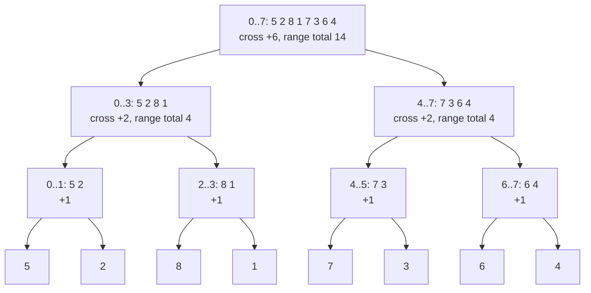
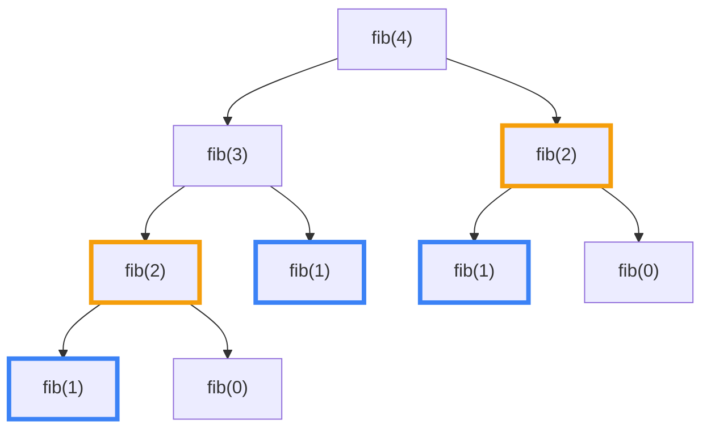
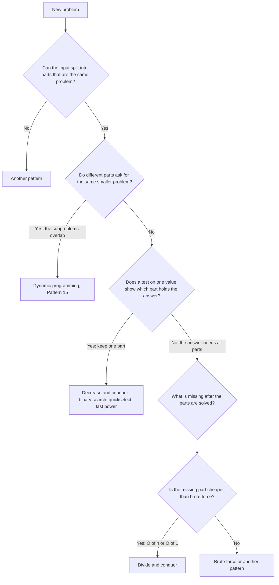

# Pattern 09: Divide and Conquer

## Overview

Divide and conquer solves a problem in three steps. The code splits the input into parts, solves each part with the same method, and combines the answers of the parts into the answer for the whole input. The technique pays off when the combine step costs less than the work that the parts hide. For each new problem, this page asks one question: if I had the answers for the two halves, what is still missing, and can I compute the missing part faster than brute force?

After this page you can:

1. Count the inversions of an array in O(n log n), and explain why the counter grows by `mid - i + 1` at one line of the merge loop.
2. Write the recurrence of a divide and conquer algorithm, solve it with the recursion tree, and count the levels on a concrete input.
3. Name the combine step of a problem, state its cost, and say how that cost decides the cost of the whole algorithm.
4. Tell divide and conquer from dynamic programming by looking for repeated subproblems in the recursion tree, and tell it from "decrease and conquer" (the code keeps one part and drops the others, as binary search and quickselect do) by the number of parts that the code keeps.
5. Solve Maximum Subarray, the k-th largest element by quickselect, Merge k Sorted Lists, fast power, and tree construction in divide and conquer form, and say when Kadane's algorithm, a heap, or a linear scan is the better answer.
6. Decide for a new problem whether divide and conquer applies, and show an input on which each precondition fails.

## Prerequisites

| You need | Why this page needs it | Where to learn it |
|---|---|---|
| Recursion: a method that calls itself, the base case, the recursion tree | Every algorithm on this page is a recursion. The page uses the recursion tree to count work | [Foundation F9: Recursion](../foundations/09-recursion.md) |
| Merge sort, quicksort, and the merge of two sorted arrays | The anchor problem adds a counter to merge sort. Quickselect reuses the partition step of quicksort | [Sorting Algorithms](../foundations/08-sorting-algorithms.md) |
| Recurrences, the recursion tree, and the master theorem | The page writes a recurrence for each algorithm and solves it by counting the levels | [Complexity Analysis](../foundations/01-complexity-analysis.md) |
| Binary search | Binary search is the case that keeps one half and drops the other | [Pattern 06: Binary Search](../06-binary-search-on-answer/README.md) |
| Linked lists and binary trees | Merge k Sorted Lists and Sort List relink nodes. Two problems build a tree | [Arrays, Strings, and Linked Lists](../foundations/02-arrays-strings-linked-lists.md), [Trees and Balanced BSTs](../foundations/05-trees-and-balanced-bsts.md) |

This page repeats only what it needs from those pages:

- **Merge sort** sorts the two halves of an array with itself, then merges the two sorted halves in one pass with two pointers. The merge takes the smaller front element each time. The full code and the stability argument (equal values keep their order) are in [Sorting Algorithms](../foundations/08-sorting-algorithms.md#merge-sort).
- A **recurrence** is an equation that gives the cost `T(n)` of a recursive algorithm in terms of the cost on smaller inputs, for example `T(n) = 2T(n/2) + n`. A **level** of the recursion tree is the set of calls with the same distance from the root. [Complexity Analysis](../foundations/01-complexity-analysis.md#analyze-a-recursion) teaches how to solve a recurrence.
- The **combine step** is the work that the code does after the recursive calls return, to turn the answers of the parts into the answer of the whole. This page defines the term in The Pattern. Until then, read it as "the code after the two recursive calls".

## Motivation

### The anchor problem: count the inversions of an array

An **inversion** is a pair of positions `i < j` where `a[i] > a[j]`: a larger value stands before a smaller value. The task: count the inversions of an array. The count measures how far the array is from sorted. A sorted array has 0 inversions. A reversed array of `n` values has `n(n - 1) / 2`.

Take `a = [5, 2, 8, 1, 7, 3, 6, 4]`. The answer is 14. The problems [LC 315: Count of Smaller Numbers After Self](https://leetcode.com/problems/count-of-smaller-numbers-after-self/) and [LC 493: Reverse Pairs](https://leetcode.com/problems/reverse-pairs/) belong to the same family, and the Practice Problems section solves both.

**First attempt: check every pair.** For each position `i`, compare `a[i]` with every later value, and count the smaller ones:

```text
index   0  1  2  3  4  5  6  7
value   5  2  8  1  7  3  6  4

i = 0 (5): larger than 2, 1, 3, 4       -> 4
i = 1 (2): larger than 1                -> 1
i = 2 (8): larger than 1, 7, 3, 6, 4    -> 5
i = 3 (1): larger than nothing          -> 0
i = 4 (7): larger than 3, 6, 4          -> 3
i = 5 (3): larger than nothing          -> 0
i = 6 (6): larger than 4                -> 1
i = 7 (4): no position after it         -> 0
                                          total 14, from 28 pair checks
```

```java
// Checks every pair (i, j) with i < j.
static long inversionsBruteForce(int[] a) {
    long count = 0;
    for (int i = 0; i < a.length; i++) {
        for (int j = i + 1; j < a.length; j++) {
            if (a[i] > a[j]) count++;
        }
    }
    return count;
}
```

The code checks `n(n - 1) / 2` pairs. For `n = 8`, that is 28 checks. For `n = 100000`, that is 4,999,950,000 checks, and the answer can be as large as that number. The count needs a `long`, because the largest `int` is 2,147,483,647. The cost is O(n²).

**Second attempt: count each half and add.** The array has two halves, `[5, 2, 8, 1]` and `[7, 3, 6, 4]`. Count the inversions inside each half with the same method:

| Half | Inversions inside it |
|---|---|
| `[5, 2, 8, 1]` | (5, 2), (5, 1), (2, 1), (8, 1) = 4 |
| `[7, 3, 6, 4]` | (7, 3), (7, 6), (7, 4), (6, 4) = 4 |

The sum is 8, and the answer is 14. The rule is wrong, and it is wrong by exactly 6.

**The gap.** The six missing inversions are pairs with one value in each half: (5, 3), (5, 4), (8, 7), (8, 3), (8, 6), (8, 4). The halves know nothing about these pairs. The array has 28 pairs. Each half holds 6 pairs, so the two halves cover 12 pairs. The other 16 pairs cross the middle, and 6 of those are inversions. The count of the halves skips most of the work.

A faster algorithm must count the pairs that cross the middle in less time than it takes to check each of the 16. The Derivation shows how.

## Derivation

### Question 1: what do the counts of the two halves miss?

Split the array at a middle position `mid`. The left half is `a[lo..mid]` and the right half is `a[mid + 1..hi]`. Take any pair of positions `i < j`. The pair has exactly one of three shapes:

- `i` and `j` are both in the left half.
- `i` and `j` are both in the right half.
- `i` is in the left half and `j` is in the right half. This is a **cross pair**.

So the inversions of the array split into three groups:

```text
inversions(a) = inversions(left half) + inversions(right half) + cross inversions
```

The first two terms are the same question on half the input. If a recursive call answers a half, the code gets those two terms for free. The third term is the part that is still missing. Divide and conquer always starts with this question: **if I had the answers for the two halves, what is still missing?**

### Question 2: can the cross pairs be counted faster than checking each one?

Look at what the cross count depends on. Take the left half `[5, 2, 8, 1]` and the right half `[7, 3, 6, 4]`. The cross count is 6. Reorder the left half to `[1, 8, 2, 5]`. The cross pairs are now (8, 7), (8, 3), (8, 6), (8, 4), (5, 3), (5, 4). The count is still 6.

The cross count asks, for each pair of one left value `x` and one right value `y`, whether `x > y`. The answer for the pair does not depend on where `x` and `y` stand inside their halves. So **the cross count depends on the two sets of values, not on their order**. This gives the code the freedom to reorder each half before it counts.

Now try to count the cross pairs on unsorted halves. For one right value `y`, the code asks: how many left values are larger than `y`? Take any method that does not read one left value `x`. Run it on two inputs. In the first input, `x` is just below `y`. In the second input, `x` is just above `y`. The method sees the same data in both runs, so it gives the same answer. The right answers differ by 1. So a method must read every one of the `|L|` left values to answer one question. If the code answers each of the `|R|` right values alone, with no work shared between the questions, the cost is `|L| x |R|`, the same as the brute force.

This does not prove that no fast method exists. It shows where the time goes: each question is answered alone, and no question helps the next one. A faster method must share work between the questions. Sharing needs a structure in the left half that relates the answers for different `y`.

### Question 3: what does the count cost when both halves are sorted?

Sort both halves. For the example, `L = [1, 2, 5, 8]` and `R = [3, 4, 6, 7]`. Go through the right values from small to large. For a right value `y`, the left values larger than `y` form a **suffix** of `L`, because `L` is sorted. Write `i` for the index of the first left value larger than `y`. Then `|L| - i` left values are larger than `y`.

Now ask: what happens to `i` when `y` grows? A larger `y` has fewer left values above it, so `i` can only move right. The code never moves `i` back, and it never starts `i` again from 0. One pointer `i` over `L` and one pointer `j` over `R` do the whole count:

```java
// Counts the pairs (x in left, y in right) with x > y. Both arrays are sorted.
static long crossPairsSorted(int[] left, int[] right) {
    long count = 0;
    int i = 0;                                       // first index in left with left[i] > y
    for (int j = 0; j < right.length; j++) {
        while (i < left.length && left[i] <= right[j]) i++;
        count += left.length - i;                    // left[i..] are all larger than right[j]
    }
    return count;
}
```

Trace on `L = [1, 2, 5, 8]` and `R = [3, 4, 6, 7]`:

```text
y = 3 (j = 0): L[0] = 1 <= 3, L[1] = 2 <= 3, L[2] = 5 > 3   -> i = 2, add 4 - 2 = 2, count = 2
y = 4 (j = 1): L[2] = 5 > 4                                   -> i = 2, add 4 - 2 = 2, count = 4
y = 6 (j = 2): L[2] = 5 <= 6, L[3] = 8 > 6                    -> i = 3, add 4 - 3 = 1, count = 5
y = 7 (j = 3): L[3] = 8 > 7                                   -> i = 3, add 4 - 3 = 1, count = 6
```

The count is 6, the number that the brute force found. The pointer `i` moves at most `|L|` times and `j` moves `|R|` times, so the loop costs O(|L| + |R|). On sorted halves, the cross count takes one linear pass instead of `|L| x |R|` checks.

The edge cases agree. If every left value is at most `y`, `i` reaches `|L|` and the code adds 0. If every left value is larger than `y`, `i` stays at 0 and the code adds `|L|`. If the right half is empty, the loop does not run and the count is 0.

### Question 4: where do the sorted halves come from?

The linear pass needs two sorted halves. The array is not sorted. But the recursion already solves the two halves, and a recursive call can do two things at once: **return the inversion count of its range and leave the range sorted.** Then the code that combines two halves finds both halves sorted, and the count costs one pass.

That raises a second problem. The caller of this call also needs a sorted range, so the combine step must produce the sorted range `a[lo..hi]` from the two sorted halves. Look at the counting loop: it walks `i` over `L` and `j` over `R`. A merge walks the same two pointers. Take the smaller front value and write it to the output. So the counting pass and the merge are one loop. The result is merge sort with a counter.

Look at one step of the merge loop. The pointers are at `a[i]` (left) and `a[j]` (right):

- If `a[i] <= a[j]`, the loop writes `a[i]`. The left value `a[i]` is not larger than `a[j]`, and `a[j]` is the smallest right value that is still waiting. So `a[i]` forms no inversion with any right value that is still waiting.
- If `a[i] > a[j]`, the loop writes `a[j]`. The right value `a[j]` is smaller than `a[i]`. The left half is sorted, so `a[j]` is also smaller than every left value from `i` to `mid`. These are `mid - i + 1` values: the left half ends at index `mid`, so the indexes `i, i + 1, ..., mid` hold `mid - i + 1` values. Each of them forms one inversion with `a[j]`. The code adds `mid - i + 1` to the counter.

This is the only line where the counter changes. The test uses `<=` for the left value, so two equal values do not count as an inversion, and an inversion needs a strictly larger left value.

```java
// Counts the pairs i < j with a[i] > a[j]. The input stays unchanged.
static long countInversions(int[] a) {
    int[] copy = a.clone();                  // the recursion sorts its input
    int[] temp = new int[a.length];          // one merge buffer for the whole run
    return sortAndCount(copy, temp, 0, a.length - 1);
}

// Sorts a[lo..hi] and returns the number of inversions inside it.
static long sortAndCount(int[] a, int[] temp, int lo, int hi) {
    if (lo >= hi) return 0;                  // 0 or 1 element: no pair
    int mid = lo + (hi - lo) / 2;
    long count = sortAndCount(a, temp, lo, mid)          // pairs inside the left half
               + sortAndCount(a, temp, mid + 1, hi);     // pairs inside the right half
    int i = lo, j = mid + 1, k = lo;
    while (i <= mid && j <= hi) {
        if (a[i] <= a[j]) {
            temp[k++] = a[i++];              // a[i] is not larger than a[j]: no new pair
        } else {
            count += mid - i + 1;            // a[i..mid] are all larger than a[j]
            temp[k++] = a[j++];
        }
    }
    while (i <= mid) temp[k++] = a[i++];     // the right half is used up
    while (j <= hi) temp[k++] = a[j++];      // the left half is used up
    System.arraycopy(temp, lo, a, lo, hi - lo + 1);
    return count;
}
```

Read the code against the three questions. The two recursive calls give "the counts of the halves". The `while` loop with the `count +=` line gives "the missing part". The `arraycopy` at the end leaves the range sorted for the caller. The method `countInversions` clones the input, because the recursion sorts its array, and the caller may need the original order.

**Why it is correct.** The invariant is: the call `sortAndCount(a, temp, lo, hi)` returns the number of inversions that `a[lo..hi]` has on entry, and `a[lo..hi]` is sorted when the call returns.

1. A range of 0 or 1 values has no pair and is sorted. The base case returns 0 and does nothing.
2. For a longer range, assume the two recursive calls satisfy the invariant. They return the inversions inside each half, and they leave each half sorted. Sorting a half does not change the cross count (Question 2), so the cross inversions of the original range equal the cross inversions of the two sorted halves.
3. The merge loop decides each cross pair `(x, y)`, with `x` from the left and `y` from the right, at the moment the loop writes the first of the two values. If `x` is written first, then `x <= a[j]` for the right pointer `j` at that time, and `y` stands at `j` or further right, so `y >= a[j] >= x`. The pair is not an inversion, and the loop adds nothing. If `y` is written first, then `a[i] > y` at that time, and `x` stands at `i` or further right, so `x >= a[i] > y`. The pair is an inversion, and `y` adds it as one of the `mid - i + 1` values. Each cross pair is decided once.
4. When one half is used up, the loop copies the rest of the other half. If the left half remains, each remaining left value was counted against every right value that the loop wrote before it, and no right value is left. If the right half remains, no left value is left to pair with it.

So the loop adds exactly the cross inversions, the three groups add up to the inversions of the range, and the merge leaves the range sorted. The edge cases are covered: the empty range and the one-value range return 0, and equal values add nothing.

### Trace on the 8 values

The recursion splits `[5, 2, 8, 1, 7, 3, 6, 4]` down to single values, then merges up. This tree shows each range, the cross pairs that its merge counts, and the running total for its range:



The program in the Implementation section prints this trace. Each line is one merge, in the order that the recursion runs them. The merge for `[0..7]` prints one line for each step, because it is the largest merge:

```text
== merge sort with a counter ==
merge [0..1]: left [5] right [2] -> [2, 5], cross pairs +1
merge [2..3]: left [8] right [1] -> [1, 8], cross pairs +1
merge [0..3]: left [2, 5] right [1, 8] -> [1, 2, 5, 8], cross pairs +2
merge [4..5]: left [7] right [3] -> [3, 7], cross pairs +1
merge [6..7]: left [6] right [4] -> [4, 6], cross pairs +1
merge [4..7]: left [3, 7] right [4, 6] -> [3, 4, 6, 7], cross pairs +2
-- last merge: left [1, 2, 5, 8], right [3, 4, 6, 7]
   take left  1 (i = 0, j = 4): 1 <= 3, count stays 8
   take left  2 (i = 1, j = 4): 2 <= 3, count stays 8
   take right 3 (i = 2, j = 4): 5 > 3, add mid - i + 1 = 2, count = 10
   take right 4 (i = 2, j = 5): 5 > 4, add mid - i + 1 = 2, count = 12
   take left  5 (i = 2, j = 6): 5 <= 6, count stays 12
   take right 6 (i = 3, j = 6): 8 > 6, add mid - i + 1 = 1, count = 13
   take right 7 (i = 3, j = 7): 8 > 7, add mid - i + 1 = 1, count = 14
   the rest of the left half is copied, result [1, 2, 3, 4, 5, 6, 7, 8], cross pairs +6
total inversions = 14, sorted = [1, 2, 3, 4, 5, 6, 7, 8]
```

Read the merges by level. The cross counts are 1, 1, 1, 1 (level 1), then 2, 2 (level 2), then 6 (level 3). The sum is 4 + 4 + 6 = 14. The pairs in the halves, 4 and 4, come from the merges below them, and the last merge adds the 6 cross pairs.

Read the last merge in detail. The left half is `[1, 2, 5, 8]` and the right half is `[3, 4, 6, 7]`:

| Step | `i`, `j` | `a[i]` against `a[j]` | Decision | Counter |
|---|---|---|---|---|
| 1 | 0, 4 | 1 <= 3 | write 1 from the left | 8 |
| 2 | 1, 4 | 2 <= 3 | write 2 from the left | 8 |
| 3 | 2, 4 | 5 > 3 | write 3 from the right, add `mid - i + 1 = 3 - 2 + 1 = 2` (the values 5 and 8) | 10 |
| 4 | 2, 5 | 5 > 4 | write 4 from the right, add 2 | 12 |
| 5 | 2, 6 | 5 <= 6 | write 5 from the left | 12 |
| 6 | 3, 6 | 8 > 6 | write 6 from the right, add `3 - 3 + 1 = 1` (the value 8) | 13 |
| 7 | 3, 7 | 8 > 7 | write 7 from the right, add 1 | 14 |
| 8 | 3, 8 | the right half is used up | copy 8 from the left | 14 |

The counter starts at 8, the sum of the counts below. In this table, `mid` is 3, the index of the last value of the left half. The six additions in steps 3, 4, 6, and 7 are the pairs (5, 3), (8, 3), (5, 4), (8, 4), (8, 6), (8, 7).

### The cost, counted from the trace

Count the work in the trace. Each merge writes every value of its range once. Level 1 has four merges of 2 values, so it writes 8 values. Level 2 has two merges of 4 values, so it writes 8 values. Level 3 has one merge of 8 values, so it writes 8 values. The program counts the writes: 24, which is 3 levels of 8 values. The levels with merges are the levels above the single values, and there are 3 of them, because 8 halves to 1 in 3 steps (8, 4, 2, 1).

Write the same count as a recurrence. Let `T(n)` be the time for `n` values. The code makes two calls on `n/2` values and then a merge that costs a constant times `n`:

```text
T(n) = 2 T(n/2) + c n
```

The recursion tree of this recurrence has a level with 1 call of size `n`, a level with 2 calls of size `n/2`, a level with 4 calls of size `n/4`, and so on. The calls on one level have sizes that add up to `n`, so each level costs `c n`. The tree has `log2 n` levels with merges when `n` is a power of 2. So `T(n) = c n log2 n` plus the cost of the `n` leaves. The time is O(n log n). The master theorem gives the same result (case 2, with `a = 2`, `b = 2`, and `f(n) = n`). See [The master theorem](../foundations/01-complexity-analysis.md#the-master-theorem).

| `n` | Pair checks of the brute force, `n(n - 1) / 2` | Values written by the merges, `n x levels` |
|---|---|---|
| 8 | 28 | 24 (3 levels) |
| 1,024 | 523,776 | 10,240 (10 levels) |
| 100,000 | 4,999,950,000 | about 1,700,000 (17 levels, because 2^17 = 131,072 is the first power of 2 above 100,000) |

For `n = 8`, the two methods cost about the same. The gap grows with `n`. The space is one buffer `temp` of `n` values, plus the recursion depth of `log2 n` calls.

The page now has the anchor problem solved. The next sections name what the solution did, and then change one thing at a time.

## The Pattern

A divide and conquer algorithm has three steps. **Divide**: split the input into parts, usually at the middle index, or at a **pivot** (a value that sorts the other values into smaller and larger ones). **Conquer**: solve each part with the same method. A part that is small enough to answer at once is the base case. **Combine**: build the answer for the whole input from the answers of the parts. One cost decides the algorithm: the cost of the combine step. A combine step of O(n) over two halves gives O(n log n) in total. A combine step of O(1) over two halves gives O(n). A combine step as slow as the brute force, such as a check of every cross pair, gives no gain at all.

The question to ask for a new problem is the question of the Derivation: **if I had the answers for the two halves, what is still missing, and can I compute the missing part faster than brute force?** When the missing part is slow to compute from the answers alone, ask a second question: what else could each call return, so that the missing part becomes cheap? In the anchor problem, each call also returned its range in sorted order. Maximum Subarray, below, gives a second example.

**The invariant.** After a call on a range returns, the call has solved its range. The return value is correct for the range, and any extra information that the combine step of the caller needs (for example the sorted order) is in place.

**The vocabulary.** The page used each term before it named it.

| Term | What it was in the anchor problem | The question to ask in a new problem |
|---|---|---|
| Divide | Split the range `[lo, hi]` at `mid` | "Where do I cut, and is each part the same problem on less input?" |
| Subproblem | The call `sortAndCount(a, temp, lo, mid)` | "Does the part have the same input and the same question as the whole?" |
| Base case | `lo >= hi`: zero or one value | "What is the smallest input that I can answer without a split?" |
| Combine step | The merge loop with the line `count += mid - i + 1` | "If I have the answers for the parts, what is still missing?" |
| Cross term | The cross inversions | "Which part of the answer involves a value from each part?" |
| Extra return value | The sorted order of the range | "What can a call return besides the answer, so that the combine step is cheap?" |
| Recurrence | `T(n) = 2T(n/2) + cn` | "How many parts, how large is each, and what does the combine step cost?" |
| Recursion depth | `log2 n` levels | "How deep does the stack grow?" |

### The combine step decides the cost

The table lists the problems of this page. The column "Parts kept" tells the two families apart: the code keeps all parts, or it keeps one part and drops the rest.

| Problem | Divide | Parts kept | Combine step | Combine cost | Recurrence | Time |
|---|---|---|---|---|---|---|
| Count inversions, merge sort | At the middle | 2 | Merge with a counter | O(n) | `2T(n/2) + O(n)` | O(n log n) |
| [LC 493: Reverse Pairs](https://leetcode.com/problems/reverse-pairs/) | At the middle | 2 | Count with two pointers, then merge | O(n) | `2T(n/2) + O(n)` | O(n log n) |
| [LC 53: Maximum Subarray](https://leetcode.com/problems/maximum-subarray/), crossing scan | At the middle | 2 | Scan outward from the middle | O(n) | `2T(n/2) + O(n)` | O(n log n) |
| [LC 53](https://leetcode.com/problems/maximum-subarray/), four-number summary | At the middle | 2 | Combine four numbers | O(1) | `2T(n/2) + O(1)` | O(n) |
| [LC 108: Convert Sorted Array to Binary Search Tree](https://leetcode.com/problems/convert-sorted-array-to-binary-search-tree/) | The middle value is the root | 2 | Link two subtrees to the root | O(1) | `2T(n/2) + O(1)` | O(n) |
| [LC 23: Merge k Sorted Lists](https://leetcode.com/problems/merge-k-sorted-lists/) | Halve the list of lists | 2 | Merge two lists | O(N) summed over a level, with `N` nodes in all | `log2 k` levels of cost N | O(N log k) |
| Closest pair of points | At the median x | 2 | Scan the strip, sorted by y | O(n log n) as coded, O(n) with a merge | `2T(n/2) + O(n log n)` | O(n log² n), or O(n log n) |
| Binary search ([LC 704](https://leetcode.com/problems/binary-search/)) | Compare with the middle | 1 | None | O(1) | `T(n/2) + O(1)` | O(log n) |
| [LC 50: Pow(x, n)](https://leetcode.com/problems/powx-n/), one call | Halve the exponent | 1 | One or two multiplications | O(1) | `T(n/2) + O(1)` | O(log n) |
| [LC 50](https://leetcode.com/problems/powx-n/), two calls | Halve the exponent | 2 | One multiplication | O(1) | `2T(n/2) + O(1)` | O(n) |
| [LC 215: Kth Largest Element in an Array](https://leetcode.com/problems/kth-largest-element-in-an-array/), quickselect | Partition around a pivot | 1 | None. The partition is the divide step | O(n) divide step | `T(n/2) + O(n)` if the pivot halves the range | O(n) on average, O(n²) worst |
| Naive matrix multiplication | Four blocks for each of two matrices | 8 | Add blocks | O(n²) | `8T(n/2) + O(n²)` | O(n³) |
| Strassen's multiplication | The same four blocks | 7 | Add blocks | O(n²) | `7T(n/2) + O(n²)` | O(n^2.81), because `log2 7` is about 2.81 |

Three of these recurrences show the rule: `2T(n/2) + O(1)`, `2T(n/2) + O(n)`, and `2T(n/2) + O(n²)`. The recursion tree of `2T(n/2) + f(n)` has `n` leaves. If the combine cost `f(n)` is small, the leaves dominate and the total is O(n). If `f(n)` is O(n), each level costs the same and the total is O(n log n). If `f(n)` is O(n²), the top call dominates and the total is O(n²), and the split gained nothing. [The master theorem](../foundations/01-complexity-analysis.md#the-master-theorem) states the three cases and works the examples.

### Divide and conquer against dynamic programming

Draw the recursion tree and look at the arguments of the calls. The tree of the anchor problem has one call for each range, and no two calls have the same range. Each level covers every position once.

The tree of `fib(4)` (the Fibonacci number, with `fib(n) = fib(n - 1) + fib(n - 2)`) does not:



`fib(2)` (orange border) runs twice, and `fib(1)` (blue border) runs three times. The subproblems **overlap**: two parts of the tree ask the same smaller question. The rule:

| The recursion tree shows | The problem is | Technique | The saving |
|---|---|---|---|
| Disjoint subproblems: no two calls have the same arguments | Divide and conquer | Solve each part once | The split reduces the cost when the combine step is cheap |
| Repeated subproblems: the same arguments appear in many places | Dynamic programming | Store each answer, or fill a table ([Pattern 15](../15-dynamic-programming/README.md)) | The store reduces the number of calls from the size of the tree to the number of distinct arguments |

A problem can have both shapes. Worked Example 7 (LC 241) splits and combines like divide and conquer, and its substrings repeat, so a map of answers cuts the calls from 243 to 71.

### Divide and conquer against decrease and conquer

In binary search, the code compares the target with the middle value and then solves only one half. The other half is dropped, and nothing combines. In quickselect, the code partitions the array and keeps only the side that holds the answer. Fast power keeps one half of the exponent. These algorithms are **decrease and conquer**: each step reduces the problem to one smaller problem.

The test: **how many parts does the code solve and keep?** Two or more parts, with a combine step: divide and conquer. One part: decrease and conquer. The difference changes the cost. When the code drops a part, the work per level shrinks. Quickselect with a pivot that halves the range does `n + n/2 + n/4 + ...` work, which is less than `2n`. Quicksort keeps both parts and does `n` work on every level, which gives `n log n`.

### Variants and the property that selects each



| Variant | Problems | What the combine step does | Property of the problem that selects it |
|---|---|---|---|
| A. Count cross pairs | [LC 315](https://leetcode.com/problems/count-of-smaller-numbers-after-self/), [LC 493](https://leetcode.com/problems/reverse-pairs/), [LC 327](https://leetcode.com/problems/count-of-range-sum/), inversions | Counts left-right pairs that meet a condition, with two pointers over two sorted halves, then merges | The condition compares a left value with a right value. The count does not depend on the order inside a half |
| B. Best across the middle | [LC 53](https://leetcode.com/problems/maximum-subarray/), closest pair, [LC 218: The Skyline Problem](https://leetcode.com/problems/the-skyline-problem/) | Takes the best of three cases: inside the left part, inside the right part, across the middle | The best answer lies in a part or crosses the middle, and the crossing answer builds from a small summary of each part (best suffix and best prefix, the strip) |
| C. Keep one part | Binary search, [LC 215](https://leetcode.com/problems/kth-largest-element-in-an-array/), [LC 50](https://leetcode.com/problems/powx-n/), [LC 240](https://leetcode.com/problems/search-a-2d-matrix-ii/) | None, or one multiplication | A test on one value shows that the other part cannot hold the answer |
| D. Build from the parts | [LC 108](https://leetcode.com/problems/convert-sorted-array-to-binary-search-tree/), [LC 105](https://leetcode.com/problems/construct-binary-tree-from-preorder-and-inorder-traversal/), [LC 106](https://leetcode.com/problems/construct-binary-tree-from-inorder-and-postorder-traversal/), [LC 23](https://leetcode.com/problems/merge-k-sorted-lists/), [LC 148](https://leetcode.com/problems/sort-list/), [LC 932](https://leetcode.com/problems/beautiful-array/), [LC 912](https://leetcode.com/problems/sort-an-array/) | Links or merges the parts into one structure | The output has the shape of the input, and the output of the parts joins into the output of the whole |
| E. All results | [LC 241](https://leetcode.com/problems/different-ways-to-add-parentheses/) | Pairs every result of the left part with every result of the right part | The answer is a collection, and the parts' collections multiply |

Merge sort is the anchor problem without the counter: remove the line `count += mid - i + 1` and the two additions of the recursive counts, and the code sorts the array. The sort in [Practice Problem P3](#p3-sort-an-array-lc-912-medium) is this code. [Sorting Algorithms](../foundations/08-sorting-algorithms.md#merge-sort) has the stability argument and the cost.

## Worked Examples

Each example changes one thing about the anchor problem: the kind of answer, the number of parts that the code keeps, or the shape of the combine step. They go from the most similar to the least similar.

### Example 1: Maximum Subarray (LC 53)

[LC 53: Maximum Subarray](https://leetcode.com/problems/maximum-subarray/). Given an array of integers, which can be negative, find the largest sum of a non-empty subarray. For `[-2, 1, -3, 4, -1, 2, 1, -5, 4]` the answer is 6, from the subarray `[4, -1, 2, 1]`.

**What changed.** The anchor problem counted pairs. This problem looks for the best value. The missing part is no longer a count. It is the best subarray that crosses the middle. The combine step takes the largest of three values instead of adding three values.

**Brute force.** For each start, extend the end and keep a running sum. The code checks every subarray in O(n²).

**Derive the split.** Cut the array at `mid`. A best subarray has one of three shapes: it lies inside the left half, it lies inside the right half, or it contains both `a[mid]` and `a[mid + 1]` (it crosses the middle). The recursion finds the first two shapes. The third shape is the missing part.

**Derive the crossing sum.** A subarray that crosses the middle is a suffix of the left half (it ends at `mid`) joined with a prefix of the right half (it starts at `mid + 1`). The sum is the sum of the suffix plus the sum of the prefix. The two choices do not depend on each other, so the best crossing sum is the best suffix sum of the left half plus the best prefix sum of the right half. The code finds the best suffix with one scan from `mid` down to `lo`, and it finds the best prefix with one scan from `mid + 1` up to `hi`. Together the scans read each value of the range once, so the combine step is O(n).

For the full array, `mid = 4`. The left half is `[-2, 1, -3, 4, -1]`. The suffix sums from `mid` outward are -1, 3, 0, 1, -1, and the best is 3. The right half is `[2, 1, -5, 4]`. The prefix sums are 2, 3, -2, 2, and the best is 3. The crossing sum is 3 + 3 = 6, and it is the answer.

The trace prints one line for each range of two or more values. The numbers are the best inside the left half, the best inside the right half, the best crossing the middle, and the maximum of the three:

```text
range [0..1]: left -2, right 1, cross -1 -> 1
range [0..2]: left 1, right -3, cross -2 -> 1
range [3..4]: left 4, right -1, cross 3 -> 4
range [0..4]: left 1, right 4, cross 2 -> 4
range [5..6]: left 2, right 1, cross 3 -> 3
range [7..8]: left -5, right 4, cross -1 -> 4
range [5..8]: left 3, right 4, cross 2 -> 4
range [0..8]: left 4, right 4, cross 6 -> 6
answer = 6, elements read by the crossing scans = 29
```

**The program.** It runs the divide and conquer version, the four-number version that comes after the next paragraph, and Kadane's algorithm, and it prints the edge cases (one value, all negative values, all positive values, the best at the first or the last position).

```java
import java.util.Arrays;

public class MaxSubarrayTrace {
    static long reads;    // elements read by the crossing scans
    static boolean trace; // true while the first run prints its calls

    public static void main(String[] args) {
        int[] a = {-2, 1, -3, 4, -1, 2, 1, -5, 4};
        System.out.println("== divide and conquer on " + Arrays.toString(a) + " ==");
        trace = true;
        int best = maxSubArray(a, 0, a.length - 1);
        trace = false;
        System.out.println("answer = " + best + ", elements read by the crossing scans = " + reads);
        System.out.println("segment summary version: " + maxSubArraySummary(a));
        System.out.println("Kadane: " + maxSubArrayKadane(a));

        System.out.println("== edge cases ==");
        int[][] cases = {{5}, {-3, -1, -2}, {1, 2, 3}, {9, -5, -5, 1}, {1, -5, -5, 9}, {-2, -1}};
        for (int[] c : cases) {
            System.out.println(Arrays.toString(c) + " -> " + maxSubArray(c, 0, c.length - 1) + ", "
                    + maxSubArraySummary(c) + ", " + maxSubArrayKadane(c));
        }
        try {
            maxSubArraySummary(new int[] {});
        } catch (IllegalArgumentException e) {
            System.out.println("empty array: " + e.getMessage());
        }
    }

    // The best sum of a non-empty subarray inside a[lo..hi].
    static int maxSubArray(int[] a, int lo, int hi) {
        if (lo == hi) return a[lo];                       // one element: it is the only subarray
        int mid = lo + (hi - lo) / 2;
        int leftBest = maxSubArray(a, lo, mid);           // subarrays inside the left half
        int rightBest = maxSubArray(a, mid + 1, hi);      // subarrays inside the right half
        int crossBest = maxCrossing(a, lo, mid, hi);      // subarrays across the middle
        int best = Math.max(crossBest, Math.max(leftBest, rightBest));
        if (trace) {
            System.out.println("range [" + lo + ".." + hi + "]: left " + leftBest + ", right "
                    + rightBest + ", cross " + crossBest + " -> " + best);
        }
        return best;
    }

    // The best sum of a subarray that contains both a[mid] and a[mid + 1].
    static int maxCrossing(int[] a, int lo, int mid, int hi) {
        int sum = 0, bestLeft = Integer.MIN_VALUE;        // not 0: the part must hold a[mid]
        for (int i = mid; i >= lo; i--) {
            sum += a[i];
            bestLeft = Math.max(bestLeft, sum);
        }
        sum = 0;
        int bestRight = Integer.MIN_VALUE;                // not 0: the part must hold a[mid + 1]
        for (int j = mid + 1; j <= hi; j++) {
            sum += a[j];
            bestRight = Math.max(bestRight, sum);
        }
        reads += hi - lo + 1;
        return bestLeft + bestRight;
    }

    // O(n): each call returns {total, bestPrefix, bestSuffix, best}, so the combine step is O(1).
    static int maxSubArraySummary(int[] a) {
        if (a.length == 0) throw new IllegalArgumentException("the array must not be empty");
        return summarize(a, 0, a.length - 1)[3];
    }

    static int[] summarize(int[] a, int lo, int hi) {
        if (lo == hi) return new int[] {a[lo], a[lo], a[lo], a[lo]};
        int mid = lo + (hi - lo) / 2;
        int[] l = summarize(a, lo, mid);
        int[] r = summarize(a, mid + 1, hi);
        int total = l[0] + r[0];
        int prefix = Math.max(l[1], l[0] + r[1]);         // best sum of a prefix of the range
        int suffix = Math.max(r[2], r[0] + l[2]);         // best sum of a suffix of the range
        int best = Math.max(Math.max(l[3], r[3]), l[2] + r[1]);
        return new int[] {total, prefix, suffix, best};
    }

    static int maxSubArrayKadane(int[] a) {
        int endingHere = a[0], best = a[0];
        for (int i = 1; i < a.length; i++) {
            endingHere = Math.max(a[i], endingHere + a[i]);   // extend, or start again at a[i]
            best = Math.max(best, endingHere);
        }
        return best;
    }
}
```

<!-- expected-output -->
```text
== divide and conquer on [-2, 1, -3, 4, -1, 2, 1, -5, 4] ==
range [0..1]: left -2, right 1, cross -1 -> 1
range [0..2]: left 1, right -3, cross -2 -> 1
range [3..4]: left 4, right -1, cross 3 -> 4
range [0..4]: left 1, right 4, cross 2 -> 4
range [5..6]: left 2, right 1, cross 3 -> 3
range [7..8]: left -5, right 4, cross -1 -> 4
range [5..8]: left 3, right 4, cross 2 -> 4
range [0..8]: left 4, right 4, cross 6 -> 6
answer = 6, elements read by the crossing scans = 29
segment summary version: 6
Kadane: 6
== edge cases ==
[5] -> 5, 5, 5
[-3, -1, -2] -> -1, -1, -1
[1, 2, 3] -> 6, 6, 6
[9, -5, -5, 1] -> 9, 9, 9
[1, -5, -5, 9] -> 9, 9, 9
[-2, -1] -> -1, -1, -1
empty array: the array must not be empty
```

**Cost.** The recurrence is `T(n) = 2T(n/2) + O(n)`, so the time is O(n log n). The trace counts the reads: each crossing scan reads every value of its range, and the eight ranges have sizes 2, 3, 2, 5, 2, 2, 4, and 9. The sum is 29. The stack holds O(log n) calls.

**The initial value of the two scans is the smallest `int`, not 0.** The best suffix must contain `a[mid]`, and the best prefix must contain `a[mid + 1]`. If a scan starts its best value at 0, the scan can choose an empty part. On `[-3, -1]`, the wrong code returns 0, which is the sum of no values. The answer is -1. See Common Mistakes.

**Make the combine step O(1).** The crossing scans read the halves again, although the recursion has just worked on them. Let each call return more than the best sum: the total of the range, its best prefix sum, its best suffix sum, and its best subarray sum. The combine step then needs no scan: the best prefix of the range is the best prefix of the left half, or the total of the left half plus the best prefix of the right half. The best crossing sum is the best suffix of the left half plus the best prefix of the right half. The method `summarize` in the program does this, and the recurrence becomes `T(n) = 2T(n/2) + O(1)`, which is O(n). This is the same idea as the sorted halves in the anchor problem: return the information that the caller needs. It is also the idea of the segment tree (see [Pattern 21](../21-segment-tree-and-fenwick-tree/README.md)).

**Kadane's algorithm is the better answer.** The program also contains `maxSubArrayKadane`. It keeps the best sum of a subarray that ends at the current index, and it runs in O(n) time and O(1) space. [Pattern 15: Dynamic Programming](../15-dynamic-programming/README.md) derives it. In an interview, **Recommendation:** if the interviewer asks for the best solution, write Kadane's algorithm. Write the divide and conquer form when the interviewer asks for it, or when the problem adds range queries (the segment tree form).

Why learn the divide and conquer form, when Kadane's algorithm is faster? Three reasons. First, the problem is a clean exercise in finding the cross term of a split, and textbooks on algorithms use it for that purpose (for example CLRS, third edition, chapter 4, "Divide-and-Conquer"). Second, an interviewer can use it to test whether the candidate can state a recurrence and solve it. Third, it leads to the O(n) summary version and to the segment tree, which Kadane's algorithm does not.

### Example 2: Kth Largest Element in an Array, by quickselect (LC 215)

[LC 215: Kth Largest Element in an Array](https://leetcode.com/problems/kth-largest-element-in-an-array/). Given an unsorted array and `k`, return the k-th largest element, counted with duplicates (the element at index `n - k` of the sorted array). For `[3, 2, 1, 5, 6, 4]` and `k = 2`, the answer is 5.

**What changed.** The code keeps one part and drops the other. The combine step disappears. The work moves into the divide step: the partition.

**Brute force and alternatives.** Sort the array and read index `n - k`: O(n log n). The sort orders all `n` values, and the problem needs only one of them.

**Derive the partition.** Quicksort picks a **pivot** (a value that splits the others), and moves the values smaller than the pivot to its left and the other values to its right. After that, the pivot stands at its final position `p` in the sorted order. Compare `p` with the target index `n - k`:

- If `p` equals the target index, the pivot is the answer.
- If `p` is smaller than the target index, the answer is in the right part. The left part and the pivot cannot hold it.
- If `p` is larger, the answer is in the left part.

The code never sorts the dropped part. The partition used here (the Lomuto partition) takes the last value of the range as the pivot. It scans the range with one index `j`. An index `i` marks the end of the block of values smaller than the pivot. When `a[j]` is smaller than the pivot, the code swaps `a[j]` into position `i` and adds 1 to `i`. At the end the code swaps the pivot into position `i`.

**Trace** for `[5, 2, 4, 1, 6, 3]` and `k = 2`. The target index is 6 - 2 = 4. Each block shows the partition steps of one range:

```text
partition [0..5], pivot 3
  j = 0: 5 >= 3
  j = 1: 2 < 3, swap a[0] and a[1]
  j = 2: 4 >= 3
  j = 3: 1 < 3, swap a[1] and a[3]
  j = 4: 6 >= 3
  result: pivot at index 2, array [2, 1, 3, 5, 6, 4], target index 4: go right
partition [3..5], pivot 4
  j = 3: 5 >= 4
  j = 4: 6 >= 4
  result: pivot at index 3, array [2, 1, 3, 4, 6, 5], target index 4: go right
partition [4..5], pivot 5
  j = 4: 6 >= 5
  result: pivot at index 4, array [2, 1, 3, 4, 5, 6], target index 4: found
```

The first partition uses the pivot 3. It swaps 2 to the front (step `j = 1`) and 1 next to it (step `j = 3`), and then it swaps the pivot to index 2. Index 2 is smaller than the target 4, so the answer is in `[3..5]`. The second partition has the pivot 4, which lands at index 3. The third has the pivot 5, which lands at index 4, the target.

```java
import java.util.Arrays;
import java.util.Random;

public class QuickselectTrace {
    static long comparisons;  // comparisons of an element with the pivot
    static boolean trace;     // true while the first run prints its steps

    public static void main(String[] args) {
        int[] nums = {5, 2, 4, 1, 6, 3};
        System.out.println("== LC 215 on " + Arrays.toString(nums) + ", k = 2 ==");
        trace = true;
        int answer = findKthLargest(nums, 2, null);
        trace = false;
        System.out.println("2nd largest = " + answer + ", input unchanged: "
                + Arrays.toString(nums));

        System.out.println("== comparisons, n = 1000 ==");
        int n = 1000;
        int[] sorted = new int[n];
        for (int i = 0; i < n; i++) sorted[i] = i + 1;
        System.out.println("sorted input, smallest element, last element as pivot: "
                + count(sorted, n, null));
        System.out.println("sorted input, smallest element, random pivot:           "
                + count(sorted, n, new Random(1)));
        int[] equal = new int[n];
        Arrays.fill(equal, 5);
        System.out.println("all elements equal, last element as pivot:              "
                + count(equal, 500, null));
        int[] shuffled = sorted.clone();
        Random rnd = new Random(2);
        for (int i = n - 1; i > 0; i--) {
            int j = rnd.nextInt(i + 1);
            int t = shuffled[i]; shuffled[i] = shuffled[j]; shuffled[j] = t;
        }
        System.out.println("shuffled input, median, last element as pivot:          "
                + count(shuffled, n / 2, null));

        System.out.println("== quicksort uses the same partition ==");
        int[] toSort = {3, 2, 1, 5, 6, 4};
        quickSort(toSort, 0, toSort.length - 1);
        System.out.println(Arrays.toString(toSort));

        System.out.println("== edge cases ==");
        System.out.println("one element, k = 1: " + findKthLargest(new int[] {7}, 1, null));
        System.out.println("k = 1 (the largest) of 3,1,2: "
                + findKthLargest(new int[] {3, 1, 2}, 1, null));
        System.out.println("k = n (the smallest) of 3,1,2: "
                + findKthLargest(new int[] {3, 1, 2}, 3, null));
        System.out.println("duplicates 3,3,3,3, k = 2: "
                + findKthLargest(new int[] {3, 3, 3, 3}, 2, null));
        System.out.println("negative values -1,-5,-3, k = 2: "
                + findKthLargest(new int[] {-1, -5, -3}, 2, null));
    }

    static long count(int[] a, int k, Random rnd) {
        comparisons = 0;
        findKthLargest(a, k, rnd);
        return comparisons;
    }

    // The k-th largest element: the element at index n - k when the array is sorted.
    static int findKthLargest(int[] nums, int k, Random rnd) {
        int[] a = nums.clone();                 // quickselect reorders its input
        int target = a.length - k;
        int lo = 0, hi = a.length - 1;
        while (lo < hi) {                       // the answer is inside a[lo..hi]
            if (rnd != null) swap(a, lo + rnd.nextInt(hi - lo + 1), hi);
            if (trace) System.out.println("partition [" + lo + ".." + hi + "], pivot " + a[hi]);
            int p = partition(a, lo, hi);
            if (trace) {
                System.out.println("  result: pivot at index " + p + ", array "
                        + Arrays.toString(a) + ", target index " + target
                        + (p == target ? ": found" : p < target ? ": go right" : ": go left"));
            }
            if (p == target) return a[p];
            if (p < target) lo = p + 1;         // keep the right part, drop the left part and a[p]
            else hi = p - 1;                    // keep the left part, drop the right part and a[p]
        }
        return a[lo];                           // lo == hi: one element is left
    }

    // Moves the values below a[hi] to the front, puts a[hi] after them, and returns its index.
    static int partition(int[] a, int lo, int hi) {
        int pivot = a[hi];
        int i = lo;                             // a[lo..i-1] holds the values below the pivot
        for (int j = lo; j < hi; j++) {
            comparisons++;
            if (trace) System.out.println("  j = " + j + ": " + a[j] + (a[j] < pivot
                    ? " < " + pivot + ", swap a[" + i + "] and a[" + j + "]" : " >= " + pivot));
            if (a[j] < pivot) swap(a, i++, j);
        }
        swap(a, i, hi);
        return i;
    }

    static void quickSort(int[] a, int lo, int hi) {
        if (lo >= hi) return;
        int p = partition(a, lo, hi);
        quickSort(a, lo, p - 1);                // both sides stay: this is why quicksort costs more
        quickSort(a, p + 1, hi);
    }

    static void swap(int[] a, int i, int j) {
        int t = a[i];
        a[i] = a[j];
        a[j] = t;
    }
}
```

<!-- expected-output -->
```text
== LC 215 on [5, 2, 4, 1, 6, 3], k = 2 ==
partition [0..5], pivot 3
  j = 0: 5 >= 3
  j = 1: 2 < 3, swap a[0] and a[1]
  j = 2: 4 >= 3
  j = 3: 1 < 3, swap a[1] and a[3]
  j = 4: 6 >= 3
  result: pivot at index 2, array [2, 1, 3, 5, 6, 4], target index 4: go right
partition [3..5], pivot 4
  j = 3: 5 >= 4
  j = 4: 6 >= 4
  result: pivot at index 3, array [2, 1, 3, 4, 6, 5], target index 4: go right
partition [4..5], pivot 5
  j = 4: 6 >= 5
  result: pivot at index 4, array [2, 1, 3, 4, 5, 6], target index 4: found
2nd largest = 5, input unchanged: [5, 2, 4, 1, 6, 3]
== comparisons, n = 1000 ==
sorted input, smallest element, last element as pivot: 499500
sorted input, smallest element, random pivot:           2458
all elements equal, last element as pivot:              375249
shuffled input, median, last element as pivot:          2653
== quicksort uses the same partition ==
[1, 2, 3, 4, 5, 6]
== edge cases ==
one element, k = 1: 7
k = 1 (the largest) of 3,1,2: 3
k = n (the smallest) of 3,1,2: 1
duplicates 3,3,3,3, k = 2: 3
negative values -1,-5,-3, k = 2: -3
```

**Cost on average.** Suppose each pivot halves the range. The partitions cost `n + n/2 + n/4 + ...`, and the sum is less than `2n`. This is the geometric series of a recurrence `T(n) = T(n/2) + O(n)`. A real pivot does not halve the range every time. With a random pivot, the pivot lands in the middle half of the sorted order with probability 1/2. In that case the range shrinks to at most 3/4 of its size. The expected total work stays O(n). [Sorting Algorithms](../foundations/08-sorting-algorithms.md#quickselect-the-k-th-element-in-expected-on) gives the bound of 8n for this argument.

**Cost in the worst case.** If every pivot is the smallest or the largest value of its range, the range shrinks by one value. The partitions cost `(n - 1) + (n - 2) + ... + 1 = n(n - 1) / 2`, which is O(n²). The input that does this with the last value as the pivot is a sorted array (when the target is the smallest value). The program counts the comparisons for `n = 1000`:

| Input and pivot | Comparisons |
|---|---|
| Sorted array, target is the smallest value, last value as pivot | 499,500 |
| The same input, random pivot | 2,458 |
| All values equal, target in the middle, last value as pivot | 375,249 |
| Shuffled array, median as target, last value as pivot | 2,653 |

A sorted input is common in tests, so the last value as pivot is unsafe. An array of equal values is also quadratic, because the code partitions with a strict `<`, and no value is smaller than the pivot, so the block of smaller values stays empty. For an array of 10,000 equal values and the middle target, the same code makes 37,502,499 comparisons, with the last value or a random value as pivot: a random pivot does not help, because every value is equal to every pivot. A random pivot makes a bad case on a sorted array a matter of luck, not of the input ([Pattern 28: Randomized Algorithms](../28-randomized-algorithms/README.md)). A three-way partition fixes the equal case ([Sorting Algorithms](../foundations/08-sorting-algorithms.md#three-way-partition)). The median of medians gives O(n) in the worst case, with a large constant.

**Against the heap.** A min-heap of size `k` solves [LC 215](https://leetcode.com/problems/kth-largest-element-in-an-array/) in O(n log k) time and O(k) space, without changing the input ([Pattern 16: Heap and Priority Queue](../16-heap-priority-queue/README.md)). Choose the heap when the values arrive as a stream ([LC 703: Kth Largest Element in a Stream](https://leetcode.com/problems/kth-largest-element-in-a-stream/)), when the input must stay unchanged, or when `k` is much smaller than `n`. Choose quickselect for one query on an array that is in memory.

**Quicksort** is the same partition with both parts kept. The method `quickSort` in the program shows it: two recursive calls and no combine step, because the partition has already placed the pivot. The cost is `n` per level, so O(n log n) on average. See [Sorting Algorithms](../foundations/08-sorting-algorithms.md#quicksort) for its details.

The method `findKthLargest` uses a loop, not a recursive call, because the code keeps one part. The stack stays at O(1). A recursive quickselect on a sorted input would have a stack depth of `n`.

### Example 3: Merge k Sorted Lists (LC 23) and Sort List (LC 148)

[LC 23: Merge k Sorted Lists](https://leetcode.com/problems/merge-k-sorted-lists/). Given `k` sorted linked lists, merge them into one sorted list. For the four lists `[1, 5, 9]`, `[2, 6, 10]`, `[3, 7, 11]`, and `[4, 8, 12]`, the result is `[1, 2, ..., 12]`.

**What changed.** The split is over the lists, not over the values of one array. The combine step is the merge of two sorted lists ([LC 21: Merge Two Sorted Lists](https://leetcode.com/problems/merge-two-sorted-lists/)), unchanged. The question is how to schedule the merges.

**Attempt 1: merge one list at a time.** Merge list 0 with list 1, merge the result with list 2, and so on. Take `k` lists of `m` nodes each, and `N = k m` nodes in all. The merge of the result with list `i` writes `(i + 1) m` nodes. The total is `m (2 + 3 + ... + k)`, which is about `N k / 2`, so O(N k). The long result is read again in every merge. For 16 lists of 4 nodes, the merges write 4 x (2 + 3 + ... + 16) = 540 nodes.

**Attempt 2: split the lists in two halves.** Merge the lists `0..mid` into one list, merge the lists `mid + 1..hi` into one list, and merge the two results. This is divide and conquer on the list of lists. The tree has `log2 k` levels. On each level, the merges handle each node once, so each level costs N. The total is `N log2 k`, which is O(N log k). For 16 lists, the merges write 4 levels x 64 = 256 nodes, against 540.

```text
== pairwise merge of 4 lists ==
merge lists [0..1]: [1, 5, 9] + [2, 6, 10] -> [1, 2, 5, 6, 9, 10], 5 comparisons
merge lists [2..3]: [3, 7, 11] + [4, 8, 12] -> [3, 4, 7, 8, 11, 12], 5 comparisons
merge lists [0..3]: 6 nodes + 6 nodes -> 12 nodes, 10 comparisons
result [1, 2, 3, 4, 5, 6, 7, 8, 9, 10, 11, 12], comparisons = 20
== comparisons for 16 lists of 4 nodes, 64 nodes in all ==
pairwise: 224, one list at a time: 525
```

The four merges of the first block give the trace. Lists `[0..1]` and `[2..3]` merge in 5 comparisons each (6 nodes, so 5 comparisons when the lists interleave). The last merge combines 6 and 6 nodes in 10 comparisons. The second block counts comparisons on 16 interleaved lists of 4 nodes: 224 for the pairwise merge, 525 for one list at a time. Comparisons are at most the number of nodes written, so the counts agree with the 256 and 540 above.

**The heap alternative.** A min-heap that holds the front node of each list gives O(N log k) time and O(k) extra space ([Pattern 16](../16-heap-priority-queue/README.md)). The pairwise merge has the same time. It needs no heap, and for linked lists it relinks nodes and uses O(log k) stack. The heap suits lists that arrive as streams, and it suits the case where the code needs only the first few values of the result.

#### Sort List (LC 148)

[LC 148: Sort List](https://leetcode.com/problems/sort-list/). Sort a linked list in O(n log n) time. The tool is the merge of two sorted lists again, now with a split by pointers. A list has no random access, so the code finds the middle with two pointers: `slow` moves one node at a time, and `fast` moves two. When `fast` reaches the end, `slow` stands at the end of the first half. The code cuts the list after `slow`, sorts both parts with the same method, and merges them.

The trace sorts `4 -> 2 -> 1 -> 3`:

```text
== LC 148: sort a list by merge sort ==
split into [4, 2] and [1, 3]
split into [4] and [2]
merge into [2, 4]
split into [1] and [3]
merge into [1, 3]
merge into [1, 2, 3, 4]
result [1, 2, 3, 4]
```

The method `sortList` in the program starts `fast` at `head.next`, so a list of two nodes splits into 1 and 1. If `fast` started at `head`, a list of two nodes would split into 2 and 0, and the recursion would not end. The merge relinks nodes, so it needs no buffer. The stack holds O(log n) calls.

```java
import java.util.ArrayList;
import java.util.List;

public class MergeKTrace {
    static class ListNode {
        int val;
        ListNode next;
        ListNode(int val) { this.val = val; }
    }

    static long comparisons;  // comparisons made by all calls of mergeTwo
    static boolean trace;     // true while the first run prints its merges

    public static void main(String[] args) {
        System.out.println("== pairwise merge of 4 lists ==");
        ListNode[] four = {list(1, 5, 9), list(2, 6, 10), list(3, 7, 11), list(4, 8, 12)};
        trace = true;
        ListNode merged = mergeKLists(four);
        trace = false;
        System.out.println("result " + show(merged) + ", comparisons = " + comparisons);

        System.out.println("== comparisons for 16 lists of 4 nodes, 64 nodes in all ==");
        comparisons = 0;
        mergeKLists(interleaved(16, 4));
        long pairwise = comparisons;
        comparisons = 0;
        mergeOneByOne(interleaved(16, 4));
        System.out.println("pairwise: " + pairwise + ", one list at a time: " + comparisons);

        System.out.println("== LC 148: sort a list by merge sort ==");
        trace = true;
        ListNode sorted = sortList(list(4, 2, 1, 3));
        trace = false;
        System.out.println("result " + show(sorted));

        System.out.println("== edge cases ==");
        System.out.println("sort an empty list: " + show(sortList(null)));
        System.out.println("sort one node: " + show(sortList(list(5))));
        System.out.println("sort two nodes: " + show(sortList(list(2, 1))));
        System.out.println("sort equal values: " + show(sortList(list(3, 3, 3))));
        System.out.println("sort a reversed list: " + show(sortList(list(5, 4, 3, 2, 1))));
        System.out.println("no lists: " + show(mergeKLists(new ListNode[] {})));
        System.out.println("one list: " + show(mergeKLists(new ListNode[] {list(2, 4)})));
        System.out.println("all lists empty: "
                + show(mergeKLists(new ListNode[] {null, null, null})));
        System.out.println("an empty list among others: "
                + show(mergeKLists(new ListNode[] {list(1, 3), null, list(2)})));
        System.out.println("equal values: "
                + show(mergeKLists(new ListNode[] {list(1, 1), list(1)})));
        System.out.println("odd number of lists: "
                + show(mergeKLists(new ListNode[] {list(5), list(1), list(3), list(2), list(4)})));
    }

    // Merges the lists lists[lo..hi]: merge each half, then merge the two results.
    static ListNode mergeRange(ListNode[] lists, int lo, int hi) {
        if (lo == hi) return lists[lo];                 // one list is already sorted
        int mid = lo + (hi - lo) / 2;
        ListNode left = mergeRange(lists, lo, mid);
        ListNode right = mergeRange(lists, mid + 1, hi);
        long before = comparisons;
        String a = trace ? show(left) : "", b = trace ? show(right) : "";
        int na = trace ? length(left) : 0, nb = trace ? length(right) : 0;
        ListNode merged = mergeTwo(left, right);
        if (trace) {
            String inputs = na + nb > 6
                    ? na + " nodes + " + nb + " nodes -> " + (na + nb) + " nodes"
                    : a + " + " + b + " -> " + show(merged);
            System.out.println("merge lists [" + lo + ".." + hi + "]: " + inputs + ", "
                    + (comparisons - before) + " comparisons");
        }
        return merged;
    }

    static ListNode mergeKLists(ListNode[] lists) {
        if (lists.length == 0) return null;
        return mergeRange(lists, 0, lists.length - 1);
    }

    // LC 148: cut the list in the middle, sort each part, merge the two sorted parts.
    static ListNode sortList(ListNode head) {
        if (head == null || head.next == null) return head;   // 0 or 1 node: already sorted
        ListNode slow = head, fast = head.next;               // fast starts one node ahead, so a
        while (fast != null && fast.next != null) {           // list of 2 nodes splits into 1 and 1
            slow = slow.next;
            fast = fast.next.next;
        }
        ListNode right = slow.next;
        slow.next = null;                                     // the cut: head..slow and right..
        if (trace) System.out.println("split into " + show(head) + " and " + show(right));
        ListNode merged = mergeTwo(sortList(head), sortList(right));
        if (trace) System.out.println("merge into " + show(merged));
        return merged;
    }

    // The slow way: merge the next list into one growing result.
    static ListNode mergeOneByOne(ListNode[] lists) {
        ListNode result = null;
        for (ListNode list : lists) result = mergeTwo(result, list);
        return result;
    }

    // Merges two sorted lists by relinking their nodes. A tie takes the node of a first.
    static ListNode mergeTwo(ListNode a, ListNode b) {
        ListNode dummy = new ListNode(0), tail = dummy;
        while (a != null && b != null) {
            comparisons++;
            if (a.val <= b.val) { tail.next = a; a = a.next; }
            else { tail.next = b; b = b.next; }
            tail = tail.next;
        }
        tail.next = (a != null) ? a : b;                // link the rest of the list that is left
        return dummy.next;
    }

    static ListNode list(int... values) {
        ListNode dummy = new ListNode(0), tail = dummy;
        for (int v : values) { tail.next = new ListNode(v); tail = tail.next; }
        return dummy.next;
    }

    // List i holds i, i + k, i + 2k, ...: the lists interleave fully.
    static ListNode[] interleaved(int k, int length) {
        ListNode[] lists = new ListNode[k];
        for (int i = 0; i < k; i++) {
            int[] values = new int[length];
            for (int j = 0; j < length; j++) values[j] = i + j * k;
            lists[i] = list(values);
        }
        return lists;
    }

    static int length(ListNode head) {
        int n = 0;
        for (ListNode p = head; p != null; p = p.next) n++;
        return n;
    }

    static String show(ListNode head) {
        List<Integer> values = new ArrayList<>();
        for (ListNode p = head; p != null; p = p.next) values.add(p.val);
        return values.toString();
    }
}
```

<!-- expected-output -->
```text
== pairwise merge of 4 lists ==
merge lists [0..1]: [1, 5, 9] + [2, 6, 10] -> [1, 2, 5, 6, 9, 10], 5 comparisons
merge lists [2..3]: [3, 7, 11] + [4, 8, 12] -> [3, 4, 7, 8, 11, 12], 5 comparisons
merge lists [0..3]: 6 nodes + 6 nodes -> 12 nodes, 10 comparisons
result [1, 2, 3, 4, 5, 6, 7, 8, 9, 10, 11, 12], comparisons = 20
== comparisons for 16 lists of 4 nodes, 64 nodes in all ==
pairwise: 224, one list at a time: 525
== LC 148: sort a list by merge sort ==
split into [4, 2] and [1, 3]
split into [4] and [2]
merge into [2, 4]
split into [1] and [3]
merge into [1, 3]
merge into [1, 2, 3, 4]
result [1, 2, 3, 4]
== edge cases ==
sort an empty list: []
sort one node: [5]
sort two nodes: [1, 2]
sort equal values: [3, 3, 3]
sort a reversed list: [1, 2, 3, 4, 5]
no lists: []
one list: [2, 4]
all lists empty: []
an empty list among others: [1, 2, 3]
equal values: [1, 1, 1]
odd number of lists: [1, 2, 3, 4, 5]
```

### Example 4: Pow(x, n) (LC 50)

[LC 50: Pow(x, n)](https://leetcode.com/problems/powx-n/). Compute `x` raised to the integer power `n`. The exponent can be negative. For `x = 2` and `n = 10`, the answer is 1024.

**What changed.** The recursion makes one call. It solves one smaller problem and uses its answer twice.

**Brute force.** Multiply `x` by itself `n` times. For `n = 2,147,483,647` that is more than two billion multiplications. The cost is O(n).

**Derive the split.** `x^10 = x^5 * x^5`. The two factors are the same number, so the code computes `x^5` once and squares it. For an odd exponent, `x^5 = x^2 * x^2 * x`. In general, for `e >= 1`, `x^e = (x^(e/2))^2`, with one more factor `x` when `e` is odd. The division `e / 2` rounds down. The base case is `e = 0`, which gives 1.

**Trace** for `x = 2` and `e = 10`. The calls run from `e = 10` down to `e = 0`, and the lines print as the calls return:

```text
== power(2, 10), one recursive call ==
power(2.0, 1) = 2.0
power(2.0, 2) = 4.0
power(2.0, 5) = 32.0
power(2.0, 10) = 1024.0
result = 1024.0, calls = 5
```

There are 5 calls: the exponents 10, 5, 2, 1, and 0. Each call halves the exponent, so the recurrence is `T(e) = T(e/2) + O(1)` and the time is O(log e). The recursion tree is a single path.

**The two-call form.** A different split writes `x^e = x^(e/2) * x^(e - e/2)` and makes two recursive calls. Each call computes a power from scratch. The recurrence is `T(e) = 2T(e/2) + O(1)`, which solves to O(e): the recursion tree has about `e` leaves, so the total work matches the O(e) of the plain loop. The program counts the calls:

```text
== calls for x^e ==
e = 8: one call 5, two calls 15
e = 10: one call 5, two calls 19
e = 1024: one call 12, two calls 2047
e = 1048576: one call 22, two calls -
```

For `e = 1024`, the one-call form makes 12 calls and the two-call form makes 2047. In the two-call form, the two calls of one parent have the same argument when `e` is even, so the tree repeats work. The fix is to store `x^(e/2)` in a variable and call once.

**Negative exponents and the smallest `int`.** For a negative `n`, the code computes `(1 / x)^(-n)`. The negation `-n` of `Integer.MIN_VALUE` does not fit in an `int`: the program prints `-2147483648` for it. The method `myPow` copies `n` into a `long` first.

```java
public class FastPowerTrace {
    static long calls;     // recursive calls of power or powerTwoCalls
    static boolean trace;  // true while the first run prints its calls

    public static void main(String[] args) {
        System.out.println("== power(2, 10), one recursive call ==");
        trace = true;
        double r = power(2, 10);
        trace = false;
        System.out.println("result = " + r + ", calls = " + calls);

        System.out.println("== calls for x^e ==");
        for (long e : new long[] {8, 10, 1024, 1L << 20}) {
            calls = 0;
            power(1.0, e);
            long one = calls;
            String two = "-";
            if (e <= 1024) {
                calls = 0;
                powerTwoCalls(1.0, e);
                two = String.valueOf(calls);
            }
            System.out.println("e = " + e + ": one call " + one + ", two calls " + two);
        }

        System.out.println("== edge cases (LC 50 shape) ==");
        System.out.println("2^-2 = " + myPow(2, -2));
        System.out.println("5^0 = " + myPow(5, 0));
        System.out.println("(-2)^3 = " + myPow(-2, 3));
        System.out.println("0^5 = " + myPow(0, 5));
        System.out.println("1^MIN_VALUE = " + myPow(1, Integer.MIN_VALUE));
        System.out.println("2^MIN_VALUE = " + myPow(2, Integer.MIN_VALUE));
        System.out.println("-n for MIN_VALUE in an int: " + (-Integer.MIN_VALUE));
    }

    static double myPow(double x, int n) {
        long exp = n;                          // a long: -Integer.MIN_VALUE does not fit in an int
        if (exp < 0) {
            x = 1 / x;
            exp = -exp;
        }
        return power(x, exp);
    }

    // x^e = (x^(e/2))^2 for even e, and (x^(e/2))^2 * x for odd e. One recursive call.
    static double power(double x, long e) {
        calls++;
        if (e == 0) return 1;                  // the empty product
        double half = power(x, e / 2);         // e / 2 rounds down
        double result = (e % 2 == 0) ? half * half : half * half * x;
        if (trace) System.out.println("power(" + x + ", " + e + ") = " + result);
        return result;
    }

    // x^e = x^(e/2) * x^(e - e/2), with both calls made. The recurrence is 2T(e/2) + O(1).
    static double powerTwoCalls(double x, long e) {
        calls++;
        if (e == 0) return 1;
        if (e == 1) return x;
        return powerTwoCalls(x, e / 2) * powerTwoCalls(x, e - e / 2);
    }
}
```

<!-- expected-output -->
```text
== power(2, 10), one recursive call ==
power(2.0, 1) = 2.0
power(2.0, 2) = 4.0
power(2.0, 5) = 32.0
power(2.0, 10) = 1024.0
result = 1024.0, calls = 5
== calls for x^e ==
e = 8: one call 5, two calls 15
e = 10: one call 5, two calls 19
e = 1024: one call 12, two calls 2047
e = 1048576: one call 22, two calls -
== edge cases (LC 50 shape) ==
2^-2 = 0.25
5^0 = 1.0
(-2)^3 = -8.0
0^5 = 0.0
1^MIN_VALUE = 1.0
2^MIN_VALUE = 0.0
-n for MIN_VALUE in an int: -2147483648
```

**Complexity.** Time O(log n). The recursion depth is O(log n), so the stack also holds O(log n) calls. An iterative version (square the base and read the bits of the exponent) uses O(1) space.

### Example 5: Trees from sorted values and from traversals (LC 108, 105, 106)

[LC 108: Convert Sorted Array to Binary Search Tree](https://leetcode.com/problems/convert-sorted-array-to-binary-search-tree/). Given an array sorted in ascending order, build a height-balanced binary search tree (BST): for every node, the heights of its two subtrees differ by at most 1. A BST keeps smaller values in the left subtree and larger values in the right subtree.

**What changed.** The answer is a structure. The combine step links two subtrees to a root, in O(1).

**Derive.** The root must have values on both sides. Take the middle value of the range as the root. The values to its left are smaller, and they form the left subtree. The values to its right are larger, and they form the right subtree. Because each side holds about half of the values, the tree stays balanced: the heights of the two sides differ by at most 1. An empty range gives no node, which is the base case. The recurrence is `T(n) = 2T(n/2) + O(1)`, so the time is O(n): each value becomes one node. The depth is O(log n).

**Trace** for `[-10, -3, 0, 5, 9]`. The indent shows the depth:

```text
== LC 108: sorted array to a balanced BST ==
range [0..4] -> root 0
  range [0..1] -> root -10
    range [1..1] -> root -3
  range [3..4] -> root 5
    range [4..4] -> root 9
preorder [0, -10, -3, 5, 9], height 3
```

The height is 3 for 5 values. For 1000 sorted values, the program below prints a height of 10, which is `floor(log2 1000) + 1`.

#### Construct a tree from two traversals (LC 105 and LC 106)

[LC 105: Construct Binary Tree from Preorder and Inorder Traversal](https://leetcode.com/problems/construct-binary-tree-from-preorder-and-inorder-traversal/). Given the preorder and the inorder traversals of a binary tree with distinct values, rebuild the tree. The preorder visits a root, then its left subtree, then its right subtree. The inorder visits the left subtree, then the root, then the right subtree.

The first value of the preorder is the root of the whole tree. Find that value in the inorder. The values to its left in the inorder are the left subtree, and the values to its right are the right subtree. If the left side holds `leftSize` values, then the next `leftSize` values of the preorder are the left subtree, and the rest are the right subtree. Both subtrees are the same problem on smaller ranges.

The divide step is now the costly step. The code must find the root in the inorder. A scan costs O(range). A map from value to inorder index (built once, with distinct values) costs O(1). On a tree where every root is the last value of its inorder range (all nodes have a left child only), the scan takes 499,500 steps for 1000 nodes, and the map takes 1000 lookups. With the map, each call does O(1) work and creates one node, so the time is O(n). The depth is the height of the tree, which is O(n) for a skewed tree.

```text
== LC 105: preorder and inorder ==
pre[0] = 3, inorder range [0..4], root at 1, left size 1
  pre[1] = 9, inorder range [0..0], root at 0, left size 0
  pre[2] = 20, inorder range [2..4], root at 3, left size 1
    pre[3] = 15, inorder range [2..2], root at 2, left size 0
    pre[4] = 7, inorder range [4..4], root at 4, left size 0
preorder [3, 9, 20, 15, 7], inorder [9, 3, 15, 20, 7]
== LC 106: inorder and postorder, same tree ==
preorder [3, 9, 20, 15, 7]
```

[LC 106: Construct Binary Tree from Inorder and Postorder Traversal](https://leetcode.com/problems/construct-binary-tree-from-inorder-and-postorder-traversal/) mirrors the problem. The postorder lists the root last, and it lists the right subtree before the left subtree. The code takes the root from the end of the postorder range and builds the right subtree first. The program prints the same tree for both. [Pattern 10: Tree Patterns](../10-tree-patterns/README.md) covers more tree problems.

```java
import java.util.HashMap;
import java.util.Map;

public class TreeBuildTrace {
    static class TreeNode {
        int val;
        TreeNode left, right;
        TreeNode(int val) { this.val = val; }
    }

    static boolean trace;   // true while a run prints its calls
    static long scanSteps;  // steps of the linear search for the root in the inorder range

    public static void main(String[] args) {
        System.out.println("== LC 108: sorted array to a balanced BST ==");
        trace = true;
        TreeNode bst = sortedArrayToBST(new int[] {-10, -3, 0, 5, 9});
        trace = false;
        System.out.println("preorder " + preorder(bst) + ", height " + height(bst));

        System.out.println("== LC 105: preorder and inorder ==");
        int[] pre = {3, 9, 20, 15, 7};
        int[] in = {9, 3, 15, 20, 7};
        trace = true;
        TreeNode tree = buildTree(pre, in);
        trace = false;
        System.out.println("preorder " + preorder(tree) + ", inorder " + inorder(tree));

        System.out.println("== LC 106: inorder and postorder, same tree ==");
        int[] post = {9, 15, 7, 20, 3};
        System.out.println("preorder " + preorder(buildTreePost(in, post)));

        System.out.println("== finding the root by a scan, n = 1000 ==");
        int n = 1000;
        int[] skewedPre = new int[n], skewedIn = new int[n];
        for (int i = 0; i < n; i++) { skewedPre[i] = n - i; skewedIn[i] = i + 1; }
        buildTreeScan(skewedPre, 0, 0, n - 1, skewedIn);
        System.out.println("scan steps with the root last in its range: " + scanSteps
                + ", map lookups: " + n);
        int[] sorted = new int[n];
        for (int i = 0; i < n; i++) sorted[i] = i;
        System.out.println("height of the BST from " + n + " sorted values: "
                + height(sortedArrayToBST(sorted)));

        System.out.println("== edge cases ==");
        System.out.println("108, empty: " + preorder(sortedArrayToBST(new int[] {})));
        System.out.println("108, one value: " + preorder(sortedArrayToBST(new int[] {4})));
        System.out.println("108, two values: "
                + preorder(sortedArrayToBST(new int[] {1, 3})));
        System.out.println("105, empty: " + preorder(buildTree(new int[] {}, new int[] {})));
        System.out.println("105, one value: " + preorder(buildTree(new int[] {8}, new int[] {8})));
        System.out.println("105, only left children: "
                + preorder(buildTree(new int[] {3, 2, 1}, new int[] {1, 2, 3})));
        System.out.println("105, only right children: "
                + preorder(buildTree(new int[] {1, 2, 3}, new int[] {1, 2, 3})));
    }

    static TreeNode sortedArrayToBST(int[] nums) {
        return sortedArrayToBST(nums, 0, nums.length - 1, 0);
    }

    // LC 108: the middle value is the root, the left part builds the left subtree, the right part
    // builds the right subtree. Both subtrees get about the same number of values.
    static TreeNode sortedArrayToBST(int[] nums, int lo, int hi, int depth) {
        if (lo > hi) return null;                         // an empty range has no node
        int mid = lo + (hi - lo) / 2;
        if (trace) System.out.println("  ".repeat(depth) + "range [" + lo + ".." + hi
                + "] -> root " + nums[mid]);
        TreeNode root = new TreeNode(nums[mid]);
        root.left = sortedArrayToBST(nums, lo, mid - 1, depth + 1);
        root.right = sortedArrayToBST(nums, mid + 1, hi, depth + 1);
        return root;
    }

    // LC 105: the values of the tree are distinct, so a map gives the inorder index of a value.
    static TreeNode buildTree(int[] preorder, int[] inorder) {
        Map<Integer, Integer> inIndex = new HashMap<>();
        for (int i = 0; i < inorder.length; i++) inIndex.put(inorder[i], i);
        return build(preorder, 0, 0, inorder.length - 1, inIndex, 0);
    }

    // preLo: index of the root of this subtree in preorder. inLo..inHi: its range in inorder.
    static TreeNode build(int[] pre, int preLo, int inLo, int inHi,
                          Map<Integer, Integer> inIndex, int depth) {
        if (inLo > inHi) return null;                     // no values: no node
        int rootVal = pre[preLo];                         // preorder lists the root first
        int rootIndex = inIndex.get(rootVal);
        int leftSize = rootIndex - inLo;                  // inorder: the left subtree is before it
        if (trace) System.out.println("  ".repeat(depth) + "pre[" + preLo + "] = " + rootVal
                + ", inorder range [" + inLo + ".." + inHi + "], root at " + rootIndex
                + ", left size " + leftSize);
        TreeNode root = new TreeNode(rootVal);
        root.left = build(pre, preLo + 1, inLo, rootIndex - 1, inIndex, depth + 1);
        root.right = build(pre, preLo + 1 + leftSize, rootIndex + 1, inHi, inIndex, depth + 1);
        return root;
    }

    // LC 106: postorder lists the root last, and the right subtree before the left subtree.
    static TreeNode buildTreePost(int[] inorder, int[] postorder) {
        Map<Integer, Integer> inIndex = new HashMap<>();
        for (int i = 0; i < inorder.length; i++) inIndex.put(inorder[i], i);
        return buildPost(postorder, postorder.length - 1, 0, inorder.length - 1, inIndex);
    }

    static TreeNode buildPost(int[] post, int postHi, int inLo, int inHi,
                              Map<Integer, Integer> inIndex) {
        if (inLo > inHi) return null;
        int rootVal = post[postHi];
        int rootIndex = inIndex.get(rootVal);
        int rightSize = inHi - rootIndex;
        TreeNode root = new TreeNode(rootVal);
        root.right = buildPost(post, postHi - 1, rootIndex + 1, inHi, inIndex);
        root.left = buildPost(post, postHi - 1 - rightSize, inLo, rootIndex - 1, inIndex);
        return root;
    }

    // The same as build, but the root is found by a scan of the inorder range.
    static TreeNode buildTreeScan(int[] pre, int preLo, int inLo, int inHi, int[] inorder) {
        if (inLo > inHi) return null;
        int rootIndex = inLo;
        while (inorder[rootIndex] != pre[preLo]) { rootIndex++; scanSteps++; }
        int leftSize = rootIndex - inLo;
        TreeNode root = new TreeNode(pre[preLo]);
        root.left = buildTreeScan(pre, preLo + 1, inLo, rootIndex - 1, inorder);
        root.right = buildTreeScan(pre, preLo + 1 + leftSize, rootIndex + 1, inHi, inorder);
        return root;
    }

    static String preorder(TreeNode t) {
        return t == null ? "[]" : "[" + pre(t).trim().replace(" ", ", ") + "]";
    }

    static String pre(TreeNode t) {
        return t == null ? "" : t.val + " " + pre(t.left) + pre(t.right);
    }

    static String inorder(TreeNode t) {
        return t == null ? "[]" : "[" + in(t).trim().replace(" ", ", ") + "]";
    }

    static String in(TreeNode t) {
        return t == null ? "" : in(t.left) + t.val + " " + in(t.right);
    }

    static int height(TreeNode t) {
        return t == null ? 0 : 1 + Math.max(height(t.left), height(t.right));
    }
}
```

<!-- expected-output -->
```text
== LC 108: sorted array to a balanced BST ==
range [0..4] -> root 0
  range [0..1] -> root -10
    range [1..1] -> root -3
  range [3..4] -> root 5
    range [4..4] -> root 9
preorder [0, -10, -3, 5, 9], height 3
== LC 105: preorder and inorder ==
pre[0] = 3, inorder range [0..4], root at 1, left size 1
  pre[1] = 9, inorder range [0..0], root at 0, left size 0
  pre[2] = 20, inorder range [2..4], root at 3, left size 1
    pre[3] = 15, inorder range [2..2], root at 2, left size 0
    pre[4] = 7, inorder range [4..4], root at 4, left size 0
preorder [3, 9, 20, 15, 7], inorder [9, 3, 15, 20, 7]
== LC 106: inorder and postorder, same tree ==
preorder [3, 9, 20, 15, 7]
== finding the root by a scan, n = 1000 ==
scan steps with the root last in its range: 499500, map lookups: 1000
height of the BST from 1000 sorted values: 10
== edge cases ==
108, empty: []
108, one value: [4]
108, two values: [1, 3]
105, empty: []
105, one value: [8]
105, only left children: [3, 2, 1]
105, only right children: [1, 2, 3]
```

### Example 6: Closest pair of points (a geometric split)

The problem is a classic of algorithm textbooks. Given `n` points in the plane, find the smallest distance between two of them.

**What changed.** The split is over a coordinate, not over an index. The missing part is a pair of points on opposite sides of a vertical line. The combine step must avoid the `|L| x |R|` checks again.

**Brute force.** Check every pair: O(n²).

**Derive.** Sort the points by x once. Cut at the median x, at the line `x = midX`. The closest pair lies inside the left half, inside the right half, or across the line. The recursion gives `d`, the smaller of the two best distances inside a half. A pair across the line matters only if its distance is less than `d`. Both points of such a pair are less than `d` away from the line in x, so they lie in a vertical **strip** of width `2d` around the line. The code collects the points of the strip.

Inside the strip, the code sorts the points by y, and it compares each point with the next points while their y difference is below `d`. The number of those next points is at most 7. This is the standard bound (CLRS, third edition, chapter 33, "Computational Geometry"; see Further Reading). The following sketch shows why. It is a sketch, not a full proof. The next points with y within `d` of the current point lie in a rectangle of width `2d` and height `d`, and the current point is one of the points in it. Cut the left `d x d` half of the rectangle into 4 squares with a side of `d / 2`. The diagonal of such a square is `d` divided by about 1.41, which is less than `d`. All points of the left half of the input are at least `d` apart, so each small square holds at most one of them, and the left side holds at most 4. The points of the right half of the input lie on the right side of the line, and the same argument gives at most 4 there. The rectangle holds at most 8 points, one of which is the point itself, so at most 7 points follow it. The scan of the strip therefore costs O(strip size), after the sort by y.

**Trace** on eight points. The distance is squared, so that all values are integers. Each line shows a range of the sorted points, the best squared distance that the halves give, the points of the strip, and the best squared distance after the strip scan:

```text
== closest pair of 8 points (squared distance) ==
range [0..3], mid x = 3, halves give 25, strip (1,1)(6,2)(3,7) -> 25
range [4..7], mid x = 14, halves give 32, strip (14,1)(10,5)(17,8) -> 32
range [0..7], mid x = 9, halves give 25, strip (6,2)(10,5)(9,6) -> 2
smallest squared distance = 2, brute force = 2
```

The last line shows the crossing pair. The halves give 25. The strip holds `(6,2)`, `(10,5)`, and `(9,6)`, sorted by y. The point `(9,6)` is the last point of the left half, and `(10,5)` is the first point of the right half. Their squared distance is 2.

**Cost.** The code in the program sorts the strip at every call, so the combine step costs O(n log n) and the recurrence is `T(n) = 2T(n/2) + O(n log n)`, which is O(n log² n). To reach O(n log n), each call returns its points sorted by y, as the merge sort of the anchor problem does, and the combine step merges the two sorted lists in O(n) and builds the strip from the merged list. CLRS describes that version (third edition, chapter 33, "Computational Geometry").

```java
import java.util.ArrayList;
import java.util.Arrays;
import java.util.List;

public class ClosestPairTrace {
    static boolean trace; // true while the first run prints its steps

    public static void main(String[] args) {
        int[][] points = {{9, 6}, {14, 1}, {3, 7}, {20, 3}, {1, 1}, {10, 5}, {17, 8}, {6, 2}};
        System.out.println("== closest pair of 8 points (squared distance) ==");
        trace = true;
        long d = closestPairSquared(points);
        trace = false;
        System.out.println("smallest squared distance = " + d + ", brute force = "
                + bruteForce(points, 0, points.length - 1));

        System.out.println("== edge cases ==");
        System.out.println("two points: " + closestPairSquared(new int[][] {{0, 0}, {3, 4}}));
        System.out.println("a repeated point: "
                + closestPairSquared(new int[][] {{1, 1}, {5, 5}, {9, 9}, {5, 5}}));
        System.out.println("all on one vertical line: "
                + closestPairSquared(new int[][] {{4, 0}, {4, 7}, {4, 2}, {4, 11}, {4, 5}}));
        System.out.println("all on one horizontal line: "
                + closestPairSquared(new int[][] {{0, 3}, {10, 3}, {4, 3}, {7, 3}, {20, 3}}));
        System.out.println("the pair crosses the middle: " + closestPairSquared(
                new int[][] {{0, 0}, {10, 0}, {19, 5}, {20, 5}, {30, 0}, {40, 0}}));
    }

    // The smallest squared distance between two of the points. Needs at least two points.
    static long closestPairSquared(int[][] points) {
        int[][] byX = points.clone();
        Arrays.sort(byX, (p, q) -> Integer.compare(p[0], q[0]));   // sort by x once
        return closest(byX, 0, byX.length - 1);
    }

    static long closest(int[][] p, int lo, int hi) {
        if (hi - lo + 1 <= 3) return bruteForce(p, lo, hi);        // 2 or 3 points: all pairs
        int mid = lo + (hi - lo) / 2;
        int midX = p[mid][0];
        long d = Math.min(closest(p, lo, mid), closest(p, mid + 1, hi)); // best inside a half

        // Combine: a pair across the middle is closer than d only if both points are within
        // distance d of the vertical line x = midX.
        List<int[]> strip = new ArrayList<>();
        for (int i = lo; i <= hi; i++) {
            long dx = p[i][0] - midX;
            if (dx * dx < d) strip.add(p[i]);
        }
        strip.sort((a, b) -> Integer.compare(a[1], b[1]));                // sort the strip by y
        long before = d;
        for (int i = 0; i < strip.size(); i++) {
            for (int j = i + 1; j < strip.size(); j++) {
                long dy = strip.get(j)[1] - strip.get(i)[1];
                if (dy * dy >= d) break;                           // later points are even higher
                d = Math.min(d, squared(strip.get(i), strip.get(j)));
            }
        }
        if (trace) {
            StringBuilder s = new StringBuilder();
            for (int[] q : strip) s.append("(").append(q[0]).append(",").append(q[1]).append(")");
            System.out.println("range [" + lo + ".." + hi + "], mid x = " + midX + ", halves give "
                    + before + ", strip " + s + " -> " + d);
        }
        return d;
    }

    static long bruteForce(int[][] p, int lo, int hi) {
        long best = Long.MAX_VALUE;
        for (int i = lo; i <= hi; i++)
            for (int j = i + 1; j <= hi; j++) best = Math.min(best, squared(p[i], p[j]));
        return best;
    }

    static long squared(int[] a, int[] b) {
        long dx = a[0] - b[0], dy = a[1] - b[1];
        return dx * dx + dy * dy;
    }
}
```

<!-- expected-output -->
```text
== closest pair of 8 points (squared distance) ==
range [0..3], mid x = 3, halves give 25, strip (1,1)(6,2)(3,7) -> 25
range [4..7], mid x = 14, halves give 32, strip (14,1)(10,5)(17,8) -> 32
range [0..7], mid x = 9, halves give 25, strip (6,2)(10,5)(9,6) -> 2
smallest squared distance = 2, brute force = 2
== edge cases ==
two points: 25
a repeated point: 0
all on one vertical line: 4
all on one horizontal line: 9
the pair crosses the middle: 1
```

[LC 240: Search a 2D Matrix II](https://leetcode.com/problems/search-a-2d-matrix-ii/) is a second geometric split. Practice Problem P5 covers it, with a recurrence of `T(N) = 3T(N/4) + O(1)` for the block version, and a better answer with a linear scan along a staircase.

### Example 7: Different Ways to Add Parentheses (LC 241), and overlapping subproblems

[LC 241: Different Ways to Add Parentheses](https://leetcode.com/problems/different-ways-to-add-parentheses/). Given an expression of numbers and the operators `+`, `-`, and `*`, return the values of all the ways to place parentheses. For `2-1-1`, the answer is `[2, 0]`: `2-(1-1) = 2` and `(2-1)-1 = 0`.

**What changed.** The answer is a list, and the code splits at every operator. The combine step takes every value of the left list with every value of the right list.

**Derive.** Choose one operator as the last operation. The text before it is the left operand, and the text after it is the right operand. Each operand is the same problem on a shorter text, so a recursive call returns the list of its values. For each pair (left value, right value), the code applies the operator, and it adds the result to the list. The code repeats this for every operator. A text without an operator is a number, which is the base case.

**Trace** for `2-1-1`. The lines print as each call returns:

```text
== LC 241 on 2-1-1 ==
"2" -> [2]
"1" -> [1]
"1" -> [1]
"1-1" -> [0]
"2" -> [2]
"1" -> [1]
"2-1" -> [1]
"1" -> [1]
"2-1-1" -> [2, 0]
results [2, 0]
```

In this short text, only single numbers repeat: the call for `1` runs four times, and the call for `2` runs twice. In a longer text, longer pieces repeat.

**The two shapes.** The structure is divide and conquer: split, solve two parts, combine. The substrings repeat, so the problem also has the shape of dynamic programming. The program counts the calls on `1-2-3-4-5-6` (6 numbers and 5 operators):

```text
== calls for 1-2-3-4-5-6 (6 numbers, 5 operators) ==
plain: 243 calls, memo: 71 calls, 21 distinct substrings
results in both: 42 (the 5th Catalan number is 42), equal lists: true
```

Without memory the recursion makes 243 calls, which is `3^5`: each extra operator triples the calls. With a map from a substring to its list, the code makes 71 calls and solves 21 distinct substrings (the ranges of 6 numbers: `6 x 7 / 2`). Both versions return 42 values. The count of values is the 5th Catalan number. The Catalan numbers are 1, 1, 2, 5, 14, 42, 132, ..., and the n-th one grows in proportion to `4^n / n^1.5`, so the count grows exponentially. The map removes repeated calls. It does not remove the work of building the output: the call for the whole expression writes one list element for each way to place the parentheses, so the time of any solution is at least the output size. [Tell Them Apart](#tell-them-apart) compares this problem with [LC 96: Unique Binary Search Trees](https://leetcode.com/problems/unique-binary-search-trees/), where the same split returns one number and the map changes the cost from exponential to polynomial.

```java
import java.util.ArrayList;
import java.util.HashMap;
import java.util.List;
import java.util.Map;

public class ParenthesesTrace {
    static long calls; // calls of waysPlain or waysMemo
    static boolean trace;

    public static void main(String[] args) {
        System.out.println("== LC 241 on 2-1-1 ==");
        trace = true;
        System.out.println("results " + waysPlain("2-1-1"));
        trace = false;

        System.out.println("== calls for 1-2-3-4-5-6 (6 numbers, 5 operators) ==");
        calls = 0;
        List<Integer> plain = waysPlain("1-2-3-4-5-6");
        long plainCalls = calls;
        calls = 0;
        Map<String, List<Integer>> memo = new HashMap<>();
        List<Integer> memoized = waysMemo("1-2-3-4-5-6", memo);
        System.out.println("plain: " + plainCalls + " calls, memo: " + calls + " calls, "
                + memo.size() + " distinct substrings");
        System.out.println("results in both: " + plain.size() + " (the 5th Catalan number is 42), "
                + "equal lists: " + plain.equals(memoized));

        System.out.println("== edge cases ==");
        System.out.println("one number 7: " + waysPlain("7"));
        System.out.println("one number 0: " + waysPlain("0"));
        System.out.println("a number with two digits 11*2: " + waysPlain("11*2"));
        System.out.println("one operator 10+5: " + waysPlain("10+5"));
        System.out.println("2*3-4*5: " + waysPlain("2*3-4*5"));
    }

    // All values that the expression can have, one for each way to place the parentheses.
    static List<Integer> waysPlain(String expression) {
        calls++;
        List<Integer> results = new ArrayList<>();
        for (int i = 0; i < expression.length(); i++) {
            char op = expression.charAt(i);
            if (op != '+' && op != '-' && op != '*') continue;
            // Divide at this operator.
            List<Integer> lefts = waysPlain(expression.substring(0, i));
            List<Integer> rights = waysPlain(expression.substring(i + 1));
            for (int l : lefts) {                          // combine: every left value with
                for (int r : rights) results.add(apply(l, op, r));   // every right value
            }
        }
        if (results.isEmpty()) results.add(Integer.parseInt(expression));  // no operator: a number
        if (trace) System.out.println("\"" + expression + "\" -> " + results);
        return results;
    }

    // The same recursion, with a map from a substring to its list of values.
    static List<Integer> waysMemo(String expression, Map<String, List<Integer>> memo) {
        calls++;
        List<Integer> known = memo.get(expression);
        if (known != null) return known;
        List<Integer> results = new ArrayList<>();
        for (int i = 0; i < expression.length(); i++) {
            char op = expression.charAt(i);
            if (op != '+' && op != '-' && op != '*') continue;
            List<Integer> lefts = waysMemo(expression.substring(0, i), memo);
            List<Integer> rights = waysMemo(expression.substring(i + 1), memo);
            for (int l : lefts) {
                for (int r : rights) results.add(apply(l, op, r));
            }
        }
        if (results.isEmpty()) results.add(Integer.parseInt(expression));
        memo.put(expression, results);
        return results;
    }

    static int apply(int l, char op, int r) {
        return switch (op) {
            case '+' -> l + r;
            case '-' -> l - r;
            default -> l * r;
        };
    }
}
```

<!-- expected-output -->
```text
== LC 241 on 2-1-1 ==
"2" -> [2]
"1" -> [1]
"1" -> [1]
"1-1" -> [0]
"2" -> [2]
"1" -> [1]
"2-1" -> [1]
"1" -> [1]
"2-1-1" -> [2, 0]
results [2, 0]
== calls for 1-2-3-4-5-6 (6 numbers, 5 operators) ==
plain: 243 calls, memo: 71 calls, 21 distinct substrings
results in both: 42 (the 5th Catalan number is 42), equal lists: true
== edge cases ==
one number 7: [7]
one number 0: [0]
a number with two digits 11*2: [22]
one operator 10+5: [15]
2*3-4*5: [-34, -10, -14, -10, 10]
```

## Implementation

The code of this page has five skeletons. Each one appears above, with the derivation of its lines. This table says where to find each skeleton and which lines a new problem changes.

| Skeleton | Where | The lines that a new problem changes |
|---|---|---|
| A. Count while merging | `sortAndCount` in the Derivation | The test that decides which side the merge writes (`a[i] <= a[j]`), and the amount that the counter adds (`mid - i + 1`). When the counting condition differs from the sort order (LC 493, LC 327), a separate counting loop runs before the merge (Practice Problems P9 and P10) |
| A'. Count for each element | `sortIndexes` in P8 | The code sorts an array of indexes and adds to `counts[order[i]]`, so each element receives its own count |
| B. Best across the middle | `maxSubArray` and `maxCrossing` in Example 1 | The two scans, and the rule that combines the three cases |
| C. Keep one part | `findKthLargest` in Example 2, `power` in Example 4 | The test that picks the part, and the loop or the single recursive call |
| D. Build from the parts | `mergeRange`, `sortList`, `sortedArrayToBST`, `build` | The base case and the line that links or merges the answers of the parts |
| E. All results | `waysPlain` in Example 7 | The loop over the split points, and the double loop that pairs the results |

Notes on the lines that readers get wrong:

- **Write `mid = lo + (hi - lo) / 2`.** The form `(lo + hi) / 2` overflows an `int` when `lo + hi` passes 2,147,483,647. Common Mistakes prints the wrong value.
- **The halves are `lo..mid` and `mid + 1..hi`.** Because `mid < hi` when `lo < hi`, both halves are shorter than the range, so every call makes progress. If the right half started at `mid`, a call on two values would call itself on the same two values.
- **The base case `lo >= hi` covers two inputs.** A one-value range has `lo == hi`. An empty range has `hi == lo - 1`, which happens when the whole array is empty. A test `lo == hi` alone misses the empty range.
- **Write `<=` in the merge test.** On a tie the code takes the left value. This keeps equal values in their order (a sort with this property is **stable**), and it counts no inversion for a tie.
- **Allocate the buffer `temp` once.** Each merge uses the range `lo..hi` of the same buffer. Then `System.arraycopy(temp, lo, a, lo, hi - lo + 1)` copies only that range back. The copy back matters: the next level reads the sorted halves from `a`.
- **Use `long` for a count.** The count of inversions of `n` values can be `n(n - 1) / 2`.
- **Count before the merge when the counting test is not the sort order.** For [LC 493](https://leetcode.com/problems/reverse-pairs/), the pair test is `a[i] > 2 * a[j]`, and the merge advances by `a[i] <= a[j]`. One loop cannot advance by both tests. The code runs two loops over the same two sorted halves: one loop to count, and one loop to merge.
- **Cut a linked list before the recursion.** `slow.next = null` separates the two halves. Without the cut, the first half still points into the second half.

The program below is the anchor problem with print lines. It runs the brute force and the merge sort count on the 8 values, prints the merges of the trace, prints the steps of the last merge, counts the values that the merges write, and runs the edge cases: an empty array, one value, all values equal, a sorted array, a reversed array, a single inversion at the first position, a single inversion at the last position, and 100,000 values in reversed order.

```java
import java.util.Arrays;

public class InversionTrace {
    static boolean trace; // true only while the trace run executes
    static long moved;    // elements written by all merges

    public static void main(String[] args) {
        int[] a = {5, 2, 8, 1, 7, 3, 6, 4};
        System.out.println("== brute force on " + Arrays.toString(a) + " ==");
        System.out.println("pairs checked = " + a.length * (a.length - 1) / 2
                + ", inversions = " + bruteForce(a));

        System.out.println("== merge sort with a counter ==");
        int[] work = a.clone();
        trace = true;
        long total = sortAndCount(work, new int[work.length], 0, work.length - 1);
        trace = false;
        System.out.println("total inversions = " + total + ", sorted = " + Arrays.toString(work));

        System.out.println("== work per level, n = 8 ==");
        System.out.println("elements written by the 7 merges = " + moved + " = 3 levels x "
                + a.length + " elements");

        System.out.println("== edge cases ==");
        System.out.println("empty array: " + countInversions(new int[] {}));
        System.out.println("one element: " + countInversions(new int[] {7}));
        System.out.println("all equal 3,3,3,3: " + countInversions(new int[] {3, 3, 3, 3}));
        System.out.println("sorted 1,2,3,4,5: " + countInversions(new int[] {1, 2, 3, 4, 5}));
        System.out.println("reversed 5,4,3,2,1: " + countInversions(new int[] {5, 4, 3, 2, 1}));
        System.out.println("only the first pair 2,1,3,4: "
                + countInversions(new int[] {2, 1, 3, 4}));
        System.out.println("only the last pair 1,2,4,3: "
                + countInversions(new int[] {1, 2, 4, 3}));
        int[] big = new int[100000];
        for (int i = 0; i < big.length; i++) big[i] = big.length - i;
        System.out.println("reversed, 100000 elements: " + countInversions(big)
                + " (more than an int holds)");
    }

    static long bruteForce(int[] a) {
        long count = 0;
        for (int i = 0; i < a.length; i++)
            for (int j = i + 1; j < a.length; j++)
                if (a[i] > a[j]) count++;
        return count;
    }

    static long countInversions(int[] a) {
        int[] copy = a.clone();
        return sortAndCount(copy, new int[a.length], 0, a.length - 1);
    }

    static long sortAndCount(int[] a, int[] temp, int lo, int hi) {
        if (lo >= hi) return 0;
        int mid = lo + (hi - lo) / 2;
        long count = sortAndCount(a, temp, lo, mid) + sortAndCount(a, temp, mid + 1, hi);
        boolean steps = showSteps(a, lo, hi);
        int[] left = Arrays.copyOfRange(a, lo, mid + 1);
        int[] right = Arrays.copyOfRange(a, mid + 1, hi + 1);
        long before = count;
        int i = lo, j = mid + 1, k = lo;
        if (steps) System.out.println("-- last merge: left " + Arrays.toString(left)
                + ", right " + Arrays.toString(right));
        while (i <= mid && j <= hi) {
            if (a[i] <= a[j]) {
                if (steps) System.out.println("   take left  " + a[i] + " (i = " + i + ", j = " + j
                        + "): " + a[i] + " <= " + a[j] + ", count stays " + count);
                temp[k++] = a[i++];
            } else {
                count += mid - i + 1;
                if (steps) System.out.println("   take right " + a[j] + " (i = " + i + ", j = " + j
                        + "): " + a[i] + " > " + a[j] + ", add mid - i + 1 = " + (mid - i + 1)
                        + ", count = " + count);
                temp[k++] = a[j++];
            }
        }
        while (i <= mid) temp[k++] = a[i++];
        while (j <= hi) temp[k++] = a[j++];
        System.arraycopy(temp, lo, a, lo, hi - lo + 1);
        if (trace) moved += hi - lo + 1;
        if (trace && !steps) {
            System.out.println("merge [" + lo + ".." + hi + "]: left " + Arrays.toString(left)
                    + " right " + Arrays.toString(right) + " -> "
                    + Arrays.toString(Arrays.copyOfRange(a, lo, hi + 1))
                    + ", cross pairs +" + (count - before));
        } else if (steps) {
            System.out.println("   the rest of the left half is copied, result "
                    + Arrays.toString(Arrays.copyOfRange(a, lo, hi + 1)) + ", cross pairs +"
                    + (count - before));
        }
        return count;
    }

    static boolean showSteps(int[] a, int lo, int hi) {
        return trace && lo == 0 && hi == a.length - 1;
    }
}
```

<!-- expected-output -->
```text
== brute force on [5, 2, 8, 1, 7, 3, 6, 4] ==
pairs checked = 28, inversions = 14
== merge sort with a counter ==
merge [0..1]: left [5] right [2] -> [2, 5], cross pairs +1
merge [2..3]: left [8] right [1] -> [1, 8], cross pairs +1
merge [0..3]: left [2, 5] right [1, 8] -> [1, 2, 5, 8], cross pairs +2
merge [4..5]: left [7] right [3] -> [3, 7], cross pairs +1
merge [6..7]: left [6] right [4] -> [4, 6], cross pairs +1
merge [4..7]: left [3, 7] right [4, 6] -> [3, 4, 6, 7], cross pairs +2
-- last merge: left [1, 2, 5, 8], right [3, 4, 6, 7]
   take left  1 (i = 0, j = 4): 1 <= 3, count stays 8
   take left  2 (i = 1, j = 4): 2 <= 3, count stays 8
   take right 3 (i = 2, j = 4): 5 > 3, add mid - i + 1 = 2, count = 10
   take right 4 (i = 2, j = 5): 5 > 4, add mid - i + 1 = 2, count = 12
   take left  5 (i = 2, j = 6): 5 <= 6, count stays 12
   take right 6 (i = 3, j = 6): 8 > 6, add mid - i + 1 = 1, count = 13
   take right 7 (i = 3, j = 7): 8 > 7, add mid - i + 1 = 1, count = 14
   the rest of the left half is copied, result [1, 2, 3, 4, 5, 6, 7, 8], cross pairs +6
total inversions = 14, sorted = [1, 2, 3, 4, 5, 6, 7, 8]
== work per level, n = 8 ==
elements written by the 7 merges = 24 = 3 levels x 8 elements
== edge cases ==
empty array: 0
one element: 0
all equal 3,3,3,3: 0
sorted 1,2,3,4,5: 0
reversed 5,4,3,2,1: 10
only the first pair 2,1,3,4: 1
only the last pair 1,2,4,3: 1
reversed, 100000 elements: 4999950000 (more than an int holds)
```

## Complexity and Trade-offs

| Variant | Time | Space | Reason |
|---|---|---|---|
| Count inversions, merge sort | O(n log n) | O(n) for `temp`, O(log n) stack | `log2 n` levels, and each level writes `n` values |
| [LC 315](https://leetcode.com/problems/count-of-smaller-numbers-after-self/), [LC 493](https://leetcode.com/problems/reverse-pairs/), [LC 327](https://leetcode.com/problems/count-of-range-sum/) | O(n log n) | O(n) | The same tree. Each merge adds one linear counting pass |
| Maximum subarray, crossing scans | O(n log n) | O(log n) stack | Each level scans every value once |
| Maximum subarray, four-number summary | O(n) | O(log n) stack | The combine step is O(1), so the leaves dominate |
| Quickselect, random pivot | O(n) expected, O(n²) worst | O(1) with a loop | The work per level shrinks by a constant factor on average. A pivot that is always the smallest or the largest value removes one value per level |
| Merge k sorted lists, pairwise | O(N log k) | O(log k) stack for lists | `log2 k` levels, and each level handles `N` nodes |
| Fast power | O(log n) | O(log n) stack, O(1) iterative | The exponent halves at each call |
| Tree from a sorted array | O(n) | O(log n) stack | One node for each value, and the depth is `log2 n` |
| Tree from traversals, with a map | O(n) | O(n) for the map, O(height) stack | One node for each call, and one lookup in O(1) |
| Closest pair, strip sorted at each call | O(n log² n) | O(n) | `log2 n` levels, each with a sort of O(n log n) |
| Different ways to add parentheses | Bounded by the output, which grows as a Catalan number | The output | Every result is built once |

**The recursion depth and the stack.** A call on a range of `n` values makes calls on ranges of about `n/2`. The depth is about `log2 n`: 17 or 18 frames for 100,000 values. This is safe on the JVM. The depth is not safe when the split is uneven. A quicksort on a sorted array with the last value as pivot has a depth of `n`, and a tree rebuild from a skewed traversal has a depth equal to the height. The default stack of a thread holds a limited number of frames, and a deep recursion ends in a `StackOverflowError` ([Foundation F9](../foundations/09-recursion.md#java-facts-the-stack-depth-limit) measures the limit). Recommendation: for a split that can be uneven, use a loop for the part that the code keeps (as `findKthLargest` does), or an explicit stack.

**The extra array of merge sort.** The merge needs a buffer, because it cannot write into the array that it reads. One buffer of `n` values, allocated once, serves every merge. A new array in each merge makes the same total space at its peak (one buffer is alive at a time), and the code allocates `n log2 n` values over the whole run (10,240 values for `n = 1024`, against 1,024 for the shared buffer). The cost is allocation time and garbage collection. Merge sort on linked lists needs no buffer, because the merge relinks nodes.

**When divide and conquer loses.**

| Situation | Better choice | Why |
|---|---|---|
| A linear scan keeps the answer ([LC 53](https://leetcode.com/problems/maximum-subarray/)) | Kadane's algorithm, O(n) time and O(1) space | The combine step is the cost. A running value replaces the crossing scans |
| The k-th largest value of a stream, or `k` much smaller than `n` | A heap of size `k` | The heap needs no whole array, and it leaves the input unchanged |
| The same subproblem appears in several places | Dynamic programming | A recursion without a store repeats work. The number of calls grows with the tree, not with the number of distinct subproblems |
| The data changes between queries | A segment tree or a Fenwick tree ([Pattern 21](../21-segment-tree-and-fenwick-tree/README.md)) | A rebuild by divide and conquer costs O(n log n) for each update, and the tree updates in O(log n) |
| The combine step costs as much as the brute force | The brute force, or another pattern | `2T(n/2) + O(n²)` is O(n²) |
| Counting inversions when each query follows an update | A Fenwick tree over compressed values | Merge sort counts a whole array once. It cannot answer a stream of inserts |
| The majority element of an array ([LC 169](https://leetcode.com/problems/majority-element/)) | Boyer-Moore voting (one candidate and one counter, described in P1; O(n) time, O(1) space), or a hash map | The divide and conquer form costs O(n log n) |

## Recognition Guide

**Signals in the statement.**

- The words "count the pairs `(i, j)` with `i < j`" and a condition that compares a value at `i` with a value at `j`.
- "Merge", "sorted lists", "sort the array", or a problem about the median of two sorted arrays.
- "Build a tree from" two traversals, or from a sorted array or list.
- "All the ways to" parenthesize, split, or group, where the result is a list.
- "The k-th largest", "the closest", "the maximum subarray", or "the power". Each of these has a split with a missing cross term or a dropped half.
- A problem that halves its input in each step: a halved exponent, a halved range.
- An expression to evaluate or to build by choosing the last operation, and a problem that asks for all the trees or all the groupings.

**Signals in the constraints.**

- The input has 10^5 or more values, and the brute force over pairs costs O(n²). A target of O(n log n) with a combine step of O(n) matches.
- The recursion depth must stay at about `log2 n`, so the split must be balanced.
- A statement that asks for the count of pairs can have an answer larger than an `int`. Use a `long`.

**Looks similar, but needs another technique.**

| Problem | Why divide and conquer is not the right tool | Use instead |
|---|---|---|
| [LC 70: Climbing Stairs](https://leetcode.com/problems/climbing-stairs/), [LC 509: Fibonacci Number](https://leetcode.com/problems/fibonacci-number/) | The recursion tree repeats the same arguments. The subproblems overlap | [Pattern 15: Dynamic Programming](../15-dynamic-programming/README.md) |
| [LC 53: Maximum Subarray](https://leetcode.com/problems/maximum-subarray/) | A running value gives the answer in one pass. The split costs O(n log n) | Kadane's algorithm, in [Pattern 15](../15-dynamic-programming/README.md) |
| [LC 703: Kth Largest Element in a Stream](https://leetcode.com/problems/kth-largest-element-in-a-stream/) | The values arrive one by one. There is no whole array to partition | [Pattern 16: Heap and Priority Queue](../16-heap-priority-queue/README.md) |
| [LC 307: Range Sum Query - Mutable](https://leetcode.com/problems/range-sum-query-mutable/) | The array changes between queries, and a recomputation for each update is too slow | [Pattern 21: Segment Tree and Fenwick Tree](../21-segment-tree-and-fenwick-tree/README.md) |
| [LC 4: Median of Two Sorted Arrays](https://leetcode.com/problems/median-of-two-sorted-arrays/) | The code keeps one part at each step and has no combine step. It searches a partition of the shorter array | [Pattern 06: Binary Search](../06-binary-search-on-answer/README.md) |
| [LC 704: Binary Search](https://leetcode.com/problems/binary-search/) | The code solves one half and drops the other. There is nothing to combine | [Pattern 06: Binary Search](../06-binary-search-on-answer/README.md) |
| [LC 56: Merge Intervals](https://leetcode.com/problems/merge-intervals/) | The word "merge" misleads. A sort and one scan solve it, with no split | [Pattern 20: Intervals](../20-intervals/README.md) |

**The preconditions, each with a counterexample.**

| Precondition | Counterexample | What goes wrong |
|---|---|---|
| The combine step costs less than the brute force of the whole range | Counting the inversions with a check of every cross pair | `2T(n/2) + O(n²)` is O(n²). For `n = 1024` the code makes 523,776 checks, the same as the brute force (Common Mistakes, mistake 1) |
| The subproblems do not overlap | `fib(4)` | `fib(2)` runs twice and `fib(1)` runs three times. A recursion without a store grows exponentially. Use dynamic programming |
| The answers of the parts, plus a cheap cross term, give the answer of the whole | The median of an array | `[1, 2 \| 3, 100]` and `[1, 2 \| 50, 53]` have the same half medians, 1.5 and 51.5. The whole medians are 2.5 and 26. The two half answers cannot decide the whole answer. The parts must return more information |
| The split is balanced | Quickselect on a sorted array, with the last value as pivot | Each split removes one value. The code makes 499,500 comparisons for `n = 1000`, against 2,458 with a random pivot |
| The recursion depth is safe | Building a tree from a skewed preorder and inorder traversal | The depth equals the number of nodes. A deep input ends in `StackOverflowError`. Use an explicit stack |

## Common Mistakes

The program at the end of this section runs the wrong version of mistakes 1 to 8 on a small input and prints the wrong result next to the right one.

**Mistake 1: a combine step that costs as much as the brute force.** The code splits the array, and then it checks every cross pair by two nested loops. The input is any array of 1024 values. The output: 523,776 checks, which equals the 523,776 checks of the brute force. Every pair is a cross pair on exactly one level of the tree, so the checks over all levels cover every pair once. The fix: sort the halves and count the cross pairs in one pass (the Derivation).

**Mistake 2: no base case.** The code calls itself on `(lo, mid)` and `(mid + 1, hi)` without the test `lo >= hi`. The input is one value, `[7]`. The result: `StackOverflowError`, because `mid` equals `lo` and the call repeats with the same range. The fix: return at the start when the range holds 0 or 1 values.

**Mistake 3: an index that counts the middle twice.** The code builds the right half as `mid..hi` and starts `j` at `mid`. The input is `[2, 1]`. The result: `ArrayIndexOutOfBoundsException`, because the merge writes three values into a buffer of two. The fix: the left half is `lo..mid` and the right half is `mid + 1..hi`.

**Mistake 4: the sorted halves are not copied back.** The merge writes into `temp` and the code never copies the range back into `a`. The next level then reads unsorted halves. The input is `[3, 1, 2]`. The result: 3. The right answer is 2. The fix: `System.arraycopy(temp, lo, a, lo, hi - lo + 1)` at the end of every merge.

**Mistake 5: a tie counted as an inversion.** The code writes `a[i] < a[j]` in place of `a[i] <= a[j]`, so equal values take the counting branch. The input is `[2, 2, 2]`. The result: 3. The right answer is 0, because an inversion needs a strictly larger left value. The fix: `<=`.

**Mistake 6: integer overflow.** Two forms occur.

- [LC 493](https://leetcode.com/problems/reverse-pairs/) tests `a[i] > 2 * a[j]`. With `a[i] = 2147483647` and `a[j] = 1500000000`, `2 * a[j]` as an `int` is -1294967296, and the test says `true`. As a `long`, the product is 3,000,000,000, and the test says `false`. The fix: write `2L * a[j]`.
- `(lo + hi) / 2` with `lo = 1500000000` and `hi = 2000000000` gives -397483648. The fix: `lo + (hi - lo) / 2`, which gives 1750000000.

**Mistake 7: a new buffer in every merge.** The code writes `new int[hi - lo + 1]` inside the merge. The peak space is the same O(n), because one buffer is alive at a time. The code allocates 10,240 values for `n = 1024`, against 1,024 for one shared buffer, and the garbage collector has more work. The fix: allocate `temp` once, outside the recursion.

**Mistake 8: the crossing sum starts at 0.** The best suffix and best prefix of [LC 53](https://leetcode.com/problems/maximum-subarray/) start at 0, so a scan can choose an empty part. The input is `[-3, -1]`. The result: 0, which is the sum of no values. The right answer is -1. The fix: start both at `Integer.MIN_VALUE`, because each part must contain a value.

```java
import java.util.Arrays;

public class MistakesTrace {
    static long checks; // pair checks of the quadratic combine step

    public static void main(String[] args) {
        System.out.println("== 1. a combine step that checks every cross pair ==");
        for (int n : new int[] {8, 1024}) {
            checks = 0;
            int[] a = new int[n];
            for (int i = 0; i < n; i++) a[i] = n - i;
            slowCombine(a, 0, n - 1);
            System.out.println("n = " + n + ": pair checks = " + checks + ", brute force checks = "
                    + (long) n * (n - 1) / 2);
        }

        System.out.println("== 2. no base case ==");
        try {
            noBase(new int[] {7}, 0, 0);
        } catch (StackOverflowError e) {
            System.out.println("one element: StackOverflowError");
        }

        System.out.println("== 3. the right half starts at mid ==");
        try {
            overlap(new int[] {2, 1}, new int[2], 0, 1);
        } catch (ArrayIndexOutOfBoundsException e) {
            System.out.println("[2, 1]: ArrayIndexOutOfBoundsException");
        }

        System.out.println("== 4. the sorted halves are not copied back ==");
        System.out.println("[3, 1, 2]: wrong " + noCopyBack(new int[] {3, 1, 2}, new int[3], 0, 2)
                + ", right " + slowCombine(new int[] {3, 1, 2}, 0, 2));

        System.out.println("== 5. a tie counted as an inversion ==");
        System.out.println("[2, 2, 2]: wrong " + tieCounted(new int[] {2, 2, 2}, new int[3], 0, 2)
                + ", right " + slowCombine(new int[] {2, 2, 2}, 0, 2));

        System.out.println("== 6. int overflow ==");
        int[] pair = {Integer.MAX_VALUE, 1_500_000_000};
        System.out.println("2 * 1500000000 as an int: " + 2 * pair[1]
                + ", as a long: " + 2L * pair[1]);
        System.out.println("MAX_VALUE > 2 * 1500000000 with an int: " + (pair[0] > 2 * pair[1])
                + ", with a long: " + (pair[0] > 2L * pair[1]));
        int lo = 1_500_000_000, hi = 2_000_000_000;
        System.out.println("(lo + hi) / 2 = " + (lo + hi) / 2
                + ", lo + (hi - lo) / 2 = " + (lo + (hi - lo) / 2));

        System.out.println("== 7. a new buffer in every merge ==");
        int n = 1024;
        long allocated = allocatedInts(n);
        System.out.println("n = " + n + ": ints allocated by " + (n - 1) + " merges = " + allocated
                + ", one shared buffer = " + n);

        System.out.println("== 8. the crossing sum starts at 0 ==");
        System.out.println("[-3, -1]: wrong " + wrongMaxSubArray(new int[] {-3, -1}, 0, 1)
                + ", right -1");
    }

    // Mistake 1: the cross pairs are checked one by one, so the combine step costs |L| * |R|.
    static long slowCombine(int[] a, int lo, int hi) {
        if (lo >= hi) return 0;
        int mid = lo + (hi - lo) / 2;
        long count = slowCombine(a, lo, mid) + slowCombine(a, mid + 1, hi);
        for (int i = lo; i <= mid; i++) {
            for (int j = mid + 1; j <= hi; j++) {
                checks++;
                if (a[i] > a[j]) count++;
            }
        }
        return count;
    }

    // Mistake 2: the check "lo >= hi" is missing.
    static long noBase(int[] a, int lo, int hi) {
        int mid = lo + (hi - lo) / 2;
        return noBase(a, lo, mid) + noBase(a, mid + 1, hi);
    }

    // Mistake 3: j starts at mid, so a[mid] is in both halves and the merge writes too many values.
    static long overlap(int[] a, int[] temp, int lo, int hi) {
        if (lo >= hi) return 0;
        int mid = lo + (hi - lo) / 2;
        long count = overlap(a, temp, lo, mid) + overlap(a, temp, mid + 1, hi);
        int i = lo, j = mid, k = lo;
        while (i <= mid && j <= hi) {
            if (a[i] <= a[j]) temp[k++] = a[i++];
            else { count += mid - i + 1; temp[k++] = a[j++]; }
        }
        while (i <= mid) temp[k++] = a[i++];
        while (j <= hi) temp[k++] = a[j++];
        return count;
    }

    // Mistake 4: the merged values stay in temp, so the next level reads unsorted halves.
    static long noCopyBack(int[] a, int[] temp, int lo, int hi) {
        if (lo >= hi) return 0;
        int mid = lo + (hi - lo) / 2;
        long count = noCopyBack(a, temp, lo, mid) + noCopyBack(a, temp, mid + 1, hi);
        int i = lo, j = mid + 1, k = lo;
        while (i <= mid && j <= hi) {
            if (a[i] <= a[j]) temp[k++] = a[i++];
            else { count += mid - i + 1; temp[k++] = a[j++]; }
        }
        while (i <= mid) temp[k++] = a[i++];
        while (j <= hi) temp[k++] = a[j++];
        return count;
    }

    // Mistake 5: "<" in place of "<=" sends a tie to the branch that counts.
    static long tieCounted(int[] a, int[] temp, int lo, int hi) {
        if (lo >= hi) return 0;
        int mid = lo + (hi - lo) / 2;
        long count = tieCounted(a, temp, lo, mid) + tieCounted(a, temp, mid + 1, hi);
        int i = lo, j = mid + 1, k = lo;
        while (i <= mid && j <= hi) {
            if (a[i] < a[j]) temp[k++] = a[i++];
            else { count += mid - i + 1; temp[k++] = a[j++]; }
        }
        while (i <= mid) temp[k++] = a[i++];
        while (j <= hi) temp[k++] = a[j++];
        System.arraycopy(temp, lo, a, lo, hi - lo + 1);
        return count;
    }

    // Mistake 7: the ints that "new int[hi - lo + 1]" in every merge allocates (n a power of 2).
    static long allocatedInts(int n) {
        long total = 0;
        for (int size = 2; size <= n; size *= 2) total += (long) (n / size) * size;
        return total;
    }

    // Mistake 8: the best sum of a range that crosses the middle starts at 0 in place of -infinity.
    static int wrongMaxSubArray(int[] a, int lo, int hi) {
        if (lo == hi) return a[lo];
        int mid = lo + (hi - lo) / 2;
        int sum = 0, bestLeft = 0, bestRight = 0;
        for (int i = mid; i >= lo; i--) { sum += a[i]; bestLeft = Math.max(bestLeft, sum); }
        sum = 0;
        for (int j = mid + 1; j <= hi; j++) { sum += a[j]; bestRight = Math.max(bestRight, sum); }
        return Math.max(bestLeft + bestRight,
                Math.max(wrongMaxSubArray(a, lo, mid), wrongMaxSubArray(a, mid + 1, hi)));
    }
}
```

<!-- expected-output -->
```text
== 1. a combine step that checks every cross pair ==
n = 8: pair checks = 28, brute force checks = 28
n = 1024: pair checks = 523776, brute force checks = 523776
== 2. no base case ==
one element: StackOverflowError
== 3. the right half starts at mid ==
[2, 1]: ArrayIndexOutOfBoundsException
== 4. the sorted halves are not copied back ==
[3, 1, 2]: wrong 3, right 2
== 5. a tie counted as an inversion ==
[2, 2, 2]: wrong 3, right 0
== 6. int overflow ==
2 * 1500000000 as an int: -1294967296, as a long: 3000000000
MAX_VALUE > 2 * 1500000000 with an int: true, with a long: false
(lo + hi) / 2 = -397483648, lo + (hi - lo) / 2 = 1750000000
== 7. a new buffer in every merge ==
n = 1024: ints allocated by 1023 merges = 10240, one shared buffer = 1024
== 8. the crossing sum starts at 0 ==
[-3, -1]: wrong 0, right -1
```

**Mistake 9: quickselect with a fixed pivot on a sorted input.** The input is the sorted array `1..1000`, with the smallest value as the target. The result: 499,500 comparisons, against 2,458 with a random pivot. The same happens when all values are equal and the code partitions with a strict `<` (375,249 comparisons for the middle target). With 10,000 equal values, the count is 37,502,499, and a random pivot does not change it. The fix: a random pivot for sorted input, and a three-way partition for many equal values.

**Mistake 10: `-n` for the smallest `int`.** The code in [LC 50](https://leetcode.com/problems/powx-n/) handles a negative `n` with `n = -n`. For `n = Integer.MIN_VALUE`, `-n` is -2147483648 again, and the exponent stays negative. The fix: copy `n` into a `long` first. The fast power program prints `-n for MIN_VALUE in an int: -2147483648`.

**Mistake 11: the middle of a linked list with `fast = head`.** In [LC 148](https://leetcode.com/problems/sort-list/), a list of two nodes, `1 -> 2`, splits into the whole list and an empty list. The recursion calls itself on the same list, and the result is `StackOverflowError`. The fix: start `fast` at `head.next`.

**Mistake 12: a scan to find the root in a tree rebuild.** The code finds the root in the inorder range by a loop. On a tree where every root is last in its range, 1000 nodes cost 499,500 scan steps, against 1000 lookups with a map. The fix: build the map from value to inorder index once.

**Mistake 13: a divide and conquer solution where the combine step is not needed.** A candidate splits [LC 53](https://leetcode.com/problems/maximum-subarray/) and writes the crossing scans when the interviewer expects Kadane's algorithm. The result is a correct O(n log n) answer when O(n) exists. The fix: ask "what is missing, and is there a linear scan?" before the split. Write Kadane's algorithm, and mention the divide and conquer form as the second answer.

## Practice Problems

The ladder has 10 problems from easy to hard. P2, P4, and P6 are solved in full in the Worked Examples. Attempt each of them before you read its example: P2 in Example 5, P4 in Example 4, and P6 in Example 7. The other seven have hints and a solution below.

| # | Problem | Difficulty | What it adds |
|---|---|---|---|
| P1 | [LC 169: Majority Element](https://leetcode.com/problems/majority-element/) | Easy | A combine step that chooses between two candidates by counting them |
| P2 | [LC 108: Convert Sorted Array to Binary Search Tree](https://leetcode.com/problems/convert-sorted-array-to-binary-search-tree/) | Easy | The output is a tree, and the combine step links it. Solved in Example 5: attempt it before you read that section |
| P3 | [LC 912: Sort an Array](https://leetcode.com/problems/sort-an-array/) | Medium | The anchor problem without the counter: merge sort as the answer, not as a tool |
| P4 | [LC 50: Pow(x, n)](https://leetcode.com/problems/powx-n/) | Medium | One recursive call, and a boundary case for the smallest `int`. Solved in Example 4: attempt it before you read that section |
| P5 | [LC 240: Search a 2D Matrix II](https://leetcode.com/problems/search-a-2d-matrix-ii/) | Medium | A geometric split that drops one block, and a better answer that drops one row or column |
| P6 | [LC 241: Different Ways to Add Parentheses](https://leetcode.com/problems/different-ways-to-add-parentheses/) | Medium | A list for an answer, with a split at every operator. Solved in Example 7: attempt it before you read that section |
| P7 | [LC 932: Beautiful Array](https://leetcode.com/problems/beautiful-array/) | Medium | A construction: the combine step builds the output, with no search |
| P8 | [LC 315: Count of Smaller Numbers After Self](https://leetcode.com/problems/count-of-smaller-numbers-after-self/) | Hard | A count for each element, so the merge carries indexes |
| P9 | [LC 493: Reverse Pairs](https://leetcode.com/problems/reverse-pairs/) | Hard | A pair condition that is not the sort order, so the count runs before the merge |
| P10 | [LC 327: Count of Range Sum](https://leetcode.com/problems/count-of-range-sum/) | Hard | The array first becomes prefix sums, and the count uses a window of values |

### P1. Majority Element (LC 169, Easy)

An array has a value that appears more than `n / 2` times. The problem guarantees that this value exists. Return it. For `[2, 2, 1, 1, 1, 2, 2]`, the answer is 2.

??? tip "Hint 1: where to look"

    A value fills more than half of all positions. If you cut the array into any two pieces, can that value fill at most half of both pieces?

??? tip "Hint 2: the idea"

    A value with more than half of the whole must have more than half of at least one half. So each half can offer one candidate, and the majority of the whole is one of the two candidates.

??? tip "Hint 3: the plan"

    1. A range of one value returns that value.
    2. Solve both halves. Each call returns the candidate of its half.
    3. If the two candidates are equal, return it.
    4. If they differ, count each candidate over the whole range, and return the one with the larger count.

??? success "Solution"

    The brute force counts every value: O(n²) with two loops, or O(n) with a hash map and O(n) space. The divide and conquer form asks the question of this page: what do the answers of the halves miss? If a half has no majority, its answer is a wrong candidate, but the whole majority is still a candidate of the other half.

    **Why it works.** Suppose `v` appears more than `len / 2` times in a range. If `v` appeared at most half the time in each half, it would appear at most half the time in the range. So `v` is a majority of at least one half, and by induction that call returns `v`. If the two candidates are equal, both are `v`. If they differ, one is `v`, and a count over the whole range gives `v` the larger count, because `v` appears more than half the time and the other value appears less.

    Trace on `[2, 2, 1, 1, 1, 2, 2]`: the left half `[2, 2, 1, 1]` returns a candidate (a tie between 2 and 1, the code returns 1), and the right half `[1, 2, 2]` returns 2. The candidates differ. Over the whole range, 1 appears 3 times and 2 appears 4 times. The code returns 2.

    ```java
    // LC 169 by divide and conquer. The problem guarantees that a majority element exists.
    static int majorityElement(int[] nums) {
        return majority(nums, 0, nums.length - 1);
    }

    static int majority(int[] a, int lo, int hi) {
        if (lo == hi) return a[lo];                       // one element: it is the majority
        int mid = lo + (hi - lo) / 2;
        int left = majority(a, lo, mid);                  // the majority candidate of the left half
        int right = majority(a, mid + 1, hi);             // the majority candidate of the right half
        if (left == right) return left;
        int leftCount = countIn(a, lo, hi, left);         // combine: count both candidates
        int rightCount = countIn(a, lo, hi, right);       // over the whole range
        return leftCount > rightCount ? left : right;
    }

    static int countIn(int[] a, int lo, int hi, int value) {
        int count = 0;
        for (int i = lo; i <= hi; i++) if (a[i] == value) count++;
        return count;
    }
    ```

    Time O(n log n): `T(n) = 2T(n/2) + O(n)`, because each combine step counts over its range. Space O(log n) for the stack. Boyer-Moore voting solves the problem in O(n) time and O(1) space, so it is the better answer. It keeps one candidate and one counter: a value that matches the candidate adds 1, any other value subtracts 1, and a counter at 0 takes the next value as the new candidate. The mistake that this problem invites: returning `left` when the candidates differ, without the count. On `[1, 1, 2, 2, 2]` that code returns 1, and the answer is 2.

### P3. Sort an Array (LC 912, Medium)

Sort an array of integers in ascending order, without a library sort. For `[5, 2, 3, 1]`, the answer is `[1, 2, 3, 5]`.

??? tip "Hint 1: where to look"

    Sorting by comparing every pair is slow. If a part of the array were already in order, which comparisons would you no longer need?

??? tip "Hint 2: the idea"

    The work left is one merge: walk both sorted halves with one pointer each, and write the smaller front value. The recursion gives the sorted halves.

??? tip "Hint 3: the plan"

    1. A range of 0 or 1 values is sorted.
    2. Sort the left half and the right half with the same method.
    3. Merge the halves into a shared buffer, taking the left value on a tie.
    4. Copy the range back from the buffer.

??? success "Solution"

    This is the anchor problem without the counter. The brute force (a selection sort or insertion sort) costs O(n²). The recurrence `T(n) = 2T(n/2) + O(n)` gives O(n log n) in every case.

    Trace on `[5, 2, 3, 1]`: the merges of the lower level give `[2, 5]` and `[1, 3]`. The last merge compares 2 and 1 (writes 1), 2 and 3 (writes 2), 5 and 3 (writes 3), and then copies 5. The result is `[1, 2, 3, 5]`.

    ```java
    // LC 912 by merge sort. O(n log n) in every case, with one buffer of n ints.
    static int[] sortArray(int[] nums) {
        int[] a = nums.clone();
        mergeSort(a, new int[a.length], 0, a.length - 1);
        return a;
    }

    static void mergeSort(int[] a, int[] temp, int lo, int hi) {
        if (lo >= hi) return;
        int mid = lo + (hi - lo) / 2;
        mergeSort(a, temp, lo, mid);
        mergeSort(a, temp, mid + 1, hi);
        int i = lo, j = mid + 1, k = lo;
        while (i <= mid && j <= hi) temp[k++] = (a[i] <= a[j]) ? a[i++] : a[j++];
        while (i <= mid) temp[k++] = a[i++];
        while (j <= hi) temp[k++] = a[j++];
        System.arraycopy(temp, lo, a, lo, hi - lo + 1);
    }
    ```

    Time O(n log n) in every case. Space O(n) for the buffer and O(log n) for the stack. The mistake that this problem invites: a quicksort with a fixed pivot. On a sorted input it makes about `n² / 2` comparisons (Example 2 counts 499,500 for `n = 1000`), so merge sort is the safer choice when the input is unknown.

### P5. Search a 2D Matrix II (LC 240, Medium)

A matrix has rows sorted in ascending order from left to right, and columns sorted in ascending order from top to bottom. Decide whether a target value occurs in it. For the matrix below, the target 5 is present and the target 20 is not.

```text
 1   4   7  11  15
 2   5   8  12  19
 3   6   9  16  22
10  13  14  17  24
18  21  23  26  30
```

??? tip "Hint 1: where to look"

    Choose one cell and compare it with the target. Because rows and columns are sorted, which other cells does that comparison rule out? Does the answer depend on which cell you choose?

??? tip "Hint 2: the idea"

    At the center, a smaller cell rules out the block above and to its left. A larger cell rules out the block below and to its right. At the top-right corner, a comparison rules out a whole row or a whole column.

??? tip "Hint 3: the plan"

    Block version: take the center cell of the block. If it equals the target, return true. Drop one block as above, and search the other three blocks. Corner version: start at the top-right cell. If the cell is larger than the target, move left. If it is smaller, move down. Stop when you leave the matrix.

??? success "Solution"

    The brute force reads all `m x n` cells. Binary search in each row costs O(m log n).

    **The block version** is divide and conquer with no combine step. The center cell splits the block in four. If the center is smaller than the target, every cell in the top-left block (up and to the left of the center) is at most the center, so none of them can equal the target. The code drops that block and searches the other three. If the center is larger than the target, the code drops the bottom-right block. The code keeps three blocks of about a quarter of the cells each, so for `N` cells, `T(N) = 3T(N/4) + O(1)`, which is O(N^(log4 3)), about O(N^0.79). For a square matrix with `N = n²`, that is O(n^1.58).

    **The corner version** keeps one part, so it is decrease and conquer. At the top-right cell, the value is the largest of its row and the smallest of its column. If it is larger than the target, the whole column below it is larger, so the code drops the column. If it is smaller, the whole row to its left is smaller, so the code drops the row. Each step drops one row or one column, so there are at most `m + n` steps.

    Trace of the corner version for the target 5: 15 is larger, so move left to 11. 11 is larger, so move left to 7. 7 is larger, so move left to 4. 4 is smaller, so move down to 5, which equals the target.

    ```java
    // LC 240, the staircase: start at the top-right corner. O(rows + cols).
    static boolean searchMatrixStaircase(int[][] matrix, int target) {
        int row = 0, col = matrix[0].length - 1;
        while (row < matrix.length && col >= 0) {
            int value = matrix[row][col];
            if (value == target) return true;
            if (value > target) col--;       // the rest of this column is even larger: drop it
            else row++;                      // the rest of this row is even smaller: drop it
        }
        return false;
    }

    // LC 240 by divide and conquer on blocks. T(N) = 3T(N/4) + O(1) for N cells.
    static boolean searchMatrixBlocks(int[][] matrix, int target) {
        return search(matrix, target, 0, 0, matrix.length - 1, matrix[0].length - 1);
    }

    static boolean search(int[][] m, int t, int r1, int c1, int r2, int c2) {
        if (r1 > r2 || c1 > c2) return false;             // an empty block
        int rm = r1 + (r2 - r1) / 2, cm = c1 + (c2 - c1) / 2;
        int value = m[rm][cm];
        if (value == t) return true;
        if (value < t) {
            // The block rows r1..rm, columns c1..cm holds values <= value < t: drop it.
            return search(m, t, r1, cm + 1, rm, c2)       // top right
                || search(m, t, rm + 1, c1, r2, cm)       // bottom left
                || search(m, t, rm + 1, cm + 1, r2, c2);  // bottom right
        }
        // The block rows rm..r2, columns cm..c2 holds values >= value > t: drop it.
        return search(m, t, r1, c1, rm - 1, cm - 1)       // top left
            || search(m, t, r1, cm, rm - 1, c2)           // top right
            || search(m, t, rm, c1, r2, cm - 1);          // bottom left
    }
    ```

    Time of the corner version O(m + n), space O(1). The corner version is the better answer. The mistake that this problem invites: starting at the top-left corner. The right and the lower neighbors are both larger, so a comparison with the target gives no rule to drop a row or a column.

### P7. Beautiful Array (LC 932, Medium)

A permutation of `1..n` is beautiful if, for every pair of positions `i < j`, no position `k` between them has `2 * A[k] == A[i] + A[j]`. Build any beautiful array of length `n`. For `n = 5`, one answer is `[1, 5, 3, 2, 4]`.

??? tip "Hint 1: where to look"

    Look at the sum `A[i] + A[j]`. When can it equal `2 * A[k]`, which is an even number? What do you know about the two values if their sum is odd?

??? tip "Hint 2: the idea"

    If one value is odd and the other is even, the sum is odd, so no `k` can match. Put all odd values before all even values, so every pair across the two blocks is safe. Each block must be beautiful on its own. A beautiful array stays beautiful when each value `x` becomes `2x - 1` or `2x`.

??? tip "Hint 3: the plan"

    1. For `n = 1`, return `[1]`.
    2. Build a beautiful array for `(n + 1) / 2` values, and map each `x` to `2x - 1`: these are the odd values.
    3. Build a beautiful array for `n / 2` values, and map each `x` to `2x`: these are the even values.
    4. Write the odd block, then the even block.

??? success "Solution"

    There is nothing to search for here. The combine step builds the output. Why the result is beautiful: take positions `i < k < j`. If `A[i]` and `A[j]` lie in different blocks, their sum is odd, and `2 * A[k]` is even. If both lie in the odd block, then `k` also lies in the odd block, because `i < k < j` and the block is one run of positions. The odd block is a beautiful array after the map `x -> 2x - 1`: if `2 * (2a - 1) = (2b - 1) + (2c - 1)`, then `2a = b + c`, the equation of the smaller array. The same holds for the even block with `x -> 2x`.

    Trace for `n = 5`: the odd block comes from a beautiful array of 3 values, `[1, 3, 2]`, which maps to `[1, 5, 3]`. The even block comes from a beautiful array of 2 values, `[1, 2]`, which maps to `[2, 4]`. The result is `[1, 5, 3, 2, 4]`.

    ```java
    // LC 932. Odd values 2x - 1 of a beautiful array, then even values 2x of another one.
    static int[] beautifulArray(int n) {
        if (n == 1) return new int[] {1};
        int[] odds = beautifulArray((n + 1) / 2);         // becomes the odd values 1, 3, 5, ...
        int[] evens = beautifulArray(n / 2);              // becomes the even values 2, 4, 6, ...
        int[] result = new int[n];
        int k = 0;
        for (int x : odds) result[k++] = 2 * x - 1;
        for (int x : evens) result[k++] = 2 * x;
        return result;
    }
    ```

    Time O(n log n): `T(n) = 2T(n/2) + O(n)`, because each call writes `n` values. The odd and even counts are `(n + 1) / 2` and `n / 2`, so together they cover `1..n` exactly. The mistake that this problem invites: building the two halves and interleaving them. The odd block must come first, as one run, so that `k` stays in the same block as `i` and `j`.

### P8. Count of Smaller Numbers After Self (LC 315, Hard)

For each position `i` of an array, count the values to its right that are smaller than `nums[i]`. For `[5, 2, 6, 1]`, the answer is `[2, 1, 1, 0]`.

??? tip "Hint 1: where to look"

    The answer for position `i` depends only on the values after `i`, not on their order. What does that say about what you must know about those values?

??? tip "Hint 2: the idea"

    Positions of the left half need the count of smaller values in the right half. Sort each half while you count. When the merge writes a left value, the right values that it has already written are smaller than that left value. The merge moves values, so keep the original positions.

??? tip "Hint 3: the plan"

    1. Sort an array of indexes, not values, and compare by `nums[index]`.
    2. In each merge, write a right index first only if its value is strictly smaller than the current left value.
    3. When the merge writes a left index, add the number of right indexes already written to `counts[thatIndex]`.
    4. When the right half is used up, the same rule gives each remaining left index the whole right half.

??? success "Solution"

    The brute force compares each position with all later positions: O(n²). The anchor problem counted all cross pairs together. Here each left value needs its own count of right values below it. Each left value gets the count when the merge writes it.

    **Why the count is right.** The merge writes a right index only when its value is strictly smaller than the current left value. At the time the merge writes left index `l`, every right index already written was strictly smaller than some left value at or before `l`. The left half is sorted, so it is also smaller than `l`. Every right index not yet written has a value at least `nums[l]`, because the merge did not write it before `l`. So the count `j - (mid + 1)` of written right indexes is exactly the number of smaller right values. Equal values are not counted, because on a tie the merge writes the left index first.

    Trace on `[5, 2, 6, 1]`. The merge of `[5, 2]` writes 2 first, then 5 with 1 right value before it, so `counts[0] = 1`. The merge of `[6, 1]` writes 1 first, then 6, so `counts[2] = 1`. The last merge compares the sorted halves `[2, 5]` and `[1, 6]`: it writes 1, then writes the left value 2 (one right value is written, so `counts[1] = 1`), then writes the left value 5 (`counts[0] = 2`), then copies 6. The result is `[2, 1, 1, 0]`.

    ```java
    // LC 315: merge sort on the indexes. counts[i] = the smaller values to the right of nums[i].
    static List<Integer> countSmaller(int[] nums) {
        int n = nums.length;
        int[] counts = new int[n];
        int[] order = new int[n];                         // indexes, sorted by value inside each range
        for (int i = 0; i < n; i++) order[i] = i;
        sortIndexes(nums, order, new int[n], counts, 0, n - 1);
        List<Integer> result = new ArrayList<>();
        for (int c : counts) result.add(c);
        return result;
    }

    static void sortIndexes(int[] nums, int[] order, int[] temp, int[] counts, int lo, int hi) {
        if (lo >= hi) return;
        int mid = lo + (hi - lo) / 2;
        sortIndexes(nums, order, temp, counts, lo, mid);
        sortIndexes(nums, order, temp, counts, mid + 1, hi);
        int i = lo, j = mid + 1, k = lo;
        while (i <= mid && j <= hi) {
            if (nums[order[j]] < nums[order[i]]) {
                temp[k++] = order[j++];                   // a right value that is smaller than order[i]
            } else {
                counts[order[i]] += j - (mid + 1);        // the right values placed so far are smaller
                temp[k++] = order[i++];
            }
        }
        while (i <= mid) {
            counts[order[i]] += j - (mid + 1);            // all of the right half is smaller
            temp[k++] = order[i++];
        }
        while (j <= hi) temp[k++] = order[j++];
        System.arraycopy(temp, lo, order, lo, hi - lo + 1);
    }
    ```

    Time O(n log n), space O(n). The mistake that this problem invites: sorting the values and losing their positions. The count belongs to the original position, so the code sorts an array of indexes.

### P9. Reverse Pairs (LC 493, Hard)

Count the pairs `i < j` with `nums[i] > 2 * nums[j]`. For `[1, 3, 2, 3, 1]`, the answer is 2.

??? tip "Hint 1: where to look"

    Compare this problem with the anchor problem. The pair condition now has a factor 2. Does the order of the values on each side of a pair change the count, or only which values stand on each side?

??? tip "Hint 2: the idea"

    Count the pairs that cross the middle of a split, with both halves sorted. When the left value grows, the set of right values with `left > 2 * right` only grows, so one pointer over the right half only moves forward. The merge advances by the test `a[i] <= a[j]`, which is a different test, so one loop cannot do both. Count in one loop, and merge in a second loop.

??? tip "Hint 3: the plan"

    1. Solve both halves, which leaves them sorted.
    2. For each left value from small to large, move a pointer `j` over the right half while `left > 2 * right[j]`. Add the number of right values that the pointer has passed.
    3. Merge the two halves in an ordinary merge.
    4. Use `2L * a[j]`, because `2 * a[j]` can overflow an `int`.

??? success "Solution"

    The brute force checks every pair in O(n²). The structure is the anchor problem: the count of pairs inside each half comes from the recursion, and the cross pairs are the missing part. The cross pairs of a left value `x` are the right values `y` with `2y < x`. For sorted halves, a larger `x` has a superset of those `y`, so the pointer never moves back, and the counting loop is O(n).

    Trace on `[1, 3, 2, 3, 1]`. The right half `[3, 1]` (positions 3 and 4) gives 1 pair, (3, 1), inside itself. For the last merge, the sorted left half is `[1, 2, 3]` and the sorted right half is `[1, 3]`. The values 1 and 2 are not larger than `2 x 1`, so they add 0. The value 3 is larger than `2 x 1`, and not larger than `2 x 3`, so it adds 1. The total is 2.

    ```java
    // LC 493: pairs i < j with nums[i] > 2 * nums[j]. Count first, then merge.
    static int reversePairs(int[] nums) {
        int[] a = nums.clone();
        return (int) sortAndCount(a, new int[a.length], 0, a.length - 1);
    }

    static long sortAndCount(int[] a, int[] temp, int lo, int hi) {
        if (lo >= hi) return 0;
        int mid = lo + (hi - lo) / 2;
        long count = sortAndCount(a, temp, lo, mid) + sortAndCount(a, temp, mid + 1, hi);
        int j = mid + 1;
        for (int i = lo; i <= mid; i++) {                 // both halves are sorted here
            while (j <= hi && a[i] > 2L * a[j]) j++;      // 2L: the product can pass the int range
            count += j - (mid + 1);                       // right values passed by j pair with a[i]
        }
        int i = lo, k = lo;
        j = mid + 1;
        while (i <= mid && j <= hi) temp[k++] = (a[i] <= a[j]) ? a[i++] : a[j++];
        while (i <= mid) temp[k++] = a[i++];
        while (j <= hi) temp[k++] = a[j++];
        System.arraycopy(temp, lo, a, lo, hi - lo + 1);
        return count;
    }
    ```

    Time O(n log n), space O(n). The mistakes that this problem invites: `2 * a[j]` as an `int` (see Common Mistakes, mistake 6), and counting inside the merge loop. Take `[5, 7, 3]`. A single loop that tests `a[i] > 2 * a[j]` only at the moment it writes a right value checks 5 against 6, and it never checks 7 against 6. It returns 0. The answer is 1.

### P10. Count of Range Sum (LC 327, Hard)

Given an array `nums` and two numbers `lower` and `upper`, count the subarrays whose sum is in `[lower, upper]`, both ends included. For `[-2, 5, -1]` with `lower = -2` and `upper = 2`, the answer is 3.

??? tip "Hint 1: where to look"

    The brute force adds the same values again for many subarrays. Which repeated work could you avoid, and what would one subarray sum look like if you had stored something earlier?

??? tip "Hint 2: the idea"

    Build the prefix sums, including the empty prefix. The task becomes: count pairs `i < j` with `lower <= P[j] - P[i] <= upper`. This is a cross pair count on the prefix array. For sorted halves, the right values in the window for one left value form a run, and both ends of the run only move right as the left value grows.

??? tip "Hint 3: the plan"

    1. Compute `P[0..n]` as `long` values, with `P[0] = 0`.
    2. Solve both halves of `P`.
    3. For each left value `P[i]`, move `from` to the first right value with `P[j] - P[i] >= lower`, and `to` to the first right value with `P[j] - P[i] > upper`. Add `to - from`.
    4. Merge the halves.

??? success "Solution"

    The brute force sums every subarray: O(n²). A subarray from `i` to `j - 1` has the sum `P[j] - P[i]`, where `P[k]` is the sum of the first `k` values. So the problem counts the pairs of positions of `P` that meet a condition on a difference. The condition compares a left value with a right value, and the order inside a half does not change the count (Question 2 of the Derivation). The cross pairs are counted in one pass over the sorted halves.

    Trace for `[-2, 5, -1]`: `P = [0, -2, 3, 2]`. The pairs with a difference in `[-2, 2]` are `(0, 1)` with -2, `(0, 3)` with 2, and `(2, 3)` with -1. The count is 3. These are the subarrays `[-2]`, `[-2, 5, -1]`, and `[-1]`.

    ```java
    // LC 327: the number of ranges whose sum is in [lower, upper], by merge sort on prefix sums.
    static int countRangeSum(int[] nums, int lower, int upper) {
        long[] prefix = new long[nums.length + 1];        // prefix[0] = 0 stands for the empty prefix
        for (int i = 0; i < nums.length; i++) prefix[i + 1] = prefix[i] + nums[i];
        return (int) sortAndCount(prefix, new long[prefix.length], 0, prefix.length - 1,
                                  lower, upper);
    }

    static long sortAndCount(long[] p, long[] temp, int lo, int hi, int lower, int upper) {
        if (lo >= hi) return 0;
        int mid = lo + (hi - lo) / 2;
        long count = sortAndCount(p, temp, lo, mid, lower, upper)
                   + sortAndCount(p, temp, mid + 1, hi, lower, upper);
        int from = mid + 1, to = mid + 1;                 // right values p[from .. to - 1] fit p[i]
        for (int i = lo; i <= mid; i++) {
            while (from <= hi && p[from] - p[i] < lower) from++;
            while (to <= hi && p[to] - p[i] <= upper) to++;
            count += to - from;
        }
        int i = lo, j = mid + 1, k = lo;
        while (i <= mid && j <= hi) temp[k++] = (p[i] <= p[j]) ? p[i++] : p[j++];
        while (i <= mid) temp[k++] = p[i++];
        while (j <= hi) temp[k++] = p[j++];
        System.arraycopy(temp, lo, p, lo, hi - lo + 1);
        return count;
    }
    ```

    Time O(n log n), space O(n). The mistakes that this problem invites: computing the prefix sums as `int` (the sums can pass the `int` range), and leaving out `P[0] = 0`, which drops every subarray that starts at the first value.

### More problems by difficulty

The problems of the ladder, the Worked Examples, and the old problem list, sorted by difficulty:

**Easy**

| Problem | LC # | What it adds |
|---|---|---|
| [LC 704: Binary Search](https://leetcode.com/problems/binary-search/) | 704 | Keeps one half, no combine step |
| [LC 21: Merge Two Sorted Lists](https://leetcode.com/problems/merge-two-sorted-lists/) | 21 | The combine step of Example 3 |
| [LC 169: Majority Element](https://leetcode.com/problems/majority-element/) | 169 | A combine step that recounts (P1) |
| [LC 108: Convert Sorted Array to Binary Search Tree](https://leetcode.com/problems/convert-sorted-array-to-binary-search-tree/) | 108 | The middle value is the root (Example 5) |

**Medium**

| Problem | LC # | What it adds |
|---|---|---|
| [LC 912: Sort an Array](https://leetcode.com/problems/sort-an-array/) | 912 | Merge sort or quicksort (P3) |
| [LC 215: Kth Largest Element in an Array](https://leetcode.com/problems/kth-largest-element-in-an-array/) | 215 | Quickselect, one part kept (Example 2) |
| [LC 105: Construct Binary Tree from Preorder and Inorder Traversal](https://leetcode.com/problems/construct-binary-tree-from-preorder-and-inorder-traversal/) | 105 | Split by the position of the root in the inorder (Example 5) |
| [LC 106: Construct Binary Tree from Inorder and Postorder Traversal](https://leetcode.com/problems/construct-binary-tree-from-inorder-and-postorder-traversal/) | 106 | The mirror: the root is last, and the right subtree is built first |
| [LC 53: Maximum Subarray](https://leetcode.com/problems/maximum-subarray/) | 53 | The crossing scans, and then Kadane's algorithm (Example 1) |
| [LC 241: Different Ways to Add Parentheses](https://leetcode.com/problems/different-ways-to-add-parentheses/) | 241 | Split at every operator, and pair all results (Example 7) |
| [LC 240: Search a 2D Matrix II](https://leetcode.com/problems/search-a-2d-matrix-ii/) | 240 | Block split, or the staircase (P5) |
| [LC 932: Beautiful Array](https://leetcode.com/problems/beautiful-array/) | 932 | A construction by parity (P7) |
| [LC 148: Sort List](https://leetcode.com/problems/sort-list/) | 148 | Merge sort on a linked list (Example 3) |
| [LC 50: Pow(x, n)](https://leetcode.com/problems/powx-n/) | 50 | One recursive call (Example 4) |

**Hard**

| Problem | LC # | What it adds |
|---|---|---|
| [LC 315: Count of Smaller Numbers After Self](https://leetcode.com/problems/count-of-smaller-numbers-after-self/) | 315 | Merge sort on indexes (P8) |
| [LC 493: Reverse Pairs](https://leetcode.com/problems/reverse-pairs/) | 493 | Count before the merge (P9) |
| [LC 327: Count of Range Sum](https://leetcode.com/problems/count-of-range-sum/) | 327 | Merge sort on prefix sums (P10) |
| [LC 4: Median of Two Sorted Arrays](https://leetcode.com/problems/median-of-two-sorted-arrays/) | 4 | A binary search on a partition, with one part kept ([Pattern 06](../06-binary-search-on-answer/README.md)) |
| [LC 23: Merge k Sorted Lists](https://leetcode.com/problems/merge-k-sorted-lists/) | 23 | Pairwise merging of lists (Example 3) |
| [LC 218: The Skyline Problem](https://leetcode.com/problems/the-skyline-problem/) | 218 | Merge two skylines, or sweep a line with a heap |
| Closest pair of points (a classic problem without a LeetCode number) | - | A geometric split with a strip (Example 6) |

### Tell Them Apart

For each pair, decide which technique each problem needs before you open the answer.

??? question "Pair 1: [LC 241](https://leetcode.com/problems/different-ways-to-add-parentheses/) (all values of an expression, for every placement of parentheses) and [LC 96](https://leetcode.com/problems/unique-binary-search-trees/) (the number of binary search trees with `n` nodes)"

    [LC 241](https://leetcode.com/problems/different-ways-to-add-parentheses/) is divide and conquer. [LC 96](https://leetcode.com/problems/unique-binary-search-trees/) is dynamic programming.

    Both split at every position and combine the left result with the right result. The deciding property is what each subproblem returns. In [LC 96](https://leetcode.com/problems/unique-binary-search-trees/), a subproblem returns one number, the count of trees for a range size, and the same sizes recur in many branches. A table of `n` numbers turns the exponential recursion into O(n²) work. In [LC 241](https://leetcode.com/problems/different-ways-to-add-parentheses/), a subproblem returns the list of all values of a substring. A map removes repeated calls (243 calls become 71 in Example 7), but the combine step of the whole expression still writes one list element for each result, and the number of results is a Catalan number, which grows exponentially. The time of any solution is at least the output size, so the map cannot change the exponential cost. See [Pattern 15](../15-dynamic-programming/README.md).

??? question "Pair 2: [LC 215](https://leetcode.com/problems/kth-largest-element-in-an-array/) by quickselect and [LC 215](https://leetcode.com/problems/kth-largest-element-in-an-array/) by a min-heap of size `k`"

    Both give the right answer. Quickselect runs in O(n) expected time and O(1) extra space, and it reorders the array. The heap runs in O(n log k) time and O(k) space, and it leaves the array unchanged.

    The deciding property is how the data arrives, and whether the input may change. [LC 703: Kth Largest Element in a Stream](https://leetcode.com/problems/kth-largest-element-in-a-stream/) is the case that forces the heap: the k-th largest value must follow each new value. Quickselect partitions a whole array that it can reorder, and it answers one query. A stream has no whole array, and each new value must change the answer in O(log k). The heap keeps the `k` largest values, and its smallest value is the answer. See [Pattern 16](../16-heap-priority-queue/README.md).

??? question "Pair 3: [LC 23](https://leetcode.com/problems/merge-k-sorted-lists/) by pairwise merging and [LC 23](https://leetcode.com/problems/merge-k-sorted-lists/) by a heap of the front nodes"

    Both run in O(N log k) time for `N` nodes in `k` lists. The pairwise merge uses no extra structure, relinks nodes, and uses O(log k) stack. The heap uses O(k) space.

    The deciding property is what the code needs from the result. The pairwise merge works on whole lists and gives the result at the end. The heap reads one node from each list at a time, so it gives the smallest value first, it can stop after the first `m` values (O(k + m log k) work), and it works on lists that arrive lazily, for example from files. Use the pairwise merge when all lists are in memory and the code needs the whole result. See [Pattern 16](../16-heap-priority-queue/README.md).

??? question "Pair 4: [LC 53](https://leetcode.com/problems/maximum-subarray/) (the best sum of a subarray) and [LC 315](https://leetcode.com/problems/count-of-smaller-numbers-after-self/) (the count of smaller values after each position)"

    [LC 53](https://leetcode.com/problems/maximum-subarray/) needs Kadane's algorithm. [LC 315](https://leetcode.com/problems/count-of-smaller-numbers-after-self/) needs divide and conquer, or a Fenwick tree.

    The deciding property is whether the missing part can be kept in one running value. In [LC 53](https://leetcode.com/problems/maximum-subarray/), the best sum of a subarray that ends at the current index is one number, and one scan updates it in O(1). The divide and conquer form is correct and slower. In [LC 315](https://leetcode.com/problems/count-of-smaller-numbers-after-self/), the count for a position depends on how its value ranks among all values to its right, and no single running number holds that information. The sorted halves of the merge, or a Fenwick tree, hold it. See [Pattern 15](../15-dynamic-programming/README.md) and [Pattern 21](../21-segment-tree-and-fenwick-tree/README.md).

## Interview Follow-ups

??? question "Why is counting inversions with merge sort O(n log n), and not O(n²)?"

    The direct answer: each merge is linear, and the recursion has `log2 n` levels.

    The reason: the brute force checks every pair, which is `n(n - 1) / 2` checks. The merge sort count never checks a cross pair alone. It counts all the cross pairs of one left value in one step (`mid - i + 1`), because the halves are sorted. The recurrence is `T(n) = 2T(n/2) + O(n)`. The recursion tree has `log2 n` levels, and the merges of one level write `n` values in all. For `n = 8`, the merges write 24 values, against 28 pair checks. For `n = 1024`, the merges write 10,240 values, against 523,776 checks.

??? question "Why does the counter add `mid - i + 1` when the merge takes a value from the right half?"

    The direct answer: that is the number of left values that are still waiting, and all of them are larger than the right value.

    The reason: the merge takes a right value `a[j]` only if `a[i] > a[j]`. The left half is sorted, so every left value from index `i` to `mid` is at least `a[i]`, and so it is larger than `a[j]`. The left half ends at `mid`, so the indexes `i` to `mid` hold `mid - i + 1` values. Each of them stands before `a[j]` in the input and is larger, so each one is an inversion with `a[j]`. The left values before `i` are already written, and the merge ruled them out when it wrote them.

??? question "Why do you sort the halves before you count the cross pairs? Does the sort change the answer?"

    The direct answer: the sort does not change the answer, and it lets one pass count all the cross pairs.

    The reason: a cross pair is a left value and a right value, and the pair counts if the left value is larger. The order inside a half does not change which pairs count. On unsorted halves, each right value needs a scan of the whole left half, which gives `|L| x |R|` checks. On sorted halves, the left values larger than a right value form a suffix, and the start of that suffix only moves right as the right value grows. One pass with two pointers covers all of them.

??? question "How do you count the pairs in [LC 493](https://leetcode.com/problems/reverse-pairs/), where the condition is `nums[i] > 2 * nums[j]`?"

    The direct answer: count the cross pairs in a separate loop before the merge, and use `2L * nums[j]`.

    The reason: for sorted halves, a larger left value has more right values `y` with `2y < x`, so a pointer over the right half only moves forward. But the merge advances by the test `a[i] <= a[j]`, which is a different test, so one loop cannot advance by both. Two loops over the same sorted halves keep both correct. The product `2 * nums[j]` can pass the `int` range, so write `2L`.

??? question "Solve `T(n) = 2T(n/2) + n` without the master theorem. What changes if the combine step costs `n²`, or a constant?"

    The direct answer: `n log n`. With `n²` it is `n²`. With a constant it is `n`.

    The reason: draw the recursion tree. Level `k` has `2^k` calls of size `n / 2^k`. For `f(n) = n`, each level costs `2^k x n / 2^k = n`, and there are `log2 n` levels, so the total is `n log n`. For `f(n) = n²`, level `k` costs `2^k x (n / 2^k)² = n² / 2^k`. The costs halve at each level, so the top level dominates and the total is O(n²). For `f(n) = 1`, level `k` costs `2^k`. The costs double, so the leaves dominate, and there are `n` leaves.

??? question "How do you tell divide and conquer from dynamic programming?"

    The direct answer: draw the recursion tree and look for calls with the same arguments.

    The reason: in divide and conquer, the parts are disjoint, so each level of the tree covers each part of the input once, and no two calls have the same arguments. Then each call does new work. In dynamic programming, the tree repeats the same subproblem in many branches (`fib(2)` runs twice in the tree of `fib(4)`), and the code stores each answer once. A problem can show both: [LC 241](https://leetcode.com/problems/different-ways-to-add-parentheses/) splits and combines, and its substrings repeat, so a map reduces the calls from 243 to 71. Check the size of the answer too: when a subproblem returns one number, the store gives a polynomial algorithm. When it returns a list, the output size dominates.

??? question "Is quickselect O(n)? What is the worst case, and how do you avoid it?"

    The direct answer: it is O(n) on average, and O(n²) in the worst case. A random pivot makes the worst case unlikely.

    The reason: if each pivot halves the range, the work is `n + n/2 + n/4 + ...`, which is less than `2n`. With a random pivot, the pivot lands in the middle half of the sorted order with probability 1/2, and that case shrinks the range to at most 3/4, so the expected work is O(n). If every pivot is the smallest or the largest value, the range shrinks by one, and the work is `n(n - 1) / 2`. A sorted input with the last value as pivot does that (499,500 comparisons for `n = 1000`, against 2,458 with a random pivot). The median of medians guarantees O(n), with a large constant. A three-way partition handles many equal values.

??? question "For [LC 53](https://leetcode.com/problems/maximum-subarray/), why do you write Kadane's algorithm and not the divide and conquer form?"

    The direct answer: Kadane's algorithm runs in O(n) time and O(1) space, and the divide and conquer form runs in O(n log n).

    The reason: the divide and conquer form needs two scans from the middle at each call, so each level reads every value once. Kadane's algorithm keeps one number, the best sum of a subarray that ends at the current index, and it needs no split. The divide and conquer form is better in two cases. First, when a call returns the four numbers (total, best prefix, best suffix, best), the combine step is O(1) and the time becomes O(n). Second, that summary is the node of a segment tree, which answers range queries after updates, where Kadane's single pass does not apply.

??? question "Why does pairwise merging of `k` sorted lists cost O(N log k), when merging one list at a time costs O(N k)?"

    The direct answer: pairwise merging reads each node once on each of `log2 k` levels. Merging one list at a time reads the growing result again and again.

    The reason: in the pairwise tree, the merges on one level handle every node exactly once, so each level costs `N`, and there are `log2 k` levels. In the one-at-a-time merge, the result after `i` lists holds `i m` nodes, and the next merge writes all of them again. The sum is `m (2 + 3 + ... + k)`, about `N k / 2`. For 16 lists of 4 nodes, the one-at-a-time merges write 540 nodes, and the pairwise merges write 256.

??? question "Why is fast power with one recursive call O(log n), and with two calls O(n)?"

    The direct answer: one call gives `T(n) = T(n/2) + O(1)`. Two calls give `T(n) = 2T(n/2) + O(1)`.

    The reason: with one call, the recursion tree is a path of `log2 n` calls. With two calls, each level doubles the number of calls, so the tree has about `n` leaves. For an exponent of 1024, the one-call form makes 12 calls and the two-call form makes 2047. The two calls of one parent often compute the same power. The code stores `x^(n/2)` in a variable and squares it.

??? question "What is the stack depth of these algorithms, and when does it fail?"

    The direct answer: merge sort and the pairwise merge have a depth of `log2 n`. A recursion with an uneven split can have a depth of `n`.

    The reason: a balanced split halves the range, so the depth is about `log2 n`: 17 or 18 frames for 100,000 values. A quicksort on a sorted input with the last value as pivot removes one value per call, so the depth is `n` and a large input throws `StackOverflowError`. The same holds for a tree rebuild from a skewed traversal, where the depth is the height. Quickselect avoids the problem with a loop, because it keeps only one part. For an uneven split, recurse into the smaller part and loop on the larger part, or use an explicit stack.

??? question "Can the two halves run in parallel?"

    The direct answer: yes. The two halves do not share state, so two threads can solve them at the same time.

    The reason: a divide and conquer call reads its own range and writes its own range, so the recursive calls are independent. The combine step runs after both calls return, and it runs in one thread. With a sequential merge, the merge of the top level handles all `n` values in one thread, so even with unlimited threads the time is at least linear in `n`. Java's fork/join framework fits this shape. The JDK 21 javadoc of `Arrays.parallelSort(T[])` says: "The sorting algorithm is a parallel sort-merge that breaks the array into sub-arrays that are themselves sorted and then merged." The overloads for primitive arrays, such as `parallelSort(int[])`, describe a Dual-Pivot Quicksort instead.

??? question "How do equal values change the inversion count, and where in the code do you handle them?"

    The direct answer: equal values are not inversions, so the merge must write the left value on a tie.

    The reason: an inversion needs `a[i] > a[j]`, a strict test. The merge test `a[i] <= a[j]` sends a tie to the branch that writes the left value and adds nothing. With `<`, a tie takes the counting branch, and `[2, 2, 2]` returns 3 and not 0. For [LC 315](https://leetcode.com/problems/count-of-smaller-numbers-after-self/) (count the strictly smaller values on the right), the merge writes a right index first only on a strictly smaller value, so ties count nothing.

## Commonly Confused With

| Looks like | Difference | Deciding question |
|---|---|---|
| Divide and conquer recursion for "f(n) from smaller f values" | Dynamic programming ([Pattern 15](../15-dynamic-programming/README.md)) | Do two recursive branches call the same arguments? If yes, the subproblems overlap, so memoize or fill a table ([LC 70](https://leetcode.com/problems/climbing-stairs/), [LC 509](https://leetcode.com/problems/fibonacci-number/)) |
| Divide and conquer for "search in a sorted array" | Binary search ([Pattern 06](../06-binary-search-on-answer/README.md)) | Does each step drop one half without solving it? If yes, there is no combine step, so use binary search ([LC 704](https://leetcode.com/problems/binary-search/)) |
| Divide and conquer (the crossing scans of Example 1) for "maximum subarray sum" | Kadane's algorithm ([Pattern 15](../15-dynamic-programming/README.md)) | Is the input one array with no range queries? If yes, use Kadane's algorithm: O(n) in place of O(n log n) ([LC 53](https://leetcode.com/problems/maximum-subarray/)) |
| Quickselect for "k-th largest" | Heap ([Pattern 16](../16-heap-priority-queue/README.md)) | Is the input a stream, or must the array stay unmodified? If yes, use a heap of size `k`: O(n log k). If no, use quickselect: O(n) on average ([LC 215](https://leetcode.com/problems/kth-largest-element-in-an-array/)) |
| Merge sort counting for "count smaller after self" | Fenwick tree ([Pattern 21](../21-segment-tree-and-fenwick-tree/README.md)) | Is the problem offline and one-shot? If yes, merge sort needs no value compression. If counts follow updates or a stream, use a Fenwick tree ([LC 315](https://leetcode.com/problems/count-of-smaller-numbers-after-self/)) |

The full decision procedure is in [How to Choose a Pattern](../how-to-choose-a-pattern.md).

## Quick Reference Card

**When to use.** The input splits into parts that are the same problem. The parts do not overlap. The combine step costs less than the brute force on the whole range. The split is balanced.

**The question.** If I had the answers for the two halves, what is still missing? Can I compute the missing part faster than brute force? What can each call return besides the answer, so that the missing part is cheap?

**The invariant.** After a call returns, its range is solved: the return value is correct for the range, and any extra information that the caller needs (the sorted order, or the four numbers) is in place.

| Template | Divide | Combine | Recurrence | Time |
|---|---|---|---|---|
| Count while merging (inversions, LC 315) | Middle index | Merge, with `count += mid - i + 1` | `2T(n/2) + O(n)` | O(n log n) |
| Count, then merge (LC 493, LC 327) | Middle index | A counting loop, then a merge | `2T(n/2) + O(n)` | O(n log n) |
| Best across the middle (LC 53) | Middle index | Max of left, right, and crossing | `2T(n/2) + O(n)`, or O(1) with a summary | O(n log n), or O(n) |
| Keep one part (quickselect, binary search, fast power) | Pivot, or the middle | None | `T(n/2) + O(n)` or `T(n/2) + O(1)` | O(n) average, or O(log n) |
| Build from the parts (LC 108, LC 105, LC 23) | Middle, or the root position | Link or merge | `2T(n/2) + O(1)`, or `log2 k` levels of N | O(n), or O(N log k) |
| All results (LC 241) | Each operator | Every left result with every right result | Bounded by the output | A Catalan number of results |

**Complexity.** The time follows the combine cost: O(1) over two halves gives O(n), O(n) gives O(n log n), and O(n²) gives O(n²). The space is O(log n) for the stack, plus O(n) for a merge buffer.

**The top mistakes.**

1. No base case, or bounds that overlap (`mid` in both halves).
2. A combine step as slow as the brute force (a check of every cross pair).
3. Forgetting to copy the merged range back, or to sort while counting.
4. `<` in place of `<=` in the merge, which counts ties.
5. `int` for a count, `2 * a[j]` as an `int`, or `(lo + hi) / 2`.
6. Quickselect with a fixed pivot on a sorted input.
7. The crossing scan starting at 0 in place of the smallest `int`.
8. Divide and conquer where Kadane's algorithm, a heap, or dynamic programming is the better answer.

## Mastery Checklist

The levels are from the [Mastery Tracker](../../mastery-tracker.md). Test each statement with the page closed.

- [ ] **L2** Understand: I trace the inversion count on a new array of 6 values and write the counter after each merge.
- [ ] **L2** Understand: I write the recurrence for the inversion count, for quickselect, and for fast power, and I count the levels of the recursion tree for `n = 8`.
- [ ] **L3** Explain: in under 3 minutes I say why counting all pairs is O(n²), why sorted halves let one pass count the cross pairs, why the counter adds `mid - i + 1`, and when the technique does not apply (with a counterexample).
- [ ] **L3** Explain: I tell divide and conquer from dynamic programming and from decrease and conquer, with the question that decides each.
- [ ] **L4** Solve a familiar problem: I write the inversion count from an empty file, with a `long` counter and `<=` on ties, and I state its time and space.
- [ ] **L4** Solve a familiar problem: I write [LC 53](https://leetcode.com/problems/maximum-subarray/) with the crossing scans and with Kadane's algorithm, and I say which one I give first in an interview.
- [ ] **L5** Solve a new problem: for a problem that counts pairs with a condition that I have not seen, I find the cross term, decide whether the count runs inside the merge or before it, and state the recurrence.
- [ ] **L5** Solve a new problem: I write quickselect with a random pivot, and I give the input that makes a fixed pivot quadratic.
- [ ] **L6** Solve under time: I solve a Medium problem of this pattern ([LC 912](https://leetcode.com/problems/sort-an-array/), [LC 148](https://leetcode.com/problems/sort-list/), or [LC 241](https://leetcode.com/problems/different-ways-to-add-parentheses/)) in 25 minutes, speaking aloud, with the edge cases.
- [ ] **L6** Solve under time: I solve a Hard problem of this pattern ([LC 315](https://leetcode.com/problems/count-of-smaller-numbers-after-self/) or [LC 493](https://leetcode.com/problems/reverse-pairs/)) in 40 minutes, speaking aloud, with tests and the complexity.

## Next Topics

- [Pattern 10: Tree Patterns](../10-tree-patterns/README.md): more problems that split a tree into a root and two subtrees, with the combine step at the root.
- [Pattern 15: Dynamic Programming](../15-dynamic-programming/README.md): the technique for recursions whose subproblems overlap, and the derivation of Kadane's algorithm.
- [Pattern 21: Segment Tree and Fenwick Tree](../21-segment-tree-and-fenwick-tree/README.md): the divide and conquer summary of Example 1 kept in a tree, so that updates and range queries cost O(log n).
- [Roadmap](../../roadmap.md): the order of all patterns and where this page sits.

### Further Reading

- Cormen, Leiserson, Rivest, Stein, *Introduction to Algorithms*, third edition: the chapter "Divide-and-Conquer" (the maximum-subarray problem) and the chapter "Computational Geometry" (the closest pair of points, with the packing bound of 7 following points). Read these for the full proofs that this page sketches. Assumption: the chapter titles are right for the third edition; the section numbers are not cited because they were not checked.
- [`Arrays.parallelSort(T[])`, JDK 21 javadoc](https://docs.oracle.com/en/java/javase/21/docs/api/java.base/java/util/Arrays.html): the quoted description of the parallel sort-merge.
