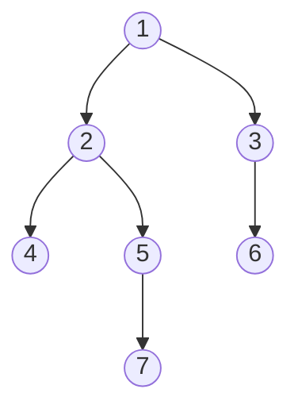
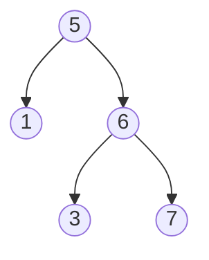
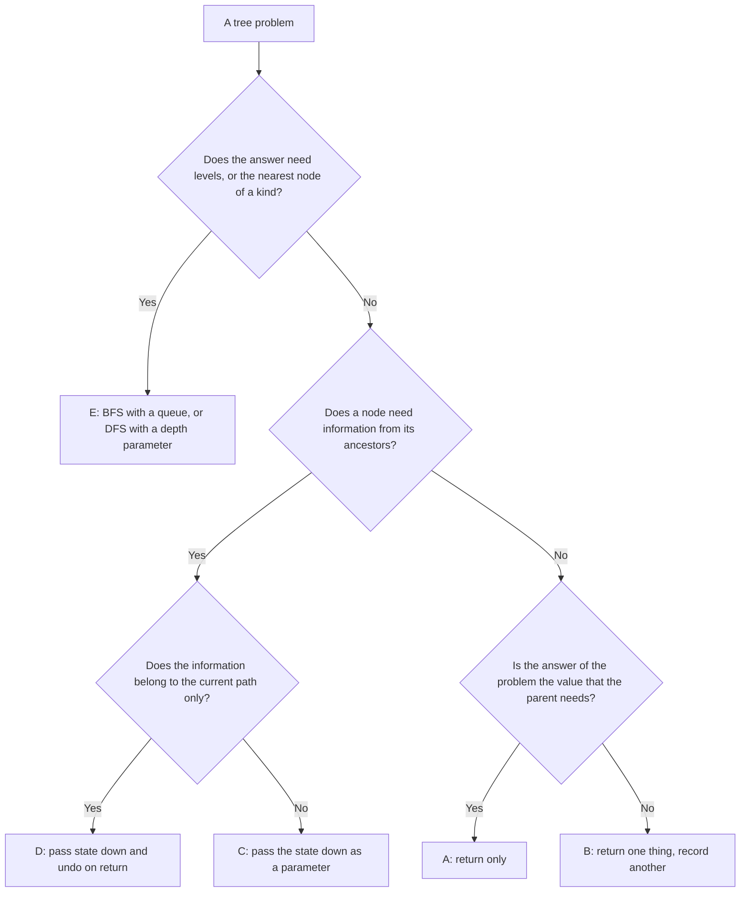

# Pattern 10: Tree DFS and BFS Patterns

## Overview

A tree problem asks for one answer about the whole tree. A recursive method on a tree gets that answer by asking each node a small question: what do the two subtrees report, and what does this node add? The page teaches how to find the contract of that method (what it returns for any node, including `null`), what a parent must hand down to its children, and when the problem needs levels, so that a queue replaces the recursion.

After this page you can:

1. Write the contract of a recursive tree method in one sentence, and derive its base case and its step from the contract.
2. Say, for a new tree problem, what each call returns to its parent, what it receives from its parent, and where the answer is recorded.
3. Solve a problem whose answer differs from the value that the parent needs ([LC 543: Diameter of Binary Tree](https://leetcode.com/problems/diameter-of-binary-tree/), [LC 124: Binary Tree Maximum Path Sum](https://leetcode.com/problems/binary-tree-maximum-path-sum/)) by returning one value and recording another.
4. Pass state down the tree with a parameter, and undo the state when the call returns ([LC 98](https://leetcode.com/problems/validate-binary-search-tree/), [LC 113](https://leetcode.com/problems/path-sum-ii/), [LC 437](https://leetcode.com/problems/path-sum-iii/)).
5. Decide whether the answer needs levels, write the level-order loop with a queue, and explain why the loop reads the queue size before the inner loop.
6. State the time and space of a tree traversal (O(n) time, O(h) space for DFS, O(w) space for BFS), and name the tree shape that makes a recursive solution overflow the stack in Java.

## Prerequisites

| You need | Why this page needs it | Where to learn it |
|---|---|---|
| Recursion: a method that calls itself, the base case, the call stack | Every DFS on this page is a recursive method. The page derives the contract of each method, and it uses the stack depth to count space | [Foundation F9: Recursion](../foundations/09-recursion.md) |
| Trees: node, leaf, subtree, pre-order, in-order, post-order, BST | The page uses these terms without defining each of them again, and it uses the BST rule "left subtree < node < right subtree" | [Trees and Balanced BSTs](../foundations/05-trees-and-balanced-bsts.md) |
| Queues and stacks: `ArrayDeque` as a queue and as a stack | Level order uses a queue. The iterative traversals use a stack | [Stacks, Queues, and Deques](../foundations/03-stacks-queues-deques.md) |
| Hash map: `put`, `getOrDefault`, `merge` | Example 3 and Example 4 use a map from a number to a count or an index | [Hash Tables](../foundations/04-hash-tables.md) |
| Prefix sums: the sum of a range is the difference of two prefix sums | Example 3 applies the idea to the path from the root | [Pattern 04: Prefix Sum](../04-prefix-sum/README.md) |
| Sorting a list with a comparator | P9 sorts records by three keys | [Java Toolkit](../java-toolkit.md) |
| Counting operations and O-notation | The page counts calls before it states O(n) | [Complexity Analysis](../foundations/01-complexity-analysis.md) |

These terms appear from the start. [Trees and Balanced BSTs](../foundations/05-trees-and-balanced-bsts.md) gives the full definitions.

- A **node** has a value `val` and two child references, `left` and `right`. A missing child is `null`.
- A **leaf** is a node whose `left` and `right` are both `null`.
- The **subtree of a node** is the node and everything below it. A subtree of `null` is empty.
- The **height of a node** is the number of nodes on the longest path that starts at the node and goes down to a leaf. A leaf has height 1, and `null` has height 0. The page counts nodes, not edges, because [LC 104](https://leetcode.com/problems/maximum-depth-of-binary-tree/) counts nodes. The **depth of a tree** is the height of its root.
- **Depth-first search (DFS)** goes down one branch to a leaf before it takes the next branch. A recursive tree method is a DFS. **Breadth-first search (BFS)** visits all nodes of one level before it visits the next level, and it uses a queue.

The page uses one tree in most examples. Call it the **sample tree**. A missing child is not drawn.



In the level-order array form that LeetCode uses, the sample tree is `[1, 2, 3, 4, 5, null, 6, null, null, 7]`: the array lists the nodes level by level, and `null` marks a missing child (the children of a missing node are not listed).

## Motivation

### The anchor problem: the maximum depth of a binary tree (LC 104)

[LC 104: Maximum Depth of Binary Tree](https://leetcode.com/problems/maximum-depth-of-binary-tree/). Given the root of a binary tree, return the number of nodes on the longest path from the root down to a leaf. For the sample tree, the answer is 4 (the path 1, 2, 5, 7). For an empty tree, the answer is 0.

**First attempt: a loop.** The reader knows how to walk an array with a loop. Try a loop that moves one reference down the tree and counts the steps:

```java
static int depthByLoop(TreeNode root) {
    int depth = 0;
    TreeNode node = root;
    while (node != null) {
        depth++;
        node = node.left;      // the loop must pick one child
    }
    return depth;
}
```

On the sample tree the loop visits 1, 2, 4 and returns 3. The answer is 4. The loop holds one reference. At node 2 the tree has two ways on, and the loop drops the way to node 5. To choose the better child, the loop would have to know the depth below each child. That depth is the answer to the problem for the child.

**Second attempt: list every root-to-leaf path.** Walk from the root to each leaf, count the nodes of each path, and keep the largest count.

| Path | Nodes |
|---|---|
| 1, 2, 4 | 3 |
| 1, 2, 5, 7 | 4 |
| 1, 3, 6 | 3 |

The result is correct: 4. The cost is the problem. The three paths make 3 + 4 + 3 = 10 node visits, and the tree has 7 nodes. Node 1 is visited 3 times, once for each leaf below it, and node 2 twice. Suppose a chain of 1,000 nodes sits above a perfect subtree (every level full) with 1,024 leaves. The tree has 1,000 + 2,047 = 3,047 nodes and 1,024 paths. Each path walks the 1,000 chain nodes and 11 more nodes, so the method makes 1,024 x 1,011 = 1,035,264 visits for 3,047 nodes. The method walks the shared top part of the tree again for every leaf.

**The gap.** Node 1 does not need the nodes below it. It needs one number from each child: how deep the child's subtree is. If the two children already report that number, node 1 adds one step (itself) and has its answer. The Derivation builds the method from this question.

## Derivation

### Information flows up: the maximum depth

**Question.** If the two subtrees already report their answers, what one step does this node add?

Suppose the left subtree of node 1 reports 3 (its depth) and the right subtree reports 2. The longest path from node 1 goes through the child with the larger depth, and it also counts node 1. So node 1 reports `1 + max(3, 2) = 4`. The step is the same for every node: `1 + max(left report, right report)`.

**Question.** What does the method return for a node that is `null`?

The step needs a report from each child, and a node can have a missing child. The method must define what it returns for `null`. Write the **contract** of the method: a sentence that says what the method returns for any input, and that the code must keep true in every call.

```text
maxDepth(node) returns the number of nodes on the longest downward path that
starts at node. For null, no node exists, so it returns 0.
```

With this contract, the step needs no special case for a leaf. A leaf has two `null` children. Each reports 0, so the leaf reports `1 + max(0, 0) = 1`. This is the height of a leaf, as defined above.

```java
static int maxDepth(TreeNode node) {
    if (node == null) return 0;                          // the contract for null
    return 1 + Math.max(maxDepth(node.left), maxDepth(node.right));
}
```

**Trace** on the sample tree. Each call prints one line when it starts. A call that returns prints a second line. The indentation shows the depth of the call stack.

```text
node 1 asks its children
  node 2 asks its children
    node 4 asks its children
      null -> 0
      null -> 0
    node 4: left 0, right 0 -> returns 1
    node 5 asks its children
      node 7 asks its children
        null -> 0
        null -> 0
      node 7: left 0, right 0 -> returns 1
      null -> 0
    node 5: left 1, right 0 -> returns 2
  node 2: left 1, right 2 -> returns 3
  node 3 asks its children
    null -> 0
    node 6 asks its children
      null -> 0
      null -> 0
    node 6: left 0, right 0 -> returns 1
  node 3: left 0, right 1 -> returns 2
node 1: left 3, right 2 -> returns 4
```

Read the lines from the inside out. The first node that returns is node 4, a leaf, with 1. Node 5 gets 1 from node 7 and 0 from its missing right child, so it returns 2. Node 2 gets 1 and 2 and returns 3. The root gets 3 and 2 and returns 4. A parent never looks inside a child. It uses only the number that the child returns.

**Why it is correct.** An **invariant** is a statement that is true every time the code reaches a given point. The invariant here is: every call `maxDepth(x)` returns the number of nodes on the longest downward path that starts at `x`, and 0 if `x` is `null`. The proof is an **induction**: show the statement for the smallest case, then show that every larger case follows from the smaller ones. Take the smallest subtrees first.

1. For `null` the code returns 0, which is the contract.
2. Suppose the invariant holds for both children of a node `x`. Every downward path from `x` is either the one node `x`, or `x` followed by a downward path that starts at `left` or at `right`. The longest path of the second kind has `max(maxDepth(left), maxDepth(right))` nodes, by the invariant for the children. If both children are `null`, that maximum is 0, and the path `x` alone has 1 node. So the longest path from `x` has `1 + max(...)` nodes. The code returns this value.

The argument goes from the leaves up, so it covers every node. For the empty tree, the first call is `maxDepth(null)`, and it returns 0.

**Count the calls.** The tree has `n` nodes, so it has `2n` child slots. Of these, `n - 1` slots hold a node (every node except the root has one parent slot). The other `n + 1` slots hold `null`. The method makes one call for the root, one for each node, and one for each `null` slot: `n + (n + 1) = 2n + 1` calls. The sample tree has `n = 7` and 15 calls. The trace above has 15 lines that start a call. Each call does O(1) work besides its recursive calls. The time is O(n).

### The same idea fails: the diameter (LC 543)

[LC 543: Diameter of Binary Tree](https://leetcode.com/problems/diameter-of-binary-tree/). The **diameter** of a tree is the number of edges on the longest path between any two nodes. The path may or may not pass through the root. For the sample tree the answer is 5: the path 7, 5, 2, 1, 3, 6 has 6 nodes and 5 edges. For a single node, the answer is 0.

**Question.** What does one node add, when its two subtrees report?

Look at the longest path whose highest node is `x`. It goes down the left side from `x` and down the right side from `x`. The best choice is the deepest way on each side. So the path through `x` has `height(left) + height(right)` edges. (Height counts nodes. The path from `x` down to the deepest node of the left subtree has `height(left)` edges, because the edge from `x` to the left child is one of them.) Every path has exactly one highest node, so the answer is the largest of this sum over all nodes `x`.

**The first attempt.** Compute the sum at every node with a separate height method:

```java
static long heightCalls;

static int slowHeight(TreeNode node) {
    heightCalls++;
    if (node == null) return 0;
    return 1 + Math.max(slowHeight(node.left), slowHeight(node.right));
}

static int slowDiameter(TreeNode node) {
    if (node == null) return 0;
    int through = slowHeight(node.left) + slowHeight(node.right);   // a full walk of both subtrees
    return Math.max(through, Math.max(slowDiameter(node.left), slowDiameter(node.right)));
}
```

The answer is correct. The cost is the waste. Each call of `slowDiameter` walks the whole subtree below it, to compute heights that the recursion computes again one level down. Take a skewed tree: a chain of `n` nodes where each node has only a left child. The node with `m` nodes in its subtree makes a `slowHeight` walk over `m - 1` nodes and `m` `null` slots below its left child, which is `2(m - 1) + 1 = 2m - 1` calls, plus 1 call for its `null` right child: `2m` calls. The total over all nodes is `2(1 + 2 + ... + n) = n(n + 1)`.

| Chain length `n` | `slowHeight` calls | Calls of the single-pass method below |
|---|---|---|
| 5 | 30 | 11 |
| 1,000 | 1,001,000 | 2,001 |

The program in the Implementation section prints these numbers. The cost is O(n²).

**The gap.** The parent needs the height of each child. The problem asks for the largest `height(left) + height(right)` over all nodes. These are two different values. `maxDepth` returned the value that the parent needs, and that was also the answer of the problem. Here the answer of the problem is not what a parent can use. A path through a node that forks to both sides cannot be extended by the parent, because a path cannot fork twice.

**Question.** Each call already computes `height(left)` and `height(right)` for its own step. Can the same call also record the sum for the answer?

Yes. The call `height(x)` has both child heights in hand before it returns. It can write `left + right` into a variable that lives outside the calls, keep the maximum there, and return the height to the parent. The call returns one thing (what the parent needs) and records another (what the problem asks).

```java
static int longest;                      // the answer: the largest left + right seen so far

static int diameter(TreeNode root) {
    longest = 0;                         // reset: a static field keeps the value of the last call
    height(root);
    return longest;
}

// Contract: returns the height of the subtree (in nodes), 0 for null.
// Side effect (a change outside the return value): raises longest to left + right if larger.
static int height(TreeNode node) {
    if (node == null) return 0;
    int left = height(node.left);
    int right = height(node.right);
    longest = Math.max(longest, left + right);     // record: the longest path through this node
    return 1 + Math.max(left, right);              // return: what the parent needs
}
```

**Trace** on the sample tree. The nodes finish in the order 4, 7, 5, 2, 6, 3, 1.

```text
node 4: left 0, right 0, through 0, best 0 -> 0, returns 1
node 7: left 0, right 0, through 0, best 0 -> 0, returns 1
node 5: left 1, right 0, through 1, best 0 -> 1, returns 2
node 2: left 1, right 2, through 3, best 1 -> 3, returns 3
node 6: left 0, right 0, through 0, best 3 -> 3, returns 1
node 3: left 0, right 1, through 1, best 3 -> 3, returns 2
node 1: left 3, right 2, through 5, best 3 -> 5, returns 4
```

The answer is the last value of `best`: 5. The path is 7, 5, 2, 1, 3, 6.

**The answer may avoid the root.** Take the tree `[1, 2, null, 3, 4, 5, null, null, 6]`: node 1 has one child, node 2, which has children 3 and 4. Node 3 has a child 5, and node 4 has a child 6. The root has `left 3, right 0`, so the path through the root has 3 edges. Node 2 has `left 2, right 2`, so the path through node 2 has 4 edges: 5, 3, 2, 4, 6. The answer is 4. The call for node 2 records 4, and the call for node 1 does not lower it, because `Math.max` keeps the larger value. This is why the code records at every node and does not record only at the root.

**Why it is correct.** Every path in the tree has exactly one node that is closest to the root (the highest node). For a node `x`, the longest path whose highest node is `x` has `height(left) + height(right)` edges, as shown above, and the invariant of `height` (it returns the height) holds by the same argument as for `maxDepth`. The code visits every node, so it records the sum for every possible highest node, and `longest` holds the maximum. Edge cases: for `null`, `height` records nothing and `longest` stays 0. For one node, `left = right = 0`, and the answer is 0.

**Count the calls.** The code makes one call for each node and for each `null` slot: `2n + 1` calls, the same count as `maxDepth`. For the chain of 1,000 nodes, that is 2,001 calls, against 1,001,000 for `slowDiameter`.

### Information flows down: a parameter carries the state from the root

Both problems so far needed nothing from the ancestors of a node. Some problems ask a question that a node cannot answer from its subtree alone. Take [LC 112: Path Sum](https://leetcode.com/problems/path-sum/).

[LC 112](https://leetcode.com/problems/path-sum/). Given a tree and a number `target`, decide whether some path from the root down to a leaf has node values that add up to `target`. For the sample tree and `target = 15`, the answer is true (1 + 2 + 5 + 7). For `target = 8`, the answer is false.

**Question.** Can a node answer from what its subtrees report?

A subtree can report "I contain a path from my root to a leaf with sum `s`" only for a known `s`. The sum that node 5 must reach depends on the nodes above it (1 and 2), and node 5 does not know them. The answer has to come from the top: the root knows `target` and passes down what is left of it. When the call goes from node `x` to a child, the child must reach `remaining - x.val`.

```java
static boolean hasPathSum(TreeNode node, int remaining) {
    if (node == null) return false;                       // no path ends in a missing child
    if (node.left == null && node.right == null) {
        return remaining == node.val;                     // a leaf ends a root-to-leaf path
    }
    return hasPathSum(node.left, remaining - node.val)
        || hasPathSum(node.right, remaining - node.val);
}
```

**Trace** on the sample tree with `target = 15`. The second `||` operand does not run when the first is true.

```text
node 1, remaining 15
  node 2, remaining 14
    node 4, remaining 12
    leaf: 12 == 4 ? false
    node 5, remaining 12
      node 7, remaining 7
      leaf: 7 == 7 ? true
    left found, skip right
left found, skip right
true
```

Two lines of the code carry the reasoning. `remaining - node.val` is the state that flows down: each call receives what the ancestors left over. The leaf test `node.left == null && node.right == null` makes the method end a path at a leaf. A test `node == null` as the end of a path gives a wrong answer:

```java
static boolean hasPathSumNullIsLeaf(TreeNode node, int remaining) {   // wrong
    if (node == null) return remaining == 0;
    return hasPathSumNullIsLeaf(node.left, remaining - node.val)
        || hasPathSumNullIsLeaf(node.right, remaining - node.val);
}
```

Take the tree `[1, 2]` (node 1 has only a left child) and `target = 1`. The only root-to-leaf path is 1, 2 with sum 3, so the answer is false. The wrong method calls node 1 with 1, then the missing right child with `1 - 1 = 0`, and returns true: it treats the path "1" as complete although node 1 is not a leaf.

**The state that a node needs from its ancestors.** [LC 98: Validate Binary Search Tree](https://leetcode.com/problems/validate-binary-search-tree/) asks whether a tree is a BST: for every node, every value in its left subtree is smaller, and every value in its right subtree is larger (the problem asks for strictly smaller and strictly larger, so equal values are not allowed).

**First attempt: compare each node with its two children.**

```java
static boolean parentChildOnly(TreeNode node) {                       // wrong
    if (node == null) return true;
    if (node.left != null && node.left.val >= node.val) return false;
    if (node.right != null && node.right.val <= node.val) return false;
    return parentChildOnly(node.left) && parentChildOnly(node.right);
}
```

Take the tree `[5, 1, 6, null, null, 3, 7]`:



Node 5 passes: 1 < 5 < 6. Node 6 passes: 3 < 6 < 7. Nodes 1, 3, 7 have no children. The method returns true. The tree is not a BST: node 3 is in the right subtree of node 5, and 3 < 5. The check compares a node with its parent only, and the rule is about all ancestors.

**Question.** What does node 3 need to know, to see that it is wrong?

Node 3 is the left child of node 6, and node 6 is the right child of node 5. Going right at node 5 means: everything below must be greater than 5. Going left at node 6 means: everything below must be smaller than 6. So node 3 must lie strictly between 5 and 6. Each ancestor adds one limit, and only the closest limit on each side matters: the nearest ancestor from which the path turned right gives the **lower bound**, and the nearest ancestor from which the path turned left gives the **upper bound**. The call passes the two bounds down. Going left from `x` keeps the lower bound and sets the upper bound to `x.val`. Going right keeps the upper bound and sets the lower bound to `x.val`. The root starts with no bounds.

```java
static boolean isValidBST(TreeNode root) {
    return inRange(root, Long.MIN_VALUE, Long.MAX_VALUE);       // no bounds at the root
}

// Contract: true if every node of the subtree has a value strictly between low and high,
// and the subtree itself obeys the BST rule.
static boolean inRange(TreeNode node, long low, long high) {
    if (node == null) return true;                              // an empty subtree is valid
    if (node.val <= low || node.val >= high) return false;      // strict: no equal values
    return inRange(node.left, low, node.val)                    // left: smaller than node
        && inRange(node.right, node.val, high);                 // right: larger than node
}
```

The bounds are `long`, because a node value is an `int`, so it can be `Integer.MIN_VALUE` or `Integer.MAX_VALUE`. With `int` bounds at those values, the test `node.val <= low` rejects a valid tree that has the single node `Integer.MIN_VALUE` (see Common Mistakes).

**Trace** on `[5, 1, 6, null, null, 3, 7]`:

```text
node 5 must be in (-inf, +inf)
  node 1 must be in (-inf, 5)
    null -> true
    null -> true
  node 6 must be in (5, +inf)
    node 3 must be in (5, 6)
    -> false
false
```

Node 3 fails its range (5, 6), because 3 is not larger than 5.

**Why it is correct.** The invariant is: when the call `inRange(x, low, high)` starts, `low` is the largest value of an ancestor from which the path to `x` went right (or minus infinity), and `high` is the smallest value of an ancestor from which the path went left (or plus infinity). The BST rule says that `x.val` must be larger than every ancestor from which the path went right, and smaller than every ancestor from which it went left. The largest of the first set and the smallest of the second set are the binding ones, so the test `low < x.val < high` is equivalent to the rule for all ancestors. The calls check every node, so the method accepts exactly the trees in which each node obeys the rule for its ancestors. An empty tree has no node to violate the rule, so it is valid.

**The in-order form.** A BST read in in-order (left, node, right) gives the values in strictly increasing order. Reason: the rule says that the whole left subtree is smaller than the node and the whole right subtree is larger, and in-order lists the left subtree first, then the node, then the right subtree. The converse also holds. If the in-order sequence is strictly increasing, then for each node every value in its left subtree comes earlier and is smaller, and every value in its right subtree comes later and is larger, so the rule holds. So the method can walk the tree in-order and compare each value with the previous value:

```java
static Long previous;                                   // the last value visited, null at the start

static boolean isValidBSTInorder(TreeNode root) {
    previous = null;
    return inorderIncreasing(root);
}

static boolean inorderIncreasing(TreeNode node) {
    if (node == null) return true;
    if (!inorderIncreasing(node.left)) return false;               // the left subtree first
    if (previous != null && node.val <= previous) return false;     // not above the last one
    previous = (long) node.val;
    return inorderIncreasing(node.right);                           // the right subtree last
}
```

This form passes no bounds. It carries the state in a variable outside the calls: the previous value. The state comes from the node visited just before, which is neither a parent nor a child. On `[5, 1, 6, null, null, 3, 7]` the in-order sequence is 1, 5, 3, 6, 7, and the method stops at 3, because 3 <= 5. Use the bound form when the question is about ancestors, and the in-order form when the problem gives a BST and asks for the order of its values (see [LC 230](#example-2-kth-smallest-element-in-a-bst-lc-230)).

### The answer needs levels: breadth-first search

[LC 102: Binary Tree Level Order Traversal](https://leetcode.com/problems/binary-tree-level-order-traversal/). Return the values of the tree level by level, from the top level down, and from left to right inside a level. For the sample tree: `[[1], [2, 3], [4, 5, 6], [7]]`.

**Question.** Why does the recursion of the previous sections not give the levels?

A recursive walk (depth-first search, DFS) goes down one branch to a leaf before it looks at the next branch. On the sample tree it visits 1, 2, 4, 5, 7, 3, 6. Node 3 is on level 2, and the walk reaches it after the nodes 4, 5, and 7 from deeper levels. The visit order has no level boundaries. A walk that visits all nodes of a level before any node of the next level is a different order: **breadth-first search** (BFS).

**Question.** What data structure produces the order "level by level, left to right"?

The children of node 1 are 2 and 3. They come first. The children of node 2 (4 and 5) must come before the children of node 3 (6), because 2 comes before 3. So the nodes must leave in the same order in which they entered: first in, first out. That is a **queue**. The loop is: take the node at the front, record it, and add its children at the back.

```java
// Flat order only: 1, 2, 3, 4, 5, 6, 7. The loop has no level boundaries yet.
static List<Integer> flatOrder(TreeNode root) {
    List<Integer> order = new ArrayList<>();
    if (root == null) return order;
    Deque<TreeNode> queue = new ArrayDeque<>();
    queue.add(root);
    while (!queue.isEmpty()) {
        TreeNode node = queue.poll();                  // the front of the queue
        order.add(node.val);
        if (node.left != null) queue.add(node.left);   // the children go to the back
        if (node.right != null) queue.add(node.right);
    }
    return order;
}
```

The checks before each `add` keep `null` out of the queue. This matters in Java: `ArrayDeque` throws a `NullPointerException` when the code adds `null` (see the [`ArrayDeque` documentation](https://docs.oracle.com/en/java/javase/21/docs/api/java.base/java/util/ArrayDeque.html)). For the same reason, the call `queue.add(root)` needs `root != null`, so the method returns an empty result for an empty tree before it touches the queue.

**Question.** How does the loop know where one level ends?

When the loop starts a level, the queue holds exactly the nodes of that level. While the loop processes them, it adds the nodes of the next level behind them. So the number of nodes in the level is the size of the queue at the start of the level. The loop must read that number once, before it changes the queue.

```java
static List<List<Integer>> levelOrder(TreeNode root) {
    List<List<Integer>> result = new ArrayList<>();
    if (root == null) return result;
    Deque<TreeNode> queue = new ArrayDeque<>();
    queue.add(root);
    while (!queue.isEmpty()) {
        int size = queue.size();                   // read once: the number of nodes in this level
        List<Integer> level = new ArrayList<>();
        for (int i = 0; i < size; i++) {
            TreeNode node = queue.poll();
            level.add(node.val);
            if (node.left != null) queue.add(node.left);
            if (node.right != null) queue.add(node.right);
        }
        result.add(level);
    }
    return result;
}
```

**The wrong version.** Replace `i < size` with `i < queue.size()`:

```text
correct:  for (int i = 0; i < size; i++)           // size was read once, before the loop
wrong:    for (int i = 0; i < queue.size(); i++)   // the size changes inside the loop
```

The Implementation section has the complete wrong method (`levelOrderWrong`) and prints its output.

Each `poll` lowers the size by 1, and each added child raises it. The loop condition then compares `i` with a moving number. On the sample tree the wrong code returns `[[1, 2, 3], [4, 5], [6], [7]]` and the correct code returns `[[1], [2, 3], [4, 5, 6], [7]]`. Trace of the first two passes of the wrong code: the queue is `[1]`. At `i = 0` the loop polls 1 and adds 2 and 3, so the queue is `[2, 3]` and `queue.size()` is 2. At `i = 1`, `1 < 2`, so the loop polls 2 (a node of the next level) and adds 4 and 5. At `i = 2`, `queue.size()` is 3 (`[3, 4, 5]`), and `2 < 3`, so the loop polls 3 too. At `i = 3`, `queue.size()` is 3 (`[4, 5, 6]`) and the loop stops. The first level is `[1, 2, 3]`: it holds nodes of two levels.

**Trace** of the correct code on the sample tree:

```text
pass 0: queue [1], size 1 -> level [1], added [2, 3]
pass 1: queue [2, 3], size 2 -> level [2, 3], added [4, 5, 6]
pass 2: queue [4, 5, 6], size 3 -> level [4, 5, 6], added [7]
pass 3: queue [7], size 1 -> level [7], added []
```

**Why it is correct.** The invariant is: at the start of pass `d`, the queue holds exactly the nodes of level `d`, from left to right. It holds at pass 0: the queue holds the root. Suppose it holds at pass `d`. The pass reads `size`, which is the number of nodes of level `d`. The queue is first in, first out, and the pass adds children at the back. So the `size` polls take exactly the nodes of level `d`, in order, before any added child. The children added are the children of level `d`, in the order of their parents and, for each parent, left before right. That is level `d + 1` from left to right. If a level has no children, the queue is empty and the loop ends. For the empty tree the method returns at the first line.

**The cost, counted.** Each node enters the queue once and leaves it once, and each entry does O(1) work. The sample tree has 7 enters and 7 leaves. The time is O(n).

**DFS with a depth parameter gives the same result.** The recursion of the previous sections can pass the depth down. The first node that reaches depth `d` opens a new list for the level, and every node at depth `d` appends its value to that list. A pre-order walk visits the nodes of one level from left to right, because it visits the left subtree before the right subtree.

```java
static List<List<Integer>> levelOrderDfs(TreeNode root) {
    List<List<Integer>> levels = new ArrayList<>();
    fill(root, 0, levels);
    return levels;
}

static void fill(TreeNode node, int depth, List<List<Integer>> levels) {
    if (node == null) return;
    if (levels.size() == depth) levels.add(new ArrayList<>());   // the first node at this depth
    levels.get(depth).add(node.val);
    fill(node.left, depth + 1, levels);       // depth + 1 flows down
    fill(node.right, depth + 1, levels);
}
```

On the sample tree it returns `[[1], [2, 3], [4, 5, 6], [7]]`, the same as the queue. Which form to use depends on what the problem needs:

| Need | Use | Reason |
|---|---|---|
| Stop as soon as one level is complete or the first leaf is found ([LC 111](https://leetcode.com/problems/minimum-depth-of-binary-tree/)) | BFS | The queue finishes level `d` before it starts level `d + 1`, so the loop can return early. DFS visits the whole tree before it knows the answer |
| The tree is very deep and thin | BFS | The queue holds one level at a time. A recursive DFS needs one stack frame for each level (see Complexity) |
| The tree is very wide | DFS | The queue of BFS holds a whole level, up to about half of the nodes. DFS holds one root-to-node path |
| A per-level step that uses the whole level (reverse every second level, [LC 103](https://leetcode.com/problems/binary-tree-zigzag-level-order-traversal/)) | BFS | The loop has a place, after the inner loop, where the whole level is known |
| Collect values by depth, with no early stop | Either | The two forms give the same result |

**The right side view (LC 199) both ways.** [LC 199: Binary Tree Right Side View](https://leetcode.com/problems/binary-tree-right-side-view/). Return the values that a viewer sees from the right side: the last node of each level. For the sample tree: `[1, 3, 6, 7]`. Node 7 is visible although it sits in the left part of the tree, because the right part has no node on level 3.

- *BFS:* in the level loop, record the node at `i == size - 1`. The queue holds the level from left to right, so the last node of the pass is the rightmost node.
- *DFS:* visit the right child before the left child, and record the first node that reaches each depth. The right-first walk reaches the rightmost node of each level first.

```java
static List<Integer> rightViewBfs(TreeNode root) {
    List<Integer> view = new ArrayList<>();
    if (root == null) return view;
    Deque<TreeNode> queue = new ArrayDeque<>();
    queue.add(root);
    while (!queue.isEmpty()) {
        int size = queue.size();
        for (int i = 0; i < size; i++) {
            TreeNode node = queue.poll();
            if (i == size - 1) view.add(node.val);     // the last node of the level
            if (node.left != null) queue.add(node.left);
            if (node.right != null) queue.add(node.right);
        }
    }
    return view;
}

static List<Integer> rightViewDfs(TreeNode root) {
    List<Integer> view = new ArrayList<>();
    visitRightFirst(root, 0, view);
    return view;
}

static void visitRightFirst(TreeNode node, int depth, List<Integer> view) {
    if (node == null) return;
    if (view.size() == depth) view.add(node.val);      // the first node that reaches this depth
    visitRightFirst(node.right, depth + 1, view);      // right first
    visitRightFirst(node.left, depth + 1, view);
}
```

For the sample tree, the DFS visits 1 (depth 0, recorded), 3 (depth 1, recorded), 6 (depth 2, recorded), then back to 2 (depth 1, not recorded: the view already has an entry for depth 1), 5 (depth 2, not recorded), 7 (depth 3, recorded), and 4 (depth 2, not recorded). The result is `[1, 3, 6, 7]`, the same as the BFS.

## The Pattern

A recursive tree method is built from one contract. The contract says what the method returns for any node, including `null`. The code of the method has three parts: the base case for `null`, the calls on the two children, and the step that turns the two reports and the node into the return value. When the problem needs more than the children can report, the method gets a second channel: a parameter that carries state down, or a variable outside the calls that records the answer. When the problem needs levels, a queue replaces the recursion. To design the method for a new problem, answer three questions in order: what does the call return to its parent, what does it receive from its parent, and where is the answer recorded.

The invariant of every DFS method on this page: after a call `f(x, ...)` returns, its return value satisfies the contract for the subtree of `x`, and the recorded state includes the contribution of every node in that subtree. The proof is the same each time. It starts at `null`, where the contract holds by the base case, and it goes up one node at a time.

The table fills the three questions for ten problems. Four of them are derived above, and the others are derived in the Worked Examples.

| Problem | What does the call return? | What does it receive? | Where is the answer recorded? |
|---|---|---|---|
| [LC 104](https://leetcode.com/problems/maximum-depth-of-binary-tree/) Maximum Depth | The height of the subtree | Nothing | The return value of the root call |
| [LC 543](https://leetcode.com/problems/diameter-of-binary-tree/) Diameter | The height of the subtree | Nothing | A variable outside the calls, raised at every node |
| [LC 124](https://leetcode.com/problems/binary-tree-maximum-path-sum/) Maximum Path Sum | The best sum of a path that starts at the node and goes down one side | Nothing | A variable outside the calls, raised at every node |
| [LC 112](https://leetcode.com/problems/path-sum/) Path Sum | True if a leaf path of the subtree has the sum `remaining` | `remaining`: the target minus the sum of the ancestors | The return value (the OR of the two children) |
| [LC 98](https://leetcode.com/problems/validate-binary-search-tree/) Validate BST | True if the subtree obeys the BST rule inside its bounds | `low` and `high`: the closest ancestors on each side | The return value (the AND of the two children) |
| [LC 236](https://leetcode.com/problems/lowest-common-ancestor-of-a-binary-tree/) LCA | `null`, one target, or the LCA (three meanings) | The two targets (the same in every call) | The return value, passed up the chain unchanged |
| [LC 105](https://leetcode.com/problems/construct-binary-tree-from-preorder-and-inorder-traversal/) Construct | The root of the subtree that the call built | The ranges of the two arrays that describe the subtree | The return value of the root call is the tree |
| [LC 297](https://leetcode.com/problems/serialize-and-deserialize-binary-tree/) Serialize, Deserialize | Serialize: nothing. Deserialize: the root of the subtree that the call read | Serialize: the node. Deserialize: nothing, the shared token queue moves on | Serialize: a `StringBuilder`. Deserialize: the return value |
| [LC 437](https://leetcode.com/problems/path-sum-iii/) Path Sum III | The number of matching paths inside the subtree | The prefix sum above the node (the shared map holds the prefix sums of the path, and the call undoes its entry) | The return value (the sum of the counts) |
| [LC 1448](https://leetcode.com/problems/count-good-nodes-in-binary-tree/) Count Good Nodes | The number of good nodes in the subtree | The largest value on the path from the root | The return value (the sum of the counts) |

**The vocabulary.** The page used each term before it named it.

| Term | What it was in the examples | The question to ask in a new problem |
|---|---|---|
| Contract | "`maxDepth(node)` returns the number of nodes on the longest downward path from `node`; 0 for `null`" | "What exactly does the call return for any node, including `null`?" |
| Information flows up | The return value: a height, a boolean, a node, a count | "What must the parent know about a subtree to take its step?" |
| Information flows down | A parameter: `remaining`, `low` and `high`, `depth` | "What does a node need to know that only its ancestors know?" |
| Record | A variable outside the calls (`longest`), or a list that the calls fill | "Is the answer of the problem different from the value that the parent needs?" |
| Undo on return | `seen.merge(current, -1, ...)` in LC 437, `path.remove(...)` in LC 113 | "Does the shared state belong to the current path only, so that a sibling must not see it?" |
| Level | The set of nodes at one distance from the root | "Does the answer need nodes grouped by distance, or the nearest node of a kind?" |

**The three positions.** A recursive method has three places where code can run for a node. The place decides what the code knows.

| Position | Where in the code | What is known there | Typical use |
|---|---|---|---|
| Pre-order position | Before the two recursive calls | The node, and the parameters that the parent passed down. No child has reported yet | Update the state that flows down (`remaining - node.val`). Add the node to a path. Write the node first (serialize) |
| In-order position | Between the two calls | The left subtree is finished. The right subtree has not started | Visit a BST in sorted order. Compare with the previous value (the in-order check of LC 98). Count to `k` ([LC 230](https://leetcode.com/problems/kth-smallest-element-in-a-bst/)) |
| Post-order position | After the two calls | Both children reported. The node can combine the two reports | Compute a value from the children: height, the diameter record, the LCA decision, a count |

The in-order position exists for a binary tree only, because a node with more than two children has no single "between". The three orders that the positions produce (pre-order, in-order, post-order) are the traversals that [Trees and Balanced BSTs](../foundations/05-trees-and-balanced-bsts.md) defines.

**The variants.** Each variant changes one thing, and a property of the problem selects it.

| Variant | What it uses | The property that selects it | Problems |
|---|---|---|---|
| A. Return only | `return step(node.val, f(left), f(right))` | The answer for a node is a function of the answers for its children | LC 104, LC 110, LC 226 |
| B. Return one thing, record another | A variable outside the calls, raised in the post-order position | The answer of the problem is the best over all nodes of a value that the parent cannot use (a path that forks at the node) | LC 543, LC 124, LC 1373 |
| C. Pass state down | A parameter that the node changes before the child calls | The answer for a node depends on its ancestors (a sum so far, bounds, a maximum so far, a depth) | LC 112, LC 98, LC 1448 |
| D. Pass state down and undo | A shared list or map, changed before the child calls and restored after them | The state belongs to the path from the root, and a sibling subtree must not see the nodes of another branch | LC 113, LC 437 |
| E. Levels | A queue (BFS), or a depth parameter that indexes a list | The answer groups nodes by distance from the root, or needs the nearest node of a kind | LC 102, LC 199, LC 103, LC 111 |
| F. Rebuild a tree from a sequence | The sequence is consumed in pre-order, and each call returns the node that it built | The input is a traversal and the output is the tree | LC 105, LC 297 |
| G. BST order | The in-order position, or the comparison with `node.val` to drop one subtree | The problem says "binary search tree" | LC 230, LC 235, LC 98 |



## Worked Examples

Each example changes one thing about the anchor problems. Try each problem for 10 minutes before you read its section.

### Example 1: Lowest Common Ancestor (LC 236), and the BST form (LC 235)

[LC 236: Lowest Common Ancestor of a Binary Tree](https://leetcode.com/problems/lowest-common-ancestor-of-a-binary-tree/). Given a tree and two nodes `p` and `q` of the tree, return the lowest (deepest) node that has both `p` and `q` in its subtree. A node counts as part of its own subtree. For the sample tree, the LCA of 4 and 7 is 2. The LCA of 2 and 7 is 2, because node 2 is an ancestor of node 7.

**What changed.** The method returns a node, not a number. The return value has three meanings, and the parent's step is a case analysis on the two reports.

**Brute force.** Find the path from the root to `p` and the path from the root to `q`, and walk both lists from the front while they agree. The last common node is the LCA. For the sample tree, the path to 4 is 1, 2, 4 and the path to 7 is 1, 2, 5, 7. They agree on 1 and 2, and differ at the third entry. The answer is 2. The cost is O(n) time, and it needs two walks and two lists of up to `h` nodes.

**Question.** What should `lca(node, p, q)` return for the subtree of `node`, so that the parent can decide with two reports? The parent needs to learn one of three facts about a subtree: neither target is inside, exactly one target is inside, or both are inside (and then the LCA is already known). The contract:

```text
lca(node, p, q) returns
  null    if neither p nor q is in the subtree of node,
  p or q  if exactly one of them is in the subtree (the one that it found),
  x       if both are in the subtree, where x is their lowest common ancestor.
```

The problem guarantees that `p` and `q` are in the tree. The step has five cases:

| Case | What the node sees | The node returns | Reason |
|---|---|---|---|
| 1 | `node` is `null` | `null` | The subtree is empty, so it holds no target |
| 2 | `node` is `p` or `q` | `node` | The subtree holds this target. If the other target is below, `node` is the LCA, and `node` is the return value. If the other target is elsewhere, the subtree holds exactly one target, and `node` is the value to report. The method does not look below, because both answers are `node` |
| 3 | Both children report a non-null value | `node` | One target is in the left subtree and the other is in the right subtree. They meet first at `node` |
| 4 | Exactly one child reports a non-null value | That value | Either that subtree holds one target and the other target is outside it (the parent will find it), or that subtree already holds both and the value is the LCA. In the second case the other child reports `null`, and the value must pass up unchanged |
| 5 | Both children report `null` | `null` | Neither target is below |

Cases 4 and 5 are the same line of code: return the non-null report, or `null` if both are `null`.

```java
static TreeNode lowestCommonAncestor(TreeNode node, TreeNode p, TreeNode q) {
    if (node == null || node == p || node == q) return node;     // cases 1 and 2
    TreeNode left = lowestCommonAncestor(node.left, p, q);
    TreeNode right = lowestCommonAncestor(node.right, p, q);
    if (left != null && right != null) return node;              // case 3
    return left != null ? left : right;                          // cases 4 and 5
}
```

**Trace** for `p = 4`, `q = 7` on the sample tree:

```text
node 1
  node 2
    node 4 is a target -> returns 4
    node 5
      node 7 is a target -> returns 7
      null -> null
    node 5: left 7, right null -> returns 7
  node 2: left 4, right 7 -> returns 2
  node 3
    null -> null
    node 6
      null -> null
      null -> null
    node 6: left null, right null -> returns null
  node 3: left null, right null -> returns null
node 1: left 2, right null -> returns 2
```

Node 5 receives 7 from its left and `null` from its right. This is case 4: it returns 7 unchanged. Node 2 receives 4 and 7. This is case 3, so node 2 is the LCA, and node 2 returns itself. Node 1 receives 2 and `null` and returns 2 unchanged. For `p = 2`, `q = 7`, the call for node 2 returns at once (case 2) and never visits nodes 4, 5, and 7. Node 1 receives 2 and `null` and returns 2, which is the correct LCA.

**Why it is correct.** The invariant is the contract above. Each case keeps it. Case 2 keeps it because the problem guarantees both targets exist. If the subtree of `node` holds the other target as well, `node` is their LCA, because `node` is one of them and is an ancestor of the other. If it does not, the contract asks for "the one found", which is `node`. In case 3, the targets are in different child subtrees, and `node` is the only common node of the two root paths at the lowest level where they meet. In case 4, if the non-null report is a single target, the subtree holds exactly one target, and the report is that target. If the report is an LCA, the subtree holds both targets, and the contract returns the LCA. In both cases the report is the right value for the subtree of `node`.

**When the precondition fails.** If `q` is not in the tree, the method returns `p`, and not `null`: for `p = 4` on the sample tree, node 2 receives 4 and `null` and passes 4 up. The method cannot tell "one target found" from "the LCA found". A problem in which a target may be missing needs a method that also returns whether each target was found.

**Complexity.** The method visits each node at most once: O(n) time. The recursion depth is at most `h` (the height of the tree), so the space is O(h).

**The BST form (LC 235).** [LC 235: Lowest Common Ancestor of a Binary Search Tree](https://leetcode.com/problems/lowest-common-ancestor-of-a-binary-search-tree/). The tree is a BST with distinct values (the problem guarantees both, and the comparisons below need them). The BST rule tells the method which subtree holds each target without a search: a target with a smaller value than `node` is in the left subtree, and a target with a larger value is in the right subtree. If both targets are smaller than `node`, the LCA is in the left subtree. If both are larger, the LCA is in the right subtree. Otherwise `p` and `q` are on different sides of `node` (or one of them equals `node`), and `node` is the LCA. The method needs no recursion: it moves down one path.

```java
static TreeNode lowestCommonAncestorBst(TreeNode root, TreeNode p, TreeNode q) {
    TreeNode node = root;
    while (node != null) {
        if (p.val < node.val && q.val < node.val) node = node.left;         // both on the left
        else if (p.val > node.val && q.val > node.val) node = node.right;   // both on the right
        else return node;                      // the paths split here, or node is p or q
    }
    return null;                               // only for an empty tree
}
```

Trace on the BST `[6, 2, 8, 0, 4, 7, 9, null, null, 3, 5]` with `p = 3`, `q = 5`: at node 6, both values are smaller, so move left to 2. At node 2, both values are larger, so move right to 4. At node 4, 3 < 4 < 5: the values split, and the method returns 4. The loop moves down one level at each step, so the time is O(h) and the space is O(1). On a tree that is not a BST, the comparisons choose the wrong side, and the method returns a wrong node: this is why [LC 236](https://leetcode.com/problems/lowest-common-ancestor-of-a-binary-tree/) needs the case analysis.

### Example 2: Kth Smallest Element in a BST (LC 230)

[LC 230: Kth Smallest Element in a BST](https://leetcode.com/problems/kth-smallest-element-in-a-bst/). Given a BST and `k` (the problem guarantees that `k` is at least 1 and at most the number of nodes), return the `k`-th smallest value. For the BST `[5, 3, 6, 2, 4, null, null, 1]` and `k = 3`, the answer is 3: the sorted values are 1, 2, 3, 4, 5, 6.

**What changed.** The state is a counter that moves in the in-order position, and the walk stops early. The recursion becomes a loop with an explicit stack.

**Brute force.** Collect all values into a list, sort the list, and return the element at index `k - 1`. The cost is O(n log n). The BST rule makes the sort unnecessary: the in-order walk of a BST visits the values in increasing order (see the in-order form of LC 98). The walk visits the nodes in sorted order, so the `k`-th node that it visits is the answer, and the walk can stop there.

**The recursive form.** The counter `remaining` counts down at the in-order position. When it reaches 0, the node is the answer, and the later calls return at once.

```java
static int remaining, answer;

static int kthSmallestRecursive(TreeNode root, int k) {
    remaining = k;
    inorder(root);
    return answer;
}

static void inorder(TreeNode node) {
    if (node == null || remaining == 0) return;     // stop early once the answer is found
    inorder(node.left);
    if (remaining == 0) return;                     // the left subtree found the answer
    remaining--;                                    // the in-order position: visit this node
    if (remaining == 0) {
        answer = node.val;
        return;
    }
    inorder(node.right);
}
```

**Question.** Can a loop replace the recursion, so that a deep tree does not overflow the call stack? The recursion keeps a stack of the nodes whose left subtree is still being walked. A loop can keep the same stack in an `ArrayDeque`. Read the recursion as a script. The call `inorder(node.left)` means: push `node`, and go left. The return from that call means: pop the top node and visit it. The call `inorder(node.right)` means: go right from the node that was just visited. So the loop is:

1. While `node` is not `null`: push `node` and set `node = node.left`. (The stack now holds the left spine.)
2. Pop the top node. This is the next node in sorted order. Count it. If the count is `k`, return its value.
3. Set `node = popped.right` and repeat from step 1.

```java
static int kthSmallest(TreeNode root, int k) {
    Deque<TreeNode> stack = new ArrayDeque<>();      // the nodes whose left subtree is in progress
    TreeNode node = root;
    while (node != null || !stack.isEmpty()) {
        while (node != null) {                       // go as far left as possible
            stack.push(node);
            node = node.left;
        }
        node = stack.pop();                          // the next node in sorted order
        k--;
        if (k == 0) return node.val;
        node = node.right;                           // then the right subtree of that node
    }
    throw new IllegalArgumentException("k is larger than the number of nodes");
}
```

The outer condition has two parts. After the pop and the move to `node.right`, `node` can be `null` while the stack is not empty (the popped node had no right child), and the loop must continue with the stack. The loop ends when `node` is `null` and the stack is empty: every node has been visited.

**Trace** on `[5, 3, 6, 2, 4, null, null, 1]` with `k = 3`:

```text
inner loop pushes the left spine, stack (top first) [1 2 3 5]
  pop 1, visit number 1
inner loop pushes nothing (1 has no right child), stack (top first) [2 3 5]
  pop 2, visit number 2
inner loop pushes nothing (2 has no right child), stack (top first) [3 5]
  pop 3, visit number 3 -> answer
```

After the first pop of 1, `node = 1.right = null`, so the inner loop does not push, and the next pop is 2. After 2, `node = 2.right = null`, and the next pop is 3. The third visited node is the answer: 3.

**Complexity.** The loop pops `k` nodes at most. Each push is popped later, except the nodes that stay on the stack when the loop returns, and the stack holds at most `h` nodes. So the loop makes at most `k + h` pushes: O(h + k) time. The stack holds at most `h` nodes: O(h) space. For a balanced tree this is O(log n + k). For a chain it is O(n). The method needs a BST: on another tree the in-order sequence is not sorted, and the third visited node is not the third smallest.

### Example 3: Path Sum III (LC 437), prefix sums on a root path

[LC 437: Path Sum III](https://leetcode.com/problems/path-sum-iii/). Count the paths whose node values add up to `target`. A path goes downward only (from a node to one of its descendants), and it may start and end at any node. For the tree `[10, 5, -3, 3, 2, null, 11]` and `target = 8`, the answer is 2: the paths 5, 3 and -3, 11.

**What changed.** Path Sum (LC 112) fixed the start at the root and the end at a leaf. Here the path can start at any ancestor. The state that flows down is the sum of the whole path from the root, and the call looks it up in a table of earlier sums. The table is shared by all calls, so the call must undo its entry on return.

**Brute force.** For each node as a start, run a DFS downward and count the nodes where the running sum equals `target`:

```java
static int pathSumSlow(TreeNode root, int target) {
    if (root == null) return 0;
    return startingAt(root, 0L, target)             // the paths that start at root
         + pathSumSlow(root.left, target)           // the paths that start below
         + pathSumSlow(root.right, target);
}

static int startingAt(TreeNode node, long sum, int target) {
    if (node == null) return 0;
    sum += node.val;
    return (sum == target ? 1 : 0)
         + startingAt(node.left, sum, target)
         + startingAt(node.right, sum, target);
}
```

Each start walks its whole subtree. For a chain of `n` nodes the walks have `n + (n - 1) + ... + 1 = n(n + 1) / 2` visits: 15 for `n = 5`, and 500,500 for `n = 1,000`. The cost is O(n²). The waste is the same as in the diameter: the walk from a node re-adds sums that the walk from its parent already added.

**Question.** What does a path from an ancestor `a` down to a node `v` have in common with the sums on the path from the root? Let `P(x)` be the sum of the values from the root to `x`, both included. The path from `a` down to `v` has the sum `P(v) - P(parent of a)`. So the path ends at `v` with the sum `target` exactly when some node `u` above `v` on the root path has `P(u) = P(v) - target`. The node `u` can also be "before the root", with `P = 0`, for a path that starts at the root.

This is the idea of the prefix sum on an array (see [Pattern 04: Prefix Sum](../04-prefix-sum/README.md), [LC 560](https://leetcode.com/problems/subarray-sum-equals-k/)): the sum of a range is the difference of two prefix sums. The path from the root to `v` is the array, and the call counts how many earlier prefix sums on that path equal `P(v) - target`. A map from a prefix sum to its count gives that number in O(1).

**Question.** When must a call remove its prefix sum from the map? The map must hold the prefix sums of the nodes above the current node on the current root path, and nothing else. When the call for node `x` finishes, the walk leaves `x` and goes to a sibling subtree. The prefix sum `P(x)` is not on the path of any node in the sibling subtree. If the map still holds `P(x)`, a sibling's descendant can count a path that goes up through `x` and down again, and this is not a downward path. So the call adds `P(x)` before it visits the children and removes it after both children return.

```java
static int pathSum(TreeNode root, int target) {
    Map<Long, Integer> seen = new HashMap<>();      // prefix sum -> count on the current root path
    seen.put(0L, 1);                                // the empty prefix: a path from the root
    return countPaths(root, 0L, target, seen);
}

static int countPaths(TreeNode node, long sumAbove, int target, Map<Long, Integer> seen) {
    if (node == null) return 0;
    long current = sumAbove + node.val;                     // P(node)
    int found = seen.getOrDefault(current - target, 0);     // paths that end at node
    seen.merge(current, 1, Integer::sum);                   // P(node) is now on the path
    found += countPaths(node.left, current, target, seen);
    found += countPaths(node.right, current, target, seen);
    seen.merge(current, -1, Integer::sum);                  // leave the node: undo the entry
    return found;
}
```

The code looks up `current - target` before it adds `current`. With this order, a path of zero nodes is never counted (for `target = 0`, a lookup after the insert would find the node's own prefix sum). The sums are `long`: two node values of 2,000,000,000 add up to 4,000,000,000, which does not fit in an `int`.

**Trace** on `[10, 5, -3, 3, 2, null, 11]` with `target = 8`. The map starts as `{0: 1}`.

```text
node 10: prefix 10, look for 2 -> 0 found
  node 5: prefix 15, look for 7 -> 0 found
    node 3: prefix 18, look for 10 -> 1 found
    leave 3: remove prefix 18
    node 2: prefix 17, look for 9 -> 0 found
    leave 2: remove prefix 17
  leave 5: remove prefix 15
  node -3: prefix 7, look for -1 -> 0 found
    node 11: prefix 18, look for 10 -> 1 found
    leave 11: remove prefix 18
  leave -3: remove prefix 7
leave 10: remove prefix 10
```

At node 3, the prefix is 18, and the map holds the prefix 10 (from node 10). The difference 18 - 10 = 8 is the path 5, 3. At node 11, the prefix is 18 again (10 - 3 + 11), and the map holds 10: the path -3, 11. At that moment the map does not hold the prefix 18 of node 3, because the call for node 3 removed it. The answer is 2.

**The failing version without the undo.** Delete the last `seen.merge(...)` line. Take the tree `[1, 2, 5]` and `target = 3`. The only matching path is 1, 2. The method counts node 1 (prefix 1, finds nothing), then node 2 (prefix 3, looks for 0, finds the initial entry: 1 path), and leaves the prefix 3 in the map. At node 5 (prefix 6) it looks for 6 - 3 = 3, finds the stale prefix of node 2, and counts a path that does not exist: the prefix 3 belongs to node 2, which is not an ancestor of node 5, so the difference 6 - 3 describes no downward path. The method returns 2. The correct answer is 1.

**Why it is correct.** The invariant is: when the call for a node starts, `seen` holds the prefix sums of the empty prefix and of the proper ancestors of the node (the nodes above it on its root path), each with its count, and nothing else. The call preserves it for each child: it adds `P(node)` before the child calls, so each child sees its proper ancestors, and it removes `P(node)` after both child calls, so the map is the same as at the start of the call. With the invariant, the lookup of `P(node) - target` counts the ancestors `u` (and the empty prefix) with `P(u) = P(node) - target`, which are exactly the downward paths that end at `node` and have the sum `target`. Each downward path ends at one node, so the sum of the counts over all nodes counts every path once.

**Complexity.** The method visits each node once and makes O(1) expected map operations for each node: O(n) time. The recursion uses O(h) space, and the map holds at most `h + 1` prefix sums, so the space is O(h).

### Example 4: Construct Binary Tree from Preorder and Inorder Traversal (LC 105)

[LC 105: Construct Binary Tree from Preorder and Inorder Traversal](https://leetcode.com/problems/construct-binary-tree-from-preorder-and-inorder-traversal/). Given the pre-order and the in-order sequence of a binary tree with distinct values, build the tree. For `preorder = [1, 2, 4, 5, 3, 6]` and `inorder = [4, 2, 5, 1, 6, 3]`, the tree is the sample tree without node 7: node 1 has the left child 2 (with children 4 and 5) and the right child 3 (with the left child 6).

**What changed.** The call returns the node that it built, and the input is two arrays. The state that flows down is two ranges, one in each array.

**Question.** What does each sequence tell about the root and about the two subtrees? The pre-order sequence lists the root first, then the whole left subtree, then the whole right subtree. So `preorder[0]` is the root: 1. The in-order sequence lists the left subtree, then the root, then the right subtree. So the position of 1 in the in-order sequence splits it: `[4, 2, 5]` is the left subtree and `[6, 3]` is the right subtree.

**Question.** Where does the left subtree sit in the pre-order sequence? The left subtree has 3 nodes (the size of the in-order part before the root). Pre-order lists the root, then 3 nodes of the left subtree, then the right subtree. So `[2, 4, 5]` is the left part and `[3, 6]` is the right part. Write the ranges with indexes. Let the call build the subtree that the pre-order range `[preL, preR]` and the in-order range `[inL, inR]` describe. The two ranges have the same length. Let `k` be the position of the root in the in-order array.

| Quantity | Formula | Reason |
|---|---|---|
| Root | `preorder[preL]` | Pre-order lists the root first |
| Left size | `k - inL` | The in-order entries before the root belong to the left subtree |
| Left subtree, pre-order range | `[preL + 1, preL + leftSize]` | The `leftSize` entries after the root |
| Left subtree, in-order range | `[inL, k - 1]` | The entries before the root |
| Right subtree, pre-order range | `[preL + leftSize + 1, preR]` | The entries after the left part |
| Right subtree, in-order range | `[k + 1, inR]` | The entries after the root |

A range is empty when its start is larger than its end, and the call returns `null` for an empty range. This is the base case.

**The linear search and its cost.** The code must find `k`. A scan of `inorder[inL..inR]` for the root takes up to `inR - inL + 1` steps. For a chain where each node has only a left child (pre-order `[n, n - 1, ..., 1]`, in-order `[1, 2, ..., n]`), the root of each call is the last entry of its range, so the scans cost `n + (n - 1) + ... + 1`: 15 for `n = 5`, and 500,500 for `n = 1,000`. The cost is O(n²). The in-order positions do not change during the run. A map from value to position, built once in O(n), gives `k` in O(1). The map needs distinct values.

```java
static TreeNode buildTree(int[] preorder, int[] inorder) {
    Map<Integer, Integer> position = new HashMap<>();       // value -> index in inorder
    for (int i = 0; i < inorder.length; i++) position.put(inorder[i], i);
    return build(preorder, position, 0, preorder.length - 1, 0, inorder.length - 1);
}

static TreeNode build(int[] preorder, Map<Integer, Integer> position,
                      int preL, int preR, int inL, int inR) {
    if (preL > preR) return null;                           // an empty range: no node
    TreeNode root = new TreeNode(preorder[preL]);
    int k = position.get(root.val);                         // the root's index in inorder
    int leftSize = k - inL;
    root.left = build(preorder, position, preL + 1, preL + leftSize, inL, k - 1);
    root.right = build(preorder, position, preL + leftSize + 1, preR, k + 1, inR);
    return root;
}
```

**Trace** for `preorder = [1, 2, 4, 5, 3, 6]` and `inorder = [4, 2, 5, 1, 6, 3]`. The table lists the calls with a non-empty range.

| Call | Root | `k` | `leftSize` | Left: pre range, in range | Right: pre range, in range |
|---|---|---|---|---|---|
| 1 | 1 | 3 | 3 | [1, 3], [0, 2] | [4, 5], [4, 5] |
| 2 (left of 1) | 2 | 1 | 1 | [2, 2], [0, 0] | [3, 3], [2, 2] |
| 3 (left of 2) | 4 | 0 | 0 | [3, 2] empty | [3, 2] empty |
| 4 (right of 2) | 5 | 2 | 0 | [4, 3] empty | [4, 3] empty |
| 5 (right of 1) | 3 | 5 | 1 | [5, 5], [4, 4] | [6, 5] empty |
| 6 (left of 3) | 6 | 4 | 0 | [6, 5] empty | [6, 5] empty |

Call 1 reads the root 1, finds it at index 3, and gets `leftSize = 3`. The left range `[1, 3]` of the pre-order array holds `2, 4, 5`, and the in-order range `[0, 2]` holds `4, 2, 5`. Call 2 repeats the step on these. The six calls build six nodes. The serialized result is `1,2,4,N,N,5,N,N,3,6,N,N,N`.

**The shorter form with one running index.** The ranges of the pre-order array are consecutive: when the call builds the left subtree first, the left subtree consumes exactly `leftSize` entries after the root, and then the next unused entry is the root of the right subtree. So a single counter `nextPre` replaces `preL` and `preR`:

```java
static int nextPre;                                         // the next unused entry of preorder

static TreeNode buildShort(int[] preorder, Map<Integer, Integer> position, int inL, int inR) {
    if (inL > inR) return null;                             // an empty in-order range
    TreeNode root = new TreeNode(preorder[nextPre++]);      // consume one entry, then build left
    int k = position.get(root.val);
    root.left = buildShort(preorder, position, inL, k - 1);   // must run before the right call
    root.right = buildShort(preorder, position, k + 1, inR);
    return root;
}
```

The order of the two child calls is part of the logic: the right call must come after the left call, or `nextPre` points to the wrong entry. The caller sets `nextPre = 0` first.

**Why it is correct.** Pre-order lists a subtree as root, left subtree, right subtree, and in-order lists it as left subtree, root, right subtree. For distinct values, the root's position in the in-order range gives the size of the left subtree, and so it fixes the two ranges. By induction on the size of the range (the empty range first, then each larger range from the smaller ranges inside it), each call builds the unique tree for its two ranges: an empty range builds `null`, and a non-empty range builds a root with the two subtrees that the same argument gives. The tree is unique for distinct values. With duplicates, the map holds one position for a value, and the tree is not unique: pre-order `[1, 1]` and in-order `[1, 1]` fit two different trees.

**Complexity.** The map takes O(n) time and O(n) space. Each call makes O(1) work (one map lookup), and the method makes `n` calls for nodes and `n + 1` calls for empty ranges: O(n) time. The recursion uses O(h) space, and the map uses O(n).

### Example 5: Serialize and Deserialize Binary Tree (LC 297)

[LC 297: Serialize and Deserialize Binary Tree](https://leetcode.com/problems/serialize-and-deserialize-binary-tree/). Write `serialize(root)`, which turns a tree into a string, and `deserialize(data)`, which turns the string back into the same tree. The format is free: the only test is that `deserialize(serialize(t))` is equal to `t`.

**What changed.** The tree is the output of `deserialize`. The string must hold enough information to rebuild the shape, and the pre-order position is where the node is written.

**Question.** Is the pre-order sequence of the values enough? Take two trees: node 1 with only a left child 2, and node 1 with only a right child 2. Both have the pre-order sequence `1, 2`. The sequence cannot tell them apart. A reader of `1, 2` does not know where the subtree of node 1 ends or whether node 2 hangs on the left or on the right. The sequence must also record the missing children. Write `N` for a `null` child:

| Tree | Pre-order with `N` markers |
|---|---|
| 1 with a left child 2 | `1,2,N,N,N` |
| 1 with a right child 2 | `1,N,2,N,N` |

The two strings differ, so the format tells the trees apart.

**Question.** How does the reader know where a subtree ends? Read the string with the same recursion that wrote it. A call reads one token. If the token is `N`, the call returns `null`: the subtree is empty and used one token. Otherwise the token is the value of a node, and the call builds the left subtree by reading as many tokens as that subtree needs, and then builds the right subtree the same way. Each call consumes exactly one complete subtree, so after the left call returns, the next unread token starts the right subtree.

```java
static String serialize(TreeNode root) {
    StringBuilder out = new StringBuilder();
    write(root, out);
    return out.toString();
}

static void write(TreeNode node, StringBuilder out) {
    if (out.length() > 0) out.append(',');
    if (node == null) {
        out.append('N');                       // the marker for a missing child
        return;
    }
    out.append(node.val);                      // the pre-order position: the node comes first
    write(node.left, out);
    write(node.right, out);
}

static TreeNode deserialize(String data) {
    Deque<String> tokens = new ArrayDeque<>(Arrays.asList(data.split(",")));
    return read(tokens);
}

static TreeNode read(Deque<String> tokens) {
    String token = tokens.poll();              // consume one token
    if (token.equals("N")) return null;
    TreeNode node = new TreeNode(Integer.parseInt(token));
    node.left = read(tokens);                  // must run first: the tokens are in pre-order
    node.right = read(tokens);
    return node;
}
```

**Trace.** The tree `[1, 2, 3, null, null, 4, 5]` serializes to `1,2,N,N,3,4,N,N,5,N,N`, which has 11 tokens: `2n + 1` for `n = 5`, one token for each node and one for each `null` slot (the same count as the calls of `maxDepth`). Deserialization:

| Token index | Token | The call | Result |
|---|---|---|---|
| 0 | 1 | Create node 1, read its left subtree | |
| 1 | 2 | Create node 2, read its left subtree | |
| 2 | N | Left of 2 | `null` |
| 3 | N | Right of 2 | `null`, node 2 is complete, it becomes the left of 1 |
| 4 | 3 | Right of 1: create node 3, read its left subtree | |
| 5 | 4 | Create node 4, read its left subtree | |
| 6 | N | Left of 4 | `null` |
| 7 | N | Right of 4 | `null`, node 4 is complete, it becomes the left of 3 |
| 8 | 5 | Right of 3: create node 5, read its left subtree | |
| 9 | N | Left of 5 | `null` |
| 10 | N | Right of 5 | `null`, node 5 is complete. Node 3 is complete. Node 1 is complete |

All 11 tokens are used, and the call for node 1 returns the tree.

**Why it is correct.** The invariant is: `read` consumes exactly the tokens that `write` produced for one subtree, and no others. An empty subtree is one token (`N`), which `read` consumes and turns into `null`. A non-empty subtree is the value token, the complete encoding of the left subtree, and the complete encoding of the right subtree. By induction, `read` consumes the value token, then exactly the left encoding, then exactly the right encoding. So the pointer is at the end of the subtree when `read` returns. An empty tree serializes to `N` and deserializes to `null`.

**Complexity.** Both methods make one call for each node and each `null` slot: `2n + 1` calls, O(n) time. The recursion uses O(h) space, and the output string has O(n) characters. A skewed tree makes the recursion depth `n` (see Complexity). The format also fits values that repeat, and it needs no inorder sequence, so it is more general than the construction of Example 4.

### Example 6: Binary Tree Maximum Path Sum (LC 124)

[LC 124: Binary Tree Maximum Path Sum](https://leetcode.com/problems/binary-tree-maximum-path-sum/). A **path** is a sequence of nodes in which each pair of neighbors is joined by an edge, and no node appears twice. The path may start and end at any node, and it need not pass the root. The problem asks for a path of at least one node. Return the largest sum of the values on a path. For `[-10, 9, 20, null, null, 15, 7]`, the answer is 42: the path 15, 20, 7.

**What changed.** This is the diameter with sums instead of lengths, and the node values can be negative. The negative values add a decision: the path through a node can leave out a child.

**The direct translation of the diameter.** Replace `height` with the best sum that goes down from a node. Take `gain(node) = node.val + max(gain(left), gain(right))`, record `node.val + gain(left) + gain(right)` at each node, and treat `null` as 0. On `[2, -1]` the method fails:

```java
static int maxSumWrong;

static int wrongGain(TreeNode node) {                          // wrong: no clamp
    if (node == null) return 0;
    int left = wrongGain(node.left);
    int right = wrongGain(node.right);
    maxSumWrong = Math.max(maxSumWrong, node.val + left + right);
    return node.val + Math.max(left, right);
}
```

Start with `maxSumWrong = Integer.MIN_VALUE`. Node -1 has no children and records -1. It returns -1. Node 2 has `left = -1` and `right = 0`, so it records `2 + (-1) + 0 = 1`, and the method returns 1. The correct answer is 2: the path that has only node 2. The wrong code forced the negative child into the path.

**Question.** When should a node leave a child out of its path? A branch with a negative gain makes any path that uses it smaller than the same path without it, so the path can stop at the node. A child whose gain is 0 adds nothing. So the node uses `max(0, gain(child))`. The clamp runs at the place where the parent reads the child's report.

```java
static int bestSum;                                   // the answer: the best path sum so far

static int maxPathSum(TreeNode root) {
    bestSum = Integer.MIN_VALUE;                      // not 0: the answer can be negative
    gain(root);
    return bestSum;
}

// Contract: returns the best sum of a path that starts at node and goes down one side
// (at least the node itself), and 0 for null. Side effect: raises bestSum.
static int gain(TreeNode node) {
    if (node == null) return 0;
    int left = Math.max(0, gain(node.left));          // drop a branch that has a negative gain
    int right = Math.max(0, gain(node.right));
    bestSum = Math.max(bestSum, node.val + left + right);   // record: the path that forks here
    return node.val + Math.max(left, right);                // return: a path the parent can extend
}
```

Two details carry the logic. The initial value of `bestSum` is `Integer.MIN_VALUE`, not 0: for the tree `[-3]` the answer is -3, and a start of 0 returns 0, which is the sum of no path. The method returns `node.val + max(left, right)`, which can be negative. The parent clamps it.

**Trace** on `[1, -2, 3, 4, -5, -6, 7]`: node 1 has the left child -2 (with children 4 and -5) and the right child 3 (with children -6 and 7).

```text
node 4: left gain 0 -> 0, right gain 0 -> 0, through 4, best -2147483648 -> 4, returns 4
node -5: left gain 0 -> 0, right gain 0 -> 0, through -5, best 4 -> 4, returns -5
node -2: left gain 4 -> 4, right gain -5 -> 0, through 2, best 4 -> 4, returns 2
node -6: left gain 0 -> 0, right gain 0 -> 0, through -6, best 4 -> 4, returns -6
node 7: left gain 0 -> 0, right gain 0 -> 0, through 7, best 4 -> 7, returns 7
node 3: left gain -6 -> 0, right gain 7 -> 7, through 10, best 7 -> 10, returns 10
node 1: left gain 2 -> 2, right gain 10 -> 10, through 13, best 10 -> 13, returns 11
```

Node -2 gets the gains 4 and -5. The clamp turns -5 into 0, so the path through node -2 is 4, -2 (sum 2), and not 4, -2, -5 (sum -3). Node 3 gets -6 and 7, and clamps -6 to 0. The answer is 13: the path 4, -2, 1, 3, 7.

**Why it is correct.** Every path has one highest node. For a node `x`, the best path whose highest node is `x` is `x` plus the best downward path on the left (or nothing) plus the best downward path on the right (or nothing). The best downward path from a child `c` has the sum `gain(c)` by the invariant of `gain`, which has the same proof as the invariant of `maxDepth`. Choosing "nothing" is allowed because the path may stop at `x`, so the value is `max(0, gain(c))`. The code records this value for every node, and `bestSum` holds the maximum over all highest nodes. For the return value, the parent can extend a path through `x` into only one child of `x`, because a path through a node uses two of its edges at most, and the parent edge is one of them. So the return value uses `max(left, right)`. A tree with one node returns the node's value.

**Complexity.** One call for each node and each `null` slot: O(n) time, O(h) space.

## Implementation

Every template of this page was derived above. The table lists where each one is derived and which lines change from one problem to the next. The code is not repeated here.

| Template | Derived in | The lines that change for a new problem |
|---|---|---|
| Return only (variant A) | [The maximum depth](#information-flows-up-the-maximum-depth) | The base value for `null`, and the step that combines the two reports and `node.val` |
| Return one thing, record another (variant B) | [The diameter](#the-same-idea-fails-the-diameter-lc-543) and [Example 6](#example-6-binary-tree-maximum-path-sum-lc-124) | What the call returns to the parent, and the expression that the call records |
| Pass state down (variant C) | [Path sum and Validate BST](#information-flows-down-a-parameter-carries-the-state-from-the-root) | The parameter, its update before each child call, and the test at the node |
| Pass state down and undo (variant D) | [Example 3](#example-3-path-sum-iii-lc-437-prefix-sums-on-a-root-path) and P6 | The shared structure, the line that adds to it, and the line that removes the same entry |
| Levels with a queue (variant E) | [Level order](#the-answer-needs-levels-breadth-first-search) | What the inner loop does with each node, and what runs after the inner loop |
| Rebuild from a sequence (variant F) | [Example 4](#example-4-construct-binary-tree-from-preorder-and-inorder-traversal-lc-105) and [Example 5](#example-5-serialize-and-deserialize-binary-tree-lc-297) | The ranges or the token source, and the order of the two child calls |
| BST order (variant G) | [Example 1](#example-1-lowest-common-ancestor-lc-236-and-the-bst-form-lc-235) and [Example 2](#example-2-kth-smallest-element-in-a-bst-lc-230) | The comparison with `node.val` that drops a subtree, or the counter at the in-order position |

### Iterative pre-order and post-order

A recursive traversal uses the call stack. An explicit stack gives the same order with a loop, so a deep tree cannot overflow the call stack. [Example 2](#example-2-kth-smallest-element-in-a-bst-lc-230) derived the in-order loop. The other two follow from the same idea: the stack holds the nodes that wait for a visit.

**Pre-order.** Pre-order visits the node, then the left subtree, then the right subtree. The loop pops a node, visits it, and pushes its children. A stack gives back the last node that went in, so the loop pushes the right child first and the left child second, and the left child comes out first.

**Post-order.** Post-order visits the left subtree, the right subtree, and then the node. This is the reverse of the order "node, right subtree, left subtree". The pre-order loop with the two pushes swapped (left first, right second) produces "node, right, left". Adding each visited value at the front of the result reverses it.

```java
static List<Integer> preorder(TreeNode root) {
    List<Integer> order = new ArrayList<>();
    Deque<TreeNode> stack = new ArrayDeque<>();
    if (root != null) stack.push(root);
    while (!stack.isEmpty()) {
        TreeNode node = stack.pop();
        order.add(node.val);                         // visit first
        if (node.right != null) stack.push(node.right);   // pushed first, so visited last
        if (node.left != null) stack.push(node.left);
    }
    return order;
}

static List<Integer> postorder(TreeNode root) {
    LinkedList<Integer> order = new LinkedList<>();
    Deque<TreeNode> stack = new ArrayDeque<>();
    if (root != null) stack.push(root);
    while (!stack.isEmpty()) {
        TreeNode node = stack.pop();
        order.addFirst(node.val);                    // reverse of: node, right, left
        if (node.left != null) stack.push(node.left);     // swapped against preorder
        if (node.right != null) stack.push(node.right);
    }
    return order;
}
```

On the sample tree, `preorder` returns `[1, 2, 4, 5, 7, 3, 6]` and `postorder` returns `[4, 7, 5, 2, 6, 3, 1]`. The pre-order loop pops 1 (pushes 3, then 2), pops 2 (pushes 5, then 4), pops 4, pops 5 (pushes 7), pops 7, pops 3 (pushes 6), and pops 6. Each node is pushed once and popped once: O(n) time. The stack holds the pending right children along the path to the current node, at most one for each level of that path, so its size stays within O(h). `ArrayDeque` is the stack: `push` and `pop` work at the front, and the class does not accept `null`. [Foundation F9](../foundations/09-recursion.md) explains how any recursion becomes a loop with an explicit stack.

### One program: the traces of this page

The program below builds trees from a level-order array with a small helper, and it prints the traces of the Derivation. It adds print lines to `height` and `levelOrder`, whose printed traces the Derivation shows. The other methods are copies of the Derivation code, kept so that the program runs on its own and prints the edge cases: an empty tree, one node, a chain, and equal values.

```java
import java.util.ArrayDeque;
import java.util.ArrayList;
import java.util.Deque;
import java.util.List;

public class TreePatternsDemo {
    static class TreeNode {
        int val;
        TreeNode left, right;
        TreeNode(int val) { this.val = val; }
    }

    // Builds a tree from a level-order array. A null entry marks a missing child.
    static TreeNode build(Integer... values) {
        if (values.length == 0 || values[0] == null) return null;
        TreeNode root = new TreeNode(values[0]);
        Deque<TreeNode> parents = new ArrayDeque<>();
        parents.add(root);
        int next = 1;
        while (!parents.isEmpty() && next < values.length) {
            TreeNode parent = parents.poll();
            if (next < values.length && values[next] != null) {
                parent.left = new TreeNode(values[next]);
                parents.add(parent.left);
            }
            next++;
            if (next < values.length && values[next] != null) {
                parent.right = new TreeNode(values[next]);
                parents.add(parent.right);
            }
            next++;
        }
        return root;
    }

    static boolean trace = false;     // print one line for each node in height() and levelOrder()
    static int longest;               // the diameter: the best left + right seen so far
    static long heightCalls;          // counts the calls of slowHeight

    public static void main(String[] args) {
        TreeNode sample = build(1, 2, 3, 4, 5, null, 6, null, null, 7);

        System.out.println("-- maximum depth and diameter");
        System.out.println("maxDepth = " + maxDepth(sample));
        trace = true;
        System.out.println("diameter = " + diameter(sample));
        trace = false;

        System.out.println("-- validate a BST: [5, 1, 6, null, null, 3, 7]");
        TreeNode notBst = build(5, 1, 6, null, null, 3, 7);
        System.out.println("parent-child check = " + parentChildOnly(notBst));
        System.out.println("bounds check = " + isValidBst(notBst));

        System.out.println("-- level order, queue size read once");
        trace = true;
        System.out.println(levelOrder(sample));
        trace = false;
        System.out.println("-- level order, queue size read in the loop condition");
        System.out.println(levelOrderWrong(sample));

        System.out.println("-- edge cases: empty tree, one node, chain 1-2-3-4");
        TreeNode one = build(7);
        TreeNode chain = build(1, null, 2, null, 3, null, 4);
        System.out.println("empty: depth " + maxDepth(null) + ", diameter " + diameter(null)
                + ", levels " + levelOrder(null) + ", valid BST " + isValidBst(null));
        System.out.println("one:   depth " + maxDepth(one) + ", diameter " + diameter(one)
                + ", levels " + levelOrder(one) + ", valid BST " + isValidBst(one));
        System.out.println("chain: depth " + maxDepth(chain) + ", diameter " + diameter(chain)
                + ", levels " + levelOrder(chain) + ", path sum 10 " + hasPathSum(chain, 10));
        System.out.println("equal values [2, 2, 2] valid BST: " + isValidBst(build(2, 2, 2)));
        TreeNode oneChild = build(1, 2);
        System.out.println("tree [1, 2], target 1: null-is-leaf version "
                + hasPathSumNullIsLeaf(oneChild, 1)
                + ", correct version " + hasPathSum(oneChild, 1));

        System.out.println("-- cost of the two diameter methods on a left chain");
        for (int n : new int[] {5, 1000}) {
            TreeNode skewed = null;
            for (int i = 0; i < n; i++) {
                TreeNode node = new TreeNode(1);
                node.left = skewed;
                skewed = node;
            }
            heightCalls = 0;
            int slow = slowDiameter(skewed);
            System.out.println("n = " + n + ": slowHeight calls = " + heightCalls
                    + ", diameter = " + slow + ", single pass calls = " + (2 * n + 1));
        }
    }

    static int maxDepth(TreeNode node) {
        if (node == null) return 0;
        return 1 + Math.max(maxDepth(node.left), maxDepth(node.right));
    }

    static int diameter(TreeNode root) {
        longest = 0;
        height(root);
        return longest;
    }

    static int height(TreeNode node) {
        if (node == null) return 0;
        int left = height(node.left);
        int right = height(node.right);
        int before = longest;
        longest = Math.max(longest, left + right);
        if (trace) {
            System.out.println("node " + node.val + ": left " + left + ", right " + right
                    + ", through " + (left + right) + ", best " + before + " -> " + longest
                    + ", returns " + (1 + Math.max(left, right)));
        }
        return 1 + Math.max(left, right);
    }

    static int slowHeight(TreeNode node) {
        heightCalls++;
        if (node == null) return 0;
        return 1 + Math.max(slowHeight(node.left), slowHeight(node.right));
    }

    static int slowDiameter(TreeNode node) {
        if (node == null) return 0;
        int through = slowHeight(node.left) + slowHeight(node.right);
        return Math.max(through, Math.max(slowDiameter(node.left), slowDiameter(node.right)));
    }

    static boolean hasPathSum(TreeNode node, int remaining) {
        if (node == null) return false;
        if (node.left == null && node.right == null) return remaining == node.val;
        return hasPathSum(node.left, remaining - node.val)
            || hasPathSum(node.right, remaining - node.val);
    }

    static boolean hasPathSumNullIsLeaf(TreeNode node, int remaining) {   // wrong on purpose
        if (node == null) return remaining == 0;
        return hasPathSumNullIsLeaf(node.left, remaining - node.val)
            || hasPathSumNullIsLeaf(node.right, remaining - node.val);
    }

    static boolean parentChildOnly(TreeNode node) {                       // wrong on purpose
        if (node == null) return true;
        if (node.left != null && node.left.val >= node.val) return false;
        if (node.right != null && node.right.val <= node.val) return false;
        return parentChildOnly(node.left) && parentChildOnly(node.right);
    }

    static boolean isValidBst(TreeNode root) {
        return inRange(root, Long.MIN_VALUE, Long.MAX_VALUE);
    }

    static boolean inRange(TreeNode node, long low, long high) {
        if (node == null) return true;
        if (node.val <= low || node.val >= high) return false;
        return inRange(node.left, low, node.val) && inRange(node.right, node.val, high);
    }

    static List<List<Integer>> levelOrder(TreeNode root) {
        List<List<Integer>> result = new ArrayList<>();
        if (root == null) return result;
        Deque<TreeNode> queue = new ArrayDeque<>();
        queue.add(root);
        int pass = 0;
        while (!queue.isEmpty()) {
            int size = queue.size();
            String before = trace ? queue.stream().map(n -> "" + n.val).toList().toString() : "";
            List<Integer> level = new ArrayList<>();
            List<Integer> added = new ArrayList<>();
            for (int i = 0; i < size; i++) {
                TreeNode node = queue.poll();
                level.add(node.val);
                if (node.left != null) { queue.add(node.left); added.add(node.left.val); }
                if (node.right != null) { queue.add(node.right); added.add(node.right.val); }
            }
            if (trace) {
                System.out.println("pass " + pass + ": queue " + before + ", size " + size
                        + " -> level " + level + ", added " + added);
            }
            pass++;
            result.add(level);
        }
        return result;
    }

    static List<List<Integer>> levelOrderWrong(TreeNode root) {
        List<List<Integer>> result = new ArrayList<>();
        if (root == null) return result;
        Deque<TreeNode> queue = new ArrayDeque<>();
        queue.add(root);
        while (!queue.isEmpty()) {
            List<Integer> level = new ArrayList<>();
            for (int i = 0; i < queue.size(); i++) {      // wrong: the size changes in the loop
                TreeNode node = queue.poll();
                level.add(node.val);
                if (node.left != null) queue.add(node.left);
                if (node.right != null) queue.add(node.right);
            }
            result.add(level);
        }
        return result;
    }
}
```

<!-- expected-output -->
```text
-- maximum depth and diameter
maxDepth = 4
node 4: left 0, right 0, through 0, best 0 -> 0, returns 1
node 7: left 0, right 0, through 0, best 0 -> 0, returns 1
node 5: left 1, right 0, through 1, best 0 -> 1, returns 2
node 2: left 1, right 2, through 3, best 1 -> 3, returns 3
node 6: left 0, right 0, through 0, best 3 -> 3, returns 1
node 3: left 0, right 1, through 1, best 3 -> 3, returns 2
node 1: left 3, right 2, through 5, best 3 -> 5, returns 4
diameter = 5
-- validate a BST: [5, 1, 6, null, null, 3, 7]
parent-child check = true
bounds check = false
-- level order, queue size read once
pass 0: queue [1], size 1 -> level [1], added [2, 3]
pass 1: queue [2, 3], size 2 -> level [2, 3], added [4, 5, 6]
pass 2: queue [4, 5, 6], size 3 -> level [4, 5, 6], added [7]
pass 3: queue [7], size 1 -> level [7], added []
[[1], [2, 3], [4, 5, 6], [7]]
-- level order, queue size read in the loop condition
[[1, 2, 3], [4, 5], [6], [7]]
-- edge cases: empty tree, one node, chain 1-2-3-4
empty: depth 0, diameter 0, levels [], valid BST true
one:   depth 1, diameter 0, levels [[7]], valid BST true
chain: depth 4, diameter 3, levels [[1], [2], [3], [4]], path sum 10 true
equal values [2, 2, 2] valid BST: false
tree [1, 2], target 1: null-is-leaf version true, correct version false
-- cost of the two diameter methods on a left chain
n = 5: slowHeight calls = 30, diameter = 4, single pass calls = 11
n = 1000: slowHeight calls = 1001000, diameter = 999, single pass calls = 2001
```

The lines of "diameter" and "level order" are the traces that the Derivation shows. The last block counts the calls: the first-attempt diameter makes `n(n + 1)` height calls on a left chain, and the single pass makes `2n + 1`.

### The recursion depth in Java

A recursive method on a chain of `n` nodes uses `n` stack frames. Java throws `StackOverflowError` when the thread stack has no room for another frame, and the size of the stack depends on the platform and on the `-Xss` option (see [Foundation F9](../foundations/09-recursion.md#java-facts-the-stack-depth-limit) and [Trees and Balanced BSTs](../foundations/05-trees-and-balanced-bsts.md)). The program builds a chain of 1,000,000 nodes with a loop (a loop needs no stack), and runs the recursive depth and the queue depth on it. This is one measurement on one machine (JDK 21.0.7, macOS on arm64, default thread stack): the first call overflowed. Other platforms, other `-Xss` settings, and JIT compilation change the limit, so the page claims no exact limit. [Foundation F9](../foundations/09-recursion.md#java-facts-the-stack-depth-limit) explains the stack limit and gives its own measurements.

```java
import java.util.ArrayDeque;
import java.util.Deque;

public class DeepTree {
    static class TreeNode {
        int val;
        TreeNode left, right;
        TreeNode(int val) { this.val = val; }
    }

    public static void main(String[] args) {
        int n = 1_000_000;
        TreeNode chain = null;
        for (int i = 0; i < n; i++) {
            TreeNode node = new TreeNode(i);
            node.left = chain;
            chain = node;
        }
        try {
            System.out.println("recursive depth = " + recursiveDepth(chain));
        } catch (StackOverflowError e) {
            System.out.println("recursive: StackOverflowError");
        }
        System.out.println("iterative depth = " + iterativeDepth(chain));
    }

    static int recursiveDepth(TreeNode node) {
        if (node == null) return 0;
        return 1 + Math.max(recursiveDepth(node.left), recursiveDepth(node.right));
    }

    static int iterativeDepth(TreeNode root) {
        if (root == null) return 0;
        Deque<TreeNode> queue = new ArrayDeque<>();
        queue.add(root);
        int depth = 0;
        while (!queue.isEmpty()) {
            depth++;
            int size = queue.size();
            for (int i = 0; i < size; i++) {
                TreeNode node = queue.poll();
                if (node.left != null) queue.add(node.left);
                if (node.right != null) queue.add(node.right);
            }
        }
        return depth;
    }
}
```

<!-- expected-output -->
```text
recursive: StackOverflowError
iterative depth = 1000000
```

The queue version holds one node at a time on this tree, because every level has one node. A tree with a long chain and no other node is an input that an interviewer can pick, so name the risk: "the recursion depth is the height of the tree, and a skewed tree has height `n`". The fixes are an explicit stack (the iterative traversals above), BFS, or a thread with a larger stack size (a suggestion to the JVM, not a guarantee; see [Foundation F9](../foundations/09-recursion.md#java-facts-the-stack-depth-limit)).

## Complexity and Trade-offs

Here `n` is the number of nodes, `h` is the height of the tree (nodes on the longest root-to-leaf path), and `w` is the number of nodes on the widest level. The space column does not count the output list of a method that returns a list.

| Variant | Time | Space | Reason |
|---|---|---|---|
| Recursive DFS: depth, diameter, path sum, LCA, validate with bounds, good nodes, max path sum | O(n) | O(h) | The method makes `2n + 1` calls (one for each node and each `null` slot) and each call does O(1) work besides its calls. The call stack holds at most `h + 1` frames |
| Iterative DFS with an explicit stack (the three traversals, `kthSmallest`) | O(n) | O(h) | Each node is pushed once and popped once. The stack holds the nodes that wait, which are the nodes along one path plus their pending right children |
| BFS: level order, right view, zigzag, minimum depth | O(n) | O(w) | Each node enters the queue once and leaves it once. The queue holds the nodes of two neighboring levels at most, which is at most `2w` |
| DFS with a depth parameter (levels) | O(n) | O(h) | The same calls as DFS. The lists of levels are output |
| Kth smallest with the stack, stopped at `k` | O(h + k) | O(h) | The loop makes at most `k` pops and at most `k + h` pushes in total (see Example 2) |
| BST LCA, BST search | O(h) | O(1) | The loop moves down one path |
| Path Sum III with the prefix map | O(n) expected | O(h) | One visit for each node, O(1) expected map work, and a map of at most `h + 1` entries |
| Construct from pre-order and in-order with a map | O(n) | O(n) | The map holds `n` entries. Each call does one lookup |
| Serialize and deserialize | O(n) | O(h) stack, O(n) string | One call for each node and each `null` slot |
| The first attempts: a height call in each node, a walk from each node, a scan for each root | O(n²) in the worst case | O(h) | A walk repeats work that the recursion repeats again one level down (see the chain counts) |

**The two extreme shapes.** The space of DFS depends on `h`. The space of BFS depends on `w`. The two shapes below give the extreme values for `n = 1,023`.

| Shape | `h` (nodes on the longest path) | `w` (the widest level) | DFS stack frames (at most `h + 1`) | BFS queue (peak) |
|---|---|---|---|---|
| Perfect binary tree: every level full, 10 levels | 10 | 512 | 11 | 512 |
| Chain: each node has one child | 1,023 | 1 | 1,024 | 1 |

A perfect tree has `h = log2(n + 1)`, so DFS needs about 10 frames and BFS needs 512 queue entries. On a chain the roles swap: DFS needs 1,024 frames and BFS needs 1 entry. At `n = 1,000,000` a chain makes the recursive DFS overflow the call stack in Java (see the program above). A complete tree of 1,000,000 nodes has 475,713 nodes on its last level, so the BFS queue holds at least that many entries. The two shapes decide which traversal is safe.

**The alternatives.**

| Alternative | When it is better |
|---|---|
| Recursion against an explicit stack | Recursion is shorter and matches the contract. Use the explicit stack when the tree can be a long chain (the call stack overflows) or when the method must stop and resume (an iterator) |
| DFS against BFS | See the table in the level-order section: BFS stops early and handles deep thin trees. DFS handles wide trees |
| Sort and scan against the in-order walk (Kth smallest) | Sort and scan costs O(n log n). The in-order walk is O(h + k) on a BST. If the tree changes often and the program asks many `k`, keep the subtree size in each node and descend in O(h) |
| Morris traversal | It gives O(1) extra space by temporary changes to the tree. [Trees and Balanced BSTs](../foundations/05-trees-and-balanced-bsts.md) describes it. Use it only when the O(h) space is a hard limit |
| A prefix map against a walk from each node (Path Sum III) | The map costs O(h) space and gives O(n) time instead of O(n²) |

## Recognition Guide

**Signals in the statement.**

- The input is the `root` of a binary tree, and the words are "subtree", "ancestor", "descendant", "path from the root", "leaf", "height", "depth", or "diameter". The answer is a function of the nodes and their positions.
- The statement says "level", "layer", "row", "nearest leaf", or "from the right side". The answer needs levels: variant E.
- The statement says "binary search tree" or "BST". Use the order of the values to drop a subtree (variant G).
- The statement gives two traversals and asks for the tree, or asks for a string that rebuilds the tree: variant F.
- The statement asks for a path or a count that "may start and end at any node": variant B (record at every node) or variant D (a prefix map).

**Which approach for which problem type.** This table keeps the selection guide of the old page and adds the variant.

| Problem type | Best approach | Variant |
|---|---|---|
| Height, depth | DFS, value from the children (post-order position) | A |
| Diameter, maximum path sum | DFS that returns the one-sided value and records the two-sided value | B |
| Path sum | DFS with the remaining sum as a parameter (pre-order position) | C |
| All paths | DFS with a shared path that the call restores | D |
| Level traversal, zigzag, minimum depth | BFS | E |
| Rightmost nodes | BFS (last node of the level), or DFS with the right child first | E |
| Serialize, deserialize | Pre-order DFS with null markers (a level-order BFS with null markers also works) | F |
| Validate BST | DFS with bounds, or in-order | C, G |
| LCA | DFS, post-order position (BST: a loop with comparisons) | A, G |

### Looks similar, but needs another technique

| The problem | The property that rules this pattern out | The technique | Where |
|---|---|---|---|
| [LC 133: Clone Graph](https://leetcode.com/problems/clone-graph/), [LC 200: Number of Islands](https://leetcode.com/problems/number-of-islands/) | A node can be reached by more than one path, and the structure can have cycles. A walk without a visited set repeats nodes, or never stops | DFS or BFS on a graph with a visited set | [Pattern 11: Graph Traversal](../11-graph-traversal/README.md) |
| [LC 208: Implement Trie (Prefix Tree)](https://leetcode.com/problems/implement-trie-prefix-tree/), [LC 212: Word Search II](https://leetcode.com/problems/word-search-ii/) | The input is a set of strings, not a `TreeNode`. The code builds the tree itself, with one edge for each character, and it searches by prefix | A trie | [Pattern 17: Trie](../17-trie/README.md) |
| [LC 307: Range Sum Query - Mutable](https://leetcode.com/problems/range-sum-query-mutable/) | The input is an array with updates and range queries. A tree is the data structure that answers the queries, and the problem does not give a tree to walk | A segment tree or a Fenwick tree | [Pattern 21: Segment Tree and Fenwick Tree](../21-segment-tree-and-fenwick-tree/README.md) |
| [LC 703: Kth Largest Element in a Stream](https://leetcode.com/problems/kth-largest-element-in-a-stream/) | The input is a stream of numbers. There is no tree, and the answer needs the `k` largest values of everything that arrived | A heap of size `k` | [Pattern 16: Heap and Priority Queue](../16-heap-priority-queue/README.md) |
| [LC 337: House Robber III](https://leetcode.com/problems/house-robber-iii/) | The node's best value depends on a choice (take the node or skip it) that changes what its children may do. One returned number cannot hold both cases. The call must return two numbers: the best with the node and the best without it | Tree dynamic programming | [Pattern 15: Dynamic Programming](../15-dynamic-programming/README.md) |

**The preconditions, each with an input that breaks it.**

| The pattern needs | An input that breaks it | What the code does |
|---|---|---|
| Each node has one parent, and no cycle | Two nodes that point at each other: `a.left = b; b.left = a`. A node that two parents share is counted twice | `maxDepth(a)` never reaches `null` and ends with `StackOverflowError` |
| The tree is a BST (for LC 235, LC 230, and the in-order check) | The tree `[5, 7, null, 8]` with `p = 7` and `q = 8`. The BST loop compares with 5, sees that both values are larger, goes right, and falls off the tree | The method returns `null`. The LCA is node 7 |
| Both targets exist (for the LCA method of LC 236) | `p` is node 4 of the sample tree and `q` is a node that is not in the tree | The method returns node 4. It cannot tell "one target found" from "the LCA found" |
| Distinct values (for the map of LC 105) | `preorder = [1, 1]`, `inorder = [1, 1]`. The tree with a left child and the tree with a right child both fit | The map keeps one position for the value 1, so the method builds one of the two trees, and the other is lost |
| A call stack deep enough for the height | A chain of 1,000,000 nodes | The recursive method ends with `StackOverflowError` (see the program above) |

## Common Mistakes

### Mistake 1: forgetting the null check

```java
static int maxDepth(TreeNode node) {                               // wrong: no base case
    return 1 + Math.max(maxDepth(node.left), maxDepth(node.right));
}
```

Input: the tree with one node, `[1]`. The call for node 1 calls `maxDepth(null)`, which reads `null.left`. Java throws a `NullPointerException`. Fix: the first line `if (node == null) return 0;` is the contract for an empty subtree.

### Mistake 2: ending a path at `null` and not at a leaf

Input: the tree `[1, 2]` and `target = 1`. The wrong method (see the path sum section) returns `true`. The correct answer is `false`, because the only root-to-leaf path is 1, 2 with the sum 3. Fix: test `node.left == null && node.right == null`. A node with one child is not a leaf.

### Mistake 3: validating a BST against the parent only

Input: `[5, 1, 6, null, null, 3, 7]`. The parent-child check returns `true`, and the bounds method returns `false`, because 3 is in the right subtree of 5 and 3 < 5. Fix: pass the bounds down (see the Validate BST section).

### Mistake 4: the minimum depth with a one-child node

```java
static int minDepthWrong(TreeNode node) {                            // wrong
    if (node == null) return 0;
    return 1 + Math.min(minDepthWrong(node.left), minDepthWrong(node.right));
}
```

Input: `[1, null, 2, null, 3]`, a chain to the right. Node 1 has a missing left child, which reports 0, so `1 + min(0, 2)` is 1. The wrong output is 1. The correct answer is 3, because the only leaf is node 3. Fix: if one child is `null`, use the other child's report (see P3).

### Mistake 5: reading the queue size in the loop condition

Input: the sample tree. The loop `for (int i = 0; i < queue.size(); i++)` returns `[[1, 2, 3], [4, 5], [6], [7]]`. The correct result is `[[1], [2, 3], [4, 5, 6], [7]]`. Fix: `int size = queue.size();` before the loop (see the level-order section, which traces the wrong code).

### Mistake 6: forgetting to remove the node from the path

Input: the tree `[5, 4, 8, 11, null, 13, 4, 7, 2, null, null, 5, 1]` and `target = 22`, for [LC 113: Path Sum II](https://leetcode.com/problems/path-sum-ii/). The code adds `node.val` to the shared `path` and never removes it. The result is `[[5, 4, 11, 7, 2], [5, 4, 11, 7, 2, 8, 13, 4, 5]]`. The correct result is `[[5, 4, 11, 2], [5, 8, 4, 5]]`. Fix: remove the last element of the path after both child calls (see P6).

### Mistake 7: storing the shared path and not a copy

Input: the same tree and target. The code calls `result.add(path)`. Every entry of `result` is the same list object, and the removals empty it. The result is `[[], []]`. Fix: `result.add(new ArrayList<>(path))`.

### Mistake 8: returning the diameter, or recording it only at the root

Input: `[1, 2, null, 3, 4, 5, null, null, 6]`. A method that computes `height(left) + height(right)` at the root only returns 3. The correct answer is 4: the path 5, 3, 2, 4, 6 passes node 2 and not the root. Fix: record at every node, and return the height to the parent.

### Mistake 9: the maximum path sum without the clamp, and a start of 0

Input 1: `[2, -1]`. Without `Math.max(0, ...)` the method returns 1, and the correct answer is 2. Input 2: `[-3]`. With `bestSum = 0` at the start, the method returns 0, and the correct answer is -3. Fix: clamp each child gain at 0, and start with `Integer.MIN_VALUE`.

### Mistake 10: not undoing the prefix sum, and an `int` prefix sum

Input 1: `[1, 2, 5]` with `target = 3`. Without the undo line, the method returns 2, and the correct answer is 1. Input 2: the tree with the root 2,000,000,000 and a child 2,000,000,000, and `target = -294967296`. With `int` prefix sums, the second prefix is 4,000,000,000, which overflows to -294,967,296, and the lookup finds a path. The method returns 1, and the correct answer is 0. Fix: add `seen.merge(current, -1, Integer::sum)` after the child calls, and use `long`.

### Mistake 11: `int` bounds for the BST check

Input: the one-node tree `[-2147483648]`. With `int` bounds that start at `Integer.MIN_VALUE` and `Integer.MAX_VALUE`, the test `node.val <= low` is true, and the method returns `false`. The correct answer is `true`. Fix: use `long` bounds, or pass `null` for "no bound".

### Mistake 12: the wrong order of the child calls when reading a sequence

Input: the string `1,2,N,N,N` (node 1 with the left child 2). A `read` method that fills `node.right` before `node.left` builds node 1 with the right child 2, and the re-serialized string is `1,N,2,N,N`. Fix: the child calls must follow the order of the sequence: left first, then right. The same holds for `nextPre` in Example 4.

### Mistake 13: `add(null)` on the queue

Input: the empty tree. A level-order method without the guard `if (root == null) return result;` calls `queue.add(null)`. `ArrayDeque` throws a `NullPointerException`. Fix: return before the queue, and add only non-null children.

### Mistake 14: recursion on a tree that can be a long chain

Input: a chain of 1,000,000 nodes. The recursive method ends with `StackOverflowError` (see the program in the Implementation section). Fix: use BFS or an explicit stack, and name the risk before you write the recursion.

## Practice Problems

| # | Problem | Difficulty | What it adds |
|---|---|---|---|
| P1 | [LC 226: Invert Binary Tree](https://leetcode.com/problems/invert-binary-tree/) | Easy | Two children that trade places: the order of reads and writes |
| P2 | [LC 101: Symmetric Tree](https://leetcode.com/problems/symmetric-tree/) | Easy | A question about two nodes at once; the same shape solves [LC 100: Same Tree](https://leetcode.com/problems/same-tree/) |
| P3 | [LC 111: Minimum Depth of Binary Tree](https://leetcode.com/problems/minimum-depth-of-binary-tree/) | Easy | A leaf is not the same as a missing child |
| P4 | [LC 110: Balanced Binary Tree](https://leetcode.com/problems/balanced-binary-tree/) | Easy | A check at every node that must not cost a height walk at every node |
| P5 | [LC 1448: Count Good Nodes in Binary Tree](https://leetcode.com/problems/count-good-nodes-in-binary-tree/) | Medium | A fact about the path above a node |
| P6 | [LC 113: Path Sum II](https://leetcode.com/problems/path-sum-ii/) | Medium | Answers that are whole paths, and one list that many calls touch |
| P7 | [LC 103: Binary Tree Zigzag Level Order Traversal](https://leetcode.com/problems/binary-tree-zigzag-level-order-traversal/) | Medium | A rule that changes from level to level |
| P8 | [LC 114: Flatten Binary Tree to Linked List](https://leetcode.com/problems/flatten-binary-tree-to-linked-list/) | Medium | An in-place change that depends on the order of the walk |
| P9 | [LC 987: Vertical Order Traversal of a Binary Tree](https://leetcode.com/problems/vertical-order-traversal-of-a-binary-tree/) | Hard | A position of two numbers, and ties |
| P10 | [LC 1373: Maximum Sum BST in Binary Tree](https://leetcode.com/problems/maximum-sum-bst-in-binary-tree/) | Hard | A test at every subtree that needs several facts from below |

The lesson text solves these problems in full. Attempt each one before you read its section.

| Problem | Where the page solves it |
|---|---|
| [LC 104: Maximum Depth of Binary Tree](https://leetcode.com/problems/maximum-depth-of-binary-tree/) | [Information flows up](#information-flows-up-the-maximum-depth) |
| [LC 543: Diameter of Binary Tree](https://leetcode.com/problems/diameter-of-binary-tree/) | [The same idea fails](#the-same-idea-fails-the-diameter-lc-543) |
| [LC 112: Path Sum](https://leetcode.com/problems/path-sum/) and [LC 98: Validate Binary Search Tree](https://leetcode.com/problems/validate-binary-search-tree/) | [Information flows down](#information-flows-down-a-parameter-carries-the-state-from-the-root) |
| [LC 102: Binary Tree Level Order Traversal](https://leetcode.com/problems/binary-tree-level-order-traversal/) and [LC 199: Binary Tree Right Side View](https://leetcode.com/problems/binary-tree-right-side-view/) | [The answer needs levels](#the-answer-needs-levels-breadth-first-search) |
| [LC 236](https://leetcode.com/problems/lowest-common-ancestor-of-a-binary-tree/) and [LC 235](https://leetcode.com/problems/lowest-common-ancestor-of-a-binary-search-tree/) | [Example 1](#example-1-lowest-common-ancestor-lc-236-and-the-bst-form-lc-235) |
| [LC 230: Kth Smallest Element in a BST](https://leetcode.com/problems/kth-smallest-element-in-a-bst/) | [Example 2](#example-2-kth-smallest-element-in-a-bst-lc-230) |
| [LC 437: Path Sum III](https://leetcode.com/problems/path-sum-iii/) | [Example 3](#example-3-path-sum-iii-lc-437-prefix-sums-on-a-root-path) |
| [LC 105: Construct Binary Tree from Preorder and Inorder Traversal](https://leetcode.com/problems/construct-binary-tree-from-preorder-and-inorder-traversal/) | [Example 4](#example-4-construct-binary-tree-from-preorder-and-inorder-traversal-lc-105) |
| [LC 297: Serialize and Deserialize Binary Tree](https://leetcode.com/problems/serialize-and-deserialize-binary-tree/) | [Example 5](#example-5-serialize-and-deserialize-binary-tree-lc-297) |
| [LC 124: Binary Tree Maximum Path Sum](https://leetcode.com/problems/binary-tree-maximum-path-sum/) | [Example 6](#example-6-binary-tree-maximum-path-sum-lc-124) |

### P1. Invert Binary Tree (LC 226, Easy)

Swap the left and right child of every node, and return the root. For `[1, 2, 3]` the result is `[1, 3, 2]`.

??? tip "Hint 1: where to look"

    Take `[1, 2, 3]`. After the swap, which node is the left child of node 1, and where in the tree was that node before?

??? tip "Hint 2: the idea"

    The call returns the root of the inverted subtree. The node takes the two returned subtrees as its children, in the opposite order.

??? tip "Hint 3: the plan"

    1. If the node is `null`, return `null`.
    2. Invert the left subtree and the right subtree, and keep both results in local variables.
    3. Set `node.left` to the right result and `node.right` to the left result.
    4. Return the node.

??? success "Solution"

    The contract: `invertTree(node)` returns the root of the subtree after every node below has swapped its children. A leaf swaps two `null` children and returns itself. For `[1, 2, 3]`: `invertTree(2)` returns node 2, `invertTree(3)` returns node 3, and node 1 sets `left = 3` and `right = 2`.

    ```java
    static TreeNode invertTree(TreeNode node) {
        if (node == null) return null;
        TreeNode left = invertTree(node.left);     // keep both results before any assignment
        TreeNode right = invertTree(node.right);
        node.left = right;
        node.right = left;
        return node;
    }
    ```

    Time O(n), space O(h). The mistake that this problem invites: `node.left = invertTree(node.right); node.right = invertTree(node.left);`. The second line reads the field that the first line has just overwritten. On `[1, 2, 3]` both children become node 3, the same object, and node 2 is lost.

### P2. Symmetric Tree (LC 101, Easy)

Decide whether a tree is a mirror image of itself around its root. `[1, 2, 2, 3, 4, 4, 3]` is symmetric. `[1, 2, 2, null, 3, null, 3]` is not.

??? tip "Hint 1: where to look"

    One node cannot answer the question. The left subtree must be compared with the right subtree. How many nodes does a call need to look at?

??? tip "Hint 2: the idea"

    Write a method on two nodes: "is the subtree `a` the mirror image of the subtree `b`?" Two mirror images have equal roots, and the outer children mirror each other, and the inner children mirror each other.

??? tip "Hint 3: the plan"

    1. If one node is `null`, the answer is true only if both are `null`.
    2. Otherwise the values must be equal.
    3. Compare `a.left` with `b.right`, and `a.right` with `b.left`.
    4. For the whole tree, compare `root.left` with `root.right`.

??? success "Solution"

    The contract: `mirror(a, b)` is true if the subtree of `a` is the mirror image of the subtree of `b`. The information flows down as two parameters, and it flows up as a boolean. [LC 100: Same Tree](https://leetcode.com/problems/same-tree/) has the same shape with the pairs `(a.left, b.left)` and `(a.right, b.right)`.

    ```java
    static boolean isSymmetric(TreeNode root) {
        return root == null || mirror(root.left, root.right);
    }

    static boolean mirror(TreeNode a, TreeNode b) {
        if (a == null || b == null) return a == b;      // both null: true. Only one null: false
        return a.val == b.val
            && mirror(a.left, b.right)                  // outer pair
            && mirror(a.right, b.left);                 // inner pair
    }

    static boolean isSameTree(TreeNode a, TreeNode b) {
        if (a == null || b == null) return a == b;
        return a.val == b.val
            && isSameTree(a.left, b.left)
            && isSameTree(a.right, b.right);
    }
    ```

    Time O(n), space O(h). The mistake that this problem invites: the pairs `(a.left, b.left)` and `(a.right, b.right)` in `mirror`. This tests equality, not symmetry. On the symmetric tree `[1, 2, 2, 3, null, null, 3]` it returns `false`.

### P3. Minimum Depth of Binary Tree (LC 111, Easy)

Return the number of nodes on the shortest path from the root down to a leaf. For `[3, 9, 20, null, null, 15, 7]` the answer is 2. For `[2, null, 3, null, 4, null, 5, null, 6]` the answer is 5.

??? tip "Hint 1: where to look"

    In the second example, the root has a missing left child. Does the path end there?

??? tip "Hint 2: the idea"

    A path must end at a leaf, and a node with one child is not a leaf. When a node has one `null` child, the report of the `null` child (0) must not count as a path.

??? tip "Hint 3: the plan"

    DFS: if one child is `null`, return `1` plus the report of the other child. If both exist, return `1 + min(left, right)`. BFS: walk the levels, and return the level number of the first leaf.

??? success "Solution"

    The first idea, `1 + min(left, right)`, fails on a chain: the missing child reports 0, and 0 wins the minimum. Mistake 4 shows the failing output. The fix handles the one-child nodes first. The BFS form finishes at the first leaf: because the queue finishes each level before the next, the first leaf found is on the shallowest level.

    ```java
    static int minDepth(TreeNode node) {
        if (node == null) return 0;
        if (node.left == null) return 1 + minDepth(node.right);   // not a leaf: go on
        if (node.right == null) return 1 + minDepth(node.left);
        return 1 + Math.min(minDepth(node.left), minDepth(node.right));
    }

    static int minDepthBfs(TreeNode root) {
        if (root == null) return 0;
        Deque<TreeNode> queue = new ArrayDeque<>();
        queue.add(root);
        int depth = 0;
        while (!queue.isEmpty()) {
            depth++;
            int size = queue.size();
            for (int i = 0; i < size; i++) {
                TreeNode node = queue.poll();
                if (node.left == null && node.right == null) return depth;   // the first leaf
                if (node.left != null) queue.add(node.left);
                if (node.right != null) queue.add(node.right);
            }
        }
        return depth;
    }
    ```

    BFS on `[3, 9, 20, null, null, 15, 7]`: level 1 holds node 3 (not a leaf). Level 2 holds 9, which is a leaf, so the method returns 2 without it ever looking at 15 and 7. Both forms take O(n) time in the worst case. The BFS form takes less when a leaf is close to the root, because it visits only the levels above the first leaf (and its own level). The DFS form visits the whole tree. The space is O(h) for DFS and O(w) for BFS.

### P4. Balanced Binary Tree (LC 110, Easy)

A tree is height-balanced if, for every node, the heights of its two subtrees differ by at most 1. Decide whether a tree is balanced. `[3, 9, 20, null, null, 15, 7]` is balanced. `[1, 2, 2, 3, 3, null, null, 4, 4]` is not.

??? tip "Hint 1: where to look"

    Checking one node needs two heights. Checking every node with a separate height call has a cost that you have seen on this page. Which section?

??? tip "Hint 2: the idea"

    Let the height call also report failure. If a subtree is unbalanced, return a value that no height can have, and let the parents pass it up.

??? tip "Hint 3: the plan"

    1. Return 0 for `null`.
    2. If a child reports `-1`, return `-1` at once.
    3. If the two heights differ by more than 1, return `-1`.
    4. Otherwise return `1 + max(left, right)`.
    5. The tree is balanced when the root's result is not `-1`.

??? success "Solution"

    The brute force calls `maxDepth` on both children of every node: O(n²) on a chain, for the same reason as the first-attempt diameter. The single pass returns the height, or `-1` for "this subtree is not balanced". The call has one return value with two meanings, and the parent must check the second meaning before it uses the number.

    ```java
    static boolean isBalanced(TreeNode root) {
        return balancedHeight(root) >= 0;
    }

    // Returns the height of the subtree, or -1 if some node inside it is not balanced.
    static int balancedHeight(TreeNode node) {
        if (node == null) return 0;
        int left = balancedHeight(node.left);
        if (left < 0) return -1;                       // pass the failure up
        int right = balancedHeight(node.right);
        if (right < 0) return -1;
        if (Math.abs(left - right) > 1) return -1;     // this node is not balanced
        return 1 + Math.max(left, right);
    }
    ```

    Time O(n), space O(h). The mistake that this problem invites: no early return on `-1`. On the left chain `[1, 2, null, 3, null, 4]`, node 2 returns -1, and node 1 computes `|-1 - 0| = 1`, which is not above 1, and returns 1. The method says "balanced". The correct answer is "not balanced".

### P5. Count Good Nodes in Binary Tree (LC 1448, Medium)

A node is good if no node on the path from the root to it has a larger value. Count the good nodes. For `[3, 1, 4, 3, null, 1, 5]` the answer is 4 (the nodes 3, 4, 3, and 5).

??? tip "Hint 1: where to look"

    Can a node decide from its subtree whether it is good? Which nodes know the answer?

??? tip "Hint 2: the idea"

    The test uses the maximum value on the path above the node. The ancestors know it, so the parent passes it down. The call returns a count.

??? tip "Hint 3: the plan"

    1. The call receives `maxSoFar`: the largest value among the proper ancestors.
    2. The node is good if `node.val >= maxSoFar`.
    3. Pass `max(maxSoFar, node.val)` to both children.
    4. Return the node's own 0 or 1 plus the counts of the two children.

??? success "Solution"

    The root has no ancestors, so it is always good: start the call with the root's own value. Trace on `[3, 1, 4, 3, null, 1, 5]`: node 3 (max 3): good, count 1. Node 1 (max 3): not good. Node 3 below it (max 3): `3 >= 3`, good. Node 4 (max 3): good. Node 1 below 4 (max 4): not good. Node 5 (max 4): good. The total is 4.

    ```java
    static int goodNodes(TreeNode root) {
        return root == null ? 0 : countGood(root, root.val);
    }

    static int countGood(TreeNode node, int maxSoFar) {
        if (node == null) return 0;
        int here = node.val >= maxSoFar ? 1 : 0;           // good: no larger value above
        int newMax = Math.max(maxSoFar, node.val);         // what the children receive
        return here + countGood(node.left, newMax) + countGood(node.right, newMax);
    }
    ```

    Time O(n), space O(h). The mistake that this problem invites: comparing the node with its parent only. On `[5, 1, null, 3]`, node 3 is larger than its parent 1, so the parent-only check counts it, but the path holds 5, so node 3 is not good. The wrong method returns 2, and the correct answer is 1.

### P6. Path Sum II (LC 113, Medium)

Return every root-to-leaf path whose values add up to `target`, as lists of values. For `[5, 4, 8, 11, null, 13, 4, 7, 2, null, null, 5, 1]` and `target = 22`, the answer is `[[5, 4, 11, 2], [5, 8, 4, 5]]`.

??? tip "Hint 1: where to look"

    The answer lists whole paths, not counts. Which values must a call know about the nodes above it, and how many calls share them?

??? tip "Hint 2: the idea"

    Keep one list for the current path and share it among all calls. Each call adds its node before the child calls and removes it after them. At a leaf with the right sum, copy the list into the result.

??? tip "Hint 3: the plan"

    1. Add `node.val` to `path`.
    2. At a leaf with `remaining == node.val`, add a copy of `path` to the result.
    3. Otherwise call the two children with `remaining - node.val`.
    4. Remove the last element of `path`, in every case.

??? success "Solution"

    The path is variant D: state that flows down, shared, and undone. The undo line runs after the leaf check and the child calls, so the list returns to its size at the start of the call. Trace for the first answer: the path grows to `[5, 4, 11, 7]`, node 7 is a leaf with the wrong sum and is removed, then node 2 gives `[5, 4, 11, 2]` with the sum 22, a copy goes to the result, and node 2, then 11, then 4 are removed.

    ```java
    static List<List<Integer>> pathSum(TreeNode root, int target) {
        List<List<Integer>> result = new ArrayList<>();
        collectPaths(root, target, new ArrayList<>(), result);
        return result;
    }

    static void collectPaths(TreeNode node, int remaining, List<Integer> path,
                             List<List<Integer>> result) {
        if (node == null) return;
        path.add(node.val);                                    // the node joins the path
        if (node.left == null && node.right == null && remaining == node.val) {
            result.add(new ArrayList<>(path));                 // copy: the path keeps changing
        } else {
            collectPaths(node.left, remaining - node.val, path, result);
            collectPaths(node.right, remaining - node.val, path, result);
        }
        path.remove(path.size() - 1);                          // undo: the node leaves the path
    }
    ```

    Time O(n x h) in the worst case, because each copy costs O(h), and a tree can have many matching leaves. Space O(h) for the path and the stack, plus the output. The mistakes that this problem invites are Mistake 6 (no removal) and Mistake 7 (no copy).

### P7. Binary Tree Zigzag Level Order Traversal (LC 103, Medium)

Return the levels from top to bottom, with the first level left to right, the second right to left, and so on. For the sample tree: `[[1], [3, 2], [4, 5, 6], [7]]`.

??? tip "Hint 1: where to look"

    Look at the answer `[[1], [3, 2], [4, 5, 6], [7]]`. Which two things stay the same as in the plain level order, and which one changes?

??? tip "Hint 2: the idea"

    The queue order stays left to right. Only the order of the values in the result list changes, for every second level.

??? tip "Hint 3: the plan"

    1. Use the level-order loop with `size` read once.
    2. Keep a boolean `leftToRight`, true at the first level.
    3. For each node, add its value at the end of the level list if `leftToRight`, and at the front if not.
    4. Flip the boolean after each level.

??? success "Solution"

    If the queue order changed for the reversed levels, the children would enter the queue in the wrong order. So the code leaves the queue alone and puts each value at the front or at the back of the level list. Adding at the front of a `LinkedList` costs O(1). (An `ArrayList` would shift all elements.) Trace on the sample tree: level 1 `[1]`, level 2 reads 2, 3 and adds each at the front: `[3, 2]`, level 3 reads 4, 5, 6 and adds at the back: `[4, 5, 6]`, level 4 adds 7 at the front: `[7]`.

    ```java
    static List<List<Integer>> zigzagLevelOrder(TreeNode root) {
        List<List<Integer>> result = new ArrayList<>();
        if (root == null) return result;
        Deque<TreeNode> queue = new ArrayDeque<>();
        queue.add(root);
        boolean leftToRight = true;
        while (!queue.isEmpty()) {
            int size = queue.size();
            LinkedList<Integer> level = new LinkedList<>();
            for (int i = 0; i < size; i++) {
                TreeNode node = queue.poll();
                if (leftToRight) level.addLast(node.val); else level.addFirst(node.val);
                if (node.left != null) queue.add(node.left);       // the queue order does not change
                if (node.right != null) queue.add(node.right);
            }
            result.add(level);
            leftToRight = !leftToRight;                            // flip after the whole level
        }
        return result;
    }
    ```

    Time O(n), space O(w). The mistake that this problem invites: flipping `leftToRight` inside the inner loop, which flips for every node. A second mistake: pushing the right child before the left child on odd levels, which changes the order of the next level in the queue.

### P8. Flatten Binary Tree to Linked List (LC 114, Medium)

Rewrite the tree in place, so that every node's `right` points to the next node in pre-order and every `left` is `null`. For `[1, 2, 5, 3, 4, null, 6]` the chain is 1, 2, 3, 4, 5, 6.

??? tip "Hint 1: where to look"

    In the pre-order sequence, what is the successor of a node? If the walk already visited the successor, could the node link to it at once?

??? tip "Hint 2: the idea"

    Walk the tree in the reverse of pre-order: right subtree, left subtree, node. When the walk reaches a node, the node that follows it in pre-order is the node visited just before. Keep that node in a variable.

??? tip "Hint 3: the plan"

    1. Keep `previous`, the last node that the walk visited (it starts as `null`).
    2. Visit the right child, then the left child.
    3. Then set `node.right = previous` and `node.left = null`, and `previous = node`.

??? success "Solution"

    Pre-order is node, left subtree, right subtree. The walk "right subtree, left subtree, node" visits the nodes in exactly the reverse sequence. So when the walk reaches a node, `previous` is the node that follows it in pre-order, and the node can link to it. The links are written in the post-order position, after both children are done: the children are no longer needed, so overwriting `node.left` and `node.right` is safe. Trace on `[1, 2, 5, 3, 4, null, 6]`: the walk visits 6, 5, 4, 3, 2, 1. Node 6 gets `right = null`. Node 5 gets `right = 6`. Node 4 gets `right = 5`. Node 3 gets `right = 4`. Node 2 gets `right = 3`. Node 1 gets `right = 2`.

    ```java
    static TreeNode previous;                       // the node visited just before

    static void flatten(TreeNode root) {
        previous = null;
        flattenFrom(root);
    }

    static void flattenFrom(TreeNode node) {
        if (node == null) return;
        flattenFrom(node.right);                    // the walk order: right, left, node
        flattenFrom(node.left);
        node.right = previous;                      // the successor in pre-order
        node.left = null;
        previous = node;
    }
    ```

    Time O(n), space O(h). The mistake that this problem invites: forgetting `node.left = null`. On `[1, 2]`, the node 1 keeps the left child 2 and also gets `right = 2`, so a pre-order walk of the result gives 1, 2, 2.

### P9. Vertical Order Traversal of a Binary Tree (LC 987, Hard)

Give each node a position `(row, column)`: the root is at `(0, 0)`, a left child is at `(row + 1, column - 1)`, and a right child is at `(row + 1, column + 1)`. Report the values column by column, from the leftmost column. Inside a column, order the values by row, and nodes with the same row and column by value. For `[3, 9, 20, null, null, 15, 7]` the answer is `[[9], [3, 15], [20], [7]]`.

??? tip "Hint 1: where to look"

    Which two numbers does a node need that only its ancestors can give?

??? tip "Hint 2: the idea"

    Pass the row and the column down. Collect one record `(column, row, value)` for each node. Then the report is a sort of the records.

??? tip "Hint 3: the plan"

    1. Walk the tree, pass `row` and `column`, and add `(column, row, value)` to a list.
    2. Sort the list by column, then by row, then by value.
    3. Start a new group each time the column changes.

??? success "Solution"

    The brute force is the same walk. The sort is the new part, and it is needed: a BFS visits the nodes row by row, but two nodes in the same column and row come out in left-to-right order, and the problem asks for the value order. A BFS also works, as in the older form of this page: a queue of `(node, row, column)`, a map from column to a list of `(row, value)`, and a sort of each list by row and then by value. The DFS form needs one sort and no map. On the tree `[1, 2, 3, 4, 6, 5, 7]`, column 0 holds the nodes 1 (row 0), 6 (row 2, the right child of 2), and 5 (row 2, the left child of 3). BFS order gives `[1, 6, 5]`, and the sorted result is `[1, 5, 6]`. Records `(column, row, value)` for `[3, 9, 20, null, null, 15, 7]`: (0, 0, 3), (-1, 1, 9), (1, 1, 20), (0, 2, 15), (2, 2, 7). Sorted by column, then row: (-1, 1, 9), (0, 0, 3), (0, 2, 15), (1, 1, 20), (2, 2, 7). The groups are `[9]`, `[3, 15]`, `[20]`, `[7]`.

    ```java
    static List<List<Integer>> verticalTraversal(TreeNode root) {
        List<int[]> cells = new ArrayList<>();               // {column, row, value}
        collect(root, 0, 0, cells);
        cells.sort((a, b) -> a[0] != b[0] ? Integer.compare(a[0], b[0])
                           : a[1] != b[1] ? Integer.compare(a[1], b[1])
                           : Integer.compare(a[2], b[2]));
        List<List<Integer>> result = new ArrayList<>();
        int lastColumn = Integer.MIN_VALUE;
        for (int[] cell : cells) {
            if (cell[0] != lastColumn) {                     // a new column starts a new group
                result.add(new ArrayList<>());
                lastColumn = cell[0];
            }
            result.get(result.size() - 1).add(cell[2]);
        }
        return result;
    }

    static void collect(TreeNode node, int row, int column, List<int[]> cells) {
        if (node == null) return;
        cells.add(new int[] {column, row, node.val});
        collect(node.left, row + 1, column - 1, cells);      // the coordinates flow down
        collect(node.right, row + 1, column + 1, cells);
    }
    ```

    Time O(n log n) for the sort, space O(n). The mistake that this problem invites: a sort by column only (or no sort after a BFS), which gives `[1, 6, 5]` in the example above.

### P10. Maximum Sum BST in Binary Tree (LC 1373, Hard)

Find the largest sum of the values of a subtree that is a BST. (The subtree is a node and all its descendants.) For `[1, 4, 3, 2, 4, 2, 5, null, null, null, null, null, null, 4, 6]` the answer is 20: the subtree at node 3 (the values 3, 2, 5, 4, 6). The problem asks for 0 if every BST subtree has a negative sum (the empty BST counts, with sum 0).

??? tip "Hint 1: where to look"

    Validate BST with bounds passes information down. Which direction does the information flow if the call must test every subtree, and not only the whole tree?

??? tip "Hint 2: the idea"

    A node is the root of a BST when both children are BSTs, the largest value of the left subtree is below the node, and the smallest value of the right subtree is above the node. So each call must report four facts: is it a BST, its minimum, its maximum, and its sum.

??? tip "Hint 3: the plan"

    1. Return a record `(isBst, min, max, sum)`. For `null`, return `(true, MAX_VALUE, MIN_VALUE, 0)`, so that the comparisons pass.
    2. If a child is not a BST, or the order test fails, return `isBst = false`.
    3. Otherwise compute the sum, record it as a candidate, and return the new min, max, and sum.

??? success "Solution"

    This is variant B with a record as the return value. The parent needs four facts, so the call returns four values. The answer is the best sum over all nodes that report `isBst = true`, so the code records it in a field. For `null`, the minimum is `Integer.MAX_VALUE` and the maximum is `Integer.MIN_VALUE`: the tests `left.max < node.val` and `node.val < right.min` pass for a missing child. The field `bestSum` starts at 0, which is the answer of the empty BST: for the one-node tree `[-5]` the call records the candidate -5, `Math.max(0, -5)` keeps 0, and the method returns 0. The sentinels assume that no node holds `Integer.MAX_VALUE` or `Integer.MIN_VALUE`: a leaf with `Integer.MAX_VALUE` would fail the test `node.val >= right.min()` against the sentinel. Trace on the example: node 2 (under 3) is a BST with sum 2. Node 4 and node 6 are leaves. Node 5 has the children 4 and 6, so it is a BST with the sum 15 and the minimum 4. Node 3 has the left child 2 and the right child 5: `2 < 3 < 4`, so it is a BST with the sum 2 + 3 + 15 = 20, and `bestSum` is 20. The left child of node 1 is a node 4 whose right child is also 4. The strict rule fails (`4 < 4` is false), so that node reports `isBst = false`, and node 1 reports `isBst = false` too.

    ```java
    record Info(boolean isBst, int min, int max, int sum) {}

    static int bestSum;                                  // the answer: the best BST sum seen

    static int maxSumBst(TreeNode root) {
        bestSum = 0;
        scan(root);
        return bestSum;
    }

    static Info scan(TreeNode node) {
        if (node == null) return new Info(true, Integer.MAX_VALUE, Integer.MIN_VALUE, 0);
        Info left = scan(node.left);
        Info right = scan(node.right);
        if (!left.isBst() || !right.isBst() || left.max() >= node.val || node.val >= right.min()) {
            return new Info(false, 0, 0, 0);             // the other fields are not used
        }
        int sum = left.sum() + node.val + right.sum();
        bestSum = Math.max(bestSum, sum);                // record: this subtree is a BST
        return new Info(true, Math.min(left.min(), node.val), Math.max(right.max(), node.val), sum);
    }
    ```

    Time O(n), space O(h). The mistake that this problem invites: calling a separate `isValidBST` and a separate `sum` at each node, which costs O(n²) on a chain (the diameter's first attempt again). Another mistake: `(true, 0, 0, 0)` for the empty subtree. For a leaf with the value -5, the test `left.max() >= node.val` becomes `0 >= -5`, which is true, and the method rejects a leaf, which is always a BST.

### More problems by difficulty

These tables keep every problem of the old page. The ladder above is the order to follow. A problem that the page solves in full has the section in the last column.

**Easy**

| Problem | What it adds | Where |
|---|---|---|
| [LC 104: Maximum Depth of Binary Tree](https://leetcode.com/problems/maximum-depth-of-binary-tree/) | A DFS that returns the height | Derivation |
| [LC 226: Invert Binary Tree](https://leetcode.com/problems/invert-binary-tree/) | Swap the children recursively | P1 |
| [LC 100: Same Tree](https://leetcode.com/problems/same-tree/) | Compare structure and values in two trees at once | P2 |
| [LC 101: Symmetric Tree](https://leetcode.com/problems/symmetric-tree/) | Compare `left.left` with `right.right` | P2 |
| [LC 112: Path Sum](https://leetcode.com/problems/path-sum/) | DFS with the remaining sum | Derivation |
| [LC 543: Diameter of Binary Tree](https://leetcode.com/problems/diameter-of-binary-tree/) | Return the height, record the diameter | Derivation |
| [LC 111: Minimum Depth of Binary Tree](https://leetcode.com/problems/minimum-depth-of-binary-tree/) | The leaf condition, and BFS that stops early | P3 |

**Medium**

| Problem | LC # | What it adds | Where |
|---|---|---|---|
| [LC 102: Binary Tree Level Order Traversal](https://leetcode.com/problems/binary-tree-level-order-traversal/) | 102 | BFS with the level size | Derivation |
| [LC 103: Binary Tree Zigzag Level Order Traversal](https://leetcode.com/problems/binary-tree-zigzag-level-order-traversal/) | 103 | BFS and a reversed second level | P7 |
| [LC 199: Binary Tree Right Side View](https://leetcode.com/problems/binary-tree-right-side-view/) | 199 | BFS (last of the level) or DFS (right first) | Derivation |
| [LC 98: Validate Binary Search Tree](https://leetcode.com/problems/validate-binary-search-tree/) | 98 | DFS with a lower and an upper bound | Derivation |
| [LC 236: Lowest Common Ancestor of a Binary Tree](https://leetcode.com/problems/lowest-common-ancestor-of-a-binary-tree/) | 236 | DFS that returns the nodes found | [Example 1](#example-1-lowest-common-ancestor-lc-236-and-the-bst-form-lc-235) |
| [LC 105: Construct Binary Tree from Preorder and Inorder Traversal](https://leetcode.com/problems/construct-binary-tree-from-preorder-and-inorder-traversal/) | 105 | Divide and conquer with a hash map | [Example 4](#example-4-construct-binary-tree-from-preorder-and-inorder-traversal-lc-105) |
| [LC 230: Kth Smallest Element in a BST](https://leetcode.com/problems/kth-smallest-element-in-a-bst/) | 230 | In-order traversal | [Example 2](#example-2-kth-smallest-element-in-a-bst-lc-230) |
| [LC 114: Flatten Binary Tree to Linked List](https://leetcode.com/problems/flatten-binary-tree-to-linked-list/) | 114 | The walk right, left, node (the reverse of pre-order) | P8 |
| [LC 113: Path Sum II](https://leetcode.com/problems/path-sum-ii/) | 113 | DFS with a path that the call restores | P6 |
| [LC 1448: Count Good Nodes in Binary Tree](https://leetcode.com/problems/count-good-nodes-in-binary-tree/) | 1448 | DFS with the maximum so far | P5 |
| [LC 99: Recover Binary Search Tree](https://leetcode.com/problems/recover-binary-search-tree/) | 99 | The in-order sequence of a BST with two swapped values has one or two places where a value is smaller than the one before it. The first node of the first such place and the second node of the last such place are the two swapped nodes | (none) |

**Hard**

| Problem | LC # | What it adds | Where |
|---|---|---|---|
| [LC 987: Vertical Order Traversal of a Binary Tree](https://leetcode.com/problems/vertical-order-traversal-of-a-binary-tree/) | 987 | Rows and columns that flow down, and a sort | P9 |
| [LC 968: Binary Tree Cameras](https://leetcode.com/problems/binary-tree-cameras/) | 968 | A greedy DFS from the leaves: each call returns one of three states (not covered, has a camera, covered without a camera), and a camera goes on the parent of an uncovered node | (none) |
| [LC 1373: Maximum Sum BST in Binary Tree](https://leetcode.com/problems/maximum-sum-bst-in-binary-tree/) | 1373 | A DFS that returns (is BST, min, max, sum) | P10 |
| [LC 124: Binary Tree Maximum Path Sum](https://leetcode.com/problems/binary-tree-maximum-path-sum/) | 124 | Record at every node, with a clamp at 0 | [Example 6](#example-6-binary-tree-maximum-path-sum-lc-124) |
| [LC 297: Serialize and Deserialize Binary Tree](https://leetcode.com/problems/serialize-and-deserialize-binary-tree/) | 297 | Pre-order with null markers | [Example 5](#example-5-serialize-and-deserialize-binary-tree-lc-297) |

Also: [LC 437: Path Sum III](https://leetcode.com/problems/path-sum-iii/) (Medium, prefix sums on a root path: Example 3) and [LC 235: Lowest Common Ancestor of a Binary Search Tree](https://leetcode.com/problems/lowest-common-ancestor-of-a-binary-search-tree/) (Medium, the BST loop: Example 1).

### Tell Them Apart

For each pair, decide which technique each problem needs before you open the answer.

??? question "Pair 1: [LC 104: Maximum Depth](https://leetcode.com/problems/maximum-depth-of-binary-tree/) (the longest root-to-leaf path) and [LC 111: Minimum Depth](https://leetcode.com/problems/minimum-depth-of-binary-tree/) (the shortest root-to-leaf path)"

    Both problems use the height-style recursion, and they differ in one line and in one choice of traversal.

    The deciding property is the leaf. In [LC 104](https://leetcode.com/problems/maximum-depth-of-binary-tree/), the `null` child reports 0, and 0 never wins the `max`, so no special case is needed. In [LC 111](https://leetcode.com/problems/minimum-depth-of-binary-tree/), the same 0 wins the `min`, and the method returns the depth of a node that is not a leaf. The minimum-depth method must handle the nodes with one child. The traversal also differs: a BFS can stop at the first leaf, because it finishes each level before the next. Maximum depth needs the deepest level, so BFS has no early stop and visits every node, as DFS does.

??? question "Pair 2: [LC 543: Diameter of Binary Tree](https://leetcode.com/problems/diameter-of-binary-tree/) (the longest path in edges) and [LC 124: Binary Tree Maximum Path Sum](https://leetcode.com/problems/binary-tree-maximum-path-sum/) (the path with the largest sum)"

    Both need "return one thing, record another". They differ in what a branch is worth.

    The deciding property is the sign of the branch value. In [LC 543](https://leetcode.com/problems/diameter-of-binary-tree/), a branch always adds length (a height is at least 0), so the call takes both children without a test. In [LC 124](https://leetcode.com/problems/binary-tree-maximum-path-sum/), a branch can add a negative sum, so the call takes `max(0, gain)` for each child, and it starts the best value at the minimum integer, because a path needs at least one node.

??? question "Pair 3: [LC 102: Binary Tree Level Order Traversal](https://leetcode.com/problems/binary-tree-level-order-traversal/) and [LC 200: Number of Islands](https://leetcode.com/problems/number-of-islands/)"

    [LC 102](https://leetcode.com/problems/binary-tree-level-order-traversal/) needs a queue with the level size. [LC 200](https://leetcode.com/problems/number-of-islands/) needs a traversal of a grid with a visited set.

    The deciding property is the number of ways to reach a node. In a tree, each node has one parent, so the queue loop reaches each node once, and it needs no visited set. In a grid, a cell has up to four neighbors, so the loop can reach a cell from several cells, and from there back again. Without a visited set the loop repeats cells, and on a cycle it never stops. The queue loop is the same code, and the visited set (marked when the cell enters the queue) is the added part. See [Pattern 11](../11-graph-traversal/README.md).

??? question "Pair 4: [LC 236: Lowest Common Ancestor of a Binary Tree](https://leetcode.com/problems/lowest-common-ancestor-of-a-binary-tree/) and [LC 235: Lowest Common Ancestor of a Binary Search Tree](https://leetcode.com/problems/lowest-common-ancestor-of-a-binary-search-tree/)"

    [LC 236](https://leetcode.com/problems/lowest-common-ancestor-of-a-binary-tree/) needs the DFS with the five cases. [LC 235](https://leetcode.com/problems/lowest-common-ancestor-of-a-binary-search-tree/) needs a loop that compares values.

    The deciding property is the order of the values. In a BST, a comparison with `node.val` says which subtree holds a target, so the method moves down one path in O(h) time and O(1) space. In a plain binary tree the values say nothing about position, so the method must search both subtrees, in O(n) time. The BST loop on a tree that is not a BST returns a wrong node, or `null` (see the preconditions table).

## Interview Follow-ups

??? question "Why is a tree DFS O(n) when each call makes two more calls?"

    The direct answer: each node is visited once, and each visit does O(1) work besides its calls.

    The reason: a tree with `n` nodes has `2n` child slots. Of these, `n - 1` hold a node and `n + 1` hold `null`. The recursion makes one call for each node and each `null` slot: `2n + 1` calls. A call does O(1) work apart from the calls that it makes. The "two calls per call" does not branch into repeated work, because the two children have different subtrees. Compare this with the Fibonacci recursion, where the two calls overlap.

??? question "What does the call return, and what does it receive? How do you decide?"

    The direct answer: the call returns what the parent needs to take its own step, and it receives what only the ancestors know.

    The reason: ask what the node must know to answer for its subtree. If the answer for a node is a function of the answers of its children, return it (height, count, boolean). If it needs the sum above, the bounds, the maximum so far, or the depth, receive it as a parameter. If the answer of the problem is not what the parent needs (a path that forks), return the parent's value and record the answer in a variable outside the calls.

??? question "In the diameter, why does `height` return the height and not the diameter?"

    The direct answer: the parent needs a value that it can extend, and a path that forks at a node cannot be extended.

    The reason: a path through node `x` that uses both children has its two ends below `x`. The parent of `x` cannot attach a branch to it, because the path would have three ends. The parent can extend only a path that goes down one side of `x`, and its length is the height of `x`. So the call returns the height, and it records `left + right` as a candidate for the answer at each node. The answer is the largest candidate.

??? question "Why must the level-order loop read the queue size before the inner loop?"

    The direct answer: the size changes inside the loop, and the loop needs the size of the level at the start.

    The reason: at the start of a pass the queue holds exactly one level. Each `poll` lowers the size by 1, and each added child raises it. A loop condition `i < queue.size()` compares `i` with a number that moves, so the pass takes nodes of the next level into the current level. On the sample tree it returns `[[1, 2, 3], [4, 5], [6], [7]]`. A local variable `size` read before the loop fixes the level boundary.

??? question "Can you get the levels with DFS?"

    The direct answer: yes. Pass the depth down, and append each value to the list for its depth.

    The reason: a pre-order walk visits the nodes of one level from left to right, because it takes the left subtree before the right one. The first node at a new depth opens a new list. The result equals the BFS result. Use BFS when the loop must stop at a level (minimum depth) or when it needs the whole level at once. Use DFS when the tree is wide, because the queue of BFS holds a whole level.

??? question "Which is better for a very deep tree, DFS or BFS, and what fails?"

    The direct answer: BFS, or an iterative DFS with an explicit stack. The recursive DFS fails with `StackOverflowError` on a chain.

    The reason: the recursive DFS uses one stack frame for each level of the tree, so its space is O(h), and `h` is `n` for a chain. The default thread stack holds a limited number of frames (see [Foundation F9](../foundations/09-recursion.md#java-facts-the-stack-depth-limit)). The BFS holds one level at a time and uses the heap, so a chain needs one queue entry. The explicit stack of an iterative DFS also lives on the heap. A BFS on a very wide tree is the opposite case: its queue holds up to about half of the nodes.

??? question "In LC 236, what does the return value mean?"

    The direct answer: `null` means that neither target is in the subtree, a target means that exactly that target was found, and any other node is the LCA of both targets.

    The reason: a node that gets two non-null reports is the LCA, because the targets are in different subtrees. A node that gets one non-null report passes it up unchanged. If the report is one target, the parent will find the other target elsewhere. If the report is the LCA, the other child reports `null`, and the LCA must pass up. The method needs both targets to be in the tree. If one is missing, it returns the other target.

??? question "How do you validate a BST: bounds or in-order? Which would you write?"

    The direct answer: both are correct and O(n). Write the bounds version when the question is about ancestors, and the in-order version when you already think in sorted order.

    The reason: the bounds version passes the closest lower and upper bounds down, and each node tests itself in O(1). The in-order version walks left, node, right and compares each value with the previous one: a BST gives a strictly increasing sequence. The bounds version has no shared variable, and its recursion carries all state in the parameters. The in-order version has a shared `previous`, and a wrong initial value (0 or `Integer.MIN_VALUE`) breaks it for a tree that holds that value. Use `long` bounds or a `null` initial value.

??? question "Why does the maximum path sum use `max(0, gain)`?"

    The direct answer: a branch with a negative sum lowers the sum of any path that includes it, and a path may stop at the node.

    The reason: for a node `x`, the best path through `x` can use the left branch, the right branch, both, or neither. A branch is worth taking only if its best downward sum is positive. `max(0, gain)` models "do not take the branch". On `[2, -1]` the method without the clamp returns 1, and the right answer is 2. The method also starts the best value at `Integer.MIN_VALUE`, because a tree of negative values has a negative answer.

??? question "Why can the pre-order sequence alone not rebuild a tree, and what do you add?"

    The direct answer: two different trees can have the same pre-order sequence. Add the in-order sequence, or the null markers.

    The reason: the trees "1 with a left child 2" and "1 with a right child 2" both give `1, 2`. With null markers the strings are `1,2,N,N,N` and `1,N,2,N,N`, and the reader knows where each subtree ends. With the in-order sequence, the position of the root splits the left and the right subtree (needs distinct values). Pre-order and post-order together also do not fix the tree when a node has exactly one child: the root 1 with one child 2 gives pre-order `1, 2` and post-order `2, 1` for both the left and the right case.

??? question "How would you find the k-th smallest element of a BST that changes often, with many queries?"

    The direct answer: store the size of the subtree in each node, and descend with the sizes.

    The reason: with the size of the left subtree `s` at a node, the `k`-th smallest is in the left subtree if `k <= s`, it is the node if `k = s + 1`, and it is the `(k - s - 1)`-th smallest of the right subtree otherwise. Each query follows one path: O(h). The insert and delete must update the sizes on the path, which costs O(h) as well. The in-order walk costs O(h + k) for each query and needs no extra field, so it is better for a tree that does not change or for few queries.

??? question "What changes for a tree with more than two children?"

    The direct answer: the two child calls become a loop over the children, and the in-order position does not exist.

    The reason: a node with `c` children has `c` reports, and the step combines them with a loop (a `max` over all, or a sum). Pre-order and post-order positions still exist: before the loop and after it. BFS needs no change: the inner loop adds all children of the node to the queue. [LC 429: N-ary Tree Level Order Traversal](https://leetcode.com/problems/n-ary-tree-level-order-traversal/) is the level-order loop with this change.

??? question "Why use `ArrayDeque` and not `LinkedList` for the BFS queue?"

    The direct answer: the documentation of `ArrayDeque` says that it is likely to be faster than `LinkedList` when used as a queue.

    The reason: the `Deque` documentation says that `ArrayDeque` is likely to be faster than `Stack` as a stack and faster than `LinkedList` as a queue ([`ArrayDeque`](https://docs.oracle.com/en/java/javase/21/docs/api/java.base/java/util/ArrayDeque.html)). It stores the elements in an array, so it has no node object for each element. It rejects `null` elements, which fits a loop that adds only existing children. [Stacks, Queues, and Deques](../foundations/03-stacks-queues-deques.md) covers the structure.

### How to talk through a tree problem

Say these things in this order. Each line gives the interviewer one fact that the interviewer can check.

1. "I will define what the method returns for any node, including `null`: [the contract in one sentence]."
2. "The answer for a node needs [the reports of the children / a value from the ancestors / levels]. So the call returns [value], receives [parameter], and records [variable]."
3. "The brute force is [a walk from each node / a list of all paths], which repeats work: O(n²) in the worst case."
4. "Each node is visited once, so the time is O(n). The space is O(h) for the recursion, and O(w) for a queue."
5. "A skewed tree has height `n`, so a recursive solution can overflow the stack in Java. I would use an explicit stack or BFS if the tree can be a chain."
6. "Let me trace a small tree before I write code." Then trace with the value that each call returns.
7. After the code: "These are my edge cases: an empty tree, one node, a chain on the left, a chain on the right, negative values, equal values."

## Commonly Confused With

| Looks like | Difference | Deciding question |
|---|---|---|
| DFS for "minimum depth" or "nearest leaf" | BFS stops at the first leaf | Is the answer the first node that BFS reaches, with no need to see the rest of the tree? If yes, BFS can stop early ([LC 111](https://leetcode.com/problems/minimum-depth-of-binary-tree/)). For level lists, DFS with a depth parameter gives the same result ([LC 102](https://leetcode.com/problems/binary-tree-level-order-traversal/), [LC 199](https://leetcode.com/problems/binary-tree-right-side-view/)) |
| BFS for "path sum", "height", or "diameter" | DFS | Does each node need a value aggregated from its whole subtree or from its root path? If yes, use DFS ([LC 543](https://leetcode.com/problems/diameter-of-binary-tree/), [LC 112](https://leetcode.com/problems/path-sum/)) |
| Plain binary-tree DFS on a BST | The BST property | Does the problem say "binary search tree"? If yes, compare with `node.val` to skip a subtree (O(h), [LC 235](https://leetcode.com/problems/lowest-common-ancestor-of-a-binary-search-tree/) against [LC 236](https://leetcode.com/problems/lowest-common-ancestor-of-a-binary-tree/)), or use the in-order sequence for sorted order ([LC 230](https://leetcode.com/problems/kth-smallest-element-in-a-bst/)) |
| Tree DFS on a structure with cycles or shared children | Graph traversal ([Pattern 11](../11-graph-traversal/README.md)) | Can a node be reached by two different paths? If yes, the structure is a graph, and the walk needs a visited set ([LC 133](https://leetcode.com/problems/clone-graph/)) |

The full decision procedure is in [How to Choose a Pattern](../how-to-choose-a-pattern.md).

## Quick Reference Card

**When to use.** The input is a tree (one parent for each node, no cycle), and the answer is built from the nodes, their subtrees, their ancestors, or their levels.

**The three questions.** What does the call return to its parent (the contract, including `null`)? What does it receive from its parent (state that only the ancestors know)? Where is the answer recorded (the return value, or a variable outside the calls)?

| Variant | Return | Receive | Record | Examples |
|---|---|---|---|---|
| A. Return only | The value for the subtree | Nothing | The root call's return value | LC 104, LC 110, LC 226 |
| B. Return one, record another | The one-sided value | Nothing | A variable, raised at every node | LC 543, LC 124, LC 1373 |
| C. Pass state down | A boolean or a count | `remaining`, bounds, `maxSoFar`, `depth` | The return value | LC 112, LC 98, LC 1448 |
| D. Pass down and undo | A count or nothing | A shared path or map | The result list, or the return value | LC 113, LC 437 |
| E. Levels | Nothing | The queue, or `depth` | A list of levels | LC 102, LC 199, LC 103, LC 111 |
| F. Rebuild | The node that the call built | Ranges, or the token queue | The return value | LC 105, LC 297 |
| G. BST order | A node or a value | Nothing | The counter at the in-order position | LC 230, LC 235 |

**The three positions.** Pre-order: before the calls (update the state that flows down). In-order: between the calls (BST order, the previous value). Post-order: after the calls (combine the two reports).

**BST facts.** In-order gives the sorted order. Search, insert, and delete cost O(h) ([Trees and Balanced BSTs](../foundations/05-trees-and-balanced-bsts.md)).

**Complexity.** O(n) time for one visit of each node (`2n + 1` calls). The space is O(h) for DFS and O(w) for BFS. A perfect tree has `h = log2(n + 1)` and the widest level of `(n + 1) / 2` nodes. A chain has `h = n` and `w = 1`.

**The top mistakes.**

1. No base case for `null`, or `null` used as the end of a path (a leaf has two `null` children).
2. A BST check against the parent only, and `int` bounds at `Integer.MIN_VALUE`.
3. `queue.size()` in the loop condition.
4. A shared path or map without the undo line, and a path without a copy at the leaf.
5. Returning the diameter or the path sum instead of the one-sided value, and a missing `max(0, ...)` clamp.
6. A recursive solution on a tree that can be a chain of 10^6 nodes.

## Mastery Checklist

The levels are from the [Mastery Tracker](../../mastery-tracker.md). Test each statement with the page closed.

- [ ] **L2** Understand: I trace the diameter method on a new tree of 6 nodes and write the returned height and the best value at each node.
- [ ] **L2** Understand: I trace the level-order loop on a new tree and write the queue content and the level list at each pass.
- [ ] **L3** Explain: I explain in under 3 minutes why the diameter call returns the height and records the diameter, and why a height call inside each node costs O(n²), with the count for a chain.
- [ ] **L3** Explain: I give a tree on which "left child < node < right child" gives the wrong answer, derive the bounds from the question "what must a node know from its ancestors?", and state when I would use the in-order form.
- [ ] **L4** Solve a familiar problem: I write [LC 543](https://leetcode.com/problems/diameter-of-binary-tree/) and [LC 102](https://leetcode.com/problems/binary-tree-level-order-traversal/) from an empty file, without a template, and state their complexity.
- [ ] **L4** Solve a familiar problem: I write [LC 236](https://leetcode.com/problems/lowest-common-ancestor-of-a-binary-tree/) and explain the meaning of the return value in each of the five cases, and I write [LC 124](https://leetcode.com/problems/binary-tree-maximum-path-sum/) and explain `max(0, ...)` with a failing tree.
- [ ] **L5** Solve a new problem: for a tree problem that I have not seen, I state what each call returns, what it receives, and where the answer is recorded, and I decide whether the answer needs levels, before I write code.
- [ ] **L5** Solve a new problem: I pick a Medium tree problem that this page does not solve, hide its label, name the variant and the deciding property, and solve it without hints.
- [ ] **L6** Solve under time: I solve a Medium tree problem in 25 minutes and a Hard tree problem ([LC 124](https://leetcode.com/problems/binary-tree-maximum-path-sum/), [LC 297](https://leetcode.com/problems/serialize-and-deserialize-binary-tree/), or [LC 987](https://leetcode.com/problems/vertical-order-traversal-of-a-binary-tree/)) in 40 minutes, speaking aloud, with the edge cases (empty tree, one node, a chain) and the recursion depth risk.

## Next Topics

- [Pattern 11: Graph Traversal](../11-graph-traversal/README.md): the same DFS and BFS loops on a structure with cycles, where a visited set stops the repeated visits.
- [Pattern 17: Trie](../17-trie/README.md): a tree in which each edge is a character, built from a set of strings, for prefix problems.
- [Pattern 15: Dynamic Programming](../15-dynamic-programming/README.md): tree DP such as [LC 337](https://leetcode.com/problems/house-robber-iii/), where each call returns two values.
- [Roadmap](../../roadmap.md): the order of the topics, and the exit level for each stage.
