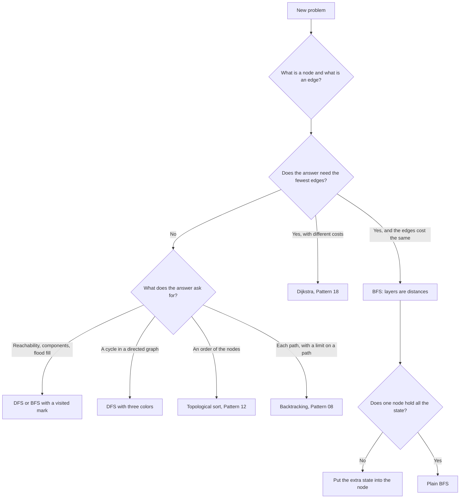
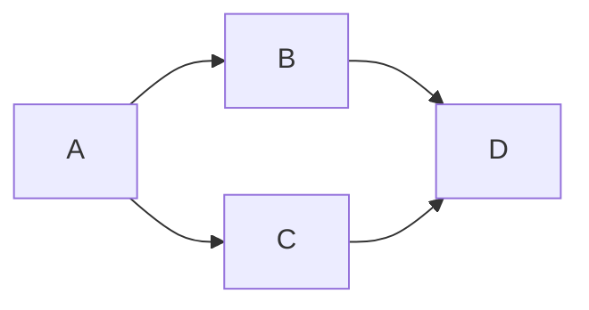
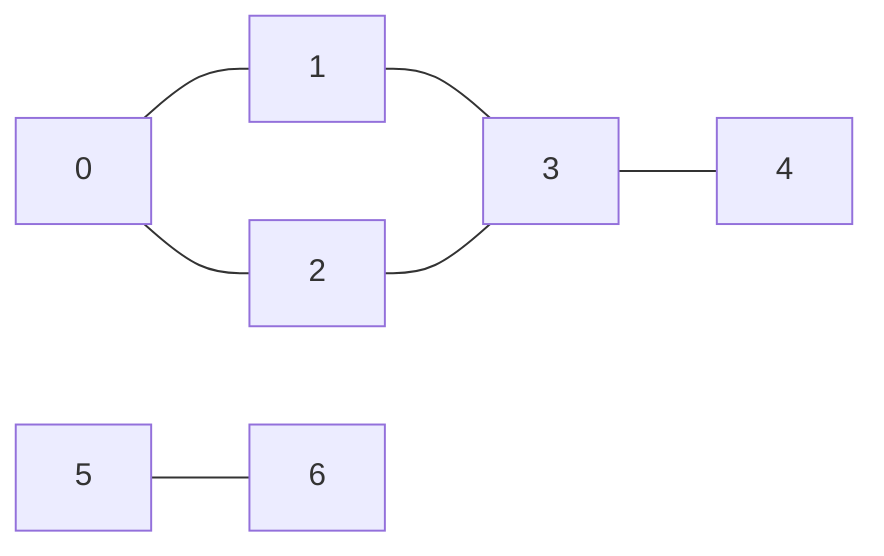

# Pattern 11: Graph Traversal (BFS and DFS)

## Overview

A graph traversal visits the nodes of a graph, one at a time, by following edges from a start node. The code keeps one mark for each node that it has reached, so that it never processes a node twice. There are two orders. Depth-first search (DFS) follows one path as far as it goes before it tries another path. Breadth-first search (BFS) visits all nodes at distance `d` from the start before it visits any node at distance `d + 1`. That order is the reason why BFS gives the fewest edges in a graph where every edge costs the same.

After this page you can:

1. Explain what goes wrong when tree-DFS code runs on a structure that has cycles, and fix it with a visited mark that the code sets at the right moment.
2. Count the work of a traversal from a trace, and state it as O(V + E) for a graph and O(rows x cols) for a grid.
3. Explain why BFS finds the shortest path when every edge costs the same, with the queue invariant, and show an input where BFS gives the wrong answer because the edge costs differ.
4. Model a new problem as a graph: say what a node is, what an edge is, whether the graph is given or computed, and whether the edges are directed.
5. Choose BFS or DFS for a problem and give the reason.
6. Write the Java code for grid DFS, BFS with distances, multi-source BFS, BFS on a computed graph, cycle detection (directed and undirected), two-coloring, graph copy, and BFS with extra state, without a template.

## Prerequisites

| You need | Why this page needs it | Where to learn it |
|---|---|---|
| Graph words (node, edge, directed, adjacency list) and the idea of a graph that the code computes instead of storing | Every section builds on them. The page does not teach the three representations again | [Graph Representations](../foundations/07-graph-representations.md) |
| Recursion and the call stack | DFS is a recursion. The section on iterative DFS needs the stack depth limit | [Recursion](../foundations/09-recursion.md) |
| Queue, stack, and deque in Java (`ArrayDeque`) | BFS uses a queue. Iterative DFS uses a stack. 0-1 BFS uses a deque | [Stacks, Queues, and Deques](../foundations/03-stacks-queues-deques.md) |
| Tree traversal (preorder, level order) | The Motivation starts from tree DFS code and shows where it breaks | [Pattern 10: Tree Patterns](../10-tree-patterns/README.md) |
| `HashMap` and `HashSet` in Java | Graph copy (Example 5), Word Ladder (Example 9), and Evaluate Division (P7) use them | [Hash Tables](../foundations/04-hash-tables.md) |
| Bit operations (`<<`, `|`, `&`) | Only for the ladder problem P11, which stores a set of keys in one `int` | [Pattern 19: Bit Manipulation](../19-bit-manipulation/README.md) |
| Counting operations and O-notation | The page counts calls and queue entries before it states O(V + E) | [Complexity Analysis](../foundations/01-complexity-analysis.md) |

Words that the page uses from the start:

- A **graph** is a set of **nodes** (also called vertices) and a set of **edges**. An edge joins two nodes. In a **directed** graph an edge goes from one node to another and has one direction. In an **undirected** graph an edge works in both directions.
- Two nodes are **neighbors** if an edge joins them. In a directed graph, the neighbors of `u` are the nodes that an edge from `u` reaches.
- A **path** is a list of nodes in which each node is a neighbor of the node before it. The **length** of a path is the number of edges in it. The **distance** from `a` to `b` is the length of the shortest path from `a` to `b`.
- A **cycle** is a path that starts and ends at the same node and has at least one edge.
- A **connected component** of an undirected graph is a group of nodes in which every node reaches every other node, and no edge leaves the group.
- `V` is the number of nodes. `E` is the number of edges.
- A **grid** is a graph in the following sense: each cell is a node, and each cell has an edge to the cell above it, below it, to its left, and to its right (when those cells exist).

## Motivation

### The anchor problem: Number of Islands (LC 200)

This problem is [LC 200: Number of Islands](https://leetcode.com/problems/number-of-islands/). A grid has cells with `'1'` (land) and `'0'` (water). An **island** is a group of land cells where each cell touches another cell of the group on a side (up, down, left, or right). A diagonal touch does not join two cells. Count the islands.

```text
1 1 0
1 0 1        islands: {(0,0), (0,1), (1,0)} and {(1,2), (2,2)}
0 0 1        answer = 2
```

**The plan.** Scan the grid. When the scan finds a land cell that belongs to no counted island, add 1 to the count. Then visit every cell of that island, so that the scan does not count the island again. The open question is how to visit every cell of an island.

**First attempt: the tree code.** The reader knows DFS on a tree: visit a node, then visit each child. For a cell, the "children" are the 4 neighbors. A land cell visits its land neighbors. The code tries the neighbors in the order up, down, left, right:

```text
dfsNoMemory(r, c):
    if (r, c) is outside the grid: return
    if the cell is water: return
    for each of the 4 neighbors (nr, nc): dfsNoMemory(nr, nc)
```

**Second attempt: do not go back.** On a tree, the code must not return to the parent. A reader may add the same rule: a cell does not visit the cell that it came from.

```text
dfsNoParent(r, c, fromR, fromC):
    (the same two tests)
    for each neighbor (nr, nc) except (fromR, fromC): dfsNoParent(nr, nc, r, c)
```

A program runs both attempts on the grid `{{'1','1'},{'1','1'}}`: four land cells in a 2 by 2 square. It stops attempt 2 after 10 calls and prints the cells that it visited. This is its output:

```text
attempt 1: StackOverflowError, the recursion never ends
attempt 2, first 10 calls: [(0,0), (1,0), (1,1), (0,1), (0,0), (1,0), (1,1), (0,1), (0,0), (1,0)]
```

??? note "The full program"

    ```java
    import java.util.ArrayList;
    import java.util.List;

    public class NoVisitedDemo {
        static char[][] grid = {{'1', '1'}, {'1', '1'}};
        static final int[] DR = {-1, 1, 0, 0};
        static final int[] DC = {0, 0, -1, 1};

        // Tree-style DFS: visit every neighbor, with no memory of the cells already reached.
        static void dfsNoMemory(int r, int c) {
            if (r < 0 || r >= 2 || c < 0 || c >= 2) return;   // outside the grid
            if (grid[r][c] != '1') return;                    // water
            for (int k = 0; k < 4; k++) dfsNoMemory(r + DR[k], c + DC[k]);
        }

        // Second attempt: never step back to the cell that the call came from.
        // The call limit only stops the demo. The real recursion has no limit.
        static int calls = 0;
        static List<String> chain = new ArrayList<>();

        static void dfsNoParent(int r, int c, int fromR, int fromC) {
            if (r < 0 || r >= 2 || c < 0 || c >= 2) return;
            if (grid[r][c] != '1') return;
            if (++calls > 10) return;
            chain.add("(" + r + "," + c + ")");
            for (int k = 0; k < 4; k++) {
                int nr = r + DR[k], nc = c + DC[k];
                if (nr == fromR && nc == fromC) continue;     // skip the parent
                dfsNoParent(nr, nc, r, c);
            }
        }

        public static void main(String[] args) {
            try {
                dfsNoMemory(0, 0);
                System.out.println("finished");
            } catch (StackOverflowError e) {
                System.out.println("attempt 1: StackOverflowError, the recursion never ends");
            }
            dfsNoParent(0, 0, -1, -1);
            System.out.println("attempt 2, first 10 calls: " + chain);
        }
    }
    ```

    <!-- expected-output -->
    ```text
    attempt 1: StackOverflowError, the recursion never ends
    attempt 2, first 10 calls: [(0,0), (1,0), (1,1), (0,1), (0,0), (1,0), (1,1), (0,1), (0,0), (1,0)]
    ```


Attempt 1 never ends. The call for `(0,0)` calls `(1,0)`. The call for `(1,0)` calls `(0,0)`. Each call adds a frame to the call stack. When the stack is full, Java throws `StackOverflowError`.

Attempt 2 also never ends. The four cells form a cycle: `(0,0)`, `(1,0)`, `(1,1)`, `(0,1)`, and back to `(0,0)`. The rule "do not step back to the parent" stops a step along one edge. It does not stop the walk around the cycle. The list above shows the walk: the same four cells repeat.

**Why a tree does not have this problem.** A tree has exactly one path between two nodes. A walk that never steps back to its parent cannot return to a node. A grid has cycles. A 2 by 2 block of land is a cycle of length 4. A general graph can have a cycle of any length, and can have two different paths to the same node.

**The gap.** The code has no memory. When it enters a cell, it cannot tell whether an earlier call already processed that cell. The question for the Derivation is: **what must the code remember so that it does not process a cell twice?**

## Derivation

### Question 1: what must the code remember so that it does not process a cell twice?

**The answer.** It must remember which cells it has already reached. The simplest memory is one mark for each cell: "reached" or "not reached". A cell that carries the mark is never entered again.

**Question 1a: when does the code set the mark?** There are two candidates: when the call for the cell starts, or when the call ends (after the loop over the neighbors). Test the second candidate on the 2 by 2 grid, with the neighbor order up, down, left, right. The call for `(0,0)` starts and has no mark. Its first neighbor in the grid is `(1,0)` (the cell above is outside). The call for `(1,0)` looks at the cell above it, which is `(0,0)`. The mark of `(0,0)` is not set yet, because the call for `(0,0)` has not ended. So the call enters `(0,0)` again, and the two calls repeat each other until the stack is full. The mark must be set **when the cell is first reached**, before the code visits any neighbor. Then every cell on the current path already carries the mark when the walk returns to it.

**Question 1b: where does the code store the mark?** There are two places:

- *In the input grid.* The code writes a value into the cell, for example `'2'` for "land that was reached". The test "is this cell unvisited land?" becomes `grid[r][c] == '1'`. This needs no extra array.
- *In a separate array.* The code keeps a `boolean[][] seen` of the same size. The input stays unchanged.

Version 1 marks in the input grid. This is the complete code for it:

```java
static final int[] DR = {-1, 1, 0, 0};          // up, down, left, right
static final int[] DC = {0, 0, -1, 1};

// '1' is land, '0' is water, '2' is land that the code has already reached.
static int countIslands(char[][] grid) {
    int islands = 0;
    for (int r = 0; r < grid.length; r++) {
        for (int c = 0; c < grid[0].length; c++) {
            if (grid[r][c] == '1') {              // land that no earlier search reached
                islands++;
                markIsland(grid, r, c);
            }
        }
    }
    return islands;
}

static void markIsland(char[][] grid, int r, int c) {
    if (r < 0 || r >= grid.length || c < 0 || c >= grid[0].length) return;  // outside
    if (grid[r][c] != '1') return;                // water, or land that is already marked
    grid[r][c] = '2';                             // mark at the first visit, before recursing
    for (int k = 0; k < 4; k++) markIsland(grid, r + DR[k], c + DC[k]);
}
```

Version 2 keeps the input unchanged. It replaces the test `grid[r][c] != '1'` by `grid[r][c] != '1' || seen[r][c]`, and it replaces the write `grid[r][c] = '2'` by `seen[r][c] = true`, with `boolean[][] seen = new boolean[R][C]`.

The next program has both versions and some edge cases. On the grid `110 / 101 / 001` it prints `islands = 2`, and the grid after the count is `220 / 202 / 002`: the marks are visible in the input. A 2 by 2 block of land gives 1, a grid of water gives 0, one land cell gives 1, and two diagonal cells give 2. Version 2 also gives 2 on the first grid.

??? note "The full program"

    ```java
    public class Islands {
        static final int[] DR = {-1, 1, 0, 0};          // up, down, left, right
        static final int[] DC = {0, 0, -1, 1};

        public static void main(String[] args) {
            char[][] grid = {
                "110".toCharArray(),
                "101".toCharArray(),
                "001".toCharArray()};
            System.out.println("islands = " + countIslands(grid));
            System.out.println("grid after the count:");
            for (char[] row : grid) System.out.println("  " + new String(row));
            System.out.println("2 x 2 of land:    " + countIslands(new char[][]{"11".toCharArray(),
                    "11".toCharArray()}));
            System.out.println("all water:        " + countIslands(new char[][]{"00".toCharArray()}));
            System.out.println("one land cell:    " + countIslands(new char[][]{"1".toCharArray()}));
            System.out.println("diagonal cells:   " + countIslands(new char[][]{"10".toCharArray(),
                    "01".toCharArray()}));
            char[][] second = {"110".toCharArray(), "101".toCharArray(), "001".toCharArray()};
            System.out.println("separate marks:   " + countIslandsSeparate(second));
        }

        // Version 1: the mark is a change in the input grid. '1' is land, '0' is water,
        // '2' is land that the code has already reached.
        static int countIslands(char[][] grid) {
            int islands = 0;
            for (int r = 0; r < grid.length; r++) {
                for (int c = 0; c < grid[0].length; c++) {
                    if (grid[r][c] == '1') {              // land that no earlier search reached
                        islands++;
                        markIsland(grid, r, c);
                    }
                }
            }
            return islands;
        }

        static void markIsland(char[][] grid, int r, int c) {
            if (r < 0 || r >= grid.length || c < 0 || c >= grid[0].length) return;  // outside
            if (grid[r][c] != '1') return;                // water, or land that is already marked
            grid[r][c] = '2';                             // mark at the first visit, before recursing
            for (int k = 0; k < 4; k++) markIsland(grid, r + DR[k], c + DC[k]);
        }

        // Version 2: the mark is a separate array. The input stays unchanged.
        static int countIslandsSeparate(char[][] grid) {
            boolean[][] seen = new boolean[grid.length][grid[0].length];
            int islands = 0;
            for (int r = 0; r < grid.length; r++) {
                for (int c = 0; c < grid[0].length; c++) {
                    if (grid[r][c] == '1' && !seen[r][c]) {
                        islands++;
                        visit(grid, seen, r, c);
                    }
                }
            }
            return islands;
        }

        static void visit(char[][] grid, boolean[][] seen, int r, int c) {
            if (r < 0 || r >= grid.length || c < 0 || c >= grid[0].length) return;
            if (grid[r][c] != '1' || seen[r][c]) return;
            seen[r][c] = true;
            for (int k = 0; k < 4; k++) visit(grid, seen, r + DR[k], c + DC[k]);
        }
    }
    ```

    <!-- expected-output -->
    ```text
    islands = 2
    grid after the count:
      220
      202
      002
    2 x 2 of land:    1
    all water:        0
    one land cell:    1
    diagonal cells:   2
    separate marks:   2
    ```


Read the lines of `markIsland`:

1. The first test (`r < 0 || ...`) must come before any read of `grid[r][c]`. A read with `r = -1` throws an exception.
2. The second test returns for water and for marked land. Both cases need the same action: do nothing.
3. The line `grid[r][c] = '2'` runs before the loop over the neighbors. This is the answer to Question 1a.
4. The loop calls `markIsland` for 4 neighbors. A neighbor that is outside, water, or marked returns at once.

**Trace.** The next program is `markIsland` with one line of output for each call. It runs on the grid at the top of the Motivation. The indent shows the call depth.

??? note "Program that prints this trace"

    ```java
    public class IslandTrace {
        static int calls = 0;

        public static void main(String[] args) {
            char[][] grid = {
                "110".toCharArray(),
                "101".toCharArray(),
                "001".toCharArray()};
            int islands = 0;
            for (int r = 0; r < grid.length; r++) {
                for (int c = 0; c < grid[0].length; c++) {
                    if (grid[r][c] == '1') {
                        System.out.println("scan finds an unmarked land cell at (" + r + "," + c + ")");
                        markIsland(grid, r, c, 0);
                        islands++;
                    }
                }
            }
            System.out.println("islands = " + islands + ", calls = " + calls);
        }

        // The same method as markIsland in the page, with a line of output for each call.
        static void markIsland(char[][] grid, int r, int c, int depth) {
            calls++;
            String indent = "  ".repeat(depth) + "(" + r + "," + c + ") ";
            if (r < 0 || r >= grid.length || c < 0 || c >= grid[0].length) {
                System.out.println(indent + "outside the grid");
                return;
            }
            if (grid[r][c] == '0') { System.out.println(indent + "water"); return; }
            if (grid[r][c] == '2') { System.out.println(indent + "already marked"); return; }
            grid[r][c] = '2';
            System.out.println(indent + "land: mark it");
            markIsland(grid, r - 1, c, depth + 1);
            markIsland(grid, r + 1, c, depth + 1);
            markIsland(grid, r, c - 1, depth + 1);
            markIsland(grid, r, c + 1, depth + 1);
        }
    }
    ```

<!-- expected-output -->
```text
scan finds an unmarked land cell at (0,0)
(0,0) land: mark it
  (-1,0) outside the grid
  (1,0) land: mark it
    (0,0) already marked
    (2,0) water
    (1,-1) outside the grid
    (1,1) water
  (0,-1) outside the grid
  (0,1) land: mark it
    (-1,1) outside the grid
    (1,1) water
    (0,0) already marked
    (0,2) water
scan finds an unmarked land cell at (1,2)
(1,2) land: mark it
  (0,2) water
  (2,2) land: mark it
    (1,2) already marked
    (3,2) outside the grid
    (2,1) water
    (2,3) outside the grid
  (1,1) water
  (1,3) outside the grid
islands = 2, calls = 22
```

Read the trace:

- The scan finds `(0,0)` unmarked, so the count becomes 1 and the call for `(0,0)` marks it. The calls for `(1,0)` and `(0,1)` also mark their cells. The call for `(1,0)` looks at `(0,0)`, finds it marked, and returns. That is the line that stopped the infinite recursion of the Motivation.
- The scan continues and reaches `(1,2)`, which is unmarked land. The count becomes 2. The call marks `(1,2)` and `(2,2)`.
- The scan does not start a new island at `(0,1)`, `(1,0)`, or `(2,2)`, because their marks changed them from `'1'` to `'2'`.

**The invariant.** A marked cell is never entered again. The code enters a cell only when its value is `'1'`, and the first thing it does is write `'2'`. So each land cell is entered once. A second visit finds `'2'` and returns.

**Why the count is right.** Two facts give the answer. First, a call that starts at a land cell marks every cell of the island of that cell. Each call visits all 4 neighbors, so the visit spreads along each edge between two land cells, and every cell of the island is connected to the start by such edges. Second, a call never marks a cell of another island: it enters only land cells, and it moves only along edges between land cells. So each island gets exactly one call from the scan: the scan starts a call at the first cell of the island that it meets, and after that call no cell of the island is unmarked. If the grid has no land, no call starts, and the count is 0.

**Count the work from the trace.**

| Quantity | In the trace | In general |
|---|---|---|
| Land cells entered (marked) | 5 | Each land cell is entered once |
| Calls of `markIsland` | 22 = 5 x 4 + 2 | 4 for each land cell (its neighbor calls), plus 1 for each island (the call that the scan makes) |
| Lines "already marked" | 3 | Each edge between two land cells is looked at from both ends. The first look enters the cell. The second look finds the mark. The grid has 3 such edges, so 3 second looks |
| Cells that the scan examines | 9 | `rows x cols` |

For a grid with `R` rows and `C` columns: the scan examines `R x C` cells. The calls number at most `4 x (land cells) + (islands)`, which is at most `5 x R x C`. Each call does a constant amount of work. So the time is **O(R x C)**.

For a general graph, the same count reads: the search enters each node once (the mark), and at each node it looks at every edge that leaves the node. The sum of the degrees of the nodes is `2E` for an undirected graph and `E` for a directed graph. So each edge is looked at a constant number of times (twice or once), and the time is **O(V + E)**. The `V` term counts the entries and the scan, and the `E` term counts the edge looks.

The space is O(R x C) for the recursion in the worst case, because the call chain can pass through every cell (see the section on iterative DFS), plus the `seen` array if the code uses one.

**Marking in the input against a separate array.**

| | Mark in the input grid | Separate `boolean[][]` |
|---|---|---|
| Extra memory | None for the marks | `R x C` booleans |
| The input after the call | Changed: land cells became `'2'` | Unchanged |
| A second call on the same grid | Wrong: it finds no land (see Common Mistakes) | Right |
| The cell value needs a spare symbol | Yes: a value that is not land and not water | No |
| Safe when | The code owns the grid and calls the method once | The caller reads the grid again, or the grid is shared |

Changing the input is not acceptable in these cases: the caller uses the grid again after the call (the next query, a second pass, a comparison with the original); two threads read the same grid; the input is a read-only or shared structure (an unmodifiable list, a constant); or the problem asks for several answers on one grid, such as "the largest island after you change one cell". In a coding interview, ask: "May I modify the input?" If the answer is no, or you are unsure, use the separate array.

### Question 2: how does the code find the fewest steps?

A new problem: a maze is a grid. The cell `S` is the start. The cell `T` is the target. A `#` is a wall. A step moves to the cell above, below, left, or right of the current cell, and never into a wall. Find the fewest steps from `S` to `T`. [LC 1091: Shortest Path in Binary Matrix](https://leetcode.com/problems/shortest-path-in-binary-matrix/) is this problem with 8 directions, a square grid, and the answer counted in cells.

```text
S . . .
. # . .      S at (0,0), T at (2,3), one wall at (1,1)
. . . T
```

By hand: go down 2 and right 3. The answer is 5 steps.

**First attempt: use DFS, because DFS finds a path.** Question 1 gave a code that visits every reachable cell once. Stop it when it reaches `T`, and keep the cells of the current path in a list. When a cell leads nowhere, take it off the list:

```java
static final int[] DR = {-1, 1, 0, 0};
static final int[] DC = {0, 0, -1, 1};

// Finds some path from 'S' to 'T'. It stops at the first one.
static boolean dfsPath(String[] maze, boolean[][] seen, int r, int c, List<String> path) {
    if (r < 0 || r >= maze.length || c < 0 || c >= maze[0].length()) return false;
    if (maze[r].charAt(c) == '#' || seen[r][c]) return false;
    seen[r][c] = true;
    path.add("(" + r + "," + c + ")");
    if (maze[r].charAt(c) == 'T') return true;
    for (int k = 0; k < 4; k++) {
        if (dfsPath(maze, seen, r + DR[k], c + DC[k], path)) return true;
    }
    path.remove(path.size() - 1);          // this cell leads nowhere: take it off the path
    return false;
}
```

On the maze above, the call `dfsPath(maze, new boolean[3][4], 0, 0, path)` fills the list with this path:

```text
DFS path:  [(0,0), (1,0), (2,0), (2,1), (2,2), (1,2), (0,2), (0,3), (1,3), (2,3)] -> 9 steps
```

The DFS finds a path with **9 steps**. The shortest path has 5 steps. The picture shows the step number on each cell that the DFS path uses:

```text
0 . 6 7
1 # 5 8
2 3 4 9
```

**Why DFS gives a long path.** DFS goes into the first neighbor and keeps going. Its neighbor order here is up, down, left, right. From `(0,0)` it goes down twice, then right twice along the bottom row, then up twice, then right, then down twice to `T`. It returns the first path that reaches `T`. The length of that path depends on the neighbor order, not on the distance.

**Second attempt: make DFS try every path and keep the shortest.** This is possible. The code must remove the mark when a call returns (the cell is free for another path), and then it explores every path that uses no cell twice. A method counts them. Its difference from `dfsPath` is the line that removes the mark when the call returns (`onPath[r][c] = false`):

```java
static final int[] DR = {-1, 1, 0, 0};
static final int[] DC = {0, 0, -1, 1};

// The number of different paths from (r, c) to the far corner that use no cell twice.
// A DFS that wants the shortest path must try every one of them.
static long countPaths(int n, int r, int c, boolean[][] onPath) {
    if (r < 0 || r >= n || c < 0 || c >= n || onPath[r][c]) return 0;
    if (r == n - 1 && c == n - 1) return 1;
    onPath[r][c] = true;
    long total = 0;
    for (int k = 0; k < 4; k++) total += countPaths(n, r + DR[k], c + DC[k], onPath);
    onPath[r][c] = false;                        // free the cell for the other paths
    return total;
}
```

An open 3 by 3 grid has 12 such paths from corner to corner, and an open 5 by 5 grid has 8,512, for only 25 cells. The count grows much faster than the number of cells, so this attempt is too slow.

**The question.** The visited mark gives one cell one visit. So the visit must be the *right* visit: the one with the shortest path. Which order of visits makes the first visit of every cell the shortest one?

**Answer: by distance.** If the code visits all cells at distance 0 first (only `S`), then all cells at distance 1, then all cells at distance 2, and so on, then the first visit of a cell happens at the cell's distance. The code needs a list of cells to visit, with this property: the cells at distance `d` come before the cells at distance `d + 1`.

**The queue gives this list.** Take the front cell `u` (distance `d`). Look at its neighbors. A neighbor that has no mark is at distance `d + 1`: it is one step from `u`, and no earlier cell reached it. Mark it, store `d + 1`, and put it at the **back** of the list. The cells that are already in the list have distance `d` or `d + 1`, and they stay ahead of the new cell or share its distance. A list where the code takes from the front and adds to the back is a **queue**.

Written as steps:

1. Mark `S`, set `dist[S] = 0`, and put `S` in the queue.
2. While the queue is not empty: take the front cell `u`. If `u` is `T`, return `dist[u]`.
3. For each neighbor `v` of `u` that is inside the grid, is not a wall, and has no mark: set `dist[v] = dist[u] + 1`, mark `v` (the value `dist[v] != -1` is the mark), and add `v` to the back of the queue.
4. If the queue becomes empty, `T` is not reachable. Return -1.

The steps as Java. The program that follows prints the same method with trace lines added:

```java
static final int[] DR = {-1, 1, 0, 0};
static final int[] DC = {0, 0, -1, 1};

// Fewest steps from the cell 'S' to the cell 'T', or -1 if 'T' cannot be reached.
static int fewestSteps(String[] maze) {
    int rows = maze.length, cols = maze[0].length();
    int[][] dist = new int[rows][cols];
    for (int[] row : dist) Arrays.fill(row, -1);          // -1 means "not reached yet"
    Deque<int[]> queue = new ArrayDeque<>();
    for (int r = 0; r < rows; r++) {
        for (int c = 0; c < cols; c++) {
            if (maze[r].charAt(c) == 'S') {
                dist[r][c] = 0;
                queue.add(new int[]{r, c});
            }
        }
    }
    while (!queue.isEmpty()) {
        int[] cell = queue.poll();
        int r = cell[0], c = cell[1];
        if (maze[r].charAt(c) == 'T') return dist[r][c];
        for (int k = 0; k < 4; k++) {
            int nr = r + DR[k], nc = c + DC[k];
            if (nr < 0 || nr >= rows || nc < 0 || nc >= cols) continue;
            if (maze[nr].charAt(nc) == '#' || dist[nr][nc] != -1) continue;
            dist[nr][nc] = dist[r][c] + 1;     // mark when the cell enters the queue
            queue.add(new int[]{nr, nc});
        }
    }
    return -1;
}
```

**Trace.** The trace has one line for each cell that the code takes from the queue. Each entry in the queue shows its cell and its distance:

```text
take (0,0) d=0  queue: (1,0)=1 (0,1)=1
take (1,0) d=1  queue: (0,1)=1 (2,0)=2
take (0,1) d=1  queue: (2,0)=2 (0,2)=2
take (2,0) d=2  queue: (0,2)=2 (2,1)=3
take (0,2) d=2  queue: (2,1)=3 (1,2)=3 (0,3)=3
take (2,1) d=3  queue: (1,2)=3 (0,3)=3 (2,2)=4
take (1,2) d=3  queue: (0,3)=3 (2,2)=4 (1,3)=4
take (0,3) d=3  queue: (2,2)=4 (1,3)=4
take (2,2) d=4  queue: (1,3)=4 (2,3)=5
take (1,3) d=4  queue: (2,3)=5
take (2,3) d=5  this is T: return 5
```

The picture of the final distances:

```text
0 1 2 3
1 # 3 4
2 3 4 5
```

Read the queue in the trace. The distances in the queue never decrease from front to back. At most two different values are in the queue at one time: for example `(2,1)=3 (1,2)=3 (0,3)=3` and later `(2,2)=4 (1,3)=4`. The trace ends at `(2,3)` with distance 5, the same as the answer by hand.

The full program has the DFS, the BFS with the trace, the edge cases, and the path counts. The edge cases: `T` next to `S` gives 1, `T` behind a wall gives -1, and `S` and `T` in a 1 by 4 row give 3.

??? note "The full program"

    ```java
    import java.util.ArrayDeque;
    import java.util.ArrayList;
    import java.util.Arrays;
    import java.util.Deque;
    import java.util.List;

    public class MazeBfs {
        static final int[] DR = {-1, 1, 0, 0};
        static final int[] DC = {0, 0, -1, 1};

        public static void main(String[] args) {
            String[] maze = {
                "S...",
                ".#..",
                "...T"};
            List<String> path = new ArrayList<>();
            dfsPath(maze, new boolean[3][4], 0, 0, path);
            System.out.println("DFS path:  " + path + " -> " + (path.size() - 1) + " steps");
            System.out.println("BFS trace (cell, distance; the queue after each step):");
            System.out.println("BFS steps: " + fewestSteps(maze, true));
            System.out.println("no wall, T next to S:      " + fewestSteps(new String[]{"ST"}, false));
            System.out.println("T behind a wall:           " + fewestSteps(new String[]{"S#T"}, false));
            System.out.println("S and T in a 1 x 4 row:    "
                    + fewestSteps(new String[]{"S..T"}, false));
            for (int n : new int[]{3, 5}) {
                System.out.println("open " + n + " x " + n + " grid, corner to corner: "
                        + countPaths(n, 0, 0, new boolean[n][n]) + " different paths, "
                        + (n * n) + " cells");
            }
        }

        // The number of different paths from (r, c) to the far corner that use no cell twice.
        // A DFS that wants the shortest path must try every one of them.
        static long countPaths(int n, int r, int c, boolean[][] onPath) {
            if (r < 0 || r >= n || c < 0 || c >= n || onPath[r][c]) return 0;
            if (r == n - 1 && c == n - 1) return 1;
            onPath[r][c] = true;
            long total = 0;
            for (int k = 0; k < 4; k++) total += countPaths(n, r + DR[k], c + DC[k], onPath);
            onPath[r][c] = false;                        // free the cell for the other paths
            return total;
        }

        // Finds some path from 'S' to 'T'. It stops at the first one.
        static boolean dfsPath(String[] maze, boolean[][] seen, int r, int c, List<String> path) {
            if (r < 0 || r >= maze.length || c < 0 || c >= maze[0].length()) return false;
            if (maze[r].charAt(c) == '#' || seen[r][c]) return false;
            seen[r][c] = true;
            path.add("(" + r + "," + c + ")");
            if (maze[r].charAt(c) == 'T') return true;
            for (int k = 0; k < 4; k++) {
                if (dfsPath(maze, seen, r + DR[k], c + DC[k], path)) return true;
            }
            path.remove(path.size() - 1);          // this cell leads nowhere: take it off the path
            return false;
        }

        // Fewest steps from the cell 'S' to the cell 'T', or -1 if 'T' cannot be reached.
        static int fewestSteps(String[] maze, boolean trace) {
            int rows = maze.length, cols = maze[0].length();
            int[][] dist = new int[rows][cols];
            for (int[] row : dist) Arrays.fill(row, -1);          // -1 means "not reached yet"
            Deque<int[]> queue = new ArrayDeque<>();
            for (int r = 0; r < rows; r++) {
                for (int c = 0; c < cols; c++) {
                    if (maze[r].charAt(c) == 'S') {
                        dist[r][c] = 0;
                        queue.add(new int[]{r, c});
                    }
                }
            }
            while (!queue.isEmpty()) {
                int[] cell = queue.poll();
                int r = cell[0], c = cell[1];
                if (maze[r].charAt(c) == 'T') {
                    if (trace) System.out.println("take (" + r + "," + c + ") d=" + dist[r][c]
                            + "  this is T: return " + dist[r][c]);
                    return dist[r][c];
                }
                for (int k = 0; k < 4; k++) {
                    int nr = r + DR[k], nc = c + DC[k];
                    if (nr < 0 || nr >= rows || nc < 0 || nc >= cols) continue;
                    if (maze[nr].charAt(nc) == '#' || dist[nr][nc] != -1) continue;
                    dist[nr][nc] = dist[r][c] + 1;     // mark when the cell enters the queue
                    queue.add(new int[]{nr, nc});
                }
                if (trace) printStep(r, c, dist, queue);
            }
            return -1;
        }

        static void printStep(int r, int c, int[][] dist, Deque<int[]> queue) {
            StringBuilder sb = new StringBuilder();
            for (int[] q : queue) sb.append(" (").append(q[0]).append(",").append(q[1])
                    .append(")=").append(dist[q[0]][q[1]]);
            System.out.println("take (" + r + "," + c + ") d=" + dist[r][c] + "  queue:" + sb);
        }
    }
    ```

    <!-- expected-output -->
    ```text
    DFS path:  [(0,0), (1,0), (2,0), (2,1), (2,2), (1,2), (0,2), (0,3), (1,3), (2,3)] -> 9 steps
    BFS trace (cell, distance; the queue after each step):
    take (0,0) d=0  queue: (1,0)=1 (0,1)=1
    take (1,0) d=1  queue: (0,1)=1 (2,0)=2
    take (0,1) d=1  queue: (2,0)=2 (0,2)=2
    take (2,0) d=2  queue: (0,2)=2 (2,1)=3
    take (0,2) d=2  queue: (2,1)=3 (1,2)=3 (0,3)=3
    take (2,1) d=3  queue: (1,2)=3 (0,3)=3 (2,2)=4
    take (1,2) d=3  queue: (0,3)=3 (2,2)=4 (1,3)=4
    take (0,3) d=3  queue: (2,2)=4 (1,3)=4
    take (2,2) d=4  queue: (1,3)=4 (2,3)=5
    take (1,3) d=4  queue: (2,3)=5
    take (2,3) d=5  this is T: return 5
    BFS steps: 5
    no wall, T next to S:      1
    T behind a wall:           -1
    S and T in a 1 x 4 row:    3
    open 3 x 3 grid, corner to corner: 12 different paths, 9 cells
    open 5 x 5 grid, corner to corner: 8512 different paths, 25 cells
    ```


**Why BFS gives the shortest path.** Let `dist[v]` be the value that the code stores when it marks `v`. Let `delta(v)` be the true distance from `S` to `v`.

*Claim 1 (the queue invariant).* At every moment, the distances of the cells in the queue do not decrease from front to back, and the last distance is at most the first distance plus 1. So the queue holds at most two different values, `d` and `d + 1`.

*Proof.* At the start the queue holds only `S` with distance 0. Assume the claim is true before a step. The step removes the front cell, which has distance `d` (the smallest value in the queue). Every cell that the step adds has distance `d + 1`, and it goes to the back. Before the step, all values in the queue were in `{d, d + 1}`, in order. After the step, the queue still has this order, because `d + 1` is the largest value and the code adds it at the back. The new front has a distance of at least `d`, and the back has at most `d + 1`, so the range is at most 1 (if the queue is empty, the claim holds with nothing to check).

*Claim 2.* When BFS marks a cell `v`, `dist[v] = delta(v)`.

*Proof.* First, `dist[v] >= delta(v)`: the value `dist[v]` is the length of a real path from `S` to `v` (the chain of cells that led to the mark), and `delta(v)` is the length of the shortest one. Second, `dist[v] <= delta(v)`. Use induction on `delta(v)`. For `delta(v) = 0`, `v` is `S` and `dist[S] = 0`. Let `delta(v) = k` with `k >= 1`, and let `u` be the cell before `v` on a shortest path. Then `delta(u) = k - 1`. By the induction hypothesis, `dist[u] = k - 1` when `u` is marked, and `u` is later taken from the queue. When the code takes `u`, it looks at `v`. Either `v` is not marked yet, and the code marks it with `dist[u] + 1 = k`, or `v` was marked earlier by some cell `w` that the code took before `u`, with `dist[v] = dist[w] + 1`. By Claim 1, the distances of the cells that the code takes from the queue never decrease (each taken cell is the front, and every cell that enters later has a distance at least as large as the front), so `dist[w] <= dist[u] = k - 1`, and `dist[v] <= k`. Together: `dist[v] = k`. A cell that `S` cannot reach is never marked, so the code never returns a wrong distance for it. If `T` is not reachable, the queue empties and the code returns -1. If `S` is `T`, the first cell that the code takes is `T` with distance 0.

**The mark: when enqueued, not when dequeued.** The code above sets the mark in step 3, when the cell enters the queue. A common variant sets the mark in step 2, when the cell leaves the queue. A program counts the queue entries of three rules on an open grid, from the corner `(0,0)`. Each count is the number of entries that the queue receives during the whole search, including the start:

| Rule | What the code does | 3 x 3 grid (9 cells) | 5 x 5 grid (25 cells) |
|---|---|---|---|
| `enqueue` | Mark the neighbor when it is added to the queue | 9 | 25 |
| `dequeue` | Mark the cell when it is taken from the queue. The code adds every neighbor that has no mark yet | 19 | 251 |
| `dequeue-skip` | As `dequeue`, and the code also skips a cell that already has a mark when it takes the cell | 13 | 41 |

??? note "The full program"

    ```java
    import java.util.ArrayDeque;
    import java.util.Deque;

    public class EnqueueRule {
        static final int[] DR = {-1, 1, 0, 0};
        static final int[] DC = {0, 0, -1, 1};

        public static void main(String[] args) {
            for (int size : new int[]{3, 5}) {
                System.out.println("open grid " + size + " x " + size + ", start at (0,0):");
                System.out.println("  mark when enqueued:               "
                        + countEntries(size, size, "enqueue") + " queue entries");
                System.out.println("  mark when dequeued, no check:     "
                        + countEntries(size, size, "dequeue") + " queue entries");
                System.out.println("  mark when dequeued, skip repeats: "
                        + countEntries(size, size, "dequeue-skip") + " queue entries");
            }
        }

        // Returns the number of entries that the BFS puts into the queue.
        static int countEntries(int rows, int cols, String rule) {
            boolean[][] seen = new boolean[rows][cols];
            Deque<int[]> queue = new ArrayDeque<>();
            queue.add(new int[]{0, 0});
            if (rule.equals("enqueue")) seen[0][0] = true;
            int entries = 1;
            while (!queue.isEmpty()) {
                int[] cell = queue.poll();
                if (!rule.equals("enqueue")) {
                    if (rule.equals("dequeue-skip") && seen[cell[0]][cell[1]]) continue;
                    seen[cell[0]][cell[1]] = true;        // marked when the cell leaves the queue
                }
                for (int k = 0; k < 4; k++) {
                    int nr = cell[0] + DR[k], nc = cell[1] + DC[k];
                    if (nr < 0 || nr >= rows || nc < 0 || nc >= cols || seen[nr][nc]) continue;
                    if (rule.equals("enqueue")) seen[nr][nc] = true;  // marked when it enters
                    queue.add(new int[]{nr, nc});
                    entries++;
                }
            }
            return entries;
        }
    }
    ```

    <!-- expected-output -->
    ```text
    open grid 3 x 3, start at (0,0):
      mark when enqueued:               9 queue entries
      mark when dequeued, no check:     19 queue entries
      mark when dequeued, skip repeats: 13 queue entries
    open grid 5 x 5, start at (0,0):
      mark when enqueued:               25 queue entries
      mark when dequeued, no check:     251 queue entries
      mark when dequeued, skip repeats: 41 queue entries
    ```


With the mark at enqueue, each cell enters the queue once, so the count equals the number of cells (9 and 25). With the mark at dequeue, a cell can enter the queue once for each neighbor that takes its turn before the cell leaves the queue. On the open 5 by 5 grid, the queue receives 251 entries instead of 25. The code also expands each repeated entry again, which is the extra work. The third rule skips a cell that leaves the queue a second time, so the code expands each cell once. The queue still receives 41 entries, which is more than 25. The program counts entries only, and it does not claim a wrong answer: the cost of the late mark is queue space and repeated work. Mark when the cell enters the queue. Then each cell enters at most once. The cell's distance is decided at that moment, as Claim 2 shows, so the mark and the distance belong together.

**The precondition: every edge costs the same.** The proof counts the distance in edges. It uses the fact that one step adds exactly 1 to the distance. If the edges have different costs, the cell with the fewest edges is not always the cell with the lowest cost. The next program has three nodes: `A - B` costs 1, `B - C` costs 1, and `A - C` costs 10.

```java
import java.util.ArrayDeque;
import java.util.Arrays;
import java.util.Deque;

public class WeightedBfs {
    // cost[u][v] is the cost of the edge u - v, or 0 if the edge does not exist.
    static int[][] cost = {
        {0, 1, 10},     // A - B costs 1, A - C costs 10
        {1, 0, 1},      // B - C costs 1
        {10, 1, 0}};

    public static void main(String[] args) {
        int[] hops = new int[3];
        Arrays.fill(hops, -1);
        hops[0] = 0;
        Deque<Integer> queue = new ArrayDeque<>();
        queue.add(0);
        while (!queue.isEmpty()) {
            int u = queue.poll();
            for (int v = 0; v < 3; v++) {
                if (cost[u][v] > 0 && hops[v] == -1) {
                    hops[v] = hops[u] + 1;
                    queue.add(v);
                }
            }
        }
        System.out.println("BFS hops from A:     " + Arrays.toString(hops));
        System.out.println("cheapest cost A to C: " + cheapest(0, 2, new boolean[3]));
        System.out.println("cost of the path BFS found (A, C): " + cost[0][2]);
    }

    // Tries every simple path from u to goal and returns the smallest total cost.
    static int cheapest(int u, int goal, boolean[] onPath) {
        if (u == goal) return 0;
        onPath[u] = true;
        int best = Integer.MAX_VALUE;
        for (int v = 0; v < 3; v++) {
            if (cost[u][v] > 0 && !onPath[v]) {
                int rest = cheapest(v, goal, onPath);
                if (rest != Integer.MAX_VALUE) best = Math.min(best, cost[u][v] + rest);
            }
        }
        onPath[u] = false;
        return best;
    }
}
```

<!-- expected-output -->
```text
BFS hops from A:     [0, 1, 1]
cheapest cost A to C: 2
cost of the path BFS found (A, C): 10
```

BFS reaches `C` in 1 hop from `A`, along the edge that costs 10. The cheapest way costs 2 (`A`, `B`, `C`). BFS counts hops, not cost. For edges with different non-negative costs, use Dijkstra's algorithm: see [Pattern 18: Shortest Paths](../18-shortest-paths/README.md). If every cost is 0 or 1, the section "0-1 BFS" below shows a deque version of BFS.

## The Pattern

A graph traversal starts at one node (or at several nodes) and follows edges. It keeps a mark on every node that it has reached, and it sets the mark when the node is first reached, so each node is processed once. The order of the visits comes from the container that holds the nodes that wait: a call stack (or an explicit stack) gives DFS, and a queue gives BFS. DFS goes deep and it can keep information about the current path (a color, a parent). BFS goes by layers, and the layer number is the distance. The time is O(V + E), because the code processes each node once and looks at each edge a constant number of times.

**The invariants.**

- DFS and BFS: a marked node is never entered or queued again.
- BFS: the queue holds distances in non-decreasing order, with at most two different values, and the first mark of a node carries its distance.
- Three-color DFS: a node is GRAY exactly while its call is active, so the GRAY nodes are the current path. Example 7 defines the colors.

**The vocabulary.** The Derivation used the first terms. The other terms appear in the Worked Examples, and the table names the example.

| Term | What it was in the examples | The question to ask in a new problem |
|---|---|---|
| Node | A land cell, a maze cell, a word, a pair `(cell, removals left)` (Example 11) | "What is the smallest unit of the situation that I move between?" |
| Edge | A side shared by two land cells, a legal step, one changed letter | "Which moves are allowed from a node, and what do they cost?" |
| Explicit graph | An adjacency list or matrix that the input gives (Example 1) | "Does the input list the edges?" |
| Implicit graph | A grid, or words where the code computes the neighbors (Example 9) | "Can I compute the neighbors of a node from the node itself?" |
| Visited mark | `'2'` in the grid, `seen[r][c]`, `dist[v] != -1` | "What must I remember to avoid a second visit, and when do I set it?" |
| Frontier | The queue of BFS | "Which nodes are reached but not yet expanded?" |
| Layer | The nodes at one distance from the start | "Do I need the distance, or only reachability?" |
| Source | `S`, or all rotten oranges (Example 3) | "Where does the search start? Is it one node or a set?" |
| Component | One island, one province (Example 1) | "Does the answer count groups, or measure one group?" |
| Back edge | An edge to a node on the current DFS path (Example 7) | "Does the problem ask for a cycle?" |

### Step 1: model the problem as a graph

Most of the work in a new problem is to decide what a node is and what an edge is. The next table gives the model for ten problems. The column "Explicit?" says whether the input lists the edges (explicit) or the code computes them from the node (implicit). The last column names a search that the page derives later. The place of the derivation is in brackets at the end of each row. Read the columns "Node" to "Directed?" now, and read the last column again after the example.

| Problem | Node | Edge | Explicit? | Directed? | Search and the reason |
|---|---|---|---|---|---|
| [LC 200: Number of Islands](https://leetcode.com/problems/number-of-islands/) | A land cell | Two land cells that share a side | Implicit (grid) | No | DFS or BFS. The answer needs reachability only, so the order does not matter (Derivation, Question 1) |
| [LC 1091: Shortest Path in Binary Matrix](https://leetcode.com/problems/shortest-path-in-binary-matrix/) | An open cell | A move to one of the 8 neighbors | Implicit (grid) | No | BFS. The answer is the fewest steps, and each step costs 1 (Derivation, Question 2) |
| [LC 994: Rotting Oranges](https://leetcode.com/problems/rotting-oranges/) | A cell | A side shared by two cells | Implicit (grid) | No | Multi-source BFS: one queue that starts with all the sources. The answer is the distance from the nearest rotten orange, taken as a maximum (Example 3) |
| [LC 127: Word Ladder](https://leetcode.com/problems/word-ladder/) | A word from the list | Two words that differ in one letter | Implicit (the code computes the neighbors) | No | BFS. The answer is the fewest changes (Example 9) |
| [LC 207: Course Schedule](https://leetcode.com/problems/course-schedule/) | A course | "Course `b` before course `a`" | Explicit (edge list) | Yes | DFS with three colors: a mark that has three values. The answer asks for a cycle, and the code needs to know the current path (Example 7) |
| [LC 785: Is Graph Bipartite?](https://leetcode.com/problems/is-graph-bipartite/) | A node | The given edge | Explicit (adjacency list) | No | BFS or DFS. The code gives each node a side and checks each edge. The order does not matter (Example 6) |
| [LC 547: Number of Provinces](https://leetcode.com/problems/number-of-provinces/) | A city | `isConnected[i][j] == 1` | Explicit (matrix) | No | DFS or BFS, started once for each unreached node. The answer counts components (Example 1) |
| [LC 133: Clone Graph](https://leetcode.com/problems/clone-graph/) | A node object | A reference in `neighbors` | Explicit (object references) | No | DFS or BFS with a map from the original node to its copy. The map is also the visited mark (Example 5) |
| [LC 1293: Shortest Path in a Grid with Obstacles Elimination](https://leetcode.com/problems/shortest-path-in-a-grid-with-obstacles-elimination/) | The pair (cell, number of removals left) | A step to a neighbor cell | Implicit | No | BFS. The answer is the fewest steps, and the node must hold the removals, or the mark is wrong (Example 11) |
| [LC 399: Evaluate Division](https://leetcode.com/problems/evaluate-division/) | A variable name | `a / b = value`, plus the reverse edge with `1 / value` | Explicit (built from the equations) | Edges in both directions with different weights | DFS. The code needs any path and the product of the weights on it. All paths give the same product, so the path need not be the shortest (ladder problem P7) |

Two questions find the model. First: "What does the state of the situation consist of, so that two different situations never share a node?" (In [LC 1293](https://leetcode.com/problems/shortest-path-in-a-grid-with-obstacles-elimination/) the cell alone is not enough.) Second: "Which single action moves one state to another?" Each action is an edge.

### Step 2: choose BFS or DFS

| The question about the problem | BFS | DFS | Reason |
|---|---|---|---|
| Fewest edges (or steps, moves, changes) when every edge costs the same | Yes | No | The first visit of a node must be by a shortest path. Only the layer order gives this (Claim 2) |
| Is node `b` reachable from node `a`? How many components? Flood fill? | Yes | Yes | The answer does not depend on the order. Both visit each node once |
| A cycle in a directed graph | No | Yes | The code must know which nodes are on the current path. The call stack is that path. (BFS needs another method: Kahn's algorithm in [Pattern 12](../12-topological-sort/README.md)) |
| A cycle in an undirected graph | Yes | Yes | A visited neighbor that is not the parent shows a cycle in both |
| A finish order (topological order) | Kahn's algorithm | Yes | The reverse of the DFS finish order is a topological order. See [Pattern 12](../12-topological-sort/README.md) |
| The distance from the nearest of several sources | Yes (multi-source, Example 3) | No | All sources start at distance 0 in one queue |
| A property of each path (all paths, a path with a limit) | No | Yes, with backtracking | The code must undo its mark on return. See [Pattern 08](../08-recursion-backtracking/README.md) |
| The graph is very deep and narrow (a long chain) | Yes | Risk | Recursive DFS needs one frame for each node of the path. BFS holds one layer |
| The graph is very wide and shallow | Risk | Yes | BFS holds a whole layer (up to V - 1 nodes for a star). DFS holds the current path |

**Memory.** BFS holds the widest layer in the queue. DFS holds the longest path in the stack. A star graph with `V - 1` leaves has a layer of `V - 1` nodes and a path of 2 nodes. A chain of `V` nodes has layers of 1 node and a path of `V` nodes. In an open `n` by `n` grid, the BFS queue holds about `n` cells (one diagonal), and the DFS in the order of this page reaches a depth of `n x n` (see Example 2). The right choice depends on the shape of the graph.



### The variants of the pattern

Each variant changes one thing: the start, the node, or what the code stores in the mark.

| Variant | What changes | The property of the problem that selects it | Where on this page |
|---|---|---|---|
| Flood fill and components | The code starts one traversal for each unreached node | The answer counts groups, or measures one group | Derivation, Examples 1 and 4 |
| BFS from one source | A queue and a distance | Fewest steps, and each step costs the same | Derivation, Question 2 |
| Multi-source BFS | The queue starts with many nodes at distance 0 | The distance to the nearest of many sources | Example 3 |
| Reverse traversal | The search starts from the target side | "Which nodes reach the border?" is cheaper to ask from the border | Example 4 |
| Graph copy | The mark is a map from the original to the copy | The output is a new graph | Example 5 |
| Two-coloring | The mark holds one of two values | The question is "can the nodes be split into two groups with no edge inside a group?" | Example 6 |
| Cycle detection (directed) | The mark has three values | A cycle in a directed graph | Example 7 |
| Cycle detection (undirected) | The call receives its parent | A cycle in an undirected graph | Example 8 |
| BFS on a computed graph | The code computes the neighbors | The nodes are words or states, and the graph is too large to store | Example 9 |
| 0-1 BFS | A deque in place of a queue | Each edge costs 0 or 1 | Example 10 |
| BFS with extra state | The node is `(cell, extra)` | The same cell can be reached in different situations that matter | Example 11 |
| DFS with memory on a DAG | The code stores the answer of each node | The graph has no cycle, and the answer of a node does not depend on the path to it | Example 12 |

## Worked Examples

The examples go from the easiest change to the hardest. Each one changes one thing about the anchor problems of the Derivation: the graph is given, the search starts in many places, the node has more in it, or the code stores more in the mark.

### Example 1: connected components with a matrix (LC 547, LC 323)

**The problem.** [LC 547: Number of Provinces](https://leetcode.com/problems/number-of-provinces/) gives `n` cities and a matrix `isConnected` where `isConnected[i][j] == 1` means that a road joins city `i` and city `j` directly. A **province** is a group of cities that reach each other, directly or through other cities. Count the provinces. For a matrix with the groups `{0, 1}`, `{2}`, and `{3, 4}`, the answer is 3.

**What changed.** The graph is explicit (a matrix), not a grid. The code must start a search from many places, because the cities are not all reachable from one city.

**Brute force.** For each pair `(i, j)`, run a search from `i` and test whether it reaches `j`. Then group the cities that reach each other. That is `n²` searches, and each search costs at least O(n) (it reads a row of the matrix for each city that it enters).

**The question.** One search from a city already marks every city of its province. So the second city of that province does not need a search. How does the code know which cities still need one? The mark tells it: a city that carries no mark after all earlier searches belongs to a province that no earlier search reached. So **the number of times the outer loop finds an unmarked city is the number of provinces**. This is the scan of the island problem, with cities in place of cells.

```java
public class Provinces {
    public static void main(String[] args) {
        // City 0 and 1 are connected, city 2 is alone, city 3 and 4 are connected.
        int[][] isConnected = {
            {1, 1, 0, 0, 0},
            {1, 1, 0, 0, 0},
            {0, 0, 1, 0, 0},
            {0, 0, 0, 1, 1},
            {0, 0, 0, 1, 1}};
        System.out.println("provinces = " + countProvinces(isConnected, true));
        System.out.println("one city: " + countProvinces(new int[][]{{1}}, false));
        System.out.println("no roads: " + countProvinces(new int[][]{{1, 0}, {0, 1}}, false));
        System.out.println("all joined: " + countProvinces(new int[][]{{1, 1}, {1, 1}}, false));
    }

    // isConnected[i][j] == 1 means that city i and city j are joined. The graph is the matrix.
    static int countProvinces(int[][] isConnected, boolean trace) {
        int n = isConnected.length;
        boolean[] visited = new boolean[n];
        int provinces = 0;
        for (int city = 0; city < n; city++) {
            if (visited[city]) continue;                // already inside an earlier province
            provinces++;
            if (trace) System.out.println("city " + city + " is new: province " + provinces);
            visitProvince(isConnected, city, visited);
        }
        return provinces;
    }

    static void visitProvince(int[][] isConnected, int city, boolean[] visited) {
        visited[city] = true;                           // mark when the city is reached
        for (int other = 0; other < isConnected.length; other++) {
            if (isConnected[city][other] == 1 && !visited[other]) {
                visitProvince(isConnected, other, visited);
            }
        }
    }
}
```

<!-- expected-output -->
```text
city 0 is new: province 1
city 2 is new: province 2
city 3 is new: province 3
provinces = 3
one city: 1
no roads: 2
all joined: 1
```

The trace shows the three unmarked cities that start a search: 0, 2, and 3. City 1 is marked by the search from 0, and city 4 is marked by the search from 3.

**Complexity.** Each city is entered once. The visit of a city reads one row of the matrix, which is `n` cells. The time is O(n²) for the matrix, which is O(V²). With an adjacency list the time is O(V + E). The space is O(n) for the marks and the recursion.

For [LC 323: Number of Connected Components in an Undirected Graph](https://leetcode.com/problems/number-of-connected-components-in-an-undirected-graph/) (premium) the input is an edge list. Build the adjacency lists first (see [Graph Representations](../foundations/07-graph-representations.md)), and run the same loop. If the edges **arrive over time** and the program must answer "how many components now?" after each edge, a new traversal for each edge costs O(V + E) each time. Use Union Find instead: see [Pattern 13: Union Find](../13-union-find/README.md).

### Example 2: iterative DFS and the recursion depth

**The problem.** Run the island count on a grid with 1,500 rows and 1,500 columns of land, which is 2,250,000 cells.

**What changed.** The grid is large. The recursion of the Derivation uses one stack frame for each cell on the current path. How deep can the path be? The next program measures the deepest recursion of the island DFS (neighbor order: up, down, left, right) on open grids. It also shows four ways to write DFS with an explicit stack, and it counts islands on the large grid with an array as the stack.

```java
import java.util.ArrayDeque;
import java.util.ArrayList;
import java.util.Deque;
import java.util.List;

public class IterativeDfs {
    static final int[] DR = {-1, 1, 0, 0};
    static final int[] DC = {0, 0, -1, 1};
    static int depth, deepest;

    public static void main(String[] args) {
        int[][] graph = {{1, 2, 3}, {3}, {}, {}};
        System.out.println("recursive DFS:                    " + recursiveOrder(graph));
        System.out.println("stack, mark on pop, push forward: " + stackOrder(graph, false, false));
        System.out.println("stack, mark on pop, push reverse: " + stackOrder(graph, false, true));
        System.out.println("stack, mark on push, push reverse: " + stackOrder(graph, true, true));
        System.out.println("stack of neighbor positions:      " + exactOrder(graph));
        System.out.println("deepest recursion on an open grid:");
        for (int n : new int[]{2, 4, 10}) {
            deepest = 0;
            depth = 0;
            walk(new boolean[n][n], 0, 0);
            System.out.println("  " + n + " x " + n + " cells: " + deepest + " nested calls");
        }
        int side = 1500;                                   // 2,250,000 land cells
        char[][] big = new char[side][side];
        for (char[] row : big) java.util.Arrays.fill(row, '1');
        System.out.println("iterative island count on " + side + " x " + side + ": "
                + countIslandsIterative(big));
        for (char[] row : big) java.util.Arrays.fill(row, '1');
        try {
            fill(big, 0, 0);
            System.out.println("recursive fill finished");
        } catch (StackOverflowError e) {
            System.out.println("recursive fill on the same grid: StackOverflowError");
        }
    }

    // The recursive fill of the Derivation, without the island counter.
    static void fill(char[][] grid, int r, int c) {
        if (r < 0 || r >= grid.length || c < 0 || c >= grid[0].length || grid[r][c] != '1') return;
        grid[r][c] = '2';
        for (int k = 0; k < 4; k++) fill(grid, r + DR[k], c + DC[k]);
    }

    // The same count with an array as the stack. A cell is marked when it is pushed,
    // so each cell is pushed at most once and the stack never holds more than rows * cols cells.
    static int countIslandsIterative(char[][] grid) {
        int rows = grid.length, cols = grid[0].length;
        int[] stack = new int[rows * cols];
        int islands = 0;
        for (int r = 0; r < rows; r++) {
            for (int c = 0; c < cols; c++) {
                if (grid[r][c] != '1') continue;
                islands++;
                grid[r][c] = '2';
                int top = 0;
                stack[top++] = r * cols + c;               // a cell is stored as one number
                while (top > 0) {
                    int cell = stack[--top];
                    int cr = cell / cols, cc = cell % cols;
                    for (int k = 0; k < 4; k++) {
                        int nr = cr + DR[k], nc = cc + DC[k];
                        if (nr < 0 || nr >= rows || nc < 0 || nc >= cols) continue;
                        if (grid[nr][nc] != '1') continue;
                        grid[nr][nc] = '2';                // mark at push
                        stack[top++] = nr * cols + nc;
                    }
                }
            }
        }
        return islands;
    }

    static List<Integer> recursiveOrder(int[][] graph) {
        List<Integer> order = new ArrayList<>();
        recurse(graph, 0, new boolean[graph.length], order);
        return order;
    }

    static void recurse(int[][] graph, int node, boolean[] visited, List<Integer> order) {
        visited[node] = true;
        order.add(node);
        for (int next : graph[node]) {
            if (!visited[next]) recurse(graph, next, visited, order);
        }
    }

    // markOnPush = true: a node is marked when it goes on the stack (it goes on once).
    // markOnPush = false: a node is marked when it comes off the stack (it may be on twice).
    // reverse = true: the neighbors go on the stack from the last to the first.
    static List<Integer> stackOrder(int[][] graph, boolean markOnPush, boolean reverse) {
        boolean[] visited = new boolean[graph.length];
        List<Integer> order = new ArrayList<>();
        Deque<Integer> stack = new ArrayDeque<>();
        stack.push(0);
        if (markOnPush) visited[0] = true;
        while (!stack.isEmpty()) {
            int node = stack.pop();
            if (!markOnPush) {
                if (visited[node]) continue;               // a second entry of the same node
                visited[node] = true;
            }
            order.add(node);
            int count = graph[node].length;
            for (int i = 0; i < count; i++) {
                int next = graph[node][reverse ? count - 1 - i : i];
                if (visited[next]) continue;
                if (markOnPush) visited[next] = true;
                stack.push(next);
            }
        }
        return order;
    }

    // The stack holds the nodes of the current path. position[v] is the next neighbor of v to try.
    static List<Integer> exactOrder(int[][] graph) {
        boolean[] visited = new boolean[graph.length];
        int[] position = new int[graph.length];
        List<Integer> order = new ArrayList<>();
        Deque<Integer> path = new ArrayDeque<>();
        visited[0] = true;
        order.add(0);
        path.push(0);
        while (!path.isEmpty()) {
            int node = path.peek();
            if (position[node] == graph[node].length) {
                path.pop();                                // all neighbors done: the call returns
                continue;
            }
            int next = graph[node][position[node]++];
            if (!visited[next]) {
                visited[next] = true;
                order.add(next);
                path.push(next);                           // the call enters next
            }
        }
        return order;
    }

    static void walk(boolean[][] seen, int r, int c) {
        if (r < 0 || r >= seen.length || c < 0 || c >= seen[0].length || seen[r][c]) return;
        seen[r][c] = true;
        depth++;
        deepest = Math.max(deepest, depth);
        for (int k = 0; k < 4; k++) walk(seen, r + DR[k], c + DC[k]);
        depth--;
    }
}
```

<!-- expected-output -->
```text
recursive DFS:                    [0, 1, 3, 2]
stack, mark on pop, push forward: [0, 3, 2, 1]
stack, mark on pop, push reverse: [0, 1, 3, 2]
stack, mark on push, push reverse: [0, 1, 2, 3]
stack of neighbor positions:      [0, 1, 3, 2]
deepest recursion on an open grid:
  2 x 2 cells: 4 nested calls
  4 x 4 cells: 16 nested calls
  10 x 10 cells: 100 nested calls
iterative island count on 1500 x 1500: 1
recursive fill on the same grid: StackOverflowError
```

**The arithmetic.** On an open `n` by `n` grid the deepest recursion has `n x n` nested calls: 4, 16, and 100 in the output. The order up, down, left, right sends the walk along a snake through all cells before the first call returns. For a grid of 1,000 by 1,000 cells the depth is 1,000,000. The [Recursion](../foundations/09-recursion.md#java-facts-the-stack-depth-limit) page measured 11,941 to 47,244 nested calls at the default stack size, on one machine (JDK 21.0.7, macOS on AArch64), and it states that the depth depends on the machine, on the JDK, and on the size of the frame. A depth of 1,000,000 is far above that range. The output above shows the result for a grid of 2,250,000 land cells: the recursive fill throws `StackOverflowError`, and the version with an array as the stack finishes.

The explicit stack lives on the heap. The array has one entry for each cell: `int[2,250,000]` is 9,000,000 bytes (4 bytes for each `int`).

**The first five lines of the output compare the stack variants on a graph where order matters.** The graph is `0: [1, 2, 3]`, `1: [3]`, `2: []`, `3: []`.

| Variant | Order | Same as recursion? |
|---|---|---|
| Recursive DFS | 0, 1, 3, 2 | (reference) |
| Stack, mark on pop, neighbors pushed forward | 0, 3, 2, 1 | No: the stack returns the last neighbor first |
| Stack, mark on pop, neighbors pushed in reverse | 0, 1, 3, 2 | Yes |
| Stack, mark on push, neighbors pushed in reverse | 0, 1, 2, 3 | No: node 3 got its mark when node 0 pushed it, so node 1 could not enter it |
| Stack of neighbor positions | 0, 1, 3, 2 | Yes, always |

Rules that follow from the table:

1. For flood fill, components, and reachability, the order does not matter. Mark when the cell goes on the stack (as `countIslandsIterative` does). Each cell goes on the stack once, so the stack never holds more than `R x C` entries.
2. For anything that depends on the DFS order (three colors, a finish order, a path), the code must follow the recursion exactly. Use the stack of neighbor positions: the stack holds the nodes of the current path, and `position[v]` is the next neighbor of `v` to try. A node leaves the stack when its neighbors are done, which is the moment when the recursive call would return. The line `path.pop()` is the return of the call. The "mark on pop with reverse pushes" version gives the same order, but a node can sit on the stack twice, and it has no "return" moment for the colors.
3. Use `ArrayDeque` with `push` and `pop`, not the old `Stack` class.

**Complexity.** The same as recursive DFS: O(V + E) time. The space is O(V) on the heap, and no frames on the call stack.

### Example 3: multi-source BFS (LC 994, LC 542)

**The problem.** [LC 994: Rotting Oranges](https://leetcode.com/problems/rotting-oranges/). A grid cell is `0` (empty), `1` (a fresh orange), or `2` (a rotten orange). Each minute, every fresh orange that touches a rotten orange on a side becomes rotten. Return the number of minutes until no fresh orange is left, or -1 if a fresh orange never rots.

```text
2 1 1
1 1 0        answer = 4
0 1 1
```

**What changed.** The Derivation had one source `S`. Here every rotten orange is a source. A fresh orange rots at the minute that equals its distance to the **nearest** rotten orange. The answer is the largest such distance over all fresh oranges.

**Brute force.** Run one BFS from each rotten orange. For each cell keep the smallest distance over all runs. Take the maximum over the fresh oranges. With `S` sources the cost is O(S x R x C). The program below contains this version (`orangesRottingBrute`).

**The question.** What if all sources start in the queue at distance 0?

**Why that is correct.** Add one new node `X` to the graph, with an edge from `X` to each rotten orange. A BFS from `X` is an ordinary BFS from one source. By Claim 2, the BFS finds the fewest edges from `X` to each cell. A shortest path from `X` to a cell `c` starts with one edge from `X` to some rotten orange `s`, and the rest of the path goes from `s` to `c`. The shortest such path uses the nearest `s`. So `dist_X(c) = 1 + (distance from the nearest rotten orange to c)`. After the first step of the BFS from `X`, the queue holds all rotten oranges, each at distance 1 from `X`. Lower every distance by 1, and this is the queue that the code builds at the start: all rotten oranges at distance 0. So putting all sources in the queue at distance 0 is the BFS from `X`, with every distance lowered by the same 1. The proof of Claim 1 and Claim 2 applies without change, because the BFS from `X` is a normal BFS. `X` is a **virtual source**: it exists only in the argument, and not in the code.

**Trace.** The next program prints one line for each minute: the oranges that rot in that minute (the layer of the queue), and the number of fresh oranges that remain.

```java
import java.util.ArrayDeque;
import java.util.Arrays;
import java.util.Deque;

public class RottingOranges {
    static final int[] DR = {-1, 1, 0, 0};
    static final int[] DC = {0, 0, -1, 1};

    public static void main(String[] args) {
        int[][] grid = {
            {2, 1, 1},
            {1, 1, 0},
            {0, 1, 1}};
        System.out.println("answer = " + orangesRotting(grid, true));
        int[][] twoSources = {
            {2, 1, 1, 1, 2},
            {1, 1, 1, 1, 1}};
        System.out.println("two sources: brute force = " + orangesRottingBrute(twoSources)
                + ", multi-source = " + orangesRotting(twoSources, false));
        System.out.println("no fresh orange: " + orangesRotting(new int[][]{{0, 2}}, false));
        System.out.println("fresh orange cut off: "
                + orangesRotting(new int[][]{{2, 0, 1}}, false));
        System.out.println("no rotten orange: " + orangesRotting(new int[][]{{1, 1}}, false));
    }

    // Multi-source BFS: every rotten orange starts in the queue at minute 0.
    static int orangesRotting(int[][] grid, boolean trace) {
        int rows = grid.length, cols = grid[0].length;
        int[][] g = new int[rows][];
        for (int r = 0; r < rows; r++) g[r] = grid[r].clone();     // keep the caller's grid intact
        Deque<int[]> queue = new ArrayDeque<>();
        int fresh = 0;
        for (int r = 0; r < rows; r++) {
            for (int c = 0; c < cols; c++) {
                if (g[r][c] == 2) queue.add(new int[]{r, c});
                else if (g[r][c] == 1) fresh++;
            }
        }
        int minutes = 0;
        while (!queue.isEmpty() && fresh > 0) {
            int layer = queue.size();                              // all cells of one minute
            StringBuilder rotted = new StringBuilder();
            for (int i = 0; i < layer; i++) {
                int[] cell = queue.poll();
                for (int k = 0; k < 4; k++) {
                    int nr = cell[0] + DR[k], nc = cell[1] + DC[k];
                    if (nr < 0 || nr >= rows || nc < 0 || nc >= cols || g[nr][nc] != 1) continue;
                    g[nr][nc] = 2;                                 // mark when it enters the queue
                    fresh--;
                    queue.add(new int[]{nr, nc});
                    rotted.append(" (").append(nr).append(",").append(nc).append(")");
                }
            }
            minutes++;
            if (trace) System.out.println("minute " + minutes + ": rotted" + rotted
                    + "; fresh left = " + fresh);
        }
        return fresh == 0 ? minutes : -1;
    }

    // Brute force: one BFS for each rotten orange. Each fresh orange rots at the minute of the
    // nearest source, so keep the smallest distance for each cell.
    static int orangesRottingBrute(int[][] grid) {
        int rows = grid.length, cols = grid[0].length;
        int[][] best = new int[rows][cols];
        for (int[] row : best) Arrays.fill(row, Integer.MAX_VALUE);
        int runs = 0;
        for (int r = 0; r < rows; r++) {
            for (int c = 0; c < cols; c++) {
                if (grid[r][c] != 2) continue;
                runs++;
                int[][] dist = new int[rows][cols];
                for (int[] row : dist) Arrays.fill(row, -1);
                Deque<int[]> queue = new ArrayDeque<>();
                dist[r][c] = 0;
                queue.add(new int[]{r, c});
                while (!queue.isEmpty()) {
                    int[] cell = queue.poll();
                    for (int k = 0; k < 4; k++) {
                        int nr = cell[0] + DR[k], nc = cell[1] + DC[k];
                        if (nr < 0 || nr >= rows || nc < 0 || nc >= cols) continue;
                        if (grid[nr][nc] == 0 || dist[nr][nc] != -1) continue;
                        dist[nr][nc] = dist[cell[0]][cell[1]] + 1;
                        queue.add(new int[]{nr, nc});
                    }
                }
                for (int i = 0; i < rows; i++)
                    for (int j = 0; j < cols; j++)
                        if (dist[i][j] != -1) best[i][j] = Math.min(best[i][j], dist[i][j]);
            }
        }
        int answer = 0;
        for (int i = 0; i < rows; i++) {
            for (int j = 0; j < cols; j++) {
                if (grid[i][j] != 1) continue;
                if (best[i][j] == Integer.MAX_VALUE) return -1;
                answer = Math.max(answer, best[i][j]);
            }
        }
        return answer;
    }
}
```

<!-- expected-output -->
```text
minute 1: rotted (1,0) (0,1); fresh left = 4
minute 2: rotted (1,1) (0,2); fresh left = 2
minute 3: rotted (2,1); fresh left = 1
minute 4: rotted (2,2); fresh left = 0
answer = 4
two sources: brute force = 3, multi-source = 3
no fresh orange: 0
fresh orange cut off: -1
no rotten orange: -1
```

At minute 1, the layer that the queue holds is the one rotten orange at `(0,0)`. It rots `(1,0)` and `(0,1)`. Each next minute is the next layer. The loop ends when `fresh == 0`, after minute 4.

The loop condition `fresh > 0` matters. Without it, the loop runs one more time on the last layer, which rots nothing, and the code returns the number of minutes plus 1 (see Common Mistakes). The edge cases in the output: a grid with no fresh orange returns 0 (no minute passes), a fresh orange that no rotten orange reaches returns -1, and a grid with no rotten orange but with a fresh orange returns -1.

**Complexity.** Each cell enters the queue at most once, so the time is O(R x C). The space is O(R x C) for the queue in the worst case. The brute force costs O(S x R x C).

[LC 542: 01 Matrix](https://leetcode.com/problems/01-matrix/) uses the same idea: every `0` is a source at distance 0, and the answer for each cell is its distance. The ladder problem P5 asks for it.

### Example 4: reverse traversal from the border (LC 417, LC 130)

**The problem.** [LC 417: Pacific Atlantic Water Flow](https://leetcode.com/problems/pacific-atlantic-water-flow/). A grid holds heights. Water flows from a cell to a neighbor (up, down, left, right) with an equal or lower height. The Pacific Ocean touches the top edge and the left edge. The Atlantic Ocean touches the bottom edge and the right edge. Water that reaches a cell on an edge flows into that ocean. List the cells from which water flows to both oceans.

**What changed.** The question is "which cells reach the border?" The edges of the graph are directed: a step from `u` to `v` is allowed when `height[v] <= height[u]`.

**Brute force.** For each cell, run a DFS that follows allowed steps and test whether it reaches each ocean. That is `R x C` searches of O(R x C) each: O((R x C)²).

**The question.** Can one search answer the question for many cells? The searches that start in the interior all ask the same thing: "is there a downhill path from here to the border?" Turn the question around. A cell reaches the Pacific if and only if there is a path of allowed steps from the cell to a cell on the top or left edge. In the graph with every edge reversed, that is a path **from** an edge cell **to** the cell. So one search from all Pacific edge cells in the reversed graph marks every cell that reaches the Pacific. The reversed step goes from `u` to a neighbor `v` that is **not lower**: `height[v] >= height[u]`. Two searches (one for each ocean) replace `R x C` searches. The result for the example grid in the program below:

```text
P P P P B        P = reaches only the Pacific
P P P B B        A = reaches only the Atlantic
P P B A A        B = reaches both: these cells are the answer
B B A A A
B A A A A
```

The same idea solves [LC 130: Surrounded Regions](https://leetcode.com/problems/surrounded-regions/): an `'O'` stays if and only if a path of `'O'` cells joins it to a border cell. The search starts from the border `'O'` cells and marks what it reaches (here with `'S'`, for safe). Every `'O'` that the search did not mark becomes `'X'`. The search does not start from the cells that the answer changes, because those cells have no common property that a search could use.

```java
import java.util.ArrayList;
import java.util.List;

public class FromTheBorder {
    static final int[] DR = {-1, 1, 0, 0};
    static final int[] DC = {0, 0, -1, 1};

    public static void main(String[] args) {
        char[][] board = {
            "XXXX".toCharArray(),
            "XOOX".toCharArray(),
            "XXOX".toCharArray(),
            "XOXX".toCharArray()};
        solveSurrounded(board);
        System.out.println("surrounded regions, the board after the call:");
        for (char[] row : board) System.out.println("  " + new String(row));
        char[][] borderO = {"OO".toCharArray(), "OO".toCharArray()};
        solveSurrounded(borderO);
        System.out.println("all O on the border, unchanged: " + new String(borderO[0])
                + " " + new String(borderO[1]));

        int[][] heights = {
            {1, 2, 2, 3, 5},
            {3, 2, 3, 4, 4},
            {2, 4, 5, 3, 1},
            {6, 7, 1, 4, 5},
            {5, 1, 1, 2, 4}};
        System.out.println("Pacific Atlantic, cells that reach both oceans:");
        System.out.println("  " + pacificAtlantic(heights));
        System.out.println("  one cell: " + pacificAtlantic(new int[][]{{7}}));
        System.out.println("  flat 2 x 2: " + pacificAtlantic(new int[][]{{1, 1}, {1, 1}}));
    }

    // LC 130 shape: an 'O' region that touches the border stays. Every other 'O' becomes 'X'.
    // The search starts from the border, not from the cells that the answer changes.
    static void solveSurrounded(char[][] board) {
        int rows = board.length, cols = board[0].length;
        for (int r = 0; r < rows; r++) {
            keep(board, r, 0);
            keep(board, r, cols - 1);
        }
        for (int c = 0; c < cols; c++) {
            keep(board, 0, c);
            keep(board, rows - 1, c);
        }
        for (int r = 0; r < rows; r++) {
            for (int c = 0; c < cols; c++) {
                if (board[r][c] == 'O') board[r][c] = 'X';      // never reached from the border
                else if (board[r][c] == 'S') board[r][c] = 'O'; // reached: put the 'O' back
            }
        }
    }

    static void keep(char[][] board, int r, int c) {
        if (r < 0 || r >= board.length || c < 0 || c >= board[0].length) return;
        if (board[r][c] != 'O') return;
        board[r][c] = 'S';                                      // 'S' = safe, also the visited mark
        for (int k = 0; k < 4; k++) keep(board, r + DR[k], c + DC[k]);
    }

    // LC 417 shape: the cells from which water flows to both oceans.
    static List<List<Integer>> pacificAtlantic(int[][] heights) {
        int rows = heights.length, cols = heights[0].length;
        boolean[][] pacific = new boolean[rows][cols];
        boolean[][] atlantic = new boolean[rows][cols];
        for (int r = 0; r < rows; r++) {
            climb(heights, pacific, r, 0);                      // the left edge touches the Pacific
            climb(heights, atlantic, r, cols - 1);              // the right edge, the Atlantic
        }
        for (int c = 0; c < cols; c++) {
            climb(heights, pacific, 0, c);                      // the top edge, the Pacific
            climb(heights, atlantic, rows - 1, c);              // the bottom edge, the Atlantic
        }
        List<List<Integer>> both = new ArrayList<>();
        for (int r = 0; r < rows; r++)
            for (int c = 0; c < cols; c++)
                if (pacific[r][c] && atlantic[r][c]) both.add(List.of(r, c));
        return both;
    }

    // Walks from the ocean into the land. A step is allowed when the next cell is not lower,
    // because water flows the other way: from the next cell down to this one.
    static void climb(int[][] heights, boolean[][] reaches, int r, int c) {
        reaches[r][c] = true;
        for (int k = 0; k < 4; k++) {
            int nr = r + DR[k], nc = c + DC[k];
            if (nr < 0 || nr >= heights.length || nc < 0 || nc >= heights[0].length) continue;
            if (reaches[nr][nc] || heights[nr][nc] < heights[r][c]) continue;
            climb(heights, reaches, nr, nc);
        }
    }
}
```

<!-- expected-output -->
```text
surrounded regions, the board after the call:
  XXXX
  XXXX
  XXXX
  XOXX
all O on the border, unchanged: OO OO
Pacific Atlantic, cells that reach both oceans:
  [[0, 4], [1, 3], [1, 4], [2, 2], [3, 0], [3, 1], [4, 0]]
  one cell: [[0, 0]]
  flat 2 x 2: [[0, 0], [0, 1], [1, 0], [1, 1]]
```

**Complexity.** Each search enters each cell at most once. The time is O(R x C) and the space is O(R x C).

### Example 5: copy a graph (LC 133)

**The problem.** [LC 133: Clone Graph](https://leetcode.com/problems/clone-graph/). A connected undirected graph is given by a reference to one node. Each node has a value and a list of neighbor nodes. Return a deep copy: a new node for each original node, with the neighbor lists that point to the new nodes.

**What changed.** The output is a graph. The code must create exactly one copy of each node, and the copies must point to each other in the same shape. The mark must say "this node has a copy", and it must also tell the code which copy.

**First attempts.** The code for a tree copies a node and then copies each neighbor. On a graph with a cycle, this never ends (as in the Motivation). A second idea is to store the copy in a map, but to store it **after** the loop over the neighbors. This fails in the same way: when the neighbor call comes back to the first node, the map has no entry yet. The program `MistakesDemo` in Common Mistakes runs this version and gets `StackOverflowError`.

**The question.** What must the code remember? It must remember, for each original node, the copy that it created. That is a map from the original node to its copy. The map is also the visited mark: a node is in the map if and only if the code reached it. The code must put the copy in the map **before** it visits the neighbors. This is the rule of the Derivation: set the mark when the node is first reached.

```java
import java.util.ArrayList;
import java.util.HashMap;
import java.util.List;
import java.util.Map;

public class CloneGraph {
    static class Node {
        int val;
        List<Node> neighbors = new ArrayList<>();
        Node(int val) { this.val = val; }
    }

    public static void main(String[] args) {
        // Square 1-2-3-4-1.
        Node n1 = new Node(1), n2 = new Node(2), n3 = new Node(3), n4 = new Node(4);
        link(n1, n2); link(n2, n3); link(n3, n4); link(n4, n1);
        Node copy = cloneGraph(n1);
        System.out.println("copy is a new object: " + (copy != n1));
        Map<Node, Boolean> seen = new HashMap<>();
        describe(copy, seen);
        System.out.println("original neighbors of 1: " + vals(n1.neighbors));
        System.out.println("null input: " + cloneGraph(null));
        Node single = new Node(7);
        Node singleCopy = cloneGraph(single);
        System.out.println("single node: val " + singleCopy.val + ", neighbors "
                + singleCopy.neighbors.size() + ", new object " + (singleCopy != single));
        Node loop = new Node(5);
        loop.neighbors.add(loop);
        Node loopCopy = cloneGraph(loop);
        Node target = loopCopy.neighbors.get(0);
        System.out.println("self loop points at its own copy: " + (target == loopCopy)
                + ", not at the original: " + (target != loop));
    }

    static void link(Node a, Node b) { a.neighbors.add(b); b.neighbors.add(a); }

    static Node cloneGraph(Node start) {
        if (start == null) return null;
        Map<Node, Node> copyOf = new HashMap<>();       // original node -> its copy; also "visited"
        return copyFrom(start, copyOf);
    }

    static Node copyFrom(Node original, Map<Node, Node> copyOf) {
        Node existing = copyOf.get(original);
        if (existing != null) return existing;          // already reached: reuse its copy
        Node copy = new Node(original.val);
        copyOf.put(original, copy);                     // register BEFORE visiting the neighbors
        for (Node neighbor : original.neighbors) {
            copy.neighbors.add(copyFrom(neighbor, copyOf));
        }
        return copy;
    }

    static void describe(Node node, Map<Node, Boolean> seen) {
        if (seen.put(node, true) != null) return;
        System.out.println("copy of " + node.val + " has neighbors " + vals(node.neighbors));
        for (Node nb : node.neighbors) describe(nb, seen);
    }

    static List<Integer> vals(List<Node> nodes) {
        List<Integer> out = new ArrayList<>();
        for (Node n : nodes) out.add(n.val);
        return out;
    }
}
```

<!-- expected-output -->
```text
copy is a new object: true
copy of 1 has neighbors [2, 4]
copy of 2 has neighbors [1, 3]
copy of 3 has neighbors [2, 4]
copy of 4 has neighbors [3, 1]
original neighbors of 1: [2, 4]
null input: null
single node: val 7, neighbors 0, new object true
self loop points at its own copy: true, not at the original: true
```

Trace of `cloneGraph` on the square 1-2-3-4-1: `copyFrom(1)` creates the copy `1'` and stores it. The first neighbor is 2: `copyFrom(2)` creates `2'`. Node 2 has the neighbors 1 and 3. Node 1 is in the map, so the call returns `1'` and node 2 adds `1'` to its list. Node 3 is new: `3'` is created. Node 3 has the neighbors 2 (in the map) and 4 (new). Node 4 has the neighbors 3 and 1, both in the map. The calls return one by one, and each copy has the right neighbor list. The output lists the neighbors of each copy, and the original graph is unchanged. The edge cases: a `null` input returns `null`, a single node returns a new node with no neighbors, and a node that points to itself gets a copy that points to the copy.

**Complexity.** Each node is copied once, and each edge is looked at twice (once from each end). The time is O(V + E). The map holds V entries, so the space is O(V), plus the recursion depth.

### Example 6: two-coloring (LC 785)

**The problem.** [LC 785: Is Graph Bipartite?](https://leetcode.com/problems/is-graph-bipartite/). An undirected graph is given as an adjacency list. Can the nodes be split into two sets so that every edge joins a node of one set to a node of the other set? The graph may have several components.

**What changed.** The mark has a value: the side of the node, 0 or 1. A visited neighbor is not skipped. The code checks its side against the side of the current node.

**Brute force.** Try every split: `2^n` assignments of the nodes to two sets. Check each edge for each assignment.

**The question.** When does the code have a choice? Take one node and give it side 0. Each neighbor must have side 1. Each neighbor of those nodes must have side 0, and so on. After the first node, every side is forced, inside one component. So the code does not need to search over splits. It assigns sides while it traverses, and a conflict means that no split exists. The conflict is an edge that joins two nodes with the same side.

**Why an odd cycle is the only obstacle.** Claim: a graph is bipartite if and only if it has no cycle of odd length.

*Odd cycle means not bipartite.* Walk around the cycle. The sides alternate along each edge. After an odd number of edges, the walk is back at the first node, with the opposite side. A node cannot have two sides.

*No odd cycle means the BFS coloring succeeds.* Give each node in a component the side `dist mod 2`, where `dist` is its distance from the start of the component (the BFS gives this). Take an edge `(u, v)`. The distances differ by at most 1: a shortest path to `u` plus the edge is a walk of length `dist(u) + 1` to `v`, so `dist(v) <= dist(u) + 1`, and the same holds in the other direction. Suppose the distances are equal, both `d`. A shortest path from the start to `u`, the edge `(u, v)`, and a shortest path from `v` back to the start form a closed walk of length `2d + 1`, which is odd. A closed walk of odd length contains a cycle of odd length. That contradicts the assumption. So the distances differ by exactly 1, the sides differ, and no edge is a conflict.

```java
import java.util.ArrayDeque;
import java.util.Arrays;
import java.util.Deque;

public class Bipartite {
    public static void main(String[] args) {
        // Square 0-1-2-3-0: an even cycle.
        int[][] square = {{1, 3}, {0, 2}, {1, 3}, {0, 2}};
        // Triangle plus a tail: 0-1-2-0 and 2-3. The triangle is an odd cycle.
        int[][] triangle = {{1, 2}, {0, 2}, {0, 1, 3}, {2}};
        boolean squareResult = isBipartite(square, true);
        System.out.println("square:   " + squareResult);
        boolean triangleResult = isBipartite(triangle, true);
        System.out.println("triangle: " + triangleResult);
        System.out.println("two components, the second is an odd cycle: "
                + isBipartite(new int[][]{{1}, {0}, {3, 4}, {2, 4}, {2, 3}}, false));
        System.out.println("no nodes: " + isBipartite(new int[][]{}, false));
        System.out.println("one isolated node: " + isBipartite(new int[][]{{}}, false));
    }

    // graph[u] lists the neighbors of u. The graph may have several components.
    static boolean isBipartite(int[][] graph, boolean trace) {
        int n = graph.length;
        int[] side = new int[n];
        Arrays.fill(side, -1);                               // -1 means "no side yet"
        for (int start = 0; start < n; start++) {
            if (side[start] != -1) continue;                 // reached from an earlier start
            side[start] = 0;
            Deque<Integer> queue = new ArrayDeque<>();
            queue.add(start);
            while (!queue.isEmpty()) {
                int u = queue.poll();
                for (int v : graph[u]) {
                    if (side[v] == -1) {
                        side[v] = 1 - side[u];               // the opposite side of u
                        queue.add(v);
                    } else if (side[v] == side[u]) {
                        if (trace) System.out.println("  edge " + u + "-" + v
                                + " joins two nodes on side " + side[u] + ", sides = "
                                + Arrays.toString(side));
                        return false;
                    }
                }
            }
        }
        if (trace) System.out.println("  sides = " + Arrays.toString(side));
        return true;
    }
}
```

<!-- expected-output -->
```text
  sides = [0, 1, 0, 1]
square:   true
  edge 1-2 joins two nodes on side 1, sides = [0, 1, 1, -1]
triangle: false
two components, the second is an odd cycle: false
no nodes: true
one isolated node: true
```

The first graph is a square (even cycle): the sides alternate. The second graph has the triangle `0, 1, 2`: the code gives node 0 side 0, nodes 1 and 2 side 1, and the edge `1-2` joins two nodes on side 1. The loop over all start nodes handles the second component of the third input. The empty graph and the single isolated node are bipartite.

**Complexity.** O(V + E) time and O(V) space.

### Example 7: a cycle in a directed graph, with three colors (LC 207)

**The problem.** [LC 207: Course Schedule](https://leetcode.com/problems/course-schedule/). There are `numCourses` courses. A pair `[a, b]` means that the student must take course `b` before course `a`. Can the student take all courses?

**What changed.** The graph is directed. The answer is "no" exactly when the graph has a cycle: a course that (through other courses) is its own prerequisite. Build the graph with an edge `b -> a` for each pair `[a, b]`. (A graph and the same graph with every edge reversed have the same cycles, so the direction of the edge for this question does not matter.)

**First attempt.** Reuse the island code: keep a visited set, and report a cycle when the search reaches a visited node. Take the diamond: `A -> B`, `A -> C`, `B -> D`, `C -> D`. It has no cycle.



The search visits `A`, then `B`, then `D`. It returns to `A` and visits `C`. The node `C` has the edge `C -> D`, and `D` is visited. The rule says "cycle", which is wrong. The program prints this as the line "diamond, two states: true".

**The question.** The node `D` is visited, but it is **not on the current path**: its call has already ended. The visit of `D` through `C` is a second path to `D`, which is not a cycle. What must the code remember to tell the two cases apart? A visited node can be in one of two situations: its call is still active (the node is on the path from the start to the current node), or its call is finished. The code needs three states for a node:

| State (color) | Meaning | Set when |
|---|---|---|
| WHITE | Not reached | At the start |
| GRAY | Reached, and its call is active: the node is on the current path | The call starts (this is the mark of Question 1) |
| BLACK | Its call is finished | The call ends |

A cycle exists when the search finds an edge from the current node to a GRAY node. An edge to a node on the current path is called a **back edge**. An edge to a BLACK node is harmless, and an edge to a WHITE node starts a call.

```java
import java.util.ArrayList;
import java.util.List;
import java.util.function.Supplier;

public class DirectedCycle {
    static final int WHITE = 0, GRAY = 1, BLACK = 2;
    static final String NAMES = "ABCD";

    public static void main(String[] args) {
        // Diamond: A to B, A to C, B to D, C to D. It has no cycle.
        List<List<Integer>> diamond = buildGraph(4, new int[][]{{0, 1}, {0, 2}, {1, 3}, {2, 3}});
        System.out.println("diamond, two states:  " + hasCycleTwoState(diamond));
        System.out.println("three colors on the diamond, trace:");
        boolean found = hasCycleFrom(0, diamond, new int[4], 0);
        System.out.println("diamond, three colors: " + found);
        // Triangle: A to B, B to C, C to A. It has a cycle.
        List<List<Integer>> triangle = buildGraph(3, new int[][]{{0, 1}, {1, 2}, {2, 0}});
        System.out.println("triangle, three colors: " + hasCycle(triangle));
        // Course Schedule shape: edge {a, b} means "take b before a", so the graph edge is b to a.
        System.out.println("canFinish(2, [[1,0]]) = " + canFinish(2, new int[][]{{1, 0}}));
        System.out.println("canFinish(2, [[1,0],[0,1]]) = "
                + canFinish(2, new int[][]{{1, 0}, {0, 1}}));
        System.out.println("canFinish(1, []) = " + canFinish(1, new int[][]{}));
        System.out.println("self loop: " + hasCycle(buildGraph(1, new int[][]{{0, 0}})));
    }

    static List<List<Integer>> buildGraph(int n, int[][] edges) {
        List<List<Integer>> graph = new ArrayList<>();
        for (int i = 0; i < n; i++) graph.add(new ArrayList<>());
        for (int[] e : edges) graph.get(e[0]).add(e[1]);      // directed: one entry for each edge
        return graph;
    }

    // Wrong: "a visited neighbor means a cycle". It reports a cycle on the diamond.
    static boolean hasCycleTwoState(List<List<Integer>> graph) {
        boolean[] visited = new boolean[graph.size()];
        for (int start = 0; start < graph.size(); start++) {
            if (!visited[start] && wrongDfs(graph, start, visited)) return true;
        }
        return false;
    }

    static boolean wrongDfs(List<List<Integer>> graph, int node, boolean[] visited) {
        visited[node] = true;
        for (int next : graph.get(node)) {
            if (visited[next]) return true;                   // D is visited: not always a cycle
            if (wrongDfs(graph, next, visited)) return true;
        }
        return false;
    }

    // Right: WHITE = not reached, GRAY = on the current path, BLACK = finished.
    static boolean hasCycle(List<List<Integer>> graph) {
        int[] color = new int[graph.size()];
        for (int start = 0; start < graph.size(); start++) {
            if (color[start] == WHITE && hasCycleFrom(start, graph, color, -1)) return true;
        }
        return false;
    }

    // depth >= 0 prints a trace line for each step. Use -1 to print nothing.
    static boolean hasCycleFrom(int node, List<List<Integer>> graph, int[] color, int depth) {
        color[node] = GRAY;                                   // the node joins the current path
        log(depth, () -> NAMES.charAt(node) + " becomes GRAY");
        for (int next : graph.get(node)) {
            if (color[next] == GRAY) {                        // an edge back to the current path
                log(depth, () -> "  edge to " + NAMES.charAt(next) + ": GRAY, so there is a cycle");
                return true;
            }
            if (color[next] == BLACK) {                       // finished earlier: nothing new
                log(depth, () -> "  edge to " + NAMES.charAt(next) + ": BLACK, skip");
                continue;
            }
            if (hasCycleFrom(next, graph, color, depth < 0 ? -1 : depth + 1)) return true;
        }
        color[node] = BLACK;                                  // the node leaves the current path
        log(depth, () -> NAMES.charAt(node) + " becomes BLACK");
        return false;
    }

    // The text is built only when the trace is on, so a graph with more than 4 nodes still works.
    static void log(int depth, Supplier<String> text) {
        if (depth >= 0) System.out.println("  ".repeat(depth) + text.get());
    }

    static boolean canFinish(int numCourses, int[][] prerequisites) {
        List<List<Integer>> graph = new ArrayList<>();
        for (int i = 0; i < numCourses; i++) graph.add(new ArrayList<>());
        for (int[] p : prerequisites) graph.get(p[1]).add(p[0]);
        return !hasCycle(graph);
    }
}
```

<!-- expected-output -->
```text
diamond, two states:  true
three colors on the diamond, trace:
A becomes GRAY
  B becomes GRAY
    D becomes GRAY
    D becomes BLACK
  B becomes BLACK
  C becomes GRAY
    edge to D: BLACK, skip
  C becomes BLACK
A becomes BLACK
diamond, three colors: false
triangle, three colors: true
canFinish(2, [[1,0]]) = true
canFinish(2, [[1,0],[0,1]]) = false
canFinish(1, []) = true
self loop: true
```

Read the trace of the diamond: `D` becomes GRAY and BLACK inside the call for `B`. When the call for `C` looks at `D`, the color is BLACK, so the code skips the edge. No cycle. On the triangle `A -> B -> C -> A`, the call for `C` looks at `A`, which is GRAY (the call for `A` is active), and the code reports a cycle. The method `canFinish` builds the graph with the edge `b -> a` for the pair `[a, b]`. A self loop (an edge from a node to itself) is a cycle: the node is GRAY when the code looks at its own edge.

**Why it is correct.** *An edge to a GRAY node is a cycle.* The GRAY nodes are exactly the nodes of the current call chain: each is the caller of the next one, so there is a path along edges from each GRAY node to the current node. If the current node has an edge to a GRAY node `g`, then the path from `g` to the current node plus this edge is a cycle. *A cycle makes the code find such an edge.* Let the graph have a cycle, and let `v` be the first node of the cycle that the search enters. At that moment, the other nodes of the cycle are WHITE, and a path of WHITE nodes leads from `v` to each of them. The search does not finish `v` before it has entered every node that it can reach through WHITE nodes, so the whole cycle is inside the call for `v`. The node `u` just before `v` on the cycle is entered inside that call, and when the code looks at the edge `u -> v`, the node `v` is still GRAY. So the code reports the cycle. The outer loop starts a search from every WHITE node, so a cycle in any component is found.

**Complexity.** Each node changes color twice, and each edge is looked at once: O(V + E) time. The space is O(V) for the colors and the recursion. If the problem also asks for an **order** of the courses ([LC 210](https://leetcode.com/problems/course-schedule-ii/)), use a topological sort: see [Pattern 12: Topological Sort](../12-topological-sort/README.md).

### Example 8: a cycle in an undirected graph, with the parent (LC 261, LC 684)

**The problem.** Does an undirected graph have a cycle? [LC 261: Graph Valid Tree](https://leetcode.com/problems/graph-valid-tree/) (premium) asks whether `n` nodes and a list of edges form a tree. A tree is a connected graph with no cycle, so the answer is "yes" if and only if the graph has no cycle and has one component (a test for `E == n - 1` is a quick first check). [LC 684: Redundant Connection](https://leetcode.com/problems/redundant-connection/) gives a tree with one extra edge and asks for an edge whose removal leaves a tree. If several edges can be removed, the problem asks for the one that occurs last in the input. The extra edge fits Union Find well: see [Pattern 13](../13-union-find/README.md).

**What changed.** The edges have no direction. The code stores each edge in both adjacency lists.

**First attempt: the three-color method.** The program below runs it on a graph with one edge `0 - 1`. A tree has no cycle, but the method says "cycle". The call for `0` enters `1`. The node `1` looks at its neighbors and finds `0`, which is GRAY. In a directed graph a GRAY neighbor meant a back edge. Here the GRAY node is the node that the code just came from, through the **same edge**. So the directed method does not transfer: the edge back to the caller is the same edge that the code used.

**The fix.** Pass the node that the call came from (the **parent**) and skip it. After that, a visited neighbor that is not the parent has been reached by a different edge, so there are two paths to it: a cycle. Does the code still need three colors? A DFS on an undirected graph has only tree edges (the edges that the search used to enter a new node) and edges between a node and one of its ancestors (the [Pattern 24](../24-advanced-graphs/README.md) page states this property). A node that is visited, and that is not the parent, is therefore an ancestor (a GRAY node) or a descendant (its call is finished, and it has an edge back to this node, which is the same cycle seen from the other end). Both cases are cycles. So the code needs only two states (visited or not) and the parent.

The diamond of Example 7 **is** a cycle when the edges are undirected: `A - B - D - C - A`. The program prints "diamond, parent method: true".

```java
import java.util.ArrayList;
import java.util.List;

public class UndirectedCycle {
    public static void main(String[] args) {
        // One edge between 0 and 1. A tree: no cycle.
        List<List<Integer>> oneEdge = buildGraph(2, new int[][]{{0, 1}});
        System.out.println("one edge, directed method:  " + directedMethod(oneEdge));
        System.out.println("one edge, parent method:    " + hasCycle(oneEdge));
        // The diamond 0-1, 0-2, 1-3, 2-3 has no cycle when the edges are directed.
        // With undirected edges, 0-1-3-2-0 is a cycle.
        List<List<Integer>> diamond = buildGraph(4, new int[][]{{0, 1}, {0, 2}, {1, 3}, {2, 3}});
        System.out.println("diamond, parent method:     " + hasCycle(diamond));
        // Triangle 0-1, 1-2, 2-0: a cycle.
        List<List<Integer>> triangle = buildGraph(3, new int[][]{{0, 1}, {1, 2}, {2, 0}});
        System.out.println("triangle, parent method:    " + hasCycle(triangle));
        // Path 0-1-2 plus the isolated node 3, a second component with a cycle 4-5-6.
        List<List<Integer>> two = buildGraph(7,
                new int[][]{{0, 1}, {1, 2}, {4, 5}, {5, 6}, {6, 4}});
        System.out.println("two components, parent method: " + hasCycle(two));
        // Two parallel edges between 0 and 1: a cycle of length 2.
        List<List<Integer>> parallel = buildGraph(2, new int[][]{{0, 1}, {0, 1}});
        System.out.println("parallel edges, skip parent node: " + hasCycle(parallel));
        System.out.println("parallel edges, skip parent edge: "
                + hasCycleByEdge(2, new int[][]{{0, 1}, {0, 1}}));
        // An edge from node 0 to itself: a cycle of length 1.
        System.out.println("self loop, skip parent node: "
                + hasCycle(buildGraph(1, new int[][]{{0, 0}})));
    }

    static List<List<Integer>> buildGraph(int n, int[][] edges) {
        List<List<Integer>> graph = new ArrayList<>();
        for (int i = 0; i < n; i++) graph.add(new ArrayList<>());
        for (int[] e : edges) {
            graph.get(e[0]).add(e[1]);
            graph.get(e[1]).add(e[0]);                  // undirected: store the edge in both lists
        }
        return graph;
    }

    // The three-color method of the directed case, run on an undirected graph.
    static boolean directedMethod(List<List<Integer>> graph) {
        int[] color = new int[graph.size()];            // 0 white, 1 gray, 2 black
        for (int s = 0; s < graph.size(); s++) {
            if (color[s] == 0 && grayEdge(graph, s, color)) return true;
        }
        return false;
    }

    static boolean grayEdge(List<List<Integer>> graph, int node, int[] color) {
        color[node] = 1;
        for (int next : graph.get(node)) {
            if (color[next] == 1) return true;          // the parent is gray, so every edge fires
            if (color[next] == 0 && grayEdge(graph, next, color)) return true;
        }
        color[node] = 2;
        return false;
    }

    // Right for a graph with no parallel edges: remember the node that the DFS came from.
    static boolean hasCycle(List<List<Integer>> graph) {
        boolean[] visited = new boolean[graph.size()];
        for (int s = 0; s < graph.size(); s++) {
            if (!visited[s] && cycleFrom(graph, s, -1, visited)) return true;
        }
        return false;
    }

    static boolean cycleFrom(List<List<Integer>> graph, int node, int parent, boolean[] visited) {
        visited[node] = true;
        for (int next : graph.get(node)) {
            if (next == parent) continue;               // the edge that the DFS just used
            if (visited[next]) return true;             // reached again by a different edge
            if (cycleFrom(graph, next, node, visited)) return true;
        }
        return false;
    }

    // Right with parallel edges: skip the edge by its index, not the parent node.
    static boolean hasCycleByEdge(int n, int[][] edges) {
        List<List<int[]>> graph = new ArrayList<>();    // each entry: {neighbor, edge index}
        for (int i = 0; i < n; i++) graph.add(new ArrayList<>());
        for (int i = 0; i < edges.length; i++) {
            graph.get(edges[i][0]).add(new int[]{edges[i][1], i});
            graph.get(edges[i][1]).add(new int[]{edges[i][0], i});
        }
        boolean[] visited = new boolean[n];
        for (int s = 0; s < n; s++) {
            if (!visited[s] && cycleByEdge(graph, s, -1, visited)) return true;
        }
        return false;
    }

    static boolean cycleByEdge(List<List<int[]>> graph, int node, int viaEdge, boolean[] visited) {
        visited[node] = true;
        for (int[] entry : graph.get(node)) {
            if (entry[1] == viaEdge) continue;
            if (visited[entry[0]]) return true;
            if (cycleByEdge(graph, entry[0], entry[1], visited)) return true;
        }
        return false;
    }
}
```

<!-- expected-output -->
```text
one edge, directed method:  true
one edge, parent method:    false
diamond, parent method:     true
triangle, parent method:    true
two components, parent method: true
parallel edges, skip parent node: true
parallel edges, skip parent edge: true
self loop, skip parent node: true
```

**Parallel edges and self loops.** A **parallel edge** is a second edge between the same two nodes. A **self loop** is an edge from a node to itself. Each one is a cycle (of length 2 and of length 1), and the parent-node method reports both. Parallel edges: the call for `0` enters `1`. Node `1` skips both edges to `0`, because `0` is its parent. Back in node `0`, the second edge to `1` leads to a visited node, and `1` is not the parent of `0`, so the code returns true. The method finds the cycle from the parent's side, not from the child's side. Self loop: node `0` has itself in its list. Node `0` is visited, and it is not its own parent, so the code returns true. So the parent-node method is correct for multigraphs too, and the last three lines of the output show it. Skipping the parent edge by its index gives the same answer.

The code needs the edge index only when it must treat a second edge to the parent as a different edge. Bridge finding does this ([Pattern 24](../24-advanced-graphs/README.md)): an edge that has a parallel twin is not a bridge, and the code sees the twin only if it skips the parent edge by its index and not the parent node.

**Complexity.** O(V + E) time and O(V) space.

### Example 9: BFS on a graph that the code computes (LC 127, LC 752)

**The problem.** [LC 127: Word Ladder](https://leetcode.com/problems/word-ladder/). A begin word, an end word, and a list of words are given. A move changes exactly one letter, and the new word must be in the list. Return the number of words in the shortest sequence from the begin word to the end word (both included), or 0 if no sequence exists. For `hit`, `cog`, and the list `hot dot dog lot log cog`, the answer is 5: `hit, hot, dot, dog, cog`.

**What changed.** There is no grid and no adjacency list. A node is a word. An edge joins two words that differ in one letter. The graph is **implicit**: the code computes the neighbors of a word when it needs them.

**Brute force.** Compare every pair of words to build the adjacency lists, then run BFS. For `N` words of length `L`, the comparison costs O(N² x L).

**The question.** How can the code get the neighbors of one word without the full graph? Generate them. For each of the `L` positions, replace the letter with each of the 25 other letters, and test whether the new string is in the list (a hash set test). One word costs `25 x L` candidates. Each candidate costs O(L) to build and hash, so one word costs O(25 x L²) = O(L²). For all `N` words the generation costs O(N x L²). Compare the cost for one word: the comparison with all other words costs about `N x L`, and the generation costs about `25 x L²`. The generation is cheaper when `25 x L < N`: a long list and short words. In the example the program built 450 strings (6 words taken from the queue, 3 positions, 25 letters).

The mark is the set itself: a word that the code reaches leaves the set (`unvisited.remove(next)` returns `true` only the first time). That is "mark when enqueued".

```java
import java.util.ArrayDeque;
import java.util.Deque;
import java.util.HashSet;
import java.util.List;
import java.util.Set;

public class WordLadder {
    static int candidates = 0;      // counts the strings that the neighbor step builds

    public static void main(String[] args) {
        List<String> words = List.of("hot", "dot", "dog", "lot", "log", "cog");
        System.out.println("ladder length = " + ladderLength("hit", "cog", words, true));
        System.out.println("candidate strings built = " + candidates);
        System.out.println("end word missing: "
                + ladderLength("hit", "cog", List.of("hot", "dot", "dog"), false));
        System.out.println("begin equals end, in the list: "
                + ladderLength("hot", "hot", words, false));
        System.out.println("one change: " + ladderLength("hot", "dot", words, false));
    }

    // Returns the number of words in the shortest chain from begin to end, or 0 if none exists.
    static int ladderLength(String begin, String end, List<String> wordList, boolean trace) {
        Set<String> unvisited = new HashSet<>(wordList);       // a word leaves the set when reached
        if (!unvisited.contains(end)) return 0;
        Deque<String> queue = new ArrayDeque<>();
        queue.add(begin);
        unvisited.remove(begin);
        int length = 1;                                        // the chain [begin] has 1 word
        while (!queue.isEmpty()) {
            int layer = queue.size();
            for (int i = 0; i < layer; i++) {
                String word = queue.poll();
                if (word.equals(end)) return length;
                StringBuilder found = new StringBuilder();
                char[] letters = word.toCharArray();
                for (int pos = 0; pos < letters.length; pos++) {
                    char original = letters[pos];
                    for (char ch = 'a'; ch <= 'z'; ch++) {
                        if (ch == original) continue;
                        letters[pos] = ch;
                        String next = new String(letters);
                        candidates++;
                        if (unvisited.remove(next)) {          // true only the first time
                            queue.add(next);
                            found.append(' ').append(next);
                        }
                    }
                    letters[pos] = original;                   // restore before the next position
                }
                if (trace) System.out.println("length " + length + ": take " + word
                        + ", new words:" + (found.length() == 0 ? " none" : found));
            }
            length++;
        }
        return 0;
    }
}
```

<!-- expected-output -->
```text
length 1: take hit, new words: hot
length 2: take hot, new words: dot lot
length 3: take dot, new words: dog
length 3: take lot, new words: log
length 4: take dog, new words: cog
length 4: take log, new words: none
ladder length = 5
candidate strings built = 450
end word missing: 0
begin equals end, in the list: 1
one change: 2
```

The trace shows one line for each word that the code takes from the queue, with the new words that it found. The value `length` is the number of words in the sequence so far. The code returns it when it takes the end word from the queue. The shortest sequence for a pair like `hit` to `hot` has 2 words and 1 change: the problem asks for the number of words.

**[LC 752: Open the Lock](https://leetcode.com/problems/open-the-lock/).** A node is a four-digit string. An edge turns one wheel one step up or down (with 9 to 0 and 0 to 9). Each state has 8 neighbors. The dead ends are nodes that do not exist: put them in the visited set at the start. The ladder problem P6 asks for the code.

**Bidirectional BFS in outline.** Run two searches that take turns: one from the begin word and one from the end word. Each search has its own frontier (the queue of its current layer) and its own marks, and each mark stores the depth of the word on that side. At each turn, expand the smaller frontier by one layer. Stop when a new word is already marked by the other side. The number of edges is the depth of that word on the side that found it, plus its depth on the other side. Word Ladder counts words, so add 1.

```text
frontierA = {begin}, frontierB = {end}
while both frontiers are not empty:
    expand the smaller frontier by one layer (mark each new word with its depth)
    if a new word is already marked by the other side: return depthA + depthB
return 0
```

Why it may help, as an estimate. Assumption: every word has about `b` neighbors, and the shortest chain has `d` edges. One search that goes `d` layers reaches about `b^d` words. Two searches that each go about `d / 2` layers reach about `2 x b^(d/2)` words. For `b = 10` and `d = 6`, the estimate gives 1,000,000 words against 2,000. A real graph does not have a constant `b`: the layers stop growing when most words are marked, and then the saving is smaller. The code needs the end word, and each edge must work in both directions, because the search from the end word walks the edges backwards.

**Complexity.** The number of words is `N`, and the length is `L`. The time is O(N x L²) and the space is O(N x L) for the set and the queue.

### Example 10: 0-1 BFS (LC 2290)

**The problem.** [LC 2290: Minimum Obstacle Removal to Reach Corner](https://leetcode.com/problems/minimum-obstacle-removal-to-reach-corner/). A grid holds `0` (empty) and `1` (an obstacle). You move up, down, left, or right. Removing an obstacle costs 1 and moving through an empty cell costs 0. Find the fewest obstacles to remove on a path from the top-left cell to the bottom-right cell. The program uses the 3 by 3 grid in its `main`.

**What changed.** The edges have costs of 0 or 1. The BFS of the Derivation counts steps, so it fails here (the precondition: every edge costs the same). Dijkstra works, but it needs a priority queue ([Pattern 18](../18-shortest-paths/README.md)). When every cost is 0 or 1, a deque is enough.

**The question.** BFS processes nodes in the order of distance `d`, then `d + 1`. A step into an empty cell leaves the distance at `d`: the neighbor belongs to the layer that the code is processing now. A step into an obstacle makes the distance `d + 1`: the neighbor belongs to the next layer. So put a 0-cost neighbor at the **front** of the deque, and a 1-cost neighbor at the **back**. The deque then keeps the invariant of Claim 1: the distances do not decrease from front to back, and at most two values are in it. The code takes from the front.

A node can improve once after its first insert: it enters at the back with `d + 1`, and then a 0-cost edge from a node in layer `d` gives it the distance `d`. So the code lowers the stored distance when a better one appears (`dist[u] + cost < dist[v]`; this update is called a **relaxation**) in place of a plain "marked" test. A node enters the deque at most twice, so the time stays O(V + E).

```java
import java.util.ArrayDeque;
import java.util.Arrays;
import java.util.Deque;

public class ZeroOneBfs {
    static final int[] DR = {-1, 1, 0, 0};
    static final int[] DC = {0, 0, -1, 1};

    public static void main(String[] args) {
        // 1 marks an obstacle. Entering an obstacle costs 1, entering an empty cell costs 0.
        int[][] grid = {
            {0, 1, 1},
            {1, 1, 0},
            {1, 1, 0}};
        System.out.println("fewest obstacles to remove = " + minObstacles(grid, true));
        System.out.println("one cell: " + minObstacles(new int[][]{{0}}, false));
        System.out.println("open 1 x 3: " + minObstacles(new int[][]{{0, 0, 0}}, false));
    }

    // 0-1 BFS from the top-left cell to the bottom-right cell.
    static int minObstacles(int[][] grid, boolean trace) {
        int rows = grid.length, cols = grid[0].length;
        int[][] dist = new int[rows][cols];
        for (int[] row : dist) Arrays.fill(row, Integer.MAX_VALUE);
        dist[0][0] = 0;
        Deque<int[]> deque = new ArrayDeque<>();
        deque.add(new int[]{0, 0});
        while (!deque.isEmpty()) {
            int[] cell = deque.pollFirst();
            int r = cell[0], c = cell[1];
            if (trace) System.out.println("take (" + r + "," + c + ") d=" + dist[r][c]);
            for (int k = 0; k < 4; k++) {
                int nr = r + DR[k], nc = c + DC[k];
                if (nr < 0 || nr >= rows || nc < 0 || nc >= cols) continue;
                int cost = grid[nr][nc];                       // 0 or 1
                if (dist[r][c] + cost >= dist[nr][nc]) continue;   // no improvement
                dist[nr][nc] = dist[r][c] + cost;
                if (cost == 0) deque.addFirst(new int[]{nr, nc});  // same distance: go first
                else deque.addLast(new int[]{nr, nc});             // distance + 1: go last
                if (trace) System.out.println("  (" + nr + "," + nc + ") gets d=" + dist[nr][nc]
                        + (cost == 0 ? ", front" : ", back"));
            }
        }
        return dist[rows - 1][cols - 1];
    }
}
```

<!-- expected-output -->
```text
take (0,0) d=0
  (1,0) gets d=1, back
  (0,1) gets d=1, back
take (1,0) d=1
  (2,0) gets d=2, back
  (1,1) gets d=2, back
take (0,1) d=1
  (0,2) gets d=2, back
take (2,0) d=2
  (2,1) gets d=3, back
take (1,1) d=2
  (1,2) gets d=2, front
take (1,2) d=2
  (2,2) gets d=2, front
take (2,2) d=2
take (0,2) d=2
take (2,1) d=3
fewest obstacles to remove = 2
one cell: 0
open 1 x 3: 0
```

In the trace, `(1,1)` takes distance 2 through two obstacles, and `(1,2)` and `(2,2)` have 0 cost, so they go to the front and the code processes them before `(0,2)` and `(2,1)`, which wait at the back. The answer is 2. The template for Dijkstra and for 0-1 BFS with weights is in [Pattern 18: Shortest Paths](../18-shortest-paths/README.md).

**Complexity.** O(R x C) time and O(R x C) space.

### Example 11: BFS with extra state (LC 1293, LC 864)

**The problem.** [LC 1293: Shortest Path in a Grid with Obstacles Elimination](https://leetcode.com/problems/shortest-path-in-a-grid-with-obstacles-elimination/). A grid holds `0` (empty) and `1` (an obstacle). You may step onto at most `k` obstacles. Find the fewest steps from the top-left to the bottom-right cell, or -1.

**What changed.** Two walkers at the same cell can be in different situations: one has used its removal and the other has not. The cell alone does not describe the situation.

**First attempt: the plain visited set.** Use the BFS of the Derivation with a mark on each cell. The program below runs it on this grid with `k = 1`:

```text
0 0 1
1 0 1
0 1 0
```

By hand: go right to `(0,1)`, down to `(1,1)`, step onto the obstacle at `(2,1)` or `(1,2)`, and then to `(2,2)`. That is 4 steps with 1 removal. The plain BFS returns -1. The cell `(1,1)` is reached in 2 steps by two routes. The first route steps onto the obstacle `(1,0)` and arrives with 0 removals left. The second route (through `(0,1)`) arrives with 1 removal left. The first route comes first in the queue, and it marks `(1,1)`. The second route is blocked by the mark. From `(1,1)` with 0 removals left, every next cell is an obstacle, so the search dies.

**The question.** The mark means "no later visit of this node can do better". That is true when the future of the node does not depend on how the code got there. Here it does depend: the removals that are left decide which next steps are allowed. What must the node contain? Everything that decides the future: the cell and the number of removals left. The node is the pair `(cell, left)`. Two walkers at the same cell with different `left` are different nodes, and each gets its own mark. All the claims about BFS (Claim 1 and Claim 2) apply to this graph.

```java
import java.util.ArrayDeque;
import java.util.Deque;

public class ObstacleBfs {
    static final int[] DR = {-1, 1, 0, 0};
    static final int[] DC = {0, 0, -1, 1};

    public static void main(String[] args) {
        // 1 is an obstacle. The walker may step onto at most k obstacles.
        int[][] grid = {
            {0, 0, 1},
            {1, 0, 1},
            {0, 1, 0}};
        System.out.println("plain visited set, k = 1: " + plainVisited(grid, 1));
        System.out.println("state (cell, left),  k = 1: " + fewestSteps(grid, 1));
        System.out.println("k = 0:                      " + fewestSteps(grid, 0));
        System.out.println("k = 2:                      " + fewestSteps(grid, 2));
        System.out.println("one cell:                   " + fewestSteps(new int[][]{{0}}, 0));
        System.out.println("k larger than the path:     " + fewestSteps(new int[][]{{0, 1}}, 50));
    }

    // Wrong: one mark for each cell. The first arrival closes the cell,
    // even when a later arrival has more steps left over.
    static int plainVisited(int[][] grid, int k) {
        int rows = grid.length, cols = grid[0].length;
        boolean[][] seen = new boolean[rows][cols];
        Deque<int[]> queue = new ArrayDeque<>();           // {row, col, steps, obstacles left}
        queue.add(new int[]{0, 0, 0, k});
        seen[0][0] = true;
        while (!queue.isEmpty()) {
            int[] s = queue.poll();
            if (s[0] == rows - 1 && s[1] == cols - 1) return s[2];
            for (int d = 0; d < 4; d++) {
                int nr = s[0] + DR[d], nc = s[1] + DC[d];
                if (nr < 0 || nr >= rows || nc < 0 || nc >= cols || seen[nr][nc]) continue;
                int left = s[3] - grid[nr][nc];
                if (left < 0) continue;
                seen[nr][nc] = true;
                queue.add(new int[]{nr, nc, s[2] + 1, left});
            }
        }
        return -1;
    }

    // Right: the node of the graph is the pair (cell, obstacles left).
    static int fewestSteps(int[][] grid, int k) {
        int rows = grid.length, cols = grid[0].length;
        boolean[][][] seen = new boolean[rows][cols][k + 1];   // third index: obstacles left
        Deque<int[]> queue = new ArrayDeque<>();
        queue.add(new int[]{0, 0, 0, k});
        seen[0][0][k] = true;
        while (!queue.isEmpty()) {
            int[] s = queue.poll();
            if (s[0] == rows - 1 && s[1] == cols - 1) return s[2];
            for (int d = 0; d < 4; d++) {
                int nr = s[0] + DR[d], nc = s[1] + DC[d];
                if (nr < 0 || nr >= rows || nc < 0 || nc >= cols) continue;
                int left = s[3] - grid[nr][nc];
                if (left < 0 || seen[nr][nc][left]) continue;  // seen for this state, not this cell
                seen[nr][nc][left] = true;
                queue.add(new int[]{nr, nc, s[2] + 1, left});
            }
        }
        return -1;
    }
}
```

<!-- expected-output -->
```text
plain visited set, k = 1: -1
state (cell, left),  k = 1: 4
k = 0:                      -1
k = 2:                      4
one cell:                   0
k larger than the path:     1
```

The code marks `seen[nr][nc][left]`, and the third index is the number of removals that remain after the step. With `k = 0` the grid has no path (-1). With `k = 2` the answer is 4, the same as with `k = 1`.

**How many states?** `R x C x (k + 1)`. A path of `R + C - 2` steps exists when `k >= R + C - 2`, because the straight route (down and right) steps onto at most `R + C - 2` cells after the start. So the code can replace `k` by `min(k, R + C - 2)`, which keeps the `seen` array small (the program in this page allocates `k + 1` entries for each cell).

**Complexity.** O(R x C x k) time and space.

**Other extra state.** The state can be a set of keys held: [LC 864: Shortest Path to Get All Keys](https://leetcode.com/problems/shortest-path-to-get-all-keys/) uses `(cell, key mask)` with one bit for each key (ladder problem P11). The page [Pattern 27: Advanced DP](../27-advanced-dp/README.md) teaches bitmask states in depth.

### Example 12: DFS with stored answers on a DAG (counting paths)

**The problem.** A directed graph has no cycle (a **DAG**). Count the paths from node 0 to the last node. [LC 797: All Paths From Source to Target](https://leetcode.com/problems/all-paths-from-source-to-target/) asks for the list of the paths. This example asks for the count, because the count shows the repeated work.

**What changed.** The graph has no cycle, so the plain DFS (with no mark) ends. But two different paths can reach the same node, and the plain DFS repeats the work below that node for each of them.

**The question.** The number of paths from a node `v` to the target does not depend on how the code reached `v`. So the code can compute it once and store it. The stored answer is the visited mark with a value. This is the same step as Example 5 (the map) and the memo of dynamic programming ([Pattern 15](../15-dynamic-programming/README.md)).

```java
import java.util.Arrays;

public class CountPaths {
    static long calls;

    public static void main(String[] args) {
        // Chain of 10 diamonds. Node 3i goes to 3i+1 and 3i+2. Both go to 3i+3.
        int diamonds = 10;
        int[][] graph = new int[3 * diamonds + 1][];
        for (int i = 0; i < diamonds; i++) {
            graph[3 * i] = new int[]{3 * i + 1, 3 * i + 2};
            graph[3 * i + 1] = new int[]{3 * i + 3};
            graph[3 * i + 2] = new int[]{3 * i + 3};
        }
        graph[3 * diamonds] = new int[]{};
        int target = graph.length - 1;

        calls = 0;
        long plain = countPlain(graph, 0, target);
        System.out.println("no memo:   paths = " + plain + ", calls = " + calls);
        calls = 0;
        long[] memo = new long[graph.length];
        Arrays.fill(memo, -1);
        long withMemo = countMemo(graph, 0, target, memo);
        System.out.println("with memo: paths = " + withMemo + ", calls = " + calls);
        System.out.println("single node: " + countMemo(new int[][]{{}}, 0, 0, new long[]{-1}));
    }

    // The number of paths from node to target. The graph must have no cycle.
    static long countPlain(int[][] graph, int node, int target) {
        calls++;
        if (node == target) return 1;
        long total = 0;
        for (int next : graph[node]) total += countPlain(graph, next, target);
        return total;
    }

    static long countMemo(int[][] graph, int node, int target, long[] memo) {
        calls++;
        if (node == target) return 1;
        if (memo[node] != -1) return memo[node];          // answer stored by an earlier visit
        long total = 0;
        for (int next : graph[node]) total += countMemo(graph, next, target, memo);
        memo[node] = total;
        return total;
    }
}
```

<!-- expected-output -->
```text
no memo:   paths = 1024, calls = 4093
with memo: paths = 1024, calls = 41
single node: 1
```

A chain of 10 diamonds has 1,024 paths. The plain DFS makes 4,093 calls. The DFS with the stored answers makes 41 calls (one for each of the 31 nodes, plus the repeat calls that return a stored value). The call count of the plain version doubles with each diamond that you add, and the count of the stored version grows by 4.

**Preconditions.** The graph must have no cycle, or the recursion does not end. The answer of a node must not depend on the path to the node. For the list of paths ([LC 797](https://leetcode.com/problems/all-paths-from-source-to-target/)), the output has all paths, and the code must make one result for each path, so it cannot skip a repeated node: it uses plain DFS with a path list (backtracking). See [Pattern 08](../08-recursion-backtracking/README.md) and [Pattern 15: Dynamic Programming](../15-dynamic-programming/README.md).

**Complexity.** O(V + E) time and O(V) space.

## Implementation

Each template below was derived in the Derivation or in a Worked Example. The table says where, so that the reader can find the reason for each line.

| Template | Derived in | Line that a new problem changes |
|---|---|---|
| Grid DFS (flood fill, count regions) | Derivation, Question 1 | The test that says "this cell is part of the region" |
| Grid BFS with distance | Derivation, Question 2 | The test for a legal move, and the test for the target |
| Recursive DFS on an explicit graph | Below | What the code does when it enters a node |
| BFS with distances on an explicit graph | Below | The condition that makes a neighbor legal |
| Components | Example 1 and below | What the code counts for each new start |
| Iterative DFS | Example 2 | The choice of mark-on-push or the stack of positions |
| Multi-source BFS | Example 3 | The set of nodes that the code puts in the queue at the start |
| Graph copy | Example 5 | The creation of the copy |
| Two-coloring | Example 6 | The number of sides |
| Cycle detection, directed and undirected | Examples 7 and 8 | The states that the mark can take |
| BFS on a computed graph | Example 9 | The neighbor generator |
| 0-1 BFS | Example 10 | The cost of an edge |
| BFS with extra state | Example 11 | What the node contains |

The program below has the templates for an **explicit graph** (an adjacency list). The graph is the one in the `main` method: two components, and a cycle `0 - 1 - 3 - 2 - 0` in the first.



```java
import java.util.ArrayDeque;
import java.util.ArrayList;
import java.util.Arrays;
import java.util.Deque;
import java.util.List;

public class GraphTemplates {
    public static void main(String[] args) {
        // Two components: {0, 1, 2, 3, 4} (with the cycle 0-1-3-2-0) and {5, 6}.
        int[][] edges = {{0, 1}, {0, 2}, {1, 3}, {2, 3}, {3, 4}, {5, 6}};
        List<List<Integer>> graph = buildUndirected(7, edges);
        System.out.println("adjacency lists: " + graph);
        System.out.println("DFS order from 0: " + dfsOrder(graph, 0));
        System.out.println("BFS order from 0, with the layer of each node:");
        printBfs(graph, 0);
        System.out.println("fewest edges 0 to 4: " + fewestEdges(graph, 0, 4));
        System.out.println("fewest edges 0 to 0: " + fewestEdges(graph, 0, 0));
        System.out.println("fewest edges 0 to 6: " + fewestEdges(graph, 0, 6));
        System.out.println("components: " + countComponents(graph));
        System.out.println("components of an empty graph: "
                + countComponents(buildUndirected(0, new int[0][])));
        System.out.println("components of 3 isolated nodes: "
                + countComponents(buildUndirected(3, new int[0][])));
    }

    static List<List<Integer>> buildUndirected(int n, int[][] edges) {
        List<List<Integer>> graph = new ArrayList<>();
        for (int i = 0; i < n; i++) graph.add(new ArrayList<>());
        for (int[] e : edges) {
            graph.get(e[0]).add(e[1]);
            graph.get(e[1]).add(e[0]);                   // for a directed graph, delete this line
        }
        return graph;
    }

    // DFS: the order in which the recursion enters the nodes.
    static List<Integer> dfsOrder(List<List<Integer>> graph, int start) {
        List<Integer> order = new ArrayList<>();
        dfs(graph, start, new boolean[graph.size()], order);
        return order;
    }

    static void dfs(List<List<Integer>> graph, int node, boolean[] visited, List<Integer> order) {
        visited[node] = true;                            // mark at the first visit
        order.add(node);
        for (int next : graph.get(node)) {
            if (!visited[next]) dfs(graph, next, visited, order);
        }
    }

    // BFS: dist[v] is the fewest edges from start to v, or -1 if v is not reachable.
    static int[] bfsDistances(List<List<Integer>> graph, int start, List<Integer> order) {
        int[] dist = new int[graph.size()];
        Arrays.fill(dist, -1);
        Deque<Integer> queue = new ArrayDeque<>();
        dist[start] = 0;                                 // mark the start when it enters
        queue.add(start);
        while (!queue.isEmpty()) {
            int node = queue.poll();
            order.add(node);
            for (int next : graph.get(node)) {
                if (dist[next] == -1) {
                    dist[next] = dist[node] + 1;         // mark at enqueue
                    queue.add(next);
                }
            }
        }
        return dist;
    }

    static void printBfs(List<List<Integer>> graph, int start) {
        List<Integer> order = new ArrayList<>();
        int[] dist = bfsDistances(graph, start, order);
        for (int node : order) System.out.println("  node " + node + " at distance " + dist[node]);
    }

    // Stops as soon as the target is marked. The start needs its own test,
    // because the loop only tests nodes that it marks.
    static int fewestEdges(List<List<Integer>> graph, int start, int target) {
        if (start == target) return 0;
        int[] dist = new int[graph.size()];
        Arrays.fill(dist, -1);
        Deque<Integer> queue = new ArrayDeque<>();
        dist[start] = 0;
        queue.add(start);
        while (!queue.isEmpty()) {
            int node = queue.poll();
            for (int next : graph.get(node)) {
                if (dist[next] != -1) continue;
                dist[next] = dist[node] + 1;
                if (next == target) return dist[next];
                queue.add(next);
            }
        }
        return -1;                                       // the queue ran dry: no path
    }

    // One search for each component. The outer loop is what reaches a disconnected node.
    static int countComponents(List<List<Integer>> graph) {
        boolean[] visited = new boolean[graph.size()];
        int components = 0;
        for (int node = 0; node < graph.size(); node++) {
            if (!visited[node]) {
                components++;
                dfs(graph, node, visited, new ArrayList<>());
            }
        }
        return components;
    }
}
```

<!-- expected-output -->
```text
adjacency lists: [[1, 2], [0, 3], [0, 3], [1, 2, 4], [3], [6], [5]]
DFS order from 0: [0, 1, 3, 2, 4]
BFS order from 0, with the layer of each node:
  node 0 at distance 0
  node 1 at distance 1
  node 2 at distance 1
  node 3 at distance 2
  node 4 at distance 3
fewest edges 0 to 4: 3
fewest edges 0 to 0: 0
fewest edges 0 to 6: -1
components: 2
components of an empty graph: 0
components of 3 isolated nodes: 3
```

Notes on the lines that are not obvious:

- `buildUndirected` adds each edge to two lists. For a directed graph, delete the second `add`. A directed graph with `E` edges then has `E` entries in its lists, and the search looks at each edge once.
- `dfs` marks the node on its first line, before the loop over the neighbors. This is the answer to Question 1a.
- `bfsDistances` sets `dist[start] = 0` before the loop. The value -1 means "not marked". The mark and the distance are one array, so there is no way to mark a node without giving it a distance.
- `fewestEdges` tests the target when the neighbor gets its mark, not when it leaves the queue. This returns one step earlier in the work, and the answer is the same. The loop only tests nodes that it marks, so the start needs its own test: `if (start == target) return 0`. Without it, a query from a node to itself returns -1, because the start already has a mark and the loop never marks it again.
- `countComponents` calls `dfs` with a new throwaway list. The outer loop runs the search from every node that has no mark. If it started only at node 0, it would never reach node 5.
- BFS order for the example lists node 1 before node 2 because the adjacency list of node 0 is `[1, 2]`. The order inside one layer follows the order of the lists.
- To return the path and not only its length, store `parent[v] = u` when the code marks `v`. Walk from the target back to the start, and reverse the list.

## Complexity and Trade-offs

`V` is the number of nodes, `E` the number of edges, `R` and `C` the rows and columns of a grid, `L` the word length, `k` the budget of removals.

| Variant | Time | Space | Reason |
|---|---|---|---|
| DFS or BFS on an explicit graph | O(V + E) | O(V) | Each node is entered once. The code looks at each edge once (directed) or twice (undirected) |
| Grid DFS or BFS | O(R x C) | O(R x C) | Each cell is entered once and looks at 4 neighbors. The space is the stack or the queue, plus the marks |
| BFS for the fewest steps | O(V + E) | O(V) | The same count. The queue holds at most one layer plus the next layer |
| Multi-source BFS | O(V + E) | O(V) | Still one queue, and each node enters it once. The brute force costs O(S x (V + E)) for `S` sources |
| Components | O(V + E) | O(V) | The outer loop adds O(V). The searches together enter each node once |
| Three-color or parent cycle detection | O(V + E) | O(V) | One DFS |
| Two-coloring | O(V + E) | O(V) | One BFS or DFS |
| Graph copy | O(V + E) | O(V) | One copy for each node, and the map holds V entries |
| BFS on words (Word Ladder) | O(N x L²) | O(N x L) | For each of `N` words: `25 x L` candidates, and each costs O(L) |
| 0-1 BFS | O(V + E) | O(V) | A node enters the deque at most twice |
| BFS with extra state | O(V x S + E x S) | O(V x S) | `S` is the number of values of the extra part. For [LC 1293](https://leetcode.com/problems/shortest-path-in-a-grid-with-obstacles-elimination/), `S = k + 1` |
| DFS with stored answers on a DAG | O(V + E) | O(V) | Each node computes its answer once |
| Brute force: one search for each start | O(V x (V + E)) | O(V) | A search for each node, or each pair |
| DFS that tries every path | Exponential in the worst case | O(V) | An open 5 by 5 grid has 8,512 paths between two corners (Derivation) |

**Alternatives.**

| Problem | Alternative | When it is better |
|---|---|---|
| Components of a static graph | Union Find ([Pattern 13](../13-union-find/README.md)) | The edges arrive over time, or the code asks "are `a` and `b` connected?" many times. A traversal repeats O(V + E) for each question |
| Fewest edges with equal costs | BFS | Always for unweighted graphs. A priority queue (Dijkstra) costs O(E log V) for no gain |
| Cycle in a directed graph | Kahn's algorithm: count in-degrees and remove nodes with in-degree 0 ([Pattern 12](../12-topological-sort/README.md)) | The code needs an order too, or the recursion depth is a risk. If the queue empties before all nodes are removed, a cycle exists |
| Cycle or tree test in an undirected graph | Union Find | The code processes the edges one by one. An edge that joins two nodes that are already connected closes a cycle |
| Shortest path with costs of 0 and 1 | 0-1 BFS | Dijkstra gives the same answer at a higher cost |
| Distances in a graph with different costs | Dijkstra ([Pattern 18](../18-shortest-paths/README.md)) | Costs are non-negative and not all equal |
| A deep graph in Java | Iterative DFS or BFS | The recursion could exceed the stack (Example 2) |

**Space against time in BFS and DFS.** Both use O(V) in the worst case. The shape of the graph decides which one holds less: BFS holds the widest layer, DFS holds the longest path (see the table in The Pattern).

## Recognition Guide

**Signals in the statement.**

- The data is a grid, a maze, a map of islands or regions, or a set of items with "connected to", "reachable", "adjacent", or "neighbors".
- "Shortest", "fewest", "minimum number of steps, moves, changes, or turns", "nearest", or "closest": BFS, if each step costs the same.
- "Is there a cycle?", "can all tasks be finished?", "is it a valid tree?"
- "Group", "region", "island", "province", "component", "friend circle": count or measure the components.
- The statement describes a **state** that changes by one action (a lock, a puzzle, a word): a graph of states.
- "Copy", "clone", or "serialize" a structure that has shared parts or cycles.

**Signals in the constraints.**

- A grid with many cells, or a graph with many nodes and edges, so the code needs O(V + E). Do not use an O(V²) algorithm or a search for each pair.
- The number of states is small enough to list (for example `R x C x (k + 1)`). If the number of states is exponential and the problem does not give a small bound, BFS cannot enumerate them.
- The graph has no weights, or all weights are equal (BFS), or the weights are 0 and 1 (0-1 BFS).

**Looks similar, but needs another technique.**

| Problem | The property that rules out plain traversal | Use instead |
|---|---|---|
| [LC 743: Network Delay Time](https://leetcode.com/problems/network-delay-time/) | The edges carry different travel times. BFS counts hops and returns the wrong cost (the `WeightedBfs` output: 1 hop with cost 10, against 2 hops with cost 2) | Dijkstra: [Pattern 18: Shortest Paths](../18-shortest-paths/README.md) |
| [LC 210: Course Schedule II](https://leetcode.com/problems/course-schedule-ii/) | The answer is an **order** of the nodes, not a yes or no | [Pattern 12: Topological Sort](../12-topological-sort/README.md) |
| Cells or edges arrive one at a time, with a question after each one ([LC 305: Number of Islands II](https://leetcode.com/problems/number-of-islands-ii/) (premium) adds land cells and asks for the island count after each) | A traversal costs O(V + E) for each question | [Pattern 13: Union Find](../13-union-find/README.md) |
| [LC 79: Word Search](https://leetcode.com/problems/word-search/) | A path may not use a cell twice **within one path**, but a cell may serve many different paths. A visited mark that stays after the call returns blocks the paths that need that cell. The meaning of "visited" is also not the same: the next letter depends on the position in the word, so the same cell is a different state at a different position. The code must unmark the cell on return | Backtracking: [Pattern 08: Recursion and Backtracking](../08-recursion-backtracking/README.md) |
| Count the paths in a grid when the moves are only right and down ([LC 62: Unique Paths](https://leetcode.com/problems/unique-paths/)) | The question asks for the **number** of paths. A traversal with a visited mark reaches each cell once and tells only whether a path exists. It does not count the different paths | [Pattern 15: Dynamic Programming](../15-dynamic-programming/README.md) |
| [LC 126: Word Ladder II](https://leetcode.com/problems/word-ladder-ii/) | The answer lists **all** shortest sequences, so BFS must record every parent that gives the shortest distance, then backtrack | BFS to build the parent lists, then DFS to list the paths |
| [LC 332: Reconstruct Itinerary](https://leetcode.com/problems/reconstruct-itinerary/) | The path must use every **edge** exactly once, so it is not a visit of every node | Hierholzer's algorithm for an Eulerian path ([Pattern 24](../24-advanced-graphs/README.md)) |

**Why Word Search needs the unmark, with the output.** The next program runs [LC 79](https://leetcode.com/problems/word-search/) with a mark that stays (the graph-traversal way) and with a mark that describes only the current path, on the board with the rows `CC` and `BC`.

```java
public class WordSearch {
    static final int[] DR = {-1, 1, 0, 0};
    static final int[] DC = {0, 0, -1, 1};

    public static void main(String[] args) {
        char[][] board = {"CC".toCharArray(), "BC".toCharArray()};
        // Two paths spell CCBC, and both start at (0,1): via (0,0), (1,0), (1,1),
        // or via (1,1), (1,0), (0,0).
        System.out.println("CCBC, one mark for the whole search: " + exists(board, "CCBC", false));
        System.out.println("CCBC, one mark for the current path:  " + exists(board, "CCBC", true));
        System.out.println("CCCC, one mark for the current path:  " + exists(board, "CCCC", true));
        System.out.println("C, one cell:                          "
                + exists(new char[][]{{'C'}}, "C", true));
    }

    // unmarkOnReturn = false: a visited-set as in graph traversal (wrong for this problem).
    // unmarkOnReturn = true: the mark describes only the cells of the current path (right).
    static boolean exists(char[][] board, String word, boolean unmarkOnReturn) {
        boolean[][] marked = new boolean[board.length][board[0].length];
        for (int r = 0; r < board.length; r++) {
            for (int c = 0; c < board[0].length; c++) {
                if (match(board, word, 0, r, c, marked, unmarkOnReturn)) return true;
            }
        }
        return false;
    }

    static boolean match(char[][] board, String word, int index, int r, int c,
                         boolean[][] marked, boolean unmarkOnReturn) {
        if (r < 0 || r >= board.length || c < 0 || c >= board[0].length) return false;
        if (marked[r][c] || board[r][c] != word.charAt(index)) return false;
        if (index == word.length() - 1) return true;
        marked[r][c] = true;
        for (int k = 0; k < 4; k++) {
            if (match(board, word, index + 1, r + DR[k], c + DC[k], marked, unmarkOnReturn)) {
                return true;
            }
        }
        if (unmarkOnReturn) marked[r][c] = false;    // this cell may serve another path
        return false;
    }
}
```

<!-- expected-output -->
```text
CCBC, one mark for the whole search: false
CCBC, one mark for the current path:  true
CCCC, one mark for the current path:  false
C, one cell:                          true
```

The word `CCBC` has two paths on this board, and both start at `(0,1)`: `(0,1), (0,0), (1,0), (1,1)` and `(0,1), (1,1), (1,0), (0,0)`. The search that starts at `(0,0)` first tries `(1,0)`, which holds `B` and not `C`. Then it goes into `(0,1)`, finds no `B` next to it, and returns. With one mark for the whole search, `(0,0)` and `(0,1)` stay marked. The search that starts at `(0,1)` stops at its first test, because `(0,1)` itself carries the mark, and the answer is false. The mark of the second version is removed on return, so it lists only the cells of the current path. The third line shows the other rule of the problem: `CCCC` is false because the board has only 3 cells with `C`, and a cell may not be used twice in one path. The cost is the price of this freedom: the code explores paths, so the time is exponential in the word length in the worst case, and not O(V + E).

**The preconditions, each with a counterexample.**

| Precondition | Counterexample | What goes wrong |
|---|---|---|
| BFS: every edge costs the same | `A - B` cost 1, `B - C` cost 1, `A - C` cost 10 | BFS says `C` is 1 hop away, along the edge of cost 10. The cheapest cost is 2 |
| A visited mark is correct only if the future of a node does not depend on how the code reached it | The grid of Example 11, with `k = 1` | The plain mark returns -1. The right answer is 4. Put the extra part in the node |
| A visited mark that stays is correct only if the question is about reachability, not about each path | `CCBC` on the board `CC / BC` | The mark that stays gives false. The right answer is true |
| A two-state visited set finds a directed cycle only if "visited" means "on the current path" | The diamond `A -> B`, `A -> C`, `B -> D`, `C -> D` | The two-state code reports a cycle. There is none. Use three colors |
| The parent check finds an undirected cycle only for edges that are in both lists | One edge `0 - 1` run with the directed method | The directed method reports a cycle for every edge. Skip the parent |
| Recursive DFS needs the longest path to fit in the stack | An open grid of 1,500 by 1,500 cells | `StackOverflowError`. Use an explicit stack |
| Marking in the input needs a caller that does not reuse the input | Two calls of `countIslands` on one grid | The second call returns 0. Use a separate array |

## Common Mistakes

The program below runs the wrong version of six mistakes on a small input and prints the wrong result next to the right one. The table after it lists all mistakes, with the input and the output.

```java
import java.util.ArrayDeque;
import java.util.ArrayList;
import java.util.Deque;
import java.util.HashMap;
import java.util.List;
import java.util.Map;

public class MistakesDemo {
    static final int[] DR = {-1, 1, 0, 0};
    static final int[] DC = {0, 0, -1, 1};

    public static void main(String[] args) {
        boolean found = cycleNoParent(List.of(List.of(1), List.of(0)), 0, new boolean[2]);
        System.out.println("A: undirected cycle test without the parent check, graph 0-1: "
                + found + " (correct false)");
        try {
            boundsAfterAccess(new char[][]{{'1'}}, -1, 0);
        } catch (ArrayIndexOutOfBoundsException e) {
            System.out.println("B: bounds checked after the access: " + e.getMessage());
        }
        List<List<Integer>> twoParts = List.of(List.of(1), List.of(0), List.of(3), List.of(2));
        System.out.println("C: nodes reached by one search from node 0: "
                + reachedFromZero(twoParts) + " of 4 (correct: 2 searches, 4 nodes)");
        char[][] grid = {"11".toCharArray(), "01".toCharArray()};
        System.out.println("D: islands, first call " + countIslands(grid)
                + ", second call on the same grid " + countIslands(grid) + " (correct 1 and 1)");
        System.out.println("E: minutes for one rotten orange and no fresh one: "
                + minutesCountEveryLayer(new int[][]{{2}}) + " (correct 0)");
        System.out.println("F: clone with the map filled after the neighbors:");
        Node a = new Node(1), b = new Node(2);
        a.neighbors.add(b);
        b.neighbors.add(a);
        try {
            lateRegister(a, new HashMap<>());
            System.out.println("   finished");
        } catch (StackOverflowError e) {
            System.out.println("   StackOverflowError (correct: a copy of both nodes)");
        }
    }

    // A: the wrong test. Any visited neighbor counts as a cycle, so the parent counts too.
    static boolean cycleNoParent(List<List<Integer>> graph, int node, boolean[] visited) {
        visited[node] = true;
        for (int next : graph.get(node)) {
            if (visited[next]) return true;
            if (cycleNoParent(graph, next, visited)) return true;
        }
        return false;
    }

    // B: reads grid[r][c] before the bounds test.
    static boolean boundsAfterAccess(char[][] grid, int r, int c) {
        boolean land = grid[r][c] == '1';
        return land && r >= 0 && c >= 0;
    }

    // C: starts one traversal at node 0 and never starts another.
    static int reachedFromZero(List<List<Integer>> graph) {
        boolean[] visited = new boolean[graph.size()];
        Deque<Integer> stack = new ArrayDeque<>();
        stack.push(0);
        visited[0] = true;
        int reached = 1;
        while (!stack.isEmpty()) {
            int u = stack.pop();
            for (int v : graph.get(u)) {
                if (!visited[v]) {
                    visited[v] = true;
                    reached++;
                    stack.push(v);
                }
            }
        }
        return reached;
    }

    // D: the in-place island count from the Derivation. It destroys the land of the input.
    static int countIslands(char[][] grid) {
        int islands = 0;
        for (int r = 0; r < grid.length; r++) {
            for (int c = 0; c < grid[0].length; c++) {
                if (grid[r][c] == '1') {
                    islands++;
                    mark(grid, r, c);
                }
            }
        }
        return islands;
    }

    static void mark(char[][] grid, int r, int c) {
        if (r < 0 || r >= grid.length || c < 0 || c >= grid[0].length || grid[r][c] != '1') return;
        grid[r][c] = '2';
        for (int k = 0; k < 4; k++) mark(grid, r + DR[k], c + DC[k]);
    }

    // E: counts a minute for every layer, including the layer that rots nothing.
    static int minutesCountEveryLayer(int[][] grid) {
        Deque<int[]> queue = new ArrayDeque<>();
        for (int r = 0; r < grid.length; r++)
            for (int c = 0; c < grid[0].length; c++)
                if (grid[r][c] == 2) queue.add(new int[]{r, c});
        int minutes = 0;
        while (!queue.isEmpty()) {
            for (int i = queue.size(); i > 0; i--) queue.poll();
            minutes++;
        }
        return minutes;
    }

    static class Node {
        int val;
        List<Node> neighbors = new ArrayList<>();
        Node(int val) { this.val = val; }
    }

    // F: puts the copy into the map after the loop over the neighbors.
    static Node lateRegister(Node original, Map<Node, Node> copyOf) {
        if (copyOf.containsKey(original)) return copyOf.get(original);
        Node copy = new Node(original.val);
        for (Node n : original.neighbors) copy.neighbors.add(lateRegister(n, copyOf));
        copyOf.put(original, copy);
        return copy;
    }
}
```

<!-- expected-output -->
```text
A: undirected cycle test without the parent check, graph 0-1: true (correct false)
B: bounds checked after the access: Index -1 out of bounds for length 1
C: nodes reached by one search from node 0: 2 of 4 (correct: 2 searches, 4 nodes)
D: islands, first call 1, second call on the same grid 0 (correct 1 and 1)
E: minutes for one rotten orange and no fresh one: 1 (correct 0)
F: clone with the map filled after the neighbors:
   StackOverflowError (correct: a copy of both nodes)
```

| # | Mistake | Failing input | Wrong output | Fix |
|---|---|---|---|---|
| 1 | No visited mark: tree DFS code on a graph with a cycle | A 2 by 2 grid of land | `StackOverflowError` (Motivation) | Mark the node when the code first reaches it, before the neighbors |
| 2 | BFS marks the node when it leaves the queue | An open 5 by 5 grid, start at the corner | 251 queue entries. The right count is 25 (see `EnqueueRule`) | Mark when the node enters the queue |
| 3 | Undirected cycle test with no parent check (program line A) | The graph with one edge `0 - 1` | `true`. The right answer is `false` | Pass the parent and skip it |
| 4 | Grid bounds checked after the access (line B) | `grid[-1][0]` | `ArrayIndexOutOfBoundsException: Index -1 out of bounds for length 1` | Test the bounds first, then read the cell |
| 5 | One search for a disconnected graph (line C) | Two components `0 - 1` and `2 - 3` | 2 of the 4 nodes reached | Loop over all nodes, and start a search from each node that has no mark |
| 6 | The code changes the input and the caller reuses it (line D) | Count islands twice on `11 / 01` | 1, then 0 | Use a separate `boolean[][]`, or copy the grid |
| 7 | Multi-source BFS counts the last empty layer (line E) | One rotten orange, no fresh orange | 1 minute. The right answer is 0 | Loop while `fresh > 0`, or count a minute only when a layer rots an orange |
| 8 | The graph copy stores the copy after the neighbors (line F) | Two nodes that point to each other | `StackOverflowError` | Put the copy in the map before the loop over the neighbors |
| 9 | DFS for the fewest steps | The maze of Question 2 | A path of 9 steps. The right answer is 5 | BFS |
| 10 | BFS on edges with different costs | The three-node graph of `WeightedBfs` | Cost 10 on a path with 1 hop. The right cost is 2 | Dijkstra |
| 11 | A plain visited set when the node has extra state | The grid of Example 11 with `k = 1` | -1. The right answer is 4 | Make the node `(cell, extra)` |
| 12 | Two-state visited set for a directed cycle | The diamond | `true`. The right answer is `false` | Three colors |
| 13 | A visited set that stays, for paths that may not repeat a cell | `CCBC` on `CC / BC` | `false`. The right answer is `true` | Unmark on return (backtracking) |
| 14 | Word Ladder returns the number of changes | `hit`, `hot`, `dot`, `dog`, `cog` has 4 changes | 4. The problem asks for the number of words: 5 | Start the length at 1 |
| 15 | Flood fill with a new color equal to the old color | `[[1]]`, new color 1 | Never ends, because the mark (the new color) does not change the cell | Return at once when the colors are equal (ladder problem P2) |
| 16 | Recursive DFS on a very large grid | 1,500 by 1,500 cells of land | `StackOverflowError` (Example 2) | An explicit stack, with the mark at push |

## Practice Problems

| # | Problem | Difficulty | What it adds |
|---|---|---|---|
| P1 | [LC 1971: Find if Path Exists in Graph](https://leetcode.com/problems/find-if-path-exists-in-graph/) | Easy | An explicit graph from an edge list, and a reachability question |
| P2 | [LC 733: Flood Fill](https://leetcode.com/problems/flood-fill/) | Easy | The new color is the visited mark, and the case where the new color equals the old color |
| P3 | [LC 695: Max Area of Island](https://leetcode.com/problems/max-area-of-island/) | Medium | A DFS call that returns a value (the size of the region) |
| P4 | [LC 1091: Shortest Path in Binary Matrix](https://leetcode.com/problems/shortest-path-in-binary-matrix/) | Medium | BFS for the fewest steps with 8 directions, and a blocked start |
| P5 | [LC 542: 01 Matrix](https://leetcode.com/problems/01-matrix/) | Medium | Multi-source BFS that fills a distance in every cell |
| P6 | [LC 752: Open the Lock](https://leetcode.com/problems/open-the-lock/) | Medium | A computed graph of states, with dead ends |
| P7 | [LC 399: Evaluate Division](https://leetcode.com/problems/evaluate-division/) | Medium | Weighted edges where any path is enough |
| P8 | [LC 785: Is Graph Bipartite?](https://leetcode.com/problems/is-graph-bipartite/) | Medium | Two-coloring. Solved in full in Worked Example 6: attempt the problem before you read that section |
| P9 | [LC 207: Course Schedule](https://leetcode.com/problems/course-schedule/) | Medium | A cycle in a directed graph. Solved in full in Worked Example 7: attempt the problem before you read that section |
| P10 | [LC 127: Word Ladder](https://leetcode.com/problems/word-ladder/) | Hard | BFS on a computed graph of words. Solved in full in Worked Example 9: attempt the problem before you read that section |
| P11 | [LC 864: Shortest Path to Get All Keys](https://leetcode.com/problems/shortest-path-to-get-all-keys/) | Hard | A node that holds a set of keys (a bitmask) |

### P1. Find if Path Exists in Graph (LC 1971, Easy)

A graph has `n` nodes numbered 0 to `n - 1`. A list of pairs gives the edges, and each edge works in both directions. Is there a path from `source` to `destination`? For `n = 3`, edges `[[0,1],[1,2],[2,0]]`, `source = 0`, and `destination = 2`, the answer is `true`.

??? tip "Hint 1: where to look"

    The input lists edges. A traversal needs the neighbors of one node. Which structure gives the neighbors of a node without a scan of all edges?

??? tip "Hint 2: the idea"

    Build an adjacency list. Start at `source`. The answer is `true` if the traversal reaches `destination`. The order of the traversal does not matter.

??? tip "Hint 3: the plan"

    1. Create `n` empty lists. For each edge `[a, b]`, add `b` to the list of `a` and `a` to the list of `b`.
    2. Mark `source` and push it on a stack.
    3. While the stack is not empty, pop a node. If it is `destination`, return `true`. Push each neighbor that has no mark, and mark it when you push it.
    4. Return `false`.

??? success "Solution"

    The question is reachability, so BFS and DFS both work. The code below uses a stack and marks at push, so the stack depth cannot overflow the call stack (Example 2). Union Find also answers this question: [Pattern 13](../13-union-find/README.md).

    ```java
    static boolean validPath(int n, int[][] edges, int source, int destination) {
        List<List<Integer>> graph = new ArrayList<>();
        for (int i = 0; i < n; i++) graph.add(new ArrayList<>());
        for (int[] e : edges) {
            graph.get(e[0]).add(e[1]);
            graph.get(e[1]).add(e[0]);                   // the edges are undirected
        }
        boolean[] visited = new boolean[n];
        Deque<Integer> stack = new ArrayDeque<>();
        visited[source] = true;
        stack.push(source);
        while (!stack.isEmpty()) {
            int node = stack.pop();
            if (node == destination) return true;
            for (int next : graph.get(node)) {
                if (!visited[next]) {
                    visited[next] = true;                // mark at push
                    stack.push(next);
                }
            }
        }
        return false;
    }
    ```

    Time O(V + E) and space O(V + E). The mistake that this problem invites: to add each edge in one direction only. For `n = 2`, `edges = [[1,0]]`, `source = 0`, and `destination = 1`, a one-direction list has no edge out of node 0, and the code returns `false`. The right answer is `true`.

### P2. Flood Fill (LC 733, Easy)

An image is a grid of integers. You get a start cell `(sr, sc)` and a `color`. Change the start cell and every cell that is connected to it through cells of the same original value (up, down, left, right) to `color`. For the image `[[1,1,1],[1,1,0],[1,0,1]]`, start `(1,1)`, and color 2, the result is `[[2,2,2],[2,2,0],[2,0,1]]`.

??? tip "Hint 1: where to look"

    The code must not enter a cell twice. Which value in the cell can tell the code that it has repainted the cell? Does this value always differ from the cell's original value?

??? tip "Hint 2: the idea"

    The new color is the visited mark: a repainted cell no longer has the original value. This fails when the new color equals the original value, because then the repaint changes nothing.

??? tip "Hint 3: the plan"

    1. Save the original value of the start cell.
    2. If the original value equals the new color, return the image unchanged.
    3. Run the island DFS: a cell is part of the region if it is inside the grid and has the original value. Set it to the new color before the recursive calls.

??? success "Solution"

    This is the island DFS of the Derivation, with the region test "the cell has the original value" and the mark "write the new color".

    ```java
    static int[][] floodFill(int[][] image, int sr, int sc, int color) {
        int original = image[sr][sc];
        if (original == color) return image;             // without this line the fill never ends
        fill(image, sr, sc, original, color);
        return image;
    }

    static void fill(int[][] image, int r, int c, int original, int color) {
        if (r < 0 || r >= image.length || c < 0 || c >= image[0].length) return;
        if (image[r][c] != original) return;             // other color, or already repainted
        image[r][c] = color;                             // the new color is the visited mark
        fill(image, r - 1, c, original, color);
        fill(image, r + 1, c, original, color);
        fill(image, r, c - 1, original, color);
        fill(image, r, c + 1, original, color);
    }
    ```

    Time O(R x C) and space O(R x C) for the recursion in the worst case. The mistake that this problem invites: to omit the guard for equal colors. For the image `[[0,0,0],[0,0,0]]`, start `(0,0)`, and color 0, the code repaints each cell with the value that it already has, no cell ever looks different, and the recursion never ends (`StackOverflowError`).

### P3. Max Area of Island (LC 695, Medium)

A grid holds `0` (water) and `1` (land). Return the number of cells of the largest island, or 0 if there is no land. For `[[1,1,0],[0,1,0],[0,0,1]]` the answer is 3.

??? tip "Hint 1: where to look"

    The island count of the Derivation visits each cell of an island once. What could each call tell its caller about the cells that it visited?

??? tip "Hint 2: the idea"

    Let each call return the number of cells that it marks. The count for a cell is 1 plus the counts that the four neighbor calls return. A cell that is water, outside the grid, or marked returns 0.

??? tip "Hint 3: the plan"

    1. For every cell, call the DFS and take the maximum of its return values.
    2. In the DFS: return 0 outside the grid and for a cell that is not `1`.
    3. Set the cell to 2, and return `1 +` the sum of the four calls.

??? success "Solution"

    Each island is explored by the first call that reaches it, and the cells of that island are then marked, so later calls from the scan return 0 for them. The sum of the return values of one island is its size.

    ```java
    static int maxAreaOfIsland(int[][] grid) {
        int best = 0;
        for (int r = 0; r < grid.length; r++) {
            for (int c = 0; c < grid[0].length; c++) {
                best = Math.max(best, areaFrom(grid, r, c));   // 0 for water and for marked cells
            }
        }
        return best;
    }

    // Returns the number of land cells that this call marks, including the cell (r, c).
    static int areaFrom(int[][] grid, int r, int c) {
        if (r < 0 || r >= grid.length || c < 0 || c >= grid[0].length) return 0;
        if (grid[r][c] != 1) return 0;
        grid[r][c] = 2;                                  // mark at the first visit
        return 1 + areaFrom(grid, r - 1, c) + areaFrom(grid, r + 1, c)
                 + areaFrom(grid, r, c - 1) + areaFrom(grid, r, c + 1);
    }
    ```

    Time O(R x C) and space O(R x C) for the recursion in the worst case. The mistake that this problem invites: a marked cell that returns 1. For `[[1,1]]` the call for `(0,0)` marks the cell, calls `(0,1)`, and that call finds `(0,0)` again and counts it. The result is 3. The right answer is 2.

### P4. Shortest Path in Binary Matrix (LC 1091, Medium)

A square grid holds `0` (open) and `1` (blocked). A move goes to any of the 8 neighbors (including diagonals) that is open. Return the number of cells on the shortest path from the top-left cell to the bottom-right cell (both included), or -1 if none exists. For `[[0,1],[1,0]]` the answer is 2: one diagonal move.

??? tip "Hint 1: where to look"

    Every move costs the same. Which traversal reaches each cell first along a shortest path?

??? tip "Hint 2: the idea"

    BFS with a distance for each cell. The start cell has distance 1, because the answer counts cells. A cell with a distance is marked.

??? tip "Hint 3: the plan"

    1. If the start or the end cell is blocked, return -1.
    2. Put the start in the queue with distance 1.
    3. Take a cell. If it is the end cell, return its distance.
    4. For each of the 8 neighbors inside the grid, open, and with no distance: set its distance to the distance of the cell plus 1, and add it to the queue.
    5. If the queue empties, return -1.

??? success "Solution"

    This is `fewestSteps` of the Derivation with 8 directions and with the distance counted in cells. The distance of 0 means "not reached", because the first distance is 1. The double loop over `dr` and `dc` includes the offset `(0, 0)`, which points to the cell itself. That cell already has a distance, so the test skips it.

    ```java
    static int shortestPathBinaryMatrix(int[][] grid) {
        int n = grid.length;
        if (grid[0][0] == 1 || grid[n - 1][n - 1] == 1) return -1;   // a blocked start or end
        int[][] dist = new int[n][n];                    // dist = number of cells on the path so far
        Deque<int[]> queue = new ArrayDeque<>();
        dist[0][0] = 1;                                  // 0 means "not reached yet"
        queue.add(new int[]{0, 0});
        while (!queue.isEmpty()) {
            int[] cell = queue.poll();
            if (cell[0] == n - 1 && cell[1] == n - 1) return dist[n - 1][n - 1];
            for (int dr = -1; dr <= 1; dr++) {
                for (int dc = -1; dc <= 1; dc++) {       // 8 moves; (0, 0) is skipped by the mark
                    int nr = cell[0] + dr, nc = cell[1] + dc;
                    if (nr < 0 || nr >= n || nc < 0 || nc >= n) continue;
                    if (grid[nr][nc] == 1 || dist[nr][nc] != 0) continue;
                    dist[nr][nc] = dist[cell[0]][cell[1]] + 1;
                    queue.add(new int[]{nr, nc});
                }
            }
        }
        return -1;
    }
    ```

    For `[[0,1],[1,0]]` the code takes `(0,0)` with distance 1, finds `(1,1)` as a diagonal neighbor, gives it distance 2, and returns 2 when it takes `(1,1)`. Time O(n²) and space O(n²). The mistake that this problem invites: to forget the test for a blocked start. For `[[1]]` the code would return 1 (the start is also the end). The right answer is -1.

### P5. 01 Matrix (LC 542, Medium)

A grid holds `0` and `1`. For each cell, find the distance to the nearest `0` (4 directions, one step each). For `[[0,0,0],[0,1,0],[1,1,1]]` the answer is `[[0,0,0],[0,1,0],[1,2,1]]`.

??? tip "Hint 1: where to look"

    A search from each `1` repeats work. Which cells already know their answer at the start?

??? tip "Hint 2: the idea"

    Every `0` has distance 0. Start one BFS with all the zeros in the queue. This is the BFS from a virtual source (Example 3).

??? tip "Hint 3: the plan"

    1. Make a distance matrix. Set the cells that hold `0` to 0 and put them in the queue. Set the other cells to -1 (not reached).
    2. Take a cell. For each of the 4 neighbors with distance -1, set it to the distance of the cell plus 1 and add it to the queue.

??? success "Solution"

    Each cell enters the queue once, so the time is O(R x C), against O((R x C)²) for a BFS from each `1`.

    ```java
    static int[][] updateMatrix(int[][] mat) {
        int rows = mat.length, cols = mat[0].length;
        int[][] dist = new int[rows][cols];
        Deque<int[]> queue = new ArrayDeque<>();
        for (int r = 0; r < rows; r++) {
            for (int c = 0; c < cols; c++) {
                if (mat[r][c] == 0) {
                    dist[r][c] = 0;
                    queue.add(new int[]{r, c});          // every 0 starts at distance 0
                } else {
                    dist[r][c] = -1;                     // -1 means "not reached yet"
                }
            }
        }
        int[] dr = {-1, 1, 0, 0}, dc = {0, 0, -1, 1};
        while (!queue.isEmpty()) {
            int[] cell = queue.poll();
            for (int k = 0; k < 4; k++) {
                int nr = cell[0] + dr[k], nc = cell[1] + dc[k];
                if (nr < 0 || nr >= rows || nc < 0 || nc >= cols || dist[nr][nc] != -1) continue;
                dist[nr][nc] = dist[cell[0]][cell[1]] + 1;
                queue.add(new int[]{nr, nc});
            }
        }
        return dist;
    }
    ```

    The mistake that this problem invites: to set the distance of every cell to 0 at the start. Then no cell has the value -1, the neighbor test never passes, and the result for the example is a matrix of zeros.

### P6. Open the Lock (LC 752, Medium)

A lock has four wheels. Each wheel shows a digit from 0 to 9, and a move turns one wheel up or down by one (9 up gives 0, and 0 down gives 9). The lock starts at `0000`. A list of dead-end states is given: if the lock shows a dead end, it stops and no further move is possible. Return the fewest moves to reach `target`, or -1. For the dead ends `0201, 0101, 0102, 1212, 2002` and the target `0202`, the answer is 6.

??? tip "Hint 1: where to look"

    What is a node here, and what is an edge? How many neighbors does a node have?

??? tip "Hint 2: the idea"

    A node is a four-digit state. It has 8 neighbors: 4 wheels, 2 directions. The graph has at most 10,000 nodes, and the code computes the neighbors. A dead end is a node that the code must never enter.

??? tip "Hint 3: the plan"

    1. If `0000` is a dead end, return -1. If it is the target, return 0.
    2. BFS from `0000`. Keep a set of states that the code has marked, and add the dead ends to the blocked set.
    3. For each state in a layer, change one wheel up and down, skip blocked and marked states, and return the layer number when a new state equals the target.

??? success "Solution"

    The distance in moves is the layer number, so the code counts layers and returns when it creates the target (the same as marking the target).

    ```java
    static int openLock(String[] deadends, String target) {
        Set<String> blocked = new HashSet<>(Arrays.asList(deadends));
        if (blocked.contains("0000")) return -1;         // the start is a dead end
        if (target.equals("0000")) return 0;
        Set<String> seen = new HashSet<>();
        Deque<String> queue = new ArrayDeque<>();
        seen.add("0000");
        queue.add("0000");
        int turns = 0;
        while (!queue.isEmpty()) {
            turns++;                       // the states found in this pass are `turns` turns away
            for (int i = queue.size(); i > 0; i--) {
                char[] state = queue.poll().toCharArray();
                for (int wheel = 0; wheel < 4; wheel++) {
                    char original = state[wheel];
                    for (int step = -1; step <= 1; step += 2) {       // turn down, then up
                        state[wheel] = (char) ('0' + (original - '0' + step + 10) % 10);
                        String next = new String(state);
                        if (blocked.contains(next) || !seen.add(next)) continue;
                        if (next.equals(target)) return turns;
                        queue.add(next);
                    }
                    state[wheel] = original;             // restore the wheel before the next one
                }
            }
        }
        return -1;
    }
    ```

    The restore line `state[wheel] = original` puts the wheel back before the code turns the next wheel. The expression `(original - '0' + step + 10) % 10` handles both wraps: the `+ 10` keeps a turn down from 0 non-negative. Time O(10^4 x 8), the number of states times the number of moves. The mistake that this problem invites: to forget that the start can be a dead end. For the dead ends `[0000]` and the target `8888`, a code that skips the test returns a positive number. The right answer is -1.

### P7. Evaluate Division (LC 399, Medium)

You get equations of the form `a / b = value` (each `value` is a positive decimal) and queries of the form `c / d`. Return the answer of each query, or `-1.0` if the equations do not determine it. For `a / b = 2` and `b / c = 3`, the queries `a / c`, `b / a`, `a / e`, `a / a`, and `x / x` give `6.0, 0.5, -1.0, 1.0, -1.0`.

??? tip "Hint 1: where to look"

    What is a variable, and what does an equation connect? What happens to `a / c` when you multiply `a / b` and `b / c`?

??? tip "Hint 2: the idea"

    A variable is a node. The equation `a / b = v` is an edge from `a` to `b` with weight `v`, and an edge from `b` to `a` with weight `1 / v`. The answer to `c / d` is the product of the weights on any path from `c` to `d`.

??? tip "Hint 3: the plan"

    1. Build a map from each variable to its neighbors and weights.
    2. For each query: if one variable is unknown, the answer is -1.0.
    3. Otherwise run a DFS from `c` with a visited set. At `d` return 1. At each step, multiply the edge weight by the result of the call for the neighbor, and return -1.0 if there is no path.

??? success "Solution"

    All paths between two variables give the same product, if the equations agree with each other, so the code needs any path and not the shortest one. That is the reason for DFS here: the first path is enough. The visited set is shared by all calls of one query. Each node is entered once for each query.

    ```java
    static double[] calcEquation(List<List<String>> equations, double[] values,
                                 List<List<String>> queries) {
        Map<String, Map<String, Double>> graph = new HashMap<>();
        for (int i = 0; i < equations.size(); i++) {
            String a = equations.get(i).get(0), b = equations.get(i).get(1);
            graph.computeIfAbsent(a, k -> new HashMap<>()).put(b, values[i]);        // a / b
            graph.computeIfAbsent(b, k -> new HashMap<>()).put(a, 1.0 / values[i]);  // b / a
        }
        double[] answers = new double[queries.size()];
        for (int i = 0; i < answers.length; i++) {
            String from = queries.get(i).get(0), to = queries.get(i).get(1);
            if (!graph.containsKey(from) || !graph.containsKey(to)) answers[i] = -1.0;
            else answers[i] = ratio(graph, from, to, new HashSet<>());
        }
        return answers;
    }

    // The product of the edge weights on some path from node to target, or -1.0 if there is none.
    // Any path gives the same product, because the equations must agree with each other.
    static double ratio(Map<String, Map<String, Double>> graph, String node, String target,
                        Set<String> visited) {
        if (node.equals(target)) return 1.0;
        visited.add(node);
        for (Map.Entry<String, Double> edge : graph.get(node).entrySet()) {
            if (visited.contains(edge.getKey())) continue;
            double rest = ratio(graph, edge.getKey(), target, visited);
            if (rest != -1.0) return edge.getValue() * rest;
        }
        return -1.0;
    }
    ```

    Time O(Q x (V + E)) for `Q` queries. Union Find with weights gives a faster solution for many queries. The mistake that this problem invites: to test `node.equals(target)` before the test that the variable exists. The query `x / x` with an unknown `x` then returns 1.0. The right answer is -1.0, because the equations say nothing about `x`.

### P8, P9, and P10: solved in the Worked Examples

Attempt each problem first, then read the example.

- P8, [LC 785: Is Graph Bipartite?](https://leetcode.com/problems/is-graph-bipartite/): Example 6.
- P9, [LC 207: Course Schedule](https://leetcode.com/problems/course-schedule/): Example 7. If you need the order, solve [LC 210: Course Schedule II](https://leetcode.com/problems/course-schedule-ii/) with [Pattern 12](../12-topological-sort/README.md).
- P10, [LC 127: Word Ladder](https://leetcode.com/problems/word-ladder/): Example 9.

### P11. Shortest Path to Get All Keys (LC 864, Hard)

A grid has these cells: `@` (the start), `.` (empty), `#` (a wall), a lowercase letter (a key), and an uppercase letter (a lock that the key with the same letter opens). A step goes up, down, left, or right. The walker may not enter a wall, and may enter a lock only if it holds the key. The walker picks up a key by stepping on it. Return the fewest steps that collect all keys, or -1. For the grid `["@.a..","###.#","b.A.B"]` the answer is 8. The keys are the first letters of the alphabet (the code relies on this: key `a` is bit 0).

??? tip "Hint 1: where to look"

    Two walkers can stand on the same cell and have different keys. Can the same cell be useful twice?

??? tip "Hint 2: the idea"

    The node is `(cell, set of keys)`. With `k` keys, the set is a number from 0 to `2^k - 1`: a bitmask, where bit `i` means "holds key `i`". Run BFS on these nodes. This is Example 11 with the keys in place of the removals.

??? tip "Hint 3: the plan"

    1. Find the start and count the keys (lowercase letters). The goal is the mask with all `keyCount` bits set.
    2. Keep `seen[row][col][mask]`. Start BFS with `(start, 0)`.
    3. For each neighbor: skip walls and the outside. For a lock, skip it if the mask lacks its bit. For a key, add its bit to the mask.
    4. If `seen` has the new `(cell, mask)`, skip it. Otherwise mark it and add it to the queue.
    5. Count the layers. Return the layer number when a state has the full mask.

??? success "Solution"

    A plain mark on the cell fails. For the grid `["a#b", "@.A"]`: the walker must go to `a` (1 step), return to the start cell (step 2), go right to the lock and open it (steps 3 and 4), and then reach `b` (step 5). The answer is 5. The code with a mark on the cell gives -1, because the start cell is marked at the beginning, and the walk back to it is blocked. With the mask in the node, the start cell with the mask `{a}` is a new node.

    ```java
    static int shortestPathAllKeys(String[] grid) {
        int rows = grid.length, cols = grid[0].length();
        int startR = 0, startC = 0, keyCount = 0;
        for (int r = 0; r < rows; r++) {
            for (int c = 0; c < cols; c++) {
                char ch = grid[r].charAt(c);
                if (ch == '@') { startR = r; startC = c; }
                if (Character.isLowerCase(ch)) keyCount++;
            }
        }
        int allKeys = (1 << keyCount) - 1;               // bit i is set when key i is held
        boolean[][][] seen = new boolean[rows][cols][1 << keyCount];
        Deque<int[]> queue = new ArrayDeque<>();         // {row, col, key mask}
        queue.add(new int[]{startR, startC, 0});
        seen[startR][startC][0] = true;
        int[] dr = {-1, 1, 0, 0}, dc = {0, 0, -1, 1};
        int steps = 0;
        while (!queue.isEmpty()) {
            for (int i = queue.size(); i > 0; i--) {
                int[] state = queue.poll();
                if (state[2] == allKeys) return steps;
                for (int k = 0; k < 4; k++) {
                    int nr = state[0] + dr[k], nc = state[1] + dc[k];
                    if (nr < 0 || nr >= rows || nc < 0 || nc >= cols) continue;
                    char ch = grid[nr].charAt(nc);
                    if (ch == '#') continue;
                    int mask = state[2];
                    boolean lockedOut = Character.isUpperCase(ch) && (mask & (1 << (ch - 'A'))) == 0;
                    if (lockedOut) continue;                 // a lock without its key
                    if (Character.isLowerCase(ch)) mask |= 1 << (ch - 'a');   // pick up the key
                    if (seen[nr][nc][mask]) continue;
                    seen[nr][nc][mask] = true;
                    queue.add(new int[]{nr, nc, mask});
                }
            }
            steps++;
        }
        return -1;
    }
    ```

    The number of nodes is `R x C x 2^k`, where `k` is the number of keys, so the method fits only when `k` is small. Time and space O(R x C x 2^k). The mistake that this problem invites: to look at `seen` with the mask from before the step. The node is the pair `(cell, mask after the step)`, so the code adds the key bit first and then tests `seen`. The test `(mask & (1 << (ch - 'A'))) == 0` means "the key for this lock is missing". See [Pattern 27: Advanced DP](../27-advanced-dp/README.md) for bitmask states.

### Tell Them Apart

For each pair, decide which technique each problem needs before you open the answer.

??? question "Pair 1: [LC 200](https://leetcode.com/problems/number-of-islands/) (count the groups of connected land cells) and [LC 79](https://leetcode.com/problems/word-search/) (does a word appear as a path of neighboring cells?)"

    [LC 200](https://leetcode.com/problems/number-of-islands/) needs graph traversal with a visited mark that stays. [LC 79](https://leetcode.com/problems/word-search/) needs backtracking.

    The deciding property is what the mark means. In [LC 200](https://leetcode.com/problems/number-of-islands/) the question is about reachability. Once a cell has been reached, a second search through it cannot find anything new, so the mark stays. In [LC 79](https://leetcode.com/problems/word-search/) the question is about one path that may not repeat a cell, and the same cell can be part of different paths, at a different position of the word. The code must unmark the cell when the call returns. The `WordSearch` program in the Recognition Guide shows the global mark giving `false` where the answer is `true`. See [Pattern 08](../08-recursion-backtracking/README.md).

??? question "Pair 2: [LC 1091](https://leetcode.com/problems/shortest-path-in-binary-matrix/) (the fewest cells on a path in a grid) and [LC 743](https://leetcode.com/problems/network-delay-time/) (the time for a signal to reach all nodes, when each edge has a travel time)"

    [LC 1091](https://leetcode.com/problems/shortest-path-in-binary-matrix/) needs BFS. [LC 743](https://leetcode.com/problems/network-delay-time/) needs Dijkstra's algorithm.

    The deciding property is the edge cost. In [LC 1091](https://leetcode.com/problems/shortest-path-in-binary-matrix/) every step costs 1, so the layer number is the distance (Claim 2). In [LC 743](https://leetcode.com/problems/network-delay-time/) the edges have different travel times, so the path with the fewest edges is not the cheapest. The `WeightedBfs` output shows 1 hop with cost 10 against 2 hops with cost 2. See [Pattern 18](../18-shortest-paths/README.md).

??? question "Pair 3: [LC 207](https://leetcode.com/problems/course-schedule/) (can all courses be finished?) and [LC 684](https://leetcode.com/problems/redundant-connection/) (which edge closes a cycle in an undirected graph?). LC 261 (premium) asks the same kind of question as LC 684."

    [LC 207](https://leetcode.com/problems/course-schedule/) needs a DFS with three colors (or Kahn's algorithm). [LC 684](https://leetcode.com/problems/redundant-connection/) needs Union Find (or a cycle search).

    The deciding property is the direction of the edges. In a directed graph a node that is visited can be on the current path (a cycle) or finished (no cycle), so the code needs a state for each. In an undirected graph every edge appears in both lists, so the parent of a node is always a GRAY neighbor, and the three-color method reports a cycle for every edge. The parent check shows that a cycle exists. [LC 684](https://leetcode.com/problems/redundant-connection/) asks **which** edge to remove, and the answer is the one that occurs last in the input among the edges that can be removed. Union Find answers it in one pass over the edges in input order: the first edge whose two ends are already connected is the last edge of the cycle in input order, and that is the answer. See [Pattern 13](../13-union-find/README.md).

??? question "Pair 4: [LC 797](https://leetcode.com/problems/all-paths-from-source-to-target/) (list all paths in a DAG from the first node to the last) and [LC 62](https://leetcode.com/problems/unique-paths/) (count the paths in a grid with moves right and down)"

    [LC 797](https://leetcode.com/problems/all-paths-from-source-to-target/) needs DFS with a path list (backtracking). [LC 62](https://leetcode.com/problems/unique-paths/) needs dynamic programming.

    The deciding property is the output. [LC 797](https://leetcode.com/problems/all-paths-from-source-to-target/) must output each path, so the code visits a node once for each path through it, and no mark can skip a node. [LC 62](https://leetcode.com/problems/unique-paths/) asks for a count. The count of paths to a cell is the sum of the counts of the two cells above and to the left, and the code stores each count once (Example 12 shows this idea on a DAG). A traversal with a visited mark reaches each cell once and cannot add up path counts. See [Pattern 15](../15-dynamic-programming/README.md).

### More problems by type

**Medium**

| Problem | LC # | What it adds |
|---|---|---|
| [Number of Islands](https://leetcode.com/problems/number-of-islands/) | 200 | Grid DFS or BFS with a visited mark (Derivation) |
| [Clone Graph](https://leetcode.com/problems/clone-graph/) | 133 | DFS with a map from the original node to its copy (Example 5) |
| [Course Schedule](https://leetcode.com/problems/course-schedule/) | 207 | Cycle detection in a directed graph (Example 7) |
| [Course Schedule II](https://leetcode.com/problems/course-schedule-ii/) | 210 | A topological order ([Pattern 12](../12-topological-sort/README.md)) |
| [Pacific Atlantic Water Flow](https://leetcode.com/problems/pacific-atlantic-water-flow/) | 417 | Multi-source DFS from the borders, in the reverse direction (Example 4) |
| [Number of Connected Components in an Undirected Graph](https://leetcode.com/problems/number-of-connected-components-in-an-undirected-graph/) (premium) | 323 | DFS or BFS, or Union Find (Example 1) |
| [Graph Valid Tree](https://leetcode.com/problems/graph-valid-tree/) (premium) | 261 | `n - 1` edges, one component, and no cycle (Example 8) |
| [Rotting Oranges](https://leetcode.com/problems/rotting-oranges/) | 994 | Multi-source BFS (Example 3) |
| [LC 542: 01 Matrix](https://leetcode.com/problems/01-matrix/) | 542 | Multi-source BFS from the zeros (P5) |
| [Surrounded Regions](https://leetcode.com/problems/surrounded-regions/) | 130 | DFS from the border (Example 4) |
| [Is Graph Bipartite?](https://leetcode.com/problems/is-graph-bipartite/) | 785 | BFS or DFS with two-coloring (Example 6) |
| [All Paths From Source to Target](https://leetcode.com/problems/all-paths-from-source-to-target/) | 797 | DFS on a DAG, with a path list (Example 12 and Pair 4) |
| [Keys and Rooms](https://leetcode.com/problems/keys-and-rooms/) | 841 | DFS that collects keys: reachability from room 0 |
| [Shortest Bridge](https://leetcode.com/problems/shortest-bridge/) | 934 | DFS to find one island and mark it, then multi-source BFS from that island to the other |
| [Evaluate Division](https://leetcode.com/problems/evaluate-division/) | 399 | A graph with weighted edges, and DFS for any path (P7) |
| [Number of Provinces](https://leetcode.com/problems/number-of-provinces/) | 547 | Components from an adjacency matrix (Example 1) |
| [Redundant Connection](https://leetcode.com/problems/redundant-connection/) | 684 | The edge that closes a cycle in an undirected graph: Union Find or the parent check (Example 8) |
| [Max Area of Island](https://leetcode.com/problems/max-area-of-island/) | 695 | A DFS call that returns the size (P3) |
| [Open the Lock](https://leetcode.com/problems/open-the-lock/) | 752 | BFS on a computed graph of states (P6) |

**Hard**

| Problem | LC # | What it adds |
|---|---|---|
| [Word Ladder](https://leetcode.com/problems/word-ladder/) | 127 | BFS on a graph of words (Example 9) |
| [Word Ladder II](https://leetcode.com/problems/word-ladder-ii/) | 126 | BFS with all the parents, then a DFS that lists all the shortest sequences |
| [Alien Dictionary](https://leetcode.com/problems/alien-dictionary/) (premium) | 269 | A topological sort of the order that the words give ([Pattern 12](../12-topological-sort/README.md)) |
| [Shortest Path in a Grid with Obstacles Elimination](https://leetcode.com/problems/shortest-path-in-a-grid-with-obstacles-elimination/) | 1293 | BFS with the state (position, removals left) (Example 11) |
| [Shortest Path to Get All Keys](https://leetcode.com/problems/shortest-path-to-get-all-keys/) | 864 | BFS with the state (position, set of keys) (P11) |
| [Minimum Obstacle Removal to Reach Corner](https://leetcode.com/problems/minimum-obstacle-removal-to-reach-corner/) | 2290 | 0-1 BFS (Example 10) |
| [Reconstruct Itinerary](https://leetcode.com/problems/reconstruct-itinerary/) | 332 | Hierholzer's algorithm for an Eulerian path ([Pattern 24](../24-advanced-graphs/README.md)) |
| [Critical Connections in a Network](https://leetcode.com/problems/critical-connections-in-a-network/) | 1192 | Tarjan's algorithm for bridges ([Pattern 24](../24-advanced-graphs/README.md)) |

## Interview Follow-ups

??? question "Why is a graph traversal O(V + E) and not O(V x E)?"

    The direct answer: the code enters each node once and looks at each edge a constant number of times.

    The reason: the mark makes each node enter at most once (the invariant: a marked node is never entered again). Inside one entry, the code loops over the edges that leave the node. The sum of the out-degrees over all nodes is `E` for a directed graph and `2E` for an undirected graph. So the loops together do at most `2E` steps, and the entries and the outer scan add `V`. In the island trace, 5 land cells made 22 calls: 5 x 4 neighbor calls and 2 calls from the scan. On a grid, `E` is at most `2 x R x C`, so the time is O(R x C).

??? question "Why does BFS give the shortest path in an unweighted graph?"

    The direct answer: BFS visits the nodes in the order of their distance, so the first time it marks a node, the path to that node is a shortest one.

    The reason, in two steps. First, the queue holds distances in non-decreasing order with at most two different values `d` and `d + 1`: the code takes a node of distance `d` from the front and adds its new neighbors, at distance `d + 1`, at the back. Second, take a node `v` with true distance `k` and the node `u` before it on a shortest path. By induction, `u` is marked with `k - 1`. When the code takes `u`, either `v` is unmarked, and gets `k`, or an earlier node `w` marked it, and `w` was taken before `u`, so `dist[w] <= k - 1` and `dist[v] <= k`. The value `dist[v]` is also the length of a real path, so it is at least `k`.

??? question "What changes if the edges have weights?"

    The direct answer: BFS gives the wrong answer, and the code needs Dijkstra's algorithm, or 0-1 BFS if the weights are 0 and 1.

    The reason: the proof counts the distance in edges, and each step adds 1. With weights, the path with the fewest edges can cost more. On the graph `A - B` (1), `B - C` (1), `A - C` (10), BFS reaches `C` in 1 hop and a cost of 10. The cheapest cost is 2. Dijkstra takes the node with the smallest cost from a priority queue (cost O(E log V)). With weights 0 and 1, a deque replaces the heap: a 0-cost neighbor goes to the front, a 1-cost neighbor to the back, and the time is O(V + E).

??? question "Why does BFS mark a node when it enters the queue, not when it leaves?"

    The direct answer: so that each node enters the queue once.

    The reason: between the moment a node enters the queue and the moment it leaves, other nodes of the same layer can reach it. If the mark is not set yet, each of them adds the node again. On an open 5 by 5 grid the queue received 251 entries with the mark at dequeue, and 25 with the mark at enqueue. The late mark wastes queue space and repeats the expansion of a node. The early mark also fits the proof: the distance of a node is decided when the code first reaches it.

??? question "A grid has a million cells of land in a snake shape. Does your recursive DFS work?"

    The direct answer: no, it can throw `StackOverflowError`. Use an explicit stack or BFS.

    The reason: recursive DFS uses one frame for each cell on the current path, and the path can pass through every cell. The [Recursion](../foundations/09-recursion.md#java-facts-the-stack-depth-limit) page measured 11,941 to 47,244 nested calls at the default stack size, on one machine. The depth differs on another machine. A path of 1,000,000 cells is far above that. An explicit stack on the heap holds the cells (an `int` array of `R x C` entries, 4 bytes each), and the search needs no frames. The code marks a cell when it pushes it, so each cell goes on the stack once. BFS also works, and it holds only the widest layer.

??? question "How do you return the path, and not only its length?"

    The direct answer: store the parent of each node when the code marks it, and walk back from the target.

    The reason: the mark is set once, when the code first reaches a node, from exactly one node. That node is the parent. For BFS, the chain of parents from the target to the source is a shortest path, because the distance of each node is one more than the distance of its parent. Walk from the target to the source, then reverse the list. The extra space is one `int` for each node.

??? question "How do you detect a cycle in a directed graph, and why is it different in an undirected graph?"

    The direct answer: in a directed graph use DFS with three colors. In an undirected graph use DFS with the parent.

    The reason: in a directed graph, a visited node is either on the current path (the GRAY color), which gives a cycle, or finished (the BLACK color), which does not. The diamond `A -> B`, `A -> C`, `B -> D`, `C -> D` shows why two states fail: `D` is visited and there is no cycle. In an undirected graph each edge is in both lists. The call for a node always sees its parent as a visited node, through the edge that it just used. So the code skips the parent. Any other visited neighbor shows a second path, which is a cycle.

??? question "Can BFS detect a cycle in a directed graph?"

    The direct answer: yes, with Kahn's algorithm, but not with the plain BFS of this page.

    The reason: Kahn's algorithm counts the in-degree of each node, puts the nodes with in-degree 0 in a queue, and removes them one by one, lowering the in-degree of their neighbors. If the queue empties before all nodes were removed, the nodes that remain are on cycles or behind cycles. The plain BFS has no notion of the "current path", which the three-color method needs. See [Pattern 12](../12-topological-sort/README.md).

??? question "How would you speed up Word Ladder?"

    The direct answer: use bidirectional BFS.

    The reason, as an estimate under the assumption that every word has about `b` neighbors: one BFS reaches about `b^d` words for a distance `d`. Two searches, one from each end, that each go `d / 2` layers reach about `2 x b^(d/2)`. The code expands the smaller frontier at each step and stops when a new word is already marked by the other side. It needs the end word, and each edge must work in both directions. The saving is smaller on a real graph, where `b` is not constant. The neighbor generation (`25 x L` candidates for a word of length `L`) stays the same.

??? question "Why is a visited set wrong for Word Search ([LC 79](https://leetcode.com/problems/word-search/)), and right for Number of Islands?"

    The direct answer: Word Search asks about one path that may not reuse a cell, and the same cell can belong to many different paths.

    The reason: in Number of Islands the question is reachability, so a cell that one search has reached cannot give a new answer to a later search. In Word Search a cell that failed in one attempt can succeed in another attempt that arrives with a different prefix of the word. The code must unmark the cell when the call returns (backtracking). The board `CC / BC` with the word `CCBC` shows it: the mark that stays gives `false`, and the answer is `true`. The price is that the search is exponential in the length of the word in the worst case.

??? question "When do you copy the grid and when do you change it in place?"

    The direct answer: change it in place only if the caller does not use the grid again and no other thread reads it. Otherwise use a separate boolean array.

    The reason: the in-place mark saves `R x C` booleans, and it makes the code shorter. It changes the input, so a second call returns a different answer (the second island count on the same grid returned 0). In an interview, ask whether you may change the input. If you are not sure, use the separate array and say that the extra space is O(R x C).

## Commonly Confused With

| Looks like | Difference | Deciding question |
|---|---|---|
| "Find a path" in a graph or grid | BFS, not DFS | Does the problem ask for the *shortest* path or the *minimum* steps, and does every edge cost the same? Yes: BFS. Any path, all paths, components, or a cycle: DFS |
| Shortest path with BFS | 0-1 BFS or Dijkstra ([Pattern 18](../18-shortest-paths/README.md)) | Do the edges have different costs? Costs of only 0 and 1: 0-1 BFS (a BFS with a deque: 0-cost neighbors go to the front). Other non-negative costs: Dijkstra |
| Count connected components with DFS | Union Find ([Pattern 13](../13-union-find/README.md)) | Do the edges arrive one at a time, with a connectivity question after each one? Yes: Union Find. All edges are known at the start: DFS or BFS |
| Cycle detection with a `parent` check | Three-color DFS (Example 7) | Is the graph directed? Yes: three colors. The parent check works only for undirected graphs |
| Directed graph with dependencies | Topological sort ([Pattern 12](../12-topological-sort/README.md)) | Does the output need an *order* of the nodes? Yes: topological sort. Only "is there a cycle?": three-color DFS is enough |
| Graph traversal for "does this path exist in the grid?" | Backtracking ([Pattern 08](../08-recursion-backtracking/README.md)) | May a cell be part of different paths, with the rule "no repeat inside one path"? Yes: backtracking with an unmark. If the question is only reachability, traversal |
| Counting paths with DFS and a visited mark | Dynamic programming ([Pattern 15](../15-dynamic-programming/README.md)) | Does the problem ask for a number of paths? Yes: store a count for each node. A visited mark answers reachability only |

The full decision procedure is in [How to Choose a Pattern](../how-to-choose-a-pattern.md).

## Quick Reference Card

**When to use.** The data is a graph that the input gives or that the code computes (a grid, words, states), and the question is about reachability, groups, a cycle, a two-sided split, a copy, or the fewest steps (when every step costs the same).

**The invariant.** A marked node is never entered or queued again. For BFS, the queue holds distances in non-decreasing order with at most two different values, so the first mark of a node carries its distance.

**Mark timing.** DFS: mark when the node is first reached, before the neighbors. BFS: mark when the node enters the queue, not when it leaves.

| Template | Search | The line that changes |
|---|---|---|
| Flood fill, count regions | DFS (mark in the grid or `seen`) | The test that says "part of the region" |
| Fewest steps | BFS with `dist`, -1 for "not reached" | The legal-move test |
| Multi-source BFS | All sources in the queue at distance 0 | The set of sources |
| Components | A search from each unmarked node | What the code counts |
| Cycle, directed | DFS, WHITE, GRAY, BLACK | An edge to GRAY means a cycle |
| Cycle, undirected | DFS with the parent (or Union Find) | Skip the parent |
| Two-coloring | BFS or DFS with a side for each node | An edge between equal sides means "no" |
| Graph copy | DFS with a map, filled before the neighbors | The creation of the copy |
| Computed graph | BFS with a neighbor generator | The generator |
| 0-1 BFS | A deque: 0-cost to the front | The edge cost |
| BFS with state | The node is `(cell, extra)` | What `extra` holds |
| Deep graph | An explicit stack, mark at push | The depth risk |

**Grid facts.** Four directions: `{-1,0}, {1,0}, {0,-1}, {0,1}`. Eight directions add the diagonals. Test the bounds before you read the cell.

**Complexity.** O(V + E), or O(R x C) on a grid. BFS holds the widest layer, DFS the longest path.

**The top mistakes.**

1. No visited mark, or the mark set too late (after the loop over the neighbors, or at dequeue in BFS).
2. DFS for the fewest steps, or BFS for edges with different costs.
3. A plain visited set when the node needs extra state (removals, keys).
4. The directed cycle method on an undirected graph (every edge reports a cycle), or the parent method on a directed graph (it reports a cycle on the diamond, where there is none, and it misses the cycle `A -> B -> A`).
5. A visited mark that stays, for a problem where a cell may serve different paths (Word Search).
6. Recursive DFS on a very large grid.

## Mastery Checklist

The levels are from the [Mastery Tracker](../../mastery-tracker.md). Test each statement with the page closed.

- [ ] **L2** Understand: I trace the island DFS and the maze BFS by hand on a new grid of 9 to 12 cells, and I give the right marks, the queue content, and the distances at each step.
- [ ] **L3** Explain: I explain in under 3 minutes why tree DFS code never ends on a graph with a cycle, what the mark fixes, and why the mark must be set at the first reach.
- [ ] **L3** Explain: I explain in under 3 minutes why BFS gives shortest paths when every edge costs the same (the queue invariant and the first-mark argument), and I give a weighted counterexample.
- [ ] **L3** Explain: I give the counterexample for each precondition: weighted edges for BFS, a node with extra state for the plain visited set, and the diamond for the two-state directed cycle test.
- [ ] **L4** Solve a familiar problem: I write [LC 200](https://leetcode.com/problems/number-of-islands/) and [LC 1091](https://leetcode.com/problems/shortest-path-in-binary-matrix/) from an empty file, without a template, and state their complexity.
- [ ] **L4** Solve a familiar problem: I write [LC 207](https://leetcode.com/problems/course-schedule/) with three colors and [LC 785](https://leetcode.com/problems/is-graph-bipartite/) with two-coloring, and I say why an odd cycle is the only obstacle.
- [ ] **L5** Solve a new problem: for a problem without a label, I say what a node is, what an edge is, whether the graph is explicit, and whether BFS or DFS fits, with the reason.
- [ ] **L5** Solve a new problem: I solve a problem that needs extra state in the node (for example [LC 1293](https://leetcode.com/problems/shortest-path-in-a-grid-with-obstacles-elimination/)) or a multi-source BFS (for example [LC 994](https://leetcode.com/problems/rotting-oranges/)) without a hint.
- [ ] **L6** Solve under time: I solve a Medium graph traversal problem in 25 minutes, and a Hard one ([LC 127](https://leetcode.com/problems/word-ladder/) or [LC 864](https://leetcode.com/problems/shortest-path-to-get-all-keys/)) in 40 minutes, speaking aloud, with the edge cases (an empty grid, a blocked start, no path, a disconnected graph).

## Next Topics

- [Pattern 12: Topological Sort](../12-topological-sort/README.md): an order of the nodes of a directed graph without a cycle ([LC 210](https://leetcode.com/problems/course-schedule-ii/)), and Kahn's algorithm as the BFS form of cycle detection.
- [Pattern 13: Union Find](../13-union-find/README.md): connectivity when the edges arrive over time, and the fast test for the edge that closes a cycle ([LC 684](https://leetcode.com/problems/redundant-connection/)).
- [Pattern 18: Shortest Paths](../18-shortest-paths/README.md): Dijkstra and its relatives, for edges with different costs ([LC 743](https://leetcode.com/problems/network-delay-time/)).
- [Roadmap](../../roadmap.md): the order of all patterns and where this page sits.
