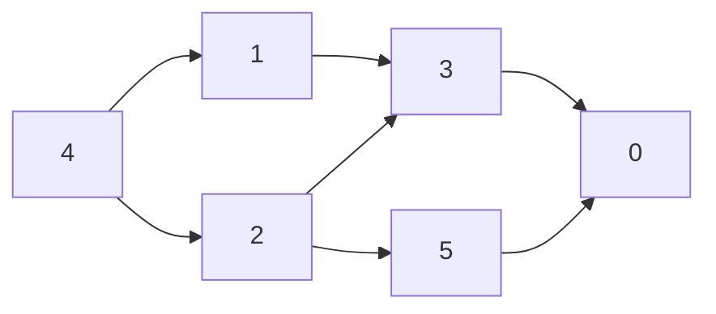

# Pattern 12: Topological Sort

## Overview

A topological sort puts the nodes of a directed graph in a line so that every edge points from an earlier node to a later node. Many problems state rules of the form "A must come before B". Each rule is an edge `A -> B`, and a valid schedule, build order, or alphabet is a topological order. A topological order exists if and only if the graph has no directed cycle, so the same algorithm also answers "is the schedule possible?". This page derives two algorithms: Kahn's algorithm (repeatedly take a node that has no prerequisite left) and the DFS form (reverse the finish order). Both run in O(V + E) time, where V is the number of nodes and E is the number of edges.

After this page you can:

1. Read a list of "A must come before B" rules, draw the directed graph, and state the direction of each edge from the wording of the problem.
2. Produce a valid order with Kahn's algorithm, with the in-degree array and the queue traced by hand, and say why each node enters the order only after all its predecessors.
3. Produce a valid order with DFS, with the three states traced by hand, and say why the reverse of the finish order is valid.
4. Prove that a cycle makes an order impossible, and show how each algorithm detects the cycle.
5. Change the algorithm for the question that the problem asks: any order, yes or no, the smallest order, the only order, the minimum time, or the center of a tree.
6. Choose between Kahn's algorithm and DFS, and name the property of the problem that decides.

## Prerequisites

| You need | Why this page needs it | Where to learn it |
|---|---|---|
| Graph terms, the adjacency list, in-degree | The page stores each rule as an edge in an adjacency list and counts the edges that enter a node | [Graph Representations](../foundations/07-graph-representations.md) |
| BFS, DFS, and the three-color cycle check | Kahn's algorithm is a BFS-like loop. The DFS form uses the three states "unvisited", "on the current path", and "finished" | [Pattern 11: Graph Traversal](../11-graph-traversal/README.md) |
| Queues | Kahn's algorithm keeps the ready nodes in a queue | [Stacks, Queues, and Deques](../foundations/03-stacks-queues-deques.md) |
| Heaps (priority queues) | The smallest-order variant replaces the queue by a heap | [Heaps](../foundations/06-heaps.md) |
| Recursion | The DFS form is a recursive method. Its depth matters for long chains | [Recursion](../foundations/09-recursion.md) |
| Trees: leaf, path, and height | Worked Example 5 peels the leaves of a tree and compares the heights of the trees that different roots give | [Trees and Balanced BSTs](../foundations/05-trees-and-balanced-bsts.md) (section "Tree terms") |
| Counting operations and O-notation | The page counts enqueues and edge visits on a trace before it states O(V + E) | [Complexity Analysis](../foundations/01-complexity-analysis.md) |

Four words that the page uses from the start:

- A **directed graph** has nodes and edges. An edge `u -> v` goes from `u` to `v` and not back. The page calls `u` a **predecessor** of `v`, and `v` a **successor** of `u`.
- A **directed cycle** is a path of edges that returns to its start, for example `1 -> 2 -> 3 -> 1`. A graph with no directed cycle is a **DAG** (directed acyclic graph).
- The **in-degree** of a node is the number of edges that enter it. The page uses the in-degree array and the adjacency list of [Graph Representations](../foundations/07-graph-representations.md).
- A **topological order** is a list that holds every node exactly once and puts `u` before `v` for every edge `u -> v`.

## Motivation

### The anchor problem: Course Schedule II

A school has 6 courses, numbered 0 to 5. A list of pairs gives the rules. The pair `[a, b]` means "to take course `a`, you must first take course `b`". Return an order in which you can take all the courses, or report that no order exists. This is [LC 210: Course Schedule II](https://leetcode.com/problems/course-schedule-ii/).

```text
pairs = [[1, 4], [2, 4], [3, 1], [3, 2], [5, 2], [0, 3], [0, 5]]
one answer: [4, 1, 2, 3, 5, 0]
```

Check the answer by hand. Course 4 has no rule, so it comes first. Courses 1 and 2 need only course 4. Course 3 needs 1 and 2, and both are before it. Course 5 needs 2. Course 0 needs 3 and 5, and both are before it. The problem accepts any valid order. Several exist: `[4, 2, 1, 5, 3, 0]` is also valid.

### The first bug: the direction of an edge

The pair `[a, b]` has the dependent course first. Read it as "`a` needs `b`". The order must put `b` before `a`, so the edge goes **from `b` to `a`**: from the prerequisite to the course that needs it. A reader who copies the pair as `a -> b` builds the graph with every edge reversed.

| Pair | Meaning | Edge |
|---|---|---|
| `[1, 4]` | course 1 needs course 4 | 4 -> 1 |
| `[2, 4]` | course 2 needs course 4 | 4 -> 2 |
| `[3, 1]` | course 3 needs course 1 | 1 -> 3 |
| `[3, 2]` | course 3 needs course 2 | 2 -> 3 |
| `[5, 2]` | course 5 needs course 2 | 2 -> 5 |
| `[0, 3]` | course 0 needs course 3 | 3 -> 0 |
| `[0, 5]` | course 0 needs course 5 | 5 -> 0 |



The adjacency list stores, for each course, the courses that need it. Read the arrows in the picture as "must come before". The in-degree of a course is the number of its prerequisites.

```text
course   courses that need it   in-degree (number of prerequisites)
0        []                     2
1        [3]                    1
2        [3, 5]                 1
3        [0]                    2
4        [1, 2]                 0
5        [0]                    1
```

The program in the Implementation section builds the graph in both directions and runs Kahn's algorithm (derived below) on each. The correct direction gives a valid order. The wrong direction gives this:

```text
edge prerequisite -> course: [4, 1, 2, 3, 5, 0] valid = true
edge course -> prerequisite: [0, 3, 5, 1, 2, 4] valid = false
the wrong order, read backwards: [4, 2, 1, 5, 3, 0] valid = true
```

The wrong order starts with course 0, which needs courses 3 and 5. The code did not crash and the list holds all 6 courses. Only a check against the rules finds the error. Notice the third line: the wrong list read backwards is valid. Every wrong edge goes from a course to its prerequisite, so the wrong order puts each course before its prerequisites, and the reverse of that order puts them after. A result that is "almost right but backwards" points to a reversed edge.

### First attempt 1: sort the courses by their number of prerequisites

Courses with few prerequisites look easy, so a reader may sort by the count of prerequisites. This rule fails when a course has few prerequisites that are themselves hard. Take 4 courses with these rules: course 0 needs course 1, and course 1 needs courses 2 and 3.

```text
prerequisite counts = [1, 2, 0, 0]
sorted by count: [2, 3, 0, 1] valid = false
Kahn: [2, 3, 1, 0] valid = true
```

Course 0 has 1 prerequisite and course 1 has 2, so the sort puts 0 before 1. Course 0 needs course 1. The count says how many courses a course needs. It does not say when those courses become available. The rule ignores the rules that link one course to the next.

### First attempt 2: the visit order of a BFS or a DFS

A reader who knows graph traversal may start at a course with no prerequisite and list the courses in visit order. Take 3 courses with these rules: course 2 needs courses 0 and 1, and course 1 needs course 0. The edges are `0 -> 2`, `0 -> 1`, and `1 -> 2`.

```text
BFS from 0: 3 nodes [0, 2, 1] valid = false
DFS from 0, order of first visit: [0, 2, 1] valid = false
```

Both traversals reach course 2 from course 0 and list it at once. A traversal reaches a node through **one** of its predecessors. It does not wait for the others. Course 2 needs course 1 as well, and the visit order puts 2 before 1.

### The gap

Both attempts place a course without checking that **every** prerequisite of that course is already placed. A correct method needs, for each course, the number of its prerequisites that are not placed yet, and it must place a course only when that number is 0. The Derivation builds this method from two questions.

## Derivation

### Kahn's algorithm: "Which course can I take first?"

**Question 1.** Which course can I take first?

A course that needs no other course: a course with in-degree 0. In the 6-course graph, only course 4 qualifies. Take it.

**Question 2.** After I take it, what changes?

Each course that needs course 4 has one prerequisite fewer. Courses 1 and 2 had 1 prerequisite (course 4), and now they have 0. They can be taken next. The change is one subtraction for each edge that leaves the course that I took: the in-degree of each successor goes down by 1.

So the rule repeats: take a course with in-degree 0, subtract 1 from the in-degree of each of its successors, and note each successor that reaches 0. The courses that are ready wait in a queue. The algorithm:

1. Compute the in-degree of every course. Put each course with in-degree 0 in the queue.
2. Remove a course `u` from the queue. Append `u` to the order.
3. For each successor `v` of `u`, subtract 1 from the in-degree of `v`. If the in-degree of `v` is 0, put `v` in the queue.
4. Repeat steps 2 and 3 until the queue is empty. If the order holds all `n` courses, return it. If not, no order exists.

**Trace** on the 6-course graph. The program of the Implementation section prints these lines. Click through the steps. The line `indegree = ...` shows the array after each step, and `queue = ...` shows the ready courses.

=== "Start"

    ```text
    indegree = [2, 1, 1, 2, 0, 1], queue = [4]
    ```

    Only course 4 has in-degree 0, so the queue holds 4.

=== "Take 4"

    ```text
    take 4: order = [4]
      edge 4 -> 1: indegree[1] = 0, enqueue 1
      edge 4 -> 2: indegree[2] = 0, enqueue 2
      indegree = [2, 0, 0, 2, 0, 1], queue = [1, 2]
    ```

    Course 4 enters the order. Its successors are 1 and 2. Both reach in-degree 0 and enter the queue.

=== "Take 1"

    ```text
    take 1: order = [4, 1]
      edge 1 -> 3: indegree[3] = 1
      indegree = [2, 0, 0, 1, 0, 1], queue = [2]
    ```

    Course 1 enters the order. Its successor 3 goes from 2 to 1. Course 3 still waits for course 2.

=== "Take 2"

    ```text
    take 2: order = [4, 1, 2]
      edge 2 -> 3: indegree[3] = 0, enqueue 3
      edge 2 -> 5: indegree[5] = 0, enqueue 5
      indegree = [2, 0, 0, 0, 0, 0], queue = [3, 5]
    ```

    Course 2 enters the order. Course 3 reaches 0 and course 5 reaches 0, so both enter the queue.

=== "Take 3"

    ```text
    take 3: order = [4, 1, 2, 3]
      edge 3 -> 0: indegree[0] = 1
      indegree = [1, 0, 0, 0, 0, 0], queue = [5]
    ```

    Course 3 enters the order. Course 0 goes from 2 to 1. It still waits for course 5.

=== "Take 5"

    ```text
    take 5: order = [4, 1, 2, 3, 5]
      edge 5 -> 0: indegree[0] = 0, enqueue 0
      indegree = [0, 0, 0, 0, 0, 0], queue = [0]
    ```

    Course 5 enters the order. Course 0 reaches 0 and enters the queue.

=== "Take 0"

    ```text
    take 0: order = [4, 1, 2, 3, 5, 0]
      indegree = [0, 0, 0, 0, 0, 0], queue = []
    ```

    Course 0 enters the order. It has no successor. The queue is empty.

```text
placed 6 of 6, enqueued 6 nodes, made 7 decrements
```

The order holds 6 of 6 courses: `[4, 1, 2, 3, 5, 0]`.

```java
// Returns a valid order, or null if the graph has a cycle.
static int[] kahnOrder(List<List<Integer>> graph) {
    int n = graph.size();
    int[] indegree = new int[n];
    for (List<Integer> targets : graph) {
        for (int v : targets) indegree[v]++;
    }
    Deque<Integer> queue = new ArrayDeque<>();
    for (int v = 0; v < n; v++) {
        if (indegree[v] == 0) queue.add(v);          // no prerequisite left
    }
    int[] order = new int[n];
    int placed = 0;
    while (!queue.isEmpty()) {
        int u = queue.poll();
        order[placed++] = u;                         // all predecessors of u are placed
        for (int v : graph.get(u)) {
            indegree[v]--;                           // v has one prerequisite fewer
            if (indegree[v] == 0) queue.add(v);
        }
    }
    return placed == n ? order : null;               // placed < n means a cycle
}
```

The method returns `null` when the graph has a cycle. [LC 210](https://leetcode.com/problems/course-schedule-ii/) asks for an empty array in that case: return `new int[0]` instead of `null`. The graph comes from `buildGraph`, which gives every course a list, also a course that has no edge:

```java
// The pair is [course, prerequisite], so the edge is prerequisite -> course.
static List<List<Integer>> buildGraph(int n, int[][] prerequisites) {
    List<List<Integer>> graph = new ArrayList<>();
    // every node gets a list,
    for (int v = 0; v < n; v++) graph.add(new ArrayList<>());
    for (int[] pair : prerequisites) {  // also nodes with no edge
        int course = pair[0], prerequisite = pair[1];
        graph.get(prerequisite).add(course);
    }
    return graph;
}
```

**Why the order is valid.** The invariant is: at every moment, `indegree[v]` equals the number of edges `u -> v` whose source `u` is not yet in the order. At the start, no node is in the order, so `indegree[v]` is the full in-degree. When the code takes `u`, it subtracts 1 for each edge that leaves `u`, and it does this once, because `u` leaves the queue once. So the invariant holds after every step. The code puts `v` in the queue only when `indegree[v]` reaches 0. By the invariant, 0 means that every predecessor of `v` is already in the order. The code appends a node to the order only after it leaves the queue. So when a node `v` enters the order, all its predecessors are already in the order. This holds for every node, so every edge goes from an earlier node to a later node.

The in-degree of a node reaches 0 at most once, because it only goes down. A node that starts at 0 is not the target of any edge, so it never gets a subtraction. So each node enters the queue at most once. The order has no repeated node.

**Why a cycle leaves nodes out.** The proof has two directions.

- *If the graph has a cycle, the order has fewer than `n` nodes.* Suppose that some node of a cycle enters the order, and let `x` be the first such node. `x` has a predecessor `y` on the cycle. By the proof above, `y` entered the order before `x`. Then `y` is a node of the cycle that entered before `x`, which contradicts the choice of `x`. So no node of the cycle enters the order. A self-loop `x -> x` is a cycle of one node: `x` has in-degree at least 1 from itself and never reaches 0.
- *If the order has fewer than `n` nodes, the graph has a cycle.* Let `R` be the set of nodes that did not enter the order. `R` is not empty. A node in `R` never reached in-degree 0. By the invariant, each node `v` in `R` has a predecessor in `R` (the edges from nodes in the order were all subtracted). Start at any node of `R` and step to a predecessor in `R`, again and again. `R` is finite, so the walk repeats a node. The repeated stretch is a cycle.

Both directions give: the order has `n` nodes if and only if the graph has no cycle. The empty graph (`n = 0`) gives an empty order and no cycle.

**Trace of a cycle.** Take 5 courses with the edges `0 -> 1`, `1 -> 2`, `2 -> 3`, `3 -> 1`, and `3 -> 4`. The courses 1, 2, and 3 form a cycle.

```text
edges 0 -> 1, 1 -> 2, 2 -> 3, 3 -> 1, 3 -> 4
indegree = [0, 2, 1, 1, 1], queue = [0]
take 0: order = [0]
  edge 0 -> 1: indegree[1] = 1
  indegree = [0, 1, 1, 1, 1], queue = []
placed 1 of 5, enqueued 1 nodes, made 1 decrements
never reached in-degree 0: [1, 2, 3, 4] -> cycle
```

Only course 0 starts with in-degree 0. Taking it lowers the in-degree of course 1 from 2 to 1, and no course reaches 0. The queue is empty after one step, and the order has 1 course of 5. The courses 1, 2, and 3 wait for each other. Course 4 waits for course 3, so it is left out too. The leftover set holds the cycle and every node that depends on it. The code only needs the count: `placed < n` means a cycle.

**The cost, counted on the trace.** The first trace shows 6 nodes entering the queue and 7 subtractions. The graph has `V = 6` nodes and `E = 7` edges. The counts are not by chance:

- Each node enters the queue at most once (shown above), so the queue gets at most `V` additions, and the loop runs at most `V` times.
- Each edge `u -> v` is read once, when `u` leaves the queue, and the code does one subtraction for it. So the code does at most `E` subtractions in total.
- The set-up (the in-degree array and the first scan) reads every node and every edge once: `O(V + E)`.

The total is `O(V + E)` time. The adjacency list takes `O(V + E)` memory, and the in-degree array, the queue, and the order take `O(V)`.

### The DFS form: "When is a course safe to place at the end?"

Kahn's algorithm builds the order from the front. The DFS form builds it from the back.

**Question.** When can I say that a course is safe to place at the **end** of the order?

When every course that needs it is already placed behind it. A course with no successor is safe at once. In the 6-course graph, course 0 needs nothing after it: nothing depends on course 0. So course 0 goes last. Next, course 3 can go before 0, because 0 is the only course that needs 3. So the rule is: place a course after all its successors are placed.

Recursion gives this rule directly. To place course `u`, first place each successor of `u` (each call does the same for its own successors), and then place `u`. The moment a call for `u` **finishes** is the moment when all courses that need `u` are already placed. The calls finish in the order "last course first". That list is the **finish order** (also called the post-order). Reverse it to get the first course first.

The recursive call needs a memory of what it has seen. Each course has one of three **states**: `UNVISITED` (not entered), `ON_PATH` (entered, and its call has not returned: it is on the current chain of calls), and `FINISHED` (its call has returned). [Pattern 11](../11-graph-traversal/README.md) derives these three states for cycle detection in a directed graph. This page uses them as given.

```java
static final int UNVISITED = 0, ON_PATH = 1, FINISHED = 2;

// Returns a valid order, or null if the graph has a cycle.
static int[] dfsOrder(List<List<Integer>> graph) {
    int n = graph.size();
    int[] state = new int[n];
    int[] finished = new int[n];  // nodes in the order in which they finish
    int[] count = new int[1];                        // how many nodes have finished
    for (int v = 0; v < n; v++) {
        if (state[v] == UNVISITED && !visit(v, graph, state, finished, count)) return null;
    }
    int[] order = new int[n];
    // reverse the finish order
    for (int i = 0; i < n; i++) order[i] = finished[n - 1 - i];
    return order;
}

// Returns false if it finds a cycle.
static boolean visit(int u, List<List<Integer>> graph, int[] state,
                     int[] finished, int[] count) {
    state[u] = ON_PATH;
    for (int v : graph.get(u)) {
        if (state[v] == ON_PATH) return false;  // v is on the current path: a cycle
        if (state[v] == UNVISITED && !visit(v, graph, state, finished, count)) return false;
    }
    state[u] = FINISHED;  // everything that depends on u is placed
    finished[count[0]++] = u;
    return true;
}
```

**Trace** on the same graph. The outer loop calls the method for every course that is still `UNVISITED`. The state array shows `U` for `UNVISITED`, `P` for `ON_PATH`, and `F` for `FINISHED`. Click through the calls of the outer loop.

=== "Start at 0"

    ```text
    enter 0  state = [P, U, U, U, U, U]
    finish 0  state = [F, U, U, U, U, U]  finished = [0]
    ```

    Course 0 has no successor. Its call finishes at once. Course 0 is the first in the finish order, so it will be the last in the order.

=== "Start at 1"

    ```text
    enter 1  state = [F, P, U, U, U, U]
      edge 1 -> 3: unvisited, go down
      enter 3  state = [F, P, U, P, U, U]
        edge 3 -> 0: finished, skip
      finish 3  state = [F, P, U, F, U, U]  finished = [0, 3]
    finish 1  state = [F, F, U, F, U, U]  finished = [0, 3, 1]
    ```

    Course 1 enters and goes down to its successor 3. Course 3 reads its successor 0 and sees `FINISHED`, so it skips it. Course 3 finishes, and then course 1 finishes.

=== "Start at 2"

    ```text
    enter 2  state = [F, F, P, F, U, U]
      edge 2 -> 3: finished, skip
      edge 2 -> 5: unvisited, go down
      enter 5  state = [F, F, P, F, U, P]
        edge 5 -> 0: finished, skip
      finish 5  state = [F, F, P, F, U, F]  finished = [0, 3, 1, 5]
    finish 2  state = [F, F, F, F, U, F]  finished = [0, 3, 1, 5, 2]
    ```

    Course 2 sees course 3 as `FINISHED` and skips it. It goes down to course 5. Course 5 finishes, and then course 2 finishes.

=== "Start at 4"

    ```text
    enter 4  state = [F, F, F, F, P, F]
      edge 4 -> 1: finished, skip
      edge 4 -> 2: finished, skip
    finish 4  state = [F, F, F, F, F, F]  finished = [0, 3, 1, 5, 2, 4]
    ```

    Courses 3 and 5 were reached from earlier calls, so the outer loop skips them. Course 4 sees that both its successors are `FINISHED`, and finishes last.

=== "Reverse"

    ```text
    finish order = [0, 3, 1, 5, 2, 4]
    reversed     = [4, 2, 5, 1, 3, 0] valid = true
    finish order without the reversal valid = false
    ```

    The finish order lists the courses from the last to the first. The reverse of it is a valid order. The finish order itself is not valid: it starts with course 0.

**Why the reverse of the finish order is valid.** Take any edge `u -> v`. The claim is that `v` finishes before `u`. The code reads the edge `u -> v` while the call for `u` runs, so `u` is `ON_PATH` at that moment. The state of `v` at that moment has three cases:

1. `v` is `UNVISITED`. The code calls `visit(v)` before `u` continues. That call returns before the call of `u` returns. So `v` finishes before `u`.
2. `v` is `FINISHED`. Then `v` finished before this moment, and `u` has not finished yet. So `v` finishes before `u`.
3. `v` is `ON_PATH`. Then `v` is an ancestor of `u` in the chain of calls: there is a path of edges from `v` down to `u`, and the edge `u -> v` closes it. This is a cycle. The code returns `null`.

If the graph has no cycle, case 3 never occurs, and every edge `u -> v` has `finish(v) < finish(u)`. In the reversed list, `u` comes before `v`. That is the definition of a topological order. The outer loop starts a call for each `UNVISITED` node, so every node, also a node with no edge, gets a finish time. A self-loop `u -> u` is case 3 at once: `u` is `ON_PATH` when it reads its own edge.

If the graph has a cycle, the code finds it. Let `x` be the first node of the cycle that the code enters. The next node of the cycle is either entered from `x` or already entered inside the call of `x`. The same holds for each following node. So all nodes of the cycle are entered inside the call of `x`, and the node `y` with the edge `y -> x` reads that edge while `x` is `ON_PATH`. That is case 3.

**The wrong order that the pre-order gives.** A reader may list a course when the call **enters** it (the pre-order). On the 6-course graph:

```text
first-visit order = [0, 1, 3, 2, 5, 4] valid = false
```

The list starts with course 0, which needs 3 and 5. A call enters `u` before its successors, which is right for the successors. But it does not wait for the other predecessors of those successors. This is attempt 2 again. The finish order is right because a course finishes only after all its successors have finished.

**The cost, counted on the trace.** The trace shows 6 calls (one per course) and 7 lines of the form `edge u -> v`. Each course is entered once, because a course that is not `UNVISITED` is skipped. Each edge is read once, when its source is on the path. So the time is `O(V + E)`. The chain of calls follows the edges of one path, so it is never deeper than the longest path of the graph: at most `V` calls. See Complexity and Trade-offs for the stack.

For a yes-or-no question, the DFS form needs only the `null` test: `dfsOrder(graph) != null` says that the graph has no cycle.

## The Pattern

A topological sort orders the nodes of a directed graph so that every edge goes forward. Kahn's algorithm builds the order from the front: it takes a node that has no unplaced predecessor, and then it releases the successors of that node. The DFS form builds the order from the back: a node is placed after all its successors, which is the moment its call finishes. A cycle makes an order impossible, and each algorithm shows the cycle: Kahn's algorithm places fewer than `n` nodes, and DFS reads an edge to a node that is `ON_PATH`.

**The invariant (Kahn).** `indegree[v]` is the number of predecessors of `v` that are not yet in the order, and a node is in the queue exactly when that number is 0. **The invariant (DFS).** A node is `FINISHED` only after every successor of it is `FINISHED`.

**The vocabulary.** The page used each of these terms before it named them.

| Term | What it was in the examples | The question to ask in a new problem |
|---|---|---|
| Node and edge | A course, and a rule "b before a" as the edge `b -> a` | "What is one thing to place, and which pairs have a rule?" |
| Edge direction | From the prerequisite to the course that needs it | "Which end of the rule must come first? The edge starts there" |
| Predecessor, successor | The prerequisites of a course, and the courses that need it | "What must be done before this node, and what does it unlock?" |
| In-degree | The number of prerequisites that are not placed yet | "How many things still block this node?" |
| Ready node | A node with in-degree 0, waiting in the queue | "Which nodes can I place now?" |
| Topological order | `[4, 1, 2, 3, 5, 0]` | "Does the answer list every node, with each rule respected?" |
| Finish order | The order in which the calls return in DFS | "Is the node placed after everything that depends on it?" |
| Cycle | Courses that wait for each other | "Can the rules contradict each other? Then answer 'impossible'" |

### The variants, and the property that selects each one

Each variant changes one thing: the queue, the question that the loop answers, or the shape of the graph. The Worked Examples derive each row, and the terms "level" and "peeling" get their definitions there.

| Variant | What changes | The property of the problem that selects it |
|---|---|---|
| Kahn, any order ([LC 210](https://leetcode.com/problems/course-schedule-ii/)) | Nothing: the base algorithm | The answer is any valid order |
| Kahn, count only ([LC 207](https://leetcode.com/problems/course-schedule/)) | Return `placed == n` and skip the order | The problem asks "is it possible?" |
| Kahn with a heap (smallest order) | The queue becomes a priority queue | The answer is the smallest valid order in some ranking |
| Kahn by levels ([LC 1136](https://leetcode.com/problems/parallel-courses/) (premium)) | Process the queue one layer at a time and count the layers | The problem asks for the number of rounds when any number of ready nodes may run together |
| Kahn with a value for each node ([LC 2050](https://leetcode.com/problems/parallel-courses-iii/)) | Keep `ready[v]`, the latest finish of a predecessor | Each node has a duration, and the problem asks for the minimum total time |
| Kahn with a queue-size test ([LC 444](https://leetcode.com/problems/sequence-reconstruction/) (premium)) | Return false if the queue holds 2 or more nodes | The problem asks if the order is unique |
| Kahn on the reversed graph ([LC 802](https://leetcode.com/problems/find-eventual-safe-states/)) | Reverse every edge, and count out-degree | The answer is the set of nodes that cannot reach a cycle |
| Kahn on an undirected tree ([LC 310](https://leetcode.com/problems/minimum-height-trees/)) | A leaf (degree 1) plays the role of in-degree 0 | The answer is the center of a tree |
| Two sorts, one inside the other ([LC 1203](https://leetcode.com/problems/sort-items-by-groups-respecting-dependencies/)) | One sort for the groups and one for the items | The rules have two levels: items, and groups of items that stay together |
| Edges extracted from data ([LC 269](https://leetcode.com/problems/alien-dictionary/) (premium)) | A step before Kahn builds the graph from the input | The rules are hidden in the input (sorted words), not listed |
| All orders (backtracking) | At each step, try each ready node | The problem asks for every valid order |
| DFS and the finish order | Recursion and three states | The graph is given as a function, or the problem needs finish times |

### Which problems are topological sorts: the modeling table

The hard part of a new problem is the first step: say what the nodes are, what the edges are, and which way each edge points.

| Problem | Node | Edge and its direction | What the question asks |
|---|---|---|---|
| [LC 210: Course Schedule II](https://leetcode.com/problems/course-schedule-ii/) | A course | Prerequisite -> course | Any valid order, or "impossible" |
| [LC 207: Course Schedule](https://leetcode.com/problems/course-schedule/) | A course | Prerequisite -> course | Whether an order exists |
| [LC 269: Alien Dictionary](https://leetcode.com/problems/alien-dictionary/) (premium) | A letter | Earlier letter -> later letter, from the first difference of two adjacent words | Any valid alphabet, or "impossible" |
| [LC 1136: Parallel Courses](https://leetcode.com/problems/parallel-courses/) (premium) | A course | Previous course -> next course | The minimum number of rounds |
| [LC 2050: Parallel Courses III](https://leetcode.com/problems/parallel-courses-iii/) | A course with a duration | Previous course -> next course | The minimum total time (a longest path) |
| [LC 444: Sequence Reconstruction](https://leetcode.com/problems/sequence-reconstruction/) (premium) | A number | Each number -> the number that follows it in a sequence | Whether the order is unique |
| [LC 2115: Find All Possible Recipes from Given Supplies](https://leetcode.com/problems/find-all-possible-recipes-from-given-supplies/) | An item (supply or recipe) | Ingredient -> recipe | Which recipes can be made |
| [LC 802: Find Eventual Safe States](https://leetcode.com/problems/find-eventual-safe-states/) | A node of a given graph | The same edge, read backwards | Which nodes cannot reach a cycle |

### Kahn's algorithm or DFS

| | Kahn's algorithm (queue) | DFS (finish order) |
|---|---|---|
| Cycle check | The count of placed nodes is below `n`. No state array | A state `ON_PATH` read again. Needs three states |
| Levels and parallel rounds | Natural: each pass of the queue is one level | Not natural: the finish order has no levels |
| Smallest order, or another ranking | Replace the queue by a priority queue | Not possible with the plain reversal |
| Uniqueness test | Check the queue size at each step | Not natural |
| The graph is given as a function (for example, "what are the next states of this state?") | Needs the in-degree of every node first, so the code must build the whole graph | Needs no in-degree: it follows the function from each start |
| Finish times, or "do something after all successors" (a value that depends on the successors) | Possible, on the reversed order | Natural: the code computes the value in the call, after the successors return |
| Stack depth | No recursion | Depth up to the length of the longest path |

Recommendation: write Kahn's algorithm by default. It has no recursion, it gives the cycle check by a count, and it extends to levels, a heap, and the uniqueness test. Choose DFS when the problem gives the graph as a function, or when the answer for a node depends on the answers of its successors.

### The old page's variations and where this page handles them

| Variation of the old page | Where it is |
|---|---|
| A. Check if prerequisites are satisfiable | Worked Example 1 |
| B. Minimum time to complete all tasks | Worked Example 4 (levels for unit durations, a longest path for other durations) |
| C. All possible orders | Worked Example 6 |
| D. Lexicographically smallest order | Worked Example 2 |
| Reversed graph ([LC 802](https://leetcode.com/problems/find-eventual-safe-states/)) | Practice P4 |
| Groups ([LC 1203](https://leetcode.com/problems/sort-items-by-groups-respecting-dependencies/)) | Practice P11 |

## Worked Examples

The examples go from the easiest change to the hardest. Each one changes one thing about Kahn's algorithm or about the graph.

### Example 1: Course Schedule (LC 207): is an order possible?

**Statement.** The input is the same as [LC 210](https://leetcode.com/problems/course-schedule-ii/): `numCourses` courses and pairs `[course, prerequisite]`. Return `true` if you can take all courses, and `false` if not. This is [LC 207: Course Schedule](https://leetcode.com/problems/course-schedule/). Try the problem before you read on.

**What changed.** The answer is a yes or a no, so the code does not store the order. A count of the courses that left the queue is enough. By the proof in the Derivation, the count reaches `n` if and only if the graph has no cycle.

**Reasoning.** The brute force would try every order of the courses: `n!` orders. Kahn's algorithm tests the one question that matters: do the courses run out of nodes with in-degree 0 before all are placed? The trace on the cycle graph of the Derivation shows the answer: 1 of 5 courses placed, so `false`. For the 6-course graph, the count is 6, so `true`.

```java
static boolean canFinish(int numCourses, int[][] prerequisites) {
    List<List<Integer>> graph = new ArrayList<>();
    int[] indegree = new int[numCourses];
    for (int v = 0; v < numCourses; v++) graph.add(new ArrayList<>());
    for (int[] pair : prerequisites) {
        graph.get(pair[1]).add(pair[0]);
        indegree[pair[0]]++;
    }
    Deque<Integer> queue = new ArrayDeque<>();
    for (int v = 0; v < numCourses; v++) {
        if (indegree[v] == 0) queue.add(v);
    }
    int taken = 0;  // the order itself is not needed: count it
    while (!queue.isEmpty()) {
        int u = queue.poll();
        taken++;
        for (int v : graph.get(u)) {
            if (--indegree[v] == 0) queue.add(v);
        }
    }
    return taken == numCourses;
}
```

**Complexity.** Time O(V + E): each course enters the queue once and each pair is read twice (once to build, once to subtract). Space O(V + E) for the graph. The DFS form gives the same answer: `dfsOrder(graph) != null`.

### Example 2: the smallest order, with a priority queue

**Statement.** Give the order that is smallest in lexicographic order: compare two orders at the first position where they differ, and prefer the smaller course number. The courses and the rules are as before. Try the problem before you read on.

**What changed.** The base algorithm takes the ready courses in the order in which they entered the queue. Now the code must take the **smallest** ready course. Only the container of the ready nodes changes: a queue becomes a priority queue (a heap).

**From the simple version.** Take 5 courses with the edges `4 -> 0`, `3 -> 2`, and `3 -> 1`. The base algorithm gives this order:

```text
queue order = [3, 4, 2, 1, 0]
```

The order is valid, but it is not the smallest: it puts 4 and 2 before 1, and `[3, 1, 2, 4, 0]` is also valid and smaller. The heap version finds that order. Trace of the heap version (the list `ready` shows the heap sorted):

```text
ready = [3, 4], take 3, order = [3]
ready = [1, 2, 4], take 1, order = [3, 1]
ready = [2, 4], take 2, order = [3, 1, 2]
ready = [4], take 4, order = [3, 1, 2, 4]
ready = [0], take 0, order = [3, 1, 2, 4, 0]
```

At the first step, the ready courses are 3 and 4, and the heap takes 3. Taking 3 releases 1 and 2. The ready set is now 1, 2, and 4, and the heap takes 1. The result is `[3, 1, 2, 4, 0]`.

**Why it is correct.** The claim is that taking the smallest ready course at each step gives the smallest valid order. The first course of any valid order has no predecessor, so it is a ready course, and it is not smaller than the smallest ready course `s`. An order that starts with `s` exists: after the code removes `s`, the rest of the graph has no cycle (a subgraph of a graph with no cycle has no cycle), so it has a valid order, and `s` can go in front of it because `s` has no predecessor. So the smallest possible first course is `s`. Among the orders that start with `s`, the rest is a valid order of the graph without `s`. The same argument applies to it, with the ready set that the heap holds at that step. By induction on the number of courses, each choice is the smallest possible, so the whole order is the smallest. The argument needs the rule "compare at the first difference". It does not give the order that puts small numbers as early as possible in other senses. If the graph has a cycle, no order exists: the heap runs empty before all courses are placed, and the method returns `null`, as in the cycle proof of the Derivation.

```java
// Smallest valid order in lexicographic order, or null if the graph has a cycle.
static int[] smallestOrder(List<List<Integer>> graph) {
    int n = graph.size();
    int[] indegree = new int[n];
    for (List<Integer> targets : graph) {
        for (int v : targets) indegree[v]++;
    }
    // the only change: a heap, not a queue
    PriorityQueue<Integer> ready = new PriorityQueue<>();
    for (int v = 0; v < n; v++) {
        if (indegree[v] == 0) ready.add(v);
    }
    int[] order = new int[n];
    int placed = 0;
    while (!ready.isEmpty()) {
        int u = ready.poll();  // the smallest node with no prerequisite left
        order[placed++] = u;
        for (int v : graph.get(u)) {
            if (--indegree[v] == 0) ready.add(v);
        }
    }
    return placed == n ? order : null;
}
```

**Complexity.** Each course enters the heap once and leaves once: `V` pushes and `V` pops of `O(log V)` each. Each edge does one subtraction of `O(1)`. The total is `O(V log V + E)`. The plain queue gives `O(V + E)`, so the heap costs the factor `log V` for the ranking.

### Example 3: Alien Dictionary (LC 269): the edges are hidden in the input

**Statement.** An alien language uses the lowercase letters, but in an unknown alphabet order. The input is a list of words, sorted in the dictionary order of that language. Return a string that lists the letters of the words in a valid alphabet order, or an empty string if the list cannot be sorted in any order. This is [LC 269: Alien Dictionary](https://leetcode.com/problems/alien-dictionary/) (premium). Try the problem before you read on.

**What changed.** The problem lists no rules. The code must **find the edges**: "letter `x` before letter `y`" comes from the words. After that, the problem is the base algorithm on a graph whose nodes are letters.

**Where an edge comes from.** Take two words that are next to each other in the list. Find the first position where the two words differ. At that position, the letter of the earlier word comes before the letter of the later word in the alphabet. The letters after that position say nothing, because the words are already ordered by the first difference. For `["wrt", "wrf", "er", "ett", "rftt"]`:

```text
words = [wrt, wrf, er, ett, rftt]
  wrt, wrf: first difference at 2: edge t -> f
  wrf, er: first difference at 0: edge w -> e
  er, ett: first difference at 1: edge r -> t
  ett, rftt: first difference at 0: edge e -> r
order = wertf
```

The graph has the edges `t -> f`, `w -> e`, `r -> t`, and `e -> r`. It is a path `w -> e -> r -> t -> f`, so the only valid alphabet is `wertf`.

**Why adjacent words are enough.** A pair of words that are not next to each other gives a rule too, for example `"wrt"` and `"ett"`. But that rule is a consequence of the rules for adjacent pairs. Take an alphabet order that satisfies every adjacent pair. Then each word is not after the word that follows it, and the dictionary order of words is transitive: if `w1 <= w2` and `w2 <= w3`, then `w1 <= w3`. So the whole list is sorted in that alphabet, and every non-adjacent pair is satisfied too. The adjacent pairs give all the rules that the input holds.

**The cases that the code must handle:**

- *One word is a prefix of the other.* If the longer word comes first (`"abc"` before `"ab"`), no alphabet can sort the list: a prefix always comes first. The code returns the empty string. If the shorter word comes first (`"ab"` before `"abc"`), the pair gives no edge, and the input is valid.
- *A letter that has no edge.* A letter may appear in the words and in no rule. It is a node with in-degree 0 and no successor. It must be in the answer, in any position. The code collects the letters from the words first, not from the edges.
- *The same edge twice.* Two adjacent pairs may give the same edge. The code must count the edge once in the in-degree if it stores the edge once. The code below stores the successors in a set and adds 1 to the in-degree only if the set grew.
- *A cycle.* The words `["z", "x", "z"]` give `z -> x` and `x -> z`. No node reaches in-degree 0, so fewer letters than the total are placed, and the code returns the empty string.

```text
words = [ba, bc]
  ba, bc: first difference at 1: edge a -> c
order = abc
abc before ab -> ""
ab before abc -> "abc"
z, x, z -> ""
z, z -> "z"
words = [xa, xb, ya, yb]
  xa, xb: first difference at 1: edge a -> b
  xb, ya: first difference at 0: edge x -> y
  ya, yb: first difference at 1: edge a -> b
order = axby
```

```java
static String alienOrder(String[] words) {
    boolean[] present = new boolean[26];
    for (String word : words) {
        for (char c : word.toCharArray()) present[c - 'a'] = true;
    }
    List<Set<Integer>> graph = new ArrayList<>();
    for (int c = 0; c < 26; c++) graph.add(new LinkedHashSet<>());
    int[] indegree = new int[26];
    for (int i = 0; i + 1 < words.length; i++) {          // adjacent words only
        String a = words[i], b = words[i + 1];
        int common = Math.min(a.length(), b.length());
        int j = 0;
        while (j < common && a.charAt(j) == b.charAt(j)) j++;
        if (j == common) {  // one word is a prefix of the other
            if (a.length() > b.length()) return "";  // "abc" before "ab": invalid input
            continue;  // "ab" before "abc": no information
        }
        int from = a.charAt(j) - 'a', to = b.charAt(j) - 'a';
        if (graph.get(from).add(to)) indegree[to]++;  // count each distinct edge once
    }
    Deque<Integer> queue = new ArrayDeque<>();
    int letters = 0;
    for (int c = 0; c < 26; c++) {
        if (!present[c]) continue;
        letters++;
        if (indegree[c] == 0) queue.add(c);
    }
    StringBuilder order = new StringBuilder();
    while (!queue.isEmpty()) {
        int u = queue.poll();
        order.append((char) ('a' + u));
        for (int v : graph.get(u)) {
            if (--indegree[v] == 0) queue.add(v);
        }
    }
    return order.length() == letters ? order.toString() : "";  // fewer letters: a cycle
}
```

The check `order.length() == letters` is the cycle test of the base algorithm, with the number of distinct letters in place of `n`.

**Complexity.** Let `C` be the total number of characters in the words and `A` the size of the alphabet (26). Reading each adjacent pair costs at most the length of the shorter word, so the extraction costs `O(C)`. Each adjacent pair gives at most one edge, so the graph has at most `W - 1` edges for `W` words. The sort costs `O(A + W)`. The total is `O(C + A)`, because `C >= W`.

### Example 4: Parallel Courses (LC 1136 and LC 2050): the minimum time

**Statement (LC 1136).** There are `n` courses, numbered 1 to `n`, and pairs `[previous, next]`. In one semester you can take any number of courses whose prerequisites you finished in earlier semesters. Return the minimum number of semesters to take all courses, or -1 if it is impossible. This is [LC 1136: Parallel Courses](https://leetcode.com/problems/parallel-courses/) (premium). Try the problem before you read on.

**What changed.** The code needs to know **when** each course can run, not only an order. Course `v` can run one semester after the latest semester of its prerequisites. The base algorithm already releases a course when its last prerequisite is placed. So each pass of the queue (a **level**) is one semester: the courses in the queue at the start of a pass are exactly the courses that are free now.

**Reasoning.** Let `semester(v)` be the semester in which course `v` runs, as early as possible. A course with no prerequisite has `semester(v) = 1`. For any other course, `semester(v) = 1 + max(semester(u))` over its prerequisites `u`. This is the number of courses on the longest chain of prerequisites that ends at `v`. The answer is the largest `semester(v)`. The level loop computes this value without a table. A course enters the queue during the pass in which its last prerequisite leaves the queue, so the course leaves the queue in the next pass: its pass number is 1 plus the largest pass number of its prerequisites, which is the formula for `semester(v)`. The number of passes is the largest `semester(v)`.

```java
// LC 1136: courses are numbered 1..n. relations[i] = {previous, next}.
static int minimumSemesters(int n, int[][] relations) {
    List<List<Integer>> graph = new ArrayList<>();
    int[] indegree = new int[n + 1];                 // index 0 is not used
    for (int c = 0; c <= n; c++) graph.add(new ArrayList<>());
    for (int[] relation : relations) {
        graph.get(relation[0]).add(relation[1]);
        indegree[relation[1]]++;
    }
    Deque<Integer> level = new ArrayDeque<>();
    for (int c = 1; c <= n; c++) {
        if (indegree[c] == 0) level.add(c);
    }
    int semesters = 0, taken = 0;
    while (!level.isEmpty()) {
        semesters++;  // one pass of the loop is one semester
        // fix the size before the loop
        for (int size = level.size(); size > 0; size--) {
            int u = level.poll();
            taken++;
            for (int v : graph.get(u)) {
                if (--indegree[v] == 0) level.add(v);
            }
        }
    }
    return taken == n ? semesters : -1;
}
```

The loop `for (int size = level.size(); size > 0; size--)` reads the size once, before the loop. The body adds new courses to the queue, and the pass must handle only the courses that were there at its start.

**Statement (LC 2050).** The same rules, with one more input: course `i` takes `time[i - 1]` months, and any number of courses can run at the same time. A course starts when all its prerequisites have finished. Return the minimum number of months to finish all courses. This is [LC 2050: Parallel Courses III](https://leetcode.com/problems/parallel-courses-iii/). Try the problem before you read on.

**What changed again.** The courses have different durations, so a level is not one unit of time. Counting passes of the queue now gives a wrong answer. The code must compute the finish time of each course:

```text
finish(v) = time(v) + max(finish(u)) over the prerequisites u of v
```

A course with no prerequisite starts at 0. The answer is the largest finish time over all courses. This is the length of the **longest path** in the DAG, with the duration of a course as the weight of its node. A longest path is a dynamic-programming (DP) problem: `finish(v)` depends on the `finish(u)` of smaller problems, and the topological order guarantees that every `finish(u)` is ready when the code needs it. See [Pattern 15: Dynamic Programming](../15-dynamic-programming/README.md).

**Trace** for 5 courses with the relations `1 -> 3`, `2 -> 3`, `3 -> 4`, and `2 -> 5`, and the times `[3, 2, 4, 1, 6]`. The value `ready[v]` is the latest finish time of a prerequisite of `v`.

```text
semesters (LC 1136) = 3
queue = [1, 2], ready = [0, 0, 0, 0, 0, 0]
take 1: starts at 0, takes 3, finishes at 3
  edge 1 -> 3: ready[3] = 3
take 2: starts at 0, takes 2, finishes at 2
  edge 2 -> 3: ready[3] = 3, enqueue 3
  edge 2 -> 5: ready[5] = 2, enqueue 5
take 3: starts at 3, takes 4, finishes at 7
  edge 3 -> 4: ready[4] = 7, enqueue 4
take 5: starts at 2, takes 6, finishes at 8
take 4: starts at 7, takes 1, finishes at 8
months (LC 2050) = 8
```

Course 5 starts at month 2 (when course 2 finishes) and ends at month 8. Course 4 starts at month 7 (when course 3 finishes) and ends at month 8. The answer is 8, the largest finish time. The longest path is `1 -> 3 -> 4` or `2 -> 5`, with the total 8 in both. The levels of the same graph (no durations) give 3 semesters for [LC 1136](https://leetcode.com/problems/parallel-courses/) (premium): `{1, 2}`, then `{3, 5}`, then `{4}`. The level count 3 is not the answer 8. The level count equals the answer only when every duration is 1.

```java
// LC 2050: courses are numbered 1..n. time[i - 1] is the duration of course i.
static int minimumMonths(int n, int[][] relations, int[] time) {
    List<List<Integer>> graph = new ArrayList<>();
    int[] indegree = new int[n + 1];
    for (int c = 0; c <= n; c++) graph.add(new ArrayList<>());
    for (int[] relation : relations) {
        graph.get(relation[0]).add(relation[1]);
        indegree[relation[1]]++;
    }
    int[] ready = new int[n + 1];  // ready[v] = latest finish of a prerequisite
    Deque<Integer> queue = new ArrayDeque<>();
    for (int c = 1; c <= n; c++) {
        if (indegree[c] == 0) queue.add(c);
    }
    int taken = 0, answer = 0;
    while (!queue.isEmpty()) {
        int u = queue.poll();
        taken++;
        // u starts when its last prerequisite ends
        int finish = ready[u] + time[u - 1];
        answer = Math.max(answer, finish);  // the answer is the largest finish of all
        for (int v : graph.get(u)) {
            ready[v] = Math.max(ready[v], finish);   // a longest path, not a sum
            if (--indegree[v] == 0) queue.add(v);
        }
    }
    return taken == n ? answer : -1;
}
```

**Why it is correct.** The invariant: when the code takes course `u`, `ready[u]` holds the maximum finish time over all prerequisites of `u`. The code updates `ready[v]` with `max` once for each edge `u -> v`. By the proof of Kahn's algorithm, every prerequisite of `u` was taken before `u`, so every update has happened. So `ready[u] + time[u - 1]` is `finish(u)`. The answer takes the largest finish time over all courses, not the finish time of the last course taken. The last course that leaves the queue is not always the one that ends last.

**Complexity.** Time O(V + E), space O(V + E). Each node and each edge is handled once, and the `max` is O(1).

### Example 5: Minimum Height Trees (LC 310): the same peeling, on a tree

**Statement.** The input is a tree: `n` nodes, `n - 1` edges, connected, no cycle, and no direction. If you pick one node as the root, the height is the number of edges on the longest path from the root down to a leaf. Return every node that gives the smallest height when it is the root. This is [LC 310: Minimum Height Trees](https://leetcode.com/problems/minimum-height-trees/). Try the problem before you read on.

**What changed.** The graph has no direction, so there is no in-degree. But there is still a "take a node that is ready, and release its neighbor" step. The **degree** of a node is the number of edges at it. A **leaf** is a node of degree 1: it is at the far end of the tree. Which root should the code prefer, a leaf `l` or its only neighbor `p`? Let `B` be the largest distance from `p` to a node when the path may not go through `l`. If the tree has 3 or more nodes, `p` has another neighbor, so `B >= 1`. The height from `p` is `max(1, B) = B`. The height from `l` is `1 + B`, because every path from `l` starts with the edge `l - p`. So a leaf is never a minimum-height root when the tree has 3 or more nodes, and the code can remove all leaves without losing an answer. (Two nodes: both are roots. One node: the node is the root.) After it removes a layer of leaves, the neighbors that became leaves are the next layer. The code repeats this until 1 or 2 nodes remain. The degree plays the role of the in-degree, and "degree 1" plays the role of "in-degree 0".

**Trace** for a tree of 7 nodes with the edges `0-1`, `1-2`, `2-3`, `3-4`, `2-5`, and `5-6`:

```text
degree = [1, 2, 3, 2, 1, 2, 1]
round 1: remove leaves [0, 4, 6], remaining = 4
round 2: remove leaves [1, 3, 5], remaining = 1
stop: 1 node(s) remain: [2]
```

Round 1 removes the three leaves 0, 4, and 6. The nodes 1, 3, and 5 become leaves. Round 2 removes them, and node 2 remains. The answer is `[2]`. A path of 4 nodes ends with two nodes, `[1, 2]`.

```java
// LC 310: the roots of the trees with the smallest height.
static List<Integer> minHeightRoots(int n, int[][] edges) {
    if (n == 1) return List.of(0);
    List<List<Integer>> graph = new ArrayList<>();
    int[] degree = new int[n];
    for (int v = 0; v < n; v++) graph.add(new ArrayList<>());
    for (int[] edge : edges) {
        graph.get(edge[0]).add(edge[1]);
        graph.get(edge[1]).add(edge[0]);              // undirected: both directions
        degree[edge[0]]++;
        degree[edge[1]]++;
    }
    Deque<Integer> leaves = new ArrayDeque<>();
    for (int v = 0; v < n; v++) {
        if (degree[v] == 1) leaves.add(v);
    }
    int remaining = n;
    while (remaining > 2) {  // peel one layer of leaves per round
        int layer = leaves.size();
        remaining -= layer;
        for (int i = 0; i < layer; i++) {
            int leaf = leaves.poll();
            for (int v : graph.get(leaf)) {
                if (--degree[v] == 1) leaves.add(v);  // v becomes a leaf
            }
        }
    }
    return new ArrayList<>(leaves);                   // the 1 or 2 nodes that remain
}
```

The case `n == 1` needs its own line: a single node has degree 0, not 1, so the queue of leaves stays empty and the code would return an empty list.

**Why the peeling gives the answer, and why at most 2 nodes remain.** The height of a root `r` is the largest distance from `r` to any node. Let `d` be the number of edges of a longest path `P` of the tree, with ends `a` and `b`. Assume `n >= 3`, so `d >= 2`. The proof has four steps.

1. *No root has a height below `ceil(d / 2)`.* For any root `r`, the path from `a` to `b` is not longer than the path that goes from `a` to `r` and then to `b`: `d <= dist(r, a) + dist(r, b)`. So one of the two distances is at least `d / 2`, and as a distance is a whole number, it is at least `ceil(d / 2)`. The height of `r` is at least that distance.
2. *A middle node of `P` reaches `ceil(d / 2)`.* Call a node `m` of `P` a middle node if `max(dist(m, a), dist(m, b)) = ceil(d / 2)`. If `d` is even, `m` is the node at distance `d / 2` from both ends. If `d` is odd, two nodes qualify: the nodes at distance `(d - 1) / 2` and `(d + 1) / 2` from `a`. Suppose that some node `z` has `dist(m, z) > ceil(d / 2)`. Look at the branches at `m`: the branch that holds `a`, the branch that holds `b`, and the other branches. The node `z` is not in both the branch of `a` and the branch of `b`, so one of two cases holds. If `z` is not in the branch of `a`, the path from `z` to `a` goes through `m`, and its length is `dist(z, m) + dist(m, a) > ceil(d / 2) + dist(m, a)`, which is at least `d`, because `dist(m, a) >= d - ceil(d / 2)`. If `z` is in the branch of `a`, it is not in the branch of `b`, and the same argument works with `b`. Both cases give a path longer than `d`, which contradicts the choice of `P`. So every node is within `ceil(d / 2)` of `m`. With step 1: the smallest possible height is exactly `ceil(d / 2)`, and a middle node gives it.
3. *No other node gives it.* Take a root `r` with height `ceil(d / 2)`. Then `dist(r, a)` and `dist(r, b)` are both at most `ceil(d / 2)`, and by step 1 their sum is at least `d`. In a tree, the sum is `d + 2 * dist(r, P)`, where `dist(r, P)` is the distance from `r` to the nearest node of `P`. For `d` even, both distances are at most `d / 2`, so the sum is `d`, `r` is on `P`, and `r` is the middle node. For `d` odd, both distances are at most `(d + 1) / 2`, so the sum is at most `d + 1`. The sum has the same parity as `d`, so it is `d`. Then `r` is on `P` with the distances `(d - 1) / 2` and `(d + 1) / 2`, which are the 2 middle nodes. So the answer is the middle node (`d` even) or the 2 middle nodes (`d` odd). At most 2 nodes give the smallest height.
4. *The peeling stops at the middle.* A longest path cannot end at a node that has a neighbor outside `P`, because the path could grow. So `a` and `b` are leaves, and a round that removes all leaves removes both ends of `P`. The remaining tree is still connected. Its longest path has exactly `d - 2` edges: `P` without its ends is a path of `d - 2` edges, and a longer path `Q` in the remaining tree could be extended by one removed leaf at each end of `Q` (an end of a longest path of the remaining tree is a leaf there, and it was not a leaf before, so it had a removed neighbor), which gives a path of more than `d` edges in the whole tree. The middle of `P` without its ends is the same node or nodes as the middle of `P`. So each round keeps the answer and makes the longest path 2 edges shorter. After `d / 2` rounds (`d` even) 1 node remains. After `(d - 1) / 2` rounds (`d` odd) 2 nodes remain. A tree with 3 or more nodes has `d >= 2` and a tree with at most 2 nodes has `d <= 1`, so the loop condition `remaining > 2` stops the peeling exactly at that point.

For `n = 2` the loop does not run, and the leaves are the 2 nodes. For `n = 1` the special line returns node 0.

**Complexity.** Time O(V): a tree has `V - 1` edges, each leaf leaves the queue once, and each edge makes one subtraction. Space O(V).

### Example 6: Is the order unique? And all the orders

**Statement (LC 444).** A **subsequence** of a list keeps some of its elements in their original order. The input is a list `nums` and a list of sequences. The problem guarantees that `nums` is a permutation of `1..n` and that each sequence uses numbers from `1..n` (the code indexes arrays by these numbers). Return `true` if `nums` is the only shortest sequence that has every given sequence as a subsequence. This is [LC 444: Sequence Reconstruction](https://leetcode.com/problems/sequence-reconstruction/) (premium). Try the problem before you read on.

**What changed.** The answer is not an order but a question about the **number** of orders. Each adjacent pair `x, y` in a sequence is a rule `x -> y`. A longer gap in a sequence gives nothing new, as in the alien dictionary. The shortest sequence that holds all the sequences is a topological order of this graph. So the question becomes: does the graph have exactly one topological order, and is that order `nums`? A supersequence of all the given sequences puts `x` before `y` for every rule `x -> y`. The shortest ones list each mentioned number once, so they are the topological orders of the graph. If some number of `nums` is in no sequence, a shorter supersequence exists, so the answer is `false`.

**The test.** The order is unique if and only if the queue holds exactly one node at every step.

- *If the queue holds two nodes `u` and `w` at some step, two orders exist, or none exists.* Neither of the two has an unplaced predecessor. So there is no edge between them (an edge `u -> w` would give `w` an unplaced predecessor). The code can put `u` first and then `w`, or `w` first and then `u`, and both continuations are valid. If the graph has no cycle, both continuations can be completed, so the order is not unique. If the graph has a cycle, no order exists, and the answer `false` is right as well.
- *If the queue holds exactly one node at every step, the order is forced.* The first node of every valid order has in-degree 0, and only one node qualifies. After the code removes it, the same argument applies to the rest. So every valid order is the one that the code builds.

The code compares the node that it takes at each step with `nums[position]`. A node that differs means that the only order is not `nums`. A graph with a cycle ends with fewer than `n` nodes taken, so the answer is `false`. A number that no sequence mentions has in-degree 0 and no rule, so it makes the queue hold 2 nodes, unless it is the only node.

```java
// LC 444: nums is a permutation of 1..n. Is nums the only order that fits all sequences?
static boolean isOnlyOrder(int[] nums, int[][] sequences) {
    int n = nums.length;
    List<List<Integer>> graph = new ArrayList<>();
    int[] indegree = new int[n + 1];
    for (int v = 0; v <= n; v++) graph.add(new ArrayList<>());
    for (int[] sequence : sequences) {
        for (int i = 0; i + 1 < sequence.length; i++) {   // adjacent pairs are enough
            graph.get(sequence[i]).add(sequence[i + 1]);
            indegree[sequence[i + 1]]++;
        }
    }
    Deque<Integer> queue = new ArrayDeque<>();
    for (int v = 1; v <= n; v++) {
        if (indegree[v] == 0) queue.add(v);
    }
    int position = 0;
    while (!queue.isEmpty()) {
        if (queue.size() > 1) return false;  // two nodes are ready: two orders exist
        int u = queue.poll();
        if (nums[position++] != u) return false;     // the only order differs from nums
        for (int v : graph.get(u)) {
            if (--indegree[v] == 0) queue.add(v);
        }
    }
    return position == n;                            // fewer than n: a cycle
}
```

```text
[1,2,3] with [1,2],[2,3]: true
[1,2,3] with [1,2],[1,3]: false
[1,2,3] with [1,2],[3,2]: false
[1,2,3] with [2,1],[2,3]: false
[1,2] with [1]: false
```

The first line is `true`: after 1, the number 2 is the only ready node, and after 2, the number 3. The second line is `false`: after 1, both 2 and 3 are ready. The third is `false` because the queue holds 1 and 3 at the start (neither has a predecessor). The fourth is `false` because the first node is 2, and `nums` starts with 1. The fifth is `false` because the number 2 appears in no sequence.

**All orders.** If the problem asks for every valid order, the code tries each ready node at each step and undoes the choice after the recursive call (backtracking, see [Pattern 08](../08-recursion-backtracking/README.md)). A DAG always has a ready node among the unplaced nodes, so no branch gets stuck.

```java
// Every valid order of a DAG. The number of orders can grow like n!, so use small graphs.
static List<List<Integer>> allTopologicalOrders(List<List<Integer>> graph) {
    int n = graph.size();
    int[] indegree = new int[n];
    for (List<Integer> targets : graph) {
        for (int v : targets) indegree[v]++;
    }
    List<List<Integer>> result = new ArrayList<>();
    extend(graph, indegree, new boolean[n], new ArrayList<>(), result);
    return result;
}

static void extend(List<List<Integer>> graph, int[] indegree, boolean[] used,
                   List<Integer> current, List<List<Integer>> result) {
    int n = graph.size();
    if (current.size() == n) {
        result.add(new ArrayList<>(current));
        return;
    }
    for (int u = 0; u < n; u++) {
        if (used[u] || indegree[u] != 0) continue;   // u is not ready
        used[u] = true;                              // choose u
        current.add(u);
        for (int v : graph.get(u)) indegree[v]--;
        extend(graph, indegree, used, current, result);
        for (int v : graph.get(u)) indegree[v]++;    // undo the choice
        current.remove(current.size() - 1);
        used[u] = false;
    }
}
```

```text
0 -> 2, 1 -> 2: [[0, 1, 2], [1, 0, 2]]
5-node graph above: 20 orders
graph with a cycle: []
```

The first line lists the 2 orders of `0 -> 2` and `1 -> 2`. The second line gives the 20 orders of the 5-node graph of Example 2. A graph with a cycle has no complete order, so the result is empty. The number of orders can be as large as `V!` (a graph with no edge), so use this code only for small graphs.

## Implementation

### The templates and where they are derived

| Template | Method | Derived in | The lines that a new problem changes |
|---|---|---|---|
| Build the graph | `buildGraph` | Motivation | The direction of the edge. The size (`n`, or `n + 1` for numbers from 1) |
| Kahn's algorithm | `kahnOrder` | Derivation | The container (queue or heap), and what the code does when it takes a node |
| DFS finish order | `dfsOrder`, `visit` | Derivation | What the code computes at the line `state[u] = FINISHED` |
| Count only | `canFinish` | Example 1 | The return value |
| Smallest order | `smallestOrder` | Example 2 | The comparator of the heap |
| Edges from words | `alienOrder` | Example 3 | The rule that turns two items into an edge |
| Levels | `minimumSemesters` | Example 4 | What a level means |
| Values along edges | `minimumMonths` | Example 4 | The formula that combines `ready[v]` and `finish` |
| Peeling a tree | `minHeightRoots` | Example 5 | The degree test |
| Uniqueness | `isOnlyOrder` | Example 6 | The check of the queue size |
| All orders | `allTopologicalOrders` | Example 6 | Nothing: it enumerates |
| Iterative DFS | `dfsOrderIterative` | Complexity and Trade-offs | The same as `dfsOrder` |

Notes on the lines that readers get wrong:

- In Kahn's algorithm, the subtraction and the test belong to the same step: `indegree[v]--` first, then `if (indegree[v] == 0)`. If the test comes before the subtraction, the node enters the queue one step late, or never.
- The check `placed == n` after the loop is the cycle test. Without it, the method returns a partial order when the graph has a cycle.
- The order of the DFS output is `finished[n - 1 - i]`: the reverse of the finish order. Without the reversal, the order is wrong (the Common Mistakes section shows it).
- In the DFS, the check `state[v] == ON_PATH` comes before the check `state[v] == UNVISITED`. A node on the path must never be entered again.
- For numbers from 1 to `n`, the arrays have size `n + 1`. A loop `for (c = 1; c <= n; c++)` visits each course. A loop that starts at 0 makes the unused index 0 a course with in-degree 0.

The program below prints every trace of this page: the wrong direction, the two failed attempts, the traces of Kahn's algorithm (also on a cycle) and of DFS, the pre-order, the heap, the alien dictionary, the parallel courses, the peeling of a tree, the uniqueness test, and the edge cases (no course, one course, no rule, a course that needs itself, two courses that need each other, a chain, a course with no rule, a tree of 1 node and of 2 nodes, and one word). It is long because it holds every method that the text shows, so the page keeps it in a closed block. Its first part repeats the methods of the page, copied from the text above. The methods whose names end in `Traced` repeat the loop of the page with print lines: the text uses the lines that they print as the traces. Open the block, copy it to `TopoDemo.java`, and run `java TopoDemo.java`.

??? example "The complete program and its output (click to open)"

    ```java
    import java.util.ArrayDeque;
    import java.util.ArrayList;
    import java.util.Arrays;
    import java.util.Comparator;
    import java.util.Deque;
    import java.util.LinkedHashSet;
    import java.util.List;
    import java.util.PriorityQueue;
    import java.util.Set;

    public class TopoDemo {
        public static void main(String[] args) {
            // Six courses. Each pair is {course, prerequisite}.
            int[][] pairs = {{1, 4}, {2, 4}, {3, 1}, {3, 2}, {5, 2}, {0, 3}, {0, 5}};
            List<List<Integer>> graph = buildGraph(6, pairs);

            System.out.println("== wrong direction ==");
            List<List<Integer>> reversed = new ArrayList<>();
            for (int v = 0; v < 6; v++) reversed.add(new ArrayList<>());
            // wrong: course -> prereq
            for (int[] pair : pairs) reversed.get(pair[0]).add(pair[1]);
            int[] right = kahnOrder(graph);
            int[] wrong = kahnOrder(reversed);
            System.out.println("edge prerequisite -> course: " + Arrays.toString(right)
                    + " valid = " + isValidOrder(right, 6, pairs));
            System.out.println("edge course -> prerequisite: " + Arrays.toString(wrong)
                    + " valid = " + isValidOrder(wrong, 6, pairs));
            int[] flipped = new int[6];
            for (int i = 0; i < 6; i++) flipped[i] = wrong[5 - i];
            System.out.println("the wrong order, read backwards: " + Arrays.toString(flipped)
                    + " valid = " + isValidOrder(flipped, 6, pairs));

            System.out.println("== sort by number of prerequisites ==");
            int[][] chain = {{0, 1}, {1, 2}, {1, 3}};      // 0 needs 1. 1 needs 2 and 3.
            Integer[] byCount = {0, 1, 2, 3};
            int[] count = new int[4];
            for (int[] pair : chain) count[pair[0]]++;
            Arrays.sort(byCount, Comparator.comparingInt(c -> count[c]));
            int[] byCountOrder = Arrays.stream(byCount).mapToInt(Integer::intValue).toArray();
            System.out.println("prerequisite counts = " + Arrays.toString(count));
            System.out.println("sorted by count: " + Arrays.toString(byCountOrder)
                    + " valid = " + isValidOrder(byCountOrder, 4, chain));
            int[] chainOrder = kahnOrder(buildGraph(4, chain));
            System.out.println("Kahn: " + Arrays.toString(chainOrder)
                    + " valid = " + isValidOrder(chainOrder, 4, chain));

            System.out.println("== visit order of BFS and DFS ==");
            int[][] three = {{2, 0}, {1, 0}, {2, 1}};      // 2 needs 0 and 1. 1 needs 0.
            List<List<Integer>> threeGraph = buildGraph(3, three);
            int[] bfs = bfsVisitOrder(threeGraph, 0);
            List<Integer> dfsPre = new ArrayList<>();
            preOrder(0, threeGraph, new boolean[3], dfsPre);
            System.out.println("BFS from 0: " + bfs.length + " nodes " + Arrays.toString(bfs)
                    + " valid = " + isValidOrder(bfs, 3, three));
            int[] dfsPreArray = dfsPre.stream().mapToInt(Integer::intValue).toArray();
            System.out.println("DFS from 0, order of first visit: " + dfsPre
                    + " valid = " + isValidOrder(dfsPreArray, 3, three));

            System.out.println("== kahn ==");
            kahnTraced(graph);

            System.out.println("== kahn cycle ==");
            int[][] cyclic = {{1, 0}, {2, 1}, {3, 2}, {1, 3}, {4, 3}};
            System.out.println("edges 0 -> 1, 1 -> 2, 2 -> 3, 3 -> 1, 3 -> 4");
            kahnTraced(buildGraph(5, cyclic));

            System.out.println("== dfs ==");
            int[] finishOrder = dfsTraced(graph);
            System.out.println("finish order = " + Arrays.toString(finishOrder));
            int[] reverseFinish = new int[6];
            for (int i = 0; i < 6; i++) reverseFinish[i] = finishOrder[5 - i];
            System.out.println("reversed     = " + Arrays.toString(reverseFinish)
                    + " valid = " + isValidOrder(reverseFinish, 6, pairs));
            System.out.println("finish order without the reversal valid = "
                    + isValidOrder(finishOrder, 6, pairs));
            int[] fromDfsOrder = dfsOrder(graph);
            System.out.println("dfsOrder = " + Arrays.toString(fromDfsOrder));
            System.out.println("dfsOrderIterative = " + Arrays.toString(dfsOrderIterative(graph)));

            System.out.println("== dfs pre-order ==");
            List<Integer> pre = new ArrayList<>();
            boolean[] seen = new boolean[6];
            for (int v = 0; v < 6; v++) {
                if (!seen[v]) preOrder(v, graph, seen, pre);
            }
            int[] preArray = pre.stream().mapToInt(Integer::intValue).toArray();
            System.out.println("first-visit order = " + pre + " valid = "
                    + isValidOrder(preArray, 6, pairs));

            System.out.println("== dfs cycle ==");
            System.out.println("dfsOrder on the cycle graph = " + dfsOrder(buildGraph(5, cyclic)));
            System.out.println("dfsOrder on the 3-cycle 0 -> 1 -> 2 -> 0 = "
                    + dfsOrder(buildGraph(3, new int[][]{{1, 0}, {2, 1}, {0, 2}})));

            System.out.println("== smallest order ==");
            // Edges 4 -> 0, 3 -> 2, 3 -> 1.
            List<List<Integer>> small = buildGraph(5, new int[][]{{0, 4}, {2, 3}, {1, 3}});
            System.out.println("queue order = " + Arrays.toString(kahnOrder(small)));
            smallestTraced(small);
            System.out.println("heap order  = " + Arrays.toString(smallestOrder(small)));

            System.out.println("== all orders ==");
            List<List<Integer>> two = buildGraph(3, new int[][]{{2, 0}, {2, 1}});
            System.out.println("0 -> 2, 1 -> 2: " + allTopologicalOrders(two));
            System.out.println("5-node graph above: "
                    + allTopologicalOrders(small).size() + " orders");
            System.out.println("graph with a cycle: " + allTopologicalOrders(buildGraph(5, cyclic)));

            System.out.println("== alien ==");
            String[] words = {"wrt", "wrf", "er", "ett", "rftt"};
            printAlienEdges(words);
            System.out.println("order = " + alienOrder(words));
            printAlienEdges(new String[]{"ba", "bc"});
            System.out.println("order = " + alienOrder(new String[]{"ba", "bc"}));
            System.out.println("abc before ab -> \"" + alienOrder(new String[]{"abc", "ab"}) + "\"");
            System.out.println("ab before abc -> \"" + alienOrder(new String[]{"ab", "abc"}) + "\"");
            System.out.println("z, x, z -> \"" + alienOrder(new String[]{"z", "x", "z"}) + "\"");
            System.out.println("z, z -> \"" + alienOrder(new String[]{"z", "z"}) + "\"");
            printAlienEdges(new String[]{"xa", "xb", "ya", "yb"});
            System.out.println("order = " + alienOrder(new String[]{"xa", "xb", "ya", "yb"}));

            System.out.println("== parallel courses ==");
            // Courses 1..5. Relations {previous, next}. Durations for LC 2050.
            int[][] relations = {{1, 3}, {2, 3}, {3, 4}, {2, 5}};
            int[] time = {3, 2, 4, 1, 6};
            System.out.println("semesters (LC 1136) = " + minimumSemesters(5, relations));
            monthsTraced(5, relations, time);
            System.out.println("months (LC 2050) = " + minimumMonths(5, relations, time));
            System.out.println("semesters with a cycle = "
                    + minimumSemesters(3, new int[][]{{1, 2}, {2, 3}, {3, 1}}));
            System.out.println("last course taken, not the largest finish: "
                    + lastPoppedFinish(3, new int[][]{{1, 2}}, new int[]{1, 1, 5})
                    + " (right answer " + minimumMonths(3, new int[][]{{1, 2}}, new int[]{1, 1, 5})
                    + ")");

            System.out.println("== minimum height trees ==");
            int[][] tree = {{0, 1}, {1, 2}, {2, 3}, {3, 4}, {2, 5}, {5, 6}};
            peelTraced(7, tree);
            System.out.println("roots = " + minHeightRoots(7, tree));
            System.out.println("path of 4 nodes: roots = "
                    + minHeightRoots(4, new int[][]{{0, 1}, {1, 2}, {2, 3}}));

            System.out.println("== unique order ==");
            System.out.println("[1,2,3] with [1,2],[2,3]: "
                    + isOnlyOrder(new int[]{1, 2, 3}, new int[][]{{1, 2}, {2, 3}}));
            System.out.println("[1,2,3] with [1,2],[1,3]: "
                    + isOnlyOrder(new int[]{1, 2, 3}, new int[][]{{1, 2}, {1, 3}}));
            System.out.println("[1,2,3] with [1,2],[3,2]: "
                    + isOnlyOrder(new int[]{1, 2, 3}, new int[][]{{1, 2}, {3, 2}}));
            System.out.println("[1,2,3] with [2,1],[2,3]: "
                    + isOnlyOrder(new int[]{1, 2, 3}, new int[][]{{2, 1}, {2, 3}}));
            System.out.println("[1,2] with [1]: " + isOnlyOrder(new int[]{1, 2}, new int[][]{{1}}));

            System.out.println("== edge cases ==");
            System.out.println("no courses: "
                    + Arrays.toString(kahnOrder(buildGraph(0, new int[0][]))));
            System.out.println("one course: "
                    + Arrays.toString(kahnOrder(buildGraph(1, new int[0][]))));
            System.out.println("no prerequisites, 3 courses: "
                    + Arrays.toString(kahnOrder(buildGraph(3, new int[0][]))));
            System.out.println("course needs itself: "
                    + Arrays.toString(kahnOrder(buildGraph(2, new int[][]{{0, 0}}))));
            System.out.println("two courses need each other: "
                    + Arrays.toString(kahnOrder(buildGraph(2, new int[][]{{0, 1}, {1, 0}}))));
            System.out.println("0 needs 1, 1 needs 2, 2 needs 3: "
                    + Arrays.toString(kahnOrder(buildGraph(4, new int[][]{{0, 1}, {1, 2}, {2, 3}}))));
            System.out.println("DFS, same input: "
                    + Arrays.toString(dfsOrder(buildGraph(4, new int[][]{{0, 1}, {1, 2}, {2, 3}}))));
            System.out.println("isolated course 2 with {1, 0}: "
                    + Arrays.toString(kahnOrder(buildGraph(3, new int[][]{{1, 0}}))));
            System.out.println("MHT, 1 node: " + minHeightRoots(1, new int[0][]));
            System.out.println("MHT, 2 nodes: " + minHeightRoots(2, new int[][]{{0, 1}}));
            System.out.println("alien, one word: " + alienOrder(new String[]{"abc"}));
        }

        // ---- The methods of the page ----

        // The pair is [course, prerequisite], so the edge is prerequisite -> course.
        static List<List<Integer>> buildGraph(int n, int[][] prerequisites) {
            List<List<Integer>> graph = new ArrayList<>();
            // every node gets a list,
            for (int v = 0; v < n; v++) graph.add(new ArrayList<>());
            for (int[] pair : prerequisites) {  // also nodes with no edge
                int course = pair[0], prerequisite = pair[1];
                graph.get(prerequisite).add(course);
            }
            return graph;
        }

        // True if order lists every course once and every prerequisite before its course.
        static boolean isValidOrder(int[] order, int n, int[][] prerequisites) {
            if (order == null || order.length != n) return false;
            int[] position = new int[n];
            Arrays.fill(position, -1);
            for (int i = 0; i < n; i++) {
                if (order[i] < 0 || order[i] >= n || position[order[i]] != -1) return false;
                position[order[i]] = i;
            }
            for (int[] pair : prerequisites) {
                if (position[pair[1]] >= position[pair[0]]) return false;
            }
            return true;
        }

        // Returns a valid order, or null if the graph has a cycle.
        static int[] kahnOrder(List<List<Integer>> graph) {
            int n = graph.size();
            int[] indegree = new int[n];
            for (List<Integer> targets : graph) {
                for (int v : targets) indegree[v]++;
            }
            Deque<Integer> queue = new ArrayDeque<>();
            for (int v = 0; v < n; v++) {
                if (indegree[v] == 0) queue.add(v);          // no prerequisite left
            }
            int[] order = new int[n];
            int placed = 0;
            while (!queue.isEmpty()) {
                int u = queue.poll();
                order[placed++] = u;                         // all predecessors of u are placed
                for (int v : graph.get(u)) {
                    indegree[v]--;                           // v has one prerequisite fewer
                    if (indegree[v] == 0) queue.add(v);
                }
            }
            return placed == n ? order : null;               // placed < n means a cycle
        }

        static final int UNVISITED = 0, ON_PATH = 1, FINISHED = 2;

        // Returns a valid order, or null if the graph has a cycle.
        static int[] dfsOrder(List<List<Integer>> graph) {
            int n = graph.size();
            int[] state = new int[n];
            int[] finished = new int[n];  // nodes in the order in which they finish
            int[] count = new int[1];                        // how many nodes have finished
            for (int v = 0; v < n; v++) {
                if (state[v] == UNVISITED && !visit(v, graph, state, finished, count)) return null;
            }
            int[] order = new int[n];
            // reverse the finish order
            for (int i = 0; i < n; i++) order[i] = finished[n - 1 - i];
            return order;
        }

        // Returns false if it finds a cycle.
        static boolean visit(int u, List<List<Integer>> graph, int[] state,
                             int[] finished, int[] count) {
            state[u] = ON_PATH;
            for (int v : graph.get(u)) {
                if (state[v] == ON_PATH) return false;  // v is on the current path: a cycle
                if (state[v] == UNVISITED && !visit(v, graph, state, finished, count)) return false;
            }
            state[u] = FINISHED;  // everything that depends on u is placed
            finished[count[0]++] = u;
            return true;
        }

        // The same order as dfsOrder, with an explicit stack instead of recursion.
        static int[] dfsOrderIterative(List<List<Integer>> graph) {
            int n = graph.size();
            int[] state = new int[n];  // 0 unvisited, 1 on the path, 2 finished
            int[] next = new int[n];  // next[u] = index of the next edge of u
            int[] finished = new int[n];
            int count = 0;
            Deque<Integer> stack = new ArrayDeque<>();
            for (int start = 0; start < n; start++) {
                if (state[start] != 0) continue;
                state[start] = 1;
                stack.push(start);
                while (!stack.isEmpty()) {
                    int u = stack.peek();
                    if (next[u] < graph.get(u).size()) {
                        int v = graph.get(u).get(next[u]++);
                        if (state[v] == 1) return null;      // v is on the path: a cycle
                        if (state[v] == 0) {
                            state[v] = 1;
                            stack.push(v);
                        }
                    } else {
                        state[u] = 2;                        // all edges of u are explored
                        finished[count++] = u;
                        stack.pop();
                    }
                }
            }
            int[] order = new int[n];
            for (int i = 0; i < n; i++) order[i] = finished[n - 1 - i];
            return order;
        }

        // Smallest valid order in lexicographic order, or null if the graph has a cycle.
        static int[] smallestOrder(List<List<Integer>> graph) {
            int n = graph.size();
            int[] indegree = new int[n];
            for (List<Integer> targets : graph) {
                for (int v : targets) indegree[v]++;
            }
            // the only change: a heap, not a queue
            PriorityQueue<Integer> ready = new PriorityQueue<>();
            for (int v = 0; v < n; v++) {
                if (indegree[v] == 0) ready.add(v);
            }
            int[] order = new int[n];
            int placed = 0;
            while (!ready.isEmpty()) {
                int u = ready.poll();  // the smallest node with no prerequisite left
                order[placed++] = u;
                for (int v : graph.get(u)) {
                    if (--indegree[v] == 0) ready.add(v);
                }
            }
            return placed == n ? order : null;
        }

        // Every valid order of a DAG. The number of orders can grow like n!, so use small graphs.
        static List<List<Integer>> allTopologicalOrders(List<List<Integer>> graph) {
            int n = graph.size();
            int[] indegree = new int[n];
            for (List<Integer> targets : graph) {
                for (int v : targets) indegree[v]++;
            }
            List<List<Integer>> result = new ArrayList<>();
            extend(graph, indegree, new boolean[n], new ArrayList<>(), result);
            return result;
        }

        static void extend(List<List<Integer>> graph, int[] indegree, boolean[] used,
                           List<Integer> current, List<List<Integer>> result) {
            int n = graph.size();
            if (current.size() == n) {
                result.add(new ArrayList<>(current));
                return;
            }
            for (int u = 0; u < n; u++) {
                if (used[u] || indegree[u] != 0) continue;   // u is not ready
                used[u] = true;                              // choose u
                current.add(u);
                for (int v : graph.get(u)) indegree[v]--;
                extend(graph, indegree, used, current, result);
                for (int v : graph.get(u)) indegree[v]++;    // undo the choice
                current.remove(current.size() - 1);
                used[u] = false;
            }
        }

        static String alienOrder(String[] words) {
            boolean[] present = new boolean[26];
            for (String word : words) {
                for (char c : word.toCharArray()) present[c - 'a'] = true;
            }
            List<Set<Integer>> graph = new ArrayList<>();
            for (int c = 0; c < 26; c++) graph.add(new LinkedHashSet<>());
            int[] indegree = new int[26];
            for (int i = 0; i + 1 < words.length; i++) {          // adjacent words only
                String a = words[i], b = words[i + 1];
                int common = Math.min(a.length(), b.length());
                int j = 0;
                while (j < common && a.charAt(j) == b.charAt(j)) j++;
                if (j == common) {  // one word is a prefix of the other
                    if (a.length() > b.length()) return "";  // "abc" before "ab": invalid input
                    continue;  // "ab" before "abc": no information
                }
                int from = a.charAt(j) - 'a', to = b.charAt(j) - 'a';
                if (graph.get(from).add(to)) indegree[to]++;  // count each distinct edge once
            }
            Deque<Integer> queue = new ArrayDeque<>();
            int letters = 0;
            for (int c = 0; c < 26; c++) {
                if (!present[c]) continue;
                letters++;
                if (indegree[c] == 0) queue.add(c);
            }
            StringBuilder order = new StringBuilder();
            while (!queue.isEmpty()) {
                int u = queue.poll();
                order.append((char) ('a' + u));
                for (int v : graph.get(u)) {
                    if (--indegree[v] == 0) queue.add(v);
                }
            }
            return order.length() == letters ? order.toString() : "";  // fewer letters: a cycle
        }

        // LC 1136: courses are numbered 1..n. relations[i] = {previous, next}.
        static int minimumSemesters(int n, int[][] relations) {
            List<List<Integer>> graph = new ArrayList<>();
            int[] indegree = new int[n + 1];                 // index 0 is not used
            for (int c = 0; c <= n; c++) graph.add(new ArrayList<>());
            for (int[] relation : relations) {
                graph.get(relation[0]).add(relation[1]);
                indegree[relation[1]]++;
            }
            Deque<Integer> level = new ArrayDeque<>();
            for (int c = 1; c <= n; c++) {
                if (indegree[c] == 0) level.add(c);
            }
            int semesters = 0, taken = 0;
            while (!level.isEmpty()) {
                semesters++;  // one pass of the loop is one semester
                // fix the size before the loop
                for (int size = level.size(); size > 0; size--) {
                    int u = level.poll();
                    taken++;
                    for (int v : graph.get(u)) {
                        if (--indegree[v] == 0) level.add(v);
                    }
                }
            }
            return taken == n ? semesters : -1;
        }

        // LC 2050: courses are numbered 1..n. time[i - 1] is the duration of course i.
        static int minimumMonths(int n, int[][] relations, int[] time) {
            List<List<Integer>> graph = new ArrayList<>();
            int[] indegree = new int[n + 1];
            for (int c = 0; c <= n; c++) graph.add(new ArrayList<>());
            for (int[] relation : relations) {
                graph.get(relation[0]).add(relation[1]);
                indegree[relation[1]]++;
            }
            int[] ready = new int[n + 1];  // ready[v] = latest finish of a prerequisite
            Deque<Integer> queue = new ArrayDeque<>();
            for (int c = 1; c <= n; c++) {
                if (indegree[c] == 0) queue.add(c);
            }
            int taken = 0, answer = 0;
            while (!queue.isEmpty()) {
                int u = queue.poll();
                taken++;
                // u starts when its last prerequisite ends
                int finish = ready[u] + time[u - 1];
                answer = Math.max(answer, finish);  // the answer is the largest finish of all
                for (int v : graph.get(u)) {
                    ready[v] = Math.max(ready[v], finish);   // a longest path, not a sum
                    if (--indegree[v] == 0) queue.add(v);
                }
            }
            return taken == n ? answer : -1;
        }

        // LC 310: the roots of the trees with the smallest height.
        static List<Integer> minHeightRoots(int n, int[][] edges) {
            if (n == 1) return List.of(0);
            List<List<Integer>> graph = new ArrayList<>();
            int[] degree = new int[n];
            for (int v = 0; v < n; v++) graph.add(new ArrayList<>());
            for (int[] edge : edges) {
                graph.get(edge[0]).add(edge[1]);
                graph.get(edge[1]).add(edge[0]);              // undirected: both directions
                degree[edge[0]]++;
                degree[edge[1]]++;
            }
            Deque<Integer> leaves = new ArrayDeque<>();
            for (int v = 0; v < n; v++) {
                if (degree[v] == 1) leaves.add(v);
            }
            int remaining = n;
            while (remaining > 2) {  // peel one layer of leaves per round
                int layer = leaves.size();
                remaining -= layer;
                for (int i = 0; i < layer; i++) {
                    int leaf = leaves.poll();
                    for (int v : graph.get(leaf)) {
                        if (--degree[v] == 1) leaves.add(v);  // v becomes a leaf
                    }
                }
            }
            return new ArrayList<>(leaves);                   // the 1 or 2 nodes that remain
        }

        // LC 444: nums is a permutation of 1..n. Is nums the only order that fits all sequences?
        static boolean isOnlyOrder(int[] nums, int[][] sequences) {
            int n = nums.length;
            List<List<Integer>> graph = new ArrayList<>();
            int[] indegree = new int[n + 1];
            for (int v = 0; v <= n; v++) graph.add(new ArrayList<>());
            for (int[] sequence : sequences) {
                for (int i = 0; i + 1 < sequence.length; i++) {   // adjacent pairs are enough
                    graph.get(sequence[i]).add(sequence[i + 1]);
                    indegree[sequence[i + 1]]++;
                }
            }
            Deque<Integer> queue = new ArrayDeque<>();
            for (int v = 1; v <= n; v++) {
                if (indegree[v] == 0) queue.add(v);
            }
            int position = 0;
            while (!queue.isEmpty()) {
                if (queue.size() > 1) return false;  // two nodes are ready: two orders exist
                int u = queue.poll();
                if (nums[position++] != u) return false;     // the only order differs from nums
                for (int v : graph.get(u)) {
                    if (--indegree[v] == 0) queue.add(v);
                }
            }
            return position == n;                            // fewer than n: a cycle
        }

        // ---- Trace versions: the same loops as the methods above, with print lines ----

        static void kahnTraced(List<List<Integer>> graph) {
            int n = graph.size();
            int[] indegree = new int[n];
            for (List<Integer> targets : graph) {
                for (int v : targets) indegree[v]++;
            }
            Deque<Integer> queue = new ArrayDeque<>();
            for (int v = 0; v < n; v++) {
                if (indegree[v] == 0) queue.add(v);
            }
            System.out.println("indegree = " + Arrays.toString(indegree) + ", queue = " + queue);
            int[] order = new int[n];
            int placed = 0, enqueued = queue.size(), decrements = 0;
            while (!queue.isEmpty()) {
                int u = queue.poll();
                order[placed++] = u;
                int[] soFar = Arrays.copyOf(order, placed);
                System.out.println("take " + u + ": order = " + Arrays.toString(soFar));
                for (int v : graph.get(u)) {
                    indegree[v]--;
                    decrements++;
                    String note = indegree[v] == 0 ? ", enqueue " + v : "";
                    System.out.println("  edge " + u + " -> " + v + ": indegree[" + v + "] = "
                            + indegree[v] + note);
                    if (indegree[v] == 0) {
                        queue.add(v);
                        enqueued++;
                    }
                }
                System.out.println("  indegree = " + Arrays.toString(indegree) + ", queue = "
                        + queue);
            }
            System.out.println("placed " + placed + " of " + n + ", enqueued " + enqueued
                    + " nodes, made " + decrements + " decrements");
            if (placed < n) {
                List<Integer> left = new ArrayList<>();
                for (int v = 0; v < n; v++) {
                    if (indegree[v] > 0) left.add(v);
                }
                System.out.println("never reached in-degree 0: " + left + " -> cycle");
            }
        }

        static int[] dfsTraced(List<List<Integer>> graph) {
            int n = graph.size();
            char[] state = new char[n];
            Arrays.fill(state, 'U');  // U = unvisited, P = on the path, F = finished
            List<Integer> finished = new ArrayList<>();
            for (int v = 0; v < n; v++) {
                if (state[v] == 'U') {
                    System.out.println("-- start " + v + " --");
                    traceVisit(v, graph, state, finished, 0);
                }
            }
            return finished.stream().mapToInt(Integer::intValue).toArray();
        }

        static void traceVisit(int u, List<List<Integer>> graph, char[] state, List<Integer> finished,
                               int depth) {
            String pad = "  ".repeat(depth);
            state[u] = 'P';
            System.out.println(pad + "enter " + u + "  state = " + Arrays.toString(state));
            for (int v : graph.get(u)) {
                if (state[v] == 'U') {
                    System.out.println(pad + "  edge " + u + " -> " + v + ": unvisited, go down");
                    traceVisit(v, graph, state, finished, depth + 1);
                } else {
                    System.out.println(pad + "  edge " + u + " -> " + v + ": "
                            + (state[v] == 'F' ? "finished, skip" : "on the path, cycle"));
                }
            }
            state[u] = 'F';
            finished.add(u);
            System.out.println(pad + "finish " + u + "  state = " + Arrays.toString(state)
                    + "  finished = " + finished);
        }

        static void smallestTraced(List<List<Integer>> graph) {
            int n = graph.size();
            int[] indegree = new int[n];
            for (List<Integer> targets : graph) {
                for (int v : targets) indegree[v]++;
            }
            PriorityQueue<Integer> ready = new PriorityQueue<>();
            for (int v = 0; v < n; v++) {
                if (indegree[v] == 0) ready.add(v);
            }
            List<Integer> order = new ArrayList<>();
            while (!ready.isEmpty()) {
                List<Integer> shown = new ArrayList<>(ready);
                Collections_sort(shown);
                int u = ready.poll();
                order.add(u);
                System.out.println("ready = " + shown + ", take " + u + ", order = " + order);
                for (int v : graph.get(u)) {
                    if (--indegree[v] == 0) ready.add(v);
                }
            }
        }

        static void Collections_sort(List<Integer> list) {
            java.util.Collections.sort(list);
        }

        static void monthsTraced(int n, int[][] relations, int[] time) {
            List<List<Integer>> graph = new ArrayList<>();
            int[] indegree = new int[n + 1];
            for (int c = 0; c <= n; c++) graph.add(new ArrayList<>());
            for (int[] relation : relations) {
                graph.get(relation[0]).add(relation[1]);
                indegree[relation[1]]++;
            }
            int[] ready = new int[n + 1];
            Deque<Integer> queue = new ArrayDeque<>();
            for (int c = 1; c <= n; c++) {
                if (indegree[c] == 0) queue.add(c);
            }
            System.out.println("queue = " + queue + ", ready = " + Arrays.toString(ready));
            while (!queue.isEmpty()) {
                int u = queue.poll();
                int finish = ready[u] + time[u - 1];
                System.out.println("take " + u + ": starts at " + ready[u] + ", takes " + time[u - 1]
                        + ", finishes at " + finish);
                for (int v : graph.get(u)) {
                    ready[v] = Math.max(ready[v], finish);
                    String note = --indegree[v] == 0 ? ", enqueue " + v : "";
                    System.out.println("  edge " + u + " -> " + v + ": ready[" + v + "] = "
                            + ready[v] + note);
                    if (indegree[v] == 0) queue.add(v);
                }
            }
        }

        // The mistake: return the finish time of the last course taken.
        static int lastPoppedFinish(int n, int[][] relations, int[] time) {
            List<List<Integer>> graph = new ArrayList<>();
            int[] indegree = new int[n + 1];
            for (int c = 0; c <= n; c++) graph.add(new ArrayList<>());
            for (int[] relation : relations) {
                graph.get(relation[0]).add(relation[1]);
                indegree[relation[1]]++;
            }
            int[] ready = new int[n + 1];
            Deque<Integer> queue = new ArrayDeque<>();
            for (int c = 1; c <= n; c++) {
                if (indegree[c] == 0) queue.add(c);
            }
            int finish = 0;
            while (!queue.isEmpty()) {
                int u = queue.poll();
                finish = ready[u] + time[u - 1];
                for (int v : graph.get(u)) {
                    ready[v] = Math.max(ready[v], finish);
                    if (--indegree[v] == 0) queue.add(v);
                }
            }
            return finish;
        }

        static void peelTraced(int n, int[][] edges) {
            List<List<Integer>> graph = new ArrayList<>();
            int[] degree = new int[n];
            for (int v = 0; v < n; v++) graph.add(new ArrayList<>());
            for (int[] edge : edges) {
                graph.get(edge[0]).add(edge[1]);
                graph.get(edge[1]).add(edge[0]);
                degree[edge[0]]++;
                degree[edge[1]]++;
            }
            System.out.println("degree = " + Arrays.toString(degree));
            Deque<Integer> leaves = new ArrayDeque<>();
            for (int v = 0; v < n; v++) {
                if (degree[v] == 1) leaves.add(v);
            }
            int remaining = n, round = 0;
            while (remaining > 2) {
                round++;
                int layer = leaves.size();
                remaining -= layer;
                System.out.println("round " + round + ": remove leaves " + leaves + ", remaining = "
                        + remaining);
                for (int i = 0; i < layer; i++) {
                    int leaf = leaves.poll();
                    for (int v : graph.get(leaf)) {
                        if (--degree[v] == 1) leaves.add(v);
                    }
                }
            }
            System.out.println("stop: " + remaining + " node(s) remain: " + leaves);
        }

        static void printAlienEdges(String[] words) {
            System.out.println("words = " + Arrays.toString(words));
            for (int i = 0; i + 1 < words.length; i++) {
                String a = words[i], b = words[i + 1];
                int j = 0;
                while (j < Math.min(a.length(), b.length()) && a.charAt(j) == b.charAt(j)) j++;
                String result = j == Math.min(a.length(), b.length())
                        ? "no letter differs, no edge"
                        : "first difference at " + j + ": edge " + a.charAt(j) + " -> " + b.charAt(j);
                System.out.println("  " + a + ", " + b + ": " + result);
            }
        }

        // The visit order of a plain BFS from one start node.
        static int[] bfsVisitOrder(List<List<Integer>> graph, int start) {
            boolean[] seen = new boolean[graph.size()];
            List<Integer> visited = new ArrayList<>();
            Deque<Integer> queue = new ArrayDeque<>();
            queue.add(start);
            seen[start] = true;
            while (!queue.isEmpty()) {
                int u = queue.poll();
                visited.add(u);
                for (int v : graph.get(u)) {
                    if (!seen[v]) {
                        seen[v] = true;
                        queue.add(v);
                    }
                }
            }
            return visited.stream().mapToInt(Integer::intValue).toArray();
        }

        // The order of first visit of a DFS. This is the pre-order, not the finish order.
        static void preOrder(int u, List<List<Integer>> graph, boolean[] seen, List<Integer> out) {
            seen[u] = true;
            out.add(u);
            for (int v : graph.get(u)) {
                if (!seen[v]) preOrder(v, graph, seen, out);
            }
        }
    }
    ```

    <!-- expected-output -->
    ```text
    == wrong direction ==
    edge prerequisite -> course: [4, 1, 2, 3, 5, 0] valid = true
    edge course -> prerequisite: [0, 3, 5, 1, 2, 4] valid = false
    the wrong order, read backwards: [4, 2, 1, 5, 3, 0] valid = true
    == sort by number of prerequisites ==
    prerequisite counts = [1, 2, 0, 0]
    sorted by count: [2, 3, 0, 1] valid = false
    Kahn: [2, 3, 1, 0] valid = true
    == visit order of BFS and DFS ==
    BFS from 0: 3 nodes [0, 2, 1] valid = false
    DFS from 0, order of first visit: [0, 2, 1] valid = false
    == kahn ==
    indegree = [2, 1, 1, 2, 0, 1], queue = [4]
    take 4: order = [4]
      edge 4 -> 1: indegree[1] = 0, enqueue 1
      edge 4 -> 2: indegree[2] = 0, enqueue 2
      indegree = [2, 0, 0, 2, 0, 1], queue = [1, 2]
    take 1: order = [4, 1]
      edge 1 -> 3: indegree[3] = 1
      indegree = [2, 0, 0, 1, 0, 1], queue = [2]
    take 2: order = [4, 1, 2]
      edge 2 -> 3: indegree[3] = 0, enqueue 3
      edge 2 -> 5: indegree[5] = 0, enqueue 5
      indegree = [2, 0, 0, 0, 0, 0], queue = [3, 5]
    take 3: order = [4, 1, 2, 3]
      edge 3 -> 0: indegree[0] = 1
      indegree = [1, 0, 0, 0, 0, 0], queue = [5]
    take 5: order = [4, 1, 2, 3, 5]
      edge 5 -> 0: indegree[0] = 0, enqueue 0
      indegree = [0, 0, 0, 0, 0, 0], queue = [0]
    take 0: order = [4, 1, 2, 3, 5, 0]
      indegree = [0, 0, 0, 0, 0, 0], queue = []
    placed 6 of 6, enqueued 6 nodes, made 7 decrements
    == kahn cycle ==
    edges 0 -> 1, 1 -> 2, 2 -> 3, 3 -> 1, 3 -> 4
    indegree = [0, 2, 1, 1, 1], queue = [0]
    take 0: order = [0]
      edge 0 -> 1: indegree[1] = 1
      indegree = [0, 1, 1, 1, 1], queue = []
    placed 1 of 5, enqueued 1 nodes, made 1 decrements
    never reached in-degree 0: [1, 2, 3, 4] -> cycle
    == dfs ==
    -- start 0 --
    enter 0  state = [P, U, U, U, U, U]
    finish 0  state = [F, U, U, U, U, U]  finished = [0]
    -- start 1 --
    enter 1  state = [F, P, U, U, U, U]
      edge 1 -> 3: unvisited, go down
      enter 3  state = [F, P, U, P, U, U]
        edge 3 -> 0: finished, skip
      finish 3  state = [F, P, U, F, U, U]  finished = [0, 3]
    finish 1  state = [F, F, U, F, U, U]  finished = [0, 3, 1]
    -- start 2 --
    enter 2  state = [F, F, P, F, U, U]
      edge 2 -> 3: finished, skip
      edge 2 -> 5: unvisited, go down
      enter 5  state = [F, F, P, F, U, P]
        edge 5 -> 0: finished, skip
      finish 5  state = [F, F, P, F, U, F]  finished = [0, 3, 1, 5]
    finish 2  state = [F, F, F, F, U, F]  finished = [0, 3, 1, 5, 2]
    -- start 4 --
    enter 4  state = [F, F, F, F, P, F]
      edge 4 -> 1: finished, skip
      edge 4 -> 2: finished, skip
    finish 4  state = [F, F, F, F, F, F]  finished = [0, 3, 1, 5, 2, 4]
    finish order = [0, 3, 1, 5, 2, 4]
    reversed     = [4, 2, 5, 1, 3, 0] valid = true
    finish order without the reversal valid = false
    dfsOrder = [4, 2, 5, 1, 3, 0]
    dfsOrderIterative = [4, 2, 5, 1, 3, 0]
    == dfs pre-order ==
    first-visit order = [0, 1, 3, 2, 5, 4] valid = false
    == dfs cycle ==
    dfsOrder on the cycle graph = null
    dfsOrder on the 3-cycle 0 -> 1 -> 2 -> 0 = null
    == smallest order ==
    queue order = [3, 4, 2, 1, 0]
    ready = [3, 4], take 3, order = [3]
    ready = [1, 2, 4], take 1, order = [3, 1]
    ready = [2, 4], take 2, order = [3, 1, 2]
    ready = [4], take 4, order = [3, 1, 2, 4]
    ready = [0], take 0, order = [3, 1, 2, 4, 0]
    heap order  = [3, 1, 2, 4, 0]
    == all orders ==
    0 -> 2, 1 -> 2: [[0, 1, 2], [1, 0, 2]]
    5-node graph above: 20 orders
    graph with a cycle: []
    == alien ==
    words = [wrt, wrf, er, ett, rftt]
      wrt, wrf: first difference at 2: edge t -> f
      wrf, er: first difference at 0: edge w -> e
      er, ett: first difference at 1: edge r -> t
      ett, rftt: first difference at 0: edge e -> r
    order = wertf
    words = [ba, bc]
      ba, bc: first difference at 1: edge a -> c
    order = abc
    abc before ab -> ""
    ab before abc -> "abc"
    z, x, z -> ""
    z, z -> "z"
    words = [xa, xb, ya, yb]
      xa, xb: first difference at 1: edge a -> b
      xb, ya: first difference at 0: edge x -> y
      ya, yb: first difference at 1: edge a -> b
    order = axby
    == parallel courses ==
    semesters (LC 1136) = 3
    queue = [1, 2], ready = [0, 0, 0, 0, 0, 0]
    take 1: starts at 0, takes 3, finishes at 3
      edge 1 -> 3: ready[3] = 3
    take 2: starts at 0, takes 2, finishes at 2
      edge 2 -> 3: ready[3] = 3, enqueue 3
      edge 2 -> 5: ready[5] = 2, enqueue 5
    take 3: starts at 3, takes 4, finishes at 7
      edge 3 -> 4: ready[4] = 7, enqueue 4
    take 5: starts at 2, takes 6, finishes at 8
    take 4: starts at 7, takes 1, finishes at 8
    months (LC 2050) = 8
    semesters with a cycle = -1
    last course taken, not the largest finish: 2 (right answer 5)
    == minimum height trees ==
    degree = [1, 2, 3, 2, 1, 2, 1]
    round 1: remove leaves [0, 4, 6], remaining = 4
    round 2: remove leaves [1, 3, 5], remaining = 1
    stop: 1 node(s) remain: [2]
    roots = [2]
    path of 4 nodes: roots = [1, 2]
    == unique order ==
    [1,2,3] with [1,2],[2,3]: true
    [1,2,3] with [1,2],[1,3]: false
    [1,2,3] with [1,2],[3,2]: false
    [1,2,3] with [2,1],[2,3]: false
    [1,2] with [1]: false
    == edge cases ==
    no courses: []
    one course: [0]
    no prerequisites, 3 courses: [0, 1, 2]
    course needs itself: null
    two courses need each other: null
    0 needs 1, 1 needs 2, 2 needs 3: [3, 2, 1, 0]
    DFS, same input: [3, 2, 1, 0]
    isolated course 2 with {1, 0}: [0, 2, 1]
    MHT, 1 node: [0]
    MHT, 2 nodes: [0, 1]
    alien, one word: abc
    ```

## Complexity and Trade-offs

Let `V` be the number of nodes and `E` the number of edges.

| Variant | Time | Space | Reason |
|---|---|---|---|
| Kahn's algorithm | O(V + E) | O(V + E) | Each node enters the queue once. Each edge makes one subtraction. The adjacency list holds `V + E` entries |
| DFS finish order | O(V + E) | O(V + E) | Each node is entered once. Each edge is read once. The stack holds up to `V` calls |
| Cycle check only (`canFinish`) | O(V + E) | O(V + E) | The same loop, without the order list |
| Smallest order (heap) | O(V log V + E) | O(V + E) | `V` pushes and `V` pops, each `O(log V)`, plus `E` subtractions |
| Levels (LC 1136) | O(V + E) | O(V + E) | The same loop. The pass size is read once for each level |
| Longest path (LC 2050) | O(V + E) | O(V + E) | One `max` for each edge |
| Peeling a tree (LC 310) | O(V) | O(V) | A tree has `V - 1` edges. Each leaf leaves the queue once |
| Alien dictionary (LC 269) | O(C + A) | O(A + W) | `C` characters to read, `A` letters (26), at most `W - 1` edges for `W` words |
| Unique order (LC 444) | O(V + E) | O(V + E) | The same loop with one extra test |
| All orders | at least the number of orders | O(V) for the recursion | Up to `V!` orders when the graph has no edge |

**The recursion depth of DFS.** The call for a node stays open until all its successors finish, so the depth equals the length of the longest path that the DFS follows, up to `V` calls. A graph that is one long chain (`0 -> 1 -> 2 -> ... -> V - 1`) makes `V` nested calls. Java stores each call on the thread's stack, and the stack has a fixed size (the option `-Xss` sets it). A chain that is long enough ends in a `StackOverflowError`. The page [Recursion](../foundations/09-recursion.md) explains the stack. Kahn's algorithm has no recursion and no such limit. If the code must use the DFS form for a large graph, replace the recursion by an explicit stack and an array that stores the next edge of each node:

```java
// The same order as dfsOrder, with an explicit stack instead of recursion.
static int[] dfsOrderIterative(List<List<Integer>> graph) {
    int n = graph.size();
    int[] state = new int[n];  // 0 unvisited, 1 on the path, 2 finished
    int[] next = new int[n];  // next[u] = index of the next edge of u
    int[] finished = new int[n];
    int count = 0;
    Deque<Integer> stack = new ArrayDeque<>();
    for (int start = 0; start < n; start++) {
        if (state[start] != 0) continue;
        state[start] = 1;
        stack.push(start);
        while (!stack.isEmpty()) {
            int u = stack.peek();
            if (next[u] < graph.get(u).size()) {
                int v = graph.get(u).get(next[u]++);
                if (state[v] == 1) return null;      // v is on the path: a cycle
                if (state[v] == 0) {
                    state[v] = 1;
                    stack.push(v);
                }
            } else {
                state[u] = 2;                        // all edges of u are explored
                finished[count++] = u;
                stack.pop();
            }
        }
    }
    int[] order = new int[n];
    for (int i = 0; i < n; i++) order[i] = finished[n - 1 - i];
    return order;
}
```

The array `next[u]` replaces the loop variable of the recursive call: it remembers which edge of `u` the code reads next. The code finishes `u` when all edges of `u` are read. The program in Implementation prints that `dfsOrderIterative` gives the same order as `dfsOrder`.

**The memory of the adjacency list.** `List<List<Integer>>` stores one `ArrayList` for each node and one boxed `Integer` for each edge entry. For a graph with a million edges, this costs far more than the 4 bytes that an `int` needs. [Graph Representations](../foundations/07-graph-representations.md) shows the array-based adjacency list (the "forward-star" form), which stores the same graph in three `int` arrays. Use it when the memory limit is tight. The in-degree array and the queue take `O(V)` in both forms.

**Alternatives.**

| Alternative | Time | When it is better |
|---|---|---|
| Scan all nodes for in-degree 0 again at each step | O(V² + E) | The graph is tiny and the code must be short. The queue version is as short and faster |
| DFS finish order | O(V + E) | The graph is a function (no list of edges), or the code needs the finish time of each node |
| Memoized DFS that computes a value for each node (longest path, count of paths) on a DAG | O(V + E) | The question is a value, not an order. The memo table is the DP. It needs the same cycle check |
| Strongly connected components, then a topological sort of the components | O(V + E) | The graph may have cycles and the problem asks for an order of the cycles as groups. See [Pattern 24](../24-advanced-graphs/README.md) |

## Recognition Guide

**Signals in the statement.**

- The words "order", "ordering", "sequence", "prerequisite", "dependency", "before", "after", "build order", "task scheduling", "course schedule".
- Rules of the form "`A` must come before `B`", given as pairs, as lists, or hidden in data (sorted words, sequences).
- A question that asks for a valid order, or "is it possible?", or "what is the minimum time with unlimited parallel work?".
- A graph where each edge has a direction and the problem says "no cycle" or asks you to find one.

**Signals in the constraints.**

- The number of nodes and rules is large enough that trying every order (`n!`) is out of the question, so the code must run in O(V + E).
- Several answers may be valid, and the statement says "return any valid order" (or asks for the smallest one by a stated ranking).

**Looks similar, but needs another technique.**

| Problem | Why a topological sort fails | Use instead |
|---|---|---|
| [LC 684: Redundant Connection](https://leetcode.com/problems/redundant-connection/) | The edges have no direction, and the question is which edge closes a cycle. There is no "must come before" | [Pattern 13: Union Find](../13-union-find/README.md), or a DFS with the parent node ([Pattern 11](../11-graph-traversal/README.md)) |
| [LC 261: Graph Valid Tree](https://leetcode.com/problems/graph-valid-tree/) (premium) | The graph is undirected. An undirected edge is a cycle of 2 if you read it as two directed edges | [Pattern 13: Union Find](../13-union-find/README.md) |
| [LC 743: Network Delay Time](https://leetcode.com/problems/network-delay-time/) | The edges have weights, and the graph may have cycles. The question is the shortest path, not an order | [Pattern 18: Shortest Paths](../18-shortest-paths/README.md) (Dijkstra) |
| [LC 630: Course Schedule III](https://leetcode.com/problems/course-schedule-iii/) | Each course has a duration and a deadline, and there is no rule "course A before course B". The question is how many courses fit | [Pattern 14: Greedy](../14-greedy/README.md), with a heap. For ranges of time see [Pattern 20: Intervals](../20-intervals/README.md) |
| [LC 937: Reorder Data in Log Files](https://leetcode.com/problems/reorder-data-in-log-files/) | The order comes from a rule that compares any two items directly (a comparator). Every pair of items has a defined order, so the graph is a chain | Plain sorting with a comparator ([Sorting Algorithms](../foundations/08-sorting-algorithms.md)) |
| Find the groups of nodes that can reach each other in a directed graph | The graph has cycles on purpose. A topological order does not exist | Strongly connected components, in [Pattern 24: Advanced Graphs](../24-advanced-graphs/README.md) |

**The preconditions, each with a counterexample.**

| Precondition | Counterexample | What goes wrong |
|---|---|---|
| The graph has no directed cycle | Pairs `[[1, 0], [0, 1]]` (each course needs the other) | No order exists. Kahn's algorithm places 0 courses, and DFS reads an edge to an `ON_PATH` node. A method without the check returns a list that breaks a rule |
| The rules say "before", not "right after" or "within 2 places" | "`A` must be right before `B`, and `C` must be before `B`" | A topological order may put `C` between `A` and `B`. The model "before" does not hold the word "right". The problem needs another model (a search over orders) |
| The edge points from the node that comes first | Pairs `[[1, 4], [2, 4], ...]` read as `1 -> 4` | The code returns the wrong order (the Motivation shows `[0, 3, 5, 1, 2, 4]`) |
| Every node is in the graph, also a node with no rule | 3 courses and the pair `[[1, 0]]` | A graph built from the pairs lists 2 courses, and the order is short by one course |

## Common Mistakes

Each mistake has a failing input and the wrong output. The first four come from the old page.

1. **The edge points the wrong way.** Input: 6 courses, `pairs = [[1, 4], [2, 4], [3, 1], [3, 2], [5, 2], [0, 3], [0, 5]]`. Code: `graph.get(course).add(prerequisite)`. Output: `[0, 3, 5, 1, 2, 4]`. Course 0 comes first although it needs courses 3 and 5. Fix: the pair is `[course, prerequisite]` and the edge is `prerequisite -> course`: `graph.get(prerequisite).add(course)` and `indegree[course]++`.
2. **The code does not check for a cycle.** Input: 5 courses with the edges `0 -> 1`, `1 -> 2`, `2 -> 3`, `3 -> 1`, `3 -> 4`. Code: return the list `order` after the loop. Output: `[0]` for 5 courses, and the caller takes it as an answer. Fix: compare `placed` with `n`. If they differ, return `null` (or an empty array for [LC 210](https://leetcode.com/problems/course-schedule-ii/)).
3. **A node with no rule is missing from the graph.** Input: 3 courses, `pairs = [[1, 0]]`. Code: the nodes come from the pairs only (a map that gets a key when an edge is added). Output: `[0, 1]`, which has 2 of the 3 courses. If the code compares with `n`, it reports a cycle that does not exist. Fix: create an adjacency list for each of the `n` nodes first (`buildGraph` does it). The edge-case lines of the program show the right output: `[0, 2, 1]`.
4. **DFS gives the order of the first visit (the pre-order).** Input: the 6-course graph. Code: `order.add(u)` at the top of `visit`. Output: `[0, 1, 3, 2, 5, 4]`. Course 0 comes first, and it needs 3 and 5. Fix: add the node when its call finishes, and reverse the list.
5. **DFS gives the finish order without the reversal.** Input: the 6-course graph. Output: `[0, 3, 1, 5, 2, 4]`, which is the order from the last course to the first. Fix: read `finished` from the end (`finished[n - 1 - i]`), or put each node at the front of the list when it finishes.
6. **DFS with only two states.** Input: 3 courses with the edges `0 -> 1`, `1 -> 2`, `2 -> 0`. Code: a `boolean visited` array. Output: `[0, 1, 2]`, which breaks the rule `2 -> 0`. The code reads the edge `2 -> 0`, sees `visited[0]`, and cannot tell "finished" from "on the path". Fix: use the three states and return `null` on `ON_PATH`.
7. **The alien dictionary: the prefix case.** Input: `["abc", "ab"]`. Code: skip a pair that has no differing letter. Output: `abc`. No alphabet can put `"abc"` before `"ab"`. Fix: if no letter differs and the earlier word is longer, return an empty string.
8. **The alien dictionary: letters taken from the edges only.** Input: `["z", "z"]`. Code: a letter enters the graph when it is the end of an edge. Output: an empty string, because no letter is in the graph. The right output is `z`. Fix: collect the letters from the words first.
9. **The alien dictionary: the same edge counted twice.** Input: `["xa", "xb", "ya", "yb"]`. The pairs give the edge `a -> b` twice. Code: the successors are in a set, and the in-degree gets +1 for each pair. Output: an empty string. The in-degree of `b` is 2, but `a` releases it once. Right output: `axby`. Fix: add 1 to the in-degree only when the set grew.
10. **Parallel Courses III: the finish time of the last course taken.** Input: 3 courses, `relations = [[1, 2]]`, `time = [1, 1, 5]`. Code: return `finish` after the loop. Output: 2, because the last course that left the queue is course 2. Right output: 5 (course 3 runs alone for 5 months). Fix: keep the largest finish time over all courses.
11. **The smallest order from a plain queue.** Input: 5 courses with the edges `4 -> 0`, `3 -> 2`, `3 -> 1`. Output: `[3, 4, 2, 1, 0]`. The smallest valid order is `[3, 1, 2, 4, 0]`. Fix: use a `PriorityQueue`.
12. **Minimum Height Trees: a tree with one node.** Input: `n = 1`, no edge. Code: the loop of the example without the first line. Output: `[]`, because the node has degree 0 and is not a leaf. Right output: `[0]`. Fix: return `[0]` when `n == 1`.
13. **Courses numbered from 1, arrays of size `n`.** Input: `n = 3`, `relations = [[1, 3]]`. Output: an `ArrayIndexOutOfBoundsException` at `indegree[3]`. Fix: allocate `n + 1` entries and loop from 1 to `n`.
14. **Deep recursion.** Input: a chain of many nodes (`0 -> 1 -> 2 -> ...`). Output: a `StackOverflowError` in the DFS form. The depth at which it happens depends on the stack size and on the frame size, so this page gives no number: the page [Recursion](../foundations/09-recursion.md) (section "Java facts: the stack depth limit") measures the depth on a Java installation. Fix: use Kahn's algorithm, or the iterative form of the Complexity section.

## Practice Problems

Problems that this page solves in full are marked in the last column. Try each of them before you read its section.

| # | Problem | Difficulty | What it adds |
|---|---|---|---|
| P1 | [LC 207: Course Schedule](https://leetcode.com/problems/course-schedule/) | Medium | The base algorithm, with the count as the answer (solved in Worked Example 1: try it first) |
| P2 | [LC 210: Course Schedule II](https://leetcode.com/problems/course-schedule-ii/) | Medium | The order itself, and the direction of the edge (solved in Motivation and Derivation: try it first) |
| P3 | [LC 2115: Find All Possible Recipes from Given Supplies](https://leetcode.com/problems/find-all-possible-recipes-from-given-supplies/) | Medium | Nodes are strings, and the sources are the supplies |
| P4 | [LC 802: Find Eventual Safe States](https://leetcode.com/problems/find-eventual-safe-states/) | Medium | The reversed graph, with out-degree in place of in-degree |
| P5 | [LC 310: Minimum Height Trees](https://leetcode.com/problems/minimum-height-trees/) | Medium | Peeling leaves on an undirected tree (solved in Worked Example 5: try it first) |
| P6 | [LC 851: Loud and Rich](https://leetcode.com/problems/loud-and-rich/) | Medium | A value that moves along the edges in topological order |
| P7 | [LC 1462: Course Schedule IV](https://leetcode.com/problems/course-schedule-iv/) | Medium | A set of ancestors for each node, built in topological order |
| P8 | [LC 269: Alien Dictionary](https://leetcode.com/problems/alien-dictionary/) (premium) | Hard | The edges are hidden in the input (solved in Worked Example 3: try it first) |
| P9 | [LC 2050: Parallel Courses III](https://leetcode.com/problems/parallel-courses-iii/) | Hard | A longest path in a DAG (solved in Worked Example 4: try it first) |
| P10 | [LC 2392: Build a Matrix With Conditions](https://leetcode.com/problems/build-a-matrix-with-conditions/) | Hard | Two independent sorts, one for the rows and one for the columns |
| P11 | [LC 1203: Sort Items by Groups Respecting Dependencies](https://leetcode.com/problems/sort-items-by-groups-respecting-dependencies/) | Hard | A sort of groups and a sort of items together |

### P3. Find All Possible Recipes from Given Supplies (LC 2115, Medium)

Each recipe has a list of ingredients. An ingredient is a supply that you own, or another recipe. A recipe can be made if every ingredient is a supply or a recipe that can be made. Return all recipes that can be made, in any order. For recipes `["bread", "sandwich"]`, ingredients `[["yeast", "flour"], ["bread", "meat"]]`, and supplies `["yeast", "flour", "meat"]`, the answer is `["bread", "sandwich"]`.

??? tip "Hint 1: where to look"

    For one recipe, what must be true before you can make it? Which items are available at the start, with no work?

??? tip "Hint 2: the idea"

    An ingredient must exist before the recipe, so each ingredient points to the recipes that use it. A recipe is ready when all its ingredients are ready. A made recipe is an ingredient for other recipes.

??? tip "Hint 3: the plan"

    1. For each recipe, store the number of ingredients that are not ready. For each ingredient, store the recipes that use it.
    2. Put all supplies in a queue.
    3. Take an item. For each recipe that uses it, subtract 1. If the count reaches 0, add the recipe to the answer and to the queue.

??? success "Solution"

    The brute force checks all recipes again and again until nothing changes. If the recipes are listed in the worst order, each pass makes one more recipe, so the work is `R` passes over up to `I` ingredient entries: O(R x I), where `I` is the total number of ingredients. Kahn's algorithm handles each item and each ingredient entry once. The trace for the example: the queue starts with `yeast, flour, meat`. Taking `yeast` makes the count of `bread` go from 2 to 1. Taking `flour` makes it 0, so `bread` is made and enters the queue. Taking `meat` makes the count of `sandwich` go from 2 to 1. Taking `bread` makes it 0, so `sandwich` is made.

    ```java
    static List<String> findAllRecipes(String[] recipes, List<List<String>> ingredients,
                                       String[] supplies) {
        // ingredient -> recipes that need it
        Map<String, List<String>> usedBy = new HashMap<>();
        // recipe -> ingredients not yet ready
        Map<String, Integer> missing = new HashMap<>();
        for (int i = 0; i < recipes.length; i++) {
            missing.put(recipes[i], ingredients.get(i).size());
            for (String ingredient : ingredients.get(i)) {
                usedBy.computeIfAbsent(ingredient, k -> new ArrayList<>()).add(recipes[i]);
            }
        }
        Deque<String> queue = new ArrayDeque<>(Arrays.asList(supplies));   // the sources
        List<String> made = new ArrayList<>();
        while (!queue.isEmpty()) {
            String item = queue.poll();
            for (String recipe : usedBy.getOrDefault(item, List.of())) {
                if (missing.merge(recipe, -1, Integer::sum) == 0) {
                    made.add(recipe);                    // all ingredients are ready
                    queue.add(recipe);  // the recipe is now an ingredient too
                }
            }
        }
        return made;
    }
    ```

    Time O(R + I), space O(R + I). A recipe in a cycle (it needs a recipe that needs it) never reaches 0 and is not in the answer, which is the right result. The mistake that this problem invites: the supplies are not recipes and have no counter, so a reader may skip them in the queue and then no recipe ever loses its supply ingredients. Put the supplies in the queue as sources.

### P4. Find Eventual Safe States (LC 802, Medium)

A directed graph is given as `graph[u]`, the list of nodes that `u` points to. A **terminal** node has no outgoing edge. A node is **safe** if every path that starts at it ends at a terminal node. Return the safe nodes in ascending order. For `graph = [[1, 2], [2, 3], [5], [0], [5], [], []]`, the answer is `[2, 4, 5, 6]`.

??? tip "Hint 1: where to look"

    Which nodes are safe without any check? What must be true about the nodes that a safe node points to?

??? tip "Hint 2: the idea"

    A node is safe when all its out-edges lead to safe nodes. That is the rule of Kahn's algorithm, with the count of out-edges in place of the count of in-edges. To release the nodes that point to a safe node, you need the edges backwards.

??? tip "Hint 3: the plan"

    1. Build the reversed graph and the out-degree of each node.
    2. Put the terminal nodes (out-degree 0) in a queue.
    3. Take a node, mark it safe, and subtract 1 from the out-degree of each node that points to it. A node that reaches 0 enters the queue.
    4. Return the safe nodes in ascending order.

??? success "Solution"

    The brute force follows every path from every node and checks the end: it can take exponential time. A node is not safe if it can reach a cycle. The reason that the reversed Kahn's algorithm finds exactly the safe nodes: every path from a node starts with an edge to a successor, so a node is safe if and only if it is terminal or all its successors are safe. The code removes a node exactly when its out-degree count reaches 0, that is, when all its successors are removed, so it removes only safe nodes (by induction on the order of removal). A node that stays has a successor that stays. Following such successors again and again must repeat a node, because the graph is finite, so the node reaches a cycle and is not safe. Trace for the example: the out-degrees are `[2, 2, 1, 1, 1, 0, 0]`, and the queue is `[5, 6]`. Take 5: the nodes that point to 5 are 2 and 4, and both reach 0, so they enter the queue. Take 6: no node points to it. Take 2: nodes 0 and 1 go from 2 to 1. Take 4: no node points to it. The safe set is `{5, 6, 2, 4}`. Nodes 0, 1, and 3 are on the cycle `0 -> 1 -> 3 -> 0`.

    ```java
    static List<Integer> eventualSafeNodes(int[][] graph) {
        int n = graph.length;
        List<List<Integer>> reverse = new ArrayList<>();
        int[] outDegree = new int[n];
        for (int u = 0; u < n; u++) reverse.add(new ArrayList<>());
        for (int u = 0; u < n; u++) {
            outDegree[u] = graph[u].length;
            for (int v : graph[u]) reverse.get(v).add(u);  // the edge u -> v becomes v -> u
        }
        Deque<Integer> queue = new ArrayDeque<>();
        for (int u = 0; u < n; u++) {
            if (outDegree[u] == 0) queue.add(u);                 // a terminal node is safe
        }
        boolean[] safe = new boolean[n];
        while (!queue.isEmpty()) {
            int v = queue.poll();
            safe[v] = true;
            for (int u : reverse.get(v)) {
                // every edge of u leads to a safe node
                if (--outDegree[u] == 0) queue.add(u);
            }
        }
        List<Integer> result = new ArrayList<>();
        for (int u = 0; u < n; u++) {
            if (safe[u]) result.add(u);  // ascending order, as the problem asks
        }
        return result;
    }
    ```

    Time O(V + E), space O(V + E). The mistake that this problem invites: running Kahn's algorithm on the original graph. That places the nodes that no cycle can reach, which is a different set. On the example, it places only the nodes 4 and 6 and returns `[4, 6]`.

### P6. Loud and Rich (LC 851, Medium)

There are `n` people with different amounts of money. A pair `[a, b]` says that person `a` has more money than person `b`. The problem guarantees that the rules do not contradict each other (the graph has no cycle, so Kahn's algorithm places everyone) and that the quietness values `quiet[i]` are all different (so the quietest person is unique). For each person `x`, find the quietest person among all people who have at least as much money as `x` (including `x`). Return the index of that person for each `x`. For `richer = [[1, 0], [2, 0], [3, 1]]` and `quiet = [3, 1, 0, 2]`, the answer is `[2, 1, 2, 3]`.

??? tip "Hint 1: where to look"

    For person `x`, which people count? How does that set relate to the set of a person who is directly richer than `x`?

??? tip "Hint 2: the idea"

    The answer for `x` is the quietest of `x` and the answers of the people who are directly richer than `x`. So the answer for `x` can be computed after the answers of those people. Process the people from the richest to the poorest.

??? tip "Hint 3: the plan"

    1. Make the edge `richer -> poorer`. Set `answer[x] = x`.
    2. Run Kahn's algorithm.
    3. When you take `u`, for each `v` that is directly poorer, replace `answer[v]` by `answer[u]` if `answer[u]` is quieter.

??? success "Solution"

    The brute force searches from every person to find all richer people: O(V x (V + E)). Kahn's algorithm processes each person after all richer people, so `answer[u]` is final when the code takes `u`: it holds the quietest person among `u` and everyone richer than `u`. The code pushes that value to the poorer neighbors. Trace for the example: the edges are `1 -> 0`, `2 -> 0`, `3 -> 1`. Sources: 2 and 3. Take 2: `quiet[2] = 0` is less than `quiet[0] = 3`, so `answer[0] = 2`. Take 3: `quiet[3] = 2` is more than `quiet[1] = 1`, so `answer[1]` stays 1. Take 1: `quiet[answer[1]] = 1` is more than `quiet[answer[0]] = 0`, so `answer[0]` stays 2. The answer is `[2, 1, 2, 3]`.

    ```java
    static int[] loudAndRich(int[][] richer, int[] quiet) {
        int n = quiet.length;
        List<List<Integer>> graph = new ArrayList<>();
        int[] indegree = new int[n];
        for (int p = 0; p < n; p++) graph.add(new ArrayList<>());
        for (int[] pair : richer) {  // pair = {a, b}: a is richer than b
            graph.get(pair[0]).add(pair[1]);             // edge richer -> poorer
            indegree[pair[1]]++;
        }
        int[] answer = new int[n];
        // a person is at least as rich as himself
        for (int p = 0; p < n; p++) answer[p] = p;
        Deque<Integer> queue = new ArrayDeque<>();
        for (int p = 0; p < n; p++) {
            if (indegree[p] == 0) queue.add(p);
        }
        while (!queue.isEmpty()) {
            int u = queue.poll();  // answer[u] is final: all richer people are done
            for (int v : graph.get(u)) {
                if (quiet[answer[u]] < quiet[answer[v]]) answer[v] = answer[u];
                if (--indegree[v] == 0) queue.add(v);
            }
        }
        return answer;
    }
    ```

    Time O(V + E), space O(V + E). The mistake that this problem invites: comparing the person with the quiet value, or storing the quiet value instead of the person. `answer` holds an index, and the comparison reads `quiet[answer[...]]`.

### P7. Course Schedule IV (LC 1462, Medium)

There are `n` courses and a list of direct prerequisite pairs `[a, b]` ("take `a` before `b`"). A course `a` is a prerequisite of `b` if there is a chain `a -> ... -> b`. For each query `[u, v]`, answer whether `u` is a prerequisite of `v`. For `n = 4`, the pairs `[[0, 1], [1, 2], [2, 3]]`, and the queries `[[0, 3], [3, 0], [1, 3]]`, the answer is `[true, false, true]`.

??? tip "Hint 1: where to look"

    A query asks about a chain of any length. If you knew, for each course, the set of all its ancestors, what would a query cost?

??? tip "Hint 2: the idea"

    The ancestors of `v` are its direct prerequisites and all their ancestors. If you handle the courses in an order where every prerequisite is done first, the ancestor set of a prerequisite is complete when you use it.

??? tip "Hint 3: the plan"

    1. Keep a table `reach[x][y]`: `x` is an ancestor of `y`.
    2. Run Kahn's algorithm. When you take `u` and look at a successor `v`: set `reach[u][v]`, and for each `x` with `reach[x][u]`, set `reach[x][v]`.
    3. Answer each query by one table read.

??? success "Solution"

    The brute force runs a search from `u` for each query: O(Q x (V + E)). The table does the work once. The invariant: when the code takes `u`, the column `reach[.][u]` is complete, because every predecessor of `u` was taken before `u` and copied its own ancestors into the column of `u`. Trace on the chain `0 -> 1 -> 2 -> 3`: take 0: `reach[0][1]`. Take 1: `reach[1][2]`, and `reach[0][2]` (0 is an ancestor of 1). Take 2: `reach[2][3]`, `reach[0][3]`, and `reach[1][3]`. The queries read `[0][3] = true`, `[3][0] = false`, and `[1][3] = true`.

    ```java
    static List<Boolean> checkIfPrerequisite(int n, int[][] prerequisites, int[][] queries) {
        List<List<Integer>> graph = new ArrayList<>();
        int[] indegree = new int[n];
        for (int c = 0; c < n; c++) graph.add(new ArrayList<>());
        for (int[] pair : prerequisites) {  // pair = {a, b}: a is a prerequisite of b
            graph.get(pair[0]).add(pair[1]);
            indegree[pair[1]]++;
        }
        boolean[][] reach = new boolean[n][n];  // reach[x][y]: x must come before y
        Deque<Integer> queue = new ArrayDeque<>();
        for (int c = 0; c < n; c++) {
            if (indegree[c] == 0) queue.add(c);
        }
        while (!queue.isEmpty()) {
            int u = queue.poll();  // reach[x][u] is complete for every x
            for (int v : graph.get(u)) {
                reach[u][v] = true;
                for (int x = 0; x < n; x++) {
                    // every ancestor of u is an ancestor of v
                    if (reach[x][u]) reach[x][v] = true;
                }
                if (--indegree[v] == 0) queue.add(v);
            }
        }
        List<Boolean> answers = new ArrayList<>();
        for (int[] query : queries) answers.add(reach[query[0]][query[1]]);
        return answers;
    }
    ```

    Time O(V x E + Q), because each edge copies a column of `V` entries. Space O(V²). Another way is a search from each node, or the Floyd-Warshall algorithm in O(V³). The mistake that this problem invites: setting only `reach[u][v]` for the direct edge. The indirect ancestors are then missing.

### P10. Build a Matrix With Conditions (LC 2392, Hard)

Place the numbers `1` to `k` in a `k x k` matrix, each number once, and fill the other cells with 0. A row condition `[a, b]` says that `a` is in a row above the row of `b`. A column condition `[a, b]` says that `a` is in a column left of the column of `b`. Return any valid matrix, or an empty matrix if none exists. For `k = 3`, the row conditions `[[1, 2], [3, 2]]`, and the column conditions `[[2, 1], [3, 2]]`, one answer is `[[0, 0, 1], [3, 0, 0], [0, 2, 0]]`.

??? tip "Hint 1: where to look"

    Does a row condition say anything about columns? What does each list of conditions say about the numbers on its own?

??? tip "Hint 2: the idea"

    The rows and the columns are independent problems. Each is a list of "a before b" rules on the numbers 1 to `k`. The position of a number in the order of one list is its row (or its column).

??? tip "Hint 3: the plan"

    1. Sort the numbers by the row conditions. If a cycle exists, return an empty matrix.
    2. Sort the numbers by the column conditions in the same way.
    3. Put each number at the row and the column that its positions give.

??? success "Solution"

    A search over all placements is far too large. The two sorts are enough. In a topological order, the position of each number is different, so each number gets its own row and its own column, and the row condition `a` before `b` gives a row of `a` that is strictly above the row of `b`. The same holds for the columns. A number that is in no condition still has a position (it is a node with no edge). If one of the two graphs has a cycle, no matrix exists. For the example: the rows come from the edges `1 -> 2` and `3 -> 2`, the order is `1, 3, 2`, so the rows are 1:0, 3:1, 2:2. The columns come from `2 -> 1` and `3 -> 2`, the order is `3, 2, 1`, so the columns are 3:0, 2:1, 1:2. The cells are `(0, 2) = 1`, `(1, 0) = 3`, and `(2, 1) = 2`.

    ```java
    static int[][] buildMatrix(int k, int[][] rowConditions, int[][] colConditions) {
        int[] rowOf = positions(k, rowConditions);
        int[] colOf = positions(k, colConditions);
        // one of the two orders fails
        if (rowOf == null || colOf == null) return new int[0][0];
        int[][] matrix = new int[k][k];
        for (int number = 1; number <= k; number++) {
            matrix[rowOf[number]][colOf[number]] = number;
        }
        return matrix;
    }

    // position[x] = index of x in a topological order of 1..k, or null for a cycle.
    static int[] positions(int k, int[][] conditions) {
        List<List<Integer>> graph = new ArrayList<>();
        int[] indegree = new int[k + 1];
        for (int x = 0; x <= k; x++) graph.add(new ArrayList<>());
        for (int[] condition : conditions) {  // {first, second}: first comes before second
            graph.get(condition[0]).add(condition[1]);
            indegree[condition[1]]++;
        }
        Deque<Integer> queue = new ArrayDeque<>();
        for (int x = 1; x <= k; x++) {
            if (indegree[x] == 0) queue.add(x);
        }
        int[] position = new int[k + 1];
        int placed = 0;
        while (!queue.isEmpty()) {
            int u = queue.poll();
            position[u] = placed++;
            for (int v : graph.get(u)) {
                if (--indegree[v] == 0) queue.add(v);
            }
        }
        return placed == k ? position : null;
    }
    ```

    Time O(k + R + C) for the sorts and O(k²) to build the matrix. Space O(k²) for the matrix. The mistake that this problem invites: sorting the rows and the columns as one problem, or forgetting that a number with no condition still needs a position.

### P11. Sort Items by Groups Respecting Dependencies (LC 1203, Hard)

There are `n` items. Each item belongs to a group `0..m-1`, or to no group (`-1`). `beforeItems[i]` lists the items that must come before item `i`. Return an order of all items in which the items of each group stand next to each other and every `beforeItems` rule holds. Return an empty array if none exists. For `n = 4`, `m = 2`, `group = [-1, 0, 0, 1]`, and `beforeItems = [[], [3], [], [0]]`, one answer is `[0, 3, 2, 1]`.

??? tip "Hint 1: where to look"

    The items of a group must stand together. What does that say about the rules between items of different groups?

??? tip "Hint 2: the idea"

    There are two levels. A rule between items of two different groups is a rule between the two groups. Order the groups, order the items, and then lay out the items group by group.

??? tip "Hint 3: the plan"

    1. Give each item with no group a new group of its own.
    2. Build an item graph from all rules, and a group graph from the rules whose two items are in different groups.
    3. Sort both graphs. If either has a cycle, return an empty array.
    4. For each group in the group order, write its items in the item order.

??? success "Solution"

    The brute force tries all `n!` orders and tests the conditions. The two sorts avoid that. An item rule inside a group is respected because each group lists its items in the item order. An item rule between two groups is respected because the group order puts the first group before the second group, and each group is written as one block. A cycle in the group graph means no order exists, even when the item graph has no cycle. Example: `group = [0, 1, 0, 1]` and the rules `0 -> 1`, `1 -> 2` give the group rules `0 -> 1` and `1 -> 0`. The group `0` would have to come before and after the group `1`. The method returns an empty array. Trace for the main example: the item with `group = -1` (item 0) gets the group 2. The item rules are `3 -> 1` and `0 -> 3`. The group rules are `1 -> 0` (from `3 -> 1`) and `2 -> 1` (from `0 -> 3`). The item order is `0, 2, 3, 1`, the group order is `2, 1, 0`, and the result is `[0, 3, 2, 1]`.

    ```java
    static int[] sortItems(int n, int m, int[] group, List<List<Integer>> beforeItems) {
        int[] groupOf = group.clone();
        int groupCount = m;
        for (int i = 0; i < n; i++) {
            // a loose item is its own group
            if (groupOf[i] == -1) groupOf[i] = groupCount++;
        }
        List<List<Integer>> itemGraph = new ArrayList<>();
        List<List<Integer>> groupGraph = new ArrayList<>();
        int[] itemIndegree = new int[n];
        int[] groupIndegree = new int[groupCount];
        for (int i = 0; i < n; i++) itemGraph.add(new ArrayList<>());
        for (int g = 0; g < groupCount; g++) groupGraph.add(new ArrayList<>());
        for (int i = 0; i < n; i++) {
            for (int before : beforeItems.get(i)) {
                itemGraph.get(before).add(i);
                itemIndegree[i]++;
                if (groupOf[before] != groupOf[i]) {  // an edge between two groups
                    groupGraph.get(groupOf[before]).add(groupOf[i]);
                    groupIndegree[groupOf[i]]++;
                }
            }
        }
        int[] itemOrder = kahn(itemGraph, itemIndegree);
        int[] groupOrder = kahn(groupGraph, groupIndegree);
        if (itemOrder == null || groupOrder == null) return new int[0];
        List<List<Integer>> members = new ArrayList<>();
        for (int g = 0; g < groupCount; g++) members.add(new ArrayList<>());
        // keeps the item order
        for (int item : itemOrder) members.get(groupOf[item]).add(item);
        int[] result = new int[n];
        int next = 0;
        for (int g : groupOrder) {  // one whole group at a time
            for (int item : members.get(g)) result[next++] = item;
        }
        return result;
    }

    // Kahn's algorithm on a graph and its in-degree array. It changes the array.
    static int[] kahn(List<List<Integer>> graph, int[] indegree) {
        int n = graph.size();
        Deque<Integer> queue = new ArrayDeque<>();
        for (int v = 0; v < n; v++) {
            if (indegree[v] == 0) queue.add(v);
        }
        int[] order = new int[n];
        int placed = 0;
        while (!queue.isEmpty()) {
            int u = queue.poll();
            order[placed++] = u;
            for (int v : graph.get(u)) {
                if (--indegree[v] == 0) queue.add(v);
            }
        }
        return placed == n ? order : null;
    }
    ```

    Time O(n + m + R), where `R` is the number of rules. Space O(n + m + R). The mistake that this problem invites: giving all items with no group the same new group. They would have to stand together, and the code returns an empty array for inputs that have an answer.

### More problems by difficulty

These tables keep every problem of the old page. The ladder above is the order to follow. A problem that this page solves in full is marked with its example number.

**Medium**

| Problem | LC # | What it adds |
|---|---|---|
| [LC 207: Course Schedule](https://leetcode.com/problems/course-schedule/) | 207 | Cycle detection with a topological sort (Worked Example 1) |
| [LC 210: Course Schedule II](https://leetcode.com/problems/course-schedule-ii/) | 210 | One valid order (Derivation) |
| [LC 1136: Parallel Courses](https://leetcode.com/problems/parallel-courses/) (premium) | 1136 | Count the levels of Kahn's algorithm (Worked Example 4) |
| [LC 2115: Find All Possible Recipes from Given Supplies](https://leetcode.com/problems/find-all-possible-recipes-from-given-supplies/) | 2115 | Strings as nodes (P3) |
| [LC 310: Minimum Height Trees](https://leetcode.com/problems/minimum-height-trees/) | 310 | Trim the leaves round by round (Worked Example 5) |
| [LC 851: Loud and Rich](https://leetcode.com/problems/loud-and-rich/) | 851 | Process from the richest to the poorest, and pass a value along each edge (P6) |
| [LC 1462: Course Schedule IV](https://leetcode.com/problems/course-schedule-iv/) | 1462 | A topological order plus the set of ancestors (P7) |
| [LC 444: Sequence Reconstruction](https://leetcode.com/problems/sequence-reconstruction/) (premium) | 444 | A unique topological order (Worked Example 6) |

**Hard**

| Problem | LC # | What it adds |
|---|---|---|
| [LC 269: Alien Dictionary](https://leetcode.com/problems/alien-dictionary/) (premium) | 269 | Build the graph from the comparison of adjacent words (Worked Example 3) |
| [LC 2050: Parallel Courses III](https://leetcode.com/problems/parallel-courses-iii/) | 2050 | A topological sort with DP for the longest path (Worked Example 4) |
| [LC 1203: Sort Items by Groups Respecting Dependencies](https://leetcode.com/problems/sort-items-by-groups-respecting-dependencies/) | 1203 | A sort of groups and a sort of items (P11) |

### Tell Them Apart

For each pair, decide which technique each problem needs before you open the answer.

??? question "Pair 1: [LC 207](https://leetcode.com/problems/course-schedule/) (can all courses be taken, with rules `[course, prerequisite]`) and [LC 684](https://leetcode.com/problems/redundant-connection/) (find the edge that closes a cycle in an undirected graph)"

    [LC 207](https://leetcode.com/problems/course-schedule/) needs a topological sort. [LC 684](https://leetcode.com/problems/redundant-connection/) needs union find (or a DFS with the parent node). The same pair of problems exists with [LC 261](https://leetcode.com/problems/graph-valid-tree/) (premium), where the question is whether an undirected graph is a tree: it also needs union find.

    The deciding property is the direction of the edge. In [LC 207](https://leetcode.com/problems/course-schedule/) an edge `b -> a` says that `b` must come first, so the graph has an order and a directed cycle breaks it. In [LC 684](https://leetcode.com/problems/redundant-connection/) an edge `{a, b}` has no first end. If the code read it as two directed edges, every edge would be a cycle of 2 nodes, and Kahn's algorithm would place nothing. [LC 684](https://leetcode.com/problems/redundant-connection/) also asks **which** edge to remove, and union find answers that while it reads the edges one by one. See [Pattern 13](../13-union-find/README.md).

??? question "Pair 2: [LC 210](https://leetcode.com/problems/course-schedule-ii/) (order the courses by prerequisite rules) and [LC 937](https://leetcode.com/problems/reorder-data-in-log-files/) (reorder log lines by a stated rule)"

    [LC 210](https://leetcode.com/problems/course-schedule-ii/) needs a topological sort. [LC 937](https://leetcode.com/problems/reorder-data-in-log-files/) needs plain sorting with a comparator.

    The deciding property is whether every pair of items has a defined order. In [LC 937](https://leetcode.com/problems/reorder-data-in-log-files/) a comparator tells for any two log lines which one goes first, so the answer is the sorted list, and the order is unique up to equal keys. In [LC 210](https://leetcode.com/problems/course-schedule-ii/) most pairs of courses have no rule at all, and the order of the other pairs is free. A comparator on such data is not consistent: two courses with no rule would have to compare as equal, and "equal" must be transitive for a sort to work. The rules form a graph, not a ranking. See [Sorting Algorithms](../foundations/08-sorting-algorithms.md).

??? question "Pair 3: [LC 2050](https://leetcode.com/problems/parallel-courses-iii/) (the minimum months to finish courses with prerequisites and durations) and [LC 743](https://leetcode.com/problems/network-delay-time/) (the time for a signal to reach all nodes of a weighted graph)"

    [LC 2050](https://leetcode.com/problems/parallel-courses-iii/) needs a topological sort with a longest path. [LC 743](https://leetcode.com/problems/network-delay-time/) needs Dijkstra's algorithm (a shortest path).

    The deciding property is the shape of the graph and the goal. In [LC 2050](https://leetcode.com/problems/parallel-courses-iii/) the graph has no cycle, and a course waits for **all** its prerequisites, so its start time is the **maximum** of their finish times: a longest path, and the topological order gives the evaluation order. In [LC 743](https://leetcode.com/problems/network-delay-time/) the graph may have cycles, a node needs only the **best one** of its incoming routes, so its time is the **minimum**: a shortest path, and the heap of Dijkstra gives the evaluation order. See [Pattern 18](../18-shortest-paths/README.md).

??? question "Pair 4: [LC 269](https://leetcode.com/problems/alien-dictionary/) (premium: find the alphabet from a sorted word list) and [LC 953](https://leetcode.com/problems/verifying-an-alien-dictionary/) (check a word list against a **given** alphabet)"

    [LC 269](https://leetcode.com/problems/alien-dictionary/) (premium) needs a topological sort. [LC 953](https://leetcode.com/problems/verifying-an-alien-dictionary/) needs a direct comparison of adjacent words.

    The deciding property is whether the order is given or unknown. In [LC 953](https://leetcode.com/problems/verifying-an-alien-dictionary/) the alphabet gives each letter a rank, and the code compares the ranks at the first differing letter of each adjacent pair: a loop with no graph. In [LC 269](https://leetcode.com/problems/alien-dictionary/) (premium) the ranks are the unknown, so the code collects the same first-difference comparisons as edges and sorts them.

## Interview Follow-ups

??? question "Why is topological sort O(V + E)?"

    The direct answer: each node is handled once and each edge is handled once.

    The reason, for Kahn's algorithm: a node enters the queue when its in-degree reaches 0, and the in-degree only goes down, so each node enters the queue at most once. When a node leaves the queue, the code reads its outgoing edges once and makes one subtraction for each. Over the whole run, that is one subtraction for each edge. The set-up reads every edge once to count the in-degrees. For DFS: a node is entered once (a node that is not `UNVISITED` is skipped), and each edge is read once, when its source is on the path. On the trace of the 6-course graph, 6 nodes enter the queue and 7 subtractions happen, for `V = 6` and `E = 7`.

??? question "How do you know that a cycle makes an order impossible, and how do you detect it?"

    The direct answer: a cycle is a set of nodes that each must come after another node of the set, so none can come first. Detect it by counting the nodes that Kahn's algorithm places: fewer than `n` means a cycle. In DFS, a cycle shows as an edge to a node that is `ON_PATH`.

    The reason: take the first node of the cycle in a supposed order. It has a predecessor on the cycle, and that predecessor must come before it, so it is not the first. The proof of the converse: if Kahn's algorithm stops early, every node that is left has a predecessor that is left, and walking back along those predecessors must repeat a node, which closes a cycle.

??? question "When do you choose Kahn's algorithm, and when DFS?"

    The direct answer: choose Kahn's algorithm by default. Choose DFS when the graph is given as a function, or when the answer for a node depends on the answers of all its successors.

    The reason: Kahn's algorithm has no recursion, gives the cycle check by a count, gives the levels (one pass of the queue is one level), works with a priority queue for the smallest order, and shows uniqueness through the queue size. DFS needs the three states for cycle detection and a stack as deep as the longest path. DFS does not need the in-degree of every node, so it works when the code can list the successors of a node but cannot build the whole graph first.

??? question "How do you get the lexicographically smallest topological order?"

    The direct answer: replace the queue of Kahn's algorithm by a min-heap. The time becomes O(V log V + E).

    The reason: the smallest valid order starts with the smallest node that has no predecessor, since the first node of any valid order must have none. After the code removes that node, the rest is the same problem on a smaller graph, so the same choice is right again. Reversing the DFS finish order does not give the smallest order in general.

??? question "How do you check whether the topological order is unique?"

    The direct answer: run Kahn's algorithm and check that the queue holds exactly one node at every step. The order is unique if and only if that holds, and all nodes are placed.

    The reason: if two nodes are in the queue, neither has an unplaced predecessor, so there is no edge between them, and either can go first. That gives two valid orders. If one node is in the queue at every step, the choice is forced at every step.

??? question "How do you find the minimum time when tasks have durations and any number of tasks can run in parallel?"

    The direct answer: compute the finish time of each task in topological order, as `finish(v) = time(v) + max(finish(u))` over its prerequisites `u`, and return the largest finish time. This is the longest path in the DAG.

    The reason: a task starts when its last prerequisite ends, so the start is the maximum, not the sum. Kahn's algorithm gives an order in which every prerequisite is done before the task, so each finish time is ready when it is used. If all durations are 1, the finish time equals the level of the node, and the answer is the number of levels. If the problem limits how many tasks can run together, this method is not enough.

??? question "Your DFS crashes with a StackOverflowError on a long chain. What do you do?"

    The direct answer: use Kahn's algorithm, or write the DFS with an explicit stack.

    The reason: the recursive DFS keeps one call open for each node on the current path, and a chain of `V` nodes has a path of `V` nodes. Java gives each thread a stack of fixed size. Kahn's algorithm has no recursion. The iterative DFS keeps an array that stores, for each node, the next edge to read, and it finishes a node when all its edges are read. It gives the same order as the recursive version.

??? question "How do you find the cycle itself, not only that one exists?"

    The direct answer: in DFS, keep the current path. When the code reads an edge to an `ON_PATH` node `v`, the cycle is the part of the path from `v` to the current node.

    The reason: `v` is an ancestor of the current node in the chain of calls, so the tree edges lead from `v` to the current node, and the edge to `v` closes the loop. With Kahn's algorithm, the left-over nodes include the cycles and the nodes that depend on them, so the code must do more work to isolate a cycle. A common way is to remove the left-over nodes with out-degree 0 until none remains, and to follow any out-edge from the left-over nodes until a node repeats.

??? question "How many topological orders does a graph have, and how do you list them?"

    The direct answer: it depends on the graph. A graph with no edge has `V!` orders, and a chain has 1. To list all of them, use backtracking: at each step, try each node with in-degree 0, and undo the choice after the recursive call.

    The reason: each valid order is a sequence of ready nodes, so the recursion tree has one leaf for each order. The work is at least the number of orders, so the method is only for small graphs. If the problem asks for the number of orders and `V` is about 20 or less, a DP over the set of placed nodes (a bitmask) counts them without listing them. Let `count[mask]` be the number of ways to place the nodes of `mask` first, where each placed node has all its predecessors in `mask`. Then `count[mask | bit v] += count[mask]` for each node `v` outside `mask` whose predecessors are all in `mask`. For `V = 20` there are 2^20 = 1,048,576 masks and up to 20 transitions each, so about 21 million steps, against up to 20! orders for the listing. [Pattern 27: Advanced DP](../27-advanced-dp/README.md) teaches bitmask DP.

??? question "What if the graph is undirected?"

    The direct answer: a topological order is not defined for an undirected graph, because an undirected edge has no first end.

    The reason: if the code read each undirected edge as two directed edges, every edge would be a cycle of 2 nodes, and no order exists. For a tree, the same "remove the nodes that are ready" idea still works with leaves (degree 1) in place of in-degree 0, as in [LC 310](https://leetcode.com/problems/minimum-height-trees/). To find a cycle in an undirected graph, use union find or a DFS with the parent node.

## Commonly Confused With

| Looks like | Difference | Deciding question |
|---|---|---|
| "Can all courses be finished?" | Three-color DFS cycle check ([Pattern 11](../11-graph-traversal/README.md)) or Kahn's count | Does the output need the order itself? Yes: topological sort. Only yes or no: either method works, and Kahn's count check is the shortest code |
| Cycle detection in any graph | Undirected: parent check or Union Find | Are the edges directed? Topological sort and the three colors apply only to directed graphs |
| Longest path or "minimum time" with dependencies | Topological order, then DP over that order | Does each task have a duration or weight? Yes: process the nodes in topological order and keep `best[node]` (Parallel Courses III, [LC 2050](https://leetcode.com/problems/parallel-courses-iii/)) |
| Memoized DFS on a DAG (directed acyclic graph) | Either one | Do you need the order as output? No: memoized DFS computes the same values. The memo table is the DP, and the recursion finishes the nodes in reverse topological order |

The full decision procedure is in [How to Choose a Pattern](../how-to-choose-a-pattern.md).

## Quick Reference Card

**When to use.** The problem has rules of the form "`A` must come before `B`", and the question asks for a valid order, whether one exists, the smallest or the only order, or the minimum time with parallel work.

**The invariant.** Kahn: `indegree[v]` counts the predecessors of `v` that are not placed, and `v` is in the queue exactly when the count is 0. DFS: a node finishes after all its successors have finished.

| Template | Steps | Cycle test | Return |
|---|---|---|---|
| Kahn (`kahnOrder`) | In-degrees. Queue the nodes with 0. Take one, subtract 1 from each successor, queue the successors that reach 0 | `placed < n` | The order |
| DFS (`dfsOrder`) | Three states. Add a node when its call finishes. Reverse the list | An edge to an `ON_PATH` node | The reversed finish order |
| Smallest order | Kahn with a `PriorityQueue` | `placed < n` | The smallest order |
| Levels | Kahn, one pass of the queue for each level | `taken < n` | The number of levels |
| Longest path | Kahn with `ready[v] = max(ready[v], finish[u])` | `taken < n` | The largest finish time |
| Unique order | Kahn with a test of the queue size | `placed < n` | `true` if the queue size is 1 at every step |
| Tree center | Peel the leaves until 1 or 2 nodes remain | none (a tree) | The nodes that remain |

**The edge direction.** The pair `[course, prerequisite]` gives the edge `prerequisite -> course`.

**Complexity.** O(V + E) time and space for both forms. The heap form costs O(V log V + E).

**The top mistakes.**

1. The edge points the wrong way (the order comes out backwards).
2. No check that `placed == n`, so a cycle gives a partial order.
3. The adjacency list is built from the pairs only, so a node with no rule is missing.
4. DFS: the pre-order or the unreversed finish order in place of the reversed finish order.
5. DFS with two states cannot see a cycle.
6. The alien dictionary: the prefix case, the letters with no edge, and the duplicate edge.
7. Parallel Courses III: the answer is the largest finish time, not the finish time of the last course taken.

## Mastery Checklist

The levels are from the [Mastery Tracker](../../mastery-tracker.md). Test each statement with the page closed.

- [ ] **L2** I trace Kahn's algorithm on a new graph of 6 nodes and write the in-degree array and the queue after each step, and I trace the DFS form with the three states and the finish order.
- [ ] **L3** I explain in under 3 minutes why a node enters the order only after all its predecessors, why a cycle leaves nodes with in-degree above 0, and why the reverse of the finish order is valid.
- [ ] **L3** I explain why both algorithms run in O(V + E), counting the queue entries and the edge reads on a trace, and I name a counterexample for each of these: a cycle, an undirected edge, and an attempt that sorts by the number of prerequisites.
- [ ] **L4** I write [LC 210: Course Schedule II](https://leetcode.com/problems/course-schedule-ii/) from an empty file, with the right edge direction and the cycle check, and state its complexity.
- [ ] **L4** I write the DFS form with the three states from an empty file, and I explain the three cases for an edge `u -> v`.
- [ ] **L5** For a problem without a label, I name the nodes, the edges, and the direction of the edges, and I choose between Kahn's algorithm, DFS, a heap, levels, and a longest path.
- [ ] **L5** I derive [LC 2050](https://leetcode.com/problems/parallel-courses-iii/) from the question "when can a course start?" without the page.
- [ ] **L6** I solve a Medium topological-sort problem from the ladder in 25 minutes, speaking aloud, with the edge cases (no rule, a cycle, a node with no rule).
- [ ] **L6** I solve [LC 269: Alien Dictionary](https://leetcode.com/problems/alien-dictionary/) (premium) or [LC 1203](https://leetcode.com/problems/sort-items-by-groups-respecting-dependencies/) in 40 minutes, speaking aloud, and I find the prefix case or the group cycle myself.

## Next Topics

- [Pattern 13: Union Find](../13-union-find/README.md): the technique for connectivity and cycles in an undirected graph ([LC 684](https://leetcode.com/problems/redundant-connection/)).
- [Pattern 18: Shortest Paths](../18-shortest-paths/README.md): Dijkstra and Bellman-Ford for weighted graphs, where the order of evaluation comes from the distances.
- [Pattern 24: Advanced Graphs](../24-advanced-graphs/README.md): strongly connected components, for graphs where cycles are allowed.
- [Roadmap](../../roadmap.md): the order of all patterns and where this page sits.
