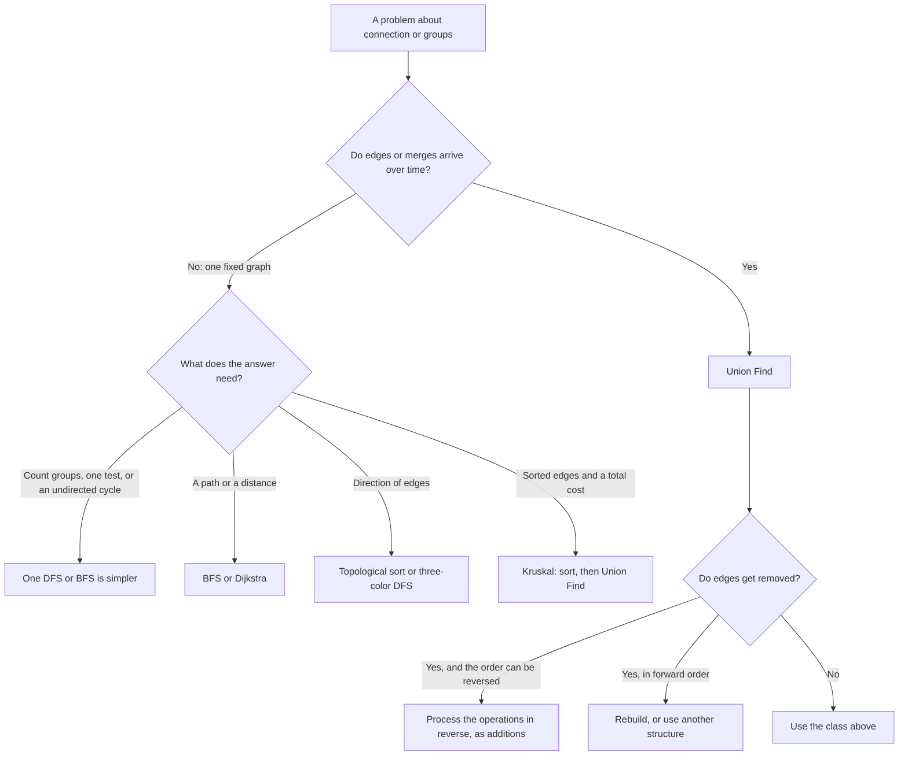

# Pattern 13: Union Find (Disjoint Set Union)

## Overview

Union Find (also called Disjoint Set Union, DSU) keeps a set of items split into groups, and it answers two questions fast: "are a and b in the same group?" and "merge the group of a with the group of b". Each group is a tree stored in one array. The root of the tree is the name of the group. With two small optimizations, one operation costs "near O(1) amortized", and that is the cost that an interviewer accepts.

After this page you can:

1. Show why "relabel the whole group on each merge" is too slow, and count its work on a worst-case sequence.
2. Rebuild the `parent` array, `find`, and `union` from a blank page, and draw the forest after each merge.
3. Build the input that makes the trees a chain, and say what a query costs on it.
4. Prove that union by size keeps the height at most log2(n), and explain what path compression changes.
5. Decide, for a new problem, whether Union Find or a graph traversal is the better tool, and name the property that decides it.
6. State three limits (no edge removal, no path or distance, no direction), each with a failing input.

## Prerequisites

| You need | Why this page needs it | Where to learn it |
|---|---|---|
| Graph, node, edge, adjacency list | The page talks about nodes joined by edges and about groups of connected nodes | [Graph Representations](../foundations/07-graph-representations.md) |
| Connected components by DFS or BFS | The page compares Union Find with one traversal for a fixed graph, and the first attempt of the Motivation is a DFS | [Pattern 11: Graph Traversal](../11-graph-traversal/README.md) |
| Arrays and indexes | A forest of trees is stored in one `int[]` | [Arrays, Strings, and Linked Lists](../foundations/02-arrays-strings-linked-lists.md) |
| Java collections: `HashMap`, `TreeSet`, `ArrayDeque`, `PriorityQueue`, sorting with a comparator | Examples 2, 3, 5 and 6 and the ladder use them to turn strings and pairs into node numbers, to sort edges, and to run the DFS and Prim versions | [Java Toolkit](../java-toolkit.md) |
| Recursion | The first form of `find` calls itself | [Recursion](../foundations/09-recursion.md) |
| Counting operations and amortized cost | The page counts steps before it states O-notation, and "amortized" is the unit of the final bound | [Complexity Analysis](../foundations/01-complexity-analysis.md) |

Five words that the page uses from the start:

- A **group** (also **component** or **set**) is a set of nodes that are connected to each other. Two groups never share a node.
- A **root** is a node whose `parent` is itself. Each group has exactly one root.
- A **forest** is a set of trees. Here, each tree is one group.
- The **depth** of a node is the number of `parent` steps from the node to its root. The **height** of a tree is the largest depth in it.
- A cost is **amortized** when it is the total cost of a whole sequence of operations divided by the number of operations. One operation can cost more than the average, as long as the others cost less.

## Motivation

### The anchor problem: cables that arrive one at a time

A network has `n` computers, numbered `0` to `n - 1`. At the start no cable exists. Cables arrive one at a time. A cable joins two computers `a` and `b`. After each cable, the program must answer two questions:

- "Can computer `a` reach computer `b`?" (Are they connected?)
- "How many separate networks exist now?"

Example: `n = 6` and the cables `(0,1)`, `(2,3)`, `(1,3)`, `(4,5)` arrive in this order. After the third cable the computers `0`, `1`, `2`, `3` form one network, so "can 0 reach 3?" is yes, and the count of networks is 3 (the network `{0,1,2,3}` and the singletons `{4}` and `{5}`). After the fourth cable the count is 2.

### First attempt: one DFS for each query

Store the cables in an adjacency list. For each query, run a DFS from `a` and check whether it reaches `b`. The answer is correct. The cost is the problem. Take `n` computers and the cables `(0,1)`, `(1,2)`, `(2,3)`, and so on, and ask "can 0 reach the newest computer?" after each cable. After cable `i`, the DFS visits `i + 1` computers and walks `i` cables. Over the `n - 1` cables the work is `3 + 5 + 7 + ... + (2n - 1)`, which is `n² - 1` (for `n = 6`: 3 + 5 + 7 + 9 + 11 = 35 = 36 - 1). For `n = 100,000` that is about 10,000,000,000 steps. The count of networks needs a DFS over the whole graph for each cable, which costs at least `n` steps each time.

The DFS forgets everything after it answers. The next query repeats most of the same walk.

### Second attempt: keep a label for each node ("quick find")

Keep an array `label`. Computers with the same label are in the same network. At the start `label[i] = i`. The query "can a reach b?" is the test `label[a] == label[b]`, and it costs one step. A merge must make the two groups share one label. The rule: every node of a's group takes the label of b's group.

```java
class QuickFind {
    final int[] label;
    long writes = 0;                          // counts the labels that a merge rewrites

    QuickFind(int n) {
        label = new int[n];
        for (int i = 0; i < n; i++) label[i] = i;
    }

    boolean connected(int a, int b) { return label[a] == label[b]; }

    void union(int a, int b) {
        int from = label[a], to = label[b];
        if (from == to) return;               // already one group
        for (int i = 0; i < label.length; i++) {
            if (label[i] == from) { label[i] = to; writes++; }
        }
    }
}
```

Trace for `n = 6` with the cables `(0,1)`, `(1,2)`, `(2,3)`, `(3,4)`, `(4,5)`, each one joining the whole group so far to a new computer. This is the worst-case sequence:

```text
start          label = [0, 1, 2, 3, 4, 5]
union(0, 1)    rewrites 1 label   -> [1, 1, 2, 3, 4, 5]
union(1, 2)    rewrites 2 labels  -> [2, 2, 2, 3, 4, 5]
union(2, 3)    rewrites 3 labels  -> [3, 3, 3, 3, 4, 5]
union(3, 4)    rewrites 4 labels  -> [4, 4, 4, 4, 4, 5]
union(4, 5)    rewrites 5 labels  -> [5, 5, 5, 5, 5, 5]
total rewrites = 1 + 2 + 3 + 4 + 5 = 15 = n(n - 1) / 2
```

The group that a merge rewrites grows by one each time, so the total is `n(n - 1) / 2`. For `n = 100,000` that is 4,999,950,000 rewrites. Each `union` also reads all `n` labels to find the members, so the loop costs `n` reads even when few labels change. A query costs 1 step. A merge costs `n` steps. A workload with `q` merges costs O(n x q).

### The exact waste

Look at the row `union(3, 4)`. Four labels change from 3 to 4. Only one fact changed: the group of 3 and the group of 4 are now one group. The code writes that one fact into every member of the group. A merge touches every member of a group, although only one fact changed.

The Derivation asks: can a merge change one entry only?

## Derivation

### Question 1: can a merge change one entry only?

Give each group one **root**, a node that stands for the group. Let every other node point to some node of its own group. The array `parent` holds the pointers: `parent[x]` is the node that `x` points to. A root points to itself. At the start every node is a root:

```text
parent = [0, 1, 2, 3, 4, 5, 6, 7]       n = 8: eight groups of one node
```

**Find.** To learn the group of `x`, follow the pointers until a node points to itself. That node is the root, and the root is the name of the group:

```text
find(x): while parent[x] != x: x = parent[x]; return x
```

**Union.** To merge the group of `a` with the group of `b`, find both roots, and make one root point to the other. This is one write:

```text
union(a, b): parent[find(a)] = find(b)
```

The query "are a and b connected?" is now `find(a) == find(b)`.

```java
class ParentForest {
    final int[] parent;

    ParentForest(int n) {
        parent = new int[n];
        for (int i = 0; i < n; i++) parent[i] = i;   // every node is its own root
    }

    int find(int x) {
        while (parent[x] != x) x = parent[x];        // walk up to the root
        return x;
    }

    void union(int a, int b) {
        parent[find(a)] = find(b);       // one write: the root of a goes under the root of b
    }
}
```

**Trace** for `n = 8` and the cables `(0,1)`, `(2,3)`, `(1,3)`, `(4,5)`, `(6,7)`, `(5,7)`, `(3,7)`. Each row changes exactly one entry of `parent`. The parentheses mark the entry that changed.

```text
start        parent = [0, 1, 2, 3, 4, 5, 6, 7]
union(0, 1)  parent = [(1), 1, 2, 3, 4, 5, 6, 7]     root 0 goes under root 1
union(2, 3)  parent = [1, 1, (3), 3, 4, 5, 6, 7]
union(1, 3)  parent = [1, (3), 3, 3, 4, 5, 6, 7]     find(1) = 1, find(3) = 3
union(4, 5)  parent = [1, 3, 3, 3, (5), 5, 6, 7]
union(6, 7)  parent = [1, 3, 3, 3, 5, 5, (7), 7]
union(5, 7)  parent = [1, 3, 3, 3, 5, (7), 7, 7]
union(3, 7)  parent = [1, 3, 3, (7), 5, 7, 7, 7]
```

The forest after the last row. Each line is a node, and the nodes below it point to it:

```text
7
├── 3
│   ├── 1
│   │   └── 0
│   └── 2
├── 5
│   └── 4
└── 6
```

Why one write is enough: every node of a's group reaches its root by following `parent`, and that root now points to the root of b's group. So all members of a's group reach the new root with no change to their own entries. A merge is now one write after two finds. The cost of a merge moved from "rewrite the group" to "walk to two roots". The next question asks how long that walk is.

### Question 2: what does a query cost now?

The cost of `find(x)` is the depth of `x`. In the forest above, `find(0)` takes 3 steps (0 to 1 to 3 to 7). The depth depends on the order of the cables. Feed the cables `(0,1)`, `(1,2)`, `(2,3)`, and so on, with `parent[find(a)] = find(b)`:

```text
union(0, 1)  parent = [1, 1, 2, 3, 4, 5, 6, 7]
union(1, 2)  parent = [1, 2, 2, 3, 4, 5, 6, 7]
...
union(6, 7)  parent = [1, 2, 3, 4, 5, 6, 7, 7]
```

```text
7
└── 6
    └── 5
        └── 4
            └── 3
                └── 2
                    └── 1
                        └── 0
```

The tree is a chain. The building is cheap, because the root of the group so far is the node `i`, the first argument of `union(i, i + 1)`, so `find(i)` returns at once, and `find(i + 1)` returns at once too. A query for node 0 walks `n - 1` steps. With `n = 1024` and 1024 queries for node 0, the walk takes 1023 x 1024 = 1,047,552 steps (the program in Implementation counts them). For `n = q = 100,000` the count is about 10,000,000,000. This is the O(n x q) of quick find again, moved from `union` to `find`.

The chain exists because the rule "the root of a goes under the root of b" ignores the size of the trees. The next question asks which root should become the child.

### Question 3: which root should become the child?

In the chain, each merge puts the big tree under a single new node, and the depth of every node in the big tree grows by one. Put the small tree under the big tree instead. Then only the nodes of the small tree get deeper. Keep an array `size`, where `size[r]` is the number of nodes in the group of root `r`. The rule: the root with the smaller size becomes the child.

```java
class SizeForest {
    final int[] parent, size;

    SizeForest(int n) {
        parent = new int[n];
        size = new int[n];
        for (int i = 0; i < n; i++) { parent[i] = i; size[i] = 1; }
    }

    int find(int x) {
        while (parent[x] != x) x = parent[x];
        return x;
    }

    void union(int a, int b) {
        int ra = find(a), rb = find(b);
        if (ra == rb) return;
        if (size[ra] < size[rb]) { int t = ra; ra = rb; rb = t; }   // ra: the larger root
        parent[rb] = ra;                  // the smaller tree goes under it
        size[ra] += size[rb];             // only roots keep a correct size
    }
}
```

The chain input `(0,1)`, `(1,2)`, ..., `(6,7)` now gives a star: `parent = [0, 0, 0, 0, 0, 0, 0, 0]`. Every node has depth 1. A tie (equal sizes) keeps the first argument's root as the parent.

**Trace** on the cables of Question 1. The parentheses mark the changed entry.

```text
start        parent = [0, 1, 2, 3, 4, 5, 6, 7]
union(0, 1)  parent = [0, (0), 2, 3, 4, 5, 6, 7]     sizes 1, 1: tie, root 0 stays
union(2, 3)  parent = [0, 0, 2, (2), 4, 5, 6, 7]
union(1, 3)  parent = [0, 0, (0), 2, 4, 5, 6, 7]     roots 0 and 2, sizes 2, 2: tie
union(4, 5)  parent = [0, 0, 0, 2, 4, (4), 6, 7]
union(6, 7)  parent = [0, 0, 0, 2, 4, 4, 6, (6)]
union(5, 7)  parent = [0, 0, 0, 2, 4, 4, (4), 6]     roots 4 and 6, sizes 2, 2: tie
union(3, 7)  parent = [0, 0, 0, 2, (0), 4, 4, 6]     roots 0 and 4, sizes 4, 4: tie
```

```text
0
├── 1
├── 2
│   └── 3
└── 4
    ├── 5
    └── 6
        └── 7
```

The height is 3 for `n = 8`, and 3 = log2(8). This input pairs equal groups at each round, and it is the worst case for union by size.

**Why the height is at most log2(n).** Take any node `x`. The depth of `x` grows by 1 in exactly one event: the root of `x`'s tree becomes the child of another root. That event happens only if the size of `x`'s group is at most the size of the other group (the smaller or equal group goes under). The merged group has size at least twice the size of `x`'s group before the merge. A group starts with size 1 (the node alone). After `d` increases of the depth of `x`, the group of `x` has at least 2^d nodes. A group has at most `n` nodes. So 2^d <= n, and `d <= log2(n)`. The argument holds for every node, so the height of every tree is at most log2(n). Path compression (Question 4) only lowers depths, so the bound stays true with it. Edge case: a union of two nodes in one group changes nothing, and the code returns before it changes `parent` or `size`. So the depth of no node grows in that call.

With the height bound, `find` costs at most log2(n) steps. For `n = 100,000`, log2(n) is about 16.6, so `find` takes at most 16 steps.

**Union by rank (the other form).** Some books keep `rank[r]`, an upper bound for the height of the tree of root `r`, in place of the size. A single node has rank 0. The rule: the root of lower rank goes under the root of higher rank. If both ranks are equal, one root goes under the other, and the rank of the new root grows by 1. Only this case raises a rank.

```java
class RankUnionFind {
    private final int[] parent, rank;

    RankUnionFind(int n) {
        parent = new int[n];
        rank = new int[n];                       // rank 0: a single node
        for (int i = 0; i < n; i++) parent[i] = i;
    }

    int find(int x) {
        while (parent[x] != x) x = parent[x];    // no compression yet: Question 4 adds it
        return x;
    }

    boolean union(int a, int b) {
        int ra = find(a), rb = find(b);
        if (ra == rb) return false;
        if (rank[ra] < rank[rb]) { int t = ra; ra = rb; rb = t; }
        parent[rb] = ra;                         // the root of lower rank goes under the other root
        if (rank[ra] == rank[rb]) rank[ra]++;    // only equal ranks raise the rank
        return true;
    }
}
```

The same argument bounds the rank. A root of rank `r` has at least 2^r nodes in its group: rank 0 has 1 node, and a root reaches rank `r + 1` only by merging two groups of rank `r` (each with at least 2^r nodes). So the rank is at most log2(n). With path compression (Question 4) the rank is only an upper bound for the height, because compression lowers the height and never changes a rank. The bound `2^rank <= group size` stays valid, because compression does not change the size of a group. This page uses the size, because the size also answers "how big is the group?".

### Question 4: the find walks the same path again and again. What can it change on the way?

Return to the chain `parent = [1, 2, 3, 4, 5, 6, 7, 7]`. The query `find(0)` walks `0, 1, 2, 3, 4, 5, 6, 7` and learns that the root is 7. Then the query `find(0)` walks the same eight nodes again. The first walk learned the root of every node on the path. The code can write it down: set `parent[x] = root` for every node `x` on the path. This is **path compression**. It does not change which nodes are in the group, so it does not change any answer. It only shortens later walks.

**Before and after** `find(0)` on the chain (a node's line shows the node below its parent):

```text
before: parent = [1, 2, 3, 4, 5, 6, 7, 7]       after: parent = [7, 7, 7, 7, 7, 7, 7, 7]

7                                               7
└── 6                                           ├── 0
    └── 5                                       ├── 1
        └── 4                                   ├── 2
            └── 3                               ├── 3
                └── 2                           ├── 4
                    └── 1                       ├── 5
                        └── 0                   └── 6
```

The first `find(0)` costs 7 steps. Every later `find` of a node on that path costs 1 step. For the chain with 1024 nodes and 1024 queries for node 0, the cost drops from 1,047,552 steps to 1023 + 1023 = 2,046: the first query walks 1023 steps, and each later query walks 1 step (the program in Implementation counts them).

**The recursive form.** Let `find(x)` call `find(parent[x])`, and let the result become the new `parent[x]`:

```java
int[] parent;   // the array of the forest

int find(int x) {
    if (parent[x] != x) parent[x] = find(parent[x]);   // the root comes back up the path
    return parent[x];
}
```

The base case is a root: `parent[x] == x`, and the call returns without a write. On the way back up, each call sets `parent[x]` to the root that its child call returned. The recursion goes as deep as the node. With union by size the depth is at most log2(n), so the recursion is safe. With path compression alone, a chain of 100,000 nodes makes the recursion 100,000 calls deep. On one machine (JDK 21.0.7, macOS, default stack size) a chain of 20,000 nodes ran, and chains of 50,000 and 100,000 nodes threw `StackOverflowError`. The failing depth depends on the stack size and the frame size, so treat these numbers as one measurement. See [Recursion](../foundations/09-recursion.md) for the call stack, and Common Mistakes below.

**The iterative forms.** Two forms need no recursion.

```java
int[] parent;   // the array of the forest

// Two passes: find the root, then repoint every node on the path.
int findTwoPass(int x) {
    int root = x;
    while (parent[root] != root) root = parent[root];       // pass 1: walk up
    while (parent[x] != root && x != root) {                // pass 2: walk up again, and repoint
        int next = parent[x];
        parent[x] = root;
        x = next;
    }
    return root;
}

// Path halving: each visited node jumps over its parent. One pass.
int findHalving(int x) {
    while (parent[x] != x) {
        parent[x] = parent[parent[x]];                      // point x at its grandparent
        x = parent[x];                                      // continue from the grandparent
    }
    return x;
}
```

On the chain `[1, 2, 3, 4, 5, 6, 7, 7]`, `findTwoPass(0)` gives `[7, 7, 7, 7, 7, 7, 7, 7]`, the same as the recursive form. `findHalving(0)` walks 4 steps and gives `[2, 2, 4, 4, 6, 6, 7, 7]`: each node that the walk visits (0, 2, 4, 6) now points to its grandparent, so the path from node 0 is half as long, and the next `find` halves it again. All three forms give the same answers.

**The combined cost.** Union by size bounds the height at log2(n). Path compression shortens the paths that queries use. Together, a sequence of `m` operations on `n` nodes costs O(m x alpha(n)), where alpha is the **inverse Ackermann function**. The Ackermann function grows faster than every primitive recursive function. Its inverse alpha grows more slowly than log(n). In the definition of Cormen, Leiserson, Rivest and Stein, alpha(n) is 4 or less for every `n` up to 2^2048 (about 10^616), which is far above any input that a program can store. So alpha(n) is at most 4 for every practical input size. It is not a constant: it still grows without bound. R. Tarjan proved the bound in 1975 (see Further Reading). Tarjan states it with a function alpha(m, n) of two arguments, and the one-argument form is its simplification. This page does not prove it.

What an interviewer accepts: "near O(1) amortized, O(alpha(n)) per operation, where alpha is the inverse Ackermann function and alpha(n) is at most 4 for every practical input size". Amortized (defined above) means that one operation can cost more, and the average over the whole sequence is the stated bound.

### Check the cost before you trust it

The program in Implementation builds the chain input and the pairs input for `n = 1024`, then runs 1024 queries for the deepest node. The numbers are steps of `find` (edges walked up):

| Input | Parent only | Size only | Compression only | Size and compression |
|---|---|---|---|---|
| Chain, 1024 queries for node 0 | 1,047,552 | 1,024 | 2,046 | 1,024 |
| Pairs (height 10), 1024 queries for the deepest node | 10,240 | 10,240 | 1,033 | 1,033 |

Size alone fixes the chain. Compression alone fixes repeated queries on a deep node. The pairs input shows that size alone still pays the height (10) on every repeated query, and that compression removes it.

## The Pattern

Union Find keeps a forest in an array `parent`. A group is a tree, and the root names the group. `find` walks to the root and flattens the path. `union` finds both roots, and it puts the root of the smaller tree under the other root. Two nodes are in one group exactly when `find` returns the same root for both.

**The invariant.** After every operation:

1. `find(a) == find(b)` exactly when `a` and `b` are in one group.
2. Each root is its own parent, and every other node reaches exactly one root by following `parent`. No cycle exists in `parent` except the self-pointer of a root.
3. `size[root]` equals the number of nodes in the group of `root`. The value `size[x]` for a node `x` that is not a root is stale, and no code may read it.

`union` keeps the invariant: it changes `parent` of one root only, so the two old groups become one tree, and every other group is unchanged. It adds the two sizes in the same step. `find` keeps it: path compression changes `parent[x]` to a node of the same group (the root), so the groups stay the same.

```java
class UnionFind {
    private final int[] parent;
    private final int[] size;                 // correct for roots only
    private int components;

    UnionFind(int n) {
        parent = new int[n];
        size = new int[n];
        for (int i = 0; i < n; i++) {
            parent[i] = i;                    // every node starts as its own root
            size[i] = 1;
        }
        components = n;
    }

    int find(int x) {
        if (parent[x] != x) parent[x] = find(parent[x]);   // point x straight at the root
        return parent[x];
    }

    boolean union(int a, int b) {
        int ra = find(a), rb = find(b);
        if (ra == rb) return false;                         // already one group: no merge
        if (size[ra] < size[rb]) { int t = ra; ra = rb; rb = t; }
        parent[rb] = ra;                         // the smaller group goes under the larger
        size[ra] += size[rb];
        components--;                            // only a real merge lowers the count
        return true;
    }

    boolean connected(int a, int b) { return find(a) == find(b); }

    int componentSize(int x) { return size[find(x)]; }

    int components() { return components; }
}
```

The method `union` returns `true` when it merged two groups, and `false` when both nodes were already in one group. That return value is what most problems use: a `false` means "this edge closes a cycle" or "this edge is not needed".

Two loops that use the class are the standard first uses. The Worked Examples explain them in problems.

```java
// The number of groups after all edges (LC 323 premium, LC 1319, LC 547 as edge list).
static int countComponents(int n, int[][] edges) {
    UnionFind uf = new UnionFind(n);
    for (int[] e : edges) uf.union(e[0], e[1]);
    return uf.components();
}

// Does an undirected graph have a cycle? (LC 684 returns the edge; LC 261 premium)
static boolean hasCycle(int n, int[][] edges) {
    UnionFind uf = new UnionFind(n);
    for (int[] e : edges) {
        if (!uf.union(e[0], e[1])) return true;   // the endpoints were already connected
    }
    return false;
}
```

The later blocks call the `UnionFind` class above and do not repeat it. The runner compiles them with a copy of this class on its class path. The program in Implementation contains the class and runs it.

### The vocabulary

| Term | What it was in the examples | The question to ask in a new problem |
|---|---|---|
| Group (component) | A network of connected computers | "What are the items, and what does 'together' mean?" |
| Root | The node with `parent[x] == x`, the name of a group | "Which node names the group?" |
| `find` | Walk up to the root | "Do I need the group of one item?" |
| `union` | Put one root under the other | "Which fact merges two groups?" |
| Union by size | The smaller tree goes under the larger | "Is the height bounded?" (yes: at most log2(n)) |
| Path compression | Set `parent[x] = root` on the walk | "Do many queries repeat the same path?" |
| Component count | `n` minus the number of real merges | "Do I need the number of groups?" |
| Amortized cost | The cost averaged over the whole sequence | "What is the cost of `m` operations in total?" |

### The variants and what selects each

| Variant | What it adds | The property of the problem that selects it | Example on this page |
|---|---|---|---|
| Count of components | A counter that falls by 1 on each real merge | The answer is "how many groups" | [LC 547](https://leetcode.com/problems/number-of-provinces/), [LC 1319](https://leetcode.com/problems/number-of-operations-to-make-network-connected/) |
| Size of each component | `size[]` (already in the class) and `componentSize` | The answer is the largest or smallest group, or a group size appears in a rule | [LC 952](https://leetcode.com/problems/largest-component-size-by-common-factor/) |
| Map from a key to an index | A `Map<String, Integer>` (or a pair encoded as one int) that gives each key its node number | The items are strings, emails, letters, or coordinate pairs, not `0..n-1` | [LC 721](https://leetcode.com/problems/accounts-merge/), [LC 947](https://leetcode.com/problems/most-stones-removed-with-same-row-or-column/) |
| Virtual node | One extra node that stands for "the roof", "the border", or "the outside" | Many nodes share one property, and one test "connected to the property" is needed | "The limits" part of the Recognition Guide, outline of [LC 803](https://leetcode.com/problems/bricks-falling-when-hit/) |
| Weighted Union Find | A number on each `parent` pointer: a ratio or an offset to the parent | The merge carries a relation between two items, such as `a / b = 2` | [LC 399](https://leetcode.com/problems/evaluate-division/) |
| Offline queries in sorted order | Sort the edges (or the cells) and the queries by one number, then merge in that order | Each query asks "connected using only edges up to limit L", and all queries are known before the first answer (an **offline** algorithm) | [LC 778](https://leetcode.com/problems/swim-in-rising-water/), [LC 1697](https://leetcode.com/problems/checking-existence-of-edge-length-limited-paths/) |



## Worked Examples

The seven examples go from the plainest use to the hardest. Each one changes one thing about the anchor problem. Every Java block that calls `UnionFind` uses the class from The Pattern. Example 6 defines its own class `RatioUnionFind`.

### Example 1: Redundant Connection (LC 684)

**Statement.** A graph has nodes `1` to `n` and `n` edges, given in the order that they were added. Without the extra edge the graph is a tree (connected, no cycle). Find the edge to remove so that a tree remains. If several answers exist, return the one that comes last in the input. For `[[1,2],[2,3],[3,4],[1,4],[1,5]]` the answer is `[1,4]`.

**What changed.** The anchor problem asked for a count. Here the answer is the first edge whose `union` returns `false`.

**Reasoning.** Add the edges in the input order. Before an edge `(u, v)`, the edges added so far form a forest (no cycle). If `find(u) == find(v)` at that moment, a path from `u` to `v` already exists in the forest. The new edge closes a cycle with that path. If `find(u) != find(v)`, no path exists, and the edge cannot close a cycle.

Why this edge is the answer that the problem wants: the whole graph has exactly one cycle (a tree plus one edge). Any edge set that misses an edge of that cycle has no cycle. So the first edge that closes a cycle is the edge where the input first holds all edges of the cycle. It is the last edge of the cycle in input order, and removing it leaves a tree.

**Trace** with `UnionFind(6)` (node `0` is unused). The parentheses mark the changed entry.

```text
edge [1,2]  roots 1, 2 differ    union   parent = [0, 1, (1), 3, 4, 5]
edge [2,3]  roots 1, 3 differ    union   parent = [0, 1, 1, (1), 4, 5]
edge [3,4]  roots 1, 4 differ    union   parent = [0, 1, 1, 1, (1), 5]
edge [1,4]  roots 1, 1 equal     union returns false -> answer [1,4]
```

```java
static int[] findRedundantConnection(int[][] edges) {
    UnionFind uf = new UnionFind(edges.length + 1);   // nodes are numbered 1..n, so allocate n + 1
    for (int[] e : edges) {
        if (!uf.union(e[0], e[1])) return e;          // the endpoints are already connected
    }
    return new int[0];                                // the problem guarantees one extra edge
}
```

**Complexity.** Time O(n x alpha(n)) for `n` edges, and space O(n). A DFS version runs one DFS for each new edge, which is O(n²).

### Example 2: Number of Provinces (LC 547), both ways

**Statement.** `n` cities. A matrix `isConnected` has `isConnected[i][j] == 1` when city `i` and city `j` have a direct link (links work in both directions). A province is a group of cities that connect directly or through other cities. Count the provinces. For `[[1,1,0,0],[1,1,0,0],[0,0,1,1],[0,0,1,1]]` the answer is 2.

**What changed.** The graph is fixed and known before any question. This is the case where the Motivation's DFS is not too slow.

**Union Find.** Start with `n` groups. For each pair `(i, j)` with a link, call `union`. The answer is the component count.

```java
static int findCircleNumUnionFind(int[][] isConnected) {
    int n = isConnected.length;
    UnionFind uf = new UnionFind(n);
    for (int i = 0; i < n; i++) {
        for (int j = i + 1; j < n; j++) {                 // the matrix is symmetric: read one half
            if (isConnected[i][j] == 1) uf.union(i, j);
        }
    }
    return uf.components();
}
```

**DFS.** Visit each city once. When a city is not yet marked, a new province starts: add 1, and mark the whole province.

```java
static int findCircleNumDfs(int[][] isConnected) {
    int n = isConnected.length;
    boolean[] seen = new boolean[n];
    int provinces = 0;
    for (int start = 0; start < n; start++) {
        if (seen[start]) continue;
        provinces++;                                      // a new province starts here
        Deque<Integer> stack = new ArrayDeque<>();
        stack.push(start);
        seen[start] = true;
        while (!stack.isEmpty()) {
            int city = stack.pop();
            for (int next = 0; next < n; next++) {
                if (isConnected[city][next] == 1 && !seen[next]) {
                    seen[next] = true;
                    stack.push(next);
                }
            }
        }
    }
    return provinces;
}
```

**Trace** of the Union Find version on the example: `union(0,1)` merges (3 groups), `union(2,3)` merges (2 groups), and no other pair has a link. The answer is 2.

**An honest comparison.** Both versions read the whole matrix, which is O(n²) work. Union Find adds an alpha(n) factor to each link, so the total is O(n² x alpha(n)). The DFS is O(n²). The two are in the same complexity class for a fixed graph. The DFS needs no class and no proof of an optimization. For a fixed graph, the DFS is the simpler answer, and an interviewer expects it. Union Find wins when the links arrive over time and a question follows some of them (Example 4). [Pattern 11](../11-graph-traversal/README.md) solves this problem with a DFS in full.

### Example 3: Accounts Merge (LC 721)

**Statement.** Each account is a list: a name, then emails. Two accounts belong to one person if they share at least one email. Two accounts can have the same name and still belong to different people. Merge the accounts of each person. Each result lists the name, then the sorted distinct emails.

For `[["Ann","x@m","y@m"],["Bob","z@m"],["Ann","y@m","w@m"],["Ann","v@m"]]` the result has three accounts: `["Bob","z@m"]`, `["Ann","w@m","x@m","y@m"]`, and `["Ann","v@m"]` (the order of the accounts is free).

**What changed.** The items to group are the accounts (numbered `0..k-1`), but the fact that joins two accounts is a shared email, which is a string. A map from email to account index turns each string into a node number. Then the groups must be collected at the end.

**Reasoning.** Go through the accounts. For each email, ask the map: which account listed this email first? If the answer is account `f`, accounts `i` and `f` share the email, so `union(i, f)`. If no account listed it, record `i` as its owner. After all accounts, each group of accounts is one person. To build the output, put each email into the sorted set of the root of its owner's group.

**Trace** with the accounts above (indexes 0 to 3):

```text
account 0: x@m -> owner 0, y@m -> owner 0
account 1: z@m -> owner 1
account 2: y@m -> owner is 0, so union(2, 0)   groups: {0,2}, {1}, {3}
                                              (a tie: root 2 stays, root 0 goes under it)
           w@m -> owner 2
account 3: v@m -> owner 3
group of root 2: x@m, y@m, w@m  -> sorted [w@m, x@m, y@m], name Ann
group of root 1: z@m            -> [z@m], name Bob
group of root 3: v@m            -> [v@m], name Ann
```

```java
static List<List<String>> accountsMerge(List<List<String>> accounts) {
    UnionFind uf = new UnionFind(accounts.size());
    Map<String, Integer> owner = new HashMap<>();         // email -> first account that lists it
    for (int i = 0; i < accounts.size(); i++) {
        List<String> account = accounts.get(i);
        for (int j = 1; j < account.size(); j++) {        // index 0 holds the name
            Integer first = owner.putIfAbsent(account.get(j), i);
            if (first != null) uf.union(i, first);        // a shared email joins two accounts
        }
    }
    Map<Integer, TreeSet<String>> emailsOfRoot = new HashMap<>();
    for (Map.Entry<String, Integer> entry : owner.entrySet()) {
        emailsOfRoot.computeIfAbsent(uf.find(entry.getValue()), k -> new TreeSet<>())
                .add(entry.getKey());
    }
    List<List<String>> merged = new ArrayList<>();
    for (Map.Entry<Integer, TreeSet<String>> group : emailsOfRoot.entrySet()) {
        List<String> row = new ArrayList<>();
        row.add(accounts.get(group.getKey()).get(0));     // the name of any account in the group
        row.addAll(group.getValue());                     // the TreeSet keeps the emails sorted
        merged.add(row);
    }
    return merged;
}
```

**Complexity.** Let `E` be the number of emails and `L` the longest email. The map and the unions cost O(E x L + E x alpha(k)). Sorting the emails costs O(E x L x log E) in the worst case. Space O(E x L).

### Example 4: Number of Islands II (LC 305, premium)

**Statement.** An `rows x cols` grid starts as water. A list of positions arrives. Each position turns one water cell into land. After each position, report the number of islands (groups of land cells that touch on a side). For a 3 x 3 grid and the positions `(0,0)`, `(0,1)`, `(2,2)`, `(1,2)`, `(1,1)` the answers are `[1, 1, 2, 2, 1]`.

**What changed.** The edges arrive over time, and the answer is wanted after each one. This is the anchor problem again. A DFS or BFS over the grid after each position costs O(rows x cols) for each of the `q` positions, so O(q x rows x cols) in total. Union Find costs O(alpha) for each position and its four neighbors.

**Reasoning.** Keep a count `islands`. A new land cell is a new island, so add 1. Then, for each of the four neighbors that is land, call `union`. Each `union` that returns `true` joined two different islands into one, so subtract 1. A repeated position changes nothing.

**Trace** on the 3 x 3 grid:

```text
add (0,0)  no land neighbor                       islands = 0 + 1 = 1
add (0,1)  neighbor (0,0): union true             islands = 1 + 1 - 1 = 1
add (2,2)  no land neighbor                       islands = 1 + 1 = 2
add (1,2)  neighbor (2,2): union true             islands = 2 + 1 - 1 = 2
add (1,1)  new cell                               islands = 2 + 1 = 3
           neighbor (0,1): union true             islands = 2
           neighbor (1,2): union true             islands = 1
```

```java
static List<Integer> numIslands2(int rows, int cols, int[][] positions) {
    UnionFind uf = new UnionFind(rows * cols);            // cell (r, c) has the index r * cols + c
    boolean[] land = new boolean[rows * cols];
    int[][] steps = {{1, 0}, {-1, 0}, {0, 1}, {0, -1}};
    int islands = 0;
    List<Integer> counts = new ArrayList<>();
    for (int[] p : positions) {
        int id = p[0] * cols + p[1];
        if (!land[id]) {                                  // a repeated position changes nothing
            land[id] = true;
            islands++;                                    // the new cell is an island of its own
            for (int[] s : steps) {
                int r = p[0] + s[0], c = p[1] + s[1];
                if (r < 0 || r >= rows || c < 0 || c >= cols) continue;
                if (!land[r * cols + c]) continue;
                if (uf.union(id, r * cols + c)) islands--;   // two islands became one
            }
        }
        counts.add(islands);
    }
    return counts;
}
```

The count comes from `islands`, not from `uf.components()`, because the class counts every cell as a group, including water.

**Complexity.** Time O(q x alpha(rows x cols)) after the O(rows x cols) setup, and space O(rows x cols).

**The fixed grid, [LC 200](https://leetcode.com/problems/number-of-islands/), with Union Find.** The old version of this page used Union Find for the fixed grid too. It works: count the land cells, and subtract 1 for each `union` that returns `true`.

```java
static int numIslandsUnionFind(char[][] grid) {
    int rows = grid.length, cols = grid[0].length;
    UnionFind uf = new UnionFind(rows * cols);
    int land = 0, merges = 0;
    for (int r = 0; r < rows; r++) {
        for (int c = 0; c < cols; c++) {
            if (grid[r][c] != '1') continue;
            land++;
            int id = r * cols + c;
            if (r + 1 < rows && grid[r + 1][c] == '1' && uf.union(id, id + cols)) merges++;
            if (c + 1 < cols && grid[r][c + 1] == '1' && uf.union(id, id + 1)) merges++;
        }
    }
    return land - merges;                                 // one island for each group of land cells
}
```

Here the grid is fixed, so one DFS from each unmarked land cell does the same in O(rows x cols) with less code. The code checks only the right and the lower neighbor, because the cell to the left and above were handled when the loop visited them. Use Union Find for [LC 200](https://leetcode.com/problems/number-of-islands/) only to show that you know the method.

### Example 5: Kruskal's algorithm for a minimum spanning tree (LC 1584) { #application-5-kruskals-mst }

**Statement.** Points in the plane. The cost to connect two points is the Manhattan distance `|x1 - x2| + |y1 - y2|`. Find the minimum total cost so that all points are connected (directly or through other points). For the points `(0,0)`, `(2,2)`, `(3,10)`, `(5,2)` the answer is 16. A set of edges that connects all nodes with the minimum total weight is a **minimum spanning tree (MST)**. The theory of MSTs (the cut property, Prim, and proofs) is in [Pattern 24: Advanced Graphs](../24-advanced-graphs/README.md). [LC 1135: Connecting Cities With Minimum Cost](https://leetcode.com/problems/connecting-cities-with-minimum-cost/) (premium) has the same shape with an edge list as input.

**What changed.** The edges have weights and exist from the start. The order of the merges now matters: the cheapest edges first.

**Reasoning.** Sort all edges by weight, lightest first. Go through them. For each edge, ask `union`. If it returns `true`, the edge joins two different components: keep it and add its weight. If it returns `false`, both endpoints are already connected through lighter (or equal) edges that the code kept: skip the edge. Stop when `n - 1` edges are kept, because a tree on `n` nodes has `n - 1` edges.

Why this is correct. Call a set of edges *safe* if some minimum spanning tree contains all of them. The empty set is safe. The claim: if the kept edges are safe, then the next kept edge keeps them safe, and a skipped edge is never needed. Let `T` be a minimum spanning tree that contains all kept edges, and let `e = (u, v)` with weight `w` be the next edge in sorted order.

- **`union` returns `false` (skip).** The kept edges already connect `u` and `v`. All kept edges are in `T`, and `T` has no cycle, so `T` does not contain `e` (it would close a cycle with the kept path). So skipping `e` loses nothing.
- **`union` returns `true` (keep).** Let `C` be the component of `u` among the kept edges. The edge `e` leaves `C`, because `v` is outside `C`. If `T` contains `e`, the kept edges stay safe. If not, add `e` to `T`: this closes a cycle, and the cycle must cross out of `C` through a second edge `f`. The edge `f` is not a kept edge (kept edges stay inside components, so none leaves `C`). Every edge that is lighter than `e` was processed before `e`, and if it had left `C` it would have been kept, and then it would lie inside `C`. So `f` has weight at least `w`. The tree `T - f + e` has weight at most the weight of `T`, so it is a minimum spanning tree, and it contains the kept edges and `e`. They stay safe.

In short: the cheapest edge that leaves a component is safe (the cut property), and an edge inside a component closes a cycle. The theory is in [Pattern 24](../24-advanced-graphs/README.md). When `n - 1` edges are kept, the tree spans all nodes, and every later edge would be skipped, so the loop stops.

**Trace** on the four points. The six edges, sorted by weight:

```text
edge   weight  union result          kept total
(1,3)    3     true  {1,3}             3
(0,1)    4     true  {0,1,3}           7
(0,3)    7     false (0 and 3 in one component)   7
(1,2)    9     true  {0,1,2,3}        16   <- 3 edges kept: stop
(2,3)   10     not reached
(0,2)   13     not reached
```

```java
static int minCostConnectPoints(int[][] points) {
    int n = points.length;
    List<int[]> edges = new ArrayList<>();                // {weight, u, v}
    for (int i = 0; i < n; i++) {
        for (int j = i + 1; j < n; j++) {
            int w = Math.abs(points[i][0] - points[j][0])
                    + Math.abs(points[i][1] - points[j][1]);
            edges.add(new int[]{w, i, j});
        }
    }
    edges.sort((x, y) -> Integer.compare(x[0], y[0]));    // compare, not subtract: no overflow
    UnionFind uf = new UnionFind(n);
    int total = 0, used = 0;
    for (int[] e : edges) {
        if (uf.union(e[1], e[2])) {                       // the endpoints were apart
            total += e[0];
            if (++used == n - 1) break;                   // a spanning tree has n - 1 edges
        }
    }
    return total;                                         // one point: no edge, total 0
}
```

**Complexity.** The graph is complete, so it has `E = n(n - 1) / 2` edges. The sort costs O(E log E) = O(n² log n). The unions cost O(E x alpha(n)). Space O(n²) for the edge list.

**Prim, the other algorithm.** Prim grows one tree from node 0. Each round adds the node with the cheapest edge to the tree. On a complete graph, the array version needs no edge list and no sort: O(n²) time and O(n) space. It does not use Union Find.

```java
static int minCostConnectPointsPrim(int[][] points) {
    int n = points.length;
    int[] cheapest = new int[n];                          // cheapest edge from the tree
    Arrays.fill(cheapest, Integer.MAX_VALUE);
    boolean[] inTree = new boolean[n];
    cheapest[0] = 0;
    int total = 0;
    for (int round = 0; round < n; round++) {
        int u = -1;
        for (int i = 0; i < n; i++) {
            if (!inTree[i] && (u == -1 || cheapest[i] < cheapest[u])) u = i;
        }
        inTree[u] = true;
        total += cheapest[u];
        for (int v = 0; v < n; v++) {
            if (inTree[v]) continue;
            int w = Math.abs(points[u][0] - points[v][0]) + Math.abs(points[u][1] - points[v][1]);
            cheapest[v] = Math.min(cheapest[v], w);
        }
    }
    return total;
}
```

For a sparse graph (an adjacency list with few edges), use a heap. A heap entry is `{edge weight, node}`. The loop skips a stale entry: the node joined the tree through a cheaper edge before the entry came out.

```java
// graph.get(u) holds {v, weight} for each edge at u. Returns -1 if the graph is not connected.
static int primHeap(int n, List<List<int[]>> graph) {
    boolean[] inTree = new boolean[n];
    PriorityQueue<int[]> heap = new PriorityQueue<>((x, y) -> Integer.compare(x[0], y[0]));
    heap.add(new int[]{0, 0});                            // start at node 0 with weight 0
    int total = 0, added = 0;
    while (!heap.isEmpty() && added < n) {
        int[] top = heap.poll();
        int u = top[1];
        if (inTree[u]) continue;                          // stale entry
        inTree[u] = true;
        total += top[0];
        added++;
        for (int[] edge : graph.get(u)) {
            if (!inTree[edge[0]]) heap.add(new int[]{edge[1], edge[0]});
        }
    }
    return added == n ? total : -1;
}
```

Time O(E log V). Choose Kruskal when the input is an edge list or the graph is sparse and the sort is cheap. Choose the array Prim for a complete graph given as points.

### Example 6: Evaluate Division (LC 399), a weighted Union Find

**Statement.** Equations like `a / b = 2.0` and `b / c = 3.0` are given. Each query asks for a ratio such as `a / c`. Answer each query, or `-1.0` if the equations do not determine it (a variable that is unknown, or two variables that no chain of equations joins). For the equations above, `a / c = 6.0`, `c / a = 0.16667`, `a / e = -1.0` (`e` is unknown), `a / a = 1.0`, and `x / x = -1.0` (`x` is unknown).

**What changed.** A merge now carries a number. The groups are the same as before (variables joined by equations), but each node must remember its ratio to its parent.

**Reasoning.** Store `ratio[x] = value(x) / value(parent[x])`. A root has ratio 1. To find `value(x) / value(root)`, multiply the ratios along the path to the root. Path compression must keep this true: when `x` jumps to the root, its new ratio is the product of the old ratios on the path. The recursive `find` does this: after the recursive call, `ratio[p]` is already `value(p) / value(root)`, and `value(x) / value(root) = ratio[x] x ratio[p]`.

For `union(a, b, v)` with the equation `a / b = v`: let `ra` and `rb` be the roots. By the definition of the ratios, `value(a) = ratio[a] x value(ra)` and `value(b) = ratio[b] x value(rb)`. So `value(ra) / value(rb) = (value(a) / ratio[a]) / (value(b) / ratio[b]) = v x ratio[b] / ratio[a]`. The root that goes under the other root gets this ratio, or its inverse when the roles swap.

The block below holds the class and the method that turns variable names into node numbers. Both are members of one outer class, as on the LeetCode site.

```java
static class RatioUnionFind {
    private final int[] parent;
    private final int[] size;
    private final double[] ratio;     // ratio[x] = value(x) / value(parent[x])

    RatioUnionFind(int n) {
        parent = new int[n];
        size = new int[n];
        ratio = new double[n];
        for (int i = 0; i < n; i++) { parent[i] = i; size[i] = 1; ratio[i] = 1.0; }
    }

    int find(int x) {
        if (parent[x] == x) return x;
        int p = parent[x];
        int root = find(p);        // after this call, ratio[p] = value(p) / value(root)
        ratio[x] *= ratio[p];      // now ratio[x] = value(x) / value(root)
        parent[x] = root;
        return root;
    }

    void union(int a, int b, double value) {      // the equation a / b = value
        int ra = find(a), rb = find(b);
        if (ra == rb) return;
        double rootRatio = value * ratio[b] / ratio[a];   // value(ra) / value(rb)
        if (size[ra] < size[rb]) {
            parent[ra] = rb;
            ratio[ra] = rootRatio;
            size[rb] += size[ra];
        } else {
            parent[rb] = ra;
            ratio[rb] = 1.0 / rootRatio;                  // value(rb) / value(ra)
            size[ra] += size[rb];
        }
    }

    double divide(int a, int b) {                 // a / b, or -1.0 when no chain joins them
        if (find(a) != find(b)) return -1.0;
        return ratio[a] / ratio[b];               // (a / root) / (b / root)
    }
}

static double[] calcEquation(List<List<String>> equations, double[] values,
                             List<List<String>> queries) {
    Map<String, Integer> id = new HashMap<>();            // variable name -> node index
    for (List<String> pair : equations) {
        for (String name : pair) id.putIfAbsent(name, id.size());
    }
    RatioUnionFind uf = new RatioUnionFind(id.size());
    for (int i = 0; i < equations.size(); i++) {
        List<String> eq = equations.get(i);
        uf.union(id.get(eq.get(0)), id.get(eq.get(1)), values[i]);
    }
    double[] answers = new double[queries.size()];
    for (int i = 0; i < queries.size(); i++) {
        Integer a = id.get(queries.get(i).get(0)), b = id.get(queries.get(i).get(1));
        answers[i] = (a == null || b == null) ? -1.0 : uf.divide(a, b);
    }
    return answers;
}
```

**Trace** with `a = 0`, `b = 1`, `c = 2`:

```text
union(0, 1, 2.0): roots 0 and 1, sizes 1, 1. Root 1 goes under root 0.
                  rootRatio = 2.0 x 1 / 1 = 2.0, so ratio[1] = 1 / 2.0 = 0.5     (b / a)
union(1, 2, 3.0): find(1) = 0, find(2) = 2. rootRatio = 3.0 x ratio[2] / ratio[1]
                  = 3.0 x 1 / 0.5 = 6.0 = value(a) / value(c). Root 2 goes under root 0.
                  ratio[2] = 1 / 6.0 = 0.1667                                     (c / a)
divide(a, c) = ratio[0] / ratio[2] = 1 / 0.1667 = 6.0
divide(c, a) = ratio[2] / ratio[0] = 0.1667
```

**A trace through a compression.** The trace above never walks two edges, so `find` does no multiplication. Take `a, b, c, d = 0, 1, 2, 3` and the equations `a / b = 2.0`, `c / d = 4.0`, `b / c = 3.0`. The program that checks this page printed the arrays below.

```text
union(0, 1, 2.0)  root 1 under root 0, ratio[1] = 0.5 (b / a)
                  parent = [0, 0, 2, 3]   ratio = [1, 0.5, 1, 1]
union(2, 3, 4.0)  root 3 under root 2, ratio[3] = 0.25 (d / c)
                  parent = [0, 0, 2, 2]   ratio = [1, 0.5, 1, 0.25]
union(1, 2, 3.0)  roots 0 and 2, sizes 2, 2: tie, root 2 goes under root 0
                  rootRatio = 3.0 x ratio[2] / ratio[1] = 3.0 x 1 / 0.5 = 6.0 (a / c)
                  ratio[2] = 1 / 6.0 = 0.1667 (c / a)
                  parent = [0, 0, 0, 2]   ratio = [1, 0.5, 0.1667, 0.25]
```

Node 3 is now two edges below the root (3 to 2 to 0). Query `divide(3, 0)`, which is `d / a`:

```text
find(3): parent[3] = 2, so p = 2, and the call find(2) runs first
  find(2): parent[2] = 0, so p = 0, and find(0) returns 0 (a root)
           ratio[2] *= ratio[0]  -> 0.1667 x 1 = 0.1667   (c / a, unchanged)
           parent[2] = 0, return 0
  back in find(3): ratio[3] *= ratio[2]  -> 0.25 x 0.1667 = 0.041667   (d / a)
                   parent[3] = 0, return 0
divide(3, 0) = ratio[3] / ratio[0] = 0.041667 / 1 = 1/24
```

The check: `a / d = (a / b)(b / c)(c / d) = 2 x 3 x 4 = 24`, so `d / a = 1/24`. The compression turned the two ratios on the path (`d / c` and `c / a`) into one ratio (`d / a`) and pointed node 3 at the root.

**Complexity.** Time O((e + q) x alpha) for `e` equations and `q` queries, and space O(e). A DFS over a graph with edge weights `v` and `1 / v` answers one query in O(e), so it costs O(q x e) in total.

The same two-phase shape with no numbers is [LC 990: Satisfiability of Equality Equations](https://leetcode.com/problems/satisfiability-of-equality-equations/) (a problem of the practice ladder): first merge all `==` pairs, then test all `!=` pairs.

### Example 7: Swim in Rising Water (LC 778), edges added in sorted order

**Statement.** An `n x n` grid holds an elevation in each cell. At time `t` the water level is `t`, and you can step to a neighbor (up, down, left, right) only if both cells have elevation at most `t`. You start at the top-left cell at time 0. Find the least `t` at which you can reach the bottom-right cell. For the grid `[[0,1,6],[7,2,3],[8,5,4]]` the answer is 4.

**What changed.** No edge list exists. The "edges" are the steps between neighbor cells, and each step has a time: the larger elevation of its two cells. The answer is the smallest time at which two fixed nodes become connected. This asks for the first moment of a connection, so process the cells in time order and merge.

**Reasoning.** Sort the cells by elevation, lowest first. Open the cells one at a time (the water rises to that elevation). When a cell opens, merge it with each neighbor that is already open. After each opening, ask `connected(top-left, bottom-right)`. The first time the answer is yes, the elevation of the cell that just opened is the answer: the open cells are exactly the cells with elevation at most that value, and no smaller level connected the two corners.

**Trace** on `[[0,1,6],[7,2,3],[8,5,4]]`. Cells are numbered `0..8` row by row; the top-left is cell 0, and the bottom-right is cell 8.

```text
open elevation 0  cell (0,0)             no open neighbor
open elevation 1  cell (0,1)             union with (0,0)
open elevation 2  cell (1,1)             union with (0,1)
open elevation 3  cell (1,2)             union with (1,1)
open elevation 4  cell (2,2)             union with (1,2)
                  connected(cell 0, cell 8) is true -> answer 4
```

```java
static int swimInWater(int[][] grid) {
    int n = grid.length;
    Integer[] order = new Integer[n * n];                 // cell ids, lowest elevation first
    for (int i = 0; i < n * n; i++) order[i] = i;
    Arrays.sort(order, (x, y) -> Integer.compare(grid[x / n][x % n], grid[y / n][y % n]));
    boolean[] open = new boolean[n * n];
    UnionFind uf = new UnionFind(n * n);
    int[][] steps = {{1, 0}, {-1, 0}, {0, 1}, {0, -1}};
    for (int id : order) {
        open[id] = true;                                  // the water level reaches this cell
        for (int[] s : steps) {
            int r = id / n + s[0], c = id % n + s[1];
            if (r >= 0 && r < n && c >= 0 && c < n && open[r * n + c]) uf.union(id, r * n + c);
        }
        if (uf.connected(0, n * n - 1)) return grid[id / n][id % n];
    }
    return -1;                                            // not reached: the corners always connect
}
```

**Complexity.** The sort costs O(n² log n) (about `N log N` for `N = n²` cells), and the unions cost O(N x alpha(N)). Space O(N).

**Comparison with the other two solutions.**

| Method | Idea | Time | When it is better |
|---|---|---|---|
| Union Find in sorted order | Open cells by elevation, stop at the first connection | O(N log N) for the sort | The input has no structure to exploit. The same code answers many "when does a connect to b?" questions |
| Binary search on the answer plus BFS | Guess `t`, run a BFS that uses only cells with elevation at most `t` | O(N log(max elevation)) | The answer range is small, and a BFS is already written. See [Pattern 06](../06-binary-search-on-answer/README.md) |
| Dijkstra with "maximum along the path" as the cost | The cost of a path is its largest elevation, and a heap picks the cheapest frontier cell | O(N log N) | The problem is already a shortest-path shape with a different cost function. See [Pattern 18](../18-shortest-paths/README.md) |

All three give the same answer. When edge weights differ and you want a path whose largest weight is smallest, the three methods are interchangeable. [LC 1631: Path With Minimum Effort](https://leetcode.com/problems/path-with-minimum-effort/) has the same shape with the cost "difference of two neighbors" and works with all three. The Union Find version needs the edges sorted. [LC 1697](https://leetcode.com/problems/checking-existence-of-edge-length-limited-paths/) pushes the idea further: sort the edges and the queries by the limit, and answer each query when the merges reach its limit (an **offline** algorithm: it reads all queries before it answers any of them).

## Implementation

The class `UnionFind` is in The Pattern, and every example above is derived. The lines that a new problem changes:

| Line | What a new problem changes |
|---|---|
| `new UnionFind(n)` | The number of nodes. It must be one more than the largest node number for 1-based nodes, `rows * cols` for a grid, and `rows * cols + 1` with a virtual node |
| `uf.union(a, b)` | Which fact joins two nodes: a cable, a shared email, an equal sign, two touching land cells, an edge that is not above a limit |
| The return value of `union` | `false` means "a cycle closed" (LC 684), "skip this edge" (Kruskal), or "no change to the count" (LC 305) |
| `uf.components()` | The answer for "how many groups". Keep a separate count when the structure holds nodes that the problem does not count (water cells) |
| `new int[]{...}` or a map | How an item becomes an index: `r * cols + c` for a cell, a map for strings, `ch - 'a'` for letters |

Notes on the lines that readers get wrong:

- `find` returns `parent[x]` after the recursive call, not `x`. The call writes the root into `parent[x]`, so the return reads the new value.
- In `union`, the swap uses the sizes of the **roots** `ra` and `rb`. The sizes of `a` and `b` can be stale.
- `size[ra] += size[rb]` comes after the choice of the parent. If the code adds first, the swap test reads the wrong sizes.
- `components--` is inside the branch that merges. A call for two nodes that are already together returns before it.
- `r * cols + c` is the index of a grid cell. The index `r + c` gives the same number to different cells.

The complete program below prints the traces of this page: the quick find rewrites, the derivation sequence with union by size and path compression, the effect of each form of `find` on a chain of 8 nodes, the step counts of the four variants for `n = 1024`, the edge cases (an empty structure, one node, a union of a node with itself, a repeated union), and the three limits. The class `Forest` has switches for the size rule and for the form of `find`, so that the program can compare the variants. It counts the edges that `find` walks up.

```java
import java.util.Arrays;

public class UnionFindTrace {
    static final int NONE = 0, RECURSIVE = 1, HALVING = 2, TWO_PASS = 3;

    // A union-find forest with switches, so that one program can compare the variants.
    static class Forest {
        final int[] parent, size;
        final boolean bySize;
        final int mode;           // how find compresses the path
        long steps = 0;           // the edges that find walks up, over the whole run
        int components;

        Forest(int n, boolean bySize, int mode) {
            this.parent = new int[n];
            this.size = new int[n];
            this.bySize = bySize;
            this.mode = mode;
            this.components = n;
            for (int i = 0; i < n; i++) { parent[i] = i; size[i] = 1; }
        }

        int find(int x) {
            if (mode == RECURSIVE) {
                if (parent[x] == x) return x;
                steps++;
                return parent[x] = find(parent[x]);   // the root returns up the whole path
            }
            if (mode == TWO_PASS) {
                int root = x;
                while (parent[root] != root) { root = parent[root]; steps++; }   // pass 1
                while (parent[x] != root && x != root) {                          // pass 2
                    int next = parent[x];
                    parent[x] = root;
                    x = next;
                }
                return root;
            }
            while (parent[x] != x) {
                if (mode == HALVING) parent[x] = parent[parent[x]];   // skip one level
                x = parent[x];
                steps++;
            }
            return x;
        }

        boolean union(int a, int b) {
            int ra = find(a), rb = find(b);
            if (ra == rb) return false;
            if (bySize) {
                if (size[ra] < size[rb]) { int t = ra; ra = rb; rb = t; }
                parent[rb] = ra;          // the smaller group goes under the larger group
                size[ra] += size[rb];
            } else {
                parent[ra] = rb;          // a's root always goes under b's root
                size[rb] += size[ra];
            }
            components--;
            return true;
        }
    }

    public static void main(String[] args) {
        // 1. Quick find on a chain of unions.
        int n = 6;
        int[] label = new int[n];
        for (int i = 0; i < n; i++) label[i] = i;
        int writes = 0;
        System.out.println("quick find, n = 6, labels " + Arrays.toString(label));
        for (int i = 0; i + 1 < n; i++) {
            int from = label[i], to = label[i + 1], written = 0;
            for (int k = 0; k < n; k++) {
                if (label[k] == from) { label[k] = to; written++; }
            }
            writes += written;
            System.out.println("union(" + i + ", " + (i + 1) + ") rewrites " + written
                    + " labels -> " + Arrays.toString(label));
        }
        System.out.println("total label writes = " + writes + ", n(n-1)/2 = " + n * (n - 1) / 2);
        System.out.println();

        // 2. The edge sequence of the Derivation, with union by size and path compression.
        int[][] edges = {{0, 1}, {2, 3}, {1, 3}, {4, 5}, {6, 7}, {5, 7}, {3, 7}};
        Forest plain = new Forest(8, true, NONE);       // the trace of Question 3: no compression
        System.out.println("size only: parent = " + Arrays.toString(plain.parent));
        for (int[] e : edges) {
            plain.union(e[0], e[1]);
            System.out.println("union(" + e[0] + ", " + e[1] + ")"
                    + " parent = " + Arrays.toString(plain.parent));
        }
        System.out.println();
        Forest f = new Forest(8, true, RECURSIVE);      // the same cables with compression
        System.out.println("size + compression: parent = " + Arrays.toString(f.parent));
        for (int[] e : edges) {
            boolean merged = f.union(e[0], e[1]);
            System.out.println("union(" + e[0] + ", " + e[1] + ") merged = " + merged
                    + " parent = " + Arrays.toString(f.parent) + " components = " + f.components);
        }
        System.out.println("find(7) = " + f.find(7) + " parent = " + Arrays.toString(f.parent));
        System.out.println();

        // 3. A chain of 8 nodes, and what find(0) does to it in each mode.
        String[] names = {"no compression", "recursive", "path halving", "two passes"};
        for (int mode = 0; mode < 4; mode++) {
            Forest chain = new Forest(8, false, NONE);
            for (int i = 0; i + 1 < 8; i++) chain.union(i, i + 1);   // parent[i] = i + 1
            Forest g = new Forest(8, false, mode);
            System.arraycopy(chain.parent, 0, g.parent, 0, 8);
            int root = g.find(0);
            System.out.println(names[mode] + ": find(0) = " + root + " walked " + g.steps
                    + " parent = " + Arrays.toString(g.parent));
        }
        System.out.println();

        // 4. Union by size on the chain input, and on the pairs input.
        Forest star = new Forest(8, true, NONE);
        for (int i = 0; i + 1 < 8; i++) star.union(i, i + 1);
        System.out.println("size, chain input: parent = " + Arrays.toString(star.parent));
        Forest tall = new Forest(8, true, NONE);
        for (int[] e : new int[][]{{0, 1}, {2, 3}, {4, 5}, {6, 7}, {0, 2}, {4, 6}, {0, 4}}) {
            tall.union(e[0], e[1]);
        }
        System.out.println("size, pairs input: parent = " + Arrays.toString(tall.parent));
        System.out.println();

        // 5. Cost of q = 1024 finds of the deepest node, for four variants.
        int big = 1024;
        System.out.println("steps for " + big + " finds of the deepest node, n = " + big);
        String[] variant = {"parent only", "size only", "compression only", "size + compression"};
        for (int input = 0; input < 2; input++) {
            for (int v = 0; v < 4; v++) {
                boolean bySize = v == 1 || v == 3;
                int mode = v >= 2 ? RECURSIVE : NONE;
                Forest big1 = new Forest(big, bySize, NONE);   // build without compression
                int deepest = 0;
                if (input == 0) {
                    for (int i = 0; i + 1 < big; i++) big1.union(i, i + 1);   // chain input
                } else {
                    for (int width = 1; width < big; width *= 2) {            // pairs input
                        for (int s = 0; s + width < big; s += 2 * width) big1.union(s, s + width);
                    }
                }
                Forest run = new Forest(big, bySize, mode);
                System.arraycopy(big1.parent, 0, run.parent, 0, big);
                System.arraycopy(big1.size, 0, run.size, 0, big);
                int deep = 0, depth = 0;
                for (int x = 0; x < big; x++) {
                    int d = 0, y = x;
                    while (run.parent[y] != y) { y = run.parent[y]; d++; }
                    if (d > depth) { depth = d; deep = x; }
                }
                for (int q = 0; q < big; q++) run.find(deep);
                System.out.println((input == 0 ? "chain input, " : "pairs input, ") + variant[v]
                        + ": height " + depth + ", steps " + run.steps);
            }
        }

        // 6. Edge cases: empty, one node, a union of a node with itself, a repeated union.
        Forest empty = new Forest(0, true, RECURSIVE);
        System.out.println();
        System.out.println("empty: components = " + empty.components);
        Forest one = new Forest(1, true, RECURSIVE);
        System.out.println("one node: find(0) = " + one.find(0)
                + ", union(0, 0) = " + one.union(0, 0)
                + ", components = " + one.components);
        Forest three = new Forest(3, true, RECURSIVE);
        System.out.println("union(0, 1) = " + three.union(0, 1) + ", again = " + three.union(0, 1)
                + ", reversed = " + three.union(1, 0) + ", components = " + three.components);
        System.out.println("size of the group of 1 = " + three.size[three.find(1)]
                + ", of node 2 = " + three.size[three.find(2)]);

        // 7. The limits.
        Forest cable = new Forest(3, true, RECURSIVE);
        cable.union(0, 1);
        cable.union(1, 2);
        Forest rebuilt = new Forest(3, true, RECURSIVE);
        rebuilt.union(0, 1);                      // rebuild from the cables that remain
        System.out.println("after removing cable (1, 2): old structure says connected(0, 2) = "
                + (cable.find(0) == cable.find(2)) + ", rebuilt structure says "
                + (rebuilt.find(0) == rebuilt.find(2)));
        Forest directed = new Forest(3, true, RECURSIVE);
        System.out.println("directed edges 0->1, 1->2, 0->2: union results = "
                + directed.union(0, 1) + ", " + directed.union(1, 2) + ", " + directed.union(0, 2)
                + " (the last false reads as a cycle)");
        System.out.println("the directed graph 0->1, 1->2, 0->2 has no directed cycle");
        Forest line = new Forest(4, true, RECURSIVE);
        for (int i = 0; i < 3; i++) line.union(i, i + 1);
        int hops = 0;
        for (int x = 3; line.parent[x] != x; x = line.parent[x]) hops++;
        System.out.println("path 0-1-2-3: parent = " + Arrays.toString(line.parent)
                + ", node 3 is " + hops + " hop from the root, but 3 edges from node 0");
    }
}
```

<!-- expected-output -->
```text
quick find, n = 6, labels [0, 1, 2, 3, 4, 5]
union(0, 1) rewrites 1 labels -> [1, 1, 2, 3, 4, 5]
union(1, 2) rewrites 2 labels -> [2, 2, 2, 3, 4, 5]
union(2, 3) rewrites 3 labels -> [3, 3, 3, 3, 4, 5]
union(3, 4) rewrites 4 labels -> [4, 4, 4, 4, 4, 5]
union(4, 5) rewrites 5 labels -> [5, 5, 5, 5, 5, 5]
total label writes = 15, n(n-1)/2 = 15

size only: parent = [0, 1, 2, 3, 4, 5, 6, 7]
union(0, 1) parent = [0, 0, 2, 3, 4, 5, 6, 7]
union(2, 3) parent = [0, 0, 2, 2, 4, 5, 6, 7]
union(1, 3) parent = [0, 0, 0, 2, 4, 5, 6, 7]
union(4, 5) parent = [0, 0, 0, 2, 4, 4, 6, 7]
union(6, 7) parent = [0, 0, 0, 2, 4, 4, 6, 6]
union(5, 7) parent = [0, 0, 0, 2, 4, 4, 4, 6]
union(3, 7) parent = [0, 0, 0, 2, 0, 4, 4, 6]

size + compression: parent = [0, 1, 2, 3, 4, 5, 6, 7]
union(0, 1) merged = true parent = [0, 0, 2, 3, 4, 5, 6, 7] components = 7
union(2, 3) merged = true parent = [0, 0, 2, 2, 4, 5, 6, 7] components = 6
union(1, 3) merged = true parent = [0, 0, 0, 2, 4, 5, 6, 7] components = 5
union(4, 5) merged = true parent = [0, 0, 0, 2, 4, 4, 6, 7] components = 4
union(6, 7) merged = true parent = [0, 0, 0, 2, 4, 4, 6, 6] components = 3
union(5, 7) merged = true parent = [0, 0, 0, 2, 4, 4, 4, 6] components = 2
union(3, 7) merged = true parent = [0, 0, 0, 0, 0, 4, 4, 4] components = 1
find(7) = 0 parent = [0, 0, 0, 0, 0, 4, 4, 0]

no compression: find(0) = 7 walked 7 parent = [1, 2, 3, 4, 5, 6, 7, 7]
recursive: find(0) = 7 walked 7 parent = [7, 7, 7, 7, 7, 7, 7, 7]
path halving: find(0) = 7 walked 4 parent = [2, 2, 4, 4, 6, 6, 7, 7]
two passes: find(0) = 7 walked 7 parent = [7, 7, 7, 7, 7, 7, 7, 7]

size, chain input: parent = [0, 0, 0, 0, 0, 0, 0, 0]
size, pairs input: parent = [0, 0, 0, 2, 0, 4, 4, 6]

steps for 1024 finds of the deepest node, n = 1024
chain input, parent only: height 1023, steps 1047552
chain input, size only: height 1, steps 1024
chain input, compression only: height 1023, steps 2046
chain input, size + compression: height 1, steps 1024
pairs input, parent only: height 10, steps 10240
pairs input, size only: height 10, steps 10240
pairs input, compression only: height 10, steps 1033
pairs input, size + compression: height 10, steps 1033

empty: components = 0
one node: find(0) = 0, union(0, 0) = false, components = 1
union(0, 1) = true, again = false, reversed = false, components = 2
size of the group of 1 = 2, of node 2 = 1
after removing cable (1, 2): old structure says connected(0, 2) = true, rebuilt structure says false
directed edges 0->1, 1->2, 0->2: union results = true, true, false (the last false reads as a cycle)
the directed graph 0->1, 1->2, 0->2 has no directed cycle
path 0-1-2-3: parent = [0, 0, 0, 0], node 3 is 1 hop from the root, but 3 edges from node 0
```

## Complexity and Trade-offs

All rows count `m` operations on `n` nodes. A "step" is one move from a node to its parent.

| Variant | `find` | `union` | `m` operations | The reason |
|---|---|---|---|---|
| Quick find (a label for each node) | O(1) | O(n) | O(n x m) in the worst case | A merge scans all `n` labels and rewrites the whole group (15 rewrites for `n = 6`, `n(n - 1) / 2` in general) |
| Parent pointers only | O(n) | O(n) | O(n x m) | The cables `(0,1)`, `(1,2)`, ... build a chain. `find(0)` walks `n - 1` steps (1,047,552 steps for 1024 queries on 1024 nodes) |
| Union by size only | O(log n) | O(log n) | O(m x log n) | The height is at most log2(n): a node's depth grows only when its group at least doubles |
| Path compression only | O(n) for one call, O(log n) amortized | the same | O(m x log n) when `m` is at least `n` | One `find` can still walk a long path once, and it then flattens it. The amortized bound is from Tarjan and van Leeuwen (1984), and this page does not prove it |
| Both | O(alpha(n)) amortized | O(alpha(n)) amortized | O(m x alpha(n)) | Tarjan (1975). alpha(n) is at most 4 for every `n` up to 2^2048, so the cost is near O(1) for every practical input |

**Memory.** The array `parent` and the array `size` take `n` integers each, so 2n integers. A map from a key to an index adds one entry for each distinct key. Quick find takes `n` integers.

**Union Find against DFS or BFS for a fixed graph.**

| | One DFS or BFS | Union Find |
|---|---|---|
| Build | O(n + e) to read the graph, then O(n + e) for one pass | O(e x alpha(n)): no adjacency list needed |
| One connectivity query after the build | O(n + e) for a new traversal, or O(1) if the traversal stored a component number for each node | O(alpha(n)) |
| Edges arrive over time | Each new edge needs a new traversal | O(alpha(n)) for each edge |
| Memory | O(n + e) for the adjacency list | O(n) |
| Gives a path or a distance | Yes (BFS gives the shortest path by edges) | No: it gives connection only |
| Respects edge direction | Yes | No |
| Removes an edge | Rerun the traversal | No |

The DFS can also answer many queries on a fixed graph if one pass first writes a component number into each node: then each query is `comp[a] == comp[b]`. Union Find is not required for a fixed graph. It is the right tool when the edges arrive over time, or when the merges themselves are the structure of the problem (Kruskal, sorted-order merging).

## Recognition Guide

**Signals in the statement:**

- "Connected", "same group", "merge", "friends of friends", "network", "cluster".
- Edges or merges arrive one at a time, and a question follows some of them ("after each operation").
- "Does this edge create a cycle?", "the first edge that...", "the redundant edge" (undirected graph).
- "Connect all nodes with the minimum total cost" (Kruskal).
- Items are linked by a shared property (the same email, the same prime factor, the same row or column), and the question is about the groups.
- Equalities between names or letters ("a == b") that must be consistent.

**Signals in the constraints:** a large number of operations and a large number of nodes, so that one traversal for each operation is too slow (about `n x q` steps).

### Looks similar, but needs another technique

| Problem | The property that rules Union Find out | The right technique |
|---|---|---|
| [LC 207: Course Schedule](https://leetcode.com/problems/course-schedule/): is there a cycle in the prerequisites? | The edges have a direction. Union Find ignores direction, so the DAG `0->1, 1->2, 0->2` reads as a cycle | Kahn's algorithm or a three-color DFS: [Pattern 12](../12-topological-sort/README.md) and [Pattern 11](../11-graph-traversal/README.md) |
| [LC 743: Network Delay Time](https://leetcode.com/problems/network-delay-time/): the time for a signal to reach all nodes | The answer is a shortest-path distance, and Union Find gives no distance | Dijkstra: [Pattern 18](../18-shortest-paths/README.md) |
| [LC 200: Number of Islands](https://leetcode.com/problems/number-of-islands/): the islands of a fixed grid | One fixed grid, one count. Union Find works but a plain DFS is shorter and as fast | DFS or BFS: [Pattern 11](../11-graph-traversal/README.md) |
| [LC 1091: Shortest Path in Binary Matrix](https://leetcode.com/problems/shortest-path-in-binary-matrix/): the shortest route through a grid | The answer is the path length. Union Find says only "connected" | BFS: [Pattern 11](../11-graph-traversal/README.md) |
| [LC 133: Clone Graph](https://leetcode.com/problems/clone-graph/) | The answer is a copy of the graph with all its edges. Union Find keeps groups and no edges | DFS or BFS with a map from old node to new node: [Pattern 11](../11-graph-traversal/README.md) |
| [LC 803: Bricks Falling When Hit](https://leetcode.com/problems/bricks-falling-when-hit/) in forward order | Edges are removed. Union Find cannot undo a merge | Process the hits in reverse, as additions (see "The limits" below) |
| [LC 685: Redundant Connection II](https://leetcode.com/problems/redundant-connection-ii/) | The graph is directed, so a node can have two parents. Union Find alone cannot tell the cases apart | In-degree checks plus Union Find |

### The limits, each with a failing input

**Union Find cannot remove an edge.** The structure keeps the root of each node. It does not keep the edges, so it cannot tell which merge to undo. Take three computers and the cables `(0,1)` and `(1,2)`. Remove the cable `(1,2)`. The structure still answers `connected(0, 2) = true`. The right answer is `false`. The program in Implementation prints both answers.

What to do:

1. If the problem gives all operations in advance and removes edges, process the operations in **reverse**: a removal in reverse time becomes an addition. [LC 803: Bricks Falling When Hit](https://leetcode.com/problems/bricks-falling-when-hit/) is the standard case. This is an outline, not a full solution, and the page has no code for it. Remove all bricks that the hits name (a hit on an empty cell removes nothing, and its answer is 0). Build the structure on the remaining bricks, with one virtual node for the roof that joins every brick of the top row. Then add the hit bricks back from the last hit to the first. Before a brick comes back, read the size of the roof's group. After it comes back and joins its neighbors, read the size again. The bricks that fell at that hit are the growth of the roof's group minus the brick itself: `max(0, after - before - 1)`. The `max` is needed because a brick that does not reach the roof adds nothing to the roof's group. The outline assumes that the grid is stable before the first hit (every brick connects to the roof).
2. If the operations arrive online (you must answer before you see the next one), rebuild from the edges that remain, in O(e x alpha), or use a different structure. A Union Find without path compression keeps a stack of its writes and can undo the last merges. That form is outside this page.

**Union Find gives connection, not a path or a distance.** On the cables `(0,1)`, `(1,2)`, `(2,3)` with union by size, the array is `parent = [0, 0, 0, 0]`. Node 3 is 1 step from the root, but the route from 0 to 3 has 3 cables. The tree shape reflects the merge order and the size rule, not the graph. For a route or a distance, use BFS or Dijkstra.

**Union Find does not handle direction.** Take the directed edges `0->1`, `1->2`, `0->2`. The third `union` returns `false`, which reads as "a cycle". The directed graph has no cycle: it is a DAG. For a directed cycle, use the three-color DFS ([Pattern 11](../11-graph-traversal/README.md)) or Kahn's algorithm ([Pattern 12](../12-topological-sort/README.md)). The program in Implementation prints the three `union` results.

## Common Mistakes

### Mistake 1: no optimization at all

The plain `find` loop with `parent[find(a)] = find(b)` is correct, and it is slow on one input. Input: `n = 1024`, the cables `(i, i + 1)` for each `i`, then 1024 queries for node 0. Wrong output: the program counts 1,047,552 steps. With union by size it counts 1,024, and with path compression it counts 2,046. Fix: use union by size, path compression, or both. (The old page said that the lack of path compression gives a linear `find`. Union by size alone also bounds the height at log2(n).)

<!-- fragment -->
```java
// WRONG: no balance, no compression
int find(int x) { while (parent[x] != x) x = parent[x]; return x; }
void union(int a, int b) { parent[find(a)] = find(b); }
```

### Mistake 2: comparing the nodes or their parents, not their roots

Input: `n = 3`, `union(0, 1)`, `union(1, 2)`, and the query `connected(0, 2)`. With the plain rule, `parent = [1, 2, 2]`. The test `0 == 2` is `false`, and the test `parent[0] == parent[2]` (1 against 2) is `false`. The right answer is `true`. Fix: compare `find(a) == find(b)`.

<!-- fragment -->
```java
// WRONG: parent[x] is the root only for a node that hangs directly under it
boolean connected(int a, int b) { return parent[a] == parent[b]; }
// RIGHT
boolean connected(int a, int b) { return find(a) == find(b); }
```

### Mistake 3: not updating `size`, or reading `size` of a node that is not a root

Input: `union(0, 1)`, `union(0, 2)` on `n = 3`. The group of node 2 has 3 nodes. With the line `size[ra] += size[rb]` missing, `componentSize(0)` returns 1. Reading `size[2]` directly returns 1 too, because only the root keeps a correct size. Fix: update the root's size at each merge, and read `size[find(x)]`.

<!-- fragment -->
```java
// WRONG: the size of the new root stays 1
parent[rb] = ra;
// RIGHT
parent[rb] = ra;
size[ra] += size[rb];
```

### Mistake 4: a grid index that is not unique

Input: the grid `[["1","1"],["1","0"]]` (one island). With the index `r + c`, cells `(0,1)` and `(1,0)` both get index 1. The union of `(0,0)` with `(0,1)` merges 0 and 1. The union of `(0,0)` with `(1,0)` merges 0 and 1 again, returns `false`, and the count does not drop. Wrong output: 2. Right output: 1. Fix: `r * cols + c`.

<!-- fragment -->
```java
// WRONG: (0, 1) and (1, 0) share index 1
int id = r + c;
// RIGHT
int id = r * cols + c;
```

### Mistake 5: lowering the count without a check that a merge happened

Input: `n = 2` and the one cable `(0, 0)` (a node joined to itself), or the duplicate cables `(0,1)`, `(0,1)`. A code that runs `components--` for each edge returns 1 for the first input (right: 2) and 0 for the second (right: 1). Fix: lower the count only when `union` returns `true`. (The old page listed "not handling self-loops" and a `continue` for `u == v`. In this class a self-loop makes `union` return `false`, so no special case is needed. In a problem that asks for the edge that closes a cycle and allows self-loops, a self-loop is such an edge, and a `continue` would hide it. On the edges `[[1,2],[2,2]]` of such a problem, the loop with `continue` returns nothing, and the loop without it returns `[2,2]`; the scratch program of this review printed both. Check whether the real problem allows self-loops before you rely on either form.)

<!-- fragment -->
```java
// WRONG: counts a merge for every edge
for (int[] e : edges) { uf.union(e[0], e[1]); count--; }
// RIGHT
for (int[] e : edges) { if (uf.union(e[0], e[1])) count--; }
```

### Mistake 6: a recursive `find` on a tall tree

Input: a chain of 100,000 nodes built with the plain rule (`parent[i] = i + 1`), and the call `find(0)` with the recursive form. On one machine (JDK 21.0.7, macOS, default stack size) the call throws `StackOverflowError`. The depth at which it fails depends on the stack size and the frame size, so this is one measurement, not a limit. See [Recursion](../foundations/09-recursion.md) for the call stack. Fix: union by size (the height is at most log2(n), so the recursion is at most 17 calls deep for `n = 100,000`), or an iterative `find` (path halving or two passes).

### Mistake 7: a node number that is out of range

Input: [LC 684](https://leetcode.com/problems/redundant-connection/) with `[[1,2],[2,3],[1,3]]`. The nodes are `1..3`. With `new UnionFind(3)` the call `union(2, 3)` reads index 3 and throws `ArrayIndexOutOfBoundsException`. Fix: allocate `n + 1` entries for 1-based nodes.

### Mistake 8: grouping accounts by name

Input for [LC 721](https://leetcode.com/problems/accounts-merge/): `[["John","a@m"],["John","b@m"]]`. If the code joins accounts with the same name, it returns one account. The right answer is two accounts, because no email is shared, and two people can have one name. Fix: join only on a shared email.

### Mistake 9: Kruskal without the sort

Input: the four points of Example 5, with the edges in the order that the loops build them: `(0,1)` weight 4, `(0,2)` weight 13, `(0,3)` weight 7, ... The unsorted loop keeps the first three edges that join different components, 4 + 13 + 7 = 24. The right answer is 16. Fix: sort the edges by weight before the loop.

## Practice Problems

| # | Problem | Difficulty | What it adds |
|---|---|---|---|
| P1 | [LC 1971: Find if Path Exists in Graph](https://leetcode.com/problems/find-if-path-exists-in-graph/) | Easy | The class used once: merge all edges, then one `connected` query |
| P2 | [LC 1319: Number of Operations to Make Network Connected](https://leetcode.com/problems/number-of-operations-to-make-network-connected/) | Medium | The component count, and a count of the edges that a tree does not need |
| P3 | [LC 684: Redundant Connection](https://leetcode.com/problems/redundant-connection/) | Medium | The edge for which `union` returns `false`. Solved in full in Worked Example 1: attempt it before you read that section |
| P4 | [LC 547: Number of Provinces](https://leetcode.com/problems/number-of-provinces/) | Medium | A matrix input, and the choice between Union Find and DFS. Solved in full in Worked Example 2: attempt it first |
| P5 | [LC 990: Satisfiability of Equality Equations](https://leetcode.com/problems/satisfiability-of-equality-equations/) | Medium | Two phases: merge all equalities, then test all inequalities |
| P6 | [LC 947: Most Stones Removed with Same Row or Column](https://leetcode.com/problems/most-stones-removed-with-same-row-or-column/) | Medium | Nodes that are not the items: rows and columns are the nodes, and a stone joins two of them |
| P7 | [LC 1202: Smallest String With Swaps](https://leetcode.com/problems/smallest-string-with-swaps/) | Medium | Collect the members of each group, and sort inside each group |
| P8 | [LC 721: Accounts Merge](https://leetcode.com/problems/accounts-merge/) | Medium | Strings as keys. Solved in full in Worked Example 3: attempt it first |
| P9 | [LC 1584: Min Cost to Connect All Points](https://leetcode.com/problems/min-cost-to-connect-all-points/) | Medium | Kruskal: sort the edges, then merge. Solved in full in Worked Example 5: attempt it first |
| P10 | [LC 305: Number of Islands II](https://leetcode.com/problems/number-of-islands-ii/) (premium) | Hard | Land that arrives over time. Solved in full in Worked Example 4: attempt it first |
| P11 | [LC 778: Swim in Rising Water](https://leetcode.com/problems/swim-in-rising-water/) | Hard | Cells opened in sorted order. Solved in full in Worked Example 7: attempt it first |
| P12 | [LC 952: Largest Component Size by Common Factor](https://leetcode.com/problems/largest-component-size-by-common-factor/) | Hard | Numbers as nodes, joined through their divisors |

### P1. Find if Path Exists in Graph (LC 1971, Easy)

`n` nodes `0..n-1`, undirected edges, a `source` and a `destination`. Return whether a path exists. For `n = 3`, edges `[[0,1],[1,2],[2,0]]`, source 0, destination 2, the answer is `true`.

??? tip "Hint 1: where to look"

    The graph is fixed. Do you need the path, or only a yes or no?

??? tip "Hint 2: the idea"

    A yes or no for "is there a path" is the same question as "are the two nodes in one group". Merge all the edges, then ask once.

??? tip "Hint 3: the plan"

    1. Create a `UnionFind` of `n` nodes.
    2. For each edge, call `union`.
    3. Return `connected(source, destination)`.

??? success "Solution"

    A DFS from `source` also works in O(n + e). Union Find gives O(e x alpha(n)) with the class of this page, and it is the shortest code.

    ```java
    static boolean validPath(int n, int[][] edges, int source, int destination) {
        UnionFind uf = new UnionFind(n);
        for (int[] e : edges) uf.union(e[0], e[1]);
        return uf.connected(source, destination);
    }
    ```

    Time O(e x alpha(n)), space O(n). The mistake that this problem invites: `source == destination`. The class answers `true`, because `find(x) == find(x)`, and that is the right answer for a path of length 0.

### P2. Number of Operations to Make Network Connected (LC 1319, Medium)

`n` computers `0..n-1` and a list of cables. One operation removes a cable and places it between any two computers. Find the least number of operations that connects all computers, or `-1` if it is impossible. For `n = 4` and cables `[[0,1],[0,2],[1,2]]` the answer is 1. For `n = 6` and `[[0,1],[0,2],[0,3],[1,2]]` the answer is `-1`.

??? tip "Hint 1: where to look"

    A connected network of `n` computers needs at least `n - 1` cables. What does that say about the case where there are fewer cables?

??? tip "Hint 2: the idea"

    If at least `n - 1` cables exist, enough cables exist. Each move can join two separate networks. How many separate networks must you join?

??? tip "Hint 3: the plan"

    1. If the number of cables is below `n - 1`, return `-1`.
    2. Merge all cables with `union`.
    3. Return the component count minus 1.

??? success "Solution"

    A network with `c` components needs `c - 1` joins. Spare cables exist: the cables that a spanning forest does not need. A forest on `n` nodes with `c` components has `n - c` edges, so the spare cables number `e - (n - c)`. When `e >= n - 1`, this is at least `c - 1`, so each join has a cable to move. The spare cables are exactly the cables for which `union` returns `false`, and the code does not need to count them.

    ```java
    static int makeConnected(int n, int[][] connections) {
        if (connections.length < n - 1) return -1;        // fewer cables than a tree needs
        UnionFind uf = new UnionFind(n);
        for (int[] c : connections) uf.union(c[0], c[1]);
        return uf.components() - 1;                       // each move joins two components
    }
    ```

    Time O(e x alpha(n)), space O(n). The mistake that this problem invites: counting the spare cables by hand and comparing, which adds code and a place for an off-by-one error. The test `e >= n - 1` is enough.

### P5. Satisfiability of Equality Equations (LC 990, Medium)

Each equation is a string `"a==b"` or `"a!=b"` over lowercase letters. Decide whether some assignment of values to the letters makes all equations true. For `["a==b","b!=a"]` the answer is `false`. For `["a==b","b==c","a==c"]` it is `true`. For `["a==b","b!=c","c==a"]` it is `false`.

??? tip "Hint 1: where to look"

    Does the order of the equations change the answer? Which kind of equation can be satisfied by giving two letters different values, and which kind forces a relation?

??? tip "Hint 2: the idea"

    All `==` equations put letters into groups of equal letters. A `!=` equation fails exactly when its two letters are in one group.

??? tip "Hint 3: the plan"

    1. Create `UnionFind(26)`, one node for each letter.
    2. First loop: for each `==` equation, `union` the two letters.
    3. Second loop: for each `!=` equation, if the two letters are connected, return `false`.
    4. Return `true`.

??? success "Solution"

    The two loops cannot be one loop: a `!=` test that runs before a later `==` equation can pass and then be broken by the later merge. The first loop builds the full set of groups, and the second loop reads it.

    ```java
    static boolean equationsPossible(String[] equations) {
        UnionFind uf = new UnionFind(26);
        for (String eq : equations) {                     // phase 1: every "==" joins two letters
            if (eq.charAt(1) == '=') uf.union(eq.charAt(0) - 'a', eq.charAt(3) - 'a');
        }
        for (String eq : equations) {                     // phase 2: every "!=" must split them
            if (eq.charAt(1) == '!'
                    && uf.connected(eq.charAt(0) - 'a', eq.charAt(3) - 'a')) {
                return false;
            }
        }
        return true;
    }
    ```

    Trace for `["a==b","b!=c","c==a"]`: phase 1 merges `a, b` and then `c, a`, so `a, b, c` are one group. Phase 2 finds `b != c` with `b` and `c` connected, and returns `false`. Time O(e x alpha(26)), space O(26). The mistake that this problem invites: one loop in input order, which returns `true` for this input (the test `b != c` runs when `b` and `c` are still apart).

### P6. Most Stones Removed with Same Row or Column (LC 947, Medium)

Stones lie on the cells of a grid, at most one stone for each cell. A stone can be removed if another stone, not yet removed, is in the same row or the same column. Find the largest number of stones that can be removed. For the stones `[[0,0],[0,1],[1,0],[1,2],[2,1],[2,2]]` the answer is 5.

??? tip "Hint 1: where to look"

    Take a group of stones that touch through shared rows and columns. Can you remove all of them? How many stay?

??? tip "Hint 2: the idea"

    In each group, all stones but one can be removed (take a spanning tree of the group and remove its leaves first, so that every removed stone still has a neighbor). So the answer is the number of stones minus the number of groups. A stone joins its row and its column, so make the rows and the columns the nodes.

??? tip "Hint 3: the plan"

    1. Give each distinct row number and each distinct column number a node index (use a map, and keep rows and columns apart).
    2. For each stone, `union` its row node and its column node.
    3. Count the groups among the nodes of the stones.
    4. Return the number of stones minus the number of groups.

??? success "Solution"

    Two stones are in one group when a chain of stones joins them by shared rows and columns. A union of the row node and the column node of a stone joins every stone in that row with every stone in that column. The row key `r` and the column key `~c` (the bitwise complement) never collide when no coordinate is negative, because `~c` is then negative and `r` is not. If coordinates can be negative, use two maps.

    ```java
    static int removeStones(int[][] stones) {
        Map<Integer, Integer> id = new HashMap<>();       // key -> node index
        UnionFind uf = new UnionFind(2 * stones.length);  // at most one row and one column per stone
        for (int[] s : stones) {
            int row = idOf(id, s[0]);                     // row r has the key r
            int col = idOf(id, ~s[1]);                    // column c has the key ~c
            uf.union(row, col);                           // a stone joins its row and its column
        }
        Set<Integer> roots = new HashSet<>();
        for (int[] s : stones) roots.add(uf.find(id.get(s[0])));
        return stones.length - roots.size();              // one stone stays in each group
    }

    static int idOf(Map<Integer, Integer> id, int key) {
        Integer known = id.get(key);
        if (known != null) return known;
        id.put(key, id.size());
        return id.size() - 1;
    }
    ```

    Time O(s x alpha) for `s` stones, space O(s). Do not use `uf.components()` here: the structure holds `2s` nodes, and most are unused, so the count would be wrong. The mistake that this problem invites: using the same number for row 3 and column 3, which joins unrelated stones.

### P7. Smallest String With Swaps (LC 1202, Medium)

A string `s` and a list of index pairs. You may swap the characters at the two indexes of any pair, as often as you like, in any order. Return the smallest string (in alphabetical order) that you can reach. For `s = "dcab"` and the pairs `[[0,3],[1,2]]` the answer is `"bacd"`. With the extra pair `[0,2]` the answer is `"abcd"`.

??? tip "Hint 1: where to look"

    If you can swap positions 0 and 3, and positions 3 and 5, which characters can reach which positions?

??? tip "Hint 2: the idea"

    Positions joined by pairs (directly or through a chain) form a group, and the characters of a group can take any order inside it. The best result for a group sorts its characters into its positions in order.

??? tip "Hint 3: the plan"

    1. `union` the two indexes of each pair.
    2. For each root, collect the indexes of its group in increasing order.
    3. Sort the characters at those indexes.
    4. Write the sorted characters back into the indexes, in order.

??? success "Solution"

    Swaps along the pairs of a connected group can bring any character of the group to any position of the group: the swaps of the edges of a spanning tree already generate every permutation of the group. The smallest string puts the smallest character at the smallest index, and so on.

    ```java
    static String smallestStringWithSwaps(String s, List<List<Integer>> pairs) {
        int n = s.length();
        UnionFind uf = new UnionFind(n);
        for (List<Integer> p : pairs) uf.union(p.get(0), p.get(1));
        Map<Integer, List<Integer>> indexesOfRoot = new HashMap<>();
        for (int i = 0; i < n; i++) {                     // i grows, so each list is in order
            indexesOfRoot.computeIfAbsent(uf.find(i), k -> new ArrayList<>()).add(i);
        }
        char[] result = new char[n];
        for (List<Integer> indexes : indexesOfRoot.values()) {
            char[] letters = new char[indexes.size()];
            for (int k = 0; k < letters.length; k++) letters[k] = s.charAt(indexes.get(k));
            Arrays.sort(letters);
            for (int k = 0; k < letters.length; k++) result[indexes.get(k)] = letters[k];
        }
        return new String(result);
    }
    ```

    Time O(n log n + p x alpha(n)) for `p` pairs, space O(n). The mistake that this problem invites: sorting the characters of the whole string, and not of each group.

### P12. Largest Component Size by Common Factor (LC 952, Hard)

A list of distinct positive integers. Two numbers are joined if they share a common factor greater than 1. Return the size of the largest group. For `[4,6,15,35]` the answer is 4 (4 and 6 share 2, 6 and 15 share 3, 15 and 35 share 5). For `[20,50,9,63]` it is 2, and for `[2,3,6,7,4,12,21,39]` it is 8.

??? tip "Hint 1: where to look"

    Checking each pair with a gcd costs O(n²). What do two numbers that share a factor have in common that you can find for each number alone?

??? tip "Hint 2: the idea"

    Two numbers that share a factor `f` are both divisible by `f`. Make the number `f` itself a node. Join each number to its divisors. Then two numbers with a common divisor meet at that divisor's node.

??? tip "Hint 3: the plan"

    1. Create a `UnionFind` of size `max + 1`, where node `v` stands for the number `v`.
    2. For each number `v`, loop `f` from 2 while `f x f <= v`. If `f` divides `v`, `union(v, f)` and `union(v, v / f)`.
    3. Count, for each number, the size of its group among the input numbers, and keep the maximum.

??? success "Solution"

    Every common factor `g > 1` of two numbers has a prime divisor `p`, and both numbers are joined to the node `p`: directly through `f = p` if `p` is at most the square root of the number, through the cofactor `v / f` otherwise, and the number is the node `p` itself if it is prime. So numbers that share a factor end in one group. In the other direction, each `union` joins a number to one of its own divisors, so a path inside a group alternates between numbers and divisors, and two neighbors on the path share that divisor. So a group holds only numbers that are linked by a chain of shared factors. Nodes for divisors that are not in the input only serve as links, and the final count looks at the input numbers only.

    ```java
    static int largestComponentSize(int[] nums) {
        int max = 0;
        for (int v : nums) max = Math.max(max, v);
        UnionFind uf = new UnionFind(max + 1);            // node v stands for the number v
        for (int v : nums) {
            for (int f = 2; (long) f * f <= v; f++) {
                if (v % f == 0) {
                    uf.union(v, f);                       // v and its divisor f share the factor f
                    uf.union(v, v / f);                   // v and the cofactor share it too
                }
            }
        }
        Map<Integer, Integer> sizeOfRoot = new HashMap<>();
        int best = 0;
        for (int v : nums) {
            best = Math.max(best, sizeOfRoot.merge(uf.find(v), 1, Integer::sum));
        }
        return best;
    }
    ```

    Time O(n x sqrt(max) x alpha), space O(max), for `n` numbers and the largest value `max`. A sieve of the smallest prime factor of each number up to `max` replaces the loop to the square root: factor each number by repeated division in O(log max), join the number to each prime factor, and the time falls to O(max log log max + n log max x alpha). The mistake that this problem invites: reading `uf.componentSize(v)`, which counts the divisor nodes that are not in the input, and gives a number that is too large. Count only the input numbers. A second mistake is the number 1: it has no divisor loop, stays alone, and is correct, because 1 shares no factor above 1 with any number.

### More problems by difficulty

These tables keep every problem of the old page. The ladder above is the order to follow. Problems that this page solves in full are marked with the example or ladder number.

**Medium**

| Problem | LC # | What it adds |
|---|---|---|
| [LC 547: Number of Provinces](https://leetcode.com/problems/number-of-provinces/) | 547 | Count components (Worked Example 2, P4) |
| [LC 684: Redundant Connection](https://leetcode.com/problems/redundant-connection/) | 684 | The first edge that creates a cycle (Worked Example 1, P3) |
| [LC 721: Accounts Merge](https://leetcode.com/problems/accounts-merge/) | 721 | Group by shared emails (Worked Example 3, P8) |
| [LC 947: Most Stones Removed with Same Row or Column](https://leetcode.com/problems/most-stones-removed-with-same-row-or-column/) | 947 | Stones in the same row or column are connected (P6) |
| [LC 990: Satisfiability of Equality Equations](https://leetcode.com/problems/satisfiability-of-equality-equations/) | 990 | Union the equal letters, then check the unequal ones (P5) |
| [LC 128: Longest Consecutive Sequence](https://leetcode.com/problems/longest-consecutive-sequence/) | 128 | An alternative to the hash set: join `v` with `v + 1` when both are present, and take the largest group. The hash set solution of [Pattern 05](../05-hashing-frequency/README.md) is shorter |
| [LC 323: Number of Connected Components in an Undirected Graph](https://leetcode.com/problems/number-of-connected-components-in-an-undirected-graph/) (premium) | 323 | The basic use: `countComponents` of The Pattern |
| [LC 261: Graph Valid Tree](https://leetcode.com/problems/graph-valid-tree/) (premium) | 261 | A tree has `n - 1` edges and no cycle: every `union` must return `true`, and the count of edges must be `n - 1` |
| [LC 1202: Smallest String With Swaps](https://leetcode.com/problems/smallest-string-with-swaps/) | 1202 | Group the swappable indexes, then sort each group (P7) |
| [LC 1584: Min Cost to Connect All Points](https://leetcode.com/problems/min-cost-to-connect-all-points/) | 1584 | Kruskal (Worked Example 5, P9) |
| [LC 1135: Connecting Cities With Minimum Cost](https://leetcode.com/problems/connecting-cities-with-minimum-cost/) (premium) | 1135 | Kruskal on an edge list, and a check that all cities end in one group |
| [LC 399: Evaluate Division](https://leetcode.com/problems/evaluate-division/) | 399 | A weighted Union Find (Worked Example 6) |

**Hard**

| Problem | LC # | What it adds |
|---|---|---|
| [LC 685: Redundant Connection II](https://leetcode.com/problems/redundant-connection-ii/) | 685 | A directed graph: check for a node with two parents, then use Union Find |
| [LC 952: Largest Component Size by Common Factor](https://leetcode.com/problems/largest-component-size-by-common-factor/) | 952 | Union by prime factors (P12) |
| [LC 305: Number of Islands II](https://leetcode.com/problems/number-of-islands-ii/) (premium) | 305 | Dynamic island merging (Worked Example 4, P10) |
| [LC 803: Bricks Falling When Hit](https://leetcode.com/problems/bricks-falling-when-hit/) | 803 | Reverse time simulation with a virtual roof node (outline in Recognition Guide) |
| [LC 778: Swim in Rising Water](https://leetcode.com/problems/swim-in-rising-water/) | 778 | Union Find in sorted order, or binary search with BFS (Worked Example 7, P11) |
| [LC 1697: Checking Existence of Edge Length Limited Paths](https://leetcode.com/problems/checking-existence-of-edge-length-limited-paths/) | 1697 | Offline queries: sort the edges and the queries by the limit |

### Tell Them Apart

For each pair, decide which technique each problem needs before you open the answer.

??? question "Pair 1: [LC 684](https://leetcode.com/problems/redundant-connection/) (the extra edge of an undirected graph) and [LC 207](https://leetcode.com/problems/course-schedule/) (is there a cycle in the prerequisites?)"

    [LC 684](https://leetcode.com/problems/redundant-connection/) needs Union Find. [LC 207](https://leetcode.com/problems/course-schedule/) needs a topological sort or a three-color DFS.

    The deciding property is the direction of the edges. In an undirected graph, an edge between two nodes that are already connected closes a cycle, and `union` returning `false` tells this. In a directed graph, an edge `u -> v` between two nodes that are already connected does not close a cycle: the edges `0->1`, `1->2`, `0->2` have no cycle, but the third `union` returns `false`. See [Pattern 12](../12-topological-sort/README.md).

??? question "Pair 2: [LC 200](https://leetcode.com/problems/number-of-islands/) (count the islands of a grid) and [LC 305](https://leetcode.com/problems/number-of-islands-ii/) (premium) (count the islands after each new land cell)"

    [LC 200](https://leetcode.com/problems/number-of-islands/) needs a DFS or BFS. [LC 305](https://leetcode.com/problems/number-of-islands-ii/) (premium) needs Union Find.

    The deciding property is whether the edges arrive over time. In [LC 200](https://leetcode.com/problems/number-of-islands/) the grid is fixed and one pass answers the question. In [LC 305](https://leetcode.com/problems/number-of-islands-ii/) (premium) one answer is needed after each change, and a traversal after each change costs O(rows x cols) each time, while one merge costs O(alpha).

??? question "Pair 3: [LC 1584](https://leetcode.com/problems/min-cost-to-connect-all-points/) (connect all points at the least total cost) and [LC 743](https://leetcode.com/problems/network-delay-time/) (the time for a signal to reach all nodes)"

    [LC 1584](https://leetcode.com/problems/min-cost-to-connect-all-points/) needs a minimum spanning tree (Kruskal with Union Find, or Prim). [LC 743](https://leetcode.com/problems/network-delay-time/) needs shortest paths (Dijkstra).

    The deciding property is what the cost adds up. An MST adds the weights of the chosen edges, and any two points may connect through any route. A signal travels along a path from one source, and the answer is the longest of the shortest paths. The cheapest tree is not the set of shortest paths. See [Pattern 18](../18-shortest-paths/README.md) and [Pattern 24](../24-advanced-graphs/README.md).

??? question "Pair 4: [LC 305](https://leetcode.com/problems/number-of-islands-ii/) (premium) (land is added) and [LC 803](https://leetcode.com/problems/bricks-falling-when-hit/) (bricks are removed)"

    Both ask for a count after each step on a grid. [LC 305](https://leetcode.com/problems/number-of-islands-ii/) (premium) uses Union Find in forward order. [LC 803](https://leetcode.com/problems/bricks-falling-when-hit/) uses Union Find in reverse order.

    The deciding property is the direction of the change. Union Find can add a connection and cannot remove one. A removal in forward time is an addition in reverse time, and all operations are known in advance, so the code runs the hits backward and adds the bricks back.

## Interview Follow-ups

??? question "Is Union Find O(1) or O(log n)? What do you say in the interview?"

    The direct answer: with union by size (or rank) and path compression, one operation costs O(alpha(n)) amortized, which is near O(1). Say it in these words.

    The reason: alpha is the inverse Ackermann function. It grows more slowly than log(n), and it is at most 4 for every `n` up to 2^2048, far above any practical input. "Amortized" means the bound is for a whole sequence of operations: one `find` can walk a long path, and it flattens the path, so the later finds are short. With only one optimization the cost is O(log n) per operation (amortized for compression alone, worst case for union by size alone).

??? question "Prove that union by size keeps the height at most log2(n)."

    The direct answer: a node's depth grows only when its group at least doubles, so the depth is at most log2(n).

    The reason: the depth of a node `x` grows by 1 only when the root of `x`'s tree becomes the child of another root. The code makes a root the child only when its group is not larger than the other group. So the merged group has at least twice as many nodes as the group of `x` had. A group starts with 1 node and has at most `n` nodes, so the depth of `x` grows at most log2(n) times. A union of two nodes already in one group changes nothing.

??? question "Do you need both optimizations? Which one do you write first?"

    The direct answer: write both, because together they cost about five extra lines and give O(alpha(n)). If you must choose one, choose union by size.

    The reason: union by size alone gives O(log n) per operation in the worst case, and it keeps the height at most log2(n), so a recursive `find` is safe. Path compression alone is one line and gives O(log n) amortized per operation, but one call can still walk O(n) nodes, and a recursive `find` on a chain of 100,000 nodes can throw `StackOverflowError` (one measurement on one machine, see Common Mistakes). With an iterative `find`, path compression alone is a valid choice.

??? question "Union by size or union by rank?"

    The direct answer: both give the same bounds. Size also gives the group size for free.

    The reason: rank is an upper bound for the height, and a root of rank `r` has at least 2^r nodes, so rank is at most log2(n). With path compression the height shrinks and the rank does not, so rank is no longer the exact height. Size needs no such care, and `componentSize` reads it. Pick size unless the interviewer asks for rank.

??? question "How do you detect a cycle in an undirected graph with Union Find? Why does it fail for a directed graph?"

    The direct answer: for each edge, call `union`. The first call that returns `false` closes a cycle.

    The reason: before the edge, the edges added so far form a forest. If both endpoints have the same root, a path between them exists, and the edge plus the path is a cycle. In a directed graph the same test fails: the edges `0->1`, `1->2`, `0->2` give `false` on the third edge, but the graph has no directed cycle. Use Kahn's algorithm or a three-color DFS.

??? question "Can Union Find delete an edge?"

    The direct answer: no. If all operations are known in advance, run them in reverse so that deletions become additions.

    The reason: the structure stores roots, not edges, so it cannot tell which merge an edge caused. [LC 803](https://leetcode.com/problems/bricks-falling-when-hit/) is the standard case: remove all hit bricks first, then add them back from the last hit to the first, and read the change in the size of the roof's group. When the operations come online, rebuild the structure from the remaining edges, or use a form of Union Find without path compression that keeps a stack of its writes and can undo the last merges.

??? question "For a fixed graph, why not use Union Find for every connectivity problem?"

    The direct answer: a DFS or BFS is as fast in complexity and simpler, so use it for a fixed graph.

    The reason: one traversal counts the components or marks each node with a component number in O(n + e). Union Find costs O(e x alpha(n)), and it adds a class and two optimizations to write and explain. Union Find is better when the edges arrive over time, when the merges are the structure of the problem (Kruskal, merging in sorted order), or when there is no adjacency list to build from.

??? question "How do you get the list of members of each group, not only the size?"

    The direct answer: after all merges, loop over all nodes, and add each node to the list of its root.

    The reason: the structure does not keep member lists, because they would make a merge cost O(group size) again, which is the quick find problem. A final pass of `n` calls to `find` groups the nodes in O(n x alpha). [LC 721](https://leetcode.com/problems/accounts-merge/) and [LC 1202](https://leetcode.com/problems/smallest-string-with-swaps/) both do this. To keep member lists during the merges, move the smaller list into the larger list (this costs O(n log n) in total).

??? question "How do you use Union Find when the items are strings or coordinate pairs?"

    The direct answer: map each distinct key to an integer index with a `HashMap`, and run the integer structure on the indexes.

    The reason: the arrays `parent` and `size` need indexes `0..k-1`. A map gives the next free index to a new key. A coordinate pair becomes `r * cols + c` for a grid with a known width, or a string key, or a long. [LC 721](https://leetcode.com/problems/accounts-merge/) maps emails, and [LC 947](https://leetcode.com/problems/most-stones-removed-with-same-row-or-column/) maps rows and columns, with `~c` for a column key so that it never equals a row key.

??? question "Why does Kruskal skip an edge whose endpoints are already connected?"

    The direct answer: the kept edges already connect its endpoints, so the edge would close a cycle, and a minimum spanning tree has no cycle.

    The reason: assume that the kept edges lie in some minimum spanning tree `T`. The kept edges join the two endpoints of the new edge, so `T` cannot contain it. When the new edge joins two components, it is the lightest edge that leaves one of them, because every lighter edge came earlier and would have been kept. A minimum spanning tree that lacks it can swap one heavier or equal edge for it, so keeping it is safe. The theory (the cut property) is in [Pattern 24](../24-advanced-graphs/README.md).

??? question "How does the weighted `find` keep the ratios correct under path compression?"

    The direct answer: it multiplies the ratio of a node by the ratio of its parent after the recursive call, and then points the node at the root.

    The reason: the ratio of `x` is `value(x) / value(parent)`. After `find(parent[x])` the parent points at the root, and its ratio is `value(parent) / value(root)`. The product is `value(x) / value(root)`, which is the right ratio for the new pointer. The order matters: the recursive call must come before the multiplication.

??? question "What changes in the code if the number of nodes is not known at the start?"

    The direct answer: create nodes when they first appear, with a map from key to index, and grow the arrays (or use maps for `parent` and `size`).

    The reason: the class needs an index for each node. A `HashMap<K, K>` for `parent` and a `HashMap<K, Integer>` for `size` work without a bound, at the cost of hashing in each step. The two optimizations and the bounds are the same.

## Commonly Confused With

| Looks like | Difference | Deciding question |
|---|---|---|
| Connected components or cycle check | DFS/BFS ([Pattern 11](../11-graph-traversal/README.md)) | Is the full graph known before any query? Yes: one DFS pass is enough. Edges arrive over time with a query after each: Union Find. |
| "Remove an edge" or "cut a connection" | Reverse the timeline, or rerun DFS | Does the problem delete edges? Union Find cannot undo a union. Process the deletions backward as additions (Bricks Falling When Hit, [LC 803](https://leetcode.com/problems/bricks-falling-when-hit/)), or rerun DFS. |
| "Redundant edge" in a directed graph | Union Find plus in-degree checks ([LC 685](https://leetcode.com/problems/redundant-connection-ii/)) | Are the edges directed? Plain Union Find detects cycles only in undirected graphs. |
| Minimum cost to connect all nodes | MST (Kruskal/Prim), not Dijkstra | Does the answer cover all nodes as one total, or a path from one source? All nodes: MST. One source: Dijkstra. |

The full decision procedure is in [How to Choose a Pattern](../how-to-choose-a-pattern.md).

## Quick Reference Card

**When to use.** Edges or merges arrive over time and a question about groups follows; or the problem needs the first edge that closes a cycle in an undirected graph; or Kruskal; or merging in sorted order.

**The invariant.** `find(a) == find(b)` exactly when `a` and `b` are in one group. Each root is its own parent. `size[root]` is correct for roots only.

| Piece | Code | Reason |
|---|---|---|
| Start | `parent[i] = i`, `size[i] = 1`, `components = n` | Every node is its own group |
| `find` | `if (parent[x] != x) parent[x] = find(parent[x]); return parent[x];` | Path compression: later walks are short |
| `union` | Find both roots. If equal, return `false`. The smaller root goes under the larger. Add the sizes. `components--`. Return `true` | Union by size: height at most log2(n) |
| Grid index | `r * cols + c` | A unique number for each cell |
| Sizes | `size[find(x)]` | Only roots have a correct size |

**Complexity.** O(alpha(n)) amortized for each operation with both optimizations ("near O(1)", alpha is at most 4 for every practical size). Space O(n). Quick find costs O(n) for each merge. Parent pointers alone cost O(n) for each `find`.

**Variants.** Count of components. Size of each component. Map from a key to an index. Virtual node. Weighted ratios. Offline in sorted order.

**The top mistakes.**

1. Compare `parent[a]` with `parent[b]`, or `a` with `b`, and not the roots.
2. Skip the update of `size`, or read `size` of a node that is not a root.
3. Lower the component count without a check that `union` merged.
4. Use `r + c` for a grid cell, or allocate `n` nodes for 1-based input.
5. Use Union Find for a directed cycle, for a path, or for an edge removal in forward order.
6. Forget the sort in Kruskal.

## Mastery Checklist

The levels are from the [Mastery Tracker](../../mastery-tracker.md). Test each statement with the page closed.

- [ ] **L2** Understand: I trace `union` and `find` on a new sequence of 7 cables for 8 nodes, with union by size and path compression, and I draw the forest after each merge.
- [ ] **L3** Explain: I explain in under 3 minutes why quick find costs O(n) for each merge, how one write to `parent` removes that cost, and which input builds a chain.
- [ ] **L3** Explain: I prove that union by size keeps the height at most log2(n), I say what path compression changes, and I state the combined cost as the interviewer accepts it.
- [ ] **L3** Explain: I give a failing input for each limit: an edge removal, a path or a distance, and a directed edge.
- [ ] **L4** Solve a familiar problem: I write the class `UnionFind` from an empty file, with `find`, `union` that returns a boolean, `connected`, and the count, and I write [LC 684](https://leetcode.com/problems/redundant-connection/) and [LC 1971](https://leetcode.com/problems/find-if-path-exists-in-graph/) with it, and state their complexity.
- [ ] **L4** Solve a familiar problem: I write [LC 721](https://leetcode.com/problems/accounts-merge/) with a map from email to index, and [LC 1584](https://leetcode.com/problems/min-cost-to-connect-all-points/) with Kruskal, and I give the reason that Kruskal skips an edge inside a component.
- [ ] **L5** Solve a new problem: for a problem without a label, I decide between Union Find, a traversal, and Dijkstra, and I name the property that decides it (arrival over time, direction, a path).
- [ ] **L5** Solve a new problem: I solve a problem that needs a different node (rows and columns in [LC 947](https://leetcode.com/problems/most-stones-removed-with-same-row-or-column/), divisors in [LC 952](https://leetcode.com/problems/largest-component-size-by-common-factor/)) or a two-phase merge ([LC 990](https://leetcode.com/problems/satisfiability-of-equality-equations/)) without a hint.
- [ ] **L6** Solve under time: I solve a Medium Union Find problem in 25 minutes, and a Hard one ([LC 778](https://leetcode.com/problems/swim-in-rising-water/) or [LC 952](https://leetcode.com/problems/largest-component-size-by-common-factor/)) in 40 minutes, speaking aloud, with the edge cases (one node, a repeated edge, 1-based nodes, no merge at all).

## Next Topics

- [Pattern 24: Advanced Graphs](../24-advanced-graphs/README.md): the theory behind Kruskal and Prim (the cut property), and the other advanced graph algorithms.
- [Pattern 18: Shortest Paths](../18-shortest-paths/README.md): Dijkstra and its relatives, for the problems where Union Find gives connection and the answer needs a distance ([LC 743](https://leetcode.com/problems/network-delay-time/)).
- [Pattern 12: Topological Sort](../12-topological-sort/README.md): the directed cycle that Union Find cannot detect, with Kahn's algorithm ([LC 207](https://leetcode.com/problems/course-schedule/)).
- [Pattern 14: Greedy](../14-greedy/README.md): the next pattern in order. Kruskal's algorithm is a greedy algorithm, and its correctness argument is the one in Example 5.
- [Roadmap](../../roadmap.md): the order of all patterns and where this page sits.

## Further Reading

- R. E. Tarjan, "Efficiency of a Good But Not Linear Set Union Algorithm", Journal of the ACM 22(2), 1975, pages 215 to 225. The proof that union by rank with path compression costs O(m x alpha(m, n)), where alpha(m, n) is the two-argument inverse Ackermann function that gives the one-argument bound O(m x alpha(n)), and that the cost is not linear.
- R. E. Tarjan and J. van Leeuwen, "Worst-case Analysis of Set Union Algorithms", Journal of the ACM 31(2), 1984, pages 245 to 281. The worst-case bounds for the variants of path compression and of linking, including compression without union by rank.
- T. H. Cormen, C. E. Leiserson, R. L. Rivest, C. Stein, "Introduction to Algorithms", the chapter "Data Structures for Disjoint Sets" (the chapter number differs between editions). A textbook treatment of union by rank, path compression, the analysis, and the definition of alpha used on this page.
- R. Sedgewick and K. Wayne, "Algorithms", 4th edition, section 1.5 "Case Study: Union-Find" ([online text](https://algs4.cs.princeton.edu/15uf/)). The quick find and quick union versions, with the same step-by-step comparison.
