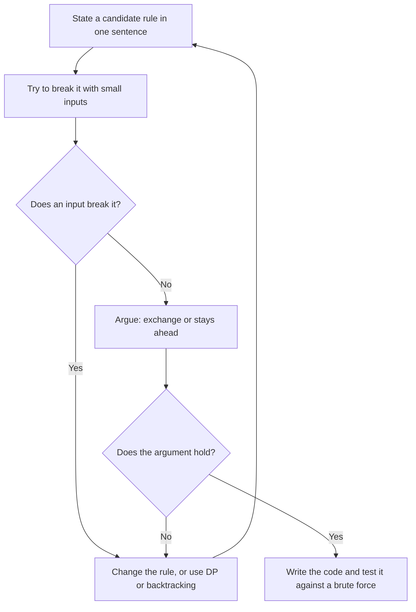
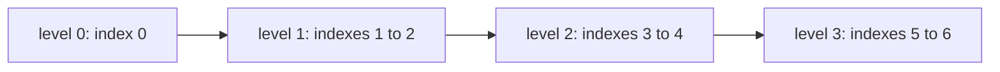

# Pattern 14: Greedy

## Overview

A greedy algorithm builds an answer one choice at a time. At each step it takes the choice that a fixed rule ranks first, and it never undoes that choice. A greedy algorithm is fast because it looks at each choice once. It is correct only if a proof shows that the rule never gives up a better answer. Many rules look right and are wrong, so this page spends as much time on breaking rules as on using them.

After this page you can:

1. Break a wrong greedy rule with an input of at most 5 elements, and say which later choices the rule blocks.
2. Prove that "earliest end first" is correct for interval scheduling, with an exchange argument and with a "stays ahead" argument, and say each proof aloud in under 3 minutes.
3. Apply the procedure "state a rule, try to break it, prove it, then code" to a problem that you have not seen.
4. Write in Java: interval selection by end time, the two jump games, gas station, the task-scheduler formula, the largest-number comparator, the two-pass candy rule, and a heap that takes a choice later (refueling, course scheduling).
5. Say what to tell an interviewer when you cannot prove a greedy rule.
6. Name the property that separates a greedy problem from a dynamic programming problem, and give an input on which a greedy rule fails where DP succeeds.

## Prerequisites

| You need | Why this page needs it | Where to learn it |
|---|---|---|
| Sorting and comparators | Most greedy solutions sort first. The sort key is the rule. [LC 179](https://leetcode.com/problems/largest-number/) sorts with a comparator that compares two concatenated strings | [Sorting Algorithms](../foundations/08-sorting-algorithms.md), [Java Toolkit](../java-toolkit.md) |
| Counting operations and O-notation | The page counts the work of the brute force and of the greedy scan before it states O-notation | [Complexity Analysis](../foundations/01-complexity-analysis.md) |
| Heaps (`PriorityQueue`) | The examples [LC 871](https://leetcode.com/problems/minimum-number-of-refueling-stops/), [LC 630](https://leetcode.com/problems/course-schedule-iii/), and the joining of sticks keep candidates in a heap | [Heaps](../foundations/06-heaps.md) |
| The idea "try every choice" | The brute force that a greedy rule replaces tries every subset or every order. Greedy replaces that search by one choice at each step | [Pattern 8: Recursion and Backtracking](../08-recursion-backtracking/README.md) |
| Proof by induction | Every correctness argument on this page shows a statement for the first step, and then shows that "true after step `i`" gives "true after step `i + 1`" | [Recursion](../foundations/09-recursion.md), section "Why the assumption is valid" (the three parts of induction) |
| Binary trees (leaf, depth, sibling) | Only the Huffman-style joining of sticks needs these words. The section defines them where it uses them | [Trees and Balanced BSTs](../foundations/05-trees-and-balanced-bsts.md) |

Words that the page uses from the start:

- A **solution** is an answer that obeys the rules of the problem. In interval scheduling, a solution is a set of intervals where no two overlap. An **optimal solution** (or best solution) is a solution with the best value, here the largest size. A problem can have many optimal solutions.
- A **greedy rule** is a sentence that says which choice to take next, for example "take the interval that ends first".
- A **counterexample** is one small input on which a rule gives a worse answer than the best answer. One counterexample is enough to reject a rule.
- An **interval** `[start, end)` uses the time from `start` up to, but not including, `end`. Two intervals **overlap** if each one starts before the other one ends. The intervals `[1, 3)` and `[3, 5)` only touch. They do not overlap. [LC 435](https://leetcode.com/problems/non-overlapping-intervals/) uses this rule.
- A choice is **safe** if some optimal solution contains it. A greedy algorithm is correct if every choice that it takes is safe.
- An **invariant** is a statement that is true after every step of an algorithm. A correctness proof states the invariant, shows that it is true at the start, and shows that each step keeps it true. That is induction.
- A **proof by contradiction** assumes the opposite of the claim and derives a statement that cannot be true. Then the claim holds.
- An **exchange argument** and a **stays-ahead argument** are the two proof forms of this page. The Derivation shows each one on the anchor problem, and the page defines them there.

The page proves its greedy rules with these tools. Where it gives no proof (for example LC 502 and the minimum spanning tree), it says so.

## Motivation

### The anchor problem: the most requests in one room

One meeting room is free all day. Seven requests ask for the room. Each request is an interval `[start, end)`. The room holds one meeting at a time. Choose the largest set of requests in which no two overlap.

```text
time    0 1 2 3 4 5 6 7 8 9 10
A [0,6) ############
B [1,3)   ####
C [2,5)     ######
D [3,8)       ##########
E [5,7)           ####
F [6,10)            ########
G [8,9)                 ##
```

The best answer is 3. One set that achieves it is `B [1,3)`, `E [5,7)`, and `G [8,9)`. This problem is "activity selection". [LC 435: Non-overlapping Intervals](https://leetcode.com/problems/non-overlapping-intervals/) asks for the same set from the other side: the fewest intervals to remove so that the rest do not overlap. The two answers are linked: removals = `n` minus the size of the largest set. For the anchor, `7 - 3 = 4`.

**First attempt: try every subset.** Each request is in the set or not, so there are `2^n` subsets. For each subset, check every pair for an overlap, and keep the largest valid subset. For `n = 7` that is 128 subsets, and the attempt works. For `n = 40` it is about 1.1 x 10^12 subsets. The attempt is correct and far too slow. The Java program below contains this attempt as `bestBySubsets`.

**The gap.** The attempt looks at every subset, but a good solver looks at the first choice only. "Which request should the room serve first?" If one rule answers that question safely, the solver takes that request, removes the requests that overlap it, and asks the same question about what is left. The work drops from `2^n` to about `n` steps. The question is which rule.

### Four rules, tested

Each rule below is a plausible answer. Test each one on a small input before you trust it.

| Rule | A small input that tests it | What the rule does | The best answer |
|---|---|---|---|
| 1. Earliest start first | `[0,10)`, `[1,2)`, `[3,4)` | Takes `[0,10)` first. It overlaps both others. The rule ends with 1 interval | 2 (`[1,2)` and `[3,4)`) |
| 2. Shortest first | `[1,5)`, `[4,6)`, `[5,9)` | Takes `[4,6)` (length 2). It overlaps both others. The rule ends with 1 interval | 2 (`[1,5)` and `[5,9)`) |
| 3. Fewest overlaps first | 11 intervals, drawn below | Takes the middle bridge `M [4,7)` first. The rule ends with 3 intervals | 4 |
| 4. Earliest end first | all three inputs above | 2, 2, and 4 | 2, 2, and 4 |

Rule 1 fails because a long interval that starts early can block everything. Rule 2 fails because a short interval can sit in the middle of two intervals that fit together. Both inputs have 3 intervals, and a reader can check them by hand.

Rule 3 is harder to break. It sounds careful: take the interval that disturbs the fewest others. Small inputs do not break it (the end of this section reports a test), so the counterexample below is built on purpose, and it has 11 intervals. Count first, then read the picture. Each row is one interval, and the last column is its number of overlaps with the other 10 intervals. Intervals that only touch ([1,4) and [4,7)) do not overlap.

```text
time          0  1  2  3  4  5  6  7  8  9  10 11   overlaps
P1 [0,2)      [====)                                3
P2 [3,5)               [====)                       4
P3 [6,8)                        [====)              4
P4 [9,11)                                [====)     3
L1 [1,4)         [=======)                          4
L2 [1,4)         [=======)                          4
L3 [1,4)         [=======)                          4
M  [4,7)                   [=======)                2
R1 [7,10)                          [=======)        4
R2 [7,10)                          [=======)        4
R3 [7,10)                          [=======)        4
```

The picture has two layers. The top four rows, `P1` to `P4`, are four intervals that do not overlap each other, so the best answer is at least 4. The program below confirms that it is exactly 4. Below them, each bridge interval sits across a gap and overlaps the two row intervals next to that gap. The left bridge `L` and the right bridge `R` exist in three copies each. The middle bridge `M` exists once.

The counts say why the copies matter. `M` overlaps only `P2` and `P3`, so its count is 2. Each copy of `L` overlaps `P1`, `P2`, and the two other copies of `L`, so its count is 4 (the same for `R`). `P1` overlaps the three copies of `L`, so its count is 3. No other interval has a count below 3. Rule 3 takes `M` first, and `M` is the only interval with the smallest count, so no tie-break changes this step.

Taking `M` deletes `M`, `P2`, and `P3`. Two groups of four intervals remain: `P1`, `L1`, `L2`, `L3` on the left and `P4`, `R1`, `R2`, `R3` on the right. In each group every interval overlaps the three others, so the rule can take only one interval from each group. The total is 1 + 1 + 1 = 3, and no tie-break changes it. The best answer is 4: `P1`, `P2`, `P3`, `P4`. The rule saw that `M` has few overlaps. It did not see that these overlaps are two members of the best answer. The copies of `L` and `R` made the row intervals look crowded and made `M` look quiet.

The program computes all of these numbers. Rule 4 appears in it as `earliestEndFirst`.

```java
import java.util.ArrayList;
import java.util.Arrays;
import java.util.List;

public class RulesLab {
    public static void main(String[] args) {
        int[][] startTrap = {{0, 10}, {1, 2}, {3, 4}};
        int[][] shortTrap = {{1, 5}, {4, 6}, {5, 9}};
        int[][] conflictTrap = {{0, 2}, {3, 5}, {6, 8}, {9, 11}, {1, 4}, {1, 4}, {1, 4},
                {4, 7}, {7, 10}, {7, 10}, {7, 10}};
        int[][][] inputs = {startTrap, shortTrap, conflictTrap};
        String[] rules = {"earliest start", "shortest", "fewest conflicts"};
        for (int k = 0; k < inputs.length; k++) {
            int[][] iv = inputs[k];
            int rule = switch (k) {
                case 0 -> earliestStartFirst(iv);
                case 1 -> shortestFirst(iv);
                default -> fewestConflictsFirst(iv);
            };
            System.out.printf("%-16s rule = %d, earliest end = %d, best = %d%n",
                    rules[k], rule, earliestEndFirst(iv), bestBySubsets(iv));
        }
        List<int[]> all = new ArrayList<>(Arrays.asList(conflictTrap));
        System.out.println("fewest conflicts, best result over all tie-breaks = "
                + bestOverTieBreaks(all));
    }

    // Two intervals overlap if each one starts before the other one ends.
    static boolean overlaps(int[] a, int[] b) {
        return a[0] < b[1] && b[0] < a[1];
    }

    // The brute force: try every subset, keep the largest one without an overlapping pair.
    static int bestBySubsets(int[][] iv) {
        int n = iv.length, best = 0;
        for (int mask = 0; mask < (1 << n); mask++) {
            boolean valid = true;
            for (int i = 0; i < n && valid; i++) {
                if ((mask >> i & 1) == 0) continue;
                for (int j = i + 1; j < n; j++) {
                    if ((mask >> j & 1) == 1 && overlaps(iv[i], iv[j])) {
                        valid = false;
                        break;
                    }
                }
            }
            if (valid) best = Math.max(best, Integer.bitCount(mask));
        }
        return best;
    }

    // Rule 1: take the interval with the earliest start, then the next one that fits.
    static int earliestStartFirst(int[][] iv) {
        int[][] sorted = iv.clone();
        Arrays.sort(sorted, (x, y) -> Integer.compare(x[0], y[0]));
        return takeInOrder(sorted);
    }

    // Rule 4: the same scan with the order of the end times.
    static int earliestEndFirst(int[][] iv) {
        int[][] sorted = iv.clone();
        Arrays.sort(sorted, (x, y) -> Integer.compare(x[1], y[1]));
        return takeInOrder(sorted);
    }

    static int takeInOrder(int[][] sorted) {
        int count = 0;
        long lastEnd = Long.MIN_VALUE;
        for (int[] v : sorted) {
            if (v[0] >= lastEnd) {
                count++;
                lastEnd = v[1];
            }
        }
        return count;
    }

    // Rule 2: take the shortest interval that does not overlap an interval already taken.
    static int shortestFirst(int[][] iv) {
        int[][] sorted = iv.clone();
        Arrays.sort(sorted, (x, y) -> Integer.compare(x[1] - x[0], y[1] - y[0]));
        List<int[]> taken = new ArrayList<>();
        for (int[] v : sorted) {
            boolean free = true;
            for (int[] t : taken) free &= !overlaps(v, t);
            if (free) taken.add(v);
        }
        return taken.size();
    }

    // Rule 3: take the interval with the fewest overlaps, delete it and its overlaps, repeat.
    // This version breaks a tie by the first interval in the list.
    static int fewestConflictsFirst(int[][] iv) {
        List<int[]> left = new ArrayList<>(Arrays.asList(iv));
        int count = 0;
        while (!left.isEmpty()) {
            int pick = 0;
            for (int i = 1; i < left.size(); i++) {
                if (conflicts(left, i) < conflicts(left, pick)) pick = i;
            }
            int[] chosen = left.get(pick);
            left.removeIf(v -> v == chosen || overlaps(v, chosen));
            count++;
        }
        return count;
    }

    static int conflicts(List<int[]> list, int i) {
        int c = 0;
        for (int j = 0; j < list.size(); j++) {
            if (j != i && overlaps(list.get(i), list.get(j))) c++;
        }
        return c;
    }

    // The largest result that rule 3 can reach if the tie-break is chosen in the best way.
    static int bestOverTieBreaks(List<int[]> left) {
        if (left.isEmpty()) return 0;
        int fewest = Integer.MAX_VALUE;
        for (int i = 0; i < left.size(); i++) fewest = Math.min(fewest, conflicts(left, i));
        int best = 0;
        for (int i = 0; i < left.size(); i++) {
            if (conflicts(left, i) != fewest) continue;
            int[] chosen = left.get(i);
            List<int[]> rest = new ArrayList<>();
            for (int[] v : left) {
                if (v != chosen && !overlaps(v, chosen)) rest.add(v);
            }
            best = Math.max(best, 1 + bestOverTieBreaks(rest));
        }
        return best;
    }
}
```

<!-- expected-output -->
```text
earliest start   rule = 1, earliest end = 2, best = 2
shortest         rule = 1, earliest end = 2, best = 2
fewest conflicts rule = 3, earliest end = 4, best = 4
fewest conflicts, best result over all tie-breaks = 3
```

The last line says that even the best tie-break gives 3 for rule 3.

**What this shows.** Three plausible rules failed on inputs of 3 or 11 intervals. Rule 4 matched the best answer on all three inputs. Matching on three inputs is not a proof. In one test of 1,000 random inputs of up to 9 intervals, rule 3 (with the tie-break "first in the list") gave the best answer every time. A small random test can approve a wrong rule. The Derivation proves rule 4 for every input.

## Derivation

### Question 1: which request is safe to take first?

Take rule 4: choose an interval `g` with the smallest end. If several intervals share the smallest end, take any one of them. The claim is: some optimal solution contains `g`.

**Exchange argument.** Let `O` be any optimal solution. Sort its intervals by end: `o1, o2, ..., ok`. The intervals of `O` do not overlap, so each one starts at or after the end of the one before it: `o2.start >= o1.end`, and so on.

1. If `g` is in `O`, the claim holds.
2. If `g` is not in `O`, build `O'` from `O` by removing `o1` and adding `g`.
3. `O'` has the same size as `O`.
4. `O'` is valid. The interval `g` has the smallest end of all intervals, so `g.end <= o1.end`. Every other interval `oj` of `O` (with `j >= 2`) starts at or after `o1.end`. So `oj.start >= o1.end >= g.end`, and `g` does not overlap `oj`. The other pairs in `O'` are pairs of `O`, which do not overlap.
5. So `O'` is optimal and contains `g`.

This kind of proof is an **exchange argument**: it exchanges one part of a best answer for the greedy choice, and it shows that the answer does not get worse. The page assumes that every interval has `start < end` ([LC 435](https://leetcode.com/problems/non-overlapping-intervals/) guarantees it).

The edge cases: if there are no intervals, there is nothing to prove. If `O` has one interval, `O'` is `{g}`, which has the same size. The argument does not need distinct ends. If two intervals share the smallest end, step 4 holds for either one, because it uses only `g.end <= o1.end`. If `g` is a copy of an interval that is in `O` (the same start and end), the swap is harmless: `O'` is the same set of times.

In words: take the best answer, and look at the interval that it serves first. Replace that interval by `g`. The room is free no later than before, so everything that came after still fits.

### Question 2: what is left after the first choice?

After the code takes `g`, it must not take any interval that overlaps `g`. Which intervals are those? Every interval has an end at or after `g.end`, because `g.end` is the smallest. An interval that does not overlap `g` either starts at or after `g.end`, or ends at or before `g.start`. The second case cannot happen: `g.start < g.end` (the assumption above), so such an interval would end before `g.end`, which is the smallest end. So it starts at or after `g.end`. The intervals that remain are exactly the intervals with `start >= g.end`.

Every optimal solution that contains `g` is `g` plus a set of non-overlapping intervals from the remaining ones. So:

```text
best(all intervals) = 1 + best(intervals with start >= g.end)
```

The left side is at least the right side, because `g` plus any valid set of remaining intervals is valid. The left side is at most the right side, because Question 1 gives an optimal solution that contains `g`, and the other members of that solution are remaining intervals. The right side is the same problem on fewer intervals. Apply Question 1 to it: some optimal solution of the smaller problem contains the interval with the smallest end among the remaining intervals. Repeat until no interval remains. By induction on the number of intervals, the intervals that the code takes form an optimal solution.

### The algorithm

Sort the intervals by end. Keep `lastEnd`, the end of the last interval taken. Scan the intervals in order. An interval with `start >= lastEnd` is in the "remaining" set. It also has the smallest end of the remaining set. The reason: an interval that the scan skipped earlier had `start < lastEnd` at that time, and `lastEnd` never decreases, so the skipped interval is not in the remaining set now. So the first interval in the order that has `start >= lastEnd` is the remaining interval with the smallest end (with equal ends, the first one in the order). Take it, and set `lastEnd` to its end. An interval with `start < lastEnd` overlaps the last interval taken (it ends no earlier than `lastEnd`, because the order is by end, so it ends after the last interval's start). Skip it.

**Trace** on the anchor problem. The intervals sorted by end are B, C, A, E, D, G, F. The program in the Implementation section prints this trace.

```text
sorted by end: [1,3) [2,5) [0,6) [5,7) [3,8) [8,9) [6,10)
[1,3): start 1 >= lastEnd none -> take, count = 1
[2,5): start 2 <  lastEnd 3 -> skip
[0,6): start 0 <  lastEnd 3 -> skip
[5,7): start 5 >= lastEnd 3 -> take, count = 2
[3,8): start 3 <  lastEnd 7 -> skip
[8,9): start 8 >= lastEnd 7 -> take, count = 3
[6,10): start 6 <  lastEnd 9 -> skip
kept 3, removed 4
```

The code takes B, E, and G. This agrees with the brute force on the anchor problem.

```java
// LC 435 asks for the removals: intervals.length - maxNonOverlapping(intervals).
// Earliest end first. Two intervals that only touch ([1, 2) and [2, 3)) do not overlap.
static int maxNonOverlapping(int[][] intervals) {
    int[][] sorted = intervals.clone();
    // Integer.compare, not x[1] - y[1]: the subtraction can overflow.
    Arrays.sort(sorted, (x, y) -> Integer.compare(x[1], y[1]));
    int count = 0;
    long lastEnd = Long.MIN_VALUE;                // the end of the last interval taken
    for (int[] interval : sorted) {
        if (interval[0] >= lastEnd) {             // >= : touching is allowed
            count++;
            lastEnd = interval[1];
        }
    }
    return count;
}
```

For [LC 435](https://leetcode.com/problems/non-overlapping-intervals/), return `intervals.length - maxNonOverlapping(intervals)`. The condition `interval[0] >= lastEnd` uses `>=`, because `[1,2)` and `[2,3)` do not overlap. The sort uses `Integer.compare`, not the difference `x[1] - y[1]`, because the difference overflows for values near the limits of `int` (see Common Mistakes).

### The same proof in the "stays ahead" form

The exchange argument changes an optimal solution into the greedy one. The second form compares the two solutions step by step.

Let the greedy solution be `g1, g2, ..., gk`, in the order that the code takes them. Let `o1, o2, ..., om` be any valid solution, sorted by end.

**Claim.** For every `i <= min(k, m)`, `gi.end <= oi.end`. The greedy solution is "ahead": its i-th interval ends no later.

- *Step 1.* `g1` has the smallest end of all intervals, so `g1.end <= o1.end`.
- *Step i + 1.* Assume `gi.end <= oi.end`. The interval `o(i+1)` starts at or after `oi.end`, so it starts at or after `gi.end`. It is therefore a candidate when the code looks for the next interval after `gi`. The code takes the candidate with the smallest end (with equal ends, either one: the claim uses only `<=`), so `g(i+1).end <= o(i+1).end`.

**The solution is at least as large.** Suppose `m > k`. Then `o(k+1)` exists. By the claim, `gk.end <= ok.end <= o(k+1).start`. So `o(k+1)` starts at or after `gk.end`. It is a candidate after `gk`, and the code would take another interval. But the code stopped after `gk`. This is a contradiction, so `m <= k`. No valid solution is larger than the greedy solution.

The edge case is `k = 0`: the code takes no interval only if there are no intervals, and then `m = 0`.

### The cost, counted from the trace

The trace has 7 lines for 7 intervals: the scan looks at each interval once and does one comparison and at most one update. The scan costs `n` comparisons. The sort costs about `n log2 n` comparisons. For `n = 100,000`, that is about 1.7 million comparisons, against `2^100000` subsets for the brute force. The sort is the largest part, so the time is O(n log n). The extra space is O(1) if the code may reorder the input, and O(n) for the sorted copy in the code above. If the input is already sorted by end, the time is O(n).

## The Pattern

A greedy algorithm repeats one step: choose the candidate that a fixed rule ranks first, commit to it, and shrink the problem. It is correct when two facts hold. First, the **greedy-choice property**: some optimal solution contains the rule's first choice. Second, **optimal substructure**: after the choice, what remains is a smaller instance of the same problem, so the same rule applies again. The invariant of every greedy algorithm is: *after each step, the choices taken so far are contained in some optimal solution.* The proof of a greedy algorithm is a proof of this invariant.

### The procedure: rule, break, prove, code

Use these five steps on a problem that you have not seen.



1. **State the rule in one sentence.** "Take the interval with the smallest end." If you cannot say it in one sentence, you do not have a rule yet.
2. **Try to break it.** Use inputs that give a rule little room:
    - `n` at most 4, so that you can list every answer by hand.
    - Equal values: equal ends, equal weights, equal ratings. Rules that sort need a tie-break, and a wrong tie-break is a common failure.
    - Extreme values: the largest value, zero, one element, an empty input.
    - A locally good choice that blocks two later choices. This is a common shape of counterexamples: the rule takes something that looks best now, and it removes two items that fit together. Rule 1 and rule 2 of the Motivation both have this shape.
3. **If it survives, find the proof form.** Use the table below. The examples on this page use one of the two forms.
4. **Say the proof sentence.** Then write the code.
5. **Test against a brute force** on small random inputs, if you have time.

### The two proof forms

| | Exchange argument | Greedy stays ahead |
|---|---|---|
| What you show | Take any optimal solution. If it does not contain the greedy choice, swap one of its parts for the greedy choice. The new solution is still valid and not worse. So some optimal solution contains the greedy choice. Repeat on what remains | Define a measure after each step (the end time, the farthest index, the capital). Show that after `i` steps the greedy measure is at least as good as the measure of any other solution after `i` steps. At the end, being ahead means being at least as large |
| Use it when | The greedy choice is the first element of the answer, and the rest is a smaller instance of the same problem (intervals, boats, cookies, refueling) | The solution grows step by step, and one number measures progress (jump games, interval end times, reach) |
| The sentence that an interviewer accepts | "Take any optimal solution. If it does not start with my choice, I replace its first element with my choice. The result is still valid, because [the reason that nothing else conflicts], and it is not worse, because [the reason that the size or value stays]. So some optimal solution starts with my choice. The same argument applies to what remains." | "After `i` steps my solution is at least as far along as any other solution, measured by [the measure]. This holds at step 1 because [the reason]. If it holds at step `i`, it holds at step `i + 1` because [the reason]. At the end, being ahead means my solution is at least as large." |
| Example on this page | Earliest end (Question 1), boats, cookies, refueling | Earliest end (the second proof), jump games |

Two other arguments appear on this page. A **matching bound** shows a lower bound that every solution must meet, and a construction that meets it (the task scheduler, and the first fact of the gas station). A **local swap** shows that any two neighbors in the wrong order can be swapped to improve the answer (the largest number, and the order of jobs by duration).

### Passing a few tests is not a proof

Three facts from this page show why tests do not replace a proof.

- Rule 3 of the Motivation agreed with the brute force in one test of 1,000 random inputs of up to 9 intervals. It still fails on the 11-interval input of the Motivation.
- The greedy rule for coins `[1, 5, 10, 25]` agrees with the best answer for every amount from 0 to 1,000. Only a published bound turns this check into a proof for these coins (the bound is stated in "Where greedy fails"). For the coins `[1, 3, 4]`, the rule fails at amount 6. The same kind of check finds the failure for `[1, 3, 4]` and gives no reason to trust the rule for a coin set that has no such bound.
- A random test can only fail to find a counterexample. A proof says that none exists.

**What to say in an interview when no proof is at hand.** Say these four things, in this order:

1. State the rule: "I take the item with the largest ... at each step."
2. State the counterexamples that you tried: "I tried inputs with 3 and 4 elements, equal values, and an extreme value. The rule gave the best answer on all of them."
3. Say that this is not a proof: "I could not find a proof, so I do not claim that it is correct."
4. Offer the safe alternative: "Dynamic programming gives the correct answer for any input at a higher cost, O(...). I can write that, or I can try an exchange argument for the greedy rule if you want."

An interviewer reads this as a candidate who knows the difference between a rule and a proof. Compare with a candidate who writes the rule and says "this is greedy, so it works".

### When greedy applies, and the contrast with DP

Greedy applies when a choice is **never regretted**: after the code takes the choice, no later information makes the code wish to undo it. Two properties give this, and the proofs above check each one.

- *The greedy-choice property.* Some optimal solution contains the rule's choice. The exchange argument checks it.
- *Optimal substructure.* What is left is the same problem, smaller. The step "the remaining intervals are those with `start >= g.end`" checks it.

Dynamic programming makes no such promise. It compares every choice at every state and stores the results, so it is correct whenever the problem has optimal substructure, and it costs more. [Pattern 15](../15-dynamic-programming/README.md) compares the two in its section "DP versus greedy" and derives the DP for the coin problem and the knapsack that this page shows failing. Use this rule of thumb: a counterexample rejects that rule. Try another rule, and use DP if no rule survives or you cannot prove the one that survives. If you cannot find a counterexample and you can prove the rule, greedy is correct and cheaper.

### The vocabulary

The page used each of these terms before it named them.

| Term | What it was in the examples | The question to ask in a new problem |
|---|---|---|
| Greedy rule | "Take the interval with the smallest end" | "Which one sentence says what to take next?" |
| Counterexample | `[0,10)`, `[1,2)`, `[3,4)` for earliest start | "Which input of at most 5 elements makes this rule take something that blocks two later choices?" |
| Safe choice | An interval that some optimal solution contains | "If I take this, can the best answer still be reached?" |
| Exchange argument | Replacing `o1` by `g` | "Can I swap my choice into any optimal solution without breaking it or making it worse?" |
| Stays ahead | `gi.end <= oi.end` for every `i` | "What one number measures progress, and why is mine never behind?" |
| Regret | Using a station later, when the car needs fuel | "Can I postpone the choice until the moment that it is needed?" |

### The variants of the pattern

Each variant uses one property of the problem to pick its tool.

| Variant | The property that selects it | Examples on this page |
|---|---|---|
| A. Sort by a key, then scan | One sort order makes the best choice at each step the next element | Earliest end ([LC 435](https://leetcode.com/problems/non-overlapping-intervals/)), cookies, boats, largest number, queue reconstruction |
| B. Scan with one running number | One number summarizes everything that the future needs | Jump Game, Gas Station, Partition Labels, Stock II |
| C. Count by a bound | A lower bound on every solution and a construction that meets it | Jump Game II (levels), Task Scheduler |
| D. Two passes | The constraints point in two directions, and each direction needs its own scan | Candy |
| E. Heap with regret | The best choice depends on what has become available, so the code keeps the candidates and decides at the moment of need | Refueling, Course Schedule III, IPO |
| F. Heap of the smallest | The best next step is always the smallest (or largest) item of a collection that changes after each step | Joining sticks (Huffman) |

## Worked Examples

Each example changes one thing about the anchor problem. The examples go from the smallest change to the largest. Each one tests rules before it gives the rule that works, and each rule that survives has an argument.

### Example 1: Jump Game (LC 55), one number is the whole state

[LC 55: Jump Game](https://leetcode.com/problems/jump-game/). Start at index 0 of an array `nums`. At index `i` you may jump to any index from `i + 1` to `i + nums[i]`. Can you reach the last index? For `[2, 3, 1, 1, 4]` the answer is true. For `[3, 2, 1, 0, 4]` the answer is false.

**What changed.** There is nothing to sort and no interval to choose. The question is about reach. The rule must decide which index to stand on.

**The brute force.** Try every jump from every index, depth first. In an array where every `nums[i]` is large, each increasing sequence of indexes is a different path, so the number of paths is about `2^(n-2)`. A memo table (see [Pattern 15](../15-dynamic-programming/README.md)) reduces the work to O(n^2).

**Two rules that fail.**

| Rule | Input | What the rule does | The best answer |
|---|---|---|---|
| Always jump as far as possible | `[2, 2, 0, 0]` | Jumps from 0 to index 2, where the value is 0. The rule is stuck and says false | True: jump 0 to 1, then 1 to 3 |
| Jump to the reachable index that holds the largest value | `[4, 2, 1, 0, 1, 0]` | From 0 it can land on indexes 1 to 4 (values 2, 1, 0, 1). It picks index 1 (value 2), then index 2 (value 1), then index 3 (value 0). It is stuck and says false | True: jump 0 to 4, then 4 to 5 |

Both rules choose one landing index, and a wrong choice strands the code. The second rule shows the real mistake: it ranks an index by `nums[j]`, but an index matters for how far it can reach, which is `j + nums[j]`.

**The rule that works: keep only the farthest index.** Do not choose a path. Keep one number, `farthest`, the largest index that any index seen so far can reach. Scan the indexes from left to right. If the index `i` is beyond `farthest`, the code is stuck. Otherwise `i` is reachable, and it may raise `farthest` to `i + nums[i]`.

**Why one number is enough.** Say that an index is *reachable* if some sequence of allowed jumps leads from index 0 to it. The scan keeps `farthest = max(j + nums[j])` over the indexes `j` that it has read. Before the scan reads index 0, `farthest` is 0. The invariant is: *the reachable indexes are exactly the indexes `0 .. farthest`* (the indexes at or beyond `nums.length` do not exist, so read `farthest` as capped at `nums.length - 1`).

1. *At the start the invariant holds.* Only index 0 is reachable, and `farthest = 0`.
2. *Reading index `i` keeps it true, if `i <= farthest`.* By the invariant, `i` is reachable. It lands on every index from `i + 1` to `i + nums[i]`, so all of these are reachable. The indexes `0 .. farthest` were reachable already. The new reachable set is `0 .. max(farthest, i + nums[i])`, which is the new `farthest`. (If `nums[i] = 0`, nothing changes.)
3. *If `i > farthest`, no index from `i` upward is reachable.* Suppose that some index `k >= i` is reachable, and take the smallest such `k`. The last jump of the path to `k` starts at a reachable index `j < k`. By the choice of `k`, `j < i`, so the scan has read `j`, and `j + nums[j] <= farthest < i <= k`. But `j` jumps to `k`, so `k <= j + nums[j]`. This is a contradiction (a proof by contradiction), so no such `k` exists.

So the set of reachable indexes is always a prefix of the array, `0 .. farthest`, and the later steps need nothing but its right end. This is a "stays ahead" argument: `farthest` is the measure, and no path is ahead of it. The code reads index `i` only while `i <= farthest`, so step 2 always applies. The answer is true exactly when `farthest >= nums.length - 1`.

The edge cases: one element (`farthest = 0 >= 0`, so the start is the last index and the answer is true), and `nums[0] = 0` with more than one element (`farthest` stays 0, and the scan stops at index 1, so the answer is false).

**Trace** (printed by the program in the Implementation section):

```text
nums = [2, 3, 1, 1, 4]
i = 0: farthest = max(0, 0 + 2) = 2
i = 1: farthest = max(2, 1 + 3) = 4
farthest >= last index 4 -> reachable
nums = [3, 2, 1, 0, 4]
i = 0: farthest = max(0, 0 + 3) = 3
i = 1: farthest = max(3, 1 + 2) = 3
i = 2: farthest = max(3, 2 + 1) = 3
i = 3: farthest = max(3, 3 + 0) = 3
i = 4: 4 > farthest 3 -> index 4 is not reachable
```

```java
// LC 55. The indexes that the code can reach are always 0 .. farthest.
static boolean canReachEnd(int[] nums) {
    int farthest = 0;
    for (int i = 0; i < nums.length && i <= farthest; i++) {   // stop at the first gap
        farthest = Math.max(farthest, i + nums[i]);
        if (farthest >= nums.length - 1) return true;          // the last index is in the prefix
    }
    return false;
}
```

The loop condition `i <= farthest` stops the scan at the first gap, and the early `return true` matches the last line of the trace. Time O(n): each index is read once. Space O(1).

### Example 2: Jump Game II (LC 45), count the levels

[LC 45: Jump Game II](https://leetcode.com/problems/jump-game-ii/). The same array and the same jumps. The problem guarantees that the last index is reachable. Return the fewest jumps to reach it. For `[2, 3, 1, 1, 4]` the answer is 2 (0 to 1, then 1 to 4).

**What changed.** The answer is a count, not a yes or no. One number, `farthest`, tells you whether you can arrive. It does not tell you how many jumps you need.

**A rule that fails.** "Always jump as far as possible." For `[2, 3, 1, 1, 4]` it jumps 0 to 2 (value 1), then 2 to 3 (value 1), then 3 to 4. That is 3 jumps. The best answer is 2.

**The level view.** Group the indexes by the fewest jumps that reach them. Level 0 is `{0}`. Level 1 holds the indexes that one jump from level 0 reaches. Level 2 holds the indexes that one jump from level 1 reaches, and so on. This is a breadth-first search over the indexes (see [Pattern 11: Graph Traversal](../11-graph-traversal/README.md)): it visits the indexes in the order of the number of jumps. The answer is the number of the level that holds the last index. Example 1 showed that the reachable indexes always form a prefix. So each level is also a block of consecutive indexes, and the picture is simple:



This is `[2, 3, 1, 1, 4, 2, 1]`. The last index (6) is on level 3, so the answer is 3.

**Why each level is a block, and how to find its end.** Let `R(k)` be the largest index that `k` jumps reach. Then `R(0) = 0`. The claim is: *the indexes that `k` jumps or fewer reach are exactly `0 .. R(k)`.* For `k = 0` this is `{0}`. Assume that it holds for `k`. An index that `k + 1` jumps reach is one jump away from an index in `0 .. R(k)`, so it lies in `j + 1 .. j + nums[j]` for some `j <= R(k)`. Each of these ranges starts at `R(k) + 1` or earlier, so together with `0 .. R(k)` they leave no gap. The union is `0 .. R(k + 1)`, with:

```text
R(k + 1) = max( j + nums[j] )   over all indexes j from 0 to R(k)
```

The answer is the smallest `k` with `R(k) >= n - 1`, where `n` is `nums.length`.

**The code follows the formula.** Scan the indexes. Keep `farthest`, the running maximum of `j + nums[j]`. Keep `levelEnd`, which equals `R(jumps)` for the number of jumps counted so far. When the scan reaches `i == levelEnd`, it has read every index `0 .. R(jumps)`, so `farthest` equals `R(jumps + 1)`. The code adds one jump and sets `levelEnd = farthest`. The scan stops before the last index, so it counts one jump for each `k` with `R(k) <= n - 2`. That count is the smallest `k` with `R(k) >= n - 1`.

**Trace** for `[2, 3, 1, 1, 4, 2, 1]`:

```text
nums = [2, 3, 1, 1, 4, 2, 1]
i = 0: farthest = max(0, 0 + 2) = 2
  i ends its level -> jumps = 1, the next level ends at 2
i = 1: farthest = max(2, 1 + 3) = 4
i = 2: farthest = max(4, 2 + 1) = 4
  i ends its level -> jumps = 2, the next level ends at 4
i = 3: farthest = max(4, 3 + 1) = 4
i = 4: farthest = max(4, 4 + 4) = 8
  i ends its level -> jumps = 3, the next level ends at 8
i = 5: farthest = max(8, 5 + 2) = 8
answer = 3
```

```java
// LC 45. The problem guarantees that the last index is reachable.
static int minJumps(int[] nums) {
    int jumps = 0;
    int levelEnd = 0;     // the last index that needs `jumps` jumps or fewer
    int farthest = 0;     // the farthest index that one more jump can reach
    for (int i = 0; i < nums.length - 1; i++) {   // the last index needs no jump from it
        farthest = Math.max(farthest, i + nums[i]);
        if (i == levelEnd) {                      // the current level is fully scanned
            jumps++;
            levelEnd = farthest;
        }
    }
    return jumps;
}
```

The loop stops at `nums.length - 2`. The last index needs no jump out of it. If the loop included it, the input `[1, 1]` would count a second jump (see Common Mistakes). Time O(n), space O(1). If the problem does not guarantee that the last index is reachable, run Example 1 first.

### Example 3: Gas Station (LC 134), skip a whole range at once

[LC 134: Gas Station](https://leetcode.com/problems/gas-station/). There are `n` stations on a circle. Station `i` gives `gas[i]` units of fuel, and the drive from station `i` to the next one costs `cost[i]` units. The car starts at one station with an empty tank. Return the start index from which the car completes the circle, or -1 if none exists. The problem guarantees that at most one start works. For `gas = [1, 2, 3, 4, 5]` and `cost = [3, 4, 5, 1, 2]` the answer is 3.

**What changed.** The unknown is a start position. The input has no order to sort by. The brute force tries each of the `n` starts and drives `n` steps: O(n^2).

**A rule that fails.** "Start at the station with the largest `gas[i] - cost[i]`." Take `gas = [1, 2, 3]` and `cost = [4, 1, 1]`. The gains are -3, 1, 2. The rule starts at station 2. The tank is 2, then station 0 adds 1 and costs 4, and the tank is -1. The rule fails. Start 1 works: the tank goes 1, 3, 0. (The rule "start at the station with the most gas" starts at station 2 here too, and fails the same way.)

Write `gain[i] = gas[i] - cost[i]`, and `T(a, b)` for the sum of the gains from `a` to `b`.

**Fact 1: if the sum of all gains is negative, no start works.** A full circle collects all the gas and pays all the costs. The tank at the end equals the sum of all gains. If that sum is negative, the tank was negative at some step.

**Fact 2: if a car that starts at `s` has its tank go negative at station `j` (the first time), then no start `k` with `s <= k <= j` works.** The tank from `s` was never negative before `j`, so `T(s, k - 1) >= 0` for every `k` from `s + 1` to `j`. At `j` the tank is negative: `T(s, j) < 0`. A car that starts at `k` has `T(k, j) = T(s, j) - T(s, k - 1) < 0`, so it runs out at `j` or earlier. For `k = s`, `T(s, j) < 0` is the same statement.

So the code can discard the whole range `s .. j` at once, and the next candidate is `j + 1`.

**Fact 3: if the sum of all gains is not negative, the last candidate works.** Let `s` be the value of `start` when the scan ends. The code set `start` to `i + 1` at each discard, so the indexes `0 .. s - 1` form consecutive discarded ranges. Each range starts with an empty tank and ends at the first index where the tank is negative. So the sum of each range is negative, and every proper prefix of a range has a sum of at least 0. Let `P = T(0, s - 1)` be the sum of all discarded ranges. Then `P <= 0`, and `P = 0` only if `s = 0`.

Two cases need a word first. If `s = n`, every index lies in a discarded range, so the total is `P < 0`. That contradicts "the sum is not negative", so `s <= n - 1`. The scan did not discard after `s`, so the tank from `s` stays at 0 or above up to index `n - 1`. Let `E = T(s, n - 1) >= 0`. The total is `P + E >= 0`, so `E >= -P`.

Now drive the circle from `s`. The car reaches index `n - 1` with a tank of `E`. It then passes the indexes `0 .. t` for `t < s`, and its tank after index `t` is `E + T(0, t)`. Claim: `T(0, t) >= P`. Let `Q` be the sum of the ranges that end before the range that holds `t`. All ranges are negative, so `Q >= P`. If `t` is not the last index of its range, `T(0, t) = Q + (a proper prefix of the range) >= Q >= P`. If `t` is the last index of its range, `T(0, t)` is the sum of the ranges up to this one, which is also at least `P`. So the tank after `t` is at least `E + P >= 0`, and the car completes the circle. (If `s = 0`, the car never passes an index before `s`, and `E` is the total.)

**Trace** for `gas = [1, 2, 3, 4, 5]` and `cost = [3, 4, 5, 1, 2]`:

```text
i = 0: gain = 1 - 3 = -2, total = -2, tank = 0 -> tank < 0: start = 1, tank = 0
i = 1: gain = 2 - 4 = -2, total = -4, tank = 0 -> tank < 0: start = 2, tank = 0
i = 2: gain = 3 - 5 = -2, total = -6, tank = 0 -> tank < 0: start = 3, tank = 0
i = 3: gain = 4 - 1 = 3, total = -3, tank = 3
i = 4: gain = 5 - 2 = 3, total = 0, tank = 6
total 0 >= 0 -> answer = 3
```

```java
// LC 134. Returns the start index, or -1 if no start works.
static int startingStation(int[] gas, int[] cost) {
    int total = 0;       // fact 1: the sum of all gains
    int tank = 0;        // the tank since the current candidate start
    int start = 0;       // the current candidate start
    for (int i = 0; i < gas.length; i++) {
        int gain = gas[i] - cost[i];
        total += gain;
        tank += gain;
        if (tank < 0) {          // fact 2: no start from `start` to i works
            start = i + 1;
            tank = 0;
        }
    }
    return total >= 0 ? start : -1;
}
```

Time O(n), space O(1). The two facts need two variables: `total` (fact 1) and `tank` (fact 2).

### Example 4: Task Scheduler (LC 621), a count from a bound

[LC 621: Task Scheduler](https://leetcode.com/problems/task-scheduler/). A list of tasks, each named by a capital letter. The CPU runs one task in each time unit, or idles. Two tasks with the same letter need at least `n` time units between their runs. Return the fewest time units that finish all tasks. For `AAABBBC` and `n = 2` the answer is 8: `A B C A B _ A B`, where `_` is an idle unit.

**What changed.** The answer is a number, and the order of the tasks is not asked. The solution needs the order only to measure the length.

**A rule that fails.** "Always run the available task with the fewest copies left." For `AAABBBC` and `n = 2`, the rule runs `C` first. Then `A` and `B` alternate, and the schedule is `C A B _ A B _ A B`: 9 time units. The best is 8. The rule runs `C` at time 0, when `A` and `B` could already run, so `C` does not fill a gap. The gaps that `A` and `B` force stay idle, and the schedule has 2 idle units, where the best schedule has 1.

**A lower bound.** Let `f` be the highest count of one task, and `m` the number of tasks that have count `f`. In `AAABBBC`, `f = 3` and `m = 2` (the letters A and B).

1. Take a task `X` with count `f`. Two consecutive runs of `X` are at least `n + 1` time units apart (the run itself plus `n` units between). The first and the last run of `X` are at least `(f - 1)(n + 1)` apart.
2. The `m` tasks with count `f` have their first runs in `m` different time units. So the latest of those first runs is at time `m - 1` or later (time starts at 0). The last run of that task is at least `(f - 1)(n + 1)` later. The schedule has at least `(m - 1) + (f - 1)(n + 1) + 1` time units, which is `(f - 1)(n + 1) + m`.
3. Also, the schedule has at least one time unit for each task.

```text
answer >= max( number of tasks,  (f - 1) * (n + 1) + m )
```

**The bound can be reached.** Let `N` be the number of tasks and `L = (f - 1)(n + 1) + m`. The claim is: a schedule of length `max(N, L)` exists, so the lower bound is the answer.

*Setup.* If `f = 1`, every task has one copy, any order works, and `N = m = L`. Assume `f >= 2`. If `N < L`, add `L - N` idle placeholders. Each placeholder is a new task with one copy, so it has no cooldown. Let `N'` be the number of items (tasks and placeholders): `N' = max(N, L)`.

*Frames.* A frame is a block of consecutive time slots. Choose `w = floor((N' - m) / (f - 1))`. Two facts about `w`. First, `w >= n + 1`, because `N' >= L`. Second, `w >= m`, because `N' >= N >= f * m` (the `m` tasks with count `f` use `f * m` items), so `N' - m >= (f - 1) * m`. Let `ρ = N' - m - (f - 1) * w`, so `0 <= ρ < f - 1`. Build `f` frames: the first `ρ` frames have `w + 1` slots, the next `f - 1 - ρ` frames have `w` slots, and the last frame has `m` slots. The number of slots is `(f - 1) * w + ρ + m = N'`. Time runs through frame 1, then frame 2, and so on. The *column* `j` is the `j`-th slot of each frame. Column `j` has `f` slots if `j <= m`, `f - 1` slots if `m < j <= w`, and `ρ` slots if `j = w + 1`.

*Filling.* Sort the task types by count, the highest first (the placeholders come last). Write all copies of the first type, then all copies of the second type, and so on. Put this list into the slots column by column: column 1 from frame 1 down to the last frame that has a slot, then column 2, and so on. This puts the `m` most frequent tasks in the first `m` slots of every frame, and it fills the other slots round-robin.

*Why equal tasks are at least `n + 1` units apart.* Take two copies of one task.

1. Both copies are in one column, in frames `a < b`. Their times differ by at least the width of frame `a`, which is at least `w >= n + 1`.
2. A task with `f` copies fills one whole column `j <= m`, because the tasks before it filled whole columns too. Case 1 applies. A task with `f - 1` copies fills one whole column `j` with `m < j <= w`, for the same reason. (It cannot start in column `w + 1`: that column has `ρ < f - 1` slots, and the slots and the items are equally many.) Case 1 applies.
3. A task with at most `f - 2` copies can run past the end of column `j` into column `j + 1`. Column `j` is then a column with `m < j <= w` (the columns `j <= m` hold the tasks of case 2, and no column follows column `w + 1`), so it has `f - 1` slots. The copies are in frames `a .. f - 1` of column `j` and in frames `1 .. b` of column `j + 1`. Their number is `(f - a) + b <= f - 2`, so `b <= a - 2`. The closest pair is the copy in frame `b` of column `j + 1` and the copy in frame `a` of column `j`. Their times differ by the widths of the frames `b .. a - 1` minus 1, which is at least `2w - 1 >= w >= n + 1`. The task cannot reach a third column: covering a whole column `j + 1 <= w` takes `f - 1` copies, and column `w + 1` is the last.

So the schedule is valid and has `N'` time units. The two examples below show the frames.

```text
AAABBBC, n = 2   f = 3, m = 2, N = 7 < L = 8: one placeholder (_), N' = 8, w = 3, ρ = 0
  frame 1: A B C      frame 2: A B _      frame 3: A B          length 8

AAABBBCCDDE, n = 2   f = 3, m = 2, N = 11 > L = 8: N' = 11, w = 4, ρ = 1
  frame 1: A B C D E  frame 2: A B C D    frame 3: A B          length 11, no idle slot
  (the first frame has w + 1 = 5 slots; A runs at times 0, 5, 9; D at times 3 and 8)
```

The edge cases of the formula `max(N, L)`: with cooldown `n = 0`, `L = (f - 1) + m <= N`, so the answer is `N` (`AAA` gives 3). With one task type, `m = 1` and `L = (f - 1)(n + 1) + 1`, so `AAA` with `n = 2` gives 7 (`A _ _ A _ _ A`). With four types at the maximum count, `AAABBBCCCDDD` with `n = 2` gives 12 (`N = 12 > L = 2 * 3 + 4 = 10`). A program that built this schedule on 20,000 random inputs (up to 8 task types, counts up to 7, cooldowns 0 to 6) produced a valid schedule of length `max(N, L)` every time. That run checks the argument above. It does not replace it.

**Trace** (printed by the program in the Implementation section). For `AAABBBC` and `n = 2`, then for `AABBCC` and `n = 1`:

```text
AAABBBC, n = 2: f = 3, m = 2
  frames: (3 - 1) * (2 + 1) + 2 = 8, number of tasks = 7 -> answer = 8
AABBCC, n = 1: f = 2, m = 3
  frames: (2 - 1) * (1 + 1) + 3 = 5, number of tasks = 6 -> answer = 6
```

The code computes only the length. For the first input, the frames are `A B C | A B _ | A B`: two full frames of three slots, and a last frame of two slots. For the second input, the number of tasks is larger than the frames, and the schedule `A B C A B C` has no idle unit: three task types alternate, and the gap between two equal tasks is 3, which is larger than `n = 1`.

```java
// LC 621. tasks holds the letters 'A' .. 'Z'. n is the cooldown between equal tasks.
static int leastInterval(char[] tasks, int n) {
    if (tasks.length == 0) return 0;
    int[] count = new int[26];
    for (char task : tasks) count[task - 'A']++;
    int most = 0;                                  // f: the highest count of one task
    for (int c : count) most = Math.max(most, c);
    int withMost = 0;                              // m: how many tasks have count f
    for (int c : count) {
        if (c == most) withMost++;
    }
    // f - 1 full frames of n + 1 slots, then one last frame with m slots.
    int frames = (most - 1) * (n + 1) + withMost;
    return Math.max(tasks.length, frames);   // many tasks: no idle slot is needed
}
```

Time O(N) for `N` tasks (one pass to count, 26 counters to scan). Space O(1). The `Math.max` with the number of tasks is not optional: for `AABBCC` and `n = 1` the formula alone gives 5, which is less than the 6 tasks (see Common Mistakes).

### Example 5: Largest Number (LC 179), the sort key is a comparison of two items

[LC 179: Largest Number](https://leetcode.com/problems/largest-number/). Given non-negative integers, arrange them so that the digits, written one after another, form the largest number. Return it as a string. For `[3, 30, 34, 5, 9]` the answer is `"9534330"`.

**What changed.** The code sorts, as in the anchor problem. But no single value of one number says where it goes. The position depends on a comparison of two numbers.

**Two rules that fail.**

| Rule | Input | What the rule gives | The best answer |
|---|---|---|---|
| Sort by numeric value, largest first | `[10, 2]` | `"102"` | `"210"` |
| Sort as strings, largest first | `[3, 30]` | `"303"` (the string `"30"` is larger than `"3"`) | `"330"` |

**The rule that works.** Put `a` before `b` if the text `a + b` is larger than the text `b + a`. For `3` and `30`: `"330"` is larger than `"303"`, so `3` goes first.

**Why this order is consistent.** A comparator must be transitive: if `a` goes before `b`, and `b` before `c`, then `a` goes before `c`. Otherwise `Arrays.sort` can throw an exception ("Comparison method violates its general contract"), or it can sort wrongly. The test `a + b` against `b + a` does not look transitive at first sight, so the page proves it. The two strings `a + b` and `b + a` have the same length, so comparing them as strings (which `compareTo` does) gives the same result as comparing them as numbers. Let `|x|` be the number of digits of `x`, with `|0| = 1`. Reading the concatenations as numbers:

```text
a + b >= b + a
  <=>  a * 10^|b| + b  >=  b * 10^|a| + a
  <=>  a * (10^|b| - 1)  >=  b * (10^|a| - 1)
  <=>  a / (10^|a| - 1)  >=  b / (10^|b| - 1)
```

The last step divides both sides by `(10^|a| - 1)(10^|b| - 1)`, which is positive (each factor is at least 9). So the comparator compares two real numbers, `key(x) = x / (10^|x| - 1)`. The keys work for numbers of different lengths: `key(3) = 3/9 = 0.333`, `key(30) = 30/99 = 0.303`, and `key(34) = 34/99 = 0.343`, so the order is 34, then 3, then 30. An order by a real number is transitive. If `key(a) = key(b)`, then `a + b = b + a`, and either order gives the same string. The same holds for equal numbers (`a = b`). This is a proof, not a test.

**Why the sorted order gives the largest number.** The total length of the digits is the same for every arrangement, so "larger" means the larger number. Take a best arrangement. Suppose two neighbors `x`, `y` (in this order) have `x + y < y + x`. Swap them. They keep the same positions, so the digits around them do not move, and the number grows. That contradicts "best". So in a best arrangement every neighbor pair has `x + y >= y + x`, which means `key(x) >= key(y)`. The keys do not increase along the whole line, so the arrangement is a sorted order by key. Numbers with equal keys can stand in any order, and all those orders give the same string, so the sort gives the best string.

**All zeros.** `key(x) = 0` only for `x = 0`, and every positive number has a positive key. So the first string after the sort is `"0"` only if every number is 0. Then the joined string is `"00..0"`, and the answer is `"0"`. In any other case the first string is a positive number, which does not start with `0`.

**Trace** for `[3, 30, 34, 5, 9]`. Each line is one comparison that `Arrays.sort` makes:

```text
30 then 3 = 303, 3 then 30 = 330 -> 3 first
34 then 30 = 3430, 30 then 34 = 3034 -> 34 first
34 then 30 = 3430, 30 then 34 = 3034 -> 34 first
34 then 3 = 343, 3 then 34 = 334 -> 34 first
5 then 3 = 53, 3 then 5 = 35 -> 5 first
5 then 34 = 534, 34 then 5 = 345 -> 5 first
9 then 3 = 93, 3 then 9 = 39 -> 9 first
9 then 34 = 934, 34 then 9 = 349 -> 9 first
9 then 5 = 95, 5 then 9 = 59 -> 9 first
sorted: [9, 5, 34, 3, 30] -> 9534330
```

```java
// LC 179. Put a before b if the text a + b is larger than the text b + a.
static String largestNumber(int[] nums) {
    String[] parts = new String[nums.length];
    for (int i = 0; i < nums.length; i++) parts[i] = String.valueOf(nums[i]);
    Arrays.sort(parts, (a, b) -> (b + a).compareTo(a + b));
    if (parts.length == 0 || parts[0].equals("0")) return "0";   // [0, 0]: "0"
    return String.join("", parts);
}
```

Time O(n log n) comparisons, and each comparison builds strings of up to `2L` characters (`L` = the digits of the longest number). Space O(n L). The line that returns `"0"` is for an input such as `[0, 0]`, where the sorted strings give `"00"`.

### Example 6: Candy (LC 135), two passes

[LC 135: Candy](https://leetcode.com/problems/candy/). Children stand in a line, each with a rating. Every child gets at least 1 candy. A child with a higher rating than a neighbor gets more candies than that neighbor. Return the fewest candies in total. For ratings `[1, 3, 2, 2, 1]` the answer is 7, with candies `[1, 2, 1, 2, 1]`.

**What changed.** Each child has two constraints, one with the left neighbor and one with the right neighbor. The constraints point in two directions.

**The brute force.** Try every assignment of candies from 1 to `n` to each child: `n^n` assignments.

**One pass is not enough.** Scan left to right and give a child one more candy than the left neighbor if the rating is higher, else 1. This satisfies every left constraint. For `[3, 2, 1]` it gives `[1, 1, 1]`, 3 candies. The child with rating 3 has a higher rating than the right neighbor, so the answer is wrong. The best is `[3, 2, 1]`, 6 candies. For `[1, 3, 2, 2, 1]` one pass gives `[1, 2, 1, 1, 1]`, 6 candies, and the fourth child (rating 2) has a higher rating than the fifth (rating 1) and the same 1 candy.

**The rule that works.** Do two scans and take the larger value of the two for each child.

- `left[i]`: the fewest candies for child `i` that satisfy the left constraints: `left[i] = left[i - 1] + 1` if `rating[i] > rating[i - 1]`, else 1.
- `right[i]`: the same for the right constraints: `right[i] = right[i + 1] + 1` if `rating[i] > rating[i + 1]`, else 1.
- The answer is the sum of `max(left[i], right[i])`.

**Why the maximum of the two passes is the minimum valid answer.**

1. *Lower bound.* Let `c` be any valid assignment. By induction from the left, `c[i] >= left[i]`: `c[0] >= 1 = left[0]`, and if `rating[i] > rating[i - 1]`, then `c[i] > c[i - 1] >= left[i - 1]`, so `c[i] >= left[i - 1] + 1 = left[i]`. Otherwise `c[i] >= 1 = left[i]`. In the same way from the right, `c[i] >= right[i]`. So `c[i] >= max(left[i], right[i])` for every child.
2. *The maximum is valid.* Take two neighbors `i` and `i + 1` with `rating[i] < rating[i + 1]`. Then `left[i + 1] = left[i] + 1`. Also `right[i] = 1`, because the child `i` is not higher than child `i + 1`. So `max(left[i], right[i]) = left[i]` (as `left[i] >= 1`), and `max(left[i + 1], right[i + 1]) >= left[i] + 1`. The child with the higher rating has more candies. The case `rating[i] > rating[i + 1]` is the mirror image. If the ratings are equal, there is no constraint.

The lower bound says that no valid answer is smaller than the maximum, and the second step says that the maximum is valid. So it is the minimum. Equal ratings need no relation: `[4, 4, 4]` gets 3 candies.

**Trace** for `[1, 3, 2, 2, 1]`:

```text
rating = [1, 3, 2, 2, 1]
left   = [1, 2, 1, 1, 1]
right  = [1, 2, 1, 2, 1]
max    = [1, 2, 1, 2, 1], total = 7
```

```java
// LC 135. The least total number of candies for the ratings.
static int candies(int[] rating) {
    int n = rating.length;
    int[] left = new int[n];     // the least candies that satisfy each left neighbor
    int[] right = new int[n];    // the least candies that satisfy each right neighbor
    Arrays.fill(left, 1);
    Arrays.fill(right, 1);
    for (int i = 1; i < n; i++) {
        if (rating[i] > rating[i - 1]) left[i] = left[i - 1] + 1;
    }
    for (int i = n - 2; i >= 0; i--) {
        if (rating[i] > rating[i + 1]) right[i] = right[i + 1] + 1;
    }
    int total = 0;
    for (int i = 0; i < n; i++) total += Math.max(left[i], right[i]);
    return total;
}
```

Time O(n), space O(n) for the two arrays. One array and a running count of the length of the last slope also work, and they need O(1) extra space. That version is harder to explain, so use the two-array version in an interview.

### Example 7: Minimum Number of Refueling Stops (LC 871), take the choice later

[LC 871: Minimum Number of Refueling Stops](https://leetcode.com/problems/minimum-number-of-refueling-stops/). A car starts at position 0 with `startFuel` units of fuel. It uses 1 unit of fuel for 1 unit of distance. The goal is at position `target`. Each station has a position and an amount of fuel, and the stations are sorted by position. At a station the car may stop and take all its fuel. Return the fewest stops to reach the target, or -1. For `target = 100`, `startFuel = 10`, and stations `(10, 60), (20, 30), (30, 30), (60, 40)` the answer is 2.

**What changed.** The choice is a set of stations, and the best station to stop at depends on what the car will need later. A rule that decides at each station has no information yet.

**The brute force.** Try every subset of stations: `2^n`.

**Two rules that fail.**

| Rule | Input | What the rule does | The best answer |
|---|---|---|---|
| Stop at every station | the example above | 4 stops | 2 stops |
| When the fuel is low, stop at the farthest station within reach | `target = 25`, `startFuel = 10`, stations `(5, 30), (10, 1)` | Stops at `(10, 1)`, then the reach is 11 and no station is left. It returns -1 | 1 stop, at `(5, 30)`, reaches 40 |

**The rule that works: decide later.** Do not decide at a station. When the car passes a station, put its fuel in a max-heap. This is "a stop that the car may have made". Keep driving as far as the fuel allows. When the car cannot reach the target, say that it had stopped at the passed station with the largest fuel. Take that fuel from the heap, count one stop, and continue. The choice is made at the moment when it is known to be needed.

**Why the largest fuel is the right one to take (exchange argument).** First, a precise statement of "feasible". A set `S` of stations is *feasible* if the car can use exactly the stations of `S` and reach the target. The car drives in the order of the positions, so `S` is feasible if, for the stations of `S` in position order, each station's position is at most `startFuel` plus the fuel of the earlier stations of `S`, and `startFuel` plus all the fuel of `S` is at least `target`. The code does not take the stations in position order: it takes them in the order that the heap gives. So the proof needs this fact.

**Order lemma.** If the stations of `S` can be put in *some* order `s1, s2, ...` such that each `si` has `position <= startFuel + fuel(s1) + ... + fuel(s(i-1))`, then `S` is feasible in position order. Proof: take the stations of `S` in position order `p1, p2, ...`, and take `pt`. Let `si` be the first station in the given order that is not among `p1, ..., p(t-1)`. Then `s1, ..., s(i-1)` are all among `p1, ..., p(t-1)`, so `position(si) <= startFuel + fuel(p1) + ... + fuel(p(t-1))`. The station `si` is `pt` or comes after `pt` in position order, so `position(pt) <= position(si)`. Hence `pt` satisfies the position-order condition. The total fuel is the same in both orders.

Let `OPT` be the smallest size of a feasible set. Let `g1, g2, ...` be the stations that the code takes, in the order of taking. The code stops when `reach >= target`, where `reach = startFuel` plus the fuel of the stations taken. The invariant is: *after the code has taken `g1, ..., gj`, some feasible set `S` with `OPT` stations contains `g1, ..., gj`.*

1. *Start (`j = 0`).* Any smallest feasible set works. (If no feasible set exists, there is nothing to prove: see the edge cases.)
2. *Step.* Assume the invariant for `j`, and `reach < target`. The set `S` has a station that is not among `g1, ..., gj`, because otherwise `startFuel + fuel(S) >= target` would give `reach >= target`. Let `q` be the first such station in the position order of `S`. All the stations of `S` before `q` in position order are among `g1, ..., gj`, so `position(q) <= startFuel + (some of their fuel) <= reach`. So `q` is a passed station that the code has not taken, and `q` is in the heap. The code takes the largest fuel in the heap, `g(j+1)`, so `fuel(g(j+1)) >= fuel(q)`. If `g(j+1)` is in `S`, the invariant holds with the same `S`.
3. Otherwise let `S' = S - q + g(j+1)`. It has `OPT` stations. Use the order lemma to show that it is feasible. Take the order `g1, ..., gj, g(j+1)`, and then the stations of `S` that are not among `g1, ..., gj` and are not `q`, in position order (call them the rest). The code reached `g1, ..., g(j+1)` in this order, so each one satisfies its condition. For a station `r` in the rest: in `S`, `position(r) <= startFuel +` the fuel of the stations of `S` before `r` in position order. These stations are among `g1, ..., gj`, the station `q`, and earlier stations of the rest. In the new order, `g(j+1)` stands before `r` and has at least the fuel of `q`, so the fuel before `r` is at least as large as in `S`. The total fuel of `S'` is at least the total fuel of `S`, so `startFuel + fuel(S') >= target`. So `S'` is feasible, it has `OPT` stations, and it contains `g1, ..., g(j+1)`.

**At the end.** When the code stops with `reach >= target` after `j` stops, the set `{g1, ..., gj}` is feasible by the order lemma, so `j >= OPT`. It is contained in a feasible set of size `OPT`, so `j <= OPT`. So `j = OPT`.

The edge cases: if `startFuel >= target`, the answer is 0 and the loop does not run. If a feasible set exists, step 2 shows that the heap is not empty while `reach < target`, so the code does not return -1 by mistake. If no feasible set exists, the code cannot stop with `reach >= target`, because the stations that it took would form a feasible set (order lemma). So it returns -1. With no stations, the answer is 0 if `startFuel >= target`, and -1 otherwise.

[LC 502: IPO](https://leetcode.com/problems/ipo/) has a similar shape. A project is like a station. The capital that it needs is like the station's position, and its profit is like the fuel. The differences are that the car must stop at most `k` times and has no target. The page gives no code and no test for IPO, and it does not prove the IPO rule. The exchange argument above would carry over, but the page does not check it.

**Trace** for the example:

```text
target 100, start reach 10
  pass the station at 10 with 60 fuel
reach < target: use the largest fuel 60 -> reach = 70, stops = 1
  pass the station at 20 with 30 fuel
  pass the station at 30 with 30 fuel
  pass the station at 60 with 40 fuel
reach < target: use the largest fuel 40 -> reach = 110, stops = 2
reach 110 >= target 100 -> answer = 2
```

```java
// LC 871. stations[i] = {position, fuel}, sorted by position.
// One unit of fuel drives one unit of distance.
static int minRefuelStops(int target, int startFuel, int[][] stations) {
    PriorityQueue<Integer> passed = new PriorityQueue<>(Comparator.reverseOrder());
    long reach = startFuel;            // the farthest position that the stops so far allow
    int stops = 0;
    int next = 0;                      // the first station that the code has not passed
    while (reach < target) {
        while (next < stations.length && stations[next][0] <= reach) {
            passed.add(stations[next][1]);   // the code keeps the fuel, not the decision
            next++;
        }
        if (passed.isEmpty()) return -1;     // no passed station is left to use
        reach += passed.poll();              // use the largest fuel that the car passed
        stops++;
    }
    return stops;
}
```

Each station enters the heap once and leaves it at most once, and each heap operation costs O(log n). The time is O(n log n), and the space is O(n). The variable `reach` is a `long`. With `int`, the sum of fuels can overflow (see Common Mistakes).

### More greedy shapes

These problems repeat a shape that the examples above derived. Each one changes the sort key or the test, and each has a reason and code. The interval problems have their home in [Pattern 20: Intervals](../20-intervals/README.md). This page gives the reason and the code for the greedy view, and it does not repeat the full derivation.

#### Interval variants: merge, meeting rooms, arrows

Three problems use the sort-then-scan shape of the anchor problem. The sort key and the treatment of intervals that touch differ. [Pattern 20: Intervals](../20-intervals/README.md) is their home: it derives each one and covers insert, intersection, and the sweep line in full. This page gives the changes only.

| Problem | Sort by | Test in the scan | Touching intervals |
|---|---|---|---|
| [LC 435: Non-overlapping Intervals](https://leetcode.com/problems/non-overlapping-intervals/) (this page) | end | `start >= lastEnd`: take it | do not overlap |
| [LC 452: Minimum Number of Arrows to Burst Balloons](https://leetcode.com/problems/minimum-number-of-arrows-to-burst-balloons/) (Practice P6) | end | `start > arrowAt`: a new arrow | share one arrow |
| [LC 56: Merge Intervals](https://leetcode.com/problems/merge-intervals/) | start | `start <= current end`: merge | merge |
| [LC 253: Meeting Rooms II](https://leetcode.com/problems/meeting-rooms-ii/) (premium) | the starts and the ends, each in its own array | `ends[e] <= starts[s]`: a room is free | share a room |

[LC 56](https://leetcode.com/problems/merge-intervals/) has no optimization. The answer is determined, so there is no choice to prove. Sort by start, and one scan keeps the interval that is being built:

```java
// LC 56. Intervals that touch ([1, 4] and [4, 5]) merge.
static int[][] mergeIntervals(int[][] intervals) {
    if (intervals.length == 0) return new int[0][];
    int[][] sorted = intervals.clone();
    Arrays.sort(sorted, (a, b) -> Integer.compare(a[0], b[0]));   // sort by start
    List<int[]> merged = new ArrayList<>();
    int[] current = sorted[0].clone();
    for (int i = 1; i < sorted.length; i++) {
        if (sorted[i][0] <= current[1]) {                    // <= : touching merges
            current[1] = Math.max(current[1], sorted[i][1]);
        } else {
            merged.add(current);
            current = sorted[i].clone();
        }
    }
    merged.add(current);
    return merged.toArray(new int[0][]);
}
```

Why sort by start: if the next interval starts after the current merged interval ends, every later interval starts even later, so the code can close the merged interval at the first gap. Time O(n log n), space O(n) for the output. The full derivation, and the variants (insert an interval, intersect two lists), are in [Pattern 20](../20-intervals/README.md).

[LC 253](https://leetcode.com/problems/meeting-rooms-ii/) (premium) asks for the largest number of intervals that overlap at one time. The reason that sorting the starts and the ends separately works: at any time `t`, the number of meetings that run is the number of starts at or before `t` minus the number of ends at or before `t`, so the pairing of a start with its end is not needed. The scan counts a start only after it frees the rooms whose meeting has ended (`ends[e] <= starts[s]`). Pattern 20 gives the derivation and the heap version.

```java
// LC 253 (premium). A meeting [start, end) frees its room at `end`.
static int minMeetingRooms(int[][] intervals) {
    int n = intervals.length;
    int[] starts = new int[n];
    int[] ends = new int[n];
    for (int i = 0; i < n; i++) {
        starts[i] = intervals[i][0];
        ends[i] = intervals[i][1];
    }
    Arrays.sort(starts);
    Arrays.sort(ends);
    int active = 0, most = 0, e = 0;
    for (int s = 0; s < n; s++) {
        while (ends[e] <= starts[s]) {   // <= : a meeting that ends at t frees a room at t
            active--;
            e++;
        }
        active++;
        most = Math.max(most, active);
    }
    return most;
}
```

The test `<=` treats `[1, 3)` and `[3, 5)` as able to share a room. If the problem treats the intervals as closed, so that a meeting that ends at 3 and a meeting that starts at 3 need two rooms, use `<`. The pointer `e` never passes `s`: the k-th smallest end is larger than the k-th smallest start, because each interval has `end > start` (the problem guarantees this). Time O(n log n), space O(n).

#### Joining the two smallest (Huffman-style)

[LC 1167: Minimum Cost to Connect Sticks](https://leetcode.com/problems/minimum-cost-to-connect-sticks/) (premium): join sticks two at a time. Joining sticks of lengths `a` and `b` costs `a + b`. Join all sticks into one at the least total cost. The rule: always join the two shortest sticks. Huffman coding builds its code tree by the same rule.

Why it works (exchange argument). Draw a plan for joining as a tree: each stick is a **leaf** (a node without children), each join is an inner node with the two joined parts as its children, and the **depth** of a node is the number of joins above it. Two children of the same node are **siblings**. Every join has two parts, so every inner node has two children. A stick at depth `d` is part of `d` joins, so the total cost is the sum of `length x depth`. In any plan, if a shorter stick is higher in the tree than a longer stick, swap the two. The cost changes by `(shorter - longer) x (deeper depth - shallower depth)`, which is at most 0. So some best plan puts the shortest sticks at the greatest depth. A deepest leaf has a sibling, and the sibling is also a leaf (if it were an inner node, it would have a deeper leaf below it). So the two shortest sticks can be the two children of one deepest inner node. Joins of separate subtrees can happen in any order, so that join can happen first. After it, the joined stick is one new stick, and the rest is the same problem with one stick fewer.

```java
// LC 1167 (premium), and the idea of Huffman coding: always join the two smallest.
static long connectSticks(int[] sticks) {
    PriorityQueue<Long> heap = new PriorityQueue<>();
    for (int stick : sticks) heap.add((long) stick);
    long cost = 0;
    while (heap.size() > 1) {
        long joined = heap.poll() + heap.poll();   // the two smallest
        cost += joined;
        heap.add(joined);
    }
    return cost;
}
```

Time O(n log n) (each join costs O(log n) in the heap), space O(n). The cost is a `long`, because the total of many joins grows beyond the range of `int`.

#### Order jobs by duration

One machine runs `n` jobs one after another. Minimize the sum of the finish times of all jobs. The rule: shortest job first. The reason (local swap): take two neighbors, a longer job `x` and then a shorter job `y`, and let `c` be the time when they start. The finish times of the pair are `c + x` and `c + x + y`. After the swap they are `c + y` and `c + y + x`. The second pair is smaller by `x - y > 0`, and no other job changes its finish time. So a best order has no longer job directly before a shorter job, which means the order is sorted by duration.

```java
// The sum of the finish times of all jobs, when one machine runs them one by one.
static long totalCompletion(int[] durations) {
    int[] d = durations.clone();
    Arrays.sort(d);                       // shortest job first
    long clock = 0, total = 0;
    for (int duration : d) {
        clock += duration;                // this job finishes now
        total += clock;
    }
    return total;
}
```

Time O(n log n), space O(n) for the copy. When the jobs also have deadlines, shortest-first is not enough. [LC 630: Course Schedule III](https://leetcode.com/problems/course-schedule-iii/) (Practice P12) sorts by deadline and keeps a heap.

#### Queue Reconstruction by Height (LC 406)

[LC 406: Queue Reconstruction by Height](https://leetcode.com/problems/queue-reconstruction-by-height/). Each person is `[h, k]`: height `h`, and `k` people in front of them who are at least as tall. Rebuild the queue. The rule: process the people from the tallest to the shortest, and for the same height from the smallest `k`. Insert each person at index `k` of the queue that is built so far.

Why it works: when the code inserts a person of height `h`, every person already in the list is at least as tall, so exactly the `k` people in front must be the first `k` places of the list: index `k` is the right place. People inserted later are shorter, so they do not change the count `k` of any taller person. The same height with a smaller `k` goes first, because a person with a larger `k` stands behind the people with the smaller `k` of the same height (and the larger `k` counts the smaller one). Without this tie-break, `[7, 1]` before `[7, 0]` would be inserted at index 1 of an empty list and fail.

For `[[7,0],[4,4],[7,1],[5,0],[6,1],[5,2]]` the sorted order is `[7,0] [7,1] [6,1] [5,0] [5,2] [4,4]`. The queue grows as follows (printed by the program in the Implementation section):

```text
insert [7,0] at 0: [7,0]
insert [7,1] at 1: [7,0] [7,1]
insert [6,1] at 1: [7,0] [6,1] [7,1]
insert [5,0] at 0: [5,0] [7,0] [6,1] [7,1]
insert [5,2] at 2: [5,0] [7,0] [5,2] [6,1] [7,1]
insert [4,4] at 4: [5,0] [7,0] [5,2] [6,1] [4,4] [7,1]
```

```java
// LC 406. people[i] = {height, number of taller or equal people in front}.
static int[][] reconstructQueue(int[][] people) {
    int[][] sorted = people.clone();
    Arrays.sort(sorted, (a, b) -> {
        if (a[0] != b[0]) return Integer.compare(b[0], a[0]);   // tall first
        return Integer.compare(a[1], b[1]);                     // the smaller k first
    });
    List<int[]> queue = new ArrayList<>();
    for (int[] person : sorted) queue.add(person[1], person);   // k people stand in front
    return queue.toArray(new int[0][]);
}
```

Time O(n^2) in the worst case, because the insertion into an `ArrayList` shifts elements. Space O(n).

### Where greedy fails: four rules that look right

Each rule below is a natural greedy rule. Each one fails on a small input. The program prints the numbers of the first three failures. The fourth is checked by hand.

```java
import java.util.Arrays;

public class FailDemo {
    public static void main(String[] args) {
        int[] odd = {1, 3, 4};
        int[] us = {1, 5, 10, 25};
        System.out.println("coins [1, 3, 4], amount 6: greedy = " + coinsGreedy(odd, 6)
                + ", best = " + coinsBest(odd, 6));
        System.out.println("coins [1, 5, 10, 25], amount 63: greedy = " + coinsGreedy(us, 63)
                + ", best = " + coinsBest(us, 63));
        int differs = 0;
        for (int amount = 0; amount <= 1000; amount++) {
            if (coinsGreedy(us, amount) != coinsBest(us, amount)) differs++;
        }
        System.out.println("coins [1, 5, 10, 25], amounts 0 to 1000 where greedy differs: "
                + differs);

        int[][] items = {{10, 60}, {20, 100}, {30, 120}};   // {weight, value}
        System.out.println("0/1 knapsack, capacity 50: by ratio = " + knapsackByRatio(items, 50)
                + ", best = " + knapsackBest(items, 50));
        System.out.println("fractional knapsack, capacity 50: by ratio = "
                + fractionalKnapsack(items, 50));

        int[] money = {5, 6, 5};
        System.out.println("house robber [5, 6, 5]: largest first = " + robLargestFirst(money)
                + ", best = " + robBest(money));
    }

    // Greedy: take as many of the largest coin as fit, then the next coin. Coins ascend.
    static int coinsGreedy(int[] coins, int amount) {
        int count = 0;
        for (int i = coins.length - 1; i >= 0; i--) {
            count += amount / coins[i];
            amount %= coins[i];
        }
        return amount == 0 ? count : -1;
    }

    // DP: best[a] = fewest coins for amount a (see Pattern 15).
    static int coinsBest(int[] coins, int amount) {
        int none = Integer.MAX_VALUE / 2;
        int[] best = new int[amount + 1];
        Arrays.fill(best, none);
        best[0] = 0;
        for (int a = 1; a <= amount; a++) {
            for (int c : coins) {
                if (c <= a) best[a] = Math.min(best[a], best[a - c] + 1);
            }
        }
        return best[amount] >= none ? -1 : best[amount];
    }

    // Greedy by value per weight. An item that does not fit is skipped.
    static int knapsackByRatio(int[][] items, int capacity) {
        int[][] sorted = sortedByRatio(items);
        int value = 0;
        for (int[] item : sorted) {
            if (item[0] <= capacity) {
                capacity -= item[0];
                value += item[1];
            }
        }
        return value;
    }

    // The same order, but the last item may be cut: this is correct for the fractional problem.
    static double fractionalKnapsack(int[][] items, int capacity) {
        double value = 0;
        for (int[] item : sortedByRatio(items)) {
            int take = Math.min(capacity, item[0]);
            value += (double) item[1] * take / item[0];
            capacity -= take;
        }
        return value;
    }

    // Sort by value / weight, largest first. The cross product avoids a division.
    static int[][] sortedByRatio(int[][] items) {
        int[][] sorted = items.clone();
        Arrays.sort(sorted, (a, b) -> Long.compare((long) b[1] * a[0], (long) a[1] * b[0]));
        return sorted;
    }

    // DP over the capacity: the correct answer for the 0/1 problem.
    static int knapsackBest(int[][] items, int capacity) {
        int[] best = new int[capacity + 1];
        for (int[] item : items) {
            for (int c = capacity; c >= item[0]; c--) {
                best[c] = Math.max(best[c], best[c - item[0]] + item[1]);
            }
        }
        return best[capacity];
    }

    // Greedy: take the richest house that is still allowed, and block its neighbors.
    static int robLargestFirst(int[] money) {
        boolean[] blocked = new boolean[money.length];
        int total = 0;
        while (true) {
            int pick = -1;
            for (int i = 0; i < money.length; i++) {
                if (!blocked[i] && (pick < 0 || money[i] > money[pick])) pick = i;
            }
            if (pick < 0) return total;
            total += money[pick];
            blocked[pick] = true;
            if (pick > 0) blocked[pick - 1] = true;
            if (pick + 1 < money.length) blocked[pick + 1] = true;
        }
    }

    static int robBest(int[] money) {
        int skip = 0, take = 0;   // best total without and with the last house
        for (int m : money) {
            int newTake = skip + m;
            skip = Math.max(skip, take);
            take = newTake;
        }
        return Math.max(skip, take);
    }
}
```

<!-- expected-output -->
```text
coins [1, 3, 4], amount 6: greedy = 3, best = 2
coins [1, 5, 10, 25], amount 63: greedy = 6, best = 6
coins [1, 5, 10, 25], amounts 0 to 1000 where greedy differs: 0
0/1 knapsack, capacity 50: by ratio = 160, best = 220
fractional knapsack, capacity 50: by ratio = 240.0
house robber [5, 6, 5]: largest first = 6, best = 10
```

| Problem | The rule | A small input | The rule gives | The best answer | What the rule ignored |
|---|---|---|---|---|---|
| [LC 322: Coin Change](https://leetcode.com/problems/coin-change/) | Take the largest coin that fits | coins `[1, 3, 4]`, amount 6 | 4 + 1 + 1 = 3 coins | 3 + 3 = 2 coins | The coin 4 leaves 2, and 2 needs two coins of value 1 |
| 0/1 knapsack | Take items by value per weight | items (weight, value): (10, 60), (20, 100), (30, 120), capacity 50 | 160 | 220 (the items of weight 20 and 30) | The item of weight 30 does not fit after the first two, and 20 units of capacity stay empty |
| [LC 198: House Robber](https://leetcode.com/problems/house-robber/) | Take the richest house, block its neighbors | `[5, 6, 5]` | 6 | 10 (the two outer houses) | The richest house blocks two houses that are worth more together |
| [LC 1235: Maximum Profit in Job Scheduling](https://leetcode.com/problems/maximum-profit-in-job-scheduling/) | Earliest end first | `[0,10)` with profit 100, `[0,5)` with profit 1, `[5,10)` with profit 1 | the last two: profit 2 | the first one: profit 100 | The profit. The rule counts intervals, and it treats a profit of 100 like a profit of 1 |

**Coin change.** The example uses the same numbers as [Pattern 15, Example 2](../15-dynamic-programming/README.md), which derives the DP that gives the right answer for every coin set. Greedy is correct for some coin sets. For the coins `[1, 5, 10, 25]`, the program finds no amount from 0 to 1,000 where the rule loses. That check is exhaustive for those 1,001 amounts and says nothing about larger amounts. A published result closes the gap: if the greedy rule fails for some amount, it fails for some amount that is smaller than the sum of the two largest coins (Kozen and Zaks, "Optimal bounds for the change-making problem", Theoretical Computer Science 123, 1994). For these coins the sum is 25 + 10 = 35, so the check up to 1,000 covers every amount. For a coin set that you meet in a new problem, you have no such check, and a few passing examples prove nothing. The greedy rule is safe only for some coin sets, and the DP answer is correct for every coin set. [LC 322](https://leetcode.com/problems/coin-change/) allows any coin set, so a solution must use DP.

**The knapsack, and the fractional knapsack where the same rule is correct.** In the fractional problem, the thief may take part of an item. With the same items and capacity 50, the rule takes the items of weight 10 and 20, and then two thirds of the third item: 60 + 100 + 80 = 240. Here is why this version is correct. Sort the items by value per weight, from the highest. If all items fit, the rule takes all of them, and nothing is better. Otherwise, take a best solution `O` that differs from the rule: some capacity in `O` holds an item of lower ratio while the item of the highest ratio is not used up. Remove a small part of weight `w` of the lower-ratio item, and add the same weight `w` of the higher-ratio item. This is possible because an item can be cut into any amount. The weight stays the same, and the value changes by `w` times (higher ratio - lower ratio), which is not negative. Repeat until the highest-ratio item is used up or the capacity is full. Then ignore that item and apply the same step to the next item. In the 0/1 problem this swap does not exist. An item cannot be cut, so the code cannot replace "20 units of a cheaper item" by "20 units of a better item". The rule leaves 20 units of capacity empty, and no remaining item fits into them.

The same argument covers problems where every item has a unit weight. In [LC 1710: Maximum Units on a Truck](https://leetcode.com/problems/maximum-units-on-a-truck/), every box fills one place of the truck. The box is the smallest piece that the exchange argument moves, so "take the boxes with the most units first" is correct. In one test of 1,000 random inputs, the rule agreed with a search over all counts.

**House Robber.** The rule takes the house with 6, which blocks both houses with 5. The DP page derives the correct method: at each house the choice is to skip it or to take it, and the code compares the two values.

**Weights on intervals.** The earliest-end proof used one fact: two intervals have the same value, so a swap does not change the total. With profits, the swap in the exchange argument can replace a profit of 100 by a profit of 1. [LC 1235](https://leetcode.com/problems/maximum-profit-in-job-scheduling/) needs DP, and [Pattern 15](../15-dynamic-programming/README.md) lists it as the border case.

## Implementation

Each template below is a method that the page derived above. The table says where it was derived and which lines to change for a new problem.

| Template | Method | Derived in | The lines that a new problem changes |
|---|---|---|---|
| Sort by a key, scan, take if compatible | `maxNonOverlapping` | Derivation | The sort key (`end` or `start`), and the test `>=` against `>` |
| Running reach | `canReachEnd` | Example 1 | What `farthest` measures, and the stop test `i <= farthest` |
| Levels by reach | `minJumps` | Example 2 | The update of `farthest`, and the loop bound `length - 1` |
| Running tank with a reset | `startingStation` | Example 3 | What the tank counts, and what a reset discards |
| Count by a bound | `leastInterval` | Example 4 | The lower bound |
| Sort with a comparator | `largestNumber` | Example 5 | The comparator, and the check that it is transitive |
| Two passes, then the maximum | `candies` | Example 6 | The two relations that the passes enforce |
| Heap with regret | `minRefuelStops`, `scheduleCourse` | Example 7, Practice P12 | What goes into the heap, and when the code pops |

Notes on the lines that readers get wrong:

- `Integer.compare(x[1], y[1])` in a comparator, never `x[1] - y[1]`. The subtraction overflows for large values.
- `interval[0] >= lastEnd` takes an interval that only touches the last one. Use `>` for problems that treat touching as a conflict ([LC 452](https://leetcode.com/problems/minimum-number-of-arrows-to-burst-balloons/) uses the opposite test, `balloon[0] > arrowAt`, to start a new arrow).
- `long lastEnd = Long.MIN_VALUE` marks "no interval taken yet", so the first interval is always taken. A value such as 0 as the start marker fails for intervals that start below 0.
- In `minJumps`, the loop bound is `nums.length - 1`, not `nums.length`. The order of the two statements matters: update `farthest` first, then test `i == levelEnd`, because the index `i` itself can raise `farthest`.
- In `startingStation`, the reset sets `start = i + 1` and `tank = 0`. The total check happens only at the end.
- In a heap with regret, test `heap.isEmpty()` before `poll()`. The method `poll()` on an empty queue returns `null`, and unboxing `null` throws an exception.

The complete program below prints the traces of this page (the earliest-end scan, both jump games, gas station, the largest-number comparisons, candy, the refueling heap, course scheduling, the task-scheduler formula, and the queue reconstruction) and the edge cases. The edge cases are: no intervals, one interval, identical intervals, touching intervals, equal ends, jump arrays `[0]`, `[0, 1]` and `[1, 0, 0]`, a station circle of one station that works and one that does not, candy with one child, equal ratings, and a strictly decreasing line, the comparator on `[0, 0]` and `[10, 2]`, refueling with no stations, no tasks and one task, and scheduling with no courses and with one course that is too long. Each method prints its trace only if its last parameter is `true`.

```java
import java.util.ArrayList;
import java.util.Arrays;
import java.util.Comparator;
import java.util.List;
import java.util.PriorityQueue;

public class GreedyDemo {
    // Every method prints its trace only if show is true. The edge cases call it with false.
    static void log(boolean show, String format, Object... args) {
        if (show) System.out.printf(format + "%n", args);
    }

    public static void main(String[] args) {
        System.out.println("== Earliest end (LC 435) ==");
        int[][] anchor = {{0, 6}, {1, 3}, {2, 5}, {3, 8}, {5, 7}, {6, 10}, {8, 9}};
        int kept = selectIntervals(anchor, true);
        System.out.println("kept " + kept + ", removed " + (anchor.length - kept));

        System.out.println("== Jump Game (LC 55) ==");
        canReach(new int[] {2, 3, 1, 1, 4}, true);
        canReach(new int[] {3, 2, 1, 0, 4}, true);

        System.out.println("== Jump Game II (LC 45) ==");
        minJumps(new int[] {2, 3, 1, 1, 4, 2, 1}, true);

        System.out.println("== Gas Station (LC 134) ==");
        startStation(new int[] {1, 2, 3, 4, 5}, new int[] {3, 4, 5, 1, 2}, true);

        System.out.println("== Largest Number (LC 179) ==");
        largestNumber(new int[] {3, 30, 34, 5, 9}, true);

        System.out.println("== Candy (LC 135) ==");
        candies(new int[] {1, 3, 2, 2, 1}, true);

        System.out.println("== Refueling (LC 871) ==");
        refuel(100, 10, new int[][] {{10, 60}, {20, 30}, {30, 30}, {60, 40}}, true);

        System.out.println("== Course Schedule III (LC 630) ==");
        scheduleCourses(new int[][] {{5, 5}, {4, 6}, {2, 6}, {3, 14}}, true);

        System.out.println("== Task Scheduler (LC 621) ==");
        leastInterval("AAABBBC".toCharArray(), 2, true);
        leastInterval("AABBCC".toCharArray(), 1, true);

        System.out.println("== Queue Reconstruction (LC 406) ==");
        reconstructQueue(new int[][] {{7, 0}, {4, 4}, {7, 1}, {5, 0}, {6, 1}, {5, 2}}, true);

        System.out.println("== Edge cases ==");
        System.out.println("no intervals: " + selectIntervals(new int[0][], false));
        System.out.println("one interval: " + selectIntervals(new int[][] {{4, 9}}, false));
        System.out.println("identical: " + selectIntervals(new int[][] {{1, 5}, {1, 5}}, false));
        int[][] touching = {{1, 2}, {2, 3}, {3, 4}};
        int[][] equalEnds = {{1, 5}, {2, 5}, {4, 5}};
        System.out.println("touching: " + selectIntervals(touching, false));
        System.out.println("equal ends: " + selectIntervals(equalEnds, false));
        System.out.println("jump [0]: " + canReach(new int[] {0}, false));
        System.out.println("jump [0, 1]: " + canReach(new int[] {0, 1}, false));
        System.out.println("jump [1, 0, 0]: " + canReach(new int[] {1, 0, 0}, false));
        System.out.println("jumps [0]: " + minJumps(new int[] {0}, false));
        System.out.println("jumps [1, 1]: " + minJumps(new int[] {1, 1}, false));
        System.out.println("station [5] [4]: " + startStation(new int[] {5}, new int[] {4}, false));
        System.out.println("station [1] [2]: " + startStation(new int[] {1}, new int[] {2}, false));
        System.out.println("candy [7]: " + candies(new int[] {7}, false));
        System.out.println("candy [4, 4, 4]: " + candies(new int[] {4, 4, 4}, false));
        System.out.println("candy [3, 2, 1]: " + candies(new int[] {3, 2, 1}, false));
        System.out.println("largest [0, 0]: " + largestNumber(new int[] {0, 0}, false));
        System.out.println("largest [10, 2]: " + largestNumber(new int[] {10, 2}, false));
        System.out.println("refuel, target 1, fuel 1: " + refuel(1, 1, new int[0][], false));
        System.out.println("refuel, target 5, fuel 1: " + refuel(5, 1, new int[0][], false));
        System.out.println("tasks, none: " + leastInterval(new char[0], 2, false));
        System.out.println("tasks, one: " + leastInterval(new char[] {'A'}, 5, false));
        System.out.println("courses, none: " + scheduleCourses(new int[0][], false));
        System.out.println("courses, too long: " + scheduleCourses(new int[][] {{5, 3}}, false));
    }

    // Earliest end first. The trace prints one line for each interval.
    static int selectIntervals(int[][] intervals, boolean show) {
        int[][] sorted = intervals.clone();
        Arrays.sort(sorted, (x, y) -> Integer.compare(x[1], y[1]));
        StringBuilder order = new StringBuilder();
        for (int[] iv : sorted) order.append(" [").append(iv[0]).append(',')
                .append(iv[1]).append(")");
        log(show, "sorted by end:%s", order);
        int count = 0;
        long lastEnd = Long.MIN_VALUE;
        for (int[] iv : sorted) {
            String shown = lastEnd == Long.MIN_VALUE ? "none" : String.valueOf(lastEnd);
            if (iv[0] >= lastEnd) {
                count++;
                lastEnd = iv[1];
                log(show, "[%d,%d): start %d >= lastEnd %s -> take, count = %d",
                        iv[0], iv[1], iv[0], shown, count);
            } else {
                log(show, "[%d,%d): start %d <  lastEnd %s -> skip", iv[0], iv[1], iv[0], shown);
            }
        }
        return count;
    }

    // The reachable indexes are always 0 .. farthest.
    static boolean canReach(int[] nums, boolean show) {
        log(show, "nums = %s", Arrays.toString(nums));
        int farthest = 0;
        for (int i = 0; i < nums.length; i++) {
            if (i > farthest) {
                log(show, "i = %d: %d > farthest %d -> index %d is not reachable",
                        i, i, farthest, i);
                return false;
            }
            int before = farthest;
            farthest = Math.max(farthest, i + nums[i]);
            log(show, "i = %d: farthest = max(%d, %d + %d) = %d", i, before, i, nums[i], farthest);
            if (farthest >= nums.length - 1) {
                log(show, "farthest >= last index %d -> reachable", nums.length - 1);
                return true;
            }
        }
        return false;
    }

    // Level view: a level is the set of indexes that need the same minimum number of jumps.
    static int minJumps(int[] nums, boolean show) {
        log(show, "nums = %s", Arrays.toString(nums));
        int jumps = 0, levelEnd = 0, farthest = 0;
        for (int i = 0; i < nums.length - 1; i++) {
            int before = farthest;
            farthest = Math.max(farthest, i + nums[i]);
            log(show, "i = %d: farthest = max(%d, %d + %d) = %d", i, before, i, nums[i], farthest);
            if (i == levelEnd) {
                jumps++;
                levelEnd = farthest;
                log(show, "  i ends its level -> jumps = %d, the next level ends at %d",
                        jumps, levelEnd);
            }
        }
        log(show, "answer = %d", jumps);
        return jumps;
    }

    static int startStation(int[] gas, int[] cost, boolean show) {
        int total = 0, tank = 0, start = 0;
        for (int i = 0; i < gas.length; i++) {
            int gain = gas[i] - cost[i];
            total += gain;
            tank += gain;
            String note = "";
            if (tank < 0) {
                start = i + 1;
                tank = 0;
                note = " -> tank < 0: start = " + start + ", tank = 0";
            }
            log(show, "i = %d: gain = %d - %d = %d, total = %d, tank = %d%s",
                    i, gas[i], cost[i], gain, total, tank, note);
        }
        int answer = total >= 0 ? start : -1;
        log(show, "total %d %s 0 -> answer = %d", total, total >= 0 ? ">=" : "<", answer);
        return answer;
    }

    static String largestNumber(int[] nums, boolean show) {
        String[] parts = new String[nums.length];
        for (int i = 0; i < nums.length; i++) parts[i] = String.valueOf(nums[i]);
        Arrays.sort(parts, (a, b) -> {
            int order = (b + a).compareTo(a + b);
            log(show, "%s then %s = %s, %s then %s = %s -> %s first",
                    a, b, a + b, b, a, b + a, order < 0 ? a : order > 0 ? b : "either");
            return order;
        });
        String result = String.join("", parts);
        if (parts.length == 0 || parts[0].equals("0")) result = "0";
        log(show, "sorted: %s -> %s", Arrays.toString(parts), result);
        return result;
    }

    static int candies(int[] rating, boolean show) {
        int n = rating.length;
        int[] left = new int[n], right = new int[n], best = new int[n];
        Arrays.fill(left, 1);
        Arrays.fill(right, 1);
        for (int i = 1; i < n; i++) {
            if (rating[i] > rating[i - 1]) left[i] = left[i - 1] + 1;
        }
        for (int i = n - 2; i >= 0; i--) {
            if (rating[i] > rating[i + 1]) right[i] = right[i + 1] + 1;
        }
        int total = 0;
        for (int i = 0; i < n; i++) {
            best[i] = Math.max(left[i], right[i]);
            total += best[i];
        }
        log(show, "rating = %s", Arrays.toString(rating));
        log(show, "left   = %s", Arrays.toString(left));
        log(show, "right  = %s", Arrays.toString(right));
        log(show, "max    = %s, total = %d", Arrays.toString(best), total);
        return total;
    }

    // reach = the farthest position that the car can reach with the stops used so far.
    static int refuel(int target, int startFuel, int[][] stations, boolean show) {
        PriorityQueue<Integer> passed = new PriorityQueue<>(Comparator.reverseOrder());
        long reach = startFuel;
        int stops = 0, next = 0;
        log(show, "target %d, start reach %d", target, reach);
        while (reach < target) {
            while (next < stations.length && stations[next][0] <= reach) {
                log(show, "  pass the station at %d with %d fuel",
                        stations[next][0], stations[next][1]);
                passed.add(stations[next++][1]);
            }
            if (passed.isEmpty()) {
                log(show, "  no unused station is within reach -> -1");
                return -1;
            }
            int fuel = passed.poll();
            reach += fuel;
            stops++;
            log(show, "reach < target: use the largest fuel %d -> reach = %d, stops = %d",
                    fuel, reach, stops);
        }
        log(show, "reach %d >= target %d -> answer = %d", reach, target, stops);
        return stops;
    }

    static int scheduleCourses(int[][] courses, boolean show) {
        int[][] sorted = courses.clone();
        Arrays.sort(sorted, (a, b) -> Integer.compare(a[1], b[1]));
        PriorityQueue<Integer> taken = new PriorityQueue<>(Comparator.reverseOrder());
        int time = 0;
        for (int[] c : sorted) {
            taken.add(c[0]);
            time += c[0];
            String note = "";
            if (time > c[1]) {
                int dropped = taken.poll();
                time -= dropped;
                note = " -> past the deadline: drop the longest course (" + dropped + ")";
            }
            log(show, "course (%d, %d): time = %d, courses kept = %d%s",
                    c[0], c[1], time, taken.size(), note);
        }
        return taken.size();
    }

    // f = the highest count of one task, m = how many tasks have that count.
    static int leastInterval(char[] tasks, int n, boolean show) {
        if (tasks.length == 0) return 0;
        int[] count = new int[26];
        for (char task : tasks) count[task - 'A']++;
        int most = 0;
        for (int c : count) most = Math.max(most, c);
        int withMost = 0;
        for (int c : count) {
            if (c == most) withMost++;
        }
        int frames = (most - 1) * (n + 1) + withMost;
        log(show, "%s, n = %d: f = %d, m = %d", new String(tasks), n, most, withMost);
        log(show, "  frames: (%d - 1) * (%d + 1) + %d = %d, number of tasks = %d -> answer = %d",
                most, n, withMost, frames, tasks.length, Math.max(tasks.length, frames));
        return Math.max(tasks.length, frames);
    }

    static int[][] reconstructQueue(int[][] people, boolean show) {
        int[][] sorted = people.clone();
        Arrays.sort(sorted, (a, b) -> {
            if (a[0] != b[0]) return Integer.compare(b[0], a[0]);
            return Integer.compare(a[1], b[1]);
        });
        List<int[]> queue = new ArrayList<>();
        for (int[] person : sorted) {
            queue.add(person[1], person);
            StringBuilder line = new StringBuilder();
            for (int[] p : queue) {
                line.append(" [").append(p[0]).append(',').append(p[1]).append("]");
            }
            log(show, "insert [%d,%d] at %d:%s", person[0], person[1], person[1], line);
        }
        return queue.toArray(new int[0][]);
    }
}
```

<!-- expected-output -->
```text
== Earliest end (LC 435) ==
sorted by end: [1,3) [2,5) [0,6) [5,7) [3,8) [8,9) [6,10)
[1,3): start 1 >= lastEnd none -> take, count = 1
[2,5): start 2 <  lastEnd 3 -> skip
[0,6): start 0 <  lastEnd 3 -> skip
[5,7): start 5 >= lastEnd 3 -> take, count = 2
[3,8): start 3 <  lastEnd 7 -> skip
[8,9): start 8 >= lastEnd 7 -> take, count = 3
[6,10): start 6 <  lastEnd 9 -> skip
kept 3, removed 4
== Jump Game (LC 55) ==
nums = [2, 3, 1, 1, 4]
i = 0: farthest = max(0, 0 + 2) = 2
i = 1: farthest = max(2, 1 + 3) = 4
farthest >= last index 4 -> reachable
nums = [3, 2, 1, 0, 4]
i = 0: farthest = max(0, 0 + 3) = 3
i = 1: farthest = max(3, 1 + 2) = 3
i = 2: farthest = max(3, 2 + 1) = 3
i = 3: farthest = max(3, 3 + 0) = 3
i = 4: 4 > farthest 3 -> index 4 is not reachable
== Jump Game II (LC 45) ==
nums = [2, 3, 1, 1, 4, 2, 1]
i = 0: farthest = max(0, 0 + 2) = 2
  i ends its level -> jumps = 1, the next level ends at 2
i = 1: farthest = max(2, 1 + 3) = 4
i = 2: farthest = max(4, 2 + 1) = 4
  i ends its level -> jumps = 2, the next level ends at 4
i = 3: farthest = max(4, 3 + 1) = 4
i = 4: farthest = max(4, 4 + 4) = 8
  i ends its level -> jumps = 3, the next level ends at 8
i = 5: farthest = max(8, 5 + 2) = 8
answer = 3
== Gas Station (LC 134) ==
i = 0: gain = 1 - 3 = -2, total = -2, tank = 0 -> tank < 0: start = 1, tank = 0
i = 1: gain = 2 - 4 = -2, total = -4, tank = 0 -> tank < 0: start = 2, tank = 0
i = 2: gain = 3 - 5 = -2, total = -6, tank = 0 -> tank < 0: start = 3, tank = 0
i = 3: gain = 4 - 1 = 3, total = -3, tank = 3
i = 4: gain = 5 - 2 = 3, total = 0, tank = 6
total 0 >= 0 -> answer = 3
== Largest Number (LC 179) ==
30 then 3 = 303, 3 then 30 = 330 -> 3 first
34 then 30 = 3430, 30 then 34 = 3034 -> 34 first
34 then 30 = 3430, 30 then 34 = 3034 -> 34 first
34 then 3 = 343, 3 then 34 = 334 -> 34 first
5 then 3 = 53, 3 then 5 = 35 -> 5 first
5 then 34 = 534, 34 then 5 = 345 -> 5 first
9 then 3 = 93, 3 then 9 = 39 -> 9 first
9 then 34 = 934, 34 then 9 = 349 -> 9 first
9 then 5 = 95, 5 then 9 = 59 -> 9 first
sorted: [9, 5, 34, 3, 30] -> 9534330
== Candy (LC 135) ==
rating = [1, 3, 2, 2, 1]
left   = [1, 2, 1, 1, 1]
right  = [1, 2, 1, 2, 1]
max    = [1, 2, 1, 2, 1], total = 7
== Refueling (LC 871) ==
target 100, start reach 10
  pass the station at 10 with 60 fuel
reach < target: use the largest fuel 60 -> reach = 70, stops = 1
  pass the station at 20 with 30 fuel
  pass the station at 30 with 30 fuel
  pass the station at 60 with 40 fuel
reach < target: use the largest fuel 40 -> reach = 110, stops = 2
reach 110 >= target 100 -> answer = 2
== Course Schedule III (LC 630) ==
course (5, 5): time = 5, courses kept = 1
course (4, 6): time = 4, courses kept = 1 -> past the deadline: drop the longest course (5)
course (2, 6): time = 6, courses kept = 2
course (3, 14): time = 9, courses kept = 3
== Task Scheduler (LC 621) ==
AAABBBC, n = 2: f = 3, m = 2
  frames: (3 - 1) * (2 + 1) + 2 = 8, number of tasks = 7 -> answer = 8
AABBCC, n = 1: f = 2, m = 3
  frames: (2 - 1) * (1 + 1) + 3 = 5, number of tasks = 6 -> answer = 6
== Queue Reconstruction (LC 406) ==
insert [7,0] at 0: [7,0]
insert [7,1] at 1: [7,0] [7,1]
insert [6,1] at 1: [7,0] [6,1] [7,1]
insert [5,0] at 0: [5,0] [7,0] [6,1] [7,1]
insert [5,2] at 2: [5,0] [7,0] [5,2] [6,1] [7,1]
insert [4,4] at 4: [5,0] [7,0] [5,2] [6,1] [4,4] [7,1]
== Edge cases ==
no intervals: 0
one interval: 1
identical: 1
touching: 3
equal ends: 1
jump [0]: true
jump [0, 1]: false
jump [1, 0, 0]: false
jumps [0]: 0
jumps [1, 1]: 1
station [5] [4]: 0
station [1] [2]: -1
candy [7]: 1
candy [4, 4, 4]: 3
candy [3, 2, 1]: 6
largest [0, 0]: 0
largest [10, 2]: 210
refuel, target 1, fuel 1: 0
refuel, target 5, fuel 1: -1
tasks, none: 0
tasks, one: 1
courses, none: 0
courses, too long: 0
```

## Complexity and Trade-offs

| Variant | Time | Space | Reason |
|---|---|---|---|
| Earliest end (LC 435) | O(n log n) | O(n) for the sorted copy | The sort dominates. The scan makes `n` comparisons |
| Jump Game (LC 55) | O(n) | O(1) | Each index is read once |
| Jump Game II (LC 45) | O(n) | O(1) | Each index is read once. `levelEnd` moves only to the right |
| Gas Station (LC 134) | O(n) | O(1) | One pass with two running sums |
| Task Scheduler (LC 621) | O(N) | O(1) | One pass to count, and 26 counters |
| Largest Number (LC 179) | O(n log n x L) | O(n x L) | `n log n` comparisons, and each builds strings of up to `2L` characters |
| Candy (LC 135) | O(n) | O(n) | Three scans, and two arrays of size `n` |
| Heap with regret (LC 871, 630) | O(n log n) | O(n) | Each item enters the heap once and leaves it at most once, at O(log n) each |
| Merge intervals (LC 56), meeting rooms (LC 253) | O(n log n) | O(n) | The sort dominates |
| Joining sticks | O(n log n) | O(n) | `n - 1` joins, each with heap operations |

### Greedy, DP, and backtracking for the same statement

| Statement | Greedy | Dynamic programming | Backtracking |
|---|---|---|---|
| Most non-overlapping intervals | O(n log n), with an exchange proof | O(n log n) with a binary search on the sorted ends, or O(n^2) | O(2^n) |
| Jump Game (reachable?) | O(n), with the "prefix" argument | O(n^2) with a table over the indexes | exponential in `n` without a memo |
| Fewest coins, any coin set | wrong for some coin sets (`[1, 3, 4]`) | O(amount x coins), correct for every coin set | exponential |
| 0/1 knapsack | wrong by value per weight | O(items x capacity) | O(2^items) |

The proof burden differs more than the cost.

- **Greedy** has the lowest cost and the highest proof burden. You must find a rule and prove it, and one overlooked input makes the answer wrong. The code is short, and an error is silent: the program runs and returns a wrong number.
- **DP** costs more, and it carries almost no proof of a choice. It is correct whenever the problem has optimal substructure, because it compares every choice. The proof is the recurrence.
- **Backtracking** has the highest cost and no proof burden. It is correct by construction, since it tries everything. It is the right tool for a small input or for a brute force to test a greedy rule against.

Recommendation: when the constraints leave room for DP and you cannot prove a rule, write the DP first. Write the greedy rule only if you can prove it or you can test it against the DP on small inputs.

## Recognition Guide

### Signals in the statement

- The statement asks for a maximum or a minimum count or total ("the most", "the fewest", "the least"), and a choice at each step seems to have one obvious best option.
- The words "earliest", "latest", "smallest", "largest", "first to finish", "closest deadline".
- The statement asks for any valid arrangement or for the length of the best one, and not for the number of ways.
- The input becomes simpler after a sort, and neighbors in the sorted order are the only pairs that interact.
- A yes or no question about reach ("can you get to the end?") where one number seems to describe the state.

### Red flags: probably not greedy

- "Count all ways" or "list all answers": DP or backtracking.
- A choice that changes what every later choice can do, with no one number that summarizes the effect.
- The statement needs every subset, or an exact sum (subset sum, partition).
- The 0/1 knapsack, or a problem where a locally best choice is not part of any best answer.
- Weights, profits, or costs on the items that the rule ignores.

### Problems where greedy works

Activity selection (non-overlapping intervals), interval scheduling, the fractional knapsack, Huffman coding, job scheduling with deadlines, a minimum spanning tree, and "minimum coins" for coin sets that have been proven (for example 1, 5, 10, 25). Each one has a proof. None of them is safe on the basis of a few examples.

### Signals in the constraints

- The input is large (an array of 10^5 elements or more), so `2^n` and `n^2` are too slow, and `O(n log n)` or `O(n)` is the target.
- There is no small bound such as `n <= 20` or `n <= 40`, which would point at a subset search or a bitmask DP.
- The statement does not ask you to list or to count all answers.

### Looks similar, but needs another technique

| Problem | Why it looks like greedy | The property that rules greedy out | Use instead |
|---|---|---|---|
| [LC 322: Coin Change](https://leetcode.com/problems/coin-change/) | "Fewest coins": take the largest coin | An arbitrary coin set has counterexamples: `[1, 3, 4]` and amount 6 | DP: [Pattern 15](../15-dynamic-programming/README.md) |
| [LC 416: Partition Equal Subset Sum](https://leetcode.com/problems/partition-equal-subset-sum/) | "Split into two equal halves": put each number, largest first, into the lighter half | `[3, 3, 2, 2, 2]`: the rule puts 3, 3 in separate halves and ends with 7 and 5. The answer is true, with 3 + 3 and 2 + 2 + 2. The problem asks for an exact sum, which is subset sum | DP: [Pattern 15](../15-dynamic-programming/README.md) |
| [LC 300: Longest Increasing Subsequence](https://leetcode.com/problems/longest-increasing-subsequence/) | "Longest": take the next larger element | `[10, 9, 2, 5, 3, 7, 101, 18]`: the rule takes 10, then 101, and gets 2. The best is 4 (`2, 5, 7, 101`) | DP in O(n^2), or the "smallest tail of each length" array with binary search in O(n log n). The tail array is a greedy invariant that is derived from the DP: [Pattern 15](../15-dynamic-programming/README.md) |
| [LC 56: Merge Intervals](https://leetcode.com/problems/merge-intervals/) | It sorts and scans, like earliest end | There is nothing to optimize. The answer is determined by the input, so there is no rule to prove | Sort and scan, see [Pattern 20: Intervals](../20-intervals/README.md) |
| [LC 743: Network Delay Time](https://leetcode.com/problems/network-delay-time/) (a shortest path with weights) | "Always go to the nearest node next" | Dijkstra's algorithm is a greedy algorithm with its own proof, and the proof needs edge weights that are not negative. With edges S to A (2), S to B (3), and B to A (-2), a version that settles each node once gives 2 for A, and the best is 1 | Dijkstra with its proof: [Pattern 18: Shortest Paths](../18-shortest-paths/README.md) |
| [LC 1011: Capacity To Ship Packages Within D Days](https://leetcode.com/problems/capacity-to-ship-packages-within-d-days/) | "Minimize the largest load": a greedy packing of the packages | A greedy check answers only "does capacity `C` work?". The minimum `C` needs a search over `C` | Binary search on the answer, with a greedy check: [Pattern 6](../06-binary-search-on-answer/README.md) |
| [LC 1235: Maximum Profit in Job Scheduling](https://leetcode.com/problems/maximum-profit-in-job-scheduling/) | It is LC 435 with a profit on each interval | A profit makes the swap in the exchange argument change the total | DP: [Pattern 15](../15-dynamic-programming/README.md) |

### The preconditions, each with a counterexample

| Precondition | A counterexample when it fails | The wrong output |
|---|---|---|
| A choice never needs to be undone | Coins `[1, 3, 4]`, amount 6, rule "largest coin first" | 3 coins, and the best is 2 |
| The items are equal in everything that the rule ignores | Intervals with profits: `[0,10)` with 100, `[0,5)` with 1, `[5,10)` with 1, rule "earliest end first" | Profit 2, and the best is 100 |
| One number is all that the future needs | A jump game where each landing index has a score (the problem [LC 1696: Jump Game VI](https://leetcode.com/problems/jump-game-vi/)): scores `[1, 10, -50, 1]`, a jump of at most 2, rule "always jump the full 2" | 1 - 50 + 1 = -48, and the best is 1 + 10 + 1 = 12 |
| The tie-break is part of the rule | [LC 406](https://leetcode.com/problems/queue-reconstruction-by-height/): `[[7, 1], [7, 0]]` sorted by height only, inserted at index `k` | The insert at index 1 into an empty list throws an exception. With the tie-break "smaller `k` first", the answer is `[[7, 0], [7, 1]]` |
| The comparator is a total order | The comparator `x[1] - y[1]` on the ends 2147483647 and -1 (see Common Mistakes) | The order is reversed, and the answer is wrong |

## Common Mistakes

Each mistake has an input, the wrong output, and the fix.

### Mistake 1: use a greedy rule without a proof

The rule "take items by value per weight" for the 0/1 knapsack, with items (weight, value) (10, 60), (20, 100), (30, 120) and capacity 50, gives 160. The best is 220. The same holds for any rule that passed a few tests. Fix: run the procedure of "The Pattern". Find a counterexample with at most 5 elements, or give an exchange or stays-ahead argument. If you have neither, use DP.

### Mistake 2: the wrong sort key

For activity selection, "sort by start" on `[[0, 10], [1, 2], [3, 4]]` takes `[0, 10)` first and returns 1. The best is 2. Fix: sort by end, and say why (Derivation, Question 1).

### Mistake 3: an off-by-one error in Jump Game II

If the loop runs to the last index (`i < nums.length` in place of `i < nums.length - 1`), then for `[1, 1]` the scan reaches `i = 1 == levelEnd` and counts a second jump. The output is 2. The best is 1. Fix: stop the loop before the last index. That index needs no jump out of it.

### Mistake 4: no check for an empty input

For merge intervals, `sorted[0]` on an empty array throws `ArrayIndexOutOfBoundsException`. Fix: return an empty result first, as `mergeIntervals` does.

### Mistake 5: the wrong test for intervals that touch

- For [LC 435](https://leetcode.com/problems/non-overlapping-intervals/), the test `start > lastEnd` on `[[1, 2], [2, 3]]` skips the second interval. It returns 1 interval kept, and so 1 removal. The right answer is 0 removals. Fix: use `>=`.
- For [LC 56](https://leetcode.com/problems/merge-intervals/), the test `start < current end` on `[[1, 4], [4, 5]]` gives `[[1, 4], [4, 5]]`. The right answer is `[[1, 5]]`. Fix: use `<=`.
- For [LC 452](https://leetcode.com/problems/minimum-number-of-arrows-to-burst-balloons/), the test `start >= arrowAt` for a new arrow on `[[1, 2], [2, 3]]` shoots 2 arrows. The balloons touch at 2, so one arrow bursts both. Fix: use `>` for a new arrow.

Which test is right depends on what the problem says about a shared endpoint. Read that sentence of the statement before you write the test.

### Mistake 6: a comparator that subtracts

A sort by `(x, y) -> x[1] - y[1]` on `[[-5, -1], [0, 2147483647]]` orders the intervals as `[0, 2147483647], [-5, -1]`, because `2147483647 - (-1)` overflows to a negative number. The earliest-end scan keeps 1 interval, and the right answer is 2. Fix: `Integer.compare(x[1], y[1])`. A problem with small values does not show this defect, and a larger input does.

### Mistake 7: the Task Scheduler formula without the maximum

For `AABBCC` and `n = 1`, the formula `(f - 1)(n + 1) + m` gives `(2 - 1)(2) + 3 = 5`. The three types alternate and need 6 time units. Fix: return the maximum of the formula and the number of tasks.

### Mistake 8: Gas Station without the total check

Return `start` without testing `total >= 0`. For `gas = [1, 2]` and `cost = [2, 2]`, the tank goes -1 at station 0 (so `start = 1`) and 0 at station 1. The code returns 1. The total is -1, so the answer is -1: a start at station 1 runs out at station 0. Fix: return -1 if `total < 0`.

### Mistake 9: Jump Game without a stop at the first gap

A loop that reads every index and ignores `i > farthest` on `[0, 2, 3]` takes `farthest = 3` from index 1, which the car cannot reach. It returns true. The right answer is false. Fix: stop the loop when `i > farthest`, as the loop condition of `canReachEnd` does.

### Mistake 10: the largest number of all zeros

For `[0, 0]` the sorted strings give `"00"`. The right answer is `"0"`. Fix: return `"0"` if the first string is `"0"`.

### Mistake 11: one pass for Candy

A single left-to-right scan on `[3, 2, 1]` gives `[1, 1, 1]` (3 candies). The child with rating 3 has a higher rating than the right neighbor and needs more candies. The best is 6. Fix: add the right-to-left scan and take the maximum.

### Mistake 12: an `int` for the reach in a heap problem

For an input with large values (`startFuel = 1,500,000,000`, one station `(1, 1,500,000,000)`, and `target = 2,000,000,000`), an `int` reach becomes `-1,294,967,296` after the stop. The loop continues, the heap is empty, and the code returns -1. The right answer is 1. Fix: keep `reach` in a `long`.

### Mistake 13: the heap pops the wrong end

A min-heap in place of a max-heap in [LC 871](https://leetcode.com/problems/minimum-number-of-refueling-stops/) takes the smallest fuel first. For `target = 70`, `startFuel = 10`, and stations `(5, 5), (10, 60)`, it takes the station with 5 fuel (reach 15), then the station with 60 fuel, and returns 2 stops. The best is 1 stop, at the station with 60 fuel. Fix: use `Comparator.reverseOrder()`.

## Practice Problems

Work through the problems in order. For each problem, state a rule and try to break it before you open any hint.

| # | Problem | Difficulty | What it adds |
|---|---|---|---|
| P1 | [LC 455: Assign Cookies](https://leetcode.com/problems/assign-cookies/) | Easy | Two sorted lists and a match of the smallest cookie that works |
| P2 | [LC 860: Lemonade Change](https://leetcode.com/problems/lemonade-change/) | Easy | A greedy choice between two ways to pay, with a state of two counters |
| P3 | [LC 122: Best Time to Buy and Sell Stock II](https://leetcode.com/problems/best-time-to-buy-and-sell-stock-ii/) | Medium | A proof by an upper bound that the greedy sum meets |
| P4 | [LC 435: Non-overlapping Intervals](https://leetcode.com/problems/non-overlapping-intervals/) | Medium | The anchor problem. The page solves it in full in the Derivation: attempt it before you read that section |
| P5 | [LC 55: Jump Game](https://leetcode.com/problems/jump-game/) | Medium | One running number as the state. The page solves it in full in Worked Example 1: attempt it before you read that section |
| P6 | [LC 452: Minimum Number of Arrows to Burst Balloons](https://leetcode.com/problems/minimum-number-of-arrows-to-burst-balloons/) | Medium | The earliest-end scan with a different test for intervals that touch |
| P7 | [LC 881: Boats to Save People](https://leetcode.com/problems/boats-to-save-people/) | Medium | Two pointers on a sorted array, and an exchange argument with two boats |
| P8 | [LC 763: Partition Labels](https://leetcode.com/problems/partition-labels/) | Medium | A scan where the end of the current part grows |
| P9 | [LC 134: Gas Station](https://leetcode.com/problems/gas-station/) | Medium | A discard rule with two proven facts. The page solves it in full in Worked Example 3: attempt it before you read that section |
| P10 | [LC 135: Candy](https://leetcode.com/problems/candy/) | Hard | Constraints in two directions, so two passes. The page solves it in full in Worked Example 6: attempt it before you read that section |
| P11 | [LC 871: Minimum Number of Refueling Stops](https://leetcode.com/problems/minimum-number-of-refueling-stops/) | Hard | A heap that takes the choice later. The page solves it in full in Worked Example 7: attempt it before you read that section |
| P12 | [LC 630: Course Schedule III](https://leetcode.com/problems/course-schedule-iii/) | Hard | Sort by deadline, then a heap that undoes the most costly choice |

### P1. Assign Cookies (LC 455, Easy)

Each child has a greed value: the smallest cookie size that satisfies the child. Each cookie has a size. Give each cookie to at most one child. Return the largest number of children that you can satisfy. For greed `[1, 2, 3]` and cookie sizes `[1, 1]`, the answer is 1.

??? tip "Hint 1: where to look"

    State a rule for which cookie goes to which child, and try to break it. Test it on greed `[1, 3]` and cookies `[3, 1]`. Does your rule use a large cookie on a child who needed a small one?

??? tip "Hint 2: the idea"

    A cookie that is too small for the least greedy child is too small for everyone. A cookie that satisfies the least greedy child should not be saved for a greedier child, unless a smaller cookie would also work.

??? tip "Hint 3: the plan"

    1. Sort the greed values and the cookie sizes.
    2. Keep `child`, the least greedy child without a cookie.
    3. Scan the cookies from the smallest. If the cookie satisfies `child`, give it to the child and add 1 to `child`. Otherwise discard the cookie.
    4. Return `child`.

??? success "Solution"

    **A rule that fails.** "For each child in the input order, give the largest cookie that is left." For greed `[1, 3]` and cookies `[3, 1]`, the child with greed 1 takes the cookie 3, and the child with greed 3 gets nothing. The rule satisfies 1 child. The best is 2: cookie 1 for greed 1, and cookie 3 for greed 3.

    **The rule that works.** Match the smallest cookie that satisfies the least greedy child.

    **Why.** Let `c` be the least greedy child, and `k` the smallest cookie with `k >= greed(c)`. Take any best solution. If `c` has a cookie `k'` and another child `c'` has `k`, swap them: `k' >= k >= greed(c')`, so `c'` is still satisfied with `k'`, and `c` is satisfied with `k`. If `c` has no cookie, give `k` to `c`: the child who held `k` loses it and `c` gains one, so the count does not drop. If `k` is unused, give it to `c`. So some best solution gives `k` to `c`. A cookie smaller than `k` satisfies no child (it fails even for `c`), so the scan discards it.

    Trace for greed `[1, 2, 3]` and cookies `[1, 1]`: cookie 1 satisfies greed 1, so `child = 1`. Cookie 1 does not satisfy greed 2. The answer is 1.

    ```java
    // LC 455. Give each child the smallest cookie that satisfies the child.
    static int assignCookies(int[] greed, int[] size) {
        int[] g = greed.clone();
        int[] s = size.clone();
        Arrays.sort(g);
        Arrays.sort(s);
        int child = 0;                                   // the least greedy child without a cookie
        for (int cookie = 0; cookie < s.length && child < g.length; cookie++) {
            if (s[cookie] >= g[child]) child++;          // this cookie satisfies the child
        }
        return child;
    }
    ```

    Time O(n log n + m log m) for the two sorts, and O(1) extra space beyond the sorted copies. The mistake that this problem invites: a test `>` in place of `>=`. A cookie of size equal to the greed satisfies the child.

### P2. Lemonade Change (LC 860, Easy)

A line of customers each buy a lemonade for 5 dollars and pay with a 5, a 10, or a 20 dollar bill. You start with no money and must give exact change. Return whether you can serve all customers. For `[5, 5, 5, 10, 20]` the answer is true. For `[10, 10]` the answer is false.

??? tip "Hint 1: where to look"

    The only choice is how to pay 15 dollars of change to a customer who pays 20. State a rule for that choice, and try to break it with a line that starts with four 5-dollar bills.

??? tip "Hint 2: the idea"

    A 5-dollar bill can give change to a 10 and to a 20. A 10-dollar bill can give change to a 20 only. Which bill is more useful to keep?

??? tip "Hint 3: the plan"

    1. Keep two counters: `fives` and `tens`.
    2. For a 5: add 1 to `fives`. For a 10: take one 5 (if there is none, return false), and add 1 to `tens`.
    3. For a 20: pay with a 10 and a 5 if you can. Else pay with three 5s. Else return false.

??? success "Solution"

    **A rule that fails.** "For a 20, pay with three 5s if you have them." For `[5, 5, 5, 5, 10, 20, 10]`: after four 5s and the 10, you hold three 5s and one 10. The rule pays the 20 with the three 5s. The last customer pays a 10 and needs a 5. You have none, so the rule returns false. The right answer is true: pay the 20 with the 10 and one 5, and then the last customer gets a 5.

    **The rule that works.** Pay a 20 with a 10 and a 5 first.

    **Why.** Compare the two states after paying a 20. Paying with 10 + 5 leaves `(fives - 1, tens - 1)`. Paying with 5 + 5 + 5 leaves `(fives - 3, tens)`. The first state has two more 5s and one fewer 10. Two 5s do everything that one 10 does. A 10 only ever helps a later 20, as "10 + 5" for the change. The first state can pay that 20 with three 5s, because it has two extra 5s plus the one 5 that the other state would spend with the 10. And the extra 5s can also pay change for a 10 bill. So any sequence of customers that the second state can serve, the first state can serve too.

    ```java
    // LC 860. Each customer pays 5, 10, or 20 for a drink that costs 5.
    static boolean lemonadeChange(int[] bills) {
        int fives = 0, tens = 0;
        for (int bill : bills) {
            if (bill == 5) {
                fives++;
            } else if (bill == 10) {
                if (fives == 0) return false;
                fives--;
                tens++;
            } else {
                if (tens > 0 && fives > 0) {      // pay 15 with 10 + 5 first: a 5 helps more
                    tens--;
                    fives--;
                } else if (fives >= 3) {
                    fives -= 3;
                } else {
                    return false;
                }
            }
        }
        return true;
    }
    ```

    Time O(n), space O(1). The mistake that this problem invites: giving change to a 10 bill with a 10-dollar bill that you do not have. The change for a 10 is one 5, and the 10 itself goes to the `tens` counter.

### P3. Best Time to Buy and Sell Stock II (LC 122, Medium)

`prices[i]` is the price of a stock on day `i`. You may buy and sell as often as you like, but you hold at most one share at a time. Return the largest total profit. For `[7, 1, 5, 3, 6, 4]` the answer is 7 (buy at 1, sell at 5; buy at 3, sell at 6).

??? tip "Hint 1: where to look"

    State a rule for the days to buy and to sell, and try to break it. Test the rule "buy at the lowest price and sell at the highest price after it" on `[1, 5, 3, 6]`.

??? tip "Hint 2: the idea"

    The profit of a plan is the sum of the price changes on the days when you hold the share. What is the most that one day-to-day change can add to a plan?

??? tip "Hint 3: the plan"

    1. For each pair of neighbor days, compute `prices[i] - prices[i - 1]`.
    2. Add the change if it is positive. Skip it if it is negative or zero.
    3. Return the sum.

??? success "Solution"

    **A rule that fails.** "Make one trade: buy at the lowest price, sell at the highest price after it." For `[1, 5, 3, 6]` it gives `6 - 1 = 5`. Two trades give `(5 - 1) + (6 - 3) = 7`.

    **The rule that works.** Add every rise from one day to the next.

    **Why (an upper bound that the rule meets).** Any plan earns, on the step from day `i - 1` to day `i`, either 0 (it holds no share across the step) or `prices[i] - prices[i - 1]` (it holds the share across the step). So a plan earns at most `max(0, prices[i] - prices[i - 1])` on each step, and its total is at most the sum of these. The greedy sum holds the share across exactly the steps with a rise, and it does not hold across the others, so it earns the bound on every step. The plan "hold across every rising step" is a valid set of trades: it buys at the start of each run of rises, and sells at the end. For `[7, 1, 5, 3, 6, 4]` the rises are 4 (from 1 to 5) and 3 (from 3 to 6): the sum is 7.

    ```java
    // LC 122. Add every rise from one day to the next.
    static int maxProfitMany(int[] prices) {
        int profit = 0;
        for (int i = 1; i < prices.length; i++) {
            profit += Math.max(0, prices[i] - prices[i - 1]);
        }
        return profit;
    }
    ```

    Time O(n), space O(1). The mistake that this problem invites: reading it as a single trade ([LC 121](https://leetcode.com/problems/best-time-to-buy-and-sell-stock/)), which needs a different rule.

### P6. Minimum Number of Arrows to Burst Balloons (LC 452, Medium)

Balloons are horizontal ranges `[start, end]` on a line (both ends included). An arrow shot straight up at position `x` bursts every balloon with `start <= x <= end`. Return the fewest arrows that burst all balloons. For `[[10, 16], [2, 8], [1, 6], [7, 12]]` the answer is 2.

??? tip "Hint 1: where to look"

    State a rule for where to shoot the first arrow, and try to break it. Test the rule "merge the balloons that overlap, and shoot one arrow for each group" on `[[1, 5], [4, 8], [7, 9]]`.

??? tip "Hint 2: the idea"

    The balloon with the smallest end `e` must be burst by some arrow. If an arrow bursts it at a position `x` before `e`, what happens when you move the arrow right to `e`?

??? tip "Hint 3: the plan"

    1. Sort the balloons by end.
    2. Shoot an arrow at the end of the first balloon.
    3. Skip every balloon that starts at or before the arrow. The first balloon that starts after the arrow needs a new arrow, at its own end.

??? success "Solution"

    **A rule that fails.** "Merge balloons that overlap into groups, and shoot one arrow for each group." For `[[1, 5], [4, 8], [7, 9]]`, the three balloons form one chain, so the rule shoots 1 arrow. No position lies in all three: the first and the third do not overlap. The best is 2 (shoot at 5, which bursts the first two, and at 9).

    **The rule that works.** Shoot at the smallest end, and remove the balloons that it bursts.

    **Why (exchange).** Let `b` be the balloon with the smallest end `e`. Some arrow bursts `b`, at a position `x` with `b.start <= x <= e`. Move that arrow to `e`. Every balloon that the arrow burst at `x` has `start <= x <= e`, and `end >= e` (because `e` is the smallest end). So it contains `e`, and the arrow at `e` still bursts it. So some best solution has an arrow at `e`. Remove the balloons that contain `e`, and repeat on the rest.

    Compare with [LC 435](https://leetcode.com/problems/non-overlapping-intervals/). The scan is the same. The test is different: a balloon that starts at the arrow position is burst, so a new arrow needs `start > arrowAt`. In LC 435 an interval that starts at `lastEnd` is kept (`>=`).

    ```java
    // LC 452. Balloons are closed ranges: balloons that touch share an arrow.
    static int minArrows(int[][] balloons) {
        if (balloons.length == 0) return 0;
        int[][] sorted = balloons.clone();
        Arrays.sort(sorted, (a, b) -> Integer.compare(a[1], b[1]));   // earliest end first
        int arrows = 1;
        long arrowAt = sorted[0][1];            // shoot at the end of the first balloon
        for (int[] balloon : sorted) {
            if (balloon[0] > arrowAt) {         // > : a balloon that touches the arrow is hit
                arrows++;
                arrowAt = balloon[1];
            }
        }
        return arrows;
    }
    ```

    Time O(n log n), space O(n) for the sorted copy. The mistake that this problem invites: `>=` in place of `>`, which shoots an extra arrow at balloons that touch (Common Mistakes, Mistake 5).

### P7. Boats to Save People (LC 881, Medium)

`people[i]` is the weight of person `i`. Each boat carries at most two people, and a total weight of at most `limit`. Every person weighs at most `limit`. Return the fewest boats. For `[3, 2, 2, 1]` and `limit = 3` the answer is 3 (`[1, 2]`, `[2]`, `[3]`).

??? tip "Hint 1: where to look"

    State a rule for who shares a boat, and try to break it. Test the rule "pair the two lightest people" on `[1, 1, 2, 2]` with `limit = 3`.

??? tip "Hint 2: the idea"

    The heaviest person needs a boat. Is there a better partner for the heaviest person than the lightest person?

??? tip "Hint 3: the plan"

    1. Sort the weights. Keep `light = 0` and `heavy = n - 1`.
    2. If `w[light] + w[heavy] <= limit`, the lightest person shares the boat: add 1 to `light`.
    3. The heaviest person always boards: subtract 1 from `heavy`. Add 1 to the boat count.
    4. Stop when `light > heavy`.

??? success "Solution"

    **A rule that fails.** "Pair the two lightest people." For `[1, 1, 2, 2]` and `limit = 3`, the rule pairs the two 1s, and then the two 2s cannot share (4 > 3): 3 boats. The best is 2 boats: `[1, 2]` and `[1, 2]`.

    **The rule that works.** The heaviest person `h` rides with the lightest person `l` if the two fit. Otherwise `h` rides alone.

    **Why (exchange).** If `h + l > limit`, then `h` cannot share with anyone, since `l` is the lightest. So `h` rides alone. Now let `h + l <= limit`. Take a best solution. Suppose `h` and `l` are in different boats. The boat of `h` is `{h}` or `{h, p}`, and the boat of `l` is `{l}` or `{l, q}`. Rebuild the two boats as `{h, l}` and `{p, q}` (leave out the people who do not exist). The boat `{h, l}` fits. The boat `{p, q}` fits: `q <= h` (because `h` is the heaviest), so `p + q <= p + h <= limit`. The number of boats does not grow. So some best solution has `h` and `l` together. Remove them and repeat.

    Trace for `[3, 2, 2, 1]` and `limit = 3`: sorted `[1, 2, 2, 3]`. `1 + 3 = 4 > 3`: the 3 rides alone (boat 1). `1 + 2 = 3 <= 3`: the 1 and a 2 share (boat 2). The last 2 rides alone (boat 3).

    ```java
    // LC 881. Each boat holds at most two people and a total weight of at most limit.
    static int minBoats(int[] people, int limit) {
        int[] w = people.clone();
        Arrays.sort(w);
        int boats = 0;
        int light = 0;                      // the lightest person that is not seated
        int heavy = w.length - 1;           // the heaviest person that is not seated
        while (light <= heavy) {
            if (w[light] + w[heavy] <= limit) light++;   // the lightest person shares the boat
            heavy--;                                     // the heaviest person always boards
            boats++;
        }
        return boats;
    }
    ```

    Time O(n log n), space O(1) beyond the sorted copy. The mistake that this problem invites: `light++` in the wrong branch. The heaviest person boards in every step, and the lightest person boards only when the two fit.

### P8. Partition Labels (LC 763, Medium)

Cut a string of lowercase letters into as many parts as possible, so that each letter appears in at most one part. Return the sizes of the parts. For `"ababcbacadefegdehijhklij"` the answer is `[9, 7, 8]`.

??? tip "Hint 1: where to look"

    State a rule for where to cut, and try to break it. Test the rule "cut after a letter that does not appear again" on `"abcab"`.

??? tip "Hint 2: the idea"

    If a part contains a letter, the part must also contain every later copy of that letter. So the end of a part is not fixed at the first letter. It moves right.

??? tip "Hint 3: the plan"

    1. Record the last index of each letter.
    2. Scan the string. Keep `end`, the largest last index of the letters seen in the current part.
    3. When the scan reaches `i == end`, cut after `i`. Record the size and start a new part.

??? success "Solution"

    **A rule that fails.** "Cut after each letter that does not appear again." For `"abcab"`, the letter `c` at index 2 does not appear again, the last `a` at index 3 does not appear again, and the last `b` at index 4 does not appear again. The rule cuts after all three and gets the parts `"abc"`, `"a"`, and `"b"`. The letters `a` and `b` appear in two parts, so the answer is invalid. The right answer is one part of size 5.

    **The rule that works.** Extend the current part to the last copy of every letter in it. Cut at the first index where the part has no letter that appears later.

    **Why.** The scan reaches `i == end` when every letter in the part has its last copy at or before `i`. The cut after `i` is valid: no letter on the left appears on the right. Any valid partition must end its first part at such an index (a cut earlier than that would split a letter). If it ends the first part later, cut earlier at `i` as well. The two new pieces are valid, since the left piece shares no letter with the rest. So the earliest valid cut is safe, and the scan makes the most parts.

    Trace for `"ababcbacadefegdehijhklij"`: at `i = 0` (`a`), `end = 8`. The scan extends `end` only to 8 (the letters `b` and `c` end before it). At `i = 8` it cuts: size 9. The next part starts at index 9 with `d`, `end = 14`, and then `e` (last 15) raises `end` to 15. It cuts at `i = 15`: size 7. The last part (`hijhklij`) has size 8.

    ```java
    // LC 763. Cut the string into the most parts so that no letter is in two parts.
    static List<Integer> partitionLabels(String s) {
        int[] last = new int[26];                        // the last index of each letter
        for (int i = 0; i < s.length(); i++) last[s.charAt(i) - 'a'] = i;
        List<Integer> sizes = new ArrayList<>();
        int start = 0;                                   // the first index of the current part
        int end = 0;                                     // the part must reach at least this index
        for (int i = 0; i < s.length(); i++) {
            end = Math.max(end, last[s.charAt(i) - 'a']);
            if (i == end) {                              // no letter of the part appears later
                sizes.add(end - start + 1);
                start = end + 1;
            }
        }
        return sizes;
    }
    ```

    Time O(n), space O(1) (26 letters). The mistake that this problem invites: cutting at the first index where `end` is reached for the current letter alone, in place of the maximum over the whole part.

### P12. Course Schedule III (LC 630, Hard)

`courses[i] = [duration, lastDay]`. You take one course at a time, starting on day 1, and a course must finish on or before its last day. Return the largest number of courses that you can take. For `[[5, 5], [4, 6], [2, 6], [3, 14]]` the answer is 3.

??? tip "Hint 1: where to look"

    State a rule for which course to take next, and try to break it. Test the rule "take the course with the earliest last day, if it fits" on `[[5, 5], [4, 6], [2, 6]]`.

??? tip "Hint 2: the idea"

    Process the courses in the order of their last days, and take every course. When the total time passes the last day of the course that you just added, you must drop one course. Which one costs you the most time?

??? tip "Hint 3: the plan"

    1. Sort the courses by last day.
    2. Keep a max-heap of the durations taken, and the total time.
    3. Add each course. If the total is above the course's last day, remove the longest course from the heap and subtract its duration. The removed course can be the one just added.
    4. Return the size of the heap.

??? success "Solution"

    **A rule that fails.** "Take the courses in the order of their last days, and take a course only if it fits." For `[[5, 5], [4, 6], [2, 6]]`, the rule takes `[5, 5]` (time 5), and then skips `[4, 6]` (5 + 4 = 9 > 6) and `[2, 6]` (5 + 2 = 7 > 6). It takes 1 course. The best is 2: `[4, 6]` and `[2, 6]` take 6 days. The rule kept the course of 5 days that blocked two shorter ones.

    **The rule that works.** Take every course in the order of the last days. If the total passes the last day, undo the most costly choice: remove the longest course taken so far. The choice is taken back later, when it turns out to be a mistake.

    **Why it is correct.** Two facts first.

    - *Fact A: a set of courses is feasible (some order meets every last day) exactly when the deadline order meets every last day.* If an order has a course `x` directly before a course `y` with `lastDay(x) > lastDay(y)`, swap them. Let `c` be the time when the pair starts. Before the swap, `y` finishes at `c + dx + dy <= lastDay(y)`. After the swap, `y` finishes at `c + dy`, which is earlier, and `x` finishes at `c + dy + dx <= lastDay(y) < lastDay(x)`. So the swap keeps the set feasible. Repeating the swap gives the deadline order.
    - *Fact B: a subset of a feasible set is feasible.* Removing a course makes the later courses finish earlier, and the earlier courses do not change.

    Sort the courses by last day. Process them in this order. After the first `i` courses, let the *heap* `H` be the set of courses that the code keeps (the largest durations leave first). The invariant is: *`H` is feasible. Its size `M` is the largest size of a feasible set among the first `i` courses. For every `k <= M`, the `k` shortest courses of `H` have the least total duration of all feasible sets of `k` courses among the first `i` courses.* Call `S(k)` this least total for `H`, and write `T = S(M)`, the total of `H`.

    - *Start.* With no courses, `H` is empty and the invariant holds.
    - *Step 1: a new course `c = (d, last)` with `T + d <= last`.* The code keeps `c`, so `H + c` has `M + 1` courses. It is feasible: `c` has the latest last day, so the deadline order puts `c` last, and `c` finishes at `T + d <= last`, while the others finish as before (Fact A). No feasible set has more than `M + 1` courses (Fact B: removing `c` from it leaves a feasible set of the first `i` courses). For a set of `k` courses: if it does not contain `c`, its total is at least `S(k)` (invariant). If it contains `c`, then without `c` it is a feasible set of `k - 1` courses (Fact B), with a total of at least `S(k - 1)`, so its total is at least `S(k - 1) + d`. The `k` shortest courses of `H + c` have the total `min(S(k), S(k - 1) + d)`, because either `c` is among the `k` shortest or it is not. So the invariant holds.
    - *Step 2: `T + d > last`.* No feasible set of `M + 1` courses exists. Such a set must contain `c` (otherwise it is a feasible set of the first `i` courses with more than `M` courses). Without `c` it has total at least `T`, so with `c` it has total at least `T + d > last`, and `c` finishes last (Fact A). So the largest size stays `M`. The code adds `c` and removes the longest course `ℓ` of `H + c`, so `H' = H + c - ℓ`, which has `M` courses. If `ℓ = c`, then `H' = H`. Otherwise `d <= ℓ`, and `H'` is `H` with `c` in place of `ℓ`. `H'` is feasible: removing `ℓ` from `H` keeps it feasible (Fact B), and `c` goes last and finishes at `T - ℓ + d <= T`. Also `T <= last`, because `T` is the finish time of the last course of `H`, which is at most that course's last day, which is at most `last`. For `k <= M`, the `k` shortest courses of `H'` are the `k` shortest of `H + c`, because the removed course is the longest. Their total is `min(S(k), S(k - 1) + d)`, as in step 1, and they form a feasible set (Fact B). Every feasible set of `k` courses has at least this total, by the two cases of step 1. So the invariant holds.
    - *Empty heap.* If `M = 0` and `d > last`, the course cannot be taken at all, and the code adds it and removes it (`ℓ = c`). `H` stays empty.

    At the end, `M` is the largest feasible size, and the code returns the size of the heap. A program that checked this invariant after every course on 2,000 random inputs (up to 8 courses) found no violation, and the final size agreed with a search over all subsets on 4,000 random inputs.

    Trace for `[[5, 5], [4, 6], [2, 6], [3, 14]]`:

    ```text
    course (5, 5): time = 5, courses kept = 1
    course (4, 6): time = 4, courses kept = 1 -> past the deadline: drop the longest course (5)
    course (2, 6): time = 6, courses kept = 2
    course (3, 14): time = 9, courses kept = 3
    ```

    ```java
    // LC 630. courses[i] = {duration, last day}. Returns the most courses that fit.
    static int scheduleCourse(int[][] courses) {
        int[][] sorted = courses.clone();
        Arrays.sort(sorted, (a, b) -> Integer.compare(a[1], b[1]));   // earliest deadline first
        PriorityQueue<Integer> taken = new PriorityQueue<>(Comparator.reverseOrder());
        int time = 0;                                  // the total duration of the courses kept
        for (int[] course : sorted) {
            taken.add(course[0]);
            time += course[0];
            if (time > course[1]) {                    // too late: undo the most costly choice
                time -= taken.poll();
            }
        }
        return taken.size();
    }
    ```

    Time O(n log n), space O(n). The mistake that this problem invites: a min-heap, which drops the shortest course. That keeps the costly course and loses the time of the cheap ones.

### More problems by difficulty

These tables keep every problem of the old page. The ladder above is the order to follow. Problems that this page solves in full carry the name of the section.

**Easy**

| Problem | What it adds |
|---|---|
| [LC 455: Assign Cookies](https://leetcode.com/problems/assign-cookies/) | Sort both lists and match the smallest cookie that works (P1) |
| [LC 860: Lemonade Change](https://leetcode.com/problems/lemonade-change/) | Prefer to keep the 5 bills: they help more later (P2) |

**Medium**

| Problem | LC # | What it adds |
|---|---|---|
| [LC 435: Non-overlapping Intervals](https://leetcode.com/problems/non-overlapping-intervals/) | 435 | Sort by end and maximize the intervals kept (Derivation) |
| [LC 56: Merge Intervals](https://leetcode.com/problems/merge-intervals/) | 56 | Sort by start, and merge overlapping intervals (Worked Examples) |
| [LC 253: Meeting Rooms II](https://leetcode.com/problems/meeting-rooms-ii/) (premium) | 253 | A sweep over the sorted starts and ends, or a heap of end times (Worked Examples) |
| [LC 55: Jump Game](https://leetcode.com/problems/jump-game/) | 55 | Track the farthest reachable index (Worked Example 1) |
| [LC 45: Jump Game II](https://leetcode.com/problems/jump-game-ii/) | 45 | Track the farthest index of the current level (Worked Example 2) |
| [LC 134: Gas Station](https://leetcode.com/problems/gas-station/) | 134 | Discard a whole range of starts at once (Worked Example 3) |
| [LC 621: Task Scheduler](https://leetcode.com/problems/task-scheduler/) | 621 | A count from the most frequent task (Worked Example 4) |
| [LC 179: Largest Number](https://leetcode.com/problems/largest-number/) | 179 | A comparator on two concatenated strings (Worked Example 5) |
| [LC 881: Boats to Save People](https://leetcode.com/problems/boats-to-save-people/) | 881 | Two pointers: the heaviest person with the lightest (P7) |
| [LC 763: Partition Labels](https://leetcode.com/problems/partition-labels/) | 763 | Extend the part to the last copy of each letter (P8) |
| [LC 406: Queue Reconstruction by Height](https://leetcode.com/problems/queue-reconstruction-by-height/) | 406 | Sort by height, then insert at index `k` (Worked Examples) |
| [LC 452: Minimum Number of Arrows to Burst Balloons](https://leetcode.com/problems/minimum-number-of-arrows-to-burst-balloons/) | 452 | Sort by end, as in LC 435, but balloons that touch share an arrow: a new arrow only when `start > arrowAt` (LC 435 keeps an interval when `start >= lastEnd`) (P6) |
| [LC 122: Best Time to Buy and Sell Stock II](https://leetcode.com/problems/best-time-to-buy-and-sell-stock-ii/) | 122 | The sum of the rises (P3) |

**Hard**

| Problem | LC # | What it adds |
|---|---|---|
| [LC 135: Candy](https://leetcode.com/problems/candy/) | 135 | Two passes: left to right, and right to left (Worked Example 6) |
| [LC 630: Course Schedule III](https://leetcode.com/problems/course-schedule-iii/) | 630 | Sort by deadline, use a max-heap (P12) |
| [LC 502: IPO](https://leetcode.com/problems/ipo/) | 502 | Sort the projects by capital, and keep a max-heap of the profits of the projects that you can afford (the shape of Worked Example 7). The page gives no code for it |
| [LC 871: Minimum Number of Refueling Stops](https://leetcode.com/problems/minimum-number-of-refueling-stops/) | 871 | A max-heap of the stations that the car has passed (Worked Example 7) |
| [LC 857: Minimum Cost to Hire K Workers](https://leetcode.com/problems/minimum-cost-to-hire-k-workers/) | 857 | A ratio-based greedy with a heap |
| [LC 321: Create Maximum Number](https://leetcode.com/problems/create-maximum-number/) | 321 | Merge two greedy selections |
| [LC 330: Patching Array](https://leetcode.com/problems/patching-array/) | 330 | Extend the covered range greedily |

The old page also listed [LC 252: Meeting Rooms](https://leetcode.com/problems/meeting-rooms/) (premium), an Easy problem that asks only whether any two meetings overlap: sort by start and compare each meeting with the next one. Its home is [Pattern 20: Intervals](../20-intervals/README.md).

### Tell Them Apart

For each pair, decide which technique each problem needs before you open the answer.

??? question "Pair 1: [LC 55](https://leetcode.com/problems/jump-game/) (can you reach the last index?), [LC 45](https://leetcode.com/problems/jump-game-ii/) (the fewest jumps), and [LC 1696](https://leetcode.com/problems/jump-game-vi/) (the largest total score of the cells that you land on, with jumps of at most `k`)"

    [LC 55](https://leetcode.com/problems/jump-game/) needs the greedy "farthest index" scan. [LC 45](https://leetcode.com/problems/jump-game-ii/) needs the greedy level scan. [LC 1696](https://leetcode.com/problems/jump-game-vi/) needs dynamic programming.

    The deciding property is what the answer measures. In LC 55 the answer depends only on *which* indexes are reachable, and these indexes always form a prefix, so one number (the right end) is the whole state. In LC 45 the answer counts levels, and the levels are blocks of consecutive indexes, so one more number (`levelEnd`) is enough. In LC 1696 every landing cell has a score, so the answer depends on the *best total that reaches each cell*, and that is a number for each cell, not a prefix. A rule that stands on one cell and ignores the others fails. Take the scores `[1, 10, -50, 1]` and jumps of at most 2. The rule "jump as far as possible" lands on index 2 (score -50) and then on index 3, for 1 - 50 + 1 = -48. The best path is 0, 1, 3, for 1 + 10 + 1 = 12. The rule "land on the highest score in reach" also fails, on the scores `[1, 1, 2, 1]` with jumps of at most 2: it lands on index 2 and then on index 3, for 1 + 2 + 1 = 4, and the best path visits all four cells for 1 + 1 + 2 + 1 = 5 (a score that you pass up is lost). The code must compare the best total for each cell. See [Pattern 15](../15-dynamic-programming/README.md).

??? question "Pair 2: [LC 322](https://leetcode.com/problems/coin-change/) with coins `[1, 3, 4]` and amount 6, and fewest coins for amount 63 with coins `[1, 5, 10, 25]`"

    The first needs DP. The second can use a greedy rule. This is the same pair as in [Pattern 15](../15-dynamic-programming/README.md). The greedy rule "take the largest coin that fits" gives 4 + 1 + 1 = 3 coins for the first, and the best answer is 3 + 3 = 2 coins. A single counterexample rules the rule out. For the coins 1, 5, 10, and 25, a program that compared the greedy rule with the DP answer for every amount from 0 to 1,000 found no difference, and the greedy answer for 63 is 25 + 25 + 10 + 1 + 1 + 1 = 6 coins. That check is exhaustive for those 1,001 amounts and says nothing about larger amounts. A published result closes the gap: if the greedy rule fails for some amount, it fails for some amount that is smaller than the sum of the two largest coins (Kozen and Zaks, "Optimal bounds for the change-making problem", Theoretical Computer Science 123, 1994). For these coins the sum is 25 + 10 = 35, so the check up to 1,000 covers every amount. [LC 322](https://leetcode.com/problems/coin-change/) allows any coin set, so a solution must use DP.

    The deciding property: does a counterexample to the local rule exist? DP is correct for every coin set. Greedy is correct only for some.

??? question "Pair 3: [LC 435](https://leetcode.com/problems/non-overlapping-intervals/) (the most intervals that do not overlap) and [LC 1235](https://leetcode.com/problems/maximum-profit-in-job-scheduling/) (the largest total profit of jobs that do not overlap)"

    LC 435 needs the greedy rule "earliest end first". LC 1235 needs DP.

    The deciding property is the weight. In LC 435 every interval is worth 1, so the exchange argument can replace the first interval of any best solution by the interval with the smallest end, and the total does not change. With profits, the swap can replace a profit of 100 by a profit of 1. Take `[0,10)` with profit 100, `[0,5)` with profit 1, and `[5,10)` with profit 1. The earliest-end rule takes the last two and gets 2. The best is 100. See [Pattern 15](../15-dynamic-programming/README.md).

??? question "Pair 4: the fractional knapsack (you may take a part of an item) and the 0/1 knapsack (you take an item whole or not at all)"

    The fractional knapsack needs the greedy rule "highest value per weight first". The 0/1 knapsack needs DP.

    The deciding property is whether an item can be cut. In the fractional problem, the exchange argument replaces any weight of a lower-ratio item by the same weight of the higher-ratio item, and the value does not drop. In the 0/1 problem the swap does not exist. With items (weight, value) (10, 60), (20, 100), (30, 120) and capacity 50, the ratio rule takes 10 and 20 and gets 160, and the best is 220 (the items of weight 20 and 30). The fractional version of the same input gives 240. See [Pattern 15](../15-dynamic-programming/README.md) for the knapsack DP.

??? question "Pair 5: [LC 435](https://leetcode.com/problems/non-overlapping-intervals/) (the most intervals that do not overlap) and [LC 56](https://leetcode.com/problems/merge-intervals/) (merge all overlapping intervals)"

    Both sort and scan. Only LC 435 is a greedy optimization.

    The deciding property is whether the problem has a choice. In LC 435 the code decides which intervals to drop, and the choice needs a proof. In LC 56 the answer is determined by the input: the code has no choice to prove. LC 56 sorts by start. LC 435 sorts by end. See [Pattern 20](../20-intervals/README.md).

## Interview Follow-ups

??? question "How do you know that your greedy rule is correct?"

    The direct answer: I try to break it, and then I prove it. A passing test is not a proof.

    The reason: I state the rule in one sentence and test it on inputs of at most 4 elements, with equal values and extreme values. I look for a choice that looks best now and blocks two later choices. If no input breaks it, I give an exchange argument (take any optimal solution, swap its first element for my choice, show the result is valid and not worse) or a stays-ahead argument (a measure after each step that my solution never loses). If I have neither, I say so, and I offer a DP.

??? question "Why do you sort by end time and not by start time or by length?"

    The direct answer: the interval with the smallest end leaves the most room for the intervals after it. The other two keys have counterexamples.

    The reason: with `[0,10)`, `[1,2)`, `[3,4)`, sorting by start takes the long interval and gets 1. The best is 2. With `[1,5)`, `[4,6)`, `[5,9)`, sorting by length takes `[4,6)` and gets 1. The best is 2. For the end time, the exchange argument shows that the interval with the smallest end can replace the first interval of any optimal solution.

??? question "What if each interval has a weight, and you want the largest total weight?"

    The direct answer: the earliest-end rule fails, and the problem needs DP ([LC 1235](https://leetcode.com/problems/maximum-profit-in-job-scheduling/)).

    The reason: the exchange argument swaps an interval for one that ends earlier, and it assumes that the two are worth the same. With weights, `[0,10)` with weight 100 against `[0,5)` and `[5,10)` with weight 1 each shows the failure: the rule gets 2, and the best is 100. The DP sorts by end and, for each interval, takes the larger of "skip it" and "take it plus the best total that ends before it starts", with a binary search for that last total.

??? question "Why is the time O(n log n)? Which step costs the most?"

    The direct answer: the sort costs O(n log n), and the scan costs O(n).

    The reason: the scan looks at each interval once, with one comparison and one update. The sort makes about `n log2 n` comparisons. If the input is already sorted by end, the whole algorithm is O(n).

??? question "How do you decide between greedy and dynamic programming?"

    The direct answer: look for a counterexample first. A counterexample rejects that rule, and then I try another rule or use DP. If no counterexample exists, I try to prove the rule.

    The reason: DP compares all choices at each state, so it is correct whenever the problem has optimal substructure. Greedy takes one choice and never undoes it, so it is correct only if the choice is safe, which needs a proof. The test is small: coins `[1, 3, 4]` and amount 6 breaks the largest-coin rule. If I cannot prove a rule, DP is the safe answer, at a higher cost. See [Pattern 15](../15-dynamic-programming/README.md).

??? question "In Jump Game, why does one number, the farthest index, describe everything?"

    The direct answer: the set of reachable indexes is always a prefix `0 .. farthest`.

    The reason: the index that gives the maximum is reachable, and it can land on every index up to `farthest`. So every index up to `farthest` is reachable. If the scan reaches an index above `farthest`, no jump from an earlier index can land there or beyond, so nothing from that index on is reachable. The code does not need the path, only the right end of the prefix.

??? question "In Gas Station, why can you skip every start between the old start and the failure point?"

    The direct answer: none of them can pass the failure point either.

    The reason: let the car start at `s` and run out at `j` for the first time. For a start `k` between `s` and `j`, the car had a tank of at least 0 when it arrived at `k` from `s`. Starting at `k` with an empty tank is not better than arriving at `k` with a non-negative tank. The trip from `s` ran out at `j`, so the trip from `k` runs out at `j` or earlier. The next candidate is `j + 1`.

??? question "Why is the comparator in Largest Number valid? Is it transitive?"

    The direct answer: yes. The comparator `a + b` against `b + a` compares two real numbers, so it is transitive.

    The reason: `a + b >= b + a` as numbers is equivalent to `a / (10^|a| - 1) >= b / (10^|b| - 1)`, where `|x|` is the number of digits. Each string has one key, a real number, and the comparator orders the keys. An order by real numbers is transitive. If two keys are equal, both orders give the same string. If I could not prove it, I would run a random test on small inputs, and I would say that the test supports the claim and is not a proof.

??? question "Why does Candy need two passes? Can one pass do it?"

    The direct answer: one pass handles only one direction of the constraints. A line like `[3, 2, 1]` needs the right-to-left constraints.

    The reason: a left-to-right pass gives the least candies that satisfy the left neighbor of every child, and gives `[1, 1, 1]` for `[3, 2, 1]`, which breaks the right neighbors. A right-to-left pass does the same for the right neighbors. Every valid assignment is at least the maximum of the two, and the maximum is valid. So the sum of the maxima is the minimum. A one-pass version with a count of the length of the last slope also exists, and it is harder to get right.

??? question "In a heap problem such as Refueling Stops, why do you take the largest fuel and not the nearest station?"

    The direct answer: the largest fuel gives the farthest reach for one stop, and the stop is the unit that the answer counts.

    The reason: the exchange argument. Suppose a best plan uses a passed station `q` where the code uses a passed station `g` with more fuel. Replace `q` by `g`: the car reaches at least as far, so every later station of the plan is still within reach. The nearest station has no such guarantee: it can hold little fuel. The code also decides late. It puts every passed station in the heap and takes a stop only when the car cannot go on, so it chooses with all the information that it will have.

??? question "In Course Schedule III, why is it safe to drop the longest course, even when it is the course that you just added?"

    The direct answer: the heap keeps a feasible set that has the largest possible size and the smallest possible total duration for that size, and dropping the longest course keeps both.

    The reason: sort by last day, so the new course goes last. If the new course fits, keep it: the size grows, and any set of that size needs the new course. If it does not fit, no set of `M + 1` courses is feasible, where `M` is the current size, because such a set contains the new course and has a total of at least the old minimum plus its duration. So the size stays `M`. Replacing the longest course of the heap by the new course (or dropping the new course, if it is the longest) keeps the size, does not raise the total, and keeps every last day, because the total only falls. A lower total never hurts the later courses, since their last days are not earlier. The proof in P12 makes this exact with the least total for each size `k`.

??? question "In Task Scheduler, why is `max(N, (f - 1)(n + 1) + m)` always possible, and not only a lower bound?"

    The direct answer: a schedule of that length exists, and the frames show it.

    The reason: put the most frequent tasks in the first slots of every frame. Fill the other slots, column by column, with the tasks sorted by count. A task with `f` or `f - 1` copies fills a whole column, so its copies are one frame apart, which is at least `n + 1`. A task with fewer copies runs past the end of a column, and its closest two copies are at least two frames apart minus one slot, which is also at least `n + 1`. If there are more tasks than slots, widen the frames so that no idle slot remains. If there are fewer, the empty slots are the idle time. The worked example gives the full argument.

??? question "What do you say when you cannot prove a greedy rule in an interview?"

    The direct answer: state the rule, state what you tried, say that it is not a proof, and offer a safe alternative.

    The reason: an interviewer can tell a guess from a proof. "I take the largest item each step. I tried inputs of 3 and 4 elements, equal values, and an extreme value, and it matched the brute force. I do not have a proof. A DP gives the right answer in O(...), and I can write that first, then try an exchange argument for the greedy rule if there is time." This answer shows that you know the risk.

### How to talk through a greedy problem

1. "I will state a rule: [one sentence]."
2. "Let me try to break it. [An input of at most 4 elements.] The rule gives X, and the best answer is Y." Or: "I could not break it with these inputs: [list]."
3. "I will argue by exchange: take any optimal solution that does not start with my choice. I replace its first element by my choice. It is still valid because [reason], and it is not worse because [reason]." Or the same with "stays ahead".
4. "The complexity is O(n log n) for the sort and O(n) for the scan."
5. After the code: "These are my edge cases: an empty input, one element, equal values, and the case where the answer is at the first or the last position."

## Commonly Confused With

| Looks like | Difference | Deciding question |
|---|---|---|
| "Minimum coins / minimum cost" by taking the biggest option first | DP ([Pattern 15](../15-dynamic-programming/README.md)) | Can a locally best choice ever need to be undone? Try a small counterexample. Coins `{1, 3, 4}`, amount 6: greedy takes 4 + 1 + 1 (3 coins), but 3 + 3 uses 2 coins. A counterexample exists, so use DP |
| Pick items under a weight limit | DP for the 0/1 knapsack | Can an item be split into fractions? If yes, greedy by value per weight is correct. If no, use DP |
| Maximum non-overlapping intervals | DP with a binary search ([LC 1235](https://leetcode.com/problems/maximum-profit-in-job-scheduling/)) | Does each interval carry its own profit or weight? If yes, use DP. If only the count matters, greedy by end time is correct |
| Connect all nodes at the lowest total cost | A minimum spanning tree: Kruskal or Prim ([Pattern 13](../13-union-find/README.md#application-5-kruskals-mst)) | Is the answer one total for all the nodes? If yes, a minimum spanning tree, which is a proven greedy. A path cost from one source is Dijkstra ([Pattern 18](../18-shortest-paths/README.md)) |
| A minimum or maximum over a sorted order, with a check "does value `x` work?" | Binary search on the answer ([Pattern 6](../06-binary-search-on-answer/README.md)) | Is the question "what is the smallest or the largest value that passes a yes-or-no test"? If yes, search over the value. The greedy part is only the test |

The full decision procedure is in [How to Choose a Pattern](../how-to-choose-a-pattern.md).

## Quick Reference Card

**When to use.** The problem asks for an optimum, a rule picks one choice at each step, and no small input breaks the rule. You can say why the choice is safe.

**The invariant.** After each step, the choices taken so far are contained in some optimal solution.

**The procedure.** State the rule. Try to break it (at most 4 or 5 elements, equal values, extreme values, a choice that blocks two later ones). Prove it by exchange or by stays ahead. Then code.

| Template | Method | The rule | Proof |
|---|---|---|---|
| Intervals, most that fit | `maxNonOverlapping` | Sort by end, take if `start >= lastEnd` | Exchange or stays ahead |
| Reach | `canReachEnd` | Keep the farthest index, stop at the first gap | Reachable indexes form a prefix |
| Fewest jumps | `minJumps` | Count levels by the farthest index | A level is a block of indexes |
| Circular start | `startingStation` | Discard the range that fails, check the total | Two facts and a third for the last candidate |
| Idle count | `leastInterval` | `max(tasks, (f - 1)(n + 1) + m)` | Lower bound, and a construction |
| Custom order | `largestNumber` | `a + b` against `b + a` | The comparator compares real numbers, and a local swap |
| Two directions | `candies` | Left pass, right pass, maximum | Lower bound from each pass, and the maximum is valid |
| Take later | `minRefuelStops`, `scheduleCourse` | Heap of candidates, choose when needed | Exchange |

**Complexity.** Sort-based: O(n log n). Scan-based: O(n). Heap-based: O(n log n). The sort or the heap dominates.

**Other tools from the old cheat sheet.** Merge intervals: sort by start. Meeting rooms: a sweep line, or two sorted arrays. Pairing: two pointers from both ends of a sorted array. Single pass: track a running maximum or minimum.

**Where greedy works.** Activity selection, the fractional knapsack, Huffman coding (join the two smallest), job scheduling with deadlines (Course Schedule III), and the minimum spanning tree (Kruskal and Prim).

**Where greedy fails.** Coins `[1, 3, 4]` and amount 6. The 0/1 knapsack by value per weight. House Robber with "take the largest". Intervals with weights. The longest common subsequence. Any problem that needs all combinations.

**The top mistakes.**

1. Trust a rule that passed a few tests (a test is not a proof).
2. Sort by the wrong key (start for activity selection).
3. The wrong test for touching intervals (`>=` or `>`, `<` or `<=`).
4. A comparator that subtracts (overflow). Use `Integer.compare`.
5. Forget the total check (Gas Station) or the maximum with the task count (Task Scheduler).
6. Use `int` for a running total that can overflow.

## Mastery Checklist

The levels are from the [Mastery Tracker](../../mastery-tracker.md). Test each statement with the page closed.

- [ ] **L2** I trace the earliest-end scan on a new list of 7 intervals, with one pair of equal ends and one pair that touches, and I get the right set.
- [ ] **L2** I trace the level scan of Jump Game II on a new array of 7 elements and give `farthest`, `levelEnd`, and `jumps` at each index.
- [ ] **L3** I can give an exchange argument aloud for "earliest end first" in under 3 minutes, with the edge case of equal ends, and I can give the stays-ahead form in another 3 minutes.
- [ ] **L3** I explain why the ratio rule is correct for the fractional knapsack and wrong for the 0/1 knapsack, with the input (10, 60), (20, 100), (30, 120) and capacity 50.
- [ ] **L4** I write [LC 435](https://leetcode.com/problems/non-overlapping-intervals/), [LC 55](https://leetcode.com/problems/jump-game/), and [LC 134](https://leetcode.com/problems/gas-station/) from an empty file, without a template, and I state the complexity of each.
- [ ] **L4** I write [LC 135](https://leetcode.com/problems/candy/) and say why the maximum of the two passes is the minimum valid answer.
- [ ] **L5** I can break a wrong greedy rule with an input of at most 5 elements, for a rule that I have not seen before, and I name the later choices that the rule blocks.
- [ ] **L5** For a new problem I can decide between greedy and DP, give the property that decides it, and give an exchange argument aloud for the rule that survives my counterexamples.
- [ ] **L6** I solve a Medium greedy problem in 25 minutes, speaking aloud, with the rule, a counterexample that I tried, the proof, the code, and the edge cases.
- [ ] **L6** I solve a Hard greedy problem with a heap ([LC 871](https://leetcode.com/problems/minimum-number-of-refueling-stops/) or [LC 630](https://leetcode.com/problems/course-schedule-iii/)) in 40 minutes, speaking aloud, and I say why the choice is safe.

## Next Topics

- [Pattern 15: Dynamic Programming](../15-dynamic-programming/README.md): the technique for the problems where a greedy rule has a counterexample (coins, the 0/1 knapsack, weighted intervals).
- [Pattern 20: Intervals](../20-intervals/README.md): the home of the interval variants (merge, insert, meeting rooms, sweep line) that this page only summarizes.
- [Pattern 16: Heap and Priority Queue](../16-heap-priority-queue/README.md): the heap patterns behind the "take the choice later" problems.
- [Roadmap](../../roadmap.md): the order of all patterns and where this page sits.
