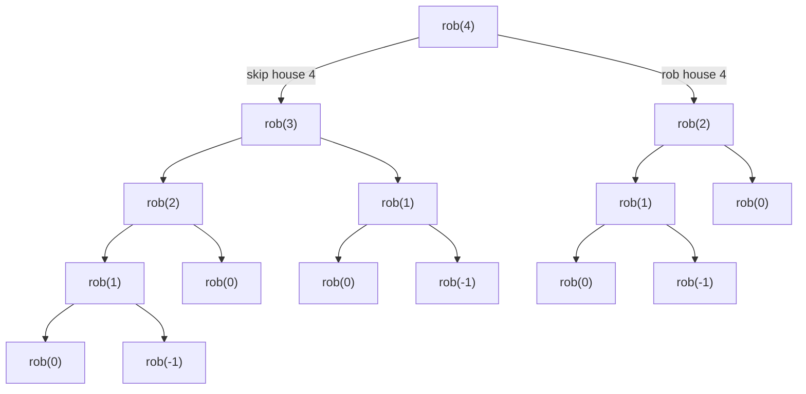
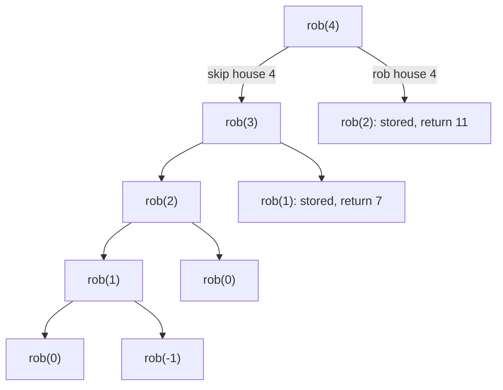
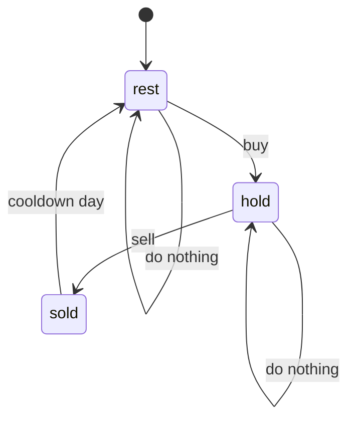

# Pattern 15: Dynamic Programming

## Overview

Dynamic programming (DP) splits a problem into smaller copies of the same problem, solves each distinct copy once, and stores its answer. It applies when a brute-force recursion asks the same smaller question many times. The page names its terms (state, transition, base case) after you have used them, in the section "The Pattern". This page derives the technique from the brute-force recursion for House Robber. It then applies the same steps to a grid, Coin Change, Longest Common Subsequence, 0/1 knapsack, Longest Increasing Subsequence, an interval problem, and a state-machine problem.

After this page you can:

- Write the brute-force recursion for a problem that you have not seen, and name the arguments that form its state.
- Expand a recursion by hand, count the repeated calls, and decide whether DP applies.
- Write the transition, the base cases, the fill order, and the answer cell of a table, and trace the table by hand.
- Convert a recursion that stores its answers (top-down, memoization) to a loop that fills a table (bottom-up, tabulation), and the other way around.
- Explain why the one-dimensional 0/1 knapsack loops its capacity downward and the unbounded knapsack loops it upward.
- Reduce a table to one row or to a few variables, and state the condition that makes the reduction valid.

## Prerequisites

| You need | Why this page needs it | Where to learn it |
|---|---|---|
| Recursion: a method that calls itself on a smaller input and stops at a base case | DP starts as a recursion. Memoization adds a cache to the recursion | [Recursion](../foundations/09-recursion.md) |
| Complexity analysis: counting calls and loop steps | The cost of DP is the number of states times the work per state. You count both | [Complexity Analysis](../foundations/01-complexity-analysis.md) |
| Arrays and strings: indexing, `length`, `charAt`, two-dimensional arrays | Every DP table is an array. The strings problems index two strings at once | [Arrays, Strings, and Linked Lists](../foundations/02-arrays-strings-linked-lists.md) |
| Backtracking as "try every choice" | The recursion tree of a DP problem is a backtracking tree in which equal nodes repeat. DP merges them | [Pattern 8: Recursion and Backtracking](../08-recursion-backtracking/README.md) |
| Binary search on a sorted array: find the first position whose value is at least `x` | The O(n log n) form of the Longest Increasing Subsequence searches a sorted array of tails | [Pattern 6: Binary Search](../06-binary-search-on-answer/README.md) |
| `List`, `Set`, `HashSet`, and `contains` | Word Break tests whether a piece of the string is in a set of words | [Hash Tables](../foundations/04-hash-tables.md) and [Java Toolkit](../java-toolkit.md) |
| Graph words: vertex, edge, path, cycle | One counterexample (longest simple path) and the "Looks similar" table use them | [Graph Representations](../foundations/07-graph-representations.md) |

## Motivation

### The anchor problem: House Robber (LC 198)

A street has 5 houses in a row. House `i` holds `money[i]`. You take the money from some houses. You may not take from two houses that are next to each other. What is the largest total?

```text
house    0   1   2   3   4
money    2   7   9   3   1
```

The answer is 12: take houses 0, 2, and 4 (2 + 9 + 1). This is [LC 198: House Robber](https://leetcode.com/problems/house-robber/). The goal of the page is a method that finds this answer for every street, and a reason why the method is correct.

### First attempt: a rule that decides early

Two rules come to mind first. A rule is wrong if one small street breaks it.

| Rule | A street that breaks it | The rule gives | The best total |
|---|---|---|---|
| Take the richest house, block its neighbors, repeat | `[5, 6, 5]` | 6 (house 1 blocks houses 0 and 2) | 10 (houses 0 and 2) |
| Take every other house: the even houses or the odd houses, whichever sum is larger | `[2, 1, 1, 2]` | 3 (houses 0 and 2, or houses 1 and 3) | 4 (houses 0 and 3) |

Both rules decide too early. A choice at one house changes which choices remain at the next house. A correct method must compare the choices, and not guess one.

### Second attempt: check every plan

A plan is a set of houses with no two neighbors. The brute-force method lists all subsets of the houses, discards the subsets that contain two neighbors, and keeps the largest sum. A street of `n` houses has 2^n subsets. For 30 houses, that is 2^30 = 1,073,741,824 subsets. The method is correct and too slow.

A recursion that skips the bad subsets makes 2,692,537 calls for 30 houses, which is about 400 times fewer than 2^30. The Derivation builds that recursion. It still repeats work, and the Derivation counts the repeats.

!!! note "The gap that DP removes"
    The recursion for 30 houses makes 2,692,537 calls, but it asks only 31 different questions. Each call after the first of a question repeats work. DP computes each of the 31 questions once.

## Derivation

### Step 1: look at one decision, the last house

You do not need to consider all houses at once. Look only at the last house, house 4. You can do one of two things with it.

```text
skip house 4:   houses 0..3 stay free         total = best total from houses 0..3
rob house 4:    house 3 is blocked            total = money[4] + best total from houses 0..2
```

You do not know the two best totals yet. But each one asks "what is the best total from a shorter street?" That is the original question on fewer houses. A big question has split into smaller copies of itself.

### Step 2: write the decision as a rule

Name the question. `rob(i)` means "the best total from houses 0 to `i`". The original problem asks for `rob(4)`. Step 1 gives this rule:

```text
rob(i) = max( rob(i - 1),                  // skip house i
              rob(i - 2) + money[i] )      // rob house i, so house i - 1 is blocked
```

The rule calls itself on smaller arguments, so it needs places to stop. These are the base cases:

```text
rob(-1) = 0           // a street with no house: the total is 0
rob(0)  = money[0]    // a street with one house: rob it
```

### Step 3: run the rule as plain recursion and count the repeats

A recursive method that copies the rule makes these calls for `rob(4)`:



Count the boxes of each question:

| Question | Boxes in the tree |
|---|---|
| `rob(4)` | 1 |
| `rob(3)` | 1 |
| `rob(2)` | 2 |
| `rob(1)` | 3 |
| `rob(0)` | 5 |
| `rob(-1)` | 3 |
| Total | 15 |

The street has 5 houses, and the tree has 15 calls for 6 different questions. The call `rob(2)` runs twice, `rob(1)` three times, and `rob(0)` five times. Each repeat does the same work and returns the same number. A recursion that asks the same smaller question more than once has **overlapping subproblems**.

The repeats grow with each house. Let `calls(i)` be the number of calls that `rob(i)` makes. Then `calls(i) = calls(i - 1) + calls(i - 2) + 1`, because `rob(i)` is one call plus the two calls below it. The numbers are 15 calls for 5 houses and 2,692,537 calls for 30 houses (the program below counts them). Each added house multiplies the count by about 1.6, because `calls(i)` grows like the Fibonacci numbers (each number is the sum of the two numbers before it).

### Step 4: store each answer the first time (memoization)

The fix removes the repeats. The first time `rob(i)` finishes, store its result in an array. On every later call with the same `i`, return the stored result and make no calls below it. The array is the **memo**, and the technique is **memoization**.



The two boxes that say "stored" return at once, and the subtrees below them are gone. The count is now 9 calls for 5 houses and 59 calls for 30 houses. The count has a reason. Each `rob(i)` for `i >= 1` runs its body once, and the body makes 2 calls. For 30 houses that is 29 bodies times 2 calls, plus the first call, which gives 59.

| Houses | Calls without memo | Calls with memo |
|---|---|---|
| 5 | 15 | 9 |
| 30 | 2,692,537 | 59 |

### Step 5: fill a table from left to right (tabulation)

Look at the order in which the memo fills: `rob(0)`, then `rob(1)`, then `rob(2)`, and so on. Each answer needs only the two answers to its left. So the recursion is not necessary. A plain loop can fill an array from left to right. This technique is **tabulation**, and the array is the **table**.

An array cannot have the index -1, so shift the table by one. Let `dp[k]` be the best total from the first `k` houses. Then `dp[k] = rob(k - 1)`, and `dp[0] = rob(-1) = 0` is the street with no house. The rule becomes:

```text
dp[0] = 0
dp[k] = max( dp[k - 1],                    // skip house k - 1
             dp[k - 2] + money[k - 1] )    // rob house k - 1; for k = 1 use 0 for dp[k - 2]
```

In the pictures below, the cell under house `h` is `dp[h + 1]`, and the cell under "before" is `dp[0]`. So the cell that a step writes is one position to the right of the house that the step reads. Click through the steps. Each step fills one cell. Legend: `{ }` is read for "skip", `( )` is read for "rob", `[ ]` is written in this step, and `.` is empty.

=== "Robber start"

    ```text
    house     before    0     1     2     3     4
    money               2     7     9     3     1
    dp         [0]      .     .     .     .     .
    ```

    The street with no house has total 0. Write `dp[0] = 0`. Every other cell is empty.

=== "Robber house 0"

    ```text
    house     before    0     1     2     3     4
    money              (2)    7     9     3     1
    dp         {0}     [2]    .     .     .     .
    ```

    - Skip house 0: the total stays `dp[0]` = 0.
    - Rob house 0: no house comes before it, so the total is 0 + 2 = 2.
    - The larger value is 2, so `dp[1] = 2`. With only house 0, the best total is 2.

=== "Robber house 1"

    ```text
    house     before    0     1     2     3     4
    money               2    (7)    9     3     1
    dp         (0)     {2}   [7]    .     .     .
    ```

    - Skip house 1: keep `dp[1]` = 2.
    - Rob house 1: house 0 is blocked. The total is `dp[0]` + 7 = 0 + 7 = 7.
    - The larger value is 7, so `dp[2] = 7`.

=== "Robber house 2"

    ```text
    house     before    0     1     2     3     4
    money               2     7    (9)    3     1
    dp          0      (2)   {7}   [11]   .     .
    ```

    - Skip house 2: keep `dp[2]` = 7.
    - Rob house 2: house 1 is blocked. The total is `dp[1]` + 9 = 2 + 9 = 11.
    - The larger value is 11, so `dp[3] = 11`.

=== "Robber house 3"

    ```text
    house     before    0     1     2     3     4
    money               2     7     9    (3)    1
    dp          0       2    (7)  {11}  [11]    .
    ```

    - Skip house 3: keep `dp[3]` = 11.
    - Rob house 3: house 2 is blocked. The total is `dp[2]` + 3 = 7 + 3 = 10.
    - The larger value is 11, so `dp[4] = 11`. Skipping wins, because robbing house 3 gives up house 2, which holds 9.

=== "Robber house 4"

    ```text
    house     before    0     1     2     3     4
    money               2     7     9     3    (1)
    dp          0       2     7   (11)  {11}  [12]
    ```

    - Skip house 4: keep `dp[4]` = 11.
    - Rob house 4: house 3 is blocked. The total is `dp[3]` + 1 = 11 + 1 = 12.
    - The larger value is 12, so `dp[5] = 12`. The last cell covers the whole street, so the answer is 12.

### Step 6: why the rule gives the best total

The invariant (a statement that stays true after every step) is: after step `k`, the cell `dp[k]` holds the best total from the first `k` houses. The invariant holds before step 1, because `dp[0] = 0` is the best total from no house.

Assume that `dp[k - 1]` and `dp[k - 2]` are right. Take any best plan for the first `k` houses. The plan robs house `k - 1` or it does not. There is no third case.

1. **The plan does not rob house `k - 1`.** Then the plan uses only the first `k - 1` houses. No plan for those houses beats `dp[k - 1]`, so this case gives at most `dp[k - 1]`. And `dp[k - 1]` is reachable, so this case gives exactly `dp[k - 1]`.
2. **The plan robs house `k - 1`.** Then it does not rob house `k - 2`. The other robbed houses are in the first `k - 2` houses, and their total is at most `dp[k - 2]`. So this case gives at most `dp[k - 2] + money[k - 1]`, and that value is reachable.

The rule takes the larger of the two cases, so it finds the best plan. This argument works because the best plan for a long street contains a best plan for a shorter street. That property is **optimal substructure**. If a problem does not have it, the DP rule gives wrong answers (the Pattern section shows a problem without it).

### Step 7: read back which houses to rob

The table holds the best total, not the houses. To find the houses, walk the table from the right end to the left end. At the cell `dp[k]`, compare it with `dp[k - 1]`:

- If `dp[k] == dp[k - 1]`, skipping house `k - 1` gave the total. Move to `k - 1`.
- If not, robbing house `k - 1` gave the total. Record house `k - 1`. Move to `k - 2`, because house `k - 2` is blocked.

| At cell | `dp[k]` | `dp[k - 1]` | Decision | Next cell |
|---|---|---|---|---|
| 5 | 12 | 11 | Different: rob house 4 | 3 |
| 3 | 11 | 7 | Different: rob house 2 | 1 |
| 1 | 2 | 0 | Different: rob house 0 | stop |

The plan is houses 0, 2, and 4, with total 2 + 9 + 1 = 12.

### Step 8: reduce the space to two variables

The cell `dp[k]` reads only `dp[k - 1]` and `dp[k - 2]`. When the loop is at cell `k`, no later step reads `dp[k - 3]` or any cell before it. So two variables can replace the array. Keep `oneBack = dp[k - 1]` and `twoBack = dp[k - 2]`. After each step, move `oneBack` into `twoBack` and put the new value into `oneBack`. The reduction is valid because every cell reads a fixed, small number of cells to its left. The two-variable version cannot read the houses back, because it stores no table.

### Step 9: the cost, counted from the trace

The trace has one step for each house, and each step does 2 reads, 1 addition, and 1 `max`. So the time is O(n) for `n` houses. The table has `n + 1` cells, so the space is O(n). With two variables, the space is O(1).

### The Java program with its trace

The program fills the table, prints one line for each step, reads the houses back, runs the two-variable version, counts the calls of the recursion, and tests four edge streets.

```java
import java.util.ArrayList;
import java.util.Arrays;
import java.util.List;

public class HouseRobberTrace {
    static long calls = 0; // counts every call of robBrute or robMemo

    public static void main(String[] args) {
        int[] money = {2, 7, 9, 3, 1};
        int n = money.length;

        // dp[k] = best total from the first k houses, so dp[0] is the street with no house.
        int[] dp = new int[n + 1];
        for (int k = 1; k <= n; k++) {
            int skip = dp[k - 1];                                // do not rob house k - 1
            int rob = (k >= 2 ? dp[k - 2] : 0) + money[k - 1];   // rob it; house k - 2 is blocked
            dp[k] = Math.max(skip, rob);
            System.out.printf("house %d (money %d): skip = %2d, rob = %2d -> dp[%d] = %2d%n",
                    k - 1, money[k - 1], skip, rob, k, dp[k]);
        }
        System.out.println("dp = " + Arrays.toString(dp));

        // Read the plan back, from the last house to the first.
        List<Integer> robbed = new ArrayList<>();
        int k = n;
        while (k >= 1) {
            if (dp[k] == dp[k - 1]) {
                k -= 1;                   // skipping house k - 1 gave the same total
            } else {
                robbed.add(0, k - 1);     // house k - 1 is in the plan, so house k - 2 is not
                k -= 2;
            }
        }
        System.out.println("robbed houses = " + robbed + ", total = " + dp[n]);

        System.out.println("two variables give " + bestTotal(money));

        // Edge cases: no house, one house, all equal, the best plan at the first and last house.
        int[][] streets = {{}, {5}, {4, 4, 4}, {9, 1, 1}, {1, 1, 9}, {5, 6, 5}, {2, 1, 1, 2}};
        for (int[] street : streets) {
            System.out.println(Arrays.toString(street) + " -> " + bestTotal(street));
        }

        // Count the calls of the recursion for 5 and for 30 houses.
        for (int size : new int[] {5, 30}) {
            int[] street = new int[size];
            Arrays.fill(street, 1);
            calls = 0;
            robBrute(street, size - 1);
            long brute = calls;
            calls = 0;
            robMemo(street, size - 1, new Integer[size]);
            System.out.println(size + " houses: calls without memo = " + brute
                    + ", with memo = " + calls);
        }
    }

    // Two variables instead of the array: twoBack = dp[k - 2], oneBack = dp[k - 1].
    static int bestTotal(int[] money) {
        int twoBack = 0, oneBack = 0;
        for (int x : money) {
            int current = Math.max(oneBack, twoBack + x);
            twoBack = oneBack;
            oneBack = current;
        }
        return oneBack;
    }

    // Without a memo, the same i is computed many times.
    static int robBrute(int[] money, int i) {
        calls++;
        if (i < 0) return 0;
        if (i == 0) return money[0];
        return Math.max(robBrute(money, i - 1), robBrute(money, i - 2) + money[i]);
    }

    // With a memo, each i is computed once; later calls read the stored answer.
    static int robMemo(int[] money, int i, Integer[] memo) {
        calls++;
        if (i < 0) return 0;
        if (i == 0) return money[0];
        if (memo[i] != null) return memo[i];
        int best = Math.max(robMemo(money, i - 1, memo), robMemo(money, i - 2, memo) + money[i]);
        memo[i] = best;
        return best;
    }
}
```

<!-- expected-output -->
```text
house 0 (money 2): skip =  0, rob =  2 -> dp[1] =  2
house 1 (money 7): skip =  2, rob =  7 -> dp[2] =  7
house 2 (money 9): skip =  7, rob = 11 -> dp[3] = 11
house 3 (money 3): skip = 11, rob = 10 -> dp[4] = 11
house 4 (money 1): skip = 11, rob = 12 -> dp[5] = 12
dp = [0, 2, 7, 11, 11, 12]
robbed houses = [0, 2, 4], total = 12
two variables give 12
[] -> 0
[5] -> 5
[4, 4, 4] -> 8
[9, 1, 1] -> 10
[1, 1, 9] -> 10
[5, 6, 5] -> 10
[2, 1, 1, 2] -> 4
5 houses: calls without memo = 15, with memo = 9
30 houses: calls without memo = 2692537, with memo = 59
```

The five "house" lines are the five steps of Step 5. The call counts match Steps 3 and 4.

## The Pattern

DP turns a recursion with repeated calls into a table with one cell for each distinct call. You do not guess the table. You derive it from the recursion with this procedure:

```text
1. List the choices at one step.            (House Robber: rob house i, or skip it)
2. Write the recursion: one call per choice, each on a smaller input.
3. The arguments that change are the state.  (House Robber: i)
4. Expand the first calls. Does a call repeat?  If not, stop: DP does not help.
5. Memoize: store the result for each state.
6. Make the table: one dimension for each changing argument.
7. Find the order: fill each cell after the cells that it reads.
8. Find the answer cell: the cell whose state is the original question.
```

**The invariant.** Every cell holds the best answer for its own subproblem, provided that every cell it reads already holds the best answer for its subproblem. The base cells hold answers that need no reading. By induction over the fill order, every cell is right, and so is the answer cell.

### The two properties

A problem needs both properties. Each one has a problem that lacks it.

**Overlapping subproblems** means that the recursion asks the same question more than once. Without it, the memo gets no hit, and DP only adds memory.

- Counterexample: [LC 78: Subsets](https://leetcode.com/problems/subsets/). The recursion decides, for each element, "in" or "out". Each path of decisions builds a different subset, so no two calls are equal. The tree has 2^n leaves, and the output itself has 2^n subsets. A memo has nothing to reuse.
- Contrast: House Robber. `rob(2)` is reached by two different paths and means the same thing on both.

**Optimal substructure** means that the best answer for a problem is built from the best answers of its subproblems. Without it, combining best parts gives a wrong or impossible answer.

- Counterexample: the longest simple path (a path that visits no vertex twice) in a graph with three vertices A, B, C and the edges A-B, B-C, and A-C. The longest simple path from A to C is A-B-C, with 2 edges. Try the DP rule "longest(A to C) = longest(A to B) + the edge B-C". The longest simple path from A to B is A-C-B, with 2 edges, so the rule gives 3. But A-C-B-C visits C twice. The best path to B uses C, and the next step needs C again. The subproblems interact through the vertices that they use, so the best parts do not combine. The same fact in the words of the definition: the best simple path from A to C is A-B-C, and its part from A to B is the path A-B with 1 edge. That part is not a best simple path from A to B, because A-C-B has 2 edges. A best answer that contains a part that is not best is a failure of optimal substructure.
- Contrast: House Robber. A best plan for the first `k` houses that robs house `k - 1` leaves out house `k - 2`, the only house that conflicts with house `k - 1`. The rest of the plan is a plan for the first `k - 2` houses, and it does not touch house `k - 2` or `k - 1`. So the rest can be replaced by any other plan for the first `k - 2` houses, in particular by the best one. Nothing in the rest conflicts with the part that stays.

### Top-down versus bottom-up

You have seen both forms on House Robber. They compute the same table.

| | Top-down (memoization) | Bottom-up (tabulation) |
|---|---|---|
| Form | The recursion plus a memo | A loop that fills a table |
| Order | The recursion finds the order | You choose the order |
| Computes | Only the states that the answer needs | Every state in the table |
| Better when | Many states are unreachable (for example, a sparse set of amounts), or the fill order is hard to see | All states are needed, the recursion would be deep, or you want to reduce the space |
| Cost | Call overhead. Java throws `StackOverflowError` when the recursion is deep, and the limit depends on the stack size of the JVM | The order must be right. A wrong order reads empty cells |
| Space reduction | Hard: the memo keeps every state | Direct: a row or a few variables, if the transition allows it |

Recommendation: in an interview, write the recursion first, because it shows the choices. Then convert it to a table when the recursion depth or the space matters.

### The vocabulary

You have now solved a DP problem. Each DP term below names something that you did.

| Term | What it was in House Robber | The question to ask in a new problem |
|---|---|---|
| State | `dp[k]`: the best total from the first `k` houses | "Which smaller copy of the question do I need, and which arguments describe it?" |
| Transition | `dp[k] = max(dp[k - 1], dp[k - 2] + money[k - 1])` | "What are my choices at one step, and what does each choice leave?" |
| Base case | `dp[0] = 0` | "Which smallest questions can I answer without the rule?" |
| Fill order | From left to right | "Which cells must be right before I fill this cell?" |
| Answer cell | `dp[n]`, the last cell | "Which cell covers the whole input? Is it the last cell, or the best of many cells?" |
| Memo, table | The array `memo` (top-down) and `dp` (bottom-up) | "How many dimensions, and how many cells?" |
| Overlapping subproblems | `rob(2)` runs twice | "Does the recursion repeat a call?" |
| Optimal substructure | The best plan contains a best plan for a shorter street | "Can I replace a part of a best answer by another best answer for that part?" |

The cost has a formula. **Time = (number of states) x (work per state).** House Robber has `n` states and O(1) work per state. Coin Change has `amount` states and one step for each coin per state.

### The families of DP

The steps stay the same in every DP problem. What changes is the shape of the state and the shape of the transition. The families below group the shapes. Each family has a worked example on this page.

| Family | State | Shape of the transition | Fill order | Problem |
|---|---|---|---|---|
| Linear (one index) | `dp[i]`: the answer for a prefix, or for the item at `i` | Reads a fixed number of cells to the left, or a range of cells to the left | Left to right | [LC 198: House Robber](https://leetcode.com/problems/house-robber/), [LC 53: Maximum Subarray](https://leetcode.com/problems/maximum-subarray/) |
| Grid | `dp[r][c]` | Reads the cell above and the cell to the left | Row by row | [LC 64: Minimum Path Sum](https://leetcode.com/problems/minimum-path-sum/) |
| Two strings | `dp[i][j]`: the answer for the first `i` characters of one string and the first `j` of the other | Equal last characters read the diagonal. Unequal ones read the cell above and the cell to the left (and the diagonal, for edit distance) | Row by row | [LC 1143: Longest Common Subsequence](https://leetcode.com/problems/longest-common-subsequence/) |
| 0/1 knapsack | `dp[i][w]`: the first `i` items, capacity or sum `w` | Skip: read the row above. Take: read the row above, `weight` cells to the left | Row by row. In one dimension, capacity downward | [LC 416: Partition Equal Subset Sum](https://leetcode.com/problems/partition-equal-subset-sum/) |
| Unbounded knapsack | `dp[i][w]` or `dp[w]` | Skip: read the row above. Take: read the same row, `weight` cells to the left | Row by row. In one dimension, capacity upward | [LC 518: Coin Change II](https://leetcode.com/problems/coin-change-ii/) |
| Interval | `dp[i][j]`: the answer for the range from `i` to `j` | Reads shorter ranges inside the range, either the range with one end removed, or two parts that share a split point | By range length, shortest first | [LC 516: Longest Palindromic Subsequence](https://leetcode.com/problems/longest-palindromic-subsequence/) |
| Decision, or state machine | `dp[i][mode]`: position `i` and a mode such as "holding stock" | Each mode reads the modes of the day before that can lead to it | By position, all modes of one position together | [LC 309: Best Time to Buy and Sell Stock with Cooldown](https://leetcode.com/problems/best-time-to-buy-and-sell-stock-with-cooldown/) |
| Counting | Any state above, with a count in the cell | The same reads as the family of the problem, but the cell adds the counts of the choices and does not take a max or a min | The same as the family of the problem | [LC 70: Climbing Stairs](https://leetcode.com/problems/climbing-stairs/), [LC 518: Coin Change II](https://leetcode.com/problems/coin-change-ii/) |

[LC 53: Maximum Subarray](https://leetcode.com/problems/maximum-subarray/) shows the linear family in a second shape. The statement: find the largest sum of a non-empty run of consecutive elements (a subarray) of an array that may hold negative numbers. Example: `[-2, 1, -3, 4, -1, 2, 1, -5, 4]` gives 6 (the subarray `4, -1, 2, 1`).

Which smaller question helps? A subarray ends at some index. Let `endingAt[i]` be the best sum of a subarray that ends at index `i`. That subarray either has only `nums[i]`, or it extends a subarray that ends at `i - 1`. If it extends one, the part before `nums[i]` should be the best one that ends at `i - 1`, because a larger part gives a larger total. So `endingAt[i] = max(nums[i], endingAt[i - 1] + nums[i])`. The best subarray can end at any index, so the answer is the maximum over all `endingAt[i]`, not the last cell. This recurrence is known as Kadane's algorithm. It uses the same "ends at `i`" state as the Longest Increasing Subsequence example below.

```text
i          0   1   2   3   4   5   6   7   8
nums      -2   1  -3   4  -1   2   1  -5   4
endingAt  -2   1  -2   4   3   5   6   1   5     answer = max = 6, last cell = 5
```

For example, at `i = 2` the choices are `-3` alone, or `1 + (-3) = -2`, so the cell is -2. At `i = 3` the choices are `4` alone, or `-2 + 4 = 2`, so the cell is 4: the earlier part is worse than nothing, and the subarray starts again. The time is O(n) and the space is O(n), or O(1) with one variable.

```java
static int[] bestEndingAt(int[] nums) {
    int[] endingAt = new int[nums.length]; // endingAt[i] = best sum ending at i
    for (int i = 0; i < nums.length; i++) {
        endingAt[i] = i == 0 ? nums[i] : Math.max(nums[i], endingAt[i - 1] + nums[i]);
    }
    return endingAt;
}

static int maxSubarray(int[] nums) {
    int best = Integer.MIN_VALUE;
    for (int value : bestEndingAt(nums)) best = Math.max(best, value);
    return best;
}
```

The two families that need their own derivation, interval and state machine, are in the Worked Examples.

## Worked Examples

Each example changes one thing about House Robber. The first four change the shape of the state or the transition. The fifth changes where the answer sits. Two more families, interval and state machine, follow after them.

### Example 1: a grid, where the state has two indexes (LC 64)

**Statement.** A grid has `rows` rows and `cols` columns of non-negative numbers. You start at the top-left cell and move to the bottom-right cell. Each move goes one cell down or one cell right. You pay the number in every cell that you enter, and the start cell too. Find the cheapest path. This is [LC 64: Minimum Path Sum](https://leetcode.com/problems/minimum-path-sum/).

```text
grid    1  3  1
        1  5  1
        4  2  1       answer: 7  (path 1 -> 3 -> 1 -> 1 -> 1)
```

**What changed.** House Robber had one changing argument, `i`. A position in a grid needs two numbers, `r` and `c`. So the state has two arguments, and the table has two dimensions.

**From brute force to the table.**

1. **Choices at one step.** Look at the last cell. You entered it from the cell above or from the cell to the left. There is no third way.
2. **Recursion.** Let `best(r, c)` be the cheapest path cost from the top-left cell to `(r, c)`. Then `best(r, c) = grid[r][c] + min(best(r - 1, c), best(r, c - 1))`.
3. **State.** The arguments that change are `r` and `c`. The state is the pair.
4. **Repeats.** The recursion from the bottom-right cell of this grid makes 19 calls, and the grid has 9 cells. For example, `best(1, 1)` is called from `best(2, 1)` and from `best(1, 2)`.
5. **Base and edges.** `best(0, 0) = grid[0][0]`. A cell in the first row has no cell above it. A cell in the first column has no cell to its left. For a missing neighbor, use the largest `int`. The `min` ignores that value, and the code adds no number to it.
6. **Order.** Cell `(r, c)` reads the cell above and the cell to the left. Row by row, left to right, fills both before `(r, c)`.
7. **Answer cell.** The bottom-right cell.

Click through the rows. In each table, `[ ]` marks a cell written in this step.

=== "Grid row 0"

    ```text
    best     col 0  col 1  col 2
    row 0     [1]    [4]    [5]
    row 1      .      .      .
    row 2      .      .      .
    ```

    - `(0, 0)`: the start. `best = 1`.
    - `(0, 1)`: only a left neighbor. `3 + 1 = 4`.
    - `(0, 2)`: only a left neighbor. `1 + 4 = 5`.

=== "Grid row 1"

    ```text
    best     col 0  col 1  col 2
    row 0      1      4      5
    row 1     [2]    [7]    [6]
    row 2      .      .      .
    ```

    - `(1, 0)`: only an upper neighbor. `1 + 1 = 2`.
    - `(1, 1)`: above is 4, left is 2. `5 + min(4, 2) = 7`.
    - `(1, 2)`: above is 5, left is 7. `1 + min(5, 7) = 6`.

=== "Grid row 2"

    ```text
    best     col 0  col 1  col 2
    row 0      1      4      5
    row 1      2      7      6
    row 2     [6]    [8]    [7]
    ```

    - `(2, 0)`: only an upper neighbor. `4 + 2 = 6`.
    - `(2, 1)`: above is 7, left is 6. `2 + min(7, 6) = 8`.
    - `(2, 2)`: above is 6, left is 8. `1 + min(6, 8) = 7`. The answer is 7.

To read the path back, start at the bottom-right cell and step to the smaller of the cell above and the cell to the left. From 7 go up to 6, then up to 5, then left to 4, then left to 1. The path is 1, 3, 1, 1, 1.

```java
static int[][] minPathTable(int[][] grid) {
    int rows = grid.length, cols = grid[0].length;
    int[][] best = new int[rows][cols]; // best[r][c] = least sum of a path from (0,0) to (r,c)
    for (int r = 0; r < rows; r++) {
        for (int c = 0; c < cols; c++) {
            if (r == 0 && c == 0) {
                best[r][c] = grid[r][c];
                continue;
            }
            int fromAbove = r > 0 ? best[r - 1][c] : Integer.MAX_VALUE;
            int fromLeft = c > 0 ? best[r][c - 1] : Integer.MAX_VALUE;
            best[r][c] = grid[r][c] + Math.min(fromAbove, fromLeft);
        }
    }
    return best;
}

static int minPathSum(int[][] grid) {
    int[][] best = minPathTable(grid);
    return best[grid.length - 1][grid[0].length - 1];
}
```

**Complexity.** The table has `rows x cols` cells, and each cell does O(1) work. The time is O(rows x cols) and the space is O(rows x cols). A row-by-row fill needs only the row above, so one row suffices (see the space reduction below).

### Example 2: Coin Change, where greedy fails and some states are impossible (LC 322)

**Statement.** You have coins of several values and an unlimited supply of each. Find the fewest coins that sum to `amount`, or -1 if no combination works. Example: coins `[1, 3, 4]`, amount 6. The answer is 2 (3 + 3). This is [LC 322: Coin Change](https://leetcode.com/problems/coin-change/).

**What changed.** The choice at one step is not "yes or no" but "which coin". The answer is a minimum over all coins, and some amounts cannot be made at all.

**The rule that fails: take the largest coin that fits.** For amount 6, greedy takes 4, then 1, then 1. That is 3 coins. The best answer is 2 coins (3 + 3). The largest coin makes the remaining amount (2) awkward. A correct method must compare the coins.

**From brute force to the table.**

1. **Choices at one step.** The last coin in a best solution is one of the coins `c` with `c <= amount`.
2. **Recursion.** Let `fewest(a)` be the fewest coins for amount `a`. Then `fewest(a) = 1 + min over coins c <= a of fewest(a - c)`, and `fewest(0) = 0`.
3. **State.** The argument that changes is `a`. One dimension.
4. **Repeats.** For coins `[1, 3, 4]`, amount 6 makes 24 calls for 7 different amounts (0 to 6). For amount 20 the recursion makes 20,736 calls for 21 different amounts.
5. **Why the rule is correct.** Take a best solution for amount `a`, and let `c` be one of its coins. Remove `c`. What remains is a solution for `a - c`. If a solution for `a - c` with fewer coins existed, adding `c` back would give a solution for `a` with fewer coins than the best. That is a contradiction. So the rest is a best solution for `a - c`, and the recursion covers it.
6. **Impossible amounts.** With coins `[2]`, the amounts 1 and 3 cannot be made. `fewest(1)` has no coin to use. The table needs a value for "impossible" that the `min` ignores and that the `+ 1` does not turn into a real answer. Use `amount + 1`. Every coin has a value of at least 1, so a real answer uses at most `amount` coins, and `amount + 1` is larger than every real answer. And `(amount + 1) + 1` is still larger than `amount`. So an impossible state stays above `amount`, and no guard is needed in the loop. After the loop, the answer is -1 if the cell holds more than `amount`.
7. **Order.** `fewest(a)` reads cells with a smaller amount. Fill `a` from 1 to `amount`.

Trace for coins `[1, 3, 4]`, amount 6:

```text
a   candidates                                                   fewest[a]
0   (base case)                                                      0
1   coin 1: fewest[0] + 1 = 1                                        1
2   coin 1: fewest[1] + 1 = 2                                        2
3   coin 1: fewest[2] + 1 = 3;  coin 3: fewest[0] + 1 = 1            1
4   coin 1: fewest[3] + 1 = 2;  coin 3: fewest[1] + 1 = 2;
    coin 4: fewest[0] + 1 = 1                                        1
5   coin 1: fewest[4] + 1 = 2;  coin 3: fewest[2] + 1 = 3;
    coin 4: fewest[1] + 1 = 2                                        2
6   coin 1: fewest[5] + 1 = 3;  coin 3: fewest[3] + 1 = 2;
    coin 4: fewest[2] + 1 = 3                                        2
```

Trace for the impossible case, coins `[2]`, amount 3, with `amount + 1 = 4` as the impossible value:

```text
a = 0: fewest[0] = 0
a = 1: coin 2 > 1, no candidate        -> stays 4 (impossible)
a = 2: coin 2: fewest[0] + 1 = 1       -> 1
a = 3: coin 2: fewest[1] + 1 = 5, min(4, 5) = 4  -> stays 4, and 4 > 3, so the answer is -1
```

```java
static int[] fewestCoinsTable(int[] coins, int amount) {
    int unreachable = amount + 1; // more than any real answer (at most `amount` coins)
    int[] fewest = new int[amount + 1];
    Arrays.fill(fewest, unreachable);
    fewest[0] = 0;
    for (int a = 1; a <= amount; a++) {
        for (int coin : coins) {
            if (coin <= a) fewest[a] = Math.min(fewest[a], fewest[a - coin] + 1);
        }
    }
    return fewest;
}

static int coinChange(int[] coins, int amount) {
    int[] fewest = fewestCoinsTable(coins, amount);
    return fewest[amount] > amount ? -1 : fewest[amount];
}
```

The top-down form of the same rule follows. Its memo stores `-1` for "impossible", so the code can tell "not computed yet" (`null`) from "impossible".

```java
static int fewestTopDown(int[] coins, int amount, Integer[] memo) {
    if (amount == 0) return 0;
    if (memo[amount] != null) return memo[amount];
    int best = -1; // -1 means "impossible"
    for (int coin : coins) {
        if (coin > amount) continue;
        int rest = fewestTopDown(coins, amount - coin, memo);
        if (rest != -1 && (best == -1 || rest + 1 < best)) best = rest + 1;
    }
    memo[amount] = best;
    return best;
}
```

**Complexity.** The table has `amount + 1` cells, and each cell tries every coin. The time is O(amount x number of coins) and the space is O(amount).

!!! warning "The same loop with `Integer.MAX_VALUE`"
    If you mark "impossible" with `Integer.MAX_VALUE` and add 1 without a guard, the sum overflows to a negative number. The Common Mistakes section shows the wrong output.

### Example 3: Longest Common Subsequence, where two indexes walk two strings (LC 1143)

**Statement.** A subsequence of a string keeps some characters in their order and may drop the others. Find the length of the longest subsequence that two strings share. Example: `"AGCAT"` and `"GAC"` share `"AC"` and `"GA"`, so the answer is 2. This is [LC 1143: Longest Common Subsequence](https://leetcode.com/problems/longest-common-subsequence/).

**What changed.** The input has two sequences, and each sequence needs its own index. The state has two indexes, one for each string.

**From brute force to the table.**

1. **Brute force.** List every subsequence of the first string (2^m of them) and test each against the second string. That is exponential.
2. **Choices at one step.** Look at the last character of each string.
3. **Recursion.** Let `lcs(i, j)` be the answer for the first `i` characters of `a` and the first `j` characters of `b`.
    - If the last characters are equal, `lcs(i, j) = lcs(i - 1, j - 1) + 1`.
    - If they differ, `lcs(i, j) = max(lcs(i - 1, j), lcs(i, j - 1))`.
    - If `i = 0` or `j = 0`, `lcs(i, j) = 0`.
4. **Why equal last characters can be matched.** Let `c` be the equal last character of both strings. Take a longest common subsequence `S`. There are three cases for its last pair of matched positions.
    - The pair uses neither last position. Then add `c` at the end, matched to the two last positions. That gives a longer common subsequence, which contradicts the choice of `S`. This case cannot happen.
    - The pair uses the last position of one string and an earlier position of the other string. The earlier position holds `c` too, because the two characters of a pair are equal. Move the pair in the other string to its last position, which also holds `c`. The pair stays in order with the other pairs, because the last position is after all of them. `S` keeps its length.
    - The pair uses both last positions. Nothing to change.

    So some longest subsequence matches both last characters. Remove that pair. What remains is a common subsequence of the two shorter prefixes, and it is a longest one: a longer one would give a longer `S` when the pair is added back. So `lcs(i, j) = lcs(i - 1, j - 1) + 1`.
5. **Why unequal last characters need two branches.** If the last characters differ, at most one of them is in a common subsequence. If both were used, `a`'s last character would pair with an earlier character of `b`, and `b`'s last character would pair with an earlier character of `a`. The two pairs would cross, and a subsequence cannot cross. So drop one last character, and take the better result.
6. **State and order.** The state is `(i, j)`. Cell `(i, j)` reads the cell above, the cell to the left, and the diagonal cell. Filling row by row, left to right, has all three ready. Row 0 and column 0 are the empty prefix, and they hold 0.

Click through the rows. The table has a row for each prefix of `AGCAT` and a column for each prefix of `GAC`. A label shows the last character of its prefix. `[ ]` marks a cell written in this step.

=== "LCS start"

    ```text
             ""   G    A    C
    ""       0    0    0    0
    A        0    .    .    .
    AG       0    .    .    .
    AGC      0    .    .    .
    AGCA     0    .    .    .
    AGCAT    0    .    .    .
    ```

    Row 0 and column 0 are the empty prefix, so they hold 0. Every other cell is empty.

=== "LCS row 1"

    ```text
             ""   G    A    C
    ""       0    0    0    0
    A        0   [0]  [1]  [1]
    AG       0    .    .    .
    AGC      0    .    .    .
    AGCA     0    .    .    .
    AGCAT    0    .    .    .
    ```

    - `a[0] = A`. Column G: A is not G. Above is 0, left is 0. The cell is `max(0, 0) = 0`.
    - Column A: A equals A. The cell is the diagonal cell 0, plus 1, which is 1.
    - Column C: A is not C. Above is 0, left is 1. The cell is `max(0, 1) = 1`.

=== "LCS row 2"

    ```text
             ""   G    A    C
    ""       0    0    0    0
    A        0    0    1    1
    AG       0   [1]  [1]  [1]
    AGC      0    .    .    .
    AGCA     0    .    .    .
    AGCAT    0    .    .    .
    ```

    - `a[1] = G`. Column G: G equals G. The diagonal cell is 0. The cell is 1.
    - Column A: G is not A. Above is 1, left is 1. The cell is 1.
    - Column C: G is not C. Above is 1, left is 1. The cell is 1.

=== "LCS row 3"

    ```text
             ""   G    A    C
    ""       0    0    0    0
    A        0    0    1    1
    AG       0    1    1    1
    AGC      0   [1]  [1]  [2]
    AGCA     0    .    .    .
    AGCAT    0    .    .    .
    ```

    - `a[2] = C`. Column G: C is not G. Above is 1, left is 0. The cell is 1.
    - Column A: C is not A. Above is 1, left is 1. The cell is 1.
    - Column C: C equals C. The diagonal cell (row AG, column GA) is 1. The cell is 2.

=== "LCS row 4"

    ```text
             ""   G    A    C
    ""       0    0    0    0
    A        0    0    1    1
    AG       0    1    1    1
    AGC      0    1    1    2
    AGCA     0   [1]  [2]  [2]
    AGCAT    0    .    .    .
    ```

    - `a[3] = A`. Column G: A is not G. Above is 1, left is 0. The cell is 1.
    - Column A: A equals A. The diagonal cell (row AGC, column G) is 1. The cell is 2.
    - Column C: A is not C. Above is 2, left is 2. The cell is 2.

=== "LCS row 5"

    ```text
             ""   G    A    C
    ""       0    0    0    0
    A        0    0    1    1
    AG       0    1    1    1
    AGC      0    1    1    2
    AGCA     0    1    2    2
    AGCAT    0   [1]  [2]  [2]
    ```

    - `a[4] = T`. T appears in no column, so no cell matches.
    - Column G: above is 1, left is 0. The cell is 1.
    - Column A: above is 2, left is 1. The cell is 2.
    - Column C: above is 2, left is 2. The cell is 2. The answer is 2.

The last cell holds 2, so the answer is 2.

**Read back one subsequence.** Start at the bottom-right cell. If the two characters are equal, take the character and move diagonally. If not, move to the larger of the cell above and the cell to the left (above on a tie).

```text
(5, 3): T vs C differ.  above 2 >= left 2   -> up to (4, 3)
(4, 3): A vs C differ.  above 2 >= left 2   -> up to (3, 3)
(3, 3): C vs C equal.   take C              -> diagonal to (2, 2)
(2, 2): G vs A differ.  above 1 >= left 1   -> up to (1, 2)
(1, 2): A vs A equal.   take A              -> diagonal to (0, 1)
stop. Characters taken, last to first: C, A. The subsequence is "AC".
```

```java
static int[][] lcsTable(String a, String b) {
    int[][] dp = new int[a.length() + 1][b.length() + 1];
    for (int i = 1; i <= a.length(); i++) {
        for (int j = 1; j <= b.length(); j++) {
            if (a.charAt(i - 1) == b.charAt(j - 1)) dp[i][j] = dp[i - 1][j - 1] + 1;
            else dp[i][j] = Math.max(dp[i - 1][j], dp[i][j - 1]);
        }
    }
    return dp;
}

static String lcsText(String a, String b, int[][] dp) {
    StringBuilder sb = new StringBuilder();
    int i = a.length(), j = b.length();
    while (i > 0 && j > 0) {
        if (a.charAt(i - 1) == b.charAt(j - 1)) { sb.append(a.charAt(i - 1)); i--; j--; }
        else if (dp[i - 1][j] >= dp[i][j - 1]) i--;
        else j--;
    }
    return sb.reverse().toString();
}
```

**Complexity.** The table has `(m + 1) x (n + 1)` cells with O(1) work each. The time is O(m x n) and the space is O(m x n). Two rows are enough for the length (see the space reduction below), but the read-back needs the full table.

### Example 4: 0/1 knapsack, and why the loop direction matters (LC 416, LC 518)

**Statement.** Given positive integers, decide whether you can split them into two groups with equal sums. Example: `[1, 5, 11, 5]` splits into `{1, 5, 5}` and `{11}`, so the answer is true. `[1, 2, 5]` has sum 8, and no group sums to 4, so the answer is false. This is [LC 416: Partition Equal Subset Sum](https://leetcode.com/problems/partition-equal-subset-sum/).

**What changed.** Each number is used once or not at all, and the state needs a running sum next to the index. The question is a yes/no question. A problem of this kind is called a **knapsack** problem. The general statement: each item has a weight and a value, the bag holds a total weight (the capacity), and you choose items to get the largest total value. In the **0/1 knapsack** you take each item at most once. In the **unbounded knapsack** you may take an item many times. Partition Equal Subset Sum is a 0/1 knapsack in which the weight of a number is the number, and the question is only whether the weight `target` can be filled exactly.

**Reduce the problem.** Two equal groups exist exactly when some subset of the numbers sums to `total / 2`. If `total` is odd, the answer is false. Otherwise, let `target = total / 2`. The question becomes: does some subset sum to `target`?

**The two-dimensional table first.**

1. **Choices at one step.** For the number `x = nums[i - 1]`, either leave it out, or put it in the subset.
2. **State.** `can[i][t]` is true if some subset of the first `i` numbers sums to `t`. The arguments that change are `i` and `t`.
3. **Transition.** `can[i][t] = can[i - 1][t] || can[i - 1][t - x]`. The first term leaves `x` out. The second term puts `x` in, so the other numbers must sum to `t - x`, and that needs `t >= x`.
4. **Base.** `can[0][0] = true`: the empty subset sums to 0. `can[0][t] = false` for `t > 0`.
5. **Order and answer.** Row `i` reads only row `i - 1`, so fill the rows from top to bottom. The answer is `can[n][target]`.

Trace for `[1, 5, 11, 5]`, target 11. Row `i` lists the sums that you can make with the first `i` numbers. `T` means true and `.` means false.

```text
sum                   0  1  2  3  4  5  6  7  8  9 10 11
after 0 numbers       T  .  .  .  .  .  .  .  .  .  .  .
after 1 numbers       T  T  .  .  .  .  .  .  .  .  .  .
after 2 numbers       T  T  .  .  .  T  T  .  .  .  .  .
after 3 numbers       T  T  .  .  .  T  T  .  .  .  .  T
after 4 numbers       T  T  .  .  .  T  T  .  .  .  T  T
```

Read the rows. Row 1 adds the number 1: from sum 0 you reach sum 1. Row 2 adds 5: from sums 0 and 1 you reach sums 5 and 6. Row 3 adds 11: from sum 0 you reach sum 11 (and from sums 5 and 6 you reach 16 and 17, which are above the target and are not in the table). Row 4 adds the second 5: from 0, 1, 5, 6 you reach 5, 6, 10, 11. The last cell `can[4][11]` is true.

```java
static boolean[][] reachTable(int[] nums, int target) {
    boolean[][] can = new boolean[nums.length + 1][target + 1];
    can[0][0] = true; // no numbers: only the sum 0 is reachable
    for (int i = 1; i <= nums.length; i++) {
        int x = nums[i - 1];
        for (int t = 0; t <= target; t++) {
            can[i][t] = can[i - 1][t] || (t >= x && can[i - 1][t - x]);
        }
    }
    return can;
}

static boolean canPartition2D(int[] nums) {
    int total = 0;
    for (int x : nums) total += x;
    if (total % 2 != 0) return false;
    return reachTable(nums, total / 2)[nums.length][total / 2];
}
```

**From two dimensions to one.** Row `i` reads only row `i - 1`. So keep one row and overwrite it in place. Cell `t` in the new row needs two old values: the old cell `t` (the same cell) and the old cell `t - x` (to the left). The loop direction decides whether the cell `t - x` is still old when the loop reaches `t`.

Which loop direction keeps the cell `t - x` old? The loop changes the cells that it visits, and `t - x` is smaller than `t`. A loop that visits the large cells first has not visited `t - x` yet when it works on `t`.

- **Downward** (from `target` down to `x`): the loop reaches `t` before it reaches `t - x`. The cell `t - x` is still old. This is the two-dimensional rule.
- **Upward**: the loop reaches `t - x` before `t`, and it may already have changed `t - x` in this pass. The cell `t - x` now means "reachable with the first `i` numbers", and that may already include `x`. Then `t` uses `x` twice.

Trace for `[1, 2, 5]`, target 4 (total 8). The answer must be false. Each line is the row after one more number.

```text
                    sum   0 1 2 3 4
start                     T . . . .

downward loop:
after number 1            T T . . .
after number 2            T T T T .
after number 5            T T T T .      can[4] = false: correct

upward loop:
after number 1            T T T T T      sum 4 is made of 1 + 1 + 1 + 1: wrong
after number 2            T T T T T
after number 5            T T T T T      can[4] = true: wrong
```

With the upward loop, number 1 is applied at `t = 1` (sum 1), then at `t = 2` the loop reads the cell for sum 1, which the same pass just set. So the number 1 is used again, and again. The downward loop reads the old row.

```java
static boolean canPartition(int[] nums) {
    int total = 0;
    for (int x : nums) total += x;
    if (total % 2 != 0) return false;
    int target = total / 2;
    boolean[] can = new boolean[target + 1];
    can[0] = true;
    for (int x : nums) {
        for (int t = target; t >= x; t--) { // downward: can[t - x] still belongs to the old row
            can[t] = can[t] || can[t - x];
        }
    }
    return can[target];
}

static List<boolean[]> rowsAfterEachItem(int[] nums, int target, boolean downward) {
    List<boolean[]> rows = new ArrayList<>();
    boolean[] can = new boolean[target + 1];
    can[0] = true;
    rows.add(can.clone());
    for (int x : nums) {
        if (downward) {
            for (int t = target; t >= x; t--) can[t] = can[t] || can[t - x];
        } else {
            for (int t = x; t <= target; t++) can[t] = can[t] || can[t - x];
        }
        rows.add(can.clone());
    }
    return rows;
}
```

**The value version.** Replace "is the sum reachable" with "the largest total value within the capacity". The cell becomes `best[w] = max(best[w], best[w - weight] + value)`. The two-dimensional table uses this rule, and the one-dimensional form needs the same downward loop.

Example: items with weights `[1, 3, 4]` and values `[15, 20, 30]`, capacity 4. Each row of the table is the best value for each capacity 0 to 4 with the first `i` items:

```text
capacity            0   1   2   3   4
0 items             0   0   0   0   0
1 item  (1, 15)     0  15  15  15  15
2 items (3, 20)     0  15  15  20  35     capacity 4: skip = 15, take = best[1][1] + 20 = 35
3 items (4, 30)     0  15  15  20  35     capacity 4: skip = 35, take = best[2][0] + 30 = 30
```

The answer is 35 (the items with weights 1 and 3). The one-row downward loop gives the same rows. Run on these items, the upward loop gives `[0, 15, 30, 45, 60]` after the first item: it takes the item of weight 1 four times, and the answer 60 is wrong for the 0/1 problem. That input is the unbounded knapsack, whose answer is 60.

```java
static int[][] knapsack01Table(int[] weights, int[] values, int capacity) {
    int n = weights.length;
    int[][] best = new int[n + 1][capacity + 1]; // best[i][w]: first i items, capacity w
    for (int i = 1; i <= n; i++) {
        for (int w = 0; w <= capacity; w++) {
            best[i][w] = best[i - 1][w]; // skip item i - 1
            if (weights[i - 1] <= w) {
                int taken = best[i - 1][w - weights[i - 1]] + values[i - 1];
                best[i][w] = Math.max(best[i][w], taken);
            }
        }
    }
    return best;
}

static int knapsack01(int[] weights, int[] values, int capacity) {
    int[] best = new int[capacity + 1];
    for (int i = 0; i < weights.length; i++) {
        for (int w = capacity; w >= weights[i]; w--) { // downward: 0/1
            best[w] = Math.max(best[w], best[w - weights[i]] + values[i]);
        }
    }
    return best[capacity];
}
```

#### Contrast: the unbounded knapsack (LC 518)

 [LC 518: Coin Change II](https://leetcode.com/problems/coin-change-ii/) asks for the number of coin combinations that sum to `amount`, with unlimited coins of each value. Example: coins `[1, 2, 5]`, amount 5 gives 4 combinations (5; 2+2+1; 2+1+1+1; 1+1+1+1+1).

The two-dimensional rule changes in one place. When you use coin `c`, you may use it again, so after using it you stay in the same row:

```text
ways[i][a] = ways[i - 1][a]        // do not use coin i
           + ways[i][a - c]        // use coin i once more: the same row, not the row above
```

The cell now reads its own row, to the left. In one dimension, the cell `a - c` must hold the new row's value, which includes coin `c`. So the loop must reach `a - c` before `a`. The loop goes upward, which is the loop that was wrong for 0/1.

Trace for coins `[1, 2, 5]`, amount 5 (the row after each coin, columns are amounts 0 to 5). The program in the Implementation section prints the same rows:

```text
amount             0  1  2  3  4  5
start              1  0  0  0  0  0
after coin 1       1  1  1  1  1  1
after coin 2       1  1  2  2  3  3
after coin 5       1  1  2  2  3  4      answer: 4
```

For example, after coin 2, `ways[4] = ways[4] + ways[2] = 1 + 2 = 3`. The value `ways[2] = 2` already includes coin 2, because the loop reached amount 2 first. The 3 ways to make 4 from coins 1 and 2 are 1+1+1+1, 2+1+1, and 2+2.

```java
static int countCombinations(int[] coins, int amount) {
    int[] ways = new int[amount + 1];
    ways[0] = 1;
    for (int coin : coins) {
        for (int a = coin; a <= amount; a++) { // upward: a coin may be used again
            ways[a] += ways[a - coin];
        }
    }
    return ways[amount];
}
```

The loop order also decides what you count. Derive it from the two-dimensional rule. In `ways[i][a]`, the first index is the coin, so the table has one row for each coin, and the rows are filled in the order of the coin list. One-dimensional code with the coins in the outer loop is that table compressed into one row: when the loop works on coin `i`, the row already holds the ways that use only the coins before `i`. So a combination is built in one fixed order of coins, and it is counted once.

Now swap the loops: amounts outside, coins inside. The table has no coin index. The cell `ways[a]` then means "the number of ways to reach `a`", and the rule is `ways[a] = sum of ways[a - c] over all coins c`, which says "the last coin is any coin". That rule counts a different object: the sequence of coins in the order in which you use them. For coins `[1, 2]` and amount 3, the combinations are `1+1+1` and `1+2`, which is 2. The sequences are `1+1+1`, `1+2`, and `2+1`, which is 3. For coins `[1, 2, 5]` and amount 5 the counts are 4 and 9. The count of sequences is [LC 377: Combination Sum IV](https://leetcode.com/problems/combination-sum-iv/). For a maximum or a minimum, both orders give the same answer, because the best total over a collection of coins does not depend on the order in which you add them.

```java
static int countOrderedSequences(int[] coins, int amount) {
    int[] ways = new int[amount + 1];
    ways[0] = 1;
    for (int a = 1; a <= amount; a++) {
        for (int coin : coins) {
            if (coin <= a) ways[a] += ways[a - coin];
        }
    }
    return ways[amount];
}

static int unboundedKnapsack(int[] weights, int[] values, int capacity) {
    int[] best = new int[capacity + 1];
    for (int i = 0; i < weights.length; i++) {
        for (int w = weights[i]; w <= capacity; w++) { // upward: an item may repeat
            best[w] = Math.max(best[w], best[w - weights[i]] + values[i]);
        }
    }
    return best[capacity];
}
```

**Complexity.** The 0/1 table has `n x target` cells, so the time is O(n x target). The one-dimensional form has the same time and O(target) space. The unbounded form has the same bounds with `n` coins and `amount`.

### Example 5: Longest Increasing Subsequence, where the answer is not the last cell (LC 300)

**Statement.** Find the length of the longest strictly increasing subsequence of an array. Example: `[2, 5, 3, 7, 11, 8, 1]` has the subsequence `2, 5, 7, 11` (length 4), and none longer. This is [LC 300: Longest Increasing Subsequence](https://leetcode.com/problems/longest-increasing-subsequence/).

**What changed.** The state "the answer for the first `i` elements" does not work here. The next element can extend a subsequence only if it is larger than the last element of that subsequence, and the state does not say what that last element is.

**The failing state.** Let `dp[i]` be the LIS length inside the first `i` elements. This state is too weak, and you can see it on two prefixes. The prefixes `[1, 5]` and `[1, 3]` both have the state value 2. Now the next element is 4. It extends `[1, 3]` to length 3, and it cannot extend `[1, 5]`. The two prefixes have the same state and different futures, so the state does not hold what the next step needs. The next step needs the last element of the subsequence. A rule that adds 1 whenever `nums[i] > nums[i - 1]` is one wrong attempt to repair this: for `[5, 6, 7, 1, 2]` it gives 4, and the true answer is 3. The Common Mistakes section shows this input.

**The state that works.** Put the last element into the state. Let `endingAt[i]` be the length of the longest increasing subsequence that ends at index `i`. Now you know the last element, `nums[i]`, so you can test whether a later element extends it.

1. **Choices at one step.** The subsequence that ends at `i` either has only `nums[i]`, or it extends a subsequence that ends at an earlier index `j` with `nums[j] < nums[i]`.
2. **Transition.** `endingAt[i] = 1 + max(endingAt[j])` over all `j < i` with `nums[j] < nums[i]`. If no such `j` exists, `endingAt[i] = 1`.
3. **Order.** Cell `i` reads cells to its left. Fill from left to right.
4. **The answer cell.** The best subsequence can end at any index. The answer is the maximum of the whole table, not the last cell.

Trace for `[2, 5, 3, 7, 11, 8, 1]`:

```text
i   nums[i]   earlier j with nums[j] < nums[i]  (endingAt[j])   endingAt[i]
0      2      none                                                  1
1      5      j=0 (1)                                               2
2      3      j=0 (1)                                               2
3      7      j=0 (1), j=1 (2), j=2 (2)                             3
4     11      j=0 (1), j=1 (2), j=2 (2), j=3 (3)                    4
5      8      j=0 (1), j=1 (2), j=2 (2), j=3 (3)                    4
6      1      none                                                  1

table = [1, 2, 2, 3, 4, 4, 1]    answer = max = 4      last cell = 1
```

The last cell holds 1, and the answer is 4. A solution that returns the last cell is wrong.

```java
static int[] lisTable(int[] nums) {
    int[] endingAt = new int[nums.length]; // endingAt[i] = longest run that ends at nums[i]
    for (int i = 0; i < nums.length; i++) {
        endingAt[i] = 1; // the element alone
        for (int j = 0; j < i; j++) {
            if (nums[j] < nums[i]) endingAt[i] = Math.max(endingAt[i], endingAt[j] + 1);
        }
    }
    return endingAt;
}

static int lis(int[] nums) {
    int best = 0;
    for (int len : lisTable(nums)) best = Math.max(best, len);
    return best;
}
```

**Complexity.** The table has `n` cells, and each cell scans up to `n` cells to its left. The time is O(n^2) and the space is O(n).

**The O(n log n) form.** The scan over `j` looks for the best `endingAt[j]` among smaller values. A different table avoids the scan. For each length `k + 1`, keep `tails[k]`: the smallest last value of any increasing subsequence of that length. Two facts follow.

- `tails` is increasing. If a subsequence of length `k + 2` ends at value `v`, its first `k + 1` elements form a subsequence of length `k + 1` that ends at a value below `v`. So `tails[k] < tails[k + 1]`.
- For a new element `x`, the first position `p` with `tails[p] >= x` tells what `x` does. If `p` is past the end, `x` is larger than every tail, so it extends the longest subsequence: append `x`. Otherwise `x` ends a subsequence of length `p + 1` with a last value no larger than before, so replace `tails[p]` by `x`. Binary search finds `p`, because `tails` is increasing.

Why does the replacement keep the meaning of `tails` true? Look at each length after `x` is processed.

- Length `p + 1` (or the new length, if `p` is past the end). If `p = 0`, the element `x` alone is a subsequence of length 1. If `p > 0`, then `tails[p - 1] < x`, because `p` is the first position with a tail of at least `x`. Add `x` to the subsequence that gave `tails[p - 1]`. This gives an increasing subsequence of length `p + 1` that ends at `x`, and `x <= tails[p]`. So `x` is a valid smaller last value for that length.
- Lengths up to `p`. Their tails are all smaller than `x`. A subsequence that ends at `x` cannot give a smaller last value for them.
- Lengths above `p + 1`. A subsequence of length `p + 2` or more that ends at `x` needs a subsequence of length `p + 1` before it that ends below `x`. That needs `tails[p] < x`, which is false. So `x` changes nothing there.

Each entry stays "the smallest last value for its length", and the array stays increasing. The array does not remember which elements form a subsequence. It remembers only the smallest last values, and that is all that the next element needs to know.

```text
x    tails before      p   action                 tails after
2    []                0   append                 [2]
5    [2]               1   append                 [2, 5]
3    [2, 5]            1   replace 5 by 3         [2, 3]
7    [2, 3]            2   append                 [2, 3, 7]
11   [2, 3, 7]         3   append                 [2, 3, 7, 11]
8    [2, 3, 7, 11]     3   replace 11 by 8        [2, 3, 7, 8]
1    [2, 3, 7, 8]      0   replace 2 by 1         [1, 3, 7, 8]
```

The answer is the length of `tails`, 4. The array `tails` is not itself a subsequence of the input: the last line has 1 first, and 1 comes after 3, 7, and 8 in the input. Only its length is meaningful. The loop makes `n` binary searches of O(log n) each, so the time is O(n log n) and the space is O(n). The condition `tails[mid] < x` finds the first tail that is greater than or equal to `x`. That makes the subsequence strictly increasing. For a non-decreasing subsequence, find the first tail that is greater than `x`.

```java
static int[] lisTails(int[] nums) {
    int[] tails = new int[nums.length]; // tails[k] = smallest last value of an increasing
    int size = 0;                       // subsequence of length k + 1
    for (int x : nums) {
        int lo = 0, hi = size;          // find the first position whose tail is >= x
        while (lo < hi) {
            int mid = (lo + hi) >>> 1;
            if (tails[mid] < x) lo = mid + 1;
            else hi = mid;
        }
        tails[lo] = x;
        if (lo == size) size++;
    }
    return Arrays.copyOf(tails, size);
}

static int lisFast(int[] nums) {
    return lisTails(nums).length;
}
```

For more problems that use this idea, see [Pattern 27: Advanced DP](../27-advanced-dp/README.md).

### Two more families: interval DP and state-machine DP

#### Interval DP: the state is a range (LC 516)

**Statement.** Find the length of the longest palindromic subsequence of a string. Example: `"bbbab"` has the subsequence `"bbbb"`, so the answer is 4. This is [LC 516: Longest Palindromic Subsequence](https://leetcode.com/problems/longest-palindromic-subsequence/).

**What changed.** The subproblem is not a prefix. It is a range from index `i` to index `j` in the middle of the string, so the state is the pair `(i, j)` of the two ends.

1. **Choices at one step.** Look at the two end characters of the range, `s[i]` and `s[j]`.
2. **Transition.** If they are equal, both belong at the two ends of a palindrome, and the inner range supplies the rest: `dp[i][j] = dp[i + 1][j - 1] + 2`. If they differ, at most one of them is in the best palindrome. The reason: if both `s[i]` and `s[j]` are in a palindrome subsequence of this range, they are its outermost characters, and the outermost two characters of a palindrome are equal. They are not equal, so one of them is left out, and the best palindrome lies in `s[i + 1..j]` or in `s[i..j - 1]`. So `dp[i][j] = max(dp[i + 1][j], dp[i][j - 1])`.
3. **Base.** A range of length 1 holds 1: `dp[i][i] = 1`. An empty range holds 0, and the table keeps 0 below the diagonal.
4. **Order.** Cell `(i, j)` reads ranges that are shorter by 1 or by 2. A fill by increasing length has them ready. A fill row by row from the top does not, because `dp[i + 1][...]` is in a later row. A second valid order is `i` from the last index down to 0, with `j` upward from `i + 1`: the cell `(i + 1, ...)` is in a row that is already filled, and the cell `(i, j - 1)` is to the left in the same row.
5. **Answer cell.** The range that covers the whole string, `dp[0][n - 1]`.

Trace for `"bbbab"` (indexes 0 to 4: `b b b a b`), filled by range length:

```text
length 1:  dp[i][i] = 1 for every i
length 2:  (0,1) b=b   -> 0 + 2 = 2        (1,2) b=b   -> 2
           (2,3) b!=a  -> max(dp[3][3], dp[2][2]) = 1
           (3,4) a!=b  -> max(dp[4][4], dp[3][3]) = 1
length 3:  (0,2) b=b   -> dp[1][1] + 2 = 3
           (1,3) b!=a  -> max(dp[2][3] = 1, dp[1][2] = 2) = 2
           (2,4) b=b   -> dp[3][3] + 2 = 3
length 4:  (0,3) b!=a  -> max(dp[1][3] = 2, dp[0][2] = 3) = 3
           (1,4) b=b   -> dp[2][3] + 2 = 3
length 5:  (0,4) b=b   -> dp[1][3] + 2 = 4          answer: 4

table      j=0  j=1  j=2  j=3  j=4
i=0         1    2    3    3    4
i=1         .    1    2    2    3
i=2         .    .    1    1    3
i=3         .    .    .    1    1
i=4         .    .    .    .    1
```

```java
static int[][] lpsTable(String s) {
    int n = s.length();
    int[][] dp = new int[n][n];
    for (int i = 0; i < n; i++) dp[i][i] = 1;
    for (int len = 2; len <= n; len++) {
        for (int i = 0; i + len - 1 < n; i++) {
            int j = i + len - 1;
            if (s.charAt(i) == s.charAt(j)) {
                dp[i][j] = dp[i + 1][j - 1] + 2; // len == 2: that cell is 0 (empty)
            } else {
                dp[i][j] = Math.max(dp[i + 1][j], dp[i][j - 1]);
            }
        }
    }
    return dp;
}
```

**A second shape: a split point (matrix chain multiplication).** Some interval problems do not remove an end. They split the range into two parts at a point `k`, and they try every `k`. Example: multiply three matrices A (10 by 30), B (30 by 5), and C (5 by 60). Multiplying a `p x q` matrix by a `q x r` matrix costs `p x q x r` scalar multiplications. The order of the multiplications changes the cost.

- `(AB)C` costs 10 x 30 x 5 = 1,500 for `AB`, then 10 x 5 x 60 = 3,000 for `(AB)C`. The total is 4,500.
- `A(BC)` costs 30 x 5 x 60 = 9,000 for `BC`, then 10 x 30 x 60 = 18,000. The total is 27,000.

The last multiplication splits the chain `i..j` at some `k`. Its cost is `cost[i][k] + cost[k + 1][j] + dims[i] x dims[k + 1] x dims[j + 1]`, and the best split gives `cost[i][j]`. The table is filled by chain length, as above. For `dims = [10, 30, 5, 60]`, the chains of length 2 cost 1,500 and 9,000, and the whole chain takes the smaller of 0 + 9,000 + 18,000 = 27,000 (split after A) and 1,500 + 0 + 3,000 = 4,500 (split after B). The answer is 4,500.

```java
static int[][] chainTable(int[] dims) {
    int n = dims.length - 1; // number of matrices
    int[][] cost = new int[n][n]; // cost[i][j]: fewest multiplications for matrices i..j
    for (int len = 2; len <= n; len++) {
        for (int i = 0; i + len - 1 < n; i++) {
            int j = i + len - 1;
            cost[i][j] = Integer.MAX_VALUE;
            for (int k = i; k < j; k++) { // the last multiplication splits the chain after k
                int c = cost[i][k] + cost[k + 1][j] + dims[i] * dims[k + 1] * dims[j + 1];
                cost[i][j] = Math.min(cost[i][j], c);
            }
        }
    }
    return cost;
}

static int matrixChain(int[] dims) {
    return dims.length == 2 ? 0 : chainTable(dims)[0][dims.length - 2];
}
```

The ladder problem [LC 312: Burst Balloons](https://leetcode.com/problems/burst-balloons/) uses the split-point shape with a twist: the split point is the last balloon to burst, and the Practice Problems section derives it.

**Complexity.** The range DP has O(n^2) states. A transition that removes an end costs O(1), so the time is O(n^2). A transition that tries every split point costs O(n), so the time is O(n^3).

#### State-machine DP: the state is a position and a mode (LC 309)

**Statement.** `prices[i]` is the price of a stock on day `i`. You may buy and sell many times, but you hold at most one share. After you sell, you cannot buy on the next day (a one-day cooldown). Find the largest profit. Example: `[1, 2, 3, 0, 2]` gives 3 (buy at 1, sell at 2, wait a day, buy at 0, sell at 2). This is [LC 309: Best Time to Buy and Sell Stock with Cooldown](https://leetcode.com/problems/best-time-to-buy-and-sell-stock-with-cooldown/).

**What changed.** The day alone does not describe the situation. On day 3, what you may do depends on whether you hold a share and whether you sold yesterday. A recursion for this problem needs the arguments (day, holding, sold yesterday). Those arguments are the state. The extra arguments are a small set of modes, and each day moves you from one mode to another.

At the end of a day you are in exactly one of three modes:

- `hold`: you own a share.
- `sold`: you sold a share today.
- `rest`: you own no share, and you did not sell today.



Each arrow gives one term of a transition. A mode reads the modes of the day before that have an arrow into it:

```text
hold[i] = max(hold[i - 1], rest[i - 1] - prices[i])   // keep the share, or buy after a rest day
sold[i] = hold[i - 1] + prices[i]                     // sell the share
rest[i] = max(rest[i - 1], sold[i - 1])               // stay out, or leave the cooldown
```

There is no arrow from `sold` to `hold`. That absence is the cooldown rule. Before day 0, you own nothing, so `rest = 0`, and `hold` and `sold` are impossible. Use a very negative number for "impossible". The answer is the larger of `sold` and `rest` on the last day. A plan that ends in `hold` paid for a share and earned nothing from it. The plan that did not buy that share ends in `rest` with at least as much profit, because prices are not negative. So the answer ignores `hold`.

Trace for `[1, 2, 3, 0, 2]` (`-inf` is the impossible value):

```text
day  price   hold   sold   rest   what happened
0     1       -1    -inf     0    buy at 1 is the only way to hold
1     2       -1      1      0    sell the share bought at 1: profit 2 - 1 = 1
2     3       -1      2      1    sell at 3 after buying at 1: profit 2; rest reads sold = 1
3     0        1     -1      2    buy at 0 after the rest day with profit 1: hold = 1 - 0
4     2        1      3      2    sell at 2: profit 1 + 2 = 3
answer = max(sold, rest) = max(3, 2) = 3
```

The three assignments of one day must read the values of the day before. The code computes the three new values from the old ones, and it assigns them together after that. If a line reads a value that the same day already changed, the cooldown disappears: Common Mistakes, item 7, shows the output 4 in place of 3 for this input.

```java
static int[][] cooldownStates(int[] prices) {
    int none = Integer.MIN_VALUE / 2; // "impossible", far from overflow
    int hold = none, sold = none, rest = 0;
    int[][] states = new int[prices.length][];
    for (int day = 0; day < prices.length; day++) {
        int p = prices[day];
        int newHold = Math.max(hold, rest - p); // keep the stock, or buy after a rest day
        int newSold = hold + p;                 // sell the stock today
        int newRest = Math.max(rest, sold);     // hold no stock; cooldown ends after a sale
        hold = newHold;
        sold = newSold;
        rest = newRest;
        states[day] = new int[] {hold, sold, rest};
    }
    return states;
}

static int maxProfitCooldown(int[] prices) {
    if (prices.length == 0) return 0;
    int[] last = cooldownStates(prices)[prices.length - 1];
    return Math.max(last[1], last[2]);
}
```

**Complexity.** The state has `n` days and 3 modes, and each transition does O(1) work. The time is O(n) and the space is O(n) with the table, or O(1) with three variables, because each day reads only the day before.

The other stock problems ([LC 121: Best Time to Buy and Sell Stock](https://leetcode.com/problems/best-time-to-buy-and-sell-stock/), [LC 122: Best Time to Buy and Sell Stock II](https://leetcode.com/problems/best-time-to-buy-and-sell-stock-ii/), [LC 123: Best Time to Buy and Sell Stock III](https://leetcode.com/problems/best-time-to-buy-and-sell-stock-iii/), [LC 188: Best Time to Buy and Sell Stock IV](https://leetcode.com/problems/best-time-to-buy-and-sell-stock-iv/), and [LC 714: Best Time to Buy and Sell Stock with Transaction Fee](https://leetcode.com/problems/best-time-to-buy-and-sell-stock-with-transaction-fee/)) use the same method with other modes. Add the number of transactions that are left to the mode for LC 123 and LC 188. Remove the cooldown arrow and add a fee to the sell term for LC 714.

## Implementation

Every template below was derived in an example above. This section collects the lines that need care, and then gives one program that runs all of them.

| Template | Derived in | Line that needs care |
|---|---|---|
| Table with a padded first cell (`dp[k]` for the first `k` items) | House Robber, Step 5 | The loop runs `k` from 1 to `n` inclusive (`<=`). The array has `n + 1` cells. `money[k - 1]` is the item for cell `k` |
| Table over two strings | LCS, Edit Distance | `a.charAt(i - 1)` and `b.charAt(j - 1)`: the table is 1-based, and the strings are 0-based |
| Grid | Example 1 | The first row and the first column miss a neighbor. A missing neighbor reads as `Integer.MAX_VALUE`, which the `min` ignores. The code adds only to the result of the `min`, and not to a missing neighbor |
| Minimum with impossible states | Coin Change | The impossible value is `amount + 1`. The loop adds 1 to it, and the result stays above `amount`. A cell starts at `amount + 1` and only `min` lowers it, so a cell never holds more than `amount + 1`. The final test `> amount` is the clearest form |
| 0/1 knapsack in one row | Example 4 | The inner loop is `for (t = target; t >= x; t--)`. The lower bound `x` stops the read of `can[t - x]` with a negative index |
| Unbounded knapsack in one row | Example 4 | The inner loop is `for (a = coin; a <= amount; a++)`. Coins are the outer loop to count combinations |
| Interval by length | Example "interval" | `i + len - 1 < n` keeps `j` inside the string. `dp[i + 1][j - 1]` for `len == 2` reads below the diagonal, which holds 0 |
| State machine | Example "state machine" | The three new values are computed from the old values and assigned together, after all three are computed |

The program below runs the templates on the inputs of this page and on edge inputs: an empty street, one step, a one-cell grid, an amount of 0, an impossible amount, an empty string, a sum that cannot split, all-equal numbers, all-negative numbers, and a single price. The practice ladder has its own program, after problem P12, so that the solutions of the ladder do not appear before the hints.

```java
import java.util.ArrayList;
import java.util.Arrays;
import java.util.List;

public class DpLessonDemo {
    public static void main(String[] args) {
        System.out.println("== House Robber (LC 198), Climbing Stairs (LC 70) ==");
        int[][] streets = {{}, {5}, {2, 7, 9, 3, 1}, {5, 6, 5}, {2, 1, 1, 2}};
        for (int[] m : streets) {
            System.out.println(Arrays.toString(m) + " -> " + robTable(m));
        }
        System.out.println("climbing stairs for 1, 2, 5, 10 steps: " + climbStairs(1) + ", "
                + climbStairs(2) + ", " + climbStairs(5) + ", " + climbStairs(10));

        System.out.println("== Grid (LC 64) ==");
        int[][] grid = {{1, 3, 1}, {1, 5, 1}, {4, 2, 1}};
        for (int[] row : minPathTable(grid)) System.out.println(Arrays.toString(row));
        System.out.println("min path sum = " + minPathSum(grid)
                + ", one row = " + minPathSumOneRow(grid));
        System.out.println("1 x 1 grid [[7]] -> " + minPathSum(new int[][] {{7}}));

        System.out.println("== Coin Change (LC 322) ==");
        int[] coins = {1, 3, 4};
        System.out.println("fewest coins, amounts 0..6 = "
                + Arrays.toString(fewestCoinsTable(coins, 6)));
        System.out.println("DP answer for 6 = " + coinChange(coins, 6)
                + ", greedy answer = " + coinChangeGreedy(coins, 6)
                + ", top-down = " + fewestTopDown(coins, 6, new Integer[7]));
        System.out.println("coins [2], amount 3 -> " + coinChange(new int[] {2}, 3)
                + ", top-down -> " + fewestTopDown(new int[] {2}, 3, new Integer[4]));
        System.out.println("coins [1], amount 0 -> " + coinChange(new int[] {1}, 0));

        System.out.println("== Longest Common Subsequence (LC 1143) ==");
        String s1 = "AGCAT", s2 = "GAC";
        int[][] lcs = lcsTable(s1, s2);
        for (int[] row : lcs) System.out.println(Arrays.toString(row));
        System.out.println("length = " + lcs[s1.length()][s2.length()]
                + ", one subsequence = " + lcsText(s1, s2, lcs)
                + ", two rows = " + lcsTwoRows(s1, s2));
        System.out.println("empty against GAC -> " + lcsTable("", s2)[0][3]);

        System.out.println("== Partition Equal Subset Sum (LC 416) ==");
        int[] nums = {1, 5, 11, 5};
        boolean[][] reach = reachTable(nums, 11);
        for (int i = 0; i < reach.length; i++) {
            System.out.println("after " + i + " numbers  " + show(reach[i]));
        }
        System.out.println("[1, 5, 11, 5] -> " + canPartition(nums)
                + " (2D: " + canPartition2D(nums) + ")");
        System.out.println("[1, 2, 5] -> " + canPartition(new int[] {1, 2, 5}));
        System.out.println("[1, 2, 3] -> " + canPartition(new int[] {1, 2, 3}));
        System.out.println("[2] -> " + canPartition(new int[] {2}));
        int[] three = {1, 2, 5};
        System.out.println("downward, [1, 2, 5], target 4:");
        for (boolean[] r : rowsAfterEachItem(three, 4, true)) System.out.println("  " + show(r));
        System.out.println("upward, [1, 2, 5], target 4:");
        for (boolean[] r : rowsAfterEachItem(three, 4, false)) System.out.println("  " + show(r));

        System.out.println("== 0/1 knapsack and unbounded knapsack with values ==");
        int[] weights = {1, 3, 4}, values = {15, 20, 30};
        for (int[] row : knapsack01Table(weights, values, 4)) {
            System.out.println(Arrays.toString(row));
        }
        System.out.println("0/1 = " + knapsack01(weights, values, 4)
                + ", unbounded = " + unboundedKnapsack(weights, values, 4));
        System.out.println("downward rows:");
        for (int[] r : valueRowsAfterEachItem(weights, values, 4, true)) {
            System.out.println("  " + Arrays.toString(r));
        }
        System.out.println("upward rows:");
        for (int[] r : valueRowsAfterEachItem(weights, values, 4, false)) {
            System.out.println("  " + Arrays.toString(r));
        }

        System.out.println("== Coin Change II (LC 518) ==");
        int[] cs = {1, 2, 5};
        for (int[] r : waysAfterEachCoin(cs, 5)) System.out.println("  " + Arrays.toString(r));
        System.out.println("combinations of [1, 2, 5] for 5 = " + countCombinations(cs, 5));
        System.out.println("ordered sequences = " + countOrderedSequences(cs, 5));
        System.out.println("combinations of [1, 2] for 3 = "
                + countCombinations(new int[] {1, 2}, 3)
                + ", ordered sequences = " + countOrderedSequences(new int[] {1, 2}, 3));
        System.out.println("combinations of [2] for 3 = " + countCombinations(new int[] {2}, 3));

        System.out.println("== Longest Increasing Subsequence (LC 300) ==");
        int[] seq = {2, 5, 3, 7, 11, 8, 1};
        System.out.println("run ending at each index = " + Arrays.toString(lisTable(seq)));
        System.out.println("answer = " + lis(seq) + ", fast = " + lisFast(seq));
        for (int k = 1; k <= seq.length; k++) {
            int[] tails = lisTails(Arrays.copyOf(seq, k));
            System.out.println("tails after " + seq[k - 1] + " = " + Arrays.toString(tails));
        }
        System.out.println("[4, 4, 4] -> " + lis(new int[] {4, 4, 4})
                + ", [9] -> " + lis(new int[] {9}));

        System.out.println("== Interval DP: LC 516 and matrix chain ==");
        for (int[] row : lpsTable("bbbab")) System.out.println(Arrays.toString(row));
        int[] dims = {10, 30, 5, 60};
        int[][] chain = chainTable(dims);
        for (int[] row : chain) System.out.println(Arrays.toString(row));
        System.out.println("split after A: " + chain[0][0] + " + " + chain[1][2] + " + "
                + dims[0] * dims[1] * dims[3] + " = "
                + (chain[0][0] + chain[1][2] + dims[0] * dims[1] * dims[3]));
        System.out.println("split after B: " + chain[0][1] + " + " + chain[2][2] + " + "
                + dims[0] * dims[2] * dims[3] + " = "
                + (chain[0][1] + chain[2][2] + dims[0] * dims[2] * dims[3]));
        System.out.println("matrix chain [10, 30, 5, 60] -> " + matrixChain(dims));

        System.out.println("== State machine: LC 309 ==");
        int[] prices = {1, 2, 3, 0, 2};
        int[][] states = cooldownStates(prices);
        for (int d = 0; d < prices.length; d++) {
            System.out.println("day " + d + " price " + prices[d]
                    + ": hold " + cell(states[d][0]) + ", sold " + cell(states[d][1])
                    + ", rest " + cell(states[d][2]));
        }
        System.out.println("profit = " + maxProfitCooldown(prices)
                + ", one price -> " + maxProfitCooldown(new int[] {4}));

        System.out.println("== Maximum Subarray (LC 53) ==");
        int[] changes = {-2, 1, -3, 4, -1, 2, 1, -5, 4};
        System.out.println("best sum ending at each index = "
                + Arrays.toString(bestEndingAt(changes)));
        System.out.println("answer = " + maxSubarray(changes)
                + ", all negative [-3, -1, -2] -> " + maxSubarray(new int[] {-3, -1, -2}));
    }

    static String show(boolean[] row) {
        StringBuilder sb = new StringBuilder();
        for (boolean b : row) sb.append(b ? "T " : ". ");
        return sb.toString().trim();
    }

    static String cell(int v) {
        return v < -1_000_000 ? "-inf" : String.valueOf(v);
    }

    static int robTable(int[] m) {
        int n = m.length;
        int[] dp = new int[n + 1]; // dp[k] = best total from the first k houses
        for (int k = 1; k <= n; k++) {
            int skip = dp[k - 1];
            int rob = (k >= 2 ? dp[k - 2] : 0) + m[k - 1];
            dp[k] = Math.max(skip, rob);
        }
        return dp[n];
    }

    static int[][] minPathTable(int[][] grid) {
        int rows = grid.length, cols = grid[0].length;
        int[][] best = new int[rows][cols]; // best[r][c] = least sum of a path from (0,0) to (r,c)
        for (int r = 0; r < rows; r++) {
            for (int c = 0; c < cols; c++) {
                if (r == 0 && c == 0) {
                    best[r][c] = grid[r][c];
                    continue;
                }
                int fromAbove = r > 0 ? best[r - 1][c] : Integer.MAX_VALUE;
                int fromLeft = c > 0 ? best[r][c - 1] : Integer.MAX_VALUE;
                best[r][c] = grid[r][c] + Math.min(fromAbove, fromLeft);
            }
        }
        return best;
    }

    static int minPathSum(int[][] grid) {
        int[][] best = minPathTable(grid);
        return best[grid.length - 1][grid[0].length - 1];
    }

    static int minPathSumOneRow(int[][] grid) {
        int cols = grid[0].length;
        int[] best = new int[cols]; // best[c] = cheapest path to column c of the current row
        for (int r = 0; r < grid.length; r++) {
            for (int c = 0; c < cols; c++) {
                if (r == 0 && c == 0) {
                    best[c] = grid[0][0];
                    continue;
                }
                int fromAbove = r > 0 ? best[c] : Integer.MAX_VALUE;      // still the row above
                int fromLeft = c > 0 ? best[c - 1] : Integer.MAX_VALUE;   // already this row
                best[c] = grid[r][c] + Math.min(fromAbove, fromLeft);
            }
        }
        return best[cols - 1];
    }

    static int climbStairs(int n) {
        int twoBack = 1, oneBack = 1; // ways to stand on step 0 and step 1
        for (int step = 2; step <= n; step++) {
            int current = oneBack + twoBack;
            twoBack = oneBack;
            oneBack = current;
        }
        return oneBack;
    }

    static int[] fewestCoinsTable(int[] coins, int amount) {
        int unreachable = amount + 1; // more than any real answer (at most `amount` coins)
        int[] fewest = new int[amount + 1];
        Arrays.fill(fewest, unreachable);
        fewest[0] = 0;
        for (int a = 1; a <= amount; a++) {
            for (int coin : coins) {
                if (coin <= a) fewest[a] = Math.min(fewest[a], fewest[a - coin] + 1);
            }
        }
        return fewest;
    }

    static int coinChange(int[] coins, int amount) {
        int[] fewest = fewestCoinsTable(coins, amount);
        return fewest[amount] > amount ? -1 : fewest[amount];
    }

    static int coinChangeGreedy(int[] coins, int amount) {
        int[] sorted = coins.clone();
        Arrays.sort(sorted);
        int count = 0;
        for (int i = sorted.length - 1; i >= 0; i--) {
            count += amount / sorted[i];
            amount %= sorted[i];
        }
        return amount == 0 ? count : -1;
    }

    static int fewestTopDown(int[] coins, int amount, Integer[] memo) {
        if (amount == 0) return 0;
        if (memo[amount] != null) return memo[amount];
        int best = -1; // -1 means "impossible"
        for (int coin : coins) {
            if (coin > amount) continue;
            int rest = fewestTopDown(coins, amount - coin, memo);
            if (rest != -1 && (best == -1 || rest + 1 < best)) best = rest + 1;
        }
        memo[amount] = best;
        return best;
    }

    static int[][] lcsTable(String a, String b) {
        int[][] dp = new int[a.length() + 1][b.length() + 1];
        for (int i = 1; i <= a.length(); i++) {
            for (int j = 1; j <= b.length(); j++) {
                if (a.charAt(i - 1) == b.charAt(j - 1)) dp[i][j] = dp[i - 1][j - 1] + 1;
                else dp[i][j] = Math.max(dp[i - 1][j], dp[i][j - 1]);
            }
        }
        return dp;
    }

    static String lcsText(String a, String b, int[][] dp) {
        StringBuilder sb = new StringBuilder();
        int i = a.length(), j = b.length();
        while (i > 0 && j > 0) {
            if (a.charAt(i - 1) == b.charAt(j - 1)) { sb.append(a.charAt(i - 1)); i--; j--; }
            else if (dp[i - 1][j] >= dp[i][j - 1]) i--;
            else j--;
        }
        return sb.reverse().toString();
    }

    static int lcsTwoRows(String a, String b) {
        int[] prev = new int[b.length() + 1], cur = new int[b.length() + 1];
        for (int i = 1; i <= a.length(); i++) {
            for (int j = 1; j <= b.length(); j++) {
                if (a.charAt(i - 1) == b.charAt(j - 1)) cur[j] = prev[j - 1] + 1;
                else cur[j] = Math.max(prev[j], cur[j - 1]);
            }
            int[] t = prev; prev = cur; cur = t;
        }
        return prev[b.length()];
    }

    static boolean[][] reachTable(int[] nums, int target) {
        boolean[][] can = new boolean[nums.length + 1][target + 1];
        can[0][0] = true; // no numbers: only the sum 0 is reachable
        for (int i = 1; i <= nums.length; i++) {
            int x = nums[i - 1];
            for (int t = 0; t <= target; t++) {
                can[i][t] = can[i - 1][t] || (t >= x && can[i - 1][t - x]);
            }
        }
        return can;
    }

    static boolean canPartition2D(int[] nums) {
        int total = 0;
        for (int x : nums) total += x;
        if (total % 2 != 0) return false;
        return reachTable(nums, total / 2)[nums.length][total / 2];
    }

    static boolean canPartition(int[] nums) {
        int total = 0;
        for (int x : nums) total += x;
        if (total % 2 != 0) return false;
        int target = total / 2;
        boolean[] can = new boolean[target + 1];
        can[0] = true;
        for (int x : nums) {
            for (int t = target; t >= x; t--) { // downward: can[t - x] still belongs to the old row
                can[t] = can[t] || can[t - x];
            }
        }
        return can[target];
    }

    static List<boolean[]> rowsAfterEachItem(int[] nums, int target, boolean downward) {
        List<boolean[]> rows = new ArrayList<>();
        boolean[] can = new boolean[target + 1];
        can[0] = true;
        rows.add(can.clone());
        for (int x : nums) {
            if (downward) {
                for (int t = target; t >= x; t--) can[t] = can[t] || can[t - x];
            } else {
                for (int t = x; t <= target; t++) can[t] = can[t] || can[t - x];
            }
            rows.add(can.clone());
        }
        return rows;
    }

    static int[][] knapsack01Table(int[] weights, int[] values, int capacity) {
        int n = weights.length;
        int[][] best = new int[n + 1][capacity + 1]; // best[i][w]: first i items, capacity w
        for (int i = 1; i <= n; i++) {
            for (int w = 0; w <= capacity; w++) {
                best[i][w] = best[i - 1][w]; // skip item i - 1
                if (weights[i - 1] <= w) {
                    int taken = best[i - 1][w - weights[i - 1]] + values[i - 1];
                    best[i][w] = Math.max(best[i][w], taken);
                }
            }
        }
        return best;
    }

    static int knapsack01(int[] weights, int[] values, int capacity) {
        int[] best = new int[capacity + 1];
        for (int i = 0; i < weights.length; i++) {
            for (int w = capacity; w >= weights[i]; w--) { // downward: 0/1
                best[w] = Math.max(best[w], best[w - weights[i]] + values[i]);
            }
        }
        return best[capacity];
    }

    static int unboundedKnapsack(int[] weights, int[] values, int capacity) {
        int[] best = new int[capacity + 1];
        for (int i = 0; i < weights.length; i++) {
            for (int w = weights[i]; w <= capacity; w++) { // upward: an item may repeat
                best[w] = Math.max(best[w], best[w - weights[i]] + values[i]);
            }
        }
        return best[capacity];
    }

    static List<int[]> valueRowsAfterEachItem(int[] weights, int[] values, int capacity,
                                              boolean downward) {
        List<int[]> rows = new ArrayList<>();
        int[] best = new int[capacity + 1];
        rows.add(best.clone());
        for (int i = 0; i < weights.length; i++) {
            if (downward) {
                for (int w = capacity; w >= weights[i]; w--) {
                    best[w] = Math.max(best[w], best[w - weights[i]] + values[i]);
                }
            } else {
                for (int w = weights[i]; w <= capacity; w++) {
                    best[w] = Math.max(best[w], best[w - weights[i]] + values[i]);
                }
            }
            rows.add(best.clone());
        }
        return rows;
    }

    static List<int[]> waysAfterEachCoin(int[] coins, int amount) {
        List<int[]> rows = new ArrayList<>();
        int[] ways = new int[amount + 1];
        ways[0] = 1;
        rows.add(ways.clone());
        for (int coin : coins) {
            for (int a = coin; a <= amount; a++) ways[a] += ways[a - coin];
            rows.add(ways.clone());
        }
        return rows;
    }

    static int countCombinations(int[] coins, int amount) {
        int[] ways = new int[amount + 1];
        ways[0] = 1;
        for (int coin : coins) {
            for (int a = coin; a <= amount; a++) { // upward: a coin may be used again
                ways[a] += ways[a - coin];
            }
        }
        return ways[amount];
    }

    static int countOrderedSequences(int[] coins, int amount) {
        int[] ways = new int[amount + 1];
        ways[0] = 1;
        for (int a = 1; a <= amount; a++) {
            for (int coin : coins) {
                if (coin <= a) ways[a] += ways[a - coin];
            }
        }
        return ways[amount];
    }

    static int[] lisTable(int[] nums) {
        int[] endingAt = new int[nums.length]; // endingAt[i] = longest run that ends at nums[i]
        for (int i = 0; i < nums.length; i++) {
            endingAt[i] = 1; // the element alone
            for (int j = 0; j < i; j++) {
                if (nums[j] < nums[i]) endingAt[i] = Math.max(endingAt[i], endingAt[j] + 1);
            }
        }
        return endingAt;
    }

    static int lis(int[] nums) {
        int best = 0;
        for (int len : lisTable(nums)) best = Math.max(best, len);
        return best;
    }

    static int[] lisTails(int[] nums) {
        int[] tails = new int[nums.length]; // tails[k] = smallest last value of an increasing
        int size = 0;                       // subsequence of length k + 1
        for (int x : nums) {
            int lo = 0, hi = size;          // find the first position whose tail is >= x
            while (lo < hi) {
                int mid = (lo + hi) >>> 1;
                if (tails[mid] < x) lo = mid + 1;
                else hi = mid;
            }
            tails[lo] = x;
            if (lo == size) size++;
        }
        return Arrays.copyOf(tails, size);
    }

    static int lisFast(int[] nums) {
        return lisTails(nums).length;
    }

    static int[][] lpsTable(String s) {
        int n = s.length();
        int[][] dp = new int[n][n];
        for (int i = 0; i < n; i++) dp[i][i] = 1;
        for (int len = 2; len <= n; len++) {
            for (int i = 0; i + len - 1 < n; i++) {
                int j = i + len - 1;
                if (s.charAt(i) == s.charAt(j)) {
                    dp[i][j] = dp[i + 1][j - 1] + 2; // len == 2: that cell is 0 (empty)
                } else {
                    dp[i][j] = Math.max(dp[i + 1][j], dp[i][j - 1]);
                }
            }
        }
        return dp;
    }

    static int[][] chainTable(int[] dims) {
        int n = dims.length - 1; // number of matrices
        int[][] cost = new int[n][n]; // cost[i][j]: fewest multiplications for matrices i..j
        for (int len = 2; len <= n; len++) {
            for (int i = 0; i + len - 1 < n; i++) {
                int j = i + len - 1;
                cost[i][j] = Integer.MAX_VALUE;
                for (int k = i; k < j; k++) { // the last multiplication splits the chain after k
                    int c = cost[i][k] + cost[k + 1][j] + dims[i] * dims[k + 1] * dims[j + 1];
                    cost[i][j] = Math.min(cost[i][j], c);
                }
            }
        }
        return cost;
    }

    static int matrixChain(int[] dims) {
        return dims.length == 2 ? 0 : chainTable(dims)[0][dims.length - 2];
    }

    static int[][] cooldownStates(int[] prices) {
        int none = Integer.MIN_VALUE / 2; // "impossible", far from overflow
        int hold = none, sold = none, rest = 0;
        int[][] states = new int[prices.length][];
        for (int day = 0; day < prices.length; day++) {
            int p = prices[day];
            int newHold = Math.max(hold, rest - p); // keep the stock, or buy after a rest day
            int newSold = hold + p;                 // sell the stock today
            int newRest = Math.max(rest, sold);     // hold no stock; cooldown ends after a sale
            hold = newHold;
            sold = newSold;
            rest = newRest;
            states[day] = new int[] {hold, sold, rest};
        }
        return states;
    }

    static int maxProfitCooldown(int[] prices) {
        if (prices.length == 0) return 0;
        int[] last = cooldownStates(prices)[prices.length - 1];
        return Math.max(last[1], last[2]);
    }

    static int[] bestEndingAt(int[] nums) {
        int[] endingAt = new int[nums.length]; // endingAt[i] = best sum ending at i
        for (int i = 0; i < nums.length; i++) {
            endingAt[i] = i == 0 ? nums[i] : Math.max(nums[i], endingAt[i - 1] + nums[i]);
        }
        return endingAt;
    }

    static int maxSubarray(int[] nums) {
        int best = Integer.MIN_VALUE;
        for (int value : bestEndingAt(nums)) best = Math.max(best, value);
        return best;
    }
}
```

<!-- expected-output -->
```text
== House Robber (LC 198), Climbing Stairs (LC 70) ==
[] -> 0
[5] -> 5
[2, 7, 9, 3, 1] -> 12
[5, 6, 5] -> 10
[2, 1, 1, 2] -> 4
climbing stairs for 1, 2, 5, 10 steps: 1, 2, 8, 89
== Grid (LC 64) ==
[1, 4, 5]
[2, 7, 6]
[6, 8, 7]
min path sum = 7, one row = 7
1 x 1 grid [[7]] -> 7
== Coin Change (LC 322) ==
fewest coins, amounts 0..6 = [0, 1, 2, 1, 1, 2, 2]
DP answer for 6 = 2, greedy answer = 3, top-down = 2
coins [2], amount 3 -> -1, top-down -> -1
coins [1], amount 0 -> 0
== Longest Common Subsequence (LC 1143) ==
[0, 0, 0, 0]
[0, 0, 1, 1]
[0, 1, 1, 1]
[0, 1, 1, 2]
[0, 1, 2, 2]
[0, 1, 2, 2]
length = 2, one subsequence = AC, two rows = 2
empty against GAC -> 0
== Partition Equal Subset Sum (LC 416) ==
after 0 numbers  T . . . . . . . . . . .
after 1 numbers  T T . . . . . . . . . .
after 2 numbers  T T . . . T T . . . . .
after 3 numbers  T T . . . T T . . . . T
after 4 numbers  T T . . . T T . . . T T
[1, 5, 11, 5] -> true (2D: true)
[1, 2, 5] -> false
[1, 2, 3] -> true
[2] -> false
downward, [1, 2, 5], target 4:
  T . . . .
  T T . . .
  T T T T .
  T T T T .
upward, [1, 2, 5], target 4:
  T . . . .
  T T T T T
  T T T T T
  T T T T T
== 0/1 knapsack and unbounded knapsack with values ==
[0, 0, 0, 0, 0]
[0, 15, 15, 15, 15]
[0, 15, 15, 20, 35]
[0, 15, 15, 20, 35]
0/1 = 35, unbounded = 60
downward rows:
  [0, 0, 0, 0, 0]
  [0, 15, 15, 15, 15]
  [0, 15, 15, 20, 35]
  [0, 15, 15, 20, 35]
upward rows:
  [0, 0, 0, 0, 0]
  [0, 15, 30, 45, 60]
  [0, 15, 30, 45, 60]
  [0, 15, 30, 45, 60]
== Coin Change II (LC 518) ==
  [1, 0, 0, 0, 0, 0]
  [1, 1, 1, 1, 1, 1]
  [1, 1, 2, 2, 3, 3]
  [1, 1, 2, 2, 3, 4]
combinations of [1, 2, 5] for 5 = 4
ordered sequences = 9
combinations of [1, 2] for 3 = 2, ordered sequences = 3
combinations of [2] for 3 = 0
== Longest Increasing Subsequence (LC 300) ==
run ending at each index = [1, 2, 2, 3, 4, 4, 1]
answer = 4, fast = 4
tails after 2 = [2]
tails after 5 = [2, 5]
tails after 3 = [2, 3]
tails after 7 = [2, 3, 7]
tails after 11 = [2, 3, 7, 11]
tails after 8 = [2, 3, 7, 8]
tails after 1 = [1, 3, 7, 8]
[4, 4, 4] -> 1, [9] -> 1
== Interval DP: LC 516 and matrix chain ==
[1, 2, 3, 3, 4]
[0, 1, 2, 2, 3]
[0, 0, 1, 1, 3]
[0, 0, 0, 1, 1]
[0, 0, 0, 0, 1]
[0, 1500, 4500]
[0, 0, 9000]
[0, 0, 0]
split after A: 0 + 9000 + 18000 = 27000
split after B: 1500 + 0 + 3000 = 4500
matrix chain [10, 30, 5, 60] -> 4500
== State machine: LC 309 ==
day 0 price 1: hold -1, sold -inf, rest 0
day 1 price 2: hold -1, sold 1, rest 0
day 2 price 3: hold -1, sold 2, rest 1
day 3 price 0: hold 1, sold -1, rest 2
day 4 price 2: hold 1, sold 3, rest 2
profit = 3, one price -> 0
== Maximum Subarray (LC 53) ==
best sum ending at each index = [-2, 1, -2, 4, 3, 5, 6, 1, 5]
answer = 6, all negative [-3, -1, -2] -> -1
```

## Complexity and Trade-offs

The time of a DP solution is the number of states times the work for one state. The space is the number of cells that the solution keeps.

| Variant | Time | Space | Reason |
|---|---|---|---|
| House Robber, table | O(n) | O(n) | `n + 1` cells, O(1) work each |
| House Robber, two variables | O(n) | O(1) | Each cell reads only the two cells to its left |
| Grid (LC 64) | O(R x C) | O(R x C), or O(C) with one row | One cell per grid cell. A row reads only the row above |
| Coin Change (LC 322) | O(amount x coins) | O(amount) | `amount + 1` cells, one try for each coin |
| LCS, Edit Distance | O(m x n) | O(m x n), or O(n) with two rows | One cell for each pair of prefixes |
| 0/1 knapsack, Partition (LC 416) | O(n x target) | O(n x target), or O(target) with one row | One cell for each pair of item count and sum |
| Unbounded knapsack (LC 518) | O(coins x amount) | O(amount) | One row, updated once for each coin |
| LIS, table (LC 300) | O(n^2) | O(n) | Each cell scans the cells to its left |
| LIS, tails (LC 300) | O(n log n) | O(n) | One binary search for each element |
| Interval, end removed (LC 516) | O(n^2) | O(n^2) | One cell for each pair of ends, O(1) work each |
| Interval, split point (matrix chain, LC 312) | O(n^3) | O(n^2) | `n^2` cells, up to `n` split points each |
| State machine (LC 309) | O(n x modes) | O(1) with a variable for each mode | Each day reads only the day before |

The knapsack time O(n x target) depends on the numeric value of `target`, not only on the length of the input. An algorithm with this property is **pseudo-polynomial**. If `target` is 10^9, the table is too large.

### Space optimization

A table can shrink when later cells do not read the old cells. Each reduction below has a condition. Check the condition before you reduce.

**Constant space (a few variables).** Condition: each cell reads a fixed number of cells that are close to it, and the loop does not read any older cell again. House Robber reads `dp[k - 1]` and `dp[k - 2]`. Cost: you cannot read the plan back, because no table remains.

[LC 70: Climbing Stairs](https://leetcode.com/problems/climbing-stairs/) reads the same two cells and adds them. The statement: a staircase has `n` steps, and each move climbs 1 or 2 steps. Count the different sequences of moves that reach step `n`. Example: `n = 5` gives 8. Derive the rule as in House Robber. Look at the last move. It is a 1-step move from step `n - 1`, or a 2-step move from step `n - 2`. There is no third case, and the two cases are different sequences. So `ways[n] = ways[n - 1] + ways[n - 2]`. The cell adds the counts, because the question asks for a count. The base cells: `ways[0] = 1`, because the empty sequence of moves stands on step 0 (one way, and the rule needs this value so that step 2 counts the 2-step move from step 0). And `ways[1] = 1`, the single 1-step move. The cells for 0 to 5 are 1, 1, 2, 3, 5, 8.

```java
static int climbStairs(int n) {
    int twoBack = 1, oneBack = 1; // ways to stand on step 0 and step 1
    for (int step = 2; step <= n; step++) {
        int current = oneBack + twoBack;
        twoBack = oneBack;
        oneBack = current;
    }
    return oneBack;
}
```

**Rolling array (two dimensions to one).** Condition: row `i` reads only row `i - 1`, and the loop direction keeps the cell that the next read needs in the state that the next read expects. For the 0/1 knapsack, the downward loop does that (Example 4). For the unbounded knapsack, the upward loop does that. For the grid of Example 1, row `r` reads the row above at the same column (old value) and the cell to the left (new value), so one row works in the left-to-right order.

```java
static int minPathSumOneRow(int[][] grid) {
    int cols = grid[0].length;
    int[] best = new int[cols]; // best[c] = cheapest path to column c of the current row
    for (int r = 0; r < grid.length; r++) {
        for (int c = 0; c < cols; c++) {
            if (r == 0 && c == 0) {
                best[c] = grid[0][0];
                continue;
            }
            int fromAbove = r > 0 ? best[c] : Integer.MAX_VALUE;      // still the row above
            int fromLeft = c > 0 ? best[c - 1] : Integer.MAX_VALUE;   // already this row
            best[c] = grid[r][c] + Math.min(fromAbove, fromLeft);
        }
    }
    return best[cols - 1];
}
```

In `minPathSumOneRow`, the cell `best[c]` still holds the value for the row above when the loop reaches it, and `best[c - 1]` already holds the value for the current row. That is the rule "above and left" with one row.

**Two rows.** Condition: row `i` reads only row `i - 1` and cells of row `i` itself, in any pattern of reading, such as the cell to the left and the diagonal cell. Keep a `prev` row and a `cur` row, and swap them after each row. LCS reads `prev[j - 1]`, `prev[j]`, and `cur[j - 1]`, so two rows work. Cost: the answer must be a cell of the last row, and you lose the full table that the read-back uses.

```java
static int lcsTwoRows(String a, String b) {
    int[] prev = new int[b.length() + 1], cur = new int[b.length() + 1];
    for (int i = 1; i <= a.length(); i++) {
        for (int j = 1; j <= b.length(); j++) {
            if (a.charAt(i - 1) == b.charAt(j - 1)) cur[j] = prev[j - 1] + 1;
            else cur[j] = Math.max(prev[j], cur[j - 1]);
        }
        int[] t = prev; prev = cur; cur = t;
    }
    return prev[b.length()];
}
```

A reduction does not apply when a cell reads a cell that is two or more rows away (for example, a transition that reads row `i - 2`; use three rows then), or when you need the full table to read the plan back.

### The alternatives

| Alternative | Time | When it is better |
|---|---|---|
| Brute-force recursion | Exponential for the problems on this page | Only for very small inputs, and as the oracle that tests a DP solution |
| Greedy | O(n) or O(n log n) for the problems that it solves | A proof shows that a local choice is safe. The usual proof is an exchange argument: take any best solution, swap a part of it for the greedy choice, and show that the result is not worse. Greedy then beats DP in both time and space |
| Backtracking | Exponential | The output must list the solutions, not count or optimize them |
| BFS or Dijkstra | Depends on the graph | The states form a graph with cycles, so no fill order exists |

## Recognition Guide

### Signals in the statement

- "Count the number of ways to ...".
- "Find the minimum or the maximum ...".
- "Is it possible to ...?" with choices at each step.
- "Longest or shortest sequence, subsequence, or path".
- A choice at each step that changes what the next step may do.
- The statement splits into a smaller copy of itself (the litmus question: "Can I express the answer using answers to smaller versions of the same problem?").

### Signals in the constraints

- Assumption: a limit such as `n <= 1,000` or `target <= 10,000` fits a table of `n^2` or `n x target` cells. A limit such as `n <= 40` for a subset problem points to a different technique, because a table over subsets needs 2^40 cells.
- A limit on the sum or on the values (not only on the count) points to a table that has the value as a dimension, as in the knapsack.

### DP versus greedy

| Aspect | Greedy | Dynamic programming |
|---|---|---|
| Decision | Takes the best local choice and does not revisit it | Compares all choices at each state |
| Subproblems | Solves one chain of subproblems | Stores the answers of many subproblems and reuses them |
| Guarantee | Correct only when a proof shows that a local choice is safe | Correct when the problem has optimal substructure |
| Typical cost on this page | O(n) or O(n log n) | O(n^2) or O(n x target) |

Use greedy when a local choice does not need to be undone. Use DP when the current choice changes what is best later.

**How to test a greedy rule with a counterexample.**

1. Write the rule in one sentence ("take the largest coin that fits").
2. Try it on every small input that you can check by hand: 3 to 5 elements, and small targets.
3. For each input, compare the rule with the best answer, which you find by listing the options.
4. If one input differs, the rule is wrong. Use DP. Coins `[1, 3, 4]` and amount 6 is such an input: the rule gives 4 + 1 + 1 (3 coins), and the best answer is 3 + 3 (2 coins).
5. If no small input differs, you have no proof yet. Try to prove the rule with an exchange argument (see [Pattern 14: Greedy](../14-greedy/README.md)).

For the coins `[1, 5, 10, 25]`, a program that compares the greedy rule with the DP answer for every amount from 0 to 1,000 found no difference. That check is exhaustive for those 1,001 amounts and says nothing about larger amounts. A published result closes the gap: if the greedy rule fails for some amount, it fails for some amount that is smaller than the sum of the two largest coins (Kozen and Zaks, "Optimal bounds for the change-making problem", Theoretical Computer Science 123, 1994). For these coins the sum is 25 + 10 = 35, so the check up to 1,000 covers every amount. For a coin set that you meet in a new problem, you have no such check, and a few passing examples prove nothing. The greedy rule is safe only for some coin sets, and the DP answer is correct for every coin set.

Two problems on the border: [LC 55: Jump Game](https://leetcode.com/problems/jump-game/) can be solved by a DP in O(n^2), and by a greedy rule that tracks the furthest reachable index in O(n). The greedy rule is correct because the furthest index is the only fact that later steps need. [LC 435: Non-overlapping Intervals](https://leetcode.com/problems/non-overlapping-intervals/) is solved by a greedy rule that sorts by end time. With a weight on each interval, the greedy rule fails, and the problem becomes [LC 1235: Maximum Profit in Job Scheduling](https://leetcode.com/problems/maximum-profit-in-job-scheduling/), which needs DP.

### Looks similar, but needs another technique

| Problem | Why it looks like DP | The property that rules DP out | Use instead |
|---|---|---|---|
| [LC 55: Jump Game](https://leetcode.com/problems/jump-game/) | A yes/no question with a choice at each step | One number, the furthest reachable index, is all that later steps need. DP works, but one pass is enough | [Pattern 14: Greedy](../14-greedy/README.md) |
| [LC 39: Combination Sum](https://leetcode.com/problems/combination-sum/) | The same coin-style sums as Coin Change II | The output lists every combination. A table can count combinations, but it cannot list them | [Pattern 8: Backtracking](../08-recursion-backtracking/README.md) |
| [LC 78: Subsets](https://leetcode.com/problems/subsets/) | A choice "in or out" for each element | No two calls are equal, so there is nothing to reuse | [Pattern 8: Backtracking](../08-recursion-backtracking/README.md) |
| [LC 209: Minimum Size Subarray Sum](https://leetcode.com/problems/minimum-size-subarray-sum/) | A minimum over subarrays | All numbers are positive, so the sum grows when the window grows, and a window that shrinks from the left finds the answer in O(n) | [Pattern 1: Sliding Window](../01-sliding-window/README.md) |
| [LC 1091: Shortest Path in Binary Matrix](https://leetcode.com/problems/shortest-path-in-binary-matrix/) | A minimum over paths in a grid | Moves in all directions create cycles, so no fill order exists. Each edge has the same cost | [Pattern 11: Graph Traversal](../11-graph-traversal/README.md) (BFS) |

### Preconditions, each with a counterexample

**1. Overlapping subproblems.** Counterexample: LC 78, Subsets. Each recursive path builds a different subset, so a memo gets no hit. DP adds memory and no speed.

**2. Optimal substructure.** Counterexample: the longest simple path (a path that visits no vertex twice) in a triangle with the vertices A, B, C and the three edges. The rule "longest(A to C) = longest(A to B) + edge(B, C)" gives 2 + 1 = 3, because the longest simple path from A to B is A-C-B. The real answer is 2 (A-B-C), because the path with 3 edges, A-C-B-C, visits C twice. The best path A-B-C contains the path A-B, and A-B is not the best simple path from A to B. A table of "best path to each vertex" gives wrong answers.

**3. The state holds everything that later choices depend on.** Counterexample: House Robber on a circle ([LC 213: House Robber II](https://leetcode.com/problems/house-robber-ii/)). For `[2, 3, 2]`, the linear table gives 4 (houses 0 and 2). In a circle, house 2 is next to house 0, so the real answer is 3. The state `i` does not record whether house 0 was robbed. Practice problem P4 solves this problem.

**4. The number of states fits in memory and time.** Counterexample: a state "which of 40 items I have used" has 2^40 = 1,099,511,627,776 values. A bitmask state works only for about 20 items (see [Pattern 27: Advanced DP](../27-advanced-dp/README.md)).

**5. The dependencies form no cycle.** Counterexample: if the answer for cell A needs the answer for cell B, and the answer for B needs A, no fill order exists. Moves in four directions on a grid do this. Use a graph search.

## Common Mistakes

Each mistake below has a failing input. The table gives the wrong output, the correct output, and the fix. The program after the table runs all eight inputs.

| # | Mistake | Failing input | Wrong output | Correct output | Fix |
|---|---|---|---|---|---|
| 1 | The state is "the answer for the first `i` elements", and the transition needs the last element | LIS of `[5, 6, 7, 1, 2]` | 4 | 3 | Put the last element in the state: `dp[i]` = the longest run that ends at index `i` |
| 2 | A forward capacity loop in the one-dimensional 0/1 knapsack | Partition `[1, 2, 5]` (target sum 4) | true | false | Loop the capacity downward, so that `dp[t - x]` still holds the old row |
| 3 | A table of `n` cells when the answer sits in cell `n` | Climbing Stairs with `n = 1` and `new int[n]` | `ArrayIndexOutOfBoundsException` | 1 | Allocate `n + 1` cells, so that `dp[0]` to `dp[n]` are valid |
| 4 | The base case of the empty prefix is missing | Word Break of `"leetcode"` with `["leet", "code"]` | false | true | Set `ok[0] = true`: the empty prefix can be split |
| 5 | The else-branch of LCS copies the diagonal cell and drops the two skip options | LCS of `"AGCAT"` and `"GAC"` | 1 | 2 | When the characters differ, use `max(dp[i - 1][j], dp[i][j - 1])` |
| 6 | An impossible state is not handled: `Integer.MAX_VALUE` plus 1 overflows, or the table returns the impossible value itself | Coins `[2]`, amount 3 | -2147483648 | -1 | Use `amount + 1` as the impossible value, and return -1 if the cell is greater than `amount` |
| 7 | A state-machine update reads a value that the same day already changed | Prices `[1, 2, 3, 0, 2]` with cooldown | 4 | 3 | Compute all new values from the old values, then assign them together |
| 8 | The answer is the last cell of a table in which the answer can end anywhere | LIS of `[2, 5, 3, 7, 11, 8, 1]` | 1 | 4 | Return the maximum over the table |

```java
import java.util.Arrays;
import java.util.List;

public class MistakeDemo {
    public static void main(String[] args) {
        // Mistake 1: the state "LIS inside the first i elements" cannot decide whether to extend.
        int[] seq = {5, 6, 7, 1, 2};
        int[] wrong = new int[seq.length];
        wrong[0] = 1;
        for (int i = 1; i < seq.length; i++) {
            wrong[i] = seq[i] > seq[i - 1] ? wrong[i - 1] + 1 : wrong[i - 1];
        }
        System.out.println("1. LIS of " + Arrays.toString(seq) + ": wrong state gives "
                + wrong[seq.length - 1] + ", correct answer is 3");

        // Mistake 2: a forward capacity loop in the one-dimensional 0/1 knapsack.
        int target = 4;
        boolean[] can = new boolean[target + 1];
        can[0] = true;
        for (int x : new int[] {1, 2, 5}) {
            for (int t = x; t <= target; t++) can[t] = can[t] || can[t - x];
        }
        System.out.println("2. [1, 2, 5], target sum 4: forward loop gives " + can[target]
                + ", correct answer is false");

        // Mistake 3: a table of n cells when the answer sits in cell n.
        int n = 1;
        int[] ways = new int[n];
        try {
            ways[0] = 1;
            ways[1] = 1;
            System.out.println("3. no error");
        } catch (ArrayIndexOutOfBoundsException e) {
            System.out.println("3. climbing stairs with n = 1 and new int[n]: " + e.getMessage());
        }

        // Mistake 4: no base case for the empty prefix.
        String s = "leetcode";
        List<String> words = List.of("leet", "code");
        boolean[] ok = new boolean[s.length() + 1]; // ok[0] stays false
        for (int i = 1; i <= s.length(); i++) {
            for (int j = 0; j < i; j++) {
                if (ok[j] && words.contains(s.substring(j, i))) ok[i] = true;
            }
        }
        System.out.println("4. word break of leetcode without ok[0] = true: " + ok[s.length()]
                + ", correct answer is true");

        // Mistake 5: the else-branch of LCS copies the diagonal cell and drops the skip options.
        String a = "AGCAT", b = "GAC";
        int[][] dp = new int[a.length() + 1][b.length() + 1];
        for (int i = 1; i <= a.length(); i++) {
            for (int j = 1; j <= b.length(); j++) {
                dp[i][j] = dp[i - 1][j - 1] + (a.charAt(i - 1) == b.charAt(j - 1) ? 1 : 0);
            }
        }
        System.out.println("5. LCS of AGCAT and GAC with the wrong else-branch: "
                + dp[a.length()][b.length()] + ", correct answer is 2");

        // Mistake 6: Integer.MAX_VALUE as "unreachable" and no guard before the +1.
        int[] coins = {2};
        int amount = 3;
        int[] fewest = new int[amount + 1];
        Arrays.fill(fewest, Integer.MAX_VALUE);
        fewest[0] = 0;
        for (int v = 1; v <= amount; v++) {
            for (int coin : coins) {
                if (coin <= v) fewest[v] = Math.min(fewest[v], fewest[v - coin] + 1);
            }
        }
        System.out.println("6. coins [2], amount 3 with MAX_VALUE and no guard: " + fewest[amount]
                + ", correct answer is -1");

        // Mistake 7: the state machine reads a value that this day already changed.
        int[] prices = {1, 2, 3, 0, 2};
        int none = Integer.MIN_VALUE / 2;
        int hold = none, sold = none, rest = 0;
        for (int price : prices) {
            hold = Math.max(hold, rest - price);
            sold = hold + price;           // wrong: reads the hold of today, not of yesterday
            rest = Math.max(rest, sold);   // wrong: reads the sold of today
        }
        System.out.println("7. stock with cooldown on [1, 2, 3, 0, 2], updated in place: "
                + Math.max(sold, rest) + ", correct answer is 3");

        // Mistake 8: the answer of LIS is the last cell of the table.
        int[] nums = {2, 5, 3, 7, 11, 8, 1};
        int[] endingAt = new int[nums.length];
        for (int i = 0; i < nums.length; i++) {
            endingAt[i] = 1;
            for (int j = 0; j < i; j++) {
                if (nums[j] < nums[i]) endingAt[i] = Math.max(endingAt[i], endingAt[j] + 1);
            }
        }
        System.out.println("8. LIS of " + Arrays.toString(nums) + ": last cell gives "
                + endingAt[nums.length - 1] + ", correct answer is 4");
    }
}
```

<!-- expected-output -->
```text
1. LIS of [5, 6, 7, 1, 2]: wrong state gives 4, correct answer is 3
2. [1, 2, 5], target sum 4: forward loop gives true, correct answer is false
3. climbing stairs with n = 1 and new int[n]: Index 1 out of bounds for length 1
4. word break of leetcode without ok[0] = true: false, correct answer is true
5. LCS of AGCAT and GAC with the wrong else-branch: 1, correct answer is 2
6. coins [2], amount 3 with MAX_VALUE and no guard: -2147483648, correct answer is -1
7. stock with cooldown on [1, 2, 3, 0, 2], updated in place: 4, correct answer is 3
8. LIS of [2, 5, 3, 7, 11, 8, 1]: last cell gives 1, correct answer is 4
```

For mistake 6, the wrong output is negative because `Integer.MAX_VALUE + 1` overflows to `Integer.MIN_VALUE`, and `Math.min` then keeps the negative number. For mistake 7, two lines read a value that the same day already changed. The line `rest = Math.max(rest, sold)` reads the `sold` of today. Then `rest` of today already includes a sale of today, and tomorrow the program can buy right after that sale. That deletes the cooldown: it buys at 1, sells at 3 on day 2, buys at 0 on day 3, and sells at 2, for a profit of 2 + 2 = 4. If you fix only this line (use the `sold` of yesterday), the output becomes 3. The line `sold = hold + price` reads the `hold` of today, so the program may buy and sell on the same day. That adds a trade with profit 0, and it does not change the output alone, but it is the same defect. For mistake 8, a LIS can end at any index, so the longest run is not necessarily in the last cell.

## Practice Problems

### The ladder

Each row adds one new idea to the row before it. The difficulty is the one that LeetCode lists.

| # | Problem | LC # | Difficulty | What it adds |
|---|---|---|---|---|
| P1 | [Climbing Stairs](https://leetcode.com/problems/climbing-stairs/) | 70 | Easy | The question asks for a count, not a best value |
| P2 | [Min Cost Climbing Stairs](https://leetcode.com/problems/min-cost-climbing-stairs/) | 746 | Easy | A price on each position, and a goal one position past the last item |
| P3 | [House Robber](https://leetcode.com/problems/house-robber/) | 198 | Medium | A choice at one item that blocks the next item |
| P4 | [House Robber II](https://leetcode.com/problems/house-robber-ii/) | 213 | Medium | The first item and the last item are neighbors |
| P5 | [Unique Paths](https://leetcode.com/problems/unique-paths/) | 62 | Medium | A position needs two numbers |
| P6 | [Coin Change](https://leetcode.com/problems/coin-change/) | 322 | Medium | A minimum over many choices, and some targets that no choice reaches |
| P7 | [Word Break](https://leetcode.com/problems/word-break/) | 139 | Medium | A yes/no answer for each prefix, built from every earlier cut |
| P8 | [Longest Common Subsequence](https://leetcode.com/problems/longest-common-subsequence/) | 1143 | Medium | Two sequences, with one index for each |
| P9 | [Partition Equal Subset Sum](https://leetcode.com/problems/partition-equal-subset-sum/) | 416 | Medium | Each item is used once, and a sum must be hit exactly |
| P10 | [Longest Increasing Subsequence](https://leetcode.com/problems/longest-increasing-subsequence/) | 300 | Medium | A later item extends a sequence only if it is larger than that sequence's last item |
| P11 | [Edit Distance](https://leetcode.com/problems/edit-distance/) | 72 | Medium | Three possible operations at a mismatch, and a nonzero cost for an empty prefix |
| P12 | [Burst Balloons](https://leetcode.com/problems/burst-balloons/) | 312 | Hard | Removing an item changes which items are neighbors |

P3 is the anchor problem of the lesson. P1 is solved in the section "Space optimization". P6, P8, P9, and P10 are worked examples above. Full hints and solutions follow for P2, P4, P5, P7, P11, and P12. A program that runs these six solutions follows the last of them.

### P2. Min Cost Climbing Stairs (LC 746, Easy)

An array `cost` gives a price for each stair. When you stand on stair `i`, you pay `cost[i]`, and then you climb one or two stairs. You may start on stair 0 or on stair 1. The top is one position past the last stair. Find the least total price to reach the top. Example: `cost = [10, 15, 20]` gives 15 (start on stair 1, pay 15, climb two stairs to the top).

??? tip "Hint 1: where to look"

    What do you pay when you arrive at stair `i`, and what do you pay when you leave it? Where is the top in the array?

??? tip "Hint 2: the idea"

    You reach stair `i` from stair `i - 1` or from stair `i - 2`. In both cases you pay the price of the stair that you leave.

??? tip "Hint 3: the plan"

    Let `reach[i]` be the least price to stand on position `i`, without paying `cost[i]` yet. Set `reach[0] = reach[1] = 0`. For `i` from 2 to `n`, take the smaller of `reach[i - 1] + cost[i - 1]` and `reach[i - 2] + cost[i - 2]`. The answer is `reach[n]`.

??? success "Solution"

    **From brute force.** Try both moves from every stair. The recursion `reach(i)` calls `reach(i - 1)` and `reach(i - 2)`, and it repeats calls exactly as House Robber does. So a table that is filled from left to right removes the repeats.

    **Trace** for `cost = [10, 15, 20]` (the top is position 3):

    ```text
    reach[0] = 0                                   start on stair 0 for free
    reach[1] = 0                                   start on stair 1 for free
    reach[2] = min(reach[1] + cost[1], reach[0] + cost[0]) = min(15, 10) = 10
    reach[3] = min(reach[2] + cost[2], reach[1] + cost[1]) = min(30, 15) = 15
    answer = reach[3] = 15
    ```

    ```java
    static int[] reachCosts(int[] cost) {
        int n = cost.length;
        int[] reach = new int[n + 1]; // reach[i] = least price to stand on position i (top = n)
        for (int i = 2; i <= n; i++) {
            reach[i] = Math.min(reach[i - 1] + cost[i - 1], reach[i - 2] + cost[i - 2]);
        }
        return reach;
    }

    static int minCostClimbing(int[] cost) {
        return reachCosts(cost)[cost.length];
    }
    ```

    **Complexity.** The time is O(n). The space is O(n), or O(1) with two variables, because each cell reads the two cells before it.

    **The mistake that this problem invites.** The top is position `n`, one past the last stair. Returning `reach[n - 1]` gives 10 for the example, and the answer is 15.

### P4. House Robber II (LC 213, Medium)

The houses stand in a circle. The first house and the last house are neighbors. You may not rob two neighbors. Find the largest total. Example: `[2, 3, 2]` gives 3, because houses 0 and 2 are neighbors. `[1, 2, 3, 1]` gives 4 (houses 0 and 2).

??? tip "Hint 1: where to look"

    Which two houses are new neighbors compared with House Robber? Can a plan rob both of them?

??? tip "Hint 2: the idea"

    A valid plan does not rob house 0, or it does not rob the last house. Each of the two cases is a straight street.

??? tip "Hint 3: the plan"

    Solve the straight street without the last house. Solve the straight street without the first house. Return the larger of the two answers. Handle a street with one house on its own.

??? success "Solution"

    **From brute force.** The linear table fails on the circle. For `[2, 3, 2]` it returns 4, which robs two neighbors. The state `i` does not say whether house 0 was robbed.

    **The idea.** In a circle, no plan robs both house 0 and the last house. So every valid plan lies inside houses `0..n-2` or inside houses `1..n-1`. Each range is a straight street. The best plan overall is the better of the two best plans.

    **Trace** for `[1, 2, 3, 1]`:

    ```text
    houses 0..2 = [1, 2, 3]:  dp = 1, 2, 4   -> 4   (rob houses 0 and 2)
    houses 1..3 = [2, 3, 1]:  dp = 2, 3, 3   -> 3   (rob the 3, or rob the 2 and the 1)
    answer = max(4, 3) = 4
    ```

    ```java
    static int robCircle(int[] m) {
        int n = m.length;
        if (n == 1) return m[0];
        return Math.max(robRange(m, 0, n - 2), robRange(m, 1, n - 1));
    }

    static int robRange(int[] m, int from, int to) {
        int twoBack = 0, oneBack = 0;
        for (int i = from; i <= to; i++) {
            int cur = Math.max(oneBack, twoBack + m[i]);
            twoBack = oneBack;
            oneBack = cur;
        }
        return oneBack;
    }
    ```

    **Complexity.** The time is O(n), because two passes cost 2n. The space is O(1).

    **The mistake that this problem invites.** A street with one house has no range `0..n-2` and no range `1..n-1`. Without the special case, the code returns 0 for `[5]`, and the answer is 5.

### P5. Unique Paths (LC 62, Medium)

A robot stands at the top-left cell of a grid with `m` rows and `n` columns. It moves one cell down or one cell right. Count the paths to the bottom-right cell. Example: a grid with 3 rows and 7 columns gives 28. A grid with 3 rows and 3 columns gives 6.

??? tip "Hint 1: where to look"

    From which cells can the robot enter a cell? Which cells have only one way to be entered?

??? tip "Hint 2: the idea"

    The paths to a cell are the paths to the cell above plus the paths to the cell to the left. This is Example 1 with `+` in place of `min`.

??? tip "Hint 3: the plan"

    Fill the first row with 1 (one path to each cell). For each later row, add the cell above and the cell to the left. The answer is the bottom-right cell. One row is enough, because a cell reads the row above and the cell to its left.

??? success "Solution"

    **From brute force.** Count paths with a recursion on `(r, c)`. It repeats calls for the same cell, and the number of calls grows with the number of paths. The table has one cell for each `(r, c)`.

    **Trace** for 3 rows and 3 columns, one row at a time:

    ```text
    row 0:  1  1  1      the first row: one path to each cell
    row 1:  1  2  3      2 = 1 (above) + 1 (left),  3 = 1 (above) + 2 (left)
    row 2:  1  3  6      3 = 2 + 1,  6 = 3 (above) + 3 (left)
    answer = 6
    ```

    ```java
    static int uniquePaths(int rows, int cols) {
        int[] ways = new int[cols]; // ways[c] = paths to the cell in column c of the current row
        Arrays.fill(ways, 1);       // the first row: one path to each cell
        for (int r = 1; r < rows; r++) {
            for (int c = 1; c < cols; c++) {
                ways[c] += ways[c - 1]; // ways[c] still holds the cell above; ways[c-1] is left
            }
        }
        return ways[cols - 1];
    }
    ```

    **Complexity.** The time is O(m x n). The space is O(n).

    **The mistake that this problem invites.** If the first row is left at 0, every cell stays 0, and the answer is 0 for every grid. The first row and the first column are the base cases, and they hold 1.

### P7. Word Break (LC 139, Medium)

Given a string `s` and a list of words, decide whether `s` can be cut into pieces that are all in the list. A word may be used many times. Example: `"leetcode"` with `["leet", "code"]` gives true. `"catsandog"` with `["cats", "dog", "sand", "and", "cat"]` gives false.

??? tip "Hint 1: where to look"

    Look at the last piece of a valid cut. What is left of the string before that piece?

??? tip "Hint 2: the idea"

    The first `i` characters can be cut if some earlier cut point `j` works: the first `j` characters can be cut, and the characters from `j` to `i` form a word.

??? tip "Hint 3: the plan"

    Let `ok[i]` mean "the first `i` characters can be cut". Set `ok[0] = true`. For each `i`, try every `j < i`. Return `ok[n]`.

??? success "Solution"

    **From brute force.** Try every first word and recurse on the rest. For a string such as `"aaaa...ab"` with the words `"a"` and `"aa"`, the recursion cuts the same suffix in many ways, and it repeats work. The state is the position `i`, one dimension.

    **Trace** for `"leetcode"` and `["leet", "code"]`:

    ```text
    ok[0] = true                                   the empty prefix
    i = 1, 2, 3:  no j with ok[j] and a word       ok[1] = ok[2] = ok[3] = false
    i = 4:  j = 0, "leet" is a word                ok[4] = true
    i = 5, 6, 7:  j = 4 gives "c", "co", "cod"     not words, so false
    i = 8:  j = 4, "code" is a word                ok[8] = true
    answer = ok[8] = true
    ```

    ```java
    static boolean[] splitTable(String s, List<String> words) {
        Set<String> dict = new HashSet<>(words);
        boolean[] ok = new boolean[s.length() + 1]; // ok[i]: the first i characters can be split
        ok[0] = true;
        for (int i = 1; i <= s.length(); i++) {
            for (int j = 0; j < i; j++) {
                if (ok[j] && dict.contains(s.substring(j, i))) {
                    ok[i] = true;
                    break;
                }
            }
        }
        return ok;
    }

    static boolean wordBreak(String s, List<String> words) {
        return splitTable(s, words)[s.length()];
    }
    ```

    **Complexity.** The table has `n + 1` cells. Each cell tries up to `n` cut points, and each try creates a substring and hashes it, which costs O(n). The time is O(n^3) in the worst case. The space is O(n) for the table and O(total length of the words) for the set.

    **The mistake that this problem invites.** Without `ok[0] = true`, no cut point ever starts, and the answer is false for every input (Common Mistakes, item 4).

### P11. Edit Distance (LC 72, Medium)

Given two strings, find the fewest operations that turn the first into the second. One operation inserts a character, deletes a character, or replaces a character. Example: `"horse"` to `"ros"` takes 3 operations (replace `h` by `r`, delete `r`, delete `e`).

??? tip "Hint 1: where to look"

    Compare the last characters of the two strings. What are the ways to make them match?

??? tip "Hint 2: the idea"

    If the last characters are equal, they cost nothing. If not, one operation fixes the end: replace, delete from the first string, or insert into the first string. Each operation leaves a smaller pair of prefixes.

??? tip "Hint 3: the plan"

    Let `dp[i][j]` be the cost to turn the first `i` characters of `a` into the first `j` characters of `b`. Row 0 holds `j` (insert `j` characters). Column 0 holds `i` (delete `i` characters). For equal characters take the diagonal cell. Otherwise take 1 plus the smallest of the diagonal, above, and left cells.

??? success "Solution"

    **From brute force.** The recursion tries three operations at each mismatch and repeats the same pair of prefixes many times. The state is the pair `(i, j)`, as in LCS.

    **What the three cells mean.** Look at the last characters `x = a[i - 1]` and `y = b[j - 1]`, and suppose that `x` and `y` differ. One operation must change the end of `a`. Each operation leaves a smaller pair of prefixes, and that pair is one of three cells.

    - **Replace** `x` by `y`. The two last characters are now equal, and nothing more is needed for them. What remains is to turn the first `i - 1` characters of `a` into the first `j - 1` characters of `b`. That is the diagonal cell `dp[i - 1][j - 1]`, plus 1 for the replace.
    - **Delete** `x`. Then `a` has `i - 1` characters, and the rest of the work turns them into the first `j` characters of `b`. That is the cell above, `dp[i - 1][j]`, plus 1.
    - **Insert** `y` at the end of `a`. Now the last characters match, and the first `i` characters of `a` must still become the first `j - 1` characters of `b`. That is the cell to the left, `dp[i][j - 1]`, plus 1.

    When `x` and `y` are equal, the diagonal cell alone is enough: matching them costs nothing, and no other choice does better.

    **Trace** for `"horse"` to `"ros"`. Rows are the prefixes of `horse`, and columns are the prefixes of `ros`:

    ```text
                ""   r   o   s
    ""           0   1   2   3
    h            1   1   2   3
    ho           2   2   1   2
    hor          3   2   2   2
    hors         4   3   3   2
    horse        5   4   4   3
    ```

    For example, the cell for `ho` and `ro` (row 2, column 2) has equal last characters, so it takes the diagonal cell for `h` and `r`, which holds 1. The cell for `hor` and `r` (row 3, column 1) also has equal last characters, so it takes the diagonal cell for `ho` and `""`, which holds 2. The cell for `h` and `r` (row 1, column 1) has different last characters, so it takes 1 plus the smallest of the diagonal 0, the cell above 1, and the cell to the left 1, which is 1 (replace `h` by `r`). The answer is the bottom-right cell, 3.

    ```java
    static int[][] editTable(String a, String b) {
        int[][] dp = new int[a.length() + 1][b.length() + 1];
        for (int i = 0; i <= a.length(); i++) dp[i][0] = i; // delete i characters
        for (int j = 0; j <= b.length(); j++) dp[0][j] = j; // insert j characters
        for (int i = 1; i <= a.length(); i++) {
            for (int j = 1; j <= b.length(); j++) {
                if (a.charAt(i - 1) == b.charAt(j - 1)) {
                    dp[i][j] = dp[i - 1][j - 1];
                } else {
                    int cheapest = Math.min(dp[i - 1][j - 1], Math.min(dp[i - 1][j], dp[i][j - 1]));
                    dp[i][j] = 1 + cheapest; // replace, delete, or insert
                }
            }
        }
        return dp;
    }

    static int editDistance(String a, String b) {
        return editTable(a, b)[a.length()][b.length()];
    }
    ```

    **Complexity.** The time is O(m x n) and the space is O(m x n). Two rows reduce the space to O(n).

    **The mistake that this problem invites.** If row 0 and column 0 stay at 0, the program returns 0 for the cost to turn `"abc"` into `""`, and the correct answer is 3.

### P12. Burst Balloons (LC 312, Hard)

You have balloons in a row, with a number on each. When you burst balloon `i`, you get `nums[i - 1] x nums[i] x nums[i + 1]` coins. A position outside the row counts as 1. After a burst, the two neighbors become adjacent. Find the most coins from bursting all balloons. Example: `[3, 1, 5, 8]` gives 167.

??? tip "Hint 1: where to look"

    If you choose the first balloon to burst, what happens to the two parts on its sides? Are they independent?

??? tip "Hint 2: the idea"

    Choose the last balloon to burst in a range, not the first. When it bursts, its two neighbors are the two boundaries of the range, and the balloons on its left and right are already gone.

??? tip "Hint 3: the plan"

    Put a 1 at each end of the array. Let `best[i][j]` be the most coins from bursting all balloons strictly between positions `i` and `j`. For each last balloon `k` between them, the value is `best[i][k] + v[i] x v[k] x v[j] + best[k][j]`. Fill by increasing gap `j - i`.

??? success "Solution"

    **From brute force.** Try every order of bursts: `n!` orders. A recursion on the remaining list repeats lists, but the list is a subset, which has 2^n possible values.

    **Why "first burst" fails.** If balloon `k` bursts first, the left part and the right part become neighbors of each other, so their later bursts depend on both parts. The subproblems are not independent.

    **Why "last burst" works.** Let `k` be the last balloon that bursts in the range between `i` and `j`. At that moment, only `i`, `k`, and `j` remain, so the burst of `k` gives `v[i] x v[k] x v[j]`. While `k` is still standing, it separates the two sides. A balloon on its left has `i`, `k`, or another balloon on the left as neighbors, and no balloon on the right. The same holds for the right side. So the left part and the right part are independent subproblems: `best[i][k]` and `best[k][j]`.

    **Trace** for `[3, 1, 5, 8]`. Padding gives `v = [1, 3, 1, 5, 8, 1]`. The table `best[i][j]` for the positions 0 to 5:

    ```text
    best      j=0  j=1  j=2  j=3  j=4  j=5
    i=0        0    0    3   30  159  167
    i=1        0    0    0   15  135  159
    i=2        0    0    0    0   40   48
    i=3        0    0    0    0    0   40
    i=4        0    0    0    0    0    0
    ```

    The answer cell `best[0][5]` tries each balloon between positions 0 and 5 as the last one:

    ```text
    k = 1 (value 3): best[0][1] + 1 x 3 x 1 + best[1][5] =   0 +   3 + 159 = 162
    k = 2 (value 1): best[0][2] + 1 x 1 x 1 + best[2][5] =   3 +   1 +  48 =  52
    k = 3 (value 5): best[0][3] + 1 x 5 x 1 + best[3][5] =  30 +   5 +  40 =  75
    k = 4 (value 8): best[0][4] + 1 x 8 x 1 + best[4][5] = 159 +   8 +   0 = 167
    answer = 167
    ```

    One order that gives 167 bursts the balloons 1, 5, 3, 8: 3 x 1 x 5 = 15, then 3 x 5 x 8 = 120, then 1 x 3 x 8 = 24, then 1 x 8 x 1 = 8. The total is 167.

    ```java
    static int[][] burstTable(int[] nums) {
        int n = nums.length;
        int[] v = new int[n + 2];
        v[0] = 1;
        v[n + 1] = 1;
        for (int i = 0; i < n; i++) v[i + 1] = nums[i];
        int[][] best = new int[n + 2][n + 2]; // best[i][j]: bursting all balloons strictly between
        for (int gap = 2; gap <= n + 1; gap++) {
            for (int i = 0; i + gap <= n + 1; i++) {
                int j = i + gap;
                for (int k = i + 1; k < j; k++) { // k is the LAST balloon burst between i and j
                    int coins = best[i][k] + v[i] * v[k] * v[j] + best[k][j];
                    best[i][j] = Math.max(best[i][j], coins);
                }
            }
        }
        return best;
    }

    static int burstBalloons(int[] nums) {
        return burstTable(nums)[0][nums.length + 1];
    }
    ```

    **Complexity.** The table has `(n + 2)^2` cells, and each cell tries up to `n` last balloons. The time is O(n^3) and the space is O(n^2).

    **The mistake that this problem invites.** Without the padding 1s at both ends, the balloons at the ends have no boundary value, and the code reads outside the array. Without the order by increasing gap, the code reads cells that are still 0.

### Run the six solutions

Open this program after you have tried the six problems. It runs the solution code of P2, P4, P5, P7, P11, and P12 on the inputs of the ladder and on edge inputs: a circle with one house, an empty string, a grid with one row, and one balloon.

```java
import java.util.Arrays;
import java.util.HashSet;
import java.util.List;
import java.util.Set;

public class LadderDemo {
    public static void main(String[] args) {
        System.out.println("== House Robber II (LC 213) ==");
        System.out.println("circle [2, 3, 2] -> " + robCircle(new int[] {2, 3, 2}));
        System.out.println("circle [5] -> " + robCircle(new int[] {5}));
        int[] ring = {1, 2, 3, 1};
        System.out.println("circle [1, 2, 3, 1]: houses 0..2 give " + robRange(ring, 0, 2)
                + ", houses 1..3 give " + robRange(ring, 1, 3) + ", answer " + robCircle(ring));

        System.out.println("== Min Cost Climbing Stairs (LC 746) ==");
        int[] stairs = {10, 15, 20};
        System.out.println("stairs [10, 15, 20]: reach = " + Arrays.toString(reachCosts(stairs))
                + ", answer = " + minCostClimbing(stairs));

        System.out.println("== Unique Paths (LC 62) ==");
        for (int[] row : pathCountTable(3, 3)) System.out.println(Arrays.toString(row));
        System.out.println("unique paths 3 x 3 = " + uniquePaths(3, 3));
        System.out.println("unique paths 3 x 7 = " + uniquePaths(3, 7)
                + ", 1 x 5 = " + uniquePaths(1, 5));

        System.out.println("== Word Break (LC 139) ==");
        List<String> dict = List.of("cats", "dog", "sand", "and", "cat");
        System.out.println("ok for leetcode = "
                + Arrays.toString(splitTable("leetcode", List.of("leet", "code"))));
        System.out.println(wordBreak("leetcode", List.of("leet", "code")) + " "
                + wordBreak("catsandog", dict) + " " + wordBreak("", List.of("a")));

        System.out.println("== Edit Distance (LC 72) ==");
        for (int[] row : editTable("horse", "ros")) System.out.println(Arrays.toString(row));
        System.out.println(editDistance("horse", "ros") + " " + editDistance("", "") + " "
                + editDistance("abc", ""));

        System.out.println("== Burst Balloons (LC 312) ==");
        int[][] best = burstTable(new int[] {3, 1, 5, 8});
        for (int[] row : best) System.out.println(Arrays.toString(row));
        int[] v = {1, 3, 1, 5, 8, 1}; // the balloons with a 1 at each end
        for (int k = 1; k <= 4; k++) {
            int burst = v[0] * v[k] * v[5];
            System.out.println("last balloon " + v[k] + ": " + best[0][k] + " + " + burst
                    + " + " + best[k][5] + " = " + (best[0][k] + burst + best[k][5]));
        }
        System.out.println("burst [3, 1, 5, 8] -> " + burstBalloons(new int[] {3, 1, 5, 8}));
        System.out.println("burst [5] -> " + burstBalloons(new int[] {5}));
    }

    static int robCircle(int[] m) {
        int n = m.length;
        if (n == 1) return m[0];
        return Math.max(robRange(m, 0, n - 2), robRange(m, 1, n - 1));
    }

    static int robRange(int[] m, int from, int to) {
        int twoBack = 0, oneBack = 0;
        for (int i = from; i <= to; i++) {
            int cur = Math.max(oneBack, twoBack + m[i]);
            twoBack = oneBack;
            oneBack = cur;
        }
        return oneBack;
    }

    static int[] reachCosts(int[] cost) {
        int n = cost.length;
        int[] reach = new int[n + 1]; // reach[i] = least price to stand on position i (top = n)
        for (int i = 2; i <= n; i++) {
            reach[i] = Math.min(reach[i - 1] + cost[i - 1], reach[i - 2] + cost[i - 2]);
        }
        return reach;
    }

    static int minCostClimbing(int[] cost) {
        return reachCosts(cost)[cost.length];
    }

    static int uniquePaths(int rows, int cols) {
        int[] ways = new int[cols]; // ways[c] = paths to the cell in column c of the current row
        Arrays.fill(ways, 1);       // the first row: one path to each cell
        for (int r = 1; r < rows; r++) {
            for (int c = 1; c < cols; c++) {
                ways[c] += ways[c - 1]; // ways[c] still holds the cell above; ways[c-1] is left
            }
        }
        return ways[cols - 1];
    }

    static int[][] pathCountTable(int rows, int cols) {
        int[][] ways = new int[rows][cols];
        for (int r = 0; r < rows; r++) {
            for (int c = 0; c < cols; c++) {
                ways[r][c] = (r == 0 || c == 0) ? 1 : ways[r - 1][c] + ways[r][c - 1];
            }
        }
        return ways;
    }

    static boolean[] splitTable(String s, List<String> words) {
        Set<String> dict = new HashSet<>(words);
        boolean[] ok = new boolean[s.length() + 1]; // ok[i]: the first i characters can be split
        ok[0] = true;
        for (int i = 1; i <= s.length(); i++) {
            for (int j = 0; j < i; j++) {
                if (ok[j] && dict.contains(s.substring(j, i))) {
                    ok[i] = true;
                    break;
                }
            }
        }
        return ok;
    }

    static boolean wordBreak(String s, List<String> words) {
        return splitTable(s, words)[s.length()];
    }

    static int[][] editTable(String a, String b) {
        int[][] dp = new int[a.length() + 1][b.length() + 1];
        for (int i = 0; i <= a.length(); i++) dp[i][0] = i; // delete i characters
        for (int j = 0; j <= b.length(); j++) dp[0][j] = j; // insert j characters
        for (int i = 1; i <= a.length(); i++) {
            for (int j = 1; j <= b.length(); j++) {
                if (a.charAt(i - 1) == b.charAt(j - 1)) {
                    dp[i][j] = dp[i - 1][j - 1];
                } else {
                    int cheapest = Math.min(dp[i - 1][j - 1], Math.min(dp[i - 1][j], dp[i][j - 1]));
                    dp[i][j] = 1 + cheapest; // replace, delete, or insert
                }
            }
        }
        return dp;
    }

    static int editDistance(String a, String b) {
        return editTable(a, b)[a.length()][b.length()];
    }

    static int[][] burstTable(int[] nums) {
        int n = nums.length;
        int[] v = new int[n + 2];
        v[0] = 1;
        v[n + 1] = 1;
        for (int i = 0; i < n; i++) v[i + 1] = nums[i];
        int[][] best = new int[n + 2][n + 2]; // best[i][j]: bursting all balloons strictly between
        for (int gap = 2; gap <= n + 1; gap++) {
            for (int i = 0; i + gap <= n + 1; i++) {
                int j = i + gap;
                for (int k = i + 1; k < j; k++) { // k is the LAST balloon burst between i and j
                    int coins = best[i][k] + v[i] * v[k] * v[j] + best[k][j];
                    best[i][j] = Math.max(best[i][j], coins);
                }
            }
        }
        return best;
    }

    static int burstBalloons(int[] nums) {
        return burstTable(nums)[0][nums.length + 1];
    }
}
```

<!-- expected-output -->
```text
== House Robber II (LC 213) ==
circle [2, 3, 2] -> 3
circle [5] -> 5
circle [1, 2, 3, 1]: houses 0..2 give 4, houses 1..3 give 3, answer 4
== Min Cost Climbing Stairs (LC 746) ==
stairs [10, 15, 20]: reach = [0, 0, 10, 15], answer = 15
== Unique Paths (LC 62) ==
[1, 1, 1]
[1, 2, 3]
[1, 3, 6]
unique paths 3 x 3 = 6
unique paths 3 x 7 = 28, 1 x 5 = 1
== Word Break (LC 139) ==
ok for leetcode = [true, false, false, false, true, false, false, false, true]
true false true
== Edit Distance (LC 72) ==
[0, 1, 2, 3]
[1, 1, 2, 3]
[2, 2, 1, 2]
[3, 2, 2, 2]
[4, 3, 3, 2]
[5, 4, 4, 3]
3 0 3
== Burst Balloons (LC 312) ==
[0, 0, 3, 30, 159, 167]
[0, 0, 0, 15, 135, 159]
[0, 0, 0, 0, 40, 48]
[0, 0, 0, 0, 0, 40]
[0, 0, 0, 0, 0, 0]
[0, 0, 0, 0, 0, 0]
last balloon 3: 0 + 3 + 159 = 162
last balloon 1: 3 + 1 + 48 = 52
last balloon 5: 30 + 5 + 40 = 75
last balloon 8: 159 + 8 + 0 = 167
burst [3, 1, 5, 8] -> 167
burst [5] -> 5
```

### Tell Them Apart

Each pair looks alike. Decide which technique each problem needs, and then open the answer.

??? question "Pair 1. Fewest coins for amount 6 with coins `[1, 3, 4]` (LC 322), and fewest coins for amount 63 with coins `[1, 5, 10, 25]`. Which one needs DP, and which one can use a greedy rule?"

    The first needs DP. The greedy rule "take the largest coin that fits" gives 4 + 1 + 1 = 3 coins, and the best answer is 3 + 3 = 2 coins. A single counterexample rules the rule out.

    The second can use greedy. For the coins 1, 5, 10, and 25, a program that compared greedy with the DP answer for every amount from 0 to 1,000 found no difference, and greedy gives 25 + 25 + 10 + 1 + 1 + 1 = 6 coins for 63. That check covers the amounts 0 to 1,000 only. It covers all amounts because of the bound of Kozen and Zaks (see the Recognition Guide), which puts the smallest possible counterexample below 25 + 10 = 35. [LC 322](https://leetcode.com/problems/coin-change/) allows any coin set, so a solution must use DP.

    The deciding property: does a counterexample to the local rule exist? DP is correct for every coin set. Greedy is correct only for some.

??? question "Pair 2. [LC 39: Combination Sum](https://leetcode.com/problems/combination-sum/) and [LC 518: Coin Change II](https://leetcode.com/problems/coin-change-ii/). Both ask for combinations of numbers that sum to a target. Which technique does each need?"

    LC 39 asks for the combinations themselves, so it needs backtracking: the output has one list for each combination, and no table can print them. LC 518 asks only for how many combinations there are, so it needs DP: the table holds the count for each amount, and counts overlap.

    The deciding property: does the answer list every solution, or one number? A list needs backtracking. One number (a count, a minimum, a maximum, or true/false) allows DP, if the subproblems overlap.

??? question "Pair 3. [LC 416: Partition Equal Subset Sum](https://leetcode.com/problems/partition-equal-subset-sum/) and [LC 322: Coin Change](https://leetcode.com/problems/coin-change/). Both build a target from numbers, and neither asks for a list of solutions. Which loop direction does each need in one dimension?"

    LC 416 uses each number once, so it is a 0/1 knapsack, and the capacity loop goes downward. LC 322 lets each coin repeat, so it is an unbounded knapsack, and the amount loop goes upward.

    The deciding property: can an item be used again after you use it? If not, read the old row (downward). If yes, read the new row (upward).

??? question "Pair 4. [LC 53: Maximum Subarray](https://leetcode.com/problems/maximum-subarray/) and [LC 209: Minimum Size Subarray Sum](https://leetcode.com/problems/minimum-size-subarray-sum/). Both ask about a subarray with a sum. Which technique does each need?"

    LC 53 needs DP (Kadane's method): the numbers may be negative, so the sum does not grow with the length of the subarray. The state is "the best sum of a subarray that ends at `i`", and the answer is the maximum over all `i`.

    LC 209 has positive numbers, so the sum grows when the window grows and shrinks when the window shrinks. A sliding window finds the answer in O(n), and no table is needed (see [Pattern 1: Sliding Window](../01-sliding-window/README.md)).

    The deciding property: is the sum monotone in the window length (does it only grow when the window grows)? Positive numbers make it monotone. Negative numbers break it: adding a negative number lowers the sum, so a longer window can be worse, and a window cannot decide from the sum alone when to shrink.

### Problem index by family

The tables below list every problem of the older version of this page. Each table links to LeetCode. Use them to find more problems of a family after the ladder.

#### 1D linear DP

| Problem | LC # | Difficulty | State or idea |
|---|---|---|---|
| [Climbing Stairs](https://leetcode.com/problems/climbing-stairs/) | 70 | Easy | dp[i] = ways to reach step i |
| [House Robber](https://leetcode.com/problems/house-robber/) | 198 | Medium | dp[k] = max money from the first k houses |
| [House Robber II](https://leetcode.com/problems/house-robber-ii/) | 213 | Medium | Handle the circle with two passes |
| [Maximum Subarray](https://leetcode.com/problems/maximum-subarray/) | 53 | Medium | dp[i] = max sum ending at i (Kadane) |
| [Longest Increasing Subsequence](https://leetcode.com/problems/longest-increasing-subsequence/) | 300 | Medium | dp[i] = LIS ending at i |
| [Word Break](https://leetcode.com/problems/word-break/) | 139 | Medium | dp[i] = can form s[0:i] |
| [Coin Change](https://leetcode.com/problems/coin-change/) | 322 | Medium | dp[i] = min coins for amount i |
| [Perfect Squares](https://leetcode.com/problems/perfect-squares/) | 279 | Medium | dp[i] = min squares summing to i |
| [Decode Ways](https://leetcode.com/problems/decode-ways/) | 91 | Medium | dp[i] = ways to decode the first i chars |

#### Two-sequence DP

| Problem | LC # | Difficulty | State |
|---|---|---|---|
| [Longest Common Subsequence](https://leetcode.com/problems/longest-common-subsequence/) | 1143 | Medium | dp[i][j] = LCS of s1[0:i] and s2[0:j] |
| [Edit Distance](https://leetcode.com/problems/edit-distance/) | 72 | Medium | dp[i][j] = min ops to convert s1[0:i] to s2[0:j] |
| [Interleaving String](https://leetcode.com/problems/interleaving-string/) | 97 | Medium | dp[i][j] = can form s3 using s1[0:i] and s2[0:j] |
| [Distinct Subsequences](https://leetcode.com/problems/distinct-subsequences/) | 115 | Hard | dp[i][j] = ways s1[0:i] contains s2[0:j] |

#### Knapsack variants

| Problem | LC # | Difficulty | Type |
|---|---|---|---|
| [Partition Equal Subset Sum](https://leetcode.com/problems/partition-equal-subset-sum/) | 416 | Medium | 0/1 knapsack (existence) |
| [Target Sum](https://leetcode.com/problems/target-sum/) | 494 | Medium | 0/1 knapsack (count ways) |
| [Coin Change II](https://leetcode.com/problems/coin-change-ii/) | 518 | Medium | Unbounded knapsack (count ways) |
| [Ones and Zeroes](https://leetcode.com/problems/ones-and-zeroes/) | 474 | Medium | 2D knapsack |
| [Profitable Schemes](https://leetcode.com/problems/profitable-schemes/) | 879 | Hard | Knapsack with an extra constraint |

#### Interval DP

| Problem | LC # | Difficulty | Key idea |
|---|---|---|---|
| [Longest Palindromic Subsequence](https://leetcode.com/problems/longest-palindromic-subsequence/) | 516 | Medium | dp[i][j] for a range |
| [Longest Palindromic Substring](https://leetcode.com/problems/longest-palindromic-substring/) | 5 | Medium | dp[i][j] = is s[i..j] a palindrome |
| [Burst Balloons](https://leetcode.com/problems/burst-balloons/) | 312 | Hard | The last balloon to burst |
| [Minimum Cost Tree From Leaf Values](https://leetcode.com/problems/minimum-cost-tree-from-leaf-values/) | 1130 | Medium | Stack-based or interval DP |

#### Grid DP

| Problem | LC # | Difficulty | Key idea |
|---|---|---|---|
| [Unique Paths](https://leetcode.com/problems/unique-paths/) | 62 | Medium | dp[i][j] = paths to reach (i, j) |
| [Unique Paths II](https://leetcode.com/problems/unique-paths-ii/) | 63 | Medium | Handle obstacles |
| [Minimum Path Sum](https://leetcode.com/problems/minimum-path-sum/) | 64 | Medium | dp[i][j] = min sum to reach (i, j) |
| [Triangle](https://leetcode.com/problems/triangle/) | 120 | Medium | Bottom-up or top-down |
| [Maximal Square](https://leetcode.com/problems/maximal-square/) | 221 | Medium | dp[i][j] = largest square ending at (i, j) |

#### State-machine DP

| Problem | LC # | Difficulty | States |
|---|---|---|---|
| [Best Time to Buy and Sell Stock](https://leetcode.com/problems/best-time-to-buy-and-sell-stock/) | 121 | Easy | One transaction |
| [Best Time to Buy and Sell Stock II](https://leetcode.com/problems/best-time-to-buy-and-sell-stock-ii/) | 122 | Medium | Unlimited transactions |
| [Best Time to Buy and Sell Stock III](https://leetcode.com/problems/best-time-to-buy-and-sell-stock-iii/) | 123 | Hard | At most 2 transactions |
| [Best Time to Buy and Sell Stock IV](https://leetcode.com/problems/best-time-to-buy-and-sell-stock-iv/) | 188 | Hard | At most k transactions |
| [Best Time to Buy and Sell Stock with Cooldown](https://leetcode.com/problems/best-time-to-buy-and-sell-stock-with-cooldown/) | 309 | Medium | hold, sold, and rest states |
| [Best Time to Buy and Sell Stock with Transaction Fee](https://leetcode.com/problems/best-time-to-buy-and-sell-stock-with-transaction-fee/) | 714 | Medium | hold and cash states |

#### Hard DP

| Problem | LC # | Difficulty | Key idea |
|---|---|---|---|
| [Regular Expression Matching](https://leetcode.com/problems/regular-expression-matching/) | 10 | Hard | Match * and . patterns |
| [Wildcard Matching](https://leetcode.com/problems/wildcard-matching/) | 44 | Hard | Match * and ? patterns |
| [Palindrome Partitioning II](https://leetcode.com/problems/palindrome-partitioning-ii/) | 132 | Hard | Min cuts for a palindrome partition |
| [Dungeon Game](https://leetcode.com/problems/dungeon-game/) | 174 | Hard | Fill from the bottom-right to the top-left |
| [Cherry Pickup](https://leetcode.com/problems/cherry-pickup/) | 741 | Hard | Two paths at the same time |
| [Frog Jump](https://leetcode.com/problems/frog-jump/) | 403 | Hard | dp[stone][lastJump] |
| [Super Egg Drop](https://leetcode.com/problems/super-egg-drop/) | 887 | Hard | Binary search with DP |

#### Added by this page

| Problem | LC # | Difficulty | Used for |
|---|---|---|---|
| [Min Cost Climbing Stairs](https://leetcode.com/problems/min-cost-climbing-stairs/) | 746 | Easy | Ladder P2 |
| [Combination Sum IV](https://leetcode.com/problems/combination-sum-iv/) | 377 | Medium | Ordered sequences, Example 4 |
| [Word Break II](https://leetcode.com/problems/word-break-ii/) | 140 | Hard | List every cut of Word Break (backtracking with a memo) |
| [Subsets](https://leetcode.com/problems/subsets/) | 78 | Medium | No overlap, so no DP |
| [Jump Game](https://leetcode.com/problems/jump-game/) | 55 | Medium | Greedy beats DP |
| [Non-overlapping Intervals](https://leetcode.com/problems/non-overlapping-intervals/) | 435 | Medium | Greedy with intervals |
| [Maximum Profit in Job Scheduling](https://leetcode.com/problems/maximum-profit-in-job-scheduling/) | 1235 | Hard | Weighted intervals need DP |


## Interview Follow-ups

??? question "How do you know that a problem needs DP?"

    Write the brute-force recursion first. Then check two properties. First, do the recursive calls repeat the same arguments (overlapping subproblems)? Second, can the best answer be built from best answers of smaller calls (optimal substructure)? If both hold, memoize on the arguments that change. The signals in the statement (count the ways, minimum or maximum, choices at each step) tell you to try the recursion, but the two properties decide.

??? question "Top-down or bottom-up: which one do you write in an interview?"

    Write the recursion first, because it shows the choices and it is short. Add a memo to make it fast. Switch to a table when the recursion is deep, because Java throws `StackOverflowError` on a deep recursion, or when you need to reduce the space. Top-down computes only the states that the answer needs, so it wins when many states are unreachable. Bottom-up computes every state, so it wins when all states matter.

??? question "Why does the one-dimensional 0/1 knapsack loop the capacity downward?"

    The cell `t` in the new row reads the old cell `t - x`. A downward loop reaches `t` before `t - x`, so `t - x` still holds the old row, and `x` is used at most once. An upward loop has already updated `t - x` in this pass, so `x` may count twice. The input `[1, 2, 5]` with target 4 shows it: the upward loop returns true, and the right answer is false.

??? question "Why does the unbounded knapsack loop the capacity upward?"

    The unbounded rule reads the same row: `ways[i][a] = ways[i - 1][a] + ways[i][a - c]`. In one dimension, the cell `a - c` must already hold the new row, which includes coin `c`. An upward loop makes that true. This is the loop that is wrong for 0/1.

??? question "Why is Coin Change O(amount x coins) and not exponential?"

    The recursion has only `amount + 1` distinct states, one for each remaining amount. The memo computes each state once, and each state tries every coin. So the work is the number of states times the number of coins. The plain recursion repeats states, and its call count grows exponentially (20,736 calls for coins `[1, 3, 4]` and amount 20, for only 21 distinct amounts).

??? question "The table gives the best value. How do you recover the actual solution?"

    Walk the table back from the answer cell, and at each cell find which choice produced its value. In House Robber, if `dp[k] == dp[k - 1]`, the plan skipped house `k - 1`. Otherwise it robbed that house and continues at `k - 2`. In LCS, equal characters mean "take the character and move diagonally", and otherwise you move to the larger neighbor. The walk needs the full table, so a space-reduced table cannot do it. Store a parent choice, or keep the table, if you need the solution.

??? question "How do you reduce the space of a DP, and when does the reduction fail?"

    Look at which cells a cell reads. If row `i` reads only row `i - 1`, keep two rows, or keep one row with the right loop direction. If a cell reads a fixed number of cells to its left, keep that many variables. The reduction fails if a cell reads cells that are more than one row away (keep more rows), or if you need the full table to read the solution back.

??? question "What does the array `tails` mean in the O(n log n) solution of LIS?"

    `tails[k]` is the smallest last value of any increasing subsequence of length `k + 1` that you have seen so far. The array is strictly increasing, so binary search finds where a new value goes. A new value that is larger than all tails extends the longest subsequence. Otherwise it replaces the first tail that is greater than or equal to it, which gives a smaller last value for that length. The array is not itself a subsequence of the input. Only its length is the answer.

??? question "What does pseudo-polynomial mean, and why does it apply to the knapsack?"

    The knapsack time O(n x target) grows with the numeric value of `target`. The input needs only about log(target) bits to write `target`, so the time is exponential in the size of the input in bits. An algorithm with a running time that is polynomial in the numeric value of the input, but exponential in its bit length, is pseudo-polynomial. A target of 10^9 needs a row of 10^9 cells, which is too large.

??? question "What changes in Partition Equal Subset Sum if the numbers can be negative?"

    The subset sums can then be negative, so the table needs an offset: the sums run from the total of the negative numbers up to the total of the positive numbers, and the index of the sum `s` is `s` minus the lowest sum. The idea stays the same, and the target is `total / 2` if `total` is even. Two things change. The table is larger, because it spans the whole range of sums. And the loop direction depends on the sign of the number `x`: cell `t` reads cell `t - x`. For a positive `x`, that cell is to the left, and the loop goes downward. For a negative `x`, that cell is to the right, so the loop must go upward to reach `t` before it changes `t - x`. The rule is the same as before: visit `t` before you change the cell that `t` reads.

??? question "Greedy gives the right answer on the examples. How do you decide between greedy and DP?"

    Examples are not a proof. Try to find a counterexample with 3 to 5 elements. If you find one, the greedy rule is wrong, and you use DP. If you cannot find one, try an exchange argument: show that any best solution can be changed to start with the greedy choice without getting worse. If you can prove it, greedy is correct and faster. If you cannot prove it, use DP, because DP is correct whenever the problem has optimal substructure.

## Commonly Confused With

| Looks like | Difference | Deciding question |
|---|---|---|
| Optimization with an obvious "best next step" | Greedy ([Pattern 14](../14-greedy/README.md)) takes the best local choice and does not undo it. DP compares all choices | Can a locally best choice ever need to be undone? Test a counterexample: coins `{1, 3, 4}`, amount 6 gives 4 + 1 + 1 by greedy, and 3 + 3 is optimal. If a counterexample exists, use DP. If none exists, and you can argue an exchange proof, use greedy |
| "Find combinations that sum to a target" | Backtracking ([Pattern 8](../08-recursion-backtracking/README.md)) lists every solution. DP counts or optimizes | Does the output list every solution, or one number (count, min, max, true or false)? A list needs backtracking ([LC 39: Combination Sum](https://leetcode.com/problems/combination-sum/)). One number needs DP ([LC 518: Coin Change II](https://leetcode.com/problems/coin-change-ii/)) |
| DP on a graph of states | Memoized DFS, BFS, or Dijkstra ([Pattern 18](../18-shortest-paths/README.md)). DP needs states without cycles | Can the state graph contain a cycle? No cycle (a directed acyclic graph, DAG) means memoized DFS is DP. Cycles, such as grid moves in all four directions, need BFS or Dijkstra |
| DP over subsets of items | Bitmask DP ([Pattern 19](../19-bit-manipulation/README.md), [Pattern 27](../27-advanced-dp/README.md)) | Must the state record which items are used, and is `n` at most about 20? Then use `dp[mask]`. If only how many or how much matters, use an ordinary index and capacity table |

For the full decision procedure, see [How to Choose a Pattern](../how-to-choose-a-pattern.md).

## Quick Reference Card

**When to use.** The statement asks for a count, a minimum, a maximum, or a yes/no over choices, and the brute-force recursion repeats calls.

**The procedure.** Choices at one step, then recursion, then the arguments that change are the state, then memo, then table, then order, then answer cell.

**The invariant.** Each cell holds the best answer for its own subproblem, given that the cells it reads are right.

**The five parts.** State (which arguments describe a subproblem), transition (the choices at one step), base case (the smallest answers), fill order (each cell after the cells it reads), answer cell (the cell that covers the whole input, or the best of many cells).

**The two properties.** Overlapping subproblems (a call repeats) and optimal substructure (the best answer uses best sub-answers).

**Families and shapes.**

| Family | State | Remember |
|---|---|---|
| Linear | `dp[k]` or `dp[i]` | House Robber: `dp[k] = max(dp[k - 1], dp[k - 2] + item k - 1)`, with `dp[k]` for the first `k` items. "Ends at `i`" if the last element matters. The answer is the max of the table if the best can end anywhere |
| Grid | `dp[r][c]` | Above and left. Fill row by row |
| Two strings | `dp[i][j]` | Equal: diagonal. Different: `max` (LCS) or `1 + min` of three (Edit Distance) |
| 0/1 knapsack | `dp[t]` | Capacity loop downward |
| Unbounded knapsack | `dp[a]` | Capacity loop upward. Coins outside counts combinations |
| Interval | `dp[i][j]` | Fill by length. End removed, or split point `k` |
| State machine | `dp[day][mode]` | One arrow for each allowed move. Assign all modes together |
| Counting | any | Add the counts. Do not take max or min |

**Red flags (not DP).** The output must list all solutions: backtracking. A local choice is proven safe, or the choices are independent: greedy. A shortest path in a graph with cycles: BFS or Dijkstra. No call repeats: plain recursion is enough.

**Complexity.** Time = states x work per state. Space = cells kept, and a row or a few variables if the cell reads only the row above or a few cells to its left.

**Top mistakes.** Wrong state (LIS needs "ends at `i`"). Upward loop in 0/1 knapsack. Missing base case or `n` cells instead of `n + 1`. Impossible state not handled (`amount + 1`). Reading a value that the same step already changed. Returning the last cell when the best can end anywhere.

## Mastery Checklist

The levels follow [the mastery tracker](../../mastery-tracker.md). Tick a box only if you can do the task with this page closed.

- [ ] L2 (Understand): I can fill the table of [LC 1143: Longest Common Subsequence](https://leetcode.com/problems/longest-common-subsequence/) and of [LC 72: Edit Distance](https://leetcode.com/problems/edit-distance/) by hand on two new strings of at most 6 characters, and name the cells that each step reads.
- [ ] L2 (Understand): I can trace the one-dimensional 0/1 knapsack on a new input with the downward loop and with the upward loop, and show the row where the upward loop uses an item twice.
- [ ] L3 (Explain): I can explain in under 3 minutes why the House Robber recursion repeats calls, how a memo removes the repeats, and why the table is correct.
- [ ] L3 (Explain): I can state the two properties of a DP problem and give a problem that lacks each one (LC 78 and the longest simple path), and I can explain why the one-dimensional 0/1 knapsack loops downward and the unbounded one loops upward.
- [ ] L4 (Solve a familiar problem): I can write [LC 322: Coin Change](https://leetcode.com/problems/coin-change/), [LC 300: Longest Increasing Subsequence](https://leetcode.com/problems/longest-increasing-subsequence/), and [LC 416: Partition Equal Subset Sum](https://leetcode.com/problems/partition-equal-subset-sum/) in Java from an empty file and state their complexity.
- [ ] L4 (Solve a familiar problem): I can reduce a table to one row or to a few variables, and I can state the condition for it.
- [ ] L5 (Solve a new problem): Given a Medium DP problem without a label, I can write its brute-force recursion, name the state and the transition, say which family it belongs to, and check that both properties hold.
- [ ] L6 (Solve under interview conditions): I can solve a Medium DP problem that I have not seen in 25 minutes, speaking aloud, with the recursion, the table, the tests, and the complexity, on the first attempt.
- [ ] L6 (Solve under interview conditions): I can solve a Hard DP problem such as [LC 312: Burst Balloons](https://leetcode.com/problems/burst-balloons/) in 40 minutes under the same conditions.

## Next Topics

- [Pattern 27: Advanced DP](../27-advanced-dp/README.md) adds bitmask DP, digit DP, DP on trees, and other states that need more than an index.
- [Pattern 14: Greedy](../14-greedy/README.md) shows the problems where a local choice is safe, and how to prove it.
- [Roadmap](../../roadmap.md) places this pattern among the other topics and gives the next stage.
- [Mastery tracker](../../mastery-tracker.md) defines the levels that the checklist uses.
