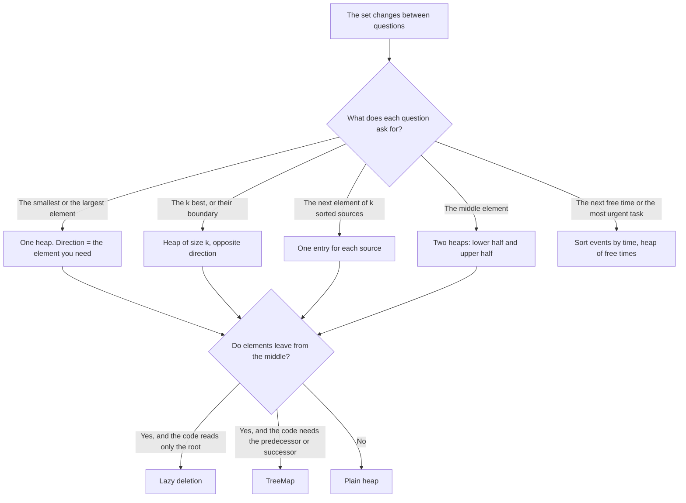

# Pattern 16: Heap and Priority Queue

## Overview

A heap answers one question again and again while the data changes: "which element is the smallest (or the largest) right now?" It reads that element in O(1) and removes it or adds a new one in O(log n). The technique applies to problems where the code needs one extreme element at each step, and does not need the full sorted order. This page derives the technique from the problem "the k-th largest number in a stream", then extends it to merging sorted sources, the median of a stream, scheduling, and removal of elements from the middle of the data.

After this page you can:

1. Derive the rule "a MIN heap of size `k` finds the `k` LARGEST elements" from the question "which one of the best `k` do I need to look at?", state its invariant, and show the wrong answer of a MAX heap on a concrete input.
2. Count the cost of the size-`k` heap, O(n log k), and choose between a heap, a full sort, a heap of all `n` elements, and quickselect, with a reason.
3. Explain why merging `k` sorted lists needs only one node of each list in the heap, and why the cost is O(N log k).
4. Derive the two-heap structure for the median of a stream from the sentence "the median is the boundary between the lower half and the upper half", with its two invariants and the failure when the rebalancing step is missing.
5. Explain lazy deletion: why `PriorityQueue.remove(Object)` costs O(n), how a map of pending removals avoids it, and why the code prunes only the root.
6. For a new problem, name the one element that the code needs again and again while the set changes, choose the heap direction and the heap size with a reason, and avoid the Java pitfalls of `PriorityQueue` (an unsorted iterator, an overflowing comparator, `==` on `Integer`, and ties without a sequence number).

## Prerequisites

| You need | Why this page needs it | Where to learn it |
|---|---|---|
| Heaps: the array layout, sift up, sift down, build in O(n) | Every cost on this page counts the levels of a heap. This page does not teach the internals | [Heaps](../foundations/06-heaps.md) |
| The Java `PriorityQueue` API and comparators | Every solution uses `offer`, `poll`, `peek`, and a `Comparator` | [Java Toolkit](../java-toolkit.md) |
| Sorting | The page compares each heap solution with "sort, then read" | [Sorting Algorithms](../foundations/08-sorting-algorithms.md) |
| Counting operations and O-notation | The page counts operations before it states O(n log k) | [Complexity Analysis](../foundations/01-complexity-analysis.md) |
| `HashMap` counting | [LC 347](https://leetcode.com/problems/top-k-frequent-elements/) and [LC 451](https://leetcode.com/problems/sort-characters-by-frequency/) count first and rank second | [Hashing and Frequency](../05-hashing-frequency/README.md) |
| Linked lists | [LC 23](https://leetcode.com/problems/merge-k-sorted-lists/) merges linked lists by relinking their nodes | [Arrays, Strings, and Linked Lists](../foundations/02-arrays-strings-linked-lists.md) |
| Balanced BSTs (`TreeMap`, `TreeSet`) | Example 7 and the Recognition Guide name `TreeMap` and `TreeSet` as the structures that remove any key in O(log n) | [Trees and Balanced BSTs](../foundations/05-trees-and-balanced-bsts.md) |

Words that the page uses from the start:

- A **heap** is a tree stored in an array. Its **root** is the first element of the array. In a **min heap**, the root is the smallest element. In a **max heap**, the root is the largest element. Only the root has a guaranteed position. The other elements are in heap order, not in sorted order.
- A **priority queue** is the interface "add an element, read the best element, remove the best element". `java.util.PriorityQueue` implements it with a min heap. `peek` reads the root. `poll` removes the root and returns it. `offer` adds an element. [Heaps](../foundations/06-heaps.md) explains how each operation moves elements in the array.
- A **stream** is a sequence of numbers that arrive one at a time. The code answers a question after each number and cannot look ahead.
- The **k best** elements are the `k` elements that rank highest under the order of the problem (the `k` largest, the `k` smallest, the `k` closest, and so on).
- A **comparator** is a function `compare(a, b)` that tells the heap which of two elements must leave first. It returns a negative number if `a` must leave before `b`, a positive number if `b` must leave before `a`, and 0 if the order of the two does not matter. `Integer.compare(a, b)` gives the min heap order. The same call with the arguments swapped, `Integer.compare(b, a)`, gives the max heap order. [Java Toolkit](../java-toolkit.md) lists the forms.
- To **evict** an element means to remove it from the heap because it can no longer be among the `k` best.

Each operation of a heap of `m` elements moves an element along one path of the tree. The tree has about log₂ m levels, so the cost of `offer` and `poll` is O(log m), and the cost of `peek` is O(1).

## Motivation

### The anchor problem: the k-th largest number of a stream

Numbers arrive one at a time. After each number, report the `k`-th largest number seen so far. This is [LC 703: Kth Largest Element in a Stream](https://leetcode.com/problems/kth-largest-element-in-a-stream/). The version on a stored array, [LC 215: Kth Largest Element in an Array](https://leetcode.com/problems/kth-largest-element-in-an-array/), asks for the same value once, after the last number.

Take `k = 3` and the stream `4, 5, 8, 2, 3, 10, 9`. The `k`-th largest is the third number when the numbers seen so far are sorted from the largest. Two numbers do not have a third largest, so the first answer comes after the third number.

```text
number seen      4    5    8    2    3   10    9
3rd largest      -    -    4    4    4    5    8
```

For example, after `10` the numbers are `4, 5, 8, 2, 3, 10`. Sorted from the largest: `10, 8, 5, 4, 3, 2`. The third is 5. After `9`, the sorted list is `10, 9, 8, 5, ...` and the third is 8.

**First attempt: sort everything.** Keep all numbers in a list. After each number, sort the list from the largest and read index `k - 1`.

- For the stored array ([LC 215](https://leetcode.com/problems/kth-largest-element-in-an-array/)) the code sorts once: O(n log n).
- For the stream, the code sorts again after each number. The `i`-th sort handles `i` numbers and costs about `i log₂ i` comparisons. For `n = 1,000,000` numbers the total is on the order of 10¹³ comparisons.

The sort puts all `n` numbers in order. The question needs one number. The numbers below the `k`-th largest can never become the answer, because `k` larger numbers already exist. The sort orders them anyway.

**Second attempt: keep a sorted list of the k best.** Only `k` numbers can matter, so keep a sorted array `best` of at most `k` numbers. When `x` arrives:

- If `best` has fewer than `k` numbers, insert `x` at its sorted position.
- Otherwise, if `x` is larger than `best[0]` (the smallest of the best), remove `best[0]` and insert `x` at its sorted position.
- Otherwise, skip `x`.

The `k`-th largest is `best[0]` as soon as `best` holds `k` numbers. Trace for `k = 3`:

```text
4:  best = [4]
5:  best = [4, 5]
8:  best = [4, 5, 8]       3rd largest = 4
2:  2 <= 4, skip           best = [4, 5, 8]
3:  3 <= 4, skip           best = [4, 5, 8]
10: 10 > 4: remove 4, insert 10 at the end   best = [5, 8, 10]   3rd largest = 5
9:  9 > 5: remove 5, insert 9 in the middle  best = [8, 9, 10]   3rd largest = 8
```

The answers 4, 4, 4, 5, 8 are right. The cost is the problem. Inserting into a sorted array shifts up to `k - 1` entries. For `n = 1,000,000` and `k = 1,000`, the code makes up to about 10⁹ shifts.

**The gap.** Look at what the second attempt reads. It reads `best[0]` to decide whether `x` belongs, and it changes `best` by removing `best[0]` and adding `x`. It never reads the order of the other `k - 1` entries. Yet it pays O(k) per insertion to keep all `k` entries sorted. The code needs a structure that gives the smallest of the `k` best in O(1), removes it, and takes a new entry, all in less than O(k). The Derivation builds this structure.

## Derivation

### Question 1: which one of the k best do I need to look at?

A new number `x` arrives. The `k` best numbers so far are known. Does `x` belong among the `k` best?

`x` belongs if and only if `x` is larger than at least one of the `k` best, because then `x` pushes that number out of the top `k`. It is enough to compare `x` with the **smallest** of the `k` best. If `x` is larger than the smallest, `x` belongs. If `x` is not larger than the smallest, `k` numbers are at least as large as `x`, and `x` does not belong.

So the smallest of the `k` best is the one element that the code needs at every step. It is the `k`-th largest number itself, and it is the number that leaves when a better number arrives.

### Question 2: which structure gives the smallest element in O(1) and lets it leave?

The code repeats three actions on the set of the `k` best: read the smallest, remove the smallest, add a number. A min heap does all three: `peek` reads the root in O(1), `poll` removes the root in O(log k), and `offer` adds a number in O(log k). The heap keeps the elements below the root only in heap order. The code never reads that order, so it does not pay to keep it.

This gives a rule that surprises many readers: **to find the `k` LARGEST elements, use a MIN heap of size `k`.** The heap does not hold the largest element at its root. It holds the *smallest of the best*, because that is the element that the code needs.

### The wrong direction, on the same stream

A reader who thinks "largest, so max heap" writes a max heap of size `k`. The trace below runs the same stream with a max heap. The heap evicts the root, and the root of a max heap is the largest number. So the max heap evicts the best number and keeps the `k` smallest.

```text
x = 4: offer, size 1, heap [4]
x = 5: offer, size 2, heap [5, 4]
x = 8: offer, size 3, heap [8, 4, 5], root 8
x = 2: offer, size 4 > 3, poll removes 8, heap [5, 4, 2], root 5
x = 3: offer, size 4 > 3, poll removes 5, heap [4, 3, 2], root 4
x = 10: offer, size 4 > 3, poll removes 10, heap [4, 3, 2], root 4
x = 9: offer, size 4 > 3, poll removes 9, heap [4, 3, 2], root 4
```

The last line shows root 4. The correct answer is 8. The heap holds `[4, 3, 2]`, which are the three smallest numbers of the stream, and its root is the largest of those three.

### The correct direction: trace

The min heap of size `k = 3` on the same stream. Each line is one number. The text after `heap` is the heap array (`PriorityQueue.toString` prints the array). The first number is the root. The other numbers are in heap order, not in sorted order.

```text
x = 4: offer, size 1, heap [4]
x = 5: offer, size 2, heap [4, 5]
x = 8: offer, size 3, heap [4, 5, 8], root 4
x = 2: offer, size 4 > 3, poll removes 2, heap [4, 5, 8], root 4
x = 3: offer, size 4 > 3, poll removes 3, heap [4, 5, 8], root 4
x = 10: offer, size 4 > 3, poll removes 4, heap [5, 10, 8], root 5
x = 9: offer, size 4 > 3, poll removes 5, heap [8, 9, 10], root 8
```

Read the line for `x = 10`. The heap holds `[4, 5, 8]` and the root is 4. The number 10 enters, and the heap has 4 numbers. The code removes the root, 4. The heap is `[5, 10, 8]` with root 5. The root 5 is the 3rd largest of `4, 5, 8, 2, 3, 10`. Read the lines for `x = 2` and `x = 3`: each number enters and leaves at once, because it is the smallest number in the heap of size 4.

The code that produced this trace, written for [LC 215](https://leetcode.com/problems/kth-largest-element-in-an-array/) and for [LC 703](https://leetcode.com/problems/kth-largest-element-in-a-stream/):

```java
static int kthLargest(int[] nums, int k) {
    if (k < 1 || k > nums.length) throw new IllegalArgumentException("k must be in 1..n");
    // A new problem changes the direction: the k largest need a min heap (this line),
    // the k smallest need new PriorityQueue<>(Collections.reverseOrder()).
    PriorityQueue<Integer> heap = new PriorityQueue<>();
    for (int x : nums) {
        heap.offer(x);                       // offer first: the new number competes with the k
        if (heap.size() > k) heap.poll();    // the root is the worst of k + 1, so it leaves
    }
    return heap.peek();                      // the worst of the k best is the k-th best
}

static class KthLargest {
    private final int k;
    private final PriorityQueue<Integer> heap = new PriorityQueue<>();
    KthLargest(int k, int[] nums) {
        if (k < 1) throw new IllegalArgumentException("k must be at least 1");
        this.k = k;
        for (int x : nums) offerBounded(x);
    }
    int add(int val) {
        offerBounded(val);
        if (heap.size() < k) throw new IllegalStateException("fewer than k numbers so far");
        return heap.peek();
    }
    private void offerBounded(int x) {
        heap.offer(x);
        if (heap.size() > k) heap.poll();
    }
}
```

The loop offers `x` first and removes the root second. The heap holds `k + 1` numbers for a moment, and the root of the larger heap is the smallest of `k + 1` numbers, which is the number that must leave. `kthLargest` throws an exception when `k` is not in `1..n`, because no `k`-th largest number exists. `KthLargest.add` throws an exception when fewer than `k` numbers have arrived, because the root is then the smallest number seen, which is not an answer. Without these checks, `peek` would return a wrong number and give no signal. Assumption: [LC 703](https://leetcode.com/problems/kth-largest-element-in-a-stream/) guarantees that at least `k` numbers have arrived whenever the code asks for the answer, so the exception never fires on that problem. The code does not rely on this assumption.

### Why it is correct

**Invariant.** After the code processes the first `i` numbers, the heap holds the `min(k, i)` largest of them, and if `i >= k` the root is the `k`-th largest.

1. *Start.* With no numbers the heap is empty, and the invariant holds.
2. *Step.* Let `H` be the heap after `i - 1` numbers. It holds the `min(k, i - 1)` largest of them. A number `e` that is not in `H` is not among the `k` largest of the first `i - 1` numbers, so if `H` has `k` elements, `k` elements of `H` are at least as large as `e`. The same `k` elements are still there after `x` arrives, so `e` is not among the `k` largest of the first `i` numbers. The `k` largest of the first `i` numbers therefore lie in `H` together with `x`.
3. The code offers `x`. If the heap now holds `k + 1` numbers, `poll` removes the smallest of them. The remaining `k` numbers are the `k` largest of `H` together with `x`. If the heap holds `k` numbers or fewer, nothing leaves, and the heap holds all `i` numbers.
4. *The root.* A min heap's root is its smallest element. If the heap holds `k` numbers that are the `k` largest, the smallest of them is the `k`-th largest.

**Edge cases.** If `i < k`, the stream has no `k`-th largest number, and the root is not an answer. If numbers repeat, "the `k` largest" means the `k` largest values counted with repeats, and the argument holds because equal numbers are interchangeable.

### The cost, counted before O(n log k)

Each number causes one `offer` and at most one `poll`. The heap holds at most `k + 1` numbers, so each of the two operations moves one element along a path of at most about log₂(k + 1) levels.

| Method | Work for each number | Total for `n = 1,000,000`, `k = 1,000` |
|---|---|---|
| Sort again after each number | about `i log₂ i` comparisons | on the order of 10¹³ comparisons |
| Sorted list of the `k` best | up to `k - 1` shifts | up to about 10⁹ shifts |
| Min heap of size `k` | 2 operations of at most about 10 levels | about 2 x 10⁷ steps |

For the stored array, the cost is `n` numbers times O(log k): **O(n log k)** time and **O(k)** space. The sort of the stored array costs about `n log₂ n`, which is 2 x 10⁷ comparisons for `n = 1,000,000`. So for one query on a stored array, the sort and the heap are within a small factor of each other. The heap wins in three cases: the numbers arrive as a stream, the memory is limited to `k` numbers, or `k` is small (for `k = 10`, the heap path has at most about 4 levels).

A guard avoids work for numbers that cannot enter. When the heap already holds `k` numbers and `x <= heap.peek()`, the code skips `x` without a heap operation. The worst case does not change: an increasing input makes every number replace the root.

### Compare with the other ways to get the k-th largest

| Method | Time | Space | Better than the others when |
|---|---|---|---|
| Sort, then index | O(n log n) | O(1) to O(n) | `k` is close to `n`, or the code needs the whole order, or `n` is small and the code must be short |
| Min heap of size `k` | O(n log k) | O(k) | The numbers form a stream, or the memory holds only `k` numbers, or the input must stay unchanged, or the code needs the worst-case bound |
| Heap of all `n` numbers, then `k - 1` polls | O(n + k log n) | O(n) | The array is in memory and `k` is small. Building the heap from `n` numbers costs O(n) (see [Heaps](../foundations/06-heaps.md)) |
| Quickselect | O(n) on average, O(n²) in the worst case | O(1) | The array is stored, the code asks one question, and the code may reorder the array. See [Divide and Conquer](../09-divide-and-conquer/README.md), Example 2 |

The third row needs a note about Java. `new PriorityQueue<>(collection)` builds a min heap in linear time: the JDK 21 source of that constructor calls `heapify`, which sifts down each parent from the last one to the first. The source comment of `heapify` says that Floyd's algorithm "is known to be O(size)". The javadoc of the constructor does not state this cost. The constructor takes no comparator: it orders the new queue by the natural order, so for a plain list it builds a min heap, and it cannot build a max heap of `Integer` values. (If the argument is a `SortedSet` or a `PriorityQueue`, the new queue copies the ordering of the argument.) For the `k`-th **smallest** element, the min heap of all numbers works:

```java
static int kthSmallestByHeapOfAll(int[] nums, int k) {
    List<Integer> all = new ArrayList<>();
    for (int x : nums) all.add(x);
    PriorityQueue<Integer> heap = new PriorityQueue<>(all);
    for (int i = 1; i < k; i++) heap.poll();
    return heap.peek();
}
```

For the `k`-th **largest** element, the same trick asks for the `(n - k + 1)`-th smallest element, which needs `n - k` polls. That is cheap only when `k` is close to `n`. For small `k`, a max heap of all numbers needs `addAll`, which costs O(n log n) in Java.

Quickselect partitions the array around a pivot, as quicksort does, and then continues in the one part that holds the position `k`. It drops the other part.

The decision rule that follows:

- A stored array and one query: quickselect (O(n) on average), or the sort if the code must be short and `n` is small.
- A stream, or a memory limit, or a guaranteed bound: the heap of size `k`.
- `k` close to `n`: the sort.

## The Pattern

A heap fits a problem in which the code asks the same question again and again: "which one element do I need next?" The set of candidates changes between two questions, because elements arrive, leave, or are replaced. The heap answers in O(1) and updates in O(log n). It keeps only the order that the question needs. It does not keep a full sort.

Two choices define a heap solution. The **direction** is set by the element that the code needs: the smallest needs a min heap, the largest needs a max heap. The **size** is set by the number of candidates whose rank can still matter. For "the `k` best", the element that the code needs is the *worst of the best*, so the direction is the opposite of the direction of the ranking, and the size is `k`.

**The invariant of every heap solution.** After each step, the heap holds exactly the candidates that can still become the answer, and the root is the best of them under the order of the heap. The reason for each solution on this page has this form.

**The vocabulary.** The terms in the first column name ideas that the Derivation used without a name. Some cells in the second column point to problems that the Worked Examples solve later (merging lists, rooms, windows). Read those cells again after the examples. The terms "stale entry" and "lazy deletion" are derived in Worked Example 7.

| Term | What it was in the examples | The question to ask in a new problem |
|---|---|---|
| Candidate set | The `k` best numbers; the head of each list; the end time of each room | "Which elements can still become the answer?" |
| Priority | The number itself; the count; the squared distance; the end time | "By which key do I compare two elements?" |
| Direction | Min heap for the `k` largest; max heap for the `k` smallest | "Which element do I need at the root: the best, or the worst of the best?" |
| Size bound | `k`; one entry for each list; half of the data | "How many candidates can matter at once?" |
| Evict | `poll` after an `offer` pushed the size to `k + 1` | "Which element can never become the answer, and is it the root?" |
| Stale entry | An element that left the window but still sits in the heap | "Can an element become invalid while it is inside the heap?" |
| Lazy deletion | Remember the removal, delete the element when it reaches the root | "Does the code read only the root?" |

### The variants, and the property that selects each

The table is a map. Each row names a variant in one line, and the Worked Examples derive the variants one by one. Read the table again after the examples.

| Variant | Problem type | Heap | The property of the problem that selects it |
|---|---|---|---|
| Top `k` | The `k` largest, smallest, closest, or most frequent ([LC 215](https://leetcode.com/problems/kth-largest-element-in-an-array/), [LC 973](https://leetcode.com/problems/k-closest-points-to-origin/), [LC 347](https://leetcode.com/problems/top-k-frequent-elements/)) | Size `k`, direction opposite to the ranking | The answer is a set of `k` elements or the boundary of that set, and `k` is smaller than `n` |
| `k`-way merge | Merge sorted lists; the `k`-th smallest in a sorted matrix ([LC 23](https://leetcode.com/problems/merge-k-sorted-lists/), [LC 378](https://leetcode.com/problems/kth-smallest-element-in-a-sorted-matrix/), [LC 373](https://leetcode.com/problems/find-k-pairs-with-smallest-sums/)) | One entry for each source | Each source is already sorted, so only the head of each source can be the next output. The lists may be implicit: a formula can generate the next element of a source |
| Two heaps | The median of a stream ([LC 295](https://leetcode.com/problems/find-median-from-data-stream/)) | A max heap for the lower half and a min heap for the upper half | The needed element is a boundary between two halves of the data, and the boundary moves as numbers arrive |
| Scheduling | Meeting rooms, task cooldown ([LC 253](https://leetcode.com/problems/meeting-rooms-ii/) (premium), [LC 621](https://leetcode.com/problems/task-scheduler/)) | Min heap of the next free time, or max heap of the most urgent task | The code sweeps events in time order and must know which resource frees first, or which waiting task is the most urgent |
| Best-first search | Dijkstra, the `n`-th ugly number ([LC 264](https://leetcode.com/problems/ugly-number-ii/), [LC 407](https://leetcode.com/problems/trapping-rain-water-ii/)) | Min heap of states by cost | Each step expands the cheapest known state, and a state that the code finds later never costs less than the state that produced it. See [Shortest Paths](../18-shortest-paths/README.md) for Dijkstra |
| Lazy deletion | The median or the maximum of a sliding window ([LC 480](https://leetcode.com/problems/sliding-window-median/)) | Any heap plus a record of removals | Elements leave for a reason that the heap cannot see (the window moved), and the code reads only the root |
| A greedy choice taken later | Projects with a capital limit ([LC 502](https://leetcode.com/problems/ipo/), [LC 857](https://leetcode.com/problems/minimum-cost-to-hire-k-workers/)) | Max heap of the profit of the choices that are available now | A sweep in one order makes choices available, and the code picks the best available choice by another key. See [Greedy](../14-greedy/README.md) |



## Worked Examples

The examples go from the smallest change to the largest. Each one changes one thing about the anchor problem.

### Example 1: Top K Frequent Elements (LC 347)

**Statement.** [LC 347: Top K Frequent Elements](https://leetcode.com/problems/top-k-frequent-elements/). Given an array `nums` and a number `k`, return the `k` values that occur most often. The answer may come in any order. For `[1, 1, 1, 2, 2, 3]` and `k = 2` the answer is `[1, 2]`.

**What changed.** The anchor problem ranks the numbers by their value. This problem ranks the values by their count. The code needs one more step before the heap: count the occurrences with a hash map. The heap then holds `(value, count)` pairs, and its order uses the count.

**From the brute force.** The brute force counts the values, sorts the `d` distinct values by count (`d` is the number of different values in `nums`), and takes the first `k`: O(n + d log d). The sort orders all `d` values. The question needs the `k` best, so the heap of the anchor problem applies. The ranking is "most frequent", so the best are the largest counts. The code needs the worst of the best, the smallest count among the `k` kept. The heap is a **min heap by count**, with size `k`.

**Trace** for `nums = [5, 3, 3, 1, 1, 1, 2, 2, 2, 2]` and `k = 2`. The counts are 1 occurs 3 times, 2 occurs 4 times, 3 occurs 2 times, 5 occurs once. The `HashMap` gives its entries in an order that the language does not specify. In the JDK 21 run that produced this trace, the small `Integer` keys come out in the order 1, 2, 3, 5, and the trace uses that order. This is the behavior of one implementation, not a rule. The four counts are different (3, 4, 2, 1), so any order gives the same answer. The heap column is the array of the `PriorityQueue`, root first.

```text
entry (value, count)   offer, then poll if size > 2          heap array (root first)
(1, 3)                 offer                                  [(1,3)]
(2, 4)                 offer                                  [(1,3), (2,4)]
(3, 2)                 offer, size 3 > 2: poll removes (3,2)  [(1,3), (2,4)]
(5, 1)                 offer, size 3 > 2: poll removes (5,1)  [(1,3), (2,4)]
result: 1 and 2
```

```java
static int[] topKFrequent(int[] nums, int k) {
    Map<Integer, Integer> counts = new HashMap<>();
    for (int x : nums) counts.merge(x, 1, Integer::sum);
    // The key of a pair is its count (index 1). A new problem changes this comparator.
    PriorityQueue<int[]> heap = new PriorityQueue<>((a, b) -> Integer.compare(a[1], b[1]));
    for (Map.Entry<Integer, Integer> e : counts.entrySet()) {
        heap.offer(new int[] {e.getKey(), e.getValue()});
        if (heap.size() > k) heap.poll();
    }
    int[] result = new int[heap.size()];
    for (int i = result.length - 1; i >= 0; i--) result[i] = heap.poll()[0];
    return result;
}
```

The comparator uses `Integer.compare` on the count (index 1 of the pair). The loop over `counts.entrySet()` visits each distinct value once. The result array is filled from the back, so the most frequent value comes first.

**The bucket form.** A count is an integer from 1 to `n`. The code can make an array of `n + 1` lists, put each value in the list of its count, and read the lists from the highest count down until it has `k` values. This costs O(n) with no heap. [Hashing and Frequency](../05-hashing-frequency/README.md) derives it in Example 4.

**Cost.** Counting costs O(n). The heap costs O(log k) for each of the `d` distinct values, so O(d log k). Total O(n + d log k) time, O(d) space for the map.

### Example 2: K Closest Points to Origin (LC 973)

**Statement.** [LC 973: K Closest Points to Origin](https://leetcode.com/problems/k-closest-points-to-origin/). Given points `(x, y)` and a number `k`, return the `k` points closest to the origin. For `[[3, 3], [5, -1], [-2, 4]]` and `k = 2` the answer is `[[3, 3], [-2, 4]]`.

**What changed.** Two things change. The key of each element is computed from the element (the distance), not stored in it. And the ranking is "smallest", so the direction flips: the `k` closest points need a **max heap** by distance, because the code needs the farthest of the `k` closest, and that is the point that leaves when a closer point arrives.

**Reasoning.** The distance of `(x, y)` is √(x² + y²). The square root keeps the order of two non-negative numbers, so the code compares x² + y² and avoids the floating-point root. The comparator takes two points and compares their squared distances in the reverse order (larger first), which makes the farthest point the root.

**Trace** for the example, `k = 2`. The squared distances are 18 for `(3,3)`, 26 for `(5,-1)`, and 20 for `(-2,4)`. The heap column is the array of the max heap, root first.

```text
point      squared distance   action                                  heap (root = farthest)
(3, 3)     18                 offer                                   [18]
(5, -1)    26                 offer                                   [26, 18]
(-2, 4)    20                 offer, size 3 > 2: poll removes 26      [20, 18]
result: (3, 3) and (-2, 4)
```

```java
static long squaredDistance(int[] p) {
    return (long) p[0] * p[0] + (long) p[1] * p[1];
}

static int[][] kClosest(int[][] points, int k) {
    // b before a in the comparison: the farthest point is the root of the heap.
    PriorityQueue<int[]> heap = new PriorityQueue<>(
            (a, b) -> Long.compare(squaredDistance(b), squaredDistance(a)));
    for (int[] p : points) {
        heap.offer(p);
        if (heap.size() > k) heap.poll();
    }
    return heap.toArray(new int[0][]);
}
```

**The overflow note.** The squared distance `x² + y²` fits in `int` if it is at most `Integer.MAX_VALUE`, which is 2,147,483,647. Two equal coordinates `c` give 2c². For `c = 32,767` the sum is 2,147,352,578, which fits. For `c = 32,768` the sum is 2³¹ = 2,147,483,648, which overflows. A point on one axis fits up to `|x| = 46,340` (46,340² = 2,147,395,600; 46,341² = 2,147,488,281 overflows). So `int` is enough only if the problem keeps every coordinate within 32,767 in absolute value. For larger coordinates, use `long`. A `long` holds up to 2⁶³ − 1, which is enough for every pair of `int` coordinates except `(-2³¹, -2³¹)`: 2 × (2³¹ − 1)² = 2⁶³ − 2³³ + 2 fits, and 2 × (2³¹)² = 2⁶³ does not.

The cast `(long) p[0] * p[0]` widens before the multiplication. If the code multiplies two `int` values first, the result wraps around to a negative number. The program uses the coordinates 40,000 and 50,000 (the square of 50,000 is 2,500,000,000):

```java
public class DistanceOverflow {
    public static void main(String[] args) {
        int[] near = {40000, 0};
        int[] far = {50000, 0};
        int wrongNear = near[0] * near[0] + near[1] * near[1];
        int wrongFar = far[0] * far[0] + far[1] * far[1];
        System.out.println("int:  near = " + wrongNear + ", far = " + wrongFar
                + ", far looks closer: " + (wrongFar < wrongNear));
        long rightNear = (long) near[0] * near[0] + (long) near[1] * near[1];
        long rightFar = (long) far[0] * far[0] + (long) far[1] * far[1];
        System.out.println("long: near = " + rightNear + ", far = " + rightFar
                + ", far looks closer: " + (rightFar < rightNear));
    }
}
```

<!-- expected-output -->
```text
int:  near = 1600000000, far = -1794967296, far looks closer: true
long: near = 1600000000, far = 2500000000, far looks closer: false
```

The `int` version says that the far point is closer than the near point. The comparator must also avoid `(int) (distB - distA)`: a cast of a `long` difference to `int` can change the sign. `Long.compare` is safe.

**Cost.** O(n log k) time, O(k) space. The alternative "heapify all `n` points and poll `k` times" costs O(n + k log n) time and O(n) space, and it needs all points up front.

### Example 3: Merge k Sorted Lists (LC 23)

**Statement.** [LC 23: Merge k Sorted Lists](https://leetcode.com/problems/merge-k-sorted-lists/). Given `k` sorted linked lists, return one sorted list. For `[1, 4, 5]`, `[1, 3, 4]`, `[2, 6]` the answer is `[1, 1, 2, 3, 4, 4, 5, 6]`.

**What changed.** The input is `k` sorted sources, not one unsorted collection. The heap does not hold a set of "best so far". It holds the candidates for the next output.

**From the brute force.** The brute force copies all `N` values into an array (`N` is the total number of nodes in all lists), sorts it, and builds a list: O(N log N). It ignores that each list is sorted. The question to ask: *which node is the next one in the output?* It is the smallest node that is not yet in the output. Where can that node be? Each list is sorted, so the smallest remaining node of a list is its current first node (its head). The smallest remaining node of all lists is therefore the smallest of the `k` heads. The nodes behind a head cannot be the next output, because their head is not larger. So the heap needs **one node of each list**, and nothing else.

When the code removes the head of list `i`, the next node of list `i` becomes its head and enters the heap. The heap never holds more than `k` nodes.

**Trace** for the three lists. `L0 = 1, 4, 5`. `L1 = 1, 3, 4`. `L2 = 2, 6`. The heap is written in sorted order for reading, with the list of each node.

```text
start: heap = {1 (L0), 1 (L1), 2 (L2)}
pop 1 (L0)   output 1                    push 4 (L0)   heap = {1 (L1), 2 (L2), 4 (L0)}
pop 1 (L1)   output 1 1                  push 3 (L1)   heap = {2 (L2), 3 (L1), 4 (L0)}
pop 2 (L2)   output 1 1 2                push 6 (L2)   heap = {3 (L1), 4 (L0), 6 (L2)}
pop 3 (L1)   output 1 1 2 3              push 4 (L1)   heap = {4 (L0), 4 (L1), 6 (L2)}
pop 4 (L0)   output 1 1 2 3 4            push 5 (L0)   heap = {4 (L1), 5 (L0), 6 (L2)}
pop 4 (L1)   output 1 1 2 3 4 4          L1 ends       heap = {5 (L0), 6 (L2)}
pop 5 (L0)   output 1 1 2 3 4 4 5        L0 ends       heap = {6 (L2)}
pop 6 (L2)   output 1 1 2 3 4 4 5 6      L2 ends       heap = {}
```

When two heads are equal, `PriorityQueue` may pop either of them. The trace shows the choice of this JDK 21 run: it pops `1 (L0)` before `1 (L1)`, and `4 (L0)` before `4 (L1)`. The output values are the same for either choice.

```java
static ListNode mergeKLists(ListNode[] lists) {
    // One entry is one node. A new problem changes what an entry is and how it is compared.
    PriorityQueue<ListNode> heap = new PriorityQueue<>((a, b) -> Integer.compare(a.val, b.val));
    for (ListNode head : lists) {
        if (head != null) heap.offer(head);   // seed: the head of each non-empty list
    }
    ListNode dummy = new ListNode(0), tail = dummy;
    while (!heap.isEmpty()) {
        ListNode node = heap.poll();
        tail.next = node;
        tail = node;
        if (node.next != null) heap.offer(node.next);   // the next node of the same source
    }
    return dummy.next;
}
```

**Why it is correct.** The invariant: before each pop, the heap holds the head of every list that is not empty, and the output holds the smallest nodes in sorted order. The popped node is the smallest of the heads. Every other remaining node is behind some head in its own list, and a list is sorted, so that node is not smaller than its head. So no remaining node is smaller than the popped node. The code appends it, and the invariant holds again after the push of its successor. Empty lists are never pushed, so `lists = []`, an array of `null` values, and one empty list all work: the heap is empty, the loop does not run, and the method returns `null`.

**Cost.** Each of the `N` nodes enters the heap once and leaves once. The heap holds at most `k` nodes, so each operation costs O(log k). Total: **O(N log k)** time and O(k) extra space (the code relinks the existing nodes).

**The comparator needs no tie-breaker.** A comparator that compares only `val` returns 0 for equal values. `PriorityQueue` accepts that: it needs a consistent order, not a strict one. The old advice "store the list index to break ties" is not needed in Java.

**Pairwise merge.** The alternative merges two lists at a time. Merging the lists one after another into a growing result costs O(N k) in the worst case, because the first lists are copied again and again. Merging in rounds (pair up the lists, merge each pair, repeat) has `log₂ k` rounds of O(N) work each, which gives O(N log k) with O(1) extra space. [Divide and Conquer](../09-divide-and-conquer/README.md) derives it. The heap is better when the lists arrive as streams or when the code needs only the first few outputs. The rounds are better when the lists are in memory and the extra space for the heap matters.

### Example 4: Find K Pairs with Smallest Sums (LC 373)

**Statement.** [LC 373: Find K Pairs with Smallest Sums](https://leetcode.com/problems/find-k-pairs-with-smallest-sums/). Two arrays `a` and `b` are sorted in ascending order. A pair takes one number from `a` and one from `b`. Return the `k` pairs with the smallest sums. For `a = [1, 7, 11]`, `b = [2, 4, 6]`, and `k = 4` the pairs are `(1,2)`, `(1,4)`, `(1,6)`, `(7,2)` with sums 3, 5, 7, 9.

**What changed.** Example 3 had the lists in memory. Here the lists are **implicit**. Row `i` is the list `a[i] + b[0], a[i] + b[1], a[i] + b[2], ...`. It is sorted because `b` is sorted. No code builds it. The code computes the next element of a row from the index `j`. The heap entry is the index pair `(i, j)`.

**Reasoning.** The grid has `n x m` pairs, and the code needs only the first `k`. Which pairs can be the next output? The smallest pair that the code has not output. In each row, that is the first pair not yet output. So the heap holds one pair of each row, as in Example 3.

*Why push `(i, j + 1)` only after `(i, j)` leaves.* The sum of `(i, j + 1)` is not smaller than the sum of `(i, j)`, because `b` is sorted. While `(i, j)` is still in the heap, `(i, j + 1)` cannot be the next output, so the heap does not need it. If the code pushed all `n x m` pairs at the start, the heap would hold `n x m` entries. With the rule, the heap holds at most one entry for each row.

*Why no pair is missed.* The invariant: for each row `i`, the pairs `(i, 0)` to `(i, j - 1)` are output, the pair `(i, j)` is in the heap, and the pairs after it are not pushed yet. The seed makes it true with `j = 0`. A pop of `(i, j)` followed by the push of `(i, j + 1)` keeps it true. Now take any pair `(i, j')` that is not output. The heap holds the entry `(i, j)` of its row, and `j <= j'`. Because `b` is sorted, the sum of `(i, j)` is at most the sum of `(i, j')`. So the smallest sum among all pairs that are not output is the smallest sum in the heap, and `poll` returns a pair with that sum. Each output pair is a smallest remaining pair, so the first `k` outputs are `k` pairs with the smallest sums. If a row has no entry left in the heap, all its pairs are output, so no pair of that row can be missing.

*Ties.* If two pairs have equal sums, `poll` may return either one. The `k` sums that the code returns are the same for either choice. Only the pair that sits at the boundary of the answer can differ, and every such answer is a valid set of `k` pairs with the smallest sums.

*Why start with the first `min(n, k)` rows.* A row `i >= k` has its first pair `a[i] + b[0]`, which is not smaller than `a[0] + b[0], ..., a[k - 1] + b[0]`. These are `k` pairs that are at least as small. So row `i` cannot hold a pair that is needed (with equal sums, any `k` pairs with the smallest sums are correct).

**Trace** for `a = [1, 7, 11]`, `b = [2, 4, 6]`, `k = 4`. An entry is `(i, j)` with its sum. The heap is written in sorted order for reading.

```text
seed:  rows 0, 1, 2 with j = 0      heap = {(0,0)=3, (1,0)=9, (2,0)=13}
pop (0,0)=3   output (1,2)          push (0,1)=5    heap = {(0,1)=5, (1,0)=9, (2,0)=13}
pop (0,1)=5   output (1,4)          push (0,2)=7    heap = {(0,2)=7, (1,0)=9, (2,0)=13}
pop (0,2)=7   output (1,6)          row 0 has no j = 3, no push   heap = {(1,0)=9, (2,0)=13}
pop (1,0)=9   output (7,2)          4 pairs: stop
```

```java
static List<List<Integer>> kSmallestPairs(int[] a, int[] b, int k) {
    List<List<Integer>> result = new ArrayList<>();
    if (a.length == 0 || b.length == 0) return result;
    PriorityQueue<int[]> heap = new PriorityQueue<>(
            (x, y) -> Long.compare((long) a[x[0]] + b[x[1]], (long) a[y[0]] + b[y[1]]));
    for (int i = 0; i < Math.min(a.length, k); i++) heap.offer(new int[] {i, 0});
    while (result.size() < k && !heap.isEmpty()) {
        int[] top = heap.poll();
        result.add(List.of(a[top[0]], b[top[1]]));
        if (top[1] + 1 < b.length) heap.offer(new int[] {top[0], top[1] + 1});
    }
    return result;
}
```

**Cost.** The seed makes `min(n, k)` offers. The loop pops at most `k` times and pushes at most once for each pop. The heap holds at most `min(n, k)` entries. Total: O(k log min(n, k)). The code returns an empty list if either array is empty. The comparator adds the two numbers as `long`, so two large `int` values do not overflow.

[LC 378: Kth Smallest Element in a Sorted Matrix](https://leetcode.com/problems/kth-smallest-element-in-a-sorted-matrix/) has the same shape with the rows of a matrix. It is practice problem P6.

### Example 5: Find Median from Data Stream (LC 295)

**Statement.** [LC 295: Find Median from Data Stream](https://leetcode.com/problems/find-median-from-data-stream/). Design a structure with `addNum(int num)` and `findMedian()`. The median of an odd number of values is the middle value of the sorted values. The median of an even number is the average of the two middle values. After adding 2, 3, 4 the median is 3. After adding 2, 3 the median is 2.5.

**What changed.** The anchor problem needs the element at the edge of a set (the smallest of the best). The median is in the middle of the data. A heap gives only an edge. The question is whether the middle can be made an edge.

**From the brute force.** Keep a sorted list. A binary search finds the slot in O(log n), but the insertion shifts up to `n` entries: O(n) per number and O(n²) for `n` numbers. Sorting again at each query costs O(n log n) per query. Both pay for the order of all elements. The median needs two numbers only.

**Question.** Which elements does the code read to answer `findMedian()`? The middle one (odd count) or the two middle ones (even count). Split the sorted data at the middle into a **lower half** and an **upper half**. The median is the boundary between them:

- the largest element of the lower half and the smallest element of the upper half are the two middle values (for an even count), or
- the largest element of the lower half is the middle value (for an odd count, when the lower half holds the extra element).

The code needs the **largest of the lower half**: a max heap. It needs the **smallest of the upper half**: a min heap. The two edges that the heaps expose are the two numbers that the median needs.

**The two invariants.**

1. *Order:* every element of `lower` is at most every element of `upper`. This is the same as `lower.peek() <= upper.peek()`.
2. *Size:* `lower.size() == upper.size()` or `lower.size() == upper.size() + 1`.

With both invariants, the sizes tell which case holds: if `lower` is larger, the median is `lower.peek()`. If the sizes are equal, the median is the average of the two roots.

**The insertion step, derived.** A number `x` arrives. Which half does it go to?

- If `lower` is empty, or `x <= lower.peek()`, put `x` in `lower`. The order invariant holds: `x` is at most the root of `lower`, so `x` is at most every element of `upper`.
- Otherwise `x > lower.peek()`. Put `x` in `upper`. The order invariant holds: `x` is larger than every element of `lower`.

One insertion changes one size by 1, so the size invariant breaks by at most 1. The **rebalancing step** repairs it:

- If `lower.size() > upper.size() + 1`, move the root of `lower` (its largest element) to `upper`. The moved element is at most every element of `upper`, so it can be the new minimum of `upper`, and the order invariant holds.
- If `upper.size() > lower.size()`, move the root of `upper` (its smallest element) to `lower`. By symmetry the order invariant holds.

**Trace** on the stream `5, 15, 1, 3, 8, 7, 9, 10`. The two lines of each step show the route of the new number, the move of the rebalancing step, and the state after it. Each heap is written in sorted order for reading, the root first.

```text
add 5: to lower (lower is empty); no move
    lower [5]  upper []  median 5.0
add 15: to upper (15 > 5); no move
    lower [5]  upper [15]  median 10.0
add 1: to lower (1 <= 5); no move
    lower [5, 1]  upper [15]  median 5.0
add 3: to lower (3 <= 5); move 5 to upper
    lower [3, 1]  upper [5, 15]  median 4.0
add 8: to upper (8 > 3); move 5 to lower
    lower [5, 3, 1]  upper [8, 15]  median 5.0
add 7: to upper (7 > 5); no move
    lower [5, 3, 1]  upper [7, 8, 15]  median 6.0
add 9: to upper (9 > 5); move 7 to lower
    lower [7, 5, 3, 1]  upper [8, 9, 15]  median 7.0
add 10: to upper (10 > 7); no move
    lower [7, 5, 3, 1]  upper [8, 9, 10, 15]  median 7.5
```

Read the step `add 3`. The number 3 is at most 5, so it goes to `lower`. Now `lower` has 3 elements and `upper` has 1, so the size invariant is broken. The rebalancing step moves the root of `lower`, 5, to `upper`. Now `lower = [3, 1]`, `upper = [5, 15]`, and the median is (3 + 5) / 2 = 4.

**The wrong median without the rebalancing step.** Remove the rebalancing step and add 1, 2, 3:

```text
add 1: lower [1] upper [] -> median 1.0, correct 1.0
add 2: lower [1] upper [2] -> median 1.5, correct 1.5
add 3: lower [1] upper [2, 3] -> median 1.5, correct 2.0
```

After the third number, `lower` holds one element and `upper` holds two. `lower` is not larger than `upper`, so `findMedian` takes the average of the two roots, 1.5. The true median of `1, 2, 3` is 2. The code is wrong because the size invariant does not hold, and `findMedian` reads the roots under the assumption that it holds.

```java
static class MedianFinder {
    private final PriorityQueue<Integer> lower =
            new PriorityQueue<>(Collections.reverseOrder());
    private final PriorityQueue<Integer> upper = new PriorityQueue<>();

    void addNum(int num) {
        // Route by value. A new problem changes this test (<= against <) and which heap
        // holds the extra element.
        if (lower.isEmpty() || num <= lower.peek()) lower.offer(num);
        else upper.offer(num);
        // Rebalance: each branch moves exactly one root.
        if (lower.size() > upper.size() + 1) upper.offer(lower.poll());
        else if (upper.size() > lower.size()) lower.offer(upper.poll());
    }

    double findMedian() {
        if (lower.size() > upper.size()) return lower.peek();
        return ((double) lower.peek() + upper.peek()) / 2.0;
    }
}
```

`findMedian` adds the two roots as `double` before the division. The sum of two `int` values near `Integer.MAX_VALUE` does not fit in `int`: for `Integer.MAX_VALUE` twice, `(a + b) / 2` in `int` arithmetic gives -1, and the `double` form gives 2.147483647E9, the correct average.

**Cost.** `addNum` makes at most one `offer`, one `poll`, and one more `offer`, all on a heap of at most `n` elements: O(log n). `findMedian` reads two roots: O(1). Space O(n). If all numbers are integers in a small known range, a count array and a scan give O(range) per query and O(1) per insertion, with no heaps.

### Example 6: Meeting Rooms II (LC 253, premium)

**Statement.** [LC 253: Meeting Rooms II](https://leetcode.com/problems/meeting-rooms-ii/) (premium). Given meetings as `[start, end)` intervals, return the smallest number of rooms such that no two meetings that overlap share a room. A meeting that ends at time 10 and a meeting that starts at time 10 do not overlap. For `[[0, 30], [5, 10], [15, 20]]` the answer is 2.

**What changed.** The elements are not numbers that arrive in a stream. The input is a list of events in time order, and the heap holds the state of the resources (the rooms). This is **scheduling**: the code sweeps the events in time order and keeps one number for each resource.

**From the brute force.** The brute force tries each time point and counts the meetings that cover it. The largest count is the answer. It costs O(n x T) for `T` distinct time points. The code can do better with a sweep over the meetings in start order.

**Question.** Process the meetings in order of start time. A new meeting starts at time `s`. Can it use a room that is in use? Only if that room's current meeting has ended by `s`. Which room is the best choice to test? The one whose meeting ends **earliest**. If that room is not free at `s`, no room is. So the code needs the **smallest end time** among the rooms in use, and the set changes at every meeting (a room's end time is replaced). This is a min heap of end times, one for each room.

**Algorithm.** Sort the meetings by start time. For each meeting: if the heap is not empty and the smallest end time is at most the start, that room is free, so remove its end time (the room is reused). Add the end time of the new meeting. The answer is the heap size at the end.

**Trace** for `[[0,30], [5,10], [10,25], [15,20], [28,35]]`, already sorted by start. The heap holds end times. The text after `heap =` is the array of the `PriorityQueue`, the root first.

```text
meeting (0,30):   heap is empty                    offer 30             heap = [30]
meeting (5,10):   peek 30 > 5, no room is free     offer 10             heap = [10, 30]
meeting (10,25):  peek 10 <= 10, reuse the room    poll 10, offer 25    heap = [25, 30]
meeting (15,20):  peek 25 > 15, no room is free    offer 20             heap = [20, 30, 25]
meeting (28,35):  peek 20 <= 28, reuse the room    poll 20, offer 35    heap = [25, 30, 35]
answer: the heap size, 3
```

```java
static int minMeetingRooms(int[][] intervals) {
    int[][] sorted = intervals.clone();
    Arrays.sort(sorted, (a, b) -> Integer.compare(a[0], b[0]));
    PriorityQueue<Integer> endTimes = new PriorityQueue<>();
    for (int[] meeting : sorted) {
        // <= : a room that frees at time s serves a meeting that starts at s.
        if (!endTimes.isEmpty() && endTimes.peek() <= meeting[0]) endTimes.poll();
        endTimes.offer(meeting[1]);   // the room, new or reused, is busy until this end time
    }
    return endTimes.size();
}
```

**Why it is correct.** The invariant: after the code processes the first `i` meetings in start order, the heap holds the end time of the last meeting of each room that the code opened, and the heap size is the number of rooms that the first `i` meetings need. The size changes only when no room is free: a reuse removes one end time and adds one, so the size stays the same, and a new room adds one. So the heap size is the number of rooms that the code has opened. With no meetings, the loop does not run and the answer is 0. The code opens a new room only when the earliest-ending room is still busy at `s`. Then every room in the heap holds a meeting that started at or before `s` and ends after `s`. These meetings and the new one all cover the time `s`, so the overlap at time `s` is `size + 1`. No schedule can use fewer rooms. The test `<=` makes the meeting that starts at 10 reuse the room of the meeting that ends at 10, as the problem states. With `<` in place of `<=`, the input `[[0, 10], [10, 20]]` gives 2: the test `10 < 10` is false, so the code opens a second room, and the correct answer is 1.

**Cost.** The sort costs O(n log n). The loop makes at most one `poll` and one `offer` for each meeting on a heap of at most `n` entries: O(n log n). Space O(n).

**Other views.** A sweep line over sorted starts and sorted ends gives the same count with no heap. [Intervals](../20-intervals/README.md) derives both forms. The overlap count in the proof above is the whole argument for "test the room that ends earliest": no exchange argument is needed. [LC 621: Task Scheduler](https://leetcode.com/problems/task-scheduler/) also uses a heap, with a max heap of task counts and a waiting queue. It is practice problem P7.

### Example 7: Sliding Window Median (LC 480), and lazy deletion

**Statement.** [LC 480: Sliding Window Median](https://leetcode.com/problems/sliding-window-median/). A window of size `k` moves one step at a time over `nums`. Return the median of each window. For `nums = [1, 3, -1, -3, 5, 3, 6, 7]` and `k = 3` the answer is `[1, -1, -1, 3, 5, 6]`.

**What changed.** In Example 5, elements only arrive. Here elements also **leave**: the oldest element of the window leaves at each step. The element that leaves can be anywhere in the two heaps.

**From the brute force.** Sort each window and read the middle: O(n k log k). Example 5 handles the insertions in O(log k). The new problem is the removal.

**First attempt: `PriorityQueue.remove(Object)`.** The JDK offers this method. The javadoc states that `remove(Object)` takes linear time. The reason: a heap has no index from a value to its position. The method scans the array with `equals` until it finds the element, and then it repairs the heap in O(log n). The program below counts the calls of `equals` in a heap of 1,000 elements.

```java
import java.util.PriorityQueue;

public class RemoveCost {
    static int equalsCalls = 0;

    record Item(int value) implements Comparable<Item> {
        @Override
        public boolean equals(Object other) {
            equalsCalls++;
            return other instanceof Item item && item.value == value;
        }

        @Override
        public int hashCode() {
            return value;
        }

        @Override
        public int compareTo(Item other) {
            return Integer.compare(value, other.value);
        }
    }

    public static void main(String[] args) {
        for (int target : new int[] {0, 500, 999}) {
            PriorityQueue<Item> heap = new PriorityQueue<>();
            for (int v = 0; v < 1000; v++) heap.offer(new Item(v));   // ascending keeps array order
            equalsCalls = 0;
            heap.remove(new Item(target));
            System.out.println("remove(" + target + ") in a heap of 1000 made "
                    + equalsCalls + " calls of equals");
        }
    }
}
```

<!-- expected-output -->
```text
remove(0) in a heap of 1000 made 1 calls of equals
remove(500) in a heap of 1000 made 501 calls of equals
remove(999) in a heap of 1000 made 1000 calls of equals
```

The count grows with the position of the element, and the worst case scans the whole array. One removal per step makes O(k) work per step and O(n k) in total. This is no better than the brute force.

**Question.** Does the code need to remove the element from the heap *now*? The code reads only the two roots. An element that should be gone but sits deep in a heap does not change either root. It changes nothing until it reaches a root. So the code can **record** the removal and **delete the element later, when it reaches a root**. This is **lazy deletion**.

**The mechanism, step by step.**

1. A map `pending` maps a value to the number of copies that must still be deleted.
2. The code keeps the size of each half as the number of elements that are **not** pending (`live[0]` for `lower`, `live[1]` for `upper`). The size invariant of Example 5 uses these live counts, not the heap sizes.
3. When an element leaves the window, the code adds 1 to `pending[value]` and subtracts 1 from the live count of the half that holds it. Which half? If `out <= lower.peek()`, it is `lower`, because every element of `upper` is at least `lower.peek()` (when equal values sit in both halves, the code may delete either copy, because the copies are equal).
4. **Prune:** `while the root is pending: poll it and subtract 1 from its pending count`. The code prunes a heap whenever its root may have become pending: after a removal that touches the root, and after a rebalancing move takes the root away.
5. After the removal, the code applies the rebalancing step of Example 5 with the live counts. The code also rebalances after the insertion, before the removal. Each of the two steps (insert, remove) changes one live count by 1, so one rebalancing move after each step restores the size invariant.

The invariant: the root of each heap is not pending. The median is read from roots, so every read gives a live element.

**Trace** on `nums = [4, 3, 8, 5, 9, 1, 7, 6]` and `k = 3`. A `*` marks a copy that is pending removal (it is still inside the heap). Each heap is written in sorted order for reading, the root first.

```text
i = 0: insert 4
    lower [4]  upper []  pending {}
i = 1: insert 3
    lower [3]  upper [4]  pending {}
i = 2: insert 8
    lower [4, 3]  upper [8]  pending {}
    window [4, 3, 8] median 4.0
i = 3: insert 5, remove 4
    lower [5, 3]  upper [8]  pending {}
    window [3, 8, 5] median 5.0
i = 4: insert 9, remove 3
    lower [8, 5, 3*]  upper [9]  pending {3=1}
    window [8, 5, 9] median 8.0
i = 5: insert 1, remove 8
    lower [5, 3*, 1]  upper [9]  pending {3=1}
    window [5, 9, 1] median 5.0
i = 6: insert 7, remove 5
    lower [7, 1]  upper [9]  pending {}
    window [9, 1, 7] median 7.0
i = 7: insert 6, remove 9
    lower [6, 1]  upper [7, 9*]  pending {9=1}
    window [1, 7, 6] median 6.0
```

Read the steps `i = 4` and `i = 6`. At `i = 4`, the number 3 leaves. It is not the root of `lower` (the root is 5 at that moment), so the code only records `pending {3=1}` and keeps the heap as it is. The star marks the copy. At `i = 6`, the number 5 leaves, and 5 is the root of `lower`. The code prunes: it removes 5, sees that the new root 3 is pending, and removes it too. Both removals cost O(log n) each, and each element is removed once.

```java
static double[] medianSlidingWindow(int[] nums, int k) {
    PriorityQueue<Integer> lower = new PriorityQueue<>(Collections.reverseOrder());
    PriorityQueue<Integer> upper = new PriorityQueue<>();
    Map<Integer, Integer> pending = new HashMap<>();
    int[] live = new int[2];   // live[0], live[1]: elements of lower, upper not pending removal
    double[] medians = new double[nums.length - k + 1];
    for (int i = 0; i < nums.length; i++) {
        // insert nums[i]
        if (lower.isEmpty() || nums[i] <= lower.peek()) { lower.offer(nums[i]); live[0]++; }
        else { upper.offer(nums[i]); live[1]++; }
        rebalance(lower, upper, pending, live);
        if (i >= k) {
            int out = nums[i - k];
            pending.merge(out, 1, Integer::sum);
            if (out <= lower.peek()) {
                live[0]--;
                if (out == lower.peek()) prune(lower, pending);
            } else {
                live[1]--;
                if (out == upper.peek()) prune(upper, pending);
            }
            rebalance(lower, upper, pending, live);
        }
        if (i >= k - 1) {
            medians[i - k + 1] = live[0] > live[1]
                    ? lower.peek()
                    : ((double) lower.peek() + upper.peek()) / 2.0;
        }
    }
    return medians;
}

static void rebalance(PriorityQueue<Integer> lower, PriorityQueue<Integer> upper,
                      Map<Integer, Integer> pending, int[] live) {
    if (live[0] > live[1] + 1) {
        upper.offer(lower.poll());
        live[0]--; live[1]++;
        prune(lower, pending);
    } else if (live[1] > live[0]) {
        lower.offer(upper.poll());
        live[1]--; live[0]++;
        prune(upper, pending);
    }
}

static void prune(PriorityQueue<Integer> heap, Map<Integer, Integer> pending) {
    while (!heap.isEmpty() && pending.containsKey(heap.peek())) {
        int value = heap.poll();
        if (pending.merge(value, -1, Integer::sum) == 0) pending.remove(value);
    }
}
```

**Why it is correct.** The live elements of the two heaps are exactly the numbers of the current window, and they satisfy the two invariants of Example 5. The pending elements are extra entries that never sit at a root. Two cases keep the roots clean. A removal that touches the root is pruned at once. A rebalancing move takes a clean root from one heap, and the code prunes that heap, whose new root may be pending. A pending element reaches a root only through these two events, so no read sees a pending element.

The prune test asks only whether the value of the root is pending. It does not ask which heap holds the pending copy. This is safe because a pending value `v` that sits behind the root of its heap has the root strictly on the far side of `v`. In `lower`, the root is larger than `v`, so every element of `upper` is larger than `v` as well, and `upper` holds no copy of `v`. In `upper`, the root is smaller than `v`, so every element of `lower` is smaller than `v`, and `lower` holds no copy of `v`. If the root itself equals a pending value, the code deletes that copy, and a copy with an equal value is interchangeable with the pending one.

The median of two `int` values uses `(double) lower.peek() + upper.peek()`, so the sum is exact. The code was tested against a brute force on 400,000 random inputs with many equal values, with values next to `Integer.MAX_VALUE`, and with values next to `Integer.MIN_VALUE`, and it gave no wrong answer.

**Cost.** Each number enters a heap once and leaves it at most once, by a prune. Each step moves at most one element between the halves. The code makes O(1) heap operations per step, each O(log n) because the heaps can hold pending entries: for example, in an ascending input the smallest elements leave first, they sit at the bottom of `lower`, and they stay there until all larger elements above them leave. So the heaps can grow to O(n) entries: for `nums = 0, 1, 2, ..., n - 1` and `k = 3`, the two heaps hold `n` entries together at the end, for `n = 1,000` and for `n = 10,000`. Total: **O(n log n)** time and O(n) space. The `HashMap` operations cost O(1) on average.

**The simplest lazy deletion: an index test.** For the maximum of a window ([LC 239: Sliding Window Maximum](https://leetcode.com/problems/sliding-window-maximum/)), the code can store `(value, index)` and treat an entry as stale when its index is at most `i - k`. No map is needed:

```java
static int[] windowMaxByHeap(int[] nums, int k) {
    PriorityQueue<int[]> heap = new PriorityQueue<>((a, b) -> Integer.compare(b[0], a[0]));
    int[] result = new int[nums.length - k + 1];
    for (int i = 0; i < nums.length; i++) {
        heap.offer(new int[] {nums[i], i});
        while (heap.peek()[1] <= i - k) heap.poll();
        if (i >= k - 1) result[i - k + 1] = heap.peek()[0];
    }
    return result;
}
```

This costs O(n log n). A **monotonic deque** solves the window maximum in O(n), because elements leave the window in the order in which they entered, and a smaller element that is older than a larger one can never become the maximum. See [Monotonic Stack and Queue](../07-monotonic-stack-queue/README.md). The median has no such shortcut: any element of the window can become the median, so the code must keep them all.

**Other removal structures.** A `TreeMap` (a sorted map on a balanced tree, see [Trees and Balanced BSTs](../foundations/05-trees-and-balanced-bsts.md)) from value to count removes a value in O(log n) with no pending map, and `firstKey` and `lastKey` read the two ends. A median needs the middle, so a solution with `TreeMap` keeps two of them, one for each half, in the same way as the two heaps.

## Implementation

Each method in the Worked Examples is one template. The comments in the code mark the places where a new problem changes the template. The table lists them.

| Template | Method | What a new problem changes |
|---|---|---|
| Top `k` with a heap of size `k` | `kthLargest`, `topKFrequent`, `kClosest` | The comparator (direction and key), and what the heap holds (a number, a pair, a point) |
| `k`-way merge | `mergeKLists`, `kSmallestPairs`, `kthSmallestInMatrix` (P6) | What one entry is (a node, an index pair), and how the code finds the next element of the same source |
| Two heaps | `MedianFinder` | The routing test (`<=` against `<`) and which heap holds the extra element |
| Sweep and heap of free times | `minMeetingRooms`, `leastInterval` (P7) | What the heap key is (an end time, a count), and the test for "free" |
| Lazy deletion | `medianSlidingWindow`, `windowMaxByHeap` | The test that decides whether an entry is stale (a pending map, an index) |
| Greedy choice taken later | `findMaximizedCapital` (P10) | The sort key that makes choices available, and the heap key that picks among them |

Notes on the lines that readers get wrong:

- In the top-`k` loop, `offer` comes before `poll`. The heap holds `k + 1` elements for a moment. If the code polls first, the code removes an element that may be better than the new one.
- `Collections.reverseOrder()` builds a max heap of `Integer`. For other types, write the comparator with `Integer.compare(b, a)` or `Long.compare(b, a)` (the arguments in the reverse order). Never write `b - a`.
- A heap of `int[]` entries needs a comparator. Without one, the first `offer` throws `ClassCastException`.
- In `MedianFinder`, the routing test uses `<=`, so an element that equals the root of `lower` goes to `lower`. The rebalancing step has two cases, and each case moves exactly one element.
- In `minMeetingRooms`, the test `endTimes.peek() <= meeting[0]` uses `<=`, because a meeting that ends at the start time of the next one frees the room.
- In the lazy deletion code, the order is: record the removal, subtract from the live count, prune, then rebalance. The code prunes again after a rebalancing move.

The complete program `HeapTraces` prints the traces of this page: the min heap and the max heap on the same stream, the two heaps on 8 insertions, the two heaps without the rebalancing step, the sliding window median with its pending map, and the edge cases (`k = 1`, `k = n`, all numbers equal, the answer in the last position, an empty array, an empty heap, and a window of size 1 and of size `n`). The text above already shows every line that the examples need, so the program is in a collapsed block. The runner compiles each block alone, so the program repeats `kthLargest`, `rebalance`, and `prune` from the examples, and it contains the sliding window median once more in a form with print statements. The printed traces of the Derivation and of Worked Examples 5 and 7 come from this program.

??? example "The full program: HeapTraces"

    ```java
    import java.util.ArrayList;
    import java.util.Collections;
    import java.util.HashMap;
    import java.util.List;
    import java.util.Map;
    import java.util.PriorityQueue;

    public class HeapTraces {
        public static void main(String[] args) {
            int[] stream = {4, 5, 8, 2, 3, 10, 9};
            System.out.println("== min-heap of size 3 ==");
            kthLargestTrace(stream, 3, false);
            System.out.println("== max-heap of size 3 ==");
            kthLargestTrace(stream, 3, true);
            System.out.println("== two heaps ==");
            medianTrace(new int[] {5, 15, 1, 3, 8, 7, 9, 10});
            System.out.println("== two heaps without rebalancing ==");
            brokenMedianTrace(new int[] {1, 2, 3});
            System.out.println("== sliding window median ==");
            windowMedianTrace(new int[] {4, 3, 8, 5, 9, 1, 7, 6}, 3, true);
            System.out.println("== edge cases ==");
            edgeCases();
        }

        // The heap that keeps the k best. The root is the first number that toString prints.
        static void kthLargestTrace(int[] nums, int k, boolean wrongMaxHeap) {
            PriorityQueue<Integer> heap = wrongMaxHeap
                    ? new PriorityQueue<>(Collections.reverseOrder()) : new PriorityQueue<>();
            for (int x : nums) {
                heap.offer(x);
                String line = "x = " + x + ": offer, size " + heap.size();
                if (heap.size() > k) {
                    int evicted = heap.poll();
                    line += " > " + k + ", poll removes " + evicted;
                }
                line += ", heap " + heap;
                if (heap.size() == k) line += ", root " + heap.peek();
                System.out.println(line);
            }
        }

        static String sorted(PriorityQueue<Integer> heap, boolean descending) {
            List<Integer> items = new ArrayList<>(heap);
            items.sort(descending ? Collections.reverseOrder() : null);
            return items.toString();
        }

        static void medianTrace(int[] nums) {
            PriorityQueue<Integer> lower = new PriorityQueue<>(Collections.reverseOrder());
            PriorityQueue<Integer> upper = new PriorityQueue<>();
            for (int num : nums) {
                String route;
                if (lower.isEmpty() || num <= lower.peek()) {
                    route = lower.isEmpty() ? "lower is empty" : num + " <= " + lower.peek();
                    route = "to lower (" + route + ")";
                    lower.offer(num);
                } else {
                    route = "to upper (" + num + " > " + lower.peek() + ")";
                    upper.offer(num);
                }
                String move = "no move";
                if (lower.size() > upper.size() + 1) {
                    int moved = lower.poll();
                    upper.offer(moved);
                    move = "move " + moved + " to upper";
                } else if (upper.size() > lower.size()) {
                    int moved = upper.poll();
                    lower.offer(moved);
                    move = "move " + moved + " to lower";
                }
                double median = lower.size() > upper.size()
                        ? lower.peek() : ((double) lower.peek() + upper.peek()) / 2.0;
                System.out.println("add " + num + ": " + route + "; " + move);
                System.out.println("    lower " + sorted(lower, true) + "  upper "
                        + sorted(upper, false) + "  median " + median);
            }
        }

        static void brokenMedianTrace(int[] nums) {
            PriorityQueue<Integer> lower = new PriorityQueue<>(Collections.reverseOrder());
            PriorityQueue<Integer> upper = new PriorityQueue<>();
            List<Integer> seen = new ArrayList<>();
            for (int num : nums) {
                if (lower.isEmpty() || num <= lower.peek()) lower.offer(num);
                else upper.offer(num);                         // no rebalancing step
                seen.add(num);
                double median = lower.size() > upper.size()
                        ? lower.peek() : ((double) lower.peek() + upper.peek()) / 2.0;
                List<Integer> all = new ArrayList<>(seen);
                Collections.sort(all);
                double right = all.size() % 2 == 1 ? all.get(all.size() / 2)
                        : ((double) all.get(all.size() / 2 - 1) + all.get(all.size() / 2)) / 2.0;
                System.out.println("add " + num + ": lower " + sorted(lower, true) + " upper "
                        + sorted(upper, false) + " -> median " + median + ", correct " + right);
            }
        }

        // The same algorithm as medianSlidingWindow, with print lines.
        static double[] windowMedianTrace(int[] nums, int k, boolean print) {
            PriorityQueue<Integer> lower = new PriorityQueue<>(Collections.reverseOrder());
            PriorityQueue<Integer> upper = new PriorityQueue<>();
            Map<Integer, Integer> pending = new HashMap<>();
            int[] live = new int[2];
            double[] medians = new double[nums.length - k + 1];
            for (int i = 0; i < nums.length; i++) {
                if (lower.isEmpty() || nums[i] <= lower.peek()) { lower.offer(nums[i]); live[0]++; }
                else { upper.offer(nums[i]); live[1]++; }
                rebalance(lower, upper, pending, live);
                String what = "i = " + i + ": insert " + nums[i];
                if (i >= k) {
                    int out = nums[i - k];
                    what += ", remove " + out;
                    pending.merge(out, 1, Integer::sum);
                    if (out <= lower.peek()) {
                        live[0]--;
                        if (out == lower.peek()) prune(lower, pending);
                    } else {
                        live[1]--;
                        if (out == upper.peek()) prune(upper, pending);
                    }
                    rebalance(lower, upper, pending, live);
                }
                if (print) {
                    System.out.println(what);
                    System.out.println("    lower " + show(lower, pending, true) + "  upper "
                            + show(upper, pending, false) + "  pending "
                            + new java.util.TreeMap<>(pending));
                }
                if (i >= k - 1) {
                    double median = live[0] > live[1]
                            ? lower.peek() : ((double) lower.peek() + upper.peek()) / 2.0;
                    medians[i - k + 1] = median;
                    if (print) {
                        int[] window = java.util.Arrays.copyOfRange(nums, i - k + 1, i + 1);
                        System.out.println("    window " + java.util.Arrays.toString(window)
                                + " median " + median);
                    }
                }
            }
            return medians;
        }

        // Lists a heap in sorted order. A "*" marks a copy that waits for removal.
        static String show(PriorityQueue<Integer> heap, Map<Integer, Integer> pending, boolean desc) {
            List<Integer> items = new ArrayList<>(heap);
            items.sort(desc ? Collections.reverseOrder() : null);
            Map<Integer, Integer> left = new HashMap<>(pending);
            List<String> parts = new ArrayList<>();
            for (int v : items) {
                int waiting = left.getOrDefault(v, 0);
                if (waiting > 0) { parts.add(v + "*"); left.put(v, waiting - 1); }
                else parts.add(String.valueOf(v));
            }
            return parts.toString();
        }

        static void rebalance(PriorityQueue<Integer> lower, PriorityQueue<Integer> upper,
                              Map<Integer, Integer> pending, int[] live) {
            if (live[0] > live[1] + 1) {
                upper.offer(lower.poll());
                live[0]--; live[1]++;
                prune(lower, pending);
            } else if (live[1] > live[0]) {
                lower.offer(upper.poll());
                live[1]--; live[0]++;
                prune(upper, pending);
            }
        }

        static void prune(PriorityQueue<Integer> heap, Map<Integer, Integer> pending) {
            while (!heap.isEmpty() && pending.containsKey(heap.peek())) {
                int value = heap.poll();
                if (pending.merge(value, -1, Integer::sum) == 0) pending.remove(value);
            }
        }

        static void edgeCases() {
            System.out.println("k-th largest, k = 1, [7]: " + kthLargest(new int[] {7}, 1));
            System.out.println("k-th largest, k = n, [3, 1, 2]: " + kthLargest(new int[] {3, 1, 2}, 3));
            System.out.println("k-th largest, all equal [5, 5, 5], k = 2: "
                    + kthLargest(new int[] {5, 5, 5}, 2));
            System.out.println("k-th largest, the answer is the last element, [9, 8, 7], k = 3: "
                    + kthLargest(new int[] {9, 8, 7}, 3));
            try {
                kthLargest(new int[0], 1);
            } catch (IllegalArgumentException e) {
                System.out.println("k-th largest, empty array: " + e.getMessage());
            }
            PriorityQueue<Integer> empty = new PriorityQueue<>();
            System.out.println("peek on an empty heap: " + empty.peek() + ", poll: " + empty.poll());
            System.out.println("window median, k = 1, [2, 9, 4]: "
                    + java.util.Arrays.toString(windowMedianTrace(new int[] {2, 9, 4}, 1, false)));
            System.out.println("window median, k = n, [2, 9, 4, 4]: "
                    + java.util.Arrays.toString(windowMedianTrace(new int[] {2, 9, 4, 4}, 4, false)));
        }

        static int kthLargest(int[] nums, int k) {
            if (k < 1 || k > nums.length) throw new IllegalArgumentException("k must be in 1..n");
            PriorityQueue<Integer> heap = new PriorityQueue<>();
            for (int x : nums) {
                heap.offer(x);
                if (heap.size() > k) heap.poll();
            }
            return heap.peek();
        }
    }
    ```

    <!-- expected-output -->
    ```text
    == min-heap of size 3 ==
    x = 4: offer, size 1, heap [4]
    x = 5: offer, size 2, heap [4, 5]
    x = 8: offer, size 3, heap [4, 5, 8], root 4
    x = 2: offer, size 4 > 3, poll removes 2, heap [4, 5, 8], root 4
    x = 3: offer, size 4 > 3, poll removes 3, heap [4, 5, 8], root 4
    x = 10: offer, size 4 > 3, poll removes 4, heap [5, 10, 8], root 5
    x = 9: offer, size 4 > 3, poll removes 5, heap [8, 9, 10], root 8
    == max-heap of size 3 ==
    x = 4: offer, size 1, heap [4]
    x = 5: offer, size 2, heap [5, 4]
    x = 8: offer, size 3, heap [8, 4, 5], root 8
    x = 2: offer, size 4 > 3, poll removes 8, heap [5, 4, 2], root 5
    x = 3: offer, size 4 > 3, poll removes 5, heap [4, 3, 2], root 4
    x = 10: offer, size 4 > 3, poll removes 10, heap [4, 3, 2], root 4
    x = 9: offer, size 4 > 3, poll removes 9, heap [4, 3, 2], root 4
    == two heaps ==
    add 5: to lower (lower is empty); no move
        lower [5]  upper []  median 5.0
    add 15: to upper (15 > 5); no move
        lower [5]  upper [15]  median 10.0
    add 1: to lower (1 <= 5); no move
        lower [5, 1]  upper [15]  median 5.0
    add 3: to lower (3 <= 5); move 5 to upper
        lower [3, 1]  upper [5, 15]  median 4.0
    add 8: to upper (8 > 3); move 5 to lower
        lower [5, 3, 1]  upper [8, 15]  median 5.0
    add 7: to upper (7 > 5); no move
        lower [5, 3, 1]  upper [7, 8, 15]  median 6.0
    add 9: to upper (9 > 5); move 7 to lower
        lower [7, 5, 3, 1]  upper [8, 9, 15]  median 7.0
    add 10: to upper (10 > 7); no move
        lower [7, 5, 3, 1]  upper [8, 9, 10, 15]  median 7.5
    == two heaps without rebalancing ==
    add 1: lower [1] upper [] -> median 1.0, correct 1.0
    add 2: lower [1] upper [2] -> median 1.5, correct 1.5
    add 3: lower [1] upper [2, 3] -> median 1.5, correct 2.0
    == sliding window median ==
    i = 0: insert 4
        lower [4]  upper []  pending {}
    i = 1: insert 3
        lower [3]  upper [4]  pending {}
    i = 2: insert 8
        lower [4, 3]  upper [8]  pending {}
        window [4, 3, 8] median 4.0
    i = 3: insert 5, remove 4
        lower [5, 3]  upper [8]  pending {}
        window [3, 8, 5] median 5.0
    i = 4: insert 9, remove 3
        lower [8, 5, 3*]  upper [9]  pending {3=1}
        window [8, 5, 9] median 8.0
    i = 5: insert 1, remove 8
        lower [5, 3*, 1]  upper [9]  pending {3=1}
        window [5, 9, 1] median 5.0
    i = 6: insert 7, remove 5
        lower [7, 1]  upper [9]  pending {}
        window [9, 1, 7] median 7.0
    i = 7: insert 6, remove 9
        lower [6, 1]  upper [7, 9*]  pending {9=1}
        window [1, 7, 6] median 6.0
    == edge cases ==
    k-th largest, k = 1, [7]: 7
    k-th largest, k = n, [3, 1, 2]: 1
    k-th largest, all equal [5, 5, 5], k = 2: 5
    k-th largest, the answer is the last element, [9, 8, 7], k = 3: 7
    k-th largest, empty array: k must be in 1..n
    peek on an empty heap: null, poll: null
    window median, k = 1, [2, 9, 4]: [2.0, 9.0, 4.0]
    window median, k = n, [2, 9, 4, 4]: [4.0]
    ```

### Java facts about `PriorityQueue`

Each fact below comes from the javadoc of `java.util.PriorityQueue` in JDK 21 (the URL is in Further Reading) or from the JDK 21 source, as marked.

| Fact | Source |
|---|---|
| The queue is a min heap by the natural order of the elements, or by the `Comparator` given to the constructor. The head is the least element | Javadoc |
| If several elements tie for least, the head is one of them. The javadoc says that ties are broken arbitrarily | Javadoc |
| `offer`, `add`, `poll`, and `remove()` take O(log n) time | Javadoc, implementation note |
| `remove(Object)` and `contains(Object)` take linear time | Javadoc, implementation note |
| `peek`, `element`, and `size` take constant time | Javadoc, implementation note |
| The iterator and the spliterator do not traverse the elements in any particular order. For an ordered traversal the javadoc suggests `Arrays.sort(pq.toArray())` | Javadoc |
| The class does not permit `null` elements. A queue that relies on the natural order does not permit non-comparable elements: the javadoc says that inserting one "may result in `ClassCastException`". In the JDK 21 source, `offer` casts the element to `Comparable` before any comparison, so the first `offer` of such an element throws (Common Mistakes, mistake 3) | Javadoc, and JDK 21 source |
| The queue is not synchronized. `PriorityBlockingQueue` is the thread-safe class | Javadoc |
| The constructor `PriorityQueue(Collection)` builds the heap in linear time: it calls `heapify`, which sifts down each parent. The javadoc does not state the cost | JDK 21 source |
| The constructor `PriorityQueue(Collection)` takes no comparator. If the argument is a `SortedSet` or a `PriorityQueue`, the new queue uses the ordering of that argument. Otherwise it uses the natural order | Javadoc |

**The iterator does not return the elements in order.** The program builds a queue from `5, 1, 4, 2, 3`, prints it, walks it with a for-each loop, and then polls it until empty:

```java
import java.util.List;
import java.util.PriorityQueue;

public class IterationOrder {
    public static void main(String[] args) {
        PriorityQueue<Integer> pq = new PriorityQueue<>(List.of(5, 1, 4, 2, 3));
        System.out.println("toString:  " + pq);
        StringBuilder iterated = new StringBuilder();
        for (int x : pq) iterated.append(x).append(' ');
        System.out.println("for-each:  " + iterated.toString().trim());
        StringBuilder polled = new StringBuilder();
        while (!pq.isEmpty()) polled.append(pq.poll()).append(' ');
        System.out.println("poll loop: " + polled.toString().trim());
    }
}
```

<!-- expected-output -->
```text
toString:  [1, 2, 4, 5, 3]
for-each:  1 2 4 5 3
poll loop: 1 2 3 4 5
```

`toString` and the for-each loop read the internal array: the root, then the other elements in heap order. Only `poll` returns the elements in sorted order.

**A comparator `(a, b) -> a - b` overflows.** The subtraction of two `int` values can leave the range of `int`. The sign of the result then says the opposite of the truth. With `-2,000,000,000` and `2,000,000,000` the difference is 4,000,000,000, which wraps around to a negative number. `Integer.compare` has no such defect.

```java
import java.util.PriorityQueue;

public class ComparatorOverflow {
    public static void main(String[] args) {
        int small = -2_000_000_000, big = 2_000_000_000;
        System.out.println("big - small = " + (big - small) + " (the true value is 4000000000)");

        PriorityQueue<Integer> bad = new PriorityQueue<>((a, b) -> a - b);
        bad.offer(small);
        bad.offer(big);
        System.out.println("(a, b) -> a - b        : the head is " + bad.peek());

        PriorityQueue<Integer> good = new PriorityQueue<>((a, b) -> Integer.compare(a, b));
        good.offer(small);
        good.offer(big);
        System.out.println("Integer.compare(a, b)  : the head is " + good.peek());
    }
}
```

<!-- expected-output -->
```text
big - small = -294967296 (the true value is 4000000000)
(a, b) -> a - b        : the head is 2000000000
Integer.compare(a, b)  : the head is -2000000000
```

**A comparator that uses `==` on `Integer` objects fails outside the cache.** `==` on two `Integer` references tests whether they are the same object. `Integer.valueOf` (which autoboxing calls) always caches the values from -128 to 127, so `==` gives `true` for equal small values. The javadoc adds that `valueOf` may cache other values. With the default settings it does not cache 128, so `==` gives `false` for two boxes of 128, even though the numbers are equal. The program ranks two letters with equal counts. The tie-break by letter works for the count 100 and fails for the count 1,000.

```java
import java.util.Comparator;
import java.util.HashMap;
import java.util.Map;
import java.util.PriorityQueue;

public class IntegerIdentity {
    public static void main(String[] args) {
        Integer a = 127, b = 127;
        Integer c = 128, d = 128;
        System.out.println("127 == 127 : " + (a == b));
        System.out.println("128 == 128 : " + (c == d));

        // Rank letters by count, largest first. Equal counts: the smaller letter first.
        for (int count : new int[] {100, 1000}) {
            Map<String, Integer> counts = new HashMap<>();
            counts.put("b", count);
            counts.put("a", count);
            Comparator<String> wrong = (x, y) ->
                    counts.get(x) == counts.get(y) ? x.compareTo(y)
                            : Integer.compare(counts.get(y), counts.get(x));
            Comparator<String> right = (x, y) ->
                    counts.get(x).equals(counts.get(y)) ? x.compareTo(y)
                            : Integer.compare(counts.get(y), counts.get(x));
            PriorityQueue<String> wrongHeap = new PriorityQueue<>(wrong);
            PriorityQueue<String> rightHeap = new PriorityQueue<>(right);
            for (String s : new String[] {"b", "a"}) {
                wrongHeap.offer(s);
                rightHeap.offer(s);
            }
            System.out.println("count " + count + ": with == the head is " + wrongHeap.peek()
                    + ", with equals the head is " + rightHeap.peek());
        }
    }
}
```

<!-- expected-output -->
```text
127 == 127 : true
128 == 128 : false
count 100: with == the head is a, with equals the head is a
count 1000: with == the head is b, with equals the head is a
```

With the count 1,000, the comparator with `==` treats the two letters as different counts, skips the tie-break, and `Integer.compare` returns 0. The heap keeps `b` at the root because it arrived first. Use `equals` on boxed values, or unbox with `.intValue()`, or use `Integer.compare`.

**The heap is not stable for equal priorities.** Two elements with equal priority leave the heap in an order that the javadoc does not define. To serve them in the order of arrival, give each entry a sequence number and compare the pair `(priority, sequence)`. The program adds 15 entries with the same priority:

```java
import java.util.PriorityQueue;

public class TieOrder {
    public static void main(String[] args) {
        // Entry: {priority, arrival number}. Fifteen entries share the priority 1.
        PriorityQueue<int[]> plain = new PriorityQueue<>((a, b) -> Integer.compare(a[0], b[0]));
        PriorityQueue<int[]> stable = new PriorityQueue<>((a, b) -> a[0] != b[0]
                ? Integer.compare(a[0], b[0]) : Integer.compare(a[1], b[1]));
        for (int arrival = 0; arrival < 15; arrival++) {
            plain.offer(new int[] {1, arrival});
            stable.offer(new int[] {1, arrival});
        }
        StringBuilder plainOrder = new StringBuilder(), stableOrder = new StringBuilder();
        while (!plain.isEmpty()) plainOrder.append(plain.poll()[1]).append(' ');
        while (!stable.isEmpty()) stableOrder.append(stable.poll()[1]).append(' ');
        System.out.println("priority only      : " + plainOrder.toString().trim());
        System.out.println("with arrival number: " + stableOrder.toString().trim());
    }
}
```

<!-- expected-output -->
```text
priority only      : 0 14 13 12 11 10 9 8 7 6 5 4 3 2 1
with arrival number: 0 1 2 3 4 5 6 7 8 9 10 11 12 13 14
```

The first line is the order of the JDK 21 implementation on this input. It is not a rule: the javadoc promises nothing. The second line is guaranteed, because the comparator never reports a tie.

## Complexity and Trade-offs

| Variant | Time | Space | Reason |
|---|---|---|---|
| Top `k` with a heap of size `k` | O(n log k) | O(k) | `n` elements, each with one `offer` and at most one `poll` on a heap of at most `k + 1` elements |
| `k`-th smallest from a heap of all `n` | O(n + k log n) | O(n) | Building the heap costs O(n). Each of the `k - 1` polls costs O(log n) |
| Top frequent elements ([LC 347](https://leetcode.com/problems/top-k-frequent-elements/)) | O(n + d log k) | O(d) | Counting costs O(n). The heap sees `d` distinct values |
| `k`-way merge ([LC 23](https://leetcode.com/problems/merge-k-sorted-lists/)) | O(N log k) | O(k) | Each of `N` nodes enters and leaves a heap of at most `k` nodes |
| `k` smallest pairs ([LC 373](https://leetcode.com/problems/find-k-pairs-with-smallest-sums/)) | O(k log min(n, k)) | O(min(n, k)) | At most `k` pops, one push for each pop, and a seed of `min(n, k)` entries |
| Median of a stream ([LC 295](https://leetcode.com/problems/find-median-from-data-stream/)) | O(log n) per number, O(1) per query | O(n) | At most three heap operations per number, and two root reads per query |
| Sliding window median ([LC 480](https://leetcode.com/problems/sliding-window-median/)) | O(n log n) | O(n) | Each element enters a heap once and leaves once. Pending entries can stay in the heap, so it can grow to O(n) |
| Meeting rooms ([LC 253](https://leetcode.com/problems/meeting-rooms-ii/)) | O(n log n) | O(n) | The sort costs O(n log n). The heap holds at most `n` end times |
| Task scheduler ([LC 621](https://leetcode.com/problems/task-scheduler/)) | O(T log A) for `T` time units and `A` distinct tasks | O(A) | Each time unit does a constant number of operations on a heap of at most `A` counts |
| `n`-th ugly number ([LC 264](https://leetcode.com/problems/ugly-number-ii/)) | O(n log n) | O(n) | `n` pops, and at most 3 pushes for each pop |

**The alternatives.** The last column names the property that decides.

| Alternative | Time | When it is better than a heap | The property that decides |
|---|---|---|---|
| Sort the data | O(n log n) | `k` is close to `n`; the code needs all elements in order; the input is already sorted | Does the answer need more than the `k` best, or is `k` about `n`? |
| Quickselect | O(n) on average, O(n²) worst | One question on a stored array that the code may reorder ([LC 215](https://leetcode.com/problems/kth-largest-element-in-an-array/)) | Is the data fixed, and is there one question? |
| `TreeMap` or `TreeSet` | O(log n) for `put`, `remove`, `floorKey`, `ceilingKey` | The code removes an arbitrary key, or needs the predecessor or the successor of a key, or reads both ends ([LC 220](https://leetcode.com/problems/contains-duplicate-iii/)) | Does the code need more than the one extreme at the root? |
| Monotonic deque | O(n) | The window maximum or minimum over a sliding window ([LC 239](https://leetcode.com/problems/sliding-window-maximum/)) | Do elements leave in the order of arrival, and does the code need only the extreme? |
| Bucket counting | O(n) | The ranking key is an integer in a small range, for example a count from 1 to `n` ([LC 347](https://leetcode.com/problems/top-k-frequent-elements/)) | Is the key a bounded integer? |
| Count array | O(range) per query | The values lie in a small known range (the median of numbers in `0..100`) | Is the range of the values small? |

The javadoc of `TreeMap` guarantees log(n) time for `containsKey`, `get`, `put`, and `remove`. The navigation methods `floorKey` and `ceilingKey` follow one path from the root to a leaf in the JDK 21 source (`getFloorEntry`), so they cost O(log n) as well.

Recommendation: write the heap solution first in an interview, state the cost, and then name the alternative that fits the constraints. A `TreeMap` can also handle a stream, a custom order, and a changing set in O(log n) per operation. It needs a count for each key to hold duplicates, and its constant cost is higher than the array of a heap. So the heap is the shorter and cheaper choice when the code needs only the root and no removal by key.

## Recognition Guide

**Signals in the statement.**

- "The `k` largest", "the `k` smallest", "the `k` closest", "the `k` most frequent", "the `k`-th element".
- "Merge `k` sorted lists, arrays, or files". "The next smallest among several sorted sources".
- "The median", "the middle", "the running median", "after each insertion".
- "The earliest finishing", "the first free", "the most urgent", "the minimum number of rooms or machines".
- "Repeatedly take the two largest (or smallest), combine them, and put the result back" ([LC 1046: Last Stone Weight](https://leetcode.com/problems/last-stone-weight/), [LC 1167: Minimum Cost to Connect Sticks](https://leetcode.com/problems/minimum-cost-to-connect-sticks/) (premium)).
- "Process the cheapest option first" on a graph or on a state space.
- "A cooldown between two runs of the same task", "CPU scheduling".

**Signals in the constraints.**

- The data arrives as a stream, or the length is not known.
- `k` is much smaller than `n`, or the memory holds `k` elements and not `n`.
- The code asks a question after each change, not once at the end.
- The question needs one extreme, and the full order is not needed.

**Signals in the input.** An array and an integer `k`. A stream of numbers. A list of sorted lists. A list of intervals or tasks with times.

### Looks similar, but needs another technique

| Problem | Why a heap is not the best tool | The property that rules out the heap | The right technique |
|---|---|---|---|
| [LC 239: Sliding Window Maximum](https://leetcode.com/problems/sliding-window-maximum/) | A heap works with lazy deletion, in O(n log n) | Elements leave the window in the order of arrival, and the code needs only the extreme. A smaller older element can never become the maximum, so the code can discard it | Monotonic deque, O(n). See [Monotonic Stack and Queue](../07-monotonic-stack-queue/README.md) |
| One k-th element of a fixed array, asked once ([LC 215](https://leetcode.com/problems/kth-largest-element-in-an-array/)) | A heap of size `k` costs O(n log k) | The data is stored, there is one question, and the code may reorder the array | Quickselect, O(n) on average. See [Divide and Conquer](../09-divide-and-conquer/README.md) |
| [LC 739: Daily Temperatures](https://leetcode.com/problems/daily-temperatures/) (the next greater element) | A heap does not give the position of the next larger value to the right | The answer for an element depends on its right neighbors in order, not on a global extreme | Monotonic stack. See [Monotonic Stack and Queue](../07-monotonic-stack-queue/README.md) |
| [LC 220: Contains Duplicate III](https://leetcode.com/problems/contains-duplicate-iii/) (the closest value inside a window) | The heap shows the smallest or the largest value, not the nearest value to a given key | The code needs the predecessor or the successor of a key | `TreeSet` with `floor` and `ceiling`, O(log n) per step. See [Java Toolkit](../java-toolkit.md) |
| The minimum of a range of an array that changes (point updates and range queries) | A heap shows the minimum of the whole set, not of a range | The query names a range, and the updates change single positions | Segment tree. See [Segment Tree and Fenwick Tree](../21-segment-tree-and-fenwick-tree/README.md) |

### When a heap is the wrong tool

| Situation | Why the heap does not pay | Use instead |
|---|---|---|
| The code needs only one global maximum or minimum | A scan finds it in O(n) time and O(1) space. A heap built from `n` elements costs O(n) time and O(n) space, or O(n log n) with `n` offers | One pass with a running maximum |
| The code needs all elements in order | A heap gives the order only by `n` polls, which is a heap sort: O(n log n) with more code than a sort call. [Heaps](../foundations/06-heaps.md) explains why heap sort is not stable and why its memory access is less cache friendly than quicksort | Sort |
| `k` equals `n`, or `k` is close to `n` | "Top `k`" becomes "all elements in order", and the heap of size `k` holds almost everything | Sort |
| One exact rank on a stored array, with no later updates | Quickselect costs O(n) on average | Quickselect |
| The input is already sorted | The `k`-th largest is `arr[n - k]`. The code reads it in O(1) | Index into the array |
| The code counts or aggregates and does not rank, for example "all elements that occur more than `n / 3` times" ([LC 229: Majority Element II](https://leetcode.com/problems/majority-element-ii/)) | No element needs to be the extreme of anything | A frequency map, or the Boyer-Moore vote |
| The code asks only whether any two intervals overlap ([LC 252: Meeting Rooms](https://leetcode.com/problems/meeting-rooms/) (premium)) | After a sort by start time, comparing neighbors answers the question. The heap is needed only to count the rooms or to assign meetings to rooms | Sort, then a scan |

### The preconditions of the heap

Each precondition below comes with an input that breaks the code.

1. **The key of an entry does not change while the entry is in the heap.** The heap moves an element only when the code calls `offer` or `poll`. If the code changes the key of an element in place, the heap order breaks and no error appears. In the program of Common Mistakes (mistake 8), the entries `{5}`, `{7}`, `{6}` are in a min heap, and the code changes `{6}` to `{1}`. The polls return `5, 1, 7` in place of `1, 5, 7`. The fix: remove the entry and insert it again, or insert a new entry and ignore the old one when it reaches the root (lazy deletion).
2. **The comparator gives the true order of every pair.** The comparator `(a, b) -> a - b` gives the wrong sign for two numbers that are far apart (see the overflow program above), and the heap returns the wrong head.
3. **The code needs one extreme at a time.** A heap shows one end. If a problem needs both the smallest and the largest element of a changing set, a single min heap gives the smallest in O(1), and the largest costs O(n) by a scan. Use two heaps with lazy deletion, or a `TreeMap`.
4. **Elements leave only through the root, or through lazy deletion.** If the code needs to remove an arbitrary element, `remove(Object)` costs O(n) per call (the program of Example 7: 1,000 calls of `equals` for the last element of a heap of 1,000). For `m` removals the cost is O(m n). Use lazy deletion or a `TreeMap`.
5. **The size `k` is at most `n`.** If `k > n`, the `k`-th largest does not exist. `kthLargest` throws an exception. Without that check, `heap.peek()` returns the smallest element and the caller gets a wrong answer without a signal.

## Common Mistakes

The program runs the failing inputs of the mistakes 2, 3, 4, 5, and 8. The mistakes 1, 7, 9, 10, 11, 12, and 13 refer to programs above.

```java
import java.util.Collections;
import java.util.PriorityQueue;

public class Mistakes {
    public static void main(String[] args) {
        int[] stream = {4, 5, 8, 2, 3, 10, 9};

        // Mistake 2: the size bound is missing.
        PriorityQueue<Integer> unbounded = new PriorityQueue<>();
        for (int x : stream) unbounded.offer(x);
        System.out.println("no size bound, 3rd largest of " + stream.length + " numbers: "
                + unbounded.peek() + " (correct: 8), heap size " + unbounded.size());

        // Mistake 3: elements without an order.
        PriorityQueue<int[]> noComparator = new PriorityQueue<>();
        try {
            noComparator.offer(new int[] {1, 2});
            noComparator.offer(new int[] {0, 5});
        } catch (ClassCastException e) {
            System.out.println("int[] without a comparator: " + e.getClass().getSimpleName());
        }

        // Mistake 4: a median that routes by size only.
        PriorityQueue<Integer> lower = new PriorityQueue<>(Collections.reverseOrder());
        PriorityQueue<Integer> upper = new PriorityQueue<>();
        for (int num : new int[] {5, 1, 3}) {
            if (lower.size() <= upper.size()) lower.offer(num);
            else upper.offer(num);
        }
        double median = lower.size() > upper.size()
                ? lower.peek() : ((double) lower.peek() + upper.peek()) / 2.0;
        System.out.println("routing by size only, median of 5, 1, 3: " + median
                + " (correct: 3.0)");

        // Mistake 5: the peek of an empty heap.
        PriorityQueue<Integer> empty = new PriorityQueue<>();
        try {
            double bad = empty.peek();
        } catch (NullPointerException e) {
            System.out.println("empty.peek() is null, and the unboxing throws "
                    + e.getClass().getSimpleName());
        }

        // Mistake 8: a key that changes while the entry is in the heap.
        PriorityQueue<int[]> byKey = new PriorityQueue<>((a, b) -> Integer.compare(a[0], b[0]));
        int[] first = {5}, second = {7}, third = {6};
        byKey.offer(first);
        byKey.offer(second);
        byKey.offer(third);
        third[0] = 1;                       // the heap does not move this entry
        StringBuilder order = new StringBuilder();
        while (!byKey.isEmpty()) order.append(byKey.poll()[0]).append(' ');
        System.out.println("poll order after the key change: " + order.toString().trim()
                + " (correct: 1 5 7)");
    }
}
```

<!-- expected-output -->
```text
no size bound, 3rd largest of 7 numbers: 2 (correct: 8), heap size 7
int[] without a comparator: ClassCastException
routing by size only, median of 5, 1, 3: 5.0 (correct: 3.0)
empty.peek() is null, and the unboxing throws NullPointerException
poll order after the key change: 5 1 7 (correct: 1 5 7)
```

**Mistake 1: the wrong heap direction.** Input: the stream `4, 5, 8, 2, 3, 10, 9` and `k = 3`. A max heap of size 3 ends with the heap `[4, 3, 2]` and the root 4. The correct 3rd largest is 8. The heap evicts the largest element and keeps the smallest `k`. The fix: the heap type is the opposite of the ranking. The `k` largest need a min heap. The `k` smallest and the `k` closest need a max heap. The trace is in the Derivation.

**Mistake 2: no size bound.** Input: the same stream, with `offer` and no `poll`. The heap holds 7 elements, and the root is the global minimum, 2. The code returns 2 and the correct answer is 8. The time also grows from O(n log k) to O(n log n). The fix: `if (heap.size() > k) heap.poll();` after each `offer`.

**Mistake 3: no comparator for objects.** Input: a `PriorityQueue<int[]>` built with `new PriorityQueue<>()`, and two `offer` calls. The first `offer` throws `ClassCastException`, because `int[]` is not `Comparable`. The fix: pass a comparator, for example `(a, b) -> Integer.compare(a[0], b[0])`. A tie-breaker is not needed: `PriorityQueue` accepts a comparator that returns 0 for two different elements.

**Mistake 4: wrong routing or no rebalancing in the median.** Input 1: `1, 2, 3` with no rebalancing step gives the median 1.5 and the correct median is 2 (the trace in Example 5). Input 2: `5, 1, 3` with routing by size only (each number goes to the smaller heap) gives 5.0. The correct median is 3. The order invariant breaks: the routing must compare the number with `lower.peek()`, and the rebalancing must run after every insertion. A rebalancing that runs only when the sizes differ by more than 2 never fires: one insertion changes a size by 1, so the input `1, 2, 3` ends with sizes 1 and 2 and the wrong median 1.5.

**Mistake 5: the peek or poll of an empty heap.** Input: `findMedian()` before any `addNum`. `peek` and `poll` return `null` on an empty queue. The expression `double d = empty.peek()` unboxes `null` and throws `NullPointerException`. The methods `element()` and `remove()` throw `NoSuchElementException` instead. The fix: test `isEmpty()` first, or define the result for the empty case. A merge of `k` empty lists never pushes an entry, so its loop does not run.

**Mistake 6: a heap where quickselect is the better answer.** Input: one question for the `k`-th largest on a stored array of 1,000,000 numbers with `k = 500,000`. The heap holds 500,000 entries and does about `n log₂ k`, which is 2 x 10⁷ steps, with boxed `Integer` objects. Quickselect does about `n` comparisons for each partition pass and shrinks the range by a constant factor on average, which gives O(n) on average. The fix: ask whether the data is stored and the question is single. If yes, use quickselect. For `k` close to `n`, the sort is also simple.

**Mistake 7: iterating the heap as if it were sorted.** Input: `new PriorityQueue<>(List.of(5, 1, 4, 2, 3))`. The for-each loop prints `1 2 4 5 3`. The fix: poll in a loop. The program is in "Java facts".

**Mistake 8: a key that changes in the heap.** Input: the entries `{5}`, `{7}`, `{6}` in a min heap by `a[0]`, then `{6}` becomes `{1}`. The polls return `5 1 7`. The fix: do not change a key in place. Insert a new entry and mark the old one as stale.

**Mistake 9: the comparator `(a, b) -> a - b`.** Input: `-2,000,000,000` and `2,000,000,000`. The head is `2000000000`. The fix: `Integer.compare(a, b)`. The program is in "Java facts".

**Mistake 10: `==` on `Integer`.** Input: two letters with the count 1,000. The head is `b` and the correct head is `a`. The fix: `equals`, `.intValue()`, or `Integer.compare`.

**Mistake 11: `remove(Object)` in a loop.** Input: a window of 1,000 elements and the removal of the last element in the array order. The call of `equals` runs 1,000 times. For a sliding window the cost is O(n k). The fix: lazy deletion (Example 7).

**Mistake 12: `int` overflow in a distance.** Input: the point `(50000, 0)`. The squared distance in `int` is `-1794967296`, and the point looks closer than `(40000, 0)`. The fix: widen to `long` before the multiplication.

**Mistake 13: the assumption that equal priorities leave in FIFO order.** Input: 15 entries with the same priority. The JDK 21 heap returns `0 14 13 12 ...`. The fix: add a sequence number to the key.

**Mistake 14: `<` in place of `<=` in the room test.** Input: `[[0, 10], [10, 20]]`. With `endTimes.peek() < meeting[0]` the code returns 2, and the correct answer is 1 (Worked Example 6). The fix: `<=`, because a room that frees at time `s` serves a meeting that starts at `s`.

## Practice Problems

The ladder goes from Easy to Hard. The column "What it adds" names the one new thing compared with the problem before it. A problem that the text solves in full says so: attempt that problem before you read the section, and use the text to check your work.

| # | Problem | Difficulty | What it adds |
|---|---|---|---|
| P1 | [LC 1046: Last Stone Weight](https://leetcode.com/problems/last-stone-weight/) | Easy | A max heap, and a result that goes back into the heap |
| P2 | [LC 703: Kth Largest Element in a Stream](https://leetcode.com/problems/kth-largest-element-in-a-stream/) | Easy | The heap of size `k` on a stream. Solved in full in the Derivation: attempt it before you read that section |
| P3 | [LC 347: Top K Frequent Elements](https://leetcode.com/problems/top-k-frequent-elements/) | Medium | Count first, then rank the counts. Solved in full in Worked Example 1: attempt it first |
| P4 | [LC 973: K Closest Points to Origin](https://leetcode.com/problems/k-closest-points-to-origin/) | Medium | A computed key, the direction flipped to a max heap, and `long` distances. Solved in full in Worked Example 2: attempt it first |
| P5 | [LC 451: Sort Characters By Frequency](https://leetcode.com/problems/sort-characters-by-frequency/) | Medium | `k` equals the number of distinct elements, so the heap is a sort of the groups |
| P6 | [LC 378: Kth Smallest Element in a Sorted Matrix](https://leetcode.com/problems/kth-smallest-element-in-a-sorted-matrix/) | Medium | A `k`-way merge over the rows of a matrix |
| P7 | [LC 621: Task Scheduler](https://leetcode.com/problems/task-scheduler/) | Medium | A max heap of counts with a waiting queue for the cooldown |
| P8 | [LC 767: Reorganize String](https://leetcode.com/problems/reorganize-string/) | Medium | A heap that holds one pick back for one step |
| P9 | [LC 264: Ugly Number II](https://leetcode.com/problems/ugly-number-ii/) | Medium | A heap that generates its own input (best-first), with a set against duplicates |
| P10 | [LC 502: IPO](https://leetcode.com/problems/ipo/) | Hard | A greedy choice among the options that are available now, with a sorted sweep that adds options |
| P11 | [LC 23: Merge k Sorted Lists](https://leetcode.com/problems/merge-k-sorted-lists/) | Hard | One entry for each source. Solved in full in Worked Example 3: attempt it first |
| P12 | [LC 295: Find Median from Data Stream](https://leetcode.com/problems/find-median-from-data-stream/) | Hard | Two heaps and two invariants. Solved in full in Worked Example 5: attempt it first |

Worked Examples 4, 6, and 7 solve [LC 373](https://leetcode.com/problems/find-k-pairs-with-smallest-sums/), [LC 253](https://leetcode.com/problems/meeting-rooms-ii/) (premium), and [LC 480](https://leetcode.com/problems/sliding-window-median/). Attempt each before you read it.

### P1. Last Stone Weight (LC 1046, Easy)

A pile has stones with positive weights. In each round, take the two heaviest stones. If they weigh the same, both are destroyed. Otherwise the lighter one is destroyed, and the heavier one stays with the weight `heavier - lighter`. Return the weight of the last stone, or 0 if no stone is left. For `[2, 7, 4, 1, 8, 1]` the answer is 1.

??? tip "Hint 1: where to look"

    Each round needs two specific stones. After the round, the set of stones is different. Which stones does the next round need, and how often does the code ask the question "which are the heaviest?"

??? tip "Hint 2: the idea"

    The code needs the heaviest stone, again and again, while stones leave and a new stone enters. A max heap answers this.

??? tip "Hint 3: the plan"

    1. Put all weights in a max heap.
    2. While the heap holds at least 2 stones, poll two. If they differ, offer the difference.
    3. Return the root, or 0 if the heap is empty.

??? success "Solution"

    The brute force sorts the stones in each round: `n` rounds of O(n log n). The heap needs O(log n) per operation, so the total is O(n log n). Trace for `[2, 7, 4, 1, 8, 1]`: the two heaviest are 8 and 7, and the new stone is 1, so the stones are `[2, 4, 1, 1, 1]`. Then 4 and 2 give 2: `[2, 1, 1, 1]`. Then 2 and 1 give 1: `[1, 1, 1]`. Then 1 and 1 destroy each other: `[1]`. The answer is 1.

    ```java
    static int lastStoneWeight(int[] stones) {
        PriorityQueue<Integer> heap = new PriorityQueue<>(Collections.reverseOrder());
        for (int s : stones) heap.offer(s);
        while (heap.size() > 1) {
            int first = heap.poll(), second = heap.poll();
            if (first != second) heap.offer(first - second);
        }
        return heap.isEmpty() ? 0 : heap.peek();
    }
    ```

    Time O(n log n), space O(n). The mistake that this problem invites: the default `PriorityQueue` is a min heap, so the code takes the two lightest stones. Pass `Collections.reverseOrder()`.

### P5. Sort Characters By Frequency (LC 451, Medium)

Given a string, sort its characters by how often each one occurs, the most frequent first. Equal characters stay together. For `"tree"` one answer is `"eert"`. Any order among characters with equal counts is accepted.

??? tip "Hint 1: where to look"

    Equal characters must be together. What is the unit that the code ranks: a single character, or a group of equal characters?

??? tip "Hint 2: the idea"

    Count each character. The code needs the group with the largest count again and again. This is the top-`k` shape with `k` equal to the number of groups.

??? tip "Hint 3: the plan"

    1. Count with a map from character to count.
    2. Put the map entries in a max heap by count.
    3. Poll an entry and append its character `count` times.

??? success "Solution"

    The brute force sorts the characters with a comparator that reads the count of each character: O(n log n) with a map lookup in each comparison. The heap holds one entry for each distinct character, `d` entries. It polls all of them, so it is a sort of the groups: O(n + d log d). The bucket form of [Hashing and Frequency](../05-hashing-frequency/README.md) gives O(n).

    ```java
    static String frequencySort(String s) {
        Map<Character, Integer> counts = new HashMap<>();
        for (char c : s.toCharArray()) counts.merge(c, 1, Integer::sum);
        PriorityQueue<Map.Entry<Character, Integer>> heap = new PriorityQueue<>(
                (a, b) -> Integer.compare(b.getValue(), a.getValue()));
        heap.addAll(counts.entrySet());
        StringBuilder sb = new StringBuilder();
        while (!heap.isEmpty()) {
            Map.Entry<Character, Integer> top = heap.poll();
            sb.append(String.valueOf(top.getKey()).repeat(top.getValue()));
        }
        return sb.toString();
    }
    ```

    Time O(n + d log d), space O(n) for the output and O(d) for the map and the heap. The mistake that this problem invites: a heap of single characters in place of groups. The output then mixes equal characters.

### P6. Kth Smallest Element in a Sorted Matrix (LC 378, Medium)

An `n x n` matrix has rows sorted in ascending order and columns sorted in ascending order. Return the `k`-th smallest value, counting equal values separately. For `[[1, 5, 9], [10, 11, 13], [12, 13, 15]]` and `k = 8` the answer is 13.

??? tip "Hint 1: where to look"

    Each row is sorted. If you read the matrix row by row, where is the smallest value of the part that you have not read yet?

??? tip "Hint 2: the idea"

    Every row is a sorted list, so this is a merge of `n` lists. The code stops after `k` values.

??? tip "Hint 3: the plan"

    1. Put the first element of each of the first `min(n, k)` rows in a min heap, with its row and column.
    2. Pop `k - 1` times. After each pop, push the next element of the same row, if the row has one.
    3. The root is the answer.

??? success "Solution"

    The brute force flattens the matrix and sorts it: O(n² log n). The heap holds one entry for each row. Trace for the example and `k = 8`: the heap starts with 1, 10, 12. The pops give 1 (push 5), 5 (push 9), 9 (row 0 ends), 10 (push 11), 11 (push 13), 12 (push 13). That is 6 pops, and the heap holds two copies of 13: one from row 1 and one from row 2. The 7th pop removes one of them (the JDK may pop either). If it is the copy from row 2, the code also pushes 15. In both cases the root is now 13, the 8th smallest.

    ```java
    static int kthSmallestInMatrix(int[][] matrix, int k) {
        int n = matrix.length;
        PriorityQueue<int[]> heap = new PriorityQueue<>((x, y) -> Integer.compare(x[0], y[0]));
        for (int row = 0; row < Math.min(n, k); row++) {
            heap.offer(new int[] {matrix[row][0], row, 0});
        }
        for (int i = 1; i < k; i++) {
            int[] top = heap.poll();
            int row = top[1], col = top[2] + 1;
            if (col < n) heap.offer(new int[] {matrix[row][col], row, col});
        }
        return heap.peek()[0];
    }
    ```

    Time O(k log n) (the seed makes `min(n, k)` offers), space O(n). The mistake that this problem invites: pushing all `n²` cells, which uses O(n²) memory. The alternative for this problem is a binary search on the value with a count of the cells that are at most the value: see [Binary Search on Answer](../06-binary-search-on-answer/README.md).

### P7. Task Scheduler (LC 621, Medium)

Tasks are capital letters. One task runs in each time unit. Two runs of the same letter need at least `n` time units between them. A unit can also stay idle. Return the least number of time units that finish all tasks. For `["A", "A", "A", "B", "B", "B"]` and `n = 2` the answer is 8 (`A B idle A B idle A B`).

??? tip "Hint 1: where to look"

    At each time unit, some tasks may run and some may not. What decides which tasks may run? And among those that may run, which one is the most dangerous to delay?

??? tip "Hint 2: the idea"

    Run the available task that has the most runs left, because the task with the most runs left needs the most gaps. A max heap of counts holds the available tasks. A queue holds the tasks that wait out the cooldown.

??? tip "Hint 3: the plan"

    1. Count the letters. Put the counts in a max heap (`ready`).
    2. Loop over time units while `ready` or the waiting queue has an entry. In each unit, poll the largest count and subtract 1. If the result is above 0, put `(count, time + n)` in the waiting queue.
    3. If the front of the waiting queue becomes ready at this time, move its count to `ready`.
    4. An empty `ready` means an idle unit. The time still advances.

??? success "Solution"

    The brute force tries all orders of the tasks, which is exponential. The rule of the heap code is "run the available task with the most runs left". The opposite rule, "fewest runs left", fails: the [Greedy](../14-greedy/README.md) page shows that it needs 9 units for `AAABBBC` and `n = 2`, where 8 is the best.

    Two facts support the rule. First, the schedule is valid by construction: a task leaves the waiting queue exactly `n` units after its run, so two runs of one letter are at least `n + 1` units apart in start time, and each unit adds at most one entry to the queue, so the front of the queue is always the next entry to expire. Second, the length of this schedule equals the formula `max(N, (f - 1)(n + 1) + m)` of the Greedy page (`N` tasks, `f` the highest count, `m` the number of letters with count `f`), and that page proves that no schedule is shorter than the formula. A test of the code against the formula on 20,000 random inputs, and against an exhaustive search on 300 small inputs, found no difference. Neither page proves that the heap rule always reaches the formula, so this is a tested claim.

    Trace for `A A A B B B` and `n = 2`. `ready = {3, 3}`.

    ```text
    time 1: run A (3 -> 2), A waits until time 3     ready = {3}
    time 2: run B (3 -> 2), B waits until time 4     ready = {}
    time 3: idle. A is ready again                   ready = {2}
    time 4: run A (2 -> 1), A waits until time 6     B is ready again, ready = {2}
    time 5: run B (2 -> 1), B waits until time 7     ready = {}
    time 6: idle. A is ready again                   ready = {1}
    time 7: run A (1 -> 0). B is ready again         ready = {1}
    time 8: run B (1 -> 0)                           nothing is left
    ```

    ```java
    static int leastInterval(char[] tasks, int n) {
        int[] counts = new int[26];
        for (char t : tasks) counts[t - 'A']++;
        PriorityQueue<Integer> ready = new PriorityQueue<>(Collections.reverseOrder());
        for (int c : counts) if (c > 0) ready.offer(c);
        Deque<int[]> cooling = new ArrayDeque<>();
        int time = 0;
        while (!ready.isEmpty() || !cooling.isEmpty()) {
            time++;
            if (!ready.isEmpty()) {
                int left = ready.poll() - 1;
                if (left > 0) cooling.offer(new int[] {left, time + n});
            }
            if (!cooling.isEmpty() && cooling.peek()[1] == time) ready.offer(cooling.poll()[0]);
        }
        return time;
    }
    ```

    Time O(T log A) for `T` time units and `A` distinct letters (at most 26), space O(A). The mistake that this problem invites: counting only the units that run a task. The idle units count as time. The formula of the Greedy page gives the same length in O(N) time, but it does not produce the schedule. The heap code produces it if it records the task that runs in each unit.

### P8. Reorganize String (LC 767, Medium)

Rearrange the letters of a string so that no two equal letters are next to each other. Return any such string, or the empty string if none exists. For `"aab"` the answer is `"aba"`. For `"aaab"` the answer is `""`.

??? tip "Hint 1: where to look"

    Which letter is the most likely to end up next to itself? What decides whether it fits?

??? tip "Hint 2: the idea"

    At each position, place the letter with the most copies left, unless it was the letter that the code placed last. A heap gives the letter with the most copies. To avoid the last letter, hold it out for one step.

??? tip "Hint 3: the plan"

    1. Put `(count, letter)` for each letter in a max heap by count.
    2. Poll the top entry, append its letter, and lower its count.
    3. Put back the entry that was held out in the previous step. Hold out the entry that was just used, if its count is above 0.
    4. If the heap is empty and an entry is still held out, no solution exists: return `""`.

??? success "Solution"

    The brute force tries all orders of the letters (O(n!)). The heap decides each position in O(log A) time (`A` is the number of distinct letters). When does a solution exist? A letter with `c` copies needs `c` positions with no two next to each other, and a string of `n` letters has at most ceil(n / 2) such positions. So a solution needs `c <= ceil(n / 2)` for the most frequent letter. The heap code returned a valid string for every input that meets this bound, and `""` for every input that does not, on 20,000 random strings (checked against an exhaustive search). Trace for `"aab"`: `heap = {(2,a), (1,b)}`. Step 1: poll `a`, output `a`, hold `a` with count 1. Step 2: poll `b`, output `ab`, put `a` back, `b` is used up. Step 3: poll `a`, output `aba`. The heap is empty and nothing is held out: the answer is `aba`. For `"aaab"`: step 1 outputs `a` and holds `a` (2 left). Step 2 polls `b`, outputs `ab`, puts `a` back. Step 3 polls `a`, outputs `aba`, holds `a` (1 left). The heap is empty and one `a` is held out, so the code returns `""`.

    ```java
    static String reorganizeString(String s) {
        int[] counts = new int[26];
        for (char c : s.toCharArray()) counts[c - 'a']++;
        PriorityQueue<int[]> heap = new PriorityQueue<>((a, b) -> Integer.compare(b[0], a[0]));
        for (int i = 0; i < 26; i++) if (counts[i] > 0) heap.offer(new int[] {counts[i], i});
        StringBuilder sb = new StringBuilder();
        int[] held = null;
        while (!heap.isEmpty()) {
            int[] cur = heap.poll();
            sb.append((char) ('a' + cur[1]));
            if (held != null) heap.offer(held);
            cur[0]--;
            held = cur[0] > 0 ? cur : null;
        }
        return held == null ? sb.toString() : "";
    }
    ```

    Time O(n log A), space O(A). When two letters tie, the JDK may poll either, and every choice gives a valid string. The mistake that this problem invites: appending the same letter twice in a row when the heap has one entry. The held entry avoids this.

### P9. Ugly Number II (LC 264, Medium)

An ugly number is a positive integer whose only prime factors are 2, 3, and 5. By convention 1 is ugly. Return the `n`-th ugly number in ascending order. The first ten are `1, 2, 3, 4, 5, 6, 8, 9, 10, 12`, so for `n = 10` the answer is 12.

??? tip "Hint 1: where to look"

    Take any ugly number that is larger than 1. What does it look like if you divide it by one of its prime factors?

??? tip "Hint 2: the idea"

    Every ugly number except 1 is 2, 3, or 5 times a smaller ugly number. So the code can generate the numbers from 1, and the next number to output is the smallest number that the code has generated and has not output.

??? tip "Hint 3: the plan"

    1. Put 1 in a min heap and in a set.
    2. Poll `n` times. After each poll, multiply the polled number by 2, 3, and 5. Offer each product that is not in the set, and add it to the set.
    3. The last polled number is the answer.

??? success "Solution"

    The brute force tests each integer by dividing out 2, 3, and 5: the code visits all integers up to the answer. The heap generates only ugly numbers. Trace: the heap starts as `{1}`. Pop 1: push 2, 3, 5. Pop 2: push 4, 6, 10. Pop 3: push 9 and 15 (6 is in the set already). Pop 4: push 8, 12, 20. Pop 5: push 25 (10 and 15 are in the set). Pop 6: push 18 and 30 (12 is in the set). Pop 8: push 16, 24, 40. Pop 9: push 27 and 45 (18 is in the set). Pop 10: push 50 (20 and 30 are in the set). Pop 12. That is the 10th pop, so the answer is 12.

    ```java
    static int nthUglyNumber(int n) {
        PriorityQueue<Long> heap = new PriorityQueue<>();
        Set<Long> seen = new HashSet<>();
        heap.offer(1L);
        seen.add(1L);
        long current = 1;
        for (int i = 0; i < n; i++) {
            current = heap.poll();
            for (int factor : new int[] {2, 3, 5}) {
                long next = current * factor;
                if (seen.add(next)) heap.offer(next);
            }
        }
        return (int) current;
    }
    ```

    Time O(n log n), space O(n): at most 3 pushes for each pop. The set removes duplicates such as 6 = 2 x 3 = 3 x 2. Without the set, 6 enters the heap twice, the first nine polls are `1 2 3 4 5 6 6 8 9`, and the 7th ugly number comes out as 6 in place of 8. The mistake that this problem invites: `int` products. A product is up to 5 times a number that is close to the answer, so it can pass `Integer.MAX_VALUE` even when the answer fits in an `int`. Use `long`. A three-pointer method with dynamic programming gives O(n) time: see [Dynamic Programming](../15-dynamic-programming/README.md). If the allowed prime factors come as a list, the code replaces the array `{2, 3, 5}` with that list, and the heap method stays the same.

### P10. IPO (LC 502, Hard)

A company can finish at most `k` projects. Project `i` needs capital `capital[i]` to start and adds `profits[i]` to the capital when it finishes. The company starts with capital `w`. Return the largest capital after at most `k` projects. For `k = 2`, `w = 0`, `profits = [1, 2, 3]`, and `capital = [0, 1, 1]` the answer is 4.

??? tip "Hint 1: where to look"

    At each round, some projects are affordable and some are not. As the capital grows, can a project that was affordable become unaffordable?

??? tip "Hint 2: the idea"

    The set of affordable projects only grows. Among the affordable projects, take the one with the largest profit. Two orders are in use: the capital decides which projects are available, and the profit decides which one to take.

??? tip "Hint 3: the plan"

    1. Sort the project indexes by capital.
    2. Repeat `k` times: move every project with `capital <= w` from the sorted order into a max heap of profits. If the heap is empty, stop. Otherwise poll the largest profit and add it to `w`.

??? success "Solution"

    The brute force tries every sequence of `k` projects: exponential. The greedy choice is: in each round, take the affordable project with the largest profit. The [Greedy](../14-greedy/README.md) page gives no tested IPO solution and no proof for it, so the proof is here. The problem guarantees that no profit is negative, and the proof needs this fact.

    **Proof (exchange argument).** A plan is a list of at most `k` different projects, in order, where each project is affordable at the capital that the earlier projects leave. Among all optimal plans, take one that agrees with the greedy choices for the longest prefix. Suppose it differs at step `t`. Both start step `t` with the same capital `c`, because the earlier steps are the same. The greedy choice is a project `q` with the largest profit among the projects that `c` affords. Three cases:

    1. The plan ends before step `t`. Add `q`. The new plan is valid (it has at most `k` projects, because greedy takes `q` at step `t <= k`) and its capital is not smaller, because the profit of `q` is not negative.
    2. The plan takes `q` later, at step `s > t`, and a project `p` at step `t`. Move `q` to step `t`. Each project between the two positions now starts with at least as much capital as before, because the profit of `q` is not negative, so it is still affordable. The final capital is the same.
    3. The plan never takes `q`, and it takes `p` at step `t`. Replace `p` by `q`. The project `p` was affordable at `c`, and `q` has the largest profit among those, so the profit of `q` is at least the profit of `p`. Each later project starts with at least as much capital as before, so it is still affordable, and the final capital is not smaller.

    Each case gives an optimal plan that agrees with greedy for one more step. This contradicts the choice of the plan. So greedy's first `k` choices are an optimal plan.

    **Ties and the empty case.** If two affordable projects have the same largest profit, either one works, because the proof uses only "the profit of `q` is at least the profit of `p`". If no project is affordable, no plan can take another step (its next project would have to be affordable at the same capital), so stopping is optimal, and the code returns the current capital. If a project is affordable now, it stays affordable, because the capital never falls. That is why the code moves each project into the heap once.

    Trace for the example: sorted by capital, the order is project 0 (capital 0), project 1 (capital 1), project 2 (capital 1). Round 1: `w = 0`, only project 0 is affordable, so the heap is `{1}`. Take 1, so `w = 1`. Round 2: projects 1 and 2 are affordable, so the heap is `{2, 3}`. Take 3, so `w = 4`.

    ```java
    static int findMaximizedCapital(int k, int w, int[] profits, int[] capital) {
        int n = profits.length;
        Integer[] order = new Integer[n];
        for (int i = 0; i < n; i++) order[i] = i;
        Arrays.sort(order, (a, b) -> Integer.compare(capital[a], capital[b]));
        PriorityQueue<Integer> affordable = new PriorityQueue<>(Collections.reverseOrder());
        long wealth = w;
        int next = 0;
        for (int round = 0; round < k; round++) {
            while (next < n && capital[order[next]] <= wealth) {
                affordable.offer(profits[order[next++]]);
            }
            if (affordable.isEmpty()) break;
            wealth += affordable.poll();
        }
        return (int) wealth;
    }
    ```

    Time O(n log n + k log n), space O(n). The code keeps the capital in a `long`, so the running sum does not overflow while the code adds profits. The method returns `int` because the problem's signature does. Assumption: the problem guarantees that the answer fits in `int`, so the final cast does not lose bits. The mistake that this problem invites: no `break` when the heap is empty. The next `poll` returns `null`, and the unboxing throws `NullPointerException`.

### More problems by difficulty

These tables keep every problem of the old page and add four more. The ladder above gives the order to follow.

**Easy**

| Problem | LC # | What it adds |
|---|---|---|
| [LC 1046: Last Stone Weight](https://leetcode.com/problems/last-stone-weight/) | 1046 | A max heap, and a result that goes back into the heap (P1) |
| [LC 703: Kth Largest Element in a Stream](https://leetcode.com/problems/kth-largest-element-in-a-stream/) | 703 | A min heap of size `k`. The top is the answer (Derivation) |

**Medium**

| Problem | LC # | What it adds |
|---|---|---|
| [LC 658: Find K Closest Elements](https://leetcode.com/problems/find-k-closest-elements/) | 658 | A max heap of size `k` keyed by the distance to `x`. The array is sorted, so a binary search for the left end of the window gives O(log n + k) |
| [LC 215: Kth Largest Element in an Array](https://leetcode.com/problems/kth-largest-element-in-an-array/) | 215 | The anchor problem with a stored array. Quickselect is the O(n) average alternative |
| [LC 973: K Closest Points to Origin](https://leetcode.com/problems/k-closest-points-to-origin/) | 973 | A max heap of size `k` keyed by the squared distance (Worked Example 2) |
| [LC 347: Top K Frequent Elements](https://leetcode.com/problems/top-k-frequent-elements/) | 347 | A frequency map and a min heap of size `k` on the counts. Bucket sort is the O(n) alternative (Worked Example 1) |
| [LC 692: Top K Frequent Words](https://leetcode.com/problems/top-k-frequent-words/) | 692 | The same, with a comparator that breaks ties by the alphabet |
| [LC 451: Sort Characters By Frequency](https://leetcode.com/problems/sort-characters-by-frequency/) | 451 | A max heap of `(count, character)` (P5) |
| [LC 621: Task Scheduler](https://leetcode.com/problems/task-scheduler/) | 621 | A max heap of counts and a cooldown queue (P7) |
| [LC 253: Meeting Rooms II](https://leetcode.com/problems/meeting-rooms-ii/) (premium) | 253 | A min heap of end times. The size is the number of rooms (Worked Example 6) |
| [LC 767: Reorganize String](https://leetcode.com/problems/reorganize-string/) | 767 | A max heap of letter counts, with one pick held back (P8) |
| [LC 373: Find K Pairs with Smallest Sums](https://leetcode.com/problems/find-k-pairs-with-smallest-sums/) | 373 | A `k`-way merge over implicit rows. The code pushes the next pair of a row when it pops the current one (Worked Example 4) |
| [LC 378: Kth Smallest Element in a Sorted Matrix](https://leetcode.com/problems/kth-smallest-element-in-a-sorted-matrix/) | 378 | A `k`-way merge over the rows (P6) |
| [LC 264: Ugly Number II](https://leetcode.com/problems/ugly-number-ii/) | 264 | A min heap that generates its own input, with a set against duplicates (P9) |
| [LC 1642: Furthest Building You Can Reach](https://leetcode.com/problems/furthest-building-you-can-reach/) | 1642 | A min heap of the climbs that use ladders. The code swaps the smallest climb out when the ladders run out |
| [LC 2208: Minimum Operations to Halve Array Sum](https://leetcode.com/problems/minimum-operations-to-halve-array-sum/) | 2208 | A max heap: always halve the largest value |
| [LC 1167: Minimum Cost to Connect Sticks](https://leetcode.com/problems/minimum-cost-to-connect-sticks/) (premium) | 1167 | A min heap: always join the two shortest sticks |

**Hard**

| Problem | LC # | What it adds |
|---|---|---|
| [LC 23: Merge k Sorted Lists](https://leetcode.com/problems/merge-k-sorted-lists/) | 23 | A min heap with one node of each list: O(N log k) (Worked Example 3) |
| [LC 295: Find Median from Data Stream](https://leetcode.com/problems/find-median-from-data-stream/) | 295 | Two heaps, two invariants, and a rebalancing step after every insertion (Worked Example 5) |
| [LC 480: Sliding Window Median](https://leetcode.com/problems/sliding-window-median/) | 480 | Two heaps and lazy deletion for the elements that leave the window (Worked Example 7) |
| [LC 502: IPO](https://leetcode.com/problems/ipo/) | 502 | Two orders: projects sorted by capital, and a max heap of the profits that are available (P10) |
| [LC 407: Trapping Rain Water II](https://leetcode.com/problems/trapping-rain-water-ii/) | 407 | A best-first search: a min heap of the boundary cells. The code always expands the lowest wall and moves inward |
| [LC 719: Find K-th Smallest Pair Distance](https://leetcode.com/problems/find-k-th-smallest-pair-distance/) | 719 | A heap over pairs is possible, but `k` can be as large as the number of pairs, so the cost grows with `k`. A binary search on the distance with two pointers has a better bound |
| [LC 857: Minimum Cost to Hire K Workers](https://leetcode.com/problems/minimum-cost-to-hire-k-workers/) | 857 | Sort by the ratio of wage to quality, and keep a max heap of the `k` smallest qualities. A greedy choice taken later |
| [LC 759: Employee Free Time](https://leetcode.com/problems/employee-free-time/) (premium) | 759 | A `k`-way merge of the interval lists of the employees |

### Tell Them Apart

For each pair, decide which technique each problem needs before you open the answer.

??? question "Pair 1: [LC 215](https://leetcode.com/problems/kth-largest-element-in-an-array/) asked once on a stored array, and [LC 703](https://leetcode.com/problems/kth-largest-element-in-a-stream/) asked after each number of a stream"

    [LC 215](https://leetcode.com/problems/kth-largest-element-in-an-array/) can use quickselect, with O(n) time on average. A heap of size `k` also works, in O(n log k). [LC 703](https://leetcode.com/problems/kth-largest-element-in-a-stream/) needs the heap.

    The deciding property is whether the data is fixed and the question is single. Quickselect reorders a stored array and answers one question. It has no way to take one more number and answer again without a new partition pass over all the numbers. The heap of size `k` takes one number in O(log k) and answers in O(1). For a stored array and one question, an interviewer who asks for O(n) wants quickselect. See [Divide and Conquer](../09-divide-and-conquer/README.md).

??? question "Pair 2: [LC 239: Sliding Window Maximum](https://leetcode.com/problems/sliding-window-maximum/) and [LC 480: Sliding Window Median](https://leetcode.com/problems/sliding-window-median/)"

    [LC 239](https://leetcode.com/problems/sliding-window-maximum/) needs a monotonic deque. [LC 480](https://leetcode.com/problems/sliding-window-median/) needs two heaps with lazy deletion (or two `TreeMap` structures).

    The deciding property is which element the code reads from the window. For the maximum, an element that is older and smaller than a newer element can never become the maximum, so the deque discards it for good, and each element enters and leaves once: O(n). For the median, any element of the window can become the median, so no element can be discarded, and the code needs the order statistics of the whole window. See [Monotonic Stack and Queue](../07-monotonic-stack-queue/README.md).

??? question "Pair 3: [LC 347: Top K Frequent Elements](https://leetcode.com/problems/top-k-frequent-elements/) and [LC 692: Top K Frequent Words](https://leetcode.com/problems/top-k-frequent-words/)"

    [LC 347](https://leetcode.com/problems/top-k-frequent-elements/) accepts bucket counting, with O(n) time. [LC 692](https://leetcode.com/problems/top-k-frequent-words/) is the case for a heap with a comparator (or a sort).

    The deciding property is the shape of the ranking key and of the output order. A count is an integer from 1 to `n`, so the code can place each value in an array cell indexed by its count, and no comparison is needed. [LC 692](https://leetcode.com/problems/top-k-frequent-words/) requires an order within equal counts (the alphabet), so the output order is a comparison order. A heap with the comparator (count, then the word) states it directly. For [LC 347](https://leetcode.com/problems/top-k-frequent-elements/) alone, the heap costs O(n + d log k) for `d` distinct values, and the bucket form costs O(n). The bucket form is better when the key is a bounded integer, and the heap is better when the key is a general comparison order. See [Hashing and Frequency](../05-hashing-frequency/README.md).

??? question "Pair 4: [LC 23: Merge k Sorted Lists](https://leetcode.com/problems/merge-k-sorted-lists/) and [LC 21: Merge Two Sorted Lists](https://leetcode.com/problems/merge-two-sorted-lists/)"

    [LC 21](https://leetcode.com/problems/merge-two-sorted-lists/) needs two pointers, one on each list. [LC 23](https://leetcode.com/problems/merge-k-sorted-lists/) needs a heap with one node of each list, or a merge in rounds (pairwise).

    The deciding property is the number of sources. With two sources, one comparison finds the smaller head, so no heap is needed. With `k` sources, finding the smallest head by a scan costs O(k) per node, O(N k) in total. The heap finds it in O(log k). The merge in rounds pairs the lists and merges each pair with the method of [LC 21](https://leetcode.com/problems/merge-two-sorted-lists/), for `log₂ k` rounds of O(N), and uses O(1) extra space. See [Divide and Conquer](../09-divide-and-conquer/README.md).

## Interview Follow-ups

??? question "Why does a MIN heap find the k LARGEST elements?"

    The code needs to decide whether a new number belongs among the `k` best. It compares the number with the smallest of the `k` best. That smallest number is the one that leaves when a better number arrives. A min heap keeps the smallest number at the root, so the code reads it in O(1) and removes it in O(log k). A max heap would put the best number at the root, and the code would evict the best number and keep the `k` smallest. The heap type is the opposite of the ranking because the heap serves the worst of the best.

??? question "Why is the cost O(n log k) and not O(n log n)?"

    The heap never holds more than `k + 1` elements, so each `offer` and `poll` moves along at most about log₂(k + 1) levels. Each of the `n` elements makes one `offer` and at most one `poll`. The total is O(n log k). The sort orders all `n` elements, and the heap orders only the `k` best. For `k = n` the two costs are the same, and the sort is simpler.

??? question "Would you use a heap or quickselect for the k-th largest element of an array?"

    The answer depends on the constraints. For a stored array and one question, I would use quickselect: O(n) on average, O(1) extra space. Its worst case is O(n²), and it reorders the array. I would use the heap of size `k` if the numbers arrive as a stream, if the memory holds only `k` numbers, if the input must stay unchanged, or if the interviewer needs a guaranteed bound: O(n log k) in every case. If `k` is close to `n`, I would sort.

??? question "How do you return the k largest elements in sorted order?"

    Take the elements out of the min heap with `poll`. They come out from the smallest to the largest of the `k`, so the code fills the result array from the back. The cost is O(k log k) after the O(n log k) of the scan. The array that `toArray` returns is not sorted, because the heap order is not the sorted order.

??? question "The stream is too large for one machine. How do you find the k-th largest number?"

    Each machine keeps a min heap of size `k` over its own part of the stream. The heap holds the `k` largest numbers of that part. A final step merges the heaps: put all the numbers of all heaps in one min heap of size `k`. The `k` largest numbers of the whole stream are among the `k` largest numbers of some part, so the merge is correct. The memory per machine is O(k).

??? question "Why does merging k sorted lists cost O(N log k), and what if k is 1 or some lists are empty?"

    Each of the `N` nodes enters the heap once and leaves once, and the heap holds at most `k` nodes, so each operation costs O(log k). With `k = 1`, the heap holds one node, the cost is O(N), and the loop copies the list. An empty list is never pushed, so it adds no cost. If all lists are empty, the heap is empty, the loop does not run, and the result is `null`.

??? question "Why does the two-heap median need both invariants?"

    The order invariant says that every element of the lower half is at most every element of the upper half. Without it, the two roots are not the two middle values. The size invariant says that the halves have equal sizes, or the lower half has one more. Without it, the code does not know which roots hold the median. An insertion keeps the order invariant by routing the number with a comparison against `lower.peek()`, and it restores the size invariant by moving one root. The input `1, 2, 3` without the move gives 1.5 in place of 2.

??? question "If all numbers of the stream are integers between 0 and 100, how do you improve the median?"

    A count array of 101 cells holds the number of times each value appeared. `addNum` adds 1 to a cell in O(1). `findMedian` scans the cells from 0 and adds the counts until it reaches the middle position: O(101), a constant. This beats the two heaps when the range is small. The property that decides is the size of the range of the values.

??? question "How do you remove an arbitrary element from a priority queue?"

    `PriorityQueue.remove(Object)` works, and it costs O(n), because it scans the array for the element. There are three better answers. Lazy deletion records the removal and deletes the element when it reaches the root. An indexed heap keeps a map from each element to its position, so it removes in O(log n) (see [Heaps](../foundations/06-heaps.md)). A `TreeMap` or `TreeSet` removes a key in O(log n) and also reads both ends. Lazy deletion is the shortest to write, and it fits when the code reads only the root.

??? question "Equal priorities must leave in the order of arrival. How do you do it?"

    The javadoc says that `PriorityQueue` breaks ties arbitrarily. Give each entry a sequence number from a counter, and compare the pair `(priority, sequence)`. The comparator never reports a tie, so the order of arrival decides. The cost does not change.

??? question "Why `Integer.compare(a, b)` and not `a - b`?"

    The subtraction of two `int` values can overflow. For `2,000,000,000 - (-2,000,000,000)` the result wraps around to a negative number, and the comparator says that the larger number is smaller. `Integer.compare` returns -1, 0, or 1 and cannot overflow.

### How to say it in an interview

1. "The problem asks for [the `k` best, the `k`-th, a running median, the next of `k` sorted sources], and the data [is a stream, changes after each step]. I need one extreme element again and again, so I use a heap."
2. "The element that I need is [the worst of the `k` best, the head of a source, the boundary between two halves]. So I use a [min heap for the `k` largest, a max heap for the `k` smallest] of size [`k`, one for each source, half of the data]."
3. "The invariant: after each step the heap holds [the `k` best so far], and the root is [the `k`-th best]."
4. "Each element makes one `offer` and at most one `poll` on a heap of size `k`, so the time is O(n log k), and the space is O(k)."
5. "If the data is stored and I have one question, quickselect is O(n) on average. I can write it if you want that."
6. "Let me trace a small input before I write code." Then trace the heap after each element.
7. After the code: "These are my edge cases: an empty input, `k = 1`, `k = n`, all elements equal, and the answer at the first or the last position."

## Commonly Confused With

| Looks like | Difference | Deciding question |
|---|---|---|
| Top `k` with a size-`k` heap | Sort | Is `k` close to `n`, or does the code need every element in order? If yes, sort: O(n log n) |
| `k`-th largest with a heap | Quickselect (partition around a pivot, then recurse into one side) | Is the array static and queried once? If yes, quickselect: O(n) on average. If the data is a stream, use the heap |
| Top `k` frequent with a heap | Bucket sort by frequency | Is the key a bounded integer, like a count from 1 to `n`? If yes, bucket `i` holds the elements seen `i` times: O(n) |
| Sliding window median with two heaps | A sorted structure (`TreeMap` with counts) | Must elements leave the window? A heap cannot delete an arbitrary element in O(log n). Use lazy deletion, or a `TreeMap`, which deletes in O(log n) |
| Sliding window maximum with a heap | Monotonic deque ([Pattern 07](../07-monotonic-stack-queue/README.md)) | Do elements leave in the order of arrival, and does the code need only the extreme? If yes, use the deque: O(n) |
| Merge `k` lists with a heap | Pairwise merge in rounds ([Pattern 09](../09-divide-and-conquer/README.md)) | Do the lists sit in memory, and does extra space matter? If yes, merge in rounds with O(1) extra space. If the sources are streams, use the heap |
| Meeting rooms with a heap | Sweep line over sorted starts and ends ([Pattern 20](../20-intervals/README.md)) | Does the code need only the count of rooms? If yes, the sweep needs no heap. If the code must assign each meeting to a room, use the heap |

The full decision procedure is in [How to Choose a Pattern](../how-to-choose-a-pattern.md).

## Quick Reference Card

**When to use.** The code needs one extreme element (the smallest or the largest) again and again while the set changes, and does not need the full order.

**The invariant.** After each step, the heap holds exactly the candidates that can still become the answer, and the root is the best of them. For the top `k`, the heap holds the `k` best and the root is the worst of them.

| Template | Heap | Size | Rule |
|---|---|---|---|
| The `k` largest, the `k`-th largest | Min heap | `k` | `offer`, then `poll` if the size is above `k`. The root is the `k`-th largest |
| The `k` smallest, the `k` closest | Max heap | `k` | The same, with the comparator reversed |
| Merge `k` sorted sources | Min heap | One entry for each source | Pop the smallest. Push the next element of the same source |
| Median of a stream | Max heap (lower), min heap (upper) | Equal, or lower is larger by 1 | Route by `x <= lower.peek()`. Move one root to restore the sizes |
| Rooms or machines | Min heap of end times | Rooms in use | If `peek() <= start`, `poll`. Then `offer(end)`. The size is the answer |
| Elements leave from the middle | Any heap and a pending map | Live count | Record the removal. Delete when the element is at the root |

**Complexity.** `offer` and `poll` cost O(log n). `peek` costs O(1). `remove(Object)` and `contains` cost O(n). Top `k`: O(n log k) time, O(k) space. `k`-way merge: O(N log k). Building a heap from `n` elements: O(n).

**When not to use it.** One global extreme (scan), all elements in order or `k` close to `n` (sort), one rank on a stored array (quickselect), a sorted input (index), counting without ranking (frequency map).

**Java.** A `PriorityQueue` is a min heap. `Collections.reverseOrder()` or `Integer.compare(b, a)` gives a max heap. The iterator is not sorted. Never write `a - b`. Never use `==` on `Integer` objects. Add a sequence number for FIFO ties.

**The top mistakes.**

1. The wrong direction: the `k` largest need a min heap.
2. No `poll` when the size is above `k`.
3. No rebalancing step after each insertion of the median.
4. `peek` or `poll` on an empty heap returns `null`.
5. A heap where quickselect, a sort, a deque, or a `TreeMap` fits better.
6. A key that changes while the entry is in the heap.
7. `a - b` comparators, `==` on `Integer`, and `int` overflow in a distance.

## Mastery Checklist

The levels are from the [Mastery Tracker](../../mastery-tracker.md). Test each statement with the page closed.

- [ ] **L2** Understand: I trace the min heap of size 3 on a new stream of 7 numbers and write the heap after each number.
- [ ] **L2** Understand: I trace the two-heap median on 8 new numbers and write both heaps and the median after each insertion.
- [ ] **L3** Explain: I explain in under 3 minutes why a min heap finds the `k` largest, with the invariant, the cost O(n log k), and an input on which a max heap gives a wrong answer.
- [ ] **L3** Explain: I explain why merging `k` lists needs one node of each list, and why `PriorityQueue.remove(Object)` costs O(n) and what lazy deletion does instead.
- [ ] **L4** Solve a familiar problem: I write [LC 703](https://leetcode.com/problems/kth-largest-element-in-a-stream/) and [LC 347](https://leetcode.com/problems/top-k-frequent-elements/) from an empty file, without a template, and state the complexity of each.
- [ ] **L4** Solve a familiar problem: I write [LC 295](https://leetcode.com/problems/find-median-from-data-stream/) and [LC 23](https://leetcode.com/problems/merge-k-sorted-lists/) from an empty file, and name the invariants.
- [ ] **L5** Solve a new problem: for a problem that I have not seen, I name the one element that the code needs again and again, choose the heap direction and the heap size, and give the reason.
- [ ] **L5** Solve a new problem: I decide between a heap, a sort, quickselect, a `TreeMap`, a monotonic deque, and bucket counting for a new problem, and name the property that decides.
- [ ] **L6** Solve under time: I solve a Medium heap problem such as [LC 621](https://leetcode.com/problems/task-scheduler/) in 25 minutes, speaking aloud, with the edge cases (empty input, one element, `k = n`, all elements equal).
- [ ] **L6** Solve under time: I solve a Hard heap problem such as [LC 480](https://leetcode.com/problems/sliding-window-median/) in 40 minutes, speaking aloud, with tests and complexity.

## Next Topics

- [Pattern 18: Shortest Paths](../18-shortest-paths/README.md): Dijkstra's algorithm is a best-first search with a min heap, and it needs lazy deletion for the entries that become stale.
- [Pattern 20: Intervals and Sweep Line](../20-intervals/README.md): the sweep over sorted events, and the sweep without a heap for the number of rooms.
- [Pattern 14: Greedy](../14-greedy/README.md): the lower bound and the construction behind the Task Scheduler formula, which the heap code of P7 matches, and the exchange argument for interval scheduling. That page gives no tested solution for IPO, so the proof for P10 is on this page.
- [Roadmap](../../roadmap.md): the order of all patterns and where this page sits.

## Further Reading

- [`java.util.PriorityQueue` (JDK 21 javadoc)](https://docs.oracle.com/en/java/javase/21/docs/api/java.base/java/util/PriorityQueue.html): the source of the Java facts. It states the order, the cost of each method, the unordered iterator, and the arbitrary tie-breaking.
- `java.base/java/util/PriorityQueue.java` in the `src.zip` of JDK 21: the constructor from a collection calls `heapify`, and `remove(Object)` scans with `indexOf`.
- [`Integer.valueOf(int)` (JDK 21 javadoc)](https://docs.oracle.com/en/java/javase/21/docs/api/java.base/java/lang/Integer.html#valueOf(int)): it states that the method always caches the values from -128 to 127 and may cache others, which explains `==` on boxed integers.
- [`java.util.TreeMap` (JDK 21 javadoc)](https://docs.oracle.com/en/java/javase/21/docs/api/java.base/java/util/TreeMap.html): it guarantees log(n) time for `containsKey`, `get`, `put`, and `remove`.
- [Heaps](../foundations/06-heaps.md): the array layout, sift up, sift down, and the O(n) build that this page uses without teaching.
- Cormen, Leiserson, Rivest, and Stein, *Introduction to Algorithms*, chapter 6 (heapsort and priority queues) and chapter 9 (medians and order statistics): the standard text for the costs and for quickselect.
