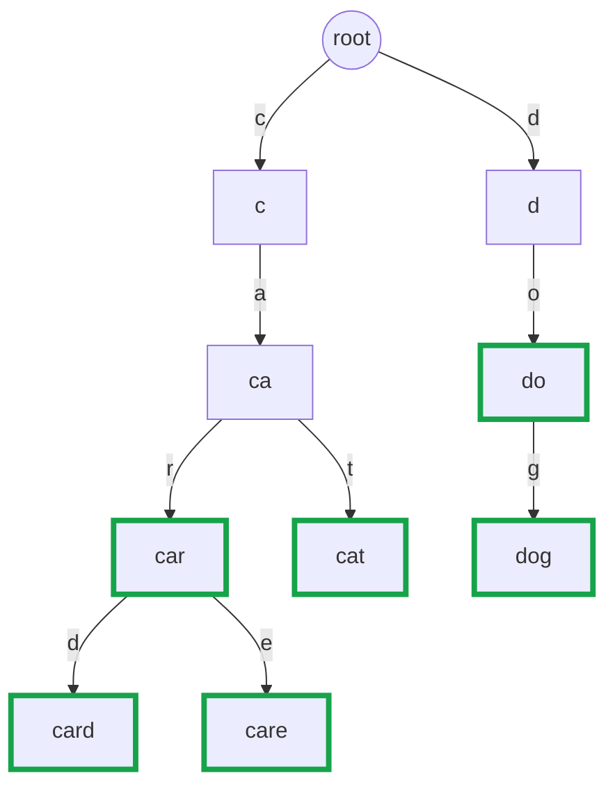
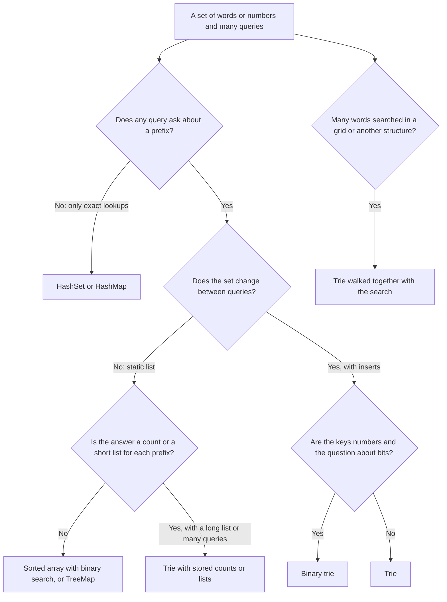

# Pattern 17: Trie (Prefix Tree)

## Overview

A trie (also called a prefix tree) stores a set of words in a tree in which each edge carries one letter. Words that start with the same letters share the same path from the root. The trie answers "is this word stored?" and "does any stored word start with these letters?" in time that depends on the length of the query, not on the number of stored words. What each node stores besides its children decides which questions the trie can answer.

After this page you can:

1. Rebuild a trie from a blank page, starting from a hash set and a sorted array, and say which waste each step removes.
2. Explain with a counterexample why a trie needs an end-of-word flag, and trace `insert`, `search`, and `startsWith` node by node.
3. Decide what a node must store for a new problem (a flag, a count, a whole word, a sum, a list), and name the property of the problem that asks for it.
4. Write the variants without a template: wildcard search ([LC 211](https://leetcode.com/problems/design-add-and-search-words-data-structure/)), shortest root ([LC 648](https://leetcode.com/problems/replace-words/)), trie plus grid search ([LC 212](https://leetcode.com/problems/word-search-ii/)), a binary trie for XOR ([LC 421](https://leetcode.com/problems/maximum-xor-of-two-numbers-in-an-array/)), and delete with counts.
5. Choose between an array of 26 children and a `HashMap` of children, and state the memory cost of each as a count of references.
6. Decide when a hash set, a sorted array, or a `TreeMap` is the better tool than a trie.

## Prerequisites

| You need | Why this page needs it | Where to learn it |
|---|---|---|
| Trees and tree traversal | A trie is a tree. Every operation walks from the root down. The wildcard search and the collection of words below a node use depth-first traversal (also called depth-first search, DFS: go as deep as possible along one path, then return and try the next) | [Trees and Balanced BSTs](../foundations/05-trees-and-balanced-bsts.md), [Pattern 10: Tree Patterns](../10-tree-patterns/README.md) |
| Hash maps and hash sets | The first attempts use a `HashSet`. A node can keep its children in a `HashMap`. The page compares both with the trie | [Hash Tables](../foundations/04-hash-tables.md) |
| Strings in Java | The code reads `s.charAt(i)`, compares strings with `compareTo`, and uses `startsWith` and `substring` | [Arrays, Strings, and Linked Lists](../foundations/02-arrays-strings-linked-lists.md) |
| Recursion and backtracking | The wildcard search and Word Search II are recursive. The grid search marks a cell and restores it | [Recursion](../foundations/09-recursion.md), [Pattern 08: Recursion and Backtracking](../08-recursion-backtracking/README.md) |
| Binary search on a sorted array | The second first attempt and the `TreeMap` comparison use "find the first element that is greater than or equal to a key" | [Pattern 06: Binary Search on Answer](../06-binary-search-on-answer/README.md) |
| Bit operators (`>>>`, `&`, `^`, `<<`) and XOR (the result bit is 1 exactly when the two input bits differ) | Example 5 (LC 421) stores numbers as paths of bits | [Pattern 19: Bit Manipulation](../19-bit-manipulation/README.md) |
| A dynamic-programming table (only for the ladder problem LC 139) | P8 fills a table `reach` and uses a trie to fill it | [Pattern 15: Dynamic Programming](../15-dynamic-programming/README.md) |
| Counting operations and O-notation | The page counts steps on a trace before it states a bound | [Complexity Analysis](../foundations/01-complexity-analysis.md) |

Words that the page uses from the start:

- A **word** is a string of letters. A **prefix** of a word is its first `j` letters, for `j` from 0 to the length of the word. In `card`, the prefixes are the empty string, `c`, `ca`, `car`, and `card`. Every word is a prefix of itself.
- `n` is the number of stored words. `L` is the length of one word or of one query. `N` is the total number of letters in all stored words.
- A letter is also a number. In Java, `'d' - 'a'` is 3, because the characters `'a'`, `'b'`, `'c'`, `'d'` have consecutive codes. The code uses this difference as an array index from 0 to 25 for lowercase English letters.

## Motivation

### The anchor problem: a dictionary with a prefix test

This problem is [LC 208: Implement Trie (Prefix Tree)](https://leetcode.com/problems/implement-trie-prefix-tree/). Build a dictionary with three operations:

- `insert(word)` stores a word.
- `search(word)` answers whether this exact word is stored.
- `startsWith(prefix)` answers whether any stored word starts with this prefix.

The page uses one small word list for the whole lesson: `car, card, care, cat, dog, do`. After the six inserts, the answers are:

| Call | Answer | Reason |
|---|---|---|
| `search("car")` | true | `car` is stored |
| `search("ca")` | false | no stored word is exactly `ca` |
| `startsWith("ca")` | true | `car`, `card`, `care`, and `cat` start with `ca` |
| `startsWith("cb")` | false | no word starts with `cb` |
| `search("do")` | true | `do` is stored, although `dog` also starts with `do` |

### First attempt 1: a hash set of the words

Keep a `HashSet<String>` of the six words. `search` is one lookup: the set hashes the query (it reads `L` letters) and compares it with at most a few candidates. That part is fast.

`startsWith` has no lookup. The set cannot answer "which words begin with these letters?" from the hash of the prefix, because the hash of `ca` has no relation to the hash of `car`. The code must scan every word and compare letters:

```text
startsWith("cb"):
  car   c = c, a != b    2 comparisons
  card  c = c, a != b    2 comparisons
  care  c = c, a != b    2 comparisons
  cat   c = c, a != b    2 comparisons
  dog   c != d           1 comparison
  do    c != d           1 comparison
  total                  10 comparisons, and the answer is false
```

The scan makes up to `n x L` comparisons for one query. For `n = 100000` words and `L = 20`, that is up to 2,000,000 comparisons for one call. The program in the Implementation section counts the 10 comparisons above.

**Fix attempt: store every prefix too.** Add a second set that holds every prefix of every word. Then `startsWith` is one lookup. The cost moves to memory and to the insert:

| Stored | Strings | Letters |
|---|---|---|
| The six words | 6 | 3 + 4 + 4 + 3 + 3 + 2 = 19 |
| The distinct non-empty prefixes: `c ca car card care cat d do dog` | 9 | 1 + 2 + 3 + 4 + 4 + 3 + 1 + 2 + 3 = 23 |

Together the two sets hold 15 strings and 42 letters (19 + 23). The plain word list holds 6 strings and 19 letters. In general, a word of length `L` has `L` non-empty prefixes, with `1 + 2 + ... + L = L(L + 1) / 2` letters in total, and each prefix is hashed from its first letter. For `n = 100000` words of length 20 that share nothing, the prefix set holds up to 2,000,000 strings and 21,000,000 letters, and each insert hashes 20 strings.

### First attempt 2: a sorted array with binary search

Keep the words in sorted order: `[car, card, care, cat, do, dog]`. All words that start with a prefix sit next to each other, and the first one is the smallest word that is greater than or equal to the prefix. Binary search finds it:

```text
startsWith("ca"):  find the first word >= "ca"  -> index 0 (car)
                   does "car" start with "ca"?   -> yes
startsWith("cb"):  find the first word >= "cb"  -> index 4 (do)
                   does "do" start with "cb"?    -> no
```

Binary search makes about log2(n) probes, and each probe compares up to `L` letters. The cost of `startsWith` is O(L log n), much better than `n x L`. For a fixed dictionary, this is a good solution. The weak point is `insert`. A new word goes into the middle of the array, and every larger word moves one place to the right. Inserting `cap` into the array above moves all 6 elements. For `n = 100000`, one insert moves up to 100,000 elements.

### The exact waste

Look at the six words again:

```text
car
card
care
cat
dog
do
```

- **Storage.** `car`, `card`, `care`, and `cat` all start with `ca`. The word list stores the letters `c` and `a` four times each. In total the list has 19 letters, and only 9 distinct prefixes exist. Every prefix is stored once for each word that contains it.
- **Work.** The scan for `cb` compared `c` with `c` four separate times, one for each word that starts with `c`. The answer for the first letter does not depend on which word the code looks at.

The gap: if words that share a prefix shared the storage of that prefix, then one walk along the letters of the query would answer the question for all words at once. The Derivation builds this structure.

## Derivation

### Question 1: what if words that share a prefix shared the storage of that prefix?

Store the words in a tree. The root stands for the empty prefix. A node stands for one prefix. An edge from a node to a child adds one letter. Then `car`, `card`, and `care` follow the same edges `c`, `a`, `r` from the root, and split only at the fourth letter.



The label inside a node is the prefix that the path from the root spells. The label is only for the reader. The code does not store it. A node with a thick green border is a node where a word ends. The next two questions explain how the code stores the letters and the green borders.

Count the nodes: root, plus `c ca car card care cat d do dog`. That is 9 nodes besides the root, one for each of the 9 distinct prefixes in the table of the Motivation. The tree stores 9 letters. The sorted word list stores 19 letters, and the prefix set stores 23.

### Question 2: where is the letter stored?

Each edge has a letter. Two places can hold it.

- **In the child node.** Each node stores its own letter and a list of children. To follow the letter `a` from a node, the code searches the list for the child whose letter is `a`. Each step costs a search through up to 26 children.
- **On the edge, as the position in an array.** Each node stores an array `next` of 26 references. The reference at position 0 is the child for `a`, the reference at position 1 is the child for `b`, and so on. The child for the letter `ch` is `next[ch - 'a']`. A position that holds `null` means "no edge for this letter". The node does not store its own letter. The position in the parent's array stores it.

The second form costs one array access for each step, so the code uses it:

```java
private static class Node {
    Node[] next = new Node[26];   // next[i] is the child for the letter 'a' + i
    boolean end;                  // explained in Question 3
}
```

A node now holds 26 references, and most of them are `null`. In the six-word trie, the 10 nodes hold 260 references, and 9 of them (one for each edge) point to a node. The section "The child container" below returns to this cost.

### Question 3: how does the tree tell `car` (a word) from `ca` (only a prefix)?

In the diagram, `ca` is a node, and `car` is a node. Both exist because words pass through them. The shape of the tree does not say which of them is a word:

- `ca` is not a word, and it has children.
- `car` is a word, and it also has children (`card`, `care`). `do` is a word and has the child `g`.

So "the node has children" does not tell whether a word ends there. The shape of the tree alone cannot separate `car` from `ca`.

Suppose the code answers `search(w)` with "does the path for `w` exist?" Then:

| Call | The code answers | The right answer |
|---|---|---|
| `search("car")` | true | true |
| `search("ca")` | **true** | false |
| `search("c")` | **true** | false |
| `search("cab")` | false | false |

The code returns the wrong answer for every prefix that is not a word. Without more information, `search` and `startsWith` are the same function.

The fix: each node stores one boolean, `end`. The code sets `end = true` on the last node of every inserted word. The node `ca` keeps `end = false`. Now the two questions have different tests:

- `search(w)`: the path for `w` exists **and** its last node has `end = true`.
- `startsWith(p)`: the path for `p` exists.

### Question 4: what do insert, search, and startsWith do, node by node?

**Insert.** Start at the root. For each letter of the word: if the current node has an edge for the letter, follow it. If not, create a child and follow the new edge. After the last letter, set `end = true`. The program in the Implementation section prints this trace for the first three inserts:

```text
insert "car"
  root --c--> c (created)
  c --a--> ca (created)
  ca --r--> car (created)
  car: end = true
insert "card"
  root --c--> c (exists)
  c --a--> ca (exists)
  ca --r--> car (exists)
  car --d--> card (created)
  card: end = true
insert "cat"
  root --c--> c (exists)
  c --a--> ca (exists)
  ca --t--> cat (created)
  cat: end = true
```

Read the second insert. `card` follows three existing edges and creates one node. Only the letter `d` is new. The code stored `c`, `a`, and `r` for the first word, and the second word reuses them.

**Search and startsWith.** Both start at the root and follow one edge for each letter. They stop with "no" if an edge is missing. They differ only in what they say at the end. The trace for the queries of the Motivation:

```text
search "car"                       startsWith "ca"
  root --c--> c                      root --c--> c
  c --a--> ca                        c --a--> ca
  ca --r--> car                      stop at ca: the path exists
  stop at car: end = true            -> true
-> true
search "ca"                        search "cab"
  root --c--> c                      root --c--> c
  c --a--> ca                        c --a--> ca
  stop at ca: end = false            ca --b--> no edge
-> false                           -> false
startsWith "cb"
  root --c--> c
  c --b--> no edge
-> false
```

(The page shows the traces in two columns. The program prints them one after another.)

Compare the two calls on `ca`. Both stop at the same node. `search` reads the flag and answers false. `startsWith` reads only that the node exists and answers true.

The shared part of the three operations is one helper: follow the letters from the root and return the last node, or `null` if an edge is missing. This is the complete class for LC 208:

```java
class Trie {
    private static class Node {
        Node[] next = new Node[26];   // next[i] is the child for the letter 'a' + i
        boolean end;                  // true if a stored word ends at this node
    }

    private final Node root = new Node();

    public void insert(String word) {
        Node node = root;
        for (int i = 0; i < word.length(); i++) {
            int c = word.charAt(i) - 'a';
            if (node.next[c] == null) node.next[c] = new Node();   // no edge yet: add the child
            node = node.next[c];
        }
        node.end = true;
    }

    public boolean search(String word) {
        Node node = walk(word);
        return node != null && node.end;        // the path must exist AND a word must end here
    }

    public boolean startsWith(String prefix) {
        return walk(prefix) != null;            // the path alone is enough
    }

    // Follows the letters of s from the root. Returns the last node, or null if an edge is missing.
    private Node walk(String s) {
        Node node = root;
        for (int i = 0; i < s.length(); i++) {
            node = node.next[s.charAt(i) - 'a'];
            if (node == null) return null;
        }
        return node;
    }
}
```

**Why it is correct.** The invariant is: the trie has a node for the path `p` if and only if `p` is a prefix of some inserted word, and the flag `end` of that node is true if and only if `p` was inserted as a word.

1. *Only if.* The code creates a node only inside `insert`, only along the path of the word that it inserts. So the path of every node is a prefix of an inserted word. The code sets `end` only on the last node of an inserted word.
2. *If.* `insert(w)` follows or creates a node for each of the prefixes of `w`, one letter after the other. So every prefix of an inserted word has a node.
3. *The queries.* `walk(s)` returns the node for `s` if the node exists, and `null` otherwise. By the invariant, the node exists exactly when `s` is a prefix of some inserted word. So `startsWith(s)` is `walk(s) != null`. The flag is true exactly when `s` was inserted as a word, so `search(s)` is `walk(s) != null && end`.
4. *The edge cases.* The empty string is a prefix of every word, and its node is the root, so `startsWith("")` returns true. This holds even for an empty trie (the program prints it). A problem that wants "some stored word starts with this" for the empty prefix needs a count of the stored words (Example 4 adds such a count). A word that is a prefix of a longer word (`do` after `dog`) creates no node. It sets one flag.

### The cost, counted on the trace

Count the edge look-ups. Each look-up is one array access.

| Call | Edge look-ups | Nodes created |
|---|---|---|
| `insert("car")` | 3 | 3 |
| `insert("card")` | 4 | 1 |
| `insert("cat")` | 3 | 1 |
| `search("car")` | 3 | 0 |
| `search("ca")` | 2 | 0 |
| `search("cab")` | 3 (the third finds no edge) | 0 |
| `startsWith("ca")` | 2 | 0 |
| `startsWith("cb")` | 2 (the second finds no edge) | 0 |

The count for each call equals the length of its argument, or less when an edge is missing. No call looks at a word other than the one on its path. The scan of the hash set made 10 comparisons for `cb`. The trie made 2 look-ups. If the trie held a million more words that start with other letters, the trie would still make 2 look-ups for `cb`. So each operation costs **O(L)**, where `L` is the length of the argument, and the cost does not depend on `n`.

### The memory cost and its worst case

Each letter of each inserted word creates at most one node. So the trie has at most `N + 1` nodes, where `N` is the total number of letters. This bound holds when no two words share a prefix. The six words have `N = 19` letters, and the trie has 10 nodes (the root and 9 more), because shared prefixes create nodes only once.

- **Best case.** All words are prefixes of one long word, for example `a, ab, abc, abcd`. The trie has `L + 1` nodes, one for each letter of the longest word.
- **Worst case.** The words share almost nothing. The trie has about `N + 1` nodes. The trie then holds the same letters as the hash set, plus one node object and a children container for each letter.

With an array of 26 references in each node, the worst case costs `26 x (N + 1)` references. For `n = 100000` words of length 20, `N` is 2,000,000, so the arrays hold up to 26 x 2,000,001 = 52,000,026 references, about 52 million.

Estimate, not a measurement. Assumption: a 64-bit HotSpot JVM that stores each reference in 4 bytes (compressed references, the HotSpot default for a heap below about 32 GB). The reference slots alone use 52,000,000 x 4 bytes = 208,000,000 bytes, about 208 MB. The estimate leaves out the array headers and the node objects, so the real size is larger. A hash set of the same words holds the 2,000,000 letters in 100,000 strings. The trie pays memory for speed on prefix queries.

### The child container: an array of 26 or a `HashMap`

The code in Question 2 puts an array of 26 references in each node. The other option is a `HashMap<Character, Node>` that holds only the edges that exist.

```java
class MapTrie {
    private static class Node {
        Map<Character, Node> next = new HashMap<>();   // only the letters that occur
        boolean end;
    }

    private final Node root = new Node();

    public void insert(String word) {
        Node node = root;
        for (int i = 0; i < word.length(); i++) {
            node = node.next.computeIfAbsent(word.charAt(i), ch -> new Node());
        }
        node.end = true;
    }

    public boolean search(String word) {
        Node node = walk(word);
        return node != null && node.end;
    }

    public boolean startsWith(String prefix) {
        return walk(prefix) != null;
    }

    private Node walk(String s) {
        Node node = root;
        for (int i = 0; i < s.length(); i++) {
            node = node.next.get(s.charAt(i));
            if (node == null) return null;
        }
        return node;
    }
}
```

| | Array of 26 | `HashMap<Character, Node>` |
|---|---|---|
| References for a node with `k` children | 26 slots, whatever `k` is | One table (in OpenJDK, the map allocates it at the first `put`; default capacity 16 slots), plus one entry object for each child |
| Objects for a node | The node and one array | The node, a `HashMap`, its table, and one entry for each child. A `Character` key is boxed (the `char` is wrapped in an object) |
| Step cost | One array access | Hash of the key, bucket access, `equals` |
| Order of children | The letters in order, by position | No order |
| Alphabet | Must be a small fixed set, mapped to positions 0 to `k - 1` | Any characters, including Unicode |
| Wrong input | A letter outside the range gives a negative or too large index and throws `ArrayIndexOutOfBoundsException` | No failure. Any character is a key |

The [`HashMap` javadoc (JDK 21)](https://docs.oracle.com/en/java/javase/21/docs/api/java.base/java/util/HashMap.html) states the default initial capacity of 16 in the description of the constructor `HashMap()`. The javadoc does not say when the table is allocated. The first `put` is the behavior of the OpenJDK source. The comparison of memory is a count of objects and references, not a measurement. For a node with one child, the map uses more objects than the array and about as many slots (a table of 16 against an array of 26). For a node with many children, the array has fewer objects.

**When each is right.**

- Use the array when the problem says that the words use only lowercase English letters (26), or another alphabet of a few dozen symbols (map each symbol to a position). The steps are fast, and the code is short.
- Use the `HashMap` when the alphabet is large or unknown (Unicode text, mixed case with digits and symbols) and most nodes have few children. An array for Unicode would need 65,536 slots in each node.
- Recommendation: read the constraints before you write the node class. Write the array for "lowercase letters" and the map for everything else.

The bit trie of LC 421 is the array case with an alphabet of 2: each node has two references.

## The Pattern

A trie stores a set of strings in a tree whose edges carry one symbol each, so that strings with a common prefix share a path. One walk from the root along the symbols of a query visits exactly the prefixes of the query. A node is a prefix, and the subtree of a node is the set of all stored words with that prefix. So the node is the right place to keep any summary of "all words with this prefix". What the node stores beyond its children is the design decision of each trie problem.

**The invariant.** A node exists for the path `p` if and only if `p` is a prefix of a stored word. Each extra field of a node summarizes the stored words whose prefix is `p`.

**The vocabulary.** The page used each term before it named it.

| Term | What it was in the examples | The question to ask in a new problem |
|---|---|---|
| Trie, prefix tree | The tree of the six words | "Does the problem ask about prefixes of stored strings?" |
| Node | One distinct prefix | "Which prefix does this node stand for, and what must I know about the words below it?" |
| Edge | One letter, stored as the array position | "What is the alphabet? How large is it?" |
| Root | The empty prefix | "What is the answer for the empty prefix?" |
| End flag | `end = true` where a word ends | "Must the code tell a stored word from a prefix?" |
| Walk | Follow one edge for each letter of a query | "Where does the query stop, and what do I read there?" |
| Pass count | The number of words that go through a node | "Does the problem count words by prefix?" |

### What a node stores beyond the children

| A node stores | It answers | The property of the problem that asks for it | Example |
|---|---|---|---|
| An end flag (`boolean end`) | "Is this exact word stored?" | The problem has exact lookups and prefix questions on the same set | [LC 208](https://leetcode.com/problems/implement-trie-prefix-tree/), [LC 211](https://leetcode.com/problems/design-add-and-search-words-data-structure/), [LC 648](https://leetcode.com/problems/replace-words/), [LC 720](https://leetcode.com/problems/longest-word-in-dictionary/) |
| A pass count (`int pass`): the number of stored words that go through the node | "How many words have this prefix?" | The problem counts or scores words by prefix, or deletes words | [LC 1804](https://leetcode.com/problems/implement-trie-ii-prefix-tree/) (premium), [LC 2416](https://leetcode.com/problems/sum-of-prefix-scores-of-strings/) |
| An end count (`int ends`): the number of stored words that end at the node | "How many copies of this exact word?" | The set may hold duplicates | [LC 1804](https://leetcode.com/problems/implement-trie-ii-prefix-tree/) (premium) |
| The whole word at its end node (`String word`) | "Which word is this?", without rebuilding it from the path | A search outside the trie (a grid walk) finds words, and the answer must list them | [LC 212](https://leetcode.com/problems/word-search-ii/) |
| A short list of the best words, or their indexes | "The top `k` completions of this prefix" | The problem ranks completions, so each prefix needs its answer ready | [LC 1268](https://leetcode.com/problems/search-suggestions-system/), [LC 642](https://leetcode.com/problems/design-search-autocomplete-system/) (premium), [LC 425](https://leetcode.com/problems/word-squares/) (premium) |
| A sum or a maximum over the subtree | "The total value of all words with this prefix" | The words carry values, and the query is an aggregate by prefix | [LC 677](https://leetcode.com/problems/map-sum-pairs/) |
| Two children, one for bit 0 and one for bit 1 (a binary trie), one level for each bit | "Which numbers have this bit prefix?" | The strings are numbers, and the question compares them bit by bit from the highest bit | [LC 421](https://leetcode.com/problems/maximum-xor-of-two-numbers-in-an-array/) |

A sum can change by a delta when a value is replaced. A maximum cannot: if the old maximum leaves, the node needs the next maximum, which it does not store. Use a sum when values are replaced or removed. Use a maximum only when values are only added.

### The variants

| Variant | Property of the problem that selects it | What changes in the code | Where on this page |
|---|---|---|---|
| Plain trie, array children | Exact and prefix lookups on lowercase words | Nothing: this is the Derivation | Derivation |
| Map children | Large or unknown alphabet | `Map<Character, Node>` in place of the array | Derivation |
| Walk with a stop on the first end flag | "The shortest word that is a prefix of the query" | The walk returns at the first flag | [LC 648](https://leetcode.com/problems/replace-words/) |
| Search over all children (wildcard) | The query has a symbol that matches any letter | A recursive search that loops over the children | [LC 211](https://leetcode.com/problems/design-add-and-search-words-data-structure/) |
| Collect words below a node | The answer is a list of words with a prefix | A depth-first traversal from the prefix node, in letter order | [LC 1268](https://leetcode.com/problems/search-suggestions-system/) |
| Trie walked together with another search | Many target words, and the search runs over a second structure (a grid) | The other search carries the trie node as a parameter | [LC 212](https://leetcode.com/problems/word-search-ii/) |
| Counts and delete | Duplicates, or the code removes words | `pass` and `ends` fields | [LC 1804](https://leetcode.com/problems/implement-trie-ii-prefix-tree/) (premium) |
| Binary trie | The strings are numbers and the question is about bitwise XOR | Two children, 31 or 32 levels | [LC 421](https://leetcode.com/problems/maximum-xor-of-two-numbers-in-an-array/) |
| Reversed trie | The query is about the END of a word (a suffix), or about the newest letters of a stream | Insert each word from its last letter to its first | [LC 1032](https://leetcode.com/problems/stream-of-characters/) |
| Trie as a lookup inside a DP | A dictionary of words, and a position in a string asks "which words start here?" | One walk from each reachable position | [LC 139](https://leetcode.com/problems/word-break/) |

## Worked Examples

Each example changes one thing about the basic trie. The order goes from the smallest change to the largest.

### Example 1: Replace Words (LC 648)

**Statement.** A dictionary lists "roots" (short words). A sentence has words separated by one space. Replace each word of the sentence by the shortest root that is a prefix of the word. If no root is a prefix, keep the word. For the roots `cat, bat, rat` and the sentence `the cattle was rattled by the battery`, the answer is `the cat was rat by the bat`. The problem is [LC 648: Replace Words](https://leetcode.com/problems/replace-words/).

**What changed.** The basic trie answers "is the whole query a word?". Here the query (the sentence word) is longer than the stored word (the root), and the question is about a prefix of the query that is a stored word.

**Brute force.** For each sentence word, test each root with `startsWith`, and keep the shortest. The cost is the number of sentence words times the number of roots times the length of a root. A word and a root that share nothing still cost a comparison.

**Derivation.** Walk the sentence word down the trie of the roots. The walk visits the prefixes of the word in order of length: first the prefix with one letter, then the one with two letters, and so on. The first node on the walk with `end = true` stands for a root, and it is the shortest root, because every prefix that the walk visited earlier is shorter and was not a root. If an edge is missing, no longer prefix can be a root either, so the walk stops and the code keeps the word.

**Trace** for the words of the sentence:

| Word | Walk | Result |
|---|---|---|
| `the` | `t`: root has no edge for `t` | `the` (no root starts with `t`) |
| `cattle` | `c`, `ca`, `cat` has `end = true` | `cat` (3 steps, the rest is not read) |
| `was` | `w`: no edge | `was` |
| `rattled` | `r`, `ra`, `rat` has `end = true` | `rat` |
| `by` | `b`, `by`: no edge for `y` below `b` | `by` |
| `battery` | `b`, `ba`, `bat` has `end = true` | `bat` |

```java
class ReplaceWords {
    private static class Node {
        Node[] next = new Node[26];
        boolean end;
    }

    public String replaceWords(List<String> dictionary, String sentence) {
        Node root = new Node();
        for (String rootWord : dictionary) {
            Node node = root;
            for (int i = 0; i < rootWord.length(); i++) {
                int c = rootWord.charAt(i) - 'a';
                if (node.next[c] == null) node.next[c] = new Node();
                node = node.next[c];
            }
            node.end = true;
        }
        StringBuilder out = new StringBuilder();
        for (String word : sentence.split(" ")) {
            if (out.length() > 0) out.append(' ');
            out.append(shortestRoot(root, word));
        }
        return out.toString();
    }

    // Walks the word down the trie and stops at the FIRST end flag: that root is the shortest.
    private String shortestRoot(Node root, String word) {
        Node node = root;
        for (int i = 0; i < word.length(); i++) {
            node = node.next[word.charAt(i) - 'a'];
            if (node == null) return word;                  // no root starts this word
            if (node.end) return word.substring(0, i + 1);  // the first root on the path
        }
        return word;                                        // the word is shorter than any root
    }
}
```

**Complexity.** Building the trie costs O(total letters of the roots). Each word of the sentence costs at most `min(its length, the length of the longest root)` steps. The reason: the walk stops at the first flag or at the first missing edge, and the trie has no path longer than the longest root. The code is iterative, so it uses no stack.

**The mistake that this problem invites.** Calling `search(word)` finds only a root that equals the whole word. The roots `cat, bat, rat` and the word `cattle` give no match with `search`, and the output keeps `cattle` (see Common Mistakes).

### Example 2: Design Add and Search Words (LC 211)

**Statement.** Design a dictionary with `addWord(word)` and `search(word)`. A query of `search` may contain the symbol `.`, which matches any one letter. For the stored words `car, card, care, cat, dog, do`, the query `.o.` is true (it matches `dog`), the query `c.t` is true (it matches `cat`), and the query `ca` is false. The problem is [LC 211: Design Add and Search Words Data Structure](https://leetcode.com/problems/design-add-and-search-words-data-structure/).

**What changed.** In the basic trie, one letter of the query selects one edge. A `.` does not select an edge: it can be any of the up to 26 edges of the node. The walk is no longer one path.

**Derivation.** Treat `.` as "try every edge". Define `match(node, i)`: "does some word below `node` match the query from position `i`?" Then:

- If `i` equals the length of the query, every letter is used. The answer is `node.end`.
- If the query letter is a normal letter, follow its edge. If the edge is missing, the answer is false. Otherwise the answer is `match(child, i + 1)`.
- If the query letter is `.`, the answer is true if `match(child, i + 1)` is true for **at least one** child.

The third case makes the search recursive. Each try that fails returns to the node and tries the next edge. This is backtracking.

**Trace** for `.o.` on the six-word trie (the program prints it):

```text
search ".o."
  at root, '.': try c
    at c, 'o': no edge
  at root, '.': try d
    at d, 'o': edge to do
      at do, '.': try g
        at dog: all letters used, end = true
-> true
```

The first try (`c`) fails because `c` has no edge `o`. The code returns to the root and tries `d`. The query `c.t` follows `c`, tries the only child `a` of `c`, follows `t`, and finds `end = true` at `cat`.

```java
class WordDictionary {
    private static class Node {
        Node[] next = new Node[26];
        boolean end;
    }

    private final Node root = new Node();

    public void addWord(String word) {          // the insert of the basic trie
        Node node = root;
        for (int i = 0; i < word.length(); i++) {
            int c = word.charAt(i) - 'a';
            if (node.next[c] == null) node.next[c] = new Node();
            node = node.next[c];
        }
        node.end = true;
    }

    public boolean search(String word) {
        return match(root, word, 0);
    }

    // Does some stored word below `node` match word[i..], where '.' matches any one letter?
    private boolean match(Node node, String word, int i) {
        if (i == word.length()) return node.end;            // all letters used: a word ends here
        char ch = word.charAt(i);
        if (ch != '.') {
            Node child = node.next[ch - 'a'];
            return child != null && match(child, word, i + 1);   // one edge to follow
        }
        for (Node child : node.next) {                      // '.': try every edge
            if (child != null && match(child, word, i + 1)) return true;
        }
        return false;
    }
}
```

**The worst-case cost, and the reason.** A call `match(node, i)` always has `i` equal to the depth of `node`. So each node is the argument of at most one call for one query. The number of calls is at most the number of nodes, `N + 1`. Each call scans at most 26 slots, so one query costs O(26 x N) at worst, for example a query of only dots that is as long as the longest word. A query without dots costs O(L). The space for the recursion is O(L).

The brute force compares the query with every word of the same length: O(n x L). The trie wins when the letters before the first dot are many, because a missing edge cuts the search early. The trie has no advantage for a query that starts with a dot: the worst case of the trie, `A x N` slot reads (`A` is the size of the alphabet, here 26), can be up to 26 times the `n x L` letter comparisons of the scan, because `N` is at most `n x L`.

### Example 3: Search Suggestions System (LC 1268), trie and sort

**Statement.** A list of product names and a search word. After the user types each letter of the search word, return up to 3 product names that start with the typed prefix, in alphabetical order. For the products `mobile, mouse, moneypot, monitor, mousepad` and the search word `mouse`, the answer has 5 lists: `[mobile, moneypot, monitor]` for `m`, the same list for `mo`, then `[mouse, mousepad]` for each of `mou`, `mous`, `mouse`. The problem is [LC 1268: Search Suggestions System](https://leetcode.com/problems/search-suggestions-system/). Assumption: the products are distinct. With a repeated name, the two versions below differ: the trie stores the name once, so it lists the name once, and the sorted version lists it as many times as it occurs. For the products `ab, ab, ac` and the prefix `a`, the trie version returns `[ab, ac]` and the sorted version returns `[ab, ab, ac]`.

**What changed.** The answer is a list of words, not a boolean. The code must find the node of a prefix and then collect words below it, in alphabetical order, and stop at 3.

**With a trie.** Insert all products. For each typed letter, move one step down the trie (if the path is gone, the node stays `null`, and all later lists are empty). From the node, do a depth-first traversal that visits the children in letter order: `a` before `b` before `c`. A depth-first traversal that visits a node before its children, and the children in letter order, visits the words in alphabetical order. Why: a word that is a prefix of another word comes first (`mouse` before `mousepad`), and words with a smaller next letter come before words with a larger next letter. Stop when 3 words are collected.

**With sorting and binary search.** Sort the products. The words with a given prefix sit in one block, and the first word of the block is the first word that is greater than or equal to the prefix. For each typed prefix, binary search for that first word and take up to 3 words from there while they start with the prefix. The index of the first word never moves left as the prefix grows, because a longer prefix is a larger string. So the search for each prefix can start where the previous one ended.

**Trace** on the example (sorted: `mobile, moneypot, monitor, mouse, mousepad`):

| Typed | Trie: node and words in letter order | Sorted array: first index `>=` prefix, words taken |
|---|---|---|
| `m` | node `m`: `mobile`, `moneypot`, `monitor` (stop at 3) | index 0: `mobile`, `moneypot`, `monitor` |
| `mo` | node `mo`: the same three words | index 0: the same three words |
| `mou` | node `mou`: `mouse`, `mousepad` | index 3: `mouse`, `mousepad` |
| `mous` | node `mous`: `mouse`, `mousepad` | index 3 |
| `mouse` | node `mouse`: `mouse`, `mousepad` | index 3 |

Both methods return these lists.

```java
class SearchSuggestions {
    private static class Node {
        Node[] next = new Node[26];
        boolean end;
    }

    // Version 1: a trie. Assumes that the products are distinct.
    static List<List<String>> withTrie(String[] products, String searchWord) {
        Node root = new Node();
        for (String p : products) {
            Node node = root;
            for (int i = 0; i < p.length(); i++) {
                int c = p.charAt(i) - 'a';
                if (node.next[c] == null) node.next[c] = new Node();
                node = node.next[c];
            }
            node.end = true;
        }
        List<List<String>> result = new ArrayList<>();
        Node node = root;                                   // null once the prefix leaves the trie
        StringBuilder prefix = new StringBuilder();
        for (int i = 0; i < searchWord.length(); i++) {
            char ch = searchWord.charAt(i);
            prefix.append(ch);
            if (node != null) node = node.next[ch - 'a'];
            List<String> found = new ArrayList<>();
            if (node != null) collect(node, prefix, found);
            result.add(found);
        }
        return result;
    }

    // Preorder walk with letters in order: words come out in sorted order. Stops at 3 words.
    private static void collect(Node node, StringBuilder path, List<String> out) {
        if (node.end) out.add(path.toString());
        for (int c = 0; c < 26 && out.size() < 3; c++) {
            if (node.next[c] == null) continue;
            path.append((char) ('a' + c));
            collect(node.next[c], path, out);
            path.deleteCharAt(path.length() - 1);
        }
    }

    // Version 2: sort once, then binary search for each prefix.
    static List<List<String>> withSort(String[] products, String searchWord) {
        String[] sorted = products.clone();
        Arrays.sort(sorted);
        List<List<String>> result = new ArrayList<>();
        int lo = 0;                    // a longer prefix is larger, so the start never moves left
        for (int len = 1; len <= searchWord.length(); len++) {
            String prefix = searchWord.substring(0, len);
            lo = lowerBound(sorted, prefix, lo);
            List<String> found = new ArrayList<>();
            for (int i = lo; i < sorted.length && found.size() < 3; i++) {
                if (!sorted[i].startsWith(prefix)) break;   // the matches are next to each other
                found.add(sorted[i]);
            }
            result.add(found);
        }
        return result;
    }

    // The first index >= from whose string is >= key.
    private static int lowerBound(String[] a, String key, int from) {
        int lo = from, hi = a.length;
        while (lo < hi) {
            int mid = (lo + hi) >>> 1;
            if (a[mid].compareTo(key) < 0) lo = mid + 1;
            else hi = mid;
        }
        return lo;
    }
}
```

**The honest comparison.** The sorted version is shorter: it has no node class, no recursion, and no assumption about the alphabet. The sort costs O(n x L x log n) in letter comparisons, and each of the `L` prefixes costs O(L x log n) for the binary search plus the comparisons for at most 3 words. The trie costs O(N) to build. Each typed letter costs one step, plus the traversal that collects at most 3 words: it visits at most the nodes on the paths to those 3 words, and each visited node scans 26 slots. In an interview, write the sorted version first. Choose the trie when the product list changes between queries (an insert into a trie is O(L), and an insert into a sorted array moves up to `n` elements), or when each prefix must answer from a stored list (see the "best words" row of The Pattern).

### Example 4: Implement Trie II with counts, and delete (LC 1804)

**Statement.** Design a trie with `insert(word)` (duplicates allowed), `countWordsEqualTo(word)`, `countWordsStartingWith(prefix)`, and `erase(word)` (removes one copy). After `insert(apple)`, `insert(apple)`, `countWordsEqualTo(apple)` gives 2, `countWordsStartingWith(app)` gives 2, and after `erase(apple)` the first count is 1. The problem is [LC 1804: Implement Trie II (Prefix Tree)](https://leetcode.com/problems/implement-trie-ii-prefix-tree/) (premium).

**What changed.** A boolean cannot count. The node needs two numbers: `ends`, the number of copies of the exact word that end here, and `pass`, the number of stored words that go through the node (including the words that end there).

**Derivation.** `insert` adds 1 to `pass` of each node on the path and 1 to `ends` of the last node. Then `countWordsStartingWith(p)` is `pass` of the node for `p`, and `countWordsEqualTo(w)` is `ends` of the node for `w`. Both are one walk.

**Delete.** `erase(w)` must remove one word. Two things can go wrong:

- *Clear the flag only.* The path stays. Insert `apple`, then clear its end flag. `startsWith("app")` still finds the path and says true, but no stored word starts with `app`. The trie answers wrongly, and it also keeps memory for nodes that no word uses.
- *Cut the unused nodes.* A node is unused when no stored word goes through it. Without counts, the code cannot know this on the way down. It must go to the end of the word, clear the flag, and walk back up: at each node, cut the child if the child has no children and no flag. The recursive code below does this on the way back from the recursion.

```java
class DeletableTrie {
    private static class Node {
        Node[] next = new Node[26];
        boolean end;
    }

    private final Node root = new Node();

    public void insert(String word) {
        Node node = root;
        for (int i = 0; i < word.length(); i++) {
            int c = word.charAt(i) - 'a';
            if (node.next[c] == null) node.next[c] = new Node();
            node = node.next[c];
        }
        node.end = true;
    }

    public boolean search(String word) {
        Node node = root;
        for (int i = 0; i < word.length() && node != null; i++) {
            node = node.next[word.charAt(i) - 'a'];
        }
        return node != null && node.end;
    }

    public void remove(String word) {
        remove(root, word, 0);
    }

    // Returns true if `node` is now useless: not an end, and without children.
    // The caller then cuts it off. The cut happens on the way back up.
    private boolean remove(Node node, String word, int i) {
        if (i == word.length()) {
            node.end = false;                                  // the word is no longer stored
        } else {
            int c = word.charAt(i) - 'a';
            Node child = node.next[c];
            if (child == null) return false;                   // the word was never stored
            if (remove(child, word, i + 1)) node.next[c] = null;
        }
        if (node.end) return false;
        for (Node child : node.next) if (child != null) return false;
        return true;
    }
}
```

With counts, `pass` already says whether a node is used. `erase` decrements `pass` on the way **down**. The first node whose `pass` falls to 0 has no word below it, so the code cuts that node from its parent and stops. One pass down is enough.

```java
class TrieWithCounts {
    private static class Node {
        Node[] next = new Node[26];
        int pass;      // stored words that pass through this node (words that end here included)
        int ends;      // stored words that end at this node
    }

    private final Node root = new Node();

    public void insert(String word) {
        Node node = root;
        for (int i = 0; i < word.length(); i++) {
            int c = word.charAt(i) - 'a';
            if (node.next[c] == null) node.next[c] = new Node();
            node = node.next[c];
            node.pass++;                        // one more word passes through this node
        }
        node.ends++;
    }

    public int countWordsEqualTo(String word) {
        Node node = walk(word);
        return node == null ? 0 : node.ends;
    }

    public int countWordsStartingWith(String prefix) {
        Node node = walk(prefix);
        return node == null ? 0 : node.pass;
    }

    // Removes one copy of the word. Does nothing if the word is not stored.
    public void erase(String word) {
        if (countWordsEqualTo(word) == 0) return;
        Node node = root;
        for (int i = 0; i < word.length(); i++) {
            int c = word.charAt(i) - 'a';
            Node child = node.next[c];
            child.pass--;
            if (child.pass == 0) {              // no stored word uses this subtree any more
                node.next[c] = null;            // cut it off from its parent
                return;
            }
            node = child;
        }
        node.ends--;
    }

    private Node walk(String s) {
        Node node = root;
        for (int i = 0; i < s.length(); i++) {
            node = node.next[s.charAt(i) - 'a'];
            if (node == null) return null;
        }
        return node;
    }
}
```

**Trace** of `erase("apple")` after `insert(app)`, `insert(app)`, `insert(apple)` (the program prints it):

```text
erase "apple"
  node a: pass 3 -> 2
  node ap: pass 3 -> 2
  node app: pass 3 -> 2
  node appl: pass 1 -> 0, cut it off and stop
```

Three words pass through `app`, and `apple` is one of them. After the erase, two words (`app` twice) still pass through `a`, `ap`, and `app`. The node `appl` had `pass = 1`, so it falls to 0, and the code cuts the node `appl` with its subtree (the node `apple` below it) from its parent. The node `app` keeps `ends = 2`.

**Complexity.** All four operations cost O(L). `erase` of the recursive version costs O(L) too, with a recursion depth of `L`. The counts version needs two more integers for each node and no recursion.

### Example 5: Maximum XOR of Two Numbers in an Array (LC 421)

**Statement.** Given an array of non-negative integers, return the largest value of `a XOR b` over two elements (the same element may be used twice, which gives 0). For `[3, 10, 5, 25, 2, 8]` the answer is 28, from `5 XOR 25`. The problem is [LC 421: Maximum XOR of Two Numbers in an Array](https://leetcode.com/problems/maximum-xor-of-two-numbers-in-an-array/). The code needs non-negative values (see Recognition Guide).

**What changed.** The elements are numbers, not words. A number is a string of bits. A binary trie has one level for each bit, from the highest bit to the lowest, and two children (0 and 1).

**Brute force.** Try all pairs: O(n²).

**Derivation, one question at a time.**

*Question.* For one number `x`, which number `y` in the array gives the largest `x XOR y`?

The bit at position `k` of `x XOR y` is 1 exactly when the bits of `x` and `y` at position `k` differ. A 1 at position `k` is worth `2^k`. All lower positions together are worth at most `2^(k-1) + ... + 2 + 1 = 2^k - 1`, which is less than `2^k`. So **a 1 in a higher bit is worth more than 1s in all lower bits together**. The best `y` is the one that makes the highest possible bit of the XOR equal to 1, then the next bit, and so on.

The steps for one `x`:

1. Let `S` be the set of all numbers. Look at the highest bit. If some number in `S` has the bit opposite to the bit of `x`, then the best partner has the opposite bit (the XOR gets a 1 at this position, and no partner with the same bit can match that). Reduce `S` to the numbers with the opposite bit. If no number in `S` has the opposite bit, all numbers in `S` have the same bit as `x` at this position. The XOR gets a 0 here whatever the partner, and `S` stays as it is.
2. Repeat for the next bit, with the reduced `S`.

The set `S` after each step is the set of numbers below one node of a binary trie of all numbers: the trie stores a number as a path of bits from the highest bit, and a node stands for a bit prefix. So the steps are a walk down the trie: at each level, take the child with the opposite bit if it exists, else the other child.

**Why it is correct.** The invariant: after processing the bits from the top down to bit `k`, the node holds the numbers whose top bits match the chosen path, and the path gives the largest possible value for those top bits of `x XOR y` over all `y` in the array. Induction: at the next bit, the claim "a 1 here outweighs all lower bits" means that a choice with a 1 here beats every choice with a 0 here, so the best partner is among the opposite-bit children if one exists. The node is never missing both children, because every node above the last level lies on the path of an inserted number, and so it has at least one child. When the opposite child is missing, the other child exists, and the code takes it.

**Trace** with 5 bits, for the array `[3, 10, 5, 25, 2, 8]` (written as 00011, 01010, 00101, 11001, 00010, 01000). The higher bits of an `int` are 0 for all numbers, so they add nothing. The query for `x = 5` (00101):

```text
query x = 5 (00101)
  bit 4: x has 0, take 1 -> xor bit 1
  bit 3: x has 0, take 1 -> xor bit 1
  bit 2: x has 1, take 0 -> xor bit 1
  bit 1: x has 0, no 1 below, take 0 -> xor bit 0
  bit 0: x has 1, no 0 below, take 1 -> xor bit 0
```

The path 1, 1, 0, 0, 1 is the number 25 (11001), and the XOR bits 1, 1, 1, 0, 0 give 28. The best XOR for each number:

```text
x = 3 (00011): best XOR = 26 (11010)
x = 10 (01010): best XOR = 19 (10011)
x = 5 (00101): best XOR = 28 (11100)
x = 25 (11001): best XOR = 28 (11100)
x = 2 (00010): best XOR = 27 (11011)
x = 8 (01000): best XOR = 17 (10001)
answer = 28
```

```java
class MaximumXor {
    private static class Node {
        Node[] child = new Node[2];     // child[b] follows the bit value b
    }

    // The values must be non-negative, so bit 31 (the sign) is 0 and bits 30..0 are used.
    public int findMaximumXOR(int[] nums) {
        Node root = new Node();
        for (int x : nums) {
            Node node = root;
            for (int bit = 30; bit >= 0; bit--) {          // from the highest bit to bit 0
                int b = (x >>> bit) & 1;
                if (node.child[b] == null) node.child[b] = new Node();
                node = node.child[b];
            }
        }
        int best = 0;
        for (int x : nums) {
            Node node = root;
            int xor = 0;                                    // XOR of x with its best partner
            for (int bit = 30; bit >= 0; bit--) {
                int b = (x >>> bit) & 1;
                if (node.child[1 - b] != null) {            // a partner has the opposite bit
                    xor |= 1 << bit;                        // this bit of the XOR is 1
                    node = node.child[1 - b];
                } else {
                    node = node.child[b];                   // forced: the XOR bit here is 0
                }
            }
            best = Math.max(best, xor);
        }
        return best;
    }
}
```

**Complexity.** The code makes 31 steps for each number, for the insert and for the query: O(31 x n) = O(n) time. The trie has up to `31 x n + 1` nodes with 2 references each: O(n) space with a large constant. Another way to get the same time bound with less memory: for each bit from the top, put the bit prefixes of all numbers into a `HashSet` and test whether a candidate answer is the XOR of two of them. This page uses the trie because it is the pattern of the page.

### Example 6: Word Search II (LC 212)

**Statement.** A board of letters and a list of words. Return the words of the list that can be spelled by a path of adjacent cells (up, down, left, right), where a path uses each cell at most once. For the board `c a r / a t d` (2 rows, 3 columns) and the words `car, card, cat, cart`, the answer is `car, card, cat` (`cart` needs `r` next to `t`, and they touch only diagonally). The problem is [LC 212: Word Search II](https://leetcode.com/problems/word-search-ii/).

**Brute force.** The board has `R` rows and `C` columns. Run the search of [LC 79: Word Search](https://leetcode.com/problems/word-search/) once for each word. One search for a word of length `L` starts at each of the `R x C` cells. The first step can go to 4 neighbors. Each later step can go to at most 3 cells, because the cell that the path came from is marked as used. So one start cell costs at most about `4 x 3^(L-1)` steps, one word costs at most `R x C x 4 x 3^(L-1)`, and `W` words cost `W` times that.

Example sizes, chosen for this page and not quoted from LeetCode: `W = 30` words of length `L = 10` on a 12 by 12 board. The upper bound is `30 x 144 x 4 x 3^9 = 30 x 144 x 4 x 19,683 = 340,122,240`, about 3.4 x 10^8 steps. A real search stops early at each mismatch, so the real count is lower. The bound shows how the cost grows.

*Question.* Many words share prefixes. Can one walk on the board serve all words with that prefix?

Take the words `aaaaab, aaaaac, aaaaad, aaaaae` on a board of `a`. The search for each word walks the same paths of `aaaaa` and fails at the sixth letter. Four words repeat the same walk four times. If the words are stored in a trie, one walk on the board that follows the trie visits the shared `aaaaa` once, and splits only where the words split. A cell visit is one call of the search that accepts the cell: the cell holds the next letter of the word (or has a trie edge for it) and is not marked. The program counts these visits on a 4 by 4 board of `a`: one word needs 832 cell visits, four separate searches need 3,328, and one trie walk needs 832.

**Derivation.**

1. **Walk the board and the trie together.** The DFS carries a trie node. At a cell with letter `ch`, the DFS moves to the child of the node for `ch`. The path on the board spells the path in the trie.
2. **Prune when the node has no child for the letter.** If the trie node has no edge for `ch`, no word has this prefix. The DFS returns at once and does not visit the neighbors. The brute force needs a comparison for each word to learn this.
3. **Store the whole word at its end node.** When the DFS arrives at a node with a word, it can report the word. It needs no list of letters from the path and no comparison with the word list.
4. **Clear the word after the find.** Several different paths on the board can spell the same word. The result must list the word once. So the code sets `node.word = null` after it reports. The node stays in the trie, because longer words can pass through it (`card` passes through `car`).
5. **Mark the cell as used.** A path may use each cell only once, so the DFS must know which cells are on the current path. The cell gets `'#'` while the DFS explores from it, and the code restores the letter on return, so that other paths can use the cell. This is the backtracking of [LC 79](https://leetcode.com/problems/word-search/).
6. **Optional speed-up: remove a dead leaf.** When the DFS returns from a node, the node is "dead" if it has no word and no child. No future walk can find a word below a dead node. The code cuts the dead node from its parent. Then the parent may become dead, and it is cut when the DFS returns to it, and so on up the chain. The reason: after the DFS finds the last word below a chain of nodes, the chain would stay in the trie, and every later walk on the board that matches the letters of the chain would explore it until its end, with nothing to find. The program counts cell visits (as defined above) over all 16 start cells: one word of 8 letters `a` on a 4 by 4 board of `a` needs 4,856 cell visits when the dead leaves stay. It needs 8 when the code removes them: the first path finds the word, the chain of 8 nodes is cut on the way back, and the other 15 start cells find no edge for `a` at the root. The removal saves work. It is not needed for a correct result (step 4 prevents duplicates, and Mistake 4 shows the failure without it).

**Trace** of the DFS from the cell at row 0, column 0, for the board `c a r / a t d` and the words `car, card, cat, cart` (the program prints it). A line gives the cell, its letter, and the trie node that the walk reaches. The indentation shows the depth.

```text
(0,0) 'c': node c
  (1,0) 'a': node ca
    (1,1) 't': node cat
      found cat, clear it
      (0,1) 'a': no edge cat--a--> prune
      (1,2) 'd': no edge cat--d--> prune
      node cat is a dead leaf, remove it
  (0,1) 'a': node ca
    (1,1) 't': no edge ca--t--> prune
    (0,2) 'r': node car
      found car, clear it
      (1,2) 'd': node card
        found card, clear it
        (1,1) 't': no edge card--t--> prune
        node card is a dead leaf, remove it
found = [cat, car, card]
```

Read the line `(1,1) 't': no edge ca--t--> prune` under the second path to `ca`. The DFS reaches the cell `t` after `ca`. The word `cat` was found earlier, and the dead node `cat` was cut, so the walk stops at once. The node `car` is not cut after `card` is found, because the word `cart` still hangs below it. The word `cart` is never found, and its node chain stays.

```java
class WordSearchII {
    private static class Node {
        Node[] next = new Node[26];
        String word;               // the whole word if a word ends here, else null
    }

    public List<String> findWords(char[][] board, String[] words) {
        Node root = new Node();
        for (String w : words) {
            Node node = root;
            for (int i = 0; i < w.length(); i++) {
                int c = w.charAt(i) - 'a';
                if (node.next[c] == null) node.next[c] = new Node();
                node = node.next[c];
            }
            node.word = w;
        }
        List<String> found = new ArrayList<>();
        for (int r = 0; r < board.length; r++) {
            for (int c = 0; c < board[0].length; c++) {
                dfs(board, r, c, root, found);
            }
        }
        return found;
    }

    private static final int[][] DIRS = {{1, 0}, {-1, 0}, {0, 1}, {0, -1}};

    // `parent` is the trie node for the letters on the path so far.
    private void dfs(char[][] board, int r, int c, Node parent, List<String> found) {
        if (r < 0 || r >= board.length || c < 0 || c >= board[0].length) return;
        char ch = board[r][c];
        if (ch == '#') return;                       // this cell is on the current path
        Node node = parent.next[ch - 'a'];
        if (node == null) return;                    // no word continues with this letter: prune
        if (node.word != null) {
            found.add(node.word);
            node.word = null;                        // report each word once
        }
        board[r][c] = '#';                           // mark the cell as used
        for (int[] d : DIRS) dfs(board, r + d[0], c + d[1], node, found);
        board[r][c] = ch;                            // restore the cell
        if (isDeadLeaf(node)) parent.next[ch - 'a'] = null;   // optional speed-up
    }

    private boolean isDeadLeaf(Node node) {
        if (node.word != null) return false;
        for (Node child : node.next) if (child != null) return false;
        return true;
    }
}
```

**The first line of `dfs`.** The bounds check comes first, then the `'#'` check, then the array index `ch - 'a'`. The `'#'` check must come before the index: `'#' - 'a'` is negative.

**Complexity.** Building the trie costs O(N). The DFS from one cell follows only paths that are trie paths, so its depth is at most `Lmax`, the length of the longest word. The first step has 4 directions and each later step has at most 3 (the cell that the path came from is marked), so it makes at most about `4 x 3^(Lmax-1)` steps. This is an upper bound: the trie cuts every path that spells no stored prefix. The search costs O(R x C x 3^Lmax) in the worst case, whatever the number of words `W`. The brute force costs `W` times this. The space is O(N) for the trie plus O(`Lmax`) for the recursion.

### More templates and variations

#### Map Sum Pairs (LC 677): a sum in each node

[LC 677: Map Sum Pairs](https://leetcode.com/problems/map-sum-pairs/) asks for `insert(key, val)` (a repeated key replaces its value) and `sum(prefix)`. The node stores the sum of the values of all keys that pass through it. The page solves it in the practice ladder (P4).

#### Word Break with a trie (LC 139, LC 140)

A dictionary and a string: can the string be cut into dictionary words? The dynamic program of [LC 139: Word Break](https://leetcode.com/problems/word-break/) (see [Pattern 15: Dynamic Programming](../15-dynamic-programming/README.md)) asks, at each reachable position, which dictionary words start there. A trie answers with one walk. The page solves it in the practice ladder (P8). [LC 140: Word Break II](https://leetcode.com/problems/word-break-ii/) asks for all the sentences. It uses the same walk inside a backtracking search (see [Pattern 08](../08-recursion-backtracking/README.md)), and it can have many answers.

#### Stream of Characters (LC 1032): a reversed trie

A stream of letters arrives one at a time. After each letter, the code must say whether some word of a list is a suffix of the stream so far. The page solves it in the practice ladder (P11).

#### Palindrome Pairs (LC 336), outline

[LC 336: Palindrome Pairs](https://leetcode.com/problems/palindrome-pairs/) asks for all pairs of positions `(i, j)` with `i` different from `j`, such that `words[i] + words[j]` is a palindrome. A trie of the **reversed** words handles it. Walk each word `w` down the trie. Two things can happen:

- At a node where a reversed word `v` ends (so `v` reversed equals the first letters of `w`), the pair `(w, v)` works if the rest of `w` is a palindrome.
- If the walk consumes all of `w` and stops at a node, the pair `(w, v)` works for every word `v` whose reversed word continues below that node, when the letters that continue (the part of reversed `v` that `w` did not use) form a palindrome. Each node stores the list of words whose reversed form continues below it with a palindrome.
- The pair needs `i` different from `j`: when `w` is itself a palindrome, skip `v = w`.

This is an outline. The page has no tested code for it, and the cost below is derived on the page, not quoted from a source. The case analysis is long. A hash map from each word to its index gives a shorter solution: split each word `w` into a left part and a right part at every position from 0 to `L`. If the left part is a palindrome and the reverse of the right part is a stored word `v` (with `v` different from `w`), then `v + w` is a palindrome. If the right part is a palindrome and the reverse of the left part is a stored word `v`, then `w + v` is a palindrome. A word has `L + 1` splits. Each split costs O(L) for the palindrome test and for the hash of the reversed part, so one word costs O(L²) and the list costs O(n x L²), where `L` is the longest word. In an interview, give the hash map solution, and mention the trie as the alternative.

#### Index Pairs of a String (LC 1065) and Word Squares (LC 425)

[LC 1065: Index Pairs of a String](https://leetcode.com/problems/index-pairs-of-a-string/) (premium): from each start position of a text, walk the trie of the words and report a pair at each end flag. [LC 425: Word Squares](https://leetcode.com/problems/word-squares/) (premium): each node stores the list of words with its prefix, and the search builds the square row by row, using the prefix that the columns force.

#### Longest Common Prefix (LC 14) and the trie

The longest common prefix of a list is the path from the root while each node has exactly one child and no word ends there. The page gives this code, the vertical scan, and the sort version in the practice ladder (P1). For a fixed list, the vertical scan and the sorted compare are shorter than the trie.

#### Wildcards with `*`, and suffix tries

- A wildcard `*` that matches zero or more letters is not the `.` of [LC 211](https://leetcode.com/problems/design-add-and-search-words-data-structure/). One query can then reach the same node by several paths, and the search needs memoization on `(node, position)`. It becomes regular-expression matching: see [Pattern 15](../15-dynamic-programming/README.md).
- A **suffix trie** of a string `S` holds all suffixes of `S`. Then `startsWith(P)` says whether `P` is a substring of `S`. The suffix trie has up to `|S|(|S| + 1) / 2` letters. For text search, a suffix array or an automaton is the usual choice: see [Pattern 22: String Algorithms](../22-string-algorithms/README.md).

## Implementation

The templates of this page are the complete classes above. Each template is a plain class with one node class. The table says which block to copy and which lines a new problem changes.

| Template | Block | The lines that a new problem changes |
|---|---|---|
| Basic trie: `insert`, `search`, `startsWith` | Derivation, `Trie` | The fields of `Node`. The size of `next`. The last line of `search` and of `startsWith` |
| Map children | Derivation, `MapTrie` | The key type of the map |
| Walk with an early stop | Example 1, `shortestRoot` | The condition at which the walk returns |
| Search over all children | Example 2, `match` | The symbol that branches, and what the loop over the children asks |
| Collect words below a node | Example 3, `collect` | The stop condition (3 words) and the order of the children |
| Counts, cut on `pass == 0` | Example 4, `TrieWithCounts` | Which counts the node keeps |
| Binary trie | Example 5, `MaximumXor` | The number of bits and the rule at each level |
| Trie with another search | Example 6, `dfs` | What the other search marks, and what it reports at a node |
| Reversed trie | Practice ladder P11 | The direction of the insert and of the query walk |

Notes on the lines that readers get wrong:

- `node.next[c] == null` before `node = node.next[c]`: create the child first, then move. If you move first, `node` is `null`.
- In `search`, the last line reads the flag. In `startsWith`, it does not. The two methods share `walk`.
- In `TrieWithCounts.insert`, `node.pass++` comes **after** the move to the child, so the root has no count and each node counts the words that reach it.
- In `erase`, the code decrements `pass` before it tests for 0. The test `child.pass == 0` asks "does any other word use this node?".
- In `WordSearchII`, the order of the first lines matters: bounds, then `'#'`, then the child lookup. The cell is marked after the word is reported and restored after the four directions.
- In `MaximumXor`, `1 - b` is the opposite bit. The loop runs from the highest bit down to bit 0. `>>>` and `>>` give the same result for the non-negative values of this problem.
- In `SearchSuggestions.collect`, the loop condition `out.size() < 3` stops the traversal as soon as 3 words are found.

The complete program below prints the traces of this page: the inserts, the searches, the counts of shared storage and of comparisons, the wildcard search, Word Search II with the count of cell visits and the effect of the dead-leaf removal, the bit trie, the counts with `erase`, and edge cases (empty trie, empty word, one letter, a word that is a prefix of a stored word, a duplicate insert, a query longer than any stored word). The node classes in this program are different from the classes above, because the program prints a line at each step.

```java
import java.util.ArrayList;
import java.util.Arrays;
import java.util.List;

public class TrieTrace {
    static class Node {
        Node[] next = new Node[26];
        boolean end;
        int pass;
        String word;
    }

    static final Node ROOT = new Node();

    static String name(String path) {
        return path.isEmpty() ? "root" : path;
    }

    static boolean quiet = false;

    static void say(String line) {
        if (!quiet) System.out.println(line);
    }

    // Insert with a trace: one line for each letter.
    static void insert(Node root, String word) {
        say("insert \"" + word + "\"");
        Node node = root;
        for (int i = 0; i < word.length(); i++) {
            int c = word.charAt(i) - 'a';
            boolean created = node.next[c] == null;
            if (created) node.next[c] = new Node();
            node = node.next[c];
            say("  " + name(word.substring(0, i)) + " --" + word.charAt(i) + "--> "
                    + word.substring(0, i + 1) + (created ? " (created)" : " (exists)"));
        }
        node.end = true;
        say("  " + name(word) + ": end = true");
    }

    // Walks the word. Returns the last node, or null. Prints one line for each step.
    static Node walk(Node root, String s) {
        Node node = root;
        for (int i = 0; i < s.length(); i++) {
            Node child = node.next[s.charAt(i) - 'a'];
            String edge = "  " + name(s.substring(0, i)) + " --" + s.charAt(i) + "--> ";
            if (child == null) {
                say(edge + "no edge");
                return null;
            }
            say(edge + s.substring(0, i + 1));
            node = child;
        }
        return node;
    }

    static boolean search(Node root, String word) {
        say("search \"" + word + "\"");
        Node node = walk(root, word);
        if (node == null) return false;
        say("  stop at " + name(word) + ": end = " + node.end);
        return node.end;
    }

    static boolean startsWith(Node root, String prefix) {
        say("startsWith \"" + prefix + "\"");
        Node node = walk(root, prefix);
        if (node != null) say("  stop at " + name(prefix) + ": the path exists");
        return node != null;
    }

    static int countNodes(Node node) {
        int total = 1;
        for (Node child : node.next) if (child != null) total += countNodes(child);
        return total;
    }

    // Counts character comparisons of a scan over a list of words.
    static int scanComparisons(String[] words, String prefix) {
        int comparisons = 0;
        for (String w : words) {
            boolean match = true;
            for (int i = 0; i < prefix.length(); i++) {
                comparisons++;
                if (i >= w.length() || w.charAt(i) != prefix.charAt(i)) { match = false; break; }
            }
            if (match) break;
        }
        return comparisons;
    }

    // Wildcard search with a trace. depth gives the indentation.
    static boolean match(Node node, String path, String word, int i, int depth) {
        String pad = "  ".repeat(depth + 1);
        if (i == word.length()) {
            System.out.println(pad + "at " + name(path) + ": all letters used, end = " + node.end);
            return node.end;
        }
        char ch = word.charAt(i);
        if (ch != '.') {
            Node child = node.next[ch - 'a'];
            if (child == null) {
                System.out.println(pad + "at " + name(path) + ", '" + ch + "': no edge");
                return false;
            }
            System.out.println(pad + "at " + name(path) + ", '" + ch + "': edge to " + path + ch);
            return match(child, path + ch, word, i + 1, depth + 1);
        }
        for (int c = 0; c < 26; c++) {
            if (node.next[c] == null) continue;
            System.out.println(pad + "at " + name(path) + ", '.': try " + (char) ('a' + c));
            if (match(node.next[c], path + (char) ('a' + c), word, i + 1, depth + 1)) return true;
        }
        System.out.println(pad + "at " + name(path) + ", '.': every edge failed");
        return false;
    }

    // ---- Word Search II ----
    static final int[][] DIRS = {{1, 0}, {-1, 0}, {0, 1}, {0, -1}};
    static int visits;
    static boolean removeDead = true;

    static void dfs(char[][] b, int r, int c, Node parent, String path, List<String> found,
                    boolean print) {
        if (r < 0 || r >= b.length || c < 0 || c >= b[0].length) return;
        char ch = b[r][c];
        if (ch == '#') return;
        Node node = parent.next[ch - 'a'];
        String pad = "  ".repeat(path.length());
        if (node == null) {
            if (print) System.out.println(pad + "(" + r + "," + c + ") '" + ch + "': no edge "
                    + name(path) + "--" + ch + "--> prune");
            return;
        }
        visits++;
        if (print) System.out.println(pad + "(" + r + "," + c + ") '" + ch + "': node "
                + path + ch);
        if (node.word != null) {
            found.add(node.word);
            if (print) System.out.println(pad + "  found " + node.word + ", clear it");
            node.word = null;
        }
        b[r][c] = '#';
        for (int[] d : DIRS) dfs(b, r + d[0], c + d[1], node, path + ch, found, print);
        b[r][c] = ch;
        boolean dead = node.word == null;
        for (Node child : node.next) if (child != null) dead = false;
        if (dead && removeDead) {
            parent.next[ch - 'a'] = null;
            if (print) System.out.println(pad + "  node " + path + ch
                    + " is a dead leaf, remove it");
        }
    }

    static int bruteVisits;

    static boolean dfsOneWord(char[][] b, String w, int i, int r, int c) {
        if (i == w.length()) return true;
        if (r < 0 || c < 0 || r >= b.length || c >= b[0].length || b[r][c] != w.charAt(i)) {
            return false;
        }
        bruteVisits++;
        char ch = b[r][c];
        b[r][c] = '#';
        boolean f = false;
        for (int[] d : DIRS) f = f || dfsOneWord(b, w, i + 1, r + d[0], c + d[1]);
        b[r][c] = ch;
        return f;
    }

    static Node buildWordTrie(String[] words) {
        Node root = new Node();
        for (String w : words) {
            Node node = root;
            for (char ch : w.toCharArray()) {
                if (node.next[ch - 'a'] == null) node.next[ch - 'a'] = new Node();
                node = node.next[ch - 'a'];
            }
            node.word = w;
        }
        return root;
    }

    // ---- Bit trie, 5 bits (bit 4 .. bit 0) ----
    static class BitNode {
        BitNode[] child = new BitNode[2];
    }

    static String bits(int x) {
        String s = Integer.toBinaryString(x);
        return "0".repeat(5 - s.length()) + s;
    }

    static int maxXorWith(BitNode root, int x, boolean print) {
        BitNode node = root;
        int xor = 0;
        for (int bit = 4; bit >= 0; bit--) {
            int b = (x >> bit) & 1;
            if (node.child[1 - b] != null) {
                xor |= 1 << bit;
                node = node.child[1 - b];
                if (print) System.out.println("  bit " + bit + ": x has " + b + ", take " + (1 - b)
                        + " -> xor bit 1");
            } else {
                node = node.child[b];
                if (print) System.out.println("  bit " + bit + ": x has " + b + ", no " + (1 - b)
                        + " below, take " + b + " -> xor bit 0");
            }
        }
        return xor;
    }

    // ---- Counts ----
    static class CNode {
        CNode[] next = new CNode[26];
        int pass, ends;
    }

    public static void main(String[] args) {
        String[] words = {"car", "card", "care", "cat", "dog", "do"};

        System.out.println("== insert, node by node ==");
        for (String w : words) {
            if (w.equals("car") || w.equals("card") || w.equals("cat")) insert(ROOT, w);
            else {
                Node node = ROOT;
                for (char ch : w.toCharArray()) {
                    if (node.next[ch - 'a'] == null) node.next[ch - 'a'] = new Node();
                    node = node.next[ch - 'a'];
                }
                node.end = true;
            }
        }
        System.out.println("nodes = " + countNodes(ROOT) + ", array references = "
                + 26 * countNodes(ROOT) + ", edges = " + (countNodes(ROOT) - 1));

        System.out.println("== search and startsWith ==");
        System.out.println("-> " + search(ROOT, "car"));
        System.out.println("-> " + search(ROOT, "ca"));
        System.out.println("-> " + startsWith(ROOT, "ca"));
        System.out.println("-> " + search(ROOT, "cab"));
        System.out.println("-> " + startsWith(ROOT, "cb"));

        System.out.println("== the storage that sharing saves ==");
        java.util.Set<String> prefixes = new java.util.TreeSet<>();
        int wordChars = 0;
        for (String w : words) {
            wordChars += w.length();
            for (int i = 1; i <= w.length(); i++) prefixes.add(w.substring(0, i));
        }
        int prefixChars = 0;
        for (String p : prefixes) prefixChars += p.length();
        System.out.println("letters in the six words = " + wordChars);
        System.out.println("distinct non-empty prefixes = " + prefixes.size() + " " + prefixes);
        System.out.println("letters in the prefix strings = " + prefixChars);
        System.out.println("letters in the trie = " + (countNodes(ROOT) - 1));
        System.out.println("scan for \"cb\": " + scanComparisons(words, "cb") + " comparisons");
        System.out.println("scan for \"ca\": " + scanComparisons(words, "ca") + " comparisons");
        String[] sorted = words.clone();
        Arrays.sort(sorted);
        List<String> list = new ArrayList<>(Arrays.asList(sorted));
        int where = 0;
        while (where < list.size() && list.get(where).compareTo("cap") < 0) where++;
        System.out.println("sorted = " + list + ", insert \"cap\" at " + where
                + ", elements shifted = " + (list.size() - where));

        System.out.println("== wildcard search ==");
        System.out.println("search \".o.\"");
        System.out.println("-> " + match(ROOT, "", ".o.", 0, 0));
        System.out.println("search \"c.t\"");
        System.out.println("-> " + match(ROOT, "", "c.t", 0, 0));

        System.out.println("== Word Search II ==");
        char[][] board = {{'c', 'a', 'r'}, {'a', 't', 'd'}};
        String[] targets = {"car", "card", "cat", "cart"};
        Node wordRoot = buildWordTrie(targets);
        List<String> found = new ArrayList<>();
        for (int r = 0; r < 2; r++) {
            for (int c = 0; c < 3; c++) {
                dfs(board, r, c, wordRoot, "", found, r == 0 && c == 0);
            }
        }
        System.out.println("found = " + found);
        char[][] big = new char[4][4];
        for (char[] row : big) Arrays.fill(row, 'a');
        String[] many = {"aaaaab", "aaaaac", "aaaaad", "aaaaae"};
        bruteVisits = 0;
        int one = 0;
        for (int r = 0; r < 4; r++) for (int c = 0; c < 4; c++) {
            int before = bruteVisits;
            dfsOneWord(big, many[0], 0, r, c);
            one += bruteVisits - before;
        }
        visits = 0;
        Node manyRoot = buildWordTrie(many);
        for (int r = 0; r < 4; r++) for (int c = 0; c < 4; c++) {
            dfs(big, r, c, manyRoot, "", new ArrayList<>(), false);
        }
        System.out.println("4x4 board of 'a', 4 words that share 5 letters:");
        System.out.println("  one word, one search = " + one + " cell visits");
        System.out.println("  four words, four searches = " + 4 * one + " cell visits");
        System.out.println("  one trie walk = " + visits + " cell visits");

        String[] chain = {"aaaaaaaa"};
        for (boolean remove : new boolean[] {false, true}) {
            removeDead = remove;
            visits = 0;
            Node chainRoot = buildWordTrie(chain);
            for (int r = 0; r < 4; r++) for (int c = 0; c < 4; c++) {
                dfs(big, r, c, chainRoot, "", new ArrayList<>(), false);
            }
            System.out.println("one word of 8 letters 'a', 4x4 board of 'a', dead leaves "
                    + (remove ? "removed" : "kept") + ": " + visits + " cell visits");
        }
        removeDead = true;

        System.out.println("== maximum XOR ==");
        int[] nums = {3, 10, 5, 25, 2, 8};
        BitNode bitRoot = new BitNode();
        for (int x : nums) {
            BitNode node = bitRoot;
            for (int bit = 4; bit >= 0; bit--) {
                int b = (x >> bit) & 1;
                if (node.child[b] == null) node.child[b] = new BitNode();
                node = node.child[b];
            }
        }
        System.out.println("query x = 5 (" + bits(5) + ")");
        maxXorWith(bitRoot, 5, true);
        int best = 0;
        for (int x : nums) {
            int v = maxXorWith(bitRoot, x, false);
            System.out.println("x = " + x + " (" + bits(x) + "): best XOR = " + v
                    + " (" + bits(v) + ")");
            best = Math.max(best, v);
        }
        System.out.println("answer = " + best);

        System.out.println("== counts and erase ==");
        CNode croot = new CNode();
        for (String w : new String[] {"app", "app", "apple"}) {
            CNode node = croot;
            for (char ch : w.toCharArray()) {
                if (node.next[ch - 'a'] == null) node.next[ch - 'a'] = new CNode();
                node = node.next[ch - 'a'];
                node.pass++;
            }
            node.ends++;
        }
        System.out.println("erase \"apple\"");
        CNode node = croot;
        String eraseWord = "apple";
        for (int i = 0; i < eraseWord.length(); i++) {
            int c = eraseWord.charAt(i) - 'a';
            CNode child = node.next[c];
            child.pass--;
            System.out.println("  node " + eraseWord.substring(0, i + 1) + ": pass "
                    + (child.pass + 1) + " -> " + child.pass
                    + (child.pass == 0 ? ", cut it off and stop" : ""));
            if (child.pass == 0) { node.next[c] = null; break; }
            node = child;
        }

        System.out.println("== edge cases ==");
        quiet = true;
        Node empty = new Node();
        System.out.println("empty trie: search(\"a\") = " + search(empty, "a")
                + ", startsWith(\"\") = " + startsWith(empty, "") + ", search(\"\") = "
                + search(empty, ""));
        insert(empty, "");
        System.out.println("after insert(\"\"): search(\"\") = " + search(empty, "")
                + ", search(\"a\") = " + search(empty, "a"));
        Node dogs = new Node();
        insert(dogs, "dog");
        System.out.println("only dog: search(\"do\") = " + search(dogs, "do")
                + ", startsWith(\"do\") = " + startsWith(dogs, "do"));
        insert(dogs, "do");
        System.out.println("then do: search(\"do\") = " + search(dogs, "do")
                + ", search(\"dog\") = " + search(dogs, "dog") + ", nodes = " + countNodes(dogs));
        insert(dogs, "dog");
        System.out.println("dog twice: nodes = " + countNodes(dogs));
        System.out.println("one letter: insert(\"d\") then search(\"d\") = "
                + (insertQuiet(dogs, "d") && search(dogs, "d")));
        System.out.println("word longer than any stored word: search(\"dogs\") = "
                + search(dogs, "dogs"));
    }

    static boolean insertQuiet(Node root, String w) {
        insert(root, w);
        return true;
    }
}
```

<!-- expected-output -->
```text
== insert, node by node ==
insert "car"
  root --c--> c (created)
  c --a--> ca (created)
  ca --r--> car (created)
  car: end = true
insert "card"
  root --c--> c (exists)
  c --a--> ca (exists)
  ca --r--> car (exists)
  car --d--> card (created)
  card: end = true
insert "cat"
  root --c--> c (exists)
  c --a--> ca (exists)
  ca --t--> cat (created)
  cat: end = true
nodes = 10, array references = 260, edges = 9
== search and startsWith ==
search "car"
  root --c--> c
  c --a--> ca
  ca --r--> car
  stop at car: end = true
-> true
search "ca"
  root --c--> c
  c --a--> ca
  stop at ca: end = false
-> false
startsWith "ca"
  root --c--> c
  c --a--> ca
  stop at ca: the path exists
-> true
search "cab"
  root --c--> c
  c --a--> ca
  ca --b--> no edge
-> false
startsWith "cb"
  root --c--> c
  c --b--> no edge
-> false
== the storage that sharing saves ==
letters in the six words = 19
distinct non-empty prefixes = 9 [c, ca, car, card, care, cat, d, do, dog]
letters in the prefix strings = 23
letters in the trie = 9
scan for "cb": 10 comparisons
scan for "ca": 2 comparisons
sorted = [car, card, care, cat, do, dog], insert "cap" at 0, elements shifted = 6
== wildcard search ==
search ".o."
  at root, '.': try c
    at c, 'o': no edge
  at root, '.': try d
    at d, 'o': edge to do
      at do, '.': try g
        at dog: all letters used, end = true
-> true
search "c.t"
  at root, 'c': edge to c
    at c, '.': try a
      at ca, 't': edge to cat
        at cat: all letters used, end = true
-> true
== Word Search II ==
(0,0) 'c': node c
  (1,0) 'a': node ca
    (1,1) 't': node cat
      found cat, clear it
      (0,1) 'a': no edge cat--a--> prune
      (1,2) 'd': no edge cat--d--> prune
      node cat is a dead leaf, remove it
  (0,1) 'a': node ca
    (1,1) 't': no edge ca--t--> prune
    (0,2) 'r': node car
      found car, clear it
      (1,2) 'd': node card
        found card, clear it
        (1,1) 't': no edge card--t--> prune
        node card is a dead leaf, remove it
found = [cat, car, card]
4x4 board of 'a', 4 words that share 5 letters:
  one word, one search = 832 cell visits
  four words, four searches = 3328 cell visits
  one trie walk = 832 cell visits
one word of 8 letters 'a', 4x4 board of 'a', dead leaves kept: 4856 cell visits
one word of 8 letters 'a', 4x4 board of 'a', dead leaves removed: 8 cell visits
== maximum XOR ==
query x = 5 (00101)
  bit 4: x has 0, take 1 -> xor bit 1
  bit 3: x has 0, take 1 -> xor bit 1
  bit 2: x has 1, take 0 -> xor bit 1
  bit 1: x has 0, no 1 below, take 0 -> xor bit 0
  bit 0: x has 1, no 0 below, take 1 -> xor bit 0
x = 3 (00011): best XOR = 26 (11010)
x = 10 (01010): best XOR = 19 (10011)
x = 5 (00101): best XOR = 28 (11100)
x = 25 (11001): best XOR = 28 (11100)
x = 2 (00010): best XOR = 27 (11011)
x = 8 (01000): best XOR = 17 (10001)
answer = 28
== counts and erase ==
erase "apple"
  node a: pass 3 -> 2
  node ap: pass 3 -> 2
  node app: pass 3 -> 2
  node appl: pass 1 -> 0, cut it off and stop
== edge cases ==
empty trie: search("a") = false, startsWith("") = true, search("") = false
after insert(""): search("") = true, search("a") = false
only dog: search("do") = false, startsWith("do") = true
then do: search("do") = true, search("dog") = true, nodes = 4
dog twice: nodes = 4
one letter: insert("d") then search("d") = true
word longer than any stored word: search("dogs") = false
```

## Complexity and Trade-offs

`L` is the length of the argument, `n` the number of stored words, `N` the total number of letters, and `A` the size of the alphabet.

| Variant | Time | Space | Reason |
|---|---|---|---|
| `insert`, `search`, `startsWith` (array children) | O(L) | O(N x A) for the trie | One array access for each letter. The trie has at most `N + 1` nodes with `A` slots each |
| The same with map children | O(L) expected | O(N) objects, with a larger constant for each node | One hash lookup for each letter |
| Build from `n` words | O(N) | O(N x A) | One walk for each word |
| Wildcard search ([LC 211](https://leetcode.com/problems/design-add-and-search-words-data-structure/)) | O(L) with no dot, O(A x N) worst | O(L) for the recursion | Each node is the argument of at most one call. Each call scans up to `A` slots |
| Collect `k` words below a node ([LC 1268](https://leetcode.com/problems/search-suggestions-system/)) | O(k x Lmax x A) after the walk | O(Lmax) | The traversal stops after `k` words |
| Counts and `erase` ([LC 1804](https://leetcode.com/problems/implement-trie-ii-prefix-tree/) (premium)) | O(L) | O(N x A) | One pass down |
| Word Search II ([LC 212](https://leetcode.com/problems/word-search-ii/)) | O(N + R x C x 3^Lmax) worst | O(N x A) | A DFS from each cell follows trie paths of at most `Lmax` letters |
| Binary trie ([LC 421](https://leetcode.com/problems/maximum-xor-of-two-numbers-in-an-array/)) | O(31 x n) | O(31 x n) | 31 levels for each number |
| Brute force, `startsWith` by scan | O(n x L) for each query | O(1) extra | Compare the prefix with every word |

### The four tools for a dictionary of words

| | Trie | `HashSet<String>` | Sorted array with binary search | `TreeMap<String, V>` |
|---|---|---|---|---|
| Exact lookup | O(L) | O(L) expected (the hash reads the letters) | O(L log n) | O(L log n) |
| Prefix lookup ("does any word start with p?") | O(L) | O(n x L) by a scan, or O(L) with a second set of all prefixes | O(L log n) | O(L log n) with `ceilingKey` |
| Insert | O(L) | O(L) expected | O(L log n) to find the place, then up to `n` moves | O(L log n) |
| Ordered iteration | A depth-first walk in letter order: O(nodes x A) | Not available | O(n), the array is sorted | O(n) |
| Memory | Up to `N + 1` nodes, each with `A` slots or a map | The `n` strings | The `n` strings in one array | The `n` strings and `n` tree entries |

The cost of one comparison of two strings is up to `L` letter comparisons. A `TreeMap` makes O(log n) comparisons for a lookup, so a lookup costs O(L log n) in letter comparisons. The [`TreeMap` javadoc (JDK 21)](https://docs.oracle.com/en/java/javase/21/docs/api/java.base/java/util/TreeMap.html) states: "This implementation provides guaranteed log(n) time cost for the `containsKey`, `get`, `put` and `remove` operations."

**`TreeMap` and prefix queries.** Three methods of `TreeMap` give prefix queries. The javadoc says:

- `ceilingKey(K key)`: "Returns the least key greater than or equal to the given key, or `null` if there is no such key."
- `subMap(K fromKey, boolean fromInclusive, K toKey, boolean toInclusive)`: "Returns a view of the portion of this map whose keys range from `fromKey` to `toKey`." The view is backed by the map. `subMap(fromKey, toKey)` has `fromKey` inclusive and `toKey` exclusive.
- `tailMap(K fromKey, boolean inclusive)`: "Returns a view of the portion of this map whose keys are greater than (or equal to, if `inclusive` is true) `fromKey`."

The words with a prefix `p` are a block of consecutive keys that starts at `ceilingKey(p)`. So `startsWith` is one `ceilingKey` call and one `startsWith` test. To list the words, iterate `tailMap(p, true)` and stop at the first key that does not start with `p`. A `subMap` gives the same block with an upper bound: the smallest string that is larger than every string with the prefix `p`. It is `p` with its last character increased by one (`ca` gives `cb`). Edge case: a last character equal to `Character.MAX_VALUE` (`'\uFFFF'`) cannot be increased. The code then drops that character and increases the one before it. If no character is left, the block has no upper bound, and `tailMap` gives it. The code below handles this case.

```java
class TreeMapPrefix {
    // The least stored word that is >= prefix. If any stored word starts with prefix,
    // this one does: every word between prefix and a word that has the prefix also has it.
    static boolean hasPrefix(TreeMap<String, Integer> words, String prefix) {
        String least = words.ceilingKey(prefix);
        return least != null && least.startsWith(prefix);
    }

    // All words with the prefix, in sorted order. Walks the tail view until the prefix stops.
    static List<String> wordsWithPrefix(TreeMap<String, Integer> words, String prefix) {
        List<String> out = new ArrayList<>();
        for (String w : words.tailMap(prefix, true).keySet()) {
            if (!w.startsWith(prefix)) break;
            out.add(w);
        }
        return out;
    }

    // The smallest string larger than all strings with the prefix, or null if none exists.
    static String upperBound(String prefix) {
        int last = prefix.length() - 1;
        while (last >= 0 && prefix.charAt(last) == Character.MAX_VALUE) last--;   // cannot increase
        if (last < 0) return null;
        return prefix.substring(0, last) + (char) (prefix.charAt(last) + 1);
    }

    // The same words from one subMap view: the range [prefix, upperBound).
    static List<String> wordsWithPrefixByRange(TreeMap<String, Integer> words, String prefix) {
        String upper = upperBound(prefix);
        NavigableMap<String, Integer> range = upper == null
                ? words.tailMap(prefix, true)
                : words.subMap(prefix, true, upper, false);
        return new ArrayList<>(range.keySet());
    }
}
```

**When a trie is the wrong tool.**

- **Only exact lookups.** If no query asks about a prefix, a `HashSet` does the same job with less memory and less code.
- **A few words.** For 10 or 20 words, a scan or a sorted list costs a few comparisons, and the trie code costs more to write and to read.
- **A memory limit.** The trie needs a node for almost every letter when the words share little. With 26 slots for each node, the arrays dominate the memory. A sorted array of the words, or a `TreeMap`, holds each letter once.
- **A static list and prefix queries only.** Sort the list once and use binary search ([LC 1268](https://leetcode.com/problems/search-suggestions-system/) is an example). The code is shorter.
- **Many queries about a pattern in one text.** Use a string algorithm: see [Pattern 22](../22-string-algorithms/README.md).

**When a trie is the better tool.**

- The set changes between queries, and prefix queries are frequent.
- Each prefix needs a stored aggregate (a count, a sum, a list of best words).
- One walk must serve many words with a shared prefix, as in Word Search II.
- The keys are numbers, and the question is about bits (the binary trie).

## Recognition Guide

**Signals in the statement.**

- The words "prefix", "starts with", "autocomplete", "type-ahead", or "dictionary of words".
- Many queries on one set of words, where the set is built first or changes between queries.
- A grid, or another structure, and a list of many target words to find in it.
- "The shortest root", "the longest word built one letter at a time", or any question that walks a word letter by letter.
- A wildcard in the query (`.`), or a stream of letters with a question about its end.
- Integers and "maximize XOR", or any pairwise bitwise question over an array.

**Signals in the constraints.**

- The number of queries times the number of words times the word length is too large for a scan (for example 10^4 x 10^4 x 20).
- The alphabet is small and fixed (lowercase letters), so an array of children is short.
- The total number of letters is small enough for a node for each letter.



**Looks similar, but needs another technique.**

| Problem | Why a trie does not fit | Use instead |
|---|---|---|
| [LC 804: Unique Morse Code Words](https://leetcode.com/problems/unique-morse-code-words/) | The question counts distinct strings. It asks only for exact membership. No query is about a prefix | A `HashSet<String>` ([Pattern 05: Hashing and Frequency](../05-hashing-frequency/README.md)) |
| [LC 28: Find the Index of the First Occurrence in a String](https://leetcode.com/problems/find-the-index-of-the-first-occurrence-in-a-string/) | One pattern in one text. There is no set of words to preprocess | [Pattern 22: String Algorithms](../22-string-algorithms/README.md) (KMP, or the Z-function) |
| [LC 14: Longest Common Prefix](https://leetcode.com/problems/longest-common-prefix/) | One fixed list and one answer. A trie costs a node for each letter, and the code is longer | The vertical scan, or sort and compare the first and the last string (practice P1) |
| [LC 49: Group Anagrams](https://leetcode.com/problems/group-anagrams/) | The words are related by their letter counts, not by their prefixes | A canonical key (sorted letters or a count array) in a hash map: [Pattern 05](../05-hashing-frequency/README.md) |
| [LC 392: Is Subsequence](https://leetcode.com/problems/is-subsequence/) | The letters of the pattern need not be next to each other, so no path of edges describes the match | Two pointers: [Pattern 02: Two Pointers](../02-two-pointers/README.md) |
| [LC 79: Word Search](https://leetcode.com/problems/word-search/) | One target word. The DFS carries an index into that word, so no trie can share any work | Plain backtracking: [Pattern 08](../08-recursion-backtracking/README.md) |
| [LC 1233: Remove Sub-Folders from the Filesystem](https://leetcode.com/problems/remove-sub-folders-from-the-filesystem/) | A prefix relation, but the list is fixed and one pass answers it | Sort the paths, and compare each path with the last kept path |
| [LC 136: Single Number](https://leetcode.com/problems/single-number/) | A XOR problem, but the answer is the XOR of all elements. No pair is compared | XOR properties: [Pattern 19: Bit Manipulation](../19-bit-manipulation/README.md) |

**The preconditions, each with a counterexample.**

| Precondition | Counterexample | What goes wrong |
|---|---|---|
| Some query asks about a prefix (otherwise a hash set is simpler) | Only `search` calls on a list of 20 words | The trie gives the right answers, but it stores up to 20 x `L` nodes, each with 26 slots, where a `HashSet` stores 20 strings. The trie is correct and wasteful |
| The letters fit the array of 26 | Insert `Apple` into the array trie | `'A' - 'a'` is -32. The code throws `ArrayIndexOutOfBoundsException: Index -32 out of bounds for length 26`. Use the map children, or lower-case the input |
| The words fit in memory as one node for each letter | One million words of 20 letters that share little | Up to 20 million nodes. With 26 slots each, that is 20,000,000 x 26 = 520,000,000 references. Estimate: at 4 bytes each (compressed references, as in the Derivation) the slots alone need 520,000,000 x 4 bytes = 2,080,000,000 bytes, about 2 GB. Use a sorted array or a map of words |
| The numbers are non-negative (binary trie, as coded) | `[-1, 1]` on the `MaximumXor` code of Example 5 | The XOR of every pair, with Java `int` arithmetic: `-1 XOR -1 = 0`, `1 XOR 1 = 0`, and `-1 XOR 1 = -2`, so the right answer is 0. (If the 32 bits were read as unsigned numbers, `-1 XOR 1` would be 4,294,967,294. That is a different problem.) The code reads only bits 30 to 0, so it sees -1 as 31 ones and 1 as 0...01. It builds the XOR bits 30 to 1, all ones, and returns 2^31 - 2 = 2147483646. That is not the XOR of any pair of the input |

## Common Mistakes

The program below runs the wrong version of Mistakes 1, 2, 3, 4, 5, 8, 9, and 11 next to the right version, and prints the output that each mistake gives. The sections after it give the failing input and the fix for each mistake.

```java
import java.util.ArrayList;
import java.util.List;

public class WrongVersions {
    static class Node {
        Node[] next = new Node[26];
        boolean end;
        String word;                       // used by the grid search only
    }

    static void insert(Node root, String w) {
        Node node = root;
        for (int i = 0; i < w.length(); i++) {
            int c = w.charAt(i) - 'a';
            if (node.next[c] == null) node.next[c] = new Node();
            node = node.next[c];
        }
        node.end = true;
        node.word = w;
    }

    static Node walk(Node root, String s) {
        Node node = root;
        for (int i = 0; i < s.length() && node != null; i++) node = node.next[s.charAt(i) - 'a'];
        return node;
    }

    // Mistake 1: search without the end flag.
    static boolean searchWrong(Node root, String word) {
        return walk(root, word) != null;
    }

    // Mistake 2: startsWith that tests the end flag.
    static boolean startsWithWrong(Node root, String prefix) {
        Node node = walk(root, prefix);
        return node != null && node.end;
    }

    // Mistake 8: "is the whole word a root?" instead of a walk that stops at the first flag.
    static String replaceWrong(Node root, String sentence) {
        List<String> out = new ArrayList<>();
        for (String word : sentence.split(" ")) {
            Node node = walk(root, word);
            boolean wholeWordIsRoot = node != null && node.end;
            out.add(wholeWordIsRoot ? word : word);   // a root that is a prefix is never seen
        }
        return String.join(" ", out);
    }

    // Mistake 9: the first child decides the whole wildcard search.
    static boolean matchWrong(Node node, String word, int i) {
        if (i == word.length()) return node.end;
        char ch = word.charAt(i);
        if (ch != '.') {
            Node child = node.next[ch - 'a'];
            return child != null && matchWrong(child, word, i + 1);
        }
        for (Node child : node.next) {
            if (child != null) return matchWrong(child, word, i + 1);   // WRONG
        }
        return false;
    }

    // Mistake 11: delete that only clears the flag.
    static void removeFlagOnly(Node root, String word) {
        Node node = walk(root, word);
        if (node != null) node.end = false;
    }

    // Word Search II with three switches. The correct version has all three set to true
    // and cutOnFind set to false.
    static void dfs(char[][] b, int r, int c, Node parent, List<String> found,
                    boolean cutOnFind, boolean clearWord, boolean restoreCell) {
        if (r < 0 || r >= b.length || c < 0 || c >= b[0].length) return;
        char ch = b[r][c];
        if (ch == '#') return;
        Node node = parent.next[ch - 'a'];
        if (node == null) return;
        if (node.word != null) {
            found.add(node.word);
            if (clearWord) node.word = null;
            if (cutOnFind) {                       // Mistake 3: cuts the whole subtree
                parent.next[ch - 'a'] = null;
                return;
            }
        }
        b[r][c] = '#';
        dfs(b, r + 1, c, node, found, cutOnFind, clearWord, restoreCell);
        dfs(b, r - 1, c, node, found, cutOnFind, clearWord, restoreCell);
        dfs(b, r, c + 1, node, found, cutOnFind, clearWord, restoreCell);
        dfs(b, r, c - 1, node, found, cutOnFind, clearWord, restoreCell);
        if (restoreCell) b[r][c] = ch;             // Mistake 5 leaves this line out
    }

    static List<String> findWords(char[][] board, String[] words, boolean cutOnFind,
                                  boolean clearWord, boolean restoreCell) {
        Node root = new Node();
        for (String w : words) insert(root, w);
        List<String> found = new ArrayList<>();
        for (int r = 0; r < board.length; r++) {
            for (int c = 0; c < board[0].length; c++) {
                dfs(board, r, c, root, found, cutOnFind, clearWord, restoreCell);
            }
        }
        return found;
    }

    public static void main(String[] args) {
        Node apple = new Node();
        insert(apple, "apple");
        System.out.println("Mistake 1: insert apple, searchWrong(app) = "
                + searchWrong(apple, "app"));
        System.out.println("Mistake 2: insert apple, startsWithWrong(app) = "
                + startsWithWrong(apple, "app"));

        char[][] row = {{'c', 'a', 'r', 'd'}};
        System.out.println("Mistake 3: cut on find = "
                + findWords(row, new String[] {"car", "card"}, true, true, true));
        System.out.println("           clear the word  = "
                + findWords(row, new String[] {"car", "card"}, false, true, true));

        char[][] square = {{'a', 'b'}, {'b', 'a'}};
        System.out.println("Mistake 4: no clear = "
                + findWords(square, new String[] {"ab"}, false, false, true));
        System.out.println("           clear    = "
                + findWords(new char[][] {{'a', 'b'}, {'b', 'a'}}, new String[] {"ab"},
                        false, true, true));

        System.out.println("Mistake 5: no restore = "
                + findWords(new char[][] {{'a', 'b'}}, new String[] {"ab", "b"},
                        false, true, false));
        System.out.println("           restore    = "
                + findWords(new char[][] {{'a', 'b'}}, new String[] {"ab", "b"},
                        false, true, true));

        Node roots = new Node();
        for (String r : new String[] {"cat", "bat", "rat"}) insert(roots, r);
        System.out.println("Mistake 8: "
                + replaceWrong(roots, "the cattle was rattled by the battery"));

        Node words = new Node();
        insert(words, "bat");
        insert(words, "dad");
        System.out.println("Mistake 9: matchWrong(..d) = " + matchWrong(words, "..d", 0));

        Node gone = new Node();
        insert(gone, "apple");
        removeFlagOnly(gone, "apple");
        System.out.println("Mistake 11: after the delete, startsWith(app) = "
                + (walk(gone, "app") != null));
    }
}
```

<!-- expected-output -->
```text
Mistake 1: insert apple, searchWrong(app) = true
Mistake 2: insert apple, startsWithWrong(app) = false
Mistake 3: cut on find = [car]
           clear the word  = [car, card]
Mistake 4: no clear = [ab, ab, ab, ab]
           clear    = [ab]
Mistake 5: no restore = [ab]
           restore    = [ab, b]
Mistake 8: the cattle was rattled by the battery
Mistake 9: matchWrong(..d) = false
Mistake 11: after the delete, startsWith(app) = true
```

### Mistake 1: `search` without the end flag

The wrong code answers "the path exists": `return walk(word) != null;` (the method `searchWrong` in the program).

Failing input: `insert("apple")`, then `search("app")`. The wrong output is `true`. The right output is `false`, because `app` is only a prefix. The fix: `return node != null && node.end;`. Without the flag field, the code cannot give the right answer for any word that is a prefix of another word.

### Mistake 2: `startsWith` that tests the end flag

The wrong code asks for a word: `return node != null && node.end;` after the walk (the method `startsWithWrong`).

Failing input: `insert("apple")`, then `startsWith("app")`. The wrong output is `false`. The right output is `true`. The fix: `return walk(prefix) != null;`. The two methods differ in exactly this line: `search` reads the flag, and `startsWith` does not.

### Mistake 3: Word Search II cuts the node when it finds a word

The wrong code cuts the node when it finds the word, and it stops the search at that node. The wrong lines are `parent.next[ch - 'a'] = null;` followed by `return;` inside `if (node.word != null)`. The program `WrongVersions` below has this switch (`cutOnFind`).

Failing input: the board is one row `c a r d`, and the words are `car, card`. The wrong output is `[car]`. The right output is `[car, card]`. The node of `car` is the path to `card`, so cutting it (with its whole subtree) loses `card`. The fix: set `node.word = null` (clear the word, keep the node). Cut a node only when it is a dead leaf (no word and no child). Clearing `word` does not change the path, so `card` stays reachable.

### Mistake 4: not clearing the word after a find

Failing input: the board is `a b / b a`, and the word list is `ab`. There are four paths that spell `ab`. Without `node.word = null`, the wrong output is `[ab, ab, ab, ab]`. The right output is `[ab]`. The fix is the line `node.word = null;` after `found.add`.

### Mistake 5: not restoring the cell

Failing input: the board is one row `a b`, and the words are `ab, b`. If `dfs` writes `'#'` into the cell and never writes the letter back, then the start at the cell `b` finds `#`. The wrong output is `[ab]`. The right output is `[ab, b]`. The fix: `board[r][c] = ch;` after the four directions.

### Mistake 6: no dead-leaf removal

This mistake gives the right answers and a high cost. Failing input: a 4 by 4 board of `a`, and the word `aaaaaaaa` (8 letters). If the code clears the word but keeps the chain of nodes, the DFS explores every path of the chain from every start cell: 4,856 cell visits. With the removal, the chain disappears when the DFS returns from the find, and the search makes 8 cell visits (the program prints both numbers). The removal does not change the worst-case bound. It cuts work after finds.

Clearing the word (Mistake 4) prevents duplicates. The removal is not needed for that.

### Mistake 7: the wrong children container

Failing input: `insert("Apple")` on the array trie. The wrong output is the exception `Index -32 out of bounds for length 26`. The fix: read the constraints. An array of 26 needs the guarantee "lowercase English letters". For anything else, use `Map<Character, Node>`, or lower-case the input if the problem says that case does not matter.

### Mistake 8: `search` instead of a walk for the shortest root

The wrong code asks "is the whole word a root?", as `search(word)` does. A root that is only a prefix of the word is never found (the method `replaceWrong`).

Failing input: roots `cat, bat, rat` and the sentence `the cattle was rattled by the battery`. The wrong output is `the cattle was rattled by the battery`, which is unchanged. The right output is `the cat was rat by the bat`. The fix: walk the word and return at the first node with `end = true`.

### Mistake 9: the wildcard search returns after the first child

The wrong code writes `if (child != null) return match(child, word, i + 1);` in the loop over the children, so the first child decides the whole search (the method `matchWrong`).

Failing input: the stored words `bat, dad`, and the query `..d`. The first child of the root is `b`. The path `b`, `a`, then `d` fails at `t`, so the code returns `false`. The right output is `true` (`dad`). The fix: return `true` as soon as one child returns `true`, and try the next child when it returns `false`.

### Mistake 10: a forward trie for a stream of letters

Failing input: the word list `cd`, and the stream `c`, `d`. A trie of the words in the forward direction, walked from the newest letter, starts with `d`. The root has no edge `d`, so the second query returns `false`. The right output is `true`. The fix: insert the words from the last letter to the first (a reversed trie), and walk the stream from the newest letter to the oldest.

### Mistake 11: delete that only clears the flag

Failing input: `insert("apple")`, delete it by `end = false` (the method `removeFlagOnly`), then `startsWith("app")`. The wrong output is `true`, because the path is still there. The right output is `false`. The fix: cut the unused nodes (Example 4).

### Mistake 12: a pass count at the end node only

Failing input for [LC 2416](https://leetcode.com/problems/sum-of-prefix-scores-of-strings/): the words `abc, ab, bc, b`. If the code adds 1 only at the node where each word ends, the score of `abc` is 2. The right answer is 5. The fix: add 1 at every node on the path (see practice P12).

### Mistake 13: the trie is built again for every query

Failing input: a dictionary of 10,000 roots with 5 letters each (50,000 letters) and a sentence of 1,000 words for [LC 648](https://leetcode.com/problems/replace-words/). If the code builds the trie inside the loop over the sentence words, it makes 1,000 x 50,000 = 50,000,000 node steps. The output is correct, and the cost is high. Built once, the trie costs 50,000 steps, and the 1,000 queries cost at most 1,000 x 5 = 5,000 steps. The fix: build the trie before the loop over the queries. In a design problem such as [LC 208](https://leetcode.com/problems/implement-trie-prefix-tree/), the trie lives in a field, and `insert` adds to it. A query sees only the words that were inserted before it.

## Practice Problems

| # | Problem | Difficulty | What it adds |
|---|---|---|---|
| P1 | [LC 14: Longest Common Prefix](https://leetcode.com/problems/longest-common-prefix/) | Easy | A prefix question that a trie answers but a scan answers better |
| P2 | [LC 208: Implement Trie (Prefix Tree)](https://leetcode.com/problems/implement-trie-prefix-tree/) | Medium | The basic trie. The Derivation solves it in full: attempt it before you read that section |
| P3 | [LC 648: Replace Words](https://leetcode.com/problems/replace-words/) | Medium | A walk that stops at the first end flag. Example 1 solves it in full: attempt it first |
| P4 | [LC 677: Map Sum Pairs](https://leetcode.com/problems/map-sum-pairs/) | Medium | A sum stored in each node, and a replaced value |
| P5 | [LC 720: Longest Word in Dictionary](https://leetcode.com/problems/longest-word-in-dictionary/) | Medium | A traversal that follows end flags only, and ties by letter order |
| P6 | [LC 211: Design Add and Search Words Data Structure](https://leetcode.com/problems/design-add-and-search-words-data-structure/) | Medium | A wildcard: the walk becomes a search over all children. Example 2 solves it in full: attempt it first |
| P7 | [LC 1268: Search Suggestions System](https://leetcode.com/problems/search-suggestions-system/) | Medium | Collect words below a node, and compare with sort and binary search. Example 3 solves it in full: attempt it first |
| P8 | [LC 139: Word Break](https://leetcode.com/problems/word-break/) | Medium | The trie as a lookup inside a dynamic program |
| P9 | [LC 421: Maximum XOR of Two Numbers in an Array](https://leetcode.com/problems/maximum-xor-of-two-numbers-in-an-array/) | Medium | A binary trie and a greedy walk. Example 5 solves it in full: attempt it first |
| P10 | [LC 212: Word Search II](https://leetcode.com/problems/word-search-ii/) | Hard | The trie walked together with a grid DFS. Example 6 solves it in full: attempt it first |
| P11 | [LC 1032: Stream of Characters](https://leetcode.com/problems/stream-of-characters/) | Hard | A reversed trie for questions about the end of a stream |
| P12 | [LC 2416: Sum of Prefix Scores of Strings](https://leetcode.com/problems/sum-of-prefix-scores-of-strings/) | Hard | A pass count at every node, and a sum along a path |

The lesson text solves P2, P3, P6, P7, P9, and P10 in full. Attempt each one before you read its section. P1, P4, P5, P8, P11, and P12 have hints and a solution below.

### P1. Longest Common Prefix (LC 14, Easy)

Given an array of strings, return the longest string that is a prefix of all of them, or the empty string if there is none. For `["flower", "flow", "flight"]` the answer is `"fl"`.

??? tip "Hint 1: where to look"

    Take two strings of the example. Where does the part that they share end? What must be true at that position for every other string too, and what do the positions after it tell you?

??? tip "Hint 2: the idea"

    The common prefix ends before the first column where some string has another letter, or has ended. The first string is enough to read the letters from.

??? tip "Hint 3: the plan"

    1. For each column `i` of the first string, take its letter.
    2. Compare it with column `i` of every other string.
    3. If a string is too short or has another letter, return the first string up to column `i`.
    4. If no column fails, the first string is the answer.

??? success "Solution"

    A trie is a detour here: the list is fixed, so a trie costs a node for each letter, and the vertical scan reads each letter at most once. The scan costs O(S), where S is the total number of letters, and it stops at the first failing column. The code below also shows the sort version (after sorting, the smallest and the largest string share exactly the prefix that all strings share) and the trie version (walk down while the node has one child and no word ends).

    ```java
    class CommonPrefix {
        private static class Node {
            Node[] next = new Node[26];
            boolean end;
        }

        // Vertical scan: compare column i of every string. Stops at the first mismatch.
        static String byColumns(String[] strs) {
            if (strs.length == 0) return "";
            String first = strs[0];
            for (int i = 0; i < first.length(); i++) {
                char ch = first.charAt(i);
                for (int j = 1; j < strs.length; j++) {
                    if (i == strs[j].length() || strs[j].charAt(i) != ch) return first.substring(0, i);
                }
            }
            return first;
        }

        // Sort, then compare only the smallest and the largest string.
        static String bySorting(String[] strs) {
            if (strs.length == 0) return "";
            String[] sorted = strs.clone();
            Arrays.sort(sorted);
            String a = sorted[0], b = sorted[sorted.length - 1];
            int i = 0;
            while (i < a.length() && i < b.length() && a.charAt(i) == b.charAt(i)) i++;
            return a.substring(0, i);
        }

        // Trie: walk down while the node has exactly one child and no word ends here.
        // The path of that walk is the common prefix. Assumes lowercase letters.
        static String byTrie(String[] strs) {
            if (strs.length == 0) return "";
            Node root = new Node();
            for (String s : strs) {
                Node node = root;
                for (int i = 0; i < s.length(); i++) {
                    int c = s.charAt(i) - 'a';
                    if (node.next[c] == null) node.next[c] = new Node();
                    node = node.next[c];
                }
                node.end = true;
            }
            StringBuilder prefix = new StringBuilder();
            Node node = root;
            while (!node.end) {                       // a word ends here: the prefix cannot grow
                int only = -1, children = 0;
                for (int c = 0; c < 26; c++) {
                    if (node.next[c] != null) { only = c; children++; }
                }
                if (children != 1) break;             // a branch: the words differ here
                prefix.append((char) ('a' + only));
                node = node.next[only];
            }
            return prefix.toString();
        }
    }
    ```

    The scan is O(S) time and O(1) space. The sort version is O(n x L x log n) time, and it is easier to write. The trie version is O(S) time and O(S) space, and it fits only when the same set answers many other queries. The mistake that this problem invites: no test `i == strs[j].length()`. For `["ab", "a"]`, the code reads `charAt(1)` of `"a"` and throws `StringIndexOutOfBoundsException`.

### P4. Map Sum Pairs (LC 677, Medium)

Design a map from strings to integers with `insert(key, val)`, which replaces the value of a repeated key, and `sum(prefix)`, which returns the sum of the values of all keys that start with the prefix. After `insert("apple", 3)`, `sum("ap")` is 3. After `insert("app", 2)`, `sum("ap")` is 5. After `insert("apple", 5)`, `sum("ap")` is 7.

??? tip "Hint 1: where to look"

    The query asks for a number for each prefix. Where on the path of a key can that number live, so that a query for any prefix of the key finds it in O(L)?

??? tip "Hint 2: the idea"

    Keep in each node the sum of the values of all keys that go through it. A replaced value changes each node on the path by the difference between the new and the old value.

??? tip "Hint 3: the plan"

    1. Keep a hash map from key to its current value.
    2. On `insert`, compute `delta = val - oldValue` (the old value is 0 for a new key).
    3. Walk the key and add `delta` to the `sum` of each node on the path.
    4. On `sum`, walk the prefix and return the `sum` of its last node, or 0 if an edge is missing.

??? success "Solution"

    The brute force keeps a hash map of the keys and scans all keys for each `sum`: O(n x L). The node sum makes `sum` cost O(L). The other option stores the value at the end node and adds up the whole subtree for each query: O(size of the subtree), which is slower for a popular prefix.

    ```java
    class MapSum {
        private static class Node {
            Node[] next = new Node[26];
            int sum;       // the sum of the values of all keys that pass through this node
        }

        private final Node root = new Node();
        private final Map<String, Integer> values = new HashMap<>();   // the current value of each key

        public void insert(String key, int val) {
            int delta = val - values.getOrDefault(key, 0);   // a repeated key replaces its old value
            values.put(key, val);
            Node node = root;
            for (int i = 0; i < key.length(); i++) {
                int c = key.charAt(i) - 'a';
                if (node.next[c] == null) node.next[c] = new Node();
                node = node.next[c];
                node.sum += delta;
            }
        }

        public int sum(String prefix) {
            Node node = root;
            for (int i = 0; i < prefix.length(); i++) {
                node = node.next[prefix.charAt(i) - 'a'];
                if (node == null) return 0;
            }
            return node.sum;
        }
    }
    ```

    Trace of the example: `insert("apple", 3)` adds 3 to `a`, `ap`, `app`, `appl`, `apple`. `insert("app", 2)` adds 2 to `a`, `ap`, `app`, so `ap` holds 5. `insert("apple", 5)` has `delta = 5 - 3 = 2`, so `ap` holds 7. Both insert and sum cost O(L), and the space is O(N). The mistake that this problem invites: adding `val` instead of `delta`. In the example, the third call `insert("apple", 5)` then adds 5 to `ap`, which held 5, and `sum("ap")` is 10 where the right answer is 7.

### P5. Longest Word in Dictionary (LC 720, Medium)

Given an array of words, return the longest word such that every prefix of the word (of length 1 up to its own length) is also in the array. If several words have the longest length, return the smallest one in alphabetical order. For `["w", "wo", "wor", "worl", "world"]` the answer is `"world"`. For `["a", "banana", "app", "appl", "ap", "apply", "apple"]` the answer is `"apple"`.

??? tip "Hint 1: where to look"

    A word counts only if all its prefixes are words. Which nodes of a trie of the words tell you that for a whole path?

??? tip "Hint 2: the idea"

    A word is buildable exactly when every node on its path has `end = true`. A traversal that never enters a node without the flag visits only buildable words.

??? tip "Hint 3: the plan"

    1. Insert all words.
    2. Run a depth-first traversal from the root that visits the children in letter order and enters a child only if its flag is true.
    3. Keep the path in a `StringBuilder`.
    4. Replace the best word only when the path is **strictly** longer.

??? success "Solution"

    The brute force tests each word and each of its prefixes against a set of words: O(n x L) set lookups of strings that are up to `L` letters long. The trie walk visits each node once. It enters a child only when the child ends a word, so a missing prefix word cuts the whole subtree. The traversal visits the words in alphabetical order, so the first longest word is the smallest one, and a strict `>` keeps it.

    ```java
    class LongestWord {
        private static class Node {
            Node[] next = new Node[26];
            boolean end;
        }

        private String best = "";

        public String longestWord(String[] words) {
            Node root = new Node();
            for (String w : words) {
                Node node = root;
                for (int i = 0; i < w.length(); i++) {
                    int c = w.charAt(i) - 'a';
                    if (node.next[c] == null) node.next[c] = new Node();
                    node = node.next[c];
                }
                node.end = true;
            }
            best = "";
            dfs(root, new StringBuilder());
            return best;
        }

        // Visits only nodes whose path is a stored word, so every prefix of `path` is a word.
        private void dfs(Node node, StringBuilder path) {
            for (int c = 0; c < 26; c++) {                      // letters in order: a, b, c, ...
                Node child = node.next[c];
                if (child == null || !child.end) continue;      // a prefix is not a word: stop here
                path.append((char) ('a' + c));
                if (path.length() > best.length()) best = path.toString();   // strictly longer only
                dfs(child, path);
                path.deleteCharAt(path.length() - 1);
            }
        }
    }
    ```

    Time O(N x A) with the scan of 26 slots at each node, space O(N x A) for the trie. The same answer comes from sorting the words and keeping a set of buildable words (a word is buildable if the set holds the word without its last letter). The mistakes that this problem invites: entering a child without testing its flag (for `["a", "abc"]` the code returns `"abc"`, and the right answer is `"a"`), and the test `>=` in place of `>` (for `["a", "b"]` the code returns `"b"`, and the right answer is `"a"`).

### P8. Word Break (LC 139, Medium)

Given a string `s` and a list of words, return whether `s` can be cut into pieces such that each piece is a word of the list (a word may be used many times). For `"leetcode"` and `["leet", "code"]` the answer is true. For `"catsandog"` and `["cats", "dog", "sand", "and", "cat"]` the answer is false.

??? tip "Hint 1: where to look"

    Suppose you know that the first `i` letters of `s` can be cut into words. What do you need to extend that to a longer prefix?

??? tip "Hint 2: the idea"

    Keep `reach[i]`: the first `i` letters can be cut. From each reachable `i`, every dictionary word that starts at `i` makes a new position reachable. A trie lists all the words that start at `i` in one walk.

??? tip "Hint 3: the plan"

    1. Insert the words in a trie. Set `reach[0] = true`.
    2. For each `i` with `reach[i]`, walk the trie along `s[i], s[i + 1], ...`.
    3. At each step, stop if the edge is missing. If the node has `end`, set `reach[j + 1]` (the letters `i` to `j` form a word).
    4. Return `reach[n]`.

??? success "Solution"

    The brute force tries all cuts: 2^(n-1) ways. The dynamic program with a hash set tests `s.substring(j, i)` for all pairs `j < i`. A test hashes a string of up to `n` letters, so the cost is O(n³) in the worst case. If the code skips pieces longer than the longest word, the cost is O(n x Lmax²). The trie replaces the pairs by one walk from each reachable position, and the walk is no longer than the longest word. See [Pattern 15: Dynamic Programming](../15-dynamic-programming/README.md) for the table `reach`.

    ```java
    class WordBreakTrie {
        private static class Node {
            Node[] next = new Node[26];
            boolean end;
        }

        // Assumes lowercase letters. reach[i] is true if s[0..i) splits into dictionary words.
        public boolean wordBreak(String s, List<String> wordDict) {
            Node root = new Node();
            for (String w : wordDict) {
                Node node = root;
                for (int i = 0; i < w.length(); i++) {
                    int c = w.charAt(i) - 'a';
                    if (node.next[c] == null) node.next[c] = new Node();
                    node = node.next[c];
                }
                node.end = true;
            }
            int n = s.length();
            boolean[] reach = new boolean[n + 1];
            reach[0] = true;                                 // the empty prefix splits trivially
            for (int i = 0; i < n; i++) {
                if (!reach[i]) continue;                     // no split ends at i: nothing starts here
                Node node = root;
                for (int j = i; j < n; j++) {                // one walk finds all words from i
                    node = node.next[s.charAt(j) - 'a'];
                    if (node == null) break;                 // no dictionary word has this prefix
                    if (node.end) reach[j + 1] = true;       // the word s[i..j] ends at j
                }
            }
            return reach[n];
        }
    }
    ```

    Time O(N + n x Lmax), where `Lmax` is the length of the longest word, and space O(N x A + n). The code assumes lowercase letters. The mistake that this problem invites: `reach[j] = true` in place of `reach[j + 1]`. The letters `i` to `j` end at index `j`, and the prefix that they complete has length `j + 1`. For `"ab"` and `["ab"]` the wrong code returns false, and the right answer is true.

### P11. Stream of Characters (LC 1032, Hard)

Design a class that takes a list of words. Its method `query(letter)` receives the next letter of a stream and returns whether some suffix of the letters received so far (the last `k` letters, for some `k`) is a word of the list. For the words `cd, f, kl` and the stream `a b c d e f g h i j k l`, the answers are false for every letter except `d`, `f`, and `l`, which give true.

??? tip "Hint 1: where to look"

    The question is about the end of the stream. Which letters of the stream can matter, and in which order does a check read them?

??? tip "Hint 2: the idea"

    A word is a suffix of the stream if its last letter is the newest letter, its second to last letter is the one before, and so on. Store each word reversed, and walk the stream from the newest letter back.

??? tip "Hint 3: the plan"

    1. Insert each word from its last letter to its first. Mark the end flag.
    2. Keep the last `maxLen` letters of the stream, where `maxLen` is the longest word.
    3. On each query, walk the trie along the stored letters from the newest to the oldest.
    4. Return true at the first end flag. Return false if an edge is missing or the letters run out.

??? success "Solution"

    The brute force keeps the stream and, at each query, compares every word with the end of the stream: O(n x L) for each query. A forward trie would need a new walk from each start position in the stream: O(Lmax²) for each query. The reversed trie needs one walk of at most `Lmax` steps. The first end flag on the walk is enough: it says that some word is a suffix.

    Trace for the words `cd, f, kl` (the reversed words are `dc`, `f`, `lk`). The query `d` after `c`: the newest letter is `d`, and the root has the edge `d`. The next older letter is `c`, and the node `d` has the edge `c`, whose node has `end = true`. The answer is true. The query `e` after `d`: the root has no edge `e`. The answer is false.

    ```java
    class StreamChecker {
        private static class Node {
            Node[] next = new Node[26];
            boolean end;
        }

        private final Node root = new Node();       // a trie of the REVERSED words
        private final char[] recent;                // the last maxLen letters, as a ring buffer
        private final int maxLen;                   // at least 1, so that % maxLen is defined
        private long total = 0;                     // how many letters have arrived

        public StreamChecker(String[] words) {
            int longest = 0;
            for (String w : words) {
                longest = Math.max(longest, w.length());
                Node node = root;
                for (int i = w.length() - 1; i >= 0; i--) {   // last letter first
                    int c = w.charAt(i) - 'a';
                    if (node.next[c] == null) node.next[c] = new Node();
                    node = node.next[c];
                }
                node.end = true;
            }
            maxLen = Math.max(1, longest);
            recent = new char[maxLen];
        }

        // Does some word end with the letters received so far?
        public boolean query(char letter) {
            recent[(int) (total % maxLen)] = letter;
            total++;
            Node node = root;
            long steps = Math.min(total, maxLen);
            for (long k = 0; k < steps; k++) {               // newest letter first
                node = node.next[recent[(int) ((total - 1 - k) % maxLen)] - 'a'];
                if (node == null) return false;
                if (node.end) return true;                   // a word is a suffix of the stream
            }
            return false;
        }
    }
    ```

    Time O(Lmax) for each query and O(N) for the build, space O(N x A + Lmax). The ring buffer keeps only the last `Lmax` letters, so the memory does not grow with the stream. The mistake that this problem invites: a forward trie (Common Mistakes, Mistake 10).

### P12. Sum of Prefix Scores of Strings (LC 2416, Hard)

For a string `t`, its score is the number of words in the array that have `t` as a prefix. For each word, return the sum of the scores of all its non-empty prefixes. For `["abc", "ab", "bc", "b"]` the answer is `[5, 4, 3, 2]`: for `abc`, the prefix `a` scores 2 (`abc`, `ab`), `ab` scores 2, and `abc` scores 1, which gives 5.

??? tip "Hint 1: where to look"

    The score of a prefix is a count of words. Which node of a trie stands for this prefix, and what must it know about the words below it?

??? tip "Hint 2: the idea"

    Store in each node the number of words that go through it (a pass count). The sum for a word is the sum of the pass counts along its path.

??? tip "Hint 3: the plan"

    1. Insert every word, and add 1 to `pass` of each node on the path (not only at the end node).
    2. For each word, walk its path again, and add `pass` of each node to its answer.

??? success "Solution"

    The brute force counts, for each prefix of each word, the words that start with it: O(n² x L²). The pass count answers each prefix in O(1), and one walk for each word sums the counts, so the total is O(N). Duplicate words count separately, because each insert adds 1.

    ```java
    class PrefixScores {
        private static class Node {
            Node[] next = new Node[26];
            int pass;      // how many words pass through this node
        }

        public int[] sumPrefixScores(String[] words) {
            Node root = new Node();
            for (String w : words) {
                Node node = root;
                for (int i = 0; i < w.length(); i++) {
                    int c = w.charAt(i) - 'a';
                    if (node.next[c] == null) node.next[c] = new Node();
                    node = node.next[c];
                    node.pass++;
                }
            }
            int[] answer = new int[words.length];
            for (int k = 0; k < words.length; k++) {
                Node node = root;
                for (int i = 0; i < words[k].length(); i++) {
                    node = node.next[words[k].charAt(i) - 'a'];
                    answer[k] += node.pass;      // the score of the prefix that ends at this node
                }
            }
            return answer;
        }
    }
    ```

    Trace for `abc`: the nodes `a`, `ab`, `abc` have `pass` 2, 2, 1 (the words `abc` and `ab` go through `a` and `ab`, and only `abc` goes through `abc`). The sum is 5. Time O(N), space O(N x A). The mistake that this problem invites: counting only at the end node of each word (Common Mistakes, Mistake 12).

### Tell Them Apart

??? question "Pair 1: [LC 208](https://leetcode.com/problems/implement-trie-prefix-tree/) (insert, search, and a prefix test) and [LC 804](https://leetcode.com/problems/unique-morse-code-words/) (count the different Morse transformations of a word list). Which one needs a trie?"

    [LC 208](https://leetcode.com/problems/implement-trie-prefix-tree/) needs a trie. [LC 804](https://leetcode.com/problems/unique-morse-code-words/) needs a `HashSet<String>`.

    The deciding property is the kind of question. [LC 804](https://leetcode.com/problems/unique-morse-code-words/) asks whether two transformed strings are equal, so each string is an exact key: put each one in a set and read the size. No query asks about the first letters of a string. [LC 208](https://leetcode.com/problems/implement-trie-prefix-tree/) has `startsWith`, and a hash set cannot answer it without a scan. See [Pattern 05](../05-hashing-frequency/README.md).

??? question "Pair 2: [LC 79](https://leetcode.com/problems/word-search/) (is this one word on the board?) and [LC 212](https://leetcode.com/problems/word-search-ii/) (which words of this list are on the board?)"

    [LC 79](https://leetcode.com/problems/word-search/) needs plain backtracking. [LC 212](https://leetcode.com/problems/word-search-ii/) needs a trie walked together with the DFS.

    The deciding property is the number of target words. With one word, the DFS carries an index into the word, and there is nothing to share. With many words, the same board walk serves every word that has the same prefix, and the trie says which prefixes exist. For one word, the trie is a chain of nodes, and it adds code and no saving. See [Pattern 08](../08-recursion-backtracking/README.md).

??? question "Pair 3: [LC 1268](https://leetcode.com/problems/search-suggestions-system/) solved with a trie, and the same problem solved with sorting and binary search. Which one do you write?"

    Both are correct. Write the sorted version first.

    The deciding property is whether the product list changes. For a fixed list, sorting plus binary search is about half the code, and its time is O(n x L x log n) for the sort and O(L x log n) for each prefix. A trie costs O(N) to build, and it wins when products are inserted between queries (an insert into a trie is O(L), and an insert into a sorted array moves up to `n` elements) or when each prefix must return a precomputed list.

??? question "Pair 4: [LC 421](https://leetcode.com/problems/maximum-xor-of-two-numbers-in-an-array/) (the largest XOR of two elements) and [LC 136](https://leetcode.com/problems/single-number/) (the element that appears once, when all others appear twice)"

    [LC 421](https://leetcode.com/problems/maximum-xor-of-two-numbers-in-an-array/) needs a binary trie. [LC 136](https://leetcode.com/problems/single-number/) needs the XOR of all elements and no data structure.

    The deciding property is what the answer compares. [LC 421](https://leetcode.com/problems/maximum-xor-of-two-numbers-in-an-array/) compares every pair and picks the best, so for each number the code must find the partner with the largest XOR: the greedy walk of the trie does that. In [LC 136](https://leetcode.com/problems/single-number/), `x XOR x` is 0 and `x XOR 0` is `x`, so the XOR of the whole array cancels each pair and leaves the single number, in O(n) time and O(1) space. See [Pattern 19](../19-bit-manipulation/README.md).

### More problems by difficulty

The problems below add to the ladder. A problem that the ladder or an example already solves is marked.

**Easy**

| Problem | What it uses | LC # |
|---|---|---|
| [Longest Common Prefix](https://leetcode.com/problems/longest-common-prefix/) | Sort and compare the first and the last string, or the vertical scan, or a trie walk until a branch (ladder P1) | 14 |
| [Index Pairs of a String](https://leetcode.com/problems/index-pairs-of-a-string/) (premium) | Walk the trie from each start position of the text and report a pair at each end flag | 1065 |

**Medium**

| Problem | What it uses | LC # |
|---|---|---|
| [Implement Trie (Prefix Tree)](https://leetcode.com/problems/implement-trie-prefix-tree/) | The end flag separates `search` from `startsWith` (Derivation) | 208 |
| [Design Add and Search Words](https://leetcode.com/problems/design-add-and-search-words-data-structure/) | A `.` branches into all children (Example 2) | 211 |
| [Replace Words](https://leetcode.com/problems/replace-words/) | The shortest prefix root: stop at the first end flag (Example 1) | 648 |
| [Map Sum Pairs](https://leetcode.com/problems/map-sum-pairs/) | A sum stored in each node (ladder P4) | 677 |
| [Longest Word in Dictionary](https://leetcode.com/problems/longest-word-in-dictionary/) | Traversal through end flags only (ladder P5) | 720 |
| [Maximum XOR of Two Numbers in an Array](https://leetcode.com/problems/maximum-xor-of-two-numbers-in-an-array/) | A binary trie and a greedy walk (Example 5) | 421 |
| [Search Suggestions System](https://leetcode.com/problems/search-suggestions-system/) | Collect three words below a prefix node (Example 3) | 1268 |
| [Word Break](https://leetcode.com/problems/word-break/) | The trie lists the words that start at a position (ladder P8) | 139 |

**Hard**

| Problem | What it uses | LC # |
|---|---|---|
| [Word Search II](https://leetcode.com/problems/word-search-ii/) | A trie walked with a grid DFS, dead leaves removed (Example 6) | 212 |
| [Palindrome Pairs](https://leetcode.com/problems/palindrome-pairs/) | A trie of reversed words with palindrome lists, or a hash map of splits (outline in the Worked Examples) | 336 |
| [Word Squares](https://leetcode.com/problems/word-squares/) (premium) | Each node lists the words with its prefix, and the search fills the square row by row | 425 |
| [Stream of Characters](https://leetcode.com/problems/stream-of-characters/) | A reversed trie and a window of the newest letters (ladder P11) | 1032 |
| [Sum of Prefix Scores of Strings](https://leetcode.com/problems/sum-of-prefix-scores-of-strings/) | A pass count at every node (ladder P12) | 2416 |

Other trie problems for revision: [LC 745: Prefix and Suffix Search](https://leetcode.com/problems/prefix-and-suffix-search/) (Hard: a trie that stores a suffix and a prefix together), [LC 1707: Maximum XOR With an Element From Array](https://leetcode.com/problems/maximum-xor-with-an-element-from-array/) (Hard: a binary trie with queries sorted by their limit), and [LC 642: Design Search Autocomplete System](https://leetcode.com/problems/design-search-autocomplete-system/) (premium) (Hard: a trie with a list of best sentences in each node).

## Interview Follow-ups

??? question "Why is each trie operation O(L) and not O(n x L)?"

    The direct answer: the walk follows one edge for each letter of the argument, and it never looks at another word.

    The reason: a node stands for one prefix, and the node has at most one child for each letter. So at each step the code has exactly one choice, and the array position gives it in one access. The number of steps is the length of the argument, whatever the number of stored words. The `n` words affect only the memory, not the time of one operation.

??? question "Array of 26 children or a `HashMap` of children?"

    The direct answer: the array for lowercase letters, the map for a large or unknown alphabet.

    The reason: the array costs 26 slots for each node, even when the node has one child, and it gives one array access for each step. The map allocates its table at the first `put` (default capacity 16) and one entry for each child, and each step hashes a boxed `Character`. For 26 letters the array is faster and not much larger. For Unicode the array would need 65,536 slots for each node, so the map is the only choice. The memory comparison is a count of references and objects, not a measurement.

??? question "What is the memory cost of a trie, and how do you reduce it?"

    The direct answer: up to `N + 1` nodes, where `N` is the total number of letters, and with an array each node holds `A` references.

    The reason: each letter of each word creates at most one node, and the words that share prefixes create fewer. Options to reduce it: allocate the child array at the first child, so that leaf nodes hold no array; use map children when most nodes have few children; use a compressed trie (a radix tree), which merges a chain of nodes that have one child into one edge with a string label; or use a sorted array or a `TreeMap` when no query needs the trie's speed.

??? question "When is a hash set better than a trie?"

    The direct answer: when every query is an exact lookup.

    The reason: a hash set answers an exact lookup in O(L) expected time and holds each string once. A trie answers the same query in O(L), and it holds a node for each letter. The trie wins only when queries ask about prefixes, or when each prefix needs a stored aggregate. A hash set can answer prefix queries only by a scan, or with a second set of all prefixes, which costs up to `L(L + 1) / 2` letters for each word.

??? question "How do you delete a word?"

    The direct answer: clear the end flag, and cut the nodes that no word uses.

    The reason: if the code only clears the flag, `startsWith` still answers true for the prefixes of the deleted word. Without counts, the code must walk to the end of the word and cut unused nodes on the way back (a node is unused when it has no flag and no child). With a pass count in each node, one walk down is enough: decrement the counts, and cut the first node whose count falls to 0.

??? question "What is the worst case of the wildcard search, and why?"

    The direct answer: O(A x N): each node is visited at most once, and each visit scans `A` slots.

    The reason: a call at depth `i` of the query is at a node of depth `i`, so no node is the argument of two calls. The worst query is a string of dots as long as the longest word, which reaches every node. A query with no dots costs O(L). A query with a few dots costs the sum of the sizes of the subtrees that the dots reach.

??? question "In Word Search II, why store the word in the node, clear it after a find, and remove dead leaves?"

    The direct answer: the stored word lets the DFS report without rebuilding the word. The clear prevents duplicates. The removal cuts work.

    The reason: the board can spell the same word along several paths, and the result must list it once, so the DFS clears `node.word` after the first find and keeps the node because longer words can pass through it. A node with no word and no child can never lead to a find. Removing it makes later walks stop at the parent, and the parent then becomes a dead leaf too, so a whole chain disappears. The program of this page counts 4,856 cell visits without the removal and 8 with it, on one example. The removal does not change the worst-case bound.

??? question "Why does the greedy walk of the binary trie give the maximum XOR?"

    The direct answer: a 1 in a higher bit is worth more than all lower bits together.

    The reason: a 1 at bit `k` of the XOR is worth `2^k`, and all bits below `k` together are worth at most `2^k - 1`. So the best partner for `x` is the one that has the opposite bit at the highest position where an opposite bit exists among the candidates, and the same argument repeats for the next bit with the reduced set of candidates. The trie keeps the candidate set as the subtree below the current node, so each level costs one step. The total is 31 steps for each number.

??? question "How do you build an autocomplete that returns the top 3 sentences for a prefix?"

    The direct answer: store a short ranked list in each node, or collect below the prefix node and rank.

    The reason: with a list of the best 3 sentences in each node, a query is one walk plus a read, and an insert updates the lists of the nodes on the path in O(L x k). The cost is memory and the work at insert. Collecting below the prefix node and ranking costs more at query time, in proportion to the size of the subtree. For the system design with data volume, update frequency, and sharding, see the HLD case study [Search Autocomplete](../../hld/case-studies/07-search-autocomplete.md).

??? question "How do you find the words that END with a given suffix?"

    The direct answer: insert each word reversed, and query the reversed suffix as a prefix.

    The reason: the trie finds prefixes. A reversed word has its end as its start, so a suffix of the word is a prefix of the reversed word. [LC 1032](https://leetcode.com/problems/stream-of-characters/) uses this. A question that needs both a prefix and a suffix, such as [LC 745](https://leetcode.com/problems/prefix-and-suffix-search/), stores each word with a rotation, or two tries.

??? question "How do you handle case-insensitive text or Unicode?"

    The direct answer: normalize the input, or use map children.

    The reason: for case-insensitive matching, lower-case the word at insert and at query, and the array of 26 still works if the text has only letters. For text with digits, symbols, or Unicode, the array has the wrong size, and the map children accept any character. Note that a Java `char` is a UTF-16 code unit, so a character outside the Basic Multilingual Plane takes two `char` values and two edges.

### How to talk through a trie problem

Say these things in this order. Each line gives the interviewer one fact that the interviewer can check.

1. "The queries ask about prefixes of a set of words, so I will test a trie. The brute force scans every word for each query: O(n x L)."
2. "A trie shares the storage of a shared prefix, and each operation walks one edge for each letter: O(L), whatever the number of words."
3. "I will use an array of 26 children, because the words are lowercase. If the alphabet were large, I would use a map."
4. "Each node needs [an end flag / a count / the whole word / a sum]. The problem asks for [the property], so the node stores [the field]."
5. "The memory is at most the number of letters in the nodes, times the size of the alphabet. If memory were a limit, I would use a sorted array."
6. "Let me trace a small input before I write code." Then trace `insert` and one query, with the node reached at each step.
7. After the code: "These are my edge cases: the empty string, a word that is a prefix of another, a duplicate insert, a letter outside the alphabet, and a query longer than any word."

## Commonly Confused With

| Looks like | Difference | Deciding question |
|---|---|---|
| Dictionary of words with lookups | `HashSet<String>` | Does any query ask about a *prefix* ("starts with", autocomplete, shortest root)? No, only exact lookups: use a `HashSet` |
| Find many words in a grid | One DFS per word ([Pattern 08](../08-recursion-backtracking/README.md)) | Is there more than one target word? One word: plain grid DFS ([LC 79](https://leetcode.com/problems/word-search/)). Many words: trie plus DFS ([LC 212](https://leetcode.com/problems/word-search-ii/)) |
| Find one pattern inside a text | String matching (KMP) or a sliding window ([Pattern 22](../22-string-algorithms/README.md)) | Is there a fixed word list to preprocess? No, one pattern and one text: no trie |
| Prefix trie for "does a word end with X?" | Trie of reversed words | Does the query look at the *end* of a word? Yes: insert each word reversed, then query the reversed suffix as a prefix (Stream of Characters, [LC 1032](https://leetcode.com/problems/stream-of-characters/)) |
| A fixed word list and prefix queries only | Sorted array with binary search, or a `TreeMap` | Does the set change between queries, or does each prefix need a stored aggregate? No: sort once ([LC 1268](https://leetcode.com/problems/search-suggestions-system/)) |
| Maximum XOR of two elements | XOR properties ([Pattern 19](../19-bit-manipulation/README.md)) | Does the answer compare pairs (a trie), or does it fold the whole array into one value ([LC 136](https://leetcode.com/problems/single-number/))? |

The full decision procedure is in [How to Choose a Pattern](../how-to-choose-a-pattern.md).

## Quick Reference Card

**When to use.** The problem asks about prefixes of a set of strings (or bit prefixes of numbers), many queries run on the set, and the set may change between queries. The node stores the summary that the problem asks for.

**The invariant.** A node exists for a path `p` if and only if `p` is a prefix of a stored word. Each field of the node summarizes the stored words with that prefix.

| Template | The walk | What the node stores | The line that changes |
|---|---|---|---|
| Basic trie (LC 208) | One edge for each letter | `next[26]`, `end` | `search` returns `node.end`, `startsWith` returns `true` |
| Wildcard (LC 211) | Recursive, loop over children at `.` | `next[26]`, `end` | The branch for `.` |
| Shortest root (LC 648) | Stop at the first flag | `next[26]`, `end` | The early return |
| Suggestions (LC 1268) | Walk, then collect in letter order | `next[26]`, `end` | The stop at 3 words |
| Counts (LC 1804, LC 2416) | One edge for each letter | `pass`, `ends` | `pass++` after the move; cut at `pass == 0` |
| Trie plus grid (LC 212) | The DFS carries the node | `word` at the end node | Clear the word, cut dead leaves |
| Binary trie (LC 421) | Opposite bit first | `child[2]` | `1 - b` and the bit loop |
| Reversed trie (LC 1032) | Newest letter first | `next[26]`, `end` | The direction of insert and query |

**Complexity.** Insert, search, and prefix test: O(L). Memory: up to `N + 1` nodes, each with `A` slots (or a map). Wildcard: O(A x N) worst. Word Search II: O(N + R x C x 3^Lmax) worst. Binary trie: O(31 x n).

**The top mistakes.**

1. `search` without the end flag, or `startsWith` with it.
2. Cutting a node when a word is found in Word Search II, instead of clearing the word.
3. Not clearing the word after a find (duplicates), or not restoring the cell.
4. An array of 26 for text that is not lowercase letters.
5. `search(word)` where the walk must stop at the first flag (shortest root).
6. A forward trie for a stream, or the wildcard that returns after the first child.
7. A delete that only clears the flag.

## Mastery Checklist

The levels are from the [Mastery Tracker](../../mastery-tracker.md). Test each statement with the page closed.

- [ ] **L2**: I trace `insert("card")`, `search("ca")`, and `startsWith("ca")` node by node on a trie that holds `car`, `cat`, and `do`, and I give the end flag at each stop.
- [ ] **L2**: I trace the wildcard search `.o.` on a new set of 5 words and show each failed branch.
- [ ] **L3**: I explain in under 3 minutes why a hash set and a sorted array are weaker than a trie for a growing dictionary with prefix queries, why each trie operation is O(L), and what the memory worst case is.
- [ ] **L3**: I explain why the trie needs an end flag, with the wrong output of a trie without it, and I name the property of the problem that asks for each other node field (count, whole word, sum, list, bit).
- [ ] **L4**: I write [LC 208](https://leetcode.com/problems/implement-trie-prefix-tree/) from an empty file, without a template, with the array children, and I state its complexity.
- [ ] **L4**: I write [LC 211](https://leetcode.com/problems/design-add-and-search-words-data-structure/) and explain the worst case of the wildcard search.
- [ ] **L4**: I write [LC 212](https://leetcode.com/problems/word-search-ii/) with the stored word, the clear after a find, and the dead-leaf removal, and I explain why each of the three lines is there.
- [ ] **L5**: for a problem that I have not seen, I decide whether a trie, a hash set, or a sorted array is the right tool, and I name the deciding property and what each node stores.
- [ ] **L5**: I derive the greedy walk of [LC 421](https://leetcode.com/problems/maximum-xor-of-two-numbers-in-an-array/) and justify it with "a higher bit outweighs all lower bits together".
- [ ] **L6**: I solve a Medium trie problem in 25 minutes, speaking aloud, with the edge cases (empty string, a word that is a prefix of another, a duplicate insert). I solve a Hard trie problem such as [LC 212](https://leetcode.com/problems/word-search-ii/) in 40 minutes.

## Next Topics

- [Pattern 22: String Algorithms](../22-string-algorithms/README.md): matching one pattern in one text (KMP, Z-function, rolling hash), and the suffix structures that replace a suffix trie.
- [Pattern 19: Bit Manipulation](../19-bit-manipulation/README.md): the XOR properties that solve [LC 136](https://leetcode.com/problems/single-number/) without a trie, and the bit tricks that the binary trie uses.
- [Pattern 08: Recursion and Backtracking](../08-recursion-backtracking/README.md): the search with a marked cell that the trie walk of [LC 212](https://leetcode.com/problems/word-search-ii/) carries.
- [Roadmap](../../roadmap.md): the order of all patterns and where this page sits.
