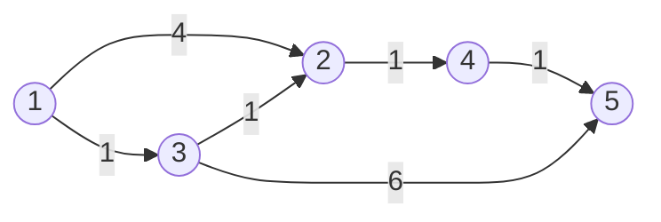
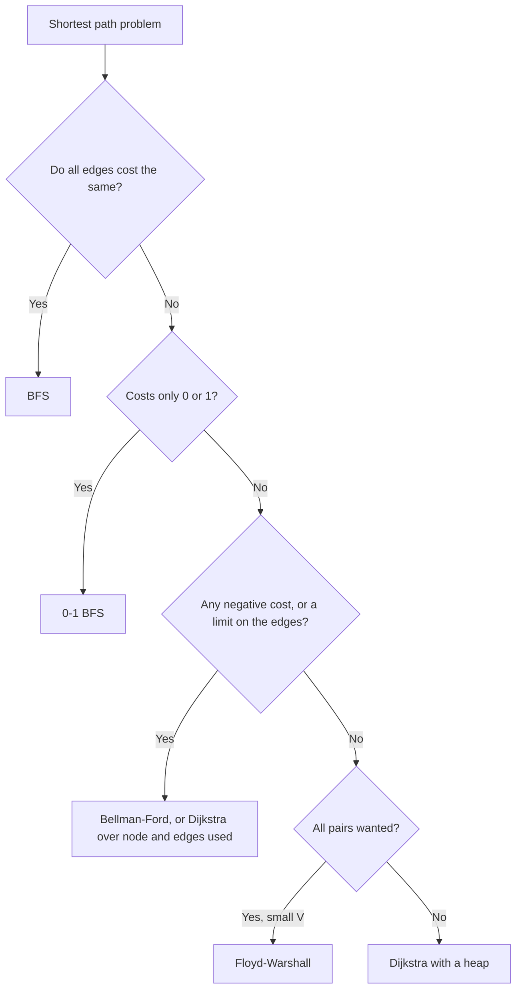

# Pattern 18: Shortest Paths

## Overview

A shortest path problem asks for the cheapest route between two nodes of a graph whose edges carry costs. Breadth-first search (BFS) finds the route with the fewest edges, and that route is the cheapest only if every edge costs the same. This page starts from that gap. It derives Dijkstra's algorithm for non-negative costs, Bellman-Ford for negative costs and for a limit on the number of edges, Floyd-Warshall for all pairs of nodes, and 0-1 BFS for costs of 0 and 1. Each algorithm answers one property of the graph.

After this page you can:

1. Show on a graph with 5 nodes why BFS gives a wrong answer when edges have different costs, and derive Dijkstra's algorithm from the question "which node has its final distance next?".
2. State the invariant of Dijkstra's algorithm, prove it in a few sentences, name the line of the proof that needs non-negative costs, and show the wrong output on a graph with one negative edge.
3. Explain the stale-entry guard of the heap version (lazy deletion), and count the cost from the trace: O(V²) for the array version and O((V + E) log V) for the heap version.
4. Derive Bellman-Ford from the sentence "a shortest path has at most V - 1 edges", detect a negative cycle, and show the wrong answer of the "at most K stops" variant when the copy of the distance array is missing.
5. Derive Floyd-Warshall as a table over the allowed intermediate nodes, and show the wrong output for each of three mistakes: `k` in the inner loop, a diagonal that is not 0, and an "infinity" that overflows.
6. For a new problem, choose between BFS, 0-1 BFS, Dijkstra, Bellman-Ford, Floyd-Warshall, and a search over states, and name the property of the graph that decides.

## Prerequisites

| You need | Why this page needs it | Where to learn it |
|---|---|---|
| Graph words (node, edge, directed, adjacency list) | Every algorithm reads the edges of a node from an adjacency list. The page does not teach the representations | [Graph Representations](../foundations/07-graph-representations.md) |
| BFS and the queue | BFS is the algorithm that this page improves, and 0-1 BFS changes its queue into a deque | [Pattern 11: Graph Traversal](../11-graph-traversal/README.md) |
| Heaps and `PriorityQueue` with a comparator | Dijkstra's algorithm keeps its candidates in a min heap. The stale-entry guard is lazy deletion | [Heaps](../foundations/06-heaps.md), [Pattern 16: Heap and Priority Queue](../16-heap-priority-queue/README.md) |
| Deques | 0-1 BFS puts nodes at both ends of an `ArrayDeque` | [Stacks, Queues, and Deques](../foundations/03-stacks-queues-deques.md) |
| A table that the code fills in a fixed order | Floyd-Warshall is a table over the allowed intermediate nodes, and Bellman-Ford fills a table over the number of edges | [Pattern 15: Dynamic Programming](../15-dynamic-programming/README.md) |
| Counting operations and O-notation | The page counts relaxations and heap operations from a trace before it states a bound | [Complexity Analysis](../foundations/01-complexity-analysis.md) |
| Bit operations (`<<`, `|`, `&`) | Only for [LC 847](https://leetcode.com/problems/shortest-path-visiting-all-nodes/) (P11), which stores a set of nodes in one `int` | [Pattern 19: Bit Manipulation](../19-bit-manipulation/README.md) |

Words that the page uses from the start:

- A **weighted graph** gives each edge a number, its **weight** (also called cost). The **cost of a path** is the sum of the weights of its edges. The **length of a path** is its number of edges. A **shortest path** from `a` to `b` is a path with the smallest cost. It does not need to have the fewest edges.
- The **distance** from the **source** `s` to a node `v` is the cost of a shortest path. This page writes it as δ(v). The code stores its current estimate in `dist[v]`. If no path exists, `v` is **unreachable** and `dist[v]` stays at `INF`. In Java, `INF` is `Integer.MAX_VALUE`.
- A **negative edge** has a weight below 0. A **negative cycle** is a cycle whose weights add up to less than 0.
- `V` is the number of nodes. `E` is the number of edges.
- Assumption: every sum `dist[u] + weight` fits in an `int`. The Java code skips a node whose `dist` is `INF` before it adds, because `Integer.MAX_VALUE + 1` wraps around to a negative number.

## Motivation

### The anchor problem: Network Delay Time (LC 743)

A network has `n` nodes, numbered 1 to `n`. Each directed edge `(u, v, w)` means that a signal that leaves `u` arrives at `v` after `w` time units. A signal starts at node `k` at time 0. Return the time at which the last node receives the signal, or -1 if some node never receives it. This is [LC 743: Network Delay Time](https://leetcode.com/problems/network-delay-time/).

Take `n = 5`, `k = 1`, and these edges:



The signal reaches node 3 at time 1. It reaches node 2 at time 2 (through node 3, not through the direct edge of weight 4). It reaches node 4 at time 3 and node 5 at time 4 (through node 4, not through the edge of weight 6). The last node receives the signal at time **4**, so the answer is 4.

The task is the **single-source shortest path** problem: the distance from one source to every node. The answer of LC 743 is the largest of these distances.

### First attempt: BFS

[Pattern 11](../11-graph-traversal/README.md) gives the shortest path by BFS. BFS reaches each node for the first time along a path with the fewest edges. The code below follows that rule and adds the weights along the path that BFS found.

```java
static int[] bfsByEdges(int n, int[][] edges, int src) {
    List<List<int[]>> graph = new ArrayList<>();
    for (int i = 0; i <= n; i++) graph.add(new ArrayList<>());
    for (int[] e : edges) graph.get(e[0]).add(new int[] {e[1], e[2]});
    int[] dist = new int[n + 1];
    Arrays.fill(dist, Integer.MAX_VALUE);
    dist[src] = 0;
    Deque<Integer> queue = new ArrayDeque<>();
    queue.add(src);
    while (!queue.isEmpty()) {
        int u = queue.poll();
        for (int[] edge : graph.get(u)) {
            int v = edge[0];
            if (dist[v] != Integer.MAX_VALUE) continue;   // BFS reaches a node once
            dist[v] = dist[u] + edge[1];                  // add the weights along that path
            queue.add(v);
        }
    }
    return dist;
}
```

On the anchor graph, BFS gives these distances for the nodes 1 to 5 (the program `DijkstraTraces` in the Implementation section prints them):

```text
BFS distances   = [0, 4, 1, 5, 7]
BFS answer      = 7
```

BFS answers **7**. The correct answer is 4. BFS reaches node 2 after one edge, along the edge of weight 4. It never looks at the path 1 → 3 → 2, which has two edges and costs 2. The same happens at node 5: BFS reaches it through the edge 3 → 5 (two edges, cost 7), and the cheaper path 1 → 3 → 2 → 4 → 5 has four edges and costs 4.

BFS orders the nodes by the number of edges. The question needs the order by cost. The two orders differ as soon as one edge costs more than a path of two edges.

### Second attempt: try every path

Enumerate all simple paths (paths that do not repeat a node) from the source with a depth-first search. Keep the cheapest cost for each node. This is correct, because a cheapest path that repeats no node exists when all costs are non-negative. It is too slow. Build a chain of 30 "diamonds". A diamond has a start node, two middle nodes, and an end node. The start node has an edge to each middle node, and each middle node has an edge to the end node. The end node is the start node of the next diamond. Each diamond adds 3 nodes (two middle nodes and one end node). The chain has 1 + 30 × 3 = 91 nodes. Each diamond doubles the number of paths, so the chain has 2³⁰ = 1,073,741,824 paths from the first node to the last node.

The search wastes work because all paths that pass through node 3 repeat the work of finding a cheap way to node 3.

### The gap

Two questions remain.

1. The cheapest way to a node `v` is the cheapest way to a neighbor `u` plus the weight of the edge `u → v`. The code should compute the cheapest way to `u` once and reuse it.
2. The code must decide the **order** in which it computes these values. BFS uses the order of the edge count, and that order is wrong. The Derivation finds the right order.

## Derivation

### Question 1: what does the code know after it looks at one edge?

Keep an array `dist`. At the start, `dist[source] = 0` and every other entry is `INF`. Each entry is an **estimate**: the cost of the best path that the code has found so far. The code improves the estimate by looking at one edge `u → v` with weight `w`:

```text
if dist[u] + w < dist[v]:  dist[v] = dist[u] + w
```

This step is a **relaxation** of the edge. It asks: "Does the path through `u` give a cheaper way to `v` than the best way that I know?" Each value in `dist` is the cost of a real path, so `dist[v]` is never below the true distance δ(v). Relaxation can only move `dist[v]` down toward δ(v).

All algorithms of this page relax edges. They differ in the **order** of the relaxations. That order decides how many relaxations the code needs, and whether the code can trust a value.

### Question 2: which node can the code trust next?

Start on the anchor graph. Node 1 has `dist[1] = 0`, and that value is final. The code relaxes the two edges of node 1: `dist[2] = 4` and `dist[3] = 1`. Which of the two values can the code trust now?

- `dist[3] = 1` is the smaller one. A path to node 3 either uses the direct edge, which costs 1, or it leaves node 1 through the edge to node 2. That second path has paid 4 before it continues, and all costs are at least 0, so it cannot cost less than 4. No path costs less than 1, so the value 1 is final.
- `dist[2] = 4` is not final. The edge 3 → 2 may give a cheaper way, and the code has not looked at it.

The rule: among the nodes that are not final, the node with the **smallest estimate** is final. The code **settles** that node (marks its distance as final) and relaxes its edges. Then it repeats. BFS settles the node that it found first. This rule settles the node that is cheapest.

This is Dijkstra's algorithm. The first version scans the array to find the smallest estimate.

```java
static int[] dijkstraArray(int n, int[][] edges, int src) {
    List<List<int[]>> graph = new ArrayList<>();
    for (int i = 0; i <= n; i++) graph.add(new ArrayList<>());
    for (int[] e : edges) graph.get(e[0]).add(new int[] {e[1], e[2]});
    int[] dist = new int[n + 1];                       // nodes are 1..n, index 0 is unused
    Arrays.fill(dist, Integer.MAX_VALUE);              // MAX_VALUE means "not reached yet"
    boolean[] settled = new boolean[n + 1];
    dist[src] = 0;
    for (int round = 1; round <= n; round++) {
        int u = -1;
        for (int v = 1; v <= n; v++) {                 // O(V) scan for the closest node
            if (settled[v] || dist[v] == Integer.MAX_VALUE) continue;
            if (u == -1 || dist[v] < dist[u]) u = v;
        }
        if (u == -1) break;                            // the rest is unreachable
        settled[u] = true;
        for (int[] edge : graph.get(u)) {
            int v = edge[0];
            if (dist[u] + edge[1] < dist[v]) dist[v] = dist[u] + edge[1];
        }
    }
    return dist;
}
```

The trace on the anchor graph (the program `DijkstraTraces` in the Implementation section prints it). Each round settles one node and relaxes its edges:

```text
round 1: pick node 1 (dist 0)
  1->2 weight 4: 0 + 4 = 4 < INF, dist[2] = 4
  1->3 weight 1: 0 + 1 = 1 < INF, dist[3] = 1
  dist = [0, 4, 1, INF, INF]
round 2: pick node 3 (dist 1)
  3->2 weight 1: 1 + 1 = 2 < 4, dist[2] = 2
  3->5 weight 6: 1 + 6 = 7 < INF, dist[5] = 7
  dist = [0, 2, 1, INF, 7]
round 3: pick node 2 (dist 2)
  2->4 weight 1: 2 + 1 = 3 < INF, dist[4] = 3
  dist = [0, 2, 1, 3, 7]
round 4: pick node 4 (dist 3)
  4->5 weight 1: 3 + 1 = 4 < 7, dist[5] = 4
  dist = [0, 2, 1, 3, 4]
round 5: pick node 5 (dist 4)
  dist = [0, 2, 1, 3, 4]
final dist = [0, 2, 1, 3, 4], answer = 4
```

Read round 2. The code picks node 3 (`dist` 1), not node 2 (`dist` 4). It relaxes 3 → 2 and lowers `dist[2]` from 4 to 2. BFS never takes this step. In round 3 the code settles node 2 with the better value 2. In round 4 the edge 4 → 5 lowers `dist[5]` from 7 to 4.

The LC 743 answer is the largest value of the final `dist`, which is 4, or -1 if one value is `INF`.

**Cost, counted from the trace.** Each of the 5 rounds scans all 5 nodes to find the smallest estimate: 25 comparisons for `V = 5`. Each of the 6 edges is relaxed once, when its source node is settled. For `V` nodes and `E` edges, the scans cost V × V and the relaxations cost E. The total is **O(V² + E)**.

### Question 3: why is the smallest estimate final?

**Invariant.** When the code settles a node `u`, `dist[u]` equals δ(u), the true distance. After that, `dist[u]` never changes.

**Proof.** Suppose the code settles `u` with `dist[u] = d`, and a path `P` from the source to `u` costs less than `d`. `P` starts at the source, which is settled, and ends at `u`, which is not settled yet. Let `y` be the first node on `P` that is not settled (`y` can be `u`), and let `x` be the node before `y` on `P`. The node `x` is settled, so `dist[x] = δ(x)` by the invariant, and δ(x) is at most the cost of the part of `P` up to `x`. The code relaxed the edge `x → y` when it settled `x`, so

dist[y] ≤ dist[x] + w(x, y) ≤ (the cost of the part of `P` up to `y`).

**This is the step that needs non-negative weights:** the cost of the part of `P` up to `y` is at most the cost of the whole `P`, because the rest of `P` adds weights that are at least 0. So `dist[y]` ≤ cost(`P`) < `d`. But the code picked `u` because `dist[u]` is the smallest estimate among the nodes that are not settled, and `y` is such a node. So `d` ≤ `dist[y]` < `d`. This is a contradiction, so no cheaper path exists. After the settle, a later relaxation would need a path cheaper than δ(u), and no such path exists, so `dist[u]` does not change. ∎

**Edge cases of the proof.**

- *Unreachable nodes.* A node with `dist = INF` is never the smallest finite estimate. The array code stops when no unsettled node has a finite estimate (`if (u == -1) break`). Those nodes keep `INF`, which is correct. The code also never relaxes an edge out of an `INF` node, so it never adds to `INF`.
- *Ties.* If two nodes have the same smallest estimate, either one can be settled first. The proof uses "≤", so ties do not matter.
- *Zero weights.* The step "at most the cost of the whole path" holds with "≤", so edges of weight 0 are allowed.
- *The first settle.* The first node that the code settles is the source, with `dist = 0`. No path costs less than 0 when all weights are non-negative, so the invariant holds. For every later node, the source is already settled, so the path `P` in the proof starts at a settled node.
- *The source alone.* With `n = 1` and no edges, the code settles the source with distance 0, and the answer of LC 743 is 0.

### Question 4: can the code avoid the scan?

Each round of the array version scans all `V` nodes. After the code settles one node, only the neighbors of that node changed. The scan looks at all the others again. A **min heap** gives the smallest estimate in O(log n) time and takes a new estimate in O(log n) time ([Heaps](../foundations/06-heaps.md)).

The heap holds entries `(distance, node)`. When a relaxation lowers `dist[v]`, the code pushes the new entry `(newDistance, v)`. There is one problem: `PriorityQueue` cannot lower the key of an entry that is inside the heap, and `remove(Object)` costs O(n) ([Pattern 16](../16-heap-priority-queue/README.md), Worked Example 7). So the code **leaves the old entry in the heap**. The old entry is now **stale**: its distance is larger than `dist[v]`.

When the code pops a stale entry, it must skip it. The test is `d > dist[u]`. Why is the skip safe? The newer entry of `u` has a smaller distance, so the heap returned it earlier, and the code already settled and expanded `u` at that time. An entry with `d == dist[u]` is current. This technique is **lazy deletion**: the code records that an entry is invalid (by the test) and discards it when the entry reaches the top.

```java
static int[] dijkstraHeap(int n, int[][] edges, int src) {
    List<List<int[]>> graph = new ArrayList<>();
    for (int i = 0; i <= n; i++) graph.add(new ArrayList<>());
    for (int[] e : edges) graph.get(e[0]).add(new int[] {e[1], e[2]});
    int[] dist = new int[n + 1];
    Arrays.fill(dist, Integer.MAX_VALUE);
    dist[src] = 0;
    PriorityQueue<int[]> heap = new PriorityQueue<>((a, b) -> Integer.compare(a[0], b[0]));
    heap.offer(new int[] {0, src});                    // entry = {distance, node}
    while (!heap.isEmpty()) {
        int[] top = heap.poll();
        int d = top[0], u = top[1];
        if (d > dist[u]) continue;                     // stale entry: u has a shorter distance now
        for (int[] edge : graph.get(u)) {
            int v = edge[0], nd = d + edge[1];
            if (nd < dist[v]) {
                dist[v] = nd;
                heap.offer(new int[] {nd, v});         // the old entry of v stays and goes stale
            }
        }
    }
    return dist;
}

static int networkDelayTime(int[][] times, int n, int k) {
    int[] dist = dijkstraHeap(n, times, k);
    int slowest = 0;
    for (int v = 1; v <= n; v++) {
        if (dist[v] == Integer.MAX_VALUE) return -1;   // some node never receives the signal
        slowest = Math.max(slowest, dist[v]);
    }
    return slowest;
}
```

The trace on the anchor graph. The heap in the trace breaks ties by node number, so the trace is the same on every run.

```text
start: heap = [(0, 1)]
pop (0, 1): current
  1->2: 0 + 4 = 4 < INF, push (4, 2)
  1->3: 0 + 1 = 1 < INF, push (1, 3)
  heap = [(1, 3), (4, 2)]
pop (1, 3): current
  3->2: 1 + 1 = 2 < 4, push (2, 2)
  3->5: 1 + 6 = 7 < INF, push (7, 5)
  heap = [(2, 2), (4, 2), (7, 5)]
pop (2, 2): current
  2->4: 2 + 1 = 3 < INF, push (3, 4)
  heap = [(3, 4), (4, 2), (7, 5)]
pop (3, 4): current
  4->5: 3 + 1 = 4 < 7, push (4, 5)
  heap = [(4, 2), (4, 5), (7, 5)]
pop (4, 2): stale, dist[2] = 2, skip
pop (4, 5): current
  heap = [(7, 5)]
pop (7, 5): stale, dist[5] = 4, skip
final dist = [0, 2, 1, 3, 4], answer = 4
```

Two entries are stale: `(4, 2)` (node 2 improved from 4 to 2) and `(7, 5)` (node 5 improved from 7 to 4). The code pops both and skips them in O(log V) each.

**Cost, counted from the trace.** A push happens only when a relaxation lowers `dist[v]`, so there are at most E + 1 pushes (the source plus one per edge). The code pops each entry once, so there are at most E + 1 pops. Each push and pop costs O(log E), and E is at most V², so log E is at most 2 log V. The guard makes each node expand its edges once, so the scans cost E in total. The total is **O((V + E) log V)**. The array version costs O(V² + E).

| Version | Time | Better when |
|---|---|---|
| Array scan | O(V² + E) | The graph is dense (E close to V²). The array has no log factor and no heap |
| Min heap with the stale-entry guard | O((V + E) log V) | The graph is sparse (E close to V) |

### Question 5: what if an edge has a negative weight?

The proof of Question 3 uses "the part of `P` up to `y` costs at most the whole `P`". A negative edge later in `P` breaks it: the whole path can cost less than its first part. Test the code on a graph with one negative edge. The graph has the edges 1 → 2 (2), 1 → 3 (3), 3 → 2 (-2), 2 → 4 (1). The distances are: node 2 costs 1 (through node 3: 3 + (-2)), and node 4 costs 2.

```text
true distances (by hand)  = [0, 1, 3, 2]
array version             = [0, 1, 3, 3]
heap, stale-entry guard   = [0, 1, 3, 2]
heap, visited set         = [0, 1, 3, 3]
```

The array version settles node 2 at cost 2, before it sees the edge 3 → 2. It expands node 2 with the old value and sets `dist[4] = 3`. Later it finds `dist[2] = 1`, but node 2 is already settled, so nobody relaxes 2 → 4 again. The output `[0, 1, 3, 3]` is wrong at node 4: the correct value is 2. The variant that keeps a `visited` set (a common form) gives the same wrong output.

The heap version with the stale-entry guard recovers on this input: the improved entry `(1, 2)` is current when it is popped, so the code expands node 2 again. But the guard does not restore the bound. The program builds a graph with 101 nodes and 149 edges. Fifty negative edges each improve the first node of a chain of 50 nodes, one after the other, and the code expands nodes 2551 times in total. The proof that each node expands once also needs non-negative weights.

> Recommendation: for a graph that may have a negative edge, use Bellman-Ford (Worked Example 1).

### Why adding a constant to every weight does not fix negative edges

A reader may try: "add a constant `c` to every weight so that all weights are at least 0, then run Dijkstra, then subtract." This fails because a path with more edges receives more additions. A path with `m` edges gains `m × c`.

```text
shifted graph: dist[3] = 4 through the direct edge
that path costs 1 in the original graph
the path 1 -> 2 -> 3 costs -1 in the original graph and 5 in the shifted graph
```

In the original graph the edges are 1 → 3 (1), 1 → 2 (2), 2 → 3 (-3). The true shortest path to node 3 is 1 → 2 → 3 with cost -1. After the shift by 3, the direct edge costs 4 and the two-edge path costs 5. Dijkstra picks the direct edge, and that path costs 1 in the original graph. The two paths have different numbers of edges, so the shift changes their order.

## The Pattern

Every algorithm on this page keeps an array of estimates and **relaxes** edges. The algorithms differ in the order of the relaxations, and each order is a way to know when an estimate is final.

**The invariant that all four share:** each estimate is the cost of a real path, so it never falls below the true distance. Each algorithm adds one more statement that tells which estimates are exact.

| Algorithm | The extra statement (invariant) | Order of the relaxations |
|---|---|---|
| Dijkstra | A settled node has its final distance | Settle the node with the smallest estimate, then relax its edges |
| Bellman-Ford | After round `r`, `dist[v]` is at most the cost of the best path with at most `r` edges | Relax all edges, `V - 1` times |
| Floyd-Warshall | After step `k`, `dp[i][j]` is the cost of the best path whose intermediate nodes come from the first `k` nodes | For each `k`, relax every pair `(i, j)` through `k` |
| 0-1 BFS | The deque holds nodes in the order of their estimates, and at most two values occur | Put a node at the front if the edge costs 0, at the back if it costs 1 |

**The vocabulary.** Some cells point to examples that come later in the Worked Examples. Read the table again after them.

| Term | What it was in the examples | The question to ask in a new problem |
|---|---|---|
| Source | Node `k` of LC 743 | "From where do the paths start? One node, or every node?" |
| Estimate (`dist`) | The array of the best costs found so far | "What does one entry mean, and what is its start value?" |
| Relaxation | `dist[u] + w < dist[v]` | "Which edges does the code look at, and in which order?" |
| Settle | Dijkstra takes the smallest estimate out of the heap and trusts it | "Can anything lower this value later?" |
| Stale entry | A heap entry whose distance is larger than the current `dist` | "Does the code push a new entry in place of changing an old one?" |
| Round | One pass over all edges in Bellman-Ford | "How many edges can a path have, at most?" |
| State | `(node, edges used)` in the K-stops problem, `(node, visited set)` in LC 847 | "What does the code need to remember, besides the node, so that the future cost is known?" |
| Negative cycle | A cycle with total weight below 0 | "Can a path go around a cycle again and again and gain?" |

### The variants, and the property that selects each

| Property of the problem | Algorithm | Time | Reason |
|---|---|---|---|
| Every edge costs the same (or the graph is unweighted) | BFS ([Pattern 11](../11-graph-traversal/README.md)) | O(V + E) | The order of the edge count is the order of the cost |
| Every edge costs 0 or 1 | 0-1 BFS (Worked Example 4) | O(V + E) | A deque keeps the order of the cost with no heap |
| Costs are at least 0, one source | Dijkstra with a heap | O((V + E) log V) | The proof of Question 3 holds |
| Costs are at least 0, the graph is dense | Dijkstra with an array | O(V²) | The scan costs less than E heap operations |
| Some cost is negative | Bellman-Ford | O(V × E) | It relaxes every edge `V - 1` times and does not settle early |
| The path may use at most `K` edges | Bellman-Ford with `K + 1` rounds, or Dijkstra over `(node, edges used)` | O(K × (V + E)) | The round number is the edge count |
| The cost of a path is the largest (or smallest) edge on it | Dijkstra with `max` (or `min`) in place of `+` (Worked Example 5) | O(E log V) | The proof needs only that a longer path never costs less |
| The cost of a path is a product of numbers between 0 and 1 | Dijkstra with a max heap (Worked Example 6) | O(E log V) | A longer path never has a higher probability |
| The goal has two costs: the smallest first cost, and among equal first costs the smallest second cost | Dijkstra with a pair `(first, second)` that the heap compares in dictionary order | O((V + E) log V) | Both costs only grow along a path, so a longer path never gives a smaller pair |
| The answer is the distance between every pair of nodes | Floyd-Warshall | O(V³) | A table over the allowed intermediate nodes |
| The path must visit a set of nodes (small set) | BFS over `(node, mask)` (P11) | O(2^V × (V + E)) | The state holds the set of visited nodes |
| The graph has no cycle (a DAG), costs of any sign | Relax edges in topological order ([Pattern 12](../12-topological-sort/README.md)) | O(V + E) | Each node's incoming edges are relaxed after all its predecessors are final |

**Two costs.** An example is a problem that asks for the smallest travel time and, among the routes with that time, the smallest price. Each heap entry holds `(time, price, node)`. The comparator compares the time first and the price second. The code stores one best pair for each node, and the relaxation replaces it if the new pair is smaller in the same order. The proof of Question 3 holds when both costs are at least 0, because extending a path never gives a smaller pair.

**Why the last row works.** A **topological order** lists the nodes so that every edge goes from an earlier node to a later node. A graph with no cycle has one ([Pattern 12](../12-topological-sort/README.md)). Set `dist[source] = 0`, take the nodes in that order, and relax the edges out of each node. Claim: when the code reaches a node `v`, `dist[v]` is final. Every edge into `v` starts at an earlier node, so the code has already relaxed all edges into `v`. By induction, each earlier node was final when the code relaxed its edges. A shortest path to `v` ends with one of these edges, so `dist[v]` is the true distance. The argument never compares the weights with 0, so negative weights are allowed. A node that comes before the source in the order keeps `INF`, which is correct, because no path from the source reaches it.
**Bidirectional search** runs one search from the source and one from the destination, and stops when the two meet. It explores less of a large graph when only one destination matters. It needs a correct stop rule. For weighted edges, the first node that both searches reach is not always on a shortest path. The standard rule for bidirectional Dijkstra is: keep the cheapest total `best` of a path that joins the two searches, and stop when the smallest key of the forward heap plus the smallest key of the backward heap is at least `best`. This page does not implement it.



## Worked Examples

The examples change one thing about the anchor problem. They start with the change that breaks Dijkstra (a negative weight) and end with the changes that keep it (other cost rules).

### Example 1: Bellman-Ford, negative weights, and negative cycles

**Statement.** Given a directed graph with `n` nodes (numbered 0 to `n - 1`), a source, and edges `(u, v, w)` where `w` can be negative, return the distance to every node, or report that a negative cycle is reachable from the source.

**What changed.** Edge weights can be negative. Dijkstra settles a node too early (Question 5). The code needs an order of relaxations that does not trust any value early.

**Derivation.** Ask: what does the code know for sure, with no trust in the order? Define the **round**: one pass that relaxes every edge once, in any order. After round 0, `dist[source] = 0` is the cost of the best path with 0 edges. Claim: after round `r`, `dist[v]` is at most the cost of the best path from the source to `v` that has at most `r` edges.

- *Round 1.* A path with one edge is `source → v`. Round 1 relaxes that edge, so `dist[v]` is at most its cost.
- *Round r.* Take the best path with at most `r` edges to `v`. Its last edge is `u → v`, and the part before it has at most `r - 1` edges. By the claim for round `r - 1`, `dist[u]` is at most the cost of that part. Round `r` relaxes `u → v`, so `dist[v]` is at most the cost of the whole path. (The relaxations of round `r` that come earlier in the pass only lower values, so the claim stays true.)

**How many rounds?** Suppose the graph has no negative cycle. A path with `V` or more edges visits a node twice, so it contains a cycle. The cycle costs at least 0, so removing it does not raise the cost. So a shortest path with at most `V - 1` edges exists to every reachable node, and **`V - 1` rounds** are enough.

**Negative-cycle test.** Run one more round. If an edge still lowers an estimate, a negative cycle is reachable from the source. Reason: without a negative cycle, after `V - 1` rounds every `dist[v]` equals δ(v), and δ(v) ≤ δ(u) + w for every edge, so no edge improves anything. If a reachable negative cycle exists, every node of the cycle has a finite estimate after `V - 1` rounds, because the source reaches it by a path of at most `V - 1` edges. The inequalities `dist[v] ≤ dist[u] + w` cannot hold for all edges of the cycle: adding them over the cycle gives 0 ≤ (the weight of the cycle) < 0, because each `dist` value appears once on each side and cancels. So at least one edge of the cycle still improves. The test sees only cycles that the source reaches, because the code skips nodes with `dist = INF`.

**Trace.** The edges are listed from the far end to the start, which is the worst order: each round moves the information by one edge.

```text
start: [0, INF, INF, INF, INF]
  round 1: 0->2 weight 5 gives dist[2] = 5
  round 1: 0->1 weight 4 gives dist[1] = 4
after round 1: [0, 4, 5, INF, INF]
  round 2: 2->3 weight 3 gives dist[3] = 8
  round 2: 1->2 weight -2 gives dist[2] = 2
after round 2: [0, 4, 2, 8, INF]
  round 3: 3->4 weight 2 gives dist[4] = 10
  round 3: 2->3 weight 3 gives dist[3] = 5
after round 3: [0, 4, 2, 5, 10]
  round 4: 3->4 weight 2 gives dist[4] = 7
after round 4: [0, 4, 2, 5, 7]
round 5: no edge improves anything
result = [0, 4, 2, 5, 7]
```

The true shortest path to node 4 is 0 → 1 → 2 → 3 → 4 (4 edges), and the code needs all 4 rounds to find its cost 7. Round 5 changes nothing, so there is no negative cycle. The path to node 2 is a good example for "negative weights": the direct edge 0 → 2 costs 5, but the path 0 → 1 → 2 costs 4 + (-2) = 2.

A graph with a negative cycle:

```text
start: [0, INF, INF]
  round 1: 0->1 weight 1 gives dist[1] = 1
  round 1: 1->2 weight -3 gives dist[2] = -2
  round 1: 2->1 weight 1 gives dist[1] = -1
after round 1: [0, -1, -2]
  round 2: 1->2 weight -3 gives dist[2] = -4
  round 2: 2->1 weight 1 gives dist[1] = -3
after round 2: [0, -3, -4]
round 3: edge 1->2 still improves dist[2]
result = negative cycle
```

The cycle 1 → 2 → 1 costs -3 + 1 = -2. Every round lowers the estimates again, and round 3 (the check round) still finds an improving edge.

```java
// Nodes are 0..n-1. Returns null if a negative cycle is reachable from src.
static int[] bellmanFord(int n, int[][] edges, int src) {
    int[] dist = new int[n];
    Arrays.fill(dist, Integer.MAX_VALUE);
    dist[src] = 0;
    for (int round = 1; round <= n - 1; round++) {
        boolean changed = false;
        for (int[] e : edges) {
            if (dist[e[0]] == Integer.MAX_VALUE) continue;   // u is not reached: nothing to relax
            if (dist[e[0]] + e[2] < dist[e[1]]) {
                dist[e[1]] = dist[e[0]] + e[2];
                changed = true;
            }
        }
        if (!changed) break;                                 // nothing changed: stop
    }
    for (int[] e : edges) {                                  // round n: any change means a cycle
        if (dist[e[0]] != Integer.MAX_VALUE && dist[e[0]] + e[2] < dist[e[1]]) return null;
    }
    return dist;
}
```

The early exit `if (!changed) break` stops when a round changes nothing: the next rounds would repeat the same relaxations.

**Why the test `dist[u] == INF` is needed.** Without it, the code relaxes edges out of unreached nodes. With a negative weight, `INF + (-3)` is less than `INF`, and the code stores a bogus finite value:

```text
INF + (-3) = 2147483644, less than INF: true
with the guard    = [0, INF, INF]
without the guard = [0, INF, 2147483644]
```

**A negative cycle that the source cannot reach** does not change any distance of the reachable nodes, and the check finds nothing:

```text
result = [0, 1, INF, INF]
```

**Cost.** Each round relaxes `E` edges, and there are at most `V - 1` rounds plus one check: **O(V × E)** time and O(V) space. The array version of Dijkstra costs O(V²). Bellman-Ford costs more because it does not use the order of the costs.

### Example 2: Cheapest Flights Within K Stops (LC 787)

**Statement.** [LC 787: Cheapest Flights Within K Stops](https://leetcode.com/problems/cheapest-flights-within-k-stops/). There are `n` cities (numbered 0 to `n - 1`) and flights `(from, to, price)`. Return the lowest price to fly from `src` to `dst` with at most `k` stops, or -1 if no such route exists. A route with `k` stops uses `k + 1` flights. For the flights `0 → 1 (100)`, `1 → 2 (100)`, `2 → 3 (100)`, `0 → 3 (500)` and `k = 1`, the answer from 0 to 3 is **500**. The route 0 → 1 → 2 → 3 costs 300 but has 2 stops.

**What changed.** The path may have at most `k + 1` edges. The cheapest path may be too long, and the answer is then a more expensive path with fewer edges. Dijkstra settles a node by cost and has no field for the number of edges.

**Reasoning.** The claim of Example 1 is made for this limit: after round `r`, `dist[v]` is at most the cost of the best path with **at most `r` edges**. So the answer is `dist[dst]` after exactly `k + 1` rounds. The code stops at `k + 1` in place of `V - 1`.

There is one new rule. A round must extend the paths by **exactly one edge**. If the round writes to the same array that it reads, an update at the start of the round is already visible to a later edge in the same round, and a path gains several edges in one round. The fix is to **read from the array of the previous round and write to a copy**.

**Trace with the copy.**

```text
  round 1: 0->1 gives 100
  round 1: 0->3 gives 500
after round 1: [0, 100, INF, 500]
  round 2: 1->2 gives 200
after round 2: [0, 100, 200, 500]
k = 1: 500
```

**Trace without the copy.** The flights are listed in the order 0 → 1, 1 → 2, 2 → 3, 0 → 3. In round 1, each flight sees the update of the flight before it:

```text
  round 1: 0->1 gives 100
  round 1: 1->2 gives 200
  round 1: 2->3 gives 300
after round 1: [0, 100, 200, 300]
after round 2: [0, 100, 200, 300]
k = 1: 300
```

Round 1 already computes the three-flight route (cost 300), which has 2 stops. The code returns **300** for `k = 1`. The correct answer is 500.

```java
static int cheapestWithinKStops(int n, int[][] flights, int src, int dst, int k) {
    int[] dist = new int[n];
    Arrays.fill(dist, Integer.MAX_VALUE);
    dist[src] = 0;
    for (int round = 1; round <= k + 1; round++) {          // k stops = k + 1 edges
        int[] next = dist.clone();                           // the copy: read dist, write next
        for (int[] f : flights) {
            if (dist[f[0]] == Integer.MAX_VALUE) continue;
            if (dist[f[0]] + f[2] < next[f[1]]) next[f[1]] = dist[f[0]] + f[2];
        }
        dist = next;
    }
    return dist[dst] == Integer.MAX_VALUE ? -1 : dist[dst];
}
```

The line `int[] next = dist.clone()` is the copy. The loop reads `dist` and writes `next`.

**Dijkstra over the node alone fails.** A Dijkstra that keeps one best cost for each node, and treats the stop limit only as a cut-off, gives wrong output. The graph has flights 0 → 1 (1), 1 → 2 (1), 0 → 2 (10), 2 → 3 (1), with `k = 1`. The cheapest path to city 2 is 0 → 1 → 2 (cost 2, two flights). With `k = 1` the code may use 2 flights in total, so after this path, the flight 2 → 3 is a third flight and the code cuts it. The direct flight 0 → 2 costs 10, and the code discards it because 10 is more than the stored 2. The valid route 0 → 2 → 3 (11) is lost.

```text
k = 1, flights 0->1 (1), 1->2 (1), 0->2 (10), 2->3 (1), from 0 to 3
with copy 11, node-only Dijkstra -1
```

The fix is to make the number of flights part of the state. A **state** is everything that the code must remember so that the future cost is known. Here the state is `(city, flights used)`, and the table `best[city][flights used]` holds one cost for each state.

```java
static int cheapestByStateDijkstra(int n, int[][] flights, int src, int dst, int k) {
    List<List<int[]>> graph = new ArrayList<>();
    for (int i = 0; i < n; i++) graph.add(new ArrayList<>());
    for (int[] f : flights) graph.get(f[0]).add(new int[] {f[1], f[2]});
    int[][] best = new int[n][k + 2];                  // best[v][e]: cost to v with e edges
    for (int[] row : best) Arrays.fill(row, Integer.MAX_VALUE);
    best[src][0] = 0;
    PriorityQueue<int[]> heap = new PriorityQueue<>((a, b) -> Integer.compare(a[0], b[0]));
    heap.offer(new int[] {0, src, 0});                 // entry = {cost, node, edges used}
    while (!heap.isEmpty()) {
        int[] top = heap.poll();
        int cost = top[0], u = top[1], used = top[2];
        if (u == dst) return cost;                     // the first pop of dst is the cheapest
        if (cost > best[u][used] || used == k + 1) continue;
        for (int[] edge : graph.get(u)) {
            int v = edge[0], nc = cost + edge[1];
            if (nc < best[v][used + 1]) {
                best[v][used + 1] = nc;
                heap.offer(new int[] {nc, v, used + 1});
            }
        }
    }
    return -1;
}
```

The first pop of `dst` (in any number of flights) is the cheapest valid route, because the heap pops states in the order of cost, and every state in the heap obeys the limit.

Trace on the graph above (`k = 1`, so `used` may reach 2). The code pops `(0, city 0, used 0)` and pushes `(1, city 1, used 1)` and `(10, city 2, used 1)`. It pops city 1 and pushes `(2, city 2, used 2)`. It pops that state, and `used == k + 1` stops the expansion, so the flight 2 → 3 is not taken. It pops `(10, city 2, used 1)`, which is a different state of city 2. It pushes `(11, city 3, used 2)`, pops it, and returns 11.

**Results on the first graph.**

```text
k = 0: with copy 500, without copy 300, node-only Dijkstra 500
k = 1: with copy 500, without copy 300, node-only Dijkstra 500
k = 2: with copy 300, without copy 300, node-only Dijkstra 300
```

For `k = 0` and `k = 1` the answer is 500. For `k = 2` the route with three flights is allowed, and the answer is 300. The "without copy" column is wrong for `k = 0` and `k = 1`. The program also tests the edge cases:

```text
src = dst: 0
unreachable: -1
no flights: 0
```

**Cost.** Bellman-Ford with `k + 1` rounds costs **O(k × (V + E))** time and O(V) space. The state version has at most `(k + 2) × V` states and at most `(k + 1) × E` pushes, so it costs O(k × E × log(k × E)). Bellman-Ford is shorter to write and has the lower cost here. The state form is the model for the problems where Bellman-Ford does not fit (a limit with a larger state, for example [LC 1293: Shortest Path in a Grid with Obstacles Elimination](https://leetcode.com/problems/shortest-path-in-a-grid-with-obstacles-elimination/)).

### Example 3: Find the City With the Smallest Number of Neighbors at a Threshold Distance (LC 1334)

**Statement.** [LC 1334: Find the City With the Smallest Number of Neighbors at a Threshold Distance](https://leetcode.com/problems/find-the-city-with-the-smallest-number-of-neighbors-at-a-threshold-distance/). There are `n` cities (numbered 0 to `n - 1`) and undirected roads with weights. For each city, count the other cities that are reachable with a path of total cost at most a given threshold. Return the city with the smallest count. If several cities tie, return the one with the largest number. For `n = 4` and the roads `0-1 (3)`, `1-2 (1)`, `1-3 (4)`, `2-3 (1)` with threshold 4, the answer is **3**.

**What changed.** The code needs the distance between **every pair** of nodes, not from one source. Running Dijkstra from each node works (see the cost section). This example builds a table that holds all pairs.

**Reasoning.** Start with the question: what is the cheapest path from `i` to `j` that uses **no intermediate node**? It is the direct edge, or `INF`. Now allow one intermediate node, node 0. The cheapest path either does not use node 0, or goes `i → 0 → j`. Allow node 1: the cheapest path with intermediates from `{0, 1}` either does not use node 1 (the old value), or goes `i → 1 → j`, where both halves use intermediates from `{0}` only.

Define `dp_k[i][j]` as the cost of the cheapest path from `i` to `j` whose intermediate nodes all come from `{0, ..., k - 1}`. Then:

```text
dp_0[i][j]     = the weight of the edge i -> j (INF if none, 0 if i = j)
dp_{k+1}[i][j] = min( dp_k[i][j],  dp_k[i][k] + dp_k[k][j] )
```

A shortest path visits node `k` at most once (a path that visits a node twice has a cycle, and a cycle costs at least 0). So the path either avoids `k` or splits at `k` into two parts that avoid `k` inside. After the step for `k = n - 1` all nodes are allowed, so `dp[i][j]` is the distance δ(i, j).

**One array is enough.** The code overwrites `dp` in place. This is safe because step `k` does not change row `k` or column `k` when the graph has no negative cycle: `dp[i][k]` would become `dp[i][k] + dp[k][k]`, and `dp[k][k] = 0` (a later paragraph says why this is 0), so the value stays.

**Trace** on the example (the matrix after each step `k`; `-` means `INF`):

```text
start (paths with no intermediate node):
      0   3   -   -
      3   0   1   4
      -   1   0   1
      -   4   1   0
after k = 0:
      0   3   -   -
      3   0   1   4
      -   1   0   1
      -   4   1   0
  k=1: 0->1->2 = 3 + 1 = 4 < INF
  k=1: 0->1->3 = 3 + 4 = 7 < INF
  k=1: 2->1->0 = 1 + 3 = 4 < INF
  k=1: 3->1->0 = 4 + 3 = 7 < INF
after k = 1:
      0   3   4   7
      3   0   1   4
      4   1   0   1
      7   4   1   0
  k=2: 0->2->3 = 4 + 1 = 5 < 7
  k=2: 1->2->3 = 1 + 1 = 2 < 4
  k=2: 3->2->0 = 1 + 4 = 5 < 7
  k=2: 3->2->1 = 1 + 1 = 2 < 4
after k = 2:
      0   3   4   5
      3   0   1   2
      4   1   0   1
      5   2   1   0
after k = 3:
      0   3   4   5
      3   0   1   2
      4   1   0   1
      5   2   1   0
city 0 reaches 2 cities within 4
city 1 reaches 3 cities within 4
city 2 reaches 3 cities within 4
city 3 reaches 2 cities within 4
```

Read step `k = 1`. Node 1 links node 0 to nodes 2 and 3, so the pairs (0, 2), (0, 3), (2, 0), (3, 0) become finite. Step `k = 2` shortens (0, 3) from 7 to 5 and (1, 3) from 4 to 2. The counts for the threshold 4 are 2, 3, 3, 2 for the cities 0 to 3. The smallest count is 2 for the cities 0 and 3, and the tie rule picks city 3.

```java
// Nodes are 0..n-1. A directed edge is {from, to, weight}.
static int[][] floydWarshall(int n, int[][] edges) {
    int[][] dp = new int[n][n];
    for (int[] row : dp) Arrays.fill(row, Integer.MAX_VALUE);
    for (int i = 0; i < n; i++) dp[i][i] = 0;                // the empty path
    for (int[] e : edges) dp[e[0]][e[1]] = Math.min(dp[e[0]][e[1]], e[2]);
    for (int k = 0; k < n; k++) {                            // k is the OUTER loop
        for (int i = 0; i < n; i++) {
            if (dp[i][k] == Integer.MAX_VALUE) continue;     // guard: MAX_VALUE + x overflows
            for (int j = 0; j < n; j++) {
                if (dp[k][j] == Integer.MAX_VALUE) continue;
                dp[i][j] = Math.min(dp[i][j], dp[i][k] + dp[k][j]);
            }
        }
    }
    return dp;
}

static int findTheCity(int n, int[][] edges, int distanceThreshold) {
    int[][] both = new int[edges.length * 2][];
    for (int i = 0; i < edges.length; i++) {                 // undirected = two directed edges
        both[2 * i] = edges[i];
        both[2 * i + 1] = new int[] {edges[i][1], edges[i][0], edges[i][2]};
    }
    int[][] dp = floydWarshall(n, both);
    int bestCity = -1, bestCount = Integer.MAX_VALUE;
    for (int i = 0; i < n; i++) {
        int count = 0;
        for (int j = 0; j < n; j++) {
            if (i != j && dp[i][j] <= distanceThreshold) count++;
        }
        if (count <= bestCount) {                            // <= : a tie goes to the larger number
            bestCount = count;
            bestCity = i;
        }
    }
    return bestCity;
}
```

**Why `k` must be the outer loop.** The recurrence builds step `k + 1` from step `k`. In the outer position, `k` finishes the work for one intermediate node on **all** pairs before it starts the next node. In the inner position, the cell `(i, j)` reads `dp[i][k]` and `dp[k][j]` before the code finished them. The graph below has the only path 0 → 3 → 2 → 1, and each edge costs 1:

```text
k outer: dp[0][1] = 3
k inner: dp[0][1] = INF
```

With the `i, j, k` order, the code finishes the cell `(0, 1)` before it computes `(0, 2)` and before it starts row 3. At that time `dp[0][2]` and `dp[3][1]` are still `INF`, so the cell stays `INF`. The correct value is 3.

**Why `dp[i][i]` must be 0.** The distance from a node to itself is 0 (the empty path). If the diagonal starts at `INF`, the code replaces it with the cost of the cheapest cycle through the node:

```text
dp[0][0] with dp[i][i] = 0: 0
dp[0][0] with dp[i][i] = INF: 2
```

With the edges 0 → 1 (1) and 1 → 0 (1), the code gives `dp[0][0] = 2`. The true distance is 0. This breaks every use of the table as a table of distances. (A negative-cycle test that reads `dp[i][i] < 0` still works with an `INF` start. The diagonal is set to 0 because the distance from a node to itself is 0.)

**Why the code skips `INF`.** If `INF` is `Integer.MAX_VALUE` and the code adds two entries without a test, `INF + 1` wraps around to a negative number:

```text
dp[2][1] (node 2 has no edges) = -2147483648
dp[2][1] with the guard = INF
```

Node 2 has no edges, but the unguarded code reports `-2147483648` as the distance from 2 to 1. The guard `if (dp[i][k] == INF) continue` stops this. An alternative is a smaller "infinity" such as `Integer.MAX_VALUE / 2`. It is safe only if no real distance reaches that value, so it needs an assumption about the weights. The guard needs none.

**Negative cycles.** If the graph has a negative cycle, some diagonal entry becomes negative:

```text
dp[0][0] = 0
dp[1][1] = -2
dp[2][2] = -4
```

At the end, some `dp[i][i]` is negative if and only if the graph has a negative cycle. The reason has two directions.

- *A negative entry gives a negative cycle.* Every entry of the table is the cost of a real walk from `i` to `j`: the start values are edges or the empty walk, and each update joins two real walks. So a negative `dp[i][i]` is the cost of a closed walk below 0. A closed walk splits into cycles that do not repeat a node, and the costs of these cycles add up to the cost of the walk, so at least one of them is negative.
- *A negative cycle gives a negative entry.* Take a negative cycle that repeats no node, and let `m` be the node on it with the largest number. Read the cycle as a path from `m` back to `m`, whose other nodes are all smaller than `m`. The recurrence argument above shows that after the step for node `m - 1`, `dp[m][m]` is at most the cost of every such path (split the path at its largest intermediate node and use the same induction). So `dp[m][m] < 0`.

The other values of the table are not distances in that case. The values can also fall very fast around a negative cycle, and an `int` table can overflow. A program that must handle negative cycles can check the diagonal after each step `k` and stop at the first negative entry.

**Edge cases.**

```text
one node: [[0]]
two nodes, no edge: dp[0][1] = INF
parallel edges 0->1 (5) and 0->1 (2): dp[0][1] = 2
positive self-loop on 0: dp[0][0] = 0
```

**Cost.** Three nested loops of `n` iterations each: **O(n³)** time, O(n²) space.

```text
n = 100: 1000000 relaxations
n = 200: 8000000 relaxations
n = 500: 125000000 relaxations
n = 1000: 1000000000 relaxations
```

The loop runs `n³` relaxations. The counts show the growth: 10⁶ for `n = 100`, and 10⁹ for `n = 1000`. For many sources on a sparse graph, Dijkstra from each source costs O(V × (V + E) log V), which can be lower (see Complexity and Trade-offs).

### Example 4: 0-1 BFS (LC 1368)

**Statement.** [LC 1368: Minimum Cost to Make at Least One Valid Path in a Grid](https://leetcode.com/problems/minimum-cost-to-make-at-least-one-valid-path-in-a-grid/). Each cell of a grid holds an arrow: 1 means right, 2 means left, 3 means down, 4 means up. A path starts at the top-left cell and follows the arrow of each cell. You may change the arrow of any cell to any direction, at the cost 1 for each change. Return the lowest total cost so that a path from the top-left cell to the bottom-right cell exists. The grid `[[3,3,3],[1,2,2],[4,3,3]]` needs cost **2**.

**What changed.** The weights are only 0 and 1. A move that follows the arrow of the current cell costs 0. Any other move costs 1 (change the arrow, then move). A cheapest path never uses a cell twice, so it changes each arrow at most once, and the model "each move costs 0 or 1" matches the statement.

**Reasoning.** BFS works when every edge costs 1, because the queue holds nodes in the order of their distance: the nodes with distance `d`, then the nodes with distance `d + 1`. Pattern 11 shows this (Worked Example 10 of [Pattern 11](../11-graph-traversal/README.md) uses the same idea for [LC 2290: Minimum Obstacle Removal to Reach Corner](https://leetcode.com/problems/minimum-obstacle-removal-to-reach-corner/)). With a 0-cost edge, a neighbor has the **same** distance `d` as the current node. It belongs to the layer that the code is processing now, so it must go to the **front** of the line. A 1-cost neighbor has distance `d + 1`, so it goes to the **back**. A deque does both.

The deque keeps this invariant: the nodes that it holds have estimates in non-decreasing order from front to back, and at most two values occur (`d` and `d + 1`, where `d` is the estimate of the node at the front). The code takes nodes from the front, so it settles nodes in the order of their cost, as Dijkstra does. A node can enter the deque twice: first at the back with `d + 1`, then at the front with `d`, when a 0-cost edge from the current layer reaches it. It cannot enter a third time. Reason: the estimate of the node at the front never decreases while the code runs. When the front has the estimate `d`, a neighbor receives `d` or `d + 1`. If the neighbor receives `d`, no later value is lower, because no later front estimate is below `d`. If the neighbor receives `d + 1`, only the value `d` can improve it, because every later front estimate is at least `d`, and a later `d + 1` is not an improvement. So each node enters the deque at most twice: once with a value `d + 1`, and then once with the value `d`.

**Trace** on the example grid. A node that gains a smaller estimate goes to the front if the move costs 0, and to the back if it costs 1:

```text
take (0,0) d=0
  (0,1) gets d=1, back
  (1,0) gets d=0, front
take (1,0) d=0
  (1,1) gets d=0, front
  (2,0) gets d=1, back
take (1,1) d=0
  (1,2) gets d=1, back
  (2,1) gets d=1, back
take (0,1) d=1
  (0,2) gets d=2, back
take (2,0) d=1
take (1,2) d=1
  (2,2) gets d=2, back
take (2,1) d=1
take (0,2) d=2
take (2,2) d=2
answer = 2
one cell: 0
one row, arrows right: 0
one row, arrows left: 2
```

The cheapest path moves down to (1,0) and right to (1,1) for free, because the arrows of (0,0) and (1,0) point that way. Then it pays 1 to move right from (1,1) to (1,2), and 1 to move down from (1,2) to (2,2).

```java
// Arrow 1 = right, 2 = left, 3 = down, 4 = up. Following the arrow costs 0, any other move costs 1.
static int minCostValidPath(int[][] grid) {
    int rows = grid.length, cols = grid[0].length;
    int[] dr = {0, 0, 1, -1}, dc = {1, -1, 0, 0};
    int[][] dist = new int[rows][cols];
    for (int[] row : dist) Arrays.fill(row, Integer.MAX_VALUE);
    dist[0][0] = 0;
    Deque<int[]> deque = new ArrayDeque<>();
    deque.addFirst(new int[] {0, 0});
    while (!deque.isEmpty()) {
        int[] cell = deque.pollFirst();
        int r = cell[0], c = cell[1];
        for (int d = 0; d < 4; d++) {
            int nr = r + dr[d], nc = c + dc[d];
            if (nr < 0 || nr >= rows || nc < 0 || nc >= cols) continue;
            int cost = grid[r][c] == d + 1 ? 0 : 1;
            if (dist[r][c] + cost >= dist[nr][nc]) continue;
            dist[nr][nc] = dist[r][c] + cost;
            if (cost == 0) deque.addFirst(new int[] {nr, nc});   // same distance: process next
            else deque.addLast(new int[] {nr, nc});              // distance + 1: process later
        }
    }
    return dist[rows - 1][cols - 1];
}
```

The test `dist[r][c] + cost >= dist[nr][nc]` is the relaxation. A node enters the deque only when its estimate improves.

**The mistake: the two sides swapped.** With 0-cost nodes at the back, the code settles a node before its cheaper neighbor in the same layer. The version below marks a cell final when the deque first returns it:

```text
deque with the two sides swapped: 2, correct: 1
```

For the grid `[[1,4,2],[1,3,3],[2,1,4]]` the swapped version returns 2. The correct value is 1. (The relaxation test makes the swapped version of the template above correct but slower, because the same cell enters the deque many times. The wrong output appears when the code also settles a cell at its first removal.)

**The limit of 0-1 BFS.** The invariant needs the weights 0 and 1. With an edge of weight 2 the deque is no longer in order: from node `s` with the edges `s → a (2)` and `s → b (1)`, if the code reads the edge to `a` first, it adds `a` (estimate 2) before `b` (estimate 1), and the front of the deque holds a node that is not the cheapest. Use Dijkstra for general non-negative weights.

**Cost.** Each cell enters the deque at most twice and has 4 edges, so the code runs in **O(R × C)** time and space for `R` rows and `C` columns. Dijkstra on the same grid costs O(R × C × log(R × C)).

### Example 5: Path With Minimum Effort (LC 1631), and other path costs

**Statement.** [LC 1631: Path With Minimum Effort](https://leetcode.com/problems/path-with-minimum-effort/). A grid holds heights. A path moves up, down, left, or right. The **effort** of a path is the largest absolute difference of heights between two cells that are next to each other on the path. Return the smallest effort of a path from the top-left cell to the bottom-right cell. For `[[1,2,2],[3,8,2],[5,3,5]]` the answer is **2**.

**What changed.** The cost of a path is not a sum. It is the **maximum** edge on the path. Does Dijkstra still apply? Go back to the proof of Question 3. It used one fact about costs: extending a path never makes it cheaper ("the part of `P` up to `y` costs at most `P`"). The maximum has this property: `max(e, step)` is at least `e`. So the same proof holds, with `max` in place of `+`. The relaxation becomes `max(effort[u], step)`.

**Why a sum fails.** The path with the smallest total of the steps is not the path with the smallest largest step:

```text
effort with a sum instead of a max: 4, correct: 2
```

With a sum, the code returns 4 on the example grid. The answer is 2.

**Trace** (the heap holds `(effort, row, column)`; the heap breaks ties by row and column in this program):

```text
pop (0,(0,0)): height 1
  to (1,0): step 2, effort max(0, 2) = 2, push
  to (0,1): step 1, effort max(0, 1) = 1, push
pop (1,(0,1)): height 2
  to (1,1): step 6, effort max(1, 6) = 6, push
  to (0,2): step 0, effort max(1, 0) = 1, push
pop (1,(0,2)): height 2
  to (1,2): step 0, effort max(1, 0) = 1, push
pop (1,(1,2)): height 2
  to (2,2): step 3, effort max(1, 3) = 3, push
pop (2,(1,0)): height 3
  to (2,0): step 2, effort max(2, 2) = 2, push
  to (1,1): step 5, effort max(2, 5) = 5, push
pop (2,(2,0)): height 5
  to (2,1): step 2, effort max(2, 2) = 2, push
pop (2,(2,1)): height 3
  to (2,2): step 2, effort max(2, 2) = 2, push
pop (2,(2,2)): height 5
answer = 2
one cell: 0
one row: 9
```

The code pops `(2, (2,2))` as the first pop of the target and returns 2. The trace shows the path (0,0) → (0,1) → (0,2) → (1,2) → (2,2) with effort 3 first (step 3 into (2,2) from (1,2)), and then the better value 2 through (1,0), (2,0), (2,1), and (2,2). Every step on that route differs by 2 or less.

```java
static int minimumEffortPath(int[][] heights) {
    int rows = heights.length, cols = heights[0].length;
    int[] dr = {1, -1, 0, 0}, dc = {0, 0, 1, -1};
    int[][] effort = new int[rows][cols];
    for (int[] row : effort) Arrays.fill(row, Integer.MAX_VALUE);
    effort[0][0] = 0;
    PriorityQueue<int[]> heap = new PriorityQueue<>((a, b) -> Integer.compare(a[0], b[0]));
    heap.offer(new int[] {0, 0, 0});                   // entry = {effort, row, column}
    while (!heap.isEmpty()) {
        int[] top = heap.poll();
        int e = top[0], r = top[1], c = top[2];
        if (e > effort[r][c]) continue;                // stale entry
        if (r == rows - 1 && c == cols - 1) return e;
        for (int d = 0; d < 4; d++) {
            int nr = r + dr[d], nc = c + dc[d];
            if (nr < 0 || nr >= rows || nc < 0 || nc >= cols) continue;
            int ne = Math.max(e, Math.abs(heights[nr][nc] - heights[r][c]));   // max, not sum
            if (ne < effort[nr][nc]) {
                effort[nr][nc] = ne;
                heap.offer(new int[] {ne, nr, nc});
            }
        }
    }
    return 0;
}
```

The line with `Math.max` replaces the sum `dist[u] + w` of the anchor template. The same line takes `Math.min` for a "maximize the smallest value" problem, with a max heap (P8).

**Cost.** The grid has `R × C` nodes and at most `4 × R × C` edges, so the code runs in **O(R × C × log(R × C))** time and O(R × C) space.

### Example 6: Path with Maximum Probability (LC 1514)

**Statement.** [LC 1514: Path with Maximum Probability](https://leetcode.com/problems/path-with-maximum-probability/). An undirected graph has `n` nodes. Each edge has a probability of success between 0 and 1. The success probability of a path is the product of its edge probabilities. Return the largest success probability from `start` to `end`, or 0 if no path exists. For the edges `0-1 (0.5)`, `1-2 (0.5)`, `0-2 (0.2)` the answer from 0 to 2 is **0.25**.

**What changed.** The cost of a path is a product, and the goal is the **maximum**. Check the proof property: extending a path multiplies by a number that is at most 1, so the probability never rises. This is the same property ("a longer path is never better") in the direction of a maximum. So the code settles the node with the **largest** probability next: a max heap, with `*` in place of `+`.

A second way to the same answer is the logarithm. The product becomes a sum of `-log p`, which is at least 0 for `p` in (0, 1], and a min heap works. The max heap form needs no logarithm.

**Trace:**

```text
pop node 0 with probability 1.00
  to 1: 1.00 * 0.50 = 0.50, push
  to 2: 1.00 * 0.20 = 0.20, push
pop node 1 with probability 0.50
  to 2: 0.50 * 0.50 = 0.25, push
pop node 2 with probability 0.25
answer = 0.25000
no path: 0.00000
```

The code pops node 2 with probability 0.25 and returns it. The direct edge (0.2) is worse than the path through node 1 (0.5 × 0.5). The second line (`no path`) shows the edge case: the code returns 0.

```java
static double maxProbability(int n, int[][] edges, double[] prob, int start, int end) {
    List<List<double[]>> graph = new ArrayList<>();
    for (int i = 0; i < n; i++) graph.add(new ArrayList<>());
    for (int i = 0; i < edges.length; i++) {
        graph.get(edges[i][0]).add(new double[] {edges[i][1], prob[i]});
        graph.get(edges[i][1]).add(new double[] {edges[i][0], prob[i]});
    }
    double[] best = new double[n];                     // 0.0 means "not reached"
    best[start] = 1.0;
    PriorityQueue<double[]> heap = new PriorityQueue<>((a, b) -> Double.compare(b[0], a[0]));
    heap.offer(new double[] {1.0, start});             // entry = {probability, node}, max first
    while (!heap.isEmpty()) {
        double[] top = heap.poll();
        int u = (int) top[1];
        if (top[0] < best[u]) continue;                // stale entry
        if (u == end) return top[0];
        for (double[] edge : graph.get(u)) {
            int v = (int) edge[0];
            double p = top[0] * edge[1];               // multiply along the path
            if (p > best[v]) {
                best[v] = p;
                heap.offer(new double[] {p, v});
            }
        }
    }
    return 0.0;
}
```

The array `best` starts at 0.0, which means "not reached". A probability of 0 is the worst value, so it plays the role of `INF`. The stale-entry test is `top[0] < best[u]` (a smaller probability is the stale one). The code compares doubles with `<` and `>`, and never with `==`, because a product of doubles has rounding error.

**Cost.** O((V + E) log V) time, O(V + E) space.

## Implementation

Each solution above is a template. The table lists the lines that a new problem changes.

| Template | Method | What a new problem changes |
|---|---|---|
| Dijkstra with a heap | `dijkstraHeap`, `minimumEffortPath`, `maxProbability`, P7, P8, P9 | The meaning of a node, how a path cost combines (`+`, `max`, `*`), and the heap direction |
| Dijkstra with an array | `dijkstraArray` | The scan for the smallest estimate. Use it for dense graphs |
| Bellman-Ford | `bellmanFord`, `cheapestWithinKStops` | The number of rounds (`n - 1` or `k + 1`), and whether the round writes to a copy |
| Floyd-Warshall | `floydWarshall`, `findTheCity`, P12 | What the code reads from the table after the loops |
| 0-1 BFS | `minCostValidPath` | The rule for the cost of a move (0 or 1) |
| BFS over states | `shortestPathLength`, `shortestAlternatingPaths` (P6, P11) | What the state holds (a node and a color, a node and a set of visited nodes) |

Notes on the lines that readers get wrong:

- In `dijkstraHeap`, the guard `d > dist[u]` comes right after the pop and before the loop over the edges. The guard is `>`, not `>=`: an entry with `d == dist[u]` is the current one.
- A heap entry stores the distance first, and the comparator uses `Integer.compare(a[0], b[0])` (`Long.compare` for `long` distances). A subtraction in a comparator can overflow ([Pattern 16](../16-heap-priority-queue/README.md)).
- In `bellmanFord`, the test `dist[e[0]] == INF` comes before the addition.
- In `cheapestWithinKStops`, the loop runs `k + 1` times. The copy is `dist.clone()`, taken before the loop over the flights.
- In `floydWarshall`, the loop over `k` is the outer one. The two `continue` lines are the guard against `INF`.
- In `minCostValidPath`, the code uses `addFirst` for the cost 0 and `addLast` for the cost 1.
- Dijkstra's algorithm returns the distances to all nodes. For the path itself, store `parent[v] = u` in the same line that sets `dist[v]`, and walk the array back from the destination.

The four programs below print the traces of this page. The text above already shows every line that the examples need, so each program is in a collapsed block. The runner compiles each block alone, so a program cannot call a method from another block. Each program therefore holds its own version of each method that its `main` calls. That version is not a copy of the code above: it has print statements for the trace, and some versions have a switch that turns a mistake on, so that the program can show the wrong output. A method of the page that no `main` calls, such as `cheapestByStateDijkstra`, is not repeated. The traces in the Derivation and the Worked Examples come from these programs.

??? example "The program DijkstraTraces: BFS, array Dijkstra, heap Dijkstra, negative edges, the stale-entry guard, and the shift"

    ```java
    import java.util.ArrayDeque;
    import java.util.ArrayList;
    import java.util.Arrays;
    import java.util.Deque;
    import java.util.List;
    import java.util.PriorityQueue;

    public class DijkstraTraces {
        static void say(String line) {
            System.out.println(line);
        }

        static final int INF = Integer.MAX_VALUE;

        public static void main(String[] args) {
            int n = 5;
            int[][] times = {{1, 2, 4}, {1, 3, 1}, {3, 2, 1}, {2, 4, 1}, {3, 5, 6}, {4, 5, 1}};

            say("== bfs by fewest edges ==");
            int[] bfs = bfsByEdges(n, times, 1);
            say("BFS distances   = " + show(bfs));
            say("BFS answer      = " + maxOf(bfs));

            say("== array version ==");
            int[] arr = dijkstraArrayTrace(n, times, 1);
            say("final dist = " + show(arr) + ", answer = " + maxOf(arr));

            say("== heap version ==");
            int[] heap = dijkstraHeapTrace(n, times, 1);
            say("final dist = " + show(heap) + ", answer = " + maxOf(heap));

            say("== edge cases ==");
            say("node 3 unreachable: " + show(dijkstraHeapTrace(3, new int[][] {{1, 2, 5}}, 1, false)));
            say("one node, no edges: " + show(dijkstraHeapTrace(1, new int[0][], 1, false)));
            say("source with no outgoing edge: "
                    + show(dijkstraHeapTrace(2, new int[][] {{2, 1, 3}}, 1, false)));
            int[][] zeros = {{1, 2, 0}, {2, 3, 0}};
            say("zero-weight edges: " + show(dijkstraHeapTrace(3, zeros, 1, false)));
            say("array version on the unreachable graph: "
                    + show(dijkstraArrayTrace(3, new int[][] {{1, 2, 5}}, 1, false)));
            int[] unreachable = dijkstraHeapTrace(3, new int[][] {{1, 2, 5}}, 1, false);
            int unchecked = 0;
            for (int v = 1; v <= 3; v++) unchecked = Math.max(unchecked, unreachable[v]);
            say("answer without the INF check = " + unchecked + ", with the check = "
                    + maxOf(unreachable));

            say("== a node marked when it is pushed ==");
            say("correct dist     = " + show(dijkstraHeapTrace(n, times, 1, false)));
            say("marked on push   = " + show(dijkstraMarkOnPush(n, times, 1)));

            say("== negative edge ==");
            int[][] neg = {{1, 2, 2}, {1, 3, 3}, {3, 2, -2}, {2, 4, 1}};
            say("true distances (by hand)  = [0, 1, 3, 2]");
            say("array version             = " + show(dijkstraArrayTrace(4, neg, 1, false)));
            say("heap, stale-entry guard   = " + show(dijkstraHeapTrace(4, neg, 1, false)));
            say("heap, visited set         = " + show(dijkstraHeapVisited(4, neg, 1)));

            say("== node expansions with a negative edge ==");
            int k = 50, m = 50;
            // node 1 = source, nodes 2..k+1 = y_j, nodes k+2..k+m+1 = chain x_1..x_m
            List<int[]> edges = new ArrayList<>();
            for (int j = 1; j <= k; j++) {
                edges.add(new int[] {1, 1 + j, j});                 // source -> y_j, weight j
                edges.add(new int[] {1 + j, k + 2, -2 * j});         // y_j -> x_1, weight -2j
            }
            for (int i = 1; i < m; i++) {
                edges.add(new int[] {k + 1 + i, k + 2 + i, 0});         // x_i -> x_{i+1}
            }
            int nodes = k + m + 1;
            int[][] e = edges.toArray(new int[0][]);
            say("nodes = " + nodes + ", edges = " + e.length
                    + ", expansions with stale guard = " + expansions(nodes, e, 1));

            say("== cost of a missing stale-entry guard ==");
            int kk = 100;
            // node 1 = source, nodes 2..kk+1 = a_j, node kk+2 = u, nodes kk+3..2kk+2 = leaves
            List<int[]> g = new ArrayList<>();
            for (int j = 1; j <= kk; j++) {
                g.add(new int[] {1, 1 + j, j});                      // source -> a_j, weight j
                g.add(new int[] {1 + j, kk + 2, 2 * kk - 2 * j});    // a_j -> u, weight 2k - 2j
                g.add(new int[] {kk + 2, kk + 2 + j, 1});            // u -> leaf_j
            }
            int[][] ge = g.toArray(new int[0][]);
            say("nodes = " + (2 * kk + 2) + ", edges = " + ge.length);
            say("edge scans with the guard    = " + edgeScans(2 * kk + 2, ge, 1, true));
            say("edge scans without the guard = " + edgeScans(2 * kk + 2, ge, 1, false));

            say("== shifting every weight by a constant ==");
            // original weights: 1 -> 3 costs 1 (direct), 1 -> 2 costs 2, 2 -> 3 costs -3
            int[][] original = {{1, 3, 1}, {1, 2, 2}, {2, 3, -3}};
            int shift = 3;
            int[][] shifted = new int[original.length][];
            for (int i = 0; i < original.length; i++) {
                shifted[i] = new int[] {original[i][0], original[i][1], original[i][2] + shift};
            }
            int[] onShifted = dijkstraHeapTrace(3, shifted, 1, false);
            say("shifted graph: dist[3] = " + onShifted[3] + " through the direct edge");
            say("that path costs " + original[0][2] + " in the original graph");
            say("the path 1 -> 2 -> 3 costs " + (original[1][2] + original[2][2])
                    + " in the original graph and " + (shifted[1][2] + shifted[2][2])
                    + " in the shifted graph");
        }

        static String show(int[] dist) {
            StringBuilder sb = new StringBuilder("[");
            for (int v = 1; v < dist.length; v++) {
                if (v > 1) sb.append(", ");
                sb.append(dist[v] == INF ? "INF" : String.valueOf(dist[v]));
            }
            return sb.append("]").toString();
        }

        static int maxOf(int[] dist) {
            int best = 0;
            for (int v = 1; v < dist.length; v++) {
                if (dist[v] == INF) return -1;
                best = Math.max(best, dist[v]);
            }
            return best;
        }

        static List<List<int[]>> build(int n, int[][] edges) {
            List<List<int[]>> graph = new ArrayList<>();
            for (int i = 0; i <= n; i++) graph.add(new ArrayList<>());
            for (int[] e : edges) graph.get(e[0]).add(new int[] {e[1], e[2]});
            return graph;
        }

        // BFS that adds the weights along the first path that reaches each node.
        static int[] bfsByEdges(int n, int[][] edges, int src) {
            List<List<int[]>> graph = build(n, edges);
            int[] dist = new int[n + 1];
            Arrays.fill(dist, INF);
            dist[src] = 0;
            Deque<Integer> queue = new ArrayDeque<>();
            queue.add(src);
            while (!queue.isEmpty()) {
                int u = queue.poll();
                for (int[] edge : graph.get(u)) {
                    int v = edge[0];
                    if (dist[v] != INF) continue;               // BFS never revisits a node
                    dist[v] = dist[u] + edge[1];
                    queue.add(v);
                }
            }
            return dist;
        }

        static int[] dijkstraArrayTrace(int n, int[][] edges, int src) {
            return dijkstraArrayTrace(n, edges, src, true);
        }

        static int[] dijkstraArrayTrace(int n, int[][] edges, int src, boolean trace) {
            List<List<int[]>> graph = build(n, edges);
            int[] dist = new int[n + 1];
            Arrays.fill(dist, INF);
            boolean[] settled = new boolean[n + 1];
            dist[src] = 0;
            for (int round = 1; round <= n; round++) {
                int u = -1;
                for (int v = 1; v <= n; v++) {
                    if (settled[v] || dist[v] == INF) continue;
                    if (u == -1 || dist[v] < dist[u]) u = v;
                }
                if (u == -1) {
                    if (trace) say("round " + round + ": no reachable node is left, stop");
                    break;
                }
                settled[u] = true;
                if (trace) say("round " + round + ": pick node " + u + " (dist " + dist[u] + ")");
                for (int[] edge : graph.get(u)) {
                    int v = edge[0];
                    int candidate = dist[u] + edge[1];
                    if (candidate < dist[v]) {
                        if (trace) say("  " + u + "->" + v + " weight " + edge[1] + ": "
                                + dist[u] + " + " + edge[1] + " = " + candidate + " < "
                                + (dist[v] == INF ? "INF" : dist[v]) + ", dist[" + v + "] = "
                                + candidate);
                        dist[v] = candidate;
                    } else if (trace) {
                        say("  " + u + "->" + v + " weight " + edge[1] + ": "
                                + dist[u] + " + " + edge[1] + " = " + candidate + " is not less than "
                                + dist[v] + ", no change");
                    }
                }
                if (trace) say("  dist = " + show(dist));
            }
            return dist;
        }

        static int[] dijkstraHeapTrace(int n, int[][] edges, int src) {
            return dijkstraHeapTrace(n, edges, src, true);
        }

        static int[] dijkstraHeapTrace(int n, int[][] edges, int src, boolean trace) {
            List<List<int[]>> graph = build(n, edges);
            int[] dist = new int[n + 1];
            Arrays.fill(dist, INF);
            dist[src] = 0;
            PriorityQueue<int[]> heap = new PriorityQueue<>((a, b) -> a[0] != b[0]
                    ? Integer.compare(a[0], b[0]) : Integer.compare(a[1], b[1]));
            heap.offer(new int[] {0, src});
            if (trace) say("start: heap = " + heapText(heap));
            while (!heap.isEmpty()) {
                int[] top = heap.poll();
                int d = top[0], u = top[1];
                if (d > dist[u]) {
                    if (trace) say("pop (" + d + ", " + u + "): stale, dist[" + u + "] = "
                            + dist[u] + ", skip");
                    continue;
                }
                if (trace) say("pop (" + d + ", " + u + "): current");
                for (int[] edge : graph.get(u)) {
                    int v = edge[0], nd = d + edge[1];
                    if (nd < dist[v]) {
                        if (trace) say("  " + u + "->" + v + ": " + d + " + " + edge[1] + " = " + nd
                                + " < " + (dist[v] == INF ? "INF" : dist[v])
                                + ", push (" + nd + ", " + v + ")");
                        dist[v] = nd;
                        heap.offer(new int[] {nd, v});
                    } else if (trace) {
                        say("  " + u + "->" + v + ": " + d + " + " + edge[1] + " = " + nd
                                + " is not less than " + dist[v] + ", no change");
                    }
                }
                if (trace) say("  heap = " + heapText(heap));
            }
            return dist;
        }

        static String heapText(PriorityQueue<int[]> heap) {
            List<int[]> items = new ArrayList<>(heap);
            items.sort((a, b) -> a[0] != b[0]
                    ? Integer.compare(a[0], b[0]) : Integer.compare(a[1], b[1]));
            StringBuilder sb = new StringBuilder("[");
            for (int i = 0; i < items.size(); i++) {
                if (i > 0) sb.append(", ");
                sb.append("(").append(items.get(i)[0]).append(", ").append(items.get(i)[1]).append(")");
            }
            return sb.append("]").toString();
        }

        // Wrong on purpose: BFS habit. The node is marked at its first push and never improved.
        static int[] dijkstraMarkOnPush(int n, int[][] edges, int src) {
            List<List<int[]>> graph = build(n, edges);
            int[] dist = new int[n + 1];
            Arrays.fill(dist, INF);
            dist[src] = 0;
            boolean[] marked = new boolean[n + 1];
            marked[src] = true;
            PriorityQueue<int[]> heap = new PriorityQueue<>((x, y) -> Integer.compare(x[0], y[0]));
            heap.offer(new int[] {0, src});
            while (!heap.isEmpty()) {
                int[] top = heap.poll();
                for (int[] edge : graph.get(top[1])) {
                    if (marked[edge[0]]) continue;
                    marked[edge[0]] = true;
                    dist[edge[0]] = top[0] + edge[1];
                    heap.offer(new int[] {dist[edge[0]], edge[0]});
                }
            }
            return dist;
        }

        // The common variant that skips a node that it has already popped once.
        static int[] dijkstraHeapVisited(int n, int[][] edges, int src) {
            List<List<int[]>> graph = build(n, edges);
            int[] dist = new int[n + 1];
            Arrays.fill(dist, INF);
            dist[src] = 0;
            boolean[] visited = new boolean[n + 1];
            PriorityQueue<int[]> heap = new PriorityQueue<>((a, b) -> Integer.compare(a[0], b[0]));
            heap.offer(new int[] {0, src});
            while (!heap.isEmpty()) {
                int u = heap.poll()[1];
                if (visited[u]) continue;
                visited[u] = true;
                for (int[] edge : graph.get(u)) {
                    int v = edge[0];
                    if (dist[u] + edge[1] < dist[v]) {
                        dist[v] = dist[u] + edge[1];
                        heap.offer(new int[] {dist[v], v});
                    }
                }
            }
            return dist;
        }

        // Counts how many times the stale-entry guard lets a node expand its edges.
        static int expansions(int n, int[][] edges, int src) {
            List<List<int[]>> graph = build(n, edges);
            int[] dist = new int[n + 1];
            Arrays.fill(dist, INF);
            dist[src] = 0;
            PriorityQueue<int[]> heap = new PriorityQueue<>((a, b) -> Integer.compare(a[0], b[0]));
            heap.offer(new int[] {0, src});
            int count = 0;
            while (!heap.isEmpty()) {
                int[] top = heap.poll();
                if (top[0] > dist[top[1]]) continue;
                count++;
                for (int[] edge : graph.get(top[1])) {
                    if (top[0] + edge[1] < dist[edge[0]]) {
                        dist[edge[0]] = top[0] + edge[1];
                        heap.offer(new int[] {dist[edge[0]], edge[0]});
                    }
                }
            }
            return count;
        }

        // Counts the edges that the loop scans, with and without the guard.
        static int edgeScans(int n, int[][] edges, int src, boolean guard) {
            List<List<int[]>> graph = build(n, edges);
            int[] dist = new int[n + 1];
            Arrays.fill(dist, INF);
            dist[src] = 0;
            PriorityQueue<int[]> heap = new PriorityQueue<>((a, b) -> Integer.compare(a[0], b[0]));
            heap.offer(new int[] {0, src});
            int scans = 0;
            while (!heap.isEmpty()) {
                int[] top = heap.poll();
                if (guard && top[0] > dist[top[1]]) continue;
                for (int[] edge : graph.get(top[1])) {
                    scans++;
                    if (top[0] + edge[1] < dist[edge[0]]) {
                        dist[edge[0]] = top[0] + edge[1];
                        heap.offer(new int[] {dist[edge[0]], edge[0]});
                    }
                }
            }
            return scans;
        }
    }
    ```

    <!-- expected-output -->
    ```text
    == bfs by fewest edges ==
    BFS distances   = [0, 4, 1, 5, 7]
    BFS answer      = 7
    == array version ==
    round 1: pick node 1 (dist 0)
      1->2 weight 4: 0 + 4 = 4 < INF, dist[2] = 4
      1->3 weight 1: 0 + 1 = 1 < INF, dist[3] = 1
      dist = [0, 4, 1, INF, INF]
    round 2: pick node 3 (dist 1)
      3->2 weight 1: 1 + 1 = 2 < 4, dist[2] = 2
      3->5 weight 6: 1 + 6 = 7 < INF, dist[5] = 7
      dist = [0, 2, 1, INF, 7]
    round 3: pick node 2 (dist 2)
      2->4 weight 1: 2 + 1 = 3 < INF, dist[4] = 3
      dist = [0, 2, 1, 3, 7]
    round 4: pick node 4 (dist 3)
      4->5 weight 1: 3 + 1 = 4 < 7, dist[5] = 4
      dist = [0, 2, 1, 3, 4]
    round 5: pick node 5 (dist 4)
      dist = [0, 2, 1, 3, 4]
    final dist = [0, 2, 1, 3, 4], answer = 4
    == heap version ==
    start: heap = [(0, 1)]
    pop (0, 1): current
      1->2: 0 + 4 = 4 < INF, push (4, 2)
      1->3: 0 + 1 = 1 < INF, push (1, 3)
      heap = [(1, 3), (4, 2)]
    pop (1, 3): current
      3->2: 1 + 1 = 2 < 4, push (2, 2)
      3->5: 1 + 6 = 7 < INF, push (7, 5)
      heap = [(2, 2), (4, 2), (7, 5)]
    pop (2, 2): current
      2->4: 2 + 1 = 3 < INF, push (3, 4)
      heap = [(3, 4), (4, 2), (7, 5)]
    pop (3, 4): current
      4->5: 3 + 1 = 4 < 7, push (4, 5)
      heap = [(4, 2), (4, 5), (7, 5)]
    pop (4, 2): stale, dist[2] = 2, skip
    pop (4, 5): current
      heap = [(7, 5)]
    pop (7, 5): stale, dist[5] = 4, skip
    final dist = [0, 2, 1, 3, 4], answer = 4
    == edge cases ==
    node 3 unreachable: [0, 5, INF]
    one node, no edges: [0]
    source with no outgoing edge: [0, INF]
    zero-weight edges: [0, 0, 0]
    array version on the unreachable graph: [0, 5, INF]
    answer without the INF check = 2147483647, with the check = -1
    == a node marked when it is pushed ==
    correct dist     = [0, 2, 1, 3, 4]
    marked on push   = [0, 4, 1, 5, 7]
    == negative edge ==
    true distances (by hand)  = [0, 1, 3, 2]
    array version             = [0, 1, 3, 3]
    heap, stale-entry guard   = [0, 1, 3, 2]
    heap, visited set         = [0, 1, 3, 3]
    == node expansions with a negative edge ==
    nodes = 101, edges = 149, expansions with stale guard = 2551
    == cost of a missing stale-entry guard ==
    nodes = 202, edges = 300
    edge scans with the guard    = 300
    edge scans without the guard = 10200
    == shifting every weight by a constant ==
    shifted graph: dist[3] = 4 through the direct edge
    that path costs 1 in the original graph
    the path 1 -> 2 -> 3 costs -1 in the original graph and 5 in the shifted graph
    ```

??? example "The program BellmanFordTraces: Bellman-Ford, negative cycles, and K stops"

    ```java
    import java.util.ArrayList;
    import java.util.Arrays;
    import java.util.List;
    import java.util.PriorityQueue;

    public class BellmanFordTraces {
        static void say(String line) {
            System.out.println(line);
        }

        static final int INF = Integer.MAX_VALUE;

        public static void main(String[] args) {
            say("== bellman-ford, edges listed in the worst order ==");
            // 0->1 (4), 1->2 (-2), 2->3 (3), 3->4 (2), 0->2 (5), listed from the far end to the start
            int[][] edges = {{3, 4, 2}, {2, 3, 3}, {1, 2, -2}, {0, 2, 5}, {0, 1, 4}};
            int[] dist = bellmanFordTrace(5, edges, 0);
            say("result = " + Arrays.toString(text(dist)));

            say("== negative cycle ==");
            int[][] cycle = {{0, 1, 1}, {1, 2, -3}, {2, 1, 1}};
            int[] none = bellmanFordTrace(3, cycle, 0);
            say("result = " + (none == null ? "negative cycle" : "no cycle"));

            say("== negative cycle that the source cannot reach ==");
            int[][] unreachableCycle = {{0, 1, 1}, {2, 3, -3}, {3, 2, 1}};
            int[] reach = bellmanFordTrace(4, unreachableCycle, 0, false);
            say("result = " + (reach == null ? "negative cycle" : Arrays.toString(text(reach))));

            say("== relaxing from a node that is not reached ==");
            say("INF + (-3) = " + (INF + (-3)) + ", less than INF: " + (INF + (-3) < INF));
            int[][] bogus = {{1, 2, -3}};
            int[] guarded = bellmanFordTrace(3, bogus, 0, false);
            int[] naive = naiveBellmanFord(3, bogus, 0);
            say("with the guard    = " + Arrays.toString(text(guarded)));
            say("without the guard = " + Arrays.toString(text(naive)));

            say("== k stops, with the copy ==");
            int[][] flights = {{0, 1, 100}, {1, 2, 100}, {2, 3, 100}, {0, 3, 500}};
            say("k = 1: " + cheapest(4, flights, 0, 3, 1, true, true));
            say("== k stops, without the copy ==");
            say("k = 1: " + cheapest(4, flights, 0, 3, 1, false, true));
            say("== k stops, results ==");
            for (int k = 0; k <= 2; k++) {
                say("k = " + k + ": with copy " + cheapest(4, flights, 0, 3, k, true, false)
                        + ", without copy " + cheapest(4, flights, 0, 3, k, false, false)
                        + ", node-only Dijkstra " + cheapestNodeOnly(4, flights, 0, 3, k));
            }
            say("== a graph where Dijkstra on the node alone fails ==");
            int[][] trap = {{0, 1, 1}, {1, 2, 1}, {0, 2, 10}, {2, 3, 1}};
            say("k = 1, flights 0->1 (1), 1->2 (1), 0->2 (10), 2->3 (1), from 0 to 3");
            say("with copy " + cheapest(4, trap, 0, 3, 1, true, false)
                    + ", node-only Dijkstra " + cheapestNodeOnly(4, trap, 0, 3, 1));
            say("== edge cases ==");
            say("src = dst: " + cheapest(4, flights, 2, 2, 0, true, false));
            say("unreachable: " + cheapest(4, flights, 3, 0, 5, true, false));
            say("no flights: " + cheapest(1, new int[0][], 0, 0, 0, true, false));
        }

        // Wrong on purpose: no test that dist[u] is finite.
        static int[] naiveBellmanFord(int n, int[][] edges, int src) {
            int[] dist = new int[n];
            Arrays.fill(dist, INF);
            dist[src] = 0;
            for (int round = 1; round <= n - 1; round++) {
                for (int[] e : edges) {
                    if (dist[e[0]] + e[2] < dist[e[1]]) dist[e[1]] = dist[e[0]] + e[2];
                }
            }
            return dist;
        }

        static Object[] text(int[] dist) {
            Object[] out = new Object[dist.length];
            for (int i = 0; i < dist.length; i++) out[i] = dist[i] == INF ? "INF" : dist[i];
            return out;
        }

        static int[] bellmanFordTrace(int n, int[][] edges, int src) {
            return bellmanFordTrace(n, edges, src, true);
        }

        static int[] bellmanFordTrace(int n, int[][] edges, int src, boolean trace) {
            int[] dist = new int[n];
            Arrays.fill(dist, INF);
            dist[src] = 0;
            if (trace) say("start: " + Arrays.toString(text(dist)));
            for (int round = 1; round <= n - 1; round++) {
                boolean changed = false;
                for (int[] e : edges) {
                    if (dist[e[0]] == INF) continue;
                    if (dist[e[0]] + e[2] < dist[e[1]]) {
                        dist[e[1]] = dist[e[0]] + e[2];
                        changed = true;
                        if (trace) say("  round " + round + ": " + e[0] + "->" + e[1]
                                + " weight " + e[2] + " gives dist[" + e[1] + "] = " + dist[e[1]]);
                    }
                }
                if (trace) say("after round " + round + ": " + Arrays.toString(text(dist)));
                if (!changed) {
                    if (trace) say("no change in round " + round + ": stop");
                    break;
                }
            }
            for (int[] e : edges) {
                if (dist[e[0]] != INF && dist[e[0]] + e[2] < dist[e[1]]) {
                    if (trace) say("round " + n + ": edge " + e[0] + "->" + e[1]
                            + " still improves dist[" + e[1] + "]");
                    return null;
                }
            }
            if (trace) say("round " + n + ": no edge improves anything");
            return dist;
        }

        static int cheapest(int n, int[][] flights, int src, int dst, int k,
                            boolean copy, boolean trace) {
            int[] dist = new int[n];
            Arrays.fill(dist, INF);
            dist[src] = 0;
            for (int round = 1; round <= k + 1; round++) {
                // without the copy, the loop reads and writes one array
                int[] next = copy ? dist.clone() : dist;
                for (int[] f : flights) {
                    if (dist[f[0]] == INF) continue;
                    if (dist[f[0]] + f[2] < next[f[1]]) {
                        next[f[1]] = dist[f[0]] + f[2];
                        if (trace) say("  round " + round + ": " + f[0] + "->" + f[1]
                                + " gives " + next[f[1]]);
                    }
                }
                dist = next;
                if (trace) say("after round " + round + ": " + Arrays.toString(text(dist)));
            }
            return dist[dst] == INF ? -1 : dist[dst];
        }

        // Wrong on purpose: one best cost for each node, and the number of edges is only a cutoff.
        static int cheapestNodeOnly(int n, int[][] flights, int src, int dst, int k) {
            List<List<int[]>> graph = new ArrayList<>();
            for (int i = 0; i < n; i++) graph.add(new ArrayList<>());
            for (int[] f : flights) graph.get(f[0]).add(new int[] {f[1], f[2]});
            int[] best = new int[n];
            Arrays.fill(best, INF);
            best[src] = 0;
            PriorityQueue<int[]> heap = new PriorityQueue<>((a, b) -> Integer.compare(a[0], b[0]));
            heap.offer(new int[] {0, src, 0});
            while (!heap.isEmpty()) {
                int[] top = heap.poll();
                int cost = top[0], u = top[1], used = top[2];
                if (u == dst) return cost;
                if (cost > best[u] || used == k + 1) continue;
                for (int[] edge : graph.get(u)) {
                    int v = edge[0], nc = cost + edge[1];
                    if (nc < best[v]) {
                        best[v] = nc;
                        heap.offer(new int[] {nc, v, used + 1});
                    }
                }
            }
            return -1;
        }
    }
    ```

    <!-- expected-output -->
    ```text
    == bellman-ford, edges listed in the worst order ==
    start: [0, INF, INF, INF, INF]
      round 1: 0->2 weight 5 gives dist[2] = 5
      round 1: 0->1 weight 4 gives dist[1] = 4
    after round 1: [0, 4, 5, INF, INF]
      round 2: 2->3 weight 3 gives dist[3] = 8
      round 2: 1->2 weight -2 gives dist[2] = 2
    after round 2: [0, 4, 2, 8, INF]
      round 3: 3->4 weight 2 gives dist[4] = 10
      round 3: 2->3 weight 3 gives dist[3] = 5
    after round 3: [0, 4, 2, 5, 10]
      round 4: 3->4 weight 2 gives dist[4] = 7
    after round 4: [0, 4, 2, 5, 7]
    round 5: no edge improves anything
    result = [0, 4, 2, 5, 7]
    == negative cycle ==
    start: [0, INF, INF]
      round 1: 0->1 weight 1 gives dist[1] = 1
      round 1: 1->2 weight -3 gives dist[2] = -2
      round 1: 2->1 weight 1 gives dist[1] = -1
    after round 1: [0, -1, -2]
      round 2: 1->2 weight -3 gives dist[2] = -4
      round 2: 2->1 weight 1 gives dist[1] = -3
    after round 2: [0, -3, -4]
    round 3: edge 1->2 still improves dist[2]
    result = negative cycle
    == negative cycle that the source cannot reach ==
    result = [0, 1, INF, INF]
    == relaxing from a node that is not reached ==
    INF + (-3) = 2147483644, less than INF: true
    with the guard    = [0, INF, INF]
    without the guard = [0, INF, 2147483644]
    == k stops, with the copy ==
      round 1: 0->1 gives 100
      round 1: 0->3 gives 500
    after round 1: [0, 100, INF, 500]
      round 2: 1->2 gives 200
    after round 2: [0, 100, 200, 500]
    k = 1: 500
    == k stops, without the copy ==
      round 1: 0->1 gives 100
      round 1: 1->2 gives 200
      round 1: 2->3 gives 300
    after round 1: [0, 100, 200, 300]
    after round 2: [0, 100, 200, 300]
    k = 1: 300
    == k stops, results ==
    k = 0: with copy 500, without copy 300, node-only Dijkstra 500
    k = 1: with copy 500, without copy 300, node-only Dijkstra 500
    k = 2: with copy 300, without copy 300, node-only Dijkstra 300
    == a graph where Dijkstra on the node alone fails ==
    k = 1, flights 0->1 (1), 1->2 (1), 0->2 (10), 2->3 (1), from 0 to 3
    with copy 11, node-only Dijkstra -1
    == edge cases ==
    src = dst: 0
    unreachable: -1
    no flights: 0
    ```

??? example "The program FloydTraces: Floyd-Warshall and its three mistakes"

    ```java
    import java.util.Arrays;

    public class FloydTraces {
        static void say(String line) {
            System.out.println(line);
        }

        static final int INF = Integer.MAX_VALUE;

        public static void main(String[] args) {
            say("== floyd-warshall on a 4-node undirected graph ==");
            int[][] edges = {{0, 1, 3}, {1, 2, 1}, {1, 3, 4}, {2, 3, 1}};
            int[][] both = new int[edges.length * 2][];
            for (int i = 0; i < edges.length; i++) {
                both[2 * i] = edges[i];
                both[2 * i + 1] = new int[] {edges[i][1], edges[i][0], edges[i][2]};
            }
            int[][] dp = floydTrace(4, both);
            int threshold = 4;
            for (int i = 0; i < 4; i++) {
                int count = 0;
                for (int j = 0; j < 4; j++) if (i != j && dp[i][j] <= threshold) count++;
                say("city " + i + " reaches " + count + " cities within " + threshold);
            }

            say("== the loop order: k outer against k inner ==");
            // the only path from 0 to 1 is 0 -> 3 -> 2 -> 1, and each edge costs 1
            int[][] chain = {{0, 3, 1}, {3, 2, 1}, {2, 1, 1}};
            say("k outer: dp[0][1] = " + show(floyd(4, chain, true, true, true)[0][1]));
            say("k inner: dp[0][1] = " + show(floyd(4, chain, false, true, true)[0][1]));

            say("== INF + INF without the guard ==");
            int[][] one = {{0, 1, 1}};
            int[][] unguarded = floyd(3, one, true, true, false);
            say("dp[2][1] (node 2 has no edges) = " + show(unguarded[2][1]));
            say("dp[2][1] with the guard = " + show(floyd(3, one, true, true, true)[2][1]));

            say("== dp[i][i] left at INF ==");
            int[][] loop = {{0, 1, 1}, {1, 0, 1}};
            say("dp[0][0] with dp[i][i] = 0: " + show(floyd(2, loop, true, true, true)[0][0]));
            say("dp[0][0] with dp[i][i] = INF: " + show(floyd(2, loop, true, false, true)[0][0]));

            say("== negative cycle ==");
            int[][] cycle = {{0, 1, 1}, {1, 2, -3}, {2, 1, 1}};
            int[][] neg = floyd(3, cycle, true, true, true);
            for (int i = 0; i < 3; i++) say("dp[" + i + "][" + i + "] = " + show(neg[i][i]));

            say("== edge cases ==");
            say("one node: " + Arrays.deepToString(floyd(1, new int[0][], true, true, true)));
            int[][] noEdge = floyd(2, new int[0][], true, true, true);
            say("two nodes, no edge: dp[0][1] = " + show(noEdge[0][1]));
            say("parallel edges 0->1 (5) and 0->1 (2): dp[0][1] = "
                    + show(floyd(2, new int[][] {{0, 1, 5}, {0, 1, 2}}, true, true, true)[0][1]));
            say("positive self-loop on 0: dp[0][0] = "
                    + show(floyd(1, new int[][] {{0, 0, 7}}, true, true, true)[0][0]));

            say("== operation counts of the triple loop ==");
            for (int n : new int[] {100, 200, 500, 1000}) {
                long ops = (long) n * n * n;
                say("n = " + n + ": " + ops + " relaxations");
            }
        }

        static String show(int value) {
            return value == INF ? "INF" : String.valueOf(value);
        }

        static int[][] floydTrace(int n, int[][] edges) {
            int[][] dp = new int[n][n];
            for (int[] row : dp) Arrays.fill(row, INF);
            for (int i = 0; i < n; i++) dp[i][i] = 0;
            for (int[] e : edges) dp[e[0]][e[1]] = Math.min(dp[e[0]][e[1]], e[2]);
            print("start (paths with no intermediate node)", dp);
            for (int k = 0; k < n; k++) {
                for (int i = 0; i < n; i++) {
                    if (dp[i][k] == INF) continue;
                    for (int j = 0; j < n; j++) {
                        if (dp[k][j] == INF) continue;
                        if (dp[i][k] + dp[k][j] < dp[i][j]) {
                            say("  k=" + k + ": " + i + "->" + k + "->" + j + " = " + dp[i][k]
                                    + " + " + dp[k][j] + " = " + (dp[i][k] + dp[k][j])
                                    + " < " + show(dp[i][j]));
                            dp[i][j] = dp[i][k] + dp[k][j];
                        }
                    }
                }
                print("after k = " + k, dp);
            }
            return dp;
        }

        static void print(String title, int[][] dp) {
            say(title + ":");
            for (int[] row : dp) {
                StringBuilder sb = new StringBuilder("   ");
                for (int x : row) sb.append(String.format("%4s", x == INF ? "-" : String.valueOf(x)));
                say(sb.toString());
            }
        }

        // Variants for the counterexamples. The correct call is floyd(n, edges, true, true, true).
        static int[][] floyd(int n, int[][] edges, boolean kOuter, boolean zeroDiagonal,
                             boolean guard) {
            int[][] dp = new int[n][n];
            for (int[] row : dp) Arrays.fill(row, INF);
            if (zeroDiagonal) for (int i = 0; i < n; i++) dp[i][i] = 0;
            for (int[] e : edges) dp[e[0]][e[1]] = Math.min(dp[e[0]][e[1]], e[2]);
            if (kOuter) {
                for (int k = 0; k < n; k++)
                    for (int i = 0; i < n; i++)
                        for (int j = 0; j < n; j++) relax(dp, i, j, k, guard);
            } else {
                for (int i = 0; i < n; i++)
                    for (int j = 0; j < n; j++)
                        for (int k = 0; k < n; k++) relax(dp, i, j, k, guard);
            }
            return dp;
        }

        static void relax(int[][] dp, int i, int j, int k, boolean guard) {
            if (guard && (dp[i][k] == INF || dp[k][j] == INF)) return;
            dp[i][j] = Math.min(dp[i][j], dp[i][k] + dp[k][j]);
        }
    }
    ```

    <!-- expected-output -->
    ```text
    == floyd-warshall on a 4-node undirected graph ==
    start (paths with no intermediate node):
          0   3   -   -
          3   0   1   4
          -   1   0   1
          -   4   1   0
    after k = 0:
          0   3   -   -
          3   0   1   4
          -   1   0   1
          -   4   1   0
      k=1: 0->1->2 = 3 + 1 = 4 < INF
      k=1: 0->1->3 = 3 + 4 = 7 < INF
      k=1: 2->1->0 = 1 + 3 = 4 < INF
      k=1: 3->1->0 = 4 + 3 = 7 < INF
    after k = 1:
          0   3   4   7
          3   0   1   4
          4   1   0   1
          7   4   1   0
      k=2: 0->2->3 = 4 + 1 = 5 < 7
      k=2: 1->2->3 = 1 + 1 = 2 < 4
      k=2: 3->2->0 = 1 + 4 = 5 < 7
      k=2: 3->2->1 = 1 + 1 = 2 < 4
    after k = 2:
          0   3   4   5
          3   0   1   2
          4   1   0   1
          5   2   1   0
    after k = 3:
          0   3   4   5
          3   0   1   2
          4   1   0   1
          5   2   1   0
    city 0 reaches 2 cities within 4
    city 1 reaches 3 cities within 4
    city 2 reaches 3 cities within 4
    city 3 reaches 2 cities within 4
    == the loop order: k outer against k inner ==
    k outer: dp[0][1] = 3
    k inner: dp[0][1] = INF
    == INF + INF without the guard ==
    dp[2][1] (node 2 has no edges) = -2147483648
    dp[2][1] with the guard = INF
    == dp[i][i] left at INF ==
    dp[0][0] with dp[i][i] = 0: 0
    dp[0][0] with dp[i][i] = INF: 2
    == negative cycle ==
    dp[0][0] = 0
    dp[1][1] = -2
    dp[2][2] = -4
    == edge cases ==
    one node: [[0]]
    two nodes, no edge: dp[0][1] = INF
    parallel edges 0->1 (5) and 0->1 (2): dp[0][1] = 2
    positive self-loop on 0: dp[0][0] = 0
    == operation counts of the triple loop ==
    n = 100: 1000000 relaxations
    n = 200: 8000000 relaxations
    n = 500: 125000000 relaxations
    n = 1000: 1000000000 relaxations
    ```

??? example "The program GridTraces: 0-1 BFS, minimum effort, maximum probability, and BFS over states"

    ```java
    import java.util.ArrayDeque;
    import java.util.ArrayList;
    import java.util.Arrays;
    import java.util.Deque;
    import java.util.List;
    import java.util.PriorityQueue;

    public class GridTraces {
        static void say(String line) {
            System.out.println(line);
        }

        public static void main(String[] args) {
            say("== 0-1 BFS: arrows 1 right, 2 left, 3 down, 4 up ==");
            int[][] arrows = {{3, 3, 3}, {1, 2, 2}, {4, 3, 3}};
            say("answer = " + minCostValidPath(arrows, true));
            say("one cell: " + minCostValidPath(new int[][] {{4}}, false));
            say("one row, arrows right: " + minCostValidPath(new int[][] {{1, 1, 1}}, false));
            say("one row, arrows left: " + minCostValidPath(new int[][] {{2, 2, 2}}, false));

            say("== minimum effort on a grid ==");
            int[][] heights = {{1, 2, 2}, {3, 8, 2}, {5, 3, 5}};
            say("answer = " + minimumEffortPath(heights, true));
            say("one cell: " + minimumEffortPath(new int[][] {{7}}, false));
            say("one row: " + minimumEffortPath(new int[][] {{1, 10, 6}}, false));

            say("== maximum probability ==");
            int[][] edges = {{0, 1}, {1, 2}, {0, 2}};
            double[] prob = {0.5, 0.5, 0.2};
            say("answer = " + String.format("%.5f", maxProbability(3, edges, prob, 0, 2, true)));
            say("no path: " + String.format("%.5f",
                    maxProbability(3, new int[][] {{0, 1}}, new double[] {0.5}, 0, 2, false)));

            say("== all nodes: BFS over (node, visited set) ==");
            int[][] star = {{1, 2, 3}, {0}, {0}, {0}};
            say("star with 4 nodes: " + shortestPathLength(star, true));
            say("one node: " + shortestPathLength(new int[][] {{}}, false));
            say("two nodes: " + shortestPathLength(new int[][] {{1}, {0}}, false));
            int[][] path4 = {{1}, {0, 2}, {1, 3}, {2}};
            say("path of 4 nodes: " + shortestPathLength(path4, false));

            say("== mistake: a sum for the effort ==");
            say("effort with a sum instead of a max: " + minimumEffortSum(heights)
                    + ", correct: " + minimumEffortPath(heights, false));
            say("== mistake: the deque sides swapped ==");
            int[][] swapSample = new int[][] {{1, 4, 2}, {1, 3, 3}, {2, 1, 4}};
            say("deque with the two sides swapped: " + swappedDeque(swapSample)
                    + ", correct: " + minCostValidPath(swapSample, false));
        }

        static int minCostValidPath(int[][] grid, boolean trace) {
            int rows = grid.length, cols = grid[0].length;
            int[] dr = {0, 0, 1, -1}, dc = {1, -1, 0, 0};
            int[][] dist = new int[rows][cols];
            for (int[] row : dist) Arrays.fill(row, Integer.MAX_VALUE);
            dist[0][0] = 0;
            Deque<int[]> deque = new ArrayDeque<>();
            deque.addFirst(new int[] {0, 0});
            while (!deque.isEmpty()) {
                int[] cell = deque.pollFirst();
                int r = cell[0], c = cell[1];
                if (trace) say("take (" + r + "," + c + ") d=" + dist[r][c]);
                for (int d = 0; d < 4; d++) {
                    int nr = r + dr[d], nc = c + dc[d];
                    if (nr < 0 || nr >= rows || nc < 0 || nc >= cols) continue;
                    int cost = grid[r][c] == d + 1 ? 0 : 1;
                    if (dist[r][c] + cost >= dist[nr][nc]) continue;
                    dist[nr][nc] = dist[r][c] + cost;
                    if (cost == 0) deque.addFirst(new int[] {nr, nc});
                    else deque.addLast(new int[] {nr, nc});
                    if (trace) say("  (" + nr + "," + nc + ") gets d=" + dist[nr][nc]
                            + (cost == 0 ? ", front" : ", back"));
                }
            }
            return dist[rows - 1][cols - 1];
        }

        static int minimumEffortPath(int[][] heights, boolean trace) {
            int rows = heights.length, cols = heights[0].length;
            int[] dr = {1, -1, 0, 0}, dc = {0, 0, 1, -1};
            int[][] effort = new int[rows][cols];
            for (int[] row : effort) Arrays.fill(row, Integer.MAX_VALUE);
            effort[0][0] = 0;
            PriorityQueue<int[]> heap = new PriorityQueue<>((a, b) -> a[0] != b[0]
                    ? Integer.compare(a[0], b[0]) : a[1] != b[1] ? Integer.compare(a[1], b[1])
                    : Integer.compare(a[2], b[2]));
            heap.offer(new int[] {0, 0, 0});
            while (!heap.isEmpty()) {
                int[] top = heap.poll();
                int e = top[0], r = top[1], c = top[2];
                if (e > effort[r][c]) {
                    if (trace) say("pop (" + e + ",(" + r + "," + c + ")): stale");
                    continue;
                }
                if (trace) say("pop (" + e + ",(" + r + "," + c + ")): height " + heights[r][c]);
                if (r == rows - 1 && c == cols - 1) return e;
                for (int d = 0; d < 4; d++) {
                    int nr = r + dr[d], nc = c + dc[d];
                    if (nr < 0 || nr >= rows || nc < 0 || nc >= cols) continue;
                    int step = Math.abs(heights[nr][nc] - heights[r][c]);
                    int ne = Math.max(e, step);
                    if (ne < effort[nr][nc]) {
                        effort[nr][nc] = ne;
                        heap.offer(new int[] {ne, nr, nc});
                        if (trace) say("  to (" + nr + "," + nc + "): step " + step
                                + ", effort max(" + e + ", " + step + ") = " + ne + ", push");
                    }
                }
            }
            return 0;
        }

        static double maxProbability(int n, int[][] edges, double[] prob, int start, int end,
                                     boolean trace) {
            List<List<double[]>> graph = new ArrayList<>();
            for (int i = 0; i < n; i++) graph.add(new ArrayList<>());
            for (int i = 0; i < edges.length; i++) {
                graph.get(edges[i][0]).add(new double[] {edges[i][1], prob[i]});
                graph.get(edges[i][1]).add(new double[] {edges[i][0], prob[i]});
            }
            double[] best = new double[n];
            best[start] = 1.0;
            PriorityQueue<double[]> heap = new PriorityQueue<>((a, b) -> Double.compare(b[0], a[0]));
            heap.offer(new double[] {1.0, start});
            while (!heap.isEmpty()) {
                double[] top = heap.poll();
                int u = (int) top[1];
                if (top[0] < best[u]) continue;
                if (trace) say("pop node " + u + " with probability " + String.format("%.2f", top[0]));
                if (u == end) return top[0];
                for (double[] edge : graph.get(u)) {
                    int v = (int) edge[0];
                    double p = top[0] * edge[1];
                    if (p > best[v]) {
                        best[v] = p;
                        heap.offer(new double[] {p, v});
                        if (trace) say("  to " + v + ": " + String.format("%.2f", top[0]) + " * "
                                + String.format("%.2f", edge[1]) + " = " + String.format("%.2f", p)
                                + ", push");
                    }
                }
            }
            return 0.0;
        }

        static int shortestPathLength(int[][] graph, boolean trace) {
            int n = graph.length, full = (1 << n) - 1;
            if (n == 1) return 0;
            boolean[][] seen = new boolean[n][1 << n];
            Deque<int[]> queue = new ArrayDeque<>();
            for (int i = 0; i < n; i++) {
                seen[i][1 << i] = true;
                queue.add(new int[] {i, 1 << i});
            }
            for (int steps = 0; !queue.isEmpty(); steps++) {
                if (trace) say("level " + steps + ": " + queue.size() + " states");
                for (int size = queue.size(); size > 0; size--) {
                    int[] state = queue.poll();
                    for (int next : graph[state[0]]) {
                        int mask = state[1] | (1 << next);
                        if (mask == full) {
                            if (trace) say("  from node " + state[0] + " to node " + next
                                    + ": every node is visited after " + (steps + 1) + " edges");
                            return steps + 1;
                        }
                        if (seen[next][mask]) continue;
                        seen[next][mask] = true;
                        queue.add(new int[] {next, mask});
                    }
                }
            }
            return -1;
        }

        // Wrong on purpose: adds the steps along the path, but the cost is the largest step.
        static int minimumEffortSum(int[][] heights) {
            int rows = heights.length, cols = heights[0].length;
            int[] dr = {1, -1, 0, 0}, dc = {0, 0, 1, -1};
            int[][] effort = new int[rows][cols];
            for (int[] row : effort) Arrays.fill(row, Integer.MAX_VALUE);
            effort[0][0] = 0;
            PriorityQueue<int[]> heap = new PriorityQueue<>((a, b) -> Integer.compare(a[0], b[0]));
            heap.offer(new int[] {0, 0, 0});
            while (!heap.isEmpty()) {
                int[] top = heap.poll();
                int e = top[0], r = top[1], c = top[2];
                if (e > effort[r][c]) continue;
                if (r == rows - 1 && c == cols - 1) return e;
                for (int d = 0; d < 4; d++) {
                    int nr = r + dr[d], nc = c + dc[d];
                    if (nr < 0 || nr >= rows || nc < 0 || nc >= cols) continue;
                    int ne = e + Math.abs(heights[nr][nc] - heights[r][c]);
                    if (ne < effort[nr][nc]) {
                        effort[nr][nc] = ne;
                        heap.offer(new int[] {ne, nr, nc});
                    }
                }
            }
            return 0;
        }

        // Wrong on purpose: a cell is final when the deque first removes it, and 0-cost cells go last.
        static int swappedDeque(int[][] grid) {
            int rows = grid.length, cols = grid[0].length;
            int[] dr = {0, 0, 1, -1}, dc = {1, -1, 0, 0};
            int[][] dist = new int[rows][cols];
            for (int[] row : dist) Arrays.fill(row, Integer.MAX_VALUE);
            boolean[][] done = new boolean[rows][cols];
            dist[0][0] = 0;
            Deque<int[]> deque = new ArrayDeque<>();
            deque.addFirst(new int[] {0, 0});
            while (!deque.isEmpty()) {
                int[] cell = deque.pollFirst();
                int r = cell[0], c = cell[1];
                if (done[r][c]) continue;
                done[r][c] = true;
                for (int d = 0; d < 4; d++) {
                    int nr = r + dr[d], nc = c + dc[d];
                    if (nr < 0 || nr >= rows || nc < 0 || nc >= cols) continue;
                    int cost = grid[r][c] == d + 1 ? 0 : 1;
                    if (dist[r][c] + cost >= dist[nr][nc]) continue;
                    dist[nr][nc] = dist[r][c] + cost;
                    if (cost == 0) deque.addLast(new int[] {nr, nc});     // swapped
                    else deque.addFirst(new int[] {nr, nc});              // swapped
                }
            }
            return dist[rows - 1][cols - 1];
        }
    }
    ```

    <!-- expected-output -->
    ```text
    == 0-1 BFS: arrows 1 right, 2 left, 3 down, 4 up ==
    take (0,0) d=0
      (0,1) gets d=1, back
      (1,0) gets d=0, front
    take (1,0) d=0
      (1,1) gets d=0, front
      (2,0) gets d=1, back
    take (1,1) d=0
      (1,2) gets d=1, back
      (2,1) gets d=1, back
    take (0,1) d=1
      (0,2) gets d=2, back
    take (2,0) d=1
    take (1,2) d=1
      (2,2) gets d=2, back
    take (2,1) d=1
    take (0,2) d=2
    take (2,2) d=2
    answer = 2
    one cell: 0
    one row, arrows right: 0
    one row, arrows left: 2
    == minimum effort on a grid ==
    pop (0,(0,0)): height 1
      to (1,0): step 2, effort max(0, 2) = 2, push
      to (0,1): step 1, effort max(0, 1) = 1, push
    pop (1,(0,1)): height 2
      to (1,1): step 6, effort max(1, 6) = 6, push
      to (0,2): step 0, effort max(1, 0) = 1, push
    pop (1,(0,2)): height 2
      to (1,2): step 0, effort max(1, 0) = 1, push
    pop (1,(1,2)): height 2
      to (2,2): step 3, effort max(1, 3) = 3, push
    pop (2,(1,0)): height 3
      to (2,0): step 2, effort max(2, 2) = 2, push
      to (1,1): step 5, effort max(2, 5) = 5, push
    pop (2,(2,0)): height 5
      to (2,1): step 2, effort max(2, 2) = 2, push
    pop (2,(2,1)): height 3
      to (2,2): step 2, effort max(2, 2) = 2, push
    pop (2,(2,2)): height 5
    answer = 2
    one cell: 0
    one row: 9
    == maximum probability ==
    pop node 0 with probability 1.00
      to 1: 1.00 * 0.50 = 0.50, push
      to 2: 1.00 * 0.20 = 0.20, push
    pop node 1 with probability 0.50
      to 2: 0.50 * 0.50 = 0.25, push
    pop node 2 with probability 0.25
    answer = 0.25000
    no path: 0.00000
    == all nodes: BFS over (node, visited set) ==
    level 0: 4 states
    level 1: 6 states
    level 2: 6 states
    level 3: 3 states
      from node 0 to node 3: every node is visited after 4 edges
    star with 4 nodes: 4
    one node: 0
    two nodes: 1
    path of 4 nodes: 3
    == mistake: a sum for the effort ==
    effort with a sum instead of a max: 4, correct: 2
    == mistake: the deque sides swapped ==
    deque with the two sides swapped: 2, correct: 1
    ```

## Complexity and Trade-offs

| Variant | Time | Space | Reason |
|---|---|---|---|
| BFS (equal costs) | O(V + E) | O(V) | Each node enters the queue once and each edge is read once |
| 0-1 BFS | O(V + E) | O(V) | Each node enters the deque at most twice (Example 4) |
| Dijkstra, array | O(V² + E) | O(V) | `V` rounds, each with a scan of `V` nodes, and `E` relaxations |
| Dijkstra, heap | O((V + E) log V) | O(V + E) | At most `E + 1` pushes and pops, each O(log V) |
| Bellman-Ford | O(V × E) | O(V) | At most `V - 1` rounds plus one check round, each over `E` edges |
| Bellman-Ford, `K` stops | O(K × (V + E)) | O(V) | `K + 1` rounds over `E` edges, plus a copy of `V` values per round |
| Dijkstra over `(node, edges used)` | O(K × E × log(K × E)) | O(K × V) | At most `(K + 1) × E` pushes in a heap, and a table of `(K + 2) × V` states |
| Floyd-Warshall | O(V³) | O(V²) | Three nested loops of `V` iterations |
| Dijkstra from every source | O(V × (V + E) log V) | O(V + E) | One heap run per source |
| Grid with Dijkstra | O(R × C × log(R × C)) | O(R × C) | `R × C` nodes and at most `4 × R × C` edges |
| BFS over `(node, mask)` (P11) | O(2^V × (V + E)) | O(V × 2^V) | `V × 2^V` states, and each state scans the edges of its node |

**The alternatives.** The last column names the property that decides.

| Alternative | When it is better | The property that decides |
|---|---|---|
| BFS in place of Dijkstra | Every edge costs the same | Is the weight the same on every edge? |
| 0-1 BFS in place of Dijkstra | Weights are 0 and 1 | Do only two weights occur, and do they differ by 1? |
| Dijkstra array in place of the heap | The graph is dense | Is E close to V²? Then V² beats E log V |
| Dijkstra from every source in place of Floyd-Warshall | `V` is large, the graph is sparse, and all weights are at least 0 | Compare V × (V + E) log V with V³. With V = 1000 and E = 2000, the first is about 3 × 10⁷ and the second is 10⁹ (approximate, counts of operations) |
| Floyd-Warshall in place of Dijkstra from every source | `V` is small, or weights can be negative, or the code must be short | Is a short, nested loop enough? Does the table of all pairs fit? |
| Bellman-Ford in place of Dijkstra | Some weight is negative | Is any weight below 0? |
| Relax edges in topological order | The graph is a DAG | Does the graph have a cycle? With no cycle, one pass of O(V + E) suffices, even with negative weights |
| Johnson's algorithm | All pairs, a sparse graph, some negative weight, no negative cycle | Does the graph need all pairs, is it sparse, and is some weight negative? The steps follow this table |
| Bidirectional search | One source, one destination, a very large graph | Does only one destination matter? |

**Johnson's algorithm** has five steps.

1. Add a new node `s` with an edge of weight 0 to every node.
2. Run Bellman-Ford from `s`. If it reports a negative cycle, stop. Otherwise it gives a value `h[v]` for every node, and `h[v] ≤ h[u] + w(u, v)` holds for every edge.
3. Give each edge the new weight `w'(u, v) = w(u, v) + h[u] - h[v]`. The inequality of step 2 makes every new weight at least 0.
4. Run Dijkstra from each node with the new weights.
5. Convert each distance back: `d(u, v) = d'(u, v) - h[u] + h[v]`.

This is not the failed shift of the Derivation. A path from `u` to `v` gains `h[u] - h[v]`, whatever its number of edges, because the `h` terms of the inner nodes cancel. So the order of the paths between the same two nodes does not change. The cost is O(V × (V + E)) for the Bellman-Ford run, plus O(V × (V + E) log V) for the Dijkstra runs. This page does not implement it.

Recommendation: write the algorithm that fits the weights, state its cost, and name the alternative. In an interview, say what the weights are first, because the weights choose the algorithm.

## Recognition Guide

**Signals in the statement.**

- "Minimum cost", "cheapest", "shortest", "least time", "least effort" for a route from one node to another.
- "Signal", "delay", "time to reach every node": the answer is the largest of the distances.
- "At most `K` stops, edges, or moves": a limit on the number of edges.
- "Minimum number of operations" where each operation has a different cost: the states are nodes and the operations are edges.
- "Smallest largest step" or "largest smallest value" on a path: the cost is a `max` or a `min`.
- "Probability of reaching": the cost is a product.
- "The distance between every pair", "the city that reaches the fewest others": all pairs.

**Signals in the constraints.**

- Few nodes (the cube of the number of nodes is an affordable count of operations) and all pairs wanted: Floyd-Warshall.
- A grid, with moves in four directions and different costs: Dijkstra on the cells.
- A limit on the edges, `K`: Bellman-Ford with `K + 1` rounds.
- Weights that the statement limits to 0 and 1: 0-1 BFS.
- Weights that the statement allows to be negative: Bellman-Ford.
- A very small number of nodes that must all be visited: BFS over a node and a mask.

**Input and output.** The input is an edge list, an adjacency list, or a weighted grid. The output is a distance, `-1` for "unreachable", or a path (store `parent`).

**Looks similar, but needs another technique.**

| Problem | The property that rules this pattern out | The right pattern |
|---|---|---|
| [LC 1091: Shortest Path in Binary Matrix](https://leetcode.com/problems/shortest-path-in-binary-matrix/) | Every move costs 1, so the order of the edge count is the order of the cost | BFS, [Pattern 11](../11-graph-traversal/README.md) |
| [LC 1584: Min Cost to Connect All Points](https://leetcode.com/problems/min-cost-to-connect-all-points/) | There is no source. The answer is the cheapest set of edges that connects all nodes | Minimum spanning tree, [Pattern 24](../24-advanced-graphs/README.md) and [Pattern 13](../13-union-find/README.md#application-5-kruskals-mst) |
| [LC 64: Minimum Path Sum](https://leetcode.com/problems/minimum-path-sum/) | Moves go only right and down, so the graph has no cycle. One table pass gives the answer | Dynamic programming, [Pattern 15](../15-dynamic-programming/README.md) |
| [LC 329: Longest Increasing Path in a Matrix](https://leetcode.com/problems/longest-increasing-path-in-a-matrix/) | The goal is the longest path. Strictly increasing values make the graph a DAG, and the longest path in a DAG has a table solution | DFS with memoization, [Pattern 15](../15-dynamic-programming/README.md), or [Pattern 12](../12-topological-sort/README.md) |
| The longest path between two nodes in a graph that has cycles | Shortest-path algorithms minimize a cost. Maximizing the cost of a path that repeats no node is a different problem, and no polynomial-time algorithm is known for it (it is NP-hard). With no cycle, a table over a topological order solves it | A table over the topological order, [Pattern 12](../12-topological-sort/README.md) and [Pattern 15](../15-dynamic-programming/README.md) |
| "Count the number of paths" | The answer is a count, not a cost. Without a cost rule the answer is a dynamic program on the graph | Dynamic programming; with a cost rule see P7 |

**The preconditions, each with a counterexample.**

| Algorithm | Precondition | Counterexample (see the section) |
|---|---|---|
| Dijkstra | No negative weight | Edges 1 → 2 (2), 1 → 3 (3), 3 → 2 (-2), 2 → 4 (1) give `[0, 1, 3, 3]`. The correct value at node 4 is 2 (Derivation, Question 5) |
| Dijkstra after a shift | The shift keeps the order of the paths | A shift by 3 turns the answer -1 into the path that costs 1 (Derivation) |
| Bellman-Ford | No negative cycle reachable from the source, if the code needs finite distances | A cycle with weight -2 lowers the estimates in every round (Example 1) |
| Bellman-Ford with `K` rounds | The round reads one array and writes a copy | Without the copy, `k = 1` returns 300 in place of 500 (Example 2) |
| Floyd-Warshall | `k` is the outer loop, the diagonal is 0, and `INF` is never added | Wrong output for each of the three (Example 3) |
| 0-1 BFS | Only the weights 0 and 1 | An edge of weight 2 breaks the order of the deque (Example 4) |
| Max-heap Dijkstra for probabilities | Each factor is at most 1 | With a factor above 1 a longer path can have a higher probability, and the first pop of a node is not final |

## Common Mistakes

**Mistake 1: Dijkstra on a graph with a negative weight.** Input: edges 1 → 2 (2), 1 → 3 (3), 3 → 2 (-2), 2 → 4 (1), source 1. The array version returns `[0, 1, 3, 3]`, and the version with a `visited` set returns `[0, 1, 3, 3]`. The correct distances are `[0, 1, 3, 2]`. The heap version with the stale-entry guard returns the right values here, but its work is no longer bounded: 2551 expansions for 101 nodes. The fix: Bellman-Ford.

**Mistake 2: no copy of the distance array in the K-stops variant.** Input: flights 0 → 1 (100), 1 → 2 (100), 2 → 3 (100), 0 → 3 (500), from 0 to 3 with `k = 1`. Without the copy the code returns 300. The correct answer is 500. The fix: `int[] next = dist.clone()`, read `dist`, write `next`.

**Mistake 3: no stale-entry guard in Dijkstra.** The output stays correct (non-negative weights), but the work grows. Input: 202 nodes where one node `u` has 100 outgoing edges and receives 100 heap entries with the distances 199, 198, ..., 100. Only the entry with the distance 100 is current. The other 99 are stale.

```text
nodes = 202, edges = 300
edge scans with the guard    = 300
edge scans without the guard = 10200
```

With the guard, the code scans 300 edges (each edge once). Without it, the code scans 10,200 edges, because each of the 100 entries of `u` scans the 100 edges of `u`: 300 - 100 + 100 × 100 = 10,200. The fix: `if (d > dist[u]) continue;` right after the pop.

**Mistake 4: `k` is not the outer loop in Floyd-Warshall.** Input: edges 0 → 3 (1), 3 → 2 (1), 2 → 1 (1). With `i, j, k` order, `dp[0][1]` is `INF`. The correct value is 3. The fix: `for k`, then `for i`, then `for j`.

**Mistake 5: the diagonal of Floyd-Warshall is not 0.** Input: edges 0 → 1 (1), 1 → 0 (1). With `dp[i][i] = INF` at the start the code gives `dp[0][0] = 2` (the cheapest cycle). The correct distance is 0. The fix: `dp[i][i] = 0`.

**Mistake 6: `INF + INF` in Floyd-Warshall or `INF + w` in Bellman-Ford.** Input for Floyd-Warshall: node 2 has no edges, and the edge 0 → 1 (1) exists. Without the guard the code reports `-2147483648` as the distance from 2 to 1. Input for Bellman-Ford: edge 1 → 2 (-3), source 0. Without the guard node 2 gets `2147483644`, a finite value for an unreachable node. The fix: skip the entries that are `INF` before the addition.

**Mistake 7: a node marked when it is pushed.** BFS marks a node at its first push. In Dijkstra this loses the cheaper path. Input: the anchor graph. A code that sets `dist[v]` once, at the first push, returns `[0, 4, 1, 5, 7]` (the BFS values). The correct values are `[0, 2, 1, 3, 4]`. The fix: compare the new cost with `dist[v]` at each relaxation.

```text
correct dist     = [0, 2, 1, 3, 4]
marked on push   = [0, 4, 1, 5, 7]
```

**Mistake 8: 0-1 BFS with the two sides swapped.** Input: the grid `[[1,4,2],[1,3,3],[2,1,4]]`, with a code that also settles a cell when the deque first returns it. The swapped version returns 2, and the correct answer is 1 (Example 4). The fix: 0-cost to the front, 1-cost to the back.

**Mistake 9: the unreachable destination returns `INF`.** Input: `n = 3`, one edge 1 → 2 (5), source 1 (LC 743). A code that takes the largest `dist` without the `INF` check returns `2147483647`. The correct answer is -1.

```text
node 3 unreachable: [0, 5, INF]
one node, no edges: [0]
source with no outgoing edge: [0, INF]
zero-weight edges: [0, 0, 0]
array version on the unreachable graph: [0, 5, INF]
answer without the INF check = 2147483647, with the check = -1
```

The fix: map `INF` to the sentinel of the problem (-1 here, 0 for a probability).

**Mistake 10: Floyd-Warshall on a large graph.** `n = 1000` needs 10⁹ relaxations (Example 3). If the graph is sparse and the weights are non-negative, run Dijkstra from each source. For `V = 1000` and `E = 2000` that is about 3 × 10⁷ operations (approximate).

**Mistake 11: Dijkstra with the node alone for "at most K stops".** Input: flights 0 → 1 (1), 1 → 2 (1), 0 → 2 (10), 2 → 3 (1), `k = 1`, from 0 to 3. The node-only Dijkstra returns -1. The correct answer is 11 (Example 2). The fix: Bellman-Ford with `k + 1` rounds, or a state `(node, edges used)`.

**Mistake 12: "add a constant to make the weights non-negative".** Input: edges 1 → 3 (1), 1 → 2 (2), 2 → 3 (-3). The shifted Dijkstra picks the direct edge, which costs 1. The correct cost is -1 (Derivation).

**Mistake 13: a sum in place of a `max` for a "largest step" cost.** Input: the grid of Example 5. The sum version returns 4. The correct answer is 2. The fix: combine with `Math.max`, because the cost of the path is its largest step.

**Mistake 14: a `long` distance that the comparator casts to `int`.** Input: two heap entries with the distances 3,000,000,000 and 0, with the comparator `(a, b) -> (int) (a[0] - b[0])` on `long` values. The cast turns 3,000,000,000 into -1,294,967,296, so the comparator says that the larger distance is smaller, and the heap returns entries in the wrong order. The fix: `Long.compare(a[0], b[0])`. The distances in [LC 1976: Number of Ways to Arrive at Destination](https://leetcode.com/problems/number-of-ways-to-arrive-at-destination/) can need `long` for this reason.

## Practice Problems

The ladder goes from Medium to Hard. The column "What it adds" names the one new thing compared with the problem before it. A problem that the text solves in full says so: attempt that problem before you read the section, and use the text to check your work. (The list of LeetCode problems that this page uses has no Easy problem of this pattern. The Easy graph problems are in [Pattern 11](../11-graph-traversal/README.md).)

| # | Problem | Difficulty | What it adds |
|---|---|---|---|
| P1 | [LC 743: Network Delay Time](https://leetcode.com/problems/network-delay-time/) | Medium | Dijkstra from one source, and the largest distance. Solved in full in the Derivation: attempt it first |
| P2 | [LC 1514: Path with Maximum Probability](https://leetcode.com/problems/path-with-maximum-probability/) | Medium | A product in place of a sum, and a max heap. Solved in full in Worked Example 6: attempt it first |
| P3 | [LC 1631: Path With Minimum Effort](https://leetcode.com/problems/path-with-minimum-effort/) | Medium | A grid, and a path cost that is a `max`. Solved in full in Worked Example 5: attempt it first |
| P4 | [LC 787: Cheapest Flights Within K Stops](https://leetcode.com/problems/cheapest-flights-within-k-stops/) | Medium | A limit on the edges, and the copy of the array. Solved in full in Worked Example 2: attempt it first |
| P5 | [LC 1334: Find the City With the Smallest Number of Neighbors at a Threshold Distance](https://leetcode.com/problems/find-the-city-with-the-smallest-number-of-neighbors-at-a-threshold-distance/) | Medium | All pairs of nodes. Solved in full in Worked Example 3: attempt it first |
| P6 | [LC 1129: Shortest Path with Alternating Colors](https://leetcode.com/problems/shortest-path-with-alternating-colors/) | Medium | BFS where the state is a node and the color of the last edge |
| P7 | [LC 1976: Number of Ways to Arrive at Destination](https://leetcode.com/problems/number-of-ways-to-arrive-at-destination/) | Medium | A count of shortest paths that Dijkstra carries along |
| P8 | [LC 2812: Find the Safest Path in a Grid](https://leetcode.com/problems/find-the-safest-path-in-a-grid/) | Medium | A multi-source BFS first, then a max-heap search with `min` as the path cost |
| P9 | [LC 778: Swim in Rising Water](https://leetcode.com/problems/swim-in-rising-water/) | Hard | The cost sits on the nodes, and the path cost is the largest node |
| P10 | [LC 1368: Minimum Cost to Make at Least One Valid Path in a Grid](https://leetcode.com/problems/minimum-cost-to-make-at-least-one-valid-path-in-a-grid/) | Hard | 0-1 BFS. Solved in full in Worked Example 4: attempt it first |
| P11 | [LC 847: Shortest Path Visiting All Nodes](https://leetcode.com/problems/shortest-path-visiting-all-nodes/) | Hard | BFS over `(node, set of visited nodes)`, with many sources |
| P12 | [LC 2642: Design Graph With Shortest Path Calculator](https://leetcode.com/problems/design-graph-with-shortest-path-calculator/) | Hard | A table of all pairs that stays correct when edges are added |

Worked Example 1 (Bellman-Ford) has no LeetCode problem. Worked Example 2 solves P4, Worked Example 3 solves P5, and Worked Example 4 solves P10.

### P6. Shortest Path with Alternating Colors (LC 1129, Medium)

A directed graph has `n` nodes (numbered 0 to `n - 1`). Each edge is red or blue. Return, for each node, the length of the shortest path from node 0 in which the colors of the edges alternate (red, blue, red, ...), or -1 if no such path exists. For `n = 3`, red edges `0 → 1`, and blue edges `1 → 2`, the answer is `[0, 1, 2]`.

??? tip "Hint 1: where to look"

    Take the red edges 0 → 1 and 1 → 2 with no blue edges. A plain BFS reaches node 2 in 2 edges. Is that path allowed? What does the code need to know, besides the node, to decide which edges it may take next?

??? tip "Hint 2: the idea"

    The edges that a path may take next depend on the color of the last edge. So the node alone is not enough. A node can be reached in two different situations: "the last edge was red" and "the last edge was blue". Treat each pair (node, color of the last edge) as one node of a new graph.

??? tip "Hint 3: the plan"

    1. Keep `dist[node][color]`, filled with -1 for "not reached". Start with `dist[0][red] = dist[0][blue] = 0` and put both states in a queue.
    2. Take a state `(u, c)`. For each edge of the **other** color from `u` to `v`, if `dist[v][other]` is -1, set it to `dist[u][c] + 1` and add the state.
    3. The answer for a node is the smaller of its two values that is not -1, or -1 if both are -1.

??? success "Solution"

    A plain BFS on the nodes gives a wrong answer, because it can use two red edges in a row. Every edge costs 1, so BFS on the **states** `(node, color)` gives the shortest alternating path: the first time a state is reached is the fewest edges. The graph has `2n` states and each edge appears in one state.

    Trace for the example: the start states `(0, red)` and `(0, blue)` have distance 0. The state `(0, red)` may take blue edges from 0: none. The state `(0, blue)` may take red edges from 0: the edge 0 → 1 gives `(1, red)` with distance 1. The state `(1, red)` may take blue edges from 1: the edge 1 → 2 gives `(2, blue)` with distance 2. The answer is `[0, 1, 2]`.

    ```java
    static int[] shortestAlternatingPaths(int n, int[][] redEdges, int[][] blueEdges) {
        List<List<Integer>> red = new ArrayList<>(), blue = new ArrayList<>();
        for (int i = 0; i < n; i++) { red.add(new ArrayList<>()); blue.add(new ArrayList<>()); }
        for (int[] e : redEdges) red.get(e[0]).add(e[1]);
        for (int[] e : blueEdges) blue.get(e[0]).add(e[1]);
        int[][] dist = new int[n][2];                      // dist[v][0]: last edge red, [1]: blue
        for (int[] row : dist) Arrays.fill(row, -1);
        dist[0][0] = dist[0][1] = 0;                       // the empty path ends in either color
        Deque<int[]> queue = new ArrayDeque<>();
        queue.add(new int[] {0, 0});
        queue.add(new int[] {0, 1});
        while (!queue.isEmpty()) {
            int[] state = queue.poll();
            int u = state[0], color = state[1];
            List<Integer> nextEdges = color == 0 ? blue.get(u) : red.get(u);   // the other color
            int nextColor = 1 - color;
            for (int v : nextEdges) {
                if (dist[v][nextColor] != -1) continue;
                dist[v][nextColor] = dist[u][color] + 1;
                queue.add(new int[] {v, nextColor});
            }
        }
        int[] answer = new int[n];
        for (int v = 0; v < n; v++) {
            int a = dist[v][0], b = dist[v][1];
            answer[v] = a == -1 ? b : (b == -1 ? a : Math.min(a, b));
        }
        return answer;
    }
    ```

    Time O(n + R + B) (`R` red and `B` blue edges), space O(n + R + B). The mistake that this problem invites: BFS on the nodes with no color. On red edges 0 → 1 and 1 → 2 and no blue edges, it returns 2 for node 2. The correct answer is -1, and the code above returns `[0, 1, -1]`.

### P7. Number of Ways to Arrive at Destination (LC 1976, Medium)

A graph has `n` nodes (numbered 0 to `n - 1`) and undirected roads with travel times. The problem guarantees that every travel time is positive, and the solution below needs this. Return the number of different paths from node 0 to node `n - 1` that take the shortest possible time, modulo 1,000,000,007. For the roads `0-1`, `0-2`, `1-3`, `2-3`, each with time 1, the shortest time is 2 and there are **2** shortest paths.

??? tip "Hint 1: where to look"

    A shortest path to node `v` ends with an edge `u → v`, and the part before it is a shortest path to `u`. How many shortest paths to `v` come from one `u`? And when the code finds a new, cheaper cost for `v`, what happens to the paths that it counted before?

??? tip "Hint 2: the idea"

    Dijkstra relaxes each edge when it settles the node `u`. Keep a second array, `ways[v]`, the number of shortest paths to `v` found so far. The relaxation has three outcomes: cheaper (the count restarts), equal (the counts add), and more expensive (nothing).

??? tip "Hint 3: the plan"

    1. Start with `dist[0] = 0`, `ways[0] = 1`, and all other `dist` at the maximum.
    2. When the new cost is **less** than `dist[v]`: set `dist[v]`, set `ways[v] = ways[u]`, and push.
    3. When the new cost **equals** `dist[v]`: set `ways[v] = (ways[v] + ways[u]) % MOD`.
    4. Return `ways[n - 1]`. Use `long` for the distances.

??? success "Solution"

    Dijkstra's proof gives the final `dist[u]` at the moment the code expands `u`. The number of shortest paths to `u` is also final at that moment, because every shortest path to `u` ends with an edge from a node `p` with `dist[p] < dist[u]` (the travel times are positive, so `p` is strictly closer), and the code expanded each such `p` earlier. With a travel time of 0, `p` and `u` could have the same distance, and the count of `u` could be incomplete when the code expands `u`. So `ways[u]` has all its terms when `u` is expanded.

    Trace for the example: pop 0: `dist[1] = 1`, `ways[1] = 1`, `dist[2] = 1`, `ways[2] = 1`. Pop node 1: `dist[3] = 2`, `ways[3] = 1`. Pop node 2: the new cost 2 equals `dist[3]`, so `ways[3] = 1 + 1 = 2`. The answer is 2.

    ```java
    static int countPaths(int n, int[][] roads) {
        final int MOD = 1_000_000_007;
        List<List<long[]>> graph = new ArrayList<>();
        for (int i = 0; i < n; i++) graph.add(new ArrayList<>());
        for (int[] r : roads) {
            graph.get(r[0]).add(new long[] {r[1], r[2]});
            graph.get(r[1]).add(new long[] {r[0], r[2]});
        }
        long[] dist = new long[n];
        Arrays.fill(dist, Long.MAX_VALUE);
        long[] ways = new long[n];                         // ways[v]: shortest paths from 0 to v
        dist[0] = 0;
        ways[0] = 1;
        PriorityQueue<long[]> heap = new PriorityQueue<>((a, b) -> Long.compare(a[0], b[0]));
        heap.offer(new long[] {0, 0});
        while (!heap.isEmpty()) {
            long[] top = heap.poll();
            int u = (int) top[1];
            if (top[0] > dist[u]) continue;                // stale entry
            for (long[] edge : graph.get(u)) {
                int v = (int) edge[0];
                long nd = top[0] + edge[1];
                if (nd < dist[v]) {                        // strictly shorter: old paths are discarded
                    dist[v] = nd;
                    ways[v] = ways[u];
                    heap.offer(new long[] {nd, v});
                } else if (nd == dist[v]) {                // equally short: add the paths
                    ways[v] = (ways[v] + ways[u]) % MOD;
                }
            }
        }
        return (int) ways[n - 1];
    }
    ```

    Time O((V + E) log V), space O(V + E). The mistake that this problem invites: in the "strictly shorter" branch, `ways[v] += ways[u]` in place of `ways[v] = ways[u]`. For `n = 3` and the roads `0-2 (5)`, `0-1 (1)`, `1-2 (1)` it returns 2. The correct answer is 1: the old path with cost 5 is not a shortest path any more.

### P8. Find the Safest Path in a Grid (LC 2812, Medium)

A square grid holds 0 (empty) and 1 (a thief). The problem guarantees at least one thief, and the multi-source search below needs it. The **safeness** of a cell is its Manhattan distance to the nearest thief. The safeness of a path is the smallest safeness of a cell on it. Return the largest safeness of any path from the top-left cell to the bottom-right cell. A path moves up, down, left, or right. For `[[0,0,1],[0,0,0],[0,0,0]]` the answer is **2**.

??? tip "Hint 1: where to look"

    The code needs the distance to the nearest thief for every cell. Running a search from each cell is slow. Is there one search that gives all of these distances at once?

??? tip "Hint 2: the idea"

    Start a BFS from all thieves together (multi-source BFS). Then the problem is a path problem on the grid, where the value of a path is the **smallest** cell value on it, and the code wants the largest such value. This is the same shape as the minimum effort problem, with `min` in place of `max`, and with a max heap.

??? tip "Hint 3: the plan"

    1. Multi-source BFS: put all thieves in the queue with distance 0, and fill `danger[r][c]`.
    2. Max-heap Dijkstra from (0, 0). The entry value is the best safeness of a path to the cell. Start with `danger[0][0]`.
    3. Moving to a neighbor gives `min(current value, danger[neighbor])`. Push it if it beats the stored value.
    4. Return the value of the bottom-right cell when the heap pops it.

??? success "Solution"

    The brute force enumerates paths (exponential). The first part, the multi-source BFS, is [Pattern 11](../11-graph-traversal/README.md) (Worked Example 3). The second part is Dijkstra with the cost `min`. The proof property holds: extending a path never raises its smallest value. So the cell that the heap pops first (the largest value) is final.

    Trace for the example: the thief is at (0, 2), so `danger` is `[[2,1,0],[3,2,1],[4,3,2]]`. The start value is 2. The code pops `(2, (0,0))`. The neighbor (1, 0) gets `min(2, 3) = 2` and (0, 1) gets `min(2, 1) = 1`. The code then pops the entries with value 2 (the cells (1, 0), (2, 0), and so on) until it pops the target (2, 2) with value 2. The answer is 2. No path has a value above 2, because the start cell has safeness 2.

    ```java
    static int maximumSafenessFactor(List<List<Integer>> grid) {
        int n = grid.size();
        int[] dr = {1, -1, 0, 0}, dc = {0, 0, 1, -1};
        int[][] danger = new int[n][n];                    // distance to the nearest thief
        for (int[] row : danger) Arrays.fill(row, -1);
        Deque<int[]> queue = new ArrayDeque<>();
        for (int r = 0; r < n; r++) {
            for (int c = 0; c < n; c++) {
                if (grid.get(r).get(c) == 1) {
                    danger[r][c] = 0;
                    queue.add(new int[] {r, c});
                }
            }
        }
        while (!queue.isEmpty()) {                         // multi-source BFS
            int[] cell = queue.poll();
            for (int d = 0; d < 4; d++) {
                int nr = cell[0] + dr[d], nc = cell[1] + dc[d];
                if (nr < 0 || nr >= n || nc < 0 || nc >= n || danger[nr][nc] != -1) continue;
                danger[nr][nc] = danger[cell[0]][cell[1]] + 1;
                queue.add(new int[] {nr, nc});
            }
        }
        int[][] safe = new int[n][n];                      // best safeness of a path to the cell
        for (int[] row : safe) Arrays.fill(row, -1);
        safe[0][0] = danger[0][0];
        PriorityQueue<int[]> heap = new PriorityQueue<>((a, b) -> Integer.compare(b[0], a[0]));
        heap.offer(new int[] {danger[0][0], 0, 0});        // max heap by safeness
        while (!heap.isEmpty()) {
            int[] top = heap.poll();
            int s = top[0], r = top[1], c = top[2];
            if (s < safe[r][c]) continue;                  // stale entry
            if (r == n - 1 && c == n - 1) return s;
            for (int d = 0; d < 4; d++) {
                int nr = r + dr[d], nc = c + dc[d];
                if (nr < 0 || nr >= n || nc < 0 || nc >= n) continue;
                int ns = Math.min(s, danger[nr][nc]);      // min along the path, not a sum
                if (ns > safe[nr][nc]) {
                    safe[nr][nc] = ns;
                    heap.offer(new int[] {ns, nr, nc});
                }
            }
        }
        return 0;
    }
    ```

    Time O(n² log n) for an `n × n` grid, space O(n²). The mistake that this problem invites: the value of a path includes the start cell and the end cell, so the answer is at most `danger[0][0]` and at most `danger[n - 1][n - 1]`. For `[[1,0,0],[0,0,0],[0,0,1]]` both corners are thieves and the answer is 0. A code that takes the minimum over the other cells only returns more than 0.

### P9. Swim in Rising Water (LC 778, Hard)

A square grid holds the height of each cell. At time `t` you may stand in a cell if its height is at most `t`, and you move between neighboring cells with no cost in time. Return the smallest time `t` at which you can reach the bottom-right cell from the top-left cell. For `[[0,2],[1,3]]` the answer is **3**.

??? tip "Hint 1: where to look"

    At time `t`, which cells can you stand in? If you know the answer is `t`, what do the cells with height at most `t` look like as a graph? How does this change when `t` grows?

??? tip "Hint 2: the idea"

    The time that a path needs is the largest height on the path. You want the path with the smallest largest height. This is a path cost that is a `max`, as in the minimum effort problem. This time the weight sits on the node, not on the edge.

??? tip "Hint 3: the plan"

    1. Dijkstra with a min heap. The entry value is the smallest time that reaches the cell: start with `grid[0][0]` (you stand in the start cell).
    2. Moving to a neighbor gives `max(current time, grid[neighbor])`.
    3. Push when the value beats the stored one. Skip stale entries.
    4. Return the value when the heap pops the bottom-right cell.

??? success "Solution"

    A different approach is a binary search on `t` with a BFS test ("can the code reach the corner if it may use only cells of height at most `t`?"). It costs O(n² log(maximum height)). The Dijkstra form needs no search range. Its proof is the one of Worked Example 5: the cost never falls when a path grows.

    Trace for `[[0,2],[1,3]]`: pop `(0, (0,0))`. Cell (1,0) gets `max(0, 1) = 1`, and cell (0,1) gets `max(0, 2) = 2`. Pop `(1, (1,0))`: cell (1,1) gets `max(1, 3) = 3`. Pop `(2, (0,1))`: the value `max(2, 3) = 3` does not beat 3. Pop `(3, (1,1))`: this is the target, and the answer is 3.

    ```java
    static int swimInWater(int[][] grid) {
        int n = grid.length;
        int[] dr = {1, -1, 0, 0}, dc = {0, 0, 1, -1};
        int[][] time = new int[n][n];                      // time[r][c]: least t that reaches the cell
        for (int[] row : time) Arrays.fill(row, Integer.MAX_VALUE);
        time[0][0] = grid[0][0];                           // the start cell counts too
        PriorityQueue<int[]> heap = new PriorityQueue<>((a, b) -> Integer.compare(a[0], b[0]));
        heap.offer(new int[] {grid[0][0], 0, 0});
        while (!heap.isEmpty()) {
            int[] top = heap.poll();
            int t = top[0], r = top[1], c = top[2];
            if (t > time[r][c]) continue;
            if (r == n - 1 && c == n - 1) return t;
            for (int d = 0; d < 4; d++) {
                int nr = r + dr[d], nc = c + dc[d];
                if (nr < 0 || nr >= n || nc < 0 || nc >= n) continue;
                int nt = Math.max(t, grid[nr][nc]);        // the cell's own height is the node cost
                if (nt < time[nr][nc]) {
                    time[nr][nc] = nt;
                    heap.offer(new int[] {nt, nr, nc});
                }
            }
        }
        return -1;
    }
    ```

    Time O(n² log n), space O(n²). The mistake that this problem invites: starting the value at 0 in place of `grid[0][0]`. For `[[5,0],[0,0]]` the swimmer cannot stand in the start cell before time 5, so the answer is 5. A code that starts at 0 returns 0.

### P11. Shortest Path Visiting All Nodes (LC 847, Hard)

An undirected, connected graph has `n` nodes. Return the length of the shortest path that visits every node. The path may start at any node, and it may visit a node or use an edge more than once. For the star with the center 0 and the leaves 1, 2, 3 (`[[1,2,3],[0],[0],[0]]`) the answer is **4**.

??? tip "Hint 1: where to look"

    On the star, the path 1 → 0 → 2 → 0 → 3 visits all nodes and uses nodes 0 twice. If the code remembers only the node where it stands, how does it know which nodes it already visited?

??? tip "Hint 2: the idea"

    The state must contain the set of visited nodes. With few nodes, a set fits in the bits of one `int` (a mask). Every edge costs 1, so BFS on the states `(node, mask)` finds the fewest edges. The path may start anywhere, so the BFS has many sources.

??? tip "Hint 3: the plan"

    1. The state is `(node, mask)`. Keep `seen[node][mask]`.
    2. Put every `(i, 1 << i)` in the queue at distance 0.
    3. From `(u, mask)`, for each neighbor `v` go to `(v, mask | 1 << v)`. If the new mask has all `n` bits, return the level number plus 1.
    4. Return 0 for a graph with one node.

??? success "Solution"

    The brute force tries all orders of visits: `n!` orders, each needing the distances between the nodes. The state space has `n × 2^n` states, and each state has at most `deg` edges. BFS visits each state once, so the first level at which a full mask appears is the answer.

    Trace for the star (the program `GridTraces` prints it):

    ```text
    level 0: 4 states
    level 1: 6 states
    level 2: 6 states
    level 3: 3 states
      from node 0 to node 3: every node is visited after 4 edges
    star with 4 nodes: 4
    one node: 0
    two nodes: 1
    path of 4 nodes: 3
    ```

    ```java
    static int shortestPathLength(int[][] graph) {
        int n = graph.length, full = (1 << n) - 1;
        if (n == 1) return 0;
        boolean[][] seen = new boolean[n][1 << n];         // seen[node][mask of visited nodes]
        Deque<int[]> queue = new ArrayDeque<>();
        for (int i = 0; i < n; i++) {                      // start from every node at once
            seen[i][1 << i] = true;
            queue.add(new int[] {i, 1 << i});
        }
        for (int steps = 0; !queue.isEmpty(); steps++) {   // one BFS level per step
            for (int size = queue.size(); size > 0; size--) {
                int[] state = queue.poll();
                for (int next : graph[state[0]]) {
                    int mask = state[1] | (1 << next);
                    if (mask == full) return steps + 1;
                    if (seen[next][mask]) continue;
                    seen[next][mask] = true;
                    queue.add(new int[] {next, mask});
                }
            }
        }
        return -1;                                         // the graph is not connected
    }
    ```

    Time O(2^n × (n + E)), space O(n × 2^n). The mistake that this problem invites: a BFS from node 0 only. On the star, the best path starts at a leaf. A code that starts from node 0 returns 5 (0 → 1 → 0 → 2 → 0 → 3). The correct answer is 4. A `visited` array on the nodes alone also fails, because the best path enters the center twice, each time with a different set of visited nodes.

### P12. Design Graph With Shortest Path Calculator (LC 2642, Hard)

Design a class for a directed graph with non-negative weights. The constructor takes `n` nodes and a list of edges. `addEdge(edge)` adds one edge. `shortestPath(node1, node2)` returns the lowest cost of a path from `node1` to `node2`, or -1 if none exists. For the edges `3 → 0 (3)`, `0 → 2 (5)`, `0 → 1 (2)`, `1 → 2 (1)`, `shortestPath(3, 2)` is 6 and `shortestPath(0, 3)` is -1. After `addEdge(1 → 3 (4))`, `shortestPath(0, 3)` is 6.

??? tip "Hint 1: where to look"

    The calls to `shortestPath` can come many times, and the graph changes only through `addEdge`. What does the code pay if it runs a search for each query? What would it pay if it kept the answers for all pairs?

??? tip "Hint 2: the idea"

    Keep the table of all pairs from Floyd-Warshall. A new edge `u → v` can change a distance only if the best path uses that edge, and a best path uses it at most once (the costs are at least 0, so a repeat would only add a cycle that costs at least 0). So the new distance from `i` to `j` is the old one, or `i → u`, then the new edge, then `v → j`.

??? tip "Hint 3: the plan"

    1. In the constructor, build the table with Floyd-Warshall.
    2. In `addEdge(u, v, w)`, for every pair `(i, j)` set `dp[i][j] = min(dp[i][j], dp[i][u] + w + dp[v][j])`, with the `INF` guards.
    3. In `shortestPath`, return the table entry, or -1 for `INF`.

??? success "Solution"

    Dijkstra for each query costs O((V + E) log V) per call and needs no setup. The table costs O(V³) once, O(V²) for each `addEdge`, and O(1) for each query. The table is better when the program asks many more queries than it adds edges.

    The update is correct because the table before `addEdge` holds the distances of the old graph. A shortest path in the new graph either avoids the new edge (the old value) or uses it once. If it used the edge twice, it would contain a cycle through `u`, which costs at least 0, and removing the cycle gives a path that costs the same or less. The part before the edge is a path from `i` to `u` in the old graph, and the part after is a path from `v` to `j` in the old graph.

    ```java
    static class Graph {
        private final int n;
        private final int[][] dp;

        Graph(int n, int[][] edges) {
            this.n = n;
            dp = new int[n][n];
            for (int[] row : dp) Arrays.fill(row, Integer.MAX_VALUE);
            for (int i = 0; i < n; i++) dp[i][i] = 0;
            for (int[] e : edges) dp[e[0]][e[1]] = Math.min(dp[e[0]][e[1]], e[2]);
            for (int k = 0; k < n; k++) {                  // Floyd-Warshall, built once
                for (int i = 0; i < n; i++) {
                    if (dp[i][k] == Integer.MAX_VALUE) continue;
                    for (int j = 0; j < n; j++) {
                        if (dp[k][j] == Integer.MAX_VALUE) continue;
                        dp[i][j] = Math.min(dp[i][j], dp[i][k] + dp[k][j]);
                    }
                }
            }
        }

        void addEdge(int[] edge) {
            int u = edge[0], v = edge[1], w = edge[2];
            for (int i = 0; i < n; i++) {                  // the new edge is the only new intermediate
                if (dp[i][u] == Integer.MAX_VALUE) continue;
                for (int j = 0; j < n; j++) {
                    if (dp[v][j] == Integer.MAX_VALUE) continue;
                    dp[i][j] = Math.min(dp[i][j], dp[i][u] + w + dp[v][j]);
                }
            }
        }

        int shortestPath(int node1, int node2) {
            return dp[node1][node2] == Integer.MAX_VALUE ? -1 : dp[node1][node2];
        }
    }
    ```

    Time O(V³) for the constructor, O(V²) for each `addEdge`, O(1) for each `shortestPath`. Space O(V²). The mistake that this problem invites: the update loop uses only the pair `(u, v)` and sets `dp[u][v] = min(dp[u][v], w)`. Then `dp[i][j]` for other pairs does not change, and `shortestPath(0, 3)` stays -1 after `addEdge(1 → 3 (4))`.

### Tell Them Apart

For each pair, decide which technique each problem needs before you open the answer.

??? question "Pair 1: [LC 1091: Shortest Path in Binary Matrix](https://leetcode.com/problems/shortest-path-in-binary-matrix/) and [LC 1631: Path With Minimum Effort](https://leetcode.com/problems/path-with-minimum-effort/)"

    [LC 1091](https://leetcode.com/problems/shortest-path-in-binary-matrix/) needs BFS ([Pattern 11](../11-graph-traversal/README.md)). [LC 1631](https://leetcode.com/problems/path-with-minimum-effort/) needs Dijkstra.

    The deciding property is the cost of a move. In [LC 1091](https://leetcode.com/problems/shortest-path-in-binary-matrix/) every move costs 1 and the answer is the number of moves, so the order of the edge count is the order of the cost, and a queue is enough. In [LC 1631](https://leetcode.com/problems/path-with-minimum-effort/) a move has a cost that depends on the two cells, and the cost of a path is the largest of them. A path with more moves can cost less. BFS would stop at the first path that reaches the target, which has the fewest moves, and not the lowest effort.

??? question "Pair 2: [LC 743: Network Delay Time](https://leetcode.com/problems/network-delay-time/) and [LC 1584: Min Cost to Connect All Points](https://leetcode.com/problems/min-cost-to-connect-all-points/)"

    [LC 743](https://leetcode.com/problems/network-delay-time/) needs Dijkstra. [LC 1584](https://leetcode.com/problems/min-cost-to-connect-all-points/) needs a minimum spanning tree ([Pattern 24](../24-advanced-graphs/README.md), Kruskal or Prim).

    The deciding property is the object that the answer minimizes. In [LC 743](https://leetcode.com/problems/network-delay-time/) the answer is the cost of a path from one source, and the answer is the largest distance. In [LC 1584](https://leetcode.com/problems/min-cost-to-connect-all-points/) there is no source. The answer is the total weight of a set of edges that connects all points. Both problems build a structure edge by edge with a heap or a sort, and they look alike, but the cost of an MST edge is its own weight, and the cost of a Dijkstra edge is added to the distance of its source.

??? question "Pair 3: [LC 743: Network Delay Time](https://leetcode.com/problems/network-delay-time/) and [LC 787: Cheapest Flights Within K Stops](https://leetcode.com/problems/cheapest-flights-within-k-stops/)"

    [LC 743](https://leetcode.com/problems/network-delay-time/) needs Dijkstra on the node. [LC 787](https://leetcode.com/problems/cheapest-flights-within-k-stops/) needs Bellman-Ford with `k + 1` rounds, or Dijkstra on `(node, edges used)`.

    Both problems have a directed graph with positive weights. The deciding property is the limit on the number of edges. With the limit, the cheapest path to a city may use too many edges, and a more expensive path with fewer edges can be the answer (Example 2). Dijkstra on the node alone settles the cheap, long path and discards the valid one.

??? question "Pair 4: [LC 64: Minimum Path Sum](https://leetcode.com/problems/minimum-path-sum/) and [LC 1631: Path With Minimum Effort](https://leetcode.com/problems/path-with-minimum-effort/)"

    [LC 64](https://leetcode.com/problems/minimum-path-sum/) needs dynamic programming ([Pattern 15](../15-dynamic-programming/README.md)). [LC 1631](https://leetcode.com/problems/path-with-minimum-effort/) needs Dijkstra.

    Both problems look for a cheapest path on a grid. The deciding property is the set of allowed moves. In [LC 64](https://leetcode.com/problems/minimum-path-sum/) a path moves only right or down, so a cell depends only on the cell above it and the cell to its left, the graph has no cycle, and one pass over the table gives all answers in O(R × C). In [LC 1631](https://leetcode.com/problems/path-with-minimum-effort/) a path may move in four directions, so cycles exist, and the code needs an order of the cells by cost, which a heap gives.

## Interview Follow-ups

??? question "Why does BFS give a wrong answer on a weighted graph, and what is the smallest graph that shows it?"

    BFS settles a node at the first path that reaches it, and that path has the fewest edges. A path with more edges can cost less. The smallest graph has three nodes: the edge 1 → 3 with weight 5, and the edges 1 → 2 and 2 → 3 with weight 1 each. BFS reaches node 3 by the direct edge and reports 5. The correct distance is 2. BFS orders nodes by edge count, and the problem needs the order by cost.

??? question "Why does Dijkstra's algorithm give a correct answer? Where does it use non-negative weights?"

    The invariant: when the code settles a node, its estimate is the true distance. Suppose a cheaper path `P` to the node exists. Let `y` be the first node on `P` that is not settled, and `x` the node before it on `P`. The code relaxed `x → y` when it settled `x`, so `dist[y]` is at most the cost of the part of `P` up to `y`. With non-negative weights that part costs at most the whole `P`, which is less than the estimate of the settled node. Then `y` has a smaller estimate than the node that the code settled, which contradicts the choice of the smallest estimate. The non-negative weights are used in the step "the part of `P` up to `y` costs at most `P`". An unreachable node keeps `INF` and is never settled.

??? question "Why is the heap version O((V + E) log V)? Why not O(V log V)?"

    The code pushes an entry for each successful relaxation, so it pushes at most E + 1 entries, and it pops each entry once. Each heap operation costs O(log E), which is O(log V), because E is at most V². So the heap work is O((E + 1) log V), and the scans of the edges and the setup cost O(V + E). The total is O((V + E) log V). The factor E appears because a node can have several entries. A heap with a decrease-key operation holds at most V entries, but it performs up to E decrease-key operations, so the total stays the same for a binary heap. `PriorityQueue` has no decrease-key, so the code pushes a new entry and skips the stale one.

??? question "What is the stale-entry guard, and what happens without it?"

    The guard `if (d > dist[u]) continue;` skips a heap entry whose distance is larger than the current `dist[u]`. Such an entry is old: a later relaxation found a cheaper path, and the code pushed a newer entry that the heap returns first. Without the guard the answer stays correct, because the stale entry cannot lower any estimate (its distance is larger than the real one). But the code scans the edges of the node again for each stale entry. On the graph of Common Mistakes 3, the scans grow from 300 to 10,200.

??? question "How do you reconstruct the path, and not only its cost?"

    Keep an array `parent`. When a relaxation lowers `dist[v]` through `u`, set `parent[v] = u` in the same step. After the algorithm, start at the destination and follow `parent` back to the source, then reverse the list. The path is correct because the last relaxation of `dist[v]` is the one that gave its final value. If the destination is unreachable, `dist` is `INF` and the code returns no path.

??? question "How do you detect a negative cycle?"

    Run Bellman-Ford for `V - 1` rounds, then one more round. If any edge still lowers an estimate, a negative cycle is reachable from the source. With no negative cycle, after `V - 1` rounds every estimate is the true distance, so no edge can improve it. This test finds only the cycles that the source can reach (the code skips nodes with `INF`). For a cycle anywhere in the graph, run Floyd-Warshall and look for a negative entry on the diagonal, or start Bellman-Ford from a virtual source with an edge of weight 0 to every node.

??? question "Why does Bellman-Ford need `V - 1` rounds and not fewer?"

    After round `r`, every estimate is at most the cost of the best path with at most `r` edges. A shortest path can have `V - 1` edges. In the worst order of the edges, each round moves the information along only one edge, so the code needs all `V - 1` rounds. The trace of Example 1 lists the edges from the far end to the start, and the code needs 4 rounds for a path of 4 edges. In a favorable order of the edges, the code can finish earlier, and the early exit on "no change" stops it.

??? question "Why does the K-stops variant of Bellman-Ford need a copy of the array?"

    Each round must extend the paths by exactly one edge, so that after round `r` the estimates describe paths with at most `r` edges. If the round writes into the array that it reads, an update at the start of the round is visible to the edges later in the same round, and a path gains several edges in one round. Then a route with too many stops passes the limit. For the flights 0 → 1, 1 → 2, 2 → 3 (100 each) and 0 → 3 (500), `k = 1` returns 300 without the copy and 500 with it.

??? question "When do you choose Floyd-Warshall, and when Dijkstra from each source?"

    Floyd-Warshall costs O(V³) and has a short code. Choose it if `V` is small enough that V³ operations fit in the time limit, or if weights can be negative (Dijkstra cannot start from each source then, but Bellman-Ford from each source costs O(V² × E)). Choose Dijkstra from each source if the graph is sparse and `V` is large: O(V × (V + E) log V). For V = 1000 and E = 2000 this is about 3 × 10⁷ against 10⁹ (approximate counts of operations).

??? question "What changes in Dijkstra's algorithm if the cost of a path is the largest edge, or a product of probabilities?"

    Only the combine step and the heap direction change. The proof needs one property: extending a path never makes it better. For the largest edge, `max(e, step)` is never below `e`, so the min heap and the `max` combine work (LC 1631). For probabilities at most 1, a product never rises, so a max heap with `*` works (LC 1514). If a factor can exceed 1, or a weight can be negative in the sum, the property fails and Dijkstra gives wrong answers.

??? question "A graph has only the weights 0 and 1. Can you beat Dijkstra?"

    Yes. 0-1 BFS uses a deque: a 0-cost edge puts the neighbor at the front, and a 1-cost edge puts it at the back. The deque holds at most two distinct estimates, in order, so each node is settled in the order of its cost. Each node enters at most twice, and the cost is O(V + E) in place of O((V + E) log V).

??? question "How is Dijkstra's algorithm related to Prim's algorithm?"

    The code is almost the same: both keep a heap of candidate nodes and take the smallest. The key differs. Dijkstra's key is the distance from the source: the sum of the weights on the path. Prim's key is the weight of the single edge that connects the node to the tree. Replace `dist[u] + w` by `w` and the code is Prim's. The goals differ: Dijkstra builds a shortest path tree from one source, and Prim builds a minimum spanning tree. See [Pattern 24](../24-advanced-graphs/README.md).

??? question "How do you choose the algorithm in the first two minutes of the interview?"

    I ask about the weights, because they choose the algorithm. Are all weights equal? Then BFS. Are they 0 or 1? Then 0-1 BFS. Are they non-negative? Then Dijkstra. Can one be negative, or does the problem limit the number of edges? Then Bellman-Ford, or Dijkstra on `(node, edges used)`. Does the problem ask for all pairs on a small graph? Then Floyd-Warshall. Then I ask about the size of the input, to pick between the array and the heap version of Dijkstra, and between Floyd-Warshall and Dijkstra from each source.

### How to say it in an interview

1. "The problem asks for a cheapest route, so I model it as a graph. A node is [a city, a cell, a (node, state) pair]. An edge is [a flight, a move]. The cost of an edge is [...]."
2. "Are all edge costs equal? Then BFS. Are they 0 or 1? Then 0-1 BFS. Are they all non-negative? Then Dijkstra with a heap. Can one be negative, or is the number of edges limited? Then Bellman-Ford. Do I need all pairs, with few nodes? Then Floyd-Warshall."
3. "The invariant of Dijkstra: when I take a node out of the heap with the smallest estimate, no other path can be cheaper, because all costs are non-negative."
4. "The heap holds stale entries. I skip an entry whose distance is larger than the current estimate."
5. "The cost is O((V + E) log V) time and O(V + E) space."
6. "Let me trace the small example before I write the code." Then trace the estimates after each pop.
7. After the code: "These are my edge cases: one node, an unreachable node, a weight of 0, and parallel edges."

## Commonly Confused With

| Looks like | Difference | Deciding question |
|---|---|---|
| Shortest path → Dijkstra | BFS, 0-1 BFS, or Bellman-Ford | What are the edge weights? None (all equal) → BFS. Only 0 and 1 → 0-1 BFS. Non-negative → Dijkstra. Any negative weight → Bellman-Ford |
| Cheapest route with "at most K stops" | Bellman-Ford with `K + 1` rounds | Does the problem limit the number of edges? Yes → Bellman-Ford. Dijkstra keyed by node alone fails (Example 2). It works only if the state is `(node, stops used)` |
| "Minimum cost to connect all cities" | MST: Kruskal or Prim ([Pattern 13](../13-union-find/README.md#application-5-kruskals-mst), [Pattern 24](../24-advanced-graphs/README.md)) | Is the answer a path cost from one source, or the cheapest set of edges that connects all nodes? Set of edges → MST |
| Minimum cost on a grid | DP ([Pattern 15](../15-dynamic-programming/README.md)) | Can you move only right and down (no cycles)? Yes → DP. Moves in all 4 directions → Dijkstra |
| Distances between many pairs | Floyd-Warshall against Dijkstra from each source | Is the number of nodes small enough for V³ operations? Yes → Floyd-Warshall. Large and sparse → Dijkstra from each source |
| Minimum steps on an unweighted graph | BFS ([Pattern 11](../11-graph-traversal/README.md)) | Do all moves cost 1? Yes → BFS. Do not use a heap |

The full decision procedure is in [How to Choose a Pattern](../how-to-choose-a-pattern.md).

## Quick Reference Card

**When to use.** The problem asks for the cheapest route in a graph whose edges have costs, from one source or between all pairs.

**The invariant.** Every estimate is the cost of a real path. Dijkstra: a settled node has its true distance (non-negative weights). Bellman-Ford: after round `r`, `dist[v]` is at most the best cost with at most `r` edges. Floyd-Warshall: after step `k`, `dp[i][j]` is the best cost through the first `k` nodes.

| Template | Time | Rule |
|---|---|---|
| BFS | O(V + E) | All edges cost the same |
| 0-1 BFS (`minCostValidPath`) | O(V + E) | Cost 0 to the front, cost 1 to the back |
| Dijkstra array (`dijkstraArray`) | O(V² + E) | Scan for the smallest estimate. Dense graphs |
| Dijkstra heap (`dijkstraHeap`) | O((V + E) log V) | Skip `d > dist[u]`. Weights at least 0 |
| Bellman-Ford (`bellmanFord`) | O(V × E) | `V - 1` rounds, a check round for a negative cycle |
| K stops (`cheapestWithinKStops`) | O(K × (V + E)) | `K + 1` rounds, read `dist`, write a copy |
| Floyd-Warshall (`floydWarshall`) | O(V³) | `k` outer, diagonal 0, skip `INF` |
| Path cost `max`, `min`, or a product | O(E log V) | Change the combine step and the heap direction |
| State search | O(states × edges per state) | Add to the node what the future cost needs |

**When not to use it.** Equal costs (BFS), a spanning tree (MST), moves only right and down (DP), the longest path (not this pattern).

**Java.** Use `Integer.compare` in the comparator. Skip `INF` before an addition. Use `long` if the sums can exceed `int`. A `PriorityQueue` has no decrease-key, so push a new entry and skip the stale one.

**The top mistakes.**

1. Dijkstra with a negative weight.
2. No copy of the array in the K-stops variant.
3. No stale-entry guard (correct output, extra work).
4. `k` not the outer loop in Floyd-Warshall.
5. A diagonal that is not 0, or an `INF` that is added.
6. Marking a node at its first push (BFS habit).
7. A sum in place of a `max`, or the node alone in place of `(node, edges used)`.

## Mastery Checklist

The levels are from the [Mastery Tracker](../../mastery-tracker.md). Test each statement with the page closed.

- [ ] **L2** Understand: I trace array Dijkstra on a new graph with 5 nodes and write `dist` after each round.
- [ ] **L2** Understand: I trace the K-stops Bellman-Ford with the copy on a new graph, and write the array after each round.
- [ ] **L3** Explain: I explain in under 3 minutes why BFS fails on weighted edges, why the node with the smallest estimate is final, where the proof uses non-negative weights, and I give a graph with one negative edge and the wrong output.
- [ ] **L3** Explain: I explain why Bellman-Ford needs `V - 1` rounds, how it detects a negative cycle, why Floyd-Warshall needs `k` in the outer loop, and the wrong output of each of the three Floyd-Warshall mistakes.
- [ ] **L4** Solve a familiar problem: I write [LC 743: Network Delay Time](https://leetcode.com/problems/network-delay-time/) and [LC 787: Cheapest Flights Within K Stops](https://leetcode.com/problems/cheapest-flights-within-k-stops/) from an empty file, without a template, and state the complexity of each.
- [ ] **L4** Solve a familiar problem: I write [LC 1631: Path With Minimum Effort](https://leetcode.com/problems/path-with-minimum-effort/) and [LC 1334: Find the City With the Smallest Number of Neighbors at a Threshold Distance](https://leetcode.com/problems/find-the-city-with-the-smallest-number-of-neighbors-at-a-threshold-distance/) from an empty file, and name the invariant of each.
- [ ] **L5** Solve a new problem: for a problem that I have not seen, I name the property of the graph (the weights, a limit on the edges, one source or all pairs, a state beyond the node) that chooses the algorithm, and give the reason.
- [ ] **L5** Solve a new problem: I change the path cost (`max`, `min`, a product, a count of shortest paths) and adapt Dijkstra, and I say which property of the cost keeps the proof valid.
- [ ] **L6** Solve under time: I solve a Medium problem such as [LC 1976: Number of Ways to Arrive at Destination](https://leetcode.com/problems/number-of-ways-to-arrive-at-destination/) in 25 minutes, speaking aloud, with the edge cases (one node, an unreachable node, a weight of 0, parallel edges).
- [ ] **L6** Solve under time: I solve a Hard problem such as [LC 778: Swim in Rising Water](https://leetcode.com/problems/swim-in-rising-water/) or [LC 847: Shortest Path Visiting All Nodes](https://leetcode.com/problems/shortest-path-visiting-all-nodes/) in 40 minutes, speaking aloud, with tests and complexity.

## Next Topics

- [Pattern 24: Advanced Graphs](../24-advanced-graphs/README.md): minimum spanning trees, strongly connected components, and flow. The page builds on this one and shares the heap-based code of Prim's algorithm.
- [Pattern 15: Dynamic Programming](../15-dynamic-programming/README.md): the table-based view that Bellman-Ford and Floyd-Warshall use, and the grid problems with no cycle.
- [Pattern 19: Bit Manipulation](../19-bit-manipulation/README.md): the masks that store a set of nodes in [LC 847](https://leetcode.com/problems/shortest-path-visiting-all-nodes/).
- [Pattern 16: Heap and Priority Queue](../16-heap-priority-queue/README.md): the heap operations, the cost of `remove`, and lazy deletion.
- [Roadmap](../../roadmap.md): the order of all patterns and where this page sits.

## Further Reading

- [`java.util.PriorityQueue` (JDK 21 javadoc)](https://docs.oracle.com/en/java/javase/21/docs/api/java.base/java/util/PriorityQueue.html): the source of the Java facts. Its implementation note gives O(log n) time for `offer` and `poll`, and linear time for `remove(Object)` and `contains(Object)`. The class has no method that lowers the key of an entry inside the queue.
- Cormen, Leiserson, Rivest, and Stein, *Introduction to Algorithms*, the chapters on single-source shortest paths and all-pairs shortest paths: the standard text for the proofs of Dijkstra, Bellman-Ford, and Floyd-Warshall, for shortest paths in a DAG, and for Johnson's algorithm.
- E. W. Dijkstra, "A note on two problems in connexion with graphs", *Numerische Mathematik* 1, 1959, pages 269 to 271: the original paper of Dijkstra's algorithm.
- R. Bellman, "On a routing problem", *Quarterly of Applied Mathematics* 16(1), 1958, pages 87 to 90: the original paper of Bellman-Ford.
- R. W. Floyd, "Algorithm 97: Shortest path", *Communications of the ACM* 5(6), 1962, page 345: the original paper of Floyd-Warshall.
