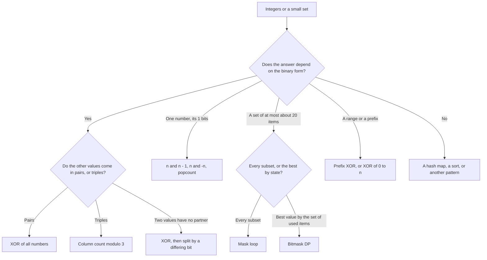

# Pattern 19: Bit Manipulation

## Overview

Bit manipulation reads an integer as a row of binary digits (bits) and uses operators that act on every bit of the integer in one step. A Java `int` has 32 bits, so one operator replaces a loop of 32 steps. Three ideas cover most interview problems. A count of the ones in each bit column, taken modulo 2 or modulo 3 (the remainder after division by 2 or by 3), finds the number that has no partner. A bit trick such as `n & (n - 1)` reads or changes the lowest 1 bit of one number. A mask (an integer in which bit `i` says whether item `i` belongs to a set) replaces a boolean array.

After this page you can:

1. Write the 32-bit form of a Java `int`, including a negative one, and evaluate `&`, `|`, `^`, `~`, `<<`, `>>`, and `>>>` by hand.
2. Derive the XOR solution of [LC 136: Single Number](https://leetcode.com/problems/single-number/) from a count of ones in each bit column, say why it is correct, and give an input on which it gives a wrong answer.
3. Extend the column count to numbers that appear three times ([LC 137](https://leetcode.com/problems/single-number-ii/)) and to two numbers that appear once ([LC 260](https://leetcode.com/problems/single-number-iii/)).
4. Derive `n & (n - 1)` and `n & -n` from a trace, and use them to test a power of two, to count bits, and to split a set of numbers.
5. Enumerate the subsets of a set with a mask, enumerate the submasks of a mask (the masks whose 1 bits are all 1 bits of the first mask), and state a bitmask dynamic programming (DP) problem with its limit on the number of items.
6. Name each Java-specific trap of bit code (a shift distance of 32 or more, `>>` against `>>>`, the precedence of `&` against `==`, `Integer.MIN_VALUE`) and give the input that exposes it.

## Prerequisites

| You need | Why this page needs it | Where to learn it |
|---|---|---|
| Binary numbers, two's complement, and the bit operators of Java | Every section reads and writes bits | The KB has no page for this. The next subsection teaches it |
| Java `int` arithmetic, loops, arrays, and `static` methods | All code on this page uses them | [Arrays, Strings, and Linked Lists](../foundations/02-arrays-strings-linked-lists.md) |
| Counting operations and O-notation | The page counts the steps of each trace before it states a bound | [Complexity Analysis](../foundations/01-complexity-analysis.md) |
| Hash maps and sets | The first attempts for [LC 136](https://leetcode.com/problems/single-number/) use a hash set. Counting subarrays by XOR uses a hash map | [Pattern 05: Hashing and Frequency](../05-hashing-frequency/README.md) |
| Prefix sums, and the map seed `{0: 1}` | Prefix XOR is the same technique with `^` in place of `+` and `-` | [Pattern 04: Prefix Sum and Difference Array](../04-prefix-sum/README.md) |
| Recursion and backtracking | The page compares the mask loop for subsets with backtracking | [Pattern 08: Recursion and Backtracking](../08-recursion-backtracking/README.md) |
| A dynamic-programming state and a transition (only for the bitmask DP section) | [LC 464](https://leetcode.com/problems/can-i-win/) uses a table indexed by a mask | [Pattern 15: Dynamic Programming](../15-dynamic-programming/README.md) |

### Binary numbers and the operators (taught here)

**Place values.** In decimal, each digit has a value that is a power of 10: `12` means 1 x 10 + 2 x 1. In binary, each digit (a **bit**) is 0 or 1, and its value is a power of 2. Number the bits from the right, starting at 0. Bit `k` has the value 2^k. So `12 = 8 + 4`, and its bits are `1100` (bit 3 and bit 2 are 1). With 8 bits, `12` is written `00001100`. The leftmost 1 bit of a number is its **highest set bit**. The rightmost 1 bit is its **lowest set bit**. A **set bit** is a bit that is 1. When several numbers are written in rows, each bit position is a **column**: column `k` holds bit `k` of every number.

**A Java `int` has 32 bits.** The bits are numbered 0 to 31. Java stores a negative number in **two's complement**: bits 0 to 30 keep their values 2^0 to 2^30, and bit 31 (the **sign bit**) has the value -2^31. A 1 in bit 31 makes the number negative. The range is -2,147,483,648 to 2,147,483,647: there is one more negative number than positive numbers. The Java Language Specification (JLS 4.2) defines the `int` values as 32-bit signed two's-complement integers.

**How to write `-n`.** Flip every bit of `n` (the operator `~`), then add 1. The reason: `n` and `~n` have opposite bits in every column, so `n + ~n` has a 1 in every column. The pattern of 32 ones is `-2^31 + (2^31 - 1) = -1`. So `~n = -1 - n`, and `~n + 1 = -n`. Check with `n = 4`: the bits of 4 are `...00000100`, and `~4` has a 0 only in bit 2. The pattern of 32 ones is -1, and the missing bit 2 takes away its value 4, so `~4 = -1 - 4 = -5`. Then `~4 + 1 = -4`. The program below prints the bits of 5 and of -5.

**The operators.** Each operator below works on one bit column at a time, except the shifts, which move bits between columns.

| Operator | Name | Rule | 8-bit example |
|---|---|---|---|
| `a & b` | AND | A column is 1 if both columns are 1 | `00001100 & 00001010 = 00001000` |
| `a \| b` | OR | A column is 1 if at least one column is 1 | `00001100 \| 00001010 = 00001110` |
| `a ^ b` | XOR (exclusive OR) | A column is 1 if the two columns differ | `00001100 ^ 00001010 = 00000110` |
| `~a` | NOT (complement) | Every column flips | `~00001100 = 11110011` |
| `a << k` | Left shift | Every bit moves `k` columns to the left. The new right columns are 0 | `00001100 << 2 = 00110000` |
| `a >> k` | Arithmetic right shift | Every bit moves `k` columns to the right. The new left columns copy the sign bit | `00001100 >> 2 = 00000011` |
| `a >>> k` | Logical right shift | Every bit moves `k` columns to the right. The new left columns are 0 | see the 32-bit example below |

The 8-bit pictures show the low 8 bits of a Java `int`. Java computes every operator on 32 bits. For a negative number, the left columns matter, so the program prints all 32 bits for the shifts of `-12`.

```java
public class BitBasics {
    // The low 8 bits of x as text. Integer.toBinaryString drops the leading zeros.
    static String bits8(int x) {
        String s = Integer.toBinaryString(x & 0xFF);
        return "0".repeat(8 - s.length()) + s;
    }

    // All 32 bits of x, in four groups of 8.
    static String bits32(int x) {
        String s = Integer.toBinaryString(x);
        s = "0".repeat(32 - s.length()) + s;
        return s.substring(0, 8) + " " + s.substring(8, 16) + " "
                + s.substring(16, 24) + " " + s.substring(24);
    }

    static void show(String label, int value) {
        System.out.printf("%-8s= %s (%d)%n", label, bits8(value), value);
    }

    public static void main(String[] args) {
        System.out.println("-- place values --");
        System.out.println("12 = 8 + 4 = " + bits8(12));
        System.out.println("bit k has the value 2^k: bit 3 = 8, bit 2 = 4");

        System.out.println("-- negative numbers: flip all bits, then add 1 --");
        show("5", 5);
        show("~5", ~5);
        show("~5 + 1", ~5 + 1);
        show("-5", -5);
        System.out.println("-5 in 32 bits = " + bits32(-5));
        System.out.println("MAX_VALUE = " + bits32(Integer.MAX_VALUE)
                + " (" + Integer.MAX_VALUE + ")");
        System.out.println("MIN_VALUE = " + bits32(Integer.MIN_VALUE)
                + " (" + Integer.MIN_VALUE + ")");
        System.out.println("-MIN_VALUE = " + (-Integer.MIN_VALUE));

        System.out.println("-- the operators, low 8 bits shown --");
        int a = 12, b = 10;
        show("a", a);
        show("b", b);
        show("a & b", a & b);
        show("a | b", a | b);
        show("a ^ b", a ^ b);
        show("~a", ~a);
        show("a << 2", a << 2);
        show("a >> 2", a >> 2);

        System.out.println("-- shifts of a negative number, all 32 bits --");
        int x = -12;
        System.out.println("x       = " + bits32(x) + " (" + x + ")");
        System.out.println("x >> 2  = " + bits32(x >> 2) + " (" + (x >> 2) + ")");
        System.out.println("x >>> 2 = " + bits32(x >>> 2) + " (" + (x >>> 2) + ")");
        System.out.println("x << 2  = " + bits32(x << 2) + " (" + (x << 2) + ")");
    }
}
```

<!-- expected-output -->
```text
-- place values --
12 = 8 + 4 = 00001100
bit k has the value 2^k: bit 3 = 8, bit 2 = 4
-- negative numbers: flip all bits, then add 1 --
5       = 00000101 (5)
~5      = 11111010 (-6)
~5 + 1  = 11111011 (-5)
-5      = 11111011 (-5)
-5 in 32 bits = 11111111 11111111 11111111 11111011
MAX_VALUE = 01111111 11111111 11111111 11111111 (2147483647)
MIN_VALUE = 10000000 00000000 00000000 00000000 (-2147483648)
-MIN_VALUE = -2147483648
-- the operators, low 8 bits shown --
a       = 00001100 (12)
b       = 00001010 (10)
a & b   = 00001000 (8)
a | b   = 00001110 (14)
a ^ b   = 00000110 (6)
~a      = 11110011 (-13)
a << 2  = 00110000 (48)
a >> 2  = 00000011 (3)
-- shifts of a negative number, all 32 bits --
x       = 11111111 11111111 11111111 11110100 (-12)
x >> 2  = 11111111 11111111 11111111 11111101 (-3)
x >>> 2 = 00111111 11111111 11111111 11111101 (1073741821)
x << 2  = 11111111 11111111 11111111 11010000 (-48)
```

Read the output in four parts.

- `12 = 8 + 4`: the place values add up.
- `~5 = 11111010 = -6`, and `~5 + 1 = 11111011 = -5`. The rule "flip, then add 1" gives the same bits as `-5`.
- `a & b`, `a | b`, and `a ^ b` combine the columns of `00001100` and `00001010` one by one. In the `^` result, the two columns that differ (bit 1 and bit 2) are 1.
- The shifts of `-12`. The `>>` result `-3` has two new 1s on the left, copied from the sign bit. The `>>>` result is the positive number 1,073,741,821, because the two new left columns are 0 and bit 31 is now 0. The `<<` result `-48` is `-12 x 4`. A left shift by `k` multiplies by 2^k as long as the result fits in 32 bits.

**XOR as addition modulo 2.** In one column, XOR follows this table, which is addition modulo 2 (the remainder of the sum after division by 2):

| bit of `a` | bit of `b` | `a ^ b` | `a + b` |
|---|---|---|---|
| 0 | 0 | 0 | 0 |
| 0 | 1 | 1 | 1 |
| 1 | 0 | 1 | 1 |
| 1 | 1 | 0 | 2, which has remainder 0 |

So the rules of addition hold for XOR in every column: `a ^ b = b ^ a`, `(a ^ b) ^ c = a ^ (b ^ c)`, `a ^ 0 = a`, and `a ^ a = 0` (a number plus itself is an even number of ones in each column). The Derivation uses these four rules.

## Motivation

### The anchor problem: the number that has no partner

This problem is [LC 136: Single Number](https://leetcode.com/problems/single-number/). An array holds integers. Every integer appears exactly twice, except one integer that appears once. Return the integer that appears once. For `[4, 1, 2, 1, 2]` the answer is `4`.

The goal of this page is a solution with O(n) time and O(1) extra space, where `n` is the length of the array. A solution with O(1) extra space uses a fixed number of variables and does not grow with `n`.

### First attempt 1: a hash set

Read the array from left to right. Keep a `HashSet<Integer>` of the numbers that have no partner yet. If a number is not in the set, add it. If it is in the set, its partner has arrived, so remove it. After the last number, one number remains in the set.

```java
class SingleNumberAttempts {
    // Attempt 1: a set that keeps the numbers that have no partner yet.
    static int withHashSet(int[] nums) {
        Set<Integer> open = new HashSet<>();
        for (int x : nums) {
            if (!open.add(x)) open.remove(x);   // second sighting: the pair is complete
        }
        return open.iterator().next();          // one number is left
    }

    // Attempt 2: sort, then compare the elements in pairs.
    static int withSort(int[] nums) {
        int[] a = nums.clone();                 // sorting the input would change the caller's array
        Arrays.sort(a);
        for (int i = 0; i + 1 < a.length; i += 2) {
            if (a[i] != a[i + 1]) return a[i];  // the pair is broken: a[i] is alone
        }
        return a[a.length - 1];                 // every pair held: the single number is last
    }
}
```

The program in the Implementation section prints the trace for `[4, 1, 2, 1, 2]`. It uses a `TreeSet`, so that the set prints in sorted order:

```text
number   action          set after the step
4        add 4           [4]
1        add 1           [1, 4]
2        add 2           [1, 2, 4]
1        remove 1        [2, 4]
2        remove 2        [4]
answer = 4
```

The set is correct, and the time is O(n). The waste is the memory. In the worst order, the array lists `m` different numbers first, then the single number, then the partners of the first `m` numbers. The set then holds `m + 1` numbers, which is `(n + 1) / 2` numbers for `n = 2m + 1`. The code stores each number only to delete it at the next step of its pair. The memory grows with `n`, so this is O(n) space.

### First attempt 2: sort, then compare neighbors

After sorting, equal numbers are neighbors: `[1, 1, 2, 2, 4]`. Compare the elements in pairs `(a[0], a[1])`, `(a[2], a[3])`, and so on. The first pair with two different elements has the single number in its first position. If all pairs are equal, the single number is the last element. The method `withSort` above does this.

Sorting costs O(n log n) time. The method copies the array, so it also uses O(n) space. Sorting the input in place avoids the copy, but then the method changes the array of the caller. The sort also does more work than the problem needs. It puts all `n` numbers in order, and the problem asks about one number.

### The exact waste

Both attempts treat the numbers as separate objects. The hash set remembers a number until its partner arrives. The sort places the partners side by side. In both attempts, the pair is **known** and **useless**: it does not change the answer. The gap is an operation that lets a pair disappear without storing it. Such an operation must undo itself: applying a number twice must give the starting state again. The Derivation looks for it in the bits of the numbers.

## Derivation

### Question 1: what does the single number leave behind that a pair does not?

Write each number in 3 bits and put the numbers in rows. Each bit position is a **column**. The program in the Implementation section prints this table for `[4, 1, 2, 1, 2]`:

```text
number   bit2 bit1 bit0
4          1    0    0
1          0    0    1
2          0    1    0
1          0    0    1
2          0    1    0
ones       1    2    2
ones%2     1    0    0   -> 100 = 4
```

Count the ones in each column.

- A pair of equal numbers has the same bit in each column. It adds two 1s to a column, or none. Each pair adds an **even** number of ones to each column.
- The single number adds one 1 to a column if its bit in that column is 1.

So the number of ones in a column is even (from the pairs) plus 0 or 1 (from the single number). The count is odd exactly when the bit of the single number in that column is 1. The **parity** of a number (even or odd) is its remainder modulo 2. The parity of the count in each column is the bit of the single number in that column.

In the table, the counts are 1, 2, 2. The parities are 1, 0, 0. The bits `100` are the number 4.

### Question 2: do we need the counts, or only the parities?

The counts of 1s are not needed. The parity of each column is enough, and a parity is one bit. The 32 columns of an `int` need 32 bits, and one `int` has 32 bits. So one `int` can hold the parity of all 32 columns.

*How does the parity of a column change when a new number arrives?* If the bit of the new number in the column is 0, the count does not change, and the parity stays. If the bit is 1, the count grows by one, and the parity flips. In one column, "flip the parity if the new bit is 1" is the table of XOR: `parity ^ bit`. The operator `^` on two ints applies this rule to all 32 columns at once. So the update of the 32 parities is one statement:

```text
parities = parities ^ x
```

### Question 3: what does the program look like, and what does the trace show?

Start with `parities = 0`, because the count is 0 in every column before the first number (and `0 ^ x = x`). Then apply `^` for each number.

```java
class SingleNumber {
    // LC 136. Every number appears twice, except one number that appears once.
    static int singleNumber(int[] nums) {
        int result = 0;                 // 0 is the identity: 0 ^ x = x
        for (int x : nums) {
            result ^= x;                // flips, in each bit column, the parity of the ones
        }
        return result;
    }
}
```

The trace for `[4, 1, 2, 1, 2]`:

```text
x = 100: 000 ^ 100 = 100 (4)
x = 001: 100 ^ 001 = 101 (5)
x = 010: 101 ^ 010 = 111 (7)
x = 001: 111 ^ 001 = 110 (6)
x = 010: 110 ^ 010 = 100 (4)
answer = 4
```

Read the trace column by column. After `4`, `1`, `2`, the value is `111`: each column has seen one 1. The second `1` flips the last column back to 0. The second `2` flips the middle column back to 0. Only `100` is left.

### Why it is correct

**The invariant.** After the loop has processed the first `i` numbers, bit `k` of `result` equals the parity of the count of ones in column `k` among those `i` numbers, for each column `k` from 0 to 31.

1. *Start.* Before the first number, `i = 0`. No number has a 1 in any column, so each parity is 0. The value `result = 0` has 0 in every column.
2. *Step.* The next number `x` changes the count of a column by 1 where its bit is 1, and by 0 where its bit is 0. `result ^ x` flips exactly the columns where the bit of `x` is 1, so the invariant holds for `i + 1` numbers.
3. *End.* After all `n` numbers, the parity of column `k` is the parity of the pairs (even, so 0) plus the bit of the single number. So bit `k` of `result` is bit `k` of the single number, for each of the 32 columns.

The proof does not depend on the order of the numbers. The four rules of the prerequisite give a second view of the same fact: XOR is commutative and associative, so the order of the numbers does not matter and the two equal numbers of each pair can meet. The rule `a ^ a = 0` turns each pair into 0. The rule `a ^ 0 = a` lets the zeros disappear, so the single number remains.

**The edge cases.** An array with one element returns that element (`0 ^ x = x`). Negative numbers work, because bit 31 is a column like the others (the program prints `-2147483648` for `[-1, -1, Integer.MIN_VALUE]`). An empty array returns 0. The problem guarantees one single number, so the empty array does not occur.

**The precondition.** The proof uses "every other number appears an even number of times". If another number appears three times, it adds an odd number of ones to a column, and the parity of that column no longer shows the single number.

| Input | What the code returns | The right answer |
|---|---|---|
| `[7, 7, 7, 3]` (the number 7 appears three times) | `7 ^ 7 ^ 7 ^ 3 = 7 ^ 3 = 4` | 3 is the number that appears once |
| `[2, 2, 3, 2]` | `2 ^ 2 ^ 3 ^ 2 = 1` | 3 |

The program prints the first result:

```text
[7, 7, 7, 3] gives 4
```

For these inputs the problem needs a count modulo 3, not modulo 2. Example 1 of the Worked Examples builds it. If two numbers appear once, the XOR of all numbers is the XOR of those two numbers. Example 3 handles that case.

### The cost, counted from the trace

The trace has one step for each number: 5 numbers, 5 XORs. Each XOR is one operation on one `int`. The code uses one variable, `result`, whatever the length of the array. So the time is **O(n)** and the extra space is **O(1)**.

| Method | Time | Extra space | Changes the input |
|---|---|---|---|
| Hash set (attempt 1) | O(n) | O(n): up to `(n + 1) / 2` numbers | No |
| Sort (attempt 2) | O(n log n) | O(n) for the copy | Yes, if sorted in place |
| XOR of all numbers | O(n) | O(1) | No |

## The Pattern

An `int` is 32 bit columns. Most bit operators treat each column on its own, so a rule that holds for one column holds for all 32. The page uses this fact in three ways. First, it counts the ones in each column modulo `m`, where `m` is the number of copies that each number has, so that the numbers with another count stand out. XOR does this for `m = 2` in all 32 columns at once. Second, it reads the lowest set bit of one number with `n & (n - 1)` and `n & -n`, because subtracting 1 changes only the lowest set bit and the zeros below it. Third, it stores a set of up to 32 items in one `int` (a **mask**), so that union, intersection, and "is item `i` in the set?" are single operators, and a loop over `0 .. 2^n - 1` visits every subset.

**The invariant.** Each column behaves on its own. An identity such as `a ^ a = 0` or `n & (n - 1)` clears the lowest set bit is a statement about the columns of one number, and it holds for all 32 columns. The exceptions are the operations that move bits between columns: shifts, negation, and addition. Their rules come from the carry or the borrow, as the examples show.

### The vocabulary

The page used the first terms before it named them. A term that a later example defines has its example in the last column.

| Term | What it was in the examples | The question to ask in a new problem | Defined in |
|---|---|---|---|
| Bit, column | One binary digit, and one position `k` of all numbers | "Can the problem be solved for one column, and the 32 answers joined?" | Prerequisites |
| Parity | The count of ones in a column modulo 2 | "Does every number except one come in pairs?" | Derivation |
| XOR cancel | `a ^ a = 0` | "Does the problem have a pair that must disappear?" | Derivation |
| Mask | An `int` in which bit `i` is 1 if item `i` is in the set | "Is there a small set of items, and do I test or change the whole set?" | Example 4 |
| Lowest set bit | The rightmost 1 of `n`: `n & -n` | "Does the problem ask about one 1 bit of `n`, or need a bit where two numbers differ?" | Prerequisites, Example 3 |
| Popcount (Hamming weight) | The number of 1 bits of `n` | "Does the answer count the 1 bits?" | Example 2 |
| Hamming distance | The number of columns where two numbers differ | "Does the problem count differences between two numbers?" | Example 2 |
| Submask | A mask whose 1 bits are all 1 bits of another mask | "Do I need every subset of a given set?" | Example 11 |
| Bitmask DP | A DP whose state is a mask | "Does the state say which items are used, and is `n` at most about 20?" | Example 12 |
| Prefix XOR | `prefix[i]` = XOR of the first `i` numbers | "Does the problem ask for the XOR of a range?" | Example 13 |

### The variants

Each variant has the property of the problem that selects it.

| Variant | The property that selects it | What changes in the code | Where |
|---|---|---|---|
| XOR of all numbers | Every other value appears an even number of times, or the problem pairs each value with an index | Nothing: `result ^= x` | Derivation, [LC 136](https://leetcode.com/problems/single-number/), Example 5, practice P1 |
| Column count modulo `m` | Every other value appears `m` times (`m` is odd and larger than 1, or the answer needs counts of ones) | A loop over the 32 columns, or two counters | Example 1, practice P7 |
| Split by a bit where two numbers differ | Exactly two values appear once | `n & -n` picks the bit, then two XORs | Example 3 |
| Clear or isolate the lowest set bit | A question about the 1 bits of one number | `n & (n - 1)`, `n & -n` | Examples 2 and 3 |
| Test, set, clear, toggle one bit | A flag at a known position | `1 << k` with `&`, `\|`, `& ~`, `^` | Example 4 |
| Independent columns | The rule of the problem has no carry between columns | A loop over 32 columns, or one operator on the whole number | Example 2 (Hamming distance), practice P8 |
| Shift and carry | Arithmetic without `+`, or a reversal | A loop of at most 32 rounds | Examples 7 and 8 |
| Mask as a set, enumerate all subsets | At most about 20 items, and each item is in or out | A loop from 0 to `(1 << n) - 1` | Example 10, practice P9 |
| Enumerate the submasks of a mask | A subset of a given subset | `s = (s - 1) & mask` | Example 11, practice P12 |
| Bitmask DP | The state is the set of used items | A table or a memo indexed by a mask | Example 12, [Pattern 27](../27-advanced-dp/README.md) |
| Prefix XOR | The XOR of a range, or a count of ranges with a given XOR | `prefix[r + 1] ^ prefix[l]`, a hash map of prefixes | Example 13, practice P10 |
| Binary trie | The largest XOR of two elements | A trie with two children for each node | [Pattern 17: Trie](../17-trie/README.md) |

## Worked Examples

Each example changes one thing about the anchor problem. The examples go from the column count, to the lowest set bit, to arithmetic on bits, to sets. Each example solves a problem in full. Attempt each problem before you read its section.

### Example 1: Single Number II (LC 137), the column count modulo 3

**Statement.** Every number appears exactly three times, except one number that appears once. Return the number that appears once. For `[2, 2, 3, 2]` the answer is `3`. The problem is [LC 137: Single Number II](https://leetcode.com/problems/single-number-ii/).

**What changed.** A number that appears three times adds three 1s to a column, or none. Three is odd, so the parity of a column no longer cancels the triples. The XOR of `[2, 2, 3, 2]` is `2 ^ 2 ^ 3 ^ 2 = 1`, and the answer is 3.

**Brute force.** A `HashMap<Integer, Integer>` of counts finds the number with count 1 in O(n) time and O(n) space. The goal is O(1) extra space.

**Derivation.** Keep the column view of the Derivation, but count modulo 3. A triple adds 0 or 3 ones to a column, which is 0 modulo 3. The single number adds its bit. So the count of ones in column `k`, taken modulo 3, equals bit `k` of the single number. The program prints the table for `[2, 2, 3, 2]` with 2 bits:

```text
number   bit1 bit0
2          1    0
2          1    0
3          1    1
2          1    0
ones       4    1
ones%3     1    1   -> 11 = 3
```

The counts are 4 and 1. The remainders modulo 3 are 1 and 1. The bits `11` are the number 3.

The code loops over the 32 columns. For each column, it counts the ones and sets the bit in `result` when the count is not a multiple of 3. The first method below is this loop.

**A second version: the same count in two ints.** The first version reads the array 32 times. A counter modulo 3 in one column has three states: 0, 1, or 2 ones seen. Two bits hold a state. Name them `twos` (the high bit) and `ones` (the low bit). The states move in a cycle when the bit of the new number is 1, and stay when the bit is 0:

| State (`twos`, `ones`) | Count modulo 3 | After a bit of 1 |
|---|---|---|
| 00 | 0 | 01 |
| 01 | 1 | 10 |
| 10 | 2 | 00 |

*What is the new `ones`?* It flips if the new bit is 1, except when the state is 10, where it stays 0. So `ones = (ones ^ x) & ~twos`. Check the rows: state 00 with bit 1 gives `(0 ^ 1) & ~0 = 1`. State 01 gives `(1 ^ 1) & ~0 = 0`. State 10 gives `(0 ^ 1) & ~1 = 0`. With bit 0, `ones` stays, and `ones & ~twos` equals `ones` because the state 11 does not occur.

*What is the new `twos`?* It flips if the new bit is 1, except when the new state is 01, where it must be 0. So `twos = (twos ^ x) & ~ones`, with the **new** value of `ones`. Check: state 00 with bit 1 gives `(0 ^ 1) & ~1 = 0`. State 01 gives `(0 ^ 1) & ~0 = 1`. State 10 gives `(1 ^ 1) & ~0 = 0`.

The trace for `[2, 2, 3, 2]` with 2 bits:

```text
x = 10: ones = 10, twos = 00
x = 10: ones = 00, twos = 10
x = 11: ones = 01, twos = 00
x = 10: ones = 11, twos = 00
answer = 3
```

After the last number, `ones = 11` and `twos = 00`. Each column has a count of 1 modulo 3, so `ones` is the single number, 3.

*Do negative numbers need a change?* No. The two update lines use only `^`, `&`, and `~`, so each of the 32 columns follows its own cycle, and column 31 (the sign bit) follows the same table. The trace below shows the low 3 columns for `[-1, 2, 2, 2]`. The number `-1` has a 1 in all 32 columns, so its low 3 bits are `111`. The hand-written trace is not part of the program output:

```text
x = 111: ones = 111, twos = 000
x = 010: ones = 101, twos = 010
x = 010: ones = 101, twos = 000
x = 010: ones = 111, twos = 000
```

Columns 0 and 2 see a 1 only in `-1`, so they move to state 01 in the first row and stay there. Column 1 sees a 1 in all four numbers: its state goes 01, 10, 00, 01 (the bit 1 of `ones` and `twos` in the four rows). All low 3 columns end in state 01, and so do columns 3 to 31 (they see a 1 only in `-1`). So `ones` has 1 in all 32 columns, and the answer is `-1`.

```java
class SingleNumberTwo {
    // LC 137. Every number appears three times, except one number that appears once.
    // Column method: in each of the 32 columns, the count of ones modulo 3 is the answer bit.
    static int byColumns(int[] nums) {
        int result = 0;
        for (int bit = 0; bit < 32; bit++) {           // bit 31 is the sign bit: it is a column too
            int ones = 0;
            for (int x : nums) {
                ones += (x >>> bit) & 1;               // the bit of x in this column
            }
            if (ones % 3 != 0) result |= 1 << bit;     // 1 << 31 is the sign bit, which is correct
        }
        return result;
    }

    // The same counting for all 32 columns at once: two ints hold a counter of 2 bits per column.
    static int byCounters(int[] nums) {
        int ones = 0;     // bit k is the low bit of the count of ones in column k, modulo 3
        int twos = 0;     // bit k is the high bit of that count
        for (int x : nums) {
            ones = (ones ^ x) & ~twos;
            twos = (twos ^ x) & ~ones;     // uses the NEW value of ones
        }
        return ones;                       // every column count is 0 or 1: ones is the answer
    }
}
```

**Why it is correct.** The invariant of the Derivation, with 3 in place of 2: after `i` numbers, column `k` of the counter holds the count of ones in column `k` modulo 3. Each triple adds a multiple of 3 to a column, so the counter shows only the single number. The precondition is that every other number appears three times. The input `[5, 5, 5, 5, 1]` (the number 5 appears four times) gives 5, and the right answer for "the number that appears once" is 1.

**Complexity.** The column version reads the array 32 times: O(32 n) = O(n) time, O(1) space. The two-counter version reads the array once: O(n) time, O(1) space.

**The mistake that this problem invites.** A loop over the columns 0 to 30 leaves out the sign bit. The input `[-1, 2, 2, 2]` gives 2,147,483,647 instead of -1 (see Common Mistakes).

### Example 2: clear the lowest set bit with `n & (n - 1)` (LC 231 and LC 191)

**Statement.** Two problems use one trick. [LC 231: Power of Two](https://leetcode.com/problems/power-of-two/): is the integer `n` a power of two (1, 2, 4, 8, ...)? [LC 191: Number of 1 Bits](https://leetcode.com/problems/number-of-1-bits/): how many bits of `n` are 1?

**What changed.** The input is one number, not an array. The question is about its 1 bits.

**Brute force.** For the power of two, divide by 2 while `n` is even and compare the end with 1. For the count, test the 32 bits one by one with `(n >>> i) & 1`. Both loops make up to 32 steps, and the second loop makes 32 steps even for `n = 1`.

**Derivation.** A number is a power of two exactly when it has one set bit. To test this without a loop, the code needs an operator that removes one set bit. Look at what `n - 1` does to the bits. The program prints it for `n = 180 = 10110100`:

```text
n        n - 1    n & (n - 1)  count
10110100 10110011 10110000     1
10110000 10101111 10100000     2
10100000 10011111 10000000     3
10000000 01111111 00000000     4
count = 4
```

Look at the first row. `n = 10110100` and `n - 1 = 10110011`. The lowest set bit (bit 2) became 0. The two zeros below it (bits 1 and 0) became 1. All bits above bit 2 did not change.

*Why?* Subtraction borrows from the lowest set bit. Write `n = P 1 0...0`, with a prefix `P`, the lowest set bit, and `k` zeros. To subtract 1, the lowest set bit becomes 0, and the `k` zeros below it become 1: `n - 1 = P 0 1...1`. The prefix is untouched. Now AND the two numbers. The prefix `P` is in both numbers, so it stays. At the lowest set bit, one number has 1 and the other has 0, so the result is 0. In the `k` low columns, `n` has 0, so the result is 0. So:

```text
n          =  P 1 0...0
n - 1      =  P 0 1...1
n & (n - 1) = P 0 0...0
```

**`n & (n - 1)` clears the lowest set bit of `n`** and changes nothing else. The remaining rows of the trace clear the next set bit each time, until the number is 0.

*Power of two.* If `n` has exactly one set bit, clearing it leaves 0. If `n` has more than one set bit, a set bit remains. So `n` has one set bit exactly when `n & (n - 1) == 0` and `n != 0`. A power of two is positive, and a negative `int` has its sign bit set. So the test needs `n > 0`. The program prints the rows:

```text
8: 00001000 & 00000111 = 00000000, n > 0 is true
6: 00000110 & 00000101 = 00000100, n > 0 is true
1: 00000001 & 00000000 = 00000000, n > 0 is true
0: 00000000 & 11111111 = 00000000, n > 0 is false
```

The number 6 leaves `00000100`, so 6 is not a power of two. The number 0 passes the AND test (`0 & -1 = 0`) but is not a power of two, so `n > 0` removes it. `Integer.MIN_VALUE` also passes the AND test: it has one set bit (bit 31), and `MIN_VALUE - 1` wraps to `MAX_VALUE`. The guard `n > 0` removes it too.

*Count the bits (Brian Kernighan's method).* The number of set bits of `n` is its **popcount**, also called the Hamming weight. Clear the lowest set bit, count 1, and repeat until `n == 0`. The loop runs once for each set bit. The trace above has 4 rows for `180`, which has 4 set bits.

```java
class BitCounting {
    // LC 231. Is n a power of two?
    static boolean isPowerOfTwo(int n) {
        return n > 0 && (n & (n - 1)) == 0;      // n > 0 excludes 0 and the negative numbers
    }

    // LC 191. The number of 1 bits. Each pass clears the lowest 1 bit.
    static int countOnes(int n) {
        int count = 0;
        while (n != 0) {                         // not "n > 0": a negative int has a sign bit of 1
            n &= n - 1;
            count++;
        }
        return count;
    }
}
```

**Why it is correct.** For `isPowerOfTwo`: the argument above covers `n > 0`, and the guard returns false for `n <= 0`. The loop of `countOnes` has the invariant "count + the number of set bits of `n` equals the number of set bits of the original input". Each pass clears one set bit and adds 1 to `count`. The loop ends at `n == 0`, where the sum is the count. The loop test is `n != 0`, not `n > 0`: a negative `int` has its sign bit set and must be counted.

**Complexity.** `isPowerOfTwo` makes a constant number of operations: O(1). `countOnes` makes one pass for each set bit: O(b) with `b` the number of set bits, at most 32. Space is O(1).

**The mistake that this problem invites.** The test `(n & (n - 1)) == 0` without `n > 0` returns true for 0 and for `Integer.MIN_VALUE` (see Common Mistakes).

#### Use of the trick: Hamming Distance (LC 461)

The Hamming distance of two integers is the number of bit columns in which they differ. For `1` and `4`, it is 2. The problem is [LC 461: Hamming Distance](https://leetcode.com/problems/hamming-distance/). The question compares two numbers column by column, with no carry, so the columns are independent.

*Which operator marks the columns that differ?* XOR gives 1 exactly in the columns where the two bits differ (the table in the Prerequisites). So the distance is the number of set bits of `x ^ y`, which the Kernighan loop above counts. The program prints it for `1` and `4`:

```text
x = 001, y = 100, x ^ y = 101
ones in x ^ y = 2
```

`001 ^ 100 = 101`, which has two set bits.

```java
class HammingDistance {
    // LC 461. The number of bit columns in which x and y differ.
    static int hammingDistance(int x, int y) {
        int diff = x ^ y;                         // a 1 marks each column where x and y differ
        int count = 0;
        while (diff != 0) {
            diff &= diff - 1;
            count++;
        }
        return count;
    }
}
```

Edge cases: `x == y` gives `x ^ y = 0` and distance 0. Negative numbers work, because the loop uses `diff != 0`. The call `Integer.bitCount(x ^ y)` does the same in one call. The time is O(b) with `b` the number of differing columns, at most 32, and the space is O(1). The ladder problem [LC 477: Total Hamming Distance](https://leetcode.com/problems/total-hamming-distance/) (P7) extends the idea to all pairs of an array.

### Example 3: Single Number III (LC 260) and the lowest set bit with `n & -n`

**Statement.** Exactly two numbers appear once. Every other number appears twice. Return the two numbers. For `[1, 2, 1, 3, 2, 5]` the answer is `3` and `5`. The problem is [LC 260: Single Number III](https://leetcode.com/problems/single-number-iii/).

**What changed.** The XOR of all numbers is now `a ^ b`, where `a` and `b` are the two numbers that appear once. This value does not give `a` and `b` separately. For the example, `3 ^ 5 = 6`.

**Brute force.** A hash map of counts works in O(n) time and O(n) space.

**Derivation, one question at a time.**

*Question 1.* What does `a ^ b` tell us? The two numbers are different, so `a ^ b` is not 0. So `a ^ b` has at least one column with a 1. In such a column, `a` and `b` have **different** bits: one has 0 and the other has 1.

*Question 2.* How can that column separate `a` from `b`? Split all numbers into two groups by their bit in that column: the group with a 1 and the group with a 0. Then `a` and `b` are in different groups. Each pair of equal numbers has the same bit in the column, so both numbers of the pair go to the same group. So each group holds some pairs and exactly one of `a` and `b`. That is the problem of [LC 136](https://leetcode.com/problems/single-number/), twice. The XOR of each group is `a` or `b`.

*Question 3.* Which column? Any column where `a ^ b` has a 1 works. The simplest to compute is the lowest one: the lowest set bit of `a ^ b`. The code needs an operator that keeps only the lowest set bit.

*Question 4.* What does the negation `-n` do to the lowest set bit? The program prints the steps for `n = 10110100`:

```text
n      = 10110100
~n     = 01001011
~n + 1 = 01001100  (this is -n)
n & -n = 00000100
```

Write `n = P 1 0...0` again. The operator `~` flips every bit: `~n = ~P 0 1...1`. Adding 1 carries through the `k` ones, turns them into zeros, and stops at the 0 above them, which becomes 1: `~n + 1 = ~P 1 0...0`. So:

```text
n        =   P 1 0...0
-n       =  ~P 1 0...0
n & -n   =   0 1 0...0
```

Below the lowest set bit, both numbers have zeros. At the lowest set bit, both have 1. Above it, the bits of `n` and `-n` are opposite, so the AND is 0. **`n & -n` keeps only the lowest set bit of `n`.** (A Fenwick tree uses the same value to move between its nodes: see [Pattern 21](../21-segment-tree-and-fenwick-tree/README.md).)

*Question 5.* What does the trace look like for `[1, 2, 1, 3, 2, 5]`?

```text
XOR of all = 110 (6), split bit = 010
numbers with the split bit:    [2, 3, 2] -> XOR 3
numbers without the split bit: [1, 1, 5] -> XOR 5
```

The XOR of all numbers is `110` (6). Its lowest set bit is `010`. The numbers with that bit are `2, 3, 2`, and their XOR is 3. The numbers without it are `1, 1, 5`, and their XOR is 5.

```java
class SingleNumberThree {
    // LC 260. Two numbers appear once. Every other number appears twice.
    static int[] twoSingles(int[] nums) {
        int both = 0;
        for (int x : nums) both ^= x;            // both = a ^ b, and a != b, so both != 0
        int split = both & -both;                // the lowest bit where a and b differ
        int a = 0, b = 0;
        for (int x : nums) {
            if ((x & split) != 0) a ^= x;        // group 1: numbers that have the split bit
            else b ^= x;                         // group 2: numbers that do not
        }
        return new int[] {a, b};
    }
}
```

**Why it is correct.** The proof has three facts. First, `both = a ^ b` is not 0, because `a != b`, so `both & -both` is a single set bit and the split is possible. Second, `a` and `b` have different bits in the split column, because `both` has a 1 there. Third, equal numbers have equal bits, so no pair is split. So each group is a set of pairs plus one single number, and the XOR of a group is that single number. The edge case is `both = Integer.MIN_VALUE`, for example `a = Integer.MIN_VALUE` and `b = 0`. Then `-both = both` and `both & -both = Integer.MIN_VALUE`: the split column is bit 31, which is correct.

**Complexity.** Two passes: O(n) time. Space: O(1).

**The mistake that this problem invites.** The test `(x & split) == 1` is true only if `split` is 1. The test must be `!= 0` (see Common Mistakes).

### Example 4: test, set, clear, and toggle one bit

**Statement.** Given an `int` `n` and a bit position `k` from 0 to 31, read bit `k`, or change it to 1, or change it to 0, or flip it. All other bits stay the same.

**What changed.** The earlier examples read all bits. This example changes one chosen bit and leaves the others alone.

**Derivation.** The code needs a number that selects column `k`. A **mask** is an integer that selects columns: the columns where the mask is 1 are the columns that an operator reads or changes. The number `1 << k` is a mask with one set bit, at position `k`. Now look at what each operator does to a column, for a mask bit `m` and a number bit `x`:

| Operation | Expression | Column `k` (mask bit 1) | Other columns (mask bit 0) |
|---|---|---|---|
| Test | `n & (1 << k)`, compared with 0 | `x & 1 = x`: the bit survives | `x & 0 = 0`: erased |
| Set | `n \| (1 << k)` | `x \| 1 = 1` | `x \| 0 = x`: unchanged |
| Clear | `n & ~(1 << k)` | `x & 0 = 0` (the mask `~(1 << k)` has 0 here) | `x & 1 = x`: unchanged |
| Toggle | `n ^ (1 << k)` | `x ^ 1`: flipped | `x ^ 0 = x`: unchanged |

The program prints each operation for `n = 00101100`:

```text
n                = 00101100
1 << 2           = 00000100
test bit 2: n & (1 << 2) = 00000100 -> true
test bit 4: n & (1 << 4) = 00000000 -> false
set bit 4:    n | (1 << 4)  = 00111100
~(1 << 2)          = 11111011
clear bit 2:  n & ~(1 << 2) = 00101000
toggle bit 5: n ^ (1 << 5)  = 00001100
toggle bit 2: n ^ (1 << 2)  = 00101000
```

The test of bit 2 leaves `00000100`: not 0, so bit 2 is set. The test of bit 4 leaves 0, so bit 4 is clear. Setting bit 4 gives `00111100`. Clearing bit 2 gives `00101000`. Toggling bit 5 gives `00001100`: bit 5 of `n` was 1, so the toggle clears it. Toggling bit 2 gives `00101000`: bit 2 of `n` was 1, so the toggle clears it too.

```java
class BitAccess {
    static int lowestSetBit(int n) {
        return n & -n;                           // 0 if n is 0
    }

    static boolean testBit(int n, int k) {       // k from 0 to 31
        return (n & (1 << k)) != 0;              // compare with 0, not with 1
    }

    static int setBit(int n, int k) {
        return n | (1 << k);
    }

    static int clearBit(int n, int k) {
        return n & ~(1 << k);
    }

    static int toggleBit(int n, int k) {
        return n ^ (1 << k);
    }
}
```

**Why it is correct.** Each row of the table covers one column of the result. The column `k` and the other columns are separate cases, and the table shows the result in both cases for each operation.

**Complexity.** Each method is O(1), and the space is O(1). The position must satisfy `0 <= k <= 31`: the shift distance of an `int` is taken modulo 32, so `1 << 32` equals `1 << 0` (see Common Mistakes).

**The mistake that this problem invites.** The test `(n & (1 << k)) == 1` is true only for `k = 0`. The test must compare with 0 (see Common Mistakes).

### Example 5: Missing Number (LC 268), XOR of values and indexes

**Statement.** An array of length `n` holds `n` different integers from the range `0` to `n`. One number of the range is missing. Return it. For `[3, 0, 1]` the answer is `2`. The problem guarantees the different values and the range. The problem is [LC 268: Missing Number](https://leetcode.com/problems/missing-number/).

**What changed.** No number appears twice. The pairs come from a second list: the numbers `0, 1, ..., n` of the full range.

**Brute force and attempts.** A boolean array or a hash set marks the numbers that are present: O(n) time and O(n) space. Sorting finds the first position `i` where `nums[i] != i`: O(n log n). The sum formula returns `n(n + 1)/2` minus the sum of the array: O(n) time and O(1) space. In Java, the expression `n * (n + 1) / 2` overflows `int` when `n` is large. For `n = 70000`, the product is 4,900,070,000, which does not fit in an `int` (maximum 2,147,483,647). The program of Common Mistakes prints `302551352` for the `int` version and `2450035000` for the `long` version.

**Derivation.** Write two lists next to each other: the full range `0, 1, ..., n`, and the array. Every number of the range appears in the full list once. Every number of the array appears in the array once. A number that is present appears in both lists. The missing number appears only in the full list. So the XOR of both lists cancels each present number and leaves the missing number.

To avoid a second loop, use the index `i` as the full-range number for position `i` (`0` to `n - 1`), and start `result` at `n`, the one number of the range that has no index. The program prints the trace for `[3, 0, 1]`:

```text
start: result = n = 3
i = 0, nums[i] = 3: 3 ^ 0 ^ 3 = 0
i = 1, nums[i] = 0: 0 ^ 1 ^ 0 = 1
i = 2, nums[i] = 1: 1 ^ 2 ^ 1 = 2
answer = 2
```

At `i = 0`, `3 ^ 0 ^ 3 = 0`: the start value 3 meets the array value 3 and cancels it. At `i = 1`, the index 1 has no array value yet to cancel it, so the result is 1. At `i = 2`, the array value 1 cancels the index 1 from the step before, and the index 2 stays, so the result is 2. The final value 2 is the number that no array element matches.

```java
class MissingNumber {
    // LC 268. The array holds n different numbers from 0..n. Return the one that is missing.
    static int missingNumber(int[] nums) {
        int result = nums.length;                 // the value n has no index, so start with it
        for (int i = 0; i < nums.length; i++) {
            result ^= i ^ nums[i];                // index i and value nums[i] cancel if equal
        }
        return result;
    }
}
```

**Why it is correct.** The XOR of `result = n`, all indexes `0 .. n - 1`, and all array values is the XOR of the full range `0 .. n` and the array values. Each present number appears in both lists, so it cancels. The missing number appears once, so it remains. Edge cases: `[0]` has `n = 1` and returns `1 ^ 0 ^ 0 = 1`. `[1]` returns `1 ^ 0 ^ 1 = 0`. An empty array has `n = 0` and returns 0, which is the only number of the range `0 .. 0`.

**Complexity.** O(n) time, O(1) space, and no overflow, because XOR does no arithmetic.

**The mistake that this problem invites.** The expression `n * (n + 1) / 2` in `int` arithmetic overflows (see Common Mistakes).

### Example 6: Counting Bits (LC 338), a table that reuses a smaller entry

**Statement.** Given `n`, return an array `bits` of length `n + 1` where `bits[i]` is the number of 1 bits of `i`. For `n = 8`, the answer is `[0, 1, 1, 2, 1, 2, 2, 3, 1]`. The problem is [LC 338: Counting Bits](https://leetcode.com/problems/counting-bits/).

**What changed.** The answer is a whole table, not one value.

**Brute force.** Call the Kernighan loop of Example 2 for each `i`: O(n x b) time, with `b` the number of set bits (at most 32).

**Derivation.** *Is there a smaller number that has almost the same bits?* Shift `i` one place to the right. The result `i >> 1` drops the lowest bit of `i` and keeps all other bits. So `i` has the 1 bits of `i >> 1`, plus one more if the dropped bit `i & 1` is 1:

```text
bits[i] = bits[i >> 1] + (i & 1)
```

The number `i >> 1` is smaller than `i` for `i >= 1`, so the table has its entry when the loop reaches `i`. The base case is `bits[0] = 0`. The program prints the table for `n = 8`:

```text
i  binary  i >> 1  bits[i >> 1]  i & 1  bits[i]
0  0000    -       -            -      0
1  0001    0       0            1      1
2  0010    1       1            0      1
3  0011    1       1            1      2
4  0100    2       1            0      1
5  0101    2       1            1      2
6  0110    3       2            0      2
7  0111    3       2            1      3
8  1000    4       1            0      1
bits = [0, 1, 1, 2, 1, 2, 2, 3, 1]
```

For `i = 6` (`0110`), `i >> 1 = 3` (`0011`) has 2 set bits, and `i & 1 = 0`, so `bits[6] = 2 + 0`. For `i = 7` (`0111`), `7 >> 1 = 3` has 2 set bits, and `7 & 1 = 1`, so `bits[7] = 3`.

```java
class CountingBits {
    // LC 338. bits[i] = the number of 1 bits in i, for i from 0 to n.
    static int[] countBits(int n) {
        int[] bits = new int[n + 1];              // bits[0] = 0
        for (int i = 1; i <= n; i++) {
            bits[i] = bits[i >> 1] + (i & 1);     // i >> 1 < i, so it is already filled
        }
        return bits;
    }
}
```

**Why it is correct.** Induction on `i`. `bits[0] = 0` is right. For `i >= 1`, the bits of `i` are the bits of `i >> 1` followed by the bit `i & 1`, so the count is the count of `i >> 1` plus `i & 1`. The count of `i >> 1` is already correct because `i >> 1 < i`. The edge case `n = 0` returns `[0]`. Another valid relation is `bits[i] = bits[i & (i - 1)] + 1`: it removes the lowest set bit (Example 2).

**Complexity.** O(n) time. The extra space beyond the answer array is O(1).

### Example 7: Reverse Bits (LC 190), build a result from the low bit

**Statement.** Reverse the 32 bits of an `int`: bit 0 goes to bit 31, bit 1 goes to bit 30, and so on. The problem is [LC 190: Reverse Bits](https://leetcode.com/problems/reverse-bits/). The program shows the idea with 8 bits: `00001101` becomes `10110000`.

**What changed.** The answer is a rearrangement of the bits of the input.

**Brute force.** Convert the number to a 32-character string, reverse it, and parse it again. The work is O(32), and it allocates strings.

**Derivation.** *Which bit goes where?* The first bit that the code reads, bit 0, must end in bit 31. The second bit that it reads must end in bit 30. So the code can read bits from the low end and push each one into the **low end** of the result, after shifting the result left by one. A bit that was pushed first has been shifted the most times, so it ends highest. Each step does three things:

1. `result << 1` makes room at the low end.
2. `n & 1` reads the lowest bit of `n`.
3. `result | bit` puts that bit in the room.

Then `n >>>= 1` moves the next bit of `n` to the low end. The program prints the 8-bit version, with the same loop and `width = 8`:

```text
step 1: low bit 1, result = 00000001, n = 00000110
step 2: low bit 0, result = 00000010, n = 00000011
step 3: low bit 1, result = 00000101, n = 00000001
step 4: low bit 1, result = 00001011, n = 00000000
step 5: low bit 0, result = 00010110, n = 00000000
step 6: low bit 0, result = 00101100, n = 00000000
step 7: low bit 0, result = 01011000, n = 00000000
step 8: low bit 0, result = 10110000, n = 00000000
answer = 10110000
```

Step 1 puts the bit 1 (the lowest bit of `00001101`) in the result. Step 2 shifts it left and adds the bit 0. After step 8, the first bit that was read is at the left end.

```java
class ReverseBits {
    // LC 190. Reverse the 32 bits of n.
    static int reverseBits(int n) {
        int result = 0;
        for (int i = 0; i < 32; i++) {            // exactly 32 steps, also when n has leading zeros
            result = (result << 1) | (n & 1);     // make room, then append the lowest bit of n
            n >>>= 1;                             // >>> brings in zeros; >> gives the same here
        }
        return result;
    }
}
```

**Why it is correct.** The invariant: after `i` steps, the low `i` bits of `result` hold the lowest `i` bits of the input in reverse order, and `n` holds the input shifted right by `i`. A step moves the next input bit to the low end of `result` and shifts the earlier bits one place up. After 32 steps, all 32 bits are reversed. The loop runs exactly 32 times, also when the input has leading zeros: the input `1` must give `Integer.MIN_VALUE`. A loop `while (n != 0)` stops after one step and returns 1 (see Common Mistakes). In this loop, `>>` and `>>>` give the same result, because the loop reads only the bits 0 to 31 of the input. The operator `>>>` makes the intent clear.

**Complexity.** 32 steps: O(1) time, O(1) space. The library method `Integer.reverse(n)` returns the same result.

### Example 8: Sum of Two Integers (LC 371), addition from AND and XOR

**Statement.** Return `a + b` without the operators `+` and `-`. For `5 + 3` the answer is `8`. The problem is [LC 371: Sum of Two Integers](https://leetcode.com/problems/sum-of-two-integers/).

**What changed.** Arithmetic is rebuilt from bit operators. Addition needs a carry, so the columns are no longer independent.

**Derivation.** *How do we add two numbers on paper?* Add column by column from the right. In one column, the two bits `x` and `y` give a sum bit and a carry bit:

| `x` | `y` | sum bit | carry into the next column |
|---|---|---|---|
| 0 | 0 | 0 | 0 |
| 0 | 1 | 1 | 0 |
| 1 | 0 | 1 | 0 |
| 1 | 1 | 0 | 1 |

The sum bit is `x ^ y`, and the carry is `x & y`. For all 32 columns at once, `a ^ b` holds the sum bits **without** carries, and `a & b` holds the carry bits. A carry belongs to the next column to the left, so the carries are `(a & b) << 1`. The true sum is `(a ^ b) + ((a & b) << 1)`. This is again an addition, but now the second number (the carries) has its lowest set bit at least one column higher than before. Repeat with the new pair until the carries are 0.

The program prints the rounds for `5 + 3`:

```text
5 + 3
round 1: a ^ b = 00000110, carry = 00000010
round 2: a ^ b = 00000100, carry = 00000100
round 3: a ^ b = 00000000, carry = 00001000
round 4: a ^ b = 00001000, carry = 00000000
rounds = 4
answer = 8
```

Round 1: `0101 ^ 0011 = 0110`, and the carries are `(0101 & 0011) << 1 = 0010`. Round 2: `0110 ^ 0010 = 0100`, and the carries are `0100`. Round 3: `0100 ^ 0100 = 0`, and the carries are `1000`. Round 4: `0 ^ 1000 = 1000`, and the carries are 0. The result is `1000`, which is 8.

```java
class SumOfTwo {
    // LC 371. Add two ints without + and -.
    static int getSum(int a, int b) {
        while (b != 0) {
            int carry = (a & b) << 1;             // a column with two 1s carries into the next
            a = a ^ b;                            // the sum of each column without its carry
            b = carry;                            // add the carries in the next round
        }
        return a;
    }
}
```

**Why it is correct.** The invariant: `a + b` stays the same after each round, because `a ^ b` plus the carries `(a & b) << 1` equals `a + b` (the column rule above, applied to all columns). All sums are taken modulo 2^32, as Java `int` addition is, and a carry out of bit 31 is dropped by `<<`. The loop ends because the lowest set bit of `b` moves up by at least one column in each round. The new `b` is `(a & b) << 1`. The bits of `a & b` are bits of `b`, so the lowest set bit of `a & b` is at or above the lowest set bit of `b`, and the shift moves it one more column up. After at most 32 rounds, the lowest set bit of `b` would have to be at column 32 or higher. No such column exists in an `int`, so `b` is 0. This argument does not use the sign of `a` or `b`, so it holds for negative operands.

**Negative numbers.** The same loop works, because a two's-complement `int` adds like an unsigned 32-bit number, and the sum wraps modulo 2^32, as `a + b` does in Java. The program prints `5 + -3`:

```text
5 + -3
round 1: a ^ b = 11111111111111111111111111111000, carry = 00000000000000000000000000001010
round 2: a ^ b = 11111111111111111111111111110010, carry = 00000000000000000000000000010000
round 3: a ^ b = 11111111111111111111111111100010, carry = 00000000000000000000000000100000
...
round 30: a ^ b = 00000000000000000000000000000010, carry = 00000000000000000000000000000000
rounds = 30
answer = 2
```

The carry travels up through the sign-extension ones, and 30 rounds pass before it leaves bit 31. The result is 2. The sum `Integer.MIN_VALUE + -1` wraps to `Integer.MAX_VALUE`, the same as the `+` operator (the edge-case lines of the Implementation section print it).

**Complexity.** At most 32 rounds: O(1) time, O(1) space. **The mistake that this problem invites:** a carry without `<< 1` gives `5 + 3 = 7` (see Common Mistakes).

### Example 9: Bitwise AND of Numbers Range (LC 201), the common prefix

**Statement.** Given `left` and `right`, return the AND of all integers from `left` to `right`, both included. For `left = 5` and `right = 7`, the AND is `5 & 6 & 7 = 4`. The problem is [LC 201: Bitwise AND of Numbers Range](https://leetcode.com/problems/bitwise-and-of-numbers-range/). The code below assumes `0 <= left <= right`.

**What changed.** The input is a range of numbers, and the range can be large.

**Brute force.** Loop `i` from `left` to `right` and AND all values. The loop runs `right - left + 1` times, which can be about 2^31. If `right` is `Integer.MAX_VALUE`, the loop `for (int i = left; i <= right; i++)` never ends, because `i++` wraps to a negative number and the test `i <= right` stays true.

**Derivation.** *What does one column of the AND depend on?* Look at column 0. If the range has two or more numbers, it holds two neighbors `x` and `x + 1`, and one of them is even. So column 0 of the AND is 0. Now drop column 0: shift both ends right by 1. The numbers `left >> 1` to `right >> 1` are exactly the upper 31 columns of the numbers of the range, and the AND of the upper columns is the AND of the shifted range. Repeat. When `left == right`, the range has one number, and the AND is that number. Put back the dropped columns as zeros with a left shift by the number of rounds.

The program prints the rounds for `5, 7` and for `26, 30`:

```text
left = 00000101, right = 00000111
shift 1: left = 00000010, right = 00000011
shift 2: left = 00000001, right = 00000001
equal at shift 2: 00000001 << 2 = 00000100
answer = 4
```

```text
left = 00011010, right = 00011110
shift 1: left = 00001101, right = 00001111
shift 2: left = 00000110, right = 00000111
shift 3: left = 00000011, right = 00000011
equal at shift 3: 00000011 << 3 = 00011000
answer = 24
```

For `5..7`, the ends are equal after 2 shifts at `00000001`. The AND is `00000001 << 2 = 00000100`, the number 4. For `26..30`, the ends meet after 3 shifts at `00000011`, and the AND is `00011000`, the number 24. The result is the **common binary prefix** of `left` and `right`, followed by zeros.

```java
class RangeAnd {
    // LC 201. The AND of all integers from left to right. Assumes 0 <= left <= right.
    static int rangeBitwiseAnd(int left, int right) {
        int shift = 0;
        while (left != right) {                   // the low bit of the AND is 0 while ends differ
            left >>= 1;
            right >>= 1;
            shift++;
        }
        return left << shift;                     // the common prefix, with zeros below it
    }
}
```

**Why it is correct.** The invariant: the AND of the range `left .. right` equals the AND of the shifted range, shifted left by `shift`. A range with at least two numbers has an AND of 0 in the lowest column, as shown above, and the upper columns are the AND of the shifted range. The loop stops when `left == right`, where the range has one number. The edge cases: `left == right` returns `left` with no round. The range `0 .. 0` returns 0. The range `0 .. Integer.MAX_VALUE` returns 0 (the ends meet at 0 after 31 rounds). The code does not loop over the range, so the size of the range does not matter. For `left < 0 <= right`, the ends become `-1` and `0` and never meet: the loop does not end (see Common Mistakes). That is why the code assumes `0 <= left <= right`.

**Complexity.** At most 31 rounds: O(1) time, O(1) space.

### Example 10: Subsets (LC 78), an integer as a set

**Statement.** Given an array of different integers, return all subsets (the empty set and the whole array included). For `[1, 2, 3]` there are 8 subsets. The problem is [LC 78: Subsets](https://leetcode.com/problems/subsets/).

**What changed.** The input is a small set, and the answer lists all of its subsets. The first examples used one `int` as a row of independent columns. Here one `int` is a **set**.

**Brute force.** Backtracking ([Pattern 08](../08-recursion-backtracking/README.md)) decides item by item: skip or take.

**Derivation.** Each item is in the subset or not: one binary choice for each item. A list of `n` binary choices is an `n`-bit number. So let bit `i` of a number `mask` say "item `i` is in the subset". The `2^n` numbers from `0` to `2^n - 1` are all the different choices, so each subset is one number in this range, and each number is one subset. The program prints the 8 masks for `[1, 2, 3]`:

```text
mask 000 -> []
mask 001 -> [1]
mask 010 -> [2]
mask 011 -> [1, 2]
mask 100 -> [3]
mask 101 -> [1, 3]
mask 110 -> [2, 3]
mask 111 -> [1, 2, 3]
```

Read the row `101`: bit 0 and bit 2 are set, so the subset is `{nums[0], nums[2]} = [1, 3]`. The mask `000` is the empty subset, and `111` is the whole array. The code needs only a test of bit `i` in `mask` (Example 4).

```java
class SubsetsByMask {
    // LC 78. All subsets of nums. The elements are distinct.
    static List<List<Integer>> subsets(int[] nums) {
        int n = nums.length;
        if (n > 30) throw new IllegalArgumentException("1 << n needs n <= 30");
        List<List<Integer>> result = new ArrayList<>();
        for (int mask = 0; mask < (1 << n); mask++) {        // each mask is one subset
            List<Integer> subset = new ArrayList<>();
            for (int i = 0; i < n; i++) {
                if (((mask >> i) & 1) == 1) subset.add(nums[i]);   // bit i of mask: nums[i] is in
            }
            result.add(subset);
        }
        return result;
    }
}
```

**Operations on masks.** The mask is a set, so the set operations are single operators. The program prints each one for `p = {0, 2}` and `q = {2, 3}` in a universe of 4 items:

```text
p = {0, 2} = 0101, q = {2, 3} = 1100
union          p | q        = 1101
intersection   p & q        = 0100
difference     p & ~q       = 0001
complement     p ^ universe = 1010
add item 1     p | (1 << 1) = 0111
remove item 2  p & ~(1 << 2) = 0001
size of p      Integer.bitCount(p) = 2
p inside p | q (p & (p | q)) == p is true
q inside p     (q & p) == q is false
```

| Set operation | Mask expression | Why |
|---|---|---|
| Union | `p \| q` | A column is 1 if the item is in at least one set |
| Intersection | `p & q` | A column is 1 if the item is in both sets |
| Difference `p - q` | `p & ~q` | Keep the items of `p`, and clear those of `q` |
| Complement | `p ^ universe`, with `universe = (1 << n) - 1` | Flip the `n` columns of the items |
| Add item `i` | `p \| (1 << i)` | Set bit `i` (Example 4) |
| Remove item `i` | `p & ~(1 << i)` | Clear bit `i` |
| Size | `Integer.bitCount(p)` | The popcount of Example 2 |
| `p` is a subset of `q` | `(p & q) == p` | Every item of `p` is also in `q` |

**Why it is correct.** The map from masks to subsets is one to one: two different masks differ in a column, so they differ in the membership of one item. The loop visits all `2^n` masks, so it visits all subsets once. The edge case `n = 0`: the loop runs for `mask = 0` only and returns one subset, the empty one (the program prints it).

**Complexity.** `2^n` masks, and each mask tests `n` bits: O(n x 2^n) time. The output has `n x 2^(n - 1)` elements in total, so the time matches the output size up to a constant factor. The method needs `n <= 30`, because `1 << 31` is negative and `1 << 32` equals 1 (see Common Mistakes). In practice, `n` is at most about 20, because `2^20` is about one million subsets.

**Mask loop or backtracking?** Both visit `2^n` subsets. The mask loop is shorter and has no recursion. Backtracking can stop early (a sum limit, a rule for duplicates). Use the mask loop when every subset is a candidate and `n` is small. The same idea in a DP replaces the recursion with a table (Example 12).

### Example 11: submasks, the loop `s = (s - 1) & mask`

**Statement.** Given a mask, visit every submask of it: every mask whose set bits are all set bits of the given mask. For `mask = 1011`, there are 8 submasks.

**What changed.** The set is not the full universe `0 .. 2^n - 1`, but a subset of it.

**Brute force.** Loop `s` from `0` to `mask` and keep `s` if `(s & mask) == s`. The loop makes `mask + 1` steps. For the mask `2^20 + 1` (two set bits), the loop makes 1,048,578 steps, and only 4 submasks exist.

**Derivation.** *Can the code jump from one submask to the next smaller one?* Look at `s - 1`, as in Example 2: `s - 1` clears the lowest set bit of `s` and sets all bits below it. That gives the next smaller **number**, but the new bits below may not belong to `mask`. AND with `mask` removes those bits. The program prints this for `mask = 1011`:

```text
mask = 1011
s     s - 1  (s - 1) & mask
1011  1010   1010
1010  1001   1001
1001  1000   1000
1000  0111   0011
0011  0010   0010
0010  0001   0001
0001  0000   0000
s = 0000: the loop stops, then the empty submask is handled
```

Read the fourth row. `s = 1000`, so `s - 1 = 0111`. The bits `0111` include bit 2, and `mask = 1011` has no bit 2. The AND with `mask` gives `0011`. That is the next submask after `1000`: bit 2 is not in `mask`, so the numbers `0111` and `0110`, `0101`, `0100` are not submasks.

*Why is `(s - 1) & mask` the next smaller submask?* Number the set bits of `mask` from the lowest: `p0 < p1 < ... < p(m-1)`. A submask `s` is a choice of some of these `m` positions, so it corresponds to an `m`-bit number `c`, where bit `j` of `c` is bit `p_j` of `s`. The order of submasks as integers equals the order of `c`, because the positions `p_j` increase with `j`. The next smaller submask is the one with `c - 1`. Subtracting 1 from `c` clears the lowest set bit of `c` and sets the bits below it. In `s - 1`, the same happens in the columns `p_j`, and in the columns outside `mask` the extra bits are removed by `& mask`. So `(s - 1) & mask` is the submask with `c - 1`.

The loop starts at `s = mask` (the largest submask) and ends at `s = 0`. The test `s > 0` stops the loop before the empty submask, so the code adds the empty submask on its own:

```java
class Submasks {
    // Every submask of mask, in decreasing order, and the empty submask last.
    static List<Integer> all(int mask) {
        List<Integer> out = new ArrayList<>();
        for (int s = mask; s > 0; s = (s - 1) & mask) {      // s - 1 can set bits outside mask
            out.add(s);
        }
        out.add(0);                                          // the loop never adds 0
        return out;
    }
}
```

**Complexity.** The loop makes `2^b` steps for a mask with `b` set bits, one step for each submask. Over all masks of `n` bits, the total number of (mask, submask) pairs is `3^n`: each item is in neither, in the mask only, or in the mask and in the submask. [Pattern 27](../27-advanced-dp/README.md) uses this in its submask DP (Template 3). The ladder problem [LC 1178](https://leetcode.com/problems/number-of-valid-words-for-each-puzzle/) (P12) uses it to count words.

**The mistake that this problem invites.** The loop `for (s = mask; s >= 0; ...)` never ends: after `s = 0`, the value `(0 - 1) & mask` is `mask` again (see Common Mistakes).

### Example 12: bitmask DP, Can I Win (LC 464)

**Statement.** Two players take turns. Each turn, a player picks a number from `1` to `m` that nobody has picked, and adds it to a running total. The player whose pick brings the total to `desired` or more wins. Does the first player win with the best play of both? For `m = 3` and `desired = 4`, the answer is false. The problem is [LC 464: Can I Win](https://leetcode.com/problems/can-i-win/). If the sum `1 + ... + m` is smaller than `desired`, nobody can win, and the answer is false.

**What changed.** The answer depends on a **set of used items**, and a mask can hold the set. This is **bitmask DP**: a DP whose state is a mask. This section is an introduction. [Pattern 27](../27-advanced-dp/README.md) covers the traveling-salesman state (Template 1), the assignment state (Template 2), and the submask transition (Template 3). [Pattern 15](../15-dynamic-programming/README.md) covers DP with the state and transition vocabulary.

**Brute force.** Try every order of picks: up to `m!` games. For `m = 10`, that is 3,628,800 games. The same set of used numbers can appear after many different orders.

**Derivation.** *What does the future of the game depend on?* After some picks, the running total is the sum of the picked numbers, and the next picks come from the numbers that are left. So the future depends only on the **set** of picked numbers, and not on the order. The set is a mask: bit `k - 1` says that number `k` is used. There are `2^m` sets.

Define `wins(used)`: "the player to move wins from this set of used numbers". The remaining need is `desired - sum(used)`. The player to move tries each unused number `k`:

- If `k >= remaining`, the player wins now.
- Otherwise the new set is `used | bit(k)`. The player wins if the **opponent** loses from there: `!wins(used | bit(k))`.

If no pick wins, `wins(used)` is false. Each set is computed once and stored in `memo[used]`. The program prints the calls for `m = 3` and `desired = 4`:

```text
used 000: pick 1, remaining 3
  used 001: pick 2, remaining 1
    used 011: pick 3 reaches 1 -> win
  used 001: pick 3 reaches 3 -> win
used 000: pick 2, remaining 2
  used 010: pick 1, remaining 1
    used 011: stored true
  used 010: pick 3 reaches 2 -> win
used 000: pick 3, remaining 1
  used 100: pick 1 reaches 1 -> win
used 000: every pick loses -> lose
canIWin(3, 4) = false
```

Read the trace from the top. The first player picks 1 (remaining 3), so the opponent moves from the set `001`. The opponent tries 2 first: the remaining need becomes 1, and the first player then picks 3 and wins, so pick 2 does not help the opponent. The opponent tries 3: it reaches the remaining need of 3 at once and wins. So the opponent wins from `001`, and the first pick 1 fails. Pick 2 leaves the set `010` with remaining 2. The opponent tries 1 (the stored result for `011` says that the first player then wins), then 3, which reaches 2 and wins. Pick 3 leaves `100` with remaining 1, and the opponent picks 1 and wins. Every first pick loses, so the answer is false. The line `used 011: stored true` shows a stored result: the set `{1, 2}` was reached by two different orders of picks.

| DP part | In this problem |
|---|---|
| State | `used`, a mask of `m` bits |
| Meaning | The player to move wins from the numbers in `used` |
| Transition | Try each unused `k`. Win if `k >= remaining`, or if the opponent loses from `used \| bit(k)` |
| Base case | None is stored: a set with no winning pick is false |
| Order | The recursion reaches a set only through the call that needs it, and it fills `memo` on the way back, so no loop order is needed |
| Answer | `wins(0)` |

```java
class CanIWin {
    // LC 464. Players take turns to pick an unused number from 1..m and add it to a running total.
    // The player whose pick makes the total reach desired wins. Does the first player win?
    static boolean canIWin(int m, int desired) {
        if (m * (m + 1) / 2 < desired) return false;         // even all numbers cannot reach it
        return wins(0, desired, m, new Boolean[1 << m]);
    }

    // used = the set of numbers that are taken. remaining = desired - (sum of the used numbers).
    // Does the player to move win with best play? The answer depends only on used.
    private static boolean wins(int used, int remaining, int m, Boolean[] memo) {
        if (memo[used] != null) return memo[used];
        boolean result = false;
        for (int k = 1; k <= m && !result; k++) {
            int bit = 1 << (k - 1);                          // number k is bit k - 1
            if ((used & bit) != 0) continue;                 // number k is taken
            // Pick k: win now, or leave the opponent in a position that loses.
            if (k >= remaining || !wins(used | bit, remaining - k, m, memo)) result = true;
        }
        return memo[used] = result;
    }
}
```

**Why it is correct.** The remaining need depends only on `used`, so two paths that reach the same `used` have the same future, and one stored answer serves both. The game ends because each pick adds a number to `used`, and `used` has at most `m` bits. The first guard returns false when even all numbers cannot reach `desired`: then every game ends with no winner. By the assumption in the statement above, the answer is then false. If `desired <= m`, the first player picks `m` and wins at once.

**Complexity.** `2^m` states, each tries up to `m` picks: O(m x 2^m) time and O(2^m) space for `memo`. For `m = 20`, the state count is 2^20 = 1,048,576 and the transition count is 20 x 2^20 = 20,971,520 (the program of Common Mistakes, section 15, prints this product).

**The limit.** The state is a set of items, so the method needs `m` at most about 20. This DP has one value for each mask. For `m = 25`, that is 2^25 = 33,554,432 states and 25 x 2^25 = 838,860,800 transitions. A DP whose state also names the last item has `m` values for each mask, and its table is `m` times larger (see Common Mistakes, Mistake 15). A bottom-up version that **pulls** from larger sets must loop over masks from the largest to the smallest (see Common Mistakes, Mistake 4).

### Example 13: prefix XOR, subarray XOR, and the XOR of `0 .. n`

**Statement (part A).** Given an array and a list of queries `[l, r]`, return the XOR of `arr[l..r]` for each query. For `[3, 5, 2, 6, 1]` and the query `[1, 3]`, the answer is `5 ^ 2 ^ 6 = 1`. The problem is [LC 1310: XOR Queries of a Subarray](https://leetcode.com/problems/xor-queries-of-a-subarray/).

**What changed.** The question is about a **range**, and many queries repeat it on one array.

**Brute force.** XOR the elements of each range: O(n) for each query.

**Derivation.** The problem is the same as the range-sum queries of [Pattern 04](../04-prefix-sum/README.md), with `^` in place of `+`. Define `prefix[i]` as the XOR of the first `i` elements, with `prefix[0] = 0` for the empty prefix. Then `prefix[r + 1]` is the XOR of `arr[0..r]`, and `prefix[l]` is the XOR of `arr[0..l-1]`. The first contains the second as a part. XOR both: the part `arr[0..l-1]` appears twice and cancels (`a ^ a = 0`), and `arr[l..r]` stays:

```text
XOR(arr[l..r]) = prefix[r + 1] ^ prefix[l]
```

The subtraction of the prefix-sum technique is XOR here, because XOR is its own inverse. The program prints it:

```text
nums   = [3, 5, 2, 6, 1]
prefix = [0, 3, 6, 4, 2, 3]
XOR of nums[1..3] = prefix[4] ^ prefix[1] = 2 ^ 3 = 1
direct XOR            = 1
```

```java
class PrefixXorQueries {
    // prefix[i] = nums[0] ^ ... ^ nums[i - 1]. prefix[0] = 0 is the empty prefix.
    static int[] build(int[] nums) {
        int[] prefix = new int[nums.length + 1];
        for (int i = 0; i < nums.length; i++) prefix[i + 1] = prefix[i] ^ nums[i];
        return prefix;
    }

    // The XOR of nums[l..r]: the shared part nums[0..l-1] cancels.
    static int rangeXor(int[] prefix, int l, int r) {
        return prefix[r + 1] ^ prefix[l];
    }
}
```

**Statement (part B).** Count the subarrays whose XOR equals `k`. For `[4, 2, 2, 6, 4]` and `k = 6`, the answer is 4. *Derivation.* A subarray `arr[i..j]` has XOR `k` when `prefix[j + 1] ^ prefix[i] = k`, that is, when `prefix[i] = prefix[j + 1] ^ k`. At each `j`, the code needs the number of earlier prefixes with that value: a hash map from prefix value to count, as in [LC 560](https://leetcode.com/problems/subarray-sum-equals-k/). The map starts with `{0: 1}` for the empty prefix, so that subarrays that start at index 0 are counted. The map is updated after the lookup. The program prints the steps:

```text
k = 6, seen = {0=1}
x = 4: prefix = 4, target = 2, found 0, count = 0
x = 2: prefix = 6, target = 0, found 1, count = 1
x = 2: prefix = 4, target = 2, found 0, count = 1
x = 6: prefix = 2, target = 4, found 2, count = 3
x = 4: prefix = 6, target = 0, found 1, count = 4
answer = 4
```

The four subarrays are `[4, 2]`, `[2, 2, 6]`, `[6]`, and `[4, 2, 2, 6, 4]`. At `x = 2` (the second element), the prefix is 6, the target is 0, and the seed `0` matches: the subarray `[4, 2]` counts. At `x = 6`, the prefix is 2 and the target is 4. Two earlier prefixes equal 4 (after the first element and after the third), so `[2, 2, 6]` and `[6]` count. At the last `x = 4`, the prefix is 6 and the seed `0` matches: the whole array counts.

```java
class CountXorSubarrays {
    // The number of subarrays whose XOR equals k.
    static int count(int[] nums, int k) {
        Map<Integer, Integer> seen = new HashMap<>();
        seen.put(0, 1);                       // the empty prefix has XOR 0
        int prefix = 0, count = 0;
        for (int x : nums) {
            prefix ^= x;
            count += seen.getOrDefault(prefix ^ k, 0);   // earlier prefixes p with p ^ prefix == k
            seen.merge(prefix, 1, Integer::sum);         // insert after the lookup
        }
        return count;
    }
}
```

**Statement (part C).** Find the XOR of all integers from `a` to `b`, for large `a` and `b`, without a loop. *Derivation.* Let `f(n)` be the XOR of `0 .. n`. Then XOR(`a .. b`) is `f(b) ^ f(a - 1)`, by the prefix idea above: `f(b)` contains `f(a - 1)` as a part, and the XOR cancels it. To compute `f(n)`, print the first values:

```text
n   n % 4  XOR of 0..n  formula  case
0   0      0           0        n
1   1      1           1        1
2   2      3           3        n + 1
3   3      0           0        0
4   0      4           4        n
5   1      1           1        1
6   2      7           7        n + 1
7   3      0           0        0
8   0      8           8        n
9   1      1           1        1
10  2      11          11       n + 1
11  3      0           0        0
XOR of 3..5 = f(5) ^ f(2) = 1 ^ 3 = 2
```

The formula column repeats with a period of 4: `f(n)` is `n`, `1`, `n + 1`, `0` for `n % 4 = 0, 1, 2, 3`. *Why?* Take four numbers `4k, 4k+1, 4k+2, 4k+3`. They share all bits above bit 1, and their two lowest bits are `00, 01, 10, 11`. In each of the two lowest columns, two of the four numbers have a 1, so the XOR is 0 there. In each column above, all four numbers have the same bit, four copies cancel, and the XOR is 0 there too. So the XOR of any block of four numbers that starts at a multiple of 4 is 0. Then:

- `f(4k + 3) = 0`, because `0 .. 4k + 3` is `k + 1` full blocks.
- `f(4k) = f(4k - 1) ^ 4k = 0 ^ 4k = 4k`, which is `n`.
- `f(4k + 1) = 4k ^ (4k + 1) = 1`.
- `f(4k + 2) = 1 ^ (4k + 2) = 4k + 3`, which is `n + 1`.

*The off-by-one.* The XOR of `3 .. 5` is `3 ^ 4 ^ 5 = 2`. The formula `f(5) ^ f(2) = 1 ^ 3 = 2` is correct. The formula `f(5) ^ f(3) = 1 ^ 0 = 1` is wrong: it removes the number 3 from the range, and `f(3)` includes the 3. The left end needs `f(a - 1)`. For `a = 0`, the code needs `f(-1)`, the XOR of no numbers, which is 0. In Java, `-1 % 4 = -1`, so a `switch` on `n % 4` finds no case for `n = -1`. The `default` branch of the code below would return 0 by accident, which is the right value. The line `if (n < 0) return 0;` states the intent and does not depend on that accident.

```java
class XorRange {
    // The XOR of 0..n. The result repeats with period 4.
    static int xorUpTo(int n) {
        if (n < 0) return 0;                  // the XOR of no numbers; n % 4 is negative here
        switch (n % 4) {
            case 0:  return n;
            case 1:  return 1;
            case 2:  return n + 1;
            default: return 0;                // n % 4 == 3
        }
    }

    // The XOR of a, a+1, ..., b. Uses f(b) ^ f(a - 1), not f(b) ^ f(a).
    static int xorBetween(int a, int b) {
        return xorUpTo(b) ^ xorUpTo(a - 1);
    }
}
```

**Why it is correct.** Part A and part B follow from `a ^ a = 0` and from the equation of the prefixes. Part C follows from the block argument. The edge cases: a one-element range (`l = r`) returns the element. The map seed handles the subarray that starts at index 0. The formula handles `a = 0` through `f(-1) = 0`.

**Complexity.** Part A: O(n) to build and O(1) for each query. Part B: O(n) time and O(n) space for the map. Part C: O(1) time and space.

## Implementation

The templates of this page are the classes of the Worked Examples. Each template is a plain class with static methods. The table says which block to copy and which lines a new problem changes.

| Template | Block | The lines that a new problem changes |
|---|---|---|
| XOR of all numbers | Derivation, `SingleNumber` | The start value (0) and what is XORed: `x`, or `i ^ x` as in Example 5 |
| Column count modulo 3 | Example 1, `byColumns` | The modulus `3` and the test `ones % 3 != 0` |
| Two counters modulo 3 | Example 1, `byCounters` | The two update lines, and which counter holds the answer |
| Clear the lowest set bit | Example 2, `BitCounting` | What the loop counts or tests |
| Isolate the lowest set bit, split | Example 3, `twoSingles` | What the two groups compute |
| Test, set, clear, toggle | Example 4, `BitAccess` | The operator and the mask |
| Column-by-column loop | Example 1 (`byColumns`), practice P7 and P8 | What the loop does with the three bits of one column |
| Shift and carry | Examples 7 and 8 | The width of the loop and the operator that builds the result |
| Mask loop over all subsets | Example 10, `SubsetsByMask` | What the loop does with each mask |
| Submask loop | Example 11, `Submasks` | What the loop does with each submask |
| Bitmask DP | Example 12, `CanIWin` | The state meaning, the transition, and the stored value |
| Prefix XOR | Example 13, `PrefixXorQueries`, `CountXorSubarrays` | The query and what the map stores |
| XOR of `0 .. n` | Example 13, `XorRange` | The four cases of `n % 4` |

Notes on the lines that readers get wrong:

- `result ^= x` starts from `0`. The start value of an AND loop is `-1` (all ones), because `-1 & x = x`. The start value of an OR loop is 0.
- In `byColumns`, the loop `bit < 32` includes bit 31, the sign bit. The expression `1 << bit` for `bit = 31` is `Integer.MIN_VALUE`, which is the right mask for the sign bit.
- In `byCounters`, the line for `twos` uses the **new** `ones`. If the order of the two lines changes, the cycle 00, 01, 10, 00 breaks.
- In `countOnes`, the loop test is `n != 0`. In `isPowerOfTwo`, the guard is `n > 0`.
- In `twoSingles`, the test is `(x & split) != 0`. The expression `x & split == 0` does not compile, because `==` binds tighter than `&`.
- In `testBit`, the comparison is with 0, not with 1.
- In `reverseBits`, the loop runs 32 times. In `getSum`, the carry is `(a & b) << 1`, and the shift is part of the carry.
- In `rangeBitwiseAnd`, the loop `while (left != right)` ends because a range with `left <= right` has two ends that meet after at most 31 shifts. The code does not handle `left < 0`.
- In `Submasks.all`, the loop starts at `s = mask`, and the loop test is `s > 0`. The step `(s - 1) & mask` must have the `& mask`.
- In `canIWin`, the number `k` is bit `k - 1`. The guard for the sum comes before the table is allocated.
- In `CountXorSubarrays.count`, the lookup uses `prefix ^ k`, and the insert comes after the lookup.
- In `xorUpTo`, the guard `n < 0` comes before `n % 4`.

The complete program below prints the traces of the Motivation, the Derivation, and the Worked Examples, and the edge cases: a single element, `-1` and `Integer.MIN_VALUE`, 0, an empty array, the range ends at `Integer.MAX_VALUE`, and an empty set. The methods in this program are not the classes above. Each one prints a line at each step, so the program has its own copies of the algorithms, with the same logic. The traces in the hints and solutions of the practice problems are written by hand. The helper `b(x, w)` prints the low `w` bits of `x`.

```java
import java.util.ArrayList;
import java.util.Arrays;
import java.util.HashMap;
import java.util.List;
import java.util.Map;
import java.util.Set;
import java.util.TreeSet;

public class BitTrace {
    static boolean say = true;                 // false: run a method without its trace

    static void out(Object line) {
        if (say) System.out.println(line);
    }

    // The low w bits of x, as text.
    static String b(int x, int w) {
        if (w == 0) return "";
        String s = Integer.toBinaryString(w == 32 ? x : x & ((1 << w) - 1));
        return "0".repeat(w - s.length()) + s;
    }

    public static void main(String[] args) {
        System.out.println("-- hash-set --");
        System.out.println("answer = " + hashSet(new int[] {4, 1, 2, 1, 2}));
        System.out.println("-- single-columns --");
        singleColumns(new int[] {4, 1, 2, 1, 2}, 3);
        System.out.println("-- single-xor --");
        System.out.println("answer = " + singleNumber(new int[] {4, 1, 2, 1, 2}, 3));
        System.out.println("-- single-three --");
        System.out.println("[7, 7, 7, 3] gives " + singleNumber(new int[] {7, 7, 7, 3}, 3, false));
        System.out.println("-- single2-columns --");
        columnsMod3(new int[] {2, 2, 3, 2}, 2);
        System.out.println("-- single2-counters --");
        System.out.println("answer = " + counters(new int[] {2, 2, 3, 2}, 2));
        System.out.println("-- kernighan --");
        System.out.println("count = " + kernighan(180));
        System.out.println("-- lowbit --");
        lowBit(180);
        System.out.println("-- power-of-two --");
        for (int n : new int[] {8, 6, 1, 0}) {
            System.out.println(n + ": " + b(n, 8) + " & " + b(n - 1, 8) + " = "
                    + b(n & (n - 1), 8) + ", n > 0 is " + (n > 0));
        }
        System.out.println("-- single3 --");
        twoSingles(new int[] {1, 2, 1, 3, 2, 5}, 3);
        System.out.println("-- bit-ops --");
        bitOps(44);
        System.out.println("-- missing --");
        System.out.println("answer = " + missing(new int[] {3, 0, 1}));
        System.out.println("-- counting-bits --");
        countingBits(8);
        System.out.println("-- reverse --");
        System.out.println("answer = " + b(reverse(13, 8), 8));
        System.out.println("-- sum --");
        System.out.println("answer = " + sum(5, 3, 8));
        System.out.println("-- sum-negative --");
        System.out.println("answer = " + sum(5, -3, 32));
        System.out.println("-- range-and --");
        System.out.println("answer = " + rangeAnd(5, 7));
        System.out.println("-- range-and-2 --");
        System.out.println("answer = " + rangeAnd(26, 30));
        System.out.println("-- hamming --");
        hamming(1, 4);
        System.out.println("-- subsets --");
        subsets(new int[] {1, 2, 3});
        System.out.println("-- set-ops --");
        setOps();
        System.out.println("-- submasks --");
        submasks(11);
        System.out.println("-- can-i-win --");
        System.out.println("canIWin(3, 4) = " + canIWin(3, 4));
        System.out.println("-- prefix-xor --");
        prefixXor(new int[] {3, 5, 2, 6, 1}, 1, 3);
        System.out.println("-- xor-table --");
        xorTable();
        System.out.println("-- count-xor --");
        System.out.println("answer = " + countXor(new int[] {4, 2, 2, 6, 4}, 6));
        System.out.println("-- edge-cases --");
        edgeCases();
    }

    // The first attempt of LC 136: a set of the numbers that have no partner yet.
    static int hashSet(int[] nums) {
        Set<Integer> open = new TreeSet<>();      // a TreeSet prints its numbers in order
        System.out.println("number   action          set after the step");
        for (int x : nums) {
            boolean added = open.add(x);
            if (!added) open.remove(x);
            System.out.println(String.format("%-8d %-15s %s", x,
                    (added ? "add " : "remove ") + x, open));
        }
        return open.iterator().next();
    }

    // LC 136, columns: count the ones in each column.
    static void singleColumns(int[] nums, int w) {
        out("number  " + header(w));
        int[] ones = new int[w];
        for (int x : nums) {
            StringBuilder row = new StringBuilder(String.format("%-7d", x));
            for (int bit = w - 1; bit >= 0; bit--) {
                int v = (x >> bit) & 1;
                ones[bit] += v;
                row.append(String.format("%5d", v));
            }
            out(row);
        }
        StringBuilder count = new StringBuilder("ones   ");
        StringBuilder parity = new StringBuilder("ones%2 ");
        int answer = 0;
        for (int bit = w - 1; bit >= 0; bit--) {
            count.append(String.format("%5d", ones[bit]));
            parity.append(String.format("%5d", ones[bit] % 2));
            answer |= (ones[bit] % 2) << bit;
        }
        out(count);
        out(parity + "   -> " + b(answer, w) + " = " + answer);
    }

    static String header(int w) {
        StringBuilder h = new StringBuilder();
        for (int bit = w - 1; bit >= 0; bit--) h.append(String.format("%5s", "bit" + bit));
        return h.toString();
    }

    // LC 136 as XOR, with a trace of result.
    static int singleNumber(int[] nums, int w) {
        return singleNumber(nums, w, true);
    }

    static int singleNumber(int[] nums, int w, boolean trace) {
        int result = 0;
        for (int x : nums) {
            int before = result;
            result ^= x;
            if (trace) {
                out("x = " + b(x, w) + ": " + b(before, w) + " ^ " + b(x, w)
                        + " = " + b(result, w) + " (" + result + ")");
            }
        }
        return result;
    }

    static void columnsMod3(int[] nums, int w) {
        out("number  " + header(w));
        int[] ones = new int[w];
        for (int x : nums) {
            StringBuilder row = new StringBuilder(String.format("%-7d", x));
            for (int bit = w - 1; bit >= 0; bit--) {
                int v = (x >> bit) & 1;
                ones[bit] += v;
                row.append(String.format("%5d", v));
            }
            out(row);
        }
        StringBuilder count = new StringBuilder("ones   ");
        StringBuilder mod = new StringBuilder("ones%3 ");
        int answer = 0;
        for (int bit = w - 1; bit >= 0; bit--) {
            count.append(String.format("%5d", ones[bit]));
            mod.append(String.format("%5d", ones[bit] % 3));
            if (ones[bit] % 3 != 0) answer |= 1 << bit;
        }
        out(count);
        out(mod + "   -> " + b(answer, w) + " = " + answer);
    }

    static int counters(int[] nums, int w) {
        int ones = 0, twos = 0;
        for (int x : nums) {
            ones = (ones ^ x) & ~twos;
            twos = (twos ^ x) & ~ones;
            out("x = " + b(x, w) + ": ones = " + b(ones, w) + ", twos = " + b(twos, w));
        }
        return ones;
    }

    static int kernighan(int n) {
        int count = 0;
        out("n        n - 1    n & (n - 1)  count");
        while (n != 0) {
            int next = n & (n - 1);
            count++;
            out(b(n, 8) + " " + b(n - 1, 8) + " " + b(next, 8) + "     " + count);
            n = next;
        }
        return count;
    }

    static void lowBit(int n) {
        out("n      = " + b(n, 8));
        out("~n     = " + b(~n, 8));
        out("~n + 1 = " + b(~n + 1, 8) + "  (this is -n)");
        out("n & -n = " + b(n & -n, 8));
    }

    static void twoSingles(int[] nums, int w) {
        int both = 0;
        for (int x : nums) both ^= x;
        int split = both & -both;
        out("XOR of all = " + b(both, w) + " (" + both + "), split bit = " + b(split, w));
        List<Integer> withBit = new ArrayList<>(), without = new ArrayList<>();
        int a = 0, c = 0;
        for (int x : nums) {
            if ((x & split) != 0) { a ^= x; withBit.add(x); } else { c ^= x; without.add(x); }
        }
        out("numbers with the split bit:    " + withBit + " -> XOR " + a);
        out("numbers without the split bit: " + without + " -> XOR " + c);
    }

    static void bitOps(int n) {
        int k = 2, j = 4, m = 5;
        out("n                = " + b(n, 8));
        out("1 << " + k + "           = " + b(1 << k, 8));
        out("test bit " + k + ": n & (1 << " + k + ") = " + b(n & (1 << k), 8)
                + " -> " + (((n >>> k) & 1) == 1));
        out("test bit " + j + ": n & (1 << " + j + ") = " + b(n & (1 << j), 8)
                + " -> " + (((n >>> j) & 1) == 1));
        out("set bit " + j + ":    n | (1 << " + j + ")  = " + b(n | (1 << j), 8));
        out("~(1 << " + k + ")          = " + b(~(1 << k), 8));
        out("clear bit " + k + ":  n & ~(1 << " + k + ") = " + b(n & ~(1 << k), 8));
        out("toggle bit " + m + ": n ^ (1 << " + m + ")  = " + b(n ^ (1 << m), 8));
        out("toggle bit " + k + ": n ^ (1 << " + k + ")  = " + b(n ^ (1 << k), 8));
    }

    static int missing(int[] nums) {
        int result = nums.length;
        out("start: result = n = " + result);
        for (int i = 0; i < nums.length; i++) {
            int before = result;
            result ^= i ^ nums[i];
            out("i = " + i + ", nums[i] = " + nums[i] + ": " + before + " ^ " + i
                    + " ^ " + nums[i] + " = " + result);
        }
        return result;
    }

    static int[] countingBits(int n) {
        int[] bits = new int[n + 1];
        out("i  binary  i >> 1  bits[i >> 1]  i & 1  bits[i]");
        out("0  " + b(0, 4) + "    -       -            -      0");
        for (int i = 1; i <= n; i++) {
            bits[i] = bits[i >> 1] + (i & 1);
            out(i + "  " + b(i, 4) + "    " + (i >> 1) + "       " + bits[i >> 1]
                    + "            " + (i & 1) + "      " + bits[i]);
        }
        out("bits = " + Arrays.toString(bits));
        return bits;
    }

    static int reverse(int n, int width) {
        int result = 0;
        for (int i = 0; i < width; i++) {
            int low = n & 1;
            result = (result << 1) | low;
            n >>>= 1;
            out("step " + (i + 1) + ": low bit " + low + ", result = " + b(result, width)
                    + ", n = " + b(n, width));
        }
        return result;
    }

    // Prints round 1 to 3 and the last round; w is the width of the printed bits.
    static int sum(int a, int c, int w) {
        out(a + " + " + c);
        int round = 0;
        while (c != 0) {
            int carry = (a & c) << 1;
            int partial = a ^ c;
            round++;
            a = partial;
            c = carry;
            if (round <= 3 || c == 0) {
                out("round " + round + ": a ^ b = " + b(a, w) + ", carry = " + b(c, w));
            } else if (round == 4) {
                out("...");
            }
        }
        out("rounds = " + round);
        return a;
    }

    static int rangeAnd(int left, int right) {
        out("left = " + b(left, 8) + ", right = " + b(right, 8));
        int shift = 0;
        while (left != right) {
            left >>= 1;
            right >>= 1;
            shift++;
            out("shift " + shift + ": left = " + b(left, 8) + ", right = " + b(right, 8));
        }
        out("equal at shift " + shift + ": " + b(left, 8) + " << " + shift + " = "
                + b(left << shift, 8));
        return left << shift;
    }

    static int hamming(int x, int y) {
        int diff = x ^ y;
        out("x = " + b(x, 3) + ", y = " + b(y, 3) + ", x ^ y = " + b(diff, 3));
        int count = 0;
        while (diff != 0) {
            diff &= diff - 1;
            count++;
        }
        out("ones in x ^ y = " + count);
        return count;
    }

    static int subsets(int[] nums) {
        int n = nums.length;
        int seen = 0;
        for (int mask = 0; mask < (1 << n); mask++) {
            List<Integer> subset = new ArrayList<>();
            for (int i = 0; i < n; i++) {
                if (((mask >> i) & 1) == 1) subset.add(nums[i]);
            }
            out("mask " + b(mask, n) + " -> " + subset);
            seen++;
        }
        return seen;
    }

    static void setOps() {
        int p = 0b0101;                                   // {0, 2}
        int q = 0b1100;                                   // {2, 3}
        int universe = (1 << 4) - 1;                      // {0, 1, 2, 3}
        out("p = {0, 2} = " + b(p, 4) + ", q = {2, 3} = " + b(q, 4));
        out("union          p | q        = " + b(p | q, 4));
        out("intersection   p & q        = " + b(p & q, 4));
        out("difference     p & ~q       = " + b(p & ~q, 4));
        out("complement     p ^ universe = " + b(p ^ universe, 4));
        out("add item 1     p | (1 << 1) = " + b(p | (1 << 1), 4));
        out("remove item 2  p & ~(1 << 2) = " + b(p & ~(1 << 2), 4));
        out("size of p      Integer.bitCount(p) = " + Integer.bitCount(p));
        out("p inside p | q (p & (p | q)) == p is " + ((p & (p | q)) == p));
        out("q inside p     (q & p) == q is " + ((q & p) == q));
    }

    static List<Integer> submasks(int mask) {
        out("mask = " + b(mask, 4));
        out("s     s - 1  (s - 1) & mask");
        List<Integer> all = new ArrayList<>();
        int s = mask;
        while (s > 0) {
            int next = (s - 1) & mask;
            out(b(s, 4) + "  " + b(s - 1, 4) + "   " + b(next, 4));
            all.add(s);
            s = next;
        }
        out("s = 0000: the loop stops, then the empty submask is handled");
        all.add(0);
        return all;
    }

    static boolean canIWin(int m, int desired) {
        return wins(0, desired, m, new Boolean[1 << m], 0);
    }

    static boolean wins(int used, int remaining, int m, Boolean[] memo, int depth) {
        String pad = "  ".repeat(depth);
        if (memo[used] != null) {
            out(pad + "used " + b(used, m) + ": stored " + memo[used]);
            return memo[used];
        }
        boolean result = false;
        for (int k = 1; k <= m && !result; k++) {
            int bit = 1 << (k - 1);
            if ((used & bit) != 0) continue;
            if (k >= remaining) {
                out(pad + "used " + b(used, m) + ": pick " + k + " reaches " + remaining
                        + " -> win");
                result = true;
            } else {
                out(pad + "used " + b(used, m) + ": pick " + k + ", remaining "
                        + (remaining - k));
                if (!wins(used | bit, remaining - k, m, memo, depth + 1)) {
                    out(pad + "used " + b(used, m) + ": the opponent loses after pick "
                            + k + " -> win");
                    result = true;
                }
            }
        }
        if (!result) out(pad + "used " + b(used, m) + ": every pick loses -> lose");
        return memo[used] = result;
    }

    static void prefixXor(int[] nums, int l, int r) {
        int[] prefix = new int[nums.length + 1];
        for (int i = 0; i < nums.length; i++) prefix[i + 1] = prefix[i] ^ nums[i];
        out("nums   = " + Arrays.toString(nums));
        out("prefix = " + Arrays.toString(prefix));
        out("XOR of nums[" + l + ".." + r + "] = prefix[" + (r + 1) + "] ^ prefix[" + l
                + "] = " + prefix[r + 1] + " ^ " + prefix[l] + " = " + (prefix[r + 1] ^ prefix[l]));
        int direct = 0;
        for (int i = l; i <= r; i++) direct ^= nums[i];
        out("direct XOR            = " + direct);
    }

    static int xorUpTo(int n) {
        if (n < 0) return 0;
        switch (n % 4) {
            case 0:  return n;
            case 1:  return 1;
            case 2:  return n + 1;
            default: return 0;
        }
    }

    static void xorTable() {
        String[] cases = {"n", "1", "n + 1", "0"};
        out("n   n % 4  XOR of 0..n  formula  case");
        int running = 0;
        for (int n = 0; n <= 11; n++) {
            running ^= n;
            out(String.format("%-3d %-6d %-11d %-8d %s", n, n % 4, running, xorUpTo(n),
                    cases[n % 4]));
        }
        out("XOR of 3..5 = f(5) ^ f(2) = " + xorUpTo(5) + " ^ " + xorUpTo(2) + " = "
                + (xorUpTo(5) ^ xorUpTo(2)));
    }

    static int countXor(int[] nums, int k) {
        Map<Integer, Integer> seen = new HashMap<>();
        seen.put(0, 1);
        int prefix = 0, count = 0;
        out("k = " + k + ", seen = {0=1}");
        for (int x : nums) {
            prefix ^= x;
            int target = prefix ^ k;
            int found = seen.getOrDefault(target, 0);
            count += found;
            seen.merge(prefix, 1, Integer::sum);
            out("x = " + x + ": prefix = " + prefix + ", target = " + target
                    + ", found " + found + ", count = " + count);
        }
        return count;
    }

    static void edgeCases() {
        say = false;
        System.out.println("single number [7] = " + singleNumber(new int[] {7}, 3, false));
        System.out.println("single number [-1, -1, MIN_VALUE] = "
                + singleNumber(new int[] {-1, -1, Integer.MIN_VALUE}, 3, false));
        System.out.println("ones in 0 = " + kernighan(0) + ", in -1 = " + kernighan(-1)
                + ", in MIN_VALUE = " + kernighan(Integer.MIN_VALUE));
        System.out.println("missing [0] = " + missing(new int[] {0}) + ", [1] = "
                + missing(new int[] {1}) + ", [] = " + missing(new int[] {}));
        System.out.println("counting bits for n = 0: " + Arrays.toString(countingBits(0)));
        System.out.println("reverse 0 = " + reverse(0, 32) + ", reverse 1 = "
                + Integer.toUnsignedString(reverse(1, 32)));
        System.out.println("sum(0, 0) = " + sum(0, 0, 32) + ", sum(MIN_VALUE, -1) = "
                + sum(Integer.MIN_VALUE, -1, 32));
        System.out.println("range AND (0, 0) = " + rangeAnd(0, 0) + ", (7, 7) = " + rangeAnd(7, 7)
                + ", (MAX - 1, MAX) = " + rangeAnd(Integer.MAX_VALUE - 1, Integer.MAX_VALUE)
                + ", (0, MAX) = " + rangeAnd(0, Integer.MAX_VALUE));
        System.out.println("hamming(x, x) = " + hamming(9, 9));
        System.out.println("subsets of [] = " + subsets(new int[] {}) + " subset");
        System.out.println("submasks of 0 = " + submasks(0));
        System.out.println("XOR of 0..0 = " + (xorUpTo(0) ^ xorUpTo(-1)) + ", XOR of 7..7 = "
                + (xorUpTo(7) ^ xorUpTo(6)));
        say = true;
    }
}
```

<!-- expected-output -->
```text
-- hash-set --
number   action          set after the step
4        add 4           [4]
1        add 1           [1, 4]
2        add 2           [1, 2, 4]
1        remove 1        [2, 4]
2        remove 2        [4]
answer = 4
-- single-columns --
number   bit2 bit1 bit0
4          1    0    0
1          0    0    1
2          0    1    0
1          0    0    1
2          0    1    0
ones       1    2    2
ones%2     1    0    0   -> 100 = 4
-- single-xor --
x = 100: 000 ^ 100 = 100 (4)
x = 001: 100 ^ 001 = 101 (5)
x = 010: 101 ^ 010 = 111 (7)
x = 001: 111 ^ 001 = 110 (6)
x = 010: 110 ^ 010 = 100 (4)
answer = 4
-- single-three --
[7, 7, 7, 3] gives 4
-- single2-columns --
number   bit1 bit0
2          1    0
2          1    0
3          1    1
2          1    0
ones       4    1
ones%3     1    1   -> 11 = 3
-- single2-counters --
x = 10: ones = 10, twos = 00
x = 10: ones = 00, twos = 10
x = 11: ones = 01, twos = 00
x = 10: ones = 11, twos = 00
answer = 3
-- kernighan --
n        n - 1    n & (n - 1)  count
10110100 10110011 10110000     1
10110000 10101111 10100000     2
10100000 10011111 10000000     3
10000000 01111111 00000000     4
count = 4
-- lowbit --
n      = 10110100
~n     = 01001011
~n + 1 = 01001100  (this is -n)
n & -n = 00000100
-- power-of-two --
8: 00001000 & 00000111 = 00000000, n > 0 is true
6: 00000110 & 00000101 = 00000100, n > 0 is true
1: 00000001 & 00000000 = 00000000, n > 0 is true
0: 00000000 & 11111111 = 00000000, n > 0 is false
-- single3 --
XOR of all = 110 (6), split bit = 010
numbers with the split bit:    [2, 3, 2] -> XOR 3
numbers without the split bit: [1, 1, 5] -> XOR 5
-- bit-ops --
n                = 00101100
1 << 2           = 00000100
test bit 2: n & (1 << 2) = 00000100 -> true
test bit 4: n & (1 << 4) = 00000000 -> false
set bit 4:    n | (1 << 4)  = 00111100
~(1 << 2)          = 11111011
clear bit 2:  n & ~(1 << 2) = 00101000
toggle bit 5: n ^ (1 << 5)  = 00001100
toggle bit 2: n ^ (1 << 2)  = 00101000
-- missing --
start: result = n = 3
i = 0, nums[i] = 3: 3 ^ 0 ^ 3 = 0
i = 1, nums[i] = 0: 0 ^ 1 ^ 0 = 1
i = 2, nums[i] = 1: 1 ^ 2 ^ 1 = 2
answer = 2
-- counting-bits --
i  binary  i >> 1  bits[i >> 1]  i & 1  bits[i]
0  0000    -       -            -      0
1  0001    0       0            1      1
2  0010    1       1            0      1
3  0011    1       1            1      2
4  0100    2       1            0      1
5  0101    2       1            1      2
6  0110    3       2            0      2
7  0111    3       2            1      3
8  1000    4       1            0      1
bits = [0, 1, 1, 2, 1, 2, 2, 3, 1]
-- reverse --
step 1: low bit 1, result = 00000001, n = 00000110
step 2: low bit 0, result = 00000010, n = 00000011
step 3: low bit 1, result = 00000101, n = 00000001
step 4: low bit 1, result = 00001011, n = 00000000
step 5: low bit 0, result = 00010110, n = 00000000
step 6: low bit 0, result = 00101100, n = 00000000
step 7: low bit 0, result = 01011000, n = 00000000
step 8: low bit 0, result = 10110000, n = 00000000
answer = 10110000
-- sum --
5 + 3
round 1: a ^ b = 00000110, carry = 00000010
round 2: a ^ b = 00000100, carry = 00000100
round 3: a ^ b = 00000000, carry = 00001000
round 4: a ^ b = 00001000, carry = 00000000
rounds = 4
answer = 8
-- sum-negative --
5 + -3
round 1: a ^ b = 11111111111111111111111111111000, carry = 00000000000000000000000000001010
round 2: a ^ b = 11111111111111111111111111110010, carry = 00000000000000000000000000010000
round 3: a ^ b = 11111111111111111111111111100010, carry = 00000000000000000000000000100000
...
round 30: a ^ b = 00000000000000000000000000000010, carry = 00000000000000000000000000000000
rounds = 30
answer = 2
-- range-and --
left = 00000101, right = 00000111
shift 1: left = 00000010, right = 00000011
shift 2: left = 00000001, right = 00000001
equal at shift 2: 00000001 << 2 = 00000100
answer = 4
-- range-and-2 --
left = 00011010, right = 00011110
shift 1: left = 00001101, right = 00001111
shift 2: left = 00000110, right = 00000111
shift 3: left = 00000011, right = 00000011
equal at shift 3: 00000011 << 3 = 00011000
answer = 24
-- hamming --
x = 001, y = 100, x ^ y = 101
ones in x ^ y = 2
-- subsets --
mask 000 -> []
mask 001 -> [1]
mask 010 -> [2]
mask 011 -> [1, 2]
mask 100 -> [3]
mask 101 -> [1, 3]
mask 110 -> [2, 3]
mask 111 -> [1, 2, 3]
-- set-ops --
p = {0, 2} = 0101, q = {2, 3} = 1100
union          p | q        = 1101
intersection   p & q        = 0100
difference     p & ~q       = 0001
complement     p ^ universe = 1010
add item 1     p | (1 << 1) = 0111
remove item 2  p & ~(1 << 2) = 0001
size of p      Integer.bitCount(p) = 2
p inside p | q (p & (p | q)) == p is true
q inside p     (q & p) == q is false
-- submasks --
mask = 1011
s     s - 1  (s - 1) & mask
1011  1010   1010
1010  1001   1001
1001  1000   1000
1000  0111   0011
0011  0010   0010
0010  0001   0001
0001  0000   0000
s = 0000: the loop stops, then the empty submask is handled
-- can-i-win --
used 000: pick 1, remaining 3
  used 001: pick 2, remaining 1
    used 011: pick 3 reaches 1 -> win
  used 001: pick 3 reaches 3 -> win
used 000: pick 2, remaining 2
  used 010: pick 1, remaining 1
    used 011: stored true
  used 010: pick 3 reaches 2 -> win
used 000: pick 3, remaining 1
  used 100: pick 1 reaches 1 -> win
used 000: every pick loses -> lose
canIWin(3, 4) = false
-- prefix-xor --
nums   = [3, 5, 2, 6, 1]
prefix = [0, 3, 6, 4, 2, 3]
XOR of nums[1..3] = prefix[4] ^ prefix[1] = 2 ^ 3 = 1
direct XOR            = 1
-- xor-table --
n   n % 4  XOR of 0..n  formula  case
0   0      0           0        n
1   1      1           1        1
2   2      3           3        n + 1
3   3      0           0        0
4   0      4           4        n
5   1      1           1        1
6   2      7           7        n + 1
7   3      0           0        0
8   0      8           8        n
9   1      1           1        1
10  2      11          11       n + 1
11  3      0           0        0
XOR of 3..5 = f(5) ^ f(2) = 1 ^ 3 = 2
-- count-xor --
k = 6, seen = {0=1}
x = 4: prefix = 4, target = 2, found 0, count = 0
x = 2: prefix = 6, target = 0, found 1, count = 1
x = 2: prefix = 4, target = 2, found 0, count = 1
x = 6: prefix = 2, target = 4, found 2, count = 3
x = 4: prefix = 6, target = 0, found 1, count = 4
answer = 4
-- edge-cases --
single number [7] = 7
single number [-1, -1, MIN_VALUE] = -2147483648
ones in 0 = 0, in -1 = 32, in MIN_VALUE = 1
missing [0] = 1, [1] = 0, [] = 0
counting bits for n = 0: [0]
reverse 0 = 0, reverse 1 = 2147483648
sum(0, 0) = 0, sum(MIN_VALUE, -1) = 2147483647
range AND (0, 0) = 0, (7, 7) = 7, (MAX - 1, MAX) = 2147483646, (0, MAX) = 0
hamming(x, x) = 0
subsets of [] = 1 subset
submasks of 0 = [0]
XOR of 0..0 = 0, XOR of 7..7 = 7
```

## Complexity and Trade-offs

| Variant | Time | Space | The reason |
|---|---|---|---|
| XOR of all numbers | O(n) | O(1) | One XOR for each number, one `int` of state |
| Column count modulo `m` (one loop for each column) | O(32 n) | O(1) | 32 columns, each reads the array once |
| Two counters modulo 3 | O(n) | O(1) | Two updates for each number |
| Split by the lowest differing bit | O(n) | O(1) | Two passes, three `int` variables |
| `n & (n - 1)` power-of-two test | O(1) | O(1) | A fixed number of operators |
| Kernighan bit count | O(b) | O(1) | One pass for each set bit, at most 32 |
| Test, set, clear, toggle a bit | O(1) | O(1) | One shift and one operator |
| Counting Bits table | O(n) | O(1) beyond the output | One lookup of a smaller entry for each `i` |
| Reverse bits, sum of two ints, range AND | O(1) | O(1) | At most 32 rounds (31 for the range AND) |
| Subsets by mask | O(n x 2^n) | O(1) beyond the output | `2^n` masks, `n` tests for each |
| Submask loop | O(2^b) for `b` set bits | O(1) | One step for each submask |
| All submasks of all masks | O(3^n) | O(1) | Each item is outside, in the mask only, or in both |
| Bitmask DP, one mask and `n` transitions | O(n x 2^n) | O(2^n) | `2^n` states, `n` transitions each |
| Bitmask DP with a last item (Held-Karp) | O(n^2 x 2^n) | O(n x 2^n) | `n x 2^n` states, `n` transitions each ([Pattern 27](../27-advanced-dp/README.md)) |
| Prefix XOR with queries | O(n) build, O(1) query | O(n) | One XOR for each element, one XOR for each query |
| Subarrays with XOR `k` | O(n) | O(n) | One map operation for each element |
| XOR of `0 .. n` | O(1) | O(1) | A table of four cases |

**The alternatives.**

| Task | The bit method | The alternative | When the alternative is better |
|---|---|---|---|
| The number with no partner | XOR of all numbers | Hash set or map | The other numbers do not come in even counts, or the problem asks for more than one answer |
| The number with no partner | XOR of all numbers | Sort and compare | The input is already sorted: neighbors compare in O(n) |
| Subsets | Mask loop | Backtracking ([Pattern 08](../08-recursion-backtracking/README.md)) | The problem prunes branches, or `n` is above about 20 |
| State "which items are used" | Bitmask DP | Backtracking with a memo on a string or a list | The state is not a subset of at most about 20 items |
| A set of more than 64 items | `long[]`, or `java.util.BitSet` | A `HashSet<Integer>` | The set has few items out of a very large range |
| Bit count of one number | `Integer.bitCount(n)` | Kernighan's loop | Recommendation: write the loop first to show the idea, then name the library call |
| XOR of a range | Prefix XOR | A segment tree ([Pattern 21](../21-segment-tree-and-fenwick-tree/README.md)) | The array changes between queries |

## Recognition Guide

**Signals in the statement.**

- "Appears once", "appears twice", "appears three times", "missing", or "extra", with a request for O(1) space.
- "Power of two", "number of 1 bits", "Hamming", "reverse the bits", "without using `+`", or "bitwise AND / OR / XOR of a range".
- "All subsets" or "which items are used", with a small number of items.
- "XOR of a subarray", "XOR queries", or "the number of subarrays with XOR equal to `k`".
- A sum or a product that must not overflow, with a question that XOR or a parity answers.

**Signals in the constraints.**

- The number of items is at most about 20: a mask and a loop over `2^n` states fit in time and memory.
- The values are `int` or `long`, and the question is about their binary form.
- The space limit is O(1) and the input must not change.



**Looks similar, but needs another technique.**

| Problem | Why bit manipulation does not fit | Use instead |
|---|---|---|
| [LC 169: Majority Element](https://leetcode.com/problems/majority-element/) | The wanted value appears more than half of the time. The other values do not come in even counts, so no column count isolates it | A hash map of counts ([Pattern 05](../05-hashing-frequency/README.md)), or Boyer-Moore voting ([Pattern 09](../09-divide-and-conquer/README.md) describes it for this problem) |
| [LC 387: First Unique Character in a String](https://leetcode.com/problems/first-unique-character-in-a-string/) | Many letters can appear once, and the answer is the first of them. XOR mixes all of them | A frequency array, then a scan: [Pattern 05](../05-hashing-frequency/README.md) |
| [LC 287: Find the Duplicate Number](https://leetcode.com/problems/find-the-duplicate-number/) | The duplicate can appear many times, so the parity of a column does not show it | Cycle detection on the array: [Pattern 03: Fast and Slow Pointers](../03-fast-slow-pointers/README.md) |
| [LC 39: Combination Sum](https://leetcode.com/problems/combination-sum/) | An item can be used any number of times, so a subset is not a mask | Backtracking: [Pattern 08](../08-recursion-backtracking/README.md) |
| [LC 416: Partition Equal Subset Sum](https://leetcode.com/problems/partition-equal-subset-sum/) | The rule depends on the sum of the chosen items, not on which items they are. A sum table is smaller than a table over masks | A knapsack table: [Pattern 15](../15-dynamic-programming/README.md) |
| [LC 41: First Missing Positive](https://leetcode.com/problems/first-missing-positive/) | The array can hold duplicates, negative numbers, and large values, so there is no list of expected numbers to pair with the array | The array as an index table: [Pattern 05](../05-hashing-frequency/README.md) |
| [LC 560: Subarray Sum Equals K](https://leetcode.com/problems/subarray-sum-equals-k/) | The same idea with `+` and `-`. The operator is addition, so XOR does not apply | Prefix sum and a hash map: [Pattern 04](../04-prefix-sum/README.md) |

**The preconditions, each with a counterexample.**

| Precondition | Counterexample | What goes wrong |
|---|---|---|
| Every other number appears an even number of times (XOR of all) | `[7, 7, 7, 3]` | The code returns 4. The number that appears once is 3 |
| Every other number appears exactly three times (column count modulo 3) | `[5, 5, 5, 5, 1]` | The code returns 5. The number that appears once is 1 |
| The number is positive (`n & (n - 1)` as a power-of-two test) | `n = 0` and `n = Integer.MIN_VALUE` | Both give `(n & (n - 1)) == 0`, so the test without `n > 0` says "power of two" |
| `0 <= left <= right` (range AND) | `left = -1`, `right = 0` | The ends become `-1` and `0` after each shift and never meet. The loop does not end |
| `n` at most 30 for `1 << n` (the mask loop) | `n = 32` | `1 << 32` is 1, so the loop visits one mask |
| `n` at most about 20 (bitmask DP) | `n = 25` | One value for each mask is 33,554,432 states. A state that also names the last item has 838,860,800 cells, which is 3,355,443,200 bytes as `int` |
| The shift distance is from 0 to 31 (`int`) | `1 << 33` | The result is 2, not 2^33. The distance is taken modulo 32 |
| The operation has an inverse (the prefix trick) | The range maximum of `[3, 9, 2]` for the range `[2, 2]` | The prefix maximum is 9 before and after index 2, and no operation on these two values gives the answer 2. XOR and `+` have inverses, so they work. The maximum has none |

## Common Mistakes

### Java-specific traps

The program below runs each trap and prints the result. Every value in the output was produced by JDK 21.

```java
import java.util.BitSet;

public class JavaTraps {
    public static void main(String[] args) {
        System.out.println("-- shift distance is taken modulo 32 for int, modulo 64 for long --");
        System.out.println("1 << 31  = " + (1 << 31));
        System.out.println("1 << 32  = " + (1 << 32));
        System.out.println("1 << 33  = " + (1 << 33));
        System.out.println("1 << 40  = " + (1 << 40));
        System.out.println("1 << -1  = " + (1 << -1));
        System.out.println("1L << 32 = " + (1L << 32));
        System.out.println("1L << 40 = " + (1L << 40));
        System.out.println("1L << 64 = " + (1L << 64));
        long wrong = 1 << 40;
        long right = 1L << 40;
        System.out.println("long wrong = 1 << 40  -> " + wrong);
        System.out.println("long right = 1L << 40 -> " + right);
        long minInLong = 1 << 31;
        System.out.println("long m = 1 << 31 -> " + minInLong);

        System.out.println("-- >> copies the sign bit, >>> inserts zeros --");
        System.out.println("-8 >> 1  = " + (-8 >> 1));
        System.out.println("-8 >>> 1 = " + (-8 >>> 1));
        System.out.println("-1 >>> 28 = " + (-1 >>> 28));
        System.out.println("-7 / 2   = " + (-7 / 2));
        System.out.println("-7 >> 1  = " + (-7 >> 1));
        byte b = (byte) 0xF0;
        System.out.println("byte b = (byte) 0xF0 -> " + b);
        System.out.println("b >>> 4          = " + (b >>> 4));
        System.out.println("(b & 0xFF) >>> 4 = " + ((b & 0xFF) >>> 4));

        System.out.println("-- precedence --");
        int k = 3;
        System.out.println("1 << k - 1   = " + (1 << k - 1));
        System.out.println("(1 << k) - 1 = " + ((1 << k) - 1));
        int p = 1, q = 2;
        System.out.println("p + q << 1   = " + (p + q << 1));
        System.out.println("p + (q << 1) = " + (p + (q << 1)));
        int n = 6;
        System.out.println("(n & 1) == 0 -> " + ((n & 1) == 0));

        System.out.println("-- remainder and the low bit of a negative number --");
        System.out.println("-3 % 2       = " + (-3 % 2));
        System.out.println("-3 & 1       = " + (-3 & 1));
        System.out.println("floorMod(-3, 2) = " + Math.floorMod(-3, 2));

        System.out.println("-- MIN_VALUE --");
        int min = Integer.MIN_VALUE;
        System.out.println("-min = " + (-min) + ", Math.abs(min) = " + Math.abs(min));
        System.out.println("min & -min = " + (min & -min));
        System.out.println("min & (min - 1) = " + (min & (min - 1)));

        System.out.println("-- library methods --");
        System.out.println("bitCount(-1) = " + Integer.bitCount(-1));
        System.out.println("bitCount(255) = " + Integer.bitCount(255));
        System.out.println("numberOfLeadingZeros(0) = " + Integer.numberOfLeadingZeros(0));
        System.out.println("numberOfLeadingZeros(1) = " + Integer.numberOfLeadingZeros(1));
        System.out.println("numberOfLeadingZeros(-1) = " + Integer.numberOfLeadingZeros(-1));
        System.out.println("numberOfTrailingZeros(0) = " + Integer.numberOfTrailingZeros(0));
        System.out.println("numberOfTrailingZeros(8) = " + Integer.numberOfTrailingZeros(8));
        System.out.println("highestOneBit(100) = " + Integer.highestOneBit(100));
        System.out.println("highestOneBit(0) = " + Integer.highestOneBit(0));
        System.out.println("highestOneBit(-1) = " + Integer.highestOneBit(-1));
        System.out.println("lowestOneBit(100) = " + Integer.lowestOneBit(100));
        System.out.println("lowestOneBit(0) = " + Integer.lowestOneBit(0));
        System.out.println("reverse(1) = " + Integer.reverse(1));
        System.out.println("reverseBytes(1) = " + Integer.reverseBytes(1));
        System.out.println("rotateLeft(1, 33) = " + Integer.rotateLeft(1, 33));
        System.out.println("rotateRight(1, 1) = " + Integer.rotateRight(1, 1));
        System.out.println("toBinaryString(5) = " + Integer.toBinaryString(5));
        System.out.println("toBinaryString(0) = " + Integer.toBinaryString(0));
        System.out.println("toBinaryString(-5) = " + Integer.toBinaryString(-5));
        System.out.println("toHexString(-1) = " + Integer.toHexString(-1));
        System.out.println("parseUnsignedInt(32 ones, 2) = "
                + Integer.parseUnsignedInt("1".repeat(32), 2));
        try {
            Integer.parseInt("1".repeat(32), 2);
        } catch (NumberFormatException e) {
            System.out.println("parseInt(32 ones, 2) throws NumberFormatException");
        }
        System.out.println("toUnsignedString(-1) = " + Integer.toUnsignedString(-1));
        System.out.println("toUnsignedLong(-1) = " + Integer.toUnsignedLong(-1));
        System.out.println("compareUnsigned(-1, 1) = " + Integer.compareUnsigned(-1, 1));
        System.out.println("divideUnsigned(-1, 2) = " + Integer.divideUnsigned(-1, 2));
        System.out.println("Long.bitCount(1L << 40) = " + Long.bitCount(1L << 40));
        System.out.println("Long.numberOfTrailingZeros(1L << 40) = "
                + Long.numberOfTrailingZeros(1L << 40));
        BitSet bits = new BitSet();
        bits.set(70);
        bits.set(3);
        System.out.println("BitSet: cardinality = " + bits.cardinality()
                + ", nextSetBit(4) = " + bits.nextSetBit(4)
                + ", get(3) = " + bits.get(3));
    }
}
```

<!-- expected-output -->
```text
-- shift distance is taken modulo 32 for int, modulo 64 for long --
1 << 31  = -2147483648
1 << 32  = 1
1 << 33  = 2
1 << 40  = 256
1 << -1  = -2147483648
1L << 32 = 4294967296
1L << 40 = 1099511627776
1L << 64 = 1
long wrong = 1 << 40  -> 256
long right = 1L << 40 -> 1099511627776
long m = 1 << 31 -> -2147483648
-- >> copies the sign bit, >>> inserts zeros --
-8 >> 1  = -4
-8 >>> 1 = 2147483644
-1 >>> 28 = 15
-7 / 2   = -3
-7 >> 1  = -4
byte b = (byte) 0xF0 -> -16
b >>> 4          = 268435455
(b & 0xFF) >>> 4 = 15
-- precedence --
1 << k - 1   = 4
(1 << k) - 1 = 7
p + q << 1   = 6
p + (q << 1) = 5
(n & 1) == 0 -> true
-- remainder and the low bit of a negative number --
-3 % 2       = -1
-3 & 1       = 1
floorMod(-3, 2) = 1
-- MIN_VALUE --
-min = -2147483648, Math.abs(min) = -2147483648
min & -min = -2147483648
min & (min - 1) = 0
-- library methods --
bitCount(-1) = 32
bitCount(255) = 8
numberOfLeadingZeros(0) = 32
numberOfLeadingZeros(1) = 31
numberOfLeadingZeros(-1) = 0
numberOfTrailingZeros(0) = 32
numberOfTrailingZeros(8) = 3
highestOneBit(100) = 64
highestOneBit(0) = 0
highestOneBit(-1) = -2147483648
lowestOneBit(100) = 4
lowestOneBit(0) = 0
reverse(1) = -2147483648
reverseBytes(1) = 16777216
rotateLeft(1, 33) = 2
rotateRight(1, 1) = -2147483648
toBinaryString(5) = 101
toBinaryString(0) = 0
toBinaryString(-5) = 11111111111111111111111111111011
toHexString(-1) = ffffffff
parseUnsignedInt(32 ones, 2) = -1
parseInt(32 ones, 2) throws NumberFormatException
toUnsignedString(-1) = 4294967295
toUnsignedLong(-1) = 4294967295
compareUnsigned(-1, 1) = 1
divideUnsigned(-1, 2) = 2147483647
Long.bitCount(1L << 40) = 1
Long.numberOfTrailingZeros(1L << 40) = 40
BitSet: cardinality = 2, nextSetBit(4) = 70, get(3) = true
```

**The shift distance is taken modulo 32 (for `int`) or modulo 64 (for `long`).** The JLS (section 15.19) says that for an `int` left operand, only the five lowest bits of the right operand give the distance. So `1 << 32` is `1`, `1 << 33` is `2`, `1 << 40` is `256`, and `1 << -1` is `1 << 31`. The statement `long wrong = 1 << 40;` stores `256`, because the shift runs in `int` arithmetic before the assignment widens the value. The fix: write `1L << 40`. The literal `1 << 31` is `-2147483648`, the sign bit, and `long m = 1 << 31` stores `-2147483648`, not `2147483648`.

**`>>` copies the sign bit, and `>>>` inserts zeros.** `-8 >> 1` is `-4`, and `-8 >>> 1` is `2147483644`. The operator `>>` is also not a division of negative numbers: `-7 >> 1` is `-4` (the floor of -3.5), and `-7 / 2` is `-3` (division truncates toward zero). The shift `x >> k` equals the floor of `x / 2^k`.

**A `byte` is promoted to `int` before a shift.** `byte b = (byte) 0xF0` is `-16`. The expression `b >>> 4` promotes `b` to the `int` `-16` first, so it gives `268435455`, not 15. The fix: mask the byte first, `(b & 0xFF) >>> 4`, which gives 15.

**Precedence.** The operators `+` and `-` bind tighter than shifts. The operator `==` binds tighter than `&`, `^`, and `|`. The expression `1 << k - 1` means `1 << (k - 1)`, and for `k = 3` it gives 4, not 7. The expression `p + q << 1` means `(p + q) << 1`. The expression `n & 1 == 0` means `n & (1 == 0)`, which does not compile:

<!-- fragment -->
```java
int n = 6;
boolean even = n & 1 == 0;    // the compiler reads n & (1 == 0)
```

```text
error: bad operand types for binary operator '&'
  first type:  int
  second type: boolean
```

The fix: write parentheses, `(n & 1) == 0`. For `boolean` operands, `&` is legal, so a similar mistake with booleans compiles and gives a wrong value without an error.

**The remainder of a negative number is negative.** `-3 % 2` is `-1`, so `n % 2 == 1` is false for the odd number `-3`. The expression `-3 & 1` is `1`, so `(n & 1) == 1` is true. `Math.floorMod(-3, 2)` is `1`.

**`Integer.MIN_VALUE` has no positive partner.** `-Integer.MIN_VALUE` is `Integer.MIN_VALUE`, and `Math.abs(Integer.MIN_VALUE)` is `Integer.MIN_VALUE`. The value `MIN_VALUE & -MIN_VALUE` is `MIN_VALUE`, which is correct: its lowest set bit is bit 31. The value `MIN_VALUE & (MIN_VALUE - 1)` is 0, because `MIN_VALUE - 1` wraps to `MAX_VALUE`. This is why a power-of-two test needs `n > 0`.

**Library methods.** Each row of the table below was run in the program above.

| Method | What it returns | The output of the program |
|---|---|---|
| `Integer.bitCount(int)` | The number of 1 bits, for the negative numbers too | `bitCount(-1) = 32`, `bitCount(255) = 8` |
| `Integer.numberOfLeadingZeros(int)` | The count of 0 bits before the highest set bit | 32 for 0, 31 for 1, 0 for -1 |
| `Integer.numberOfTrailingZeros(int)` | The index of the lowest set bit | 32 for 0, 3 for 8 |
| `Integer.highestOneBit(int)` | The number with only the highest set bit | 64 for 100, 0 for 0, `MIN_VALUE` for -1 |
| `Integer.lowestOneBit(int)` | The number with only the lowest set bit (`n & -n`) | 4 for 100, 0 for 0 |
| `Integer.reverse(int)` | The bits in reverse order | `reverse(1) = MIN_VALUE` |
| `Integer.reverseBytes(int)` | The four bytes in reverse order | `reverseBytes(1) = 16777216` |
| `Integer.rotateLeft(int, int)`, `rotateRight` | A shift in which the bits that leave come back on the other side | `rotateLeft(1, 33) = 2`, `rotateRight(1, 1) = MIN_VALUE` |
| `Integer.toBinaryString(int)` | The bits without leading zeros. A negative number gives 32 digits | `"101"` for 5, `"0"` for 0 |
| `Integer.toHexString(int)` | The hexadecimal form of the 32 bits | `"ffffffff"` for -1 |
| `Integer.parseInt(s, 2)` | A signed parse. A string of 32 ones is out of range | Throws `NumberFormatException` |
| `Integer.parseUnsignedInt(s, 2)` | An unsigned parse into an `int` | `-1` for 32 ones |
| `Integer.toUnsignedString(int)`, `toUnsignedLong(int)` | The value of the 32 bits as an unsigned number | 4294967295 for -1 |
| `Integer.compareUnsigned(int, int)`, `divideUnsigned` | Comparison and division as unsigned numbers | `compareUnsigned(-1, 1) = 1`, `divideUnsigned(-1, 2) = 2147483647` |
| `Long.bitCount(long)`, `Long.numberOfTrailingZeros(long)` | The same for 64 bits | 1 and 40 for `1L << 40` |
| `java.util.BitSet` | A growing set of non-negative indexes, with `set`, `get`, `cardinality`, `nextSetBit` | `cardinality = 2`, `nextSetBit(4) = 70` |

Recommendation: use `Integer.bitCount` for the popcount in solutions, and write the loop of Example 2 first when an interviewer asks how it works. Recommendation: use a `BitSet` or a `long[]` for a set with more than 64 items.

### The mistakes of the pattern

The program below runs the wrong version of each mistake next to the right version and prints both results. Each mistake after it names its section in the output (`-- 1. ... --`).

```java
import java.util.HashMap;
import java.util.Map;

public class MistakeDemo {
    public static void main(String[] args) {
        System.out.println("-- 1. power of two without n > 0 --");
        for (int n : new int[] {0, 6, 8, Integer.MIN_VALUE}) {
            System.out.println("n = " + n + ": wrong " + ((n & (n - 1)) == 0)
                    + ", right " + (n > 0 && (n & (n - 1)) == 0));
        }

        System.out.println("-- 2. 1 << k for k >= 32 --");
        long wrongMask = 0;
        wrongMask |= 1 << 33;
        long rightMask = 0;
        rightMask |= 1L << 33;
        System.out.println("wrong bit 33 mask = " + Long.toBinaryString(wrongMask));
        System.out.println("right bit 33 mask has " + Long.numberOfTrailingZeros(rightMask)
                + " trailing zeros");
        for (int n : new int[] {31, 32}) {
            int visited = 0;
            for (int mask = 0; mask < (1 << n); mask++) visited++;
            System.out.println("subset loop for n = " + n + " visits " + visited + " masks");
        }

        System.out.println("-- 3. XOR range with f(a) instead of f(a - 1) --");
        System.out.println("3 ^ 4 ^ 5 = " + (3 ^ 4 ^ 5));
        System.out.println("f(5) ^ f(3) = " + (xorUpTo(5) ^ xorUpTo(3)) + " (wrong)");
        System.out.println("f(5) ^ f(2) = " + (xorUpTo(5) ^ xorUpTo(2)) + " (right)");
        System.out.println("(-1) % 4 = " + (-1 % 4) + ", so f(-1) = 0 needs its own line");

        System.out.println("-- 4. order of the masks in a bottom-up bitmask DP --");
        System.out.println("canIWin(10, 11), masks from full to 0: " + canIWinTable(10, 11, true));
        System.out.println("canIWin(10, 11), masks from 0 to full: " + canIWinTable(10, 11, false));

        System.out.println("-- 5. >> in a loop on a negative number --");
        int steps = 0, ones = 0;
        for (int n = -1; n != 0 && steps < 40; n >>= 1) {
            ones += n & 1;
            steps++;
        }
        System.out.println(">>: stopped after " + steps + " steps (cap), counted " + ones);
        steps = 0;
        ones = 0;
        for (int n = -1; n != 0 && steps < 40; n >>>= 1) {
            ones += n & 1;
            steps++;
        }
        System.out.println(">>>: stopped after " + steps + " steps, counted " + ones);
        System.out.println("reverseBits(MIN_VALUE) with >>: "
                + reverseWithSignShift(Integer.MIN_VALUE)
                + ", with >>>: " + Integer.reverse(Integer.MIN_VALUE));

        System.out.println("-- 6. prefix XOR map without the seed {0: 1} --");
        int[] one = {5};
        System.out.println("subarrays of [5] with XOR 5: seeded " + countWithXor(one, 5, true)
                + ", not seeded " + countWithXor(one, 5, false));

        System.out.println("-- 7. n % 2 == 1 for a negative n --");
        System.out.println("n = -3: n % 2 == 1 is " + (-3 % 2 == 1)
                + ", (n & 1) == 1 is " + ((-3 & 1) == 1));

        System.out.println("-- 8. bit count with while (n > 0) --");
        int n = -1, count = 0;
        while (n > 0) {
            n &= n - 1;
            count++;
        }
        System.out.println("count for -1 = " + count + ", Integer.bitCount(-1) = "
                + Integer.bitCount(-1));

        System.out.println("-- 9. XOR swap with i == j --");
        int[] a = {5, 7};
        xorSwap(a, 0, 1);
        System.out.println("swap(0, 1): " + a[0] + " " + a[1]);
        int[] b = {5, 7};
        xorSwap(b, 0, 0);
        System.out.println("swap(0, 0): " + b[0] + " " + b[1]);

        System.out.println("-- 10. the sum formula for Missing Number overflows int --");
        int size = 70000;
        int wrongTotal = size * (size + 1) / 2;
        long rightTotal = (long) size * (size + 1) / 2;
        System.out.println("int: " + wrongTotal + ", long: " + rightTotal);

        System.out.println("-- 11. loops on the range 2147483645..2147483647 --");
        int visited = 0;
        for (int i = Integer.MAX_VALUE - 2; i <= Integer.MAX_VALUE && visited < 10; i++) visited++;
        System.out.println("visited " + visited + " (cap 10), the range has 3 numbers");
        int left = -1, right = 0, rounds = 0;
        while (left != right && rounds < 40) {
            left >>= 1;
            right >>= 1;
            rounds++;
        }
        System.out.println("range AND with left = -1, right = 0: after " + rounds
                + " rounds left = " + left + ", right = " + right);

        System.out.println("-- 12. the carry without << 1 --");
        System.out.println("5 + 3 = " + getSumNoShift(5, 3) + " (wrong)");

        System.out.println("-- 13. the submask loop with s >= 0 --");
        StringBuilder seq = new StringBuilder();
        int s = 5;
        for (int i = 0; i < 10 && s >= 0; i++) {
            seq.append(s).append(' ');
            s = (s - 1) & 5;
        }
        System.out.println("submasks of 5 (cap 10): " + seq.toString().trim());

        System.out.println("-- 14. a bit test that compares with 1 --");
        int mask = 4, i = 2;
        System.out.println("(mask & (1 << i)) == 1 -> " + ((mask & (1 << i)) == 1)
                + ", != 0 -> " + ((mask & (1 << i)) != 0));

        System.out.println("-- 15. the size of a bitmask DP table --");
        long cells = (1L << 25) * 25;
        System.out.println("n = 25: " + cells + " cells, " + cells * 4 + " bytes as int");
        long cells20 = (1L << 20) * 20;
        System.out.println("n = 20: " + cells20 + " cells, " + cells20 * 4 + " bytes as int");
        System.out.println("n = 20 steps: " + (1L << 20) * 20 * 20);


        System.out.println("-- 16. reverse bits with while (n != 0) --");
        System.out.println("reverseBits(1): wrong " + reverseWhileNonZero(1) + ", right "
                + Integer.reverse(1));

        System.out.println("-- 17. single number II with bits 0..30 only --");
        int[] negative = {-1, 2, 2, 2};
        System.out.println("columns 0..30: " + columns(negative, 31) + ", columns 0..31: "
                + columns(negative, 32));

        System.out.println("-- 18. XOR and the column count on inputs that break the promise --");
        System.out.println("XOR of [2, 2, 3, 2] = " + (2 ^ 2 ^ 3 ^ 2) + ", expected 3");
        System.out.println("columns mod 3 of [5, 5, 5, 5, 1] = "
                + columns(new int[] {5, 5, 5, 5, 1}, 32) + ", expected 1");

        System.out.println("-- 19. the submask loop that stops before 0 --");
        System.out.println("words [aaa], puzzle abc: loop s > 0 counts " + validWords(false)
                + ", with the empty submask " + validWords(true));
    }

    static int xorUpTo(int n) {
        switch (n % 4) {
            case 0: return n;
            case 1: return 1;
            case 2: return n + 1;
            case 3: return 0;
            default: return 0;
        }
    }

    // Pull-style DP: win[mask] reads win[mask | bit], a mask with MORE bits.
    static boolean canIWinTable(int m, int desired, boolean fullToZero) {
        if (m * (m + 1) / 2 < desired) return false;
        int full = 1 << m;
        int[] sum = new int[full];
        for (int mask = 1; mask < full; mask++) {
            sum[mask] = sum[mask & (mask - 1)] + Integer.numberOfTrailingZeros(mask) + 1;
        }
        boolean[] win = new boolean[full];
        for (int step = 0; step < full; step++) {
            int mask = fullToZero ? full - 1 - step : step;
            for (int k = 1; k <= m && !win[mask]; k++) {
                int bit = 1 << (k - 1);
                if ((mask & bit) != 0) continue;
                if (k >= desired - sum[mask] || !win[mask | bit]) win[mask] = true;
            }
        }
        return win[0];
    }

    static int reverseWithSignShift(int n) {
        int result = 0;
        for (int i = 0; i < 32; i++) {
            result = (result << 1) | (n & 1);
            n >>= 1;
        }
        return result;
    }

    static int countWithXor(int[] nums, int k, boolean seeded) {
        Map<Integer, Integer> seen = new HashMap<>();
        if (seeded) seen.put(0, 1);
        int prefix = 0, count = 0;
        for (int x : nums) {
            prefix ^= x;
            count += seen.getOrDefault(prefix ^ k, 0);
            seen.merge(prefix, 1, Integer::sum);
        }
        return count;
    }

    static void xorSwap(int[] a, int i, int j) {
        a[i] ^= a[j];
        a[j] ^= a[i];
        a[i] ^= a[j];
    }

    static int getSumNoShift(int a, int b) {
        while (b != 0) {
            int carry = a & b;
            a = a ^ b;
            b = carry;
        }
        return a;
    }
    static int reverseWhileNonZero(int n) {
        int result = 0;
        while (n != 0) {
            result = (result << 1) | (n & 1);
            n >>>= 1;
        }
        return result;
    }

    static int columns(int[] nums, int columnCount) {
        int result = 0;
        for (int bit = 0; bit < columnCount; bit++) {
            int ones = 0;
            for (int x : nums) ones += (x >>> bit) & 1;
            if (ones % 3 != 0) result |= 1 << bit;
        }
        return result;
    }

    // One word "aaa" (letter set {a}) and the puzzle "abc". The word is valid.
    static int validWords(boolean includeEmptySubmask) {
        int word = 1;                         // {a}
        int first = 1;                        // the first letter of the puzzle is a
        int rest = 0b110;                     // {b, c}
        int count = 0;
        for (int s = rest; s > 0; s = (s - 1) & rest) {
            if ((s | first) == word) count++;
        }
        if (includeEmptySubmask && first == word) count++;
        return count;
    }
}
```

<!-- expected-output -->
```text
-- 1. power of two without n > 0 --
n = 0: wrong true, right false
n = 6: wrong false, right false
n = 8: wrong true, right true
n = -2147483648: wrong true, right false
-- 2. 1 << k for k >= 32 --
wrong bit 33 mask = 10
right bit 33 mask has 33 trailing zeros
subset loop for n = 31 visits 0 masks
subset loop for n = 32 visits 1 masks
-- 3. XOR range with f(a) instead of f(a - 1) --
3 ^ 4 ^ 5 = 2
f(5) ^ f(3) = 1 (wrong)
f(5) ^ f(2) = 2 (right)
(-1) % 4 = -1, so f(-1) = 0 needs its own line
-- 4. order of the masks in a bottom-up bitmask DP --
canIWin(10, 11), masks from full to 0: false
canIWin(10, 11), masks from 0 to full: true
-- 5. >> in a loop on a negative number --
>>: stopped after 40 steps (cap), counted 40
>>>: stopped after 32 steps, counted 32
reverseBits(MIN_VALUE) with >>: 1, with >>>: 1
-- 6. prefix XOR map without the seed {0: 1} --
subarrays of [5] with XOR 5: seeded 1, not seeded 0
-- 7. n % 2 == 1 for a negative n --
n = -3: n % 2 == 1 is false, (n & 1) == 1 is true
-- 8. bit count with while (n > 0) --
count for -1 = 0, Integer.bitCount(-1) = 32
-- 9. XOR swap with i == j --
swap(0, 1): 7 5
swap(0, 0): 0 7
-- 10. the sum formula for Missing Number overflows int --
int: 302551352, long: 2450035000
-- 11. loops on the range 2147483645..2147483647 --
visited 10 (cap 10), the range has 3 numbers
range AND with left = -1, right = 0: after 40 rounds left = -1, right = 0
-- 12. the carry without << 1 --
5 + 3 = 7 (wrong)
-- 13. the submask loop with s >= 0 --
submasks of 5 (cap 10): 5 4 1 0 5 4 1 0 5 4
-- 14. a bit test that compares with 1 --
(mask & (1 << i)) == 1 -> false, != 0 -> true
-- 15. the size of a bitmask DP table --
n = 25: 838860800 cells, 3355443200 bytes as int
n = 20: 20971520 cells, 83886080 bytes as int
n = 20 steps: 419430400
-- 16. reverse bits with while (n != 0) --
reverseBits(1): wrong 1, right -2147483648
-- 17. single number II with bits 0..30 only --
columns 0..30: 2147483647, columns 0..31: -1
-- 18. XOR and the column count on inputs that break the promise --
XOR of [2, 2, 3, 2] = 1, expected 3
columns mod 3 of [5, 5, 5, 5, 1] = 5, expected 1
-- 19. the submask loop that stops before 0 --
words [aaa], puzzle abc: loop s > 0 counts 0, with the empty submask 1
```

### Mistake 1: no `n > 0` guard in the power-of-two test

Failing input: `n = 0` and `n = Integer.MIN_VALUE`. The test `(n & (n - 1)) == 0` returns `true` for both (the output of section 1). Neither is a power of two. The fix: `n > 0 && (n & (n - 1)) == 0`.

### Mistake 2: `1 << k` for `k` of 32 or more

Failing input: set bit 33 of a `long` mask with `mask |= 1 << 33`. The output of section 2 shows the mask `10`: bit 1 is set, because the shift distance 33 is taken modulo 32. The fix: `1L << 33`. A related failure: a subset loop `for (mask = 0; mask < (1 << n); mask++)` with `n = 31` visits 0 masks (`1 << 31` is negative), and with `n = 32` it visits 1 mask. The fix: keep `n <= 30` for `int`, or use `long` and `1L << n`.

### Mistake 3: `f(a)` in place of `f(a - 1)` in the XOR range formula

Failing input: the XOR of `3 .. 5`. The right answer is `3 ^ 4 ^ 5 = 2`. The output of section 3 shows that `f(5) ^ f(3)` is `1` (wrong) and `f(5) ^ f(2)` is `2` (right). The left end of the range must be excluded from the prefix, so the formula uses `f(a - 1)`. The same section shows that `(-1) % 4` is `-1`, which matches none of the cases 0 to 3. For `a = 0`, the formula needs `f(-1)`, the XOR of no numbers, which is 0: the code states it with its own line (`n < 0`).

### Mistake 4: the order of the masks in a bitmask DP

The old rule "iterate the masks from 0 upward" holds for a DP that **pushes** from a mask to the larger masks that it reaches. It does not hold for a DP that **pulls** a value from larger masks. The rule is: loop in the order of the dependencies, so that every value that a mask reads is final when the loop reaches the mask.

Failing input: the bottom-up form of [LC 464](https://leetcode.com/problems/can-i-win/) for `m = 10` and `desired = 11`. The state `win[mask]` reads `win[mask | bit]`, a mask with more bits. The right answer is false (the first player loses). The output of section 4 shows that the loop from the full mask down to 0 gives `false`, and the loop from 0 up gives `true`. In the upward loop, `win[mask | bit]` is still the default `false` when the loop reads it, so every state looks like a win. The fix: for each DP, write which masks the transition reads, and loop in the order that makes them final first.

### Mistake 5: `>>` where the loop needs `>>>`

Failing input: a loop that counts bits with `while (n != 0)` and `n >>= 1`, for `n = -1`. The sign bit refills the left end, `n` stays `-1`, and the loop never ends. The output of section 5 stops it after 40 steps and shows a count of 40. With `>>>`, the loop ends after 32 steps with the count 32. The fix: use `>>>` in every loop that shifts until the number is 0, or use the loop `n &= n - 1`.

The old page said that this matters for [LC 190](https://leetcode.com/problems/reverse-bits/). It does not matter there when the loop runs 32 times: the output of section 5 shows `reverseBits(MIN_VALUE)` is 1 with `>>` and with `>>>`. The loop reads only bits 0 to 31, and the sign-extension bits come after them. A test on `MIN_VALUE`, on `-1`, and on 1,000 random `int` values gave the same result for `>>` and `>>>` in the 32-step loop.

The loop forms differ as follows:

| Loop form | With `>>` | With `>>>` |
|---|---|---|
| `for (i = 0; i < 32; i++)` that reads `n & 1` (Reverse Bits) | Correct for every `int` | Correct for every `int` |
| `while (n != 0)` that reads `n & 1`, for a negative `n` | Never ends: the sign bit refills the left end | Ends after 32 steps |
| `while (n != 0)` that builds a 32-bit result (Reverse Bits) | Never ends for a negative `n` | Ends too early for an input with leading zeros: `n = 1` gives 1, not `MIN_VALUE` (Mistake 16) |

### Mistake 6: no seed `{0: 1}` in the prefix XOR map

Failing input: the array `[5]` and `k = 5`. One subarray has XOR 5. Without the seed, the code returns 0, and with it, 1 (the output of section 6). The subarray that starts at index 0 matches the empty prefix, so the map must contain the prefix value 0 with the count 1. This is the same mistake as in [LC 560](https://leetcode.com/problems/subarray-sum-equals-k/).

### Mistake 7: `n % 2 == 1` as the test for an odd number

Failing input: `n = -3`. The test `n % 2 == 1` is false, because `-3 % 2` is `-1`. The test `(n & 1) == 1` is true (section 7). The fix: use `(n & 1) == 1` or `n % 2 != 0`.

### Mistake 8: `while (n > 0)` in the bit count

Failing input: `n = -1`. The loop never runs, and the count is 0. `Integer.bitCount(-1)` is 32 (section 8). The fix: the loop test is `n != 0`, with `n &= n - 1` or `n >>>= 1`.

### Mistake 9: the XOR swap (a note)

The three statements `a ^= b; b ^= a; a ^= b;` swap two variables without a third. Recommendation: use a temporary variable in real code. The XOR swap also fails when both names refer to the same place. Failing input: `swap(arr, 0, 0)` on `{5, 7}` with the three XOR statements on `arr[i]` and `arr[j]`. The first statement makes `arr[0]` equal to 0, and the array becomes `{0, 7}` (section 9). The fix: a temporary variable, or a check `i != j`.

### Mistake 10: the sum formula for Missing Number overflows

Failing input: `n = 70000`. The `int` expression `n * (n + 1) / 2` gives `302551352`. The right value is `2450035000` (section 10). The product `n * (n + 1)` overflows before the division. The fix: use `long`, or the XOR of Example 5, which does no arithmetic.

### Mistake 11: loops over a range that ends at `Integer.MAX_VALUE`, and a range AND with a negative end

Failing input 1: the loop `for (int i = left; i <= right; i++)` with `right = Integer.MAX_VALUE`. After `i = MAX_VALUE`, the value `i++` wraps to a negative number, and `i <= right` stays true. The output of section 11 stops the loop at 10 iterations for a range of 3 numbers. The fix: do not loop over the range (Example 9), or loop with a `long`.

Failing input 2: `left = -1` and `right = 0`. The loop `while (left != right)` shifts `-1 >> 1 = -1` and `0 >> 1 = 0`, so the ends never meet. The output stops it after 40 rounds. The fix: state the precondition `0 <= left <= right`.

### Mistake 12: the carry without `<< 1`

Failing input: `5 + 3`. The code `carry = a & b` (without the shift) returns `7`, and the right answer is `8` (section 12). The carry from column `k` belongs in column `k + 1`.

### Mistake 13: the submask loop with `s >= 0`

Failing input: `mask = 5`. After `s = 0`, the step `(0 - 1) & 5` is `5` again, so the loop cycles. The output of section 13 shows `5 4 1 0 5 4 1 0 5 4`. The fix: loop while `s > 0` and handle the empty submask on its own, as in `Submasks.all`, or break when `s == 0`.

### Mistake 14: the bit test that compares with 1

Failing input: `mask = 4` and `i = 2`. The test `(mask & (1 << i)) == 1` is false, because the AND gives 4. The test `!= 0` is true (section 14). The fix: compare the AND with 0.

### Mistake 15: a bitmask DP with too many items

A DP with one value for each mask has `2^n` states: 33,554,432 for `n = 25`. A DP whose state is a mask and the last item (the Held-Karp state of [Pattern 27](../27-advanced-dp/README.md)) has `n x 2^n` cells. For `n = 25`, that is 838,860,800 cells, which is 3,355,443,200 bytes as `int`. For `n = 20`, it is 20,971,520 cells, which is 83,886,080 bytes, and the transition count is `n^2 x 2^n = 419,430,400` (section 15). The fix: check the number of items before choosing the method. If `n` is above about 20, look for a greedy, flow, or polynomial DP solution, as the Recognition Guide says.

### Mistake 16: reverse bits with `while (n != 0)`

Failing input: `n = 1`. The loop stops after one step and returns 1. The right answer is `Integer.MIN_VALUE`, because the 32-bit reversal moves bit 0 to bit 31 (section 16). The fix: loop exactly 32 times.

### Mistake 17: the column loop that stops at bit 30

Failing input: `[-1, 2, 2, 2]` for [LC 137](https://leetcode.com/problems/single-number-ii/). The loop over the columns 0 to 30 gives `2147483647`. The loop over 0 to 31 gives `-1` (section 17). The sign bit is a column. The fix: loop `bit < 32`.

### Mistake 18: XOR or a column count on input that breaks the promise

Failing input: `[2, 2, 3, 2]` for the XOR of all numbers gives 1, and the expected value is 3. The column count modulo 3 on `[5, 5, 5, 5, 1]` gives 5, and the expected value is 1 (section 18). Each trick needs the exact count that its proof uses. Read the statement for the number of copies.

### Mistake 19: the submask loop that stops before the empty submask

Failing input: the one word `aaa` and the puzzle `abc` in [LC 1178](https://leetcode.com/problems/number-of-valid-words-for-each-puzzle/). The word has the letter set `{a}`. The candidate sets for the puzzle are the first letter plus each submask of `{b, c}`. The set `{a}` is the first letter plus the **empty** submask. The loop `for (s = rest; s > 0; ...)` never reaches the empty submask, so it counts 0, and the right count is 1 (section 19). The fix: handle `s = 0` inside the loop with a `break` (as in P12), or add it after the loop.

## Practice Problems

| # | Problem | Difficulty | What it adds |
|---|---|---|---|
| P1 | [LC 389: Find the Difference](https://leetcode.com/problems/find-the-difference/) | Easy | Two strings, and an extra letter in place of an extra number |
| P2 | [LC 136: Single Number](https://leetcode.com/problems/single-number/) | Easy | The anchor problem. The Derivation solves it in full: attempt it before you read that section |
| P3 | [LC 231: Power of Two](https://leetcode.com/problems/power-of-two/) | Easy | A yes-or-no question about one number, with the cases 0 and negative. Example 2 solves it in full: attempt it first |
| P4 | [LC 268: Missing Number](https://leetcode.com/problems/missing-number/) | Easy | No number appears twice. Example 5 solves it in full: attempt it first |
| P5 | [LC 137: Single Number II](https://leetcode.com/problems/single-number-ii/) | Medium | Triples in place of pairs. Example 1 solves it in full: attempt it first |
| P6 | [LC 260: Single Number III](https://leetcode.com/problems/single-number-iii/) | Medium | Two numbers without a partner. Example 3 solves it in full: attempt it first |
| P7 | [LC 477: Total Hamming Distance](https://leetcode.com/problems/total-hamming-distance/) | Medium | A sum over all pairs of numbers |
| P8 | [LC 1318: Minimum Flips to Make a OR b Equal to c](https://leetcode.com/problems/minimum-flips-to-make-a-or-b-equal-to-c/) | Medium | A target value for an OR, reached with the fewest flips in two numbers |
| P9 | [LC 318: Maximum Product of Word Lengths](https://leetcode.com/problems/maximum-product-of-word-lengths/) | Medium | A test whether two words share a letter, for all pairs of words |
| P10 | [LC 1442: Count Triplets That Can Form Two Arrays of Equal XOR](https://leetcode.com/problems/count-triplets-that-can-form-two-arrays-of-equal-xor/) | Medium | A condition on two adjacent ranges, counted over all triples |
| P11 | [LC 464: Can I Win](https://leetcode.com/problems/can-i-win/) | Medium | A game in which the answer depends on which numbers are taken. Example 12 solves it in full: attempt it first |
| P12 | [LC 1178: Number of Valid Words for Each Puzzle](https://leetcode.com/problems/number-of-valid-words-for-each-puzzle/) | Hard | Many words checked against many puzzles |

The lesson text solves P2, P3, P4, P5, P6, and P11 in full. Attempt each one before you read its section. P1, P7, P8, P9, P10, and P12 have hints and a solution below. The Worked Examples also solve problems that are not in the ladder: [LC 190](https://leetcode.com/problems/reverse-bits/) (Example 7), [LC 338](https://leetcode.com/problems/counting-bits/) (Example 6), [LC 371](https://leetcode.com/problems/sum-of-two-integers/) (Example 8), [LC 201](https://leetcode.com/problems/bitwise-and-of-numbers-range/) (Example 9), [LC 461](https://leetcode.com/problems/hamming-distance/) (the end of Example 2), [LC 78](https://leetcode.com/problems/subsets/) (Example 10), and [LC 1310](https://leetcode.com/problems/xor-queries-of-a-subarray/) (Example 13). Attempt them before you read their examples.

### P1. Find the Difference (LC 389, Easy)

Two strings `s` and `t` are given. The problem guarantees that the string `t` has all letters of `s`, in any order, and one extra letter. Return the extra letter. For `s = "abcd"` and `t = "badce"`, the answer is `'e'`. The problem is [LC 389: Find the Difference](https://leetcode.com/problems/find-the-difference/).

??? tip "Hint 1: where to look"

    Write the letters of `s` and the letters of `t` in two rows. Which letters have a partner in the other row, and which letter has none?

??? tip "Hint 2: the idea"

    A letter is a number (its character code). If every letter of `s` and every letter of `t` is combined with one operator that cancels equal values, only the letter without a partner is left.

??? tip "Hint 3: the plan"

    1. Start with `x = 0`.
    2. Combine every character code of `s` into `x` with XOR.
    3. Combine every character code of `t` into `x` the same way.
    4. Return `x` as a `char`.

??? success "Solution"

    The brute force counts each letter in an array of 26 for `s`, subtracts the counts of `t`, and returns the letter with a count of -1. It uses O(n) time and a table of 26 numbers. The XOR version uses O(n) time and one `int`.

    Trace for the example: the letters of `s` are `a, b, c, d`, and the letters of `t` are `b, a, d, c, e`. Each of `a`, `b`, `c`, and `d` appears twice in the combined sequence and cancels (`x ^ x = 0`). The letter `e` appears once and remains.

    ```java
    class FindDifference {
        // LC 389. t has the letters of s plus one extra letter. Return the extra letter.
        static char findTheDifference(String s, String t) {
            int x = 0;
            for (int i = 0; i < s.length(); i++) x ^= s.charAt(i);
            for (int i = 0; i < t.length(); i++) x ^= t.charAt(i);   // every letter of s cancels
            return (char) x;
        }
    }
    ```

    Complexity: O(n) time and O(1) space. Edge case: `s = ""` and `t = "a"` returns `'a'`. The precondition is that `t` contains every letter of `s`. If `t` could also drop a letter of `s`, the XOR would mix both changes and give a wrong letter.

### P7. Total Hamming Distance (LC 477, Medium)

Given an array of integers, return the sum of the Hamming distances over all pairs. For `[4, 14, 2]` the answer is 6 (4 and 14 differ in 2 columns, 4 and 2 differ in 2 columns, and 14 and 2 differ in 2 columns). The problem is [LC 477: Total Hamming Distance](https://leetcode.com/problems/total-hamming-distance/).

??? tip "Hint 1: where to look"

    The pair loop makes about `n^2 / 2` comparisons. Must the code visit the pairs one by one, or do many pairs have a property in common that the code can count in one step?

??? tip "Hint 2: the idea"

    In one column, a pair differs exactly when one number has a 1 and the other has a 0. The number of such pairs depends only on how many numbers have a 1 in the column.

??? tip "Hint 3: the plan"

    1. For each of the 32 columns, count the numbers with a 1: `ones`.
    2. The numbers with a 0 in the column are `n - ones`.
    3. The column adds `ones x (n - ones)` to the total.
    4. Use `long` for the product.

??? success "Solution"

    The brute force compares every pair and counts the set bits of their XOR: O(n^2) pairs. The column method counts each column once: O(32 n).

    Trace for `[4, 14, 2]`, which are `0100`, `1110`, `0010`:

    | Column | Bits of the three numbers | `ones` | Pairs that differ: `ones x (3 - ones)` |
    |---|---|---|---|
    | 0 | 0, 0, 0 | 0 | 0 |
    | 1 | 0, 1, 1 | 2 | 2 x 1 = 2 |
    | 2 | 1, 1, 0 | 2 | 2 x 1 = 2 |
    | 3 | 0, 1, 0 | 1 | 1 x 2 = 2 |

    The total is 6.

    ```java
    class TotalHamming {
        // LC 477. The sum of the Hamming distances of all pairs.
        static long totalHammingDistance(int[] nums) {
            int n = nums.length;
            long total = 0;
            for (int bit = 0; bit < 32; bit++) {
                int ones = 0;
                for (int x : nums) ones += (x >>> bit) & 1;
                total += (long) ones * (n - ones);        // each (1, 0) pair differs in this column
            }
            return total;
        }
    }
    ```

    Complexity: O(32 n) = O(n) time, O(1) space. Edge cases: an empty array and an array of one number give 0 (no pairs). The input `[-1, 0]` gives 32.

    The mistake that this problem invites: the product in `int` arithmetic. For 100,000 numbers with 50,000 ones in a column, the product `50000 * 50000` is 2,500,000,000, and `int` arithmetic gives -1,794,967,296.

### P8. Minimum Flips to Make a OR b Equal to c (LC 1318, Medium)

Given three integers `a`, `b`, and `c` (assumption: the statement gives non-negative values, and the code below reads all 32 columns, so it also accepts negative values), flip bits in `a` and `b` (a flip changes one bit from 0 to 1 or from 1 to 0). Return the fewest flips so that `a | b` equals `c`. For `a = 2`, `b = 6`, `c = 5`, the answer is 3. The problem is [LC 1318: Minimum Flips to Make a OR b Equal to c](https://leetcode.com/problems/minimum-flips-to-make-a-or-b-equal-to-c/).

??? tip "Hint 1: where to look"

    Does a flip in bit 5 of `a` change what the code must do in bit 6 of `a`, `b`, or `c`?

??? tip "Hint 2: the idea"

    The OR works on each column on its own, so the columns are independent. The best total is the sum of the best flips for each column.

??? tip "Hint 3: the plan"

    1. For each column, read the bits `x` of `a`, `y` of `b`, and `z` of `c`.
    2. If `z` is 0, both `x` and `y` must become 0: add `x + y` flips.
    3. If `z` is 1, at least one of `x` and `y` must be 1. If both are 0, add 1 flip. Otherwise add 0.

??? success "Solution"

    The brute force tries every pair of changed values for `a` and `b`, which is too large for 32 bits. The column rule gives the minimum for each column, and the columns do not interact.

    | `x` | `y` | `z` | Flips | Reason |
    |---|---|---|---|---|
    | 0 | 0 | 0 | 0 | The OR is 0 |
    | 0 | 1 | 0 | 1 | Clear `y` |
    | 1 | 0 | 0 | 1 | Clear `x` |
    | 1 | 1 | 0 | 2 | Clear both |
    | 0 | 0 | 1 | 1 | Set one of them |
    | 0 | 1 | 1 | 0 | The OR is already 1 |
    | 1 | 0 | 1 | 0 | The OR is already 1 |
    | 1 | 1 | 1 | 0 | The OR is already 1 |

    Trace for `a = 2 (010)`, `b = 6 (110)`, `c = 5 (101)`: column 0 has `0, 0, 1`, which costs 1. Column 1 has `1, 1, 0`, which costs 2. Column 2 has `0, 1, 1`, which costs 0. The total is 3.

    ```java
    class MinFlips {
        // LC 1318. The fewest bit flips in a and b so that (a OR b) == c.
        static int minFlips(int a, int b, int c) {
            int flips = 0;
            for (int bit = 0; bit < 32; bit++) {
                int x = (a >>> bit) & 1, y = (b >>> bit) & 1, z = (c >>> bit) & 1;
                if (z == 0) flips += x + y;               // OR must be 0: clear each bit that is 1
                else if ((x | y) == 0) flips += 1;        // OR must be 1: one flip is enough
            }
            return flips;
        }
    }
    ```

    Complexity: O(32) = O(1) time and space. The mistake that this problem invites: the case `x = y = 1` and `z = 0` costs 2 flips, not 1.

### P9. Maximum Product of Word Lengths (LC 318, Medium)

Given an array of lowercase words, return the largest value of `length(w1) x length(w2)` over pairs of words that share no letter, or 0 if no such pair exists. For `["abcw", "baz", "foo", "bar", "xtfn", "abcdef"]` the answer is 16, from `abcw` and `xtfn`. The problem is [LC 318: Maximum Product of Word Lengths](https://leetcode.com/problems/maximum-product-of-word-lengths/).

??? tip "Hint 1: where to look"

    For two words, how many steps does the test "do they share a letter?" take with two strings? Which part of a word does the test need, and which part does it not need?

??? tip "Hint 2: the idea"

    The test needs only the set of letters of each word. There are 26 letters, and an `int` has 32 bits, so a set of letters fits in one `int`.

??? tip "Hint 3: the plan"

    1. For each word, build a mask: set bit `ch - 'a'` for each letter.
    2. For each pair of words, test `(mask[i] & mask[j]) == 0`.
    3. For each pair that passes, update the best product.

??? success "Solution"

    The brute force compares two words letter by letter for each pair: O(n^2 x L^2) in the worst case, or O(n^2 x L) with a set. With masks, the test of one pair is one AND.

    Trace: `abcw` has the mask with bits `a, b, c, w`. `xtfn` has the mask with bits `x, t, f, n`. The AND of the two masks is 0, so the words share no letter, and the product is 4 x 4 = 16. The word `baz` shares `a` and `b` with `abcw`, so the AND is not 0.

    ```java
    class MaxWordProduct {
        // LC 318. The largest length(w1) * length(w2) over word pairs that share no letter.
        static int maxProduct(String[] words) {
            int n = words.length;
            int[] mask = new int[n];
            for (int i = 0; i < n; i++) {
                for (char ch : words[i].toCharArray()) mask[i] |= 1 << (ch - 'a');   // letter set
            }
            int best = 0;
            for (int i = 0; i < n; i++) {
                for (int j = i + 1; j < n; j++) {
                    if ((mask[i] & mask[j]) == 0) {                                  // no common letter
                        best = Math.max(best, words[i].length() * words[j].length());
                    }
                }
            }
            return best;
        }
    }
    ```

    Complexity: O(S + n^2), with `S` the total number of letters. Space: O(n) for the masks. Edge cases: an empty array or one word gives 0. The mistake that this problem invites: writing `mask[i] & mask[j] == 0` without parentheses, which does not compile (see Common Mistakes). Another: `1 << ch` without `- 'a'`. It works only because the shift distance is taken modulo 32, so write `ch - 'a'`.

### P10. Count Triplets That Can Form Two Arrays of Equal XOR (LC 1442, Medium)

Given an array `arr`, count the triplets `(i, j, k)` with `0 <= i < j <= k < n` such that the XOR of `arr[i..j-1]` equals the XOR of `arr[j..k]`. For `[2, 3, 1, 6, 7]` the answer is 4. The problem is [LC 1442: Count Triplets That Can Form Two Arrays of Equal XOR](https://leetcode.com/problems/count-triplets-that-can-form-two-arrays-of-equal-xor/).

??? tip "Hint 1: where to look"

    The brute force tries every triple `(i, j, k)`, which is `n^3` triples. For a fixed pair `(i, k)`, does the answer depend on the position of `j`?

??? tip "Hint 2: the idea"

    Two numbers are equal exactly when their XOR is 0. So the condition is that `arr[i..k]` has XOR 0. Then every `j` from `i + 1` to `k` works, so the pair `(i, k)` gives `k - i` triplets.

??? tip "Hint 3: the plan"

    1. Use prefix XOR: `arr[i..k]` has XOR 0 exactly when `prefix[i] == prefix[k + 1]`.
    2. For each pair of equal prefixes at the positions `s < t`, add `t - 1 - s`.
    3. Do not loop over all pairs: keep, for each prefix value, the count of earlier positions and the sum of their indexes.

??? success "Solution"

    The brute force tries all triplets and computes both XORs: O(n^3), or O(n^2) with prefixes. The idea above gives O(n).

    Trace for `[2, 3, 1, 6, 7]`. The prefix array is `[0, 2, 1, 0, 6, 1]`. The prefix value 0 appears at the positions 0 and 3: the pair `(s, t) = (0, 3)` adds `3 - 1 - 0 = 2`, from `i = 0` and `k = 2` with `j` in `{1, 2}`. The prefix value 1 appears at the positions 2 and 5: the pair `(2, 5)` adds `5 - 1 - 2 = 2`, from `i = 2` and `k = 4` with `j` in `{3, 4}`. The total is 4. The code adds, at position `t`, `count x (t - 1) - sumOfIndexes` over the earlier positions with the same prefix value, which equals the sum of `t - 1 - s`.

    ```java
    class CountTriplets {
        // LC 1442. Count (i, j, k) with i < j <= k such that XOR(arr[i..j-1]) == XOR(arr[j..k]).
        static int countTriplets(int[] arr) {
            // Both halves are equal exactly when XOR(arr[i..k]) == 0, and then every j works.
            Map<Integer, int[]> seen = new HashMap<>();     // prefix value -> {count, sum of indexes}
            seen.put(0, new int[] {1, 0});                  // the empty prefix, at index 0
            int prefix = 0, total = 0;
            for (int k = 0; k < arr.length; k++) {
                prefix ^= arr[k];
                int t = k + 1;                              // index of this prefix in the prefix array
                int[] before = seen.get(prefix);
                if (before != null) total += before[0] * (t - 1) - before[1];  // sum of (k - i)
                int[] now = seen.computeIfAbsent(prefix, key -> new int[2]);
                now[0]++;
                now[1] += t;
            }
            return total;
        }
    }
    ```

    Complexity: O(n) time, O(n) space for the map. The mistake that this problem invites: the number of choices for `j` is `k - i`, not `k - i + 1`, because `j` starts at `i + 1`. If two neighbors have equal prefixes (`s = t - 1`), the term `t - 1 - s` is 0. That is right: the range has length 1, and no `j` satisfies `i < j <= k`.

### P12. Number of Valid Words for Each Puzzle (LC 1178, Hard)

A word is valid for a puzzle if it contains the first letter of the puzzle and every letter of the word occurs in the puzzle. For each puzzle, count the valid words. For the words `["aaa", "ab", "abc", "bd", "aab"]` and the puzzle `"abc"`, the answer is 4 (`bd` is not valid). The problem is [LC 1178: Number of Valid Words for Each Puzzle](https://leetcode.com/problems/number-of-valid-words-for-each-puzzle/).

??? tip "Hint 1: where to look"

    Does the number of times a letter repeats in a word change whether the word is valid? Which part of a word does the test use?

??? tip "Hint 2: the idea"

    The test uses the set of letters of the word. A word is valid if its letter set is a subset of the puzzle's letter set and contains the first letter. A puzzle has few different letters, so it has few subsets.

??? tip "Hint 3: the plan"

    1. Turn each word into a letter mask, and count the words of each mask in a map.
    2. For each puzzle, take the mask of its letters without the first letter: `rest`.
    3. Visit every submask `s` of `rest`, including 0. The candidate word mask is `s | first`.
    4. Add the map count of each candidate.

??? success "Solution"

    The brute force tests every word against every puzzle: O(P x W x L). The mask version turns each word into a key and enumerates the sets that can be valid for a puzzle: `2^(k - 1)` candidates for a puzzle with `k` different letters. The solution needs one fact: the problem guarantees that a puzzle has few letters, so `2^(k - 1)` is small.

    Trace for the puzzle `abc`. The word masks are `{a}` (1 word), `{a, b}` (2 words), `{a, b, c}` (1 word), and `{b, d}` (1 word). The first letter is `a`, and `rest = {b, c}`. The submasks of `rest` are `{b, c}`, `{b}`, `{c}`, and `{}`. The candidates are `{a, b, c}` (count 1), `{a, b}` (count 2), `{a, c}` (count 0), and `{a}` (count 1). The total is 4.

    ```java
    class ValidWords {
        // LC 1178. For each puzzle, count the words that contain the puzzle's first letter
        // and use only letters of the puzzle.
        static List<Integer> countValidWords(String[] words, String[] puzzles) {
            Map<Integer, Integer> wordMasks = new HashMap<>();
            for (String w : words) {
                int m = 0;
                for (char ch : w.toCharArray()) m |= 1 << (ch - 'a');
                wordMasks.merge(m, 1, Integer::sum);          // words with one letter set share a key
            }
            List<Integer> answer = new ArrayList<>();
            for (String p : puzzles) {
                int all = 0;
                for (char ch : p.toCharArray()) all |= 1 << (ch - 'a');
                int first = 1 << (p.charAt(0) - 'a');
                int rest = all & ~first;
                int count = 0;
                for (int s = rest; ; s = (s - 1) & rest) {    // every submask of rest, including 0
                    count += wordMasks.getOrDefault(s | first, 0);
                    if (s == 0) break;                        // 0 is the last submask
                }
                answer.add(count);
            }
            return answer;
        }
    }
    ```

    Complexity: O(total letters of the words) to build the map, then O(2^(k - 1)) map lookups for each puzzle. The mistake that this problem invites: a loop that stops at `s > 0` misses the candidate `{a}` (see Common Mistakes, Mistake 19). The loop above ends with a `break` after it handles `s == 0`.

### Tell Them Apart

??? question "Pair 1: [LC 136](https://leetcode.com/problems/single-number/) (the number that appears once, all others twice) and [LC 387](https://leetcode.com/problems/first-unique-character-in-a-string/) (the first letter that appears once). Which one needs XOR?"

    [LC 136](https://leetcode.com/problems/single-number/) needs XOR. [LC 387](https://leetcode.com/problems/first-unique-character-in-a-string/) needs a frequency count.

    The deciding property is the promise about the other values. In [LC 136](https://leetcode.com/problems/single-number/), exactly one value has no partner, so the parity of each column shows it. In [LC 387](https://leetcode.com/problems/first-unique-character-in-a-string/), many letters can appear once, and a letter can appear any number of times, so the parity of a column mixes them and shows none. A count for each letter, and a scan for the first count of 1, answers it. See [Pattern 05](../05-hashing-frequency/README.md).

??? question "Pair 2: [LC 78](https://leetcode.com/problems/subsets/) (all subsets of distinct numbers) and [LC 39](https://leetcode.com/problems/combination-sum/) (all combinations that add up to a target, with reuse). Which one can use a mask?"

    [LC 78](https://leetcode.com/problems/subsets/) can use the mask loop. [LC 39](https://leetcode.com/problems/combination-sum/) needs backtracking.

    The deciding property is the number of times that an item can be used. In [LC 78](https://leetcode.com/problems/subsets/), each item is in or out, so a subset is a mask and the `2^n` masks are all answers. In [LC 39](https://leetcode.com/problems/combination-sum/), an item can appear several times, so a combination is not a set of items, and the number of combinations is not `2^n`. Backtracking with a limit on the running sum visits only the useful ones. See [Pattern 08](../08-recursion-backtracking/README.md).

??? question "Pair 3: [LC 268](https://leetcode.com/problems/missing-number/) (the missing number of `0 .. n`) and [LC 41](https://leetcode.com/problems/first-missing-positive/) (the smallest missing positive integer). Which one can use XOR?"

    [LC 268](https://leetcode.com/problems/missing-number/) can use XOR. [LC 41](https://leetcode.com/problems/first-missing-positive/) needs the array as an index table.

    The deciding property is whether the full list of expected values is known. In [LC 268](https://leetcode.com/problems/missing-number/), the expected values are exactly `0 .. n`, so XOR pairs them with the array. In [LC 41](https://leetcode.com/problems/first-missing-positive/), the array can hold duplicates, negative numbers, and large numbers, so no fixed list exists to pair with it. The code puts each value `v` from 1 to `n` into slot `v - 1` and finds the first slot that is wrong. See [Pattern 05](../05-hashing-frequency/README.md).

??? question "Pair 4: [LC 1986](https://leetcode.com/problems/minimum-number-of-work-sessions-to-finish-the-tasks/) (split tasks into the fewest sessions of a fixed length, each task whole in one session) and [LC 416](https://leetcode.com/problems/partition-equal-subset-sum/) (can the array be split into two parts with equal sums?). Which one needs a bitmask DP?"

    [LC 1986](https://leetcode.com/problems/minimum-number-of-work-sessions-to-finish-the-tasks/) needs a bitmask DP. [LC 416](https://leetcode.com/problems/partition-equal-subset-sum/) needs a sum table.

    The deciding property is what the future depends on. In [LC 1986](https://leetcode.com/problems/minimum-number-of-work-sessions-to-finish-the-tasks/), which tasks are done decides which tasks remain, and the room left in the current session decides the next step, so the state must name the set of finished tasks: a mask. In [LC 416](https://leetcode.com/problems/partition-equal-subset-sum/), only the sum of the chosen items matters, so the state is the sum, and a table over sums is much smaller than a table over masks. See [Pattern 15](../15-dynamic-programming/README.md) and [Pattern 27](../27-advanced-dp/README.md).

### More problems by difficulty

The problems below add to the ladder. A problem that the ladder or an example already solves is marked.

**Easy**

| Problem | What it uses | LC # |
|---|---|---|
| [Single Number](https://leetcode.com/problems/single-number/) | XOR of all numbers (Derivation, ladder P2) | 136 |
| [Number of 1 Bits](https://leetcode.com/problems/number-of-1-bits/) | `n & (n - 1)` until 0 (Example 2) | 191 |
| [Power of Two](https://leetcode.com/problems/power-of-two/) | `n > 0` and `n & (n - 1) == 0` (Example 2, ladder P3) | 231 |
| [Reverse Bits](https://leetcode.com/problems/reverse-bits/) | 32 steps: shift the result, append the lowest bit (Example 7) | 190 |
| [Missing Number](https://leetcode.com/problems/missing-number/) | XOR of the indexes and the values (Example 5, ladder P4) | 268 |
| [Counting Bits](https://leetcode.com/problems/counting-bits/) | `bits[i] = bits[i >> 1] + (i & 1)` (Example 6) | 338 |
| [Hamming Distance](https://leetcode.com/problems/hamming-distance/) | The set bits of `x ^ y` (Example 2) | 461 |
| [Find the Difference](https://leetcode.com/problems/find-the-difference/) | XOR over two strings (ladder P1) | 389 |

**Medium**

| Problem | What it uses | LC # |
|---|---|---|
| [Single Number II](https://leetcode.com/problems/single-number-ii/) | Column count modulo 3 (Example 1, ladder P5) | 137 |
| [Single Number III](https://leetcode.com/problems/single-number-iii/) | XOR of all, then split by the lowest set bit (Example 3, ladder P6) | 260 |
| [Sum of Two Integers](https://leetcode.com/problems/sum-of-two-integers/) | `a ^ b` and `(a & b) << 1` until no carry (Example 8) | 371 |
| [Bitwise AND of Numbers Range](https://leetcode.com/problems/bitwise-and-of-numbers-range/) | The common binary prefix of the two ends (Example 9) | 201 |
| [Subsets](https://leetcode.com/problems/subsets/) | A mask loop from 0 to `2^n - 1` (Example 10) | 78 |
| [XOR Queries of a Subarray](https://leetcode.com/problems/xor-queries-of-a-subarray/) | Prefix XOR (Example 13) | 1310 |
| [Count Triplets That Can Form Two Arrays of Equal XOR](https://leetcode.com/problems/count-triplets-that-can-form-two-arrays-of-equal-xor/) | Prefix XOR, and a range with XOR 0 splits at any `j` (ladder P10) | 1442 |
| [Iterator for Combination](https://leetcode.com/problems/iterator-for-combination/) | Enumeration of the combinations as masks | 1286 |
| [Minimum Flips to Make a OR b Equal to c](https://leetcode.com/problems/minimum-flips-to-make-a-or-b-equal-to-c/) | Each bit column on its own (ladder P8) | 1318 |
| [Maximum XOR of Two Numbers in an Array](https://leetcode.com/problems/maximum-xor-of-two-numbers-in-an-array/) | A greedy walk of a bit trie, or a bit-by-bit hash set of prefixes: see [Pattern 17](../17-trie/README.md), Example 5 | 421 |
| [Total Hamming Distance](https://leetcode.com/problems/total-hamming-distance/) | A count of differing pairs in each column (ladder P7) | 477 |
| [Maximum Product of Word Lengths](https://leetcode.com/problems/maximum-product-of-word-lengths/) | A letter set as a mask (ladder P9) | 318 |
| [Can I Win](https://leetcode.com/problems/can-i-win/) | Bitmask DP over the set of used numbers (Example 12, ladder P11) | 464 |
| [Minimum Number of Work Sessions to Finish the Tasks](https://leetcode.com/problems/minimum-number-of-work-sessions-to-finish-the-tasks/) | Bitmask DP: see [Pattern 27](../27-advanced-dp/README.md) | 1986 |

**Hard**

| Problem | What it uses | LC # |
|---|---|---|
| [Number of Valid Words for Each Puzzle](https://leetcode.com/problems/number-of-valid-words-for-each-puzzle/) | Letter masks and the submask loop (ladder P12) | 1178 |
| [Shortest Path Visiting All Nodes](https://leetcode.com/problems/shortest-path-visiting-all-nodes/) | Breadth-first search, and the state is a node and the mask of visited nodes | 847 |
| [Minimum Number of Flips to Convert Binary Matrix to Zero Matrix](https://leetcode.com/problems/minimum-number-of-flips-to-convert-binary-matrix-to-zero-matrix/) | Breadth-first search over board states that are stored as masks | 1284 |
| [Number of Ways to Wear Different Hats to Each Other](https://leetcode.com/problems/number-of-ways-to-wear-different-hats-to-each-other/) | Bitmask DP: the state is the set of people who already have a hat | 1434 |
| [Minimum XOR Sum of Two Arrays](https://leetcode.com/problems/minimum-xor-sum-of-two-arrays/) | Bitmask DP for an assignment: [Pattern 27](../27-advanced-dp/README.md), Template 2 | 1879 |
| [Find the Shortest Superstring](https://leetcode.com/problems/find-the-shortest-superstring/) | Bitmask DP over paths: [Pattern 27](../27-advanced-dp/README.md), Template 1 | 943 |

## Interview Follow-ups

??? question "Why does XOR find the number that appears once?"

    The direct answer: XOR cancels each pair and leaves the single number.

    The reason: XOR is addition modulo 2 in each bit column. For each column, the pairs add an even number of 1s, which is 0 modulo 2. The single number adds its own bit. XOR is also commutative and associative, so the order of the numbers does not matter. `a ^ a = 0` removes each pair, and `a ^ 0 = a` leaves the single number. The precondition is that every other number appears an even number of times. With three copies of a number, the input `[7, 7, 7, 3]` gives `7 ^ 3 = 4`, not 3.

??? question "What if every other number appears three times?"

    The direct answer: count the ones in each of the 32 columns modulo 3.

    The reason: a number that appears three times adds 0 or 3 ones to a column, which is 0 modulo 3. The single number adds its bit. So the count modulo 3 in column `k` is bit `k` of the single number. The loop must include column 31, the sign bit. The cost is O(32 n) time and O(1) space. Two integers `ones` and `twos` hold a 2-bit counter for each column and reduce the cost to one pass: `ones = (ones ^ x) & ~twos`, then `twos = (twos ^ x) & ~ones`.

??? question "What if two numbers appear once?"

    The direct answer: XOR all numbers, split the numbers by one bit where the two singles differ, and XOR each group.

    The reason: the XOR of all numbers is `a ^ b`, and it is not 0 because `a != b`. A column where `a ^ b` has a 1 is a column where `a` and `b` differ. The lowest such column is `both & -both`. Numbers with a 1 in that column go to one group, the others to the other group. Each pair of equal numbers stays together. Each group is then a pairs-plus-one problem, and its XOR is `a` or `b`. The cost is O(n) time and O(1) space.

??? question "Why does `n & (n - 1)` clear the lowest set bit, and why does a power-of-two test need `n > 0`?"

    The direct answer: subtracting 1 turns the lowest set bit into 0 and the zeros below it into 1, and the AND keeps only the bits that both numbers share.

    The reason: write `n = P 1 0...0`. Then `n - 1 = P 0 1...1`, and the AND is `P 0 0...0`. A power of two has one set bit, so the AND is 0. The test `(n & (n - 1)) == 0` is also true for `n = 0` and for `Integer.MIN_VALUE`, which has a single set bit (the sign bit) and is negative. The guard `n > 0` removes both.

??? question "How do you count the 1 bits of an integer, and what does the loop cost?"

    The direct answer: repeat `n &= n - 1` and count the passes until `n == 0`. The loop runs once for each set bit.

    The reason: each pass clears the lowest set bit, so the number of passes equals the number of set bits, at most 32. The loop test is `n != 0`, not `n > 0`, so that negative numbers count their sign bit. In Java, `Integer.bitCount(n)` does the same in one call. Say the loop first, to show the idea, and name the library call after it.

??? question "What is the difference between `>>` and `>>>`, and when does it matter?"

    The direct answer: `>>` copies the sign bit into the new left columns, and `>>>` inserts zeros.

    The reason: for a negative number, `>>` keeps the number negative: `-8 >> 1` is `-4`, and `-8 >>> 1` is `2147483644`. It matters in a loop that shifts until the number is 0: with `>>`, a negative number stays negative and the loop never ends. It does not matter in a loop that runs a fixed 32 times and reads only the low bit, such as Reverse Bits.

??? question "How do you fill the table of bit counts for 0 to n in O(n)?"

    The direct answer: `bits[i] = bits[i >> 1] + (i & 1)`.

    The reason: `i >> 1` is `i` without its lowest bit, and it is smaller than `i`, so its count is already in the table. The count of `i` is that count plus the dropped bit `i & 1`. A second form is `bits[i] = bits[i & (i - 1)] + 1`, which removes the lowest set bit. The base case is `bits[0] = 0`.

??? question "How do you add two integers without `+`?"

    The direct answer: XOR the numbers for the sum without carries, AND them and shift left by 1 for the carries, and repeat until the carries are 0.

    The reason: in one column, the sum bit is `x ^ y` and the carry is `x & y`, which belongs to the next column. So `a + b = (a ^ b) + ((a & b) << 1)`, and the second term has its lowest set bit at least one column higher in each round. After at most 32 rounds, the carry has left the 32 bits. The loop gives the same result as `+` for negative numbers, because two's-complement addition wraps modulo 2^32.

??? question "How do you enumerate all subsets, and when do you prefer backtracking?"

    The direct answer: loop `mask` from 0 to `(1 << n) - 1`, and read bit `i` of `mask` to decide whether item `i` is in the subset.

    The reason: a subset is `n` independent in-or-out choices, which is an `n`-bit number, so the masks `0 .. 2^n - 1` are the subsets, each once. The loop costs O(n x 2^n). It needs `n <= 30`, because `1 << 31` is negative and `1 << 32` equals 1. In practice, `n` is at most about 20. Prefer backtracking when the problem prunes (a sum limit, a rule for duplicates) or lets an item repeat.

??? question "What is a bitmask DP, and what limits it?"

    The direct answer: a DP whose state is a set of used items, stored as a mask.

    The reason: use it when the future of the problem depends on which items are used, and not on the order. The number of states is `2^n`, and each state tries up to `n` items, so the time is O(n x 2^n), or O(n^2 x 2^n) when the state also holds the last item. The limit is `n` at most about 20: for `n = 25`, a DP with one value for each mask has 33,554,432 states, and a DP whose state also holds the last item has 838,860,800 cells. A DP that pulls from larger masks must loop from the largest mask down. See [Pattern 27](../27-advanced-dp/README.md).

??? question "How do you get the XOR of all integers from `a` to `b` in O(1)?"

    The direct answer: `f(b) ^ f(a - 1)`, where `f(n)` is the XOR of `0 .. n`, which is `n`, `1`, `n + 1`, `0` for `n % 4` equal to 0, 1, 2, 3.

    The reason: four numbers `4k .. 4k + 3` share their high bits, and their two low bits are `00, 01, 10, 11`, so their XOR is 0. The remaining one to three numbers give the four cases. The left end needs `f(a - 1)`, because `f(a)` already contains `a`. For `a = 0`, `f(-1)` is 0.

??? question "How do you count the subarrays whose XOR is `k`?"

    The direct answer: keep a map from prefix XOR to count, and at each element add the count of the prefix `prefix ^ k`.

    The reason: a subarray `arr[i..j]` has XOR `k` exactly when `prefix[j + 1] ^ prefix[i] = k`, that is, when `prefix[i] = prefix[j + 1] ^ k`. The map starts with `{0: 1}`, so that subarrays that start at index 0 match the empty prefix. The code inserts the current prefix after the lookup. The cost is O(n) time and O(n) space. It is the technique of [Pattern 04](../04-prefix-sum/README.md) with `^` in place of `+` and `-`.

??? question "Can you swap two variables without a temporary variable?"

    The direct answer: yes, with `a ^= b; b ^= a; a ^= b;`, for two different variables.

    The reason: the three XORs exchange the values, because `a ^ a = 0` and `a ^ 0 = a` move each value across. The code also fails when both names refer to the same array slot: `swap(arr, 0, 0)` on `{5, 7}` makes `arr[0]` equal to 0. Recommendation: use a temporary variable in real code.

??? question "How do you store a set of 100 items?"

    The direct answer: use `java.util.BitSet`, or a `long[]` with 64 items in each element.

    The reason: an `int` holds 32 items and a `long` holds 64. A set of 100 items does not fit in one of them, and a bitmask DP over 100 items has `2^100` states, which is out of reach. For a plain set of 100 items, a `BitSet` supports `set`, `get`, `cardinality`, and `nextSetBit`. For a DP over subsets, the number of items must be at most about 20, so a `long` holds the mask.

### How to talk through a bit problem

Say these things in this order. Each line gives the interviewer one fact to check.

1. "The input has a pairing structure (or a small set, or a binary property), so I will test a bit method. The brute force is a hash map or a sort: O(n) space or O(n log n) time."
2. "I will look at one bit column. The pairs add an even count, so the parity of the column shows the single number."
3. "XOR gives the parity of all 32 columns in one operation, so the code is one loop and one variable."
4. "The precondition is that every other number appears an even number of times. With three copies I would count modulo 3."
5. "Let me trace a small input in 3 or 4 bits before I write code." Then trace one step for each number.
6. After the code: "These are my edge cases: one element, negative numbers, `Integer.MIN_VALUE`, and zero."

## Commonly Confused With

| Looks like | Difference | Deciding question |
|---|---|---|
| "Find the number that appears once" | A hash map of counts ([Pattern 05](../05-hashing-frequency/README.md)) | Does the problem require O(1) extra space, and does every other value appear an even number of times? Yes: XOR. Another count (for example, three times): count the bits modulo 3. Counts that vary, or a request for the first unique value: use a hash map |
| "Generate all subsets" with a mask loop | Backtracking ([Pattern 08](../08-recursion-backtracking/README.md)) | Do you need to prune branches early (a sum limit, a rule for duplicates)? Yes: backtracking. No pruning and `n` at most about 20: the mask loop is shorter |
| Backtracking over "which items are used" | Bitmask DP | Is `n` at most about 20, and do different orders reach the same set of used items? Yes: `dp[mask]` computes each set once. If `n` is above 20, a bitmask DP is too large |
| Subarray XOR equals `k` | Prefix sum and a hash map ([Pattern 04](../04-prefix-sum/README.md)) | Does the problem ask about the XOR of a contiguous range? Yes: prefix XOR and a map of seen prefixes. These are the steps of the prefix sum with `^` in place of `+` and `-` |
| The largest XOR of two array elements | XOR of all numbers | Does the answer compare pairs, or fold the whole array into one value? Pairs: a binary trie ([Pattern 17](../17-trie/README.md)). One value: XOR of all numbers ([LC 136](https://leetcode.com/problems/single-number/)) |
| A DP over subsets of items | A DP over a number or a sum ([Pattern 15](../15-dynamic-programming/README.md)) | Does the rule depend on which items are used, or only on a total? Which items: bitmask DP. A total: a sum table |

> Full decision procedure: [How to Choose a Pattern](../how-to-choose-a-pattern.md)

## Quick Reference Card

**When to use.** The problem asks about the binary form of numbers, a number that has no partner, the 1 bits of one number, a small set of items (at most about 20) that a mask can hold, or the XOR of a range.

**The invariant.** Each bit column behaves on its own for `&`, `|`, `^`, and `~`. A rule that holds for one column holds for the 32 columns. Shifts, negation, and addition move bits between columns, and their rules come from the carry or the borrow.

| Template | The core line | What it answers |
|---|---|---|
| XOR of all numbers (LC 136, LC 268, LC 389) | `result ^= x` | The value without a partner |
| Column count modulo 3 (LC 137) | `ones % 3 != 0` for each of 32 columns | The value that appears once among triples |
| Split by the lowest set bit (LC 260) | `split = both & -both` | Two values without partners |
| Clear the lowest set bit (LC 191, LC 231) | `n &= n - 1`, with `n > 0` for powers of two | Bit count, power of two |
| Isolate the lowest set bit | `n & -n` | The bit where two numbers differ |
| Test, set, clear, toggle bit `k` | `(n & (1 << k)) != 0`, `n \| (1 << k)`, `n & ~(1 << k)`, `n ^ (1 << k)` | One flag |
| Counting bits (LC 338) | `bits[i] = bits[i >> 1] + (i & 1)` | A table of bit counts |
| Reverse bits (LC 190) | 32 times: `result = (result << 1) \| (n & 1); n >>>= 1` | The reversed number |
| Sum without `+` (LC 371) | `carry = (a & b) << 1; a ^= b; b = carry` | `a + b` |
| Range AND (LC 201) | Shift both ends right until they are equal, then shift back | The common prefix |
| Subsets (LC 78) | `for (mask = 0; mask < (1 << n); mask++)` | All subsets |
| Submasks | `for (s = mask; s > 0; s = (s - 1) & mask)`, then 0 | All subsets of a subset |
| Bitmask DP (LC 464) | `memo[used]`, `used \| (1 << (k - 1))` | The best play by the set of used items |
| Prefix XOR (LC 1310, LC 1442) | `prefix[r + 1] ^ prefix[l]`, a map seeded with `{0: 1}` | A range XOR, a count of ranges |
| XOR of `0 .. n` | `n, 1, n + 1, 0` for `n % 4` = 0, 1, 2, 3, and `f(b) ^ f(a - 1)` | A range XOR in O(1) |

**Identities.** `a & 0 = 0`, `a & a = a`, `a | 0 = a`, `a ^ 0 = a`, `a ^ a = 0`, `-n = ~n + 1`, `a << k = a x 2^k` while the result fits in 32 bits, and `a >> k` is the floor of `a / 2^k`.

**Complexity.** One XOR for each element: O(n) time and O(1) space. One number: O(1), or O(b) for `b` set bits. Subsets: O(n x 2^n). Submask loop: O(2^b). Bitmask DP: O(n x 2^n) states and transitions. Prefix XOR: O(n).

**The top mistakes.**

1. A power-of-two test without `n > 0`.
2. `1 << k` for `k` of 32 or more (use `1L << k`), and the sign bit missing from a 31-column loop.
3. `x & 1 == 0` (does not compile), `1 << k - 1`, and `(mask & bit) == 1`.
4. `>>` in a loop that shifts until 0 (use `>>>`), and `while (n > 0)` for a possibly negative `n`.
5. `f(a)` in place of `f(a - 1)` in the XOR range formula, and a prefix map without `{0: 1}`.
6. A submask loop that never reaches or never stops at 0.
7. XOR or a column count on input that does not meet the promise about the number of copies.
8. A bitmask DP with more than about 20 items, or masks looped in the wrong order.

## Mastery Checklist

The levels are from the [Mastery Tracker](../../mastery-tracker.md). Test each statement with the page closed.

- [ ] **L2**: I write the 32-bit form of 12 and of -12 (in groups of 8), evaluate `&`, `|`, `^`, `~`, `<<`, `>>`, and `>>>` for them by hand, and check one result against a program.
- [ ] **L2**: I trace `n & (n - 1)` and `n & -n` on a new 8-bit number, and the submask loop on a new 4-bit mask.
- [ ] **L3**: I explain in under 3 minutes why XOR finds the number that has no partner, starting from the count of ones in each column, and I give an input on which it fails (a number that appears three times) with the wrong output.
- [ ] **L3**: I explain why splitting by the lowest differing bit solves [LC 260](https://leetcode.com/problems/single-number-iii/), and I name four Java traps of bit code with a failing input for each.
- [ ] **L4**: I write [LC 136](https://leetcode.com/problems/single-number/), [LC 231](https://leetcode.com/problems/power-of-two/), and [LC 137](https://leetcode.com/problems/single-number-ii/) from an empty file, without a template, and I state their complexity.
- [ ] **L4**: I write [LC 78](https://leetcode.com/problems/subsets/) with a mask loop and the submask loop `s = (s - 1) & mask`, and I explain the number of steps of each.
- [ ] **L5**: for a problem without a label (for example [LC 1318](https://leetcode.com/problems/minimum-flips-to-make-a-or-b-equal-to-c/) or [LC 477](https://leetcode.com/problems/total-hamming-distance/)), I decide whether the columns are independent, and I solve it.
- [ ] **L5**: for a problem such as [LC 464](https://leetcode.com/problems/can-i-win/), I state the mask state, the transition, the order of the loop, and the limit on the number of items.
- [ ] **L6**: I solve a Medium bit problem (for example [LC 260](https://leetcode.com/problems/single-number-iii/) or [LC 1442](https://leetcode.com/problems/count-triplets-that-can-form-two-arrays-of-equal-xor/)) in 25 minutes, speaking aloud, with edge cases. I solve a Hard problem such as [LC 1178](https://leetcode.com/problems/number-of-valid-words-for-each-puzzle/) in 40 minutes.

## Next Topics

- [Pattern 21: Segment Tree and Fenwick Tree](../21-segment-tree-and-fenwick-tree/README.md): the Fenwick tree moves between its nodes with `n & -n`, the lowest set bit of this page.
- [Pattern 27: Advanced DP](../27-advanced-dp/README.md): the bitmask DP of the traveling salesman problem (Template 1), the assignment problem (Template 2), and the submask DP (Template 3).
- [Pattern 17: Trie](../17-trie/README.md): the binary trie that solves [LC 421](https://leetcode.com/problems/maximum-xor-of-two-numbers-in-an-array/) with the bit tests of this page.
- [Pattern 04: Prefix Sum and Difference Array](../04-prefix-sum/README.md): the technique that prefix XOR copies, with `+` and `-`.
- [Pattern 23: Math and Number Theory](../23-math-and-number-theory/README.md): divisibility, primes, modular arithmetic, and overflow control, which complement the bit tricks.
- [Pattern 20: Intervals and Sweep Line](../20-intervals/README.md): the next pattern in the order of the guide.
- [Java toolkit](../java-toolkit.md): the list of `Integer` and `Long` bit methods.
- [Roadmap](../../roadmap.md): the order of all patterns and where this page sits.

### Sources

- [JLS 15.19: Shift Operators](https://docs.oracle.com/javase/specs/jls/se21/html/jls-15.html#jls-15.19): the shift distance of an `int` uses the five lowest bits. The meaning of `>>` and `>>>`.
- [JLS 15.22: Bitwise and Logical Operators](https://docs.oracle.com/javase/specs/jls/se21/html/jls-15.html#jls-15.22): the `&`, `^`, and `|` operators and their operand types.
- [JLS 4.2: Primitive Types and Values](https://docs.oracle.com/javase/specs/jls/se21/html/jls-4.html#jls-4.2): the `int` type as a 32-bit signed two's-complement integer.
- [`Integer` (JDK 21)](https://docs.oracle.com/en/java/javase/21/docs/api/java.base/java/lang/Integer.html), [`Long` (JDK 21)](https://docs.oracle.com/en/java/javase/21/docs/api/java.base/java/lang/Long.html), and [`BitSet` (JDK 21)](https://docs.oracle.com/en/java/javase/21/docs/api/java.base/java/util/BitSet.html): the bit methods of the standard library. The page ran each method under JDK 21.
