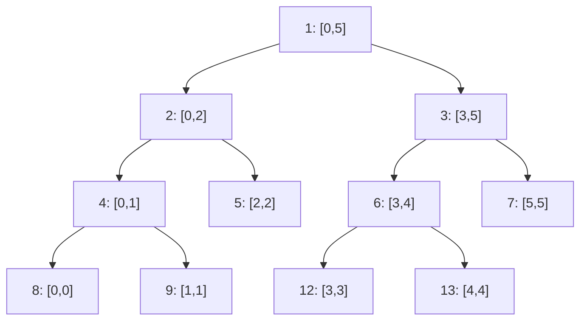

# Pattern 21: Segment Tree & Fenwick Tree

## 1. Pattern Name

**Segment Tree and Fenwick Tree** (also called Binary Indexed Tree, or BIT): data structures that answer range queries on an array **while the array changes**.

- A **segment tree** stores the answer for every range of a balanced binary split of the array. It supports any associative operation (sum, min, max, gcd, and more). With lazy propagation it also supports range updates.
- A **Fenwick tree** stores partial sums in one array and uses bit tricks to move between them. It is shorter and faster in practice. It supports prefix sums and point updates, and with extra work, range updates.

!!! info "Prerequisites"
    Read [Complexity Analysis](../foundations/01-complexity-analysis.md) for O(log n) reasoning. Read [Trees and Balanced BSTs](../foundations/05-trees-and-balanced-bsts.md) for tree terms (root, leaf, height). This page starts where [Pattern 04: Prefix Sum](../04-prefix-sum/README.md) stops. Pattern 04 answers range queries on an array that does not change. This page handles an array that does change. Pattern [09: Divide and Conquer](../09-divide-and-conquer/README.md) covers merge sort counting, which is the offline alternative to the Fenwick tree in Section 7.

---

## 2. Core Intuition

### What Interviewers Expect You to Think

A prefix sum array answers "sum of `a[l..r]`" in O(1), but one change to `a[i]` makes `prefix[i..n]` wrong. Repairing it costs O(n). If the input mixes `q` updates with `q` queries, the total cost is O(q * n). A plain loop per query also costs O(n). Both extremes are slow. The two structures on this page sit in the middle: **O(log n) for every update and every query**.

**The Key Insight:** Do not store all `n` prefix sums, and do not store nothing. Store the answers for a small set of ranges that has two properties:

1. Any query range is the disjoint union of O(log n) stored ranges.
2. Any single index belongs to only O(log n) stored ranges, so an update touches only O(log n) of them.

The segment tree picks the ranges from a **balanced binary split**: the root covers the whole array, and each node splits its range at the midpoint into a left child and a right child. The Fenwick tree picks ranges whose lengths are powers of two, chosen by the lowest set bit of the index.

### Terms Used on This Page

| Term | Meaning |
|---|---|
| Range query | A question about `a[l..r]`: its sum, minimum, maximum, and so on |
| Point update | Change one element `a[i]` |
| Range update | Change every element in `a[l..r]`, for example "add 5 to each" |
| Associative operation | An operation `op` with `(x op y) op z = x op (y op z)`. Sum, min, max, gcd, and XOR are associative. Segment trees need this property |
| Identity element | A value `e` with `e op x = x`. It is 0 for sum, `Integer.MAX_VALUE` for min, and `Integer.MIN_VALUE` for max |
| Commutative operation | An operation with `x op y = y op x`. Sum and min are commutative. String concatenation and matrix multiplication are not |
| Lowbit | `i & -i`: the value of the lowest set bit of `i`. For `i = 12` (binary `1100`), `lowbit = 4` (binary `100`) |
| Lazy propagation | A segment tree technique that stores a range update on a node and pushes it to the children only when a later operation needs the children |
| Coordinate compression | Replace each value by its rank among the distinct values, so that large or negative values become indices `0 .. m-1` |

### The Segment Tree for 6 Elements

Each node shows its range `[lo, hi]`. The node number is the array index in the code: the children of node `v` are `2v` and `2v + 1`.



To sum `a[1..4]`, the query takes node 9 (`[1,1]`), node 5 (`[2,2]`), and node 6 (`[3,4]`). Three stored values cover four elements exactly. For an array of `n` elements, the query takes O(log n) nodes.

### The Fenwick Tree for 8 Elements

The tree is one array `bit[1..8]` (1-indexed). Node `i` stores the sum of the `lowbit(i)` elements that end at index `i`.

```text
index i : 1    2    3    4    5    6    7    8
lowbit  : 1    2    1    4    1    2    1    8
bit[i]  : a1   a1+  a3   a1+  a5   a5+  a7   a1+
               a2        a2+       a6        a2+
                         a3+                 ...
                         a4                  a8

prefix(7): 7 -> 6 -> 4 -> 0   =  bit[7] + bit[6] + bit[4]
                              =  a7 + (a5+a6) + (a1+a2+a3+a4)
update(5): 5 -> 6 -> 8        =  bit[5], bit[6], bit[8] each change
```

---

## 3. Recognition Signals

### Keywords in Problem Statements

- "Range sum / range minimum / range maximum **query**" together with "**update**" or "**modify**" (LC 307)
- "Count the elements **before/after** index i that are smaller/larger" (LC 315, LC 493)
- "Count inversions" or "count pairs `(i, j)` with `i < j` and a condition on the two values" (LC 1649, LC 2426)
- "Add a value to every element in a range, then ask for a sum or a maximum" (LC 699)
- "Find the first position whose value is at least x" with updates in between
- A sequence of operations where each operation sees the effect of all earlier ones (online)

### Constraint Hints

- `n` and the number of operations `q` are both about 10^5. An O(n) operation gives about 10^10 steps in total. See the rule of thumb in [Complexity Analysis](../foundations/01-complexity-analysis.md).
- Values are large or negative (up to 10^9 or below zero), but you only need their relative order. This points to coordinate compression with a Fenwick tree.

### RED FLAGS: Not These Structures

| Situation | Better tool |
|---|---|
| The array never changes and the operation is a sum (or XOR) | A prefix sum array, [Pattern 04](../04-prefix-sum/README.md). O(1) per query, no tree |
| All range updates come first, all reads come after | A difference array, [Pattern 04](../04-prefix-sum/README.md). One pass at the end |
| Fixed-size windows moving left to right (max of every window) | Monotonic deque, [Pattern 07](../07-monotonic-stack-queue/README.md) |
| Only the final total count of inversions, no updates, no queries between | Merge sort counting, [Pattern 09](../09-divide-and-conquer/README.md). Same O(n log n), no compression step |
| You need a global minimum or maximum with inserts and deletes, not range queries | Heap, [Pattern 16](../16-heap-priority-queue/README.md) |

---

## 4. Brute Force Thought Process

### Approach A: Recompute Each Query

```text
Problem: array a of n numbers. Operations: set(i, v) and sum(l, r).

set(i, v): a[i] = v                   O(1)
sum(l, r): loop from l to r, add up   O(n)

Total for q operations: O(q * n)
```

### Approach B: Keep a Prefix Sum Array

```text
set(i, v): a[i] = v, then rebuild prefix[i..n]   O(n)
sum(l, r): prefix[r + 1] - prefix[l]             O(1)

Total for q operations: O(q * n)
```

### Why Both Time Out

Take `n = q = 10^5` with half updates and half queries. Both approaches do about `(q / 2) * n = 5 * 10^9` steps. At about 10^8 simple operations per second (an approximate rule of thumb), that is about 50 seconds.

Approach A is fast for updates and slow for queries. Approach B is the opposite. **The cost moves between the two operations, but the total stays at O(n) per pair.** The real task is to make both operations cheap at once.

---

## 5. Optimization Insight (The "Aha" Moment)

### Segment Tree Insight

**"Pre-compute the answer for every node of a balanced binary split of the array."**

- **Query:** Walk down from the root. If a node's range lies fully inside the query range, return its stored answer and stop. If the node's range does not overlap the query, return the identity element. Otherwise, ask both children.
- **Why O(log n):** At each level, at most two nodes are partially covered, because only the two ends of the query range can cut a node's range. A partially covered node asks its children, so each level visits at most 4 nodes. The tree has about `log2(n)` levels. The query does O(log n) work.
- **Update:** Change one leaf, then recompute the node on each level above it. The leaf-to-root path has about `log2(n)` nodes.

**Why the array has size `4n`:** A tree with `n` leaves has height `h = ceil(log2(n))`. Node numbers go up to less than `2^(h+1)`. Since `2^h < 2n`, `2^(h+1) < 4n`. Allocating `4 * n` is safe for every `n`.

### Fenwick Tree Insight

**"A prefix is a sequence of power-of-two blocks, and the binary form of the index names the blocks."**

Write the prefix length in binary. For `7 = 111`, the blocks are the last 1 element (`a7`), then the 2 elements before it (`a5, a6`), then the 4 elements before those (`a1..a4`). Each step removes the lowest set bit: `7 -> 6 -> 4 -> 0`. The step `i -= i & -i` does exactly that.

- **Why `i & -i` gives the lowest set bit:** Java stores `int` values in two's complement ([JLS 4.2.1](https://docs.oracle.com/javase/specs/jls/se21/html/jls-4.html#jls-4.2.1)). The value `-i` equals `~i + 1`. Write `i` as `X 1 0...0`, where the lowest set bit is followed by `k` zeros. Then `~i` is `~X 0 1...1`. Adding 1 carries through the `k` trailing ones and gives `-i = ~X 1 0...0`. The bits above the lowest set bit are inverted, and the lowest set bit and the zeros below it are unchanged. So `i & -i` is `0 1 0...0`: only the lowest set bit stays.
- **Query is O(log n):** Each step clears one set bit. The index has at most `log2(n) + 1` set bits.
- **Update goes the other way:** After a change at index `i`, the next node whose block contains `i` is at `i + lowbit(i)`. Each step moves to an index with a strictly larger lowbit, so the loop runs at most `log2(n) + 1` times.

!!! tip "Which to choose"
    Choose the Fenwick tree when the operation is a sum (or count, or XOR) with point updates. It has about 8 lines of code and a small constant factor. Choose the segment tree when the operation is min, max, or gcd with arbitrary updates, when you need range updates with range queries, or when each node must store more than one number.

---

## 6. Generalized Templates

All templates compile under JDK 21 and passed a randomized comparison with a brute-force version before they were written here: random arrays of 1 to 30 elements, mixed updates and queries, fixed seed. Each block is self-contained. Unless a template says otherwise, ranges are **inclusive** on both ends: `[l, r]`, 0-indexed.

### Template 1: Recursive Segment Tree (Build, Point Update, Range Sum)

```java
class SegmentTree {
    private final int n;
    private final long[] tree; // tree[1] is the root; children of node v are 2v and 2v + 1

    SegmentTree(int[] a) {
        n = a.length;
        tree = new long[Math.max(1, 4 * n)];
        if (n > 0) build(a, 1, 0, n - 1);
    }

    private void build(int[] a, int node, int lo, int hi) {
        if (lo == hi) {
            tree[node] = a[lo];
            return;
        }
        int mid = lo + (hi - lo) / 2;
        build(a, 2 * node, lo, mid);
        build(a, 2 * node + 1, mid + 1, hi);
        tree[node] = tree[2 * node] + tree[2 * node + 1];
    }

    // Sets a[i] = value.
    void set(int i, int value) {
        set(1, 0, n - 1, i, value);
    }

    private void set(int node, int lo, int hi, int i, int value) {
        if (lo == hi) {
            tree[node] = value;
            return;
        }
        int mid = lo + (hi - lo) / 2;
        if (i <= mid) set(2 * node, lo, mid, i, value);
        else set(2 * node + 1, mid + 1, hi, i, value);
        tree[node] = tree[2 * node] + tree[2 * node + 1];
    }

    // Sum of a[l..r], both ends inclusive.
    long query(int l, int r) {
        return query(1, 0, n - 1, l, r);
    }

    private long query(int node, int lo, int hi, int l, int r) {
        if (r < lo || hi < l) return 0;               // disjoint: identity of +
        if (l <= lo && hi <= r) return tree[node];    // fully inside: use the stored sum
        int mid = lo + (hi - lo) / 2;
        return query(2 * node, lo, mid, l, r) + query(2 * node + 1, mid + 1, hi, l, r);
    }
}
```

- **Complexity:** `build` is O(n): each of the about `2n` nodes is computed once. `set` and `query` are O(log n), as shown in Section 5. Space is O(n), at most `4n` longs.
- **Three cases in `query`:** disjoint (return the identity of the operation), fully inside (return the stored value), partial overlap (split). This shape is the same for every operation. To change the operation, change the identity value and the combine line.
- **`long` for sums:** the sum of 10^5 values near 10^9 does not fit in an `int`. The stored values are `long` and the input is `int`.
- **`mid = lo + (hi - lo) / 2`** avoids `int` overflow when `lo + hi` is large. For array indices it does not matter, but the habit prevents a bug in Template 11.

### Template 2: Iterative (Bottom-Up) Segment Tree for Any Associative Operation

```java
import java.util.function.BinaryOperator;

// Bottom-up segment tree. op must be associative. It does not need to be commutative.
class IterativeSegmentTree<T> {
    private final int n;
    private final Object[] t;      // leaves are t[n .. 2n - 1]; node v has children 2v and 2v + 1
    private final BinaryOperator<T> op;
    private final T identity;      // identity.op(x) == x.op(identity) == x

    @SuppressWarnings("unchecked")
    IterativeSegmentTree(T[] a, BinaryOperator<T> op, T identity) {
        this.n = a.length;
        this.op = op;
        this.identity = identity;
        this.t = new Object[2 * Math.max(1, n)];
        for (int i = 0; i < n; i++) t[n + i] = a[i];
        for (int v = n - 1; v >= 1; v--) t[v] = op.apply((T) t[2 * v], (T) t[2 * v + 1]);
    }

    @SuppressWarnings("unchecked")
    void set(int i, T value) {
        int v = i + n;
        t[v] = value;
        for (v >>= 1; v >= 1; v >>= 1) t[v] = op.apply((T) t[2 * v], (T) t[2 * v + 1]);
    }

    // Combines a[l .. r - 1] in index order. The range is half-open: [l, r).
    @SuppressWarnings("unchecked")
    T query(int l, int r) {
        T left = identity;   // result of the pieces taken on the left edge
        T right = identity;  // result of the pieces taken on the right edge
        for (l += n, r += n; l < r; l >>= 1, r >>= 1) {
            if ((l & 1) == 1) left = op.apply(left, (T) t[l++]);
            if ((r & 1) == 1) right = op.apply((T) t[--r], right);
        }
        return op.apply(left, right);
    }
}
```

How it works:

- The leaves sit at `t[n .. 2n - 1]`. Node `v` has children `2v` and `2v + 1`, so the build is one loop from `n - 1` down to 1. There are no recursion and no `4n` array: space is `2n`.
- `query(l, r)` uses the half-open range `[l, r)`. After `l += n; r += n`, the loop looks at the two boundary nodes of the current level. If `l` is odd, `t[l]` is a right child. Its parent also covers the element before `l`, which is outside the range. So the loop takes `t[l]` alone and moves `l` to `l + 1`. If `r` is odd, `r - 1` is a left child. Its parent also covers `r`, which is outside the half-open range. So the loop takes `t[r - 1]` alone. After that, both indices move up one level (`>>= 1`).
- **Order of results:** pieces taken on the left edge are combined in `left`, in increasing index order. Pieces taken on the right edge go into `right`, in decreasing index order, so each new piece is placed **before** the old `right`. The final `op(left, right)` is in index order. This is why the code works for non-commutative operations such as string concatenation.
- **Any `n`:** The tree works when `n` is not a power of two. Some internal nodes then combine leaves from both ends of the array. The query loop never takes those nodes, because it only takes nodes whose leaves lie inside `[l, r)`.
- **Complexity:** `set` and `query` are O(log n). Build is O(n).
- **The `Object[]`** is a Java detail: Java cannot create a generic array `new T[...]`. For a fixed type, replace `T` with `long` or `int` and use a primitive array. That removes the casts and the boxing.

Primitive version for a **sum** (the form to write in an interview):

```java
long[] t;
int n;

void init(int[] a) {
    n = a.length;
    t = new long[2 * n];
    for (int i = 0; i < n; i++) t[n + i] = a[i];
    for (int v = n - 1; v >= 1; v--) t[v] = t[2 * v] + t[2 * v + 1];
}

void set(int i, int value) {
    for (t[i += n] = value; i > 1; i >>= 1) t[i >> 1] = t[i] + t[i ^ 1];
}

long query(int l, int r) { // half-open [l, r)
    long res = 0;
    for (l += n, r += n; l < r; l >>= 1, r >>= 1) {
        if ((l & 1) == 1) res += t[l++];
        if ((r & 1) == 1) res += t[--r];
    }
    return res;
}
```

### Template 3: Lazy Propagation (Range Add, Range Sum)

```java
class LazySegmentTree {
    private final int n;
    private final long[] sum;  // sum[v]: true sum of the range, with v's own pending add
    private final long[] add;  // add[v]: amount not yet pushed to the children of v

    LazySegmentTree(int[] a) {
        n = a.length;
        sum = new long[Math.max(1, 4 * n)];
        add = new long[Math.max(1, 4 * n)];
        if (n > 0) build(a, 1, 0, n - 1);
    }

    private void build(int[] a, int node, int lo, int hi) {
        if (lo == hi) {
            sum[node] = a[lo];
            return;
        }
        int mid = lo + (hi - lo) / 2;
        build(a, 2 * node, lo, mid);
        build(a, 2 * node + 1, mid + 1, hi);
        sum[node] = sum[2 * node] + sum[2 * node + 1];
    }

    // Applies "add value to every element" to one node and records it as pending.
    private void apply(int node, int len, long value) {
        sum[node] += value * len;
        add[node] += value;
    }

    // Moves the pending add of a node down to its two children.
    private void push(int node, int lo, int hi) {
        if (add[node] == 0) return;
        int mid = lo + (hi - lo) / 2;
        apply(2 * node, mid - lo + 1, add[node]);
        apply(2 * node + 1, hi - mid, add[node]);
        add[node] = 0;
    }

    // Adds value to a[l..r], both ends inclusive.
    void rangeAdd(int l, int r, long value) {
        rangeAdd(1, 0, n - 1, l, r, value);
    }

    private void rangeAdd(int node, int lo, int hi, int l, int r, long value) {
        if (r < lo || hi < l) return;
        if (l <= lo && hi <= r) {
            apply(node, hi - lo + 1, value);
            return;
        }
        push(node, lo, hi);
        int mid = lo + (hi - lo) / 2;
        rangeAdd(2 * node, lo, mid, l, r, value);
        rangeAdd(2 * node + 1, mid + 1, hi, l, r, value);
        sum[node] = sum[2 * node] + sum[2 * node + 1];
    }

    // Sum of a[l..r], both ends inclusive.
    long rangeSum(int l, int r) {
        return rangeSum(1, 0, n - 1, l, r);
    }

    private long rangeSum(int node, int lo, int hi, int l, int r) {
        if (r < lo || hi < l) return 0;
        if (l <= lo && hi <= r) return sum[node];
        push(node, lo, hi);
        int mid = lo + (hi - lo) / 2;
        return rangeSum(2 * node, lo, mid, l, r) + rangeSum(2 * node + 1, mid + 1, hi, l, r);
    }
}
```

The idea in four rules:

1. **`sum[v]` is always correct for node `v`, including adds that are pending at `v` itself.** The pending add `add[v]` is the amount that the children of `v` do not know yet.
2. **A range update that covers a node completely stops at that node.** It calls `apply`, which fixes `sum[v]` and records the add in `add[v]`. The children stay stale.
3. **`push` before visiting the children.** An operation that must go below a node first moves the node's pending add down to both children, then clears it.
4. **After the recursive calls of an update, recompute `sum[v]` from the children.**

- **Complexity:** `rangeAdd` and `rangeSum` are O(log n). They visit at most 4 nodes per level, and each visited node does O(1) work for `push`.
- **What makes lazy propagation possible:** (a) the effect of an update on a node's stored answer must be computable from the tag and the node's length (here: add `value * length` to a sum), and (b) two tags must combine into one tag (here: add the amounts). If either fails, the technique does not apply directly.

### Template 4: Lazy Propagation with Range Assign

```java
// Range assign ("set every element in [l, r] to value") and range sum.
// The pending tag is "assign", not "add", so it needs a flag that says "no pending tag".
class AssignSegmentTree {
    private final int n;
    private final long[] sum;
    private final long[] tag;       // pending assigned value, valid only if hasTag[v]
    private final boolean[] hasTag;

    AssignSegmentTree(int[] a) {
        n = a.length;
        sum = new long[Math.max(1, 4 * n)];
        tag = new long[Math.max(1, 4 * n)];
        hasTag = new boolean[Math.max(1, 4 * n)];
        if (n > 0) build(a, 1, 0, n - 1);
    }

    private void build(int[] a, int node, int lo, int hi) {
        if (lo == hi) {
            sum[node] = a[lo];
            return;
        }
        int mid = lo + (hi - lo) / 2;
        build(a, 2 * node, lo, mid);
        build(a, 2 * node + 1, mid + 1, hi);
        sum[node] = sum[2 * node] + sum[2 * node + 1];
    }

    private void apply(int node, int len, long value) {
        sum[node] = value * len;
        tag[node] = value;      // a new assign replaces any older pending assign
        hasTag[node] = true;
    }

    private void push(int node, int lo, int hi) {
        if (!hasTag[node]) return;
        int mid = lo + (hi - lo) / 2;
        apply(2 * node, mid - lo + 1, tag[node]);
        apply(2 * node + 1, hi - mid, tag[node]);
        hasTag[node] = false;
    }

    void assign(int l, int r, long value) {
        assign(1, 0, n - 1, l, r, value);
    }

    private void assign(int node, int lo, int hi, int l, int r, long value) {
        if (r < lo || hi < l) return;
        if (l <= lo && hi <= r) {
            apply(node, hi - lo + 1, value);
            return;
        }
        push(node, lo, hi);
        int mid = lo + (hi - lo) / 2;
        assign(2 * node, lo, mid, l, r, value);
        assign(2 * node + 1, mid + 1, hi, l, r, value);
        sum[node] = sum[2 * node] + sum[2 * node + 1];
    }

    long rangeSum(int l, int r) {
        return rangeSum(1, 0, n - 1, l, r);
    }

    private long rangeSum(int node, int lo, int hi, int l, int r) {
        if (r < lo || hi < l) return 0;
        if (l <= lo && hi <= r) return sum[node];
        push(node, lo, hi);
        int mid = lo + (hi - lo) / 2;
        return rangeSum(2 * node, lo, mid, l, r) + rangeSum(2 * node + 1, mid + 1, hi, l, r);
    }
}
```

- **A new kind of tag needs a new rule for combining.** Two adds become one add. Two assigns become the **later** assign: the code overwrites `tag[node]` in `apply`. An assign needs `hasTag`, because every `long` value, including 0, is a possible assigned value.
- **Both operations on one tree:** If a tree supports both "add" and "assign", the tag becomes a pair. An assign clears the pending add. An add after a pending assign adds to the assigned value. Keep the order rule in mind when you write it.
- **Complexity:** O(log n) per operation, same as Template 3.

### Template 5: Fenwick Tree (Point Update, Prefix Sum, Range Sum, k-th Element)

```java
class FenwickTree {
    private final int n;
    private final long[] bit; // bit[i] (1-indexed): sum of the lowbit(i) elements ending at i

    FenwickTree(int n) {
        this.n = n;
        this.bit = new long[n + 1];
    }

    // Builds from an array in O(n): push each finished node into its parent.
    FenwickTree(int[] a) {
        this(a.length);
        for (int i = 1; i <= n; i++) {
            bit[i] += a[i - 1];
            int parent = i + (i & -i);
            if (parent <= n) bit[parent] += bit[i];
        }
    }

    // a[i] += delta, with i 0-indexed.
    void add(int i, long delta) {
        for (i++; i <= n; i += i & -i) bit[i] += delta;
    }

    // Sum of a[0..i], with i 0-indexed. Returns 0 if i < 0.
    long prefix(int i) {
        long s = 0;
        for (i++; i > 0; i -= i & -i) s += bit[i];
        return s;
    }

    // Sum of a[l..r], both ends inclusive.
    long range(int l, int r) {
        return prefix(r) - prefix(l - 1);
    }

    // Smallest 0-indexed i with prefix(i) >= k. Requires every a[i] >= 0 and k >= 1.
    // Returns n if the total is less than k.
    int lowerBound(long k) {
        int pos = 0;
        for (int step = Integer.highestOneBit(Math.max(1, n)); step > 0; step >>= 1) {
            if (pos + step <= n && bit[pos + step] < k) {
                pos += step;
                k -= bit[pos];
            }
        }
        return pos; // pos elements have prefix sum < k, so the answer is the next one: index pos
    }
}
```

- **Complexity:** `add` and `prefix` are O(log n). The array constructor is O(n): it pushes each finished node into its parent at `i + lowbit(i)`. Building with `n` calls to `add` costs O(n log n).
- **`range(l, r)` is `prefix(r) - prefix(l - 1)`.** This works because the operation (sum) has an inverse (subtraction). **Min and max have no inverse**, so a Fenwick tree cannot answer a general range min query by subtraction.
- **Setting a value** needs a delta: `add(i, newValue - oldValue)`. The tree has no "set". Keep the current array next to the tree.
- **`lowerBound(k)` descends the implicit tree**: it tries the largest block first (`step = highestOneBit(n)`), takes the block if its sum is below `k`, then tries smaller blocks. It finds the smallest index whose prefix sum reaches `k` in O(log n) total, instead of O(log^2 n) with binary search over `prefix`. It needs all stored values to be at least 0, so the prefix sums are non-decreasing. Use it for "k-th smallest element in a dynamic multiset": store a count per value and call `lowerBound(k)`.
- **Index 0 is the main trap.** The Fenwick tree is 1-indexed inside because `0 & -0 = 0`, so `i += i & -i` would loop forever at `i = 0`. The methods here take 0-indexed arguments and add 1 first.

### Template 6: Range Add and Range Sum with Two Fenwick Trees

```java
// Range add and range sum with two Fenwick trees.
class RangeFenwick {
    private final int n;
    private final long[] b1; // holds the difference array d
    private final long[] b2; // holds d[i] * (i - 1), with i 1-indexed

    RangeFenwick(int n) {
        this.n = n;
        this.b1 = new long[n + 2];
        this.b2 = new long[n + 2];
    }

    private void update(long[] b, int i, long delta) {
        for (; i <= n; i += i & -i) b[i] += delta;
    }

    private long query(long[] b, int i) {
        long s = 0;
        for (; i > 0; i -= i & -i) s += b[i];
        return s;
    }

    // a[l..r] += value, 0-indexed, both ends inclusive.
    void rangeAdd(int l, int r, long value) {
        l++;
        r++;
        update(b1, l, value);
        update(b1, r + 1, -value);
        update(b2, l, value * (l - 1));
        update(b2, r + 1, -value * r);
    }

    // Sum of a[0..i] after all adds, i 0-indexed.
    private long prefix(int i) {
        i++;
        return query(b1, i) * i - query(b2, i);
    }

    long rangeSum(int l, int r) {
        return prefix(r) - prefix(l - 1);
    }
}
```

Derivation:

- Let `d` be the difference array: `d[i] = a[i] - a[i-1]` (1-indexed, `a[0] = 0`). Then `a[i] = d[1] + ... + d[i]`. A range add of `v` on `[l, r]` is two point updates on `d`: `d[l] += v` and `d[r + 1] -= v`.
- The prefix sum of `a` up to `i` (1-indexed) is the sum of `a[1] + ... + a[i]`. Each `a[j]` is the sum of `d[1..j]`, so `d[k]` appears in `a[k], a[k + 1], ..., a[i]`. That is `i - k + 1` terms. So `prefix(i) = sum over k <= i of d[k] * (i - (k - 1))`. Split the product: `i * (sum of d[k]) - (sum of d[k] * (k - 1))`.
- So tree `b1` stores `d[k]` and tree `b2` stores `d[k] * (k - 1)`. The code computes `query(b1, i) * i - query(b2, i)`. In the code, `i` is already shifted to 1-indexed. The two updates at `r + 1` cancel the add beyond `r`: `-value` in `b1` and `-value * r` in `b2`, because `(r + 1) - 1 = r`.
- **Complexity:** O(log n) per operation, space 2 arrays of `n + 2` longs. The code starts with all zeros. To start from an array `a`, call `rangeAdd(i, i, a[i])` for each `i`.

### Template 7: Coordinate Compression, Count Smaller After Self, Inversions

```java
import java.util.Arrays;
import java.util.List;
import java.util.ArrayList;

class Counting {
    // The same Fenwick tree as Template 5, cut down to the two operations that counting needs.
    private static class Bit {
        private final long[] bit;

        Bit(int n) {
            bit = new long[n + 1];
        }

        void add(int i, long delta) { // i is 0-indexed
            for (i++; i < bit.length; i += i & -i) bit[i] += delta;
        }

        long prefix(int i) { // sum of cells 0..i; 0 if i < 0
            long s = 0;
            for (i++; i > 0; i -= i & -i) s += bit[i];
            return s;
        }
    }

    // Coordinate compression: returns ranks in 0 .. m-1, where m is the number of distinct values.
    // Equal values get equal ranks, and the order of ranks follows the order of values.
    int[] compress(int[] a) {
        int[] sorted = a.clone();
        Arrays.sort(sorted);
        int m = 0;
        for (int i = 0; i < sorted.length; i++) {
            if (i == 0 || sorted[i] != sorted[i - 1]) sorted[m++] = sorted[i];
        }
        int[] rank = new int[a.length];
        for (int i = 0; i < a.length; i++) rank[i] = Arrays.binarySearch(sorted, 0, m, a[i]);
        return rank;
    }

    // LeetCode 315: result[i] = number of j > i with nums[j] < nums[i].
    List<Integer> countSmaller(int[] nums) {
        int n = nums.length;
        int[] rank = compress(nums);
        Bit seen = new Bit(n); // seen.add(r, 1) records one value of rank r
        Integer[] result = new Integer[n];
        for (int i = n - 1; i >= 0; i--) {
            result[i] = (int) seen.prefix(rank[i] - 1); // already-seen values with smaller rank
            seen.add(rank[i], 1);
        }
        return new ArrayList<>(Arrays.asList(result));
    }

    // Number of pairs (i, j) with i < j and a[i] > a[j].
    long countInversions(int[] a) {
        int[] rank = compress(a);
        Bit seen = new Bit(a.length);
        long inversions = 0;
        for (int j = 0; j < a.length; j++) {
            inversions += j - seen.prefix(rank[j]); // j earlier values minus those <= a[j]
            seen.add(rank[j], 1);
        }
        return inversions;
    }
}
```

- **Compression:** sort, remove duplicates, and replace each value by its position in the sorted distinct list (`Arrays.binarySearch` on the deduplicated range). Equal values get equal ranks. The order of ranks equals the order of values. Cost: O(n log n) for the sort, O(log n) per lookup.
- **Why deduplicate first:** if the sorted array contains duplicates, `Arrays.binarySearch` may return the index of any of them ([javadoc](https://docs.oracle.com/en/java/javase/21/docs/api/java.base/java/util/Arrays.html#binarySearch(int%5B%5D,int,int,int))). The rank would not be stable.
- **`countSmaller` (LC 315):** scan from right to left. The Fenwick tree holds one count per rank for the elements already seen, which are exactly the elements to the right. `prefix(rank - 1)` is the number of seen elements with a strictly smaller rank, so strictly smaller value.
- **`countInversions`:** scan from left to right. After `j` elements are inserted, `prefix(rank[j])` counts earlier elements with value `<= a[j]`. The other `j - prefix(rank[j])` earlier elements are strictly greater, and each forms an inversion with `a[j]`.
- **Complexity:** O(n log n) time and O(n) space for both.
- **Why `Bit` is nested here:** each block on this page must compile alone, so `Counting` carries a two-method copy of the Fenwick tree from Template 5. In an interview, use one Fenwick class.

### Template 8: Segment Tree Descent (First Index with Value at Least x)

```java
// Point update, range max, and "first index at or after 'from' whose value is >= x".
class MaxSegmentTree {
    private final int n;
    private final int[] mx;

    MaxSegmentTree(int[] a) {
        n = a.length;
        mx = new int[Math.max(1, 4 * n)];
        if (n > 0) build(a, 1, 0, n - 1);
    }

    private void build(int[] a, int node, int lo, int hi) {
        if (lo == hi) {
            mx[node] = a[lo];
            return;
        }
        int mid = lo + (hi - lo) / 2;
        build(a, 2 * node, lo, mid);
        build(a, 2 * node + 1, mid + 1, hi);
        mx[node] = Math.max(mx[2 * node], mx[2 * node + 1]);
    }

    void set(int i, int value) {
        set(1, 0, n - 1, i, value);
    }

    private void set(int node, int lo, int hi, int i, int value) {
        if (lo == hi) {
            mx[node] = value;
            return;
        }
        int mid = lo + (hi - lo) / 2;
        if (i <= mid) set(2 * node, lo, mid, i, value);
        else set(2 * node + 1, mid + 1, hi, i, value);
        mx[node] = Math.max(mx[2 * node], mx[2 * node + 1]);
    }

    int max(int l, int r) {
        return max(1, 0, n - 1, l, r);
    }

    private int max(int node, int lo, int hi, int l, int r) {
        if (r < lo || hi < l) return Integer.MIN_VALUE;
        if (l <= lo && hi <= r) return mx[node];
        int mid = lo + (hi - lo) / 2;
        return Math.max(max(2 * node, lo, mid, l, r), max(2 * node + 1, mid + 1, hi, l, r));
    }

    // Smallest index i >= from with a[i] >= x, or -1 if none exists. O(log n).
    int firstAtLeast(int from, int x) {
        return firstAtLeast(1, 0, n - 1, from, x);
    }

    private int firstAtLeast(int node, int lo, int hi, int from, int x) {
        if (hi < from || mx[node] < x) return -1;   // out of range, or no value here is big enough
        if (lo == hi) return lo;
        int mid = lo + (hi - lo) / 2;
        int found = firstAtLeast(2 * node, lo, mid, from, x);
        if (found != -1) return found;
        return firstAtLeast(2 * node + 1, mid + 1, hi, from, x);
    }
}
```

- A max tree stores the maximum of each range in `mx[node]`. The `max` query is the Template 1 query with `Integer.MIN_VALUE` as the identity.
- **`firstAtLeast(from, x)`** descends instead of querying. A node whose maximum is below `x` cannot contain the answer, so the code skips it. The code tries the left child first, so the first hit is the smallest index. The `hi < from` check skips nodes that lie fully before `from`.
- **Complexity:** O(log n). Per level, at most one node straddles the index `from`, and the code may explore both of its children. Every other node on the way is either rejected in O(1) (out of range, or maximum below `x`) or contains a valid answer, and the descent into it does not backtrack: the left child returns `-1` in O(1) if its maximum is below `x`.
- **Use:** "find the leftmost bin that fits an item of size x" (a bin-packing greedy), "find the first building taller than h" (LC 2940), and "booking" problems (LC 2286, where `gather` finds the first row with at least `k` free seats by descent on a max tree, and `scatter` uses a range sum plus updates). In the general case, LC 2940 asks for the leftmost building after `max(a, b)` that is taller than `max(heights[a], heights[b])`, which is `firstAtLeast(max(a, b) + 1, h + 1)` on a max tree. The same shape works for min trees and sum trees with non-negative values.

### Template 9: Segment Tree Whose Nodes Store Several Numbers

```java
// A node stores four numbers, so that two adjacent segments can merge in O(1).
class MaxSubarrayTree {
    private static class Node {
        long sum, bestPrefix, bestSuffix, best; // each best value is for a non-empty piece

        Node(long v) {
            sum = bestPrefix = bestSuffix = best = v;
        }

        Node(Node a, Node b) {
            sum = a.sum + b.sum;
            bestPrefix = Math.max(a.bestPrefix, a.sum + b.bestPrefix);
            bestSuffix = Math.max(b.bestSuffix, b.sum + a.bestSuffix);
            best = Math.max(Math.max(a.best, b.best), a.bestSuffix + b.bestPrefix);
        }
    }

    private final int n;
    private final Node[] tree;

    MaxSubarrayTree(int[] a) {
        n = a.length;
        tree = new Node[Math.max(1, 4 * n)];
        if (n > 0) build(a, 1, 0, n - 1);
    }

    private void build(int[] a, int node, int lo, int hi) {
        if (lo == hi) {
            tree[node] = new Node(a[lo]);
            return;
        }
        int mid = lo + (hi - lo) / 2;
        build(a, 2 * node, lo, mid);
        build(a, 2 * node + 1, mid + 1, hi);
        tree[node] = new Node(tree[2 * node], tree[2 * node + 1]);
    }

    void set(int i, int value) {
        set(1, 0, n - 1, i, value);
    }

    private void set(int node, int lo, int hi, int i, int value) {
        if (lo == hi) {
            tree[node] = new Node(value);
            return;
        }
        int mid = lo + (hi - lo) / 2;
        if (i <= mid) set(2 * node, lo, mid, i, value);
        else set(2 * node + 1, mid + 1, hi, i, value);
        tree[node] = new Node(tree[2 * node], tree[2 * node + 1]);
    }

    // Largest sum of a non-empty contiguous subarray inside a[l..r].
    long maxSubarray(int l, int r) {
        return query(1, 0, n - 1, l, r).best;
    }

    private Node query(int node, int lo, int hi, int l, int r) {
        if (l <= lo && hi <= r) return tree[node];
        int mid = lo + (hi - lo) / 2;
        if (r <= mid) return query(2 * node, lo, mid, l, r);
        if (l > mid) return query(2 * node + 1, mid + 1, hi, l, r);
        return new Node(query(2 * node, lo, mid, l, r), query(2 * node + 1, mid + 1, hi, l, r));
    }
}
```

- A node stores four numbers for its range: the total `sum`, the best non-empty `bestPrefix`, the best non-empty `bestSuffix`, and the `best` non-empty subarray. Two adjacent segments merge in O(1):
  - `best = max(left.best, right.best, left.bestSuffix + right.bestPrefix)`. The last term is a subarray that crosses the midpoint.
  - `bestPrefix = max(left.bestPrefix, left.sum + right.bestPrefix)`, and `bestSuffix` is the mirror.
- **Complexity:** O(log n) per query and update. The merge is associative but not commutative, so the query must combine the left part before the right part. The code does that, and it never needs an identity element, because the query returns a stored node or merges two non-empty answers.
- **This is divide and conquer made reusable.** The one-shot version of the same merge is the divide-and-conquer solution to LC 53 in [Pattern 09](../09-divide-and-conquer/README.md). The tree keeps the intermediate answers so that updates cost O(log n).

### Template 10: 2D Fenwick Tree

```java
class Fenwick2D {
    private final int rows, cols;
    private final long[][] bit;

    Fenwick2D(int rows, int cols) {
        this.rows = rows;
        this.cols = cols;
        this.bit = new long[rows + 1][cols + 1];
    }

    // cell[r][c] += delta, 0-indexed.
    void add(int r, int c, long delta) {
        for (int i = r + 1; i <= rows; i += i & -i)
            for (int j = c + 1; j <= cols; j += j & -j) bit[i][j] += delta;
    }

    // Sum of the rectangle from (0, 0) to (r, c), both inclusive. Returns 0 if r < 0 or c < 0.
    long prefix(int r, int c) {
        long s = 0;
        for (int i = r + 1; i > 0; i -= i & -i)
            for (int j = c + 1; j > 0; j -= j & -j) s += bit[i][j];
        return s;
    }

    // Sum of the rectangle with corners (r1, c1) and (r2, c2), inclusive.
    long rect(int r1, int c1, int r2, int c2) {
        return prefix(r2, c2) - prefix(r1 - 1, c2) - prefix(r2, c1 - 1) + prefix(r1 - 1, c1 - 1);
    }
}
```

- The loop over rows and the loop over columns each follow the 1D rule, so the cost is O(log(rows) * log(cols)) per operation.
- **Rectangle sum** is inclusion and exclusion over four prefixes, the same formula as the 2D prefix sum in [Pattern 04](../04-prefix-sum/README.md).
- **Use:** LC 308 (Range Sum Query 2D - Mutable). Space is O(rows * cols).

### Template 11: Dynamic (Sparse) Segment Tree

```java
// Sparse (dynamic) segment tree over the index range [0, size - 1]. Nodes exist only when touched.
// Point add and range sum. Use it when size is about 10^9 and only a few indices change.
class DynamicSegmentTree {
    private static class Node {
        long sum;
        Node left, right; // null means "this whole range still holds zero"
    }

    private final int size;
    private final Node root = new Node();

    DynamicSegmentTree(int size) {
        this.size = size;
    }

    void add(int i, long delta) {
        Node node = root;
        int lo = 0, hi = size - 1;
        while (true) {
            node.sum += delta;
            if (lo == hi) return;
            int mid = lo + (hi - lo) / 2;
            if (i <= mid) {
                if (node.left == null) node.left = new Node();
                node = node.left;
                hi = mid;
            } else {
                if (node.right == null) node.right = new Node();
                node = node.right;
                lo = mid + 1;
            }
        }
    }

    long query(int l, int r) {
        return query(root, 0, size - 1, l, r);
    }

    private long query(Node node, int lo, int hi, int l, int r) {
        if (node == null || r < lo || hi < l) return 0;
        if (l <= lo && hi <= r) return node.sum;
        int mid = lo + (hi - lo) / 2;
        return query(node.left, lo, mid, l, r) + query(node.right, mid + 1, hi, l, r);
    }
}
```

- **Problem it solves:** the index range is huge (for example `[0, 10^9]`), but only a few indices ever change. A normal tree would need `4 * 10^9` slots. The dynamic tree creates a node only when an update reaches it. A missing child means "everything below here is still zero".
- **Complexity:** each `add` creates at most `log2(size) + 1` nodes, so `m` updates use O(m log size) space. `add` and `query` are O(log size).
- **Alternative:** coordinate compression (Template 7) when you know all indices in advance (offline). Use the dynamic tree when the indices arrive online.
- **Use:** counting intervals and calendar problems, for example LC 732 (My Calendar III, Hard) and LC 715 (Range Module, Hard), where the operation is a range assign or range add. Those need lazy tags on the dynamic nodes. This template shows only the structure with point updates.

### Template 12: Sqrt Decomposition (Comparison Baseline)

```java
class SqrtDecomposition {
    private final int[] a;
    private final long[] blockSum;
    private final int blockSize;

    SqrtDecomposition(int[] values) {
        a = values.clone();
        blockSize = Math.max(1, (int) Math.sqrt(a.length));
        blockSum = new long[(a.length + blockSize - 1) / blockSize];
        for (int i = 0; i < a.length; i++) blockSum[i / blockSize] += a[i];
    }

    // O(1): fix the one block that holds i.
    void set(int i, int value) {
        blockSum[i / blockSize] += value - a[i];
        a[i] = value;
    }

    // O(sqrt n): partial blocks element by element, whole blocks by their stored sum.
    long query(int l, int r) {
        long s = 0;
        int bl = l / blockSize, br = r / blockSize;
        if (bl == br) {
            for (int i = l; i <= r; i++) s += a[i];
            return s;
        }
        for (int i = l; i < (bl + 1) * blockSize; i++) s += a[i];
        for (int b = bl + 1; b < br; b++) s += blockSum[b];
        for (int i = br * blockSize; i <= r; i++) s += a[i];
        return s;
    }
}
```

- Split the array into blocks of size about `sqrt(n)`. Store the sum of each block. A point update fixes one block sum in O(1). A query sums at most two partial blocks element by element (at most `2 * sqrt(n)` elements) and the whole blocks in between (at most `sqrt(n)` blocks): O(sqrt n).
- **When it wins:** operations that are hard to put in a tree, such as "number of distinct values in a block", or operations whose per-block summary is complex. It needs no structure beyond arrays.
- **When it loses:** for plain sums and min/max, O(log n) beats O(sqrt n). For `n = 10^5`, `sqrt n` is about 316 and `log2 n` is about 17.

### Complexity Summary

| Structure | Build | Point update | Range query | Range update | Space |
|---|---|---|---|---|---|
| Brute force (array) | O(1) | O(1) | O(n) | O(n) | O(n) |
| Prefix sum array | O(n) | O(n) | O(1) | O(n) | O(n) |
| Sqrt decomposition | O(n) | O(1) for sums | O(sqrt n) | O(sqrt n) with block tags | O(n) |
| Fenwick tree (sum) | O(n) | O(log n) | O(log n) | O(log n) with two trees, range sum | O(n) |
| Segment tree | O(n) | O(log n) | O(log n) | O(log n) with lazy propagation | O(n), up to `4n` |

---

## 7. Variations of the Pattern

### Variation A: Other Operations (Min, Max, GCD, XOR, Product Modulo)

Replace the identity element and the combine line. The operation must be associative. Use `Integer.MAX_VALUE` as the identity for min, `Integer.MIN_VALUE` for max, and 0 for gcd and XOR. **Check overflow when the identity takes part in arithmetic:** `MAX_VALUE + 1` wraps around. If you only compare (min, max), it is safe. A Fenwick tree works for min or max only when values change in one direction (a prefix max where values only increase), because it cannot undo an older value.

### Variation B: Descent and Search

Use the tree shape itself: "first index with value at least x" (Template 8), "k-th element" (Template 5 `lowerBound`). O(log n) instead of a binary search over queries, which would cost O(log^2 n).

### Variation C: Nodes with Several Fields

When one number per range is not enough, store a small record and write a merge function (Template 9). Typical records: (sum, best prefix, best suffix, best), (minimum, count of the minimum), (length of the longest run, prefix run, suffix run).

### Variation D: Range Update with Range Query

Lazy segment tree (Templates 3 and 4) or two Fenwick trees (Template 6, sum only). For min or max with range add, the tag is still an add, and the node update is `mx[node] += value` with no multiplication by length.

### Variation E: Counting Pairs by Order (Fenwick over Compressed Values)

For "count pairs `(i, j)`, `i < j`, with a condition on `a[i]` and `a[j]`", scan in index order. Before inserting `a[j]`, query how many earlier values satisfy the condition, then insert `a[j]`. The condition must translate to a **prefix of ranks**. Examples:

- `a[i] > a[j]`: inversions (Template 7).
- `a[i] > 2 * a[j]` (LC 493): compress both `a` and `2 * a` together, in `long`, so that you can look up the rank of `2 * a[j]` as a boundary.
- `P[j] - upper <= P[i] <= P[j] - lower` on prefix sums `P` (LC 327): compress `P`, and also `P[j] - upper` and `P[j] - lower`. Query the range of ranks.
- `d[i] <= d[j] + diff` where `d[i] = nums1[i] - nums2[i]` (LC 2426): the boundary `d[j] + diff` is not in the set of `d` values, so find its rank with a binary search.

### Variation F: Fenwick Tree as a DP Accelerator

When a DP transition is "take the best (or the sum) over all earlier states with a smaller key", a Fenwick tree over the keys turns an O(n) transition into O(log n). Example: LC 673 (number of longest increasing subsequences) stores a pair (best length, count) in a Fenwick tree that does prefix max by length and adds the counts for equal lengths. This is valid because the stored values only improve. The same idea with a max segment tree solves LC 2407. See [Pattern 15: Dynamic Programming](../15-dynamic-programming/README.md).

### Variation G: Positions that Move (LC 1409)

The queries ask for the current position of an element, and an operation moves the element to the front. Use a Fenwick tree with 1 at every occupied slot. Let `q` be the number of queries and reserve `q` free slots in front of the `m` elements. Moving an element sets its old slot to 0 and the next free front slot (counting down from the last reserved one) to 1. The constraints of LC 1409 are small (`m <= 1000`), so a plain list also passes. The Fenwick form is the one that scales. The current position of an element is `prefix(slot - 1)`, zero-indexed.

### Variation H: Compress Then Sweep (Skyline, Rectangle Area, Falling Squares)

Geometry problems with large coordinates: compress the coordinates of all edges, then run a range operation per event on a lazy segment tree (LC 699 uses range assign of a height with range max, LC 850 uses range cover count with covered length). Only the coordinates that appear matter, so `n` events give at most `2n` compressed positions.

### Variation I: Structures Not Covered Here

A **merge sort tree** (each node holds a sorted list) answers "count of elements below x in `a[l..r]`" in O(log^2 n). A **persistent segment tree** keeps every version after an update. A **sparse table** answers range min and max in O(1) when the array never changes. Wavelet trees and segment tree beats exist for harder queries. They are rare in interviews, so this page names them and gives no code.

---

## 8. Classic Interview Problems

Difficulties come from the LeetCode problem list (`https://leetcode.com/api/problems/all/`), saved on the day of writing.

| # | Problem | Difficulty | Key insight |
|---|---------|-----------|-------------|
| 303 | Range Sum Query - Immutable | Easy | No updates, so a prefix sum is enough. Solve it first to see why 307 needs more ([Pattern 04](../04-prefix-sum/README.md)) |
| 307 | Range Sum Query - Mutable | Medium | The base case. Fenwick tree (Template 5) or segment tree (Template 1). Update with `add(i, newValue - old)` |
| 1409 | Queries on a Permutation With Key | Medium | Fenwick tree over positions with `m` free slots in front (Variation G) |
| 1395 | Count Number of Teams | Medium | For each middle soldier, (smaller on the left) * (larger on the right) plus the mirror case. A Fenwick tree over ranks gives O(n log n). A direct O(n^2) count per middle soldier also exists |
| 673 | Number of Longest Increasing Subsequence | Medium | Fenwick tree over ranks that stores (max length, count). Prefix max is valid because values only improve (Variation F) |
| 315 | Count of Smaller Numbers After Self | Hard | Compress, scan right to left, `prefix(rank - 1)` before `add` (Template 7) |
| 493 | Reverse Pairs | Hard | Count earlier `a[i] > 2 * a[j]`. Compress `a` and `2 * a` together, use `long` (Variation E) |
| 327 | Count of Range Sum | Hard | Prefix sums `P`. For each `j`, count earlier `P[i]` in `[P[j] - upper, P[j] - lower]`. Fenwick over compressed values, or merge sort ([Pattern 09](../09-divide-and-conquer/README.md)) |
| 1649 | Create Sorted Array through Instructions | Hard | Cost of one insert is `min(count smaller, count greater)`. Fenwick tree over values, answer modulo 10^9 + 7 |
| 2426 | Number of Pairs Satisfying Inequality | Hard | Rewrite as `d[i] <= d[j] + diff` with `d = nums1 - nums2`. Fenwick tree and a binary search for the rank of the bound |
| 3187 | Peaks in Array | Hard | Mark each peak with 1 in a Fenwick tree. A point change at `i` can change the peak status of `i - 1`, `i`, and `i + 1`. Query the range `[l + 1, r - 1]` |
| 699 | Falling Squares | Hard | Compress the edges. Lazy segment tree with range assign (chmax) and range max (Variation H) |

Related problems that use the same structures: LC 308 (Medium, premium, 2D Fenwick, Template 10), LC 2407 (Hard, max segment tree over values), LC 732 (Hard, dynamic segment tree with lazy tags), LC 218 (Hard, sweep with a segment tree or a heap).

### Walkthrough: LeetCode 315, Count of Smaller Numbers After Self

**Step 1, restate.** For each index `i`, count the indices `j > i` with `nums[j] < nums[i]`. Input `[5, 2, 6, 1]`. Expected output `[2, 1, 1, 0]`.
**Step 2, brute force.** For each `i`, loop over `j > i`. O(n^2). Too slow when `n` is about 10^5.
**Step 3, observe.** "Elements to the right" are the elements that a right-to-left scan has already seen. The question for each `i` is: how many already seen values are smaller than `nums[i]`? That is a **prefix count** over values, on a set that **grows**. This is a Fenwick tree.
**Step 4, remove the value problem.** The values may be negative or large, and the tree needs small non-negative indices. Compress: distinct sorted values `[1, 2, 5, 6]`, so ranks are `5 -> 2`, `2 -> 1`, `6 -> 3`, `1 -> 0`.
**Step 5, scan from the right, query before insert.**

| i | value | rank | `prefix(rank - 1)` | result[i] | then add rank |
|---|-------|------|--------------------|-----------|---------------|
| 3 | 1 | 0 | `prefix(-1)` = 0 | 0 | 0 |
| 2 | 6 | 3 | `prefix(2)` = 1 (rank 0) | 1 | 3 |
| 1 | 2 | 1 | `prefix(0)` = 1 (rank 0) | 1 | 1 |
| 0 | 5 | 2 | `prefix(1)` = 2 (ranks 0, 1) | 2 | 2 |

**Step 6, check.** Result `[2, 1, 1, 0]` matches. Query before insert makes `nums[i]` not count itself. `rank - 1` makes the count strict, so equal values do not count.
**Step 7, complexity.** O(n log n) for the sort, `n` binary searches, and `2n` Fenwick operations. O(n) space.

### Walkthrough: LeetCode 307, Range Sum Query - Mutable

**Step 1, restate.** `update(index, val)` sets one element. `sumRange(left, right)` returns the sum of the inclusive range.
**Step 2, reject prefix sums.** `update` would cost O(n). With mixed operations, the total is O(q * n).
**Step 3, pick the structure.** The operation is a sum with point updates, so a Fenwick tree fits. Keep a copy `nums` of the current values.
**Step 4, map the calls.** Constructor: `new FenwickTree(nums)`, O(n). `update(i, val)`: `tree.add(i, val - nums[i]); nums[i] = val;`. `sumRange(l, r)`: `tree.range(l, r)`.
**Step 5, check by hand.** `nums = [1, 3, 5]`. `sumRange(0, 2)` is 9. After `update(1, 2)`, the delta is `2 - 3 = -1`, and `sumRange(0, 2)` is 8.
**Step 6, complexity.** O(log n) per call. A segment tree (Template 1) gives the same bound, with a larger constant and more code.

---

## 9. How to Practice This Pattern Effectively

### Week 1: One Structure at a Time

**Day 1:**
- Solve LC 303, then LC 307 with a segment tree (Template 1). Write it from memory twice.
- Focus on: the three cases of `query` (disjoint, inside, partial) and `set` recomputing on the way back up.

**Day 2:**
- Solve LC 307 again with a Fenwick tree (Template 5). Write `add` and `prefix` without looking.
- Focus on: `i += i & -i`, `i -= i & -i`, and the 1-indexed shift. Draw the 8-element table of Section 2 on paper and trace `prefix(7)`.

**Day 3:**
- Implement the iterative tree (Template 2). Test it against a brute force with random input, as this page did.
- Focus on: the half-open range and why `left` and `right` accumulate separately.

**Day 4-5:**
- Solve LC 1409 and LC 1395.
- Focus on: building a Fenwick tree over positions or ranks, not over the original values.

### Week 2: Counting and Lazy Propagation

**Day 1-2:**
- Solve LC 315, LC 493, and LC 327. Write coordinate compression once and reuse it.
- Focus on: query before insert, strict versus non-strict, and what to include in the compressed set.

**Day 3-4:**
- Solve LC 699 with a lazy tree (Template 3 or 4 adapted to max).
- Focus on: `push` before recursion, and the tag combine rule.

**Day 5:**
- Solve LC 1649, LC 2426, and LC 3187.
- Review: for each, state the structure, the index space, and the cost per operation in one sentence.

### Practice Methodology

1. **First 3 minutes:** Does the array change between queries? Is the operation a sum? Are there range updates? These three answers pick the structure.
2. **Next 5 minutes:** Write the index space. If values are large, plan the compression step.
3. **Remaining time:** Write the structure, then the loop that drives it.
4. **After solving:** Write a 20-line brute force and compare on random input with a fixed seed. Most bugs in these structures show up on the first 100 random tests.

### Self-Check Questions

- Can I explain why a segment tree query visits at most about `4 log n` nodes?
- Can I write `add`, `prefix`, and `range` of a Fenwick tree in under 2 minutes?
- Do I know why a Fenwick tree cannot do range min with arbitrary updates?
- Do I know when `push` is required, and what happens if I skip it?
- Can I say which of "inclusive" or "half-open" each of my templates uses?

---

## 10. Common Mistakes Even Experienced Developers Make

### Mistake 1: Index 0 in a Fenwick Tree

`0 & -0` is 0. A loop `for (; i <= n; i += i & -i)` with `i = 0` never ends. The Fenwick array is 1-indexed. Shift a 0-indexed input by 1 at the entry of `add` and `prefix`, as Template 5 does. Also handle `prefix(-1)`: it must return 0, and the shifted loop does.

### Mistake 2: Forgetting `push` in a Query

<!-- fragment -->

```java
// WRONG: the children may hold stale values because the tag sits on this node
long rangeSum(int node, int lo, int hi, int l, int r) {
    if (r < lo || hi < l) return 0;
    if (l <= lo && hi <= r) return sum[node];
    int mid = lo + (hi - lo) / 2;
    return rangeSum(2 * node, lo, mid, l, r) + rangeSum(2 * node + 1, mid + 1, hi, l, r);
}
// CORRECT: call push(node, lo, hi) before the two recursive calls (Template 3)
```

An update has the same rule. The wrong answer appears only when a query partly overlaps a node that holds a pending tag, so small tests often pass.

### Mistake 3: `int` Overflow

A sum of 10^5 values of size 10^9 is about 10^14. Use `long` for stored sums, tags, and the product `value * length` in lazy propagation. In Template 6, the products `value * (l - 1)` need `long` too.

### Mistake 4: Mixing Inclusive and Half-Open Ranges

Templates 1, 3, 4, 5 use `[l, r]`. The iterative tree (Template 2) uses `[l, r)`. A call `query(l, r)` with the wrong convention silently drops or adds one element. Write the convention in a comment on every `query` method.

### Mistake 5: Wrong Identity Element

For a max tree, returning 0 for a disjoint node gives a wrong answer when all values are negative. Return `Integer.MIN_VALUE`. For a min tree, return `Integer.MAX_VALUE`. Do not add to these identities.

### Mistake 6: Treating Fenwick `add` as `set`

`add(i, v)` adds `v`. To set `a[i] = v`, call `add(i, v - old)`. Keep an array of the current values.

### Mistake 7: Compression Bugs

- **Not removing duplicates** before `Arrays.binarySearch`: the returned index for a duplicated value is unspecified.
- **Not including the query boundaries** in the compressed set (LC 493: `2 * a[j]`, LC 327: `P[j] - upper`). The rank of a boundary that is not a stored value needs a lower-bound or upper-bound binary search.
- **Computing `2 * a[j]` in `int`.** It overflows when `a[j]` is near 2^30. Cast to `long` first.
- **Using rank 0 directly** in a 1-indexed Fenwick tree. Template 5 shifts by 1 inside the methods, so pass 0-indexed ranks.

### Mistake 8: Strict versus Non-Strict Counts

"Smaller" is `prefix(rank - 1)`. "Smaller or equal" is `prefix(rank)`. "Greater" is `seen - prefix(rank)`. Check one example with duplicates, such as `[2, 2]`, before submitting.

### Mistake 9: Query After Insert

For "count earlier elements", query the tree before you insert the current element. If you insert first, the element counts itself.

### Mistake 10: A Segment Tree Array That Is Too Small

`new long[2 * n]` for a recursive tree works only when `n` is a power of two. Use `4 * n`. (The iterative tree uses exactly `2n`, with a different indexing.)

### Mistake 11: Using a Fenwick Tree for Range Min with Arbitrary Updates

Subtraction cannot undo a min. A Fenwick tree stores the min of a block, and when a value rises, the block's min cannot be recomputed from the block's stored value. Use a segment tree.

### Mistake 12: Rebuilding for Each Update

Some solutions call `build` after every `set`. This costs O(n) per update, which is the problem that these structures remove.

---

## Commonly Confused With

| Looks like... | But use... | The question that decides |
|---|---|---|
| "Range sum query" | Prefix sum array ([Pattern 04](../04-prefix-sum/README.md)) | Does the array change between queries? If no, prefix sum, O(1) per query (LC 303). If yes, Fenwick or segment tree (LC 307) |
| "Add to a range, then read" | Difference array ([Pattern 04](../04-prefix-sum/README.md)) | Do reads come only after all updates? If yes, one pass with a difference array (LC 1109). If reads and updates alternate, lazy segment tree or two Fenwick trees |
| "Count inversions" or "count smaller after self" | Merge sort ([Pattern 09](../09-divide-and-conquer/README.md)) | Is it offline and one-shot? Merge sort works and needs no compression. Is a Fenwick-friendly online scan natural, or do you need counts per index and a condition that is not a plain comparison? Use Fenwick |
| Segment tree | Fenwick tree | Is the operation a sum, count, or XOR with point updates? Fenwick, shorter code. Is it min, max, gcd, a multi-field node, or a range update with a non-sum answer? Segment tree |
| Segment tree | Sqrt decomposition | Does the per-block summary fit a tree node with an O(1) merge? Segment tree, O(log n). Is the summary awkward, such as a per-block frequency table? Sqrt decomposition, O(sqrt n) |
| Segment tree for static range min | Sparse table or monotonic deque | Does the array never change? A sparse table gives O(1) queries (not covered on this page). For fixed-size windows moving right, [Pattern 07](../07-monotonic-stack-queue/README.md) |
| "k-th smallest in a stream" | Heap ([Pattern 16](../16-heap-priority-queue/README.md)) or Fenwick `lowerBound` | Is k fixed? Heap of size k. Does k change per query, with deletions? Fenwick over value counts |
| Sorting + binary search | Fenwick over ranks | Does the data arrive over time? Sorting works only on a snapshot. A Fenwick tree handles inserts between queries |

> Full decision procedure: [How to Choose a Pattern](../how-to-choose-a-pattern.md)

---

## Quick Reference Card

```text
┌───────────────────────────────────────────────────────────────────────────┐
│               SEGMENT TREE & FENWICK TREE CHEAT SHEET                     │
├───────────────────────────────────────────────────────────────────────────┤
│ Use when: array CHANGES between range queries (prefix sum fails)          │
│ Cost:     O(log n) per update and per query; build O(n)                   │
│                                                                           │
│ FENWICK (sum, count, XOR; 1-indexed inside)                               │
│   lowbit(i) = i & -i                                                      │
│   add(i, d):  for (i++; i <= n; i += i & -i) bit[i] += d                  │
│   prefix(i):  for (i++; i > 0; i -= i & -i) s += bit[i]                   │
│   range(l,r) = prefix(r) - prefix(l-1)       set a[i]=v: add(i, v - old)  │
│   k-th: descend from highestOneBit(n), take block if bit[pos+step] < k    │
│   range add + range sum: two trees, prefix = q1(i)*i - q2(i)              │
│                                                                           │
│ SEGMENT TREE (any associative op)                                         │
│   array size 4n; children of v: 2v, 2v+1; mid = lo + (hi - lo) / 2        │
│   query: disjoint -> identity | inside -> stored | else both children     │
│   iterative: leaves at n..2n-1, query [l, r), left/right accumulators     │
│   lazy: apply(node) updates sum + tag; push BEFORE recursing, in query    │
│         and in update; recompute from children after update               │
│                                                                           │
│ COUNTING PATTERN (LC 315, 493, 327, 1649, 2426)                           │
│   compress values -> scan in index order -> query, THEN insert            │
│   smaller = prefix(r - 1)   <= = prefix(r)   greater = seen - prefix(r)   │
│                                                                           │
│ TRAPS: index 0 in Fenwick = infinite loop; long for sums; identity for    │
│        max is MIN_VALUE; inclusive vs half-open; no Fenwick for range min │
└───────────────────────────────────────────────────────────────────────────┘
```

---

## Further Reading

Primary sources for the claims on this page:

- Peter M. Fenwick, "A new data structure for cumulative frequency tables", *Software: Practice and Experience*, 24(3), 1994, pages 327 to 336. The original paper that introduced the Fenwick tree (binary indexed tree), including the `lowbit` update and query rules.
- Cormen, Leiserson, Rivest, Stein, *Introduction to Algorithms* (CLRS), the chapter "Augmenting Data Structures" (chapter 14 in the third edition, chapter 17 in the fourth edition). The general method for storing extra information in tree nodes and keeping it correct under updates.
- [JLS 4.2.1, Integral Types and Values](https://docs.oracle.com/javase/specs/jls/se21/html/jls-4.html#jls-4.2.1): `int` values use two's complement, which is why `i & -i` isolates the lowest set bit.
- [Java SE 21 `Arrays` javadoc](https://docs.oracle.com/en/java/javase/21/docs/api/java.base/java/util/Arrays.html): `binarySearch` returns an unspecified index when the array holds duplicates.
- [Java SE 21 `Integer` javadoc](https://docs.oracle.com/en/java/javase/21/docs/api/java.base/java/lang/Integer.html): `highestOneBit`, used by `lowerBound`.
- [LeetCode problem list](https://leetcode.com/problems/): the problems in Section 8.
- Secondary (not primary sources): [cp-algorithms: Segment Tree](https://cp-algorithms.com/data_structures/segment_tree.html) and [Fenwick Tree](https://cp-algorithms.com/data_structures/fenwick.html). Worked examples of lazy propagation, descent, and the range-update variants.

---

*Next: [Pattern 22: String Algorithms →](../22-string-algorithms/README.md)*
