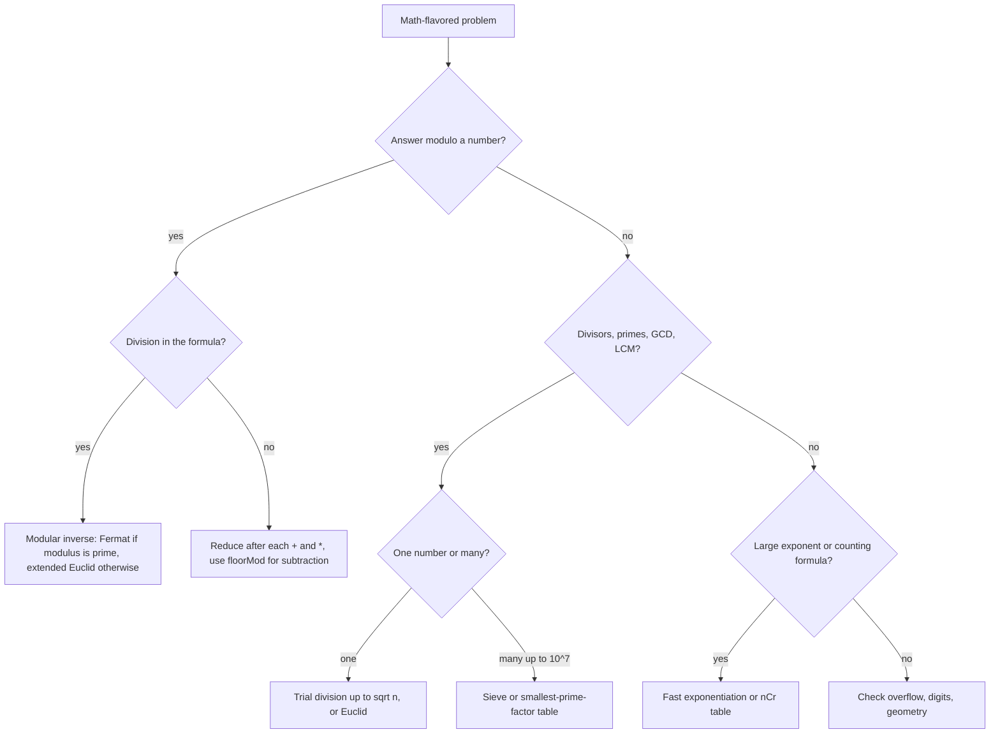

# Pattern 23: Math & Number Theory

## 1. Pattern Name

**Math & Number Theory**: divisibility (GCD and LCM), primes (sieve and factorization), modular arithmetic (fast exponentiation, modular inverse, nCr), overflow control, digit manipulation, and basic geometry.

This page is a toolbox, not one algorithm. Each tool solves a family of problems that look hard until you recognize the identity behind them. Terms are defined where they first appear.

!!! info "Prerequisites"
    Read [Complexity Analysis](../foundations/01-complexity-analysis.md) first. This page states every bound as O(...) and gives the reason. Pattern [19: Bit Manipulation](../19-bit-manipulation/README.md) covers bit tricks. This page does not repeat them.

---

## 2. Core Intuition

### What Interviewers Expect You to Think

A math problem in an interview has a short solution that uses one identity. Brute force exists, but the input size rules it out (for example `n = 10^9`, or "return the answer modulo `10^9 + 7`"). You do not need advanced mathematics. You need about ten identities and the Java habits that keep them correct.

**The five ideas that cover most problems:**

1. **Divisibility has structure.** `gcd(a, b) = gcd(b, a % b)`. A number `n` has all its divisors in pairs `(d, n / d)`, and one of the two is at most `sqrt(n)`. So every divisor search stops at `sqrt(n)`.
2. **Every integer above 1 is a product of primes in exactly one way** (the fundamental theorem of arithmetic). Questions about divisors, GCD, LCM, and perfect squares become questions about prime exponents.
3. **Modular arithmetic keeps numbers small.** A **modulus** is the number you divide by to get the remainder. If a problem says "return the answer modulo `10^9 + 7`", the true answer is too large for `long`. You reduce after every addition and multiplication.
4. **Division does not work modulo `m`.** You multiply by a **modular inverse** instead. The inverse of `a` is a number `x` with `a * x ≡ 1 (mod m)`.
5. **Java integers wrap around silently.** `int` and `long` overflow without an error (JLS section 4.2.2). Most wrong answers on this topic are overflow bugs, not logic bugs.

### Mental Model

Think of the modulus as a clock with `m` positions. Adding or multiplying moves you around the clock, and you only record where the hand points. You can do this after every step because the final position does not depend on when you reduce. Division has no meaning on the clock, because "half of 7 o'clock" has no position. The inverse replaces division when it exists, which is when `gcd(a, m) = 1`.

---

## 3. Recognition Signals

### Keywords in the Problem Statement

- "Return the answer modulo `10^9 + 7`" or "modulo `998244353`".
- "Greatest common divisor", "least common multiple", "co-prime", "divisible by".
- "Count primes", "prime factors", "number of divisors", "perfect square".
- "Number of ways to choose" or "number of arrangements" with large `n` (`nCr`, factorial).
- "Raise to the power", with exponent up to `10^9` or larger, or given as an array of digits.
- "Reverse the digits", "palindrome number", "without converting to a string".
- "Number of trailing zeros", "k-th magical number", "k-th ugly number" (binary search plus counting).
- "Points on a line", "rectangle overlap", "convex polygon" (geometry with integer coordinates).

### Constraint Hints

| Constraint | What it suggests |
|---|---|
| `n` up to `10^7` and "count primes" | Sieve, O(n log log n) |
| `n` up to `10^12` and "is it prime" or "factorize" | Trial division up to `sqrt(n)`, at most `10^6` steps |
| `n` up to `10^18` and "is it prime" | Miller-Rabin (a probabilistic test), not trial division |
| Exponent up to `10^9` or `10^18` | Fast exponentiation, O(log exponent) |
| Answer "modulo a prime" and a division appears | Modular inverse (Fermat) |
| Answer "modulo" a non-prime number (for example `1337`) | No Fermat inverse. Rewrite the formula without division |
| `nCr` with `n` up to `10^6`, many queries | Factorial table plus inverse factorial table |
| `nCr` with `n` up to `1000`, modulus not prime | Pascal's triangle |
| Input uses the full `int` range | Check each `+`, `*`, `-x`, `Math.abs` for overflow |

### Red Flags: These Are Different Problems

- The statement asks for the **number** of subsets, paths, or arrangements and the structure is not a pure formula. Use [dynamic programming](../15-dynamic-programming/README.md) first, then look for a formula.
- The statement asks for bit-level tricks (XOR, masks). Use pattern [19](../19-bit-manipulation/README.md).
- The answer must be exact and has hundreds of digits. Use `BigInteger` (or string arithmetic if the problem forbids it).



---

## 4. Brute Force Thought Process

### Divisors and Primes by Trial

```text
Problem: Is n prime? List the divisors of n.

Brute force:
- For d = 1 to n: test whether n % d == 0.

Time: O(n). For n = 10^12 this is 10^12 steps.
```

### Powers by Repeated Multiplication

```text
Problem: Compute base^exp mod m, with exp up to 10^9.

Brute force:
- Multiply base by itself exp times, reduce after each multiplication.

Time: O(exp) = 10^9 multiplications for exp = 10^9. Too slow for many test cases.
```

### Combinations by the Factorial Formula

```text
Problem: Compute nCr mod 10^9 + 7, with n up to 10^6.

Brute force:
- Compute n!, r!, and (n - r)! as exact integers, then divide.

The exact value of 20! already exceeds the range of long (about 9.22 * 10^18).
Reducing modulo m first breaks the division. This is the point where
modular inverses become necessary.
```

### Why These Fail

Each brute force does work proportional to the **value** of the input, not to its **number of digits**. An input of `10^18` has 19 digits. The goal of this pattern is an algorithm whose work grows with the number of digits (logarithmic) or with the square root of the value.

---

## 5. Optimization Insight (The "Aha" Moment)

### Divisors Come in Pairs

If `d` divides `n`, then `n / d` also divides `n`. One of `d` and `n / d` is at most `sqrt(n)`: if both were larger than `sqrt(n)`, their product would exceed `n`. So a loop with `d * d <= n` finds every divisor pair. This gives O(sqrt(n)) for primality, factorization, and divisor listing.

### Euclid Shrinks the Numbers Fast

`gcd(a, b) = gcd(b, a % b)`, because any common divisor of `a` and `b` also divides `a - q * b` for every integer `q`, and the reverse holds too. The remainder `a % b` is smaller than `a / 2` when `a ≥ b`:

- If `b ≤ a / 2`, then `a % b < b ≤ a / 2`.
- If `b > a / 2`, then `a % b = a - b < a / 2`.

Euclid's algorithm replaces `(a, b)` by `(b, a % b)`, then by `(a % b, b % (a % b))`. The first number after two steps is `a % b`, which is less than `a / 2`. So the first number at least halves every two steps. After the first step the first number is `b = min(a, b)`, so the loop runs at most about `2 * log2(min(a, b)) + 2` steps. Lamé's theorem gives the exact worst case (CLRS section 31.2): if `a > b ≥ 1` and Euclid makes `k ≥ 1` recursive calls, then `a ≥ F(k + 2)` and `b ≥ F(k + 1)`, where `F` is the Fibonacci sequence. Consecutive Fibonacci numbers force the most steps, about `log_phi(b)` with `phi = 1.618...`. For example, `gcd(F(90), F(89))` takes 88 steps, and `F(89)` is about `1.78 * 10^18`. The complexity is **O(log min(a, b))** divisions.

### Squaring Halves the Exponent

`x^n = (x^(n/2))^2` when `n` is even, and `x * x^(n-1)` when `n` is odd. Each two steps halve `n`, so the exponent `10^9` needs about 30 squarings. This is **O(log n)** multiplications.

### Sieve: Cross Out Multiples Instead of Testing Each Number

Testing each number by trial division costs O(sqrt(n)) per number. The sieve of Eratosthenes goes the other way: for each prime `p`, it crosses out `p*p, p*p + p, ...`. Total work is at most the sum over primes `p` of `n / p`. By Mertens' second theorem, the sum of `1 / p` over primes `p ≤ n` is `ln ln n + M + O(1 / ln n)`, where `M ≈ 0.2615` is the Meissel-Mertens constant. So the sieve costs **O(n log log n)**. For `n = 10^7`, `ln ln n` is about 2.8.

### Modular Inverse Turns Division Into Multiplication

Fermat's little theorem: if `p` is prime and `p` does not divide `a`, then `a^(p-1) ≡ 1 (mod p)`. Multiply both sides by `a^(-1)`: `a^(p-2) ≡ a^(-1) (mod p)`. So the inverse is one fast exponentiation. Then `x / a (mod p)` becomes `x * a^(p-2) (mod p)`.

---

## 6. Generalized Templates

All templates compile under JDK 21. Methods have no `static` modifier, in the style of LeetCode's `class Solution`. Each block is self-contained.

### Template 1: GCD, LCM, and Extended Euclid

```java
long gcd(long a, long b) {
    a = Math.abs(a);
    b = Math.abs(b);
    while (b != 0) {
        long t = a % b;
        a = b;
        b = t;
    }
    return a;
}

// Divide first, then multiply: |a| / gcd stays small. The result is never negative.
// multiplyExact throws ArithmeticException if the result overflows a long.
long lcm(long a, long b) {
    if (a == 0 || b == 0) return 0;
    return Math.multiplyExact(Math.abs(a) / gcd(a, b), Math.abs(b));
}

// Returns {g, x, y} with a * x + b * y == g == gcd(a, b). Assumes a, b >= 0.
long[] extGcd(long a, long b) {
    if (b == 0) return new long[] {a, 1, 0};
    long[] r = extGcd(b, a % b);
    return new long[] {r[0], r[2], r[1] - (a / b) * r[2]};
}
```

- `gcd(0, x) = x`, and `gcd(0, 0) = 0` in this code. Negative inputs work because of `Math.abs`. The one exception is `Long.MIN_VALUE`, whose absolute value does not fit in a `long`.
- **LCM without overflow:** `a * b / gcd(a, b)` can overflow even when the LCM fits. `a / gcd(a, b) * b` divides first, so the intermediate value is not larger than the result.
- **Derivation of `extGcd`:** assume `b * x' + (a % b) * y' = g`. Write `a % b = a - (a / b) * b` (integer division). Then `g = a * y' + b * (x' - (a / b) * y')`. So `x = y'` and `y = x' - (a / b) * y'`. These are the two return values.
- **GCD of an array:** fold with `g = gcd(g, a[i])`. The value `g` only decreases, and each change divides `g` by at least 2, so the fold does at most about `log2(max)` changes in total.
- **Complexity:** `gcd` is O(log min(a, b)). `extGcd` has the same step count and O(log min(a, b)) stack depth.

### Template 2: Sieve of Eratosthenes and Smallest Prime Factor

```java
// composite[i] is true if i is not prime (valid for i >= 2).
boolean[] sieve(int n) {
    boolean[] composite = new boolean[n + 1];
    for (int i = 2; (long) i * i <= n; i++) {
        if (!composite[i]) {
            for (int j = i * i; j <= n; j += i) composite[j] = true;
        }
    }
    return composite;
}

// spf[i] = smallest prime factor of i (spf[i] == i exactly when i is prime).
int[] smallestPrimeFactor(int n) {
    int[] spf = new int[n + 1];
    for (int i = 2; i <= n; i++) {
        if (spf[i] == 0) {
            for (int j = i; j <= n; j += i) {
                if (spf[j] == 0) spf[j] = i;
            }
        }
    }
    return spf;
}

// Factorize x <= n in O(number of prime factors) after the O(n log log n) table.
List<Integer> factorsFromSpf(int[] spf, int x) {
    List<Integer> primes = new ArrayList<>();
    while (x > 1) {
        primes.add(spf[x]);
        x /= spf[x];
    }
    return primes;
}
```

- **Start the inner loop at `i * i`.** Every smaller multiple `i * k` with `k < i` has a prime factor below `i`. An earlier prime already crossed it out.
- **Stop the outer loop at `sqrt(n)`.** A composite number `c ≤ n` has a prime factor at most `sqrt(c) ≤ sqrt(n)`, so the sieve has crossed out `c` by then. The test `(long) i * i <= n` cannot overflow for any `int` value of `n`. In practice a `boolean[n + 1]` sieve uses at most about `10^8` to `10^9` entries, where `i * i` also fits in `int`, so the cast is a safe habit rather than a fix for a real input (Mistake 5 shows where the overflow does happen).
- **Complexity:** time O(n log log n) (Section 5). Space O(n). A `BitSet` stores one bit per number if memory is tight.
- The `spf` version also costs O(n log log n) as written, because the inner loop visits every multiple of each prime. A linear sieve (each composite crossed out once, by its smallest prime factor) reaches O(n). The simpler version is enough for interviews.
- **Segmented sieve** (not shown): to list primes in `[L, R]` with `R` up to `10^12` and `R - L` up to `10^6`, cross out multiples of the primes up to `sqrt(R)` inside the range only.

### Template 3: Primality and Factorization by Trial Division

```java
boolean isPrime(long n) {
    if (n < 2) return false;
    if (n < 4) return true;               // 2 and 3
    if (n % 2 == 0 || n % 3 == 0) return false;
    for (long d = 5; d * d <= n; d += 6) { // every prime above 3 is 6k - 1 or 6k + 1
        if (n % d == 0 || n % (d + 2) == 0) return false;
    }
    return true;
}

// Prime -> exponent, in increasing prime order.
Map<Long, Integer> factorize(long n) {
    Map<Long, Integer> factors = new TreeMap<>();
    for (long p = 2; p * p <= n; p++) {
        while (n % p == 0) {
            factors.merge(p, 1, Integer::sum);
            n /= p;
        }
    }
    if (n > 1) factors.merge(n, 1, Integer::sum); // one prime factor above sqrt is left
    return factors;
}

// Divisors in O(sqrt n), using the pair (d, n / d).
List<Long> divisors(long n) {
    List<Long> result = new ArrayList<>();
    for (long d = 1; d * d <= n; d++) {
        if (n % d == 0) {
            result.add(d);
            if (d != n / d) result.add(n / d);
        }
    }
    return result;
}
```

- **Complexity:** each method is O(sqrt(n)). The loop body of `factorize` divides `n` by each factor it finds, so the bound `p * p <= n` drops and the loop stops earlier when `n` has small factors. The worst case is a prime `n`, or a product of two primes near `sqrt(n)`.
- **Overflow limit:** `d * d <= n` overflows `long` only when `d` reaches 3,037,000,500, which happens only for `n` within about `10^10` of `Long.MAX_VALUE`. Trial division is far too slow at that size anyway. Write `d <= n / d` if you need the loop to be correct for every `long`.
- **Why the leftover `n > 1` is prime:** after removing all prime factors up to `sqrt(original n)`, at most one prime factor can remain, because two such factors would multiply to more than the remaining `n`.
- For `n` up to `10^18`, O(sqrt(n)) means `10^9` steps, which is too slow. Use a Miller-Rabin test. In Java, `BigInteger.valueOf(n).isProbablePrime(certainty)` implements a probabilistic test. The javadoc says it returns `false` if the number is definitely composite and `true` if it is probably prime.
- **Number of divisors** from the factorization is the product of `(exponent + 1)` over all primes. The number of divisors is odd exactly when `n` is a perfect square, because only then does one divisor pair collapse to a single value (`d == n / d`).

### Template 4: Modular Arithmetic Rules

```java
final int MOD = 1_000_000_007;

int add(int a, int b)      { return (int) ((a + (long) b) % MOD); }
int subtract(int a, int b) { return Math.floorMod((long) a - b, MOD); }
int multiply(int a, int b) { return (int) ((long) a * b % MOD); }
```

The rules, with `a` and `b` any integers and `m > 0`:

| Operation | Rule | Java note |
|---|---|---|
| Addition | `(a + b) mod m = ((a mod m) + (b mod m)) mod m` | Sum of two residues below `m` fits in `long`. It also fits in `int` when `m < 2^30` |
| Subtraction | `(a - b) mod m = ((a mod m) - (b mod m) + m) mod m` | Or use `Math.floorMod`. Plain `%` can return a negative value |
| Multiplication | `(a * b) mod m = ((a mod m) * (b mod m)) mod m` | Cast to `long` **before** multiplying. Two residues below `10^9 + 7` have a product of at most `(10^9 + 6)^2 ≈ 1.000000012 * 10^18`, which fits in `long` (maximum about `9.22 * 10^18`) |
| Division | **Not allowed.** Multiply by the modular inverse | Template 6 |
| Comparison | A modular result says nothing about which true value is larger | Do not compare reduced values to decide an order |

- **`%` versus `Math.floorMod`.** In Java, `a % b` has the sign of the dividend `a` (JLS section 15.17.3). `Math.floorMod(a, b)` has the sign of the divisor `b` (JDK 21 javadoc). For a positive modulus `m`, `floorMod` returns a value in `[0, m)`. The javadoc examples: `floorMod(-4, 3) == 2` while `-4 % 3 == -1`. The overload `Math.floorMod(long, int)` returns an `int`.
- **Why `1_000_000_007`?** It is prime (needed for Fermat inverses). It is below `2^30`, so it fits in `int`. The product of two residues fits in `long`. It is a convention from competitive programming, not a mathematical requirement. Another common modulus is `998244353`, which is prime and equals `119 * 2^23 + 1`.
- **The underscore** in `1_000_000_007` is a legal digit separator in Java integer literals. The value is `1000000007`.
- **Large modulus:** if `m` is near `10^18`, the product of two residues overflows `long`. Use `BigInteger` or `Math.multiplyHigh` to build a wider product.

### Template 5: Fast Exponentiation (Exponentiation by Squaring)

```java
long power(long base, long exp, long mod) {
    long result = 1 % mod;                 // handles mod == 1
    base = Math.floorMod(base, mod);
    while (exp > 0) {
        if ((exp & 1) == 1) result = result * base % mod; // use this bit of exp
        base = base * base % mod;                          // base^1, base^2, base^4, ...
        exp >>= 1;
    }
    return result;
}

// LeetCode 50 form: double base, int exponent, no modulus.
double myPow(double x, int n) {
    long e = n;                  // long: -Integer.MIN_VALUE overflows int
    if (e < 0) {
        x = 1 / x;
        e = -e;
    }
    double result = 1;
    while (e > 0) {
        if ((e & 1) == 1) result *= x;
        x *= x;
        e >>= 1;
    }
    return result;
}
```

- **Why it works:** write `exp` in binary, for example `13 = 1101`. Then `x^13 = x^8 * x^4 * x^1`. The loop squares `base` to get `x^1, x^2, x^4, x^8`, and multiplies `result` by `base` for each 1 bit.
- **Complexity:** O(log exp) multiplications. Space O(1). Each multiplication is O(1) because every operand is below `mod`, and `mod * mod` must fit in `long`.
- **Matrix exponentiation** uses the same loop with matrix multiplication. It computes the n-th Fibonacci number in O(k^3 log n) for a `k x k` matrix (`k = 2`), and any linear recurrence of order `k`.
- **`BigInteger.modPow`** does the same job: `BigInteger.valueOf(2).modPow(BigInteger.valueOf(e), BigInteger.valueOf(m))`. The javadoc says it throws `ArithmeticException` if `m <= 0`, or if the exponent is negative and the base is not relatively prime to `m`. An interviewer who asks for fast exponentiation expects the loop above.

### Template 6: Modular Inverse (Fermat and Extended Euclid)

```java
final int MOD = 1_000_000_007;

long power(long base, long exp, long mod) {
    long result = 1 % mod;
    base = Math.floorMod(base, mod);
    while (exp > 0) {
        if ((exp & 1) == 1) result = result * base % mod;
        base = base * base % mod;
        exp >>= 1;
    }
    return result;
}

// Valid only if MOD is prime and a is not a multiple of MOD.
long inverseFermat(long a) {
    return power(a, MOD - 2, MOD);
}

long[] extGcd(long a, long b) {
    if (b == 0) return new long[] {a, 1, 0};
    long[] r = extGcd(b, a % b);
    return new long[] {r[0], r[2], r[1] - (a / b) * r[2]};
}

// Valid for any m > 1 when gcd(a, m) == 1.
long inverseExt(long a, long m) {
    long[] r = extGcd(Math.floorMod(a, m), m);
    if (r[0] != 1) throw new ArithmeticException("no inverse: gcd != 1");
    return Math.floorMod(r[1], m);
}

// inv[1..n] modulo a prime p > n, in O(n), from inv[i] = -(p / i) * inv[p % i].
long[] inverseTable(int n, int p) {
    long[] inv = new long[Math.max(n, 1) + 1];   // n == 0 still has room for inv[1]
    inv[1] = 1;
    for (int i = 2; i <= n; i++) {
        inv[i] = (p - (long) (p / i) * inv[p % i] % p) % p;
    }
    return inv;
}
```

- **Existence:** `a` has an inverse modulo `m` if and only if `gcd(a, m) = 1`. This is Bezout's identity: `a * x + m * y = 1` gives `a * x ≡ 1 (mod m)`, so `extGcd` returns the inverse as `x`.
- **Fermat versus extended Euclid:** Fermat needs a prime modulus and uses O(log m) multiplications. Extended Euclid works for any modulus when the inverse exists, with O(log m) steps. Choose Fermat when the modulus is `10^9 + 7` (shorter to write). Choose extended Euclid when the modulus is not prime.
- **JDK built-in:** `BigInteger.modInverse(m)` returns `this^(-1) mod m` and throws `ArithmeticException` if `m <= 0` or no inverse exists (javadoc).
- **Where the table formula comes from:** write `p = q * i + r` with `q = p / i` and `r = p % i`. Then `q * i + r ≡ 0 (mod p)`. Multiply by `i^(-1) * r^(-1)`: `q * r^(-1) + i^(-1) ≡ 0`. So `i^(-1) ≡ -q * r^(-1)`. Since `r < i`, `inv[r]` is already known.

### Template 7: nCr With a Factorial Table and With Pascal's Triangle

```java
final int MOD = 1_000_000_007;
long[] fact;
long[] invFact;

long power(long base, long exp, long mod) {
    long result = 1 % mod;
    base = Math.floorMod(base, mod);
    while (exp > 0) {
        if ((exp & 1) == 1) result = result * base % mod;
        base = base * base % mod;
        exp >>= 1;
    }
    return result;
}

void buildFactorials(int n) {
    fact = new long[n + 1];
    invFact = new long[n + 1];
    fact[0] = 1;
    for (int i = 1; i <= n; i++) fact[i] = fact[i - 1] * i % MOD;
    invFact[n] = power(fact[n], MOD - 2, MOD);            // one Fermat inverse
    for (int i = n; i > 0; i--) invFact[i - 1] = invFact[i] * i % MOD;
}

long nCr(int n, int r) {
    if (r < 0 || r > n) return 0;
    return fact[n] * invFact[r] % MOD * invFact[n - r] % MOD;
}

// Works for any modulus, including non-primes. O(n^2) time and space.
long[][] pascal(int n, long mod) {
    long[][] c = new long[n + 1][n + 1];
    for (int i = 0; i <= n; i++) {
        c[i][0] = 1;
        for (int j = 1; j <= i; j++) {
            c[i][j] = (c[i - 1][j - 1] + c[i - 1][j]) % mod;
        }
    }
    return c;
}
```

- **Factorial table:** `nCr = n! / (r! * (n - r)!)`. Division becomes multiplication by `invFact`. The backward loop uses `(i-1)!^(-1) = i!^(-1) * i`, so the build needs only **one** modular exponentiation. Build time is O(n + log MOD). Each query is O(1).
- **Pascal's triangle:** `C(i, j) = C(i-1, j-1) + C(i-1, j)` (choose the i-th item or not). Build time is O(n^2). It needs only addition, so the modulus can be any number, and `mod = Long.MAX_VALUE` gives exact values up to `C(66, 33)` before overflow. Use a one-dimensional array and update `j` from high to low to cut space to O(n) when you need only one row (LeetCode 119).
- **When `n ≥ p`** (the modulus is smaller than `n`), `n!` contains the factor `p`, and the inverse does not exist. Lucas' theorem handles this case: write `n` and `r` in base `p` and multiply the small `C(n_i, r_i)` values. This page does not cover Lucas' theorem further.
- **Paths in a grid** (LeetCode 62): an `m x n` grid has `C(m + n - 2, m - 1)` paths, because each path chooses which `m - 1` of its `m + n - 2` moves go down.

### Template 8: Overflow-Safe Arithmetic

```java
int a = 1_000_000;
int b = 3_000;
long wrong = a * b;                    // int multiplication overflows BEFORE the widening
long right = (long) a * b;             // widen one operand first
int exact = Math.toIntExact(right);    // throws ArithmeticException: right > Integer.MAX_VALUE

int min = Integer.MIN_VALUE;
int stillNegative = Math.abs(min);     // javadoc: returns Integer.MIN_VALUE (negative)
int lo = 1_500_000_000;
int hi = 2_000_000_000;
int mid = lo + (hi - lo) / 2;           // (lo + hi) / 2 would overflow; this form does not
```

| Tool | Behavior (JDK 21 javadoc) |
|---|---|
| `Math.addExact`, `subtractExact`, `multiplyExact` | Return the result or throw `ArithmeticException` if it overflows. Overloads exist for `int`, `long`, and `(long, int)` for multiply |
| `Math.toIntExact(long)` | Throws if the value does not fit in an `int` |
| `Math.absExact(int)` | Throws for `Integer.MIN_VALUE` (since Java 15). `Math.abs` does not throw |
| `Math.floorDiv`, `Math.floorMod` | `floorDiv` rounds the quotient toward negative infinity. `floorMod` returns `x - floorDiv(x, y) * y`, which has the sign of `y`. `Integer.MIN_VALUE / -1` overflows to `Integer.MIN_VALUE` with `/`, and `floorDiv` has the same overflow |
| `Math.divideExact` | Throws `ArithmeticException` for `Integer.MIN_VALUE / -1` (and the `long` case) instead of returning a wrong value (since Java 18) |
| `Math.multiplyHigh(long, long)` | The upper 64 bits of the 128-bit product |
| `BigInteger` | No overflow, slower, use for exact big results |

- **Rule of thumb:** compute in `long` when inputs are `int`. Convert back to `int` at the end, with `Math.toIntExact` if the problem promises the result fits and you want a loud failure when it does not.
- **Detect overflow before it happens** when you must stay in `int` (LeetCode 7): test `r > Integer.MAX_VALUE / 10` before `r * 10`.

### Template 9: Digit Manipulation

```java
// No Math.abs: Math.abs(Long.MIN_VALUE) is negative and would give 1.
int digitCount(long n) {
    int count = 1;
    while (n >= 10 || n <= -10) {
        n /= 10;
        count++;
    }
    return count;
}

// LeetCode 7: reverse the digits of a 32-bit integer, return 0 on overflow.
int reverse(int x) {
    int reversed = 0;
    while (x != 0) {
        int digit = x % 10;               // keeps the sign of x
        x /= 10;
        if (reversed > Integer.MAX_VALUE / 10 || reversed < Integer.MIN_VALUE / 10) return 0;
        reversed = reversed * 10 + digit;
    }
    return reversed;
}

// Palindrome test without a String: reverse only the second half (LeetCode 9).
boolean isPalindrome(int x) {
    if (x < 0 || (x % 10 == 0 && x != 0)) return false;
    int secondHalf = 0;
    while (x > secondHalf) {
        secondHalf = secondHalf * 10 + x % 10;
        x /= 10;
    }
    return x == secondHalf || x == secondHalf / 10; // even or odd digit count
}
```

- **The two moves:** `n % 10` reads the last digit. `n / 10` removes it. Building a number from digits is `result = result * 10 + digit`.
- **Overflow check in `reverse`:** the check runs before the multiplication. The check `reversed > MAX / 10` is sufficient for the positive side. If `reversed == MAX / 10 = 214748364` (nine digits), the next digit is the tenth and last one, which is the leading digit of a ten-digit `int`. That digit is at most 2, so the result is at most `2147483642`, which is below `MAX = 2147483647`. The same argument works for the negative side with `MIN / 10 = -214748364`.
- **Digit sum and digital root:** the digit sum loops `sum += n % 10`. The repeated digit sum of `n > 0` down to one digit equals `1 + (n - 1) % 9`, because a number and its digit sum have the same remainder modulo 9.
- **Other bases:** replace `10` with the base. `Integer.toString(n, base)` converts for you when the problem allows library calls.
- **Complexity:** O(number of digits) = O(log n).

### Template 10: Geometry With Integers (Cross Product, Orientation, Distance)

```java
// Cross product of vectors (b - a) and (c - a). Coordinates: long to avoid overflow.
// > 0: c is left of a->b (counter-clockwise turn, with x to the right and y up)
// = 0: a, b, c are on one line
// < 0: c is right of a->b (clockwise turn)
long cross(long ax, long ay, long bx, long by, long cx, long cy) {
    return (bx - ax) * (cy - ay) - (by - ay) * (cx - ax);
}

boolean collinear(int[] a, int[] b, int[] c) {
    return cross(a[0], a[1], b[0], b[1], c[0], c[1]) == 0;
}

// Compare distances with squared values: no sqrt, no floating-point error.
long distSq(int[] p, int[] q) {
    long dx = (long) p[0] - q[0];      // widen first: p[0] - q[0] in int can overflow
    long dy = (long) p[1] - q[1];
    return dx * dx + dy * dy;
}

// Rectangles given as {x1, y1, x2, y2} overlap with positive area (LeetCode 836).
boolean overlap(int[] r1, int[] r2) {
    return r1[0] < r2[2] && r2[0] < r1[2] && r1[1] < r2[3] && r2[1] < r1[3];
}

// Segments p1p2 and p3p4 intersect (touching counts), using orientations.
boolean segmentsIntersect(long[] p1, long[] p2, long[] p3, long[] p4) {
    long d1 = Long.signum(cross(p3[0], p3[1], p4[0], p4[1], p1[0], p1[1]));
    long d2 = Long.signum(cross(p3[0], p3[1], p4[0], p4[1], p2[0], p2[1]));
    long d3 = Long.signum(cross(p1[0], p1[1], p2[0], p2[1], p3[0], p3[1]));
    long d4 = Long.signum(cross(p1[0], p1[1], p2[0], p2[1], p4[0], p4[1]));
    if (d1 != d2 && d3 != d4) return true;                 // proper crossing
    return (d1 == 0 && onSegment(p3, p4, p1)) || (d2 == 0 && onSegment(p3, p4, p2))
        || (d3 == 0 && onSegment(p1, p2, p3)) || (d4 == 0 && onSegment(p1, p2, p4));
}

// Given that q is collinear with a and b: is q inside the bounding box of a and b?
boolean onSegment(long[] a, long[] b, long[] q) {
    return Math.min(a[0], b[0]) <= q[0] && q[0] <= Math.max(a[0], b[0])
        && Math.min(a[1], b[1]) <= q[1] && q[1] <= Math.max(a[1], b[1]);
}
```

- **Why the cross product:** `(b - a) x (c - a)` is twice the signed area of triangle `abc`. Its sign gives the turn direction. Its value is zero exactly when the three points are collinear.
- **Integers only.** Slope `dy / dx` as a `double` loses precision, and `dx = 0` divides by zero. Compare with cross products, or store the slope as a reduced fraction `(dy / g, dx / g)` using the GCD (Section 7, Variation F).
- **Axis direction:** the sign meaning above assumes `y` points up. On a screen where `y` points down, the meanings swap.
- **Magnitudes:** with coordinates up to `10^9` in absolute value, each difference is up to `2 * 10^9`, which overflows `int`. Each product is up to `4 * 10^18`, and the cross product (a difference of two products) is up to `8 * 10^18`, which still fits in `long`. With coordinates up to `10^10`, use `BigInteger` or `Math.multiplyHigh`.
- **Segment test:** if the orientations differ on both sides (`d1 != d2` and `d3 != d4`), the segments intersect. This also covers the case where one orientation is 0 and the others differ: the point with orientation 0 then lies on the other segment. If all four orientations are 0, the segments are collinear, and the bounding-box checks decide.
- **Complexity:** each function is O(1).

### Template 11: Legendre's Formula (Trailing Zeros of n!)

```java
// Exponent of prime p in n!: floor(n/p) + floor(n/p^2) + floor(n/p^3) + ...
long exponentInFactorial(long n, int p) {
    long count = 0;
    while (n > 0) {
        n /= p;
        count += n;
    }
    return count;
}

int trailingZeroes(int n) {                // LeetCode 172
    int zeros = 0;
    while (n > 0) {
        n /= 5;
        zeros += n;
    }
    return zeros;
}
```

- **Why it counts the exponent:** among `1..n`, `floor(n/p)` numbers are multiples of `p` and contribute one factor `p` each. `floor(n/p^2)` numbers contribute a second factor, and so on.
- **Why only the factor 5 matters:** a trailing zero comes from a factor pair `2 * 5`. The factor 2 appears at least as often as the factor 5 in `n!`, so the count of 5s is the count of zeros.
- **Complexity:** O(log_p n) loop steps. Computing `n!` and counting zeros costs far more, and overflows for `n > 20`.

---

## 7. Variations of the Pattern

### Variation A: Counting With a Sieve

**Problem type:** count or list primes below `n`; build prime-based arrays (LeetCode 204, 1175).
**Key insight:** build the sieve once, then answer with prefix counts. A prefix count array `pi[i]` (the number of primes up to `i`) answers "how many primes in `[l, r]`" in O(1) as `pi[r] - pi[l - 1]`. This reuses the idea of [prefix sums](../04-prefix-sum/README.md).

### Variation B: Binary Search Plus Inclusion-Exclusion (Ugly/Magical Number)

**Problem type:** the k-th positive integer divisible by `a`, `b`, or `c` (LeetCode 1201, 878).
**Key insight:** the count of such integers up to `x` is monotone in `x`, so [binary search on the answer](../06-binary-search-on-answer/README.md) applies. Count with inclusion-exclusion:

`count(x) = x/a + x/b + x/c - x/lcm(a,b) - x/lcm(b,c) - x/lcm(a,c) + x/lcm(a,b,c)`

```java
int nthUglyNumber(int n, int a, int b, int c) {
    long ab = lcm(a, b), bc = lcm(b, c), ac = lcm(a, c), abc = lcm(ab, c);
    long lo = 1, hi = 2_000_000_000L;           // the problem guarantees the answer is <= 2 * 10^9
    while (lo < hi) {
        long x = lo + (hi - lo) / 2;
        long count = x / a + x / b + x / c - x / ab - x / bc - x / ac + x / abc;
        if (count >= n) hi = x; else lo = x + 1;
    }
    return (int) lo;
}

long gcd(long a, long b) { return b == 0 ? a : gcd(b, a % b); }
long lcm(long a, long b) { return a / gcd(a, b) * b; }
```

Time O(log(max(a, b, c)) + log(hi)): the LCMs cost O(log max) once, and the binary search runs about 31 rounds of O(1) work each. Take care that `lcm(a, b)` can exceed `int`, so the code keeps `long`. The problem guarantees `a * b * c ≤ 10^18`, so every LCM fits in `long`. Without that guarantee, `lcm(ab, c)` could overflow, and you would cap each LCM at `hi + 1`.

### Variation C: Counting Formulas With a Modulus

**Problem type:** count arrangements with a closed form and return it modulo `10^9 + 7` (LeetCode 1359, 1175, 1808).
**Key insight:** find the product or `nCr` form, then reduce after each step. LeetCode 1359 (pickup and delivery): build the sequence one pair at a time. When pair `i` joins a valid sequence of `2(i - 1)` events, the new sequence has `2i` positions. Pick 2 of them for the new pair. The pickup takes the earlier position, so the order inside the pair is fixed. That gives `C(2i, 2) = i * (2i - 1)` choices.

```java
int countOrders(int n) {
    final int MOD = 1_000_000_007;
    long ways = 1;
    for (int i = 1; i <= n; i++) {
        ways = ways * (i * (2L * i - 1)) % MOD;   // long: i * (2i - 1) stays small, ways is large
    }
    return (int) ways;
}
```

Time O(n), space O(1).

LeetCode 1808 (maximize nice divisors): the number of nice divisors of a number whose prime factors, counted with multiplicity, total `n` equals the product of the prime exponents `e_1 * e_2 * ...`, where `e_1 + e_2 + ... = n`. Splitting `n` into parts of size 3 maximizes the product (the same argument as LeetCode 343, Integer Break). Use 4 as the part when the remainder is 1 (`3 + 1` is worse than `2 + 2`).

```java
int maxNiceDivisors(int primeFactors) {
    final int MOD = 1_000_000_007;
    int n = primeFactors;
    if (n <= 4) return n;
    long threes = n / 3;
    return switch (n % 3) {
        case 0 -> (int) power(3, threes, MOD);
        case 1 -> (int) (4 * power(3, threes - 1, MOD) % MOD);
        default -> (int) (2 * power(3, threes, MOD) % MOD);
    };
}

long power(long base, long exp, long mod) {
    long result = 1 % mod;
    base = Math.floorMod(base, mod);
    while (exp > 0) {
        if ((exp & 1) == 1) result = result * base % mod;
        base = base * base % mod;
        exp >>= 1;
    }
    return result;
}
```

Time O(log n), space O(1).

### Variation D: Power With a Non-Prime Modulus and a Huge Exponent

**Problem type:** `a^b mod 1337` where `b` is given as an array of decimal digits (LeetCode 372).
**Key insight:** `1337 = 7 * 191` is not prime, so Fermat does not apply. No inverse is needed. Process the digits of `b` from the left: `a^(10 * q + d) = (a^q)^10 * a^d`.

```java
int superPow(int a, int[] b) {
    final int M = 1337;
    a %= M;
    int result = 1;
    for (int digit : b) {
        result = (int) (power(result, 10, M) * power(a, digit, M) % M);
    }
    return result;
}

long power(long base, long exp, long mod) {
    long result = 1 % mod;
    base = Math.floorMod(base, mod);
    while (exp > 0) {
        if ((exp & 1) == 1) result = result * base % mod;
        base = base * base % mod;
        exp >>= 1;
    }
    return result;
}
```

Time O(len(b) * log 10), which is O(len(b)). Space O(1).

### Variation E: Number Theory Facts That Replace Loops

| Fact | Use | Example problem |
|---|---|---|
| `gcd(a, b) * lcm(a, b) = a * b` | Compute LCM from GCD | LeetCode 1201 |
| Bezout: `a*x + b*y = c` has integer solutions exactly when `gcd(a, b)` divides `c` | Reachability with two step sizes | LeetCode 365 (water jugs: `target` is reachable if `target <= x + y` and `gcd(x, y)` divides `target`), LeetCode 1250 (good array: gcd of all elements is 1) |
| A number has an odd count of divisors exactly when it is a perfect square | Toggle problems | LeetCode 319 (bulb switcher: answer `floor(sqrt(n))`) |
| The GCD of a growing subarray changes at most `log2(max)` times | Subarray GCD counting | LeetCode 2447 |
| Euler's totient: `phi(n) = n * product of (1 - 1/p)` over the primes `p` dividing `n` | Count of integers in `1..n` that are co-prime to `n` | Compute during `factorize` |
| `1 + 2 + ... + n = n(n + 1) / 2`. Use `long` for `n` above 46,340: the product `n(n + 1)` overflows `int` at `n = 46,341`, even though the sum fits in `int` up to `n = 65,535` | Closed forms | Many easy problems |
| Integer square root: binary search, or `(long) Math.sqrt(n)` with a correction | Perfect-square and floor-sqrt problems | LeetCode 69 |

On the square root: `Math.sqrt` returns the `double` closest to the true root (javadoc). A `double` has 53 significant bits. For `long` values above `2^53`, the conversion from `long` to `double` already rounds, and the result can be one too large. For example, `(long) Math.sqrt(999_999_999_999_999_999L)` returns `1_000_000_000`, but the true floor is `999_999_999`. Correct the estimate with divisions, because `r * r` and `(r + 1) * (r + 1)` overflow for `n` near `Long.MAX_VALUE`:

```java
// Floor of the square root of n, for 0 <= n <= Long.MAX_VALUE.
long isqrt(long n) {
    long r = (long) Math.sqrt((double) n);
    while (r > 0 && r > n / r) r--;          // r * r > n, tested without overflow
    while (r + 1 <= n / (r + 1)) r++;        // (r + 1)^2 <= n, tested without overflow
    return r;
}
```

For `int` inputs, `(int) Math.sqrt(n)` is exact: every `int` converts to `double` without rounding, and the gap between `sqrt(k^2 - 1)` and `k` is far larger than the rounding error at that size. `BigInteger.sqrt()` (since Java 9) also returns the exact floor.

### Variation F: Geometry With Slopes as Reduced Fractions

**Problem type:** maximum points on one line (LeetCode 149).
**Key insight:** fix a point `i`. For each other point `j`, reduce `(dx, dy)` by their GCD and fix the sign so that equal directions have equal keys. The most common key is the best line through `i`. Cross products give an O(n^3) alternative with no map.

```java
int maxPoints(int[][] points) {
    int n = points.length;
    int best = Math.min(n, 2);
    for (int i = 0; i < n; i++) {
        Map<Long, Integer> slopeCount = new HashMap<>();
        for (int j = i + 1; j < n; j++) {
            int dx = points[j][0] - points[i][0];
            int dy = points[j][1] - points[i][1];
            int g = (int) gcd(dx, dy);          // points are distinct, so g > 0
            dx /= g;
            dy /= g;
            if (dx < 0 || (dx == 0 && dy < 0)) { // one sign convention per direction
                dx = -dx;
                dy = -dy;
            }
            long key = dx * 100_003L + dy;       // coordinates are within [-10^4, 10^4]
            int count = slopeCount.merge(key, 1, Integer::sum);
            best = Math.max(best, count + 1);    // +1 for point i
        }
    }
    return best;
}

long gcd(long a, long b) {
    a = Math.abs(a);
    b = Math.abs(b);
    while (b != 0) { long t = a % b; a = b; b = t; }
    return a;
}
```

Time O(n^2) map operations, space O(n). The key `dx * 100_003 + dy` is unique because after normalization `dx` is in `[0, 2 * 10^4]` and `dy` is in `[-2 * 10^4, 2 * 10^4]`, and `100_003` exceeds the range of `dy`. The code assumes distinct points, as LeetCode 149 guarantees. Equal points give `g = 0` and a division by zero.

---

## 8. Classic Interview Problems

Difficulties come from the LeetCode problem list (`https://leetcode.com/api/problems/all/`), saved on the day of writing.

| # | Problem | Difficulty | Key insight |
|---|---------|-----------|-------------|
| 1979 | Find Greatest Common Divisor of Array | Easy | The problem asks for the GCD of the smallest and the largest element only, not of all elements. Find `min` and `max` in one pass, then return `gcd(min, max)` |
| 1175 | Prime Arrangements | Easy | Sieve for the count `p` of primes up to `n`. Primes can fill the prime positions in `p!` ways and the rest in `(n - p)!` ways. Multiply modulo `10^9 + 7` |
| 172 | Factorial Trailing Zeroes | Medium | Legendre's formula: count factors of 5 with `n/5 + n/25 + ...` (Template 11) |
| 204 | Count Primes | Medium | Sieve for numbers below `n` (strictly less than `n`). O(n log log n) |
| 50 | Pow(x, n) | Medium | Fast exponentiation. Use a `long` exponent so `Integer.MIN_VALUE` works |
| 7 | Reverse Integer | Medium | Digit loop with an overflow check before `reversed * 10 + digit` |
| 62 | Unique Paths | Medium | `C(m + n - 2, m - 1)`. Use Pascal's triangle, or compute with a `long` and exact division at each step |
| 372 | Super Pow | Medium | `a^(10q + d) = (a^q)^10 * a^d`. Modulus 1337 is not prime, so avoid inverses |
| 1201 | Ugly Number III | Medium | Binary search on the answer, count by inclusion-exclusion with LCMs |
| 149 | Max Points on a Line | Hard | Reduced-fraction slopes with GCD, or cross products |
| 1359 | Count All Valid Pickup and Delivery Options | Hard | Multiply `i * (2i - 1)` for `i = 1..n`, modulo `10^9 + 7` |
| 1808 | Maximize Number of Nice Divisors | Hard | Split the prime-factor count into 3s, then use fast exponentiation |

### Walkthrough: LeetCode 172, Factorial Trailing Zeroes

**Step 1, restate.** Count the zeros at the end of `n!`, for `0 ≤ n ≤ 10^4`. The follow-up asks for logarithmic time.
**Step 2, brute force.** Compute `n!` and divide by 10 while divisible. `n!` overflows `long` at `n = 21`. `BigInteger` works, but `10000!` has 35,660 digits.
**Step 3, observe.** A trailing zero is a factor of 10 = 2 x 5. Count the pairs.
**Step 4, reduce.** Factors of 2 are at least as frequent as factors of 5, so the number of 5s decides.
**Step 5, count 5s.** Multiples of 5 give one each, multiples of 25 give one more, multiples of 125 give one more, and so on: `n/5 + n/25 + n/125 + ...`.
**Step 6, check.** `n = 25`: `5 + 1 = 6`. `25!` has 6 trailing zeros. `n = 100`: `20 + 4 = 24`.

### Walkthrough: LeetCode 1201, Ugly Number III

**Step 1, restate.** Return the n-th positive integer divisible by `a`, `b`, or `c`. The answer is at most `2 * 10^9`.
**Step 2, brute force.** Count upward one integer at a time. The answer can reach `2 * 10^9`, which is too slow.
**Step 3, monotone predicate.** "At least `n` valid integers are `≤ x`" is false for small `x` and true from some `x` on. Binary search finds the first true `x`.
**Step 4, count in O(1).** Use inclusion-exclusion with LCMs so that integers divisible by two or three of the numbers count once.
**Step 5, overflow.** Use `long` for `x`, and compute LCMs with divide-then-multiply (Template 1).
**Step 6, result.** The first `x` with `count(x) >= n` is divisible by at least one of `a`, `b`, `c`, because the count increased exactly at `x`.

---

## 9. How to Practice This Pattern Effectively

### Phase 1: Foundations (3 problems)

Write `gcd`, `power`, and `sieve` from memory, without looking. LeetCode 1979, 204, and 50.

### Phase 2: Modular arithmetic (4 problems)

LeetCode 1175, 1359, 372, and 62. For each, state the modulus rules you use, and mark every place where an overflow could happen.

### Phase 3: Combining with other patterns (3 problems)

LeetCode 1201 (binary search), 172 (formula), and 149 (hash map plus GCD). The goal is to see math as a counting or hashing tool.

### Phase 4: Hard formula problems (2 problems)

LeetCode 1808 and 2338 (Count the Number of Ideal Arrays, Hard: combines prime factorization, `nCr` with a factorial table, and a modulus). Derive the formula on paper before you code.

### Self-Check Questions

1. What is the largest `n` for which `n * n` fits in an `int`? (46,340. `46341 * 46341` overflows.)
2. Why does the sieve start crossing out at `i * i`?
3. What does `-7 % 3` return in Java, and what does `Math.floorMod(-7, 3)` return? (`-1` and `2`.)
4. Why can you not write `(a / b) % MOD` as `(a % MOD) / (b % MOD)`?
5. How many multiplications does `power(x, 10^9, MOD)` perform? (At most about 60: 30 squarings and up to 30 result multiplications.)

### Tips

- Write the modulus as a constant (`MOD`), not as a literal inside expressions. A typo in `1_000_000_007` is hard to see.
- Before you code a counting formula, check it by hand for `n = 1, 2, 3`.
- When you see overflow in a test, widen to `long` at the first multiplication of the expression, not at the end.
- For the interview: state the complexity of each tool as you use it ("Euclid is O(log min(a, b))").

---

## 10. Common Mistakes Even Experienced Developers Make

### Mistake 1: Multiplying `int` Values Before Widening

```java
int a = 1_000_000_000;
int b = 5;
int mod = 1_000_000_007;
long wrong = a * b % mod;            // a * b overflows int first
long right = (long) a * b % mod;     // widen before the multiplication
System.out.println(wrong + " " + right);
```

The cast must be on an operand, not on the result. `(long) (a * b)` still overflows.

### Mistake 2: Forgetting That `%` Can Be Negative

```java
int mod = 1_000_000_007;
long diff = 5L - 9L;
long wrong = diff % mod;                 // -4
long right = Math.floorMod(diff, mod);   // 1_000_000_003
System.out.println(wrong + " " + right);
```

The same bug appears when you index an array with `hash % size` and the hash is negative. Use `Math.floorMod(hash, size)`.

### Mistake 3: Dividing Under a Modulus

```java
long mod = 1_000_000_007L;
long numerator = 10;
long denominator = 5;
long wrong = (numerator % mod) / (denominator % mod);   // integer division, wrong for large values
// right: multiply by the inverse (denominator and mod are co-prime, mod is prime)
long inverse = BigInteger.valueOf(denominator).modInverse(BigInteger.valueOf(mod)).longValue();
long right = numerator % mod * inverse % mod;
```

For small values the wrong form gives a correct-looking result, so tests can pass. It fails when the true quotient is larger than `mod`, or when the division is not exact.

### Mistake 4: Using Fermat With a Non-Prime Modulus

Fermat's `a^(m-2)` is an inverse only when `m` is prime. For `m = 1337` or `m = 10^9` it returns a wrong number without any error. Use extended Euclid (Template 6), and check `gcd(a, m) == 1`.

### Mistake 5: `i * i <= n` Overflows

```java
int n = Integer.MAX_VALUE;
int i = 46_341;
boolean wrong = i * i <= n;            // i * i wraps to a negative number, so the test is true here
boolean right = (long) i * i <= n;
System.out.println(wrong + " " + right);
```

The loop `for (int i = 2; i * i <= n; i++)` fails for `n` near `Integer.MAX_VALUE`. Cast to `long`, or write `i <= n / i`.

### Mistake 6: `Math.abs(Integer.MIN_VALUE)`

`Math.abs(Integer.MIN_VALUE)` returns `Integer.MIN_VALUE`, which is negative (javadoc). The magnitude `2^31` does not fit in an `int`. Convert to `long` first: `Math.abs((long) x)`. The same problem hits `-x`, `Integer.MIN_VALUE / -1`, and the exponent in LeetCode 50 (`n = -2^31`).

### Mistake 7: Wrong Sieve Bounds

Off-by-one errors: `new boolean[n]` instead of `new boolean[n + 1]` drops `n` itself, and LeetCode 204 asks for primes **strictly below** `n`. Also, 0 and 1 are not prime, but `composite[0]` and `composite[1]` stay `false` in Template 2. Start every count at index 2.

### Mistake 8: Reducing Too Late (Or Not at All)

Summing a loop of products and taking `% MOD` once at the end overflows `long` as soon as the running total exceeds `9.22 * 10^18`. Reduce **inside** the loop after each multiplication and each addition.

### Mistake 9: Computing `n!` to Count Zeros

`n!` overflows `long` for `n ≥ 21`. If your solution multiplies the numbers, it fails for large `n`. Use Legendre's formula.

### Mistake 10: Comparing Floating-Point Slopes or Distances

`(double) dy1 / dx1 == (double) dy2 / dx2` can be false for equal fractions, and it divides by zero for vertical lines. Compare `dy1 * dx2 == dy2 * dx1` with `long` values, or use reduced fractions. Compare squared distances instead of `Math.sqrt` results.

---

## Commonly Confused With

| Looks like... | But use... | The question that decides |
|---|---|---|
| "Count the ways" with a modulus | [Dynamic programming](../15-dynamic-programming/README.md) | Is there a closed form or a product that you can derive (LC 1359, 1808)? Use a formula. Do the choices depend on earlier states (LC 62 with obstacles)? Use DP |
| Bit tricks for "power of two", "count set bits" | [Bit manipulation](../19-bit-manipulation/README.md) | Is the operation a bit operation (`n & (n - 1)`)? Use pattern 19. Is it divisibility or exponents? Use this page |
| "K-th number with property X" | [Binary search on the answer](../06-binary-search-on-answer/README.md) | Can you count how many valid values are `≤ x` in O(1) or O(log)? Use binary search with the counting formula (LC 1201) |
| "Pairs with a given remainder" | [Hashing and frequency](../05-hashing-frequency/README.md) | Is the task to count pairs or subarrays by remainder class? Use a hash map on `floorMod` values. Is it to compute a power or an inverse? Use this page |
| Prime test for a single number | Sieve | One number up to `10^12`: trial division, O(sqrt n). Many numbers or all numbers up to `10^7`: sieve |
| `nCr` for small `n` | Pascal's triangle versus factorial table | Is the modulus prime and are there many queries with large `n`? Factorial table. Is `n` up to 1000 or is the modulus not prime? Pascal's triangle |
| `Math.sqrt` for perfect-square checks | Integer binary search | Is the value above `2^53`? Then `double` loses precision. Use a `long` check or binary search |

> Full decision procedure: [How to Choose a Pattern](../how-to-choose-a-pattern.md)

---

## Quick Reference Card

```text
┌───────────────────────────────────────────────────────────────────────┐
│                MATH & NUMBER THEORY CHEAT SHEET                       │
├───────────────────────────────────────────────────────────────────────┤
│ GCD:       while (b != 0) { t = a % b; a = b; b = t; }  O(log min)    │
│ LCM:       a / gcd(a, b) * b        (divide first; multiplyExact)     │
│ Sieve:     for i with i*i <= n: if prime, cross out from i*i step i   │
│            O(n log log n); cast (long) i * i                          │
│ Factorize: for p with p*p <= n: divide out p; leftover n > 1 is prime │
│            O(sqrt n)                                                  │
│ Mod rules: + - * allowed, reduce each step; / is NOT allowed          │
│            subtract: Math.floorMod(a - b, MOD)                        │
│            multiply: (long) a * b % MOD                               │
│ Power:     while (e > 0) { if ((e & 1) == 1) r = r * b % m;           │
│                           b = b * b % m; e >>= 1; }                   │
│ Inverse:   prime MOD: a^(MOD-2); any m: extended Euclid, gcd = 1      │
│ nCr:       fact[n] * invFact[r] % MOD * invFact[n-r] % MOD            │
│            or Pascal: C[i][j] = C[i-1][j-1] + C[i-1][j]               │
│ n! zeros:  n/5 + n/25 + n/125 + ...                                   │
│ Divisors:  pairs (d, n/d) up to sqrt n; count = product of (e + 1)    │
│ Cross:     (bx-ax)*(cy-ay) - (by-ay)*(cx-ax)                          │
│            > 0 left turn, 0 collinear, < 0 right turn                 │
│ Overflow:  int*int overflows before widening; Math.abs(MIN) < 0;      │
│            1_000_000_007 is the usual modulus                         │
└───────────────────────────────────────────────────────────────────────┘
```

---

## Further Reading

Primary sources for the claims on this page:

- [Java SE 21 `Math` javadoc](https://docs.oracle.com/en/java/javase/21/docs/api/java.base/java/lang/Math.html): `floorMod`, `floorDiv`, `multiplyExact`, `addExact`, `divideExact`, `toIntExact`, `absExact`, `abs`, `sqrt`. Read the `floorMod` examples and the note on `abs(Integer.MIN_VALUE)`.
- [Java SE 21 `BigInteger` javadoc](https://docs.oracle.com/en/java/javase/21/docs/api/java.base/java/math/BigInteger.html): `modPow`, `modInverse`, `isProbablePrime`, `sqrt`, and the exceptions they throw.
- [JLS 15.17.3, Remainder Operator `%`](https://docs.oracle.com/javase/specs/jls/se21/html/jls-15.html#jls-15.17.3): the sign rule for `%`.
- [JLS 4.2.2, Integer Operations](https://docs.oracle.com/javase/specs/jls/se21/html/jls-4.html#jls-4.2.2): integer operators do not report overflow.
- Cormen, Leiserson, Rivest, Stein, *Introduction to Algorithms* (CLRS), chapter 31, Number-Theoretic Algorithms: Euclid's algorithm with Lamé's theorem (section 31.2), extended Euclid, modular exponentiation, Miller-Rabin.
- Hardy and Wright, *An Introduction to the Theory of Numbers*: Mertens' theorem on the sum of `1 / p` and Fermat's little theorem, for the sieve and inverse arguments.
- [LeetCode problem list](https://leetcode.com/problems/): the problems in Section 8.
- Secondary (not primary sources): [cp-algorithms: Euclidean algorithm](https://cp-algorithms.com/algebra/euclid-algorithm.html), [Sieve of Eratosthenes](https://cp-algorithms.com/algebra/sieve-of-eratosthenes.html), [Binary exponentiation](https://cp-algorithms.com/algebra/binary-exp.html), [Modular inverse](https://cp-algorithms.com/algebra/module-inverse.html). Worked examples and the linear sieve.

---

*Next: [Pattern 24: Advanced Graphs →](../24-advanced-graphs/README.md)*
