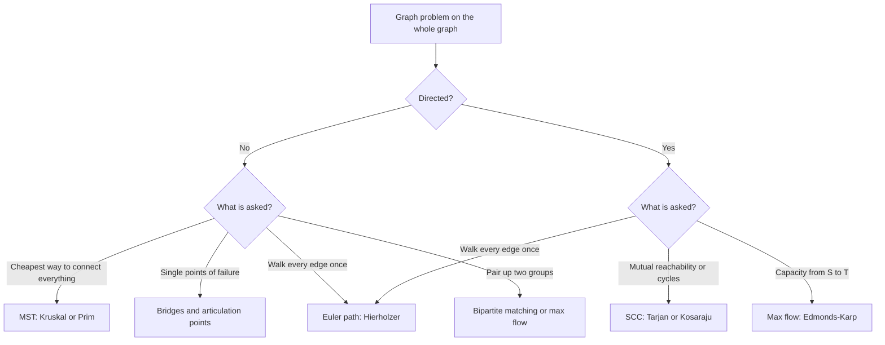
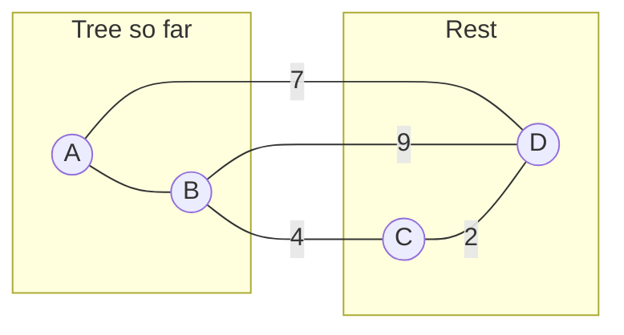

# Pattern 24: Advanced Graphs

## 1. Pattern Name

**Advanced Graph Algorithms**: minimum spanning trees (Kruskal, Prim), strongly connected components (Kosaraju, Tarjan), bridges and articulation points (low-link), Euler paths and circuits (Hierholzer), and maximum flow with bipartite matching (Edmonds-Karp, Kuhn).

This page is a toolbox, like [pattern 23](../23-math-and-number-theory/README.md). Each tool answers one family of questions about a whole graph. It does not answer "what is the shortest path from A to B". That question belongs to [pattern 18](../18-shortest-paths/README.md).

!!! info "Prerequisites"
    Read [Graph Representations](../foundations/07-graph-representations.md), [pattern 11 (graph traversal)](../11-graph-traversal/README.md), [pattern 13 (union-find)](../13-union-find/README.md), and [pattern 18 (shortest paths)](../18-shortest-paths/README.md) first. This page builds on them. Pattern 13 already gives pseudocode for Kruskal and Prim. This page gives the Java versions, the proof that they work, and the variations. The page writes `V` for the number of vertices and `E` for the number of edges.

### The five tools at a glance

| Question | Tool | Time | Section |
|---|---|---|---|
| "Connect all nodes at minimum total cost" | Minimum spanning tree (MST) | O(E log E) | Templates 1 and 2 |
| "Which groups of nodes can all reach each other (directed)?" | Strongly connected components (SCC) | O(V + E) | Template 3 |
| "Which single edge or node, if removed, splits the network?" | Bridges and articulation points | O(V + E) | Template 4 |
| "Use every edge exactly once" | Euler path or circuit | O(V + E) | Template 5 |
| "How much can flow from S to T?" or "Match each X to a different Y" | Maximum flow and bipartite matching | O(V E²) and O(V E) | Templates 6 and 7 |

---

## 2. Core Intuition

### What Interviewers Expect You to Think

These problems look unrelated, but each one has a short solution that rests on one structural fact. If you know the fact, the algorithm follows. If you only memorize the algorithm, you cannot adapt it when the problem changes shape.

**The five facts:**

1. **The cut property makes the greedy choice safe (MST).** A **spanning tree** is a set of V - 1 edges that connects all V vertices without a cycle. A **minimum spanning tree** (MST) is a spanning tree with the smallest total weight. A **cut** splits the vertices into two non-empty sets. The cut property says: among the edges that cross a cut, the cheapest one belongs to some MST. So you can always take the cheapest safe edge and never regret it.
2. **Collapsing every strongly connected component gives a DAG (SCC).** A **strongly connected component** (SCC) is a maximal set of vertices in a directed graph where every vertex reaches every other vertex. If you replace each SCC by one node, the result has no cycle. This graph is the **condensation**. Questions about cycles in a directed graph become questions about a DAG, which you can order topologically ([pattern 12](../12-topological-sort/README.md)).
3. **An undirected DFS has only tree edges and back edges (bridges).** A depth-first search (DFS) on an undirected graph never produces a cross edge. So each non-tree edge joins a vertex to one of its ancestors. A tree edge is a **bridge** (an edge whose removal disconnects the graph) exactly when no back edge from the subtree below it reaches the parent `p` or any vertex above `p` (a second edge between `p` and the subtree also counts).
4. **A trail that enters a vertex must also leave it (Euler).** An **Euler path** uses every edge exactly once. Each time the path passes through a vertex, it uses two edges there, one to enter and one to leave. So all vertices except the two ends need an even degree. This one parity rule decides whether a path exists.
5. **A flow is maximum when no augmenting path exists (flow).** A **flow network** is a directed graph where each edge has a capacity. An **augmenting path** is a path from the source S to the sink T that still has spare capacity on every edge. You push flow along such a path until none is left. The residual graph (spare capacity, plus the right to undo earlier flow) makes the greedy choice reversible.

### Mental Model

For an MST, picture a road builder with a budget. She sorts all possible roads by price and builds each road that joins two towns that are not yet linked. She never builds a road between two towns that already have a route. For flow, picture water pipes with a maximum rate per pipe. You pour water along any open route, and you may later reroute some of it. You stop when no open route is left. The amount you poured is the most the network can carry.



---

## 3. Recognition Signals

### Keywords in the Problem Statement

- "Connect all cities / points / computers at minimum cost", "minimum total length of cable" (MST).
- "Redundant edge", "extra cable", "make the network connected" (union-find or MST).
- "Critical connection", "single point of failure", "if this link fails the network splits" (bridges).
- "Cut vertex", "removing one cell disconnects the island" (articulation points).
- "Mutually reachable", "groups that can all reach each other", "cycle in a directed graph, then collapse it" (SCC).
- "Use every ticket / road / domino exactly once", "reconstruct the itinerary", "valid arrangement of pairs" (Euler path).
- "Maximum number of ... that can be assigned", "each worker gets a different job", "maximum number of accepted invitations" (bipartite matching).
- "Maximum flow", "minimum cut", "bandwidth between two nodes" (flow).

### Constraint Hints

| Constraint | What it suggests |
|---|---|
| `n` up to 1000 and the input is every pair of points | Complete graph with about `n²/2` edges. Use dense Prim, O(V²), and skip the edge list |
| `E` up to `2 * 10^5` and an edge list is given | Kruskal, O(E log E) |
| `n` up to `10^5`, "critical connections" | Bridges in O(V + E). A recursive DFS can overflow the Java stack, so write it iteratively |
| Directed graph, `n` up to `10^5`, "cycle" or "mutual" | Tarjan or Kosaraju, O(V + E) |
| `E` up to `10^5` and every edge must be used once | Hierholzer, O(V + E) |
| Two groups of up to a few thousand nodes, "assign" | Kuhn, O(V E), or flow |
| Tiny `n` (at most 20) and "visit every vertex once" | This is a Hamiltonian path (every vertex once), not an Euler path. Use bitmask DP. See [pattern 15](../15-dynamic-programming/README.md) |

### Input/Output Hints

- **Input:** an edge list `[u, v, weight]`, a list of pairs, a list of tickets, or points on a plane (a complete graph in disguise).
- **Output:** one total cost (MST), a list of edges (bridges), a list of groups (SCC), a sequence of vertices (Euler), or one number (flow, matching size).

### RED FLAGS - NOT This Pattern

- **"Shortest path from A to B"** is not an MST problem. The MST minimizes the total weight of all edges. It does not minimize the distance between two chosen nodes. Use [pattern 18](../18-shortest-paths/README.md).
- **"Visit every vertex exactly once"** is the Hamiltonian path problem. It has no known polynomial algorithm (it is NP-complete). The Euler path is about edges and is easy.
- **"Longest simple path"** is NP-hard in a general graph. Do not look for a graph algorithm. Look for a DAG, a tree, or small `n`.
- **Undirected graph and "strongly connected"** is a category error. In an undirected graph, the connected components are the answer. Use [pattern 11](../11-graph-traversal/README.md) or [pattern 13](../13-union-find/README.md).

---

## 4. Brute Force Thought Process

Each tool has an obvious method that works on a small graph. Knowing the obvious method also gives you the cheap test for your own code: run the obvious method on small random graphs and compare. This page's templates passed such a test (see the note at the end of Section 6).

| Problem | Brute force | Cost | Why it fails |
|---|---|---|---|
| MST | Try every set of V - 1 edges. Keep the acyclic ones. Take the cheapest | Up to C(E, V - 1) sets. A complete graph has V^(V-2) spanning trees (Cayley's formula) | For V = 20 there are about 10^23 trees |
| SCC | For each vertex, run a DFS. Put `u` and `v` in one group if each reaches the other | O(V (V + E)) | For V = 10^5 and E = 10^5 this is about 2 * 10^10 steps |
| Bridges | For each edge, delete it and count the components | O(E (V + E)) | The same size problem: E = 10^5 gives about 2 * 10^10 steps |
| Articulation points | For each vertex, delete it and count the components | O(V (V + E)) | The same |
| Euler path | Try every order of the edges | O(E!) | Even E = 15 has more than 10^12 orders |
| Max flow | Try every cut: every subset of vertices that contains S and not T. Take the cheapest cut capacity (it equals the maximum flow, by the max-flow min-cut theorem) | O(2^V E) | V = 40 already gives about 10^12 subsets |
| Bipartite matching | Try every subset of the edges | O(2^E) | Any real input is far beyond this |

**The waste in each method:**

- The MST brute force re-examines edge sets that share a long prefix of edges.
- The SCC and bridge brute forces repeat the same DFS from a different start or with one element removed. A single DFS already contains the information.
- The Euler brute force backtracks when it gets stuck at a dead end, but it does not know that the dead end is the end of the path.

---

## 5. Optimization Insight (The "Aha" Moment)

### MST: "The Cheapest Edge That Crosses Any Cut Is Safe"

**The cut property.** Let `F` be a set of edges that is part of some MST. Let a cut respect `F` (no edge of `F` crosses it). Let `e` be a cheapest edge that crosses the cut. Then `F + e` is also part of some MST.

**Proof (exchange argument).** Take an MST `T` that contains `F`. If `e` is in `T`, you are done. If not, add `e` to `T`. This creates exactly one cycle. The cycle crosses the cut at `e`, so it must cross the cut at one more edge `f`. Because `f` crosses the cut, `weight(e) <= weight(f)`. Also `f` is not in `F`, because the cut respects `F`. Remove `f`. The result is a spanning tree with weight at most `weight(T)`. So it is also an MST, and it contains `F + e`.

**Kruskal's algorithm is the cut property applied again and again.** When Kruskal looks at an edge `(u, v)` whose ends lie in different components, take the cut "component of `u` versus everything else". No chosen edge crosses it. All cheaper edges are already examined, so `(u, v)` is a cheapest crossing edge or ties with one. The edge is safe. When both ends lie in one component, the edge would close a cycle, and the **cycle property** says to skip it: a heaviest edge on a cycle is not needed (some MST leaves it out; if it is strictly heavier than every other edge on the cycle, no MST contains it).

**Prim's algorithm uses the same property** with one fixed cut, "the tree so far versus the rest".

If all edge weights are distinct, the MST is unique. If weights tie, several MSTs can exist, but all have the same total weight.



In the picture, the cut is "{A, B} versus {C, D}". Three edges cross it: B-C with weight 4, A-D with weight 7, and B-D with weight 9. The cheapest, B-C, is safe.

### SCC: "A DFS Finishes a Component Root After Its Whole Component"

**Tarjan's idea.** During a DFS, give each vertex a discovery number `index[v]`. Compute `low[v]`, the smallest discovery number that `v` can reach by tree edges followed by at most one edge back into a vertex that is still on the **SCC stack** (the stack of vertices that were discovered but not yet assigned to a component). If `low[v] == index[v]`, then `v` cannot reach anything older than itself. So `v` is the root of an SCC. Everything above `v` on the SCC stack belongs to that SCC. Pop the stack down to `v`.

**Kosaraju's idea.** The first DFS records the vertices in order of finish time. The vertex that finishes last lies in a source component of the condensation (a component with no incoming edge from another component). In the reversed graph, a source component becomes a sink component. A DFS in the reversed graph from that vertex cannot leave the component. It marks exactly that component. Repeat in decreasing finish time.

### Bridges: "Can the Subtree Climb Above Its Parent?"

Run one DFS and record `tin[v]`, the discovery time. Compute `low[v]`, the lowest `tin` reachable from the subtree of `v` using tree edges downward and at most one back edge.

- A tree edge `p -> u` is a **bridge** if `low[u] > tin[p]`. The subtree of `u` cannot reach `p` or anything above `p` except through this edge.
- A non-root vertex `p` is an **articulation point** (a vertex whose removal disconnects the graph) if some child `u` has `low[u] >= tin[p]`. The subtree of `u` can reach `p` at best, but not above `p`. Removing `p` cuts it off.
- The DFS root is an articulation point if it has at least two children in the DFS tree.

The difference between `>` for bridges and `>=` for articulation points is the most common source of mistakes on this topic. The reason is that a back edge to `p` itself saves the edge `p-u` (so it is not a bridge), but does not save the vertex `p` (removing `p` removes that back edge too).

### Euler: "Walk Until Stuck, Then Splice"

**Hierholzer's algorithm.** Start at the start vertex. Follow any unused edge, again and again, until you are stuck. In a graph where an Euler path exists, you can only get stuck at the end vertex. The walk might not have used all edges. Back up along the walk. At the first vertex that still has an unused edge, start a new walk. That new walk is a closed loop, and you splice it into the main walk. The stack version does this with one loop: push on a step forward, and when a vertex has no unused edge, pop it into the answer. The answer comes out in reverse order.

### Flow: "Keep Pushing Along Shortest Augmenting Paths"

**Ford-Fulkerson** repeats: find any path from S to T with spare capacity, and push the bottleneck amount along it. **Edmonds-Karp** is Ford-Fulkerson with one rule: find the path with the fewest edges (a BFS). That rule gives a bound on the number of rounds that does not depend on the capacities.

---

## 6. Generalized Templates

All templates compile with `javac --release 21` and passed a test against a brute-force version on small random graphs. The tests used a fixed seed (the seed is the date 20261021). The brute-force versions were:

| Template | Checked against | Cases |
|---|---|---|
| Kruskal, Prim (heap and dense) | The minimum over all spanning trees (every subset of V - 1 edges that has no cycle). Included parallel edges, self-loops, and disconnected graphs | 3,000 graphs with up to 6 vertices and 9 edges |
| Tarjan, Kosaraju | Reachability from every vertex to every vertex (Floyd-Warshall closure) | 5,000 digraphs with up to 9 vertices. Also a cycle of 200,000 vertices |
| Bridges, articulation points | Remove each edge or vertex and count components. Included parallel edges, self-loops, and several components | 8,000 multigraphs with up to 9 vertices. Also a path of 300,000 vertices |
| Euler (directed, undirected) | Try every order of the edges. The returned path must also use each edge once | 6,000 graphs each |
| LC 332 itinerary | All permutations of the tickets, then the smallest in lexical order | 3,000 ticket sets |
| Edmonds-Karp | The minimum cut over all vertex subsets. The extracted cut must have the same capacity | 3,000 networks |
| Kuhn | The best subset of edges that touches each vertex at most once, and the flow network of the same graph | 4,000 bipartite graphs |
| Critical edges (LC 1489) | Enumerate all MSTs. Critical means "in all", pseudo-critical means "in some but not all" | 2,500 random graphs without self-loops (the cases with no spanning tree were skipped, as LC 1489 guarantees a connected graph) |
| `MinCostConnectPoints`, `WaterDistribution` | Kruskal on the complete graph. Every choice of wells and pipes for LC 1168 | 2,000 cases each |

A mutation check also confirmed that the tests catch the typical errors: using `>=` for bridges, using `>` for articulation points, skipping the parent vertex instead of the parent edge, and removing the `onStack` test from Tarjan.

### Helper: Adjacency Arrays From an Edge List

Templates 3 to 5 take `int[][] adj`, where `adj[u]` lists the neighbors of `u`. An iterative DFS needs a pointer into each neighbor list, and arrays give that without an iterator object. See [Graph Representations](../foundations/07-graph-representations.md) for the trade-offs between the forms.

```java
class GraphBuild {
    /** Builds adj[u] = the heads of the edges that leave u. edges[i] = {u, v, ...}. */
    static int[][] adjacency(int n, int[][] edges, boolean directed) {
        int[] degree = new int[n];
        for (int[] e : edges) {
            degree[e[0]]++;
            if (!directed) degree[e[1]]++;
        }
        int[][] adj = new int[n][];
        for (int v = 0; v < n; v++) adj[v] = new int[degree[v]];
        int[] fill = new int[n];
        for (int[] e : edges) {
            adj[e[0]][fill[e[0]]++] = e[1];
            if (!directed) adj[e[1]][fill[e[1]]++] = e[0];
        }
        return adj;
    }
}
```

### Template 1: Kruskal's Algorithm (MST from an Edge List)

Sort the edges by weight. Scan them in order. Take an edge if its ends are in different components, which a union-find structure ([pattern 13](../13-union-find/README.md)) tests in near-constant time. Stop after V - 1 edges.

```java
class Kruskal {
    /** Returns the MST weight, or -1 if the graph is not connected. edges[i] = {u, v, w}. */
    static long mstWeight(int n, int[][] edges) {
        int[][] sorted = edges.clone();                       // keep the caller's order
        Arrays.sort(sorted, (a, b) -> Integer.compare(a[2], b[2]));
        int[] parent = new int[n];
        int[] size = new int[n];
        for (int i = 0; i < n; i++) { parent[i] = i; size[i] = 1; }
        long total = 0;
        int used = 0;
        for (int[] e : sorted) {
            int ru = find(parent, e[0]);
            int rv = find(parent, e[1]);
            if (ru == rv) continue;                           // the edge would close a cycle
            if (size[ru] < size[rv]) { int t = ru; ru = rv; rv = t; }
            parent[rv] = ru;                                  // union by size
            size[ru] += size[rv];
            total += e[2];
            if (++used == n - 1) break;                       // a tree has n - 1 edges
        }
        return used == n - 1 ? total : -1;
    }

    private static int find(int[] parent, int x) {
        while (parent[x] != x) {
            parent[x] = parent[parent[x]];                    // path halving
            x = parent[x];
        }
        return x;
    }
}
```

**Time:** O(E log E) for the sort, which equals O(E log V) because E is at most V², so log E is at most 2 log V. The union-find work is O(E α(V)), where α is the inverse Ackermann function, which is at most 4 for any input that fits in memory. The sort dominates.
**Space:** O(V) for the union-find, plus the sorted copy of the edges.

**Why `clone()`?** Sorting the caller's array reorders it. Problems like LC 1489 need the original edge indexes. Template 8 sorts an index array for the same reason.

**Disconnected input.** The loop ends with fewer than V - 1 edges. The function returns -1. The picked edges then form a **minimum spanning forest** (an MST of each component). Return the forest weight instead if the problem asks for it.

### Template 2: Prim's Algorithm (MST from an Adjacency List or a Matrix)

Prim grows one tree from vertex 0. A min-heap holds the edges that leave the tree. The cheapest one is always safe, because it is the cheapest edge across the cut "tree versus rest".

The first method uses a heap and a "lazy" strategy: it does not decrease keys. It pushes a new entry for every edge and skips stale entries when it pops them. The second method has no heap. It scans an array for the cheapest vertex outside the tree.

```java
class Prim {
    /** Lazy Prim with a heap. adj.get(u) holds {v, w}. Returns -1 if not connected. */
    static long mstWeightHeap(List<List<int[]>> adj) {
        int n = adj.size();
        boolean[] inTree = new boolean[n];
        PriorityQueue<int[]> heap = new PriorityQueue<>((a, b) -> Integer.compare(a[0], b[0]));
        heap.add(new int[]{0, 0});                            // {edge weight, vertex}
        long total = 0;
        int added = 0;
        while (!heap.isEmpty() && added < n) {
            int[] top = heap.poll();
            int u = top[1];
            if (inTree[u]) continue;                          // stale entry
            inTree[u] = true;
            total += top[0];
            added++;
            for (int[] e : adj.get(u)) {
                if (!inTree[e[0]]) heap.add(new int[]{e[1], e[0]});
            }
        }
        return added == n ? total : -1;
    }

    /** Dense Prim in O(V^2). cost[u][v] is the weight, or Integer.MAX_VALUE if no edge. */
    static long mstWeightDense(int[][] cost) {
        int n = cost.length;
        long[] best = new long[n];                            // cheapest edge into the tree
        boolean[] inTree = new boolean[n];
        Arrays.fill(best, Long.MAX_VALUE);
        best[0] = 0;
        long total = 0;
        for (int round = 0; round < n; round++) {
            int u = -1;
            for (int v = 0; v < n; v++) {
                if (!inTree[v] && (u == -1 || best[v] < best[u])) u = v;
            }
            if (best[u] == Long.MAX_VALUE) return -1;         // the rest is unreachable
            inTree[u] = true;
            total += best[u];
            for (int v = 0; v < n; v++) {
                if (!inTree[v] && cost[u][v] != Integer.MAX_VALUE && cost[u][v] < best[v]) {
                    best[v] = cost[u][v];
                }
            }
        }
        return total;
    }
}
```

**Time, heap version:** O(E log E), which is O(E log V). Each edge adds at most one heap entry per direction, so the heap holds at most 2E entries. Each push and pop costs O(log E).
**Time, dense version:** O(V²). The outer loop runs V times. Each round scans V vertices twice.
**Space:** O(V + E) for the heap version, O(V) beyond the input for the dense version.

**With a Fibonacci heap**, Prim runs in O(E + V log V) (Fredman and Tarjan, 1987). Java has no Fibonacci heap in the JDK, and the constants are high. Do not offer it in an interview except as a remark.

**Which MST algorithm?**

| Situation | Choice | Reason |
|---|---|---|
| The input is an edge list | Kruskal | It needs a sort, not an adjacency list |
| The graph is sparse and the input is an adjacency list | Either. Prim with a heap is common | Both are O(E log V) |
| The graph is complete or nearly complete (points on a plane) | Dense Prim, O(V²) | The edge list has V²/2 entries, so building and sorting it costs O(V² log V) |
| Edges arrive over time and you need the answer after each | Kruskal-style union-find | The union-find supports adding edges |

#### Example: LC 1584, Min Cost to Connect All Points

The input has up to 1000 points. Every pair is an edge with Manhattan distance. The dense version needs no edge list.

```java
class MinCostConnectPoints {
    /** LC 1584. Complete graph, Manhattan distance. Dense Prim in O(n^2), no edge list. */
    static int minCostConnectPoints(int[][] points) {
        int n = points.length;
        int[] best = new int[n];                              // cheapest edge into the tree
        boolean[] inTree = new boolean[n];
        Arrays.fill(best, Integer.MAX_VALUE);
        best[0] = 0;
        int total = 0;
        for (int round = 0; round < n; round++) {
            int u = -1;
            for (int v = 0; v < n; v++) {
                if (!inTree[v] && (u == -1 || best[v] < best[u])) u = v;
            }
            inTree[u] = true;
            total += best[u];
            for (int v = 0; v < n; v++) {
                if (inTree[v]) continue;
                int d = Math.abs(points[u][0] - points[v][0])
                      + Math.abs(points[u][1] - points[v][1]);
                best[v] = Math.min(best[v], d);
            }
        }
        return total;
    }
}
```

**Time:** O(n²) for n points. **Space:** O(n).

#### Example: LC 1168, Optimize Water Distribution in a Village

Each house either digs its own well (cost `wells[i]`) or connects by a pipe to another house. Add a **virtual vertex** 0 and an edge from 0 to each house `i` with the cost of the well. A set of wells and pipes that supplies every house is now a spanning tree of the new graph. The answer is its MST.

```java
class WaterDistribution {
    /** LC 1168. A virtual vertex 0 stands for "dig a well here"; then the answer is an MST. */
    static int minCostToSupplyWater(int n, int[] wells, int[][] pipes) {
        int[][] edges = new int[n + pipes.length][];
        for (int i = 0; i < n; i++) edges[i] = new int[]{0, i + 1, wells[i]};   // well = edge to 0
        for (int i = 0; i < pipes.length; i++) edges[n + i] = pipes[i];         // {a, b, cost}
        Arrays.sort(edges, (a, b) -> Integer.compare(a[2], b[2]));
        int[] parent = new int[n + 1];
        for (int i = 0; i <= n; i++) parent[i] = i;
        int total = 0;
        for (int[] e : edges) {
            int ru = find(parent, e[0]), rv = find(parent, e[1]);
            if (ru != rv) { parent[ru] = rv; total += e[2]; }
        }
        return total;
    }

    private static int find(int[] parent, int x) {
        while (parent[x] != x) { parent[x] = parent[parent[x]]; x = parent[x]; }
        return x;
    }
}
```

**Time:** O((n + P) log (n + P)) for P pipes. **Space:** O(n + P).

### Template 3: Strongly Connected Components

Two iterative versions follow. Both run in O(V + E). Both take the adjacency arrays from the helper and return `comp[v]`, the component number of each vertex.

- **Tarjan** runs one DFS. It numbers the components in **reverse topological order** of the condensation: component 0 is a sink (it has no edge to another component), and every edge `u -> v` between components has `comp[u] > comp[v]`.
- **Kosaraju** runs two DFS passes and builds the reversed graph. It numbers the components in topological order: component 0 is a source, and every edge `u -> v` between components has `comp[u] < comp[v]`.

The code tests both order claims against brute force.

```java
class Scc {
    /** Tarjan, iterative. Returns comp[v]. Component 0 is a sink of the condensation DAG. */
    static int[] tarjan(int[][] adj) {
        int n = adj.length;
        int[] index = new int[n];
        int[] low = new int[n];
        int[] comp = new int[n];
        int[] next = new int[n];                              // next neighbor to scan per vertex
        boolean[] onStack = new boolean[n];
        Arrays.fill(index, -1);
        int[] sccStack = new int[n];
        int[] callStack = new int[n];
        int sp = 0, cp = 0, timer = 0, comps = 0;
        for (int s = 0; s < n; s++) {
            if (index[s] != -1) continue;
            index[s] = low[s] = timer++;
            sccStack[sp++] = s; onStack[s] = true;
            callStack[cp++] = s;
            while (cp > 0) {
                int u = callStack[cp - 1];
                if (next[u] < adj[u].length) {
                    int v = adj[u][next[u]++];
                    if (index[v] == -1) {                     // tree edge: go down
                        index[v] = low[v] = timer++;
                        sccStack[sp++] = v; onStack[v] = true;
                        callStack[cp++] = v;
                    } else if (onStack[v]) {                  // edge inside the current SCC
                        low[u] = Math.min(low[u], index[v]);
                    }                                         // else: v is in a finished SCC
                } else {
                    cp--;                                     // u is finished: go up
                    if (low[u] == index[u]) {                 // u is the root of an SCC
                        int w;
                        do {
                            w = sccStack[--sp];
                            onStack[w] = false;
                            comp[w] = comps;
                        } while (w != u);
                        comps++;
                    }
                    if (cp > 0) {
                        int p = callStack[cp - 1];
                        low[p] = Math.min(low[p], low[u]);
                    }
                }
            }
        }
        return comp;
    }

    /** Kosaraju, iterative. Component 0 is a source of the condensation DAG. */
    static int[] kosaraju(int[][] adj) {
        int n = adj.length;
        int[] order = new int[n];                             // vertices by finish time
        int[] next = new int[n];
        boolean[] seen = new boolean[n];
        int[] stack = new int[n];
        int count = 0;
        for (int s = 0; s < n; s++) {                         // pass 1: finish order
            if (seen[s]) continue;
            int sp = 0;
            stack[sp++] = s; seen[s] = true;
            while (sp > 0) {
                int u = stack[sp - 1];
                if (next[u] < adj[u].length) {
                    int v = adj[u][next[u]++];
                    if (!seen[v]) { seen[v] = true; stack[sp++] = v; }
                } else {
                    order[count++] = u;
                    sp--;
                }
            }
        }
        int[][] rev = reverse(adj);
        int[] comp = new int[n];
        Arrays.fill(comp, -1);
        int comps = 0;
        for (int i = n - 1; i >= 0; i--) {                    // pass 2: reverse graph
            int s = order[i];
            if (comp[s] != -1) continue;
            int sp = 0;
            stack[sp++] = s; comp[s] = comps;
            while (sp > 0) {
                int u = stack[--sp];
                for (int v : rev[u]) {
                    if (comp[v] == -1) { comp[v] = comps; stack[sp++] = v; }
                }
            }
            comps++;
        }
        return comp;
    }

    static int[][] reverse(int[][] adj) {
        int n = adj.length;
        int[] deg = new int[n];
        for (int[] row : adj) for (int v : row) deg[v]++;
        int[][] rev = new int[n][];
        for (int v = 0; v < n; v++) rev[v] = new int[deg[v]];
        int[] fill = new int[n];
        for (int u = 0; u < n; u++) for (int v : adj[u]) rev[v][fill[v]++] = u;
        return rev;
    }
}
```

**Time:** O(V + E) for both. Tarjan visits each vertex and each edge once. Kosaraju does two DFS passes and one reversal, each O(V + E).
**Space:** O(V) for Tarjan beyond the input. Kosaraju also stores the reversed graph, O(V + E).

**Recursion depth.** A recursive DFS on a path of 100,000 vertices needs 100,000 stack frames. In a test on macOS with JDK 21, a recursive DFS with one `int` parameter on the main thread overflowed at about 20,000 to 21,000 frames (three runs gave 20,652, 20,760, and 21,466; approximate: the limit depends on the frame size, the platform, and the `-Xss` option; see the `java` command reference in Further Reading). LeetCode input of `10^5` vertices can reach that depth. The templates on this page use an explicit stack for this reason. If you prefer recursion, run it in `new Thread(null, task, "dfs", 1L << 28)`, which gives a 256 MB stack, and say so in the interview.

**How the Tarjan loop works.** Each iteration looks at the vertex `u` on top of the call stack.

1. If `u` has an unscanned neighbor `v` that is new, `v` becomes a child: assign it `index` and `low`, and push it on both stacks.
2. If `v` is old and still on the SCC stack, `v` is in the same SCC as `u` or will be. Lower `low[u]` to `index[v]`.
3. If `v` is old and already off the SCC stack, `v` belongs to a finished component. Ignore the edge.
4. When `u` has no more neighbors, pop it from the call stack. If `low[u] == index[u]`, pop the SCC stack down to `u` and give all those vertices one component number. Then pass `low[u]` up to the parent.

#### Using the condensation

After the SCC step, build the **condensation DAG**: one node per component, and an edge `comp[u] -> comp[v]` for each original edge between different components. Then a DP in topological order answers questions such as "the most valuable path" in O(V + E). Tarjan's component numbers already are a reverse topological order, so a loop over the numbers is enough.

### Template 4: Bridges and Articulation Points (Low-Link)

One iterative DFS computes `tin` and `low` for every vertex. It handles disconnected graphs (it starts a DFS at each unvisited vertex), parallel edges, and self-loops.

**The parent-edge rule.** The DFS must skip the edge it arrived by, not the vertex it came from. If it skipped the parent vertex, two parallel edges between `p` and `u` would look like one edge. The code would call it a bridge, but removing one of two parallel edges does not disconnect anything. The code stores the edge index in `parentEdge` and compares edge indexes.

```java
class Lowlink {
    final List<Integer> bridges = new ArrayList<>();          // indexes into edges
    final boolean[] isCut;                                    // articulation points

    /** Undirected multigraph. edges[i] = {u, v}. Self-loops and parallel edges are allowed. */
    Lowlink(int n, int[][] edges) {
        isCut = new boolean[n];
        int[] start = new int[n + 1];                         // CSR adjacency
        for (int[] e : edges) { start[e[0] + 1]++; start[e[1] + 1]++; }
        for (int i = 0; i < n; i++) start[i + 1] += start[i];
        int[] to = new int[start[n]];
        int[] id = new int[start[n]];
        int[] fill = Arrays.copyOf(start, n);
        for (int i = 0; i < edges.length; i++) {
            int u = edges[i][0], v = edges[i][1];
            to[fill[u]] = v; id[fill[u]++] = i;
            to[fill[v]] = u; id[fill[v]++] = i;
        }
        int[] tin = new int[n];
        int[] low = new int[n];
        int[] parentEdge = new int[n];
        int[] ptr = Arrays.copyOf(start, n);
        Arrays.fill(tin, -1);
        int[] stack = new int[n];
        int timer = 0;
        for (int root = 0; root < n; root++) {
            if (tin[root] != -1) continue;
            int sp = 0, rootChildren = 0;
            tin[root] = low[root] = timer++;
            parentEdge[root] = -1;
            stack[sp++] = root;
            while (sp > 0) {
                int u = stack[sp - 1];
                if (ptr[u] < start[u + 1]) {
                    int k = ptr[u]++;
                    int v = to[k];
                    if (id[k] == parentEdge[u]) continue;     // skip the parent edge
                    if (tin[v] == -1) {
                        tin[v] = low[v] = timer++;
                        parentEdge[v] = id[k];
                        stack[sp++] = v;
                        if (u == root) rootChildren++;
                    } else {
                        low[u] = Math.min(low[u], tin[v]);    // back edge
                    }
                } else {
                    sp--;                                     // u is finished
                    if (sp == 0) break;
                    int p = stack[sp - 1];
                    low[p] = Math.min(low[p], low[u]);
                    if (low[u] > tin[p]) bridges.add(parentEdge[u]);
                    if (p != root && low[u] >= tin[p]) isCut[p] = true;
                }
            }
            if (rootChildren > 1) isCut[root] = true;
        }
    }
}
```

**Time:** O(V + E). Each vertex is pushed once and each adjacency entry is read once.
**Space:** O(V + E) for the CSR (compressed sparse row) adjacency arrays, plus O(V) for the DFS arrays.

**LC 1192 with this class.** Build `int[][] edges` from the `connections` list. Create `new Lowlink(n, edges)`. For each index `i` in `bridges`, add `connections.get(i)` to the answer.

**Two-edge-connected components.** Delete all bridges. The remaining connected components are the 2-edge-connected components (components that no single edge removal can split). Contract each one to a node. The result is a tree (a forest if the input is disconnected), the **bridge tree**. Queries such as "how many bridges lie on the path between `a` and `b`" become distance queries on that tree.

### Template 5: Euler Path and Circuit (Hierholzer)

An **Euler path** is a walk that uses every edge exactly once. An **Euler circuit** is an Euler path that ends where it starts. The existence rules:

| Graph | Euler circuit exists if | Euler path (not a circuit) exists if |
|---|---|---|
| Undirected | Every vertex has an even degree, and all edges lie in one connected component | Exactly two vertices have an odd degree, and all edges lie in one connected component. The path starts at one of them and ends at the other |
| Directed | `in == out` for every vertex, and all edges lie in one weakly connected component | One vertex has `out - in == 1` (the start), one has `in - out == 1` (the end), all others have `in == out`, and all edges lie in one weakly connected component |

The "one component" test is the part that the degree rule does not check. The templates do not run a separate connectivity test. They run Hierholzer and compare the length of the result with E + 1. If the walk used fewer edges, some edges are unreachable from the start, and no Euler path exists.

#### Directed graph

```java
class EulerDirected {
    /** Euler path in a directed graph. Returns the vertex sequence, or an empty list if none. */
    static List<Integer> path(int n, int[][] edges) {
        int[] out = new int[n];
        int[] in = new int[n];
        for (int[] e : edges) { out[e[0]]++; in[e[1]]++; }
        int start = -1, extraOut = 0;
        for (int v = 0; v < n; v++) {
            int d = out[v] - in[v];
            if (d == 1) { extraOut++; start = v; }            // the path must start here
            else if (d != 0 && d != -1) return List.of();     // |out - in| > 1: no path
        }
        if (extraOut > 1) return List.of();
        if (start == -1) {                                    // all balanced: a circuit
            for (int v = 0; v < n && start == -1; v++) if (out[v] > 0) start = v;
        }
        if (start == -1) return List.of();                    // no edges
        int[][] adj = new int[n][];
        for (int v = 0; v < n; v++) adj[v] = new int[out[v]];
        int[] fill = new int[n];
        for (int[] e : edges) adj[e[0]][fill[e[0]]++] = e[1];

        int[] ptr = new int[n];
        int[] stack = new int[edges.length + 1];
        int sp = 0;
        List<Integer> route = new ArrayList<>();
        stack[sp++] = start;
        while (sp > 0) {
            int u = stack[sp - 1];
            if (ptr[u] < adj[u].length) stack[sp++] = adj[u][ptr[u]++];   // walk an unused edge
            else route.add(stack[--sp]);                                  // stuck: emit the vertex
        }
        if (route.size() != edges.length + 1) return List.of();           // edges left over
        Collections.reverse(route);
        return route;
    }
}
```

#### Undirected graph

An undirected edge appears in two adjacency lists. The walk must use it once, so each edge has an index and a `used` flag.

```java
class EulerUndirected {
    /** Euler path in an undirected multigraph. Returns the vertices, or an empty list if none. */
    static List<Integer> path(int n, int[][] edges) {
        int[] start = new int[n + 1];
        for (int[] e : edges) { start[e[0] + 1]++; start[e[1] + 1]++; }
        int odd = 0, first = -1, startVertex = -1;
        for (int v = 0; v < n; v++) {
            int deg = start[v + 1];                           // degree, before the prefix sum
            if (deg % 2 == 1) { odd++; if (startVertex == -1) startVertex = v; }
            if (deg > 0 && first == -1) first = v;
        }
        if (odd != 0 && odd != 2) return List.of();
        if (startVertex == -1) startVertex = first;           // circuit: any vertex with an edge
        if (startVertex == -1) return List.of();              // no edges
        for (int i = 0; i < n; i++) start[i + 1] += start[i];
        int[] to = new int[start[n]];
        int[] id = new int[start[n]];
        int[] fill = Arrays.copyOf(start, n);
        for (int i = 0; i < edges.length; i++) {
            int u = edges[i][0], v = edges[i][1];
            to[fill[u]] = v; id[fill[u]++] = i;
            to[fill[v]] = u; id[fill[v]++] = i;
        }
        boolean[] used = new boolean[edges.length];
        int[] ptr = Arrays.copyOf(start, n);
        int[] stack = new int[edges.length + 1];
        int sp = 0;
        List<Integer> route = new ArrayList<>();
        stack[sp++] = startVertex;
        while (sp > 0) {
            int u = stack[sp - 1];
            while (ptr[u] < start[u + 1] && used[id[ptr[u]]]) ptr[u]++;   // skip used edges
            if (ptr[u] < start[u + 1]) {
                int k = ptr[u]++;
                used[id[k]] = true;                                       // use the edge once
                stack[sp++] = to[k];
            } else {
                route.add(stack[--sp]);
            }
        }
        if (route.size() != edges.length + 1) return List.of();
        Collections.reverse(route);
        return route;
    }
}
```

**Time:** O(V + E) for both. Each edge is used once, and each adjacency entry is skipped at most once.
**Space:** O(V + E).

#### LC 332, Reconstruct Itinerary

The tickets form a directed multigraph on airport names, and an itinerary is an Euler path from `"JFK"`. To get the lexically smallest itinerary, take the smallest unused ticket first. A `PriorityQueue<String>` per airport does that. The stack-and-pop form of Hierholzer needs no backtracking: a dead-end airport is popped first, so it lands at the end of the route.

```java
class ReconstructItinerary {
    /** LC 332. Smallest lexical Euler path from "JFK". The input always has a valid path. */
    static List<String> findItinerary(List<List<String>> tickets) {
        Map<String, PriorityQueue<String>> graph = new HashMap<>();
        for (List<String> t : tickets) {
            graph.computeIfAbsent(t.get(0), k -> new PriorityQueue<>()).add(t.get(1));
        }
        LinkedList<String> route = new LinkedList<>();
        Deque<String> stack = new ArrayDeque<>();
        stack.push("JFK");
        while (!stack.isEmpty()) {
            String u = stack.peek();
            PriorityQueue<String> next = graph.get(u);
            if (next != null && !next.isEmpty()) stack.push(next.poll());   // smallest ticket
            else route.addFirst(stack.pop());                               // stuck: emit
        }
        return route;
    }
}
```

**Time:** O(E log E). Each ticket enters and leaves a heap once. **Space:** O(E).

**Trace on a dead end.** Tickets `JFK->KUL`, `JFK->NRT`, `NRT->JFK`. The stack starts as `[JFK]`.

1. `JFK` has `[KUL, NRT]`. Pop `KUL`. The stack is `[JFK, KUL]`.
2. `KUL` has no tickets. Emit `KUL`. The route is `[KUL]`. The stack is `[JFK]`.
3. `JFK` has `[NRT]`. Pop `NRT`. The stack is `[JFK, NRT]`.
4. `NRT` has `[JFK]`. Pop `JFK`. The stack is `[JFK, NRT, JFK]`.
5. `JFK` has no tickets. Emit `JFK`, then `NRT`, then `JFK`. Each emit goes to the front of the route.

The route is `JFK, NRT, JFK, KUL`. The greedy walk chose `KUL` first and got stuck. The algorithm placed `KUL` last without backtracking.

### Template 6: Maximum Flow with Edmonds-Karp

The class stores the graph in forward-star arrays ([Graph Representations](../foundations/07-graph-representations.md)). Every call to `addEdge` creates two edges: the forward edge with the real capacity, and a reverse edge with capacity 0. The reverse edge sits at the next index, so edge `e` pairs with `e ^ 1`. Pushing flow along `e` lowers `cap[e]` and raises `cap[e ^ 1]`. The raised reverse capacity lets a later path undo the flow.

```java
class EdmondsKarp {
    private final int n;
    private final int[] head, next, to;                       // forward-star adjacency
    private final long[] cap;                                 // residual capacity
    private int edgeCount = 0;

    EdmondsKarp(int n, int maxEdges) {
        this.n = n;
        head = new int[n];
        Arrays.fill(head, -1);
        next = new int[2 * maxEdges];
        to = new int[2 * maxEdges];
        cap = new long[2 * maxEdges];
    }

    void addEdge(int u, int v, long capacity) {
        to[edgeCount] = v; cap[edgeCount] = capacity; next[edgeCount] = head[u];
        head[u] = edgeCount++;
        to[edgeCount] = u; cap[edgeCount] = 0; next[edgeCount] = head[v];   // reverse edge
        head[v] = edgeCount++;                                // edge e pairs with e ^ 1
    }

    /** Maximum flow from s to t (s != t). Each BFS finds a shortest augmenting path. */
    long maxFlow(int s, int t) {
        long flow = 0;
        int[] parentEdge = new int[n];
        while (true) {
            Arrays.fill(parentEdge, -1);
            parentEdge[s] = -2;
            ArrayDeque<Integer> queue = new ArrayDeque<>();
            queue.add(s);
            while (!queue.isEmpty() && parentEdge[t] == -1) {
                int u = queue.poll();
                for (int e = head[u]; e != -1; e = next[e]) {
                    if (cap[e] > 0 && parentEdge[to[e]] == -1) {
                        parentEdge[to[e]] = e;
                        queue.add(to[e]);
                    }
                }
            }
            if (parentEdge[t] == -1) return flow;             // no augmenting path: flow is maximum
            long push = Long.MAX_VALUE;
            for (int v = t; v != s; v = to[parentEdge[v] ^ 1]) {
                push = Math.min(push, cap[parentEdge[v]]);    // the bottleneck on the path
            }
            for (int v = t; v != s; v = to[parentEdge[v] ^ 1]) {
                cap[parentEdge[v]] -= push;
                cap[parentEdge[v] ^ 1] += push;
            }
            flow += push;
        }
    }

    /** Call after maxFlow. The vertices reachable from s in the residual graph form a min cut. */
    boolean[] sourceSide(int s) {
        boolean[] seen = new boolean[n];
        ArrayDeque<Integer> queue = new ArrayDeque<>();
        queue.add(s);
        seen[s] = true;
        while (!queue.isEmpty()) {
            int u = queue.poll();
            for (int e = head[u]; e != -1; e = next[e]) {
                if (cap[e] > 0 && !seen[to[e]]) { seen[to[e]] = true; queue.add(to[e]); }
            }
        }
        return seen;
    }
}
```

**Time:** O(V E²). Each BFS costs O(E). The bound on the number of augmentations is O(V E): in each augmentation, at least one edge of the path is a bottleneck, and Edmonds and Karp (1972) proved that each edge can be the bottleneck only O(V) times, because the shortest-path distance to each vertex never decreases. So the total is O(V E) augmentations of O(E) each.
**Space:** O(V + E).

**The bound does not depend on the capacities.** Plain Ford-Fulkerson with a DFS runs in O(E * f) for integer capacities, where `f` is the value of the maximum flow. If the capacities are large, `f` is large. The Edmonds-Karp bound stays O(V E²).

**Faster algorithms.** Dinic's algorithm runs in O(V² E). It uses level graphs and blocking flows. In practice, interviews rarely need it.

**Min cut.** After `maxFlow`, the vertices that S reaches in the residual graph form the source side of a minimum cut. The capacity of the edges that go from that side to the rest equals the maximum flow value (the max-flow min-cut theorem, Ford and Fulkerson 1956). The `sourceSide` method returns that set, and the test verifies that its capacity equals the flow.

**Undirected edges.** For an undirected edge with capacity `c`, call `addEdge(u, v, c)` and `addEdge(v, u, c)`.

**Vertex capacities.** To limit the flow through a vertex `v`, split it into `v_in` and `v_out` with an edge `v_in -> v_out` of capacity equal to the limit. Point all incoming edges at `v_in`, and start all outgoing edges at `v_out`.

### Template 7: Bipartite Matching

A graph is **bipartite** if its vertices split into a left set and a right set, and every edge joins a left vertex to a right vertex ([pattern 11](../11-graph-traversal/README.md) checks this with a two-coloring). A **matching** is a set of edges that share no vertex. A **maximum matching** has the most edges. Typical wording: "assign each worker to a different job", "the largest number of invitations that can be accepted".

**As a flow problem.** Add a source with an edge of capacity 1 to every left vertex. Add a sink with an edge of capacity 1 from every right vertex. Give each original edge capacity 1. The maximum flow equals the size of the maximum matching, because the flow of each edge is 0 or 1, and each vertex has at most one unit through it.

**Kuhn's algorithm** is the same idea without the explicit network. For each left vertex, it searches for an augmenting path: a path that starts at an unmatched left vertex, alternates between non-matching and matching edges, and ends at an unmatched right vertex. If the search finds one, it flips the edges on the path, and the matching grows by one.

```java
class BipartiteMatching {
    /** Kuhn's algorithm. adj[l] lists the right vertices that left vertex l may match. */
    static int maxMatching(int[][] adj, int rightSize) {
        int[] matchOfRight = new int[rightSize];
        Arrays.fill(matchOfRight, -1);
        int matched = 0;
        for (int l = 0; l < adj.length; l++) {
            if (augment(l, adj, new boolean[rightSize], matchOfRight)) matched++;
        }
        return matched;
    }

    // Recursion depth is at most the number of left vertices, because each level visits a new one.
    private static boolean augment(int l, int[][] adj, boolean[] seen, int[] matchOfRight) {
        for (int r : adj[l]) {
            if (seen[r]) continue;
            seen[r] = true;
            if (matchOfRight[r] == -1 || augment(matchOfRight[r], adj, seen, matchOfRight)) {
                matchOfRight[r] = l;                          // l takes r, the old partner moves on
                return true;
            }
        }
        return false;
    }
}
```

**Time:** O(V E). There are at most `L` searches (one per left vertex), and each search visits each edge at most once.
**Space:** O(R) for the matching, plus the recursion stack.
**Recursion depth:** at most `L`, because each recursive call enters a new left vertex through its matched right vertex. For `L` up to a few thousand, this is safe. For larger `L`, use Hopcroft-Karp or the flow network.

**Hopcroft-Karp** finds many shortest augmenting paths in each phase and runs in O(E √V) (Hopcroft and Karp, 1973). Mention it in an interview. Writing it is rarely needed.

**Useful facts.** In a bipartite graph, the size of a maximum matching equals the size of a minimum vertex cover (König's theorem). In a DAG, the minimum number of vertex-disjoint paths that cover all vertices equals V minus the size of a maximum matching in the split graph (an edge `u_out -> v_in` for each DAG edge `u -> v`). Hall's theorem says that a matching that covers all left vertices exists if and only if every subset `S` of the left side has at least `|S|` neighbors.

### Template 8: Critical and Pseudo-Critical MST Edges (LC 1489)

Some edges belong to every MST (**critical**). Some belong to at least one but not all (**pseudo-critical**). The rest belong to none. Test each edge `i` with two Kruskal runs:

- Skip `i`. If the result is heavier than the MST (or the graph is disconnected), `i` is critical.
- Otherwise, force `i` first. If the result has the MST weight, `i` is pseudo-critical.

```java
class CriticalEdges {
    /** LC 1489. Returns {critical edge indexes, pseudo-critical edge indexes}. */
    static List<List<Integer>> find(int n, int[][] edges) {
        int m = edges.length;
        Integer[] order = new Integer[m];
        for (int i = 0; i < m; i++) order[i] = i;
        Arrays.sort(order, (a, b) -> Integer.compare(edges[a][2], edges[b][2]));
        long best = mst(n, edges, order, -1, -1);
        List<Integer> critical = new ArrayList<>();
        List<Integer> pseudo = new ArrayList<>();
        for (int i = 0; i < m; i++) {
            if (mst(n, edges, order, i, -1) > best) critical.add(i);       // worse without it
            else if (mst(n, edges, order, -1, i) == best) pseudo.add(i);   // some MST uses it
        }
        return List.of(critical, pseudo);
    }

    /** Kruskal that skips edge `skip` and takes edge `force` first. Returns MAX_VALUE if none. */
    private static long mst(int n, int[][] edges, Integer[] order, int skip, int force) {
        int[] parent = new int[n];
        for (int i = 0; i < n; i++) parent[i] = i;
        long total = 0;
        int used = 0;
        if (force >= 0) {
            parent[find(parent, edges[force][0])] = find(parent, edges[force][1]);
            total += edges[force][2];
            used++;
        }
        for (int i : order) {
            if (i == skip) continue;
            int ru = find(parent, edges[i][0]);
            int rv = find(parent, edges[i][1]);
            if (ru == rv) continue;
            parent[ru] = rv;
            total += edges[i][2];
            used++;
        }
        return used == n - 1 ? total : Long.MAX_VALUE;
    }

    private static int find(int[] parent, int x) {
        while (parent[x] != x) { parent[x] = parent[parent[x]]; x = parent[x]; }
        return x;
    }
}
```

**Time:** O(E² α(V)) after one sort of O(E log E). Each edge costs two Kruskal passes of O(E α(V)).
**Space:** O(V + E).

---

## 7. Variations of the Pattern

### Variation A: MST Variants

| Variant | How |
|---|---|
| Maximum spanning tree | Sort in descending order (Kruskal), or negate the weights |
| Minimum spanning forest | Run Kruskal and do not stop at V - 1 edges. Count the components |
| Some edges are forced | Union the forced edges first, add their weight, then continue (Template 8 does this) |
| Second-best MST | For each non-tree edge, add it to the MST and remove the heaviest edge on the cycle. Take the smallest increase. This is the standard approach, and it needs the maximum edge on a tree path (binary lifting or a plain DFS for small V) |
| Virtual vertex | A cost to "start" at a vertex becomes an edge from a new vertex (LC 1168, above) |
| Minimum bottleneck path | The path between `a` and `b` that minimizes its largest edge lies on the MST. See Variation G |

### Variation B: SCC and the Condensation

- **Count components or find the largest.** Count the distinct values in `comp`.
- **Is the whole graph strongly connected?** One component, or one forward DFS and one reverse DFS from vertex 0 both reach all vertices.
- **Minimum edges to add so that the graph becomes strongly connected.** If the condensation has `c > 1` nodes, the answer is `max(sources, sinks)`, where a source has no incoming edge and a sink has no outgoing edge in the condensation (Eswaran and Tarjan, 1976). The code test verified this formula against brute force on 600 small digraphs.
- **2-SAT** (satisfiability of a formula where each clause has two literals). Build an implication graph with a node for each literal and its negation. The formula is unsatisfiable exactly when some variable and its negation lie in one SCC. Mention it as an application. Interviews rarely ask for the full solution.
- **Functional graphs** (each node has exactly one outgoing edge, as in LC 2360 and LC 2127). Every component has exactly one cycle. You can find the cycles by following pointers with a visit-state array, which is simpler than SCC. LC 2127 combines the cycle lengths with the longest chains that lead into 2-cycles.
- **Safe states (LC 802).** A node is safe if every path from it ends at a terminal node. The safe nodes are the nodes that cannot reach a cycle. A reverse-graph topological sort ([pattern 12](../12-topological-sort/README.md)) solves it with less code than SCC.

### Variation C: Bridges and Their Relatives

- **Count the bridges, or list them** (Template 4).
- **Minimum days to disconnect an island (LC 1568).** The answer is at most 2. If the land cells form zero or at least two islands, the answer is 0. If the land is a single cell, or one cell is an articulation point of the cell graph, the answer is 1. Otherwise the answer is 2. The articulation test is Template 4 on the grid graph. Two adjacent land cells have no articulation point, so the answer is 2 (the LeetCode example `[[1,1]]`: an empty grid with zero islands also counts as disconnected).
- **Add one edge to a tree or forest and ask whether it creates a cycle.** That question is union-find, not low-link ([pattern 13](../13-union-find/README.md)).
- **Dynamic edge removal.** Process the removals in reverse order as additions with union-find (compare LC 803 in pattern 13).

### Variation D: Euler Variants

- **Euler circuit on an undirected graph (every degree even).** Template 5 with the odd-degree test set to zero.
- **De Bruijn sequence (LC 753, Cracking the Safe).** The nodes are all strings of length `n - 1` over `k` digits, and the edges are all strings of length `n`. An Euler circuit in this graph spells the shortest string that contains every `n`-digit code.
- **Valid arrangement of pairs (LC 2097).** The pairs `[start, end]` are the edges. The input guarantees that an Euler path exists. Template 5 (directed) finds it. The start vertex is the one with `out - in == 1`, or any vertex if none has it. The vertex names are large integers, so map them to `0..V-1` first or use a `HashMap<Integer, Deque<Integer>>`.
- **Chinese postman** (the shortest closed walk that uses every edge at least once). It is beyond interview scope, but it shows why parity matters: you pair up the odd vertices with the cheapest extra edges.

### Variation E: Flow Modeling

| Problem shape | Model |
|---|---|
| Assign workers to jobs, each used at most once | Bipartite matching (Template 7) |
| Maximum set of vertex-disjoint paths | Split each vertex, give the middle edge capacity 1 |
| Maximum set of edge-disjoint paths | Give each edge capacity 1. The max flow is the answer (Menger's theorem) |
| Minimum edges to remove to disconnect S from T | Give each edge capacity 1. The min cut is the answer |
| Minimum path cover in a DAG | V minus the maximum matching (Template 7, "Useful facts") |

The hard part of a flow problem is the model, not the algorithm. Name the source, the sink, and what one unit of flow means before you write any code.

### Variation F: Unit and Zero-One Weights

If every edge has weight 0 or 1 and you want the shortest path, use 0-1 BFS with a deque: O(V + E). It is covered in [pattern 18, Template 5](../18-shortest-paths/README.md). It has no connection to the MST, even though both problems use edge weights. For the MST with weights in {0, 1}, Kruskal still works, and the sort becomes a counting sort.

### Variation G: Offline Queries with Kruskal and Union-Find

Sort the edges by weight and sort the queries by their limit. Sweep both lists together, uniting edges below the current limit, and answer each query when the sweep reaches it.

- **LC 1697 (Checking Existence of Edge Length Limited Paths).** Query `(p, q, limit)` asks whether a path exists that uses only edges with weight below `limit`. Sort the queries by `limit`. Before each query, unite all edges with weight below `limit`. The answer is `find(p) == find(q)`.
- **LC 1101 (The Earliest Moment When Everyone Become Friends, Medium, premium).** The earliest time at which everyone is connected is the weight of the heaviest edge that Kruskal adds, or -1 if the result is not a spanning tree.
- **Minimax paths.** The smallest possible largest edge on a path between `a` and `b` equals the largest edge on the tree path between them in the MST. The code test checked this against a Floyd-Warshall minimax computation on 2,000 graphs.

---

## 8. Classic Interview Problems

Difficulties come from the LeetCode problem list (`https://leetcode.com/api/problems/all/`), saved on the day of writing. "Premium" means that LeetCode needs a subscription for the problem. The list runs from easier to harder.

| LC # | Title | Difficulty | Key insight |
|---|---|---|---|
| 684 | Redundant Connection | Medium | The first edge whose ends are already connected closes the cycle (Kruskal's skip test, without weights) |
| 1319 | Number of Operations to Make Network Connected | Medium | If E < V - 1, the answer is -1. Otherwise the answer is the number of components minus 1 |
| 1584 | Min Cost to Connect All Points | Medium | Complete graph, so use dense Prim in O(n²) (Template 2) |
| 1135 | Connecting Cities With Minimum Cost (premium) | Medium | Plain Kruskal. Return -1 if fewer than n - 1 edges were taken |
| 1192 | Critical Connections in a Network | Hard | The bridges (Template 4). Recursive DFS overflows on `10^5` vertices, so use the iterative version |
| 1568 | Minimum Number of Days to Disconnect Island | Hard | The answer is 0, 1, or 2. Use articulation points on the land cells |
| 332 | Reconstruct Itinerary | Hard | Hierholzer with a sorted adjacency list. Emit a vertex when it is stuck (Template 5) |
| 2097 | Valid Arrangement of Pairs | Hard | Euler path on a directed graph. Find the start by `out - in == 1` |
| 1489 | Find Critical and Pseudo-Critical Edges in Minimum Spanning Tree | Hard | Kruskal with one edge skipped, then with one edge forced (Template 8) |
| 1579 | Remove Max Number of Edges to Keep Graph Fully Traversable | Hard | Two union-find structures (Alice and Bob). Process the shared edges (type 3) first, as in Kruskal |
| 1168 | Optimize Water Distribution in a Village (premium) | Hard | Virtual vertex 0 turns wells into edges, then run Kruskal |
| 2127 | Maximum Employees to Be Invited to a Meeting | Hard | Functional graph. The larger of two values: the longest cycle, and the sum over all 2-cycles of (2 + the longest chain into one end + the longest chain into the other end) |

Other problems that use these tools: 685 (Redundant Connection II, Hard, a union-find case analysis for a directed graph), 1697 (Checking Existence of Edge Length Limited Paths, Hard, Variation G), 753 (Cracking the Safe, Hard, De Bruijn sequence), 2360 (Longest Cycle in a Graph, Hard, functional graph), 802 (Find Eventual Safe States, Medium, reverse topological order), and 1820 (Maximum Number of Accepted Invitations, Medium, premium, bipartite matching).

### Walkthrough: LC 1192, Critical Connections in a Network

**Step 1, restate.** The network has `n` servers (`1 <= n <= 10^5`) and `connections` links (undirected). Return all links whose removal would split the servers into two groups that cannot reach each other. The network is connected at the start.

**Step 2, brute force.** For each link, remove it and run a DFS to check whether all servers are still reachable. This costs O(E (V + E)), about 2 * 10^10 steps for `10^5` links. It times out.

**Step 3, name the structure.** "A link whose removal splits the network" is the definition of a bridge. The DFS-tree argument (Section 5) finds all bridges in one pass.

**Step 4, pick the form.** The graph has up to `10^5` vertices, and a chain-like input gives a DFS depth of `10^5`. A recursive DFS overflows the Java stack. Use Template 4.

**Step 5, code.** The block needs the `Lowlink` class from Template 4, so the page marks it as a fragment.

<!-- fragment -->
```java
class CriticalConnections {
    static List<List<Integer>> criticalConnections(int n, List<List<Integer>> connections) {
        int[][] edges = new int[connections.size()][];
        for (int i = 0; i < edges.length; i++) {
            edges[i] = new int[]{connections.get(i).get(0), connections.get(i).get(1)};
        }
        Lowlink lowlink = new Lowlink(n, edges);              // Template 4
        List<List<Integer>> answer = new ArrayList<>();
        for (int i : lowlink.bridges) answer.add(connections.get(i));
        return answer;
    }
}
```

**Step 6, check.** Take a triangle `0-1-2` plus a tail edge `2-3`. Only `2-3` is a bridge. The back edge that closes the triangle lets the subtree of each triangle vertex reach its parent, so `low[u] > tin[p]` fails for those edges.

**Step 7, complexity.** O(V + E) time and O(V + E) space.

---

## 9. How to Practice This Pattern Effectively

### Week 1: Spanning Trees and Union-Find

**Day 1-2:**
- Solve Redundant Connection (684) and Number of Operations to Make Network Connected (1319).
- Write Kruskal from memory in under 10 minutes, with `find` using path halving.

**Day 3:**
- Solve Min Cost to Connect All Points (1584) twice: with Kruskal (build the `n²/2` edges) and with dense Prim. Compare the run times.

**Day 4-5:**
- Solve Connecting Cities (1135), then Optimize Water Distribution (1168) and Find Critical and Pseudo-Critical Edges (1489).
- Prove the cut property out loud, with the exchange argument.

### Week 2: DFS Numbering

**Day 1-2:**
- Write Tarjan's SCC iteratively from memory. Verify the component order property on a small example.
- Solve Find Eventual Safe States (802) with SCC, then with reverse topological sort. Compare.

**Day 3-4:**
- Solve Critical Connections (1192). Write the recursive version first, then convert it to the iterative one.
- Solve Minimum Number of Days to Disconnect Island (1568).

**Day 5:**
- Test your bridge code on a graph with two parallel edges between the same pair of vertices.

### Week 3: Euler and Flow

**Day 1-2:**
- Solve Reconstruct Itinerary (332) and Valid Arrangement of Pairs (2097).
- Write the existence rules for the directed and undirected cases from memory.

**Day 3-5:**
- Write Edmonds-Karp from memory. Then solve a bipartite matching problem (1820) with Kuhn.
- Write a brute-force min cut for 6 vertices and check your flow against it.

### How to Present These in an Interview

1. **Name the structure.** "This asks for the cheapest way to connect all nodes, so it is a minimum spanning tree." One sentence.
2. **State the greedy rule and why it is safe.** For MST, the cut property. For bridges, `low[u] > tin[p]`.
3. **State the complexity and the data structure.** "Kruskal with union-find. O(E log E) for the sort."
4. **Mention the Java trap.** "A recursive DFS can overflow at about 10^4 to 10^5 depth, so I use an explicit stack."
5. **Test with a small case that includes a duplicate edge or a disconnected graph.**

### Self-Check Questions

- Can I state the cut property and prove it with the exchange argument?
- Can I say, without looking, why bridges use `>` and articulation points use `>=`?
- Which component number does Tarjan give to a sink component? Which does Kosaraju give?
- What does the degree rule check, and what does it not check?
- Why does Edmonds-Karp need reverse edges?
- Why does the MST not give the shortest path between two nodes? Can I give a counterexample with three vertices?

---

## 10. Common Mistakes Even Experienced Developers Make

### Mistake 1: A Recursive DFS on a Deep Graph

A recursive Tarjan or bridge-finder passes small tests and fails with `StackOverflowError` on a path of `10^5` vertices.

**Fix:** use the iterative templates, or run the recursion in a thread with a larger stack, and say so.

### Mistake 2: Skipping the Parent Vertex Instead of the Parent Edge

<!-- fragment -->
```java
if (v == parent) continue;      // wrong when two edges join the same pair of vertices
```

With parallel edges, the second edge to the parent is a back edge, and it keeps the edge from being a bridge. If the code skips the vertex, it reports a false bridge. A mutation test of the code on this page failed on this error.

**Fix:** skip only the edge index you arrived by, as `Lowlink` does.

### Mistake 3: `>=` Versus `>`

Use `low[u] > tin[p]` for bridges and `low[u] >= tin[p]` for articulation points. If you swap them, you report non-bridges or miss cut vertices. The test catches both errors.

### Mistake 4: The Root of the DFS Tree

The articulation rule `low[u] >= tin[p]` always holds for the root, because nothing is older than the root. If you apply it to the root, every root with one child becomes a false articulation point. The root is an articulation point only if it has at least two DFS-tree children.

### Mistake 5: Forgetting That Kruskal May Not Reach V - 1 Edges

If the graph is disconnected, Kruskal ends with fewer than V - 1 edges. Returning the total as if it were an MST gives a wrong answer, with no error.

**Fix:** count the edges taken and return -1 (or the forest, if the problem asks) when the count is below V - 1.

### Mistake 6: `int` Overflow in the Total

The sum of up to `10^5` edge weights, each up to `10^9`, does not fit in an `int`. The templates keep the total in a `long`. The same applies to flow values and Prim's `best` array when it uses `Integer.MAX_VALUE` as infinity: adding to it overflows.

### Mistake 7: Using the Wrong Order in Kosaraju's Second Pass

The second pass must go through vertices in decreasing finish time, on the reversed graph. If you use increasing finish time, or the original graph, the passes mark unions of components.

### Mistake 8: Using Tarjan's SCC Without the `onStack` Test

If `low[u]` uses every visited neighbor, an edge into a finished component lowers `low[u]` and merges two components. Use only neighbors that are still on the SCC stack.

### Mistake 9: Using SCC on an Undirected Graph

In an undirected graph, every connected component is strongly connected, so the SCC algorithm returns what a plain traversal returns, at a higher cost. If the question is "which edge splits the network", you want bridges, not SCC.

### Mistake 10: Skipping the Connectivity Check in the Euler Test

A graph can have the right degrees and still have no Euler path, for example two separate triangles. The templates catch this by comparing the path length with E + 1. If you check the degrees only, you accept the two triangles.

### Mistake 11: Starting the Euler Path at the Wrong Vertex

In a directed graph with a path (not a circuit), the walk must start at the vertex with `out - in == 1`. If you start elsewhere, Hierholzer produces a closed walk that misses edges, or fails. The same applies to the odd-degree vertex in an undirected graph.

### Mistake 12: Forgetting the Reverse Edge in Max Flow

Without the reverse edges, the algorithm cannot undo a bad early choice, and it returns a flow that is not maximum. For example, in a diamond-shaped network with a middle edge, a first path through the middle edge blocks the best flow unless it can be reversed.

### Mistake 13: Using Dijkstra or a Shortest-Path Algorithm for an MST

Dijkstra minimizes the distance from one source, so it produces a shortest-path tree. Its total weight is at least the weight of the MST, and it can be larger. Prim looks like Dijkstra, but it compares the edge weight `w`, not `dist[u] + w`.

---

## Commonly Confused With

| Looks like... | But use... | The question that decides |
|---|---|---|
| "Connect everything at minimum cost" | [Shortest paths](../18-shortest-paths/README.md) | Is the goal a total over all nodes? Use an MST. Is it the cost from one node to another? Use Dijkstra |
| "Connected components" | [Union-find](../13-union-find/README.md) or [traversal](../11-graph-traversal/README.md) | Is the graph undirected, and do you only need the groups? Use union-find or BFS. Is it directed? Use SCC |
| "Detect a cycle in a directed graph" | [Topological sort](../12-topological-sort/README.md) | Do you only need to know whether a cycle exists? Use Kahn's algorithm. Do you need the cycles' members? Use SCC |
| "Longest path" or "visit every vertex" | [Dynamic programming](../15-dynamic-programming/README.md) | Is the graph a DAG? Use DP in topological order. Is it a general graph with small `n`? Use a bitmask DP. It is not an Euler problem unless the question says "every edge" |
| "Use every edge once" versus "visit every vertex once" | Euler versus Hamiltonian | Is it about edges? Use Hierholzer in O(V + E). Is it about vertices? It is NP-complete. Use bitmask DP for small `n` |
| "Unit capacity, assign A to B" | Matching versus a general flow | Are there two groups and one-to-one pairs? Use Kuhn. Are there capacities, or more than two layers? Use Edmonds-Karp |
| "Edge weights are 0 or 1" | [0-1 BFS](../18-shortest-paths/README.md) | Is the question a shortest path? Use 0-1 BFS. Is it a spanning tree? Use Kruskal |
| "Remove an edge or vertex" | [Union-find in reverse](../13-union-find/README.md) | Is it one static question about all edges? Use bridges. Is it a sequence of removals? Reverse the order and add edges with union-find |

> Full decision procedure: [How to Choose a Pattern](../how-to-choose-a-pattern.md)

---

## Quick Reference Card

```text
┌───────────────────────────────────────────────────────────────────────┐
│                  ADVANCED GRAPHS CHEAT SHEET                          │
├───────────────────────────────────────────────────────────────────────┤
│ MST       Kruskal: sort edges, union-find, stop at V-1 edges          │
│           O(E log E). Fewer than V-1 edges taken = disconnected       │
│           Prim: heap O(E log V), dense array O(V^2) for complete graph│
│           Cut property: cheapest edge across any cut is safe          │
│           Cycle property: a heaviest cycle edge is not needed           │
│           MST is not the shortest-path tree                           │
│ SCC       Tarjan: index, low, SCC stack, onStack. Root: low==index    │
│           comp ids are reverse topological (comp 0 = sink)            │
│           Kosaraju: DFS finish order, then reversed graph in reverse  │
│           finish order. comp ids are topological (comp 0 = source)    │
│           O(V+E). Condensation is a DAG                               │
│ Bridges   tin, low, skip the parent EDGE (parallel edges)             │
│           bridge:         low[u] >  tin[p]                            │
│           articulation:   low[u] >= tin[p], non-root                  │
│                           root: 2 or more DFS children                │
│ Euler     Undirected: 0 or 2 odd degrees. Directed: out-in is 0,      │
│           except one +1 (start) and one -1 (end)                      │
│           Hierholzer: stack, push the next edge, pop when stuck       │
│           Reverse the output. Check length == E+1 for connectivity    │
│ Flow      Edmonds-Karp: BFS augmenting paths, residual edges e ^ 1    │
│           O(V E^2). Min cut = reachable set in the residual graph     │
│ Matching  Kuhn O(V E). Hopcroft-Karp O(E sqrt V). Flow: S->L->R->T    │
│ Java      Iterative DFS: recursion overflows at about 10^4 frames     │
│           long for totals. Clone the edges before you sort them       │
└───────────────────────────────────────────────────────────────────────┘
```

---

## Further Reading

Primary sources for the claims on this page:

- R. C. Prim, "Shortest connection networks and some generalizations", *Bell System Technical Journal* 36 (1957), and J. B. Kruskal, "On the shortest spanning subtree of a graph and the traveling salesman problem", *Proceedings of the American Mathematical Society* 7 (1956): the original MST algorithms. V. Jarník described the same algorithm as Prim's in 1930, so it is also called the Prim-Jarník algorithm.
- R. E. Tarjan, "Depth-first search and linear graph algorithms", *SIAM Journal on Computing* 1(2), 1972: SCC with low-link, and the DFS-tree argument for biconnected components.
- J. Hopcroft and R. Tarjan, "Algorithm 447: Efficient algorithms for graph manipulation", *Communications of the ACM* 16(6), 1973: the low-link method for biconnected components and bridges.
- M. Sharir, "A strong-connectivity algorithm and its applications in data flow analysis", *Computers and Mathematics with Applications* 7(1), 1981: the first published version of the two-pass SCC algorithm (credited to S. R. Kosaraju).
- C. Hierholzer, "Ueber die Möglichkeit, einen Linienzug ohne Wiederholung und ohne Unterbrechung zu umfahren", *Mathematische Annalen* 6 (1873): the Euler circuit algorithm, and Euler's 1736 Königsberg paper for the parity rule.
- J. Edmonds and R. M. Karp, "Theoretical improvements in algorithmic efficiency for network flow problems", *Journal of the ACM* 19(2), 1972: the O(V E²) bound.
- L. R. Ford and D. R. Fulkerson, "Maximal flow through a network", *Canadian Journal of Mathematics* 8 (1956): the max-flow min-cut theorem.
- J. Hopcroft and R. Karp, "An n^(5/2) algorithm for maximum matchings in bipartite graphs", *SIAM Journal on Computing* 2(4), 1973: Hopcroft-Karp.
- K. P. Eswaran and R. E. Tarjan, "Augmentation problems", *SIAM Journal on Computing* 5(4), 1976: the `max(sources, sinks)` result.
- M. L. Fredman and R. E. Tarjan, "Fibonacci heaps and their uses in improved network optimization algorithms", *Journal of the ACM* 34(3), 1987: Prim in O(E + V log V).
- Cormen, Leiserson, Rivest, Stein, *Introduction to Algorithms* (CLRS): the chapters on minimum spanning trees (the cut property and both algorithms), elementary graph algorithms (strongly connected components), and maximum flow (Edmonds-Karp and its bound).
- [The `java` command reference](https://docs.oracle.com/en/java/javase/21/docs/specs/man/java.html): the `-Xss` option and the platform-dependent default stack size.
- Secondary (not primary sources): the cp-algorithms pages on [Kruskal](https://cp-algorithms.com/graph/mst_kruskal.html), [strongly connected components](https://cp-algorithms.com/graph/strongly-connected-components.html), [bridges](https://cp-algorithms.com/graph/bridge-searching.html), [articulation points](https://cp-algorithms.com/graph/cutpoints.html), [Euler paths](https://cp-algorithms.com/graph/euler_path.html), [Edmonds-Karp](https://cp-algorithms.com/graph/edmonds_karp.html), and [Kuhn's matching](https://cp-algorithms.com/graph/kuhn_maximum_bipartite_matching.html). They give worked examples.
- [LeetCode problem list](https://leetcode.com/problems/): the problems in Section 8.

---

*Previous: [Pattern 23: Math & Number Theory](../23-math-and-number-theory/README.md)*
*Next: [Pattern 25: Matrix & Simulation →](../25-matrix-and-simulation/README.md)*
