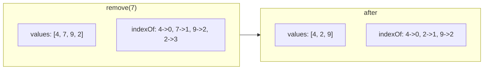
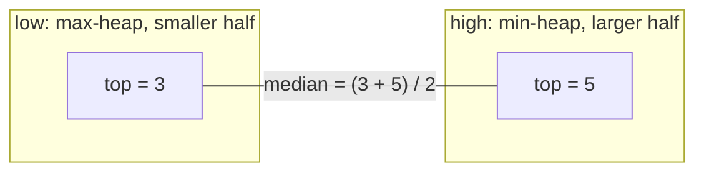
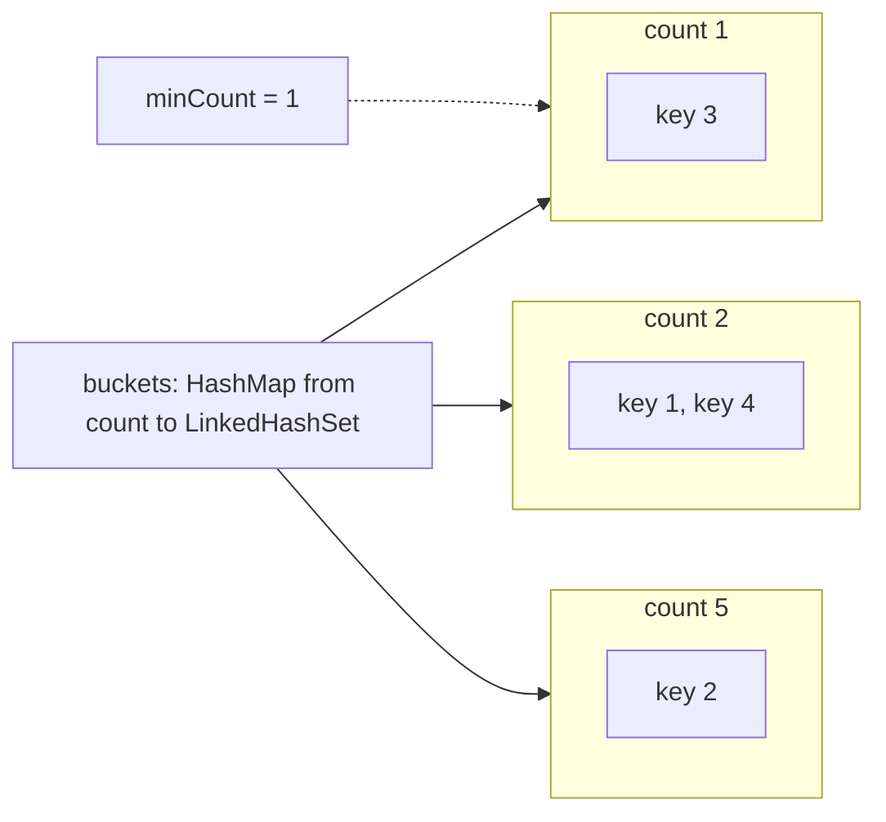

# Pattern 26: Design Data Structures

## 1. Pattern Name
**Design Data Structures** (combine basic structures so that every operation of a given API meets a
stated cost)

A **design problem** gives you a class name and a list of methods, for example `push`, `pop`,
`top`, and `getMin`. You write the class. The statement also gives a cost for each method, often
"O(1)" or "O(log n)". In most of these problems no single JDK class meets that cost, so you
**compose** two or three basic structures. Each structure covers one of the operations, and a
rule (an **invariant**) keeps the structures consistent with each other.

An **invariant** is a fact about the state of the object that is true before and after every
method call. A **composite structure** is a class that stores the same data in two or more basic
structures to get a fast operation from each one.

Related pages:

- [Stacks, queues, and deques](../foundations/03-stacks-queues-deques.md) explains the stack, the
  queue, the circular buffer, and the queue with two stacks.
- [Hash tables](../foundations/04-hash-tables.md) explains why `HashMap` operations cost O(1) on
  average, and what changes in the worst case.
- [Heaps](../foundations/06-heaps.md) explains the binary heap and `PriorityQueue`.
- [LRU and LFU caches (LLD case study)](../../lld/case-studies/02-lru-and-lfu-cache/README.md) is
  the home page of the LRU cache. This page summarizes it and does not repeat it.

---

## 2. Core Intuition

### What Interviewers Expect You to Think:

**Key Insight 1: each operation has a best structure, and you can keep more than one.**
A hash map finds a key in O(1). An array picks an element by index in O(1). A heap reads the
minimum in O(1). A doubly linked list removes a known node in O(1). A balanced tree finds the
nearest key in O(log n). Pick the structure that makes each required operation cheap, and store
the data in all of them. The cost is extra memory and the work to keep all copies consistent.

**Key Insight 2: the invariant is the design.**
When you hold two structures, one operation can break the link between them. "The index map points
at the right slot of the list" is an invariant. If you write the invariant before the code, each
method has one job: leave the invariant true.

**Key Insight 3: a slow step is acceptable if it is rare.**
The queue with two stacks has a `pop` that can cost O(n). Each element moves between the stacks at
most once, so n operations cost O(n) in total, which is O(1) **amortized**. Amortized cost is the
average cost of one operation over a worst-case sequence of operations (see
[complexity analysis](../foundations/01-complexity-analysis.md)).

**Key Insight 4: swap with the last element to delete from the middle of an array.**
Removing an element from the middle of an `ArrayList` shifts the elements after it, which costs
O(n). If the order does not matter, copy the last element into the hole and remove the last slot.
This costs O(1). This one move is the core of "insert, delete, getRandom in O(1)".

### The Core Designs on This Page

| Design | Structures combined | Why they fit |
|---|---|---|
| Min stack | Stack of `{value, minimum so far}` | The minimum under each element never changes while the element stays |
| Queue with stacks | Two stacks | Reversing a stack reverses the order, so two reversals restore it |
| Random set | `ArrayList` plus `HashMap` | The list gives random access, and the map gives the index of a value |
| Median finder | Max-heap plus min-heap | The two tops are the two middle values |
| LFU cache | Three hash maps plus a `LinkedHashSet` per count | Each bucket keeps insertion order, and the lowest count is tracked |
| Time map | `HashMap` plus a sorted list per key | Binary search finds the latest value at or before a time |

---

## 3. Recognition Signals

### Keywords in Problem Statements:
- "Design a class that supports ..."
- "Implement the `X` class" followed by a list of methods
- "in O(1) time" or "in O(log n) time" attached to several different methods
- "Each function must run in average O(1)"
- "Implement an iterator" (`next`, `hasNext`, maybe `peek`)
- "Return a random element with equal probability"
- "The most recent", "the least recently used", "the least frequently used"
- "At time `t`", "in the past 5 minutes"

### Constraint Hints:
- The statement says "up to 10^5 calls". A method that costs O(n) per call fails: 10^5 × 10^5 =
  10^10 operations.
- The statement lists no input array. The input is a sequence of method calls.

### Input/Output Hints:
- The input is a list of method names and a list of arguments, such as
  `["MinStack","push","push","getMin"]` and `[[],[-2],[0],[]]`.
- The output is a list with one result for each call (`null` for `void` methods).

### RED FLAGS - NOT This Pattern:
- The statement gives one array and asks one question about it. This is a standard array pattern.
- The statement asks for a **system** with servers, queues, and failures. This is a system design
  problem (HLD), not a data structure design problem.
- The statement asks for a class model with interfaces and extension points (parking lot, elevator).
  This is a low-level design (LLD) problem. See
  [the LLD section](../../lld/README.md) for the style.

---

## 4. Brute Force Thought Process

### The Straightforward Version:
```
Problem: Min Stack (LC 155) - getMin must run in O(1)

Brute force:
- push, pop, top: use a stack. O(1) each.
- getMin: scan the whole stack for the smallest value. O(n).

Problem: Insert Delete GetRandom O(1) (LC 380)

Brute force:
- Keep an ArrayList. insert: check contains() first, O(n). remove: indexOf() then remove(), O(n).
- getRandom: pick a random index. O(1).

Problem: Find Median from Data Stream (LC 295)

Brute force:
- Keep an ArrayList. findMedian: sort it (O(n log n)) and read the middle.
- Better: keep the list sorted. Binary search finds the insert position in O(log n),
  but shifting the elements costs O(n).

Problem: LFU Cache (LC 460)

Brute force:
- Keep a HashMap of key to {value, count, last use time}.
- Eviction: scan all entries for the lowest count, break ties by the oldest use. O(n).

Problem: Time Based Key-Value Store (LC 981)

Brute force:
- For each key, keep a list of (time, value). get: scan from the end for the first time <= t. O(n).
```

### Why It Times Out:
Each design problem allows up to 10^5 or more calls. If one method scans n stored items, the total
work is O(n) per call times 10^5 calls. For n = 10^5, this is 10^10 operations. A fast machine
runs about 10^8 simple operations per second (an approximate rule of thumb), so 10^10 takes
about 100 seconds.

**The Waste:** In every case, the slow method recomputes a fact that the structure could store.
The stack recomputes the minimum on each call, but the minimum changes only on `push` and `pop`.
The cache scans for the lowest count, but the lowest count changes only by one step at a time.

---

## 5. Optimization Insight (The "Aha" Moment)

### Store the Answer Next to the Data:
**"If a method needs a fact that changes rarely, maintain the fact on every change."**

| Slow method | Fact it recomputes | Where to keep the fact | New cost |
|---|---|---|---|
| `getMin` | Minimum of the stack | Next to each element: the minimum of the stack below it | O(1) |
| `remove(val)` | Index of `val` | A `HashMap` from value to index | O(1) average |
| `findMedian` | The middle of the sorted data | The tops of two heaps | O(1) read, O(log n) insert |
| LFU eviction | The key with the lowest count | `minCount` and one bucket per count | O(1) |
| `get(key, t)` | The last entry at or before `t` | A list sorted by time, with binary search | O(log m) |

### Two Structures, One Invariant:
Every design on this page has the same shape:

1. A structure A answers the "find" part of an operation.
2. A structure B answers the "change" part.
3. An invariant ties A and B together.
4. Every mutating method updates A and B in one step, in an order that keeps the invariant.

**Why this works:** The invariant lets each method trust the data. The method does not search for
the data. The method reads a fact that the last mutation left in place.

---

## 6. Generalized Templates

All code on this page uses the imports `java.util.*`. A block that has no `main` method compiles
inside the KB checker, which adds these imports. If you paste a block into a file, add
`import java.util.*;`.

### Template 1: Stack that Carries an Extra Fact (Min Stack, LC 155)
Store `{value, minimum so far}` in each entry. The minimum of the whole stack is the minimum field
of the top entry. A `pop` removes the entry and its minimum together, so the new top already holds
the right minimum.

```java
class MinStack {
    // Each entry holds {value, minimum of the stack up to and including this entry}.
    private final Deque<int[]> stack = new ArrayDeque<>();

    public void push(int val) {
        int min = stack.isEmpty() ? val : Math.min(val, stack.peek()[1]);
        stack.push(new int[] {val, min});
    }

    public void pop() {
        stack.pop();
    }

    public int top() {
        return stack.peek()[0];
    }

    public int getMin() {
        return stack.peek()[1];
    }
}
```

- Time: `push`, `pop`, `top`, `getMin` all O(1).
- Space: O(n). Each element stores one extra `int`.
- A second design keeps a separate stack of minimums and pushes to it only when `val <=` the
  current minimum. This saves space when the minimum rarely changes. The comparison must be `<=`,
  not `<`, so that duplicate minimums pop correctly.

### Template 2: Queue with Two Stacks (LC 232)
`in` receives all pushes. `out` serves all pops and peeks. If `out` is empty and a pop arrives,
move every element from `in` to `out`. The move reverses the order, so the oldest element ends on
top of `out`. Never move while `out` is non-empty, because the new elements would go under the old
ones and break the order.

```java
class MyQueue {
    private final Deque<Integer> in = new ArrayDeque<>();   // receives pushes
    private final Deque<Integer> out = new ArrayDeque<>();  // serves pops and peeks

    public void push(int x) {
        in.push(x);
    }

    public int pop() {
        moveIfNeeded();
        return out.pop();
    }

    public int peek() {
        moveIfNeeded();
        return out.peek();
    }

    public boolean empty() {
        return in.isEmpty() && out.isEmpty();
    }

    // Move only when out is empty. This keeps the oldest element on top of out.
    private void moveIfNeeded() {
        if (out.isEmpty()) {
            while (!in.isEmpty()) {
                out.push(in.pop());
            }
        }
    }
}
```

- Time: `push` O(1). `pop` and `peek` are O(1) amortized. One call can cost O(n).
- **Why amortized O(1):** Each element is pushed to `in` once, popped from `in` once, pushed to
  `out` once, and popped from `out` once. That is at most 4 steps for each element over its whole
  life. n operations cost at most 4n steps in total.
- Space: O(n).
- The opposite design, a stack from queues (LC 225), costs O(n) for either `push` or `pop` in its
  standard forms. The amortized argument above does not carry over: moving elements from one queue
  to another keeps their order instead of reversing it, so the newest element does not reach the
  front. See
  [stacks, queues, and deques](../foundations/03-stacks-queues-deques.md).

### Template 3: Array Plus Index Map (Insert Delete GetRandom O(1), LC 380)
The list stores the values in a dense array. The map stores each value's index in the list. To
remove a value, copy the last value into the removed slot, update the map for the moved value, and
remove the last slot of the list.

```java
class RandomizedSet {
    private final List<Integer> values = new ArrayList<>();
    private final Map<Integer, Integer> indexOf = new HashMap<>();
    private final Random random = new Random();

    public boolean insert(int val) {
        if (indexOf.containsKey(val)) {
            return false;
        }
        indexOf.put(val, values.size());
        values.add(val);
        return true;
    }

    public boolean remove(int val) {
        Integer index = indexOf.get(val);
        if (index == null) {
            return false;
        }
        int lastIndex = values.size() - 1;
        int lastValue = values.get(lastIndex);
        values.set(index, lastValue);      // the last value fills the hole
        indexOf.put(lastValue, index);
        values.remove(lastIndex);          // O(1): removes the last element
        indexOf.remove(val);               // after the put, so val == lastValue also works
        return true;
    }

    public int getRandom() {
        return values.get(random.nextInt(values.size()));
    }
}
```



- Time: `insert`, `remove`, `getRandom` all O(1) average. The "average" comes from the hash map
  (see [hash tables](../foundations/04-hash-tables.md)).
- Space: O(n).
- Invariant: `values.get(indexOf.get(v)) == v` for every stored value `v`, and
  `indexOf.size() == values.size()`.
- Order of the three writes in `remove`: the `put` for the moved value comes before the
  `indexOf.remove(val)`. If `val` is the last value, the `put` writes `val` and the `remove` then
  deletes it. The reverse order leaves a stale entry.

### Template 4: Duplicates Allowed (LC 381)
One value can appear at several indexes. Store a **set of indexes** for each value. To remove a
value, take any index of it, swap in the last element, and fix the index sets of both values.

```java
class RandomizedCollection {
    private final List<Integer> values = new ArrayList<>();
    // For each value, the set of indexes in 'values' where it appears.
    private final Map<Integer, Set<Integer>> indexes = new HashMap<>();
    private final Random random = new Random();

    public boolean insert(int val) {
        Set<Integer> set = indexes.computeIfAbsent(val, k -> new LinkedHashSet<>());
        set.add(values.size());
        values.add(val);
        return set.size() == 1;
    }

    public boolean remove(int val) {
        Set<Integer> set = indexes.get(val);
        if (set == null) {
            return false;
        }
        int index = set.iterator().next();   // any index of val works
        set.remove(index);
        int lastIndex = values.size() - 1;
        int lastValue = values.get(lastIndex);
        if (index != lastIndex) {
            values.set(index, lastValue);
            Set<Integer> lastSet = indexes.get(lastValue);
            lastSet.remove(lastIndex);
            lastSet.add(index);
        }
        values.remove(lastIndex);
        if (set.isEmpty()) {
            indexes.remove(val);
        }
        return true;
    }

    public int getRandom() {
        return values.get(random.nextInt(values.size()));
    }
}
```

- Time: all three methods O(1) average.
- Space: O(n).
- `getRandom` picks a random index of the list. A value that appears twice occupies two slots, so
  it is chosen with twice the probability, as the statement requires.
- Use `LinkedHashSet` for the index sets. The `HashSet` javadoc says that iteration takes time
  proportional to the size **plus the capacity**. After many removals the first element of a
  `HashSet` can take longer than O(1) to find. The `LinkedHashSet` javadoc says that iteration
  takes time proportional to the size only.
- Fix both sets when the removed index is not the last index. If `index == lastIndex`, the
  element to remove is already last, so no swap is needed, and the code skips the second set.
- If `lastValue == val` but `index != lastIndex`, `set` and `lastSet` are the same object. The code
  still works: it has already removed `index`, then it removes `lastIndex` and adds `index` back,
  so the set ends with the right indexes.

### Template 5: Two Heaps for the Median (LC 295)
`low` is a max-heap that holds the smaller half. `high` is a min-heap that holds the larger half.
If the count is odd, `low` has one extra element, and its top is the median. If the count is even,
the median is the mean of the two tops.

```java
class MedianFinder {
    // low: max-heap of the smaller half. high: min-heap of the larger half.
    // Invariant: low.size() == high.size() or low.size() == high.size() + 1.
    // Invariant: every element of low is <= every element of high.
    private final PriorityQueue<Integer> low = new PriorityQueue<>(Comparator.reverseOrder());
    private final PriorityQueue<Integer> high = new PriorityQueue<>();

    public void addNum(int num) {
        low.offer(num);
        high.offer(low.poll());          // the largest of low moves up, so order holds
        if (high.size() > low.size()) {
            low.offer(high.poll());      // restore the size invariant
        }
    }

    public double findMedian() {
        if (low.size() > high.size()) {
            return low.peek();
        }
        return ((long) low.peek() + high.peek()) / 2.0;   // long avoids int overflow
    }
}
```



- Time: `addNum` O(log n) (at most five heap operations: three `offer` calls and two `poll` calls,
  each O(log n)). `findMedian` O(1).
- Space: O(n).
- Why `addNum` pushes to `low` and then moves the top to `high`: the new number may belong to the
  larger half. Sending it through `low` first guarantees that the number that moves up is the
  largest of the smaller half and the new number, so every element of `low` stays at most every
  element of `high`.
- For the `PriorityQueue` facts (min-heap by default, O(log n) `offer` and `poll`), see
  [heaps](../foundations/06-heaps.md) and [Pattern 16](../16-heap-priority-queue/README.md).

### Template 6: LRU Cache (LC 146), Summary
The LRU cache stores each key in a hash map and in a doubly linked list ordered by recency. The map
finds the node in O(1). The list moves the node to the front, and removes the last node, in O(1).
The JDK shortcut is `LinkedHashMap` with `accessOrder = true` and an overridden
`removeEldestEntry`. The full design, the code, the thread-safe version, and the TTL extension are
on the home page: [LRU and LFU caches](../../lld/case-studies/02-lru-and-lfu-cache/README.md).
Read that page for LC 146. This page does not repeat it.

### Template 7: LFU Cache in O(1) (LC 460)
The LFU cache evicts the key with the lowest use count. If several keys have the lowest count,
it evicts the one that was used longest ago. Keep one bucket for each count. Each bucket is a
`LinkedHashSet` that keeps insertion order, so the first key of a bucket is the least recently
used key with that count. A variable `minCount` points at the lowest non-empty bucket.

```java
class LFUCache {
    private final int capacity;
    private final Map<Integer, Integer> values = new HashMap<>();
    private final Map<Integer, Integer> counts = new HashMap<>();
    // For each count, the keys with that count. LinkedHashSet keeps insertion order,
    // so the first key of a bucket is the least recently used key with that count.
    private final Map<Integer, LinkedHashSet<Integer>> buckets = new HashMap<>();
    private int minCount = 0;

    public LFUCache(int capacity) {
        this.capacity = capacity;
    }

    public int get(int key) {
        if (!values.containsKey(key)) {
            return -1;
        }
        touch(key);
        return values.get(key);
    }

    public void put(int key, int value) {
        if (capacity == 0) {
            return;
        }
        if (values.containsKey(key)) {
            values.put(key, value);
            touch(key);
            return;
        }
        if (values.size() == capacity) {
            LinkedHashSet<Integer> lowest = buckets.get(minCount);
            int victim = lowest.iterator().next();   // least recently used among the lowest
            lowest.remove(victim);
            if (lowest.isEmpty()) {
                buckets.remove(minCount);
            }
            values.remove(victim);
            counts.remove(victim);
        }
        values.put(key, value);
        counts.put(key, 1);
        buckets.computeIfAbsent(1, c -> new LinkedHashSet<>()).add(key);
        minCount = 1;                                // a new key always has the lowest count
    }

    // Move the key from bucket c to bucket c + 1.
    private void touch(int key) {
        int count = counts.get(key);
        LinkedHashSet<Integer> bucket = buckets.get(count);
        bucket.remove(key);
        if (bucket.isEmpty()) {
            buckets.remove(count);
            if (minCount == count) {
                minCount = count + 1;                // the key moves up, so the minimum moves up
            }
        }
        counts.put(key, count + 1);
        buckets.computeIfAbsent(count + 1, c -> new LinkedHashSet<>()).add(key);
    }
}
```



- Time: `get` and `put` O(1) average.
- Space: O(capacity).
- Why `minCount` is easy to maintain: a new key has count 1, so `minCount` becomes 1. When a `get`
  or a `put` of an existing key moves the last key out of the lowest bucket, that key lands in the
  next bucket, so `minCount` grows by exactly 1. An eviction can empty the lowest bucket, but every
  eviction comes right before the insert of a new key, which sets `minCount` to 1. No other change
  is possible.
- The LLD home page also builds an LFU policy (`LfuPolicy` with `minFrequency`, one linked list per
  frequency) behind a Strategy interface, with thread-safe and TTL wrappers. This template is the
  compact coding-round version.
- Compare with the LRU version: the LRU design needs one list. The LFU design needs one list for
  each count, and it needs `minCount`.

### Template 8: Iterator with a One-Element Buffer (Peeking Iterator, LC 284)
An iterator that supports `peek` must read one element ahead. Store that element in a field and
return it on the next `next()` call.

```java
class PeekingIterator implements Iterator<Integer> {
    private final Iterator<Integer> source;
    private Integer buffered;          // the next value, valid only if hasBuffered is true
    private boolean hasBuffered;

    public PeekingIterator(Iterator<Integer> iterator) {
        this.source = iterator;
    }

    public Integer peek() {
        if (!hasBuffered) {
            buffered = source.next();  // throws NoSuchElementException if empty
            hasBuffered = true;
        }
        return buffered;
    }

    @Override
    public Integer next() {
        if (hasBuffered) {
            hasBuffered = false;
            Integer result = buffered;
            buffered = null;
            return result;
        }
        return source.next();
    }

    @Override
    public boolean hasNext() {
        return hasBuffered || source.hasNext();
    }
}
```

- Time: all methods O(1). Space: O(1).
- The `hasBuffered` flag is needed because `null` can be a legal element of the source.

### Template 9: Lazy Flattening with a Stack of Iterators (LC 341)
`NestedInteger` is either one integer or a list of `NestedInteger`. The iterator must not flatten
the whole structure in the constructor. That costs O(N) time and space before the first `next()`.
Instead, keep a stack of iterators, one for each open list. `hasNext()` advances until it finds
an integer. It pushes the iterator of a nested list, and pops the iterator of a finished list.

```java
// LeetCode supplies this interface. It is defined here so the code compiles alone.
interface NestedInteger {
    boolean isInteger();
    Integer getInteger();
    List<NestedInteger> getList();
}

class NestedIterator implements Iterator<Integer> {
    // Each entry is the iterator of one open list. The top is the innermost list.
    private final Deque<Iterator<NestedInteger>> stack = new ArrayDeque<>();
    private Integer nextValue;         // the next integer, found by hasNext()

    public NestedIterator(List<NestedInteger> nestedList) {
        stack.push(nestedList.iterator());
    }

    @Override
    public boolean hasNext() {
        while (nextValue == null && !stack.isEmpty()) {
            if (!stack.peek().hasNext()) {
                stack.pop();                       // this list is finished
                continue;
            }
            NestedInteger item = stack.peek().next();
            if (item.isInteger()) {
                nextValue = item.getInteger();
            } else {
                stack.push(item.getList().iterator());   // go one level deeper
            }
        }
        return nextValue != null;
    }

    @Override
    public Integer next() {
        if (!hasNext()) {
            throw new NoSuchElementException();
        }
        Integer result = nextValue;
        nextValue = null;
        return result;
    }
}
```

- Time: each element and each list is visited once, so all calls together cost O(N + L), where N
  is the number of integers and L is the number of lists.
- Space: O(d), where d is the maximum nesting depth.
- `nextValue == null` means "no integer found yet". This is safe here because an integer item of
  LC 341 never returns `null` from `getInteger()`.
- `hasNext()` does the work, and `next()` calls it. This makes the iterator correct for callers
  that call `next()` without calling `hasNext()` first, and for callers that call `hasNext()`
  twice.

### Template 10: Iterator over a BST (LC 173)
An in-order traversal of a BST visits the keys in sorted order. The iterator keeps the **path to
the next node** on a stack instead of the whole traversal.

```java
class BSTIterator {
    // The stack holds the path of nodes whose left subtree is fully pushed.
    // Its size is at most the tree height h, so the space is O(h).
    private final Deque<TreeNode> stack = new ArrayDeque<>();

    public BSTIterator(TreeNode root) {
        pushLeftPath(root);
    }

    public int next() {
        TreeNode node = stack.pop();
        pushLeftPath(node.right);      // the successor path starts in the right subtree
        return node.val;
    }

    public boolean hasNext() {
        return !stack.isEmpty();
    }

    private void pushLeftPath(TreeNode node) {
        while (node != null) {
            stack.push(node);
            node = node.left;
        }
    }
}
```

- Time: `next` is O(1) amortized. One call can push up to h nodes, but each node is pushed and
  popped once, so n calls cost O(n) in total. `hasNext` is O(1).
- Space: O(h), where h is the tree height. This is better than the O(n) of a list that holds all
  keys, when the tree is balanced.

### Template 11: Time-Based Key-Value Store (LC 981)
For each key, keep the values in a list sorted by time. `get` finds the last entry at or before
the query time with a binary search (see [Pattern 06](../06-binary-search-on-answer/README.md)).

```java
class TimeMap {
    private record Entry(int timestamp, String value) {}

    // Timestamps for one key arrive in increasing order (LC 981 guarantees this),
    // so each list is already sorted and binary search applies.
    private final Map<String, List<Entry>> store = new HashMap<>();

    public void set(String key, String value, int timestamp) {
        store.computeIfAbsent(key, k -> new ArrayList<>()).add(new Entry(timestamp, value));
    }

    public String get(String key, int timestamp) {
        List<Entry> entries = store.get(key);
        if (entries == null) {
            return "";
        }
        // Find the last entry with entry.timestamp <= timestamp.
        int lo = 0;
        int hi = entries.size() - 1;
        int answer = -1;
        while (lo <= hi) {
            int mid = lo + (hi - lo) / 2;
            if (entries.get(mid).timestamp() <= timestamp) {
                answer = mid;
                lo = mid + 1;
            } else {
                hi = mid - 1;
            }
        }
        return answer == -1 ? "" : entries.get(answer).value();
    }
}
```

A second version uses `TreeMap` per key. `floorEntry(t)` returns the entry with the greatest key
less than or equal to `t` (JDK `TreeMap` javadoc).

```java
class TimeMapTree {
    // One TreeMap per key. floorEntry finds the greatest timestamp <= the query in O(log m).
    private final Map<String, TreeMap<Integer, String>> store = new HashMap<>();

    public void set(String key, String value, int timestamp) {
        store.computeIfAbsent(key, k -> new TreeMap<>()).put(timestamp, value);
    }

    public String get(String key, int timestamp) {
        TreeMap<Integer, String> history = store.get(key);
        if (history == null) {
            return "";
        }
        Map.Entry<Integer, String> entry = history.floorEntry(timestamp);
        return entry == null ? "" : entry.getValue();
    }
}
```

| Version | `set` | `get` | Needs increasing timestamps | Space |
|---|---|---|---|---|
| `ArrayList` plus binary search | O(1) amortized | O(log m) | Yes | O(total entries) |
| `TreeMap` per key | O(log m) | O(log m) | No | O(total entries), larger constant |

Here m is the number of entries of one key. LC 981 guarantees increasing timestamps for `set`, so
the list version is correct and cheaper. If the interviewer removes the guarantee, switch to
`TreeMap`.

### Template 12: Hit Counter with a Circular Buffer (LC 362)
Count the hits in the past 300 seconds. Use two arrays of 300 slots. The slot for second `t` is
`t % 300`. Each slot remembers which second it holds. A hit at second `t` resets the slot if the
slot holds an older second.

```java
class HitCounter {
    private static final int WINDOW = 300;                 // seconds
    private final int[] times = new int[WINDOW];           // the second stored in each slot
    private final int[] hits = new int[WINDOW];            // the hit count in each slot

    public void hit(int timestamp) {
        int slot = timestamp % WINDOW;
        if (times[slot] != timestamp) {                    // the slot holds an old second
            times[slot] = timestamp;
            hits[slot] = 0;
        }
        hits[slot]++;
    }

    public int getHits(int timestamp) {
        int total = 0;
        for (int slot = 0; slot < WINDOW; slot++) {
            if (timestamp - times[slot] < WINDOW) {        // inside (timestamp - 300, timestamp]
                total += hits[slot];
            }
        }
        return total;
    }
}
```

- Time: `hit` O(1). `getHits` O(300), which is a constant, so O(1).
- Space: O(300), a constant, however many hits arrive. A queue of timestamps takes O(h) space for
  h hits in the window, and that grows with traffic.
- The `getHits` test `timestamp - times[slot] < WINDOW` skips slots that hold an old second, even
  if no `hit` has reset them. A slot that was never used holds second 0 and zero hits, so it adds
  nothing.
- This is a sliding window that is built from 1-second buckets. For rate
  limiters that use the same idea at larger scale, see
  [rate limiting algorithms](../../hld/fundamentals/13-rate-limiting-algorithms.md).

---

## 7. Variations of the Pattern

### Variation A: Stack with an Extra Fact
**Problem Type:** A stack that also reports the minimum, the maximum, or the most frequent element.
**Examples:** Min Stack (LC 155, Medium), Max Stack (LC 716, Hard, premium), Maximum Frequency Stack
(LC 895, Hard).
**Key Structure:** Keep a fact beside each entry (Template 1). Max Stack needs `popMax`, which
removes from the middle, so it uses a `TreeMap` of values to lists of nodes plus a doubly linked
list. Maximum Frequency Stack keeps one stack per frequency (the same bucket idea as the LFU
cache).

### Variation B: Build One Structure from Another
**Problem Type:** Implement a queue from stacks, a stack from queues, or a circular queue from an
array.
**Examples:** Implement Queue using Stacks (LC 232, Easy), Implement Stack using Queues (LC 225,
Easy), Design Circular Queue (LC 622, Medium), Design Circular Deque (LC 641, Medium).
**Key Structure:** Two stacks with lazy transfer, or an array with `head` and `size` and index
arithmetic modulo the capacity. See
[stacks, queues, and deques](../foundations/03-stacks-queues-deques.md).

### Variation C: Array Plus Map for Random Access
**Problem Type:** Constant-time insert, delete, and uniform random choice.
**Examples:** Insert Delete GetRandom O(1) (LC 380, Medium), with duplicates (LC 381, Hard).
**Key Structure:** Dense list plus index map, with the swap-with-last delete (Templates 3 and 4).
The **uniform** requirement forces a dense array, because random choice by index needs no gaps. For
sampling from a stream, see [Pattern 28](../28-randomized-algorithms/README.md).

### Variation D: Order Statistics on a Stream
**Problem Type:** Median, k-th largest, or percentile after each insert.
**Examples:** Find Median from Data Stream (LC 295, Hard), Kth Largest Element in a Stream
(LC 703, Easy).
**Key Structure:** Two heaps for the median, a size-k min-heap for the k-th largest (see
[Pattern 16](../16-heap-priority-queue/README.md)). If values are bounded integers, for example
0 to 100, a count array answers the median in O(range) with no heap.

### Variation E: Eviction Caches
**Problem Type:** A fixed capacity, and a rule for what to remove.
**Examples:** LRU Cache (LC 146, Medium), LFU Cache (LC 460, Hard), All O\`one Data Structure
(LC 432, Hard).
**Key Structure:** A hash map plus ordered buckets or a linked list. LRU is on the
[home page](../../lld/case-studies/02-lru-and-lfu-cache/README.md). LFU is Template 7. All
O\`one keeps a doubly linked list of count buckets, where each bucket holds the keys of one count,
so `inc`, `dec`, `getMaxKey`, and `getMinKey` all cost O(1).

### Variation F: Iterators
**Problem Type:** Walk a structure one element at a time without copying it.
**Examples:** Peeking Iterator (LC 284, Medium), Flatten Nested List Iterator (LC 341, Medium),
BST Iterator (LC 173, Medium).
**Key Structure:** A one-element buffer, or an explicit stack that replaces the recursion call
stack (Templates 8, 9, 10). The explicit stack is the same technique as an iterative DFS (see
[Pattern 10](../10-tree-patterns/README.md)).

### Variation G: Time-Aware Structures
**Problem Type:** The answer depends on a time or a version.
**Examples:** Time Based Key-Value Store (LC 981, Medium), Design Hit Counter (LC 362, Medium,
premium), Snapshot Array (LC 1146, Medium).
**Key Structure:** Sorted history per key with binary search (Template 11), or a circular buffer
for a fixed window (Template 12). Snapshot Array stores `(snapshot id, value)` pairs for each
index and binary searches by snapshot id.

### Variation H: Hash Table from Scratch
**Problem Type:** Build `HashMap` or `HashSet` without the library.
**Examples:** Design HashSet (LC 705, Easy), Design HashMap (LC 706, Easy).
**Key Structure:** An array of buckets, with chaining or open addressing. See
[hash tables](../foundations/04-hash-tables.md) for both and for the load factor.

---

## 8. Classic Interview Problems

The list is in order of difficulty. Difficulties are from the LeetCode problem list
(`https://leetcode.com/api/problems/all/`). "Premium" means that LeetCode needs a subscription for
the problem.

| LC # | Title | Difficulty | Key insight |
|---|---|---|---|
| 232 | Implement Queue using Stacks | Easy | Two stacks, move only when `out` is empty, amortized O(1) |
| 706 | Design HashMap | Easy | Bucket array with chaining, resize at a load factor |
| 155 | Min Stack | Medium | Store the minimum so far in each entry |
| 380 | Insert Delete GetRandom O(1) | Medium | List plus index map, swap with last on delete |
| 146 | LRU Cache | Medium | Hash map plus doubly linked list (home page linked above) |
| 173 | Binary Search Tree Iterator | Medium | Stack holds the left path, O(h) space |
| 341 | Flatten Nested List Iterator | Medium | Stack of iterators, `hasNext` does the work |
| 981 | Time Based Key-Value Store | Medium | Sorted list per key, binary search for the floor |
| 362 | Design Hit Counter (premium) | Medium | Circular buffer of 300 slots with stale-slot reset |
| 381 | Insert Delete GetRandom O(1) - Duplicates allowed | Hard | Set of indexes per value |
| 295 | Find Median from Data Stream | Hard | Max-heap for the lower half, min-heap for the upper half |
| 460 | LFU Cache | Hard | One ordered bucket per count, plus `minCount` |

---

## 9. How to Practice This Pattern Effectively

### Week 1: Wrappers Around One Idea
**Day 1-2:**
- Solve Queue using Stacks (232) and Min Stack (155).
- Focus on: stating the invariant before you write the code.

**Day 3-4:**
- Solve Insert Delete GetRandom O(1) (380), then the duplicates version (381).
- Focus on: the three-line swap-with-last delete and the order of the writes.

**Day 5:**
- Solve Design HashMap (706). Write the bucket array and the resize by hand.

### Week 2: Composite Structures
**Day 1-2:**
- Read the [LRU home page](../../lld/case-studies/02-lru-and-lfu-cache/README.md). Then solve
  LRU Cache (146) from memory, with sentinel nodes.

**Day 3-4:**
- Solve LFU Cache (460) and Find Median from Data Stream (295).
- Focus on: the cases that move `minCount`, and the heap rebalance.

**Day 5:**
- Solve the three iterator problems (173, 341, 284) and Time Based Key-Value Store (981).

### How to Present a Design-Data-Structure Answer
Recommendation: say these steps aloud, in this order. The order shows the interviewer the design
before the code, so a design error surfaces before you spend time on code.

1. **Restate the API.** Write each method signature. Ask about edge cases: empty structure,
   duplicates, capacity zero, equal timestamps, a `null` value.
2. **Write the cost target for each method** next to its signature. Use the numbers in the
   statement. If the statement gives none, propose them and ask.
3. **Name the structures** and say what each one is for. "The map finds, the list orders."
4. **State the invariants.** One sentence each. These are what you check at the end.
5. **Code each method** and, after each one, say which invariant it keeps.
6. **Give the complexity of each method** with a reason. Name the amortized and average cases as
   such.
7. **Test with a trace.** Run the example from the statement and one edge case by hand.
8. **Discuss changes.** Thread safety (a lock around each method; see the LRU home page),
   persistence, memory limits.

Finish with a table of the methods, their time costs, and the reason for each cost. The table
lets the interviewer check every cost target from step 2 in one place.

### Self-Check Questions:
- Can I name the invariant of each design without looking?
- Can I explain why the queue with two stacks is amortized O(1) in two sentences?
- Do I know which operation breaks the invariant in each design (the delete, the evict, the pop)?
- Can I list the structures for the LFU cache, and say what `minCount` does?

---

## 10. Common Mistakes Even Experienced Developers Make

### Mistake 1: Moving Elements Between the Stacks on Every Operation
```
// WRONG: transfer on push. Every push costs O(n).
push(x): move out -> in; in.push(x); move in -> out

// CORRECT: push to `in`. Transfer only when `out` is empty and a pop or peek arrives.
```
Moving while `out` is non-empty also breaks the order: new elements land under old elements.

### Mistake 2: `List.remove(int)` Versus `List.remove(Object)`
```
// With List<Integer> list:
list.remove(val);          // WRONG when val is an int: removes the element at INDEX val
list.remove((Integer) val) // removes the first element equal to val, in O(n)
list.remove(lastIndex);    // CORRECT for the swap-with-last delete: index form, O(1) at the end
```
In the random set, always remove by **index**, and only the last index.

### Mistake 3: Stale Map Entry in the Random Set
```
// WRONG order when val is the last element:
indexOf.remove(val);
indexOf.put(lastValue, index);   // lastValue == val, so this puts val back

// CORRECT: put first, then remove (as in Template 3), or skip the swap if index == lastIndex.
```

### Mistake 4: `HashSet` for the Index Sets
`set.iterator().next()` on a `HashSet` scans the bucket array and can take O(capacity) after many
removals. Use `LinkedHashSet`, or keep the indexes in a structure with O(1) removal of any element.

### Mistake 5: Integer Overflow in the Median
```
// WRONG: (low.peek() + high.peek()) / 2.0   - the int sum can overflow
// CORRECT: ((long) low.peek() + high.peek()) / 2.0
```

### Mistake 6: Heap Order in `addNum`
If you add to the heap by size alone (alternating `low`, `high`), a number can land in the wrong
half. The tops then are not the middle values. Always route through the other heap, or compare to
the tops first.

### Mistake 7: LFU `minCount` Errors
- Forgetting to set `minCount = 1` when a new key arrives. After an eviction, `minCount` may point
  at a deleted bucket.
- Forgetting to raise `minCount` when a `get` empties the lowest bucket.
- Forgetting to delete an empty bucket, which leaves `minCount` pointing at an empty set.
- Skipping the zero-capacity check. LC 460 allows capacity 0, and `put` must then do nothing.
- Counting a `put` of an existing key as a plain overwrite. It counts as a use.

### Mistake 8: `hasNext` That Is Not Idempotent
In the nested-list iterator, a `hasNext()` that consumes the next integer makes two calls of
`hasNext()` skip a value. Store the found value in a field, and clear the field only in `next()`.

### Mistake 9: Flattening in the Constructor
It is correct for LC 341, but it costs O(N) time and space before the first call, and it fails if
the interviewer asks for lazy evaluation or a very large structure. Say the trade-off, then write
the stack version.

### Mistake 10: Wrong Boundary in the Time Lookup
`get(key, t)` returns the value with the **greatest time at or before** `t`. Candidates search for
an exact match, or return the first entry after `t`. Use "the last entry with time <= t": a
binary search that records the answer and moves right.

### Mistake 11: Stale Slots in the Circular Buffer
If `hit` does not reset a slot that holds an old second, the old count adds to the new count.
Store the second in each slot, compare it on write, and compare it on read.

---

## Commonly Confused With

| Looks like... | But use... | The question that decides |
|---|---|---|
| "Design LRU Cache" in a coding round | The [LLD case study](../../lld/case-studies/02-lru-and-lfu-cache/README.md) when the interviewer asks for classes, interfaces, thread safety, and TTL | Does the statement give an API and ask for O(1)? Then it is this pattern. Does it ask for extension points and concurrency? Then it is LLD |
| Median with a sorted list | Two heaps (Pattern 16) | Do inserts arrive one at a time with queries between them? If yes, a sorted list costs O(n) per insert, so use two heaps |
| Median of a fixed array | Quickselect or sorting (Pattern 16) | Is the data static? If yes, no structure is needed |
| Time-based store with a prefix sum | Binary search on sorted history (Pattern 06) | Does the query ask for "the value at or before t" instead of a total? Use binary search |
| Hit counter as a rate limiter | [Rate limiting algorithms](../../hld/fundamentals/13-rate-limiting-algorithms.md) | Is the question about a distributed limit with many servers? Then it is system design |
| Iterator problem as plain recursion | Explicit stack (Pattern 10) | Must the answer come one element at a time, with O(h) memory? Then keep the traversal state on your own stack |
| Queue from stacks as a monotonic queue | Pattern 07 | Does the queue also report the maximum or minimum of its contents? Then the structure is a monotonic deque |

> Full decision procedure: [How to Choose a Pattern](../how-to-choose-a-pattern.md)

---

## Quick Reference Card

```
+-----------------------------------------------------------------------------+
|                    DESIGN DATA STRUCTURES CHEAT SHEET                       |
+-----------------------------------------------------------------------------+
| STEPS: API -> cost per method -> structures -> invariants -> code -> trace  |
|                                                                             |
| Min Stack        stack of {value, min so far}                O(1) all       |
| Queue (2 stacks) in / out, move only if out is empty         O(1) amortized |
| Random set       list + map(value -> index), swap with last  O(1) average   |
|  + duplicates    map(value -> LinkedHashSet of indexes)      O(1) average   |
| Median           max-heap (low) + min-heap (high)            O(log n) add   |
| LRU              map + doubly linked list (see LLD page)     O(1)           |
| LFU              maps + LinkedHashSet per count + minCount   O(1) average   |
| Peek iterator    one-element buffer                          O(1)           |
| Nested iterator  stack of iterators, hasNext() does the work O(N + L) total |
| BST iterator     stack of the left path                      O(h) space     |
| Time map         map(key -> sorted list), floor by bin search O(log m) get  |
| Hit counter      times[300] + hits[300], reset stale slot    O(1) space     |
|                                                                             |
| TRAPS: remove(int) vs remove(Object), put-then-remove order, minCount,      |
|        int overflow in the median, HashSet.iterator().next(), idempotent    |
|        hasNext(), floor not ceiling, stale ring slots                       |
+-----------------------------------------------------------------------------+
```

---

*Next: [Pattern 27: Advanced DP](../27-advanced-dp/README.md)*
