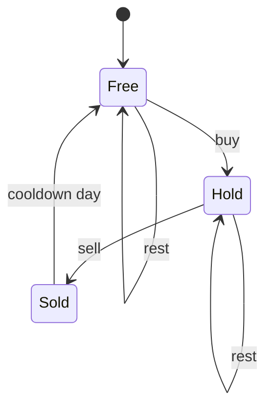

# Pattern 27: Advanced DP

## 1. Pattern Name
**Advanced Dynamic Programming** (bitmask DP, digit DP, tree DP and rerooting, state-machine DP,
interval DP, probability and expected-value DP)

Pattern 15 teaches the five steps of dynamic programming (DP): define the state, the transition,
the base case, the order, and the answer. It also teaches the standard tables: one-dimensional,
two-string, knapsack, and grid. This page does not repeat them. Read
[Pattern 15: Dynamic Programming](../15-dynamic-programming/README.md) first.

This page covers families of problems in which the **state** is richer than "an index and a
number". In each family, the state holds one extra piece of information:

| Family | The extra piece of information in the state | Typical size of the state space |
|---|---|---|
| Bitmask DP | The **set** of items already used, stored as the bits of an `int` | 2^n masks, n ≤ about 20 |
| Digit DP | The digits chosen so far, summarized as small facts, plus a flag for the upper bound | digits × small facts, for example 10 × 1024 |
| Tree DP | The node, and a choice made at that node (taken or not, covered or not) | n × a few choices |
| Rerooting | The answer for a node when the node is the root, computed for every node | n |
| State-machine DP | The position in a small automaton (holding a share, cooling down) | days × a few states |
| Interval DP | The two ends of a range | n² ranges, each with an O(n) split |
| Probability DP | The position in a random process, and the number of steps left | cells × steps |

Related pages:

- [Pattern 15: Dynamic Programming](../15-dynamic-programming/README.md) is the base. It defines
  the state, transition, memoization, and tabulation.
- [Pattern 19: Bit Manipulation](../19-bit-manipulation/README.md) explains the mask operations
  that this page uses (`1 << i`, `mask & (mask - 1)`, `bitCount`). Template 3 explains the
  submask loop itself.
- [Pattern 10: Tree Patterns](../10-tree-patterns/README.md) explains tree DFS, which tree DP
  builds on.

---

## 2. Core Intuition

### What Interviewers Expect You to Think:

**Key Insight 1: advanced DP is ordinary DP with a better state.**
The five steps do not change. The difficulty moves to step 1. A candidate who writes the
brute-force recursion first, and asks "which arguments must I remember so that the future does not
depend on the past?", finds the state in every family on this page.

**Key Insight 2: the state must contain exactly what the future needs.**
If two partial solutions have the same state, the future cost is the same for both. Then the DP
keeps only the better one. Each family chooses the smallest state that has this property:

- **Bitmask DP.** To extend a partial tour, you need to know *which cities were visited*, and
  the *last city*. You do not need the order of the visited cities.
- **Digit DP.** To extend a partial number, you need to know whether the digits so far are
  *equal to the prefix of the limit* (the "tight" flag), and the facts the rule asks about (the
  digits used, the digit sum, the last digit). You do not need the digits themselves.
- **Tree DP.** To decide a node, you need the answer for each child subtree **in each situation
  the parent can create**. For house robber III, the situations are "child robbed" and "child
  skipped".
- **State-machine DP.** To decide today, you need the *state* (holding a share or not, cooling
  down or not), not the history.

**Key Insight 3: count the states, then the work per state.**
The time of a DP is the number of states times the cost of one transition. Compute this number
before you write code. For bitmask DP with n = 20 and a transition that tries 20 next items, it
is 2^20 × 20 × 20, about 4 × 10^8 simple operations. This is near the practical limit.

**Key Insight 4: a tree has no cycles, so a tree is its own DP order.**
A node depends only on its children. The post-order of the tree is a valid fill order. This is
why "tree DP" needs no table: the recursion returns the values.

### The Techniques on This Page

| Technique | State | Transition in one line | Cost |
|---|---|---|---|
| Bitmask (path) | `dp[mask][last]` | Add one unvisited item after `last` | O(2^n n²) |
| Bitmask (assignment) | `dp[mask]` | The next worker takes one free job | O(2^n n) |
| Bitmask (submasks) | `dp[mask]` | The new group takes a submask of the free items | O(3^n) per group |
| Digit | `dp[pos][facts]` plus `tight`, `started` | Try each digit from 0 to the limit | O(L × facts × 10) |
| Tree | `f(node)` returns a few numbers | Combine the numbers of the children | O(n) |
| Rerooting | `down[v]`, then `ans[v]` | Move the root from a node to its child | O(n) |
| State machine | `dp[day][state]` | Follow one arrow of the automaton | O(days × arrows) |
| Interval | `dp[l][r]` | Pick the last item (or the split) inside `(l, r)` | O(n³) |
| Probability | `p[step][cell]` | Spread the probability to the next cells | O(steps × cells × moves) |

---

## 3. Recognition Signals

### Keywords in Problem Statements:
- Bitmask: "visit every node exactly once", "assign each job to a different worker", "n ≤ 15",
  "n ≤ 20", "split the items into k groups", "each task can be done once".
- Digit: "how many integers in [1, n] have ...", "n up to 10^9 or 10^18", "digit sum", "no two
  adjacent digits", "no repeated digit", "binary representation of n has no consecutive ones".
- Tree: "binary tree" plus "maximum" or "minimum" of a choice at each node, "no two adjacent
  nodes", "path", "cameras", "coins to distribute".
- Rerooting: "for every node, compute ..." on an unrooted tree with n up to 10^5.
- State machine: "cooldown", "transaction fee", "at most k transactions", "you cannot do X twice
  in a row".
- Interval: "the last balloon to burst", "merge adjacent piles", "cut a stick", "parenthesize",
  "split a string into pieces with cost".
- Probability: "the probability that", "the expected number of", "with equal probability each
  step".

### Constraint Hints:
- n ≤ 20 or n ≤ 16 and the problem needs *which* items are used: bitmask. 2^20 is about 10^6.
- A bound of 10^9, 10^15, or 10^18 on a *counting* question over integers: digit DP, because the
  number has at most 19 digits.
- n ≤ 300 or n ≤ 500 on a one-dimensional input with ranges: interval DP, because O(n³) is
  2.7 × 10^7 or 1.25 × 10^8.
- n ≤ 10^5 on a tree: an O(n) tree DP. Plan for a deep tree and avoid deep recursion (Mistake 8).

### RED FLAGS - NOT Advanced DP:
- The question asks for every solution, not a number. Use backtracking
  ([Pattern 8](../08-recursion-backtracking/README.md)).
- n ≤ 20, but the order of the items does not matter and no group limit exists. A greedy or
  a plain subset enumeration can be enough.
- Each tree node needs only a value from its parent (for example, the depth). That is plain tree
  DFS, not DP ([Pattern 10](../10-tree-patterns/README.md)).
- The state graph has cycles (a robot that can step back). Use BFS or Dijkstra
  ([Pattern 18](../18-shortest-paths/README.md)). Problem 847 (Shortest Path Visiting All
  Nodes) is BFS over the states `(node, mask)`, not a table fill.

---

## 4. Brute Force Thought Process

Each family has a brute force that shows the waste.

### Bitmask (traveling salesman):
```
Try every order of the n cities. Add up the distances. Keep the smallest tour.

Time:  O(n!)      n = 12 is 4.8 x 10^8,  n = 20 is 2.4 x 10^18
Space: O(n)
```
Two orders that start with the same set of cities and end at the same city have the same future.
The brute force repeats the future for each order of the set.

### Digit DP (count the numbers):
```
for x = 1 to n:
    if the digits of x follow the rule: count++

Time: O(n x digits)   n = 10^9 means 10^10 operations
```
The brute force looks at every number. Most numbers share a long prefix with their neighbor.

### Tree DP (house robber III):
```
rob(node) = max( node.val + rob(each grandchild),
                 rob(left child) + rob(right child) )     // plain recursion, no memo
```
Each node is solved twice: once as a child and once as a grandchild. For a deep tree the number of
calls grows exponentially. Memoization on the node fixes it, and returning a pair fixes it with
no map.

### Rerooting (sum of distances from every node):
```
for each node v: run a DFS from v and add the depths

Time: O(n^2)    n = 3 x 10^4 means about 9 x 10^8 operations
```

### State machine (stock with cooldown):
```
Try every choice buy / sell / rest on every day, and reject the choices that break the rules.

Time: O(3^n)
```

### Interval DP (burst balloons):
```
Try every order of bursting. After a burst, the neighbors change, so the sub-problems differ.

Time: O(n!)
```

### Probability (knight on a board):
```
Follow every one of the 8^k move sequences. Count the ones that stay on the board.

Time: O(8^k)    k = 100 is impossible
```

---

## 5. Optimization Insight (The "Aha" Moment)

### Bitmask Insight: the set matters, the order does not.
Replace "the order of the visited items" with "the set of the visited items" and "the last item".
There are 2^n sets, so the number of states falls from n! to 2^n × n. For the assignment problem,
the worker index is `bitCount(mask)`, so the state needs no extra dimension.

### Digit Insight: the tight flag turns an upper bound into a prefix.
Build the number from the most significant digit. While every digit equals the digit of the limit,
the next digit may only go up to the limit's digit (**tight**). The first time a digit is smaller,
the rest of the digits are free (**not tight**). The count of free completions depends only on the
number of digits left and the facts so far, so the DP stores it once and reuses it.

### Tree Insight: return a tuple, not a number.
A node cannot pick its best value without knowing what its parent does. The node returns the best
value for each choice the parent can make, so the parent picks. Tuples remove the need for a
memo table and keep the cost O(n).

### Rerooting Insight: the answer of a neighbor differs from yours by one edge.
When the root moves from `p` to its child `v`, the nodes in the subtree of `v` get one edge closer,
and all other nodes get one edge farther. The new answer is a small change of the old one. One
DFS computes the subtree facts, and a second DFS passes the facts down. Total cost O(n), not O(n²).

### State-Machine Insight: the state is a label, not a history.
Name the situations ("holding", "just sold", "free"). Draw an arrow for each action. The DP value
is the best profit that ends in a situation. The history does not matter, so each day needs only
the values of the previous day.

### Interval Insight: choose the LAST event, not the first.
In burst balloons, the balloon burst *first* in a range changes the neighbors of the rest.
The balloon burst *last* has fixed neighbors: the two ends of the range. The two sides then become
independent sub-problems. Whenever "first" creates dependence, ask about "last".

### Probability Insight: push the mass forward.
Store the probability of being in each cell after `step` moves. One step spreads each probability
to the cells that can follow. The cost is steps × cells × moves, and the answer is the sum of the
cells that count as success.

---

## 6. Generalized Templates

All code on this page uses the imports `java.util.*`. A block that has no `main` method compiles
inside the KB checker, which adds these imports. If you paste a block into a file, add
`import java.util.*;`. The tree blocks use the LeetCode class `TreeNode` (fields `val`, `left`,
`right`). Each template was compared with a brute-force version on small random inputs.

### Template 1: Bitmask DP over Paths (Traveling Salesman, Held-Karp)
`dp[mask][last]` is the cheapest path that starts at city 0, visits the cities in `mask` exactly
once, and ends at `last`. The loops run over `mask` in increasing order, because
`mask | (1 << next)` is always larger than `mask`. So every state is final when the loop reaches
it. Problems 847 and 943 use the same state.

```java
class HeldKarp {
    static final int INF = Integer.MAX_VALUE / 2;

    // Cost of the cheapest tour: start at city 0, visit every city once, return to city 0.
    static int tour(int[][] dist) {
        int n = dist.length;
        if (n == 1) return 0;
        int full = 1 << n;
        // dp[mask][last] = cheapest path that starts at city 0, visits exactly the cities
        // in mask, and ends at city last.
        int[][] dp = new int[full][n];
        for (int[] row : dp) Arrays.fill(row, INF);
        dp[1][0] = 0;
        for (int mask = 1; mask < full; mask += 2) {      // only masks that contain city 0
            for (int last = 0; last < n; last++) {
                if ((mask & (1 << last)) == 0 || dp[mask][last] >= INF) continue;
                for (int next = 1; next < n; next++) {
                    if ((mask & (1 << next)) != 0) continue;
                    int bigger = mask | (1 << next);
                    int cost = dp[mask][last] + dist[last][next];
                    if (cost < dp[bigger][next]) dp[bigger][next] = cost;
                }
            }
        }
        int best = INF;
        for (int last = 1; last < n; last++) {
            best = Math.min(best, dp[full - 1][last] + dist[last][0]);
        }
        return best;
    }
}
```

- Time: O(2^n × n²). There are 2^n × n states, and each tries up to n next cities.
- Space: O(2^n × n). For n = 20, the table holds 2^20 × 20 ints, about 84 MB (4 bytes each).
  Reduce it by dropping city 0 from the mask (2^(n-1) masks).
- Example: the four-city matrix `{{0,10,15,20},{10,0,35,25},{15,35,0,30},{20,25,30,0}}` gives
  80 (tour 0-1-3-2-0: 10 + 25 + 30 + 15).
- `INF` is `Integer.MAX_VALUE / 2`, so that `INF + cost` does not overflow.

### Template 2: Bitmask DP for Assignment
When the items are matched one to one, the next worker index is the number of set bits in the
mask. The mask alone is the state, so the table is one-dimensional. Problem 1879 (Minimum XOR Sum
of Two Arrays) is this template with `cost[i][j] = a[i] ^ b[j]`.

```java
class Assignment {
    // cost[i][j] = cost of giving job j to worker i. Returns the cheapest full assignment.
    // dp[mask] = cheapest way to give the jobs in mask to the first popcount(mask) workers.
    static int minCost(int[][] cost) {
        int n = cost.length;
        int full = 1 << n;
        int[] dp = new int[full];
        Arrays.fill(dp, Integer.MAX_VALUE);
        dp[0] = 0;
        for (int mask = 0; mask < full - 1; mask++) {
            if (dp[mask] == Integer.MAX_VALUE) continue;
            int worker = Integer.bitCount(mask);          // the next worker without a job
            for (int job = 0; job < n; job++) {
                if ((mask & (1 << job)) != 0) continue;
                int bigger = mask | (1 << job);
                dp[bigger] = Math.min(dp[bigger], dp[mask] + cost[worker][job]);
            }
        }
        return dp[full - 1];
    }
}
```

- Time: O(2^n × n). Space: O(2^n).
- Example: `{{9,2,7},{3,6,1},{5,8,4}}` gives 8 (worker 0 takes job 1, worker 1 takes job 2,
  worker 2 takes job 0).
- The brute force tries all n! matchings. For n = 15, n! is 1.3 × 10^12 and 2^15 × 15 is
  about 5 × 10^5.

### Template 3: Bitmask DP with Submask Enumeration (Split into k Groups)
Here each *group* takes a set of items, so the transition tries every submask of the free items.
The loop `for (sub = mask; sub > 0; sub = (sub - 1) & mask)` visits every non-empty submask of
`mask` in decreasing order. Why it works: `sub - 1` clears the lowest set bit of `sub` and sets
every bit below it, and `& mask` then removes the bits below it that are not in `mask`. The
result is the next smaller submask of `mask`. The loop stops at 0, so the empty submask is
handled separately (the line `best = dp[mask]`). Problem 1723 (Find Minimum Time to Finish All
Jobs) asks for the split of the jobs among k workers with the smallest largest total.

```java
class JobSplit {
    // LC 1723. Split the jobs among k workers. Minimize the largest total of any worker.
    static int minimumTimeRequired(int[] jobs, int k) {
        int n = jobs.length;
        int full = 1 << n;
        int[] sum = new int[full];                         // sum[mask] = total time of the jobs
        for (int mask = 1; mask < full; mask++) {
            int low = Integer.numberOfTrailingZeros(mask);
            sum[mask] = sum[mask & (mask - 1)] + jobs[low];
        }
        // dp[mask] = smallest possible largest total when the workers so far share mask.
        int[] dp = sum.clone();                            // one worker takes everything
        for (int worker = 2; worker <= k; worker++) {
            int[] next = new int[full];
            for (int mask = 0; mask < full; mask++) {
                int best = dp[mask];                       // the new worker takes nothing
                // Enumerate every non-empty submask sub of mask: the new worker takes sub.
                for (int sub = mask; sub > 0; sub = (sub - 1) & mask) {
                    best = Math.min(best, Math.max(dp[mask ^ sub], sum[sub]));
                }
                next[mask] = best;
            }
            dp = next;
        }
        return dp[full - 1];
    }
}
```

- Time: O(k × 3^n). A mask with `b` bits has 2^b submasks. The sum over all masks is
  Σ C(n, b) × 2^b = 3^n by the binomial theorem. For n = 12, 3^12 = 531 441.
- Space: O(2^n).
- Example: `jobs = {1,2,4,7,8}`, `k = 2` gives 11 (one worker takes {1,2,8}, the other {4,7}).
- `sum[mask]` uses `mask & (mask - 1)`, which removes the lowest set bit, so each sum costs O(1).

### Template 4: Digit DP with a Mask (Count Numbers with Distinct Digits)
Build the number one digit at a time from the most significant digit. The state has four parts:
`pos` (how many digits are placed), `used` (a 10-bit mask of the digits used), `tight` (whether the
prefix equals the prefix of `n`), and `started` (whether a non-zero digit has appeared, so that
leading zeros are not counted as digits). The code stores a result in the memo only when
`tight` is false and `started` is true, because only then does the result depend on `pos` and
`used` alone.

```java
class DigitDp {
    // LC 2376. Count the integers in [1, n] whose digits are all different.
    static int countDistinctDigits(int n) {
        char[] digits = Integer.toString(n).toCharArray();
        int[][] memo = new int[digits.length][1 << 10];
        for (int[] row : memo) Arrays.fill(row, -1);
        return dfs(digits, 0, 0, true, false, memo) - 1;   // minus 1 removes the number 0
    }

    // pos = digit position, used = mask of digits used so far, tight = every digit so far
    // equals the digit of n, started = a non-zero digit has appeared (no leading zeros).
    private static int dfs(char[] d, int pos, int used, boolean tight, boolean started,
                           int[][] memo) {
        if (pos == d.length) return 1;                     // one valid number (maybe 0)
        if (!tight && started && memo[pos][used] >= 0) return memo[pos][used];
        int limit = tight ? d[pos] - '0' : 9;
        int count = 0;
        for (int digit = 0; digit <= limit; digit++) {
            boolean nowStarted = started || digit != 0;
            if (nowStarted && (used & (1 << digit)) != 0) continue;   // digit repeats
            int nextUsed = nowStarted ? used | (1 << digit) : used;
            count += dfs(d, pos + 1, nextUsed, tight && digit == limit, nowStarted, memo);
        }
        if (!tight && started) memo[pos][used] = count;
        return count;
    }
}
```

- Time: O(L × 2^10 × 10), where L is the number of digits (at most 10 for an `int`).
- Space: O(L × 2^10).
- The function counts the number 0 as one valid number (the all-zero choice). The caller subtracts 1.
- Example: `countDistinctDigits(20)` is 19 (every number from 1 to 20 except 11).
- To count the numbers with a *repeated* digit (problem 1012), return `n - countDistinctDigits(n)`.

### Template 5: Digit DP That Counts a Digit (Number of Digit One)
Some questions ask for a *sum over the numbers* of some measure, for example the total count of
the digit 1. Put the measure in the state (`ones` so far) and let the leaf return it. The memo then
holds the sum of the leaf values over all completions.

```java
class DigitOne {
    // LC 233. Count the digit 1 in all integers from 0 to n.
    // The state carries the number of ones so far. At the end, the leaf returns that number.
    static int countDigitOne(int n) {
        char[] d = Integer.toString(n).toCharArray();
        int[][] memo = new int[d.length][d.length + 1];
        for (int[] row : memo) Arrays.fill(row, -1);
        return dfs(d, 0, 0, true, memo);
    }

    private static int dfs(char[] d, int pos, int ones, boolean tight, int[][] memo) {
        if (pos == d.length) return ones;
        if (!tight && memo[pos][ones] >= 0) return memo[pos][ones];
        int limit = tight ? d[pos] - '0' : 9;
        int total = 0;
        for (int digit = 0; digit <= limit; digit++) {
            total += dfs(d, pos + 1, ones + (digit == 1 ? 1 : 0), tight && digit == limit, memo);
        }
        if (!tight) memo[pos][ones] = total;
        return total;
    }
}
```

- Time: O(L × L × 10). Space: O(L²).
- Example: `countDigitOne(13)` is 6 (the digit 1 appears in 1, 10, 11 (twice), 12, 13).
- To count over a range `[lo, hi]`, compute `f(hi) - f(lo - 1)`.

### Template 6: Tree DP That Returns a Tuple (House Robber III) and a Side Result
Three tree problems use one shape: a post-order recursion where the function returns what the
*parent* needs, and a field records what the *answer* needs.

- Robber (LC 337): the function returns `{robbed, skipped}`. The parent uses both.
- Diameter (LC 543): the function returns the height. The answer is the largest `left + right`,
  recorded in a field. The best path *bends* at some node, but the parent can extend only a
  straight path.
- Maximum path sum (LC 124): the same shape. A negative branch is replaced by 0, because the path
  can stop before the branch.

```java
class TreeDp {
    // LC 337. Each node returns {best if this node is robbed, best if this node is skipped}.
    static int rob(TreeNode root) {
        int[] r = robDfs(root);
        return Math.max(r[0], r[1]);
    }

    private static int[] robDfs(TreeNode node) {
        if (node == null) return new int[] {0, 0};
        int[] left = robDfs(node.left);
        int[] right = robDfs(node.right);
        int robbed = node.val + left[1] + right[1];        // children must be skipped
        int skipped = Math.max(left[0], left[1]) + Math.max(right[0], right[1]);
        return new int[] {robbed, skipped};
    }

    // LC 543. The function returns the height. A side effect records the best answer.
    private static int diameter;

    static int diameterOfBinaryTree(TreeNode root) {
        diameter = 0;
        height(root);
        return diameter;
    }

    private static int height(TreeNode node) {
        if (node == null) return 0;
        int left = height(node.left);
        int right = height(node.right);
        diameter = Math.max(diameter, left + right);       // path that bends at this node
        return 1 + Math.max(left, right);                  // path that goes on to the parent
    }

    // LC 124. The function returns the best path that starts here and goes down one side.
    private static int bestPath;

    static int maxPathSum(TreeNode root) {
        bestPath = Integer.MIN_VALUE;
        gain(root);
        return bestPath;
    }

    private static int gain(TreeNode node) {
        if (node == null) return 0;
        int left = Math.max(0, gain(node.left));           // drop a branch that has a negative sum
        int right = Math.max(0, gain(node.right));
        bestPath = Math.max(bestPath, node.val + left + right);
        return node.val + Math.max(left, right);
    }
}
```

- Time: O(n) for each method. Each node is visited once.
- Space: O(h) for the recursion, where h is the height of the tree. A path-shaped tree with
  10^5 nodes can overflow the default stack (Mistake 8).
- Example: the tree `3(2(-,3), 3(-,1))` gives `rob = 7`, and its diameter is 4.
- The static fields make the code short. In production code, pass a one-element array or use a
  small result class. In a threaded program, static fields are not safe.

### Template 7: Rerooting, Invertible Combine (Sum of Distances in Tree)
Pass 1 roots the tree at node 0 and computes, for each node `v`, `size[v]` (nodes in its subtree)
and `ans[v]` (the sum of distances from `v` to the nodes in its own subtree). Pass 2 moves the
root from a parent `p` to a child `v`:

```
ans[v] = ans[p] - size[v] + (n - size[v])
```

The `size[v]` nodes in the subtree of `v` get one edge closer. The other `n - size[v]` nodes get
one edge farther. The code uses a BFS order instead of recursion, so a tree with 3 × 10^4 nodes in
a line does not overflow the stack.

```java
class Reroot {
    // LC 834. ans[v] = sum of the distances from v to every other node.
    static int[] sumOfDistances(int n, int[][] edges) {
        List<List<Integer>> adj = new ArrayList<>();
        for (int i = 0; i < n; i++) adj.add(new ArrayList<>());
        for (int[] e : edges) {
            adj.get(e[0]).add(e[1]);
            adj.get(e[1]).add(e[0]);
        }
        // Order the nodes so that every parent comes before its children (BFS from node 0).
        int[] order = new int[n];
        int[] parent = new int[n];
        parent[0] = -1;
        int head = 0, tail = 0;
        order[tail++] = 0;
        while (head < tail) {
            int v = order[head++];
            for (int w : adj.get(v)) {
                if (w != parent[v]) {
                    parent[w] = v;
                    order[tail++] = w;
                }
            }
        }
        // Pass 1 (children before parents): size[v] = nodes in the subtree of v,
        // ans[v] = sum of distances from v to the nodes in its own subtree.
        int[] size = new int[n];
        long[] ans = new long[n];
        for (int i = n - 1; i >= 0; i--) {
            int v = order[i];
            size[v] += 1;
            if (parent[v] >= 0) {
                size[parent[v]] += size[v];
                ans[parent[v]] += ans[v] + size[v];
            }
        }
        // Pass 2 (parents before children): move the root from p to its child v.
        // The size[v] nodes in the subtree of v get 1 closer. The other n - size[v] get 1 farther.
        for (int i = 1; i < n; i++) {
            int v = order[i];
            ans[v] = ans[parent[v]] - size[v] + (n - size[v]);
        }
        int[] result = new int[n];
        for (int i = 0; i < n; i++) result[i] = (int) ans[i];
        return result;
    }
}
```

- Time: O(n). Space: O(n).
- Example: edges `{{0,1},{0,2},{2,3},{2,4},{2,5}}` with n = 6 give `[8, 12, 6, 10, 10, 10]`.
- The result for node 0 is `ans[0]` after pass 1, because every node is in its subtree.
- The sum fits in an `int` for n ≤ 3 × 10^4 (LC 834). For a bigger n, use `long`: the sum for a
  line of n nodes is n(n-1)/2.

### Template 8: Rerooting, Non-Invertible Combine (Farthest Node from Every Node)
The combine "maximum" has no inverse: you cannot remove the contribution of the child `v` from the
maximum of the parent. The fix is to store the **two largest** values at each node. When the
root moves to `v`, the parent uses its best value if that value does not come from `v`, and its
second-best value otherwise.

```java
class FarthestNode {
    // For every node v: the largest distance from v to any other node (its eccentricity).
    // A max cannot be undone, so pass 2 needs the two largest child heights of the parent.
    static int[] farthest(int n, int[][] edges) {
        List<List<Integer>> adj = new ArrayList<>();
        for (int i = 0; i < n; i++) adj.add(new ArrayList<>());
        for (int[] e : edges) {
            adj.get(e[0]).add(e[1]);
            adj.get(e[1]).add(e[0]);
        }
        int[] order = new int[n];
        int[] parent = new int[n];
        parent[0] = -1;
        int head = 0, tail = 0;
        order[tail++] = 0;
        while (head < tail) {
            int v = order[head++];
            for (int w : adj.get(v)) {
                if (w != parent[v]) {
                    parent[w] = v;
                    order[tail++] = w;
                }
            }
        }
        // Pass 1: down[v] = longest path from v into its own subtree.
        // Keep the two largest values of (down[child] + 1) for each node.
        int[] down = new int[n], best1 = new int[n], best2 = new int[n];
        for (int i = n - 1; i > 0; i--) {
            int v = order[i], p = parent[v];
            int len = down[v] + 1;
            if (len > best1[p]) { best2[p] = best1[p]; best1[p] = len; }
            else if (len > best2[p]) best2[p] = len;
            down[p] = best1[p];
        }
        // Pass 2: up[v] = longest path from v that first goes through its parent.
        int[] up = new int[n];
        for (int i = 1; i < n; i++) {
            int v = order[i], p = parent[v];
            // The best path of p that does not enter the subtree of v:
            int sibling = (down[v] + 1 == best1[p]) ? best2[p] : best1[p];
            up[v] = 1 + Math.max(up[p], sibling);
        }
        int[] result = new int[n];
        for (int v = 0; v < n; v++) result[v] = Math.max(down[v], up[v]);
        return result;
    }
}
```

- Time: O(n). Space: O(n).
- Example: the same six-node tree gives `[2, 3, 2, 3, 3, 3]`.
- The check `down[v] + 1 == best1[p]` also works when two children tie, because then `best2[p]`
  equals `best1[p]`.
- Problem 2538 (Difference Between Maximum and Minimum Price Sum) uses this technique. For a
  root `r`, the minimum price-sum path that starts at `r` is `r` alone (every price is at least
  1), so the cost is the largest price-sum path that starts at `r`, minus `price[r]`. Compute that
  largest sum for every `r` as above, with sums of prices in place of lengths, and return the
  maximum over `r`. The combine is a maximum, so the two-largest trick applies. Problem 2581
  needs a counter instead (Variation G).

### Template 9: State-Machine DP (Stock Problems)
Draw the automaton first. Each state keeps the best profit that ends in that state after the
current day.



- With a **cooldown** (LC 309), a sale leads to state `Sold`, and the next day moves to `Free`
  without buying.
- With a **fee** (LC 714), the sale subtracts the fee, and two states are enough (`Hold`, `Cash`).
- With **at most k transactions** (LC 188), the state also carries the number of buys used.

```java
class StockStates {
    // LC 309. States: hold a share, just sold today (cooldown tomorrow), free to buy.
    static int maxProfitCooldown(int[] prices) {
        int hold = Integer.MIN_VALUE / 2;   // best profit while holding a share
        int sold = 0;                       // best profit if we sold today
        int free = 0;                       // best profit while holding nothing and free to buy
        for (int price : prices) {
            int newHold = Math.max(hold, free - price);
            int newSold = hold + price;
            int newFree = Math.max(free, sold);
            hold = newHold;
            sold = newSold;
            free = newFree;
        }
        return Math.max(sold, free);
    }

    // LC 714. Pay the fee when you sell. Two states are enough.
    static int maxProfitFee(int[] prices, int fee) {
        int hold = Integer.MIN_VALUE / 2;
        int cash = 0;
        for (int price : prices) {
            int newHold = Math.max(hold, cash - price);
            int newCash = Math.max(cash, hold + price - fee);
            hold = newHold;
            cash = newCash;
        }
        return cash;
    }

    // LC 188. At most k transactions. A transaction counts when you buy.
    static int maxProfitK(int k, int[] prices) {
        k = Math.min(k, prices.length / 2);  // more than n / 2 transactions never help
        int[] hold = new int[k + 1];        // hold[j] = best profit holding a share, j buys used
        int[] cash = new int[k + 1];        // cash[j] = best profit holding nothing, j buys used
        Arrays.fill(hold, Integer.MIN_VALUE / 2);
        for (int price : prices) {
            for (int j = 1; j <= k; j++) {
                hold[j] = Math.max(hold[j], cash[j - 1] - price);
                cash[j] = Math.max(cash[j], hold[j] + price);
            }
        }
        return cash[k];
    }
}
```

- Time: O(n) for the cooldown and the fee. O(n × min(k, n / 2)) for k transactions.
  Space: O(1), or O(k).
- Example: `{1,2,3,0,2}` with a cooldown gives 3. `{1,3,2,8,4,9}` with fee 2 gives 8.
  `{3,3,5,0,0,3,1,4}` with k = 2 gives 6.
- Each new value uses the *old* values of the day before. The code writes the new values to
  temporaries first for this reason (Mistake 5).
- If k ≥ n / 2, the limit does not apply, because each transaction needs at least 2 days. The
  code caps `k` at `n / 2`, so the table never has more than n / 2 + 1 entries. The current
  constraints of LC 188 are `k ≤ 100` and `n ≤ 1000`, so the cap is a safety measure there. It
  matters when `k` is much larger than `n`.

### Template 10: Interval DP, Last-Event Choice (Burst Balloons) and Split Choice (Matrix Chain)
`dp[l][r]` is the best result for the open interval `(l, r)`: the items strictly between `l` and
`r`. Fill the table by increasing width `r - l`, because `dp[l][r]` needs `dp[l][k]` and `dp[k][r]`,
which are narrower.

```java
class IntervalDp {
    // LC 312. dp[l][r] = best coins from bursting every balloon strictly between l and r.
    // The balloon k is the LAST one to burst in (l, r), so its neighbors are l and r.
    static int maxCoins(int[] nums) {
        int n = nums.length;
        int[] a = new int[n + 2];
        a[0] = 1;
        a[n + 1] = 1;
        for (int i = 0; i < n; i++) a[i + 1] = nums[i];
        int[][] dp = new int[n + 2][n + 2];
        for (int len = 2; len <= n + 1; len++) {            // r - l, the width of the gap
            for (int l = 0; l + len <= n + 1; l++) {
                int r = l + len;
                for (int k = l + 1; k < r; k++) {
                    int coins = dp[l][k] + dp[k][r] + a[l] * a[k] * a[r];
                    dp[l][r] = Math.max(dp[l][r], coins);
                }
            }
        }
        return dp[0][n + 1];
    }

    // Matrix chain. Matrix i has size dims[i] x dims[i + 1]. Returns the fewest scalar
    // multiplications. dp[i][j] = cheapest way to multiply matrices i..j.
    static int matrixChain(int[] dims) {
        int n = dims.length - 1;
        int[][] dp = new int[n][n];                         // dp[i][i] = 0
        for (int len = 2; len <= n; len++) {
            for (int i = 0; i + len - 1 < n; i++) {
                int j = i + len - 1;
                dp[i][j] = Integer.MAX_VALUE;
                for (int k = i; k < j; k++) {               // the last multiplication splits at k
                    int cost = dp[i][k] + dp[k + 1][j] + dims[i] * dims[k + 1] * dims[j + 1];
                    dp[i][j] = Math.min(dp[i][j], cost);
                }
            }
        }
        return dp[0][n - 1];
    }
}
```

- Time: O(n³). There are O(n²) intervals, and each tries O(n) split points. For n = 300 that is
  about 4.5 × 10^6 split tries (n³ / 6).
- Space: O(n²).
- Example: `maxCoins({3,1,5,8})` is 167. `matrixChain({10,30,5,60})` is 4500
  (multiply the first two matrices first: 10 × 30 × 5 + 10 × 5 × 60 = 1500 + 3000. The other
  order costs 30 × 5 × 60 + 10 × 30 × 60 = 9000 + 18000 = 27000).
- The `a[0] = a[n + 1] = 1` padding turns the "no neighbor" case into an ordinary case.
- For the bounds of LC 312 (n ≤ 300, values ≤ 100), one product is at most 10^6 and the total is
  at most 3 × 10^8, so an `int` is enough. Check the bounds for other problems.

### Template 11: Probability DP and Expected-Value DP
**Probability (forward):** keep `prob[cell]` after each step. Each step spreads the mass.
**Expected value (backward):** `expect[s]` is the expected number of steps still needed from
state `s`. It equals one step plus the average of `expect` over the next states. Fill the table
from the end states backward.

```java
class ProbabilityDp {
    private static final int[][] MOVES = {
        {1, 2}, {2, 1}, {2, -1}, {1, -2}, {-1, -2}, {-2, -1}, {-2, 1}, {-1, 2}
    };

    // LC 688. Probability that the knight is still on the n x n board after k random moves.
    // prob[r][c] = probability that the knight is on (r, c) after the moves so far.
    static double knightProbability(int n, int k, int row, int column) {
        double[][] prob = new double[n][n];
        prob[row][column] = 1.0;
        for (int step = 0; step < k; step++) {
            double[][] next = new double[n][n];
            for (int r = 0; r < n; r++) {
                for (int c = 0; c < n; c++) {
                    if (prob[r][c] == 0.0) continue;
                    for (int[] m : MOVES) {
                        int nr = r + m[0], nc = c + m[1];
                        if (nr >= 0 && nr < n && nc >= 0 && nc < n) {
                            next[nr][nc] += prob[r][c] / 8.0;   // 1/8 for each of the 8 moves
                        }
                    }
                }
            }
            prob = next;
        }
        double total = 0.0;
        for (double[] line : prob) for (double p : line) total += p;
        return total;
    }

    // Expected number of rolls of a fair die with `faces` faces until the running sum
    // is at least target. expect[s] = expected rolls still needed when the sum is s.
    static double expectedRolls(int target, int faces) {
        double[] expect = new double[target + faces];       // expect[s] = 0 for s >= target
        for (int s = target - 1; s >= 0; s--) {
            double sum = 0.0;
            for (int face = 1; face <= faces; face++) sum += expect[s + face];
            expect[s] = 1.0 + sum / faces;                  // one roll, then the average
        }
        return expect[0];
    }
}
```

- Time: O(k × n² × 8) for the knight. O(target × faces) for the rolls.
- Space: O(n²) and O(target + faces).
- Example: `knightProbability(3, 2, 0, 0)` is 0.0625. `expectedRolls(2, 2)` is 1.5.
- Floating-point results need a tolerance in tests. LeetCode accepts an error of 10^-5.
- If the process can return to a state (a cycle), the equations refer to each other and the table
  order does not exist. Write the equations and solve the small linear system (Gaussian
  elimination), or merge the cycle states into one equation.

### How to Choose the State and the Transition
Recommendation: follow these steps in order, and say each step aloud in an interview.

1. **Write the brute-force recursion.** List its arguments. Cross out any argument that does not
   change the future (the order of the used items, the digits themselves, the history).
2. **Add what the rule needs.** If the problem forbids reuse, add a mask. If the problem has an
   upper bound on a number, add `tight`. If the problem has cooldowns, add a state label.
3. **Count the states.** Multiply the sizes of the arguments. Multiply by the cost of one
   transition. If the product is above about 10^8, reduce the state or change the technique.
4. **Check the order.** Write which states each state needs. Find an order in which they exist
   (increasing mask, increasing width, post-order, backward from the end).
5. **Test on a tiny input by hand,** then on a brute force.

| The statement gives | Likely state |
|---|---|
| n ≤ 20 and "each item once" | `dp[mask]` or `dp[mask][last]` |
| An integer bound up to 10^18 and a digit rule | `dp[pos][facts]` plus `tight` and `started` |
| A tree and a choice per node | `f(node)` returns one value per choice |
| "For every node" on a tree | Two passes: `down`, then `up` |
| Days and a limited action set | `dp[day][label]` |
| A range that splits into two independent ranges | `dp[l][r]` |
| A random process | Distribution over cells after each step |

---

## 7. Variations of the Pattern

### Variation A: Bitmask over Rows (Row Profile)
**Problem Type:** A grid with a rule between adjacent rows. In problem 1349 (Maximum Students
Taking Exam), a student sees the left, right, upper-left, and upper-right seats, so no two
students may sit next to each other in a row, and none may sit diagonally in front of another.
**Key Structure:** `dp[row][mask]`, where the mask is the set of seats taken in one row, and the
value is the largest number of students in the rows so far. A mask `cur` is valid for a row when
`cur & ~good == 0` (only working seats, where `good` has a bit for each `.`) and
`cur & (cur >> 1) == 0` (no two neighbors in the row). A mask `cur` fits after the mask `prev`
of the row above when `cur & (prev << 1) == 0` and `cur & (prev >> 1) == 0` (no student at an
upper-left or upper-right seat). With `m` columns, time is O(rows × 4^m) for the plain version.
Seats directly in front or behind do not conflict, so no test is needed for them. This
row-by-row form is simpler than the cell-by-cell "broken profile" DP, and it is enough for
the bounds of the problem (at most 8 rows and 8 columns).

### Variation B: Bitmask with a Pair Value
**Problem Type:** Pack items into the fewest bins (problem 1986 Minimum Number of Work Sessions),
or partition into k subsets of equal sum (problem 698, where the bin size is the target sum).
**Key Structure:** For problem 1986, `dp[mask]` stores a *pair*: the number of sessions used and
the hours used in the last session, for the tasks in `mask`. Compare pairs by sessions first,
then by hours: a smaller pair is never worse, because it leaves at least as much room. Each
step adds one task that fits in the last session, or opens a new session. For problem 698 the
number of bins is fixed by the target `sum / k`, so the pair collapses to one number:
`dp[mask]` is the fill of the open bin, `(sum of the items in mask) % target`, or -1 if `mask`
cannot be packed. An item is added only when the fill stays at most `target`. The answer is
`dp[full] == 0`. A bin that is exactly full wraps to 0, and the next item opens a new bin.

### Variation C: Bitmask with a Set Cover
**Problem Type:** Choose the smallest set of people whose skills cover all required skills
(problem 1125 Smallest Sufficient Team).
**Key Structure:** Map each required skill to a bit. `dp[skillMask]` is the smallest team (a
list of people, or a bitmask of up to 60 people in a `long`) that covers exactly the skills in
`skillMask`. For each person, and for every `mask` that already has a team, compare the team
`dp[mask]` plus this person with `dp[mask | personSkills]`, and keep the smaller. The answer is
`dp[(1 << skills) - 1]`. The cost is O(people × 2^skills), and with 16 skills and 60 people
that is about 4 × 10^6 steps.

### Variation D: Digit DP with Digit Sets and Other Bases
**Problem Type:** Count the numbers made from a given digit set that are at most n (problem 902),
or count the integers up to n with no two adjacent 1 bits in binary (problem 600).
**Key Structure:** Change the digit loop: loop over the allowed digits only, or over the digits
0 and 1 in base 2. For problem 600 the state is the previous digit, and the count of free
completions follows the Fibonacci numbers.

### Variation E: Tree DP with a Third State
**Problem Type:** Put the fewest cameras in a binary tree so that every node is watched (problem
968 Binary Tree Cameras).
**Key Structure:** Each node returns one of three states: "has a camera", "is watched but has no
camera", "is not watched". The parent chooses a camera when any child is "not watched".

### Variation F: Tree Knapsack
**Problem Type:** Choose at most `j` nodes in a tree, with a rule such as "a node needs its parent".
**Key Structure:** `dp[v][j]` is the best value inside the subtree of `v` using `j` nodes. Merge
the table of each child into the table of the parent like a knapsack. If the merge loops run only up to
the subtree sizes, the total cost is O(n²), not O(n³). Reason: merging a child of size `a` into
a parent part of size `b` costs a × b, and that counts each pair of nodes once, at the lowest
common ancestor of the pair. So the total is at most n(n - 1) / 2 pair merges. Counting the
inner-loop steps on random, path, star, and caterpillar trees with up to 10^5 nodes gives exactly
n(n - 1) / 2 for the plain merge. If the table also stops at `j ≤ k`, the cost is O(n × k).
This is rare in interviews.

### Variation G: Rerooting with a Counter
**Problem Type:** Count the roots for which some property holds (problem 2581 Count Number of
Possible Root Nodes).
**Key Structure:** Put every guess `(u, v)` in a hash set (for example the key `u * n + v` as a
`long`). Count the correct guesses for root 0 with one DFS: a guess `(parent, child)` is
correct when it matches the direction of the edge away from the root. When the root moves from
`p` to its child `v`, only the guesses about the edge `(p, v)` change: the guess `(p, v)`
becomes wrong (subtract 1), and the guess `(v, p)` becomes right (add 1). Update the count in
O(1), and count the roots whose total is at least `k`. This is rerooting with a counter and no
two-largest trick, because the update is an exact add and subtract.

### Variation H: Interval DP with an Extra Dimension
**Problem Type:** Merge `k` adjacent piles at a time (problem 1000 Minimum Cost to Merge Stones),
and print a string with the fewest turns of a printer that prints a run of one character per
turn and may overprint earlier characters (problem 664 Strange Printer).
**Key Structure:** For problem 1000, add the number of piles that remain to the state:
`dp[i][j][m]` is the cheapest way to turn piles `i..j` into `m` piles. Merging into one pile
costs `dp[i][j][k]` plus the sum of the piles `i..j`. Check first that `(n - 1) % (k - 1) == 0`,
otherwise the answer is -1. For problem 664, the first character `s[i]` is either printed alone,
`dp[i][j] = dp[i + 1][j] + 1`, or its print also covers a later equal character `s[k]`,
`dp[i][j] = dp[i + 1][k - 1] + dp[k][j]` (with 0 for an empty range). Take the minimum over
all `k` with `s[k] == s[i]`. Interval DP also appears as the "cut a stick" problem (1547) and as polygon
triangulation (1039).

### Variation I: Probability with a Cutoff
**Problem Type:** The probability of reaching a score without going over (problem 837 New 21
Game), or a process that converges (problem 808 Soup Servings).
**Key Structure:** In problem 837, a sliding window sum of the previous probabilities gives O(n)
time. In problem 808, the answer tends to 1 as n grows. Measure the servings in units of 25 mL,
so the table has `ceil(n / 25)` rows and columns. Computing the DP shows that the answer
is 0.99999499 at n = 4800, which is 5.0 × 10^-6 below 1, and the first n whose answer is
within 10^-5 of 1 is 4451. So an accepted solution returns 1.0 for `n > 4800` (the
usual cutoff, with a safe margin) and runs the DP below it. The DP then has at most
192 × 192 states.

---

## 8. Classic Interview Problems

The list is in order of difficulty. Difficulties are from the LeetCode problem list
(`https://leetcode.com/api/problems/all/`).

| LC # | Title | Difficulty | Key insight |
|---|---|---|---|
| 543 | Diameter of Binary Tree | Easy | Return the height, record `left + right` at each node |
| 337 | House Robber III | Medium | Return `{robbed, skipped}` from each node |
| 309 | Best Time to Buy and Sell Stock with Cooldown | Medium | Three states: hold, sold, free |
| 714 | Best Time to Buy and Sell Stock with Transaction Fee | Medium | Two states, subtract the fee at the sale |
| 688 | Knight Probability in Chessboard | Medium | Push probability forward for k steps, divide by 8 |
| 526 | Beautiful Arrangement | Medium | `dp[mask]`, the position is `bitCount(mask) + 1` |
| 698 | Partition to K Equal Sum Subsets | Medium | `dp[mask]` with the fill of the current bucket |
| 124 | Binary Tree Maximum Path Sum | Hard | Drop negative branches, record the bend at each node |
| 312 | Burst Balloons | Hard | Choose the LAST balloon in the interval |
| 1879 | Minimum XOR Sum of Two Arrays | Hard | Assignment DP, worker = `bitCount(mask)` |
| 2376 | Count Special Integers | Hard | Digit DP with a mask of used digits, `tight`, `started` |
| 834 | Sum of Distances in Tree | Hard | Rerooting: `ans[v] = ans[p] - size[v] + n - size[v]` |

More practice by family:

| Family | Problems |
|---|---|
| Bitmask | 464 Can I Win (Medium), 1986 Minimum Number of Work Sessions to Finish the Tasks (Medium), 2305 Fair Distribution of Cookies (Medium), 847 Shortest Path Visiting All Nodes (Hard), 943 Find the Shortest Superstring (Hard), 1723 Find Minimum Time to Finish All Jobs (Hard), 1125 Smallest Sufficient Team (Hard), 1349 Maximum Students Taking Exam (Hard) |
| Digit | 357 Count Numbers with Unique Digits (Medium), 233 Number of Digit One (Hard), 600 Non-negative Integers without Consecutive Ones (Hard), 902 Numbers At Most N Given Digit Set (Hard), 1012 Numbers With Repeated Digits (Hard) |
| Tree and rerooting | 979 Distribute Coins in Binary Tree (Medium), 968 Binary Tree Cameras (Hard), 2538 Difference Between Maximum and Minimum Price Sum (Hard), 2581 Count Number of Possible Root Nodes (Hard) |
| State machine | 122 Best Time to Buy and Sell Stock II (Medium), 123 Best Time to Buy and Sell Stock III (Hard), 188 Best Time to Buy and Sell Stock IV (Hard) |
| Interval | 375 Guess Number Higher or Lower II (Medium), 1039 Minimum Score Triangulation of Polygon (Medium), 1130 Minimum Cost Tree From Leaf Values (Medium), 664 Strange Printer (Hard), 1000 Minimum Cost to Merge Stones (Hard), 1547 Minimum Cost to Cut a Stick (Hard) |
| Probability | 808 Soup Servings (Medium), 837 New 21 Game (Medium) |

---

## 9. How to Practice This Pattern Effectively

### Week 1: Masks and Digits
**Day 1-2:**
- Solve Beautiful Arrangement (526) and Can I Win (464) with `dp[mask]`.
- Focus on: writing the meaning of `dp[mask]` in one sentence before the code.

**Day 3-4:**
- Solve Minimum XOR Sum of Two Arrays (1879) and Shortest Path Visiting All Nodes (847).
- Focus on: the fill order, and why BFS suits 847.

**Day 5-6:**
- Solve Count Numbers with Unique Digits (357), Number of Digit One (233), and Count Special
  Integers (2376). Write the `tight` and `started` logic by hand each time.

**Day 7:**
- Solve Find Minimum Time to Finish All Jobs (1723). Practice the submask loop.

### Week 2: Trees, Machines, Intervals, Probability
**Day 1-2:**
- Solve Diameter of Binary Tree (543), House Robber III (337), and Binary Tree Maximum Path
  Sum (124). For each, say what the function *returns* and what it *records*.

**Day 3:**
- Solve Sum of Distances in Tree (834). Then write the farthest-node version (Template 8).

**Day 4-5:**
- Solve the stock problems (309, 714, 123, 188). Draw the automaton before the code.

**Day 6:**
- Solve Burst Balloons (312), Guess Number Higher or Lower II (375), and Minimum Cost to Cut a
  Stick (1547).

**Day 7:**
- Solve Knight Probability in Chessboard (688) and New 21 Game (837).

### Practice Methodology:
1. Write a brute force first. Keep it, and compare your DP with it on small random inputs. Every
   template on this page was checked this way.
2. State the number of states and the cost of a transition before you code.
3. After each solution, write the state as a sentence: "`dp[mask][last]` is the cheapest ...".
4. Re-solve each problem after a week, without the page.

### Self-Check Questions:
- Can I explain why the TSP table has 2^n × n states, and why the order of the cities is not part
  of the state?
- Can I explain what `tight` means, and when the memo may store a result?
- For tree DP, what does the function return, and what does it record in a field?
- Why does burst balloons choose the last balloon?
- When does rerooting need the two largest values instead of a subtraction?
- Can I compute the total work of the submask loop (3^n)?

---

## 10. Common Mistakes Even Experienced Developers Make

### Mistake 1: Shifting an `int` by 32 or More
```
// WRONG for n = 32 or more: 1 << 32 equals 1 in Java (the shift count is taken mod 32)
// CORRECT: bitmask DP needs n <= 20 anyway. For a mask of 40 flags use long and 1L << i.
```
Also write `(mask & (1 << i)) != 0`. The test `(mask & (1 << i)) == 1` is wrong for `i > 0`.

### Mistake 2: Overflow with `INF`
```
// WRONG: int INF = Integer.MAX_VALUE;  dp[next] = dp[mask] + cost;   // wraps to negative
// CORRECT: INF = Integer.MAX_VALUE / 2, or skip the transition when dp[mask] is INF.
```

### Mistake 3: Memoizing a Tight State
```
// WRONG: memo[pos][used] = count     // even when tight is true
// CORRECT: store only when !tight (and started, for leading-zero rules)
```
The result for a tight state depends on the digits of the limit, not on `pos` and `used` alone.
A second call with a different `used` returns a wrong stored value.

### Mistake 4: Leading Zeros Counted as Digits
In the distinct-digit problem, a 3-digit frame writes the number 7 as `007`. If the code adds the
leading zeros to the mask, it sees the digit 0 twice and rejects the number 7. Use a `started` flag
and add a digit to the mask only after `started` is true.

### Mistake 5: Updating the State Machine in Place
```
// WRONG:
hold = Math.max(hold, free - price);
sold = hold + price;          // uses the NEW hold, so it allows buy and sell on one day
// CORRECT: compute all new values from the old values, then assign.
```

### Mistake 6: Starting the Stock State at Zero
`hold` must start at a very small value (minus infinity). If `hold` starts at 0, the machine
"holds" a share that it never paid for, and the profit is too high.

### Mistake 7: Wrong Loop Order in Interval DP
```
// WRONG: for l = 0 up to n: for r = l + 1 up to n: use dp[l][k] and dp[k][r]
// CORRECT: loop by width (r - l), then by the left end.
```
With the wrong order, `dp[k][r]` (k > l) belongs to a later row of `l`, so it still holds 0 when
`dp[l][r]` reads it. The code runs without an error and returns a wrong value. Either loop by
width, or loop `l` from high to low and `r` from low to high.

### Mistake 8: Deep Recursion on a Large Tree
A recursive tree DP on a tree that is a long path uses one stack frame per node. The default
thread stack size depends on the JVM and the platform (`-Xss`). A tree with 10^5 nodes in a line
can throw `StackOverflowError`. Fix: compute a BFS or DFS order with a loop and process the nodes
in reverse order (as Templates 7 and 8 do), or run the recursion in a thread that has a large stack:
`new Thread(null, task, "dp", 1L << 28)`. The `Thread` javadoc says that the JVM is free to
treat the stack size as a suggestion, and that on some platforms it has no effect, so the
loop version is more reliable.

### Mistake 9: Wrong Neighbors in Burst Balloons
```
// WRONG: dp[l][r] = max over k of dp[l][k-1] + dp[k+1][r] + a[l-1]*a[k]*a[r+1]   // k FIRST
// The neighbors of the other balloons change after k bursts.
// CORRECT: k is the LAST balloon in (l, r), so a[l] and a[r] are its neighbors.
```

### Mistake 10: Subtracting a Max in Rerooting
For a sum, `ans[p] - contribution[v]` works. For a max or min, it does not. Use the two largest
values (Template 8) or a prefix and suffix scan over the children.

### Mistake 11: Forgetting the Early Exit in Probability DP
If the process stops when it reaches a state (leaves the board, hits the target), do not spread
the probability from that state. In the knight problem, the code adds probability only to cells
inside the board. The mass that leaves is lost on purpose, and the answer is the mass that remains.

### Mistake 12: Comparing Floating-Point Results Exactly
Compare `double` answers with a tolerance, such as `Math.abs(a - b) < 1e-9`.

---

## Commonly Confused With

| Looks like... | But use... | The question that decides |
|---|---|---|
| A permutation problem with n ≤ 10 | Backtracking ([Pattern 8](../08-recursion-backtracking/README.md)) | Does the problem ask for every arrangement, or only a count or a best value? Every one: backtracking. A number with n up to 20: bitmask DP |
| A subset problem with small values | Knapsack ([Pattern 15](../15-dynamic-programming/README.md)) | Does the rule depend on *which* items, or only on a total? Which items: bitmask. A total: knapsack |
| Mask operations such as `x & (x - 1)` | [Pattern 19: Bit Manipulation](../19-bit-manipulation/README.md) | Is the mask the DP state, or only a trick on one number? State: this page. Trick: Pattern 19 |
| A traversal of a tree | Plain tree DFS ([Pattern 10](../10-tree-patterns/README.md)) | Must a node combine the best results of its children under different choices? Yes: tree DP. No: plain DFS |
| Shortest path over `(node, mask)` states | BFS or Dijkstra ([Pattern 18](../18-shortest-paths/README.md)) | Can the state graph have cycles? Yes: BFS. No: table DP |
| "Maximum profit" with unlimited trades | Greedy ([Pattern 14](../14-greedy/README.md)) | Does a cooldown or a fee link one day to the next? If yes, state-machine DP. Problem 122 has no link, and the sum of the positive differences solves it |

> Full decision procedure: [How to Choose a Pattern](../how-to-choose-a-pattern.md)

---

## Quick Reference Card

```
+-----------------------------------------------------------------------------------+
|                         ADVANCED DP CHEAT SHEET                                   |
+-----------------------------------------------------------------------------------+
| STEPS: brute force -> cross out what the future ignores -> count states -> order  |
|                                                                                   |
| TSP (Held-Karp)  dp[mask][last]   O(2^n n^2)   mask increasing, n <= 20           |
| Assignment       dp[mask]         O(2^n n)     worker = bitCount(mask)            |
| Submask groups   dp[mask]         O(k 3^n)     sub = (sub - 1) & mask             |
| Digit            dp[pos][facts] + tight + started                                 |
|                  memo only when !tight; answer for [lo, hi] = f(hi) - f(lo - 1)   |
| Tree             return a tuple per node (robbed/skipped), record the bend        |
| Rerooting        pass 1: size, down. pass 2: ans[v] = ans[p] - size[v] + n - size[v]|
|                  max/min combine: keep the TWO best values                        |
| State machine    draw the automaton, new values from old values, hold = -infinity |
| Interval         dp[l][r] by width, choose the LAST item (balloons) or the split  |
|                  O(n^3), n <= about 500                                           |
| Probability      forward: spread mass.  Expected value: backward from end states  |
|                                                                                   |
| TRAPS: 1 << 32, INF overflow, tight memo, leading zeros, in-place stock update,   |
|        loop order by width, deep recursion, max in rerooting, double tolerance    |
+-----------------------------------------------------------------------------------+
```

---

*Previous: [Pattern 26: Design Data Structures](../26-design-data-structures/README.md)*
