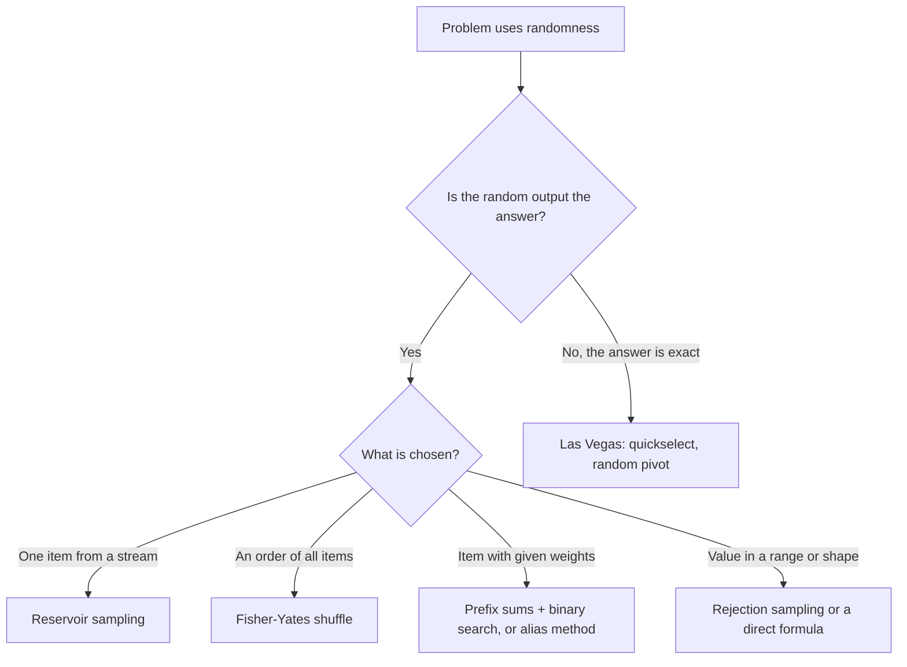

# Pattern 28: Randomized Algorithms

## 1. Pattern Name

**Randomized Algorithms**: uniform sampling (reservoir sampling, shuffling, weighted choice), rejection sampling, and algorithms that use random choices to get a good expected running time (randomized quickselect, randomized majority element).

This page covers two kinds of problems. In the first kind, the problem asks for a random output ("pick a random node", "shuffle the array", "pick an index with probability proportional to its weight"). The distribution of the output is the specification. In the second kind, the problem asks for a normal answer, and the algorithm flips coins to run fast on every input ("find the k-th largest element in expected O(n)"). Terms are defined where they first appear.

!!! info "Prerequisites"
    Read [Complexity Analysis](../foundations/01-complexity-analysis.md) first. This page states running times as expected values (the average over the random choices of the algorithm, not over the inputs). Pattern [04: Prefix Sum](../04-prefix-sum/README.md) and pattern [06: Binary Search on Answer](../06-binary-search-on-answer/README.md) give the two tools of weighted choice. Pattern [26: Design Data Structures](../26-design-data-structures/README.md) covers Insert Delete GetRandom. This page does not repeat it. [Sorting Algorithms](../foundations/08-sorting-algorithms.md) is the home page of quickselect. This page summarizes it and links to it.

---

## 2. Core Intuition

### What Interviewers Expect You to Think

A random-output problem has one hidden question: **is every outcome equally likely, or likely in the right proportion?** A solution that "looks random" but favors some outcomes fails the problem, even if it passes the examples. You prove fairness by **counting**: show that the algorithm has N equally likely paths, and that every outcome receives the same number of paths. Each technique on this page has such a counting argument. If you cannot find one, the algorithm is probably biased.

**The five ideas that cover most problems:**

1. **Choose by position, and shrink the range.** To pick one of `n` items fairly, draw an integer in `[0, n)`. Fisher-Yates builds a shuffle from this move. It draws from `n`, then `n-1`, then `n-2` options. The product is `n!`, which is the number of orders.
2. **Decide one item at a time with the right probability.** Reservoir sampling keeps item `i` with probability `1/i` (for one result) or `k/i` (for `k` results). The probabilities cancel out so that every item ends with the same chance. It needs one pass and O(k) memory.
3. **Turn weights into intervals.** Prefix sums put each weight on the number line as an interval whose length is the weight. A uniform draw in `[0, total)` lands in an interval with probability weight / total. Binary search finds the interval.
4. **Reject what does not fit.** If you cannot draw from the range you want, draw from a larger range that you can, and throw away the extra values. The values that remain are still uniform. The cost is the number of redraws.
5. **Randomize to defeat the worst input.** A fixed pivot rule has a bad input. A random pivot has no bad input, only unlucky coin flips, and the probability of bad luck is small.

### Two Meanings of "Randomized Algorithm"

| Kind | The answer is | The running time is | Examples on this page |
|---|---|---|---|
| **Sampling** (random output) | A random value with a required distribution | Fixed, or random | Reservoir sampling, shuffle, weighted choice |
| **Las Vegas** | Always correct | Random. Only the expected value is bounded | Quickselect, randomized majority element |
| **Monte Carlo** | Correct with a probability below 1 | Fixed | Randomized majority element with a fixed number of draws |

A **Las Vegas algorithm** always returns a correct answer, and its running time is a random variable. A **Monte Carlo algorithm** runs in a fixed time and returns a wrong answer with a small probability. You can turn a Las Vegas algorithm into a Monte Carlo algorithm by stopping after a time limit, and you can turn a one-sided Monte Carlo algorithm into a Las Vegas algorithm by adding a check, if a check is cheap. Motwani and Raghavan (see Further Reading) define both terms.

### Pseudorandom Numbers and Seeds

A computer program does not draw truly random numbers. A **pseudorandom number generator** (PRNG) is a deterministic function that maps an internal state to the next number and the next state. The **seed** is the initial state. Two generators with the same seed give the same sequence. This is useful for tests, and it is dangerous for secrets. Section "Choosing a Generator in Java" explains which Java class to use for which job.



---

## 3. Recognition Signals

### Keywords in the Problem Statement

- "Randomly pick", "return a random element", "each element has the same probability"
- "Shuffle", "random permutation", "all permutations are equally likely"
- "Pick with probability proportional to the weight / area"
- "Stream of unknown length", "you cannot read the list twice", "O(1) extra space"
- "Implement `randK()` using `randN()`"
- "Random point in a circle / in rectangles"
- "Expected O(n)", "average time", "randomized"

### Constraint Hints

- The input is a **stream** or a linked list with unknown length. Counting the length first costs a second pass, and the statement forbids it or says the list is huge. Think reservoir sampling.
- The problem calls `pick()` many times on the same data. Spend O(n) once to build a structure, then answer each call in O(log n) or O(1).
- The only random source is a weaker one (`rand7`, a coin). Think rejection sampling.
- The same array is queried with changing blacklists or "no repeat" rules. Think a virtual Fisher-Yates with a hash map.

### Red Flags: These Are Different Problems

- "Insert, delete, and get a random element in O(1)" is a data structure problem. Use an array plus a hash map. See pattern [26](../26-design-data-structures/README.md).
- "Find the median or the k-th element" with no mention of randomness is a selection problem. A heap or quickselect solves it. Randomness is only the tool. See pattern [16: Heap](../16-heap-priority-queue/README.md).
- "Count the number of ways" or "return all permutations" is combinatorics or backtracking, not sampling. See pattern [08](../08-recursion-backtracking/README.md).

---

## 4. Brute Force Thought Process

### Pick One Item From a Linked List (LC 382)

```
Brute force 1: copy all nodes into an ArrayList (O(n) space), then pick index nextInt(n).
Brute force 2: walk the list once to count n, then walk again to the random index (2 passes).

Time: O(n) per pick.  Space: O(n) for the copy, or O(1) with two passes.
```

Both approaches are correct. They fail only when the problem forbids the extra memory or the second pass (the stream case).

### Shuffle an Array

```
Brute force 1: generate all n! permutations, then pick one.          Time and space O(n! * n).
Brute force 2: give each element a random key, then sort by the key. Time O(n log n).
```

Brute force 2 is correct if the keys are distinct, and it is easy to write: `Collections.sort` with a random key per element. It costs O(n log n) where O(n) is possible. Do not sort with a random comparator such as `(a, b) -> rng.nextBoolean() ? 1 : -1`. That comparator breaks the `Comparator` contract and cannot produce a uniform shuffle (Mistake 6).

### Weighted Choice

```
Brute force: for each pick, draw r in [0, total), then scan the array and subtract weights
until r is below the current weight.

Time: O(n) per pick.  Space: O(1).
```

This is correct. It is too slow if `pick()` is called 10^5 times on 10^4 weights (10^9 operations).

### Why They Fail

Each brute force wastes a resource that the problem says is scarce: memory, passes, or time per call. The optimized forms in Section 5 keep the same distribution and remove the waste.

---

## 5. Optimization Insight (The "Aha" Moment)

### Reservoir Sampling: Probabilities That Cancel

**"I do not need to know `n`. I only need to give the i-th item the right chance when it arrives."**

Keep one result (`k = 1`). When item `i` arrives (counting from 1), replace the result with it with probability `1/i`.

**Proof that every item ends with probability `1/n`.** Item `i` is the result after step `i` with probability `1/i`. For each later step `j` (from `i+1` to `n`), the item survives with probability `1 - 1/j = (j-1)/j`. The probability that item `i` is the final result is the product:

```
1/i * (i/(i+1)) * ((i+1)/(i+2)) * ... * ((n-1)/n)  =  1/n
```

All factors in the middle cancel (a telescoping product). Item 1 follows the same formula, because its first step has probability `1/1`.

**For `k` results (Algorithm R).** Fill the reservoir with the first `k` items. For item `i > k`, draw `j` uniform in `[0, i)`. If `j < k`, put item `i` in slot `j`. Item `i` enters with probability `k/i`. An item that is in the reservoir survives step `j` unless the new item enters (probability `k/j`) and picks its slot (probability `1/k`), so it survives with probability `1 - 1/j = (j-1)/j`.

- For `i ≤ k`: the item enters with probability 1, then survives steps `k+1..n` with probability `k/k+1 * ... * (n-1)/n = k/n`.
- For `i > k`: `k/i * (i/(i+1)) * ... * ((n-1)/n) = k/n`.

So each item is in the final reservoir with probability `k/n`.

**Stronger claim: every `k`-subset is equally likely, with probability `1 / C(n, k)`.** Use induction on the number of items seen, `m`. Assume that after `m` items each `k`-subset of them has probability `1 / C(m, k)`. Take a `k`-subset `S` of the first `m+1` items.

- If `S` does not contain item `m+1`, the reservoir was `S` and the new item was rejected. Probability: `1 / C(m,k) * (m+1-k)/(m+1)`, which equals `1 / C(m+1, k)`.
- If `S` contains item `m+1`, then `S` minus that item has `k-1` members. The old reservoir was that set plus one of the `m-k+1` other old items `z`. The new item entered and replaced `z`. Probability: `(m-k+1) * 1/C(m,k) * (k/(m+1)) * (1/k) = (m-k+1) / ((m+1) * C(m,k))`, which equals `1 / C(m+1, k)`.

The identity `C(m+1,k) = C(m,k) * (m+1) / (m+1-k)` gives both equalities. In a seeded test of 600,000 samples of size 3 from 10 items, all 120 subsets appeared, with a chi-square statistic of 107.3 for 119 degrees of freedom (p = 0.77).

### Fisher-Yates: Count the Paths

**"Place the elements from the back. Each step has one fewer option."**

For `i` from `n-1` down to 1, swap `a[i]` with `a[j]`, where `j` is uniform in `[0, i]`. The first step has `n` options, the second `n-1`, and the last (`i = 1`) has 2 options. There are `n * (n-1) * ... * 2 = n!` choice sequences, and each has probability `1/n!`. Different choice sequences give different permutations (the permutation tells you, from the back, which `j` was used at each step). So `n!` equally likely sequences map one-to-one to the `n!` permutations. Every permutation has probability `1/n!`.

**Why the naive version is biased.** If each of the `n` steps swaps with a uniform position in `[0, n)`, the algorithm has `n^n` equally likely paths. For `n = 3`, that is 27 paths for 6 permutations. Since `27 / 6` is not an integer, some permutations get 4 paths and some get 5. The probabilities are `4/27 = 14.8%` and `5/27 = 18.5%`, and they cannot be equal. In general `n^n` is not divisible by `n!` for `n ≥ 3`. The factor `n-1` divides `n!`, but `n-1` and `n` share no prime factor, so `n-1` does not divide `n^n` when `n-1 > 1`.

### Weighted Choice: Weights as Intervals

**"Lay the weights end to end. A uniform point lands in a weight with the right probability."**

With weights `[1, 3, 6]`, the prefix sums are `[1, 4, 10]`. Draw `r` uniform in `[0, 10)`. If `r < 1`, return index 0 (1 value of 10). If `1 ≤ r < 4`, return index 1 (3 values of 10). Otherwise return index 2 (6 values of 10). Binary search finds the first prefix sum that is larger than `r`. This is pattern [04](../04-prefix-sum/README.md) (build the prefix sums) plus pattern [06](../06-binary-search-on-answer/README.md) (a binary search on a monotone array).

### Rejection Sampling: Throw Away the Remainder

**"If the range does not divide evenly, discard the part that does not fit."**

You have `rand7()` and need `rand10()`. Two calls give a number in `[1, 49]` with equal probability: `(rand7() - 1) * 7 + rand7()`. Keep the values `1..40` (a multiple of 10) and map them to `1..10` with `(v - 1) % 10 + 1`. Reject `41..49` and draw again. Each accepted value has the same probability, because each of the 10 results gets exactly 4 of the 40 accepted values.

**Expected cost.** One attempt is accepted with probability `p = 40/49`. The number of attempts follows a geometric distribution with expected value `1/p = 49/40 = 1.225`. Each attempt calls `rand7()` twice, so the expected number of calls is `2 * 49/40 = 2.45`.

### Random Pivots: Make Bad Luck Unlikely

Quickselect with a fixed pivot (for example, the last element) takes O(n²) on sorted input. With a uniformly random pivot, every input has the same expected O(n) time. No input is bad in advance. The home page [Sorting Algorithms](../foundations/08-sorting-algorithms.md) gives the code and the proof.

---

## 6. Generalized Templates

All templates take a `java.util.random.RandomGenerator` (JDK 17 and later). `Random`, `ThreadLocalRandom`, `SplittableRandom`, and `SecureRandom` all implement it. A function that takes a `RandomGenerator` can run with a seeded generator in a test and with `ThreadLocalRandom.current()` in production. See "Choosing a Generator in Java" below.

Every template was tested with a fixed seed. The test counts outcomes over 3 × 10^5 to 1.2 × 10^6 trials and runs a chi-square test (Template 8 shows the test). Templates 1 to 6 pass at significance 0.001 with each of five different seeds (the lowest p-value was 0.0097). The biased versions fail at every seed.

### Template 1: Reservoir Sampling (Algorithm R, LC 382)

```java
import java.util.ArrayList;
import java.util.Iterator;
import java.util.List;
import java.util.random.RandomGenerator;

class ReservoirSampling {
    // Algorithm R. Returns k items chosen uniformly from a stream of unknown length.
    // Time O(n), space O(k). If the stream has fewer than k items, returns all of them.
    static <T> List<T> sample(Iterator<T> stream, int k, RandomGenerator rng) {
        List<T> reservoir = new ArrayList<>(k);
        long seen = 0;
        while (stream.hasNext()) {
            T item = stream.next();
            seen++;
            if (reservoir.size() < k) {
                reservoir.add(item);               // fill the reservoir with the first k items
            } else {
                long j = rng.nextLong(seen);       // uniform in 0 .. seen-1
                if (j < k) reservoir.set((int) j, item);   // item enters with probability k/seen
            }
        }
        return reservoir;
    }

    // LeetCode 382: one random node of a linked list of unknown length (k = 1).
    static int pickOne(ListNode head, RandomGenerator rng) {
        int result = head.val;
        int seen = 1;
        for (ListNode node = head.next; node != null; node = node.next) {
            seen++;
            if (rng.nextInt(seen) == 0) result = node.val;   // probability 1/seen
        }
        return result;
    }
}
```

- **Time:** O(n) for a stream of `n` items. **Space:** O(k).
- `seen` is a `long`, so a stream with more than 2³¹ items works. `RandomGenerator.nextLong(bound)` draws in `[0, bound)`.
- Call `nextInt(seen)` after `seen++`. It returns a value in `[0, seen)`. The test `== 0` has probability `1/seen`.

### Template 2: Fisher-Yates Shuffle, With the Two Common Bugs

The program below runs the correct shuffle and the two buggy ones 600,000 times each on `{0, 1, 2}`, with a fixed seed, and prints how often each order appears. A fair shuffle gives 100,000 for each of the 6 orders.

```java
import java.util.Arrays;
import java.util.Random;
import java.util.random.RandomGenerator;

class ShuffleDemo {
    public static void main(String[] args) {
        int trials = 600_000;
        String[] names = {"correct (Fisher-Yates)", "biased (swap with any slot)", "off by one"};
        for (int variant = 0; variant < 3; variant++) {
            Random rng = new Random(42);                  // fixed seed: the output never changes
            int[] counts = new int[27];                   // index = base-3 code of the final order
            for (int t = 0; t < trials; t++) {
                int[] a = {0, 1, 2};
                switch (variant) {
                    case 0 -> Shuffles.shuffle(a, rng);
                    case 1 -> Shuffles.shuffleBiased(a, rng);
                    default -> Shuffles.shuffleOffByOne(a, rng);
                }
                counts[a[0] * 9 + a[1] * 3 + a[2]]++;
            }
            System.out.println(names[variant]);
            for (int code = 0; code < 27; code++) {
                if (counts[code] == 0) continue;
                int[] order = {code / 9, code / 3 % 3, code % 3};
                if (order[0] == order[1] || order[1] == order[2] || order[0] == order[2]) continue;
                System.out.println("  " + Arrays.toString(order) + " " + counts[code]);
            }
        }
        System.out.println("expected for a fair shuffle: " + trials / 6 + " each");
    }
}

class Shuffles {
    // Correct Fisher-Yates (Durstenfeld form). Every one of the n! orders has probability 1/n!.
    static void shuffle(int[] a, RandomGenerator rng) {
        for (int i = a.length - 1; i > 0; i--) {
            int j = rng.nextInt(i + 1);          // j in 0 .. i, both ends included
            int t = a[i]; a[i] = a[j]; a[j] = t;
        }
    }

    // BUG 1: the "naive" shuffle. Each position swaps with ANY position. It has n^n equally
    // likely paths, and n^n is not divisible by n!, so the orders cannot be equally likely.
    static void shuffleBiased(int[] a, RandomGenerator rng) {
        for (int i = 0; i < a.length; i++) {
            int j = rng.nextInt(a.length);       // should be a range that shrinks with i
            int t = a[i]; a[i] = a[j]; a[j] = t;
        }
    }

    // BUG 2: the off-by-one. nextInt(i) excludes i, so no element can stay in place.
    // This is Sattolo's algorithm: it makes a random cyclic permutation only.
    static void shuffleOffByOne(int[] a, RandomGenerator rng) {
        for (int i = a.length - 1; i > 0; i--) {
            int j = rng.nextInt(i);              // j in 0 .. i-1: should be i + 1
            int t = a[i]; a[i] = a[j]; a[j] = t;
        }
    }

    // k distinct random elements: stop the same loop after k swaps. O(n) copy, O(k) swaps.
    static int[] sampleWithoutReplacement(int[] source, int k, RandomGenerator rng) {
        int[] a = source.clone();
        int n = a.length;
        for (int i = 0; i < k; i++) {
            int j = i + rng.nextInt(n - i);      // j in i .. n-1
            int t = a[i]; a[i] = a[j]; a[j] = t;
        }
        return Arrays.copyOf(a, k);
    }
}
```

<!-- expected-output -->
```text
correct (Fisher-Yates)
  [0, 1, 2] 100315
  [0, 2, 1] 100024
  [1, 0, 2] 99754
  [1, 2, 0] 100183
  [2, 0, 1] 99800
  [2, 1, 0] 99924
biased (swap with any slot)
  [0, 1, 2] 88843
  [0, 2, 1] 110659
  [1, 0, 2] 112175
  [1, 2, 0] 110602
  [2, 0, 1] 89008
  [2, 1, 0] 88713
off by one
  [1, 2, 0] 299659
  [2, 0, 1] 300341
expected for a fair shuffle: 100000 each
```

Read the output:

- **Correct:** all six orders are within 0.4% of 100,000.
- **Biased:** three orders appear about 88,900 times (`4/27` of the trials: 88,889 expected). The other three appear about 111,100 times (`5/27`: 111,111 expected). The identity order `[0, 1, 2]` is one of the three that lose. The counts are 11% below and 11% above the fair count of 100,000.
- **Off by one:** only two orders appear, `[1, 2, 0]` and `[2, 0, 1]`, about half of the trials each. These are the two cyclic permutations of three elements. `nextInt(i)` never returns `i`, so no element can stay in place. Sattolo's algorithm uses this on purpose to build a random cycle.

**Time:** O(n). **Space:** O(1) extra. The method `sampleWithoutReplacement` stops the loop after `k` swaps and returns `k` distinct elements in random order. It costs O(n) for the copy and O(k) for the swaps. An alternative that uses less memory when `k` is much smaller than `n` is the virtual shuffle in Template 6.

The JDK method `Collections.shuffle(List, RandomGenerator)` (since Java 21) and `Collections.shuffle(List, Random)` use the correct loop. Their javadoc says that the implementation traverses the list backwards, from the last element up to the second, and swaps each element with a random element from the first element up to the current position, inclusive. Use the library call in production. Write the loop yourself in interviews, where the problem (LC 384) asks for it.

### Template 3: Weighted Choice (LC 528) and Weighted Points in Rectangles (LC 497)

```java
import java.util.random.RandomGenerator;

// LeetCode 528: pick index i with probability w[i] / sum(w). Build O(n), pick O(log n).
class WeightedPicker {
    private final long[] prefix;     // prefix[i] = w[0] + ... + w[i]
    private final RandomGenerator rng;

    WeightedPicker(int[] w, RandomGenerator rng) {
        this.rng = rng;
        prefix = new long[w.length];
        long sum = 0;
        for (int i = 0; i < w.length; i++) {
            sum += w[i];
            prefix[i] = sum;
        }
    }

    int pick() {
        long r = rng.nextLong(prefix[prefix.length - 1]);   // r in 0 .. total-1
        int lo = 0, hi = prefix.length - 1;
        while (lo < hi) {                                   // first i with prefix[i] > r
            int mid = (lo + hi) >>> 1;
            if (prefix[mid] > r) hi = mid; else lo = mid + 1;
        }
        return lo;
    }
}

// LeetCode 497: uniform integer point in a set of non-overlapping rectangles.
// Weight of a rectangle = number of integer points it holds, (w + 1) * (h + 1).
class RandomPointInRects {
    private final int[][] rects;
    private final WeightedPicker picker;      // defined above
    private final RandomGenerator rng;

    RandomPointInRects(int[][] rects, RandomGenerator rng) {
        this.rects = rects;
        this.rng = rng;
        int[] weights = new int[rects.length];
        for (int i = 0; i < rects.length; i++) {
            weights[i] = (rects[i][2] - rects[i][0] + 1) * (rects[i][3] - rects[i][1] + 1);
        }
        picker = new WeightedPicker(weights, rng);
    }

    int[] pick() {
        int[] r = rects[picker.pick()];                       // [x1, y1, x2, y2]
        return new int[] {r[0] + rng.nextInt(r[2] - r[0] + 1), r[1] + rng.nextInt(r[3] - r[1] + 1)};
    }
}
```

- **Time:** O(n) to build. O(log n) per `pick()`. **Space:** O(n).
- `rng.nextLong(total)` returns a value in `[0, total)`, and the binary search finds the first index with `prefix[i] > r`. Index `i` owns the values `[prefix[i-1], prefix[i])`, which is `w[i]` values. A weight of 0 owns no value, so it is never chosen.
- LC 497 weights each rectangle by its number of **integer points**, `(width + 1) * (height + 1)`. The area `width * height` is wrong, because the corners are points of the rectangle (Mistake 8). Inside the chosen rectangle, the point is uniform in x and in y, independently.

**The alias method (O(1) per pick).** The alias method makes `pick()` O(1) at the cost of an O(n) build and more code. It splits the weights into `n` columns of equal height. Each column holds at most two items: the item of its own index, with chance `prob[i]`, and an alias item that fills the rest. A pick chooses a column uniformly and then flips a biased coin. Vose's algorithm builds the columns in O(n) with two work lists, one for columns below the average height and one for columns at or above it.

```java
import java.util.random.RandomGenerator;

// Vose's alias method. Build O(n), pick O(1) with one nextInt and one nextDouble.
class AliasSampler {
    private final double[] prob;     // chance to keep column i
    private final int[] alias;       // the index to return if the column is not kept
    private final RandomGenerator rng;

    AliasSampler(double[] weights, RandomGenerator rng) {
        this.rng = rng;
        int n = weights.length;
        prob = new double[n];
        alias = new int[n];
        double total = 0;
        for (double w : weights) total += w;
        double[] scaled = new double[n];                 // average column height is 1.0
        int[] small = new int[n], large = new int[n];
        int s = 0, l = 0;
        for (int i = 0; i < n; i++) {
            scaled[i] = weights[i] * n / total;
            if (scaled[i] < 1.0) small[s++] = i; else large[l++] = i;
        }
        while (s > 0 && l > 0) {
            int lo = small[--s], hi = large[--l];
            prob[lo] = scaled[lo];
            alias[lo] = hi;                              // hi fills the rest of column lo
            scaled[hi] = (scaled[hi] + scaled[lo]) - 1.0;
            if (scaled[hi] < 1.0) small[s++] = hi; else large[l++] = hi;
        }
        while (l > 0) prob[large[--l]] = 1.0;            // leftovers are 1.0 up to rounding
        while (s > 0) prob[small[--s]] = 1.0;
    }

    int pick() {
        int column = rng.nextInt(prob.length);
        return rng.nextDouble() < prob[column] ? column : alias[column];
    }
}
```

An interview rarely needs the alias method. Binary search on prefix sums is O(log n) per call, the code is short, and the weights can be integers without rounding. Mention the alias method when the interviewer asks whether `pick()` can be faster than O(log n). It matters when `pick()` runs on a hot path, when you pick millions of samples from thousands of weights.

### Template 4: Rejection Sampling (LC 470 and LC 478)

```java
import java.util.function.IntSupplier;

// LeetCode 470: rand10() from rand7(). Expected rand7 calls: 2 * 49 / 40 = 2.45.
class Rand10 {
    private final IntSupplier rand7;     // returns 1..7 with equal probability

    Rand10(IntSupplier rand7) { this.rand7 = rand7; }

    int rand10() {
        while (true) {
            int v = (rand7.getAsInt() - 1) * 7 + rand7.getAsInt();   // uniform on 1..49
            if (v <= 40) return (v - 1) % 10 + 1;                    // 40 is a multiple of 10
            // v in 41..49: reject and draw again
        }
    }
}
```

```java
import java.util.random.RandomGenerator;

// LeetCode 478: uniform point in a circle.
class RandomPointInCircle {
    private final double radius, cx, cy;
    private final RandomGenerator rng;

    RandomPointInCircle(double radius, double cx, double cy, RandomGenerator rng) {
        this.radius = radius; this.cx = cx; this.cy = cy; this.rng = rng;
    }

    // Rejection sampling: draw from the bounding square, keep points inside the circle.
    // Acceptance probability pi / 4, so the expected number of draws is 4 / pi (about 1.27).
    double[] pointByRejection() {
        while (true) {
            double x = rng.nextDouble(-1.0, 1.0), y = rng.nextDouble(-1.0, 1.0);
            if (x * x + y * y <= 1.0) return new double[] {cx + radius * x, cy + radius * y};
        }
    }

    // Direct method: the area inside radius r grows as r^2, so draw r = R * sqrt(u).
    double[] pointByPolar() {
        double r = radius * Math.sqrt(rng.nextDouble());
        double angle = 2 * Math.PI * rng.nextDouble();
        return new double[] {cx + r * Math.cos(angle), cy + r * Math.sin(angle)};
    }
}
```

- `rand10`: expected `2.45` calls to `rand7`, the derivation is in Section 5. In 10^6 seeded trials, the measured average was 2.451 calls.
- Circle by rejection: expected `4/π = 1.273` draws per point, because the circle covers `π/4` of its bounding square. In 10^6 seeded draws, the measured average was 1.274.
- Circle by the polar formula: `r = R * sqrt(u)`. The area of a disk of radius `r` is `π r²`, so a uniform point has `P(distance ≤ r) = (r/R)²`. Solve `u = (r/R)²` for `r`. Taking `r = R * u` without the square root puts too many points near the center (Mistake 7). In the test, with four rings of equal area, the wrong formula put 50% of the points in the innermost ring, not 25%.
- **Do not add two calls.** `rand7() + rand7()` is not uniform: 7 appears six times more often than 2 (the sum has a triangular distribution). Do not take `(rand7() * rand7()) % 10` for the same reason. Use the base-7 digit trick `(a - 1) * 7 + b`, which gives 49 equally likely pairs.
- `RandomGenerator.nextInt(origin, bound)` and `nextDouble(origin, bound)` (used in `pointByRejection`) throw `IllegalArgumentException` when `origin >= bound`. The `nextInt(origin, bound)` javadoc says that the default implementation "checks that origin and bound are positive ints". That wording is too strict: a negative origin works, and a test run of `nextInt(-5, 5)` on JDK 21 returned values from -5 to 4. The condition that matters is `origin < bound`.
- LeetCode 470 has two follow-ups: "What is the expected value for the number of calls to rand7() function?" and "Could you minimize the number of calls to rand7()?" The basic method above answers the first one: `2 * 49/40 = 2.45` calls. The second follow-up asks you to stop wasting the rejected draws. A rejected value in `41..49` is still uniform on 9 values, so it can serve as a smaller uniform source. The class below keeps such a remainder and combines it with the next `rand7()` call.

```java
import java.util.function.IntSupplier;

// LeetCode 470 follow-up: reuse the rejected remainder. Expected rand7 calls: 329/150 = 2.19.
class Rand10Fewer {
    private final IntSupplier rand7;     // returns 1..7 with equal probability

    Rand10Fewer(IntSupplier rand7) { this.rand7 = rand7; }

    int rand10() {
        long value = 0;                  // uniform on 0 .. pool-1
        long pool = 1;
        while (true) {
            value = value * 7 + (rand7.getAsInt() - 1);          // pool grows by a factor of 7
            pool *= 7;
            if (pool >= 10) {
                long limit = pool - pool % 10;                   // largest multiple of 10 that fits
                if (value < limit) return (int) (value % 10) + 1;
                value -= limit;                                  // the remainder is still uniform
                pool -= limit;                                   // on 0 .. pool-1, pool is 1..9
            }
        }
    }
}
```

- **Expected calls of the reuse version.** Let `E` be the expected number of `rand7()` calls for one `rand10()`. The first two calls make a pool of 49. With probability 40/49 the call returns. Otherwise the pool is 9 and one more call makes 63: with probability 60/63 the call returns, and otherwise the pool is 3. One more call makes 21: with probability 20/21 the call returns, and otherwise the pool is 1 and the process starts again. So `E = 2 + (9/49)(1 + (3/63)(1 + (1/21)E))`, which gives `E = 329/150 = 2.1933`. In 10^6 seeded calls, the measured average was 2.1928, and the chi-square statistic over the 10 results was 14.5 for 9 degrees of freedom (limit 27.9 at significance 0.001). A version that also carries the unused part of an accepted value to the next call uses even fewer calls, but the code is longer. An interviewer rarely asks for it.

### Template 5: Las Vegas and Monte Carlo (LC 169, Randomized Majority Element)

```java
import java.util.random.RandomGenerator;

class RandomizedMajority {
    // LeetCode 169, Las Vegas form: the answer is always right, the running time is random.
    // The majority element fills more than half of the slots, so one draw hits it with
    // probability above 1/2. Expected draws: below 2. Expected time: O(n).
    // Assumes that a majority element exists, as the problem guarantees.
    static int majority(int[] nums, RandomGenerator rng) {
        while (true) {
            int candidate = nums[rng.nextInt(nums.length)];
            int count = 0;
            for (int x : nums) if (x == candidate) count++;
            if (count > nums.length / 2) return candidate;
        }
    }

    // Monte Carlo form: at most `trials` draws. If a majority element exists, the chance
    // that every draw misses it is below 2^-trials. Returns -1 when no draw wins.
    static int majorityMonteCarlo(int[] nums, int trials, RandomGenerator rng) {
        for (int t = 0; t < trials; t++) {
            int candidate = nums[rng.nextInt(nums.length)];
            int count = 0;
            for (int x : nums) if (x == candidate) count++;
            if (count > nums.length / 2) return candidate;
        }
        return -1;
    }
}
```

- **Las Vegas form.** The majority element fills more than half of the array, so one draw hits it with probability `p > 1/2`. The expected number of draws is `1/p < 2`. Each draw costs one O(n) counting pass, so the expected time is O(n). The probability of more than `t` failed draws is below `2^-t`.
- **Monte Carlo form.** With `trials` draws the failure probability is below `2^-trials`, and the running time is fixed at O(n · trials). The result `-1` means "no majority element found". It is a one-sided error: a returned candidate is always verified by counting.
- In a seeded test with `n = 101` and 51 copies of the majority value, the average was 1.98 draws (exact: `101/51 = 1.980`), and the 3-trial Monte Carlo form missed in 12.1% of the runs (exact: `(50/101)³ = 12.1%`, below the bound of 12.5%).
- The deterministic solutions are Boyer-Moore voting (O(n) time, O(1) space, Pattern [05](../05-hashing-frequency/README.md) for the hash map version) and sorting. The randomized solution is a good interview talking point, but it is not the best answer to LC 169.

**Randomized quickselect (LC 215)** is a Las Vegas algorithm of the same kind. It always returns the correct element. Only the number of partition passes is random, with expected O(n) time and O(n²) in the worst case. The partition code and the proof of the expected bound are on [Sorting Algorithms](../foundations/08-sorting-algorithms.md). The comparison with the heap solution (O(n log k), works on a stream) is in the same place.

### Template 6: Virtual Shuffle and Remapping (LC 519 and LC 710)

**Virtual Fisher-Yates.** To draw `k` distinct cells from an `m × n` matrix without storing `m * n` entries, run Fisher-Yates lazily. Slot `s` of the "array" holds cell `s` until a swap moves another cell into it. A hash map stores only the slots that changed.

```java
import java.util.HashMap;
import java.util.Map;
import java.util.random.RandomGenerator;

// LeetCode 519: a "virtual" Fisher-Yates over rows * cols cells. The map stores only the
// cells that moved, so memory is O(number of flips), not O(rows * cols).
class RandomFlipMatrix {
    private final int rows, cols;
    private final Map<Integer, Integer> moved = new HashMap<>();   // slot -> cell stored there
    private final RandomGenerator rng;
    private int remaining;                                          // slots 0..remaining-1 are free

    RandomFlipMatrix(int rows, int cols, RandomGenerator rng) {
        this.rows = rows; this.cols = cols; this.rng = rng;
        this.remaining = rows * cols;
    }

    int[] flip() {
        int slot = rng.nextInt(remaining);
        remaining--;                              // the last free slot is now `remaining`
        int cell = moved.getOrDefault(slot, slot);        // the cell that sits in this slot
        moved.put(slot, moved.getOrDefault(remaining, remaining));  // move the last cell here
        return new int[] {cell / cols, cell % cols};
    }

    void reset() {
        moved.clear();
        remaining = rows * cols;
    }
}
```

**Remapping a blacklist.** To draw from `[0, n)` without the blacklisted values, draw uniformly from `[0, size)`, where `size = n - blacklist.length` is the number of allowed values. The values in `[size, n)` can serve as spare allowed values. Every blacklisted value below `size` gets mapped to an allowed spare value at or above `size`.

```java
import java.util.HashMap;
import java.util.HashSet;
import java.util.Map;
import java.util.Set;
import java.util.random.RandomGenerator;

// LeetCode 710: uniform pick from [0, n) that skips the blacklist. O(b) build, O(1) pick.
class BlacklistPicker {
    private final Map<Integer, Integer> remap = new HashMap<>();
    private final int size;                       // number of allowed values
    private final RandomGenerator rng;

    BlacklistPicker(int n, int[] blacklist, RandomGenerator rng) {
        this.rng = rng;
        size = n - blacklist.length;
        Set<Integer> bad = new HashSet<>();
        for (int b : blacklist) bad.add(b);
        int spare = size;                         // scan the tail [size, n) for allowed values
        for (int b : blacklist) {
            if (b >= size) continue;              // already outside the range that we draw from
            while (bad.contains(spare)) spare++;
            remap.put(b, spare++);                // a blacklisted value below size gets a spare
        }
    }

    int pick() {
        int r = rng.nextInt(size);
        return remap.getOrDefault(r, r);
    }
}
```

- LC 519: O(1) expected time per `flip()` (one hash map update). `reset()` clears the map in O(number of flips). Memory is O(number of flips). The seeded test flipped all 6 cells of a 2 × 3 matrix, 720,000 times. All 720 possible orders appeared, with a chi-square statistic of 764 for 719 degrees of freedom (p = 0.12 at the first seed).
- LC 710: O(b) to build with `b` blacklist entries, O(1) per `pick()`. The pick draws from `size` values, so all allowed values have equal probability.

### Template 7: Choosing a Generator in Java

This block shows the usual choices. The table after Template 8 gives the facts behind each choice.

```java
import java.security.SecureRandom;
import java.util.Random;
import java.util.SplittableRandom;
import java.util.concurrent.ThreadLocalRandom;
import java.util.random.RandomGenerator;
import java.util.random.RandomGeneratorFactory;

class Generators {
    // Tests and reproducible simulations: a seeded generator.
    static RandomGenerator forTest() { return new Random(42L); }

    // Concurrent code: one generator per thread. Call current() at each use. Do not store it.
    static int diceRoll() { return ThreadLocalRandom.current().nextInt(1, 7); }

    // Parallel tasks that must be reproducible: split one seeded generator, one part per task.
    static RandomGenerator[] forTasks(long seed, int tasks) {
        SplittableRandom root = new SplittableRandom(seed);
        RandomGenerator[] parts = new RandomGenerator[tasks];
        for (int i = 0; i < tasks; i++) parts[i] = root.split();   // split() shares no state
        return parts;
    }

    // Tokens, keys, session identifiers, anything that an attacker must not predict.
    static byte[] token(int bytes) {
        byte[] token = new byte[bytes];
        new SecureRandom().nextBytes(token);
        return token;
    }

    // JDK 17 and later: choose an algorithm by name.
    static RandomGenerator named() {
        return RandomGeneratorFactory.of("L64X128MixRandom").create(42L);
    }
}
```

### Template 8: Testing Randomized Code

A test of randomized code has three tools: a fixed seed, a scripted generator for exact answers, and a statistical test for the distribution.

```java
import java.util.Random;
import java.util.random.RandomGenerator;

class RandomTestDemo {
    public static void main(String[] args) {
        // 1. Exact test: a scripted generator replaces the random draws.
        ScriptedRandom script = new ScriptedRandom(0, 2, 0);          // draws for seen = 2, 3, 4
        System.out.println("scripted pick (a b c d) = " + pickIndex(4, script));   // index 3

        // 2. Distribution test: a fixed seed makes the check repeatable.
        int n = 7, trials = 350_000;
        long[] counts = new long[n];
        Random rng = new Random(42);
        for (int t = 0; t < trials; t++) counts[pickIndex(n, rng)]++;
        double stat = ChiSquare.uniform(counts);
        double limit = ChiSquare.critical(n - 1);
        System.out.printf("chi-square %.2f, limit %.2f, uniform: %b%n", stat, limit, stat < limit);

        // 3. The same check catches a biased sampler.
        counts = new long[n];
        for (int t = 0; t < trials; t++) counts[biasedPickIndex(n, rng)]++;
        stat = ChiSquare.uniform(counts);
        System.out.printf("chi-square %.2f, limit %.2f, uniform: %b%n", stat, limit, stat < limit);
    }

    // Reservoir sampling with k = 1 over n items. Returns the index of the item that it keeps.
    static int pickIndex(int n, RandomGenerator rng) {
        int kept = 0;
        for (int seen = 2; seen <= n; seen++) {
            if (rng.nextInt(seen) == 0) kept = seen - 1;
        }
        return kept;
    }

    // A typical bug: the replacement chance is fixed at 1/2, not 1/seen.
    static int biasedPickIndex(int n, RandomGenerator rng) {
        int kept = 0;
        for (int seen = 2; seen <= n; seen++) {
            if (rng.nextInt(2) == 0) kept = seen - 1;
        }
        return kept;
    }
}

class ChiSquare {
    // Statistic for "every bucket has the same probability":
    // the sum of (observed - expected)^2 / expected.
    static double uniform(long[] counts) {
        long total = 0;
        for (long c : counts) total += c;
        double expected = (double) total / counts.length;
        double stat = 0;
        for (long c : counts) stat += (c - expected) * (c - expected) / expected;
        return stat;
    }

    // Critical value for significance 0.001 (Wilson-Hilferty approximation). It is 1 percent
    // above the exact value at 6 degrees of freedom, 3 percent at 1, and closer for more.
    // A fair generator passes with probability 0.999.
    static double critical(int degreesOfFreedom) {
        double z = 3.0902;                                  // normal quantile for 0.999
        double k = 2.0 / (9.0 * degreesOfFreedom);
        double cube = 1 - k + z * Math.sqrt(k);
        return degreesOfFreedom * cube * cube * cube;
    }
}

// Returns scripted answers for nextInt(bound). Fails fast if the code asks for more draws.
class ScriptedRandom implements RandomGenerator {
    private final int[] values;
    private int next = 0;

    ScriptedRandom(int... values) { this.values = values; }

    @Override
    public int nextInt(int bound) {
        int value = values[next++];
        if (value < 0 || value >= bound) throw new IllegalStateException("script out of range");
        return value;
    }

    @Override
    public long nextLong() { throw new UnsupportedOperationException("not scripted"); }
}
```

<!-- expected-output -->
```text
scripted pick (a b c d) = 3
chi-square 10.78, limit 22.68, uniform: true
chi-square 467257.56, limit 22.68, uniform: false
```

- **Scripted test.** `ScriptedRandom` implements `RandomGenerator` and returns prepared values for `nextInt(bound)`. For the stream `a b c d`, the script `0, 2, 0` means: replace at `seen = 2`, keep at `seen = 3`, replace at `seen = 4`. The result is index 3. This test checks the logic exactly, without statistics.
- **Distribution test.** A chi-square statistic sums `(observed - expected)² / expected` over all outcomes. For `d` degrees of freedom (the number of outcomes minus 1), a fair generator gives a statistic below the critical value at significance 0.001 with probability 0.999. The helper above uses the Wilson-Hilferty approximation of that critical value, `d * (1 - 2/(9d) + z * sqrt(2/(9d)))³`, where `z = 3.0902` is the normal quantile for 0.999. It is slightly above the exact value, so the test errs on the side of passing. The relative error is 3.0% for 1 degree of freedom, 1.4% for 4, 1.0% for 6 (22.68 against the exact 22.46), and 0.6% for 10. It shrinks as `d` grows.
- **The fixed seed.** The seed makes the test repeatable. The test passes or fails the same way on every run, so it is a regression test and not a flaky test. A fixed seed does not prove fairness, because it checks one sequence. Run the check with several seeds while you write the code. Then pin one seed in the test suite.
- **A biased sampler fails the same test.** The second check keeps a replacement chance of `1/2` at every step. Its statistic is 467,257 against a limit of 22.68.
- **Choose the number of trials.** Use enough trials so that each outcome has an expected count of at least 5 (the usual rule for a chi-square test). The tests on this page give each outcome an expected count of at least 1,000.
- **Inject the generator.** Pass a `RandomGenerator` into the constructor or the method, as every template does. Do not create `new Random()` inside the method, because a test cannot control it.

### Choosing a Generator in Java

Facts in this table come from the Java SE 21 javadoc of each class.

| Class | Seed and repeatable output | Threads | Cryptographically secure | State size or period |
|---|---|---|---|---|
| `java.util.Random` | `new Random(seed)`. The same seed and the same calls give the same sequence, and the javadoc requires this algorithm in every Java implementation | Thread-safe. Many threads on one instance can contend and slow down | No | 48-bit seed, period 2⁴⁸. Linear congruential formula |
| `ThreadLocalRandom` | The seed is internal. `setSeed` always throws `UnsupportedOperationException` | One generator per thread. Call `ThreadLocalRandom.current()` at each use and do not share the object | No | The javadoc gives no period. The JDK 21 source keeps one 64-bit seed per thread |
| `SecureRandom` | Output is non-deterministic. `setSeed` adds to the seed and does not replace it | Safe for use by several threads. The javadoc says that some methods may block while the entropy source gathers entropy | Yes. The javadoc requires FIPS 140-2 statistical tests and unpredictable output | Depends on the algorithm |
| `SplittableRandom` | `new SplittableRandom(seed)`. The same seed gives the same sequence in the same program | **Not** thread-safe. Call `split()` to get an independent generator for each task | No | Period 2⁶⁴ |
| `RandomGenerator` (since 17) | Depends on the algorithm | Depends on the algorithm | Depends on the algorithm | The interface of all four classes above. `RandomGenerator.of(name)` creates a named algorithm. `getDefault()` returns a generator with at least 64 state bits. The JDK 21 implementation selects `L32X64MixRandom`, and the javadoc says the choice can change over time |

**Recommendation.**

- Tests and reproducible simulations: `new Random(seed)` or `new SplittableRandom(seed)`.
- Multithreaded code that needs speed: `ThreadLocalRandom.current()` at each call.
- Parallel work that must be reproducible: `SplittableRandom.split()`, one part per task.
- Anything an attacker must not guess (tokens, keys, password salts, session identifiers): `SecureRandom`. Never `Random`.
- Write method signatures with `RandomGenerator` so the caller picks the source.

**The state size limits a shuffle.** A generator with a 48-bit state, such as `Random`, produces at most 2⁴⁸ different sequences. Since 17! is larger than 2⁴⁸ (17! = 3.6 × 10¹⁴, 2⁴⁸ = 2.8 × 10¹⁴), a `Random` shuffle of 17 or more elements cannot reach every order. A deck of 52 cards has 52! orders, about 2²²⁵·⁶. A generator with a 64-bit seed can reach every order only if there are at most 20 elements (21! is larger than 2⁶⁴). For card games with real money, use `SecureRandom`. This is an argument about the number of states and not a measured bias. For interview problems it does not matter.

**`Math.random()`** uses one shared `Random`, created on the first call. The javadoc says that it is properly synchronized, and that threads which need many numbers can reduce contention with their own generator.

---

## 7. Variations of the Pattern

### Variation A: Reservoir Sampling Over a Filtered Stream (LC 398)

**Problem Type:** The array is stored, and a call gives a target value. Return a random index among the positions where the array equals the target.
**Solution:** Run a reservoir of size 1 over only the matching positions. Memory is O(1), and each call takes O(n). The alternative is a `HashMap<Integer, List<Integer>>` built once (O(n) memory) that answers each call in O(1). Choose the reservoir when memory is tight or when the array is large and calls are rare.

```java
import java.util.random.RandomGenerator;

// LeetCode 398: random index among the positions of `target`. O(1) extra space, O(n) per pick.
class RandomPickIndex {
    private final int[] nums;
    private final RandomGenerator rng;

    RandomPickIndex(int[] nums, RandomGenerator rng) { this.nums = nums; this.rng = rng; }

    int pick(int target) {
        int chosen = -1, matches = 0;
        for (int i = 0; i < nums.length; i++) {
            if (nums[i] != target) continue;
            matches++;                                // reservoir of size 1 over the matches
            if (rng.nextInt(matches) == 0) chosen = i;
        }
        return chosen;
    }
}
```

### Variation B: Weighted Choice Over a Stream (Efraimidis-Spirakis)

**Problem Type:** Pick an item with probability proportional to its weight, in one pass, without knowing the total weight.
**Solution:** Give item `i` the key `u^(1/w_i)`, where `u` is uniform in `(0, 1]`. The item with the largest key is chosen with probability `w_i / sum(w)`. For `k` items, keep the `k` largest keys in a min-heap. A seeded test of 500,000 picks over the weights `[1, 3, 6, 10, 5]` gave a chi-square statistic of 4.68 for 4 degrees of freedom. For `k > 1` the result is a weighted sample without replacement (algorithm A-Res in the paper).

```java
import java.util.random.RandomGenerator;

class WeightedStreamPick {
    // Efraimidis-Spirakis, k = 1: give item i the key u^(1/w_i) with u uniform in (0, 1).
    // The item with the largest key wins with probability w_i / sum(w). One pass, O(1) space.
    // Weights must be positive. Works on a stream whose total weight is unknown.
    static int pick(int[] weights, RandomGenerator rng) {
        int best = -1;
        double bestKey = -1;
        for (int i = 0; i < weights.length; i++) {
            double u = 1.0 - rng.nextDouble();                // in (0, 1], never 0
            double key = Math.pow(u, 1.0 / weights[i]);
            if (key > bestKey) { bestKey = key; best = i; }
        }
        return best;
    }
}
```

### Variation C: Several Picks Without Repeats

**Problem Type:** "Pick `k` distinct elements", "Random Flip Matrix", "Shuffle then take the first `k`".
**Choice:**

| Situation | Method | Time | Space |
|---|---|---|---|
| `k` is close to `n`, the data fits in memory | Partial Fisher-Yates (`sampleWithoutReplacement`) | O(n + k) | O(n) |
| `k` is much smaller than `n`, `n` is huge (a matrix of 10^9 cells) | Virtual Fisher-Yates with a hash map (LC 519) | O(k) | O(k) |
| `k` is small and `n` is huge, and repeats are rare | Draw, then reject if seen (hash set) | O(k) expected | O(k) |
| The data arrives as a stream | Reservoir sampling | O(n) | O(k) |

Rejection of repeats has a catch: if `k` is close to `n`, the last draws reject most values. The last of `n` draws out of `n` values needs `n` attempts in expectation, and all `n` draws need about `n ln n` (the coupon collector problem). Use a virtual shuffle in that case.

### Variation D: Randomization Against Adversarial Input

**Problem Type:** The algorithm has a bad input for a fixed rule.
**Examples:**

- **Quicksort and quickselect pivot.** A random pivot removes the bad input. See [Sorting Algorithms](../foundations/08-sorting-algorithms.md).
- **Hash functions.** Universal hashing picks the hash function at random from a family, so no fixed input set causes many collisions (CLRS section 11.3.3 in the 3rd edition). Java's `HashMap` does not do this. It limits the damage of collisions by turning a long bucket into a red-black tree (JEP 180, Java 8). The `HashMap` javadoc does not describe tree bins. The source comments of `java/util/HashMap.java` do, and the bound is O(log n) only for `Comparable` keys or keys with distinct hashes. See [Hash Tables](../foundations/04-hash-tables.md).
- **Random shuffle before a sort-sensitive step** (for example, before inserting sorted keys into an unbalanced binary search tree). The expected height of a random binary search tree is O(log n) (CLRS section 12.4 in the 3rd edition).

### Variation E: Randomization Inside a Data Structure

**Problem Type:** A data structure uses random priorities or levels to stay balanced without rebalancing rules.
**Examples:** A skip list (Pugh 1990) gives each node a random height. A treap (Aragon and Seidel 1989) gives each key a random priority and keeps a heap order on the priorities. Both have expected O(log n) operations. Interviews ask about them as design questions, rarely as code. `ConcurrentSkipListMap` in the JDK is a sorted map built on this idea. Its javadoc says that it "implements a concurrent variant of SkipLists providing expected average log(n) time cost" for `containsKey`, `get`, `put`, and `remove`.

### Variation F: Monte Carlo Error Reduction

**Problem Type:** A randomized test answers "yes" or "no", and a wrong answer has a one-sided probability `ε`.
**Technique:** Repeat the test `t` times with independent random choices. If the error is one-sided (the answer "no" is always right, and the answer "yes" is wrong with probability at most `ε`), the combined error is `ε^t`. The Miller-Rabin primality test uses this. CLRS Theorem 31.38 (3rd edition, section 31.8) bounds its error by `2^-s` for `s` rounds. The randomized majority element with `t` draws is the same shape.

### Variation G: Insert Delete GetRandom O(1)

LC 380 and LC 381 ask for a data structure and not for a sampling algorithm. The solution is an array plus a hash map from value to index. Remove by swapping with the last element. See pattern [26: Design Data Structures](../26-design-data-structures/README.md).

---

## 8. Classic Interview Problems

Difficulties come from the LeetCode problem list (`https://leetcode.com/api/problems/all/`), saved on the day of writing.

| # | Problem | Difficulty | Key insight |
|---|---------|-----------|-------------|
| 169 | Majority Element | Easy | The expected answer is Boyer-Moore voting. The randomized solution (draw, count, repeat) is a Las Vegas algorithm with fewer than 2 expected draws |
| 384 | Shuffle an Array | Medium | Fisher-Yates from the back with `nextInt(i + 1)`. `reset()` returns a saved copy. The off-by-one and the swap-with-any-slot versions are biased (Template 2) |
| 382 | Linked List Random Node | Medium | Reservoir sampling with `k = 1`: replace with probability `1/seen` (Template 1) |
| 398 | Random Pick Index | Medium | Reservoir over the matching positions, or a map from value to a list of indices (Variation A) |
| 528 | Random Pick with Weight | Medium | Prefix sums, a draw in `[0, total)`, and binary search for the first prefix larger than the draw (Template 3) |
| 470 | Implement Rand10() Using Rand7() | Medium | `(rand7() - 1) * 7 + rand7()` is uniform on `1..49`. Reject `41..49` (Template 4) |
| 478 | Generate Random Point in a Circle | Medium | Rejection from the bounding square, or `r = R * sqrt(u)` with a uniform angle (Template 4) |
| 497 | Random Point in Non-overlapping Rectangles | Medium | Weight each rectangle by its number of integer points, `(w + 1) * (h + 1)`. Pick a rectangle, then a point inside it (Template 3) |
| 519 | Random Flip Matrix | Medium | Virtual Fisher-Yates with a hash map of moved slots (Template 6) |
| 215 | Kth Largest Element in an Array | Medium | Randomized quickselect gives expected O(n). A heap gives O(n log k). See [Sorting Algorithms](../foundations/08-sorting-algorithms.md) |
| 380 | Insert Delete GetRandom O(1) | Medium | Array plus hash map, swap with the last element on delete. See pattern [26](../26-design-data-structures/README.md) |
| 710 | Random Pick with Blacklist | Hard | Draw from `n - b` values. Remap each blacklisted value below `n - b` to an allowed value at or above it (Template 6) |

### Walkthrough: LeetCode 470, Implement Rand10() Using Rand7()

**Step 1, restate.** You may call `rand7()`, which returns each of 1 to 7 with probability 1/7. Write `rand10()`, which returns each of 1 to 10 with probability 1/10.
**Step 2, brute force.** There is none that is correct. The tempting idea is `rand7() + rand7()`, but the sum is not uniform. The value 7 appears six times as often as 2 (the sum over two dice is triangular). In a seeded test with 10^6 trials of `(rand7() + rand7()) % 10`, the buckets ranged from 81,000 to 143,000.
**Step 3, observe.** One call gives 7 values. Two calls give 49 equally likely pairs `(a, b)`. If you read the pair as two digits in base 7, `(a - 1) * 7 + (b - 1)` runs from 0 to 48 and each value has probability 1/49.
**Step 4, reject.** 49 is not a multiple of 10. The largest multiple of 10 that is at most 49 is 40. If the value is in `0..39`, return `value % 10 + 1`. Each result has 4 values, so each has probability 4/49 per attempt, and the attempts that remain are uniform. If the value is in `40..48`, draw again.
**Step 5, cost.** One attempt succeeds with probability 40/49. The expected number of attempts is 49/40. With two calls each, the expected number of `rand7()` calls is 98/40 = 2.45. The worst case has no upper bound, but the probability of more than `t` attempts is `(9/49)^t`.
**Step 6, edge cases.** The loop must test the value after both calls. Rejecting after one call wastes a draw. A `while (true)` loop with a `return` is clear and cannot skip the check.

---

## 9. How to Practice This Pattern Effectively

### Phase 1: The Two Core Proofs (3 problems)

- LC 382 (Linked List Random Node). Write the `k = 1` reservoir, then write the proof that every node has probability `1/n`.
- LC 384 (Shuffle an Array). Write Fisher-Yates from memory. Then write the biased version and explain why it is biased with the count `n^n` against `n!`.
- LC 169 (Majority Element). Solve it with Boyer-Moore, then with random draws, and state the expected number of draws.

### Phase 2: Weights and Rejection (4 problems)

- LC 528, then LC 497 (reuse the prefix-sum picker).
- LC 470, then LC 478. For each, state the acceptance probability and the expected number of draws.

### Phase 3: Hard Variants (3 problems)

- LC 398 with the reservoir and with the map. State when each is better.
- LC 519 (virtual shuffle) and LC 710 (remap the blacklist).

### Phase 4: Test Your Own Code

For each solution, write a chi-square test with a fixed seed. Then break the solution on purpose (the biased shuffle, `nextInt(seen - 1)` in the reservoir) and check that the test fails. A test that cannot fail does not test anything.

### Self-Check Questions

- Can I prove that reservoir sampling gives each item the probability `k/n`?
- Can I show with a count why the swap-with-any-slot shuffle is biased?
- Can I say which interval a draw belongs to when a weight is 0?
- Can I compute the expected number of calls for a rejection sampler?
- Which `java.util` class do I use for a test, for threads, and for a secret?

### Interview Script

> "The problem asks for a uniform random choice, so I want to be sure that every outcome has the same probability. I will pick the technique, and then I will prove fairness by counting.
>
> The list has unknown length and I may read it once, so I will use reservoir sampling with k = 1. For node `i`, I replace the result with probability `1/i`. Node `i` survives each later step `j` with probability `(j-1)/j`, so its final probability is `1/i` times the product, which is `1/n`.
>
> I take a `RandomGenerator` in the constructor so that I can test the distribution with a fixed seed."

---

## 10. Common Mistakes Even Experienced Developers Make

### Mistake 1: `Math.abs(random.nextInt()) % n`

<!-- fragment -->
```java
// WRONG: two bugs
int index = Math.abs(random.nextInt()) % n;
// CORRECT
int index = random.nextInt(n);
```

Bug one: `Math.abs(Integer.MIN_VALUE)` is `Integer.MIN_VALUE` (negative), because `-2³¹` has no positive `int` counterpart. The index is negative with probability 2⁻³² per draw. Bug two: the remainder is biased. `abs(nextInt())` has `2³¹` possible values, and `2³¹` is not a multiple of `n`, so small remainders appear more often. For `n = 1,500,000,000`, a seeded test of 10^6 draws put 60.3% of the results in `[0, 647,483,648)`. A uniform generator puts 43.2% there. For small `n` the bias is tiny but real. `Random.nextInt(bound)` avoids both bugs: its javadoc describes a loop that rejects the values that would give an uneven distribution.

### Mistake 2: `random.nextInt() % n` Gives Negative Indexes

`nextInt()` returns negative values for half of the draws, and in Java `%` keeps the sign of the dividend (JLS 15.17.3). A seeded test of `nextInt() % 7` gave a negative result in 42.8% of the draws. Use `nextInt(n)`.

### Mistake 3: The Swap-With-Any-Slot Shuffle

<!-- fragment -->
```java
// WRONG: n^n paths cannot be divided evenly among n! orders
for (int i = 0; i < n; i++) swap(a, i, rng.nextInt(n));
// CORRECT: the range shrinks
for (int i = n - 1; i > 0; i--) swap(a, i, rng.nextInt(i + 1));
```

The seeded result is in Template 2: the identity order is 11% too rare.

### Mistake 4: Off by One in the Range of the Draw

`rng.nextInt(i)` in Fisher-Yates excludes `i`, so no element can stay in its place (Sattolo's cycle). `rng.nextInt(i + 1)` is right. In reservoir sampling, `nextInt(seen)` must run after `seen++`. If it runs before, then for the second item `nextInt(1)` always returns 0, so the second item replaces the first with probability 1 and not 1/2. A chi-square test finds both bugs.

### Mistake 5: A New `Random` for Every Call

<!-- fragment -->
```java
// WRONG: two calls in the same millisecond can use the same seed
int roll() { return new Random(System.currentTimeMillis()).nextInt(6); }
// CORRECT: keep one generator, or use ThreadLocalRandom
private final Random random = new Random();
int roll() { return random.nextInt(6); }
```

The same seed gives the same number. The no-argument constructor `new Random()` picks a seed "very likely to be distinct from any other invocation of this constructor" (javadoc), so it does not repeat. It still creates a new object for each call, and a seeded test cannot control it. Keep one generator per object, or call `ThreadLocalRandom.current()`.

### Mistake 6: A Random Comparator as a Shuffle

<!-- fragment -->
```java
// WRONG: breaks the Comparator contract and is not uniform
list.sort((x, y) -> rng.nextBoolean() ? 1 : -1);
// CORRECT
Collections.shuffle(list, rng);
```

The `Comparator` contract needs `compare(x, y)` to give the opposite sign of `compare(y, x)` and to be transitive. A random comparator does not do this, and `List.sort` may throw `IllegalArgumentException` ("Comparison method violates its general contract"). It also cannot be uniform: the sort stops after a number of comparisons that depends on the path, each path has probability `2^-c` for `c` coin flips, and a sum of such terms is a fraction with a power of 2 as the denominator. The probability `1/6` of one order of three elements is not such a fraction.

### Mistake 7: A Uniform Radius for a Uniform Point in a Circle

`r = R * u` makes the density of points proportional to `1/r`, so the center is crowded. Use `r = R * sqrt(u)`. In the seeded test, the wrong formula put 50% of the points in the inner ring that should hold 25%.

### Mistake 8: Weighting by Area When Points Are Integers

For LC 497, a rectangle `[x1, y1, x2, y2]` holds `(x2 - x1 + 1) * (y2 - y1 + 1)` integer points. A rectangle with `x1 == x2` has area 0 but still has points. Use the point count as the weight and draw `x1 + nextInt(x2 - x1 + 1)`.

### Mistake 9: Sharing a `ThreadLocalRandom` Across Threads

<!-- fragment -->
```java
// WRONG: the object belongs to the thread that called current()
private static final ThreadLocalRandom RNG = ThreadLocalRandom.current();
// CORRECT: call current() at each use
int roll() { return ThreadLocalRandom.current().nextInt(1, 7); }
```

The javadoc says that methods of the object "should be called only by the current thread, not by other threads". The form `ThreadLocalRandom.current().nextX(...)` makes sharing impossible. Do not call `setSeed` on it: it always throws `UnsupportedOperationException`. For reproducible parallel code, use `SplittableRandom.split()`.

### Mistake 10: Using `java.util.Random` for Secrets

`Random` uses a 48-bit seed and a linear congruential formula. Its javadoc says that its instances are not cryptographically secure and recommends `SecureRandom`. Do not generate session identifiers, password-reset tokens, or keys with `Random`, `ThreadLocalRandom`, or `SplittableRandom`.

### Mistake 11: Tests That Use an Unseeded Generator

A statistical test with significance 0.001 on a fresh seed fails once in 1000 runs for a correct implementation. The team then learns to ignore the failure. Pin the seed in the test suite. Pass the generator into the code under test, as the templates do.

### Mistake 12: A Boundary Error in Weighted Choice

If the search uses `prefix[mid] >= r` with `r` in `[0, total)`, then `r = prefix[i]` goes to index `i` instead of `i + 1`, and every interval is shifted by one value. For the weights `[1, 3, 6]` the 10 values of `r` give the counts 2, 3, 5 and not 1, 3, 6. With a weight of 0 (`[0, 4]`), `r = 0` returns the index with weight 0. Use the rule "first `i` with `prefix[i] > r`". A frequency test finds this bug.

---

## Commonly Confused With

| Looks like... | But use... | The question that decides |
|---|---|---|
| "Return a random element" on a changing set | Array plus hash map (pattern [26](../26-design-data-structures/README.md), LC 380) | Does the set change with insert and delete between calls? If yes, keep a dense array. If the data is a fixed stream, use reservoir sampling |
| Weighted random pick | Prefix sum (pattern [04](../04-prefix-sum/README.md)) plus binary search (pattern [06](../06-binary-search-on-answer/README.md)) | Is the pick probability proportional to a weight? If yes, prefix sums turn the weights into intervals |
| Reservoir sampling for a stored array | `nextInt(n)` on the array | Is the length known and the data in memory? If yes, one draw is enough |
| Random shuffle | Sorting | Does the output need an order defined by keys? Then sort. A random order needs Fisher-Yates, not a sort with random keys or a random comparator |
| k-th element with random pivot | Heap (pattern [16](../16-heap-priority-queue/README.md)) | Is the data a stream, or is `k` much smaller than `n`? A heap holds `k` items. Quickselect needs the whole array |
| Monte Carlo (maybe wrong) | Las Vegas (always right) | Can a result be checked cheaply? If yes, add the check and repeat until it passes |

> Full decision procedure: [How to Choose a Pattern](../how-to-choose-a-pattern.md)

---

## Quick Reference Card

```
+----------------------------------------------------------------------+
|                 RANDOMIZED ALGORITHMS CHEAT SHEET                    |
+----------------------------------------------------------------------+
| RESERVOIR (stream, unknown n):                                       |
|   fill k slots, then for item i > k: j = nextInt(i); if j < k, slot j|
|   P(item in sample) = k/n.  Time O(n), space O(k).                   |
|                                                                      |
| FISHER-YATES:  for i = n-1 down to 1: swap(a[i], a[nextInt(i + 1)])  |
|   n! paths for n! orders.  Swap-with-any-slot has n^n paths: biased. |
|   nextInt(i) instead of nextInt(i + 1): only cycles (Sattolo).       |
|                                                                      |
| WEIGHTED: prefix sums, r = nextLong(total), first i with prefix > r. |
|   O(n) build, O(log n) pick.  Alias method: O(1) pick.               |
|                                                                      |
| REJECTION: draw from a larger uniform range, discard the rest.       |
|   Expected draws = 1 / P(accept).  rand10 from rand7: 2.45 calls.    |
|                                                                      |
| LAS VEGAS: always right, random time (quickselect, majority draw).   |
| MONTE CARLO: fixed time, may be wrong.  Repeat: error p^t.           |
|                                                                      |
| JAVA: test = new Random(seed) | threads = ThreadLocalRandom.current()|
|       split = SplittableRandom | secrets = SecureRandom              |
|   nextInt(n), never Math.abs(nextInt()) % n.                         |
| TEST: scripted generator for exact logic, chi-square with a fixed    |
|   seed for the distribution.  Pass the generator in.                 |
+----------------------------------------------------------------------+
```

---

## Further Reading

Primary sources for the claims on this page:

- [Java SE 21 `java.util.Random`](https://docs.oracle.com/en/java/javase/21/docs/api/java.base/java/util/Random.html): the 48-bit seed, the linear congruential formula, the same-seed rule, thread safety and contention, "not cryptographically secure", and the algorithm of `nextInt(int bound)` that rejects values for uniformity.
- [Java SE 21 `ThreadLocalRandom`](https://docs.oracle.com/en/java/javase/21/docs/api/java.base/java/util/concurrent/ThreadLocalRandom.html): isolation to the current thread, `current()`, and `setSeed` always throwing `UnsupportedOperationException`.
- [Java SE 21 `SecureRandom`](https://docs.oracle.com/en/java/javase/21/docs/api/java.base/java/security/SecureRandom.html): the cryptographically strong generator, FIPS 140-2 and RFC 4086, and `setSeed` that supplements the seed.
- [Java SE 21 `SplittableRandom`](https://docs.oracle.com/en/java/javase/21/docs/api/java.base/java/util/SplittableRandom.html): `split()`, not thread-safe, period 2⁶⁴.
- [Java SE 21 `RandomGenerator`](https://docs.oracle.com/en/java/javase/21/docs/api/java.base/java/util/random/RandomGenerator.html): the interface, `of(String)`, `getDefault()`, and the bounded `nextInt`, `nextLong`, and `nextDouble` methods, including the `origin` and `bound` forms. [JEP 356: Enhanced Pseudo-Random Number Generators](https://openjdk.org/jeps/356) added it in Java 17.
- [Java SE 21 `Collections.shuffle`](https://docs.oracle.com/en/java/javase/21/docs/api/java.base/java/util/Collections.html): the backward traversal, the linear time, and the `RandomGenerator` overload (since 21).
- [JEP 180: Handle Frequent HashMap Collisions with Balanced Trees](https://openjdk.org/jeps/180): the tree bins that Variation D mentions. The [`HashMap` javadoc](https://docs.oracle.com/en/java/javase/21/docs/api/java.base/java/util/HashMap.html) does not describe them. The source comments of `java/util/HashMap.java` do.
- [Java SE 21 `ConcurrentSkipListMap`](https://docs.oracle.com/en/java/javase/21/docs/api/java.base/java/util/concurrent/ConcurrentSkipListMap.html): the concurrent skip list that Variation E mentions.
- [Java SE 21 `Math.random`](https://docs.oracle.com/en/java/javase/21/docs/api/java.base/java/lang/Math.html): the single shared `Random` instance.
- [JLS 15.17.3, Remainder Operator `%`](https://docs.oracle.com/javase/specs/jls/se21/html/jls-15.html#jls-15.17.3): the sign of the result, for Mistake 2.
- Vitter, J. S. (1985). "Random Sampling with a Reservoir". *ACM Transactions on Mathematical Software* 11(1), 37-57. Algorithm R and faster variants.
- Knuth, *The Art of Computer Programming*, Volume 2, Seminumerical Algorithms, section 3.4.2: Algorithm P (shuffling) and Algorithm R (reservoir sampling).
- Durstenfeld, R. (1964). "Algorithm 235: Random permutation". *Communications of the ACM* 7(7), 420. The in-place form of the Fisher-Yates shuffle.
- Sattolo, S. (1986). "An algorithm to generate a random cyclic permutation". *Information Processing Letters* 22(6), 315-317.
- Efraimidis, P. S. and Spirakis, P. G. (2006). "Weighted random sampling with a reservoir". *Information Processing Letters* 97(5), 181-185.
- Vose, M. D. (1991). "A linear algorithm for generating random numbers with a given distribution". *IEEE Transactions on Software Engineering* 17(9), 972-975. The alias method construction.
- Hoare, C. A. R. (1961). "Algorithm 65: Find". *Communications of the ACM* 4(7), 321-322. Quickselect.
- Cormen, Leiserson, Rivest, Stein, *Introduction to Algorithms* (CLRS), 3rd edition (2009). Section numbers on this page refer to this edition. The 4th edition (2022) renumbers some sections, especially in the hashing chapter. Chapter 5 (probabilistic analysis and randomized algorithms), section 9.2 (expected linear-time selection), section 12.4 (randomly built binary search trees), section 31.8 (Miller-Rabin).
- Motwani, R. and Raghavan, P. (1995). *Randomized Algorithms*. Cambridge University Press. Las Vegas and Monte Carlo algorithms, and error reduction by repetition.
- Pugh, W. (1990). "Skip lists: a probabilistic alternative to balanced trees". *Communications of the ACM* 33(6), 668-676. Aragon, C. R. and Seidel, R. (1989). "Randomized search trees". FOCS 1989, 540-545.
- [LeetCode problem list](https://leetcode.com/problems/): the problems in Section 8.

---

*Previous: [Pattern 27: Advanced DP](../27-advanced-dp/README.md)*
