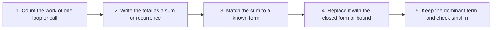

# Math for Complexity Analysis

## Why It Matters

Complexity analysis is a short list of mathematical moves: count the steps of a loop, write the count as a sum, replace the sum with a closed form, and keep the fastest-growing term. Most beginners do not struggle with the idea of complexity. They struggle because the page that explains it assumes that they already know exponents, logarithms, summations, and inequalities. Interviews then ask the same questions that depend on this math: "why is binary search O(log n)", "why does a doubling array cost O(1) amortized", "why does a loop with `j += i` cost O(n log n)", "how many subsets does a set have", and "what is the expected number of tries". This page teaches each tool from school-level arithmetic. Each section starts with small numbers, then gives the formal rule, then a worked example, and ends with a pointer to the place in [Complexity Analysis](01-complexity-analysis.md) that uses the tool. Read this page before that page if its formulas look unfamiliar.

## Core Concepts

The nine tools below build on each other. Section 1 (exponents) is the base for section 2 (logarithms), and section 4 (sums) uses both.

!!! info "Notation on this page"
    `n²` means n times n. `2ⁿ` and `2^k` both mean 2 multiplied by itself `n` or `k` times. `a * b` and `a · b` both mean "a times b". `Σ` is the Greek capital letter sigma and means "add up". `≤` means "less than or equal to". `≈` means "approximately equal to". An **integer** is a whole number such as -3, 0, or 42. `O(g(n))`, `Ω(g(n))`, and `Θ(g(n))` (Big-O, Big-Omega, Big-Theta) describe how fast a cost grows with `n`: "at most about `g(n)`", "at least about `g(n)`", and "both". For example, `3n² + 10n` is `Θ(n²)`. [Complexity Analysis](01-complexity-analysis.md) defines them formally. This page uses them only to name the growth of a result. This page does not use LaTeX, so every formula is plain text.

### 1. Exponents

**Intuition.** Suppose you answer 3 yes-or-no questions. The first question has 2 possible answers. For each of those, the second question has 2 answers, which gives `2 · 2 = 4` combinations. The third question doubles the count again: `2 · 2 · 2 = 8` combinations. Each extra question multiplies the count by 2. That repeated multiplication is an exponent.

**Definition.** For a number `a` and a positive integer `n`, `aⁿ` ("a to the power n") is `a` multiplied by itself `n` times. The number `a` is the **base** and `n` is the **exponent**. So `2⁵ = 2 · 2 · 2 · 2 · 2 = 32` and `10³ = 10 · 10 · 10 = 1000`.

**Rules.** Each rule follows from counting the factors.

| Rule | Example with small numbers | Why |
|---|---|---|
| `a^m · a^n = a^(m+n)` | `2³ · 2⁴ = 8 · 16 = 128 = 2⁷` | `m` factors, then `n` more factors, make `m + n` factors |
| `a^m / a^n = a^(m-n)` | `2⁷ / 2³ = 128 / 8 = 16 = 2⁴` | `n` factors cancel |
| `(a^m)^n = a^(m·n)` | `(2³)² = 8² = 64 = 2⁶` | `n` groups of `m` factors make `m · n` factors |
| `(a · b)^n = a^n · b^n` | `(2 · 5)² = 100 = 4 · 25` | Regroup the factors |
| `a^0 = 1` (for `a ≠ 0`) | `2⁰ = 1` | `a^m / a^m = 1`, and the second rule gives `a^(m-m) = a⁰` |
| `a^(-n) = 1 / a^n` | `2⁻³ = 1/8` | `a⁰ / a^n = a^(0-n)` |
| `a^(1/2) = √a` | `4^(1/2) = 2` | `(a^(1/2))² = a^1`, so `a^(1/2)` is the number whose square is `a` |

A **root** `√a` is the non-negative number that gives `a` when multiplied by itself. The rule `a^(1/2) = √a` explains why a loop that runs while `d * d <= n` runs about `√n` times.

**Worked example.** Compute `2¹⁰ · 2²⁰ / 2²⁵`. Add the exponents of the product: `2³⁰`. Subtract the exponent of the divisor: `2⁵ = 32`. You do not need to compute `2³⁰` first.

**How fast does 2ⁿ grow?** Each step of +1 in `n` doubles the value. The table lists `2ⁿ` for the values of `n` that interviews use.

| `n` | `2ⁿ` |
|---|---|
| 1 | 2 |
| 2 | 4 |
| 3 | 8 |
| 4 | 16 |
| 5 | 32 |
| 6 | 64 |
| 7 | 128 |
| 8 | 256 |
| 9 | 512 |
| 10 | 1,024 |
| 20 | 1,048,576 |
| 30 | 1,073,741,824 |
| 64 | 18,446,744,073,709,551,616 |

**Powers of 10 and scientific notation.** `10^k` is 1 followed by `k` zeros: `10⁸ = 100,000,000`. **Scientific notation** writes a number as a value between 1 and 10 times a power of 10, so `34,000,000 = 3.4 · 10⁷`. To multiply, multiply the values and add the exponents: `(2 · 10⁵) · (3 · 10⁴) = 6 · 10⁹`. Interviews and the constraint lines of problems use this notation (`n <= 10^5`, `10^9 + 7`).

**The link between 2 and 10.** `2¹⁰ = 1,024`, which is close to `10³ = 1,000`. Use this to estimate. `2²⁰ = (2¹⁰)² ≈ (10³)² = 10⁶`. `2³⁰ ≈ 10⁹`. `2⁶⁴ = 2⁴ · (2¹⁰)⁶ ≈ 16 · 10¹⁸ = 1.6 · 10¹⁹`. The exact value is `1.8 · 10¹⁹`, so the estimate is close. This also marks two Java limits: the largest `int` is `2³¹ - 1 = 2,147,483,647`, and the largest `long` is `2⁶³ - 1`, which is about `9.2 · 10¹⁸`.

To see how large `2ⁿ` is, assume a computer runs `10⁸` steps per second (an approximate figure that [Complexity Analysis](01-complexity-analysis.md) explains). An algorithm with `2²⁰` steps takes about 0.01 seconds. With `2³⁰` steps it takes about 11 seconds. With `2⁶⁴` steps it takes about 5,800 years. This is why a limit of `n <= 20` allows an exponential algorithm and a limit of `n <= 60` does not.

**Where complexity analysis uses this.** Exponents give the classes O(2ⁿ), O(n²), and O(n³). The constraint-to-complexity table, the subset count, and the doubling array all use these rules. See "Common complexity classes" and "From the input limit to the target complexity" in [Complexity Analysis](01-complexity-analysis.md).

### 2. Logarithms

**Intuition.** Start with 16 and halve it until you reach 1: `16 → 8 → 4 → 2 → 1`. That takes 4 halvings. The number of halvings is the logarithm: `log₂ 16 = 4`. A binary search does the same thing to a range of candidates. With 16 candidates it needs about 4 halvings. With 1,000,000 candidates it needs about 20, not 500,000.

**Definition.** The **logarithm** is the inverse of the exponent. `log_b x = y` means `b^y = x`. Read it as "to what power must I raise `b` to get `x`". The base `b` is the number that is multiplied. `log₂ 8 = 3` because `2³ = 8`. `log₁₀ 1000 = 3` because `10³ = 1000`. The logarithm is defined for `x > 0`. In this KB, `log n` with no base means `log₂ n`. The base does not change the Big-O class (see below). The **natural logarithm** `ln x` uses the base `e ≈ 2.718`. In Java, `Math.log` is the natural logarithm and `Math.log10` is the base-10 logarithm. Java has no `log₂` method.

For a value that is not a power of 2, the logarithm is not an integer. `log₂ 10 ≈ 3.32`, because `2³ = 8 < 10 < 16 = 2⁴`. Integer halving of 10 gives `10 → 5 → 2 → 1`, which is 3 halvings, the integer part of 3.32.

| `x` | `log₂ x` |
|---|---|
| 1 | 0 |
| 2 | 1 |
| 4 | 2 |
| 8 | 3 |
| 16 | 4 |
| 32 | 5 |
| 64 | 6 |
| 128 | 7 |
| 256 | 8 |
| 512 | 9 |
| 1,024 | 10 |
| 10⁶ (1,000,000) | ≈ 19.93 |
| 10⁹ (1,000,000,000) | ≈ 29.90 |

Memorize two anchors: `log₂ 1000 ≈ 10` and `log₂ 10⁹ ≈ 30`. They follow from `2¹⁰ ≈ 10³`.

**Rules.** Each rule is the matching exponent rule read backward.

| Rule | Example | Matching exponent rule |
|---|---|---|
| `log(x · y) = log x + log y` | `log₂(8 · 4) = log₂ 32 = 5 = 3 + 2` | `a^m · a^n = a^(m+n)` |
| `log(x / y) = log x - log y` | `log₂(32 / 4) = 3 = 5 - 2` | `a^m / a^n = a^(m-n)` |
| `log(x^k) = k · log x` | `log₂(8²) = log₂ 64 = 6 = 2 · 3` | `(a^m)^n = a^(m·n)` |
| `log_b 1 = 0` and `log_b b = 1` | `log₂ 1 = 0`, `log₂ 2 = 1` | `b⁰ = 1`, `b¹ = b` |
| `b^(log_b x) = x` | `2^(log₂ 8) = 2³ = 8` | Definition of the logarithm |
| `log_b x = log_c x / log_c b` (change of base) | `log₂ 1000 = log₁₀ 1000 / log₁₀ 2 = 3 / 0.30103 ≈ 9.966` | Both sides ask the same question in different units |

There is no rule for `log(x + y)`. It does not equal `log x + log y`. Check: `log₂(4 + 4) = 3`, but `log₂ 4 + log₂ 4 = 4`.

**Why O(log n) has no base.** The change-of-base rule gives `log₂ n = log₁₀ n / log₁₀ 2 = log₁₀ n · 3.32`. The two logarithms differ by the constant factor `3.32`, which Big-O absorbs into `c`. The same is true for any two bases, so `O(log₂ n)`, `O(log₁₀ n)`, and `O(ln n)` are the same class. Exponents are different: `2ⁿ` and `3ⁿ` are different classes, because `3ⁿ / 2ⁿ = 1.5ⁿ` grows without bound.

**Logarithms and bits.** A positive integer `n` has `⌊log₂ n⌋ + 1` binary digits (bits). `1000` in binary is `1111101000`, which has 10 bits, and `⌊log₂ 1000⌋ + 1 = 9 + 1 = 10`. So `log₂ n` is about the number of bits of `n`. This is why `log n` appears in algorithms that process a number bit by bit, such as fast exponentiation.

**Logarithm versus linear growth.** `log₂ n` grows by about 3.3 each time `n` is multiplied by 10. The table also lists `n log₂ n` (the cost of a good sort) and `n²` (the cost of two nested loops).

| `n` | `log₂ n` | `n log₂ n` | `n²` |
|---|---|---|---|
| 10 | 3.3 | 33 | 100 |
| 100 | 6.6 | 664 | 10,000 |
| 1,000 | 10.0 | 9,966 | 1,000,000 |
| 10⁶ | 19.9 | 1.99 · 10⁷ | 10¹² |
| 10⁹ | 29.9 | 2.99 · 10¹⁰ | 10¹⁸ |

A million times more input (from 10³ to 10⁹) makes `log₂ n` only three times larger.

**Where complexity analysis uses this.** Binary search, balanced trees, heaps, and every algorithm that halves its input have a `log n` factor. Merge sort has `log₂ n` levels. See "Common complexity classes" and "Analyze a recursion" in [Complexity Analysis](01-complexity-analysis.md).

### 3. Floor and ceiling

**Intuition.** You cannot run a loop 3.32 times. The step count is a whole number, so analysis rounds the logarithm to a whole number. Rounding down and rounding up give different counts, and the right choice depends on the loop.

**Definition.** The **floor** `⌊x⌋` is the largest integer that is less than or equal to `x`. The **ceiling** `⌈x⌉` is the smallest integer that is greater than or equal to `x`. `⌊3.7⌋ = 3`, `⌈3.2⌉ = 4`, and `⌊4⌋ = ⌈4⌉ = 4`. For negative numbers, `⌊-1.5⌋ = -2` and `⌈-1.5⌉ = -1`. In Java, integer division of non-negative values is the floor: `7 / 2 = 3`. For every integer `n`, `⌊n/2⌋ + ⌈n/2⌉ = n`, so a halving step splits the items into a floor part and a ceiling part.

**Two loops, two counts.**

| Loop | Iterations | Reason |
|---|---|---|
| `for (i = 1; i < n; i *= 2)` | `⌈log₂ n⌉` | The body runs while `2^k < n`. The first `k` with `2^k ≥ n` stops it, and that `k` is `⌈log₂ n⌉` |
| `while (n > 1) n /= 2;` | `⌊log₂ n⌋` | After `k` halvings with integer division, the value is `⌊n / 2^k⌋`. The value is still at least 1 for `k ≤ ⌊log₂ n⌋` and first reaches 1 at `k = ⌊log₂ n⌋`, so the loop makes that many halvings |

**Worked example.** Take `n = 9`. The doubling loop uses `i = 1, 2, 4, 8` and stops at `16`. It runs 4 times, and `⌈log₂ 9⌉ = ⌈3.17⌉ = 4`. The halving loop goes `9 → 4 → 2 → 1`. It runs 3 times, and `⌊log₂ 9⌋ = 3`. For `n = 8`, both loops run 3 times, because `log₂ 8 = 3` is already an integer. The Java Example below checks this for seven values of `n`.

**Binary search probes.** After one probe, at most `⌊size / 2⌋` candidates remain. After `k` probes, at most `⌊n / 2^k⌋` remain. That value is 0 when `2^k > n`, so the search ends after at most `⌊log₂ n⌋ + 1` probes. For `n = 1000`, `2¹⁰ = 1024 > 1000`, so the bound is 10 probes.

**Where complexity analysis uses this.** The loop table in "Analyze a loop" states that `for (i = 1; i < n; i *= 2)` runs `⌈log₂ n⌉` times. Complexity classes ignore the rounding, because `⌈log₂ n⌉ ≤ log₂ n + 1`, and the `+1` is a lower-order term. See [Complexity Analysis](01-complexity-analysis.md).

### 4. Sums

**Intuition.** A loop that does a different amount of work in each iteration has a total cost that is a sum. You need to add the sum up, or bound it, to get the complexity.

**Sigma notation.** `Σ (i = 1 to n) f(i)` means "add `f(i)` for every integer `i` from 1 to `n`". Read it aloud as "the sum, for `i` from 1 to `n`, of `f(i)`". The letter `i` is the **index**. In plain text this page writes `Σ[i=1..n] f(i)`. Two examples: `Σ[i=1..4] i = 1 + 2 + 3 + 4 = 10`, and `Σ[i=1..4] i² = 1 + 4 + 9 + 16 = 30`.

Three rules let you split a sum:

- A constant factor moves outside: `Σ c · f(i) = c · Σ f(i)`.
- A sum of two terms splits: `Σ (f(i) + g(i)) = Σ f(i) + Σ g(i)`.
- A constant term added `n` times is `c · n`: `Σ[i=1..n] c = c · n`.

#### Arithmetic series

**Intuition.** Add `1 + 2 + ... + 100`. Pair the first and last terms: `1 + 100 = 101`, `2 + 99 = 101`, and so on. There are 50 pairs, so the total is `50 · 101 = 5,050`.

**Formula.** `Σ[i=1..n] i = 1 + 2 + ... + n = n(n+1)/2`.

**Proof for any `n`.** Write the sum twice, once forward and once backward:

```text
S = 1     + 2     + ... + (n-1) + n
S = n     + (n-1) + ... + 2     + 1
2S = (n+1) + (n+1) + ... + (n+1) + (n+1)      n terms, each n+1
```

So `2S = n(n+1)`, and `S = n(n+1)/2`. This works for odd and even `n`. An **arithmetic series** is a sum in which each term is the previous term plus a fixed amount. For `n(n+1)/2 = n²/2 + n/2`, the dominant term is `n²/2`, so the sum is Θ(n²).

**Worked example.** The loop `for i in 0..n-1: for j in 0..i-1` runs the body `0 + 1 + ... + (n-1) = (n-1)n/2` times. For `n = 1000` this is `499,500`.

#### Sum of squares

`Σ[i=1..n] i² = n(n+1)(2n+1)/6`. For `n = 10`: `10 · 11 · 21 / 6 = 385`, and `1 + 4 + 9 + ... + 100 = 385`. The sum is Θ(n³). Reason without the formula: every term is at most `n²` and there are `n` terms, so the sum is at most `n³`. The largest `n/2` terms are each at least `(n/2)² = n²/4`, so the sum is at least `(n/2) · (n²/4) = n³/8`. The same argument shows `Σ i^k = Θ(n^(k+1))` for every constant `k ≥ 0`.

#### Geometric series

**Intuition.** Add `1 + 2 + 4 + 8`. The total is 15, which is one less than the next term, 16. Add `1 + 2 + 4 + 8 + 16`: the total is 31, one less than 32. Each term is as large as all the previous terms together, plus one.

**Formula.** A **geometric series** is a sum in which each term is the previous term times a fixed **ratio** `r`. For `r ≠ 1`:

`Σ[i=0..k] r^i = 1 + r + r² + ... + r^k = (r^(k+1) - 1) / (r - 1)`

**Proof.** Let `S = 1 + r + ... + r^k`. Then `r · S = r + r² + ... + r^(k+1)`. Subtract: `r·S - S = r^(k+1) - 1`. So `S = (r^(k+1) - 1) / (r - 1)`.

For `r = 2`: `1 + 2 + 4 + ... + 2^k = 2^(k+1) - 1`. For `r = 3` and `k = 2`: `1 + 3 + 9 = 13 = (27 - 1) / 2`.

**The last term dominates when `r > 1`.** `S < r^(k+1) / (r - 1) = r^k · r/(r - 1)`. The factor `r/(r - 1)` is a constant, so `S` is at most a constant times the last term `r^k`. The sum is Θ(r^k). For `r = 2` the factor is 2, so `1 + 2 + ... + 2^k < 2 · 2^k`.

**The first term dominates when `r < 1`.** The same formula gives `S = (1 - r^(k+1)) / (1 - r) < 1 / (1 - r)`. This is a constant for any number of terms. For `r = 1/2`: `1 + 1/2 + 1/4 + ... < 2`. The sum is Θ(1).

**Worked example.** A loop with `i` doubling from 1 up to below `n`, and an inner loop of `i` steps, costs `1 + 2 + 4 + ... + 2^k` where `2^k < n`. This is `2^(k+1) - 1 < 2n`, so the total is O(n), not O(n log n). For `n = 1000`, `k = 9`, and the total is `2¹⁰ - 1 = 1023`.

#### Harmonic series

**Intuition.** The terms `1, 1/2, 1/3, ...` get smaller, but they do not get small enough for the sum to stop growing. Group the terms: `1/2`; then `1/3 + 1/4`, which is at least `2 · 1/4 = 1/2`; then `1/5 + ... + 1/8`, which is at least `4 · 1/8 = 1/2`. Each group has the sum at least `1/2`, and the groups double in size, so there are about `log₂ n` groups.

**Formula.** The **harmonic number** is `H(n) = Σ[i=1..n] 1/i = 1 + 1/2 + ... + 1/n`. The grouping argument shows `H(2^m) ≥ 1 + m/2`, so `H(n) = Ω(log n)`. A comparison with the area under the curve `1/x` gives `ln(n+1) ≤ H(n) ≤ 1 + ln n`, so `H(n) = Θ(log n)`. A closer estimate is `H(n) ≈ ln n + 0.5772`. Check: `H(4) = 1 + 0.5 + 0.333 + 0.25 = 2.083`, and `ln 4 + 0.577 = 1.386 + 0.577 = 1.963`. For `n = 1000`, `H(1000) ≈ 7.4855` and `ln 1000 = 6.9078`, which is inside the bounds `6.9088` and `7.9078`.

**Worked example.** The loop `for i in 1..n: for j = i; j <= n; j += i` runs the inner body about `n/i` times. The total is `Σ n/i = n · H(n) = Θ(n log n)`. This is the shape of the sieve of Eratosthenes.

**Where complexity analysis uses this.** The loop table in "Analyze a loop" uses all four series: arithmetic (`j < i`), geometric (outer `i *= 2`), and harmonic (`j += i`). The dynamic array proof in "Amortized analysis" uses the geometric series. See [Complexity Analysis](01-complexity-analysis.md).

### 5. Factorials and counting

**Intuition.** Three people line up: `ABC`, `ACB`, `BAC`, `BCA`, `CAB`, `CBA`. There are 3 choices for the first position, then 2 for the second, then 1 for the third. The count is `3 · 2 · 1 = 6`.

**Factorial.** `n! = n · (n-1) · ... · 2 · 1`, and `0! = 1`. The values: `1! = 1`, `2! = 2`, `3! = 6`, `4! = 24`, `5! = 120`, `10! = 3,628,800`. A **permutation** is one ordering of `n` distinct items, and there are `n!` of them.

**Subsets.** A **subset** is a selection of some items from a set. For each of `n` items, you choose "in" or "out". These choices are independent, so the count is `2 · 2 · ... · 2 = 2ⁿ`. For `{a, b, c}` the 8 subsets are `{}`, `{a}`, `{b}`, `{c}`, `{a,b}`, `{a,c}`, `{b,c}`, `{a,b,c}`. The empty subset counts.

**Combinations.** `C(n, k)` ("n choose k") is the number of subsets of size `k`. Build one by picking `k` items in order: `n · (n-1) · ... · (n-k+1)` ordered picks. Each subset appears `k!` times, once for each ordering of its items. So

`C(n, k) = n! / (k! · (n-k)!) = n · (n-1) · ... · (n-k+1) / k!`

Example: `C(5, 2) = 5 · 4 / 2 = 10`. Example: `C(52, 5) = 52 · 51 · 50 · 49 · 48 / 120 = 2,598,960`, the number of five-card poker hands. Two facts help:

- `C(n, k) = C(n, n-k)`. Choosing the `k` items to take is the same as choosing the `n-k` to leave.
- `C(n, 0) + C(n, 1) + ... + C(n, n) = 2ⁿ`, because every subset has some size. For `n = 4`: `1 + 4 + 6 + 4 + 1 = 16 = 2⁴`.

`C(n, 2) = n(n-1)/2` counts the pairs of items. This is the same number as the nested loop `j < i`, so "all pairs" is Θ(n²).

**How big is log(n!)?** Sorting lower bounds and some loops need `log₂(n!)`. Two bounds show that `log₂(n!) = Θ(n log n)`.

- Upper bound: `n!` has `n` factors, and each is at most `n`. So `n! ≤ nⁿ`, and `log₂(n!) ≤ n log₂ n`.
- Lower bound: take even `n`. The top `n/2` factors `n, n-1, ..., n/2 + 1` are each larger than `n/2`. The other factors are at least 1. So `n! ≥ (n/2)^(n/2)`, and `log₂(n!) ≥ (n/2) · log₂(n/2) = (n/2)(log₂ n - 1)`. For `n ≥ 4`, `log₂ n - 1 ≥ (log₂ n)/2`, so `log₂(n!) ≥ (n/4) log₂ n`.

Both bounds are a constant times `n log₂ n`, so `log₂(n!) = Θ(n log n)`. Check with `n = 20`: `log₂(20!) = 61.08`, which lies between `(n/2) log₂(n/2) = 33.22` and `n log₂ n = 86.44`. (Stirling's approximation, `n! ≈ √(2πn) · (n/e)ⁿ`, gives the same result with exact constants.)

**Where complexity analysis uses this.** Enumerating all subsets is O(2ⁿ), enumerating all permutations is O(n!), and the comparison sort lower bound uses `log₂(n!)`. See "Common complexity classes" and the follow-up question on the sorting lower bound in [Complexity Analysis](01-complexity-analysis.md). Counting with modular arithmetic (`C(n, k) mod p`) is in [Math & Number Theory](../23-math-and-number-theory/README.md).

### 6. Comparing growth rates

**Intuition.** Compare `n²` and `2ⁿ`. At `n = 4`, `n² = 16` and `2ⁿ = 16`. At `n = 10`, `n² = 100` and `2ⁿ = 1024`. At `n = 30`, `n² = 900` and `2ⁿ ≈ 10⁹`. After a small `n`, the exponential is far larger, and the gap grows with every step.

**The order of growth.** From slowest to fastest, for large `n`:

`1 < log n < √n < n < n log n < n² < n³ < 2ⁿ < n!`

The order holds only for large `n`. For example, `log₂ n > √n` for `n` from 5 to 15, and `2ⁿ` stays above `n³` only from `n = 10` on (`1024 > 1000`; at `n = 9`, `512 < 729`). The table lists values.

| `n` | `log₂ n` | `n` | `n log₂ n` | `n²` | `n³` | `2ⁿ` | `n!` |
|---|---|---|---|---|---|---|---|
| 10 | 3.3 | 10 | 33 | 100 | 1,000 | 1,024 | 3.6 · 10⁶ |
| 20 | 4.3 | 20 | 86 | 400 | 8,000 | 1.05 · 10⁶ | 2.4 · 10¹⁸ |
| 30 | 4.9 | 30 | 147 | 900 | 27,000 | 1.07 · 10⁹ | 2.7 · 10³² |
| 50 | 5.6 | 50 | 282 | 2,500 | 125,000 | 1.13 · 10¹⁵ | 3.0 · 10⁶⁴ |
| 100 | 6.6 | 100 | 664 | 10,000 | 1,000,000 | 1.27 · 10³⁰ | 9.3 · 10¹⁵⁷ |

The rules behind the order:

- A polynomial `n^c` grows faster than any logarithm power: `n^c` beats `(log n)^k` for every constant `c > 0`. At `n = 10⁶`, `√n = 1000`, and `log₂ n = 20`.
- An exponential `c^n` with `c > 1` eventually exceeds every polynomial `n^k`. The crossover can be late: `1.1ⁿ` stays below `n²` for `n` from 2 to 95 and passes it at `n = 96`.
- A factorial `n!` exceeds every exponential `cⁿ` for large `n`, because `n!` multiplies by `n`, and `cⁿ` multiplies by only `c`.

**Dominant term.** In a sum of terms, the **dominant term** is the one that grows fastest. For large `n` it decides the growth rate, and the other terms are lower-order terms. In `n² + 1000n`, the dominant term is `n²`, but only when `n` is large. The table shows both terms.

| `n` | `n²` | `1000n` | Larger term |
|---|---|---|---|
| 100 | 10⁴ | 10⁵ | `1000n` |
| 1,000 | 10⁶ | 10⁶ | equal |
| 10⁵ | 10¹⁰ | 10⁸ | `n²` |

So `n² + 1000n = Θ(n²)`, but the constant `1000` means that the linear term matters until `n = 1000`. Big-O drops the linear term. For `n` below 1,000 the Big-O class hides most of the cost.

**Dropping constants.** `5n` and `n` differ by a factor of 5 at every `n`. The ratio is a constant, so both are Θ(n). The ratio `2ⁿ⁺¹ / 2ⁿ = 2` is also a constant, so `2ⁿ⁺¹ = Θ(2ⁿ)`. The ratio `2²ⁿ / 2ⁿ = 2ⁿ` is not constant, so `2²ⁿ = 4ⁿ` is a larger class than `2ⁿ`.

**The golden ratio.** The naive recursive Fibonacci function has `T(n) = T(n-1) + T(n-2) + 1`. Suppose `T(n)` grows like `xⁿ`. Divide `xⁿ = x^(n-1) + x^(n-2)` by `x^(n-2)`. This gives `x² = x + 1`, whose positive solution is `φ = (1 + √5) / 2 ≈ 1.618`. This number is the **golden ratio**. The Fibonacci number `F(n)` is about `φⁿ / √5`. The ratio `F(40) / F(39)` is `1.618034`, as the Java Example below prints. Because `φ < 2`, the naive Fibonacci cost is O(2ⁿ), and the tight class is Θ(φⁿ).

**Where complexity analysis uses this.** The class order is the ordering of the "Common complexity classes" table. The dominant-term rule is the second rule under "Asymptotic notation". The recurrence table gives naive Fibonacci as Θ(φⁿ). See [Complexity Analysis](01-complexity-analysis.md).

### 7. Inequalities for Big-O proofs

**Intuition.** To show that `f(n)` is at most `c · g(n)`, you replace each term of `f` by something larger and simpler, until all terms look like `g(n)`. Each replacement must make the value larger or keep it equal.

**Rules for `≤`.** These hold for real numbers.

| Rule | Example |
|---|---|
| Transitivity: if `a ≤ b` and `b ≤ c`, then `a ≤ c` | `3 ≤ 5` and `5 ≤ 9`, so `3 ≤ 9` |
| Adding: if `a ≤ b` and `c ≤ d`, then `a + c ≤ b + d` | `2 ≤ 3` and `4 ≤ 6`, so `6 ≤ 9` |
| Multiplying by a positive number keeps the direction: if `a ≤ b` and `c > 0`, then `a·c ≤ b·c` | `2 ≤ 3`, so `2 · 5 ≤ 3 · 5` |
| Multiplying by a negative number reverses the direction: if `a ≤ b` and `c < 0`, then `a·c ≥ b·c` | `2 ≤ 3`, so `2 · (-1) ≥ 3 · (-1)` |
| Powers: if `1 ≤ n`, then `n ≤ n² ≤ n³` | Multiply `1 ≤ n` by `n`, which is positive |

**Worked example.** Show `3n² + 10n + 7 ≤ 20n²` for all `n ≥ 1`.

1. Start with `n ≥ 1`. Multiply both sides by `n`, which is positive: `n² ≥ n`. So `n ≤ n²`.
2. Multiply `n ≤ n²` by 10: `10n ≤ 10n²`.
3. Multiply `1 ≤ n` by `1 ≤ n`: `1 ≤ n²`. Multiply by 7: `7 ≤ 7n²`.
4. Add the three bounds: `3n² + 10n + 7 ≤ 3n² + 10n² + 7n² = 20n²`.

So `f(n) = O(n²)` with `c = 20` and `n0 = 1`. Check by hand. At `n = 1`: `3 + 10 + 7 = 20 ≤ 20`. At `n = 2`: `12 + 20 + 7 = 39 ≤ 80`.

**The constants are not unique.** A smaller `c` works with a larger `n0`. With `c = 4`, solve `3n² + 10n + 7 ≤ 4n²`, which means `n² - 10n - 7 ≥ 0`. At `n = 10` this is `-7`, which fails. At `n = 11` it is `121 - 110 - 7 = 4`, which holds. So `c = 4` and `n0 = 11` also prove the claim: `3 · 121 + 110 + 7 = 480 ≤ 484 = 4 · 121`. For `n ≥ 11` the value stays true, because `n² - 10n - 7` increases with `n` once `n ≥ 5`.

**Showing that a bound is false.** Claim: `n² = O(n)`. Suppose `n² ≤ c · n` for all `n ≥ n0`. Divide by `n` (positive): `n ≤ c`. This fails for every `n > c`, so no constant `c` works, and `n² ≠ O(n)`.

**Where complexity analysis uses this.** The "Worked example" under "Asymptotic notation" uses exactly these steps for `3n² + 10n + 7`. See [Complexity Analysis](01-complexity-analysis.md).

### 8. Recurrence basics

**Intuition.** A recursive function calls itself on a smaller input. Its cost `T(n)` equals the work of one call plus the cost of the smaller calls. Writing this as an equation gives a **recurrence**. To solve it, expand it step by step until the input reaches the smallest case.

**Meaning of `T(n) = T(n/2) + 1`.** Read it as "the cost on `n` items is one step plus the cost on `n/2` items". This is binary search: one comparison, then a search on half of the range. A recurrence also needs a **base case**, the cost on the smallest input. This page uses `T(1) = 1`.

**Unrolling by substitution.** Replace `T` on the right side by the equation itself, again and again. For `n = 8`:

```text
T(8) = T(4) + 1
     = (T(2) + 1) + 1
     = ((T(1) + 1) + 1) + 1
     = 1 + 3 = 4
```

For a general `n` that is a power of 2, every expansion halves `n` and adds 1. After `k` expansions, `T(n) = T(n / 2^k) + k`. The expansion stops when `n / 2^k = 1`, which is `k = log₂ n`. So `T(n) = 1 + log₂ n = Θ(log n)`. Check: `T(1024) = 1 + 10 = 11`.

Two more recurrences show the other typical outcomes:

- `T(n) = T(n-1) + 1`, with `T(1) = 1`. Each expansion removes one item and adds 1. After `n-1` expansions `T(n) = n`. The cost is Θ(n), which is a plain list walk.
- `T(n) = 2T(n/2) + 1`, with `T(1) = 1`. Expanding gives `T(n) = 2T(n/2) + 1 = 4T(n/4) + 2 + 1 = 8T(n/8) + 4 + 2 + 1`. After `k` steps, `T(n) = 2^k · T(n/2^k) + (2^k - 1)`. At `k = log₂ n` this is `n · 1 + (n - 1) = 2n - 1`. The added terms `1 + 2 + 4 + ...` are a geometric series, and the last term dominates. Check with `T(1) = 1`: `T(2) = 2 · 1 + 1 = 3`, `T(4) = 2 · 3 + 1 = 7`, and `T(8) = 2 · 7 + 1 = 15 = 2 · 8 - 1`.

The recurrences above assume that `n` is a power of 2. For other `n`, the code uses `⌊n/2⌋` or `⌈n/2⌉`, and the growth class for the recurrences in this KB is the same. This page does not prove that claim. It cites CLRS (4th edition), Chapter 4, which shows that floors and ceilings do not change the class for recurrences of the master-theorem form.

**Where complexity analysis uses this.** The next step beyond unrolling is the recursion tree and the master theorem. [Complexity Analysis](01-complexity-analysis.md) owns both, in "Analyze a recursion" and "The master theorem". This page stops at unrolling.

### 9. Probability basics

**Intuition.** A random event has no fixed outcome, but it has a fixed chance. Average-case analysis and randomized algorithms measure the average cost over those chances.

**Probability of an event.** An **outcome** is one possible result. The **sample space** is the set of all outcomes. An **event** is a set of outcomes. If all outcomes are equally likely, the **probability** of an event `E` is `P(E) = (number of outcomes in E) / (number of outcomes in total)`. Probabilities are between 0 and 1. For a fair six-sided die, `P(even number) = 3/6 = 1/2`. Two rules follow:

- `P(not E) = 1 - P(E)`. Example: `P(not a six) = 5/6`.
- If two events are **independent** (one does not change the chance of the other), `P(both) = P(first) · P(second)`. Example: `P(two sixes in two rolls) = 1/6 · 1/6 = 1/36`.

**Expected value.** The **random variable** `X` is a number that depends on the outcome, such as the value of a die roll. The **expected value** `E[X]` is the average of `X`, weighted by probability: `E[X] = Σ x · P(X = x)`. For one die, `E[X] = (1 + 2 + 3 + 4 + 5 + 6) / 6 = 21/6 = 3.5`. The expected value does not have to be a possible outcome.

**Linearity of expectation.** For any random variables `X` and `Y`, `E[X + Y] = E[X] + E[Y]`. This holds even if `X` and `Y` depend on each other. For two dice, `E[X + Y] = 3.5 + 3.5 = 7`. Check by listing all 36 outcomes: the sum of all sums is 252, and `252 / 36 = 7`. Linearity avoids enumerating outcomes. To find the expected number of heads in `n` fair coin flips, give each flip an **indicator variable** (1 for heads, 0 for tails). Each indicator has `E = 1/2`, so the expected number of heads is `n/2`.

**Worked example: linear search.** Suppose the target is at each of the `n` positions with equal probability `1/n`. The search makes `i` comparisons if the target is at position `i`. The expected number of comparisons is `Σ[i=1..n] i · (1/n) = (1/n) · n(n+1)/2 = (n+1)/2`. This uses the arithmetic series, and it is Θ(n).

**Expected number of trials until success.** Repeat an independent trial, and let `p` be the chance of success on each trial. The chance that the first success comes on trial `k` is `(1-p)^(k-1) · p`. The expected number of trials `E` satisfies a short equation. With chance `p` the first trial succeeds and the count is 1. Otherwise the first trial is wasted, and the process starts again: `E = p · 1 + (1-p) · (1 + E)`. Solve it: `E = p + (1-p) + (1-p)E`, so `p · E = 1`, and `E = 1/p`. For a die and `p = 1/6`, the expected number of rolls to get a six is 6. Example in algorithms: a random pivot lies in the middle half of the sorted order with `p = 1/2`, so the expected number of pivot draws to get a good pivot is 2.

!!! warning "Expected is not worst case"
    An expected cost of `1/p` trials means the average over many runs. A single run can take far longer. The worst case of a randomized algorithm is often much larger than its expected cost.

**Where complexity analysis uses this.** The average case, expected quicksort time, and hash table lookup in "Best, average, and worst case" use expected values. See [Complexity Analysis](01-complexity-analysis.md), [Randomized Algorithms](../28-randomized-algorithms/README.md), and [Hash Tables](04-hash-tables.md).

## How It Works

Every complexity proof in this KB follows the same five steps. The tools from the previous section fit into steps 2 to 4.



1. **Count the work of one loop or call**, as a function of the loop variable. Write the inner count in terms of the outer variable.
2. **Write the total as a sum** over the outer variable. For recursion, write a recurrence.
3. **Match the sum** to a known form from the table below.
4. **Replace the sum** with its closed form or bound.
5. **Keep the dominant term**, drop constants, and **check** the formula for a small `n` by counting by hand or with a program.

| Sum | Closed form or bound | Growth | Appears in |
|---|---|---|---|
| `Σ[i=1..n] 1` | `n` | Θ(n) | One loop |
| `Σ[i=1..n] i` | `n(n+1)/2` | Θ(n²) | Inner loop `j < i` |
| `Σ[i=1..n] i²` | `n(n+1)(2n+1)/6` | Θ(n³) | A loop in which iteration `i` does `i²` steps of work |
| `Σ[i=0..k] 2^i` | `2^(k+1) - 1` | Θ(2^k) | Doubling array, outer `i *= 2` with inner `j < i` |
| `Σ[i=0..k] (1/2)^i` | less than 2 | Θ(1) | Work that halves at each level |
| `Σ[i=1..n] 1/i` | about `ln n` | Θ(log n) | Harmonic loops, sieve |
| `Σ[i=1..n] n/i` | `n · H(n)` | Θ(n log n) | Loop with `j += i` |
| `Σ[i=1..n] log i` | `log(n!)` | Θ(n log n) | `n` binary searches on sizes up to `n`, heap build by repeated insertion |

**Example A.** Loop `for (i = 0; i < n; i++) for (j = 0; j < i; j++)`.
Step 1: the inner body runs `i` times. Step 2: `Σ[i=0..n-1] i`. Step 3: arithmetic series. Step 4: `(n-1)n/2`. Step 5: `n²/2 - n/2` is Θ(n²). Check `n = 4`: the counts are `0, 1, 2, 3`, which sum to 6, and `3 · 4 / 2 = 6`.

**Example B.** Loop `for (i = 1; i < n; i *= 2) for (j = 0; j < i; j++)`.
Step 1: the inner body runs `i` times, and `i` takes the values `1, 2, 4, ..., 2^k` with `2^k < n`. Step 2: `Σ[m=0..k] 2^m`. Step 3: geometric series with `r = 2`. Step 4: `2^(k+1) - 1 < 2n`. Step 5: Θ(n). Check `n = 9`: `i` is `1, 2, 4, 8`, the sum is 15, and `2⁴ - 1 = 15`.

**Example C.** Loop `for (i = 1; i <= n; i++) binarySearch(a, i)`, where `binarySearch` costs `⌊log₂ i⌋ + 1` for a range of size `i`.
Step 1: the cost is about `log₂ i`. Step 2: `Σ[i=1..n] log₂ i = log₂(n!)`, because the log of a product is the sum of the logs. Step 3 and 4: `log₂(n!) = Θ(n log n)`. Step 5: Θ(n log n). A shortcut gives the same class: `n` calls, each at most `log₂ n`, give the upper bound `n log₂ n`.

## Trade-offs and When to Use

The tools differ in precision. Use the lightest tool that answers the question.

| Situation | Tool | Reason |
|---|---|---|
| The interviewer asks for the class (O, Θ) | Bound the sum with its largest term and the number of terms, or match a known series | A class does not need the exact closed form |
| The interviewer asks for the exact count (comparisons in selection sort) | Closed form: `n(n-1)/2` | Exact counts need exact formulas |
| The sum has no closed form you remember | Bound it: at most `n` terms, each at most the largest term. Then check a lower bound with the largest `n/2` terms | The two bounds often give Θ without a formula |
| A loop nest looks like O(n²) but the inner count varies | Write the inner count as a function of the outer variable and use the sum table | Counting nesting depth gives the wrong class |
| You doubt a formula | Count by hand for `n = 1, 2, 3, 4`, or run the count in code | A passing check for small `n` is not a proof, but it catches wrong formulas |
| A recurrence has equal halves | Unroll for a power of 2, then use the master theorem | See [Complexity Analysis](01-complexity-analysis.md) |
| The analysis depends on random choices | Use expected value and state that it is an expectation | The worst case differs from the expected case |

**Recommendation:** after you derive a closed form, test it on `n = 1`, `n = 2`, and `n = 3` before you state it. Most wrong formulas fail one of these three checks.

## Java Example

The program counts instead of proving. For each tool on this page, it computes a quantity by brute force (a loop, an enumeration, or a recursion) and prints it next to the closed form. Floating-point results use `String.format` with `Locale.ROOT`, so the output is the same on every run. The program uses no random numbers.

```java
import java.math.BigInteger;
import java.util.Arrays;
import java.util.Locale;

public class MathCheck {
    public static void main(String[] args) {
        exponents();
        logarithms();
        sums();
        counting();
        probability();
        recurrences();
    }

    static void exponents() {
        System.out.println("-- exponents");
        BigInteger two = BigInteger.TWO;
        System.out.println("2^10 = " + two.pow(10) + ", 10^3 = " + BigInteger.TEN.pow(3));
        System.out.println("2^30 = " + two.pow(30));
        System.out.println("2^64 = " + two.pow(64));
        boolean product = two.pow(3).multiply(two.pow(4)).equals(two.pow(7));
        System.out.println("2^3 * 2^4 = 2^7: " + product);
        System.out.println("(2^3)^2 = 2^6: " + two.pow(3).pow(2).equals(two.pow(6)));
        System.out.println("2^0 = " + two.pow(0));
    }

    // Loop that doubles i: runs ceil(log2 n) times.
    static int doublingLoop(int n) {
        int steps = 0;
        for (long i = 1; i < n; i *= 2) {
            steps++;
        }
        return steps;
    }

    // Loop that halves n: runs floor(log2 n) times.
    static int halvingLoop(int n) {
        int steps = 0;
        while (n > 1) {
            n /= 2;
            steps++;
        }
        return steps;
    }

    static void logarithms() {
        System.out.println("-- logarithms");
        int[] sizes = {1, 2, 3, 8, 9, 1000, 1_000_000};
        for (int n : sizes) {
            int ceilLog = 32 - Integer.numberOfLeadingZeros(n - 1);
            int floorLog = 31 - Integer.numberOfLeadingZeros(n);
            int bits = Integer.toBinaryString(n).length();
            System.out.println("n=" + n + ": doubling " + doublingLoop(n) + ", ceil " + ceilLog
                    + ", halving " + halvingLoop(n) + ", floor " + floorLog + ", bits " + bits);
        }
        double change = Math.log10(1000) / Math.log10(2);
        System.out.println("log2(1000) by change of base = " + f(change, 4));
        System.out.println("log2(10^6) = " + f(6 / Math.log10(2), 2)
                + ", log2(10^9) = " + f(9 / Math.log10(2), 2));
    }

    static void sums() {
        System.out.println("-- sums");
        int n = 100;
        long arithmetic = 0;
        long squares = 0;
        for (int i = 1; i <= n; i++) {
            arithmetic += i;
            squares += (long) i * i;
        }
        System.out.println("1+...+100 = " + arithmetic + ", n(n+1)/2 = " + n * (n + 1) / 2);
        System.out.println("1^2+...+100^2 = " + squares + ", n(n+1)(2n+1)/6 = "
                + (long) n * (n + 1) * (2 * n + 1) / 6);
        long geometric = 0;
        for (int i = 0; i <= 10; i++) {
            geometric += 1L << i;
        }
        System.out.println("2^0+...+2^10 = " + geometric + ", 2^11-1 = " + ((1L << 11) - 1));
        double half = 0;
        for (int i = 0; i <= 20; i++) {
            half += Math.pow(0.5, i);
        }
        System.out.println("(1/2)^0+...+(1/2)^20 = " + f(half, 6) + ", limit 1/(1-r) = 2");
        double harmonic = 0;
        for (int i = 1; i <= 1000; i++) {
            harmonic += 1.0 / i;
        }
        System.out.println("H(1000) = " + f(harmonic, 4) + ", ln(1000) = " + f(Math.log(1000), 4));
    }

    static long permutations(int remaining) {
        if (remaining == 0) {
            return 1;
        }
        long total = 0;
        for (int choice = 0; choice < remaining; choice++) {
            total += permutations(remaining - 1);
        }
        return total;
    }

    static long choose(int n, int k) {
        long result = 1;
        for (int i = 1; i <= k; i++) {
            result = result * (n - k + i) / i;
        }
        return result;
    }

    static void counting() {
        System.out.println("-- counting");
        int items = 4;
        int[] bySize = new int[items + 1];
        int subsets = 0;
        for (int mask = 0; mask < (1 << items); mask++) {
            subsets++;
            bySize[Integer.bitCount(mask)]++;
        }
        System.out.println("subsets of 4 items = " + subsets + ", by size "
                + Arrays.toString(bySize));
        System.out.println("permutations of 5 items = " + permutations(5));
        System.out.println("C(5,2) = " + choose(5, 2) + ", C(52,5) = " + choose(52, 5));
        double logFactorial = 0;
        for (int i = 2; i <= 20; i++) {
            logFactorial += Math.log(i) / Math.log(2);
        }
        double nLogN = 20 * Math.log(20) / Math.log(2);
        double lower = 10 * Math.log(10) / Math.log(2);
        System.out.println("log2(20!) = " + f(logFactorial, 2) + ", between " + f(lower, 2)
                + " and " + f(nLogN, 2));
    }

    static void probability() {
        System.out.println("-- probability");
        int total = 0;
        for (int a = 1; a <= 6; a++) {
            for (int b = 1; b <= 6; b++) {
                total += a + b;
            }
        }
        System.out.println("sum of two dice over 36 outcomes = " + total + "/36 = "
                + f(total / 36.0, 2));
        double p = 1.0 / 6;
        double expected = 0;
        double failAll = 1;
        for (int k = 1; k <= 2000; k++) {
            expected += k * failAll * p;
            failAll *= 1 - p;
        }
        System.out.println("expected trials for p = 1/6: " + f(expected, 4));
    }

    // T(n) = T(n / 2) + 1 with T(1) = 1.
    static long halve(long n) {
        return n == 1 ? 1 : halve(n / 2) + 1;
    }

    // U(n) = 2 U(n / 2) + 1 with U(1) = 1.
    static long split(long n) {
        return n == 1 ? 1 : 2 * split(n / 2) + 1;
    }

    static void recurrences() {
        System.out.println("-- recurrences");
        System.out.println("T(8) = " + halve(8) + ", T(1024) = " + halve(1024));
        System.out.println("U(8) = " + split(8) + ", U(1024) = " + split(1024));
        long previous = 1;
        long current = 1;
        for (int i = 3; i <= 40; i++) {
            long next = previous + current;
            previous = current;
            current = next;
        }
        System.out.println("fib(40)/fib(39) = " + f((double) current / previous, 6));
    }

    static String f(double value, int digits) {
        return String.format(Locale.ROOT, "%." + digits + "f", value);
    }
}
```

<!-- expected-output -->

```text
-- exponents
2^10 = 1024, 10^3 = 1000
2^30 = 1073741824
2^64 = 18446744073709551616
2^3 * 2^4 = 2^7: true
(2^3)^2 = 2^6: true
2^0 = 1
-- logarithms
n=1: doubling 0, ceil 0, halving 0, floor 0, bits 1
n=2: doubling 1, ceil 1, halving 1, floor 1, bits 2
n=3: doubling 2, ceil 2, halving 1, floor 1, bits 2
n=8: doubling 3, ceil 3, halving 3, floor 3, bits 4
n=9: doubling 4, ceil 4, halving 3, floor 3, bits 4
n=1000: doubling 10, ceil 10, halving 9, floor 9, bits 10
n=1000000: doubling 20, ceil 20, halving 19, floor 19, bits 20
log2(1000) by change of base = 9.9658
log2(10^6) = 19.93, log2(10^9) = 29.90
-- sums
1+...+100 = 5050, n(n+1)/2 = 5050
1^2+...+100^2 = 338350, n(n+1)(2n+1)/6 = 338350
2^0+...+2^10 = 2047, 2^11-1 = 2047
(1/2)^0+...+(1/2)^20 = 1.999999, limit 1/(1-r) = 2
H(1000) = 7.4855, ln(1000) = 6.9078
-- counting
subsets of 4 items = 16, by size [1, 4, 6, 4, 1]
permutations of 5 items = 120
C(5,2) = 10, C(52,5) = 2598960
log2(20!) = 61.08, between 33.22 and 86.44
-- probability
sum of two dice over 36 outcomes = 252/36 = 7.00
expected trials for p = 1/6: 6.0000
-- recurrences
T(8) = 4, T(1024) = 11
U(8) = 15, U(1024) = 2047
fib(40)/fib(39) = 1.618034
```

Read the output as follows:

- Exponents: the `BigInteger` results confirm `2¹⁰ = 1024`, `2⁶⁴ = 18,446,744,073,709,551,616`, and the product and power rules.
- Logarithms: the doubling loop equals `⌈log₂ n⌉` and the halving loop equals `⌊log₂ n⌋` for every tested `n`. The `ceil` and `floor` columns come from integer bit operations, not from `Math.log`, so rounding of floating-point numbers cannot change them. The bit count equals `⌊log₂ n⌋ + 1`.
- Sums: `5050` and `338350` match the arithmetic and square formulas. `2047` matches `2^11 - 1`. The half-ratio series is below 2. `H(1000) = 7.4855` lies between `ln 1000 = 6.9078` and `ln 1000 + 1`.
- Counting: 16 subsets of 4 items, split by size as `1, 4, 6, 4, 1`. The recursion counts 120 permutations of 5 items. `C(52, 5) = 2,598,960`. `log₂(20!) = 61.08` lies between the two bounds `33.22` and `86.44`.
- Probability: the 36 dice outcomes sum to 252, so the expected sum is 7. The expected number of trials for `p = 1/6` is 6, from a sum over 2000 trials.
- Recurrences: `T(8) = 4`, `T(1024) = 11`, `U(8) = 15`, `U(1024) = 2047 = 2 · 1024 - 1`. The ratio of consecutive Fibonacci numbers is `1.618034`, which is `φ`.

## Interview Angle

### Questions

??? question "Why is binary search O(log n)?"

    Each probe compares the target with the middle element, and then the search keeps one half of the range and discards the other half. The range size goes `n → n/2 → n/4 → ...`. The search stops when the range is empty or has the target.

    After `k` probes at most `⌊n / 2^k⌋` candidates remain. That value is 0 when `2^k > n`, so the number of probes is at most `⌊log₂ n⌋ + 1`. For `n = 1,000,000` that is 20 probes. The recurrence is `T(n) = T(n/2) + 1`. Unrolling gives `T(n) = T(1) + log₂ n`, so the cost is Θ(log n) in the worst case.

    Two conditions make this valid: the data must be sorted, and each probe must cost O(1). A binary search on a linked list needs O(n) per probe to reach the middle, so the total is not O(log n).

??? question "Why does generating all subsets of an n-element set take Ω(2ⁿ)? What is the cost if you copy each subset?"

    A set with `n` items has `2ⁿ` subsets, because each item is independently in or out, which is `2 · 2 · ... · 2` with `n` factors. Any algorithm that outputs every subset needs at least `2ⁿ` steps, one per subset, so the lower bound is Ω(2ⁿ).

    The recursive version has the recurrence `T(n) = 2T(n-1) + O(1)`: the item is taken or skipped, and each choice leads to a call on `n-1` items. Unrolling gives `T(n) = 2^n · T(0) + (2^n - 1) · O(1)`, which is Θ(2ⁿ) calls.

    If each subset is copied into a list, the copy costs up to `n`. The average subset size is `n/2`, because `Σ k · C(n, k) / 2ⁿ = n/2` (by linearity of expectation over `n` indicator variables), so the total is Θ(n · 2ⁿ). State both numbers: the number of subsets, and the output size.

??? question "Why is appending to a doubling array O(1) amortized? Walk through the sum."

    The array doubles its capacity when it is full. An append that triggers a resize copies all current elements. Resizes happen at sizes `1, 2, 4, ..., 2^k`, where `2^k < n`. The copy costs are `1 + 2 + 4 + ... + 2^k`. This is a geometric series with ratio 2, and its value is `2^(k+1) - 1`, which is less than `2 · 2^k < 2n`.

    Add the `n` writes. The total for `n` appends is less than `n + 2n = 3n`. The cost per append is less than 3, which is O(1) amortized.

    The argument depends on geometric growth. If the capacity grows by a fixed `+10`, the copy costs are `10, 20, 30, ...`, an arithmetic series with about `n/10` terms. The sum is about `n²/20`, so the total is O(n²). A growth factor `g > 1` gives copy cost at most `n · g/(g-1)`, which is still a constant times `n`.

??? question "Is log(n!) O(n log n)? Is it also Ω(n log n)?"

    Yes to both, so `log(n!) = Θ(n log n)`.

    Upper bound: `n! = n · (n-1) · ... · 1` has `n` factors, each at most `n`. So `n! ≤ nⁿ` and `log(n!) ≤ n log n`.

    Lower bound: for even `n`, the largest `n/2` factors are each at least `n/2`, and the remaining factors are at least 1. So `n! ≥ (n/2)^(n/2)` and `log₂(n!) ≥ (n/2) log₂(n/2) = (n/2)(log₂ n - 1)`. For `n ≥ 4` this is at least `(n/4) log₂ n`.

    This matters because a comparison sort must tell apart `n!` orderings, which needs at least `log₂(n!)` comparisons. So every comparison sort is Ω(n log n) in the worst case. Stirling's approximation gives the same result with exact constants.

??? question "Why does a loop with `j += i` inside `for i in 1..n` cost O(n log n) and not O(n²)?"

    For a given `i`, the inner loop `j = i, 2i, 3i, ...` up to `n` runs `⌊n/i⌋` times. The total is `Σ[i=1..n] n/i = n · (1 + 1/2 + ... + 1/n) = n · H(n)`.

    The harmonic number `H(n)` is Θ(log n). The grouping argument shows it: the terms `1/(2^m + 1)` to `1/2^(m+1)` add up to at least 1/2 for each `m`, and there are `log₂ n` such groups. So the total is Θ(n log n).

    The wrong answer, O(n²), treats the inner loop as `n` iterations for every `i`. The inner count falls as `i` grows. For `n = 1000` the loop runs 7,069 times, which is far below `n² = 1,000,000`. The sieve of Eratosthenes has this shape.

??? question "Why does O(log n) not need a base, but O(2ⁿ) and O(3ⁿ) are different?"

    Logarithms of different bases differ by a constant factor. The change-of-base rule is `log_b n = log_c n / log_c b`, and `1 / log_c b` is a constant. Big-O absorbs constants, so all bases give the same class.

    Exponentials of different bases do not differ by a constant. `3ⁿ / 2ⁿ = (1.5)ⁿ`, which grows without bound. So `3ⁿ` is not O(2ⁿ). By contrast, `2ⁿ⁺¹ = 2 · 2ⁿ` differs by the constant 2, so `2ⁿ⁺¹ = Θ(2ⁿ)`. A change in the exponent that multiplies `n` (`2²ⁿ = 4ⁿ`) changes the class.

??? question "A randomized quicksort picks a pivot at random. How many pivots do you expect to draw before you get one in the middle half of the data?"

    A pivot is "good" if its rank lies between the 25th and 75th percentile. Half of the elements are in that range, so `p = 1/2`.

    The expected number of independent trials until the first success is `1/p`. Derivation: `E = p · 1 + (1-p)(1 + E)`, which gives `E = 1/p`. So the expected number of draws is 2.

    A good pivot leaves at most `3/4` of the elements on each side. A path of recursive calls needs at most `log_{4/3} n` good pivots to reach size 1, and each call is good with probability 1/2, so a path needs about 2 calls per good pivot and its expected depth is at most about `2 log_{4/3} n`, which is O(log n). With O(n) work per level, this sketch gives expected time O(n log n). CLRS chapter 7 gives the full proof. The worst case is still O(n²), and this expectation does not rule it out. See [Randomized Algorithms](../28-randomized-algorithms/README.md).

??? question "Compute the exact number of comparisons made by the loop `for i in 0..n-1, for j in 0..i-1`, and state its complexity."

    The inner loop runs `i` times for each `i`. The total is `0 + 1 + ... + (n-1)`. This is an arithmetic series. Write it forward and backward, and each column adds up to `n - 1`, with `n` columns, so twice the sum is `n(n-1)`. The count is `n(n-1)/2`. For `n = 1000` it is 499,500.

    The leading term is `n²/2`, so the complexity is Θ(n²). The same number counts the pairs of items, `C(n, 2)`.

### Follow-up Questions

??? question "Is `2ⁿ⁺¹ = O(2ⁿ)`? Is `2²ⁿ = O(2ⁿ)`?"

    The first is true: `2ⁿ⁺¹ = 2 · 2ⁿ`, which is a constant multiple, so `c = 2` works. The second is false: `2²ⁿ = (2ⁿ)²`. The ratio `2²ⁿ / 2ⁿ = 2ⁿ` grows without bound, so no constant `c` works.

??? question "What is `2^(log₂ n)`, and what is `log₂(2ⁿ)`?"

    Both equal their inner argument: `2^(log₂ n) = n` and `log₂(2ⁿ) = n`. The exponent and the logarithm are inverses. This identity turns `n^(log₂ 3)` and `3^(log₂ n)` into the same value, which appears in the Karatsuba analysis.

??? question "Why does the ceiling `⌈log₂ n⌉` appear in a doubling loop but the floor `⌊log₂ n⌋` in a halving loop?"

    The doubling loop `for (i = 1; i < n; i *= 2)` runs while `2^k < n`. It stops at the first `k` with `2^k ≥ n`, which is `⌈log₂ n⌉`. The halving loop `while (n > 1) n /= 2` computes `⌊n / 2^k⌋` after `k` steps. It reaches 1 at `k = ⌊log₂ n⌋`. For `n = 9` the counts are 4 and 3. When `n` is a power of 2, both are `log₂ n`.

??? question "Is the sum `1 + 1/2 + 1/4 + ...` the same kind of series as `1 + 1/2 + 1/3 + ...`?"

    No. The first is geometric with ratio `1/2`. It has a finite limit of 2, so any number of terms costs Θ(1). The second is harmonic. Its terms shrink more slowly, and its sum keeps growing as Θ(log n). The test is whether each term is a constant fraction of the previous term (geometric) or a fraction that approaches 1 (harmonic).

### Red Flags

- Saying "log n is base 2, so base matters". The base is a constant factor and does not change the class.
- Writing `Σ i = n²` instead of `n²/2` and then reasoning from the wrong constant. The class is correct, but a claim about exact counts is wrong.
- Claiming that the harmonic series is O(1) because its terms get small, or that it is O(n).
- Saying "2ⁿ and 3ⁿ are both exponential, so they are the same". Their ratio is unbounded.
- Using the average of a loop count without stating the probability model.
- Giving a closed form without testing it on `n = 1, 2, 3`.
- Stating `log(a + b) = log a + log b`.

## Common Mistakes

| Mistake | Fix |
|---|---|
| Writing `log(a + b) = log a + log b` | The product rule is `log(a · b) = log a + log b`. There is no rule for a sum |
| Writing `(a + b)² = a² + b²` | The correct expansion is `a² + 2ab + b²` |
| Treating `2²ⁿ` as `2 · 2ⁿ` | `2²ⁿ = (2ⁿ)² = 4ⁿ`. The factor 2 belongs to `2ⁿ⁺¹` |
| Off by one in a geometric series: `1 + 2 + ... + 2^k = 2^k - 1` | The sum is `2^(k+1) - 1`. Test with `k = 2`: `1 + 2 + 4 = 7 = 2³ - 1` |
| Using `Σ[i=1..n] i = n²` | The sum is `n(n+1)/2`. It is Θ(n²) but with the factor 1/2 |
| Treating the harmonic sum as a constant or as linear | `H(n) ≈ ln n`, which is Θ(log n) |
| Using the floor where the code gives the ceiling | Check with `n = 9`: the loop `i *= 2` runs 4 times (ceiling), and `n /= 2` runs 3 times (floor) |
| Calling `Math.log(n)` and expecting base 2 | `Math.log` is the natural logarithm. Use `Math.log(n) / Math.log(2)`, or `32 - Integer.numberOfLeadingZeros(n - 1)` for a ceiling on an `int` |
| Computing `2^n` or `n!` in `int` | `2³¹` overflows `int`, and `21!` overflows `long`. Use `long` below those limits, or `BigInteger` |
| Writing `1 / i` with `int` operands in a harmonic sum | `1 / 2 = 0` in Java. Write `1.0 / i` |
| Dividing an inequality by a negative number without flipping it | Multiplying or dividing by a negative number reverses `≤` to `≥` |
| Using an expected value as if it were a guarantee | State "expected" and give the worst case separately |

## Commonly Confused With

| Looks like | Difference | Deciding question |
|---|---|---|
| `log₂ n`, `ln n`, `log₁₀ n` | Same class, constant factors apart (`ln n ≈ 0.693 · log₂ n`). `Math.log` is `ln` | "Do I need an exact count, or only the class?" |
| `n²` and `2ⁿ` | Polynomial: the variable is the base. Exponential: the variable is the exponent | "Is `n` in the base or in the exponent?" |
| `n!`, `nⁿ`, and `2ⁿ` | `2ⁿ < n! < nⁿ` for `n ≥ 4`. All three are super-polynomial, and `log(n!) = Θ(n log n)` but `log(2ⁿ) = n` | "How many choices does each of the `n` positions have?" |
| Floor, ceiling, and rounding | Floor goes down, ceiling goes up, rounding goes to the nearest. Java integer division is the floor for non-negative values | "Is the loop counting complete halvings or the extra partial one?" |
| Arithmetic and geometric series | Arithmetic adds a fixed amount per term (sum Θ(n²) for `n` terms). Geometric multiplies by a fixed ratio (the last or first term dominates) | "Does each term add a constant, or multiply by a constant?" |
| `C(n, k)` and `n!/(n-k)!` | `C(n, k)` ignores the order of the chosen items. `n!/(n-k)!` counts ordered picks | "Does the order of the chosen items matter?" |
| Expected value and most likely value | The expected value is a weighted average. The most likely value is the outcome with the largest probability | "Am I averaging over outcomes, or picking the most frequent one?" |
| Linearity of expectation and independence | Linearity needs no independence. `E[XY] = E[X]E[Y]` needs it | "Am I adding random variables, or multiplying them?" |

## Quick Reference Card

- Exponents: `a^m · a^n = a^(m+n)`, `(a^m)^n = a^(mn)`, `a⁰ = 1`. `2¹⁰ ≈ 10³`, `2²⁰ ≈ 10⁶`, `2³⁰ ≈ 10⁹`. `2⁶⁴ ≈ 1.8 · 10¹⁹`.
- Logarithm: `log₂ n` is the number of halvings from `n` to 1. `log₂ 1000 ≈ 10`, `log₂ 10⁹ ≈ 30`. The base does not change the class. `Math.log` is `ln`.
- `log(xy) = log x + log y`, `log(x^k) = k log x`, `log_b x = log_c x / log_c b`. No rule exists for `log(x + y)`.
- `for (i = 1; i < n; i *= 2)` runs `⌈log₂ n⌉` times. `while (n > 1) n /= 2` runs `⌊log₂ n⌋` times. `n` has `⌊log₂ n⌋ + 1` bits.
- Arithmetic: `1 + ... + n = n(n+1)/2` is Θ(n²). Squares: `n(n+1)(2n+1)/6` is Θ(n³).
- Geometric: `1 + r + ... + r^k = (r^(k+1) - 1)/(r - 1)`. For `r > 1` the last term dominates. For `r < 1` the sum is below `1/(1-r)`. For `r = 2` the sum is `2^(k+1) - 1`.
- Harmonic: `H(n) = 1 + 1/2 + ... + 1/n ≈ ln n + 0.577`, which is Θ(log n). `Σ n/i = n · H(n)` is Θ(n log n).
- Counting: `n!` orderings, `2ⁿ` subsets, `C(n, k) = n!/(k!(n-k)!)`, `C(n, 2) = n(n-1)/2`. `log₂(n!) = Θ(n log n)`, from `(n/2)^(n/2) ≤ n! ≤ nⁿ`.
- Growth order: `1 < log n < √n < n < n log n < n² < n³ < 2ⁿ < n!`. Naive Fibonacci grows as `φⁿ`, with `φ ≈ 1.618`.
- Big-O proof: replace each term by a larger term, using `1 ≤ n ≤ n² ≤ n³` for `n ≥ 1`. Example: `3n² + 10n + 7 ≤ 20n²`.
- Recurrence: unroll, find the number of steps to the base case. `T(n) = T(n/2) + 1` gives `log₂ n + 1`. `T(n) = 2T(n/2) + 1` gives `2n - 1`. `T(n) = T(n-1) + 1` gives `n`.
- Probability: `P = favorable / total`. `E[X] = Σ x · P(X = x)`. `E[X + Y] = E[X] + E[Y]`, always. Expected trials until success: `1/p`.
- Always test a formula for `n = 1, 2, 3` before you state it.

## Further Reading

- Cormen, Leiserson, Rivest, Stein. *Introduction to Algorithms* (CLRS), 4th edition, MIT Press, 2022. Appendix A ("Summations") covers sums, the arithmetic, geometric, and harmonic series, and methods for bounding sums. Appendix C ("Counting and Probability") covers counting, permutations, combinations, probability, and expected value. Chapter 3 ("Characterizing Running Times") has a section on standard notations and common functions: exponentials, logarithms, floors and ceilings, factorials, and Fibonacci numbers. Chapter 5 covers indicator random variables. Chapter 4 ("Divide-and-Conquer") covers recurrences, and Chapter 7 ("Quicksort") has the randomized quicksort analysis. Assumption: the section numbers inside these chapters differ between editions, so this page names chapters and appendices only.
- Ronald L. Graham, Donald E. Knuth, Oren Patashnik. *Concrete Mathematics*, 2nd edition, Addison-Wesley, 1994. Chapter 2 ("Sums") and chapter 3 ("Integer Functions", on floors and ceilings) cover the same tools with more depth. Read it after this page if you want proofs and techniques for harder sums.
- Eric Lehman, F. Thomson Leighton, Albert R. Meyer. [*Mathematics for Computer Science*](https://courses.csail.mit.edu/6.042/spring18/mcs.pdf), the free text of MIT 6.042J. It covers induction, sums, counting, and probability for computer science.
- [`Math` javadoc, Java SE 21](https://docs.oracle.com/en/java/javase/21/docs/api/java.base/java/lang/Math.html): confirms that `Math.log` is the natural logarithm and that `Math.log10` is the base-10 logarithm.
