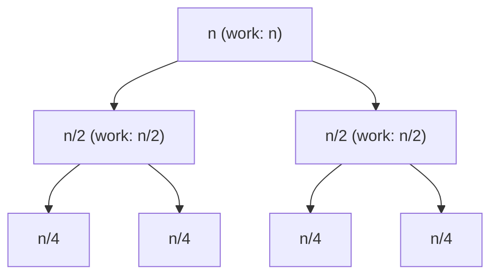

# Complexity Analysis

!!! info "Before you start"
    This page uses exponents, logarithms, sums such as `1 + 2 + 4 + ...`, and factorials. If one of these is new to you, read [Math for Complexity Analysis](00-math-for-complexity.md) first. Each place on this page that uses one of these facts has a one-line reminder and a link.

    Every concept on this page follows the same order. **Intuition.** comes first: plain words, small numbers, and a table. Then **Formal definition.** states the idea exactly. Then **Worked example.** applies the definition to the same numbers. If a formal definition is hard to read, go back to the numbers in the intuition above it.

## Why It Matters

Every coding interview asks for the time and space complexity of your solution, and most interviewers decide between "accept" and "optimize further" on that answer. The constraint line of a problem (for example `n <= 10^5`) tells you which complexity class passes, so complexity analysis also guides which pattern you pick. On the job, the same skill tells you whether a loop that works on 1,000 rows will still work on 10 million rows. Theory questions such as "why is `ArrayList.add` O(1) amortized" or "what is the complexity of this recursion" appear in phone screens and in the first ten minutes of coding rounds.

## Core Concepts

The concepts are in order from easy to hard: counting steps, input size, complexity classes, asymptotic notation, cases, several variables, and pseudo-polynomial time.

### Counting steps

**Intuition.** A **step** is one basic operation that takes a fixed amount of time, whatever the input is. Examples: add two `int` values, compare two `int` values, read one array cell, write one array cell, assign one variable. The time in seconds depends on the computer. The step count does not. Complexity analysis answers this question: "How many steps does this code run for an input of size `n`, and how does that number change when `n` grows?"

Count the steps of this small method by hand:

```java
// Sum of 1..n. Count the steps by hand.
static long sumTo(int n) {
    long sum = 0;                      // runs once
    // "i = 1" runs once, "i <= n" runs n + 1 times, "i++" runs n times
    for (int i = 1; i <= n; i++) {
        sum += i;                      // runs n times
    }
    return sum;
}
```

| Operation | Times it runs | `n = 10` | `n = 20` |
|---|---|---|---|
| `sum = 0` | 1 | 1 | 1 |
| `i = 1` | 1 | 1 | 1 |
| `i <= n` (compare) | `n + 1` | 11 | 21 |
| `sum += i` (add and assign) | `n` | 10 | 20 |
| `i++` | `n` | 10 | 20 |
| **Total** | `3n + 3` | **33** | **63** |

The input doubled from 10 to 20. The step count went from 33 to 63, a factor of 1.9. For larger `n` the factor gets closer to 2: `n = 1,000` gives 3,003 steps and `n = 2,000` gives 6,003 steps. We say the cost is **proportional to `n`**: double the input, and the cost doubles.

Other code grows in other ways. A loop inside a loop, both to `n`, runs the body `n · n` times. If `n` doubles, the cost becomes 4 times larger. The table shows how fast five common cost functions grow:

| `n` | `log₂ n` | `n` | `n log₂ n` | `n²` | `2ⁿ` |
|---|---|---|---|---|---|
| 10 | 3.3 | 10 | 33 | 100 | 1,024 |
| 100 | 6.6 | 100 | 664 | 10,000 | about 1.3 · 10³⁰ |
| 1,000 | 10.0 | 1,000 | 9,966 | 1,000,000 | about 1.1 · 10³⁰¹ |

Math reminder: `log₂ n` is the number of times you can halve `n` before you reach 1. See [Math for Complexity Analysis](00-math-for-complexity.md).

The table shows what happens when `n` doubles, for each cost function:

| Cost | New cost after `n` becomes `2n` |
|---|---|
| `log n` | One step more |
| `n` | 2 times |
| `n log n` | A little more than 2 times (`2n · (log n + 1)`) |
| `n²` | 4 times |
| `n³` | 8 times |
| `2ⁿ` | The old cost, squared (`2^(2n) = (2ⁿ)²`) |

**Bridge to the formal idea.** Look again at `3n + 3`. Two parts of it do not matter when `n` is large. The `+ 3` is 3 steps out of 3,003 at `n = 1,000`. The factor `3` depends on how you define a step: if you count `i <= n` and `i++` together as one step, the factor becomes 2. Both changes leave the shape unchanged: the cost is proportional to `n`. **Big-O notation keeps only this shape, called the growth rate, and drops the rest.** The sections below make this idea exact. You keep the same habit: count the steps, then look at how the count grows.

### Input size and cost model

**Intuition.** Before you count steps, you decide two things. First, what is `n`? Second, which operations cost one step?

- For an array of 8 `int` values, `n = 8`. Summing the array takes 8 additions.
- For a graph, the size has two numbers: vertices and edges (see "Multiple variables" below).
- For a number, `n` is often the count of digits, not the value. Adding two numbers of 10,000 digits each by the school method takes 10,000 digit additions. That is not one step.

The question this idea answers: "What grows when the problem grows, and what do I treat as free?"

**Formal definition.** **Input size** (`n`) is the quantity that makes the problem larger: the array length, the number of nodes, the number of digits of a number. A **cost model** says which operations count as one step. This KB uses the usual word-RAM model: an arithmetic operation on a fixed-width `int` or `long`, a comparison, an array read, and an array write each cost one step. Under this model, adding two `int` values is O(1). Adding two numbers that have 10,000 digits each is not O(1), because the work grows with the digit count.

**Time complexity** is the number of steps as a function of `n`. **Space complexity** is the number of memory cells as a function of `n`. We write each as a function and keep only its growth rate. The section "Asymptotic notation" says exactly what "keep only the growth rate" means.

### Common complexity classes

**Intuition.** A complexity class is a name for a growth rate. The table writes each class as O(...), read "order of". For now, read O(n²) as "grows like n²". The section "Asymptotic notation" defines the notation exactly. Ask one question about any loop or recursion: "What happens to the cost when `n` doubles?" The answer picks the class. For `n = 8` and `n = 1,000`, the step counts of each class are:

| Class | Name | Steps at `n = 8` | Steps at `n = 1,000` |
|---|---|---|---|
| O(1) | Constant | 1 | 1 |
| O(log n) | Logarithmic | 3 | 10 |
| O(n) | Linear | 8 | 1,000 |
| O(n log n) | Linearithmic | 24 | about 10,000 |
| O(n²) | Quadratic | 64 | 1,000,000 |
| O(2ⁿ) | Exponential | 256 | about 1.1 · 10³⁰¹ |
| O(n!) | Factorial | 40,320 | more than 10²⁵⁶⁷ |

The numbers in the last row are `8! = 40,320` and `1,000!`, which has 2,568 digits. Math reminder: `n!` is `n · (n-1) · ... · 1`. See [Math for Complexity Analysis](00-math-for-complexity.md).

Read the table from top to bottom as growing cost. O(n log n) fits `n` up to about 10⁶. O(n²) fits `n` up to about 10,000. O(2ⁿ) fits `n` up to about 25, and O(n!) fits `n` up to about 11. The section "From the input limit to the target complexity" turns this into a rule.

**Formal definition.** The table lists the classes in order of growth, with a typical example and the reason. `n` is the input size.

| Class | Name | Typical example | Why |
|---|---|---|---|
| O(1) | Constant | Array read `a[i]`, `HashMap.get` (expected) | The step count does not depend on `n` |
| O(log n) | Logarithmic | Binary search | Each step halves the remaining range |
| O(√n) | Square root | Trial division to test primality | The loop runs while `d * d <= n` |
| O(n) | Linear | One scan of an array | One constant-cost step per element |
| O(n log n) | Linearithmic | Merge sort, sorting with `Arrays.sort` on objects | `log n` levels of `n` work each |
| O(n²) | Quadratic | Compare every pair of elements | Two nested loops over `n` |
| O(n³) | Cubic | Floyd-Warshall, naive matrix multiplication | Three nested loops over `n` |
| O(2ⁿ) | Exponential | Enumerate every subset of `n` items | Each item is in or out |
| O(n!) | Factorial | Enumerate every permutation of `n` items | `n` choices, then `n-1`, then `n-2`, ... |

**Worked example.** Binary search halves the range on each step. For `n = 8` the range sizes are 8, 4, 2, 1, so the search does 3 halvings, and `log₂ 8 = 3`. For `n = 1,000` it does about 10 halvings. This is why binary search is O(log n). Subsets: for `n = 3` items there are `2 · 2 · 2 = 8` subsets, and for `n = 8` there are 256. Each added item doubles the count, which is O(2ⁿ).

Combinations occur often. A sort followed by a scan costs O(n log n) + O(n) = O(n log n). Enumerating subsets and doing O(n) work for each costs O(n · 2ⁿ).

Logarithms in different bases differ by a constant factor: `log₂ n = log₁₀ n / log₁₀ 2`. Example: `log₁₀ 1,000 = 3` and `log₂ 1,000 ≈ 9.97 = 3 / 0.301`. The factor is about 3.32 for every `n`. For that reason O(log n) does not name a base. Math reminder: the change-of-base rule is `log_a x = log_b x / log_b a`. See [Math for Complexity Analysis](00-math-for-complexity.md).

### Asymptotic notation

**Intuition.** Big-O answers this question: "Can I draw a ceiling over my cost that has a simple shape?" Take the cost `f(n) = 3n² + 10n + 7`. The table compares it with two simple functions, `3n²` and `20n²`:

| `n` | `3n²` | `f(n) = 3n² + 10n + 7` | `20n²` | `f(n) / n²` |
|---|---|---|---|---|
| 1 | 3 | 20 | 20 | 20.0 |
| 10 | 300 | 407 | 2,000 | 4.07 |
| 100 | 30,000 | 31,007 | 200,000 | 3.10 |
| 1,000 | 3,000,000 | 3,010,007 | 20,000,000 | 3.01 |

The cost `f(n)` stays at or below `20n²` for every `n` in the table, and at or above `3n²`. The last column settles near 3. So `f(n)` grows like `n²`, and the terms `10n` and `7` and the factor 3 do not change that. Three statements describe this:

- **Big-O** (ceiling): the cost stays at or below a multiple of `n²`. Here, the multiple is 20.
- **Big-Omega** (floor): the cost stays at or above a multiple of `n²`. Here, the multiple is 3.
- **Big-Theta** (both): the cost stays between two multiples of `n²`. The cost grows at the same rate as `n²`.

A bound does not have to hold for small `n`. Take `f(n) = 100n` and `g(n) = n²`:

| `n` | `100n` | `n²` | Is `100n <= n²`? |
|---|---|---|---|
| 10 | 1,000 | 100 | No |
| 100 | 10,000 | 10,000 | Yes (equal) |
| 1,000 | 100,000 | 1,000,000 | Yes |

For `n < 100`, `100n` is larger than `n²`. For `n >= 100`, `n²` is larger or equal, and it stays larger. Only large inputs separate fast algorithms from slow ones, so the definition ignores the small inputs below a threshold.

**Bridge.** In the definitions below, the multiple is the constant `c`, and the threshold is the constant `n0`. In the first table, `c = 20` is a ceiling multiple and `n0 = 1` works. In the second table, `c = 1` and `n0 = 100` work.

**Formal definition.** The three notations compare the growth rate of a function `f(n)` with a simpler function `g(n)`. All three use two constants: a multiplier `c` and a threshold `n0`. The bound only has to hold for inputs of size `n0` and larger.

| Notation | Formal definition | Plain meaning |
|---|---|---|
| Big-O: `f(n) = O(g(n))` | There exist constants `c > 0` and `n0` such that `0 <= f(n) <= c * g(n)` for all `n >= n0` | `f` grows no faster than `g`. `g` is an upper bound |
| Big-Omega: `f(n) = Ω(g(n))` | There exist constants `c > 0` and `n0` such that `0 <= c * g(n) <= f(n)` for all `n >= n0` | `f` grows at least as fast as `g`. `g` is a lower bound |
| Big-Theta: `f(n) = Θ(g(n))` | There exist constants `c1 > 0`, `c2 > 0`, and `n0` such that `0 <= c1 * g(n) <= f(n) <= c2 * g(n)` for all `n >= n0` | `f` and `g` grow at the same rate. `g` is a tight bound |

`f(n) = Θ(g(n))` is true exactly when both `f(n) = O(g(n))` and `f(n) = Ω(g(n))` are true.

**Worked example.** Take the same `f(n) = 3n² + 10n + 7` as in the first table. For `n >= 1`, `10n <= 10n²` and `7 <= 7n²`, so `f(n) <= 3n² + 10n² + 7n² = 20n²`. This proves `f(n) = O(n²)` with `c = 20` and `n0 = 1`. The table agrees: `20 <= 20`, `407 <= 2,000`, and so on. Also `f(n) >= 3n²` for all `n >= 1`, because `10n + 7` is positive. So `f(n) = Ω(n²)` with `c = 3` and `n0 = 1`. Both bounds hold, so `f(n) = Θ(n²)` with `c1 = 3`, `c2 = 20`, and `n0 = 1`.

For the second table: `100n <= 1 · n²` for all `n >= 100`, so `100n = O(n²)` with `c = 1` and `n0 = 100`.

Two rules follow from the definition:

1. **Drop constant factors.** `5n` and `n` are both `Θ(n)`, because `c` absorbs the factor.
2. **Drop lower-order terms.** `n² + n` is `Θ(n²)`, because `n <= n²` for `n >= 1`.

An upper bound need not be tight. Every function that is O(n) is also O(n²), because `n <= n²` for `n >= 1`. The statement "merge sort is O(n²)" is true but weak. Give the tightest bound that you can prove.

!!! warning "Constants still matter in practice"
    Two algorithms with the same Big-O can differ by a factor of 10 or more in running time. The notation tells you how the cost grows, not which algorithm is faster at `n = 1,000`. Cache behavior is one cause: see [arrays and memory layout](02-arrays-strings-linked-lists.md).

### Best, average, and worst case

**Intuition.** The same code can take different amounts of time on different inputs of the same size. Linear search looks for `x` in an array, one cell at a time, and stops when it finds `x`. For an array of `n = 8` cells, the number of comparisons depends on where `x` is:

| Position of `x` (0-based index) | Comparisons |
|---|---|
| 0 | 1 |
| 1 | 2 |
| 2 | 3 |
| 3 | 4 |
| 4 | 5 |
| 5 | 6 |
| 6 | 7 |
| 7 | 8 |
| Not in the array | 8 |

The least work is 1 comparison. The most work is 8 comparisons. If `x` is equally likely to be at each of the 8 positions, the average is `(1 + 2 + ... + 8) / 8 = 36 / 8 = 4.5`. The question that the idea answers: "Which input do I analyze: the luckiest, the unluckiest, or a typical one?"

**Formal definition.** The **case** names the input family that you analyze. For inputs of size `n`, the best case is the minimum cost, the worst case is the maximum cost, and the average case is the expected cost over a stated distribution of inputs.

| Case | Meaning | Example: linear search for `x` in an array of `n` elements |
|---|---|---|
| Best case | The input that makes the algorithm do the least work | `x` is at index 0. One comparison: Θ(1) |
| Worst case | The input that makes the algorithm do the most work | `x` is absent. `n` comparisons: Θ(n) |
| Average case | The expected work over a stated distribution of inputs | `x` is at a uniformly random index. `(n + 1) / 2` comparisons (4.5 for `n = 8`), which is about `n/2`: Θ(n) |

**Worked example.** For `n = 8`: the best case is 1 comparison, which is Θ(1). The worst case is 8 comparisons, which is Θ(n). The average case is 4.5 comparisons, and `(n + 1) / 2` is Θ(n).

Interviews ask for the worst case unless you state another case. If an algorithm has a different average case, say so. Quicksort with a random pivot takes O(n log n) expected time and O(n²) in the worst case. The average case needs an assumption about the input distribution or about the algorithm's random choices. State that assumption.

Big-O is not the same as "worst case". Big-O describes a function. A worst case describes an input. You can state a Big-O bound for the best case, the average case, or the worst case of an algorithm. For linear search, the best case is Θ(1) and the worst case is Θ(n): each case has its own bound.

**Amortized** cost is a fourth idea. It is not an average over inputs. It is the average cost per operation over a worst-case sequence of operations. The section "Amortized analysis" defines it.

### Multiple variables

**Intuition.** Some inputs have more than one size. A grid has `R` rows and `C` columns. A scan of a grid with 3 rows and 1,000 columns reads `3 · 1,000 = 3,000` cells. If you replace both sizes with one `n = 1,000`, you get `n² = 1,000,000`, which is about 333 times too large. The same happens with two strings of lengths 5 and 1,000: the edit distance table has `5 · 1,000 = 5,000` cells, not `1,000²`.

**Formal definition.** A graph has `V` vertices and `E` edges. A grid has `R` rows and `C` columns. Two strings have lengths `n` and `m`. Keep the variables apart. Write O(V + E) for a graph traversal, O(R · C) for a grid scan, and O(n · m) for the standard edit distance table. Do not collapse them into one `n` unless you say so.

**Worked example.** A graph traversal visits each vertex once and each edge once (or twice, for an undirected graph). With `V = 4` and `E = 5` it does about `4 + 5 = 9` units of work. The cost is O(V + E). If the graph is dense, `E` can be about `V²`, and then O(V + E) is O(V²). The two-variable form shows this relation. A one-variable form hides it.

### Pseudo-polynomial time

This is the hardest idea in this section. Read it after the loop and recursion sections if it is not clear at first.

**Intuition.** Take the 0/1 knapsack dynamic program. It fills a table with `n` rows and `W + 1` columns, where `W` is the capacity as a number. The input writes `W` with few digits, but the program loops `W` times. The table shows how the work grows with the length of the input:

| Capacity `W` | Digits of `W` | Bits of `W` (approximate) | Columns in the table (`W + 1`) |
|---|---|---|---|
| 1,000 | 4 | 10 | 1,001 |
| 1,000,000 | 7 | 20 | 1,000,001 |
| 1,000,000,000 | 10 | 30 | 1,000,000,001 |

Each added digit makes the input a little longer and the work 10 times larger. A question that the idea answers: "Is the work polynomial in the length of the input, or only in the value of a number in the input?"

**Formal definition.** The 0/1 knapsack dynamic program runs in O(n · W), where `W` is the capacity as a number. The input stores `W` in about log₂ W bits, so O(n · W) is exponential in the bit length of `W`. We call this running time **pseudo-polynomial**: polynomial in the value of a number, not in the size of its encoding. Interviews accept O(n · W) as the answer, but a strong candidate names the distinction when `W` can be 10⁹.

**Worked example.** With `W = 10⁹`, the input has 30 bits. The table has about 10⁹ columns for each of the `n` items. For `n = 100` items that is about 10¹¹ steps, which is more than the 10⁸ budget in the limit table below. A 31-bit input would double the work. That is exponential growth in the bit length.

## How It Works

### Analyze a loop

**Intuition.** Count how many times the body runs, then multiply by the cost of the body. The question for each loop is: "How many times does the body run as a function of `n`?" Trace a small `n` by hand first.

For `n = 8`, trace the loop `for (i = 1; i < n; i *= 2)`:

| Iteration | `i` at the start | Test `i < 8` | Body runs |
|---|---|---|---|
| 1 | 1 | true | yes |
| 2 | 2 | true | yes |
| 3 | 4 | true | yes |
| 4 | 8 | false | no, the loop ends |

The body ran 3 times, and `log₂ 8 = 3`. Each pass doubles `i`, so `i` reaches `n` after about `log₂ n` passes.

For `n = 5`, trace the nested loop `for (i = 0; i < n; i++) for (j = 0; j < i; j++)`, in which the inner loop stops at `i`:

| `i` | Inner body runs (`j = 0 .. i-1`) |
|---|---|
| 0 | 0 |
| 1 | 1 |
| 2 | 2 |
| 3 | 3 |
| 4 | 4 |
| Total | `0 + 1 + 2 + 3 + 4 = 10 = 5 · 4 / 2` |

The inner loop is not `n` iterations for every `i`. It runs `i` times, so you add the counts.

**Formal definition.** The table below lists the loop shapes that interviews use, with the body count as a formula and the count at `n = 8` (`m = 5` for the last row). The `Java Example` section runs each shape and prints its step count.

| Shape | Body runs | At `n = 8` | Complexity |
|---|---|---|---|
| `for (i = 0; i < n; i++)` | `n` times | 8 | O(n) |
| Two nested loops, both to `n` | `n · n` times | 64 | O(n²) |
| Inner loop `j < i` | `0 + 1 + ... + (n-1) = n(n-1)/2` times | 28 | O(n²) |
| `for (i = 1; i < n; i *= 2)` | `⌈log₂ n⌉` times | 3 | O(log n) |
| Outer `i *= 2`, inner `j < i` | `1 + 2 + 4 + ... < 2n` times | 7 | O(n) |
| Outer `i` to `n`, inner `j += i` up to `n` | About `n/i` times for each `i`, so `n · (1 + 1/2 + ... + 1/n)` | 20 | O(n log n) |
| Two sequential loops, `n` and `m` | `n + m` times | 13 (`m = 5`) | O(n + m) |

**Worked example.** Two rows surprise beginners. Use the same `n = 8`.

- Outer `i *= 2`, inner `j < i`: `i` takes the values 1, 2, 4. The inner loop runs 1, 2, and 4 times, a total of 7. This is a geometric series: each term is double the previous term, and the sum is less than twice the last term (`7 < 2 · 4`). The last term is less than `n`, so the sum is less than `2n` (`7 < 16`). So the total is O(n), not O(n log n). Math reminder: `1 + 2 + 4 + ... + 2^k = 2^(k+1) - 1`. See [Math for Complexity Analysis](00-math-for-complexity.md).
- Outer `i` to `n`, inner `j += i`: for `n = 8` the inner loop runs `8, 4, 2, 2, 1, 1, 1, 1` times for `i = 1 .. 8`, a total of 20. In general the sum is `n · (1 + 1/2 + ... + 1/n)`. The bracket is the harmonic number `H(n)`, which is Θ(log n). The total is Θ(n log n). The sieve of Eratosthenes has this shape. Math reminder: `H(n) = 1 + 1/2 + ... + 1/n` is about `ln n`. See [Math for Complexity Analysis](00-math-for-complexity.md).

!!! tip "Two pointers and sliding windows"
    A `while` loop inside a `for` loop does not mean O(n²). If the inner pointer only moves forward and never resets, the pointers move at most `2n` steps in total. The cost is O(n). Count the total movement of each pointer, not the nesting depth. See [Sliding Window](../01-sliding-window/README.md).

The two methods below make the third row and the two-pointer case concrete. They compile as written.

```java
// O(n²): the inner loop runs i times for each i
static int pairs(int[] a) {
    int count = 0;
    for (int i = 0; i < a.length; i++) {
        for (int j = 0; j < i; j++) {
            if (a[i] + a[j] == 0) count++;
        }
    }
    return count;
}

// O(n) with a while inside a for: the pointer j never moves backward
static int longestRun(int[] a) {
    int best = 0;
    int j = 0;
    for (int i = 0; i < a.length; i++) {
        if (j < i) j = i;
        while (j < a.length && a[j] == a[i]) j++;
        best = Math.max(best, j - i);
    }
    return best;
}
```

Trace `longestRun` for `a = [1, 1, 2, 2, 2, 3]` (`n = 6`). The `while` loop looks as if it could run `n` times for each `i`. The trace shows that `j` moves 6 times in total:

| `i` | `j` at the start | `j` moves in the `while` | `j` at the end | `j - i` |
|---|---|---|---|---|
| 0 | 0 | 2 | 2 | 2 |
| 1 | 2 | 0 | 2 | 1 |
| 2 | 2 | 3 | 5 | 3 |
| 3 | 5 | 0 | 5 | 2 |
| 4 | 5 | 0 | 5 | 1 |
| 5 | 5 | 1 | 6 | 1 |

The `j` moves add up to `2 + 0 + 3 + 0 + 0 + 1 = 6 = n`. The result `best` is 3. The `for` loop makes `n` steps and the `while` loop makes at most `n` steps in total, so the cost is O(n).

### Analyze a recursion

**Intuition.** A recursive function calls itself on a smaller input. The cost of one call is the work in the call itself plus the cost of the calls that it makes. The question: "How many calls happen, and how much work does each call do?"

Binary search on `n = 8` elements checks the middle, then recurses on one half. The calls have sizes 8, 4, 2, 1. That is 4 calls, and each does constant work. The total is `log₂ 8 + 1 = 4` units of work, which is O(log n).

Merge sort on `n = 8` elements splits the array in two halves, sorts each half, and merges. Count the work for each level of calls. The merge in a call of size `s` costs about `s` steps. At the last level the calls have size 1, and each costs 1 step.

| Level | Calls | Size of each call | Work for each call | Work for the level |
|---|---|---|---|---|
| 0 | 1 | 8 | 8 | 8 |
| 1 | 2 | 4 | 4 | 8 |
| 2 | 4 | 2 | 2 | 8 |
| 3 | 8 | 1 | 1 | 8 |
| **Total** | | | | **32 = 8 · 4 = n · (log₂ n + 1)** |

Every level does 8 units of work, and there are `log₂ 8 + 1 = 4` levels. So the total is `n · (log₂ n + 1)`, which is Θ(n log n).

**Formal definition.** A recursive function has a **recurrence**: an equation that gives the cost `T(n)` in terms of the cost on smaller inputs. For merge sort, `T(n) = 2T(n/2) + n`: two calls on half the input, plus `n` work to merge. Write the recurrence from the code, then solve it with a recursion tree or with the master theorem.

**Recursion tree method.** Draw one node for each call. Write the non-recursive work next to the node. Sum the work of each level. Sum the levels. For `T(n) = 2T(n/2) + n` (merge sort), the tree has `log₂ n + 1` levels, and each level does `n` work in total:



**Worked example.** Level 0 does `n` work. Level 1 does `2 · n/2 = n` work. Level 2 does `4 · n/4 = n` work. There are about `log₂ n` levels, so `T(n) = Θ(n log n)`. For `n = 8` this is the table above: 4 levels with 8 units each.

Common recurrences, each with its source in the code:

| Recurrence | Code shape | Solution |
|---|---|---|
| `T(n) = T(n-1) + O(1)` | Recursive list or array walk, factorial | Θ(n) |
| `T(n) = T(n-1) + O(n)` | Quicksort with the worst pivot, selection sort written recursively | Θ(n²) |
| `T(n) = T(n/2) + O(1)` | Binary search | Θ(log n) |
| `T(n) = 2T(n/2) + O(1)` | Tree traversal on a balanced tree | Θ(n) |
| `T(n) = 2T(n/2) + O(n)` | Merge sort, quicksort with the best pivot | Θ(n log n) |
| `T(n) = 2T(n-1) + O(1)` | Enumerate all subsets by "take or skip" | Θ(2ⁿ) |
| `T(n) = T(n-1) + T(n-2) + O(1)` | Naive Fibonacci | Θ(φⁿ), where φ ≈ 1.618. This is O(2ⁿ) |

Check one row with numbers. `T(n) = T(n-1) + O(1)` for `n = 4` makes the calls with sizes 4, 3, 2, 1: 4 calls, so Θ(n). `T(n) = T(n-1) + O(n)` for `n = 4` costs `4 + 3 + 2 + 1 = 10 = n(n+1)/2`, so Θ(n²).

Naive Fibonacci calls itself twice, and the calls overlap. The table counts every call of `fib`, including the first one, for the version with the base cases `fib(0) = 0` and `fib(1) = 1`:

| `n` | Calls made by `fib(n)` (naive) |
|---|---|
| 5 | 15 |
| 10 | 177 |
| 20 | 21,891 |

The exact count is `2 · F(n+1) - 1`, where `F(k)` is the `k`-th Fibonacci number: `2 · 8 - 1 = 15`, `2 · 89 - 1 = 177`, and `2 · 10,946 - 1 = 21,891`. From one row to the next, the count grows by a factor of about 1.618 for each step of `n`. That is the Θ(φⁿ) in the table. Math reminder: φ = (1 + √5) / 2 ≈ 1.618 is the ratio of consecutive Fibonacci numbers, so `φⁿ` grows by a factor of 1.618 for each step of `n`. See [Math for Complexity Analysis](00-math-for-complexity.md).

Naive Fibonacci recomputes the same subproblems. Memoization stores each result, so each `fib(k)` runs once and the cost drops to O(n). That observation is the start of [Dynamic Programming](../15-dynamic-programming/README.md).

### The master theorem

**Intuition.** The master theorem is a shortcut for the recursion tree. The question: "In the recursion tree, which part has the most work: the leaves at the bottom, every level equally, or the root at the top?" The work per level shows the answer. Take `n = 8` and three recurrences that split the input in two halves (`T(n) = 2T(n/2) + f(n)`). The columns show the work of levels 0 to 3:

| Recurrence | Level 0 | Level 1 | Level 2 | Level 3 | Total | Who dominates |
|---|---|---|---|---|---|---|
| `2T(n/2) + 1` | 1 | 2 | 4 | 8 | 15 (about `2n`) | The leaves: the work doubles at each level |
| `2T(n/2) + n` | 8 | 8 | 8 | 8 | 32 (`n` times 4 levels) | Every level: the same work |
| `2T(n/2) + n²` | 64 | 32 | 16 | 8 | 120 (less than `2n²`) | The root: the work halves at each level |

Level `k` has `2^k` calls of size `n/2^k`. For `f(n) = n²` the level work is `2^k · (n/2^k)² = n²/2^k`, which halves from one level to the next. The leaves are at the last level. The tree has `n` leaves here, and `n` is `n^(log₂ 2)`.

- If the work grows going down, the leaves dominate and the total is the leaf count.
- If the work is equal on every level, the total is the level work times the number of levels, which adds one factor `log n`.
- If the work shrinks going down, the root dominates and the total is `f(n)`.

Math reminder: a sum in which each term is a constant factor times the previous term (a geometric series) is dominated by its first or its last term. See [Math for Complexity Analysis](00-math-for-complexity.md).

**Bridge.** The theorem puts these three cases into one test. It compares the work of the root, `f(n)`, with the number of leaves of the recursion tree. For `2T(n/2)` the tree has `n` leaves. The formal definition writes the leaf count as `n^c*` and defines the exponent `c*`.

**Formal definition.** The **master theorem** solves recurrences of the form

`T(n) = a · T(n/b) + f(n)`, with `a >= 1` and `b > 1`.

Here `a` is the number of subproblems, `n/b` is the size of each, and `f(n)` is the work to split and combine. Let `c* = log_b(a)`. The recursion tree has about `n^c*` leaves. The theorem compares `f(n)` with `n^c*`. The table gives the form of CLRS, 4th edition, section 4.5 ("The master method for solving recurrences", Theorem 4.1).

| Case | Condition | Result | Meaning |
|---|---|---|---|
| 1 | `f(n) = O(n^c)` for some constant `c < c*` | `T(n) = Θ(n^c*)` | The leaves of the recursion tree dominate |
| 2 | `f(n) = Θ(n^c* · log^k n)` for some constant `k >= 0` | `T(n) = Θ(n^c* · log^(k+1) n)` | Every level costs about the same |
| 3 | `f(n) = Ω(n^c)` for some constant `c > c*`, and `a · f(n/b) <= d · f(n)` for some constant `d < 1` and all sufficiently large `n` (the regularity condition) | `T(n) = Θ(f(n))` | The root dominates |

**Worked example.** The three recurrences in the intuition table have `a = 2`, `b = 2`, and `c* = 1`. For `f(n) = 1`: `1 = O(n⁰)` and `0 < 1`, so case 1 and `T(n) = Θ(n)`. For `f(n) = n`: `n = Θ(n¹)`, so case 2 with `k = 0` and `T(n) = Θ(n log n)`. For `f(n) = n²`: `n² = Ω(n²)` and `2 > 1`, so case 3 and `T(n) = Θ(n²)`. The regularity check is `2 · (n/2)² = n²/2 <= (1/2) · n²`, so `d = 1/2` works.

More worked examples:

| Recurrence | `a` | `b` | `c*` | `f(n)` | Case | Result |
|---|---|---|---|---|---|---|
| `T(n) = T(n/2) + 1` (binary search) | 1 | 2 | 0 | `1 = Θ(n⁰)` | 2 with `k = 0` | Θ(log n) |
| `T(n) = 2T(n/2) + n` (merge sort) | 2 | 2 | 1 | `n = Θ(n¹)` | 2 with `k = 0` | Θ(n log n) |
| `T(n) = 3T(n/2) + n` (Karatsuba) | 3 | 2 | ≈ 1.585 | `n = O(n¹)` | 1 | Θ(n^1.585) |
| `T(n) = T(n/2) + n` (quickselect, balanced splits) | 1 | 2 | 0 | `n = Ω(n¹)` | 3, with `n/2 <= (1/2) · n` | Θ(n) |
| `T(n) = 2T(n/2) + n²` | 2 | 2 | 1 | `n² = Ω(n²)` | 3, with `2 · (n/2)² = n²/2` | Θ(n²) |

**Details for later reading.** These points matter for exact statements and for edge cases.

- The condition `a >= 1` holds for every recurrence that comes from code, because a recursive function makes at least one recursive call.
- Case 3 has a **regularity condition**: the work of the subproblems at the next level must be a constant fraction `d < 1` of the work at this level. Some functions `f(n)` fall in a gap between the cases.
- The 3rd edition of CLRS states case 2 only for `k = 0` (`f(n) = Θ(n^c*)`, result `Θ(n^c* · log n)`). The 4th edition extends case 2 to any constant `k >= 0`. The recurrences on this page use `k = 0`.
- CLRS writes cases 1 and 3 with an `ε > 0`: `f(n) = O(n^(c* - ε))` and `f(n) = Ω(n^(c* + ε))`. The constant `c` in the table is `c* - ε` or `c* + ε`, so the two forms say the same thing.
- The theorem does not apply when the subproblems have different sizes (`T(n) = T(n/3) + T(2n/3) + n`), when the split is not a constant fraction (`T(n) = T(n-1) + n`), or when `f(n)` falls in a gap between the cases (`T(n) = 2T(n/2) + n / log n`). For these, use a recursion tree.
- The Akra-Bazzi method covers unequal splits. CLRS, 4th edition, section 4.7 states it without proof.

### Amortized analysis

**Intuition.** Some operations are cheap most of the time and expensive once in a while. A dynamic array append writes one element. When the array is full, the append also copies every element to a larger array. The question: "If I run many operations, what is the cost per operation?" Trace 8 appends to an array that starts with capacity 1 and doubles when it is full. A resize copies all `size` elements:

| Append number | Size before | Capacity before | Resize? | Copies | Writes | Cost |
|---|---|---|---|---|---|---|
| 1 | 0 | 1 | no | 0 | 1 | 1 |
| 2 | 1 | 1 | yes, to 2 | 1 | 1 | 2 |
| 3 | 2 | 2 | yes, to 4 | 2 | 1 | 3 |
| 4 | 3 | 4 | no | 0 | 1 | 1 |
| 5 | 4 | 4 | yes, to 8 | 4 | 1 | 5 |
| 6 | 5 | 8 | no | 0 | 1 | 1 |
| 7 | 6 | 8 | no | 0 | 1 | 1 |
| 8 | 7 | 8 | no | 0 | 1 | 1 |
| **Total** | | | | **7** | **8** | **15** |

The total for 8 appends is 15, which is 1.875 per append. The costly appends (2, 3, 5) are rare, and each costly append is followed by a run of cheap appends. If you spread the 15 steps over the 8 appends, each append costs less than 2 steps. A single append can still cost 5. The **amortized** cost is this cost per operation over a whole sequence.

Math reminder: the copy costs 1, 2, 4 are a geometric series: each term doubles, and the sum is less than twice the last term. See [Math for Complexity Analysis](00-math-for-complexity.md).

**Bridge.** The formal definition states the same idea for any `n`, not only for 8.

**Formal definition.** An operation is **amortized O(1)** if any sequence of `n` operations costs O(n) in total, even though a single operation can cost more. Amortized analysis does not use probability. The bound holds for every sequence of operations.

The **aggregate method** bounds the total cost `T(n)` of `n` operations and divides by `n`. CLRS, 4th edition, chapter 16 also describes the accounting method and the potential method, and section 16.4 analyzes dynamic tables.

**Worked example: append to a dynamic array.** The array has a capacity. An append writes one element in O(1) if there is room. If the array is full, the append allocates a new array of larger capacity, copies all elements, and then writes. Suppose the capacity doubles on each resize, starting at 1. During `n` appends:

1. Each append writes one element. That costs `n` in total.
2. A resize happens when the size reaches 1, 2, 4, 8, ..., up to the largest power of two below `n`. The resize at size `s` copies `s` elements.
3. The copy cost is at most `1 + 2 + 4 + ... + 2^k`, where `2^k < n`. This geometric series is less than `2 · 2^k < 2n`.
4. The total is less than `n + 2n = 3n`, so the cost per append is less than 3. That is O(1) amortized.

For `n = 8`, the writes cost 8 and the copies cost `1 + 2 + 4 = 7`, which is less than `2 · 4 = 8`. The total of 15 is less than `3 · 8 = 24`.

The growth factor does not need to be 2. For a factor `g > 1`, the copy cost sums to at most `n · g/(g-1)`. With `g = 1.5`, the copies sum to at most `3n`, and the amortized cost per append is at most 4. This is the factor that `ArrayList` uses; see [dynamic arrays](02-arrays-strings-linked-lists.md).

The growth must be geometric. If the array grows by a constant `k` slots (`capacity + k`), there are `n/k` resizes that copy `k, 2k, 3k, ...` elements. The total is about `n²/(2k)`, which is O(n²). The `Java Example` section prints this difference. Math reminder: `k + 2k + 3k + ... = k · (1 + 2 + 3 + ...)` is an arithmetic series. See [Math for Complexity Analysis](00-math-for-complexity.md).

!!! note "What amortized does not promise"
    A single append can still cost O(n). If a request must finish within a hard deadline, an amortized bound is not enough. The latency of one resize can break a real-time requirement.

Other amortized O(1) operations that appear in this KB:

- `StringBuilder.append`: the same doubling argument.
- Queue built from two stacks: each element moves between stacks at most once. See [Stacks, Queues, and Deques](03-stacks-queues-deques.md).
- Monotonic stack and deque: each element enters and leaves at most once. See [Monotonic Stack / Queue](../07-monotonic-stack-queue/README.md).
- Hash table resize: see [Hash Tables](04-hash-tables.md).
- Union-find with path compression and union by rank: O(α(n)) amortized per operation. See [Union Find](../13-union-find/README.md).

### Space complexity

**Intuition.** Space complexity counts the memory cells that your code uses. The question: "How many extra cells does the code need when `n` grows?" Three small cases:

| Code | Extra cells for `n = 8` | Extra cells for `n = 1,000` | Space |
|---|---|---|---|
| Sum an array with one `long` variable | 1 | 1 | O(1) |
| Copy an array into a new array | 8 | 1,000 | O(n) |
| Recursive sum with `n` calls deep (`sum(n) = n + sum(n-1)`) | 8 stack frames | 1,000 stack frames | O(n) |

A **stack frame** is the memory that one call uses for its parameters, its local variables, and its return address. A recursion holds one stack frame for each call that has started and has not returned. The recursive sum for `n = 4` starts `sum(4)`, `sum(3)`, `sum(2)`, `sum(1)` before the first call returns. So 4 frames exist at the same time.

**Formal definition.** **Space complexity** counts the memory that the algorithm uses as a function of `n`. Two conventions exist, and you should say which one you use:

- **Total space** includes the input.
- **Auxiliary space** counts only the extra memory beyond the input and the output.

Interviews ask for auxiliary space unless they say otherwise. An algorithm is **in place** if its auxiliary space is O(1).

Sources of space:

1. **Data structures.** A `HashMap` with `n` entries uses O(n). A 2D DP table uses O(R · C).
2. **The call stack.** Each active call of a recursive function holds a **stack frame** (its parameters, local variables, and return address). A recursion that goes `d` calls deep holds `d` frames at once, so it uses O(d) space even if it allocates nothing else.
3. **Output.** Most interviewers do not count the returned result. If the output is itself O(n) or larger, say that you exclude it.

**Worked example.** Recursive DFS on a path-shaped tree with 8 nodes has a depth of 8, so it holds 8 frames: O(n). On a balanced tree with 8 nodes the longest root-to-leaf path has 4 nodes, so it holds at most 4 frames: O(log n). The table lists more cases.

| Algorithm | Time | Auxiliary space | Reason for the space |
|---|---|---|---|
| Iterative scan with a few variables | O(n) | O(1) | Only counters |
| Recursive DFS on a tree of height `h` | O(n) | O(h) | `h` frames. `h` is `log n` for a balanced tree and `n` for a path |
| Merge sort on an array | O(n log n) | O(n) | One temporary array. The call stack adds O(log n) |
| Memoized Fibonacci | O(n) | O(n) | The memo table, plus `n` frames |
| Bottom-up Fibonacci with two variables | O(n) | O(1) | Only the last two values |
| Heap sort | O(n log n) | O(1) | The heap lives in the input array |

Recursion depth also limits correctness. A Java thread has a fixed stack size, and a recursion that is `10^5` calls deep can throw `StackOverflowError`. The [Java Toolkit](../java-toolkit.md) covers this pitfall.

### From the input limit to the target complexity

**Intuition.** A problem states a limit on `n`. The question: "Which complexity classes finish in time for this `n`?" A computer runs about 10⁸ simple steps in one second (an approximate rule of thumb, explained below). Take `n = 10⁵`:

| Algorithm cost | Steps at `n = 10⁵` | Time at 10⁸ steps per second |
|---|---|---|
| O(n) | 10⁵ | 0.001 seconds |
| O(n log n) | 1.7 · 10⁶ | 0.017 seconds |
| O(n²) | 10¹⁰ | 100 seconds |

The quadratic algorithm needs 100 seconds, so it does not pass a limit of 1 to 2 seconds. The n log n algorithm passes with a large margin. The rest of this section states the rule and gives the table for each class.

**Formal definition.** Assumption: the judge allows about one to two seconds for each test. LeetCode does not publish its time limits, so this number comes from common practice on competitive programming judges. A CPU core runs a few billion clock cycles per second, but one step of an algorithm (a loop iteration with a comparison, an array read, and a branch) costs several machine instructions, and some steps wait for memory. The rule of thumb is that a solution in a compiled language such as Java completes about 10⁸ such steps per second. Treat 10⁸ as an approximate rule of thumb, not a measurement: the true rate depends on the operation, the memory access pattern, and the language. Compare the step count of a candidate algorithm with 10⁸ to see whether it fits.

The table gives the largest `n` that each class handles within about 10⁸ simple operations. The step counts are computed from the formula. Constants are ignored, so treat each row as approximate.

| Largest `n` | Target complexity | Steps at that `n` (approximate) | Typical techniques |
|---|---|---|---|
| 10 to 11 | O(n!) | 10! = 3.6 · 10⁶ | Permutations, brute-force backtracking |
| 20 to 25 | O(2ⁿ) or O(n · 2ⁿ) | 2²⁰ = 10⁶, 2²⁵ = 3.4 · 10⁷ | Subsets, bitmask DP, meet in the middle |
| 100 | O(n⁴) | 10⁸ | Four nested loops, DP with `n` states and `n³` transitions |
| 500 | O(n³) | 1.25 · 10⁸ | Floyd-Warshall, interval DP |
| 5,000 | O(n²) | 2.5 · 10⁷ | Pair enumeration, 2D DP such as edit distance |
| 10,000 | O(n²) | 10⁸ | Same, at the limit |
| 10⁵ | O(n log n), or O(n√n) | 1.7 · 10⁶ for `n log₂ n` | Sorting, heap, binary search per element, segment tree |
| 10⁶ | O(n log n), or O(n) | 2 · 10⁷ for `n log₂ n` | Sorting, sieve, linear scan |
| 10⁷ to 10⁸ | O(n) with a small constant | 10⁷ to 10⁸ | One pass, counting arrays |
| 10⁹ to 10¹⁸ | O(log n) or O(1) | 30 to 60 | Binary search on the answer, math formula, fast exponentiation |

**Worked example.** For `n <= 10^5`, the row says O(n log n) and the step count is `10^5 · 17 = 1.7 · 10^6`, which is below 10⁸. For O(n²) the count is `(10^5)² = 10^10`, which is 100 times above 10⁸. So you look for a sort, a heap, binary search per element, or a segment tree. How to use the table: find the row that matches the stated limit, then ask which pattern gives that complexity. A limit of `n <= 20` suggests backtracking or bitmask DP. A limit of `n <= 10^5` rules out nested loops over all pairs. A limit of `n <= 10^18` rules out any loop over `n`. The [pattern chooser](../how-to-choose-a-pattern.md) uses the same idea.

!!! warning "The limit is a hint, not a proof"
    A problem with `n <= 10^5` can still need O(n²) if the inner loop is very short for most inputs. A problem with `n <= 20` can need O(n · 2ⁿ) and still run in time. Check the exact step count against 10⁸, and check the memory limit too.

### How to state complexity in an interview

Use this order. It takes 20 seconds and covers what the interviewer checks.

1. **Name the variables.** "Let `n` be the length of the array and `k` the window size."
2. **State time with its reason.** "Time is O(n log n): sorting costs O(n log n) and the scan costs O(n)."
3. **State space with its reason.** "Auxiliary space is O(n) for the hash map, and O(1) beyond that."
4. **Name the case.** "That is the worst case. The average case is the same." Or: "The worst case is O(n²) if the pivot is always the smallest element. Random pivots make the expected time O(n log n)."
5. **Mention amortization or recursion depth when it applies.** "Each element enters and leaves the stack once, so the loop is amortized O(n)."
6. **Mention what you do not count.** "I do not count the output list."
7. **Offer the trade-off.** "If memory matters, I can sort in place and give up the hash map, at O(n log n) time."

Do not give only a final number. "It is O(n)" without a reason invites the question "why", and the reason is the part that shows understanding.

### Which patterns use this

- [Sliding Window](../01-sliding-window/README.md) and [Two Pointers](../02-two-pointers/README.md): the amortized argument that makes a nested-looking loop O(n).
- [Prefix Sum / Difference Array](../04-prefix-sum/README.md): spends O(n) space to cut each query from O(n) to O(1).
- [Binary Search](../06-binary-search-on-answer/README.md): the O(log n) halving argument and the master theorem case for `T(n) = T(n/2) + 1`.
- [Monotonic Stack / Queue](../07-monotonic-stack-queue/README.md): amortized O(1) per element.
- [Recursion & Backtracking](../08-recursion-backtracking/README.md): exponential and factorial recurrences, and call stack depth.
- [Divide and Conquer](../09-divide-and-conquer/README.md): recurrences and the master theorem.
- [Union Find](../13-union-find/README.md): amortized O(α(n)) per operation.
- [Dynamic Programming](../15-dynamic-programming/README.md): time is the number of states times the cost per transition. Space follows from the table.
- [Heap / Priority Queue](../16-heap-priority-queue/README.md): O(log n) per operation.

## Trade-offs and When to Use

Complexity analysis compares algorithms. It does not pick a winner by itself. Use the table below to decide how far to optimize.

| Situation | What to do | Reason |
|---|---|---|
| The brute force fits the limit (`n <= 1,000` and O(n²)) | Write the brute force first and state its complexity | A correct solution that passes the limit is better than a hard solution that is wrong |
| The brute force does not fit | Use the limit table to find the target class, then pick the pattern | The target class narrows the choice |
| Time and space conflict | State both options and the cost of each | Interviewers often ask "can you use less memory" as a follow-up |
| Two algorithms share a Big-O class | Compare constants, memory access, and simplicity | Big-O hides constant factors |
| The input is small and fixed | Prefer the simplest code | The asymptotic argument does not apply to a bounded input |

Common time-space trade-offs:

| Trade | Time before | Time after | Space cost |
|---|---|---|---|
| Hash set for duplicates instead of nested loops | O(n²) | O(n) | O(n) |
| Prefix sums for repeated range queries | O(n) per query | O(1) per query | O(n) |
| Memoization of a recursion | Exponential | Polynomial | Size of the memo table |
| Sort first, then two pointers | O(n²) | O(n log n) | O(1) to O(n), depending on the sort |
| Bit manipulation instead of a boolean array | Same | Same | n bits instead of n bytes |

## Java Example

This program counts steps for the loop shapes in the table above and compares three growth strategies for a dynamic array. It counts operations instead of timing them, so the output is the same on every run.

```java
import java.util.Locale;
import java.util.function.IntUnaryOperator;

public class Complexity {
    public static void main(String[] args) {
        int n = 1_000;
        System.out.println("n = " + n);
        System.out.println("pairs (j < i):        " + countPairs(n));
        System.out.println("doubling loop:        " + countDoubling(n));
        System.out.println("doubling outer loop:  " + countGeometric(n));
        System.out.println("harmonic loop:        " + countHarmonic(n));
        int appends = 100_000;
        System.out.println("appends = " + appends);
        report("grow x2   ", copies(appends, c -> c * 2), appends);
        report("grow x1.5 ", copies(appends, c -> c + Math.max(1, c >> 1)), appends);
        report("grow +10  ", copies(appends, c -> c + 10), appends);
    }

    // Inner loop runs i times: 0 + 1 + ... + (n - 1) = n(n - 1) / 2 steps.
    static long countPairs(int n) {
        long steps = 0;
        for (int i = 0; i < n; i++) {
            for (int j = 0; j < i; j++) {
                steps++;
            }
        }
        return steps;
    }

    // The loop variable doubles, so the body runs about log2(n) times.
    static long countDoubling(int n) {
        long steps = 0;
        for (int i = 1; i < n; i *= 2) {
            steps++;
        }
        return steps;
    }

    // Inner loop runs i times, and i doubles: 1 + 2 + 4 + ... < 2n steps, so O(n).
    static long countGeometric(int n) {
        long steps = 0;
        for (int i = 1; i < n; i *= 2) {
            for (int j = 0; j < i; j++) {
                steps++;
            }
        }
        return steps;
    }

    // Inner loop runs about n / i times: n * (1 + 1/2 + ... + 1/n) = O(n log n) steps.
    static long countHarmonic(int n) {
        long steps = 0;
        for (int i = 1; i <= n; i++) {
            for (int j = i; j <= n; j += i) {
                steps++;
            }
        }
        return steps;
    }

    // Counts the elements that all resizes copy while the array takes n appends.
    static long copies(int n, IntUnaryOperator grow) {
        long copied = 0;
        int capacity = 1;
        for (int size = 0; size < n; size++) {
            if (size == capacity) {
                copied += size;
                capacity = grow.applyAsInt(capacity);
            }
        }
        return copied;
    }

    static void report(String name, long copied, int n) {
        System.out.println(name + " copies = " + copied
                + " (" + String.format(Locale.ROOT, "%.2f", (double) copied / n)
                + " per append)");
    }
}
```

<!-- expected-output -->

```text
n = 1000
pairs (j < i):        499500
doubling loop:        10
doubling outer loop:  1023
harmonic loop:        7069
appends = 100000
grow x2    copies = 131071 (1.31 per append)
grow x1.5  copies = 276521 (2.77 per append)
grow +10   copies = 499960000 (4999.60 per append)
```

Read the output as follows:

- `499500` equals `1000 · 999 / 2`. The nested loop with `j < i` is Θ(n²).
- `10` is `⌈log₂ 1000⌉`. The doubling loop is Θ(log n).
- `1023` is less than `2 · 1000`. The geometric inner loop is Θ(n).
- `7069` is close to `1000 · ln(1000) ≈ 6908`, plus lower-order terms. The harmonic loop is Θ(n log n).
- Doubling and growing by 1.5 copy a small constant number of elements per append. Growing by a fixed `+10` copies about 5,000 elements per append, which is the O(n²) total that the amortized analysis predicts.

## Interview Angle

### Questions

??? question "What is the difference between Big-O, Big-Omega, and Big-Theta?"

    Big-O is an asymptotic upper bound, Big-Omega is an asymptotic lower bound, and Big-Theta is a tight bound that is both. In plain words: Big-O says the cost stays below a multiple of `g(n)` for large `n`, Big-Omega says it stays above a multiple, and Big-Theta says both.

    Formally, `f(n) = O(g(n))` means that there are constants `c > 0` and `n0` such that `f(n) <= c · g(n)` for all `n >= n0`. Big-Omega reverses the inequality. Big-Theta needs both inequalities, with two constants.

    The common confusion is between the notation and the case. Big-O does not mean "worst case". You can write "the best case of insertion sort is Θ(n) and the worst case is Θ(n²)". Each case has its own tight bound. A statement such as "merge sort is O(n²)" is true but weak, because the bound is not tight. In an interview, give the tight bound when you know it.

??? question "Is it correct to say that quicksort is O(n log n)?"

    It is correct for the average case with random pivots or random input, and incorrect for the worst case. In the worst case, each partition puts all but one element on one side, so `T(n) = T(n-1) + O(n)`, which is Θ(n²). This happens with a first-element or last-element pivot on input that is already sorted or reverse-sorted. With the Lomuto partition scheme, it also happens when all elements are equal, because every element goes to the same side of the pivot.

    The strong answer states the case: "Quicksort takes O(n log n) expected time with a random pivot, O(n²) in the worst case, and O(log n) expected extra space for the call stack." Merge sort and heap sort take O(n log n) in the worst case. See [Sorting Algorithms](08-sorting-algorithms.md).

??? question "Why do we drop constants and lower-order terms? When does that mislead?"

    The definition of Big-O absorbs constant factors into `c`, and a lower-order term is smaller than the leading term once `n` is large enough. The goal is to compare growth rates, which decide what happens when the input grows.

    It misleads when `n` is small or when the constants differ by a large factor. An O(n log n) algorithm with a large constant can lose to an O(n²) algorithm with a small constant for small `n`. For this reason, the JDK sorting algorithms use insertion sort for short ranges: TimSort (for objects) sorts an array shorter than 32 elements (`MIN_MERGE`) with binary insertion sort and extends each short run with binary insertion sort, and Dual-Pivot Quicksort (for primitives) switches to insertion sort below a size threshold. Memory behavior also matters: a linked list scan and an array scan are both O(n), but the array scan is faster on real hardware because it reads contiguous memory.

??? question "What is the time complexity of this code, and why?"

    ```java
    static void run(int n) {
        for (int i = 1; i <= n; i++) {
            for (int j = 1; j <= n; j += i) {
                work();
            }
        }
    }

    static void work() {}
    ```

    The inner loop runs about `n / i` times for each `i`. The total is `n · (1 + 1/2 + 1/3 + ... + 1/n)`. The sum in brackets is the harmonic number `H(n)`, which is Θ(log n). The total is Θ(n log n).

    The common wrong answer is O(n²), which counts the inner loop as `n` iterations for every `i`. A good habit is to write the inner loop's count as a function of the outer variable, then sum it.

??? question "Solve `T(n) = 2T(n/2) + n` and explain what the master theorem says."

    In plain words: the recursion tree compares the work at the root, `f(n)`, with the number of leaves, `n^log_b(a)`. Here `a = 2`, `b = 2`, so `log_b(a) = 1` and `n^1 = n`. The work `f(n) = n` has the same growth as `n^1`, which is case 2 with `k = 0`. The result is `T(n) = Θ(n log n)`.

    The intuition from the recursion tree: each level does `n` work in total (2 calls of `n/2`, then 4 calls of `n/4`, and so on), and there are `log₂ n` levels. This is merge sort. For `T(n) = T(n/2) + 1` (binary search), `a = 1`, `b = 2`, `c* = 0`, and `f(n) = 1 = Θ(n⁰)`, which is also case 2 and gives Θ(log n).

    If a recurrence has unequal splits, such as `T(n) = T(n/3) + T(2n/3) + n`, the theorem does not apply. Draw the recursion tree: each level does at most `n` work and there are `log_{3/2} n` levels, so the result is O(n log n).

??? question "Why is `ArrayList.add` O(1) amortized, and what does amortized mean?"

    In plain words: after 8 appends to an array that starts at capacity 1 and doubles when it is full, the total cost is 15 steps, under 2 per append, because the expensive copies are rare. Most appends write one element in O(1). When the backing array is full, `ArrayList` allocates a larger array and copies all elements, which costs O(n). Because the capacity grows by a constant factor (about 1.5 in the JDK), the copies add up to a geometric series. Over `n` appends the total copy cost is at most about `3n`. The total for `n` appends is O(n), so the cost per append is O(1) amortized.

    Amortized means the cost per operation over a worst-case sequence of operations. It is not an average over random inputs, and it makes no probability assumption. A single append can still cost O(n). If growth were `+10` slots instead of a factor, the total would be O(n²), so the geometric growth is the reason the bound holds.

??? question "What is the space complexity of a recursive DFS on a binary tree with `n` nodes?"

    The auxiliary space is O(h), where `h` is the height of the tree, because the call stack holds one frame for each node on the current root-to-node path. For a balanced tree, `h = O(log n)`. For a tree that is a single chain, `h = n`, so the space is O(n).

    A strong answer adds two points. First, the call stack counts as space even if the code allocates no data structure. Second, a deep recursion can throw `StackOverflowError` in Java before it runs out of heap, so an interviewer may ask for an iterative version with an explicit stack. The explicit stack has the same O(h) space bound but lives on the heap.

??? question "The constraint is `n <= 10^5`. Which complexity classes can pass, and how do you decide?"

    O(n log n) passes: `10^5 · 17` is about `1.7 · 10^6` steps. O(n√n) passes: about `3 · 10^7` steps. O(n²) does not pass: `10^10` steps, which is about 100 times over the rule-of-thumb budget of `10^8` simple operations per second. So I look for sorting, a heap, a hash map, binary search per element, two pointers, or a segment tree.

    The rule of thumb is approximate. I check the step count, not only the class. I also check the memory limit, because an O(n) table of `long` values for `n = 10^7` uses 80 MB.

??? question "What is the time complexity of naive recursive Fibonacci, and how do you improve it?"

    In plain words: `fib(5)` makes 15 calls and `fib(20)` makes 21,891 calls, so the count multiplies by about 1.618 for each increase of `n`. `T(n) = T(n-1) + T(n-2) + O(1)`, which grows like φⁿ with φ ≈ 1.618 (see [Math for Complexity Analysis](00-math-for-complexity.md)). This is exponential, bounded above by O(2ⁿ). The reason is that the call tree recomputes the same subproblems many times: `fib(n-2)` runs once from `fib(n)` and once more from `fib(n-1)`.

    Memoization stores each `fib(k)` after the first computation, so each value is computed once and the time is O(n), with O(n) space for the table and the stack. A bottom-up loop keeps only the last two values and uses O(1) space. A matrix power or fast doubling method computes `fib(n)` in O(log n) multiplications.

??? question "How do you state the complexity of building a string with `s += c` in a loop?"

    It is O(n²) for `n` characters. Strings are immutable, so each `+=` creates a new string and copies the whole old content. The copies have lengths 1, 2, ..., n, so the total is `n(n+1)/2` character copies. `StringBuilder.append` is amortized O(1) per character, so the same loop with a `StringBuilder` is O(n). See [Arrays, Strings, and Linked Lists](02-arrays-strings-linked-lists.md).

??? question "Is `HashMap.get` O(1)?"

    It is O(1) expected, under two conditions: the hash function spreads keys evenly across buckets, and the map keeps the load factor bounded (0.75 by default) by resizing. The worst case is worse: all keys can land in one bin. A bin that is a linked list costs O(n) per lookup.

    Since JDK 8, a bin becomes a red-black tree when an insert makes it longer than 8 nodes and the table has at least 64 buckets. The tree orders nodes by hash code first, and by `compareTo` if two keys have the same hash and the same `Comparable` class. So a tree bin bounds the lookup at O(log n) only when the colliding keys have distinct hash codes or implement `Comparable` (as `String` does). If many keys have the same hash code and are not `Comparable`, the lookup can search both subtrees and the worst case stays O(n).

    Computing the hash and comparing keys also take time. For a `String` key of length `L`, the first `hashCode` call is O(L) (the string caches the result), and each `equals` is O(L). The precise statement is "O(1) expected for a good hash function, plus O(L) for string keys of length `L`". See [Hash Tables](04-hash-tables.md).

### Follow-up Questions

??? question "Can an algorithm be both O(n) and O(n²)?"

    Yes. Every function that is O(n) is also O(n²), because O is an upper bound. The statement is true but not useful. In an interview, give the tightest bound that you can prove. A Θ statement removes the ambiguity.

??? question "How do you analyze a recursive function that has a loop in each call?"

    Write the recurrence with the loop cost as `f(n)`. Example: a function that loops `n` times and then calls itself twice on `n/2` has `T(n) = 2T(n/2) + n`. The loop cost is the non-recursive work, and it goes in `f(n)`. If the number of recursive calls depends on the loop, as in backtracking that tries every unused item, count the calls: choosing from `n`, then `n-1`, and so on, gives `n!` leaves.

??? question "What is the difference between amortized and average-case complexity?"

    Average-case complexity averages over a distribution of inputs and needs a probability model. Amortized complexity averages over a sequence of operations on one data structure and holds for the worst sequence. Hash table lookup is O(1) in the average case (it depends on the hash distribution). Dynamic array append is O(1) amortized (it depends on the growth rule, not on the input).

??? question "Why is the lower bound for comparison sorting Ω(n log n)?"

    In plain words: with 3 elements there are `3! = 6` possible orders, and each comparison has 2 outcomes, so 2 comparisons separate at most 4 orders. You need at least 3 comparisons. For `n` elements the same count gives `log₂(n!)`. Math reminder: `log₂(n!) = Θ(n log n)`; see [Math for Complexity Analysis](00-math-for-complexity.md). A comparison sort is a binary decision tree with at least `n!` leaves, one for each ordering. A binary tree with `n!` leaves has height at least `log₂(n!)`, and `log₂(n!) = Θ(n log n)`. So some input needs that many comparisons. [Sorting Algorithms](08-sorting-algorithms.md) gives the full argument.

### Red Flags

- Saying "Big-O is the worst case". Big-O is a bound, and each case has its own bound.
- Giving a complexity without a reason, or without naming the variables.
- Writing O(n²) for any two nested loops without checking how many times the inner loop runs.
- Ignoring the call stack when you state the space of a recursion.
- Treating the string concatenation `s + t` or a `substring` call as O(1). Each costs O(length of the result).
- Saying "hash map lookup is always O(1)".
- Claiming O(log n) for an algorithm because it "uses binary search" without checking that the data is sorted and that the cost of each step is O(1).
- Reporting only the time and leaving the space question to the interviewer.

## Common Mistakes

| Mistake | Fix |
|---|---|
| Counting nested loops as O(n²) without checking the bounds | Write the inner count as a function of the outer variable and sum it. Two pointers that never reset give O(n) |
| Treating `list.contains`, `list.remove(Object)`, or `String.indexOf` inside a loop as O(1) | These are O(n) or worse. Use a `HashSet` or a different structure |
| Counting `s.substring`, `s + t`, or `Arrays.copyOf` as O(1) | Each copies its result. A loop that calls them `n` times can reach O(n²) |
| Forgetting the cost of sorting inside a function that you call in a loop | Add the sort cost to the loop cost |
| Forgetting the call stack in space analysis | Add the recursion depth as O(d) auxiliary space |
| Stating O(n) for a hash map operation on strings of length `L` | State O(L) for the hash and the comparison, or O(n · L) for the loop |
| Using amortized O(1) when a hard latency limit exists | State that a single operation can cost O(n) |
| Applying the master theorem to a recurrence that does not fit its form | Check that the subproblems have equal size and that `f(n)` is not in a gap. Otherwise use a recursion tree |
| Using the limit table as a proof | Compute the real step count and check the memory limit |
| Using `int` for a step count or a sum that can pass 2³¹ | Use `long`, as in the Java Example above |

## Commonly Confused With

| Looks like | Difference | Deciding question |
|---|---|---|
| Big-O and worst case | Big-O is a bound on a function. Worst case is a choice of input | "Am I describing how fast the function grows, or which input I picked?" |
| Big-O and Big-Theta | Big-O is an upper bound only. Big-Theta is tight | "Can I also prove a matching lower bound?" |
| Amortized and average case | Amortized holds for any sequence. Average case needs a probability model | "Does the claim depend on random input?" |
| Time and space complexity | Time counts steps. Space counts memory cells. Many techniques buy less time with more space, or the reverse | "Which resource does the limit protect?" |
| Auxiliary space and total space | Total includes the input | "Do I count the input array?" |
| Expected time and worst-case time | Expected averages over the algorithm's random choices. The worst case covers the unluckiest outcome | "Does the algorithm flip coins?" |
| O(log n) and O(n) in recursion | `T(n) = T(n/2) + 1` halves the input. `T(n) = T(n-1) + 1` removes one item | "Does each call cut the input by a fraction, or by a constant?" |
| Polynomial and pseudo-polynomial | Pseudo-polynomial depends on the value of a number, not its bit length | "Is `n` a count of items or a numeric value?" |

## Quick Reference Card

- Big-O: upper bound. Big-Omega: lower bound. Big-Theta: both.
- Drop constants and lower-order terms. Keep separate variables (`V + E`, `R · C`, `n · m`).
- Loops: count the body executions. A pointer that never resets gives O(n) in total.
- `i *= 2` gives log n. `j < i` with `i` to `n` gives n²/2. Outer `i *= 2` with inner `j < i` gives O(n). `j += i` gives O(n log n).
- Recursion: write `T(n) = a·T(n/b) + f(n)`. Compare `f(n)` with `n^(log_b a)`. Case 1: the leaves win. Case 2: add one `log n`. Case 3: `f(n)` wins.
- Binary search `T(n/2)+1`: log n. Merge sort `2T(n/2)+n`: n log n. All subsets `2T(n-1)+1`: 2ⁿ. Naive Fibonacci: about 1.618ⁿ.
- Amortized: total cost of `n` operations, divided by `n`. Geometric growth gives O(1) per append. Constant growth gives O(n²) in total.
- Space: include the call stack. Say whether you count the input and the output.
- Limit table (approximate, 10⁸ steps): n ≤ 11 → n!; n ≤ 25 → 2ⁿ; n ≤ 500 → n³; n ≤ 5,000 to 10,000 → n²; n ≤ 10⁵ to 10⁶ → n log n; n ≤ 10⁸ → n; larger → log n.
- Interview: name the variables, give the time with its reason, give the space with its reason, name the case, mention amortization and the call stack, offer the trade-off.

## Further Reading

- Cormen, Leiserson, Rivest, Stein. *Introduction to Algorithms* (CLRS), 4th edition, MIT Press, 2022. Chapter 3 ("Characterizing Running Times") defines the asymptotic notations. Chapter 4 ("Divide-and-Conquer") covers recurrences: section 4.4 the recursion tree method, section 4.5 the master method, section 4.7 Akra-Bazzi recurrences. Chapter 16 ("Amortized Analysis") covers the aggregate, accounting, and potential methods, and section 16.4 analyzes dynamic tables. This is the primary source for every definition on this page. In the 3rd edition, amortized analysis is chapter 17.
- [OpenJDK `ArrayList` source](https://github.com/openjdk/jdk/blob/master/src/java.base/share/classes/java/util/ArrayList.java): the `grow` method shows the 1.5× growth rule that the amortized example uses.
- [`ArrayList` javadoc](https://docs.oracle.com/en/java/javase/21/docs/api/java.base/java/util/ArrayList.html): states "The `add` operation runs in amortized constant time".
- Donald E. Knuth. "Big Omicron and Big Omega and Big Theta", *ACM SIGACT News* 8(2), pages 18 to 24, April 1976: the letter that proposed the Ω and Θ notations in the meaning that this page uses.
