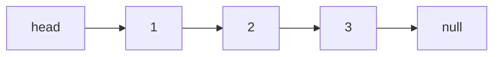
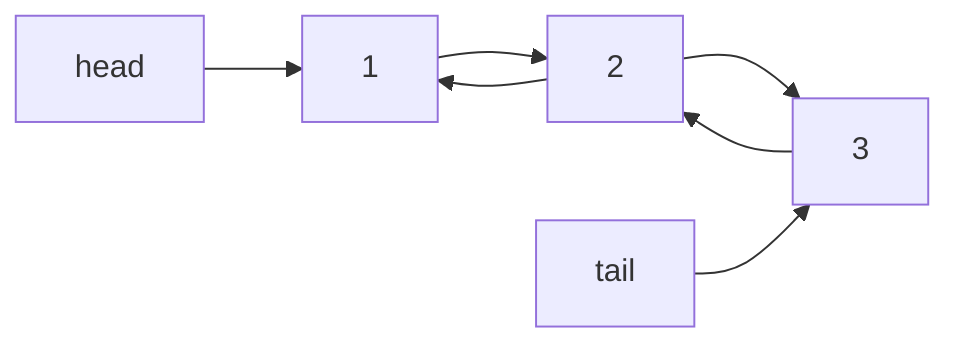
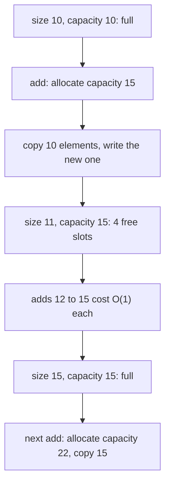

# Arrays, Strings, and Linked Lists

## Why It Matters

Arrays, strings, and linked lists are the base of every other data structure in this KB, and they appear in more interview problems than any other topic. Many interview problems take an array or a string as input, and every pointer-based structure (trees, graphs, hash table buckets) builds on the linked list idea. Interviewers use these topics to test whether you know what your code costs: why `s += c` in a loop is slow, why `ArrayList.add` is O(1) amortized, why `LinkedList` is rarely the right choice in Java, and how to reverse a list in place. On the job, the same knowledge explains memory use, cache behavior, and the cost of a loop that builds a large string.

## Core Concepts

### Arrays and memory layout

An **array** stores elements of one type in one block of **contiguous** memory. Contiguous means that element `i + 1` sits directly after element `i`. The array has a fixed length that you set when you create it.

Because the elements have the same size and no gaps, the machine finds element `i` with one multiplication and one addition:

`address of a[i] = base address + i * element size`

This is **index arithmetic**. It costs the same for `i = 0` and `i = 10^9`, so a read or a write at a known index is O(1). This is called **random access**.

```text
int[] a = {7, 3, 9, 4};        each int takes 4 bytes

address:   1000   1004   1008   1012
         +------+------+------+------+
 value   |  7   |  3   |  9   |  4   |
         +------+------+------+------+
 index      0      1      2      3

address of a[2] = 1000 + 2 * 4 = 1008
```

In Java, an `int[]` stores the `int` values themselves. An `Object[]` or an `Integer[]` stores **references**: each cell holds the address of an object that lives somewhere else on the heap. A scan over an `Integer[]` therefore follows one reference for each element. A scan over an `int[]` does not. The primitive array uses less memory and is faster to scan.

Java checks every index. An index below 0 or at or above `a.length` throws `ArrayIndexOutOfBoundsException`. A new array holds default values: `0` for numeric types, `false` for `boolean`, and `null` for references.

A 2D array in Java is an **array of arrays**. `int[][] grid = new int[3][4]` creates one array of 3 references and three separate `int[4]` arrays. The JLS does not require the rows to be adjacent in memory. Rows can have different lengths. See the [Java Toolkit](../java-toolkit.md) for the initialization pitfall.

#### Cache lines

A CPU does not read one byte at a time from main memory. It reads a block called a **cache line** and keeps it in a small, fast **cache**. A cache line is 64 bytes on current Intel and AMD x86-64 processors (approximate: the size depends on the hardware, other processors use other sizes, and Java has no standard API that reports it). With 64-byte lines, an `int[]` scan reads 16 ints from each line, so one memory read serves 16 elements. A scan over elements that sit far apart in memory (a linked list, or an `Integer[]` whose objects the allocator scattered) can miss the cache on almost every element.

Two consequences matter for code:

1. A loop over a 2D array is faster when the inner loop walks along a row (`grid[r][c]` with `c` changing fastest) than along a column, because each row is one contiguous block.
2. Two algorithms with the same Big-O cost can differ by a large factor in real time. The Big-O notation counts steps. It does not count cache misses. See [Complexity Analysis](01-complexity-analysis.md).

#### Index arithmetic that interviews use

| Task | Formula | Where it appears |
|---|---|---|
| Middle of `[lo, hi]` without overflow | `lo + (hi - lo) / 2` | Binary search ([pattern 06](../06-binary-search-on-answer/README.md)) |
| Length of the closed range `[lo, hi]` | `hi - lo + 1` | Sliding window ([pattern 01](../01-sliding-window/README.md)) |
| Length of the half-open range `[lo, hi)` | `hi - lo` | Many library methods, such as `Arrays.copyOfRange` |
| Next index in a circular array of size `n` | `(i + 1) % n` | Circular buffers, ring problems |
| Previous index in a circular array | `(i - 1 + n) % n` | The `+ n` avoids a negative result |
| Flatten cell `(r, c)` of a grid with `cols` columns | `r * cols + c` | Binary search on a matrix |
| Unflatten index `k` | `r = k / cols`, `c = k % cols` | The same |

#### Array operation costs

| Operation | Cost | Reason |
|---|---|---|
| Read or write `a[i]` | O(1) | Index arithmetic |
| Search an unsorted array | O(n) | Compare each element |
| Search a sorted array | O(log n) | Binary search |
| Insert or delete at index `i` | O(n - i) | Shift the later elements by one |
| Delete at the end, or append when a free slot exists | O(1) | No shift. A full fixed-length array has no free slot for an append, so code that appends uses a dynamic array |
| Copy the array (`Arrays.copyOf`) | O(n) | Copy each element |

### Dynamic arrays

A **dynamic array** is an array that grows on demand. It keeps a backing array and a **size** (the number of elements in use). The **capacity** is the length of the backing array. If `size < capacity`, an append writes one element. If `size == capacity`, the append allocates a larger backing array, copies the elements, and then writes.

`java.util.ArrayList` is the Java dynamic array. Facts from the JDK 21 source of `ArrayList`:

- `ArrayList` has a `private static final int DEFAULT_CAPACITY = 10`. A list that you create with `new ArrayList<>()` starts with an empty shared array and allocates capacity 10 on the first `add`.
- The `grow` method computes the new capacity as `ArraysSupport.newLength(oldCapacity, minCapacity - oldCapacity, oldCapacity >> 1)`. This returns `oldCapacity + max(minGrowth, oldCapacity >> 1)`. The usual result is `oldCapacity + oldCapacity / 2`, so the capacity grows by about **1.5 times**. It then copies with `Arrays.copyOf`.
- The capacity sequence for one-by-one adds is 10, 15, 22, 33, 49, 73, 109, 163, ... (the Java Example below prints it).

The JDK documentation does not promise the factor 1.5. It is an implementation detail of the JDK source. The javadoc promises only that `add` runs in amortized constant time.

Append is **amortized O(1)** because the capacity grows by a constant factor. The proof is in [Complexity Analysis](01-complexity-analysis.md): over `n` appends, the resizes copy at most about `3n` elements in total when the factor is 1.5.

| `ArrayList` call | Cost | Reason |
|---|---|---|
| `get(i)`, `set(i, x)` | O(1) | Index arithmetic on the backing array |
| `add(x)` | O(1) amortized, O(n) in the worst single call | The resize copies `n` elements |
| `add(i, x)` | O(n - i) | Shifts the elements from `i` onward right by one |
| `remove(int i)` | O(n - i) | Shifts the elements after `i` left by one |
| `remove(Object o)` | O(n) | Scans for `o`, then shifts |
| `contains(o)`, `indexOf(o)` | O(n) | Linear scan with `equals` |
| `size()` | O(1) | Reads a field |
| `ensureCapacity(n)` | O(n) if it grows | Avoids repeated resizes when you know the final size |

If you know the final size in advance, use `new ArrayList<>(n)` or `ensureCapacity`. This avoids the resizes. For `ArrayList<Integer>`, each element is a boxed `Integer` object, so the list uses more memory than an `int[]` and has worse cache behavior. The pitfall of `remove(int)` against `remove(Object)` is in the [Java Toolkit](../java-toolkit.md).

### Strings in Java

A **string** is a sequence of characters. In Java, `String` is an **immutable** class: no method changes a `String` object. A method such as `toUpperCase` or `substring` returns a new `String`.

Immutability has four benefits:

1. **Safe sharing.** Many references can point to one `String`, and no code that holds one reference can change the value that the other references see. A `String` is also thread-safe.
2. **Safe map keys.** A key whose `hashCode` changes while it sits in a `HashMap` would be lost. A `String` never changes, so its hash never changes.
3. **Cached hash code.** `String.hashCode()` computes the hash once and stores it in a field (the JDK source has a `hash` field and a `hashIsZero` flag). Later calls are O(1).
4. **Security.** Code can pass a `String` for a file path or a class name and know that the value will not change after a check.

#### The string pool

The JVM keeps a **string pool**: a table that holds one `String` object for each distinct literal. Two literals with the same text refer to the same object. The JLS (section 3.10.5) says that string literals, and constant expressions of type `String`, are interned. `String.intern()` returns the pooled object that equals the receiver and adds the receiver to the pool if no equal string is there.

```java
String a = "hello";
String b = "hello";
String c = new String("hello");
// a == b is true: one pooled object. a == c is false: new String creates a new object.
// a.equals(c) is true: equals compares the characters.
```

Use `equals` to compare strings. `==` compares references. A comparison with `==` can pass on literals and fail on strings that the program builds at run time.

#### Compact strings

Before JDK 9, a `String` stored a `char[]`, which uses 2 bytes for every character. Since JDK 9, **compact strings** (JEP 254) store a `byte[]` and a `coder` flag. If every character in the string is in the Latin-1 range (`U+0000` to `U+00FF`), the string uses 1 byte for each character (`LATIN1`). Otherwise it uses 2 bytes for each character in UTF-16 (`UTF16`). The program does not see the difference: `charAt` and `length` behave as before. Text that is only Latin-1 uses about half the memory. The JVM option `-XX:-CompactStrings` turns the feature off.

#### String operation costs

Let `n` and `m` be the lengths of the strings involved.

| Operation | Cost | Reason |
|---|---|---|
| `length()`, `charAt(i)` | O(1) | Read a field, index the byte array |
| `substring(i, j)` | O(j - i) | Copies the range into a new array. The JDK source calls `Arrays.copyOfRange`. Since Java 7 update 6 a substring no longer shares the parent's array |
| `s + t`, `s.concat(t)` | O(n + m) | Copies both into a new array |
| `equals`, `compareTo` | O(n) in the worst case | Compares characters until the first difference. `equals` returns false at once if the lengths differ |
| `hashCode()` | O(n) on the first call, O(1) after | Cached in the string |
| `indexOf(t)`, `contains(t)` | O(n · m) in the worst case | Tries each start position. See `kb/dsa/22-string-algorithms/README.md` for KMP, Z, and Rabin-Karp |
| `toCharArray()` | O(n) | Copies |
| `String.valueOf(char[])`, `new String(char[])` | O(n) | Copies |

#### Why `s += c` in a loop is O(n²)

`s += c` creates a new `String` that holds the old text plus `c`. The old text is copied. In a loop of `n` iterations, iteration `k` copies about `k` characters, so the total is `1 + 2 + ... + n = n(n + 1) / 2` copies, which is O(n²). Since JDK 9, `javac` compiles `+` through `invokedynamic` and `StringConcatFactory` (JEP 280), which makes one concatenation efficient. It does not change the loop: each iteration still builds a new `String` from the old one.

`StringBuilder` is the fix. It keeps a mutable buffer. `append` writes at the end and grows the buffer geometrically when it is full. The JDK source computes the new length as `ArraysSupport.newLength(oldLength, minGrowth, oldLength + 2)` in bytes for a Latin-1 builder, so the capacity roughly doubles (`2 * old + 2` characters). The default capacity is 16. So `append` is amortized O(1) per character, and the loop is O(n).

```java
// Wrong: O(n^2) copies
static String joinSlow(char[] chars) {
    String s = "";
    for (int i = 0; i < chars.length; i++) s += chars[i];
    return s;
}

// Right: O(n)
static String joinFast(char[] chars) {
    StringBuilder sb = new StringBuilder();
    for (int i = 0; i < chars.length; i++) sb.append(chars[i]);
    return sb.toString();
}
```

`StringBuffer` is the older, synchronized version of `StringBuilder`. Use `StringBuilder` unless several threads share the builder. Other costs: `sb.insert(0, x)` is O(n), `sb.reverse()` is O(n), and `sb.deleteCharAt(i)` is O(n - i). The [Java Toolkit](../java-toolkit.md) lists the `String` and `StringBuilder` calls that interviews use.

#### `char` against code points

A Java `char` is a 16-bit UTF-16 **code unit**. A **code point** is the number that Unicode assigns to a character. Code points from `U+0000` to `U+FFFF` fit in one `char`. Code points above `U+FFFF` (emoji, rare scripts) need two `char` values, called a **surrogate pair**. For such text:

- `s.length()` counts `char` values, not characters that a reader sees.
- `s.charAt(i)` can return half of a pair.
- `s.codePointCount(0, s.length())` counts code points. `s.codePoints()` streams them. `Character.charCount(cp)` gives 1 or 2.

Most interview problems state that the input has lowercase English letters or ASCII. Ask if the statement does not say. For ASCII input, `c - 'a'` is a valid index into an `int[26]` frequency array.

### Linked lists

A **linked list** stores each element in a separate **node**. A node holds a value and one or more references to other nodes. The list keeps a reference to its first node, the **head**. The nodes do not need to be adjacent in memory.



A singly linked list: each arrow is a `next` reference.



A doubly linked list: each pair of arrows between two nodes is a `next` and a `prev` reference. The `head` and `tail` references point to the first and the last node.

- In a **singly linked list**, each node has a `next` reference. You walk in one direction.
- In a **doubly linked list**, each node has `next` and `prev` references. You walk in both directions, and you can remove a node if you hold a reference to it.
- A **circular** list links the last node back to the first.

A **sentinel node** (also called a dummy node) is an extra node at the front, and for some doubly linked lists also at the back, that holds no real value. It removes the special cases for the head and the tail. Without a sentinel, inserting or removing at the head changes the `head` field, and the code needs an `if` for it. With a sentinel, every real node has a predecessor, so one code path serves all positions. The implementation below uses a sentinel in both lists.

#### Linked list operation costs

| Operation | Singly linked | Doubly linked | Reason |
|---|---|---|---|
| Access the `i`-th element | O(i) | O(min(i, n - i)) with a tail pointer | You must follow the links. `java.util.LinkedList.get(i)` starts at the nearer end |
| Insert or delete at the head | O(1) | O(1) | Change a few references |
| Insert at the tail | O(1) with a tail pointer, O(n) without | O(1) | The tail pointer gives the last node |
| Delete the tail | O(n) | O(1) | A singly linked list needs the node before the tail, which only a walk finds |
| Insert after a node that you hold | O(1) | O(1) | Change two or four references |
| Delete a node that you hold | O(n) (you need its predecessor), O(1) if you hold the predecessor | O(1) | A doubly linked node knows its predecessor |
| Search for a value | O(n) | O(n) | Walk and compare |

The O(1) insert and delete costs apply only after you hold the node. Finding the node costs O(n). This is why a linked list rarely beats an array in practice: the walk that finds the position dominates.

Two uses give a real advantage:

- **Constant-time removal from the middle with a node handle.** An LRU cache keeps a hash map from key to node and a doubly linked list in recency order. Both lookup and removal are O(1). See [LRU and LFU Cache](../../lld/case-studies/02-lru-and-lfu-cache/README.md).
- **Splicing** one list into another in O(1) when you hold the right nodes (for example, merging sorted lists in place).

`java.util.LinkedList` is a doubly linked list. Each node is an object with the item and two references, so it costs more memory than an array slot and has poor cache behavior. `ArrayDeque` is the better choice for a stack or a queue; see [Stacks, Queues, and Deques](03-stacks-queues-deques.md).

#### Interview techniques for linked lists

| Technique | Idea | Cost |
|---|---|---|
| Dummy head | Create a sentinel node before the head so that removing the head needs no special case | O(1) extra space |
| Reverse in place | Walk once and flip each `next` pointer, keeping `prev`, `cur`, and `next` | O(n) time, O(1) space |
| Fast and slow pointers | One pointer moves two steps, the other moves one step. They meet if there is a cycle. When fast reaches the end, slow is at the middle | O(n) time, O(1) space |
| Two-pass or gap pointers | Move a lead pointer `k` steps ahead, then move both. The trailing pointer is `k` from the end | O(n) time, O(1) space |
| Merge | Compare the heads of two sorted lists and link the smaller node | O(n + m) time, O(1) space |

[Fast & Slow Pointers + Linked List Techniques](../03-fast-slow-pointers/README.md) develops these techniques with problems.

### Arrays against linked lists

| Property | Array or `ArrayList` | Singly or doubly linked list |
|---|---|---|
| Access by index | O(1) | O(n) |
| Insert or delete at the front | O(n) | O(1) |
| Insert or delete at the back | O(1) amortized | O(1) with a tail pointer (delete: O(1) only if doubly linked) |
| Insert or delete in the middle, position known by index | O(n) | O(n) to find, then O(1) |
| Insert or delete in the middle, node already held | O(n) | O(1) (doubly linked) |
| Memory for `n` elements | About `n` slots, plus unused capacity | `n` nodes. Each node adds one or two references and an object header |
| Cache behavior | Contiguous: good | Scattered nodes: poor |
| Search | O(n), or O(log n) if sorted | O(n) |
| Binary search | Possible | Not possible without index access |

### Which patterns use this

- [Sliding Window](../01-sliding-window/README.md) and [Two Pointers](../02-two-pointers/README.md): index arithmetic and in-place array work.
- [Fast & Slow Pointers + Linked List Techniques](../03-fast-slow-pointers/README.md): cycle detection, middle, reversal, merge.
- [Prefix Sum / Difference Array](../04-prefix-sum/README.md): a second array that answers range queries.
- [Hashing & Frequency Maps](../05-hashing-frequency/README.md): `int[26]` frequency arrays for strings.
- [Binary Search](../06-binary-search-on-answer/README.md): index arithmetic and sorted arrays.
- [Tries](../17-trie/README.md): strings as paths of characters.
- String algorithms (KMP, Z-function, Rabin-Karp): `kb/dsa/22-string-algorithms/README.md`.
- Matrix problems and grid indexing: `kb/dsa/25-matrix-and-simulation/README.md`.

## How It Works

### Growth of a dynamic array



Each resize copies every element once, but a resize happens after more and more cheap appends: 5 appends after the first resize, then 7, then 11, then 16. The number of cheap appends between resizes grows with the size. This growth is the reason the amortized cost stays constant.

### Reverse a singly linked list

Keep three references: `prev` (starts at `null`), `cur` (starts at the head), and `next` (saved before you change `cur.next`). At each step:

1. Save `next = cur.next`.
2. Point `cur.next` at `prev`.
3. Move `prev` to `cur` and `cur` to `next`.

When `cur` is `null`, `prev` is the new head. Each node is visited once, so the time is O(n), and the extra space is O(1). A recursive version uses O(n) stack space.

### Detect a cycle in a singly linked list

Move `slow` by one node and `fast` by two nodes on each step. If the list has no cycle, `fast` reaches `null` after about `n / 2` steps. If the list has a cycle, both pointers enter it, and the gap between them (measured along the cycle) shrinks by one on each step, so `fast` meets `slow` inside the cycle. The time is O(n) and the space is O(1). A `HashSet` of visited nodes also works, with O(n) space. The proof, and the way to find the start of the cycle, are in [pattern 03](../03-fast-slow-pointers/README.md).

## Trade-offs and When to Use

| Need | Use | Reason |
|---|---|---|
| Fast random access, scans, sorting, binary search | `int[]` or `ArrayList` | O(1) access, contiguous memory |
| Fixed size known up front, primitive values | `int[]` | No boxing, least memory |
| Unknown number of appends | `ArrayList` | Amortized O(1) append |
| Stack or queue | `ArrayDeque` | Contiguous, no node objects, O(1) at both ends |
| Constant-time removal of a known node from the middle | Doubly linked list with node handles (as in an LRU cache) | O(1) with a handle |
| Many inserts at the front of a sequence | `ArrayDeque`, or a linked list | `ArrayList.add(0, x)` costs O(n) |
| Build a string from many parts | `StringBuilder` | Amortized O(1) per append |
| Compare or hash many strings | `String` (the hash is cached) | Immutable, cached hash |
| Edit a sequence of characters in place | `char[]` | Mutable, O(1) per write |

Recommendation: in Java, start with `ArrayList` or an array. Use a linked list when the problem is about nodes (a LeetCode list problem, an LRU cache). Do not use `java.util.LinkedList` for a general list: it has the same Big-O costs as a hand-written list and much worse memory use than `ArrayList`.

## Java Example

The first program implements a singly linked list with a sentinel and a tail pointer (add, remove, reverse), Floyd's cycle detection, and a doubly linked list with a circular sentinel. Each method comment gives its cost. Each class is package-private and follows `Main`, so the file runs with `java Main.java`.

```java
public class Main {
    public static void main(String[] args) {
        SinglyLinkedList list = new SinglyLinkedList();
        for (int v = 1; v <= 5; v++) {
            list.addLast(v);
        }
        list.addFirst(0);
        System.out.println("after adds:     " + list);
        list.remove(3);
        System.out.println("remove 3:       " + list + " size=" + list.size());
        list.reverse();
        System.out.println("reversed:       " + list);
        list.addLast(42);
        System.out.println("addLast(42):    " + list);

        IntNode a = new IntNode(1);
        IntNode b = new IntNode(2);
        IntNode c = new IntNode(3);
        IntNode d = new IntNode(4);
        a.next = b;
        b.next = c;
        c.next = d;
        System.out.println("cycle (none):   " + SinglyLinkedList.hasCycle(a));
        d.next = b;
        System.out.println("cycle (d -> b): " + SinglyLinkedList.hasCycle(a));

        DoublyLinkedList dll = new DoublyLinkedList();
        dll.addLast(10);
        DoublyLinkedList.Node middle = dll.addLast(20);
        dll.addLast(30);
        dll.addFirst(5);
        System.out.println("doubly:         " + dll + " | backward " + dll.toReverseString());
        dll.remove(middle);
        System.out.println("remove by node: " + dll + " size=" + dll.size());
    }
}

final class IntNode {
    int val;
    IntNode next;

    IntNode(int val) {
        this.val = val;
    }
}

/** Singly linked list with a sentinel in front of the first element and a tail pointer. */
final class SinglyLinkedList {
    private final IntNode sentinel = new IntNode(0);
    private IntNode tail = sentinel;
    private int size;

    int size() {
        return size;
    }

    // O(1): link a new node after the sentinel.
    void addFirst(int val) {
        IntNode node = new IntNode(val);
        node.next = sentinel.next;
        sentinel.next = node;
        if (tail == sentinel) {
            tail = node;
        }
        size++;
    }

    // O(1): the tail pointer avoids a walk.
    void addLast(int val) {
        IntNode node = new IntNode(val);
        tail.next = node;
        tail = node;
        size++;
    }

    // O(n): walk to the node before the match, then skip the match.
    boolean remove(int val) {
        IntNode prev = sentinel;
        while (prev.next != null) {
            if (prev.next.val == val) {
                if (prev.next == tail) {
                    tail = prev;
                }
                prev.next = prev.next.next;
                size--;
                return true;
            }
            prev = prev.next;
        }
        return false;
    }

    // O(n) time, O(1) space: flip each next pointer while walking forward.
    void reverse() {
        IntNode first = sentinel.next;
        if (first == null) {
            return;
        }
        IntNode prev = null;
        IntNode cur = first;
        while (cur != null) {
            IntNode next = cur.next;
            cur.next = prev;
            prev = cur;
            cur = next;
        }
        sentinel.next = prev;
        tail = first;
    }

    // Floyd's cycle detection: O(n) time, O(1) space.
    static boolean hasCycle(IntNode head) {
        IntNode slow = head;
        IntNode fast = head;
        while (fast != null && fast.next != null) {
            slow = slow.next;
            fast = fast.next.next;
            if (slow == fast) {
                return true;
            }
        }
        return false;
    }

    @Override
    public String toString() {
        StringBuilder sb = new StringBuilder("[");
        for (IntNode n = sentinel.next; n != null; n = n.next) {
            sb.append(n.val);
            if (n.next != null) {
                sb.append(", ");
            }
        }
        return sb.append("]").toString();
    }
}

/** Doubly linked list with one circular sentinel: sentinel.next is first, sentinel.prev is last. */
final class DoublyLinkedList {
    static final class Node {
        final int val;
        Node prev;
        Node next;

        Node(int val) {
            this.val = val;
        }
    }

    private final Node sentinel = new Node(0);
    private int size;

    DoublyLinkedList() {
        sentinel.prev = sentinel;
        sentinel.next = sentinel;
    }

    int size() {
        return size;
    }

    Node addFirst(int val) {
        return insertAfter(sentinel, val);
    }

    Node addLast(int val) {
        return insertAfter(sentinel.prev, val);
    }

    // O(1): four pointer writes, no special case for the ends.
    private Node insertAfter(Node pos, int val) {
        Node node = new Node(val);
        node.prev = pos;
        node.next = pos.next;
        pos.next.prev = node;
        pos.next = node;
        size++;
        return node;
    }

    // O(1) when the caller holds the node. Clearing the links makes a second remove fail fast.
    void remove(Node node) {
        node.prev.next = node.next;
        node.next.prev = node.prev;
        node.prev = null;
        node.next = null;
        size--;
    }

    @Override
    public String toString() {
        StringBuilder sb = new StringBuilder("[");
        for (Node n = sentinel.next; n != sentinel; n = n.next) {
            sb.append(n.val).append(n.next != sentinel ? ", " : "");
        }
        return sb.append("]").toString();
    }

    String toReverseString() {
        StringBuilder sb = new StringBuilder("[");
        for (Node n = sentinel.prev; n != sentinel; n = n.prev) {
            sb.append(n.val).append(n.prev != sentinel ? ", " : "");
        }
        return sb.append("]").toString();
    }
}
```

<!-- expected-output -->

```text
after adds:     [0, 1, 2, 3, 4, 5]
remove 3:       [0, 1, 2, 4, 5] size=5
reversed:       [5, 4, 2, 1, 0]
addLast(42):    [5, 4, 2, 1, 0, 42]
cycle (none):   false
cycle (d -> b): true
doubly:         [5, 10, 20, 30] | backward [30, 20, 10, 5]
remove by node: [5, 10, 30] size=3
```

Points to notice:

- `reverse` sets `tail` to the old first node. Without that line, `addLast(42)` would attach to the wrong node.
- `remove` moves `tail` back when it removes the last node. Without that line, a later `addLast` would write to a node that is no longer in the list.
- The doubly linked list needs no `if` for the head or the tail. The circular sentinel makes `sentinel.next` the first node and `sentinel.prev` the last node.

The second program shows the capacity sequence of `ArrayList`, the flattening of a grid index, the string pool, the difference between `char` and code points, and a `StringBuilder` loop.

```java
import java.util.Arrays;

public class MemoryDemo {
    public static void main(String[] args) {
        // 1. Capacity sequence of ArrayList: 10 on the first add, then old + max(1, old / 2).
        System.out.println("capacities:   " + Arrays.toString(capacities(8)));

        // 2. Row-major index arithmetic for a 3 x 4 matrix stored in one array.
        int rows = 3;
        int cols = 4;
        int index = 2 * cols + 1;
        System.out.println("flat index:   " + index + " -> row " + index / cols
                + ", col " + index % cols + " of " + rows + " rows");

        // 3. String identity: the pool holds one copy of each literal.
        String a = "hello";
        String b = "hello";
        String c = new String("hello");
        System.out.println("a == b:       " + (a == b));
        System.out.println("a == c:       " + (a == c));
        System.out.println("a.equals(c):  " + a.equals(c));
        System.out.println("a == c.intern(): " + (a == c.intern()));

        // 4. char counts UTF-16 code units, not characters that a person sees.
        String smile = new String(Character.toChars(0x1F600));
        System.out.println("length:       " + smile.length());
        System.out.println("code points:  " + smile.codePointCount(0, smile.length()));

        // 5. Build strings with StringBuilder: amortized O(1) per append.
        StringBuilder sb = new StringBuilder();
        String[] words = "one two three".split(" ");
        for (int i = words.length - 1; i >= 0; i--) {
            sb.append(words[i]).append(' ');
        }
        System.out.println("reversed:     " + sb.toString().trim());
    }

    static int[] capacities(int steps) {
        int[] result = new int[steps];
        int capacity = 10;
        for (int i = 0; i < steps; i++) {
            result[i] = capacity;
            capacity = capacity + Math.max(1, capacity >> 1);
        }
        return result;
    }
}
```

<!-- expected-output -->

```text
capacities:   [10, 15, 22, 33, 49, 73, 109, 163]
flat index:   9 -> row 2, col 1 of 3 rows
a == b:       true
a == c:       false
a.equals(c):  true
a == c.intern(): true
length:       2
code points:  1
reversed:     three two one
```

## Interview Angle

### Questions

??? question "Why is array access O(1)?"

    An array stores equal-size elements in one contiguous block. The address of `a[i]` is `base + i * elementSize`. The machine computes it with one multiplication and one addition, whatever the value of `i`, and then reads memory at that address. No search or walk is needed.

    The trade-off is that the same layout makes insertion and deletion in the middle O(n), because the later elements must shift to keep the block contiguous. In Java, the JVM also checks the index against `a.length` on each access. This check costs O(1) and throws `ArrayIndexOutOfBoundsException` if the index is out of range.

??? question "How does `ArrayList` grow, and why is `add` amortized O(1)?"

    `ArrayList` keeps an `Object[]` and a size. When the array is full, `grow` allocates a new array whose length is `old + max(minimumGrowth, old >> 1)`, which is about 1.5 times the old length, and copies the elements with `Arrays.copyOf`. The first `add` to a default list allocates capacity 10.

    One resize costs O(n). But the capacity grows by a constant factor, so the copy costs form a geometric series. Over `n` appends the copies total at most about `3n` with the factor 1.5, so the cost per append is O(1) amortized. If the array grew by a fixed number of slots instead, the total would be O(n²). The factor 1.5 comes from the JDK source and is not part of the specification, so do not state it as a guarantee. If you know the final size, `new ArrayList<>(n)` avoids all resizes.

??? question "Why are strings immutable in Java?"

    Immutability gives four benefits. First, references can share one `String` safely, and a `String` is thread-safe without locks. Second, the hash code never changes, so a `String` is a safe `HashMap` key, and `String` caches its hash after the first call. Third, the JVM can keep one pooled copy of each literal. Fourth, security-sensitive code (class names, file paths, network addresses) cannot see a value change after a check.

    The cost is that each change creates a new object. For repeated changes, use `StringBuilder`.

??? question "Why is `s += c` in a loop O(n²), and how do you fix it?"

    Each `+=` builds a new `String` and copies the whole old text, because strings are immutable. In a loop of `n` iterations, the copies have lengths 1, 2, ..., n, so the total is `n(n + 1) / 2`, which is O(n²). The fix is a `StringBuilder`: `append` writes into a mutable buffer that grows geometrically, so each append is amortized O(1) and the loop is O(n). Call `toString()` once at the end.

    A single `a + b + c` expression is not a problem. The compiler handles it as one concatenation. The problem is repeated concatenation in a loop.

??? question "What is the difference between `==` and `equals` for strings, and what is the string pool?"

    `==` compares references. `equals` compares the characters. The string pool is a JVM table that holds one `String` for each distinct literal, so `"hello" == "hello"` is true. `new String("hello")` creates a separate object, so `new String("hello") == "hello"` is false, although `equals` returns true. `intern()` returns the pooled instance.

    Use `equals` to compare content. A candidate who uses `==` on strings that came from input or from `substring` gets wrong answers that depend on how the string was built.

??? question "When is a linked list better than an array?"

    In two cases. First, when you hold a node and need to insert or remove next to it in O(1): an array needs O(n) shifts. An LRU cache uses this with a hash map from key to node and a doubly linked list in recency order. Second, when you need to splice or rearrange list segments by changing pointers, without copying elements, as in merging sorted lists in place.

    In all other cases an array or `ArrayList` is better. Access by index is O(1) instead of O(n). A scan reads contiguous memory and uses the CPU cache, while a list scan follows pointers to scattered nodes. A list also adds one or two references and an object header for each element. The O(1) insert of a linked list is only O(1) after you find the position, and finding it costs O(n).

??? question "Reverse a singly linked list. State the complexity."

    Use three references: `prev` (starts as `null`), `cur` (starts as the head), and `next`. In each step, save `next = cur.next`, set `cur.next = prev`, then move `prev = cur` and `cur = next`. When `cur` is `null`, return `prev`.

    Time is O(n), because each node is visited once. Extra space is O(1). A recursive solution is also O(n) time but uses O(n) stack space, which can overflow the stack for a long list. If the interviewer asks to reverse a sublist (LeetCode 92, Reverse Linked List II, Medium), use a dummy head and reverse only the nodes between positions `left` and `right`.

??? question "How do you detect a cycle in a linked list, and why does the method work?"

    Use two pointers. `slow` moves one node per step and `fast` moves two. If `fast` reaches `null`, the list has no cycle. If the pointers meet, the list has a cycle.

    The reason: once both pointers are in the cycle, `fast` gains one node on `slow` in each step, so the distance between them along the cycle decreases by one each step and reaches zero in fewer than the cycle length steps. The time is O(n) and the space is O(1). The alternative is a `HashSet` of visited nodes, which costs O(n) space. To find where the cycle starts (LeetCode 142, Linked List Cycle II, Medium), see [pattern 03](../03-fast-slow-pointers/README.md).

??? question "Why is a linked list scan slower than an array scan when both are O(n)?"

    Big-O counts steps, and both scans take `n` steps. Real time also depends on memory access. An array stores elements contiguously, so the CPU loads a cache line of 64 bytes (approximate, hardware dependent) that holds several elements and prefetches the next lines. A linked list node can sit anywhere on the heap, so each `next` step can miss the cache and wait for main memory. The nodes also carry object headers and references, so fewer elements fit in the cache.

??? question "You are given only a node in the middle of a singly linked list. How do you delete it?"

    This is LeetCode 237, Delete Node in a Linked List (Medium). You cannot reach the predecessor, so you cannot unlink the node in the usual way. Copy the value of `node.next` into `node`, then set `node.next = node.next.next`. This removes the next node and leaves the same sequence of values. It is O(1). It does not work for the last node, and it changes which node object holds each value, which matters if other code holds references to nodes.

??? question "What does `length()` return for a string that holds one emoji, such as U+1F600, and how do you count characters correctly?"

    It returns 2. The emoji U+1F600 is one code point above `U+FFFF`. A Java `char` is a UTF-16 code unit, and a code point above `U+FFFF` takes two code units (a surrogate pair). `length()` counts code units. Use `s.codePointCount(0, s.length())` to count code points, and `s.codePoints()` to iterate over them. Even a code point count does not equal what a reader sees as one character for combined emoji or accents. For interview problems on ASCII or lowercase letters, `length()` and `charAt` are enough.

??? question "Why do linked list solutions use a dummy (sentinel) node?"

    Without it, inserting or removing the first node changes the `head` variable, so the code needs a special case. With a dummy node before the head, every real node has a predecessor, and one code path handles all positions. At the end, return `dummy.next`. The cost is one extra node, which is O(1) space. It also removes bugs on empty lists.

### Follow-up Questions

??? question "What happens to `ArrayList.remove(int)` and `remove(Object)` for a `List<Integer>`?"

    `list.remove(2)` calls `remove(int index)` and removes the element at index 2. `list.remove(Integer.valueOf(2))` calls `remove(Object)` and removes the first element that equals 2. Overload resolution picks `remove(int)` for an `int` argument because it needs no boxing. `remove(int i)` costs O(n - i) for the shift. `remove(Object)` costs O(n): it scans to the match and then shifts the rest. The [Java Toolkit](../java-toolkit.md) lists this as a pitfall.

??? question "How much memory does a `String` of `n` Latin-1 characters use?"

    The characters take `n` bytes in the backing `byte[]` since JDK 9 (compact strings, JEP 254). The array and the `String` object add headers and fields: the `String` stores the array reference, the `coder`, the cached `hash`, and the `hashIsZero` flag. The exact header size depends on the JVM and its settings, so say "about `n` bytes plus a fixed overhead per string". Before JDK 9, the characters took `2n` bytes.

??? question "How do you merge two sorted linked lists in place?"

    Create a dummy node and a `tail` pointer. Compare the heads of both lists, link the smaller node after `tail`, and advance that list and `tail`. When one list ends, link the rest of the other. Time is O(n + m) and extra space is O(1), because the code reuses the existing nodes. This is LeetCode 21, Merge Two Sorted Lists (Easy), and it is the merge step of merge sort on a linked list.

??? question "Why does `substring` cost O(k) in modern Java, and how did it work before?"

    `substring(i, j)` copies `j - i` characters into a new array, so it costs O(j - i). Before Java 7 update 6, a substring shared the parent's `char[]` with an offset and a length, so it cost O(1), but a small substring could keep a huge parent array alive. Java 7 update 6 changed it to copy.

### Red Flags

- Stating that `ArrayList.add` is O(n) without the amortized argument, or that it is O(1) without saying "amortized".
- Concatenating strings with `+=` in a loop and not noticing the O(n²) cost.
- Comparing strings with `==`.
- Saying that a linked list insert is O(1) without saying that you must hold the node.
- Using `java.util.LinkedList` as a stack or queue when `ArrayDeque` is available, or claiming that `LinkedList` is faster than `ArrayList` for inserts in the middle without accounting for the walk.
- Forgetting the null checks: `fast != null && fast.next != null`.
- Losing the head of a list while you change pointers, and not using a dummy node.
- Assuming that one `char` is one character for all input.
- Returning the old head after a reversal instead of `prev`.

## Common Mistakes

| Mistake | Fix |
|---|---|
| Using `s += c` in a loop | Use `StringBuilder` and call `toString()` once |
| Comparing strings with `==` | Use `equals`. Use `Objects.equals` if either side can be `null` |
| Calling `substring` or `s + t` in a loop and counting each as O(1) | Each copies its result. Use indexes or a `StringBuilder` |
| Calling `list.remove(i)` or `list.add(0, x)` in a loop over an `ArrayList` | Each is O(n). Build a new list, or use `ArrayDeque`, or mark and compact once |
| Calling `list.get(i)` in a loop over a `LinkedList` | Each is O(n), so the loop is O(n²). Use an iterator |
| Dereferencing `null` in list code (`cur.next.next`) | Check `cur != null && cur.next != null` before you read `next.next` |
| Handling the head as a special case in every method | Use a sentinel node |
| Forgetting to update the tail pointer after a reverse or a remove | Update `tail` in each method that can change the last node, as in the example |
| Creating a cycle by accident while you rearrange nodes | Set the last node's `next` to `null` after you reorder |
| Using `int[][]` row traversal in column-major order on a large grid | Put the column index in the inner loop |
| Computing `(lo + hi) / 2` | Use `lo + (hi - lo) / 2` |
| Treating `char` as a character for every input | Use code points when the input can contain supplementary characters |

## Commonly Confused With

| Looks like | Difference | Deciding question |
|---|---|---|
| Array and `ArrayList` | An array has a fixed length and can hold primitives. `ArrayList` grows but holds only objects (boxed values) | "Do I know the size, and are the values primitive?" |
| `ArrayList` and `LinkedList` | `ArrayList` has O(1) access and a contiguous backing array. `LinkedList` has O(1) insert at a held node and no random access | "Do I index into the list, or hold nodes?" |
| Size and capacity | Size is the number of elements. Capacity is the length of the backing array | "Am I counting elements or slots?" |
| `String` and `StringBuilder` | `String` is immutable. `StringBuilder` is a mutable buffer | "Do I change the text many times?" |
| `StringBuilder` and `StringBuffer` | `StringBuffer` is synchronized and slower. The API is the same | "Do several threads share the builder?" |
| `==` and `equals` on strings | `==` compares references, `equals` compares text | "Do I want identity or content?" |
| `char` and code point | A `char` is a 16-bit code unit. A code point can need two `char` values | "Can the text contain emoji or rare scripts?" |
| Singly and doubly linked list | A doubly linked node knows its predecessor, so removal of a held node is O(1) | "Do I need to remove a node without walking from the head?" |
| Head and sentinel | The head is the first real node. The sentinel is an extra node before it | "Does my code need an `if` for the first node?" |
| Subarray and subsequence | A subarray is contiguous. A subsequence keeps order but can skip elements | "May I skip elements?" |

## Quick Reference Card

- Array: contiguous, `address = base + i * size`, O(1) access, O(n) insert or delete in the middle. `int[]` stores values. `Integer[]` stores references.
- Scan rows in the inner loop (cache lines are 64 bytes on most x86-64 CPUs, approximate).
- `ArrayList`: capacity 10 on the first add, then `old + max(1, old >> 1)` (about 1.5×), `add` is amortized O(1), `add(i, x)` and `remove(i)` are O(n - i), `contains` is O(n).
- `String`: immutable, hash cached, literals are pooled, `substring` and `+` copy, `equals` compares text, `==` compares references.
- Compact strings (JEP 254, JDK 9): 1 byte per Latin-1 character.
- `s += c` in a loop is O(n²). `StringBuilder.append` is amortized O(1). Default builder capacity is 16, growth is about 2×.
- `char` is a UTF-16 code unit. Use `codePointCount` for Unicode code points.
- Linked list: no index access, O(1) insert or delete at a held node (delete needs the predecessor in a singly linked list), O(n) search.
- Sentinel node: no special case for the head. Reverse: `prev`, `cur`, `next`, O(n) time and O(1) space. Cycle: slow and fast pointers, O(n) time and O(1) space.
- `ArrayList` for lists and `ArrayDeque` for stacks and queues. Use a linked list when the problem is about nodes.

## Further Reading

- [`ArrayList` source in OpenJDK](https://github.com/openjdk/jdk/blob/master/src/java.base/share/classes/java/util/ArrayList.java): `DEFAULT_CAPACITY` and the `grow` method, the source of the 1.5× growth.
- [`ArrayList` javadoc](https://docs.oracle.com/en/java/javase/21/docs/api/java.base/java/util/ArrayList.html): the amortized constant time guarantee for `add`, and the cost of the other operations.
- [`LinkedList` javadoc](https://docs.oracle.com/en/java/javase/21/docs/api/java.base/java/util/LinkedList.html): states that it is a doubly linked list and that indexed operations traverse from the nearer end.
- [`String` javadoc](https://docs.oracle.com/en/java/javase/21/docs/api/java.base/java/lang/String.html): immutability, `intern`, `codePointCount`, and the UTF-16 description of `char`.
- [`StringBuilder` javadoc](https://docs.oracle.com/en/java/javase/21/docs/api/java.base/java/lang/StringBuilder.html): the mutable alternative, and the note about `StringBuffer`.
- [JEP 254: Compact Strings](https://openjdk.org/jeps/254): the `byte[]` representation and the Latin-1 and UTF-16 encodings.
- [JEP 280: Indify String Concatenation](https://openjdk.org/jeps/280): how `javac` compiles `+` on strings since JDK 9.
- [Java Language Specification, section 3.10.5](https://docs.oracle.com/javase/specs/jls/se21/html/jls-3.html#jls-3.10.5): string literals are interned.
- Cormen, Leiserson, Rivest, Stein. *Introduction to Algorithms*, 4th edition: chapter 10 ("Elementary Data Structures"; section 10.2 covers linked lists with sentinels) and section 16.4 (dynamic tables, the amortized analysis of a growing array).
- Bryant and O'Hallaron. *Computer Systems: A Programmer's Perspective*, the chapter on the memory hierarchy: cache lines and why contiguous access is fast.
