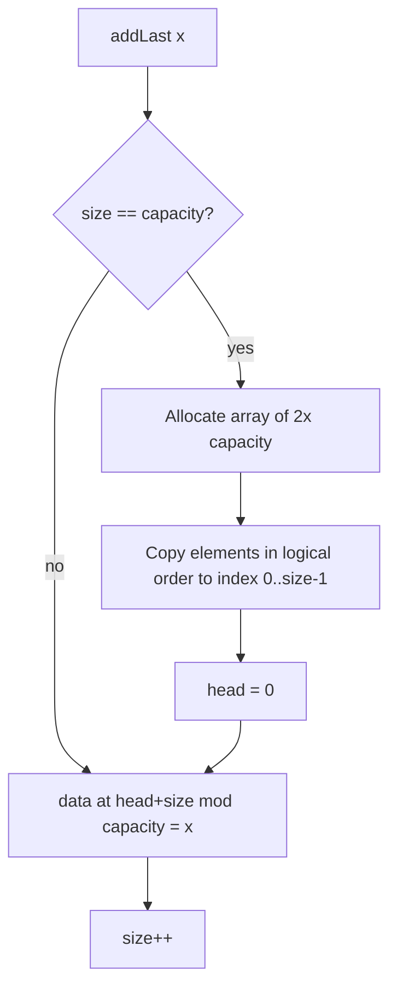
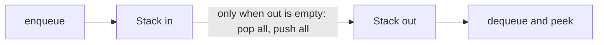

# Stacks, Queues, and Deques

## Why It Matters

Stacks and queues appear in almost every coding round. A stack checks nested brackets, evaluates expressions, and turns a recursive algorithm into a loop. A queue runs breadth-first search (BFS) and level-order traversal. A deque (double-ended queue) runs the sliding-window maximum. Interviewers also ask the theory questions on this page in phone screens: "Why does Java advise against `Stack`?", "How do you build a queue from two stacks?", "How does a circular buffer tell full from empty?". On the job, bounded queues (ring buffers) sit between producers and consumers in logging, networking, and message-passing code.

## Core Concepts

**Abstract data type (ADT)**: a description of what operations a structure offers and what they mean, without a statement of how the structure stores data. Stack, queue, and deque are ADTs. Arrays and linked lists are two ways to implement them.

**Stack**: an ADT with last-in, first-out (LIFO) order. The operations are `push` (add on top), `pop` (remove from the top), and `peek` (read the top without removal). The most recently added element leaves first.

**Queue**: an ADT with first-in, first-out (FIFO) order. The operations are `enqueue` (add at the back), `dequeue` (remove from the front), and `peek` (read the front). The oldest element leaves first.

**Deque**: an ADT that adds and removes at both ends. A deque works as a stack, as a queue, or as both at once. The name is short for "double-ended queue" and is pronounced "deck".

**Priority queue**: an ADT that removes the element with the highest priority, not the oldest. It is not FIFO. A binary heap implements it with O(log n) `offer` and `poll`. See [heaps](06-heaps.md) and [the heap pattern](../16-heap-priority-queue/README.md).

**Circular buffer** (ring buffer): a fixed-size array used as if its end joined its start. An index that moves past the last slot wraps to slot 0. A circular buffer gives O(1) operations at both ends without shifting elements.

**Amortized O(1)**: one call can cost O(n), but n calls cost O(n) in total, so the average per call is O(1). The [complexity page](01-complexity-analysis.md) gives the formal definition.

### Operation costs

| Operation | Stack (array) | Stack (linked) | Queue (circular array) | Queue (linked) | Deque (circular array) |
|---|---|---|---|---|---|
| Add at the working end | Amortized O(1) | O(1) | Amortized O(1) | O(1) | Amortized O(1), both ends |
| Remove at the working end | O(1) | O(1) | O(1) | O(1) | O(1), both ends |
| Peek | O(1) | O(1) | O(1) | O(1) | O(1), both ends |
| Search for a value | O(n) | O(n) | O(n) | O(n) | O(n) |
| Access by index | O(1) | O(n) | O(1) | O(n) | O(1) |

"Amortized O(1)" in the array columns comes from the occasional resize. The linked columns pay O(1) in the worst case for each add, because no copy happens, but each element costs one extra node object.

### Which patterns use this

- [Monotonic stack and queue](../07-monotonic-stack-queue/README.md): a stack or a deque that keeps its elements in sorted order.
- [Graph traversal](../11-graph-traversal/README.md): a queue drives BFS and a stack drives iterative depth-first search (DFS).
- [Tree patterns](../10-tree-patterns/README.md): a queue gives level-order traversal and a stack gives iterative in-order, pre-order, and post-order traversal.
- [Recursion and backtracking](../08-recursion-backtracking/README.md): the call stack stores the state of each pending call.
- [Sliding window](../01-sliding-window/README.md): a deque gives the maximum of each window in O(n).
- [Shortest paths](../18-shortest-paths/README.md): 0-1 BFS uses a deque.
- [Heap and priority queue](../16-heap-priority-queue/README.md): the priority queue is the one "queue" that does not use FIFO order.

## How It Works

### Array-based and linked implementations

An **array-based stack** keeps its elements in an array and a counter `size`. `push` writes at index `size` and increments the counter. `pop` decrements the counter and reads that index. If the array is full, `push` allocates an array twice as long and copies the elements. The doubling makes `push` amortized O(1).

A **linked stack** keeps a pointer `top` to the first node. `push` creates a node that points to the old top. `pop` moves `top` to the next node. No copy and no resize happen.

A **linked queue** keeps two pointers, `head` and `tail`. `enqueue` links a new node after `tail`. `dequeue` moves `head` to the next node.

```java
class LinkedStack<T> {
    private static class Node<T> {
        final T value;
        final Node<T> next;
        Node(T value, Node<T> next) { this.value = value; this.next = next; }
    }
    private Node<T> top;
    private int size;

    void push(T x) { top = new Node<>(x, top); size++; }

    T pop() {
        if (top == null) throw new java.util.NoSuchElementException();
        T x = top.value;
        top = top.next;
        size--;
        return x;
    }

    T peek() {
        if (top == null) throw new java.util.NoSuchElementException();
        return top.value;
    }

    boolean isEmpty() { return top == null; }
}
```

The next block shows the linked queue.

```java
import java.util.NoSuchElementException;

class LinkedQueue<T> {
    private static class Node<T> {
        final T value;
        Node<T> next;
        Node(T value) { this.value = value; }
    }
    private Node<T> head; // front: dequeue here
    private Node<T> tail; // back: enqueue here
    private int size;

    void enqueue(T x) {
        Node<T> node = new Node<>(x);
        if (tail == null) {
            head = tail = node;   // the queue was empty
        } else {
            tail.next = node;
            tail = node;
        }
        size++;
    }

    T dequeue() {
        if (head == null) throw new NoSuchElementException();
        T x = head.value;
        head = head.next;
        if (head == null) tail = null; // the queue became empty: drop the stale tail
        size--;
        return x;
    }

    boolean isEmpty() { return head == null; }
}
```

The two choices compare as follows. An array stores elements next to each other, so the CPU cache loads several elements with one memory fetch. A linked node is a separate object with a header and a pointer, so each element costs more memory. Example: a `java.util.LinkedList` node has three reference fields (`item`, `next`, `prev`). On a 64-bit HotSpot JVM with compressed references, a 12-byte object header plus three 4-byte references gives about 24 bytes per node, against one 4-byte reference per element in an `ArrayDeque` array. These numbers are approximate. They follow from the field list in the `LinkedList` source and the usual HotSpot object layout, and they change with JVM flags. For stacks and queues, the array-based form is the default choice. The linked form has a use when the worst-case time of one `add` must be O(1) with no resize pause.

### The circular buffer

A queue on a plain array has a problem. `dequeue` removes at index 0. Shifting every other element left costs O(n). If `head` advances instead, the freed slots at the front stay unused while `tail` runs off the end. The circular buffer fixes this: both indexes wrap to 0 after the last slot.

```text
capacity 8, head = 6, size = 4   (elements A B C D in logical order)

index:   0   1   2   3   4   5   6   7
       +---+---+---+---+---+---+---+---+
       | C | D |   |   |   |   | A | B |
       +---+---+---+---+---+---+---+---+
                 ^                ^
               tail             head
     tail = (head + size) mod capacity = (6 + 4) mod 8 = 2
```

The buffer stores `head` (index of the first element) and `size` (number of elements). The tail index is derived: `(head + size) mod capacity`. Storing `size` solves the full-versus-empty problem. If a buffer stores only `head` and `tail`, then `head == tail` means both "empty" and "full", and the code needs a reserved empty slot or a flag. With `size`, the buffer is empty if `size == 0` and full if `size == capacity`.

If the capacity is a power of two, `x mod capacity` equals `x & (capacity - 1)`. The bit mask is cheaper than a division and also handles `-1` correctly for `addFirst`: `(0 - 1) & 7` is 7.

**Resize**: if the buffer is full, allocate an array twice as long and copy the elements in logical order (`head`, `head + 1`, ... with wrap-around) into indexes `0..size-1`. Reset `head` to 0. A plain `System.arraycopy` of the old array would keep the wrapped layout and break the order, so the copy must follow logical order. The copy costs O(n) but happens only after n adds, so `addFirst` and `addLast` are amortized O(1).

**How `ArrayDeque` does it (JDK 21 source).** The JDK class tells full from empty with a reserved empty slot. It stores `head` and `tail` and keeps at least one array slot `null`: the source comment says "elements[tail] is always null". It does not require a power-of-two length (the default constructor allocates 17 slots), so it computes the wrap-around with a comparison instead of a mask. While the array is shorter than 64 slots, `grow` sets the new length to about twice the old length (old length × 2 + 2). After that, it grows the array by 50%. Either growth factor gives amortized O(1).



### Queue with two stacks

A queue needs removal from the front, and a stack removes from the top. Two stacks reverse the order twice. The stack `in` receives each new element. The stack `out` serves `dequeue` and `peek`. If `out` is empty when a `dequeue` arrives, the code pops every element from `in` and pushes it onto `out`. This move reverses the order, so the oldest element ends on top of `out`.

Why the cost is amortized O(1): each element is pushed onto `in` once, popped from `in` once, pushed onto `out` once, and popped from `out` once. That is at most 4 stack operations per element over its whole life. A single `dequeue` can cost O(n) when it moves n elements, but then the next n-1 `dequeue` calls cost O(1) each. Over m operations the total is O(m), so the amortized cost per operation is O(1). The rule that makes this work: move elements only when `out` is empty. If the code moved elements on every `dequeue`, the cost would be O(n) per call.



### Stack with queues

The two-stack trick does not carry over. Moving elements from one stack to another reverses their order, and that reversal turns LIFO into FIFO. Moving elements from one queue to another keeps their order, so a move gains nothing. The standard construction on one queue pays O(n) for `push`: after adding the new element at the back, rotate the older elements behind it, so the new element reaches the front. `pop` and `top` are then O(1). The two-queue construction puts the O(n) cost on `push` or on `pop`, and gives the same bound. Interviewers ask this version to see whether the candidate states the cost honestly.

## Trade-offs and When to Use

### Which Java class to use

| Class | Use as | Null elements | Thread-safe | Notes |
|---|---|---|---|---|
| `ArrayDeque` | Stack, queue, and deque | No: throws `NullPointerException` | No | Circular array. The default choice. Its javadoc says it is likely faster than `Stack` as a stack and faster than `LinkedList` as a queue |
| `Stack` | Stack | Yes | Yes (synchronized methods) | A legacy class that extends `Vector`. The `Stack` javadoc says that `Deque` offers a more complete and consistent set of LIFO operations and that the `Deque` interface should be preferred |
| `LinkedList` | List, queue, deque | Yes | No | Doubly linked nodes. It costs more memory and gives worse cache behavior than `ArrayDeque` |
| `PriorityQueue` | Priority queue | No | No | Not FIFO. Iteration order is not sorted. See [heaps](06-heaps.md) |
| `ConcurrentLinkedDeque`, `LinkedBlockingQueue`, `ArrayBlockingQueue` | Concurrent queues | No | Yes | For thread hand-off. See `kb/java/04-collections-internals.md` |

Reasons to prefer `ArrayDeque` over `Stack`:

1. `Stack` extends `Vector`, so it exposes `get(i)`, `add(i, x)`, and `remove(i)`. A "stack" that allows insertion in the middle breaks the LIFO contract.
2. Every `Vector` method is synchronized. A single-threaded solution pays for locks that it does not use.
3. Iteration order differs. `Stack` iterates from the bottom to the top. `ArrayDeque` used with `push` iterates from the top to the bottom. Converting each to a list shows the difference (see the Java example below).

Reasons to prefer `ArrayDeque` over `LinkedList` for a queue: `ArrayDeque` stores references in one array, so it allocates no node per element and reads memory in order. Reason to use `LinkedList` anyway: you need `List` operations, or you need to remove or insert in the middle in O(1) through an iterator (`Iterator.remove()`, `ListIterator.add`). The `ArrayDeque` javadoc lists `iterator.remove()` among its linear-time operations. A `LinkedList` also accepts `null`, but the `Deque` javadoc advises users not to insert `null` even where an implementation allows it. Interview solutions seldom need either reason.

### Method names on `Deque`

The `Deque` interface has two names for most operations. A method in the first group throws an exception on failure. A method in the second group returns a special value.

| Intent | Throws | Returns special value |
|---|---|---|
| Stack push | `push(x)` (same as `addFirst`) | `offerFirst(x)` |
| Stack pop | `pop()` (same as `removeFirst`) | `pollFirst()` returns `null` if empty |
| Stack peek | `getFirst()` | `peekFirst()` returns `null` if empty |
| Queue enqueue | `add(x)` or `addLast(x)` | `offer(x)` or `offerLast(x)` |
| Queue dequeue | `remove()` or `removeFirst()` | `poll()` or `pollFirst()` |
| Queue peek | `element()` | `peek()` |
| Deque back end | `removeLast()`, `getLast()` | `pollLast()`, `peekLast()` |

Recommendation: for a stack, always use `push`, `pop`, and `peek` on one `Deque` variable. For a queue, use `offer`, `poll`, and `peek`. Do not mix `push` with `offer` on the same deque, because `push` adds at the front and `offer` adds at the back.

Note on `peek`: `Deque.peek()` is the same as `peekFirst()`. On a deque used as a stack, `peek()` reads the top. On a deque used as a queue, `peek()` reads the front. The ends are the same; only the intent differs.

### Array-based versus linked, in one table

| Question | Array-based | Linked |
|---|---|---|
| Worst-case time of one add | O(n) at a resize | O(1) |
| Total time for n adds | O(n) | O(n) |
| Memory per element | One reference (about 4 or 8 bytes) | A node object plus references |
| Cache behavior | Good: contiguous memory | Poor: nodes are spread over the heap |
| Wasted space | Up to about half the array after a resize | None, but node overhead |
| Typical choice in Java | `ArrayDeque` | `LinkedList` |

## Java Example

The first program is a circular-buffer deque of `int` values with resize. It uses the power-of-two mask described above. Its method names follow the `Deque` convention for the throwing group: `removeFirst`, `removeLast`, `getFirst`, and `getLast` throw `NoSuchElementException` on an empty deque. (In `Deque`, the names `pollFirst` and `peekFirst` return `null` instead, which an `int` cannot hold.)

```java
import java.util.NoSuchElementException;

public class RingDeque {
    private int[] data = new int[4]; // the length is always a power of two
    private int head = 0;            // index of the first element
    private int size = 0;            // number of elements

    public int size() { return size; }
    public boolean isEmpty() { return size == 0; }
    public int capacity() { return data.length; }

    private int mask() { return data.length - 1; }

    // The tail index is derived: the next free slot after the last element.
    private int tail() { return (head + size) & mask(); }

    public void addLast(int x) {
        if (size == data.length) grow();
        data[tail()] = x;
        size++;
    }

    public void addFirst(int x) {
        if (size == data.length) grow();
        head = (head - 1) & mask(); // wraps from 0 to length - 1
        data[head] = x;
        size++;
    }

    public int removeFirst() {
        if (size == 0) throw new NoSuchElementException();
        int x = data[head];
        head = (head + 1) & mask();
        size--;
        return x;
    }

    public int removeLast() {
        if (size == 0) throw new NoSuchElementException();
        size--;
        return data[tail()]; // after size--, tail() is the slot of the removed element
    }

    public int getFirst() {
        if (size == 0) throw new NoSuchElementException();
        return data[head];
    }

    public int getLast() {
        if (size == 0) throw new NoSuchElementException();
        return data[(head + size - 1) & mask()];
    }

    // Copies the elements in logical order into an array twice as long.
    private void grow() {
        int[] bigger = new int[data.length * 2];
        for (int i = 0; i < size; i++) {
            bigger[i] = data[(head + i) & mask()];
        }
        data = bigger;
        head = 0;
    }

    @Override
    public String toString() {
        StringBuilder sb = new StringBuilder("[");
        for (int i = 0; i < size; i++) {
            if (i > 0) sb.append(", ");
            sb.append(data[(head + i) & mask()]);
        }
        return sb.append("]").toString();
    }

    public static void main(String[] args) {
        RingDeque d = new RingDeque();
        d.addLast(1);
        d.addLast(2);
        d.addLast(3);
        d.addFirst(0); // head wraps from index 0 to index 3
        System.out.println(d + " size=" + d.size() + " capacity=" + d.capacity()
                + " head=" + d.head);
        d.addLast(4);  // the buffer is full, so it grows to 8
        System.out.println(d + " size=" + d.size() + " capacity=" + d.capacity()
                + " head=" + d.head);
        System.out.println("removeFirst=" + d.removeFirst() + " removeLast=" + d.removeLast());
        System.out.println(d + " getFirst=" + d.getFirst() + " getLast=" + d.getLast());
    }
}
```

<!-- expected-output -->
```text
[0, 1, 2, 3] size=4 capacity=4 head=3
[0, 1, 2, 3, 4] size=5 capacity=8 head=0
removeFirst=0 removeLast=4
[1, 2, 3] getFirst=1 getLast=3
```

The `removeLast` method decrements `size` first. After that, `tail()` points at the slot of the last element, which is the one to return. The main method shows the wrap-around: after `addFirst(0)`, `head` is 3, so the logical order `[0, 1, 2, 3]` sits in the array as `[1, 2, 3, 0]`.

The next program is the queue with two stacks. Each element moves from `in` to `out` at most once.

```java
import java.util.ArrayDeque;
import java.util.Deque;
import java.util.NoSuchElementException;

public class TwoStackQueue {
    private final Deque<Integer> in = new ArrayDeque<>();  // receives new elements
    private final Deque<Integer> out = new ArrayDeque<>(); // serves the front

    public void enqueue(int x) {
        in.push(x); // O(1)
    }

    public int dequeue() {
        shiftIfNeeded();
        return out.pop();
    }

    public int peek() {
        shiftIfNeeded();
        return out.peek();
    }

    public boolean isEmpty() { return in.isEmpty() && out.isEmpty(); }

    // Moves every element from in to out only when out is empty.
    // Each element moves at most once, so n operations cost O(n) in total.
    private void shiftIfNeeded() {
        if (out.isEmpty()) {
            if (in.isEmpty()) throw new NoSuchElementException();
            while (!in.isEmpty()) out.push(in.pop());
        }
    }

    public static void main(String[] args) {
        TwoStackQueue q = new TwoStackQueue();
        q.enqueue(1);
        q.enqueue(2);
        q.enqueue(3);
        System.out.println(q.dequeue()); // 1: shifts 3 elements into out
        q.enqueue(4);
        System.out.println(q.peek());    // 2: out is not empty, no shift
        while (!q.isEmpty()) System.out.println("drain " + q.dequeue());
    }
}
```

<!-- expected-output -->
```text
1
2
drain 2
drain 3
drain 4
```

The stack on one queue, with the O(n) `push`:

```java
import java.util.ArrayDeque;
import java.util.Queue;

public class OneQueueStack {
    private final Queue<Integer> q = new ArrayDeque<>();

    // O(n): add x at the back, then rotate the older n elements behind it.
    public void push(int x) {
        q.offer(x);
        for (int i = 0; i < q.size() - 1; i++) {
            q.offer(q.poll());
        }
    }

    public int pop() { return q.remove(); } // O(1)
    public int top() { return q.element(); } // O(1)
    public boolean isEmpty() { return q.isEmpty(); }

    public static void main(String[] args) {
        OneQueueStack s = new OneQueueStack();
        s.push(1);
        s.push(2);
        s.push(3);
        System.out.println(s.pop() + " " + s.pop() + " " + s.top());
    }
}
```

<!-- expected-output -->
```text
3 2 1
```

The last program compares `Stack`, `ArrayDeque`, and `LinkedList`.

```java
import java.util.ArrayDeque;
import java.util.ArrayList;
import java.util.Deque;
import java.util.EmptyStackException;
import java.util.LinkedList;
import java.util.NoSuchElementException;
import java.util.Stack;

public class DequeApis {
    public static void main(String[] args) {
        // Same pushes, different iteration order.
        Stack<Integer> legacy = new Stack<>();
        Deque<Integer> modern = new ArrayDeque<>();
        for (int i = 1; i <= 3; i++) {
            legacy.push(i);
            modern.push(i);
        }
        System.out.println("Stack iteration:      " + new ArrayList<>(legacy));
        System.out.println("ArrayDeque iteration: " + new ArrayList<>(modern));

        // Empty-structure behavior.
        try {
            new Stack<Integer>().pop();
        } catch (EmptyStackException e) {
            System.out.println("Stack.pop on empty throws EmptyStackException");
        }
        try {
            new ArrayDeque<Integer>().pop();
        } catch (NoSuchElementException e) {
            System.out.println("ArrayDeque.pop on empty throws NoSuchElementException");
        }
        System.out.println("ArrayDeque.poll on empty returns "
                + new ArrayDeque<Integer>().poll());

        // null handling.
        try {
            new ArrayDeque<Integer>().offer(null);
        } catch (NullPointerException e) {
            System.out.println("ArrayDeque rejects null");
        }
        Deque<Integer> linked = new LinkedList<>();
        linked.offer(null);
        System.out.println("LinkedList accepts null, size=" + linked.size());
    }
}
```

<!-- expected-output -->
```text
Stack iteration:      [1, 2, 3]
ArrayDeque iteration: [3, 2, 1]
Stack.pop on empty throws EmptyStackException
ArrayDeque.pop on empty throws NoSuchElementException
ArrayDeque.poll on empty returns null
ArrayDeque rejects null
LinkedList accepts null, size=1
```

The Java toolkit page lists the same calls for problem solving: [Java toolkit](../java-toolkit.md).

## Interview Angle

### Questions

??? question "Why should you use `ArrayDeque` instead of `Stack` in Java?"

    `Stack` is a legacy class. It extends `Vector`, so every method is synchronized, and it exposes index-based methods (`get`, `add(i, x)`, `remove(i)`) that break the LIFO contract. The `Stack` javadoc itself says that the `Deque` interface offers a more complete and consistent set of LIFO operations and should be preferred.

    `ArrayDeque` has no locks and keeps its elements in a circular array. The javadoc says it is likely to be faster than `Stack` when used as a stack. The trade-off: `ArrayDeque` is not thread-safe and does not accept `null`. A second difference: iteration order. A `Stack` iterates bottom to top. An `ArrayDeque` used with `push` iterates top to bottom.

??? question "Why does `ArrayDeque` forbid `null` elements?"

    `ArrayDeque` returns `null` from `poll`, `peek`, `pollFirst`, and `pollLast` to signal that the deque is empty. If `null` were a valid element, the caller could not tell "empty" from "the element is null". The `Deque` javadoc gives this reason itself: implementations are "strongly encouraged" to prohibit `null`, because `null` is a special return value that indicates an empty deque. The `ArrayDeque` javadoc states "Null elements are prohibited", so `add`, `offer`, and `push` throw `NullPointerException` for `null`.

    The JDK 21 implementation also depends on the prohibition. It marks every unused array slot with `null` ("All array cells not holding deque elements are always null"), so a `null` element would be indistinguishable from a free slot.

    `LinkedList` allows `null`, but the `Deque` javadoc advises users not to insert it. `PriorityQueue` also rejects `null`, for the same `poll` and `peek` reason.

??? question "How does a circular buffer distinguish a full buffer from an empty one?"

    If the buffer stores only `head` and `tail`, then `head == tail` is true for both states. There are three fixes. First, store `size` and compare it to the capacity. Second, keep one slot unused, so full means `(tail + 1) mod capacity == head`. Third, keep a boolean flag. The `size` field is the clearest and costs one `int`. With `size`, the tail index is `(head + size) mod capacity`.

    Edge case: if the capacity is a power of two, use `& (capacity - 1)` for the modulo. It also gives the right answer for `head - 1` when `head` is 0.

??? question "Implement a queue with two stacks. What is the time complexity?"

    Use a stack `in` for `enqueue` and a stack `out` for `dequeue` and `peek`. `enqueue` pushes on `in`. For `dequeue`, if `out` is empty, pop every element from `in` and push it on `out`, which reverses the order. Then pop from `out`.

    One `dequeue` costs O(n) when it moves n elements. The cost is amortized O(1): each element is pushed to `in` once, popped from `in` once, pushed to `out` once, and popped from `out` once, so m operations cost at most 4m stack operations. With the accounting method: charge 4 units to each `enqueue`; the units pay for every later move of that element, so `dequeue` needs no charge of its own. This holds only if the code moves elements when `out` is empty. If the code moved elements on every `dequeue`, each call would cost O(n).

??? question "Implement a stack with queues. What does it cost?"

    With one queue: on `push(x)`, call `offer(x)`, then rotate the queue `size - 1` times (`offer(poll())`). The new element is now at the front. `pop` and `top` are O(1). `push` is O(n). With two queues the cost is the same, only the bookkeeping differs.

    Why the two-stack trick does not work here: moving elements between stacks reverses their order, and the reversal is what turns LIFO into FIFO. Moving elements between queues keeps their order, so the standard constructions pay O(n) on one operation.

    The trade-off: you choose which operation pays. Making `push` O(1) and `pop` O(n) is also possible. Choose the cheap operation by the workload: if pushes outnumber pops, make `push` O(1).

??? question "A stack uses a dynamic array. Why is `push` amortized O(1) and not O(n)?"

    A `push` into a full array allocates an array of twice the size and copies n elements, so that one call costs O(n). After the resize, the next n pushes need no copy. Over a sequence of n pushes, the copies total 1 + 2 + 4 + ... + n/2 + ... which is less than 2n. The total work is O(n), so the average per push is O(1).

    The argument needs a growth factor above 1 (a multiplicative factor). Growing by a fixed amount, such as 10 slots, gives O(n²) over n pushes. Java's `ArrayList` grows by about 1.5 times, and the same argument holds. The [arrays page](02-arrays-strings-linked-lists.md) covers that growth.

??? question "How would you check balanced brackets in a string? What are the time and space complexity?"

    Push each opening bracket on a stack. For a closing bracket, if the stack is empty or its top is not the matching opening bracket, return false. Otherwise pop. After the last character, the string is balanced if the stack is empty.

    Time is O(n): each character is pushed and popped at most once. Space is O(n) in the worst case, for example for a string of only opening brackets. Edge cases to name: an empty string (balanced), a string that starts with a closing bracket, and a string that ends with unclosed openings (stack not empty at the end).

??? question "When do you use a stack and when do you use a queue in graph traversal?"

    A queue gives BFS: the algorithm visits nodes in order of distance from the start, so BFS finds the shortest path in an unweighted graph. A stack gives DFS: the algorithm follows one path to its end before it tries another, which fits cycle detection, topological order, and backtracking. Recursion uses the call stack as an implicit stack. Iterative DFS replaces the call stack with an explicit `ArrayDeque`, which avoids `StackOverflowError` on deep inputs.

    Edge case: an iterative DFS that pushes all neighbors at once does not visit nodes in the same order as the recursive DFS, and it does not give post-order by itself. Topological sort and cycle detection need the post-order, so the iterative version must push a node a second time (or keep an iterator per node) to know when all its descendants are done. In BFS, mark a node as visited when you enqueue it, not when you dequeue it; otherwise one node can enter the queue many times. See [graph traversal](../11-graph-traversal/README.md).

??? question "What does a deque give that a stack and a queue do not? Name a problem."

    A deque removes from both ends in O(1). The sliding-window maximum uses it: the deque holds the indexes of window elements in decreasing order of value. The code removes indexes from the back while the new element is larger, removes the front index when it leaves the window, and reads the maximum at the front. Each index enters and leaves once, so the total time is O(n). See [monotonic stack and queue](../07-monotonic-stack-queue/README.md).

??? question "Is a `PriorityQueue` a queue? What does it return from `poll`?"

    It implements `Queue`, but it does not use FIFO order. `poll` removes the head, which is the smallest element by natural order or by the comparator. `offer` and `poll` cost O(log n), and `peek` costs O(1). Iterating a `PriorityQueue` or printing it does not give sorted order, because the iterator walks the underlying heap array. The javadoc also states that ties are broken arbitrarily, so equal elements do not leave in arrival order. If you need FIFO among equal priorities, add an arrival counter to the comparator. `remove(Object)` and `contains` cost O(n). See [heaps](06-heaps.md).

??? question "Which Java queue would you choose for a bounded producer-consumer hand-off between threads?"

    Use `ArrayBlockingQueue` for a fixed capacity, or `LinkedBlockingQueue` with a capacity argument. `put` blocks when the queue is full and `take` blocks when it is empty, so the queue provides back-pressure (a producer that runs ahead must wait). `offer(e, timeout, unit)` waits for a bounded time and then returns `false`, which lets the producer shed load instead of blocking forever.

    The two differ inside. `ArrayBlockingQueue` is a circular buffer guarded by one `ReentrantLock`, so producers and consumers contend for the same lock. `LinkedBlockingQueue` uses two locks (`putLock` and `takeLock`), so a producer and a consumer can proceed at the same time, at the cost of one node allocation per element. Without a capacity argument, `LinkedBlockingQueue` has capacity `Integer.MAX_VALUE`, which gives no back-pressure. `ArrayDeque` is not thread-safe. The thread-safety mechanisms have their home in `kb/java/07-concurrency-basics.md` and `kb/java/08-java-util-concurrent.md`.

### Follow-up Questions

??? question "How would you implement a min stack that returns the minimum in O(1)?"

    Keep a second stack of minimums. On `push(x)`, push `min(x, currentMin)` on the second stack. On `pop`, pop both. The minimum is the top of the second stack. Each operation is O(1), and the extra space is O(n). A space-saving variant pushes onto the second stack only when `x` is less than or equal to the current minimum, and pops the second stack only when the popped value equals its top. The "or equal" matters: with duplicates of the minimum, a strict comparison loses the minimum after the first pop. Compare boxed values with `equals`, not `==`. The design problem is in `kb/dsa/26-design-data-structures/README.md`.

??? question "How do you make a queue thread-safe without a library queue?"

    Guard `enqueue` and `dequeue` with one lock, and use a condition for "not empty". A consumer waits on the condition in a `while` loop, not an `if`, because a thread can wake up without a signal (a spurious wakeup) or find that another consumer took the element first. This design is correct but serializes all callers. A second step is two locks, one for the head and one for the tail, as `LinkedBlockingQueue` does. `ConcurrentLinkedQueue` uses no lock: its javadoc says it is based on the non-blocking algorithm of Michael and Scott, which updates node pointers with compare-and-set operations. The details belong to `kb/java/07-concurrency-basics.md` and `kb/java/08-java-util-concurrent.md`.

??? question "What changes if the queue must hold a bounded number of elements and drop the oldest on overflow?"

    Use a circular buffer with a fixed capacity and no resize. On `addLast` when `size == capacity`, the tail slot `(head + size) mod capacity` equals `head`, which holds the oldest element. Write the new element at `head`, then advance `head` by one. `size` stays at `capacity`. Every operation is O(1) worst case, and the memory is fixed. This is the structure behind "last k items" logs and the hit-counter design problem.

### Red Flags

- Using `Stack` in new code and not knowing why Java advises against it.
- Using `LinkedList` as the default queue and not stating a reason.
- Calling `Queue.add` and `Queue.offer` the same thing. They differ on failure for a bounded queue: `add` throws and `offer` returns `false`.
- Saying "`pop` on `ArrayDeque` returns `null` when empty". It throws `NoSuchElementException`. `poll` returns `null`.
- Claiming that the two-stack queue is O(n) per operation without the amortized argument, or O(1) worst case.
- Mixing `push` and `offer` on one deque and getting the wrong end.
- Calling `new LinkedBlockingQueue<>()` a bounded queue. Without a capacity argument it holds up to `Integer.MAX_VALUE` elements.

## Common Mistakes

| Mistake | Why it fails | Fix |
|---|---|---|
| `Stack<Integer> s = new Stack<>();` in new code | Legacy class: synchronized, extends `Vector` | `Deque<Integer> s = new ArrayDeque<>();` |
| Putting `null` in an `ArrayDeque` | Throws `NullPointerException` | Use a sentinel value or `Optional`, or use `LinkedList` if `null` is required |
| Calling `pop` or `peek` on an empty stack | `Stack` and `ArrayDeque.pop` throw. `ArrayDeque.peek` returns `null` and unboxing the `null` throws `NullPointerException` | Check `isEmpty()` first |
| Comparing two `Integer` values from a stack with `==` | `==` compares references. Values outside -128 to 127 may be separate objects (the `Integer` cache covers at least that range) | Use `.equals` or unbox to `int` |
| Using `queue.size()` as the loop bound while the loop adds to the queue | The bound changes during the loop | Save `int n = queue.size()` before the loop, for level-order traversal |
| Moving elements from `in` to `out` when `out` is not empty | Breaks FIFO order | Move only if `out` is empty |
| Copying the old array unchanged when a circular buffer grows | The wrapped layout stays and the order breaks | Copy in logical order from `head`, then set `head = 0` |
| Using `head == tail` as both the empty test and the full test | Both states look the same | Store `size` |
| Using `LinkedList.remove(int)` with an `Integer` list | `remove(int index)` removes by index and `remove(Object)` removes by value | Cast: `remove(Integer.valueOf(x))` |

## Commonly Confused With

| Looks like | Difference | Deciding question |
|---|---|---|
| `offer` / `poll` / `peek` vs `add` / `remove` / `element` | The first group returns `false` or `null` on failure. The second group throws | Do you want an exception or a special value on failure? |
| `push` / `pop` vs `offer` / `poll` on a `Deque` | `push` adds at the front. `offer` adds at the back. `pop` and `poll` both remove at the front | Is the deque a stack or a queue? Use one pair only |
| `Stack` vs `ArrayDeque` as a stack | Legacy synchronized `Vector` vs unsynchronized circular array. Iteration order differs | Is the code single-threaded? Then use `ArrayDeque` |
| `ArrayDeque` vs `LinkedList` | Circular array vs doubly linked nodes. `LinkedList` allows `null` | Do you need `null` or list-style operations? If not, use `ArrayDeque` |
| Queue vs priority queue | FIFO vs smallest-first | Does the removal order depend on arrival time or on value? |
| Circular buffer vs dynamic array | A fixed array with wrap-around vs an array that grows at the end only | Do you add and remove at the front? |
| Monotonic stack vs plain stack | A monotonic stack pops elements that break its sort order before each push | Do you need the next greater or smaller element? See [pattern 07](../07-monotonic-stack-queue/README.md) |

## Quick Reference Card

- Stack is LIFO. Queue is FIFO. Deque works at both ends.
- In Java, use `ArrayDeque` for all three. Do not use `Stack`. `ArrayDeque` forbids `null`.
- Stack on a `Deque`: `push`, `pop`, `peek`. Queue: `offer`, `poll`, `peek`.
- `pop` on empty throws. `poll` and `peek` return `null`.
- A circular buffer stores `head` and `size`. Tail is `(head + size) mod capacity`. Use a power-of-two capacity and `& (capacity - 1)`.
- Resize: copy in logical order, set `head = 0`. Doubling gives amortized O(1).
- Queue with two stacks: move from `in` to `out` only when `out` is empty. Amortized O(1).
- Stack with one queue: `push` costs O(n).
- `PriorityQueue` is not FIFO. See [heaps](06-heaps.md).
- Bounded producer-consumer: `ArrayBlockingQueue`, or `LinkedBlockingQueue` with a capacity.
- Next greater element and sliding-window maximum: [pattern 07](../07-monotonic-stack-queue/README.md).

## Further Reading

- [`ArrayDeque` javadoc (JDK 21)](https://docs.oracle.com/en/java/javase/21/docs/api/java.base/java/util/ArrayDeque.html): states that it prohibits `null`, is not thread-safe, and is likely faster than `Stack` and `LinkedList` in the matching roles.
- [`Stack` javadoc (JDK 21)](https://docs.oracle.com/en/java/javase/21/docs/api/java.base/java/util/Stack.html): states that `Deque` offers a more complete and consistent set of LIFO operations.
- [`Deque` javadoc (JDK 21)](https://docs.oracle.com/en/java/javase/21/docs/api/java.base/java/util/Deque.html): the table of methods that throw and methods that return a special value, and the reason why implementations should prohibit `null`.
- [`ArrayDeque` source (OpenJDK 21)](https://github.com/openjdk/jdk21u/blob/master/src/java.base/share/classes/java/util/ArrayDeque.java): the `head` and `tail` fields, the always-`null` free slots, and the growth policy in `grow`.
- [`LinkedBlockingQueue` javadoc (JDK 21)](https://docs.oracle.com/en/java/javase/21/docs/api/java.base/java/util/concurrent/LinkedBlockingQueue.html) and [`ConcurrentLinkedQueue` javadoc (JDK 21)](https://docs.oracle.com/en/java/javase/21/docs/api/java.base/java/util/concurrent/ConcurrentLinkedQueue.html): the default capacity and the Michael and Scott algorithm.
- [`Queue` javadoc (JDK 21)](https://docs.oracle.com/en/java/javase/21/docs/api/java.base/java/util/Queue.html): the contract of `offer`, `poll`, and `peek`.
- [`Vector` javadoc (JDK 21)](https://docs.oracle.com/en/java/javase/21/docs/api/java.base/java/util/Vector.html): the synchronized base class of `Stack`.
- Cormen, Leiserson, Rivest, Stein, *Introduction to Algorithms* (CLRS), chapter 10 (elementary data structures) and the chapter on amortized analysis (chapter 17 in the 3rd edition, chapter 16 in the 4th edition): stacks, queues, and the aggregate method for the stack and the dynamic array.
