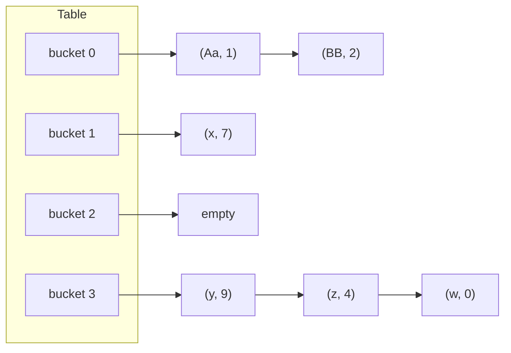

# Hash Tables

## Why It Matters

The hash table is the most common data structure in coding rounds. It turns "have I seen this value?" from an O(n) scan into an expected O(1) lookup, and it sits behind two-sum, anagram grouping, frequency counting, and caches. Interviewers also ask how it works: "Why is `HashMap.get` O(1) on average and O(n) in the worst case?", "What happens if you override `equals` and not `hashCode`?", "How does `HashMap` resize?". On the job, a wrong `hashCode`, a mutable key, or a hash-flooding attack causes real bugs and outages. This page covers the data structure itself. The practical problem-solving patterns are in [hashing and frequency maps](../05-hashing-frequency/README.md). The JDK internals beyond what DSA needs are in `kb/java/04-collections-internals.md`.

## Core Concepts

**Hash table**: a structure that stores key-value pairs in an array of **buckets** (also called slots). A **hash function** maps a key to an integer. The table reduces that integer to a bucket index. To find a key, the table computes its index and looks only in that bucket (or near it).

**Hash function**: a function `h(key)` that returns a fixed-size integer. A good hash function has four properties:

1. **Deterministic**: the same key always gives the same hash within one run of the program.
2. **Consistent with equality**: if two keys are equal, their hashes are equal.
3. **Uniform**: hashes spread over the whole range, so that few keys share a bucket.
4. **Cheap**: computing the hash costs less than the key comparisons that it saves.

**Collision**: two different keys map to the same bucket. Collisions cannot be avoided. If the key space is larger than the table, the pigeonhole principle forces them.

**Load factor** (α): the number of entries divided by the number of buckets, α = n / m. On this page, `n` is the number of entries and `m` is the number of buckets. A higher load factor saves memory and lengthens the work per lookup. In the Java API, the constructor parameter `loadFactor` is the maximum α that the map allows before it resizes.

**Separate chaining**: each bucket holds a collection of the entries that map to it. The textbook form is a linked list. Java's `HashMap` uses a linked list and converts a crowded bucket to a red-black tree.

**Open addressing**: every entry lives in the array itself. If the bucket of a key is taken, the table probes (tries) other buckets in a fixed order until it finds the key or an empty bucket.

**Tombstone**: a marker that replaces a deleted entry in an open-addressing table, so that probe chains stay unbroken.

**Hash flooding**: an attack in which an adversary sends many keys that collide on purpose. Every operation then degrades to the worst case.

### The `hashCode` and `equals` contract

The `Object` javadoc defines the contract for `hashCode`:

1. If an object does not change between calls (in the fields that `equals` uses), `hashCode` returns the same integer each time within one execution of the program.
2. If `a.equals(b)` is true, then `a.hashCode() == b.hashCode()`.
3. If `a.equals(b)` is false, the hash codes may be equal or different. Different hash codes for unequal objects can improve the performance of hash tables, but nothing requires them.

`equals` must be reflexive, symmetric, transitive, consistent, and false for `null`. The rule to remember: **if you override `equals`, override `hashCode` with the same fields.** A class that breaks rule 2 makes `HashMap` and `HashSet` fail: two equal keys land in different buckets, so `get` does not find the entry that `put` stored.

Java defines the hash codes of the common key types:

| Type | `hashCode()` |
|---|---|
| `Integer` | The value itself |
| `Long` | `(int)(value ^ (value >>> 32))` |
| `Boolean` | 1231 for `true`, 1237 for `false` |
| `Double` | Applies the `Long` formula to `Double.doubleToLongBits(value)` |
| `String` | `s[0]*31^(n-1) + s[1]*31^(n-2) + ... + s[n-1]` with `int` overflow, and 0 for the empty string |
| `List` | `31 * h + e.hashCode()` over the elements, starting with `h = 1` |
| `Objects.hash(a, b, c)` | The `Arrays.hashCode` formula over its arguments. It allocates a varargs array |
| `record` | Derived from the components, but the exact formula is not specified |
| Plain `Object` | An identity hash that the JVM assigns. Equal only for the same object |

The `String` and `List` formulas are written into the javadoc of `String.hashCode` and `List.hashCode`, so they are part of the contract. An array has no content-based hash. `int[].hashCode()` is the identity hash, so use `Arrays.hashCode(array)` or convert the array to a `List` or a `String` for a key.

### Which patterns use this

- [Hashing and frequency maps](../05-hashing-frequency/README.md): counting, grouping, two-sum, and prefix-sum-plus-map.
- [Prefix sum](../04-prefix-sum/README.md): a map from prefix value to first index finds subarrays with a given sum.
- [Sliding window](../01-sliding-window/README.md): a frequency map tracks the window contents.
- [Two pointers](../02-two-pointers/README.md): the hash-set alternative to sorting gives O(n) time for O(n) space.
- [Union find](../13-union-find/README.md): a map replaces the parent array when node labels are not small integers.
- [Graph traversal](../11-graph-traversal/README.md): a hash set stores the visited nodes.
- [Trie](../17-trie/README.md): a node can hold its children in a hash map.

## How It Works

### From key to bucket

A table with `m` buckets turns `hashCode` into an index in two steps. Step 1 mixes the bits of the hash. Step 2 reduces it to `0..m-1`.

For a prime `m`, the reduction is `hash mod m`. For a power-of-two `m`, the reduction is `hash & (m - 1)`, which keeps the low bits. The mask costs one instruction. A division costs more. The drawback of the mask: it ignores all high bits. Hash codes that differ only in the high bits all land in the same bucket. This is why Java mixes the bits first (see "Java `HashMap`" below).

Do not use `hash % m` directly with a negative `hash`: in Java the result can be negative. Use `Math.floorMod(hash, m)` or mask off the sign bit with `(hash & 0x7fffffff) % m`. Do not use `Math.abs(hash) % m`: `Math.abs(Integer.MIN_VALUE)` returns `Integer.MIN_VALUE`, which is still negative.

### Separate chaining



- **Insert**: compute the bucket, scan its chain for the key. If found, replace the value. If not, add a node.
- **Lookup**: compute the bucket, scan its chain, and compare keys with `equals` (after a cheap check of the stored hash).
- **Delete**: find the node and unlink it.

The expected chain length is α when the hash is uniform. A lookup costs O(1 + α) on average. If the table keeps α below a constant by resizing, the expected cost is O(1). In the worst case all `n` keys share one bucket and a lookup costs O(n) (for a list chain).

### Open addressing

All entries live in the array. A lookup starts at the home bucket `h(key)` and follows a **probe sequence** until it finds the key or an empty bucket. The three common probe sequences:

| Method | Probe `i` (i = 0, 1, 2, ...) | Strength | Weakness |
|---|---|---|---|
| Linear probing | `(h + i) mod m` | Best cache locality: neighbors are adjacent | **Primary clustering**: runs of full buckets grow and make longer runs |
| Quadratic probing | `(h + c1*i + c2*i²) mod m` | Breaks up primary clusters | **Secondary clustering**: keys with the same home bucket follow the same sequence. It may not reach every bucket |
| Double hashing | `(h1 + i * h2) mod m` | Avoids primary and secondary clustering: keys with the same home bucket have different step sizes | More hash work. `h2` must never be 0 and must be coprime with `m` (for example, odd when `m` is a power of two) |

With quadratic probing, the triangular-number sequence `h + i(i+1)/2` visits every bucket of a power-of-two table. With a prime `m` and the sequence `h + i²`, the first ⌈m/2⌉ probes reach distinct buckets, so an insert succeeds while the table is at most half full. The reason: if i² ≡ j² (mod m) for 0 ≤ i < j < ⌈m/2⌉, then the prime m divides (j − i)(j + i), but both factors lie between 1 and m − 1. Other combinations may skip buckets, and then an insert can fail even though the table has free space.

**Cost of probing.** Knuth's analysis of linear probing, for a uniform hash and load factor α < 1, gives the expected number of probes (approximate formulas for large tables):

- Successful search: about ½ (1 + 1/(1 − α))
- Unsuccessful search (and insert): about ½ (1 + 1/(1 − α)²)

| α | Successful search | Unsuccessful search |
|---|---|---|
| 0.50 | 1.5 | 2.5 |
| 0.75 | 2.5 | 8.5 |
| 0.90 | 5.5 | 50.5 |

The numbers show why open addressing needs a lower maximum load factor than chaining. A common limit for linear probing is 0.5 to 0.75.

**Deletion.** If a delete sets a bucket to empty, a later lookup for a key that was inserted after a collision stops at that empty bucket and reports "absent". The key is still in the table. Two fixes exist:

1. **Tombstone**: mark the bucket as deleted. A lookup continues past a tombstone. An insert may reuse the first tombstone on its path, after it confirms that the key is absent. Tombstones count toward the load, because they lengthen probe chains. A resize (rehash) removes them.
2. **Backward-shift deletion** (linear probing only): after the delete, move later entries of the same cluster back into the gap if their home bucket allows it. This needs no tombstone, but the code is longer.

The Java example below uses tombstones.

### Load factor and resize cost

When α exceeds a limit, the table allocates a larger array (twice as large in `HashMap` and in the code on this page) and reinserts every entry (**rehash**). The entries must be reinserted, not copied, because the index depends on the table size.

A resize costs O(n). It happens when the size reaches the threshold. With doubling, the resizes take place at sizes `n0, 2·n0, 4·n0, ...`, and the total rehash work over `n` inserts is `n0 + 2·n0 + ... ≤ 2n` entries. The amortized cost of one insert is O(1), the same argument as for the dynamic array in [stacks, queues, and deques](03-stacks-queues-deques.md). A single insert can still pause for O(n). A latency-sensitive system can presize the table to avoid it.

### Java `HashMap`

The values below come from the JDK 21 source of `java.util.HashMap` and its javadoc.

| Fact | Value |
|---|---|
| Default initial capacity | 16 (the table is allocated on the first insert) |
| Default load factor | 0.75 |
| Resize threshold | `capacity × loadFactor` (12 for the default). The table doubles when the size exceeds the threshold |
| Table length | Always a power of two. A constructor argument is rounded up |
| Bucket index | `(m - 1) & hash`, where `m` is the table length (the source names it `n`) |
| Bit spreading | `hash = h ^ (h >>> 16)`, where `h = key.hashCode()`. A `null` key has hash 0 |
| Bin treeification | A bin converts from a linked list to a red-black tree when an insert adds the 9th node to a list bin, that is, when the bin becomes longer than `TREEIFY_THRESHOLD = 8` (`putVal` tests `binCount >= TREEIFY_THRESHOLD - 1`, and `binCount` does not count the first node). The conversion happens only if the table length is at least 64 (`MIN_TREEIFY_CAPACITY = 64`). If the table is shorter, `treeifyBin` doubles the table instead |
| Tree back to list | During a resize, a split half with 6 nodes or fewer (`UNTREEIFY_THRESHOLD = 6`) becomes a list. On removal, the code tests the tree shape, not a count: the source comment says the test fires "somewhere between 2 and 6 nodes, depending on tree structure" |
| Keys and values | One `null` key and any number of `null` values are allowed |
| Thread safety | None. Concurrent modification can corrupt the map. Use `ConcurrentHashMap` |
| Iteration cost | Proportional to the capacity plus the size, as the javadoc states. A huge, mostly empty table makes iteration slow |

**Why mix the high bits?** The table uses `hash & (m - 1)`, so it reads only the low `log2(m)` bits. The source comment names the problem: hash sets that vary only in the bits above the mask always collide, and sets of `Float` keys with consecutive whole numbers are a known example. The expression `h ^ (h >>> 16)` folds the upper 16 bits into the lower 16 bits. The cost is one shift and one XOR. The example program below shows keys whose low bits are all zero.

**Resize in `HashMap`.** The table doubles. Each old bucket splits into at most two new buckets. An entry stays at index `j` or moves to index `j + oldCapacity`, depending on one hash bit (`hash & oldCapacity`). The code splits each chain into a "low" and a "high" chain and keeps the relative order. This avoids a full recomputation of indexes.

**Treeification.** Many keys in one bin degrade lookup to O(n). A tree bin gives O(log n) in that bin. The tree orders nodes by hash code first. If two keys have the same hash and the same class that implements `Comparable`, the tree uses `compareTo`. If neither applies, the lookup may have to search both subtrees. So the worst-case O(log n) guarantee holds when keys have distinct hashes or are `Comparable`. The source comment states this condition.

**Why the threshold is 8.** The source comment computes the chance of each bin size under random hash codes and the default load factor: bin sizes follow a Poisson distribution with a mean of about 0.5, and the probability of a bin with 8 nodes is about 0.00000006. So with a reasonable `hashCode`, tree bins almost never appear. They appear when the hash codes are poor or chosen by an attacker. A tree node is about twice the size of a plain node (source comment), which is why the map does not use trees for every bin.

**Resize instead of treeify.** A resize separates keys whose hashes differ in the next bit. It cannot separate keys with identical hash codes. Observed on JDK 21.0.7 with keys that all return the same `hashCode` and a map created with capacity 16: the 9th insert doubled the table to 32, the 10th doubled it to 64, and the 11th converted the bin to a tree. With an initial capacity of 64, the 9th insert converted the bin to a tree.

**Sizing for an expected count.** `new HashMap<>(n)` sets the capacity to a power of two at least `n`, not the number of entries it holds without a resize. With a load factor of 0.75, `new HashMap<>(100)` gets capacity 128 and a threshold of 96, and it resizes at the 97th entry. `HashMap.newHashMap(int numMappings)` (added in JDK 19) computes the capacity from the number of expected mappings and avoids the resize.

**Worst case, restated.** A `get` costs O(1) expected with a good hash and a bounded load factor. The worst case is O(n) if all keys collide and the bin is a list. In JDK 8 and later, a treeified bin makes it O(log n) when keys are `Comparable` or have distinct hashes. A resize makes one `put` O(n), and the amortized cost stays O(1).

### Hash flooding

The hash function of a public algorithm is known to an attacker. For `String`, `"Aa"` and `"BB"` have the same hash (2112), because `65·31 + 97 = 66·31 + 66`. Any concatenation of `"Aa"` and `"BB"` blocks of the same count gives the same hash. Hence 2^k different strings of length 2k collide. An attacker who controls the keys (for example, form parameter names or JSON keys) can fill one bucket. Crosby and Wallach (USENIX Security 2003) described this class of attack, "algorithmic complexity attacks". They attacked the hash tables of Perl, the Squid web proxy, and the Bro intrusion detection system, and they proposed universal hashing (a hash function chosen at random from a family) as the defense. The defenses:

- Treeified bins in Java 8 and later (JEP 180), which cap a bin at O(log n) for `Comparable` keys such as `String`. JEP 180 also removed an earlier alternative hash for `String` keys. `Hashtable` and `WeakHashMap` did not get tree bins.
- A hash function with a random per-process seed. Example: Python uses SipHash with a random key for `str` and `bytes` (PEP 456). Java's `String.hashCode` is fixed by its javadoc, so it cannot be seeded.
- A limit on the number of keys accepted from untrusted input.

## Trade-offs and When to Use

### Chaining versus open addressing

| Criterion | Separate chaining | Open addressing |
|---|---|---|
| Storage | Array of heads plus a node per entry | One array (or parallel arrays) |
| Load factor above 1 | Works: chains grow | Impossible: the table must have a free bucket |
| Behavior at high load | Degrades linearly: expected O(1 + α) | Degrades sharply: about ½ (1 + 1/(1 − α)²) probes for an unsuccessful search with linear probing |
| Cache locality | Poor: nodes are scattered | Good, especially linear probing |
| Deletion | Unlink the node | Needs tombstones or backward shift |
| Memory per entry | Higher: a node object per entry | Lower: no node. The empty buckets cost space |
| Used in Java | `HashMap`, `HashSet`, `LinkedHashMap`, `ConcurrentHashMap` | `IdentityHashMap` (linear probing, from its javadoc) |

### Map and set choices in Java

| Class | Order of iteration | `get` / `put` / `remove` | Null key | Use when |
|---|---|---|---|---|
| `HashMap` | None specified. May change after a resize | O(1) expected | One allowed | The default choice |
| `HashSet` | None specified | O(1) expected | One allowed | Membership only. It uses a `HashMap` inside (from its javadoc) |
| `LinkedHashMap` | Insertion order, or access order if constructed with `accessOrder = true` | O(1) expected | One allowed | You need a stable order, or an LRU cache with `removeEldestEntry` |
| `TreeMap` | Sorted by key | O(log n) | Not with natural ordering | You need sorted keys, `floorKey`, `ceilingKey`, `subMap`, or range queries. It is a red-black tree (see [trees and balanced BSTs](05-trees-and-balanced-bsts.md)) |
| `Hashtable` | None | O(1) expected | Not allowed | Legacy and synchronized. Do not use in new code |
| `ConcurrentHashMap` | None | O(1) expected | Not allowed | Concurrent access |
| `EnumMap` | Enum order | O(1) | No | Keys are one enum type |
| `int[]` or `boolean[]` as a direct-address table | Index order | O(1) worst case | Not applicable | Keys are small integers in a known range. This is faster and smaller than a map |

`LinkedHashMap` is a `HashMap` plus a doubly linked list that runs through the entries, so it keeps the O(1) cost and a deterministic order. For an LRU cache, see the LLD case study [LRU and LFU cache](../../lld/case-studies/02-lru-and-lfu-cache/README.md).

**Recommendation:** use a plain array when the key range is small (for example, 26 letters or values 0 to 10^5). Use `HashMap` or `HashSet` when keys are arbitrary. Use `TreeMap` only when an ordering operation is required, because it costs O(log n) per operation.

### When a hash table is the wrong tool

- You need the smallest, largest, or next key: use a `TreeMap` or a heap.
- You need range queries: use a sorted structure or a tree.
- The key set is dense integers in a small range: use an array.
- The worst case must be bounded and the keys come from an attacker: use a tree-based map.

## Java Example

The first program is a hash map with open addressing, linear probing, tombstones, and a rehash. It spreads the hash bits as `HashMap` does. It keeps the load (live entries plus tombstones) at or below 0.5.

```java
public class OpenMap<K, V> {
    private static final byte EMPTY = 0, LIVE = 1, TOMBSTONE = 2;

    private K[] keys;
    private V[] values;
    private byte[] state;
    private int size = 0; // live entries
    private int used = 0; // live entries plus tombstones

    @SuppressWarnings("unchecked")
    public OpenMap() {
        keys = (K[]) new Object[8];
        values = (V[]) new Object[8];
        state = new byte[8];
    }

    public int size() { return size; }
    public int capacity() { return state.length; }

    private static int spread(Object key) {
        int h = key.hashCode();
        return h ^ (h >>> 16);
    }

    // Returns the slot of the key, or -1 if the key is absent.
    private int find(Object key) {
        int mask = state.length - 1;
        int i = spread(key) & mask;
        while (state[i] != EMPTY) {                    // stop only at EMPTY
            if (state[i] == LIVE && keys[i].equals(key)) return i;
            i = (i + 1) & mask;                        // linear probing
        }
        return -1;
    }

    public V get(K key) {
        int i = find(key);
        return i < 0 ? null : values[i];
    }

    public boolean containsKey(K key) { return find(key) >= 0; }

    public V put(K key, V value) {
        int found = find(key);
        if (found >= 0) {
            V old = values[found];
            values[found] = value;
            return old;
        }
        // Tombstones count toward the load, because they lengthen probe chains.
        if ((used + 1) * 2 > state.length) rehash();
        int mask = state.length - 1;
        int i = spread(key) & mask;
        while (state[i] == LIVE) i = (i + 1) & mask;   // reuse the first free or dead slot
        if (state[i] == EMPTY) used++;
        keys[i] = key;
        values[i] = value;
        state[i] = LIVE;
        size++;
        return null;
    }

    public V remove(K key) {
        int i = find(key);
        if (i < 0) return null;
        V old = values[i];
        keys[i] = null;
        values[i] = null;
        state[i] = TOMBSTONE; // not EMPTY: later keys in the chain must stay reachable
        size--;
        return old;
    }

    // Reinserts live entries into a table that is twice as large, or the same size
    // if tombstones caused the load. This also removes all tombstones.
    @SuppressWarnings("unchecked")
    private void rehash() {
        K[] oldKeys = keys;
        V[] oldValues = values;
        byte[] oldState = state;
        int newCap = (size + 1) * 4 > oldState.length ? oldState.length * 2 : oldState.length;
        keys = (K[]) new Object[newCap];
        values = (V[]) new Object[newCap];
        state = new byte[newCap];
        size = 0;
        used = 0;
        for (int i = 0; i < oldState.length; i++) {
            if (oldState[i] == LIVE) put(oldKeys[i], oldValues[i]);
        }
    }

    public static void main(String[] args) {
        OpenMap<String, Integer> map = new OpenMap<>();
        // "Aa" and "BB" have the same hashCode, so they collide on purpose.
        map.put("Aa", 1);
        map.put("BB", 2);
        map.put("C#", 3);
        System.out.println("same hash: " + "Aa".hashCode() + " " + "BB".hashCode());
        System.out.println("get BB = " + map.get("BB"));

        // Remove the first key of a probe chain. BB must stay reachable.
        map.remove("Aa");
        System.out.println("after remove Aa: get BB = " + map.get("BB")
                + ", containsKey Aa = " + map.containsKey("Aa"));

        // Growth: 20 more keys force several rehashes.
        for (int i = 0; i < 20; i++) map.put("k" + i, i);
        System.out.println("size=" + map.size() + " capacity=" + map.capacity());
        System.out.println("get k7 = " + map.get("k7") + ", get missing = " + map.get("zz"));

        // Update returns the old value.
        System.out.println("put BB again returns " + map.put("BB", 22));
    }
}
```

<!-- expected-output -->
```text
same hash: 2112 2112
get BB = 2
after remove Aa: get BB = 2, containsKey Aa = false
size=22 capacity=64
get k7 = 7, get missing = null
put BB again returns 2
```

How to read the code:

- `find` stops at an `EMPTY` bucket, never at a `TOMBSTONE`. This is the rule that keeps `BB` reachable after `Aa` is removed.
- `put` calls `find` first. If the key exists, it replaces the value. If not, it inserts at the first non-`LIVE` bucket on the probe path. That bucket is a tombstone or an empty bucket. Reusing a tombstone keeps `used` unchanged.
- `rehash` doubles the table if live entries would fill more than a quarter of the current size, and keeps the size if tombstones caused the load. Both paths clear all tombstones. The recursive call to `put` inside `rehash` is safe, because the new table is large enough.
- The capacity is a power of two, so `& mask` replaces the modulo.
- Time: `get`, `put`, and `remove` are expected O(1) at a load factor of at most 0.5, and `put` is amortized O(1) because of the rehash argument above. The worst case is O(n) when all keys collide.

The second program shows why `HashMap` spreads the high bits. All four hash codes below have zero low bits, so with a table of 16 buckets they all land in bucket 0, unless the code folds the high bits in.

```java
public class SpreadDemo {
    static int spread(int h) { return h ^ (h >>> 16); }

    public static void main(String[] args) {
        int mask = 16 - 1; // table of 16 buckets
        int[] hashes = {0x10000, 0x20000, 0x30000, 0x40000};
        for (int h : hashes) {
            System.out.println("hash=0x" + Integer.toHexString(h)
                    + " plain index=" + (h & mask)
                    + " spread index=" + (spread(h) & mask));
        }
    }
}
```

<!-- expected-output -->
```text
hash=0x10000 plain index=0 spread index=1
hash=0x20000 plain index=0 spread index=2
hash=0x30000 plain index=0 spread index=3
hash=0x40000 plain index=0 spread index=4
```

The third program shows a mutable key that breaks a `HashMap`, a set of strings with one hash code, and `HashMap.newHashMap` (JDK 19 and later).

```java
import java.util.HashMap;
import java.util.HashSet;
import java.util.Map;
import java.util.Set;

public class KeyBugs {
    static class MutableKey {
        int id;
        MutableKey(int id) { this.id = id; }
        @Override public boolean equals(Object o) {
            return o instanceof MutableKey m && m.id == id;
        }
        @Override public int hashCode() { return Integer.hashCode(id); }
    }

    public static void main(String[] args) {
        // Bug 1: a key changes after insertion, so its hash changes.
        Map<MutableKey, String> map = new HashMap<>();
        MutableKey key = new MutableKey(1);
        map.put(key, "value");
        key.id = 2;
        System.out.println("get after mutation: " + map.get(key));
        System.out.println("get with an equal-to-old key: " + map.get(new MutableKey(1)));
        System.out.println("size still: " + map.size());
        // Only an iterator can reach the lost entry.
        var it = map.entrySet().iterator();
        it.next();
        it.remove();
        System.out.println("size after Iterator.remove: " + map.size());

        // Strings that share one hashCode: every mix of "Aa" and "BB" collides.
        String[] words = {"AaAa", "AaBB", "BBAa", "BBBB"};
        Set<Integer> hashes = new HashSet<>();
        for (String w : words) hashes.add(w.hashCode());
        System.out.println("distinct hash codes among 4 strings: " + hashes.size());

        // Sizing for an expected number of entries (JDK 19 and later).
        Map<Integer, Integer> sized = HashMap.newHashMap(100);
        sized.put(1, 1);
        System.out.println("sized map ok: " + sized.size());
    }
}
```

<!-- expected-output -->
```text
get after mutation: null
get with an equal-to-old key: null
size still: 1
size after Iterator.remove: 0
distinct hash codes among 4 strings: 1
sized map ok: 1
```

The entry stays in the map under its old hash, so `get` with the changed key looks in the wrong bucket. A lookup with a new `MutableKey(1)` finds the right bucket, but `equals` fails, because the stored key now has `id` 2. No `get` or `remove` call can reach the entry. Only an iterator over the map can remove it, so in practice it stays until the map is discarded (a memory leak). Use immutable keys: `String`, boxed numbers, records of immutable components, or `List.of(...)`.

## Interview Angle

### Questions

??? question "Why is `HashMap.get` O(1) on average, and when is it not?"

    The map computes `hash(key) & (m - 1)`, where `m` is the table length, to find a bucket in O(1) and then compares the key with the few entries in that bucket. The table keeps the load factor at most 0.75 by doubling, so with a well-distributed hash the expected number of entries in a bucket is a small constant. Therefore the expected cost is O(1).

    The cost is not O(1) in three cases. First, if many keys have the same hash, the bin holds many entries. A list bin costs O(n). Since JDK 8, a bin with more than 8 nodes in a table of 64 or more buckets becomes a red-black tree, so the cost is O(log n) if keys are `Comparable` or have distinct hashes. A poor `hashCode` (for example, one that returns a constant) is the common cause in practice; an attacker who chooses the keys is the other. Second, a `put` that triggers a resize costs O(n), but the amortized cost is O(1). Third, an expensive `hashCode` or `equals` (for example, a long string key) adds its own cost to every operation. A `String` caches its hash, so the hash cost is paid once per string object.

??? question "What is the contract between `equals` and `hashCode`?"

    If `a.equals(b)` is true, then `a.hashCode() == b.hashCode()`. The hash code must stay the same while the fields that `equals` uses do not change. Unequal objects may have equal hash codes. The contract comes from the `Object` javadoc.

    The reason: a hash table finds the bucket from `hashCode` and then calls `equals` inside the bucket. If two equal keys have different hashes, they go to different buckets, and the table treats them as different keys.

??? question "What happens if you override `equals` but not `hashCode`?"

    The class inherits the identity-based `hashCode` from `Object`. Two equal objects then have different hash codes, with near certainty. `map.put(new Point(1, 2), "a")` followed by `map.get(new Point(1, 2))` looks in a different bucket and returns `null`. A `HashSet` can hold two "equal" objects. The failure is silent: no exception occurs. The fix is to override `hashCode` with the same fields as `equals`, for example `Objects.hash(x, y)`, or to use a `record`.

??? question "What happens if a key is mutated after insertion?"

    If the mutation changes the fields that `hashCode` uses, the stored entry stays in the bucket of the old hash. A lookup with the mutated key computes the new hash and looks in another bucket (and, inside `HashMap`, compares the stored hash first). A lookup with a key equal to the old state reaches the right bucket, but `equals` fails against the mutated key. So no `get` or `remove` call can reach the entry; only an iterator can remove it. The result is a silent memory leak and a `size()` that counts an unreachable entry. Use immutable keys. If a key must be mutable, remove it from the map before the change and insert it again after the change.

??? question "Explain separate chaining and open addressing. Which does Java's `HashMap` use?"

    In separate chaining, each bucket holds a list (or a tree) of the entries that map to it. In open addressing, the entries live in the array, and a collision makes the table probe other buckets (linear, quadratic, or double hashing). Java's `HashMap` uses separate chaining, with trees for long chains. `IdentityHashMap` uses linear probing.

    Trade-off: chaining tolerates a load factor above 1 and has simple deletion, but it allocates a node per entry and has poor cache locality. Open addressing has better locality and less memory per entry, but its cost grows like 1/(1 − α)², and it needs tombstones for deletion.

??? question "How does deletion work in an open-addressing table?"

    The table cannot set the bucket to empty, because a probe chain would break: a later key that collided earlier is stored beyond that bucket, and the lookup would stop at the empty bucket. The table writes a tombstone instead. A lookup treats a tombstone as occupied and continues. An insert may reuse a tombstone after it confirms the key is absent. Tombstones count toward the load factor, and a rehash removes them. For linear probing, backward-shift deletion avoids tombstones by moving later entries of the cluster into the gap.

??? question "What are the load factor and the initial capacity of `HashMap`? What happens when the threshold is exceeded?"

    The defaults are an initial capacity of 16 and a load factor of 0.75. The threshold is `capacity × loadFactor`, 12 by default. When the size exceeds the threshold, the table doubles and the entries move to their new buckets. Because the capacity is a power of two, each entry stays at index `j` or moves to `j + oldCapacity`. The resize costs O(n) and gives amortized O(1) per insert. If you know the number of entries, presize the map with `HashMap.newHashMap(n)` (JDK 19 and later) or with capacity `n / 0.75 + 1`, to avoid the repeated resizes.

??? question "Why does `HashMap` XOR the high 16 bits of the hash into the low 16 bits?"

    The table index is `hash & (m - 1)`, which uses only the low bits when the table length `m` is a power of two. Hash codes that differ only in the high bits would collide. The expression `h ^ (h >>> 16)` brings the high bits into the low bits at the cost of one shift and one XOR. The `HashMap` source comment says that this is a trade-off between speed and quality: many hash sets are already well distributed, and trees handle the rest of the collisions.

??? question "When does a `HashMap` bin become a tree, and why?"

    When an insert adds the 9th node to a list bin, that is, makes the bin longer than `TREEIFY_THRESHOLD` (8), and the table has at least 64 buckets (`MIN_TREEIFY_CAPACITY`). With fewer than 64 buckets, the map doubles the table instead, because a larger table spreads keys whose hashes differ in the higher bits. A resize does not help keys with identical hash codes, so after the table reaches 64 buckets, the next such insert converts the bin.

    A tree bin is a red-black tree. It bounds a lookup in that bin to O(log n) when keys have distinct hashes or are `Comparable`. Why 8: the source comment shows that under random hash codes and the default load factor, a bin of 8 nodes has a probability of about 0.00000006, so tree bins appear only with poor hash codes or an attack. A tree node is about twice the size of a normal node, so the map uses trees only for crowded bins.

    Back to a list: during a resize, a split half with 6 nodes or fewer (`UNTREEIFY_THRESHOLD`) becomes a list. On removal, a test of the tree shape decides, which fires between 2 and 6 nodes.

??? question "Compare `HashMap`, `LinkedHashMap`, and `TreeMap`."

    `HashMap` gives O(1) expected operations and no iteration order. `LinkedHashMap` adds a doubly linked list through the entries: O(1) operations and insertion order (or access order, which supports an LRU cache through `removeEldestEntry`). `TreeMap` is a red-black tree: O(log n) operations, keys in sorted order, and navigation methods such as `floorKey`, `ceilingKey`, `headMap`, and `subMap`. Choose `HashMap` by default, `LinkedHashMap` when order matters, and `TreeMap` when you need the order operations. `TreeMap` uses `compareTo` or the comparator for key equality, not `equals`.

??? question "How can an attacker degrade a hash table, and how does Java defend against it?"

    The attacker sends keys with equal hash codes, so that all keys land in one bucket and each operation costs O(n). Inserting n such keys then costs O(n²) in total, In the Crosby and Wallach experiments, crafted packets at dial-up bandwidth made a Bro intrusion detection server drop up to 71% of its traffic after six minutes. With `String` keys this is easy, because the hash formula is public: `"Aa"` and `"BB"` collide, and so does every combination of them of the same length, which gives 2^k colliding strings of length 2k. Crosby and Wallach described the attack in 2003.

    The defense in Java 8 and later is the tree bin (JEP 180), which limits the cost of a crowded bin to O(log n) for `Comparable` keys such as `String`. It does not help keys that collide and are not `Comparable`, and `Hashtable` has no tree bins. Other defenses are a seeded hash function (universal hashing, or SipHash with a random key as in Python), a limit on the number of keys or parameters from untrusted input (for example, the `maxParameterCount` attribute of an Apache Tomcat connector), and a tree-based map for such input.

??? question "Design a hash map from scratch. What do you decide?"

    State the decisions in this order. (1) Storage: an array of buckets with power-of-two length. (2) Hash: `key.hashCode()` with the high bits folded into the low bits. (3) Collision handling: chaining for a simple design, linear probing for locality. State the cost of each. (4) Load factor: 0.75 for chaining, 0.5 for linear probing. (5) Resize: double and rehash, amortized O(1). (6) Deletion: unlink in chaining, tombstones in open addressing. (7) API: `get`, `put`, `remove`, `containsKey`, `size`. (8) Edge cases: `null` keys, update of an existing key, and iteration during modification. Then write the code.

### Follow-up Questions

??? question "Why is the capacity a power of two in `HashMap` when many textbooks use a prime?"

    A power of two lets the table replace the modulo with a bit mask and makes resize split each bucket in two. A prime capacity is less sensitive to a poor hash function, because the modulo mixes all bits. `HashMap` compensates for the power of two with the bit-spreading step.

??? question "Can you iterate a `HashMap` and remove entries at the same time?"

    Not with `map.remove` inside a for-each loop. The iterators are fail-fast: a structural change after the iterator was created makes the next call throw `ConcurrentModificationException` (best effort, not guaranteed). Use `Iterator.remove()`, `map.entrySet().removeIf(...)`, or collect the keys first.

??? question "How would you count the distinct elements of a stream that does not fit in memory?"

    A `HashSet` needs O(distinct) memory. For approximate answers, probabilistic structures use much less memory: a Bloom filter answers membership with a few bits per element and a tunable false-positive rate, and HyperLogLog estimates the distinct count with a fixed memory size that does not grow with the count. For an exact answer, sort on disk or partition the keys by hash into files that each fit in memory. The topic belongs to the system design pages.

??? question "Is `Hashtable` the same as `HashMap`?"

    No. `Hashtable` is a legacy class with synchronized methods and no `null` keys or values. `HashMap` is not synchronized and allows one `null` key. For concurrent access use `ConcurrentHashMap`, whose internals are in `kb/java/04-collections-internals.md`.

### Red Flags

- Saying "`HashMap` is O(1)" with no mention of the average case, the worst case, or the condition on the hash function.
- Overriding `equals` and not `hashCode`, or using `Math.random()` in `hashCode`.
- Using a mutable object as a key.
- Saying that `HashMap` keeps insertion order.
- Using `hashCode` as a unique identifier or as an equality test. Equal hashes do not imply equal keys.
- Calling the worst case "O(log n) always" for `HashMap`, without the `Comparable` condition and the list-bin case.
- Using `array[hash % m]` or `array[Math.abs(hash) % m]` with a possibly negative `hash`.
- Writing a tombstone-free delete in open addressing.

## Common Mistakes

| Mistake | Why it fails | Fix |
|---|---|---|
| Override `equals` only | Equal objects land in different buckets | Override both with the same fields, or use a `record` |
| Mutable key | The entry becomes unreachable after the key changes | Use immutable keys, or remove and reinsert |
| `int[]` as a key | `int[]` uses the identity hash, so equal contents are different keys | Use `List<Integer>`, a `String`, or a record that wraps the data. Never use the array directly |
| `hash % m` with a negative hash | The result can be negative and throw `ArrayIndexOutOfBoundsException`. `Math.abs(hash) % m` fails for `Integer.MIN_VALUE` | `Math.floorMod(hash, m)`, or `hash & (m - 1)` for a power-of-two `m` |
| `map.get(k) + 1` for a missing key | Unboxing `null` throws `NullPointerException` | `map.merge(k, 1, Integer::sum)` or `getOrDefault(k, 0) + 1` |
| Relying on the iteration order of `HashMap` | The order is unspecified and changes after a resize | Use `LinkedHashMap` or `TreeMap`, or sort the keys |
| Modifying a map while iterating over it | `ConcurrentModificationException` | `Iterator.remove`, `removeIf`, or iterate over a copy |
| Using `new HashMap<>(n)` for `n` expected entries | A resize may still happen, because of the 0.75 load factor | `HashMap.newHashMap(n)` (JDK 19 and later) or capacity `n / 0.75 + 1` |
| Hashing a `double` key from a computation | Rounding errors give different keys for numbers that should be equal | Round to a fixed precision and use a `long` key, or use a different structure |
| Marking a deleted bucket EMPTY in open addressing | Later lookups stop early and report absent keys | Use a tombstone |
| Using a hash table for "sorted order" or "nearest key" | A hash table has no order | `TreeMap` or sort the data |
| Writing a custom `hashCode` that returns a constant | All keys collide and the map is O(n) per operation | Combine the fields with `Objects.hash`, or `31 * h + field` |

## Commonly Confused With

| Looks like | Difference | Deciding question |
|---|---|---|
| `HashMap` vs `TreeMap` | Hash table with O(1) expected and no order vs red-black tree with O(log n) and sorted keys | Do you need ordering or range queries? |
| `HashMap` vs `LinkedHashMap` | `LinkedHashMap` also keeps a linked list for iteration order | Do you need a stable iteration order or LRU eviction? |
| `HashMap` vs `Hashtable` vs `ConcurrentHashMap` | Unsynchronized vs fully synchronized (legacy) vs concurrent | Do several threads write? |
| `HashSet` vs `TreeSet` | The same difference as between the two maps | Do you need sorted iteration? |
| `hashCode` vs `equals` | `hashCode` picks the bucket. `equals` confirms the key. Same hash does not mean equal | Which question is it: "where to look" or "is it the same key"? |
| Hash table vs direct-address array | The array uses the key itself as the index, with no collisions | Is the key range small and known? |
| Hash function for tables vs cryptographic hash | A table hash is fast and not collision-resistant. A cryptographic hash is slow and collision-resistant | Does an attacker choose the input and does security matter? |
| Load factor vs capacity | Load factor is entries divided by buckets. Capacity is the bucket count | Which one triggers the resize? The load factor, through the threshold |
| `HashMap` treeification vs `TreeMap` | One bin becomes a tree vs the whole map is a tree | Is only a crowded bin a tree? Then it is `HashMap` |

## Quick Reference Card

- A hash table is an array of buckets plus a hash function. Expected O(1) `get`, `put`, `remove`. Worst case O(n).
- Contract: equal objects must have equal hash codes. Override `hashCode` whenever you override `equals`. Never use a mutable field in `hashCode` of a key.
- Chaining: a list per bucket, expected cost O(1 + α). Open addressing: probe the array. Linear probing is cache-friendly and clusters. Delete with tombstones.
- Resize: double and rehash. Total work over n inserts is at most 2n entries, so amortized O(1).
- Java `HashMap`: capacity 16, load factor 0.75, power-of-two table of length `m`, index `(m - 1) & (h ^ (h >>> 16))`. A list bin becomes a tree when it gets its 9th node and the table has at least 64 buckets; with a shorter table, the map doubles the table instead. A tree bin returns to a list at 6 nodes or fewer in a resize split.
- Order: `HashMap` none, `LinkedHashMap` insertion or access, `TreeMap` sorted with O(log n).
- Flooding: equal-hash keys degrade a table. Trees cap a bin at O(log n) for `Comparable` keys.
- Use an array when keys are small integers. Use `merge(k, 1, Integer::sum)` to count.
- Patterns: [hashing and frequency maps](../05-hashing-frequency/README.md), [prefix sum](../04-prefix-sum/README.md).

## Further Reading

- [`Object.hashCode` javadoc (JDK 21)](https://docs.oracle.com/en/java/javase/21/docs/api/java.base/java/lang/Object.html#hashCode()): the three-rule contract.
- [`HashMap` javadoc (JDK 21)](https://docs.oracle.com/en/java/javase/21/docs/api/java.base/java/util/HashMap.html): initial capacity, load factor, constant-time claim, iteration cost, and `newHashMap`.
- [`HashMap` source (OpenJDK 21)](https://github.com/openjdk/jdk21u/blob/master/src/java.base/share/classes/java/util/HashMap.java): the constants, the `hash` method with its comment, `putVal`, `resize`, and `treeifyBin`.
- [`String.hashCode` javadoc (JDK 21)](https://docs.oracle.com/en/java/javase/21/docs/api/java.base/java/lang/String.html#hashCode()): the polynomial formula.
- [`LinkedHashMap` javadoc (JDK 21)](https://docs.oracle.com/en/java/javase/21/docs/api/java.base/java/util/LinkedHashMap.html): insertion order, access order, and `removeEldestEntry`.
- [`TreeMap` javadoc (JDK 21)](https://docs.oracle.com/en/java/javase/21/docs/api/java.base/java/util/TreeMap.html): red-black tree and the O(log n) guarantee.
- [`IdentityHashMap` javadoc (JDK 21)](https://docs.oracle.com/en/java/javase/21/docs/api/java.base/java/util/IdentityHashMap.html): the linear-probe design.
- Cormen, Leiserson, Rivest, Stein, *Introduction to Algorithms* (CLRS), chapter 11 (hash tables) in both the 3rd and the 4th edition: chaining, open addressing, and universal hashing.
- Knuth, *The Art of Computer Programming*, volume 3, section 6.4: the analysis of linear probing behind the probe counts above.
- [Crosby and Wallach, "Denial of Service via Algorithmic Complexity Attacks", USENIX Security 2003](https://www.usenix.org/conference/12th-usenix-security-symposium/denial-service-algorithmic-complexity-attacks): the original paper on hash flooding, with universal hashing as the proposed defense.
- [JEP 180: Handle Frequent HashMap Collisions with Balanced Trees](https://openjdk.org/jeps/180): why JDK 8 added tree bins to `HashMap` and `LinkedHashMap`, and not to `Hashtable`.
- [PEP 456: Secure and interchangeable hash algorithm](https://peps.python.org/pep-0456/): an example of a runtime that seeds its string hash (SipHash) against flooding.
