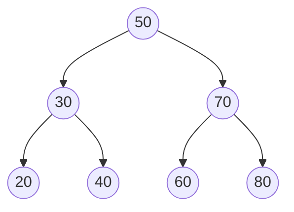
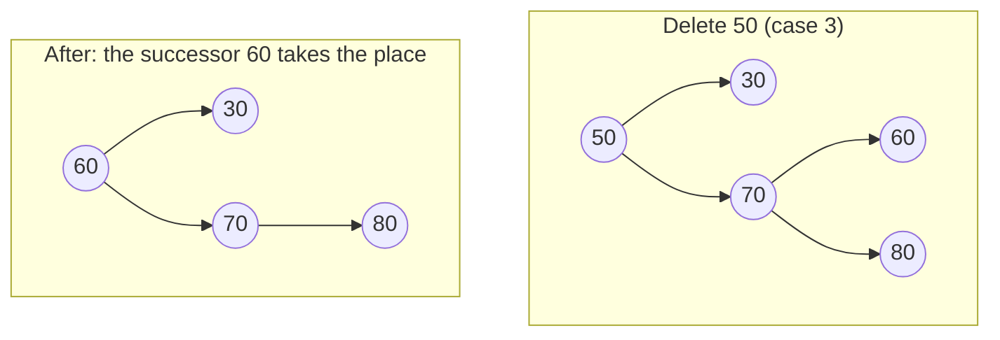

# Trees and Balanced BSTs

## Why It Matters

Trees are the most common non-linear structure in coding rounds, and the binary search tree (BST) is the structure behind every "sorted map" question. Interviewers ask for the traversals, for BST insert and delete, and for validation of a BST. They also ask the theory behind them: "Why can a BST take O(n) time?", "How does an AVL tree differ from a red-black tree?", "Which tree does `TreeMap` use?", "Why do databases use B+ trees and not binary trees?". On the job, `TreeMap` and `TreeSet` give sorted keys with floor, ceiling, and range queries in O(log n). Most indexes in relational databases are B+ trees. This page covers the structures and their cost. The problem-solving patterns for tree questions are in [tree patterns](../10-tree-patterns/README.md). The heap, a different tree with a different rule, is in [heaps](06-heaps.md). The JDK internals beyond what DSA needs are in `kb/java/04-collections-internals.md`.

## Core Concepts

### Tree terms

**Tree**: a connected structure of **nodes** with no cycles, in which one node is the **root** and every other node has exactly one **parent**. A node without children is a **leaf**. A node with at least one child is an **internal node**.

**Binary tree**: a tree in which every node has at most two children, called the **left child** and the **right child**.

**Subtree**: a node together with all its descendants.

**Depth** of a node: the number of edges from the root to the node. The root has depth 0.

**Height** of a node: the number of edges on the longest downward path from the node to a leaf. A leaf has height 0. The **height of a tree** is the height of its root. This page gives the height of an empty tree as −1, so that a single node has height 0. LeetCode problems often count nodes instead of edges, so a single node has depth 1 there. Read the problem statement for the unit.

**Degree** of a node: the number of its children. The degree of a tree is the largest degree of its nodes. A binary tree has degree at most 2.

**Level**: all nodes with the same depth.

The shapes of binary trees have names that interviewers use with exact meaning:

| Shape | Definition | Node count `n` for height `h` |
|---|---|---|
| Full (proper) | Every node has 0 or 2 children | Between `2h + 1` and `2^(h+1) − 1` |
| Perfect | Every internal node has 2 children, and all leaves have the same depth | Exactly `2^(h+1) − 1` |
| Complete | Every level is full, except possibly the last. The last level fills from the left | Between `2^h` and `2^(h+1) − 1` |
| Balanced (height-balanced) | For every node, the heights of its two subtrees differ by at most 1 | The height is O(log n) |
| Degenerate (skewed) | Every internal node has exactly 1 child. The tree is a linked list | `n = h + 1` |

Two facts follow from the table. A perfect tree of height `h` has `2^h` leaves. A tree with `n` nodes has height at least `⌊log₂ n⌋`, and a complete tree reaches that minimum. The word "balanced" has no single meaning: LeetCode 110 uses the height-balanced definition above, and AVL trees enforce it.



This tree is perfect, so it is also full, complete, and balanced. Its height is 2 and it has 7 nodes.

**Binary search tree (BST)**: a binary tree in which every node `x` has a key, and for every node `x`:

- every key in the left subtree of `x` is less than `x.key`;
- every key in the right subtree of `x` is greater than `x.key`.

This definition applies to the whole subtree, not only to the two children. A BST that allows duplicate keys needs a rule for them (for example, "equal keys go to the right"). The code on this page stores distinct keys.

**In-order successor** of a node: the node with the smallest key that is greater than the key of the node. If the node has a right subtree, the successor is the leftmost node of that subtree. If not, the successor is the nearest ancestor for which the node lies in the left subtree.

**Rotation**: a local change of O(1) pointers that moves a node up one level and another node down one level, and keeps the in-order sequence of the keys. Self-balancing trees use rotations to restore their balance rule.

**Self-balancing BST**: a BST that keeps its height O(log n) after every insert and delete, by rotations and by extra data in the nodes. AVL trees and red-black trees are the two classic kinds.

### Traversals

A **traversal** visits every node once. Four orders cover almost every question. Pattern 10 has the full templates, and this table gives the idea and the cost.

| Traversal | Order | Typical use | Time | Extra space |
|---|---|---|---|---|
| Pre-order | node, left, right | Copy or serialize a tree. The root comes first | O(n) | O(h) |
| In-order | left, node, right | Read a BST in sorted order. Validate a BST. K-th smallest | O(n) | O(h) |
| Post-order | left, right, node | Compute a value from the children (height, size, delete a tree) | O(n) | O(h) |
| Level-order (BFS) | level by level, left to right | Shortest path in edges, right-side view, widest level | O(n) | O(w) |

Here `h` is the height and `w` is the largest number of nodes on one level. The recursive forms use one stack frame per level, so their space is O(h). For a degenerate tree `h = n − 1`, and the recursion can overflow the call stack. The size of the stack depends on the platform, the `-Xss` option, and the JIT state. In a test for this page (JDK 21, macOS arm64, default thread stack of 2 MB), a one-line recursive height method threw `StackOverflowError` on a chain of 5 × 10⁴ nodes before JIT compilation, and reached about 6 × 10⁴ levels after it. With `-Xss1m` the limit fell to about 2 × 10⁴ levels. These numbers are approximate. A chain of 10⁴ nodes is borderline, and a chain of 10⁵ nodes overflows a recursive solution on a default thread. The iterative forms use an explicit `ArrayDeque` and cannot overflow the call stack. Morris traversal gives O(1) extra space by temporarily threading the right pointers of the tree, but it changes the tree while it runs. It is a follow-up topic, not a default.

### Which patterns use this

- [Tree patterns](../10-tree-patterns/README.md): traversals, path problems, lowest common ancestor, BST validation, serialization.
- [Divide and conquer](../09-divide-and-conquer/README.md): build a balanced BST from a sorted array by choosing the middle as the root.
- [Recursion and backtracking](../08-recursion-backtracking/README.md): the call tree of a recursion is a tree, and a backtracking search walks it depth first.
- [Graph traversal](../11-graph-traversal/README.md): a tree is a connected graph with no cycles, so BFS and DFS on a tree need no visited set.
- [Trie](../17-trie/README.md): a tree in which each edge is a character.
- [Union find](../13-union-find/README.md): the sets are a forest of trees, and union by rank keeps each tree shallow.
- [Heap and priority queue](../16-heap-priority-queue/README.md): a heap is a complete binary tree stored in an array (see [heaps](06-heaps.md)).

## How It Works

### BST operations

Every BST operation follows one path from the root downward. At each node, the key comparison tells the operation to go left or right. The cost is therefore O(h), where `h` is the height.

**Search**: compare the key with the current node. If equal, stop. If smaller, go left. If larger, go right. If the path reaches `null`, the key is absent.

**Insert**: search for the key. When the search reaches `null`, put a new leaf at that position. The new node never moves existing nodes.

**Minimum and maximum**: follow the left pointers to the end (minimum) or the right pointers to the end (maximum).

**Floor and ceiling**: the floor of `x` is the largest key that is at most `x`. Walk down as in a search. Each time you go right, remember the current node as a candidate. The last candidate is the floor. The ceiling is the mirror image.

**Delete**: find the node, then handle one of three cases.

| Case | The node has | Action |
|---|---|---|
| 1 | No children | Remove it: the parent's pointer becomes `null` |
| 2 | One child | Replace the node with its child: the parent points to the child |
| 3 | Two children | Find the in-order successor (the leftmost node of the right subtree). Copy the successor key into the node. Delete the successor from the right subtree. The successor has no left child, so that delete is case 1 or case 2 |

The in-order **predecessor** (the rightmost node of the left subtree) works in the same way. `TreeMap.deleteEntry` copies the successor into the node in case 3 (see "TreeMap" below).



The successor of 50 is 60, the leftmost node of the right subtree. The tree copies 60 into the root and removes the old node 60, which is a leaf.

### Why a BST degrades to O(n)

The shape of a BST depends on the order of the inserts. If the keys arrive in sorted order, each new key is larger than all earlier keys and goes to the right end. The tree becomes a linked list of height `n − 1`, and search, insert, and delete cost O(n).

If the keys arrive in random order, the expected height is O(log n) (CLRS 3rd edition, section 12.4, "Randomly built binary search trees"). The precise value is about `4.311 · ln n`, which is about `2.99 · log₂ n` (Devroye, 1986). The Java example below inserts 1000 keys in sorted order (height 999) and in a seeded random order (height 26 in the output below, against about 29.8 from `4.311 · ln 1000`).

A plain BST gives no guarantee, so production code uses a **self-balancing** tree. The two classic designs differ in how strictly they hold the balance.

### AVL trees

An AVL tree (Adelson-Velsky and Landis, 1962) stores the height in each node and keeps a strict rule.

**Balance factor** of a node: `height(left subtree) − height(right subtree)`. **AVL rule**: the balance factor of every node is −1, 0, or 1.

After an insert or a delete, the nodes on the path from the changed position up to the root may have a balance factor of +2 or −2. The tree walks back up the path, updates heights, and fixes the lowest unbalanced node `z`. Four cases exist. The case depends on where the extra height sits.

| Case | Where the extra height is | Fix |
|---|---|---|
| Left-left (LL) | In the left subtree of the left child of `z` | One right rotation at `z` |
| Right-right (RR) | In the right subtree of the right child of `z` | One left rotation at `z` |
| Left-right (LR) | In the right subtree of the left child of `z` | Left rotation at the left child, then right rotation at `z` |
| Right-left (RL) | In the left subtree of the right child of `z` | Right rotation at the right child, then left rotation at `z` |

A right rotation at `y` makes the left child `x` the new root of the subtree. `x` keeps its left subtree `A`. The old root `y` becomes the right child of `x`. The right subtree `B` of `x` moves to be the left subtree of `y`.

```text
      y                x
     / \              / \
    x   C    ->      A   y
   / \                  / \
  A   B                B   C
```

The in-order sequence stays `A x B y C` before and after, so the BST order stays valid. A rotation costs O(1).

**Insert versus delete.** After an insert, one rebalancing step (a single or a double rotation) restores the balance of the whole tree. After a delete, a rotation can shorten the subtree, and the imbalance can move up. A delete may need one rotation at each level of the path, which is O(log n) rotations in total. Each step is still O(1), so both operations cost O(log n).

**Height bound.** Let `N(h)` be the smallest number of nodes in an AVL tree of height `h` (in edges). The tree has a root, one subtree of height `h − 1`, and one subtree of height `h − 2` (the smallest allowed). So `N(h) = N(h − 1) + N(h − 2) + 1`, with `N(0) = 1` and `N(1) = 2`. This is the Fibonacci recurrence: `N(h) = F(h + 3) − 1`, where `F(1) = F(2) = 1`. Fibonacci numbers grow as `φ^h` with `φ ≈ 1.618`, so `n ≥ N(h)` gives `h ≤ log_φ n`, which is about `1.44 · log₂ n`. Knuth analyzes the exact bound (TAOCP volume 3, section 6.2.3).

### Red-black trees

A red-black tree gives each node a color, red or black, and keeps five properties (CLRS, chapter 13). CLRS treats `null` pointers as black **NIL** leaves.

1. Every node is red or black.
2. The root is black.
3. Every NIL leaf is black.
4. If a node is red, both its children are black. (No two red nodes are adjacent on a path.)
5. For every node, all simple paths from the node down to the NIL leaves below it contain the same number of black nodes.

The number of black nodes on such a path (not counting the node itself) is the **black-height** of the node.

**Height bound** (CLRS Lemma 13.1): a red-black tree with `n` internal nodes has height at most `2 · log₂(n + 1)`. Proof sketch:

1. A subtree whose root `x` has black-height `bh` contains at least `2^bh − 1` internal nodes. By induction: a NIL leaf has `bh = 0` and `2⁰ − 1 = 0` internal nodes. A node with black-height `bh` has children with black-height `bh` (red child) or `bh − 1` (black child), so each child subtree has at least `2^(bh−1) − 1` internal nodes, and the total is at least `2·(2^(bh−1) − 1) + 1 = 2^bh − 1`.
2. By property 4, at most half the nodes on any root-to-leaf path are red, so `bh ≥ h / 2` for the root, where `h` is the height.
3. Therefore `n ≥ 2^(h/2) − 1`, and so `h ≤ 2 · log₂(n + 1)`.

**Rebalancing.** A new node is red, so only property 4 can fail (if its parent is red). The fix looks at the **uncle** (the sibling of the parent).

| Uncle | Fix | Continue? |
|---|---|---|
| Red | Recolor: parent and uncle become black, the grandparent becomes red | Yes: the grandparent may now have a red parent |
| Black, new node is an inner child | Rotate at the parent so the new node is an outer child | Then apply the next row |
| Black, new node is an outer child | Rotate at the grandparent and swap the colors of the parent and the grandparent | No |

An insert does at most 2 rotations, and a delete at most 3 (CLRS, chapter 13). Recoloring may run up to the root, which is O(log n) steps of O(1). The delete fixup has more cases than the insert fixup, and it is rarely memorized. Interviewers expect the five properties, the height bound, and the idea of recolor and rotate.

### AVL versus red-black

| Point | AVL tree | Red-black tree |
|---|---|---|
| Rule | Subtree heights differ by at most 1 | The five color properties |
| Height bound | About `1.44 · log₂ n` | At most `2 · log₂(n + 1)` |
| Search | Fewer comparisons, because the tree is shallower | More comparisons in the worst case |
| Insert | One rebalancing step: a single or a double rotation, so at most 2 rotations | At most 2 rotations |
| Delete | Up to O(log n) rotations | At most 3 rotations |
| Extra data per node | Height or balance factor (a few bits are enough) | One color bit |

Both give O(log n) worst-case search, insert, and delete. Both need at most 2 rotations for an insert. The difference in rotations is on delete. Recommendation (a rule of thumb, not a measured law): a workload with many more searches than updates favors AVL, and a workload with many updates favors red-black. The JDK javadoc states the red-black choice and does not give a reason.

### `TreeMap` and `TreeSet`

The `TreeMap` javadoc says: "A Red-Black tree based `NavigableMap` implementation." It guarantees O(log n) time for `containsKey`, `get`, `put`, and `remove`, and says that its algorithms adapt those in Cormen, Leiserson, and Rivest. `TreeSet` is "a `NavigableSet` implementation based on a `TreeMap`", with the same O(log n) cost for `add`, `remove`, and `contains`.

The navigation methods follow one path from the root, as the BST operations above do, so each costs O(log n) in the JDK 21 source:

| Method | Result |
|---|---|
| `firstKey()`, `lastKey()` | Smallest and largest key. Throw `NoSuchElementException` if the map is empty |
| `floorKey(k)`, `lowerKey(k)` | Greatest key at most `k`, and greatest key below `k` (or `null`) |
| `ceilingKey(k)`, `higherKey(k)` | Least key at least `k`, and least key above `k` (or `null`) |
| `pollFirstEntry()`, `pollLastEntry()` | Remove and return the smallest and the largest entry |
| `headMap`, `tailMap`, `subMap` | Views of a key range. Iterating a view costs O(log n + number of entries returned) |
| `descendingMap()` | A reverse-order view |

Rules from the javadoc that cause bugs:

- **The comparator defines key equality.** `TreeMap` uses `compareTo` or `compare` only. If a comparator returns 0 for two keys that `equals` calls different, the map treats them as the same key and keeps one. A `TreeSet` ordered by one field of an object silently drops the objects that tie on that field.
- **Null keys.** With natural ordering, `put(null, v)` throws `NullPointerException`. A custom comparator can accept `null`.
- **Snapshots.** The entries that `firstEntry`, `floorEntry`, and the other navigation methods return are snapshots. They do not support `setValue`.
- **No rank queries.** `TreeMap` has no "k-th smallest key" method. Reaching the k-th key by iteration costs O(k). An order-statistic tree (a BST with a subtree size in each node, CLRS 3rd edition section 14.1, section 17.1 in the 4th edition) gives O(log n), and the JDK does not provide one.
- **Not synchronized**, and the iterators are fail-fast.

In the JDK 21 source, `deleteEntry` handles the three delete cases of the BST. If the node has two children, the code copies the successor's key and value into the node and then removes the successor node. If the removed node was black, it calls `fixAfterDeletion`.

### B-trees and B+ trees

A binary tree is a poor fit for data on disk. A node holds one key, so a lookup in 10⁸ keys visits about 27 nodes even in a perfectly balanced tree (`log₂ 10⁸ ≈ 26.6`), and each node can be a separate disk read. A disk or SSD reads a whole **page** (commonly 4 KB to 16 KB, depending on the system) in one operation. A B-tree puts many keys in one node, so that one node fills one page.

**B-tree** (CLRS chapter 18) with **minimum degree** `t ≥ 2`:

- Every node except the root holds between `t − 1` and `2t − 1` keys, in sorted order.
- An internal node with `k` keys has `k + 1` children. The keys separate the key ranges of the children.
- All leaves have the same depth.
- Height `h ≤ log_t((n + 1) / 2)`, so the height is O(log_t n).

An insert goes to a leaf. In one common method, if the leaf is full (`2t − 1` keys), the leaf **splits** around its median key. The median moves up to the parent, and the parent may split in turn. A split on the root makes the tree one level taller. This is the only way the height grows, so all leaves stay at the same depth.

**B+ tree**: a variant that databases use. All records (or pointers to them) live in the leaves. Internal nodes hold only separator keys and child pointers, so they hold more keys per page. The leaves form a linked list in key order. A range query finds the first key in O(log n) page reads and then follows the leaf links. This is why `WHERE x BETWEEN a AND b` and `ORDER BY x` are cheap with an index.

**Example (assumption: approximate numbers).** A page holds 8 KB, and one entry in an internal node needs a key of 8 bytes and a pointer of 8 bytes. A node then holds about 500 entries, ignoring headers. A tree with 3 levels indexes about 500³ = 1.25 × 10⁸ keys, and a tree with 4 levels about 6 × 10¹⁰ keys. A lookup needs 3 or 4 page reads. The top levels stay in memory, so a lookup often needs only one disk read.

The full treatment of indexes, page layout, and the difference between clustered and secondary indexes is in `kb/databases/03-indexing.md`. The JDK has no B-tree class.

## Trade-offs and When to Use

| Structure | Search | Insert | Delete | Ordered iteration | Range query | Worst case guaranteed? |
|---|---|---|---|---|---|---|
| Sorted array + binary search | O(log n) | O(n) | O(n) | O(n) | O(log n + k) | Yes |
| Hash table | O(1) expected | O(1) expected | O(1) expected | No order | Not supported | No (O(n) worst) |
| Plain BST | O(h) | O(h) | O(h) | O(n) | O(h + k) | No (`h` up to `n − 1`) |
| AVL tree | O(log n) | O(log n) | O(log n) | O(n) | O(log n + k) | Yes |
| Red-black tree (`TreeMap`) | O(log n) | O(log n) | O(log n) | O(n) | O(log n + k) | Yes |
| B+ tree | O(log_t n) page reads | O(log_t n) | O(log_t n) | O(n) | O(log_t n + k) | Yes |
| Skip list (`ConcurrentSkipListMap`) | O(log n) expected | O(log n) expected | O(log n) expected | O(n) | O(log n + k) | No (randomized) |

Here `k` is the number of keys in the range. The skip list is in the table because the JDK uses it for the sorted concurrent map. Its structure is outside this page.

Choose by the question that the code asks:

- Only "is the key present?" or "what is the value?": use a hash table (see [hash tables](04-hash-tables.md)).
- Sorted order, floor, ceiling, nearest key, or a range: use `TreeMap` or `TreeSet`.
- Only the smallest or the largest element, again and again: use a heap (see [heaps](06-heaps.md)). A heap is simpler and faster than a balanced BST for that job.
- The data is static and sorted: a sorted array with binary search has the best constants and the smallest memory.
- The data lives on disk: use a B+ tree (through a database).
- Rank queries (the k-th smallest, the number of keys below `x`) with updates: augment a balanced BST with subtree sizes, or use a Fenwick tree if the keys are small integers.

## Java Example

The first program is a BST with search, insert, delete (all three cases), floor, an iterative in-order traversal, and an iterative height. It shows the O(n) height for sorted input.

```java
import java.util.ArrayDeque;
import java.util.ArrayList;
import java.util.Collections;
import java.util.Deque;
import java.util.List;
import java.util.Random;

public class Bst {
    static class Node {
        int key;
        Node left, right;
        Node(int key) { this.key = key; }
    }

    private Node root;
    private int size;

    public int size() { return size; }

    /** Search: O(h). */
    public boolean contains(int key) {
        Node cur = root;
        while (cur != null) {
            if (key == cur.key) return true;
            cur = key < cur.key ? cur.left : cur.right;
        }
        return false;
    }

    /** Insert: O(h). Returns false if the key is already present. */
    public boolean insert(int key) {
        if (root == null) {
            root = new Node(key);
            size++;
            return true;
        }
        Node cur = root;
        while (true) {
            if (key == cur.key) return false;
            if (key < cur.key) {
                if (cur.left == null) { cur.left = new Node(key); break; }
                cur = cur.left;
            } else {
                if (cur.right == null) { cur.right = new Node(key); break; }
                cur = cur.right;
            }
        }
        size++;
        return true;
    }

    /** Delete: O(h). Returns false if the key is absent. */
    public boolean delete(int key) {
        int before = size;
        root = delete(root, key);
        return size < before;
    }

    private Node delete(Node node, int key) {
        if (node == null) return null;               // key not found
        if (key < node.key) {
            node.left = delete(node.left, key);
        } else if (key > node.key) {
            node.right = delete(node.right, key);
        } else {
            if (node.left == null) { size--; return node.right; }   // cases 1 and 2
            if (node.right == null) { size--; return node.left; }   // case 2
            Node successor = node.right;                             // case 3
            while (successor.left != null) successor = successor.left;
            node.key = successor.key;                                // copy the successor key
            node.right = delete(node.right, successor.key);          // remove the successor
        }
        return node;
    }

    /** Largest key that is less than or equal to the argument, or null. */
    public Integer floor(int key) {
        Integer best = null;
        Node cur = root;
        while (cur != null) {
            if (key == cur.key) return cur.key;
            if (key < cur.key) {
                cur = cur.left;
            } else {
                best = cur.key;
                cur = cur.right;
            }
        }
        return best;
    }

    /** In-order traversal without recursion. O(n) time, O(h) space. */
    public List<Integer> inOrder() {
        List<Integer> out = new ArrayList<>();
        Deque<Node> stack = new ArrayDeque<>();
        Node cur = root;
        while (cur != null || !stack.isEmpty()) {
            while (cur != null) {
                stack.push(cur);
                cur = cur.left;
            }
            cur = stack.pop();
            out.add(cur.key);
            cur = cur.right;
        }
        return out;
    }

    /** Height in edges. An empty tree has height -1. Iterative, so a skewed tree is safe. */
    public int height() {
        if (root == null) return -1;
        int levels = 0;
        Deque<Node> level = new ArrayDeque<>();
        level.add(root);
        while (!level.isEmpty()) {
            levels++;
            for (int i = level.size(); i > 0; i--) {
                Node n = level.poll();
                if (n.left != null) level.add(n.left);
                if (n.right != null) level.add(n.right);
            }
        }
        return levels - 1;
    }

    public static void main(String[] args) {
        Bst t = new Bst();
        for (int k : new int[] {50, 30, 70, 20, 40, 60, 80, 35, 45}) t.insert(k);
        System.out.println("in-order: " + t.inOrder());
        System.out.println("floor(44) = " + t.floor(44) + ", floor(10) = " + t.floor(10));

        t.delete(20);   // case 1: leaf
        System.out.println("delete 20 (leaf):       " + t.inOrder());
        t.delete(30);   // case 2: one child (40 is the only child left)
        System.out.println("delete 30 (one child):  " + t.inOrder());
        t.delete(50);   // case 3: two children, the successor 60 replaces it
        System.out.println("delete 50 (two children): " + t.inOrder());
        System.out.println("size = " + t.size() + ", contains(35) = " + t.contains(35));

        int n = 1000;
        Bst sorted = new Bst();
        for (int i = 1; i <= n; i++) sorted.insert(i);
        System.out.println("sorted insert of " + n + " keys: height " + sorted.height());

        List<Integer> keys = new ArrayList<>();
        for (int i = 1; i <= n; i++) keys.add(i);
        Collections.shuffle(keys, new Random(42));
        Bst shuffled = new Bst();
        for (int k : keys) shuffled.insert(k);
        System.out.println("shuffled insert of " + n + " keys: height " + shuffled.height());
    }
}
```

<!-- expected-output -->
```text
in-order: [20, 30, 35, 40, 45, 50, 60, 70, 80]
floor(44) = 40, floor(10) = null
delete 20 (leaf):       [30, 35, 40, 45, 50, 60, 70, 80]
delete 30 (one child):  [35, 40, 45, 50, 60, 70, 80]
delete 50 (two children): [35, 40, 45, 60, 70, 80]
size = 6, contains(35) = true
sorted insert of 1000 keys: height 999
shuffled insert of 1000 keys: height 26
```

The recursive `delete` method has one stack frame per level, so a degenerate tree of very many nodes can overflow the call stack. `insert`, `contains`, `floor`, `inOrder`, and `height` use loops.

The second program is an AVL tree with insert, delete, and the four rotation cases. The `rebalance` method handles all four cases with the balance factor of the node and of its heavy child. The `isValid` method checks the BST order, the stored heights, and the AVL rule at every node.

```java
public class AvlTree {
    static class Node {
        int key;
        int height = 0;          // height in edges: a leaf has height 0
        Node left, right;
        Node(int key) { this.key = key; }
    }

    private Node root;
    private int rotations = 0;

    private static int h(Node n) { return n == null ? -1 : n.height; }

    private static void update(Node n) { n.height = 1 + Math.max(h(n.left), h(n.right)); }

    private static int balance(Node n) { return h(n.left) - h(n.right); }

    private Node rotateRight(Node y) {      //      y            x
        Node x = y.left;                    //     / \          / \
        y.left = x.right;                   //    x   C   ->   A   y
        x.right = y;                        //   / \              / \
        update(y);                          //  A   B            B   C
        update(x);
        rotations++;
        return x;
    }

    private Node rotateLeft(Node x) {       // mirror image of rotateRight
        Node y = x.right;
        x.right = y.left;
        y.left = x;
        update(x);
        update(y);
        rotations++;
        return y;
    }

    private Node rebalance(Node n) {
        update(n);
        int b = balance(n);
        if (b > 1) {                                         // left side is too tall
            if (balance(n.left) < 0) n.left = rotateLeft(n.left);   // left-right case
            return rotateRight(n);                                   // left-left case
        }
        if (b < -1) {                                        // right side is too tall
            if (balance(n.right) > 0) n.right = rotateRight(n.right); // right-left case
            return rotateLeft(n);                                     // right-right case
        }
        return n;
    }

    public void insert(int key) { root = insert(root, key); }

    private Node insert(Node n, int key) {
        if (n == null) return new Node(key);
        if (key < n.key) n.left = insert(n.left, key);
        else if (key > n.key) n.right = insert(n.right, key);
        else return n;                                       // duplicate: ignore
        return rebalance(n);
    }

    public void delete(int key) { root = delete(root, key); }

    private Node delete(Node n, int key) {
        if (n == null) return null;
        if (key < n.key) {
            n.left = delete(n.left, key);
        } else if (key > n.key) {
            n.right = delete(n.right, key);
        } else {
            if (n.left == null) return n.right;
            if (n.right == null) return n.left;
            Node s = n.right;
            while (s.left != null) s = s.left;
            n.key = s.key;
            n.right = delete(n.right, s.key);
        }
        return rebalance(n);
    }

    public int height() { return h(root); }
    public int rotations() { return rotations; }

    /** Checks the BST order, the stored heights, and |balance| <= 1 at every node. */
    public boolean isValid() { return check(root, Long.MIN_VALUE, Long.MAX_VALUE) >= -1; }

    private int check(Node n, long lo, long hi) {
        if (n == null) return -1;
        if (n.key <= lo || n.key >= hi) return -100;
        int l = check(n.left, lo, n.key), r = check(n.right, n.key, hi);
        if (l < -1 || r < -1 || Math.abs(l - r) > 1 || n.height != 1 + Math.max(l, r)) return -100;
        return n.height;
    }

    public static void main(String[] args) {
        AvlTree t = new AvlTree();
        for (int i = 1; i <= 1023; i++) t.insert(i);
        System.out.println("sorted insert of 1023 keys: height " + t.height()
                + ", rotations " + t.rotations() + ", valid " + t.isValid());

        for (int i = 1; i <= 1023; i += 2) t.delete(i);
        System.out.println("after deleting the odd keys: height " + t.height()
                + ", valid " + t.isValid());

        AvlTree small = new AvlTree();
        small.insert(30);
        small.insert(20);
        small.insert(10);                                    // left-left case
        System.out.println("insert 30, 20, 10: height " + small.height()
                + ", rotations " + small.rotations());
    }
}
```

<!-- expected-output -->
```text
sorted insert of 1023 keys: height 9, rotations 1013, valid true
after deleting the odd keys: height 8, valid true
insert 30, 20, 10: height 1, rotations 1
```

Sorted input gives a tree of height 9 for 1023 keys, the perfect tree (`2^10 − 1 = 1023`). The same input gives height 1022 in a plain BST.

## Interview Angle

### Questions

??? question "What is a binary search tree, and what are the costs of its operations?"

    A BST is a binary tree in which, for every node, all keys in the left subtree are smaller and all keys in the right subtree are larger. Search, insert, and delete each follow one root-to-leaf path, so they cost O(h), where `h` is the height. An in-order traversal visits the keys in sorted order in O(n).

    The height depends on the insertion order. For random order, the expected height is O(log n). For sorted order, the tree is a linked list with `h = n − 1`, and every operation costs O(n). A self-balancing BST removes that worst case.

??? question "How do you delete a node from a BST?"

    Find the node, then use one of three cases. If the node is a leaf, remove it. If it has one child, replace it with that child. If it has two children, find its in-order successor (the leftmost node of the right subtree), copy the successor's key into the node, and delete the successor from the right subtree. The successor has no left child, so the second delete is a case 1 or case 2. The predecessor works in the same way.

    The cost is O(h): O(h) to find the node and O(h) to find and remove the successor. The common bug in code is case 3 where the code deletes the successor and forgets to link its right child to the successor's parent.

??? question "Why can a BST take O(n) time, and how do you prevent it?"

    The shape of a BST depends on the insertion order, and nothing in the insert code restores balance. Sorted input puts every new key at the right end, so the tree becomes a list of height `n − 1`.

    Two fixes exist. First, use a self-balancing tree. It rotates nodes after each update and keeps the height at O(log n) in the worst case. AVL trees and red-black trees are the classic choices. Second, build the tree from known data in a balanced way: sort the keys and take the middle one as the root, then recurse on each half. That gives height ⌊log₂ n⌋ for a static set. Shuffling the input before inserting also gives expected O(log n), but it gives no worst-case guarantee and does not help with later updates.

??? question "How do you validate that a binary tree is a BST?"

    Pass an open interval down the tree. The root may have any key. When the code goes left from a node with key `k`, the upper bound becomes `k`. When it goes right, the lower bound becomes `k`. A node is valid if its key is strictly between the bounds. Each node is visited once, so the time is O(n) and the space is O(h).

    The common wrong answer compares each node only with its two children. That accepts a tree where a node in the left subtree is larger than the root. A second correct approach is an in-order traversal that checks that each key is greater than the previous key. Use `long` bounds (or `null` bounds), because a node can hold `Integer.MIN_VALUE` or `Integer.MAX_VALUE`.

??? question "What is the difference between an AVL tree and a red-black tree?"

    Both are self-balancing BSTs with O(log n) worst-case search, insert, and delete. The AVL tree keeps a strict rule: the subtree heights of every node differ by at most 1. Its height is at most about 1.44 · log₂ n. The red-black tree colors nodes and keeps five properties that bound the longest root-to-leaf path to at most twice the shortest, so its height is at most 2 · log₂(n + 1).

    The AVL tree is shallower, so searches use fewer comparisons. On insert, both need at most 2 rotations. On delete, the red-black tree needs at most 3 rotations, while an AVL delete can rotate at each level of the path, which is O(log n) rotations. A read-heavy workload favors AVL, and a write-heavy workload favors red-black. `TreeMap` is a red-black tree.

??? question "Which tree does `TreeMap` use, and what does it give you that `HashMap` does not?"

    `TreeMap` is a red-black tree (stated in its javadoc). It guarantees O(log n) for `get`, `put`, `containsKey`, and `remove`, and it keeps keys sorted. That adds `firstKey`, `lastKey`, `floorKey`, `ceilingKey`, `higherKey`, `lowerKey`, `pollFirstEntry`, and range views (`headMap`, `tailMap`, `subMap`).

    `HashMap` has O(1) expected cost and no order. If the code needs only lookups, `HashMap` is faster. If the code needs the nearest key, a sorted iteration, or a range, use `TreeMap`. Note that `TreeMap` uses the comparator, not `equals`, to decide that two keys are the same.

??? question "Why do databases use B+ trees and not binary search trees?"

    A database reads from disk in pages of a few kilobytes, and a page read costs far more than a key comparison. A binary tree has one key per node, so a lookup in 10⁸ keys takes about 27 node visits, and each can be a disk read. A B+ tree fills each node with hundreds of keys. With a fanout of about 500, three levels index about 1.25 × 10⁸ keys and four levels about 6 × 10¹⁰ keys, so a lookup reads three or four pages, and the top levels stay in memory.

    The B+ tree stores records only in the leaves and links the leaves in key order, so a range scan reads consecutive leaves. All leaves have the same depth, so every lookup has the same cost. Node splits and merges keep the tree balanced on insert and delete.

??? question "What are the four AVL rotation cases?"

    The lowest node `z` with a balance factor of +2 or −2 decides the case. Left-left (the extra height is in the left subtree of the left child): one right rotation at `z`. Right-right: one left rotation at `z`. Left-right (the extra height is in the right subtree of the left child): a left rotation at the left child, then a right rotation at `z`. Right-left: a right rotation at the right child, then a left rotation at `z`.

    The code selects the case from the signs of the balance factor of `z` and of its taller child. A rotation changes O(1) pointers and keeps the in-order sequence, so the BST order stays valid.

??? question "What is the difference between depth and height, and between a complete, a full, and a perfect binary tree?"

    Depth counts edges from the root down to a node. Height counts edges from a node down to its deepest leaf. The height of a tree is the height of the root.

    A full tree has nodes with 0 or 2 children. A perfect tree is full and has all leaves at the same depth, so it has `2^(h+1) − 1` nodes. A complete tree has every level full except the last, which fills from the left. A heap uses a complete tree because its shape needs no pointers (see [heaps](06-heaps.md)). Say which unit you use for height (edges or nodes), because LeetCode problems differ.

??? question "What are the time and space costs of the tree traversals?"

    Each traversal visits each node once, so the time is O(n). The extra space of the depth-first orders (pre-order, in-order, post-order) is O(h), for the recursion stack or an explicit stack. O(h) is O(log n) for a balanced tree and O(n) for a degenerate tree. Level-order uses a queue of up to one level, so its space is O(w), where `w` is the maximum width. For a perfect tree the last level holds about n/2 nodes, so `w` is O(n).

    Morris traversal reaches O(1) extra space by threading the tree temporarily. The iterative forms avoid call-stack overflow on deep trees.

### Follow-up Questions

??? question "How do you find the in-order successor of a node when the nodes have no parent pointer?"

    Search from the root for the node and track the candidate. Each time the search goes left from a node, that node is a candidate successor. If the search finds the target and the target has a right subtree, the successor is the leftmost node of that subtree. If not, the successor is the last candidate. The cost is O(h).

??? question "How would you find the k-th smallest key in a BST that has frequent inserts and deletes?"

    An in-order traversal costs O(k + h) per query. To answer in O(h), store the size of the subtree in each node and update it on insert, delete, and rotation. At a node, if the left subtree size is `L`: if `k ≤ L`, go left. If `k = L + 1`, the node is the answer. Otherwise go right with `k − L − 1`. This is an order-statistic tree (CLRS 3rd edition section 14.1, section 17.1 in the 4th edition). With an AVL or a red-black tree, the height stays O(log n).

??? question "Why do rotations keep the BST property?"

    A rotation changes only the parent-child links among two nodes and three subtrees. The in-order sequence of the subtrees and the two nodes does not change (`A x B y C` in the right-rotation diagram). The BST property is equivalent to "the in-order sequence is sorted", so the property holds after the rotation.

??? question "How do you build a balanced BST from a sorted array in O(n)?"

    Take the middle element as the root, build the left subtree from the left half, and build the right subtree from the right half. Each element becomes a node once, so the time is O(n), and the recursion depth is O(log n). The height is ⌊log₂ n⌋. This is LeetCode 108 and an application of [divide and conquer](../09-divide-and-conquer/README.md).

??? question "What is the height of a randomly built BST, and does the average depth differ from the height?"

    For `n` distinct keys inserted in uniformly random order, the expected height is O(log n) (CLRS 3rd edition section 12.4). The precise expected height is about `4.311 · ln n`, which is about `2.99 · log₂ n` (Devroye, 1986). The average node depth is about `2 ln n`, which is about `1.39 · log₂ n` (Knuth, TAOCP volume 3, section 6.2.2). So the deepest node is about twice as deep as the average node. For 1000 keys, the expected height is near 30 and the average depth is about 11. The exact average depth is `2(1 + 1/n) · H_n − 4`, where `H_n` is the n-th harmonic number, and `2 ln n` is its leading term. The result covers a tree built by inserts only. Random deletes mixed with inserts change the analysis.

### Red Flags

- Saying "BST operations are O(log n)" with no condition on the balance of the tree.
- Validating a BST by comparing a node only with its children.
- Describing a BST delete without the case of a node with two children.
- Saying that a red-black tree is "perfectly balanced", or that AVL and red-black trees have the same height bound.
- Saying that a heap is a BST, or that a heap gives sorted order by an in-order traversal.
- Giving the height of a tree in nodes and in edges in the same answer, with no stated unit.
- Using a recursive traversal for a tree of 10⁴ or more nodes in a line, with no remark about call-stack overflow.
- Using a `TreeSet` with a comparator that compares one field, and expecting objects with equal fields to be kept.
- Saying that databases use binary trees, or that a B-tree is a binary tree.

## Common Mistakes

| Mistake | Why it fails | Fix |
|---|---|---|
| Check only parent and child to validate a BST | A deep node can break the order of a distant ancestor | Pass lower and upper bounds, or check that the in-order keys increase |
| Use `int` bounds for validation | A node can hold `Integer.MIN_VALUE` or `MAX_VALUE`, and a strict comparison fails | Use `long` bounds or `Integer` objects that are `null` at the start |
| Delete a node with two children by removing the node only | The two subtrees are left without a parent | Copy the successor (or the predecessor) key, then delete that node |
| Forget to reconnect the right child of the successor | The subtree of the successor is lost | Delete the successor with the same `delete` method, so case 2 relinks it |
| Assume `O(log n)` for a plain BST | Sorted input gives O(n) | Use `TreeMap`, or balance the tree |
| Recurse on a skewed tree of 10⁴ nodes or more | `StackOverflowError` (see the measured limits under "Traversals") | Use an iterative traversal, or run the recursion on a thread with a larger stack |
| Compare the keys of `TreeMap` with `equals` in your head | `TreeMap` uses the comparator, so keys that tie are one key | Make the comparator consistent with `equals` (include a tiebreak field) |
| Insert `null` into a `TreeMap` or `TreeSet` with natural ordering | `NullPointerException` | Use a comparator that handles `null`, or avoid `null` keys |
| Mutate a key that is in a `TreeMap` | The key sits at the wrong position and lookups fail | Use immutable keys, or remove the entry and insert it again |
| Mix up height in edges and in nodes | The result is off by one against the expected output | State the unit, and read the LeetCode statement |
| Use `a - b` in a comparator for `TreeMap` | Integer overflow can reverse the order | Use `Integer.compare(a, b)` |
| Call `subMap(a, b).size()` for a range count | The view counts its entries by iteration, so the cost is O(number of entries) | Keep your own count, or use an order-statistic structure |

## Commonly Confused With

| Looks like | Difference | Deciding question |
|---|---|---|
| BST vs binary heap | A BST orders keys left to right (left < node < right). A heap orders only parent against child, so it gives no sorted traversal | Do you need the sorted order or only the extreme element? |
| BST vs binary tree | A binary tree has no order rule. A BST has the key rule | Does a search follow one path? Then it is a BST |
| Balanced vs complete | Balanced limits the height difference of subtrees. Complete fills levels from the left. A complete tree is balanced, and a balanced tree is not always complete | Which property does the structure need: shallow height or array layout? |
| Height vs depth | Height is measured down from a node. Depth is measured up to the root | Do you count from the node to a leaf, or from the root to the node? |
| AVL vs red-black | AVL is stricter and shallower. Red-black rotates less on updates | Is the workload read-heavy or write-heavy? |
| B-tree vs B+ tree | A B-tree stores records in all nodes. A B+ tree stores records in the leaves and links them | Do you need cheap range scans? |
| B-tree vs binary tree | A B-tree node holds many keys and fills a page. A binary tree node holds one key | Is the cost a disk page read or a comparison in memory? |
| `TreeMap` vs `HashMap` | Red-black tree, sorted, O(log n) vs hash table, unordered, O(1) expected | Do you need floor, ceiling, or a range? |
| `TreeMap` vs `PriorityQueue` | `TreeMap` gives any key in order. `PriorityQueue` gives only the head | Do you need more than the minimum? |
| Level-order traversal vs BFS on a graph | Same idea. On a tree no visited set is needed | Can a node be reached by two paths? |

## Quick Reference Card

- Depth counts edges down from the root. Height counts edges down to the deepest leaf. A perfect tree of height `h` has `2^(h+1) − 1` nodes. A tree with `n` nodes has height at least `⌊log₂ n⌋`.
- BST rule: the left subtree is smaller and the right subtree is larger, for the whole subtree. In-order traversal gives sorted keys.
- BST search, insert, and delete cost O(h). Random order gives expected O(log n). Sorted order gives O(n).
- BST delete: leaf (remove), one child (replace), two children (copy the in-order successor, then delete it).
- Validate a BST with bounds, not with parent and child only.
- AVL: balance factor in {−1, 0, 1}. Four cases (LL, RR, LR, RL). Height at most about 1.44 · log₂ n. One single or double rotation fixes an insert.
- Red-black: five properties. Height at most 2 · log₂(n + 1). At most 2 rotations on insert and 3 on delete. `TreeMap` and `TreeSet` use it.
- `TreeMap`: O(log n) `get`, `put`, `remove`, `floorKey`, `ceilingKey`. The comparator decides key equality. No rank queries.
- B+ tree: many keys per node, records in linked leaves, all leaves at one depth. Databases use it because a page read is the cost. See `kb/databases/03-indexing.md`.
- Traversals are O(n) time and O(h) space. Recursion on a skewed tree can overflow the stack.
- Patterns: [tree patterns](../10-tree-patterns/README.md), [divide and conquer](../09-divide-and-conquer/README.md). Next: [heaps](06-heaps.md).

## Further Reading

- Cormen, Leiserson, Rivest, Stein, *Introduction to Algorithms* (CLRS), 3rd edition (2009): chapter 12 (binary search trees, with section 12.4 on randomly built trees), chapter 13 (red-black trees, with Lemma 13.1 for the height bound and the rotation counts of insert and delete), chapter 14 (augmenting data structures, order-statistic trees in section 14.1), and chapter 18 (B-trees, Theorem 18.1 for the height bound). The 4th edition (2022) moves augmenting data structures to chapter 17 and moves section 12.4 to online material ([MIT Press transition guide](https://mitp-content-server.mit.edu/books/content/sectbyfn/books_pres_0/3923/11599-transition-guide.pdf)). Chapters 12, 13, and 18 keep their numbers.
- Devroye, "A note on the height of binary search trees", Journal of the ACM 33(3), 1986: the expected height of a randomly built BST is about `4.311 · ln n`.
- Knuth, *The Art of Computer Programming*, volume 3, section 6.2.2 (binary tree searching, the average depth of random trees) and section 6.2.3 (balanced trees, the AVL height analysis).
- Adelson-Velsky and Landis, "An algorithm for the organization of information", Doklady Akademii Nauk SSSR, 1962: the original AVL tree paper.
- Bayer and McCreight, "Organization and Maintenance of Large Ordered Indexes", Acta Informatica, 1972: the original B-tree paper.
- [`TreeMap` javadoc (JDK 21)](https://docs.oracle.com/en/java/javase/21/docs/api/java.base/java/util/TreeMap.html): the red-black tree statement, the O(log n) guarantee, the consistency with `equals`, and the snapshot entries.
- [`TreeMap` source (OpenJDK 21)](https://github.com/openjdk/jdk21u/blob/master/src/java.base/share/classes/java/util/TreeMap.java): `getCeilingEntry`, `deleteEntry`, `fixAfterInsertion`, and `fixAfterDeletion`.
- [`TreeSet` javadoc (JDK 21)](https://docs.oracle.com/en/java/javase/21/docs/api/java.base/java/util/TreeSet.html): "based on a `TreeMap`" and the O(log n) cost of the basic operations.
- [`ConcurrentSkipListMap` javadoc (JDK 21)](https://docs.oracle.com/en/java/javase/21/docs/api/java.base/java/util/concurrent/ConcurrentSkipListMap.html): the skip-list based sorted concurrent map.
- [`NavigableMap` javadoc (JDK 21)](https://docs.oracle.com/en/java/javase/21/docs/api/java.base/java/util/NavigableMap.html): the floor, ceiling, higher, lower, and range-view methods.
