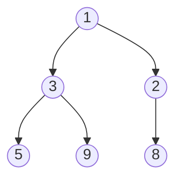

# Heaps

## Why It Matters

A heap answers one question in O(log n) per update: "what is the smallest (or the largest) element now?" Interviewers use it for top-k, k-th largest, merge of k sorted lists, median of a stream, task scheduling, and Dijkstra's algorithm. They also ask the theory: "Why is building a heap O(n) and not O(n log n)?", "Is the iteration order of `PriorityQueue` sorted?", "What does `remove(Object)` cost?", "How does a heap differ from a BST?". On the job, a `PriorityQueue` runs schedulers, rate-limit timers, event simulations, and bounded "best k" buffers. This page covers the structure, its array layout, and the cost of each operation. The problem-solving patterns are in [heap and priority queue](../16-heap-priority-queue/README.md). The balanced BST, which answers more questions at the same O(log n) cost, is in [trees and balanced BSTs](05-trees-and-balanced-bsts.md). The JDK internals beyond what DSA needs are in `kb/java/04-collections-internals.md`.

## Core Concepts

**Priority queue**: an abstract data type with three operations: insert an element, read the element with the highest priority, and remove that element. The element with the highest priority is the **head**. A priority queue does not define the order of the other elements.

**Binary heap**: a data structure that implements a priority queue with an array. A binary heap is a **complete binary tree** (every level is full, except possibly the last, which fills from the left) that satisfies the heap property.

**Heap property**: in a **min-heap**, every node has a key less than or equal to the keys of its children, so the root holds the minimum. In a **max-heap**, every node has a key greater than or equal to the keys of its children, so the root holds the maximum. The property relates only a parent to its children. It says nothing about the left child compared with the right child.

A heap is not a BST. A BST orders the keys of the left subtree against the right subtree, and an in-order traversal gives sorted keys. A heap gives no sorted traversal. It gives the extreme element at the root in O(1).



This is a min-heap. Node 3 is less than its children 5 and 9. Node 2 has only a left child, 8. Nodes 3 and 2 have no order between them.

### Array layout

A complete binary tree has no gaps, so an array stores it level by level, with no pointers. The array for the tree above is:

```text
index:  0  1  2  3  4  5
value: [1, 3, 2, 5, 9, 8]
```

For a node at index `i` (0-based) in a heap of `n` elements:

| Relation | Formula | Valid when |
|---|---|---|
| Parent | `(i - 1) / 2` (integer division) | `i > 0` |
| Left child | `2i + 1` | `2i + 1 < n` |
| Right child | `2i + 2` | `2i + 2 < n` |
| Last internal node | `n / 2 - 1` | `n ≥ 2` |
| Leaves | indices `n / 2` to `n - 1` | |

Many textbooks use 1-based indexes: parent `i / 2`, children `2i` and `2i + 1`. The JDK uses 0-based indexes. Check which base a formula uses before you copy it. The height of a heap with `n` elements is `⌊log₂ n⌋`, because a complete tree has the smallest possible height.

The array layout has three benefits. It needs no node objects and no pointers, so it uses less memory than a tree. The elements sit next to each other in memory, which suits the CPU cache better than linked nodes. The index arithmetic is a shift and an add.

### Which patterns use this

- [Heap and priority queue](../16-heap-priority-queue/README.md): top-k, k-th largest, merge k sorted lists, median of a stream, scheduling.
- [Shortest paths](../18-shortest-paths/README.md): Dijkstra's algorithm takes the unvisited node with the smallest distance from a heap.
- [Greedy](../14-greedy/README.md): many greedy choices pick the best remaining item, and a heap gives that item in O(log n).
- [Intervals](../20-intervals/README.md): a min-heap of end times counts the rooms or the overlap in meeting-room problems.
- [Topological sort](../12-topological-sort/README.md): a heap in place of the queue gives the lexicographically smallest order.
- [Sorting algorithms](08-sorting-algorithms.md): heap sort, and quickselect as the average-O(n) alternative to a heap for the k-th element.

## How It Works

### Operations and costs

| Operation | Time | How |
|---|---|---|
| `peek` | O(1) | Read index 0 |
| `offer` (insert) | O(log n) | Append at the end, then sift up |
| `poll` (remove the head) | O(log n) | Move the last element to index 0, then sift down |
| Build from `n` elements | O(n) | Floyd's method: sift down from the last internal node to the root |
| Remove at a known index | O(log n) | Move the last element into the gap, then sift down or sift up |
| Find or remove an arbitrary value | O(n) | The heap has no search structure, so the code scans the array |
| Change the key at a known index | O(log n) | Sift up (key moved toward the head) or sift down |
| Merge two heaps | O(n) | Concatenate the arrays and build a heap |

### Sift up (insert)

**Sift up** moves an element toward the root while it is smaller than its parent.

1. Put the new element at index `n` (the first free slot). The shape stays complete.
2. While the element has a parent and is smaller than it, move the parent down into the element's slot and continue with the parent's index.
3. Write the element into the final slot.

The loop runs at most once per level, so at most `⌊log₂ n⌋` times. Insert costs O(log n). The loop moves the parent down instead of swapping at each step. That is one write per level and not three. The JDK `siftUpComparable` does the same.

```text
offer 1 into [3, 5, 8, 9, 6]      parent of index 5 is index 2 (value 8)
[3, 5, 8, 9, 6, 1]                1 < 8: move 8 down
[3, 5, _, 9, 6, 8]                parent of index 2 is index 0 (value 3)
                                  1 < 3: move 3 down
[_, 5, 3, 9, 6, 8]                index 0 has no parent: write 1
[1, 5, 3, 9, 6, 8]
```

### Sift down (poll)

**Sift down** moves an element toward the leaves while it is larger than its smaller child.

1. Save the head (the result). Move the last element to index 0 and shrink the size by 1. The shape stays complete.
2. At the current index, find the smaller child. If the element is less than or equal to that child, stop.
3. Otherwise move the child up into the current slot and continue at the child's index.
4. Write the element into the final slot.

Step 2 uses the smaller child so that the new parent is not larger than its other child. Each level costs two comparisons, and the loop runs at most `⌊log₂ n⌋` times, so `poll` costs O(log n).

### Build a heap in O(n)

Building a heap from an unordered array by `n` inserts costs O(n log n) in the worst case (for example, reverse-sorted input into a min-heap, where every element moves to the root). **Floyd's method** builds the heap in O(n):

1. Start at the last internal node, index `n / 2 − 1`. Every index after it is a leaf, and a leaf is already a valid heap.
2. Sift down the element at each index, from `n / 2 − 1` down to 0.

When the code sifts down at index `i`, both subtrees of `i` are already heaps, so one sift down makes the subtree at `i` a heap. When the loop ends at index 0, the whole array is a heap.

**Why O(n): sum of heights.** A sift down from a node of height `h` (the longest path down to a leaf, in edges) moves the element at most `h` levels. A heap with `n` elements has at most `⌈n / 2^(h+1)⌉` nodes of height `h`. The total work is at most

```text
sum over h = 0 .. ⌊log₂ n⌋ of  ⌈n / 2^(h+1)⌉ · h   =   O( n · sum over h ≥ 0 of  h / 2^h )
```

The series `sum of h / 2^h` for `h ≥ 0` converges to 2, so the total is O(n). In words: half of the nodes are leaves and cost nothing, a quarter of the nodes cost one level, an eighth cost two levels, and so on. Most nodes are near the bottom, where sift down is short. Inserting one element at a time reverses this: most elements enter near the bottom and can climb the full height.

A build by Floyd's method is also Θ(n) in the best case, because it must examine every internal node.

### Heap sort

**Heap sort** sorts an array in place with a max-heap:

1. Build a max-heap of the array in O(n).
2. Swap the root (the maximum) with the last element of the heap. The maximum is now in its final position. Shrink the heap size by 1.
3. Sift down the new root. Repeat from step 2 until the heap has one element.

The `n − 1` rounds each cost O(log n), so the total is O(n log n) in the best, average, and worst case. The extra space is O(1). Heap sort is **not stable**: equal elements can change their relative order, because the swaps move elements across long distances. It has a worse cache behavior than quicksort, because the sift down jumps between distant indexes. Heap sort is useful when the code needs a guaranteed O(n log n) time with O(1) extra space. Quicksort is usually faster on random arrays, because it accesses memory in order (approximate; it depends on the data and the hardware). Introsort combines the two: it runs quicksort and switches to heap sort when the recursion becomes too deep. The JDK 21 `DualPivotQuicksort` (the sort behind `Arrays.sort` for primitive arrays) does this: its source switches to `heapSort` "if execution time is becoming quadratic". The full comparison of sorting algorithms is in [sorting algorithms](08-sorting-algorithms.md).

### `PriorityQueue` in the JDK

The facts below come from the JDK 21 javadoc and source of `java.util.PriorityQueue`.

| Fact | Value |
|---|---|
| Order | Min-heap by the natural order of the elements, or by the `Comparator` given to the constructor. The head is the least element |
| Ties | If several elements tie for least, the head is one of them. The javadoc says ties break arbitrarily |
| Storage | An `Object[]` that holds a binary heap. The children of `queue[n]` are `queue[2n + 1]` and `queue[2(n + 1)]` |
| Default initial capacity | 11 |
| `offer`, `add`, `poll`, `remove()` | O(log n) |
| `remove(Object)`, `contains(Object)` | O(n) |
| `peek`, `element`, `size` | O(1) |
| Iteration | **Not sorted.** The iterator and spliterator give no order. For sorted order, the javadoc suggests `Arrays.sort(pq.toArray())` |
| `null` | `offer` throws `NullPointerException` |
| Non-comparable elements without a comparator | `ClassCastException` on insert |
| Thread safety | Not synchronized. Use `java.util.concurrent.PriorityBlockingQueue` for threads |
| Capacity growth | The javadoc does not specify it. In the JDK 21 source (`grow`), an array with fewer than 64 slots grows to `2 · oldCapacity + 2` slots, and a larger array grows by 50 percent. From the default: 11, 24, 50, 102, 153 |

`remove(Object)` scans the array with `equals` to find the index (O(n)). It then calls `removeAt`, which moves the last element into the gap, sifts it down, and, if it did not move, sifts it up (O(log n)). The scan dominates.

The constructor `new PriorityQueue<>(collection)` builds the heap with Floyd's method in O(n) (`heapify` in the source, which the comment attributes to Floyd, 1964). If the argument is a `SortedSet` or a `PriorityQueue` (not a subclass), the constructor copies the elements and skips the heapify, because they are already in a valid order. The new queue takes the comparator of that `SortedSet` or `PriorityQueue`. For any other collection, the new queue uses the natural order. The class has no constructor that takes a collection and a comparator. So a max-heap or a custom-order heap built from a plain list must use `addAll`, and `addAll` (inherited from `AbstractQueue`) calls `add` for each element, so it costs O(m log(n + m)) for `m` elements. For an O(n) build with a custom order, write Floyd's method on your own array.

The bulk removal methods `removeIf`, `removeAll`, and `retainAll` mark the elements to remove, compact the array, and call `heapify` once (JDK 21 source, `bulkRemove`). `removeIf` therefore costs O(n) plus the cost of the predicate, which is far less than `m` calls to `remove(Object)`.

**Max-heap.** Pass `Comparator.reverseOrder()` (or `Collections.reverseOrder()`) to the constructor. For a custom comparator use `Integer.compare(b, a)`, not `b - a`, because the subtraction can overflow. `Comparator.comparingInt(e -> e[0])` is the usual form for an `int[]` entry (see [the Java toolkit](../java-toolkit.md)).

**Changing a priority.** `PriorityQueue` does not re-sift an element after the code changes its key. If the code mutates an element that is in the queue, the heap property can break with no error. Remove the element, change it, and insert it again (O(n) because of the remove), or insert a new entry and ignore the stale one when it reaches the head (lazy deletion).

**FIFO order for ties.** `PriorityQueue` is not stable. To serve equal priorities in arrival order, add a sequence number to each entry and compare `(priority, sequence)`.

### Top-k and k-way merge

**Top-k** returns the `k` largest (or smallest) of `n` elements. The standard solution uses a heap of size `k` whose head is the worst of the best `k`:

- For the `k` **largest** elements, keep a **min-heap** of size `k`. For each element, if the heap has fewer than `k` elements, insert it. Otherwise, if the element is larger than the head, replace the head. At the end the heap holds the `k` largest. The head is the k-th largest.
- The cost is O(n log k) time and O(k) space. Each of the `n` elements costs O(log k) at most.

The choice of the heap type surprises candidates: the heap that tracks the `k` largest is a min-heap, because the code needs fast access to the element to evict, which is the smallest of the kept elements.

| Method for the k-th largest of `n` elements | Time | Space | Note |
|---|---|---|---|
| Sort, then index | O(n log n) | O(1) to O(n) | Simple. Fine if `k` is close to `n` |
| Min-heap of size `k` | O(n log k) | O(k) | Works on a stream. Does not change the input |
| Heapify all, poll `k` times | O(n + k log n) | O(n) | Good if `k` is small and the array is in memory |
| Quickselect | O(n) average, O(n²) worst | O(1) | Changes the array. See [sorting algorithms](08-sorting-algorithms.md) |

**K-way merge** merges `k` sorted sequences with `N` elements in total. Put the first element of each sequence in a min-heap together with the identity of its sequence. Repeat: poll the smallest element, write it to the output, and insert the next element from the same sequence. The heap never holds more than `k` elements, so each of the `N` steps costs O(log k) and the total is O(N log k). External sorting merges sorted runs from disk in the same way. The templates for top-k, k-way merge, and the two-heap median are in [heap and priority queue](../16-heap-priority-queue/README.md).

### d-ary heaps and indexed heaps

A **d-ary heap** gives each node `d` children instead of 2. With 0-based indexes, the parent of `i` is `(i − 1) / d` and the children are `d·i + 1` to `d·i + d`. The height is `log_d n`.

| Operation | Binary heap | d-ary heap |
|---|---|---|
| Sift up (insert, decrease key) | O(log₂ n) | O(log_d n) |
| Sift down (poll) | O(log₂ n) | O(d · log_d n), because each level compares up to `d` children |

A larger `d` makes the tree shallower, which speeds up the operations that sift up, and slows down `poll`. A d-ary heap suits workloads with many decrease-key operations and few polls, such as Dijkstra's algorithm on a dense graph (CLRS 3rd edition, problem 6-2, analyzes d-ary heaps). The shallower tree and the contiguous children can also help the cache.

An **indexed heap** (an indexed priority queue) gives each element an integer id from `0` to `n − 1` and keeps a second array `pos` that maps an id to its heap position. With `pos`, the heap finds any element in O(1) and supports:

- `decreaseKey(id, newKey)`: change the key, then sift up from `pos[id]`. O(log n).
- `contains(id)` in O(1), and `remove(id)` in O(log n).

Dijkstra's algorithm needs `decreaseKey` when the code finds a shorter path to a node that is already in the queue. The JDK `PriorityQueue` has no `decreaseKey`, and its `remove(Object)` costs O(n). Two ways exist to handle it:

| Approach | Queue size | Time (binary heap) |
|---|---|---|
| Lazy deletion: insert a new entry for every improvement, skip stale entries when polled | Up to `E` entries | O(E log E), which is O(E log V) because `E ≤ V²` |
| Indexed heap with `decreaseKey` | At most `V` entries | O((V + E) log V) |

Both have the same order of growth. Lazy deletion is shorter to write and is the usual interview answer. A **Fibonacci heap** gives `decreaseKey` in O(1) amortized and `poll` in O(log n) amortized, so Dijkstra runs in O(E + V log V) (Fredman and Tarjan, 1987). CLRS (3rd edition, the introduction to chapter 19) notes that the constant factors and the programming complexity of Fibonacci heaps make them less desirable than binary or d-ary heaps for most applications. The algorithm itself is in [shortest paths](../18-shortest-paths/README.md).

## Trade-offs and When to Use

| Structure | Peek min | Insert | Remove min | Build from `n` | Find or remove arbitrary | Sorted iteration |
|---|---|---|---|---|---|---|
| Unsorted array | O(n) | O(1) | O(n) | O(1) | O(n) | O(n log n) (sort first) |
| Sorted array | O(1) | O(n) | O(n) from the front, O(1) from the back | O(n log n) | O(log n) find, O(n) remove | O(n) |
| Binary heap (`PriorityQueue`) | O(1) | O(log n) | O(log n) | O(n) | O(n) | O(n log n) (poll all) |
| Balanced BST (`TreeMap`) | O(log n) | O(log n) | O(log n) | O(n log n) | O(log n) | O(n) |
| Fibonacci heap | O(1) | O(1) amortized | O(log n) amortized | O(n) | O(log n) amortized for delete with a handle | Not applicable |

Choose by the operations that the code needs:

- Only the minimum or the maximum, with inserts: use a binary heap. It is simpler and has smaller constants than a `TreeMap`.
- The minimum and the maximum together: use two heaps with lazy deletion, or one `TreeMap` or `TreeSet` (`firstKey` and `lastKey`).
- Neighbors, floor, ceiling, a range, or removal of an arbitrary key in O(log n): use a `TreeMap`. A heap cannot answer these.
- The `k` best elements of a stream: use a bounded heap of size `k`.
- A static array and one k-th element query: use quickselect, or sort.
- Many `decreaseKey` calls: use an indexed heap, or lazy deletion.

## Java Example

The first program is a min-heap on an `int[]`. It shows sift up, sift down, Floyd's build, and an in-place heap sort. The `offer` lines print the array after each insert, so the reader can compare them with the sift-up steps above.

```java
import java.util.Arrays;
import java.util.NoSuchElementException;

public class MinHeap {
    private int[] a;
    private int size;

    public MinHeap() { a = new int[8]; }

    /** Builds a heap from the array in O(n) (Floyd's method). Copies the input. */
    public MinHeap(int[] values) {
        a = Arrays.copyOf(values, Math.max(values.length, 8));
        size = values.length;
        for (int i = parent(size - 1); i >= 0; i--) siftDown(i);
    }

    private static int parent(int i) { return (i - 1) / 2; }
    private static int left(int i) { return 2 * i + 1; }
    private static int right(int i) { return 2 * i + 2; }

    public int size() { return size; }
    public boolean isEmpty() { return size == 0; }

    public int peek() {
        if (size == 0) throw new NoSuchElementException();
        return a[0];
    }

    /** O(log n): put the value in the first free slot, then move it up. */
    public void offer(int value) {
        if (size == a.length) a = Arrays.copyOf(a, size * 2);
        a[size] = value;
        siftUp(size);
        size++;
    }

    /** O(log n): move the last element to the root, then move it down. */
    public int poll() {
        if (size == 0) throw new NoSuchElementException();
        int min = a[0];
        size--;
        a[0] = a[size];
        if (size > 0) siftDown(0);
        return min;
    }

    private void siftUp(int i) {
        int x = a[i];
        while (i > 0 && x < a[parent(i)]) {
            a[i] = a[parent(i)];       // pull the parent down
            i = parent(i);
        }
        a[i] = x;
    }

    private void siftDown(int i) {
        int x = a[i];
        while (left(i) < size) {
            int child = left(i);
            if (right(i) < size && a[right(i)] < a[child]) child = right(i);
            if (a[child] >= x) break;
            a[i] = a[child];           // pull the smaller child up
            i = child;
        }
        a[i] = x;
    }

    /** Checks the heap property at every non-root index. */
    public boolean isHeap() {
        for (int i = 1; i < size; i++) if (a[parent(i)] > a[i]) return false;
        return true;
    }

    @Override
    public String toString() { return Arrays.toString(Arrays.copyOf(a, size)); }

    /** In-place heap sort: build a max-heap, then move the maximum to the end n - 1 times. */
    public static void heapSort(int[] arr) {
        int n = arr.length;
        for (int i = n / 2 - 1; i >= 0; i--) maxSiftDown(arr, i, n);
        for (int end = n - 1; end > 0; end--) {
            int t = arr[0]; arr[0] = arr[end]; arr[end] = t;   // largest goes to its final slot
            maxSiftDown(arr, 0, end);
        }
    }

    private static void maxSiftDown(int[] arr, int i, int n) {
        int x = arr[i];
        while (2 * i + 1 < n) {
            int child = 2 * i + 1;
            if (child + 1 < n && arr[child + 1] > arr[child]) child++;
            if (arr[child] <= x) break;
            arr[i] = arr[child];
            i = child;
        }
        arr[i] = x;
    }

    public static void main(String[] args) {
        MinHeap h = new MinHeap();
        for (int v : new int[] {5, 3, 8, 1, 9, 2}) {
            h.offer(v);
            System.out.println("offer " + v + " -> " + h);
        }
        StringBuilder order = new StringBuilder();
        while (!h.isEmpty()) order.append(h.poll()).append(' ');
        System.out.println("poll order: " + order.toString().trim());

        int[] data = {9, 4, 7, 1, 8, 2, 6, 3, 5, 0};
        MinHeap built = new MinHeap(data);
        System.out.println("heapify " + Arrays.toString(data) + " -> " + built
                + ", valid " + built.isHeap());

        int[] arr = {9, 4, 7, 1, 8, 2, 6, 3, 5, 0};
        heapSort(arr);
        System.out.println("heapSort -> " + Arrays.toString(arr));
    }
}
```

<!-- expected-output -->
```text
offer 5 -> [5]
offer 3 -> [3, 5]
offer 8 -> [3, 5, 8]
offer 1 -> [1, 3, 8, 5]
offer 9 -> [1, 3, 8, 5, 9]
offer 2 -> [1, 3, 2, 5, 9, 8]
poll order: 1 2 3 5 8 9
heapify [9, 4, 7, 1, 8, 2, 6, 3, 5, 0] -> [0, 1, 2, 3, 4, 7, 6, 9, 5, 8], valid true
heapSort -> [0, 1, 2, 3, 4, 5, 6, 7, 8, 9]
```

The second program uses `PriorityQueue` for the three usual jobs and adds an indexed min-heap with `decreaseKey` that runs Dijkstra's algorithm.

- `topK` keeps a min-heap of size `k`. It costs O(n log k).
- `mergeSorted` merges `k` sorted arrays in O(N log k).
- `IndexedMinPQ` stores ids and priorities, and keeps `pos` in step with every swap.
- `dijkstra` calls `decreaseKey` when it finds a shorter path to a node that is in the queue.

```java
import java.util.ArrayList;
import java.util.Arrays;
import java.util.Collections;
import java.util.Comparator;
import java.util.List;
import java.util.PriorityQueue;

public class PqDemo {
    /** The k largest values, in descending order. O(n log k) time, O(k) space. */
    static List<Integer> topK(int[] nums, int k) {
        PriorityQueue<Integer> heap = new PriorityQueue<>();   // min-heap of the k best so far
        for (int x : nums) {
            if (heap.size() < k) {
                heap.offer(x);
            } else if (x > heap.peek()) {
                heap.poll();                                   // evict the smallest of the k
                heap.offer(x);
            }
        }
        List<Integer> out = new ArrayList<>(heap);
        out.sort(Collections.reverseOrder());
        return out;
    }

    /** Merges k sorted arrays. O(N log k) time for N total elements. */
    static List<Integer> mergeSorted(int[][] lists) {
        // each entry: {value, list index, position in the list}
        PriorityQueue<int[]> heap = new PriorityQueue<>(Comparator.comparingInt(e -> e[0]));
        for (int i = 0; i < lists.length; i++) {
            if (lists[i].length > 0) heap.offer(new int[] {lists[i][0], i, 0});
        }
        List<Integer> out = new ArrayList<>();
        while (!heap.isEmpty()) {
            int[] e = heap.poll();
            out.add(e[0]);
            int next = e[2] + 1;
            if (next < lists[e[1]].length) heap.offer(new int[] {lists[e[1]][next], e[1], next});
        }
        return out;
    }

    /** Min-heap over indices 0..n-1 with decreaseKey in O(log n). */
    static class IndexedMinPQ {
        private final int[] heap;      // heap[p] = index stored at heap position p
        private final int[] pos;       // pos[i] = heap position of index i, or -1
        private final double[] key;    // key[i] = priority of index i
        private int size;

        IndexedMinPQ(int n) {
            heap = new int[n];
            pos = new int[n];
            key = new double[n];
            Arrays.fill(pos, -1);
        }

        boolean isEmpty() { return size == 0; }
        boolean contains(int i) { return pos[i] != -1; }

        void insert(int i, double k) {
            key[i] = k;
            heap[size] = i;
            pos[i] = size;
            siftUp(size++);
        }

        void decreaseKey(int i, double k) {
            if (k >= key[i]) throw new IllegalArgumentException("not a decrease");
            key[i] = k;
            siftUp(pos[i]);
        }

        int pollMinIndex() {
            int min = heap[0];
            swap(0, --size);
            pos[min] = -1;
            siftDown(0);
            return min;
        }

        private void siftUp(int p) {
            while (p > 0 && key[heap[p]] < key[heap[(p - 1) / 2]]) {
                swap(p, (p - 1) / 2);
                p = (p - 1) / 2;
            }
        }

        private void siftDown(int p) {
            while (2 * p + 1 < size) {
                int c = 2 * p + 1;
                if (c + 1 < size && key[heap[c + 1]] < key[heap[c]]) c++;
                if (key[heap[c]] >= key[heap[p]]) break;
                swap(p, c);
                p = c;
            }
        }

        private void swap(int p, int q) {
            int t = heap[p]; heap[p] = heap[q]; heap[q] = t;
            pos[heap[p]] = p;
            pos[heap[q]] = q;
        }
    }

    /** Dijkstra with an indexed heap. graph[u] = list of {v, weight}. */
    static double[] dijkstra(List<int[]>[] graph, int source) {
        int n = graph.length;
        double[] dist = new double[n];
        Arrays.fill(dist, Double.POSITIVE_INFINITY);
        dist[source] = 0;
        IndexedMinPQ pq = new IndexedMinPQ(n);
        pq.insert(source, 0);
        while (!pq.isEmpty()) {
            int u = pq.pollMinIndex();
            for (int[] e : graph[u]) {
                double nd = dist[u] + e[1];
                if (nd < dist[e[0]]) {
                    dist[e[0]] = nd;
                    if (pq.contains(e[0])) pq.decreaseKey(e[0], nd);
                    else pq.insert(e[0], nd);
                }
            }
        }
        return dist;
    }

    @SuppressWarnings("unchecked")
    public static void main(String[] args) {
        PriorityQueue<Integer> pq = new PriorityQueue<>();
        for (int x : new int[] {5, 3, 8, 1, 9, 2}) pq.offer(x);
        System.out.println("iteration order: " + pq);            // heap array, not sorted
        StringBuilder sb = new StringBuilder();
        while (!pq.isEmpty()) sb.append(pq.poll()).append(' ');
        System.out.println("poll order:      " + sb.toString().trim());

        PriorityQueue<Integer> max = new PriorityQueue<>(Comparator.reverseOrder());
        max.addAll(List.of(5, 3, 8, 1, 9, 2));
        System.out.println("max-heap peek:   " + max.peek());

        System.out.println("top 3: " + topK(new int[] {4, 9, 1, 7, 3, 8, 2}, 3));
        System.out.println("merge: " + mergeSorted(new int[][] {{1, 4, 7}, {2, 5}, {}, {0, 6, 8}}));

        List<int[]>[] g = new List[5];
        for (int i = 0; i < 5; i++) g[i] = new ArrayList<>();
        int[][] edges = {{0, 1, 4}, {0, 2, 1}, {2, 1, 2}, {1, 3, 1}, {2, 3, 5}, {3, 4, 3}};
        for (int[] e : edges) g[e[0]].add(new int[] {e[1], e[2]});
        System.out.println("dijkstra from 0: " + Arrays.toString(dijkstra(g, 0)));
    }
}
```

<!-- expected-output -->
```text
iteration order: [1, 3, 2, 5, 9, 8]
poll order:      1 2 3 5 8 9
max-heap peek:   9
top 3: [9, 8, 7]
merge: [0, 1, 2, 4, 5, 6, 7, 8]
dijkstra from 0: [0.0, 3.0, 1.0, 4.0, 7.0]
```

The first output line shows that the iteration order of a `PriorityQueue` is the array order of the heap, `[1, 3, 2, 5, 9, 8]`, and not the sorted order. Only repeated `poll` gives sorted order. In the Dijkstra graph, the shortest path from node 0 to node 3 is 0 → 2 → 1 → 3 with cost 1 + 2 + 1 = 4.

## Interview Angle

### Questions

??? question "What is a binary heap, and how is it stored?"

    A binary heap is a complete binary tree in which every node is less than or equal to its children (min-heap) or greater than or equal to its children (max-heap). The root holds the extreme element. Because the tree is complete, an array stores it level by level with no pointers. With 0-based indexes, the parent of `i` is `(i − 1) / 2`, and the children are `2i + 1` and `2i + 2`. The array layout saves memory and keeps the elements together in memory, and the height is `⌊log₂ n⌋`.

    The heap property orders a parent only against its children. It does not order siblings, so the array is not sorted.

??? question "What are the costs of heap operations?"

    `peek` is O(1). `offer` appends the element and sifts it up, at most `⌊log₂ n⌋` levels, so it costs O(log n). `poll` moves the last element to the root and sifts it down, so it costs O(log n). Building a heap from `n` elements with Floyd's method costs O(n). Finding an arbitrary element costs O(n), because the heap has no search order. Removing an element at a known index costs O(log n).

    The costs of `PriorityQueue` match: `offer`, `poll`, and `remove()` are O(log n), `peek` is O(1), and `remove(Object)` and `contains` are O(n) (JDK javadoc).

??? question "Why does building a heap take O(n) and not O(n log n)?"

    Floyd's method sifts down each internal node from the last one to the root. The cost of a sift down is the height of the node, not the height of the tree. About half of the nodes are leaves with height 0. About a quarter have height 1, an eighth have height 2, and so on. The total is bounded by `n · Σ h / 2^(h+1)`, and `Σ h / 2^h` converges to 2, so the total is O(n).

    The O(n log n) bound applies to building by `n` separate inserts. Each insert sifts up, and most nodes are near the bottom, where the climb is long. For reverse-sorted input, the insert-based build is Θ(n log n).

??? question "How do you find the k largest elements of an array? Which heap do you use?"

    Use a min-heap of size `k`. Insert each element. When the heap exceeds `k`, remove the head, which is the smallest of the kept elements. After one pass, the heap holds the `k` largest elements, and the head is the k-th largest. The time is O(n log k) and the space is O(k). This version works on a stream and does not change the input.

    The alternatives: sort in O(n log n), heapify all `n` elements and poll `k` times in O(n + k log n), or quickselect in O(n) average and O(n²) worst case. A min-heap tracks the largest elements because the code must evict the smallest kept element in O(log k).

??? question "Is the iteration order of a Java `PriorityQueue` sorted?"

    No. The javadoc says that the iterator and the spliterator give no particular order. Iteration and `toString` show the internal array of the heap, where only parent-child pairs are ordered. To read the elements in order, call `poll` repeatedly, which costs O(n log n) in total, or copy the queue to an array and sort it, as the javadoc suggests with `Arrays.sort(pq.toArray())`.

??? question "How do you make a max-heap in Java?"

    Pass a reversed comparator: `new PriorityQueue<>(Comparator.reverseOrder())` or `new PriorityQueue<>(Collections.reverseOrder())`. For a custom type or an `int[]`, write `(a, b) -> Integer.compare(b[0], a[0])`. Do not write `(a, b) -> b - a`. The subtraction overflows for values of large magnitude and gives the wrong order. Another option is to store the negated values, which fails for `Integer.MIN_VALUE`.

??? question "How does a heap differ from a binary search tree?"

    A BST orders the whole left subtree before the node and the whole right subtree after it, so an in-order traversal gives sorted keys, and search, floor, ceiling, and range queries cost O(h). A heap orders only a parent against its children. It gives the minimum at the root in O(1) and gives no efficient search, no sorted traversal, and no range query. A heap is always a complete tree stored in an array, so its height is always `⌊log₂ n⌋`. A BST needs balancing to keep the height small.

    Use a heap when the code needs only the extreme element, with inserts and removals of that element. Use a balanced BST (`TreeMap`) when the code needs neighbors, ranges, or removal of arbitrary keys.

??? question "Walk through `poll` on a min-heap. What does it cost, and why does it use the last element?"

    `poll` saves the root, moves the last element of the array to index 0, and decreases the size by 1. It then sifts the element down: at each step it compares the element with the smaller of its two children. If the element is larger, the child moves up, and the sift continues from the child's index. It stops when the element is at most the smaller child or the element reaches a leaf.

    The last element fills the gap because it keeps the tree complete: removing the last slot keeps the shape, and only the heap property needs repair. The cost is at most two comparisons per level for `⌊log₂ n⌋` levels, which is O(log n).

??? question "How would you implement Dijkstra's algorithm with `PriorityQueue`, given that it has no `decreaseKey`?"

    Use lazy deletion. When the algorithm finds a shorter distance to a node, it inserts a new entry `(distance, node)` and leaves the old entry in the queue. When the algorithm polls an entry whose distance is larger than the best known distance of its node, it skips the entry. The queue holds up to `E` entries, so the time is O(E log E), which equals O(E log V) because `E ≤ V²`.

    The alternative is an indexed heap with `decreaseKey` in O(log n), which keeps at most `V` entries. Both have the same order of growth. Dijkstra needs non-negative edge weights.

??? question "Describe heap sort. What are its time, space, and stability?"

    Build a max-heap in O(n). Then repeat `n − 1` times: swap the root with the last element of the heap, shrink the heap by one, and sift the new root down. The time is O(n log n) in the best, average, and worst case. The extra space is O(1), because the array holds the heap and the sorted part. It is not stable.

    Heap sort has a guaranteed O(n log n) bound and no extra memory, and that is its value. Quicksort has a worst case of O(n²) and is usually faster on random arrays because it accesses memory in order.

### Follow-up Questions

??? question "How do you keep the median of a stream?"

    Use two heaps: a max-heap for the smaller half and a min-heap for the larger half. Every element of the max-heap is at most every element of the min-heap. Keep the sizes equal, or let the max-heap hold one more. To insert, compare the number with the head of the max-heap: if it is at most that head (or the max-heap is empty), insert it into the max-heap, otherwise into the min-heap. Then rebalance: if the max-heap has two more elements than the min-heap, move its head to the min-heap. If the min-heap has more elements than the max-heap, move its head to the max-heap. If the total count is odd, the median is the head of the max-heap. If it is even, the median is the mean of the two heads. Insert costs O(log n) and the median costs O(1). See [heap and priority queue](../16-heap-priority-queue/README.md).

??? question "How would you serve equal priorities in arrival order with `PriorityQueue`?"

    `PriorityQueue` is not stable, because the javadoc says ties break arbitrarily. Give each entry a sequence number from a counter, and compare by priority first and by sequence number second. Then equal priorities leave the queue in insertion order.

??? question "How do you update the priority of an element that is in a `PriorityQueue`?"

    The class has no update operation, and a mutation of the element in place does not move it. The options are: `remove(Object)` then `offer` (O(n) because of the scan), lazy deletion (insert a new entry and skip the stale one), or an indexed heap that keeps each element's position and supports `decreaseKey` and `increaseKey` in O(log n).

??? question "Is a sorted array a valid min-heap? Is a min-heap a sorted array?"

    A sorted ascending array is a valid min-heap, because every parent index is smaller than its child indexes, so the parent value is at most the child value. A min-heap is usually not sorted: `[1, 3, 2]` is a heap, and it is not sorted. The heap property is weaker than sorted order.

??? question "Why does Floyd's build start at index `n / 2 − 1` and go down to 0, and not the other way?"

    Indexes `n / 2` to `n − 1` are leaves, and a leaf is already a heap, so the loop skips them. The loop goes from the last internal node toward the root so that when it sifts down a node, both child subtrees are already heaps. A loop in the other direction would sift down a node whose children are not heaps yet, and the result would not be a heap.

??? question "When is a d-ary heap better than a binary heap?"

    When the workload has many `decreaseKey` or insert operations compared with `poll`. A d-ary heap with a large `d` is shallower (`log_d n`), so sift up is faster. Sift down compares up to `d` children per level, so `poll` is slower. Dijkstra's algorithm on a dense graph has about `E` decrease-key operations and `V` polls, so a larger `d` helps. The children of a node are contiguous in the array, which can help the cache.

### Red Flags

- Saying "a heap is a sorted array" or "a heap is a BST", or expecting sorted iteration from `PriorityQueue`.
- Saying that building a heap is O(n log n) with no distinction between Floyd's method and `n` inserts.
- Inserting all `n` elements into a max-heap one by one to find the `k` largest (O(n log n) time and O(n) space), when a min-heap of size `k` costs O(n log k) time and O(k) space. Not being able to explain why the size-`k` heap is a min-heap.
- Writing `(a, b) -> b - a` in a comparator.
- Saying that `PriorityQueue.remove(Object)` is O(log n).
- Mutating an element that is inside a `PriorityQueue` and expecting the queue to reorder it.
- Saying that `PriorityQueue` is stable, or that it is thread-safe.
- Using 1-based index formulas with a 0-based array, which gives a wrong parent and wrong children.
- Starting Dijkstra's algorithm with negative edge weights and a heap.

## Common Mistakes

| Mistake | Why it fails | Fix |
|---|---|---|
| Print or iterate a `PriorityQueue` to see the order | The iteration order is the heap array, not the sorted order | Poll in a loop, or sort `toArray()` |
| Max-heap by a subtraction comparator `b - a` | Integer overflow gives the wrong order | `Comparator.reverseOrder()` or `Integer.compare(b, a)` |
| Use a max-heap of size `k` for the `k` largest | The code cannot evict the smallest kept element cheaply | Use a min-heap of size `k` |
| Use the 1-based formulas on a 0-based array | The parent and the children are wrong | 0-based: parent `(i − 1) / 2`, children `2i + 1` and `2i + 2` |
| Build a heap by `n` offers when the data is in memory | O(n log n) instead of O(n) | `new PriorityQueue<>(collection)` for natural order. For a custom comparator, no O(n) constructor exists, so write Floyd's method on an array or accept O(n log n) |
| Change a field that is part of the priority, while the object is in the queue | The heap property breaks silently | Remove, change, reinsert, or use lazy deletion with a new entry |
| Call `remove(Object)` or `contains` in a loop | O(n) each, so the loop is O(n²) | Use lazy deletion, an indexed heap, or a `HashSet` of removed ids. To remove many elements at once, call `removeIf`, which rebuilds the heap once in O(n) |
| Sift down with the larger child in a min-heap | The new parent can be larger than its other child | Compare with the smaller child in a min-heap |
| Forget the second child check (`right < n`) | `ArrayIndexOutOfBoundsException` or a wrong comparison at the last internal node | Test `2i + 2 < n` before reading it |
| Expect FIFO order for equal priorities | `PriorityQueue` breaks ties arbitrarily | Add a sequence number to the key |
| Use `PriorityQueue` from several threads | The class is not synchronized | `PriorityBlockingQueue`, or external locking |
| Insert `null` | `NullPointerException` | Use a sentinel object, or avoid `null` elements |
| Store a mutable `int[]` in the queue and reuse the array | The queued entry changes under the heap | Allocate a new array per entry |
| Use Dijkstra with negative edge weights | The first pop of a node is not its final distance | Bellman-Ford (see [shortest paths](../18-shortest-paths/README.md)) |

## Commonly Confused With

| Looks like | Difference | Deciding question |
|---|---|---|
| Heap vs BST | The heap orders parent against children only. The BST orders left, node, right | Do you need only the extreme element, or ordered access and ranges? |
| Heap (data structure) vs heap (memory) | The data structure is a tree in an array. The memory heap is the area where the JVM allocates objects | Is the question about priorities or about memory allocation? |
| Heap vs sorted array | The heap sorts nothing, but inserts in O(log n). The sorted array inserts in O(n) | Do inserts and removals of the minimum interleave? |
| `PriorityQueue` vs `TreeMap` | `PriorityQueue` gives the head and has O(n) removal of a value. `TreeMap` gives any key in order and removal in O(log n) | Do you need more than the minimum? |
| `PriorityQueue` vs `Queue` (`ArrayDeque`) | `PriorityQueue` removes by priority. `ArrayDeque` removes by arrival | Does the next item depend on priority or on arrival? |
| Min-heap vs max-heap | The root is the smallest or the largest | Which element do you need at the head: the next to remove or the next to evict? |
| `heapify` vs `n` inserts | O(n) with Floyd's method vs O(n log n) worst case | Is the data available at once? |
| Heap sort vs quicksort | O(n log n) worst case with O(1) space vs O(n²) worst case and faster in practice | Is the worst-case bound more important than speed? |
| Top-k by heap vs quickselect | O(n log k) streaming vs O(n) average on an array in memory | Does the data arrive as a stream? |
| Decrease-key vs lazy deletion | Update in place (needs an index) vs add a new entry and skip stale ones | Can you afford the extra memory and the stale pops? |

## Quick Reference Card

- A binary heap is a complete binary tree in an array. A min-heap has each parent at most its children. The root is the minimum. The array is not sorted.
- 0-based indexes: parent `(i − 1) / 2`, left child `2i + 1`, right child `2i + 2`. Leaves start at `n / 2`. Height `⌊log₂ n⌋`.
- `peek` O(1). `offer` and `poll` O(log n) by sift up and sift down. Find or remove an arbitrary value O(n).
- Floyd's build: sift down from `n / 2 − 1` to 0. O(n) because most nodes have a small height (the sum of `h / 2^h` is 2). `n` inserts cost O(n log n) in the worst case.
- Heap sort: build a max-heap, then swap the root to the end and sift down. O(n log n) time in all cases, O(1) space, not stable.
- `PriorityQueue`: min-heap, default capacity 11, no `null`, not sorted on iteration, not stable, not synchronized. `remove(Object)` and `contains` are O(n). The `Collection` constructor heapifies in O(n), but only with natural order (or the comparator of a `SortedSet` or `PriorityQueue` argument). `addAll` costs O(m log n).
- Max-heap: `Comparator.reverseOrder()`. Never `b - a`.
- Top-k largest: a min-heap of size `k`, O(n log k). K-way merge: a heap of `k` heads, O(N log k).
- No `decreaseKey` in the JDK: use lazy deletion (O(E log V) Dijkstra) or an indexed heap. A d-ary heap helps when decrease-key dominates.
- Patterns: [heap and priority queue](../16-heap-priority-queue/README.md), [shortest paths](../18-shortest-paths/README.md). Related: [trees and balanced BSTs](05-trees-and-balanced-bsts.md), [sorting algorithms](08-sorting-algorithms.md).

## Further Reading

- [`PriorityQueue` javadoc (JDK 21)](https://docs.oracle.com/en/java/javase/21/docs/api/java.base/java/util/PriorityQueue.html): the ordering, the tie rule, the unsorted iteration, and the cost of each method.
- [`PriorityQueue` source (OpenJDK 21)](https://github.com/openjdk/jdk21u/blob/master/src/java.base/share/classes/java/util/PriorityQueue.java): `siftUpComparable`, `siftDownComparable`, `heapify`, `removeAt`, and the growth rule.
- [`PriorityBlockingQueue` javadoc (JDK 21)](https://docs.oracle.com/en/java/javase/21/docs/api/java.base/java/util/concurrent/PriorityBlockingQueue.html): the thread-safe alternative.
- Cormen, Leiserson, Rivest, Stein, *Introduction to Algorithms* (CLRS), 3rd edition (2009): chapter 6 (heapsort: heaps, `MAX-HEAPIFY`, `BUILD-MAX-HEAP` with the O(n) analysis, priority queues), problem 6-2 (analysis of d-ary heaps), and chapter 19 (Fibonacci heaps). The 4th edition (2022) keeps chapter 6 and moves the Fibonacci heap chapter to online material ([MIT Press transition guide](https://mitp-content-server.mit.edu/books/content/sectbyfn/books_pres_0/3923/11599-transition-guide.pdf)).
- Floyd, "Algorithm 245: Treesort 3", Communications of the ACM 7(12), p. 701, 1964: the bottom-up heap construction that this page calls Floyd's method.
- Williams, "Algorithm 232: Heapsort", Communications of the ACM 7(6), pp. 347–348, 1964: the original heap sort and the binary heap in an array.
- [`DualPivotQuicksort` source (OpenJDK 21)](https://github.com/openjdk/jdk21u/blob/master/src/java.base/share/classes/java/util/DualPivotQuicksort.java): the switch to heap sort when the recursion becomes too deep.
- Fredman and Tarjan, "Fibonacci heaps and their uses in improved network optimization algorithms", Journal of the ACM 34(3), 1987: O(1) amortized `decreaseKey` and the O(E + V log V) bound for Dijkstra.
