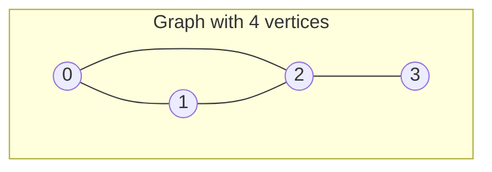

# Graph Representations

## Why It Matters

Every graph problem starts with the same question: how do you store the graph? The answer sets the time and memory cost of every later step. A wrong choice turns an O(V + E) algorithm into an O(V²) algorithm, or runs out of memory. Interviewers ask the theory questions on this page directly ("adjacency list or matrix, and why?"). They also hide the question inside a problem. In "Course Schedule" the graph is a list of pairs. In "Number of Islands" the graph is a grid that nobody draws. In "Word Ladder" the graph has no edge list at all, and you derive each edge from the rules. On the job, the same choices appear in dependency resolvers, build systems, social graphs, routing tables, and network maps.

## Core Concepts

**Graph**: a set of **vertices** (also called nodes) V and a set of **edges** E. An edge connects two vertices. This page writes `V` for the number of vertices and `E` for the number of edges, as is usual in complexity formulas.

**Directed graph** (digraph): each edge has a direction. The edge `u -> v` lets you go from `u` to `v`, but not from `v` to `u`. **Undirected graph**: each edge works in both directions. An undirected edge `{u, v}` is the same as the two directed edges `u -> v` and `v -> u`.

**Weighted graph**: each edge has a number (a weight, a cost, or a distance). An **unweighted graph** has no numbers. Breadth-first search (BFS) finds shortest paths only in an unweighted graph, or in a graph where every weight is equal.

**Path**: a sequence of vertices where each consecutive pair is an edge. A **simple path** repeats no vertex. A **cycle** is a path that starts and ends at the same vertex. A graph with no cycle is **acyclic**.

**DAG** (directed acyclic graph): a directed graph with no directed cycle. A DAG has a topological order. See [pattern 12](../12-topological-sort/README.md).

**Connected graph** (undirected): a path exists between every pair of vertices. A **connected component** is a maximal set of vertices that are connected to each other. A graph with `k` components has `k` separate pieces. A directed graph has **strongly connected components** (SCCs), where every vertex reaches every other vertex in the set along directed paths. See `kb/dsa/24-advanced-graphs/README.md`.

**Degree**: the number of edges at a vertex. In a directed graph, the **in-degree** counts edges that enter the vertex and the **out-degree** counts edges that leave it. The sum of all degrees in an undirected graph is 2E, because each edge touches two vertices (the handshake lemma). In a directed graph, the sum of the in-degrees equals E, and so does the sum of the out-degrees.

**Self-loop**: an edge from a vertex to itself. **Parallel edges** (multi-edges): two or more edges between the same pair of vertices. A **simple graph** has neither. Many problems say "no self-loops and no repeated edges". Read that sentence, because it decides whether you must handle them.

**Dense graph**: E is close to V² (the maximum for a simple directed graph is V·(V − 1)). **Sparse graph**: E is close to V. Most interview graphs are sparse. These two words have no formal threshold. To decide, compare E with V².

**Tree as a graph**: a connected undirected graph with V − 1 edges and no cycle is a tree. If an input has `n` nodes and `n - 1` edges and is connected, it is a tree (LeetCode 261, "Graph Valid Tree"). See [tree patterns](../10-tree-patterns/README.md).

### The three representations

An **adjacency list** stores, for each vertex, the list of its neighbors. An **adjacency matrix** stores a V × V table, where cell `[u][v]` says whether the edge `u -> v` exists (or holds its weight). An **edge list** stores the edges themselves, as one array of pairs or triples.



For this undirected graph, the three representations hold the following data.

```text
Adjacency list            Adjacency matrix        Edge list
0: [1, 2]                      0 1 2 3            {0, 1}
1: [0, 2]                  0 [ 0 1 1 0 ]          {0, 2}
2: [0, 1, 3]               1 [ 1 0 1 0 ]          {1, 2}
3: [2]                     2 [ 1 1 0 1 ]          {2, 3}
                           3 [ 0 0 1 0 ]
```

The list holds 2E = 8 neighbor entries. The matrix holds V² = 16 cells and is symmetric. The edge list holds E = 4 pairs.

### Cost table

The table gives the cost for an undirected or directed graph. `deg(u)` is the degree of `u` (the out-degree for a directed graph).

| Operation or property | Adjacency list | Adjacency matrix | Edge list |
|---|---|---|---|
| Memory | O(V + E) | O(V²) | O(E) |
| Add an edge | O(1) amortized (append) | O(1) | O(1) amortized (append) |
| Remove an edge `u -> v` | O(deg(u)) (scan, then remove) | O(1) | O(E) |
| Does edge `u -> v` exist? | O(deg(u)) | O(1) | O(E) |
| List the neighbors of `u` | O(deg(u)) | O(V) | O(E) |
| Visit all edges | O(V + E) | O(V²) | O(E) |
| Add a vertex | O(1) amortized | O(V²) to rebuild a fixed array | O(1) |
| Natural for | Traversals, shortest paths, topological sort | Dense graphs, constant-time edge tests, all-pairs algorithms | Sorting edges, union-find, Bellman-Ford |

Three notes on the table.

1. **Why the matrix costs O(V) to list the neighbors.** The code must scan a whole row of V cells, even if the vertex has two neighbors. A full BFS on a matrix therefore costs O(V²), and a full BFS on a list costs O(V + E).
2. **Memory in numbers.** A Java `int[V][V]` stores 4 bytes per cell, because an `int` has 32 bits (JLS section 4.2.1). For V = 10,000 the cells alone take 4 × 10⁸ bytes, which is about 400 MB. For V = 100,000 the matrix needs 4 × 10¹⁰ bytes, so it cannot fit in memory. An adjacency list with E = 200,000 edges has 400,000 entries and fits in memory. Java adds overhead on top of these numbers (array headers, and for `List<Integer>` one boxed `Integer` per entry), so treat them as lower bounds.
3. **Undirected edges count twice.** An undirected graph stores each edge in two lists, so the list form has 2E entries. The complexity stays O(V + E).

**Decision rule**: if E is much smaller than V², use an adjacency list. If V is at most a few thousand and the algorithm needs "is there an edge between `u` and `v`?" in O(1), or it runs over all pairs (Floyd-Warshall), use a matrix. If the algorithm only sorts or scans edges (Kruskal, Bellman-Ford), use an edge list.

### Which patterns use this

- [Graph traversal](../11-graph-traversal/README.md): BFS and DFS on an adjacency list, on a matrix input, or on an implicit grid.
- [Topological sort](../12-topological-sort/README.md): an adjacency list and an in-degree array.
- [Union-find](../13-union-find/README.md): an edge list. The structure does not need neighbor lists.
- [Shortest paths](../18-shortest-paths/README.md): a weighted adjacency list for Dijkstra, an edge list for Bellman-Ford, a matrix for Floyd-Warshall.
- `kb/dsa/24-advanced-graphs/README.md`: minimum spanning trees (edge list for Kruskal, list for Prim), strongly connected components, bridges, Euler paths, and maximum flow.
- [Tree patterns](../10-tree-patterns/README.md): a tree is a graph, and a parent array is a compact edge list.
- [Queues](03-stacks-queues-deques.md) and [heaps](06-heaps.md): the two containers that BFS and Dijkstra use on top of the graph.

## How It Works

### Adjacency list

For each vertex `u`, the structure keeps a collection of its neighbors. The array index is the vertex number, so a lookup of `g[u]` costs O(1). To add the undirected edge `{u, v}`, the code appends `v` to `g[u]` and `u` to `g[v]`. To add the directed edge `u -> v`, it appends `v` to `g[u]` only.

In an unweighted graph, a neighbor entry is a vertex number. In a weighted graph, a neighbor entry is a pair `(neighbor, weight)`. Java has three common ways to write it.

```java
// 1. List of lists. Best default for unweighted graphs with vertices 0 .. n-1.
int n = 5;
List<List<Integer>> g1 = new ArrayList<>();
for (int i = 0; i < n; i++) g1.add(new ArrayList<>());
g1.get(0).add(1);
g1.get(1).add(0);

// 2. Array of lists of int[]. Best default for weighted graphs. Each entry is {to, weight}.
@SuppressWarnings("unchecked")
List<int[]>[] g2 = new List[n];
for (int i = 0; i < n; i++) g2[i] = new ArrayList<>();
g2[0].add(new int[] {1, 7});

// 3. Map of lists. Use it when vertex labels are not 0 .. n-1 (strings, large ids).
Map<String, List<String>> g3 = new HashMap<>();
g3.computeIfAbsent("JFK", k -> new ArrayList<>()).add("SFO");
g3.computeIfAbsent("SFO", k -> new ArrayList<>()); // register a vertex with no outgoing edge
```

Three details cause bugs in practice.

- **Generic array creation.** Java does not allow `new List<int[]>[n]`. The code must write `new List[n]` and accept an unchecked warning, or use `List<List<int[]>>`. Both are correct.
- **Missing vertices in a `Map`.** If a vertex has no outgoing edge, `g3.get(v)` returns `null`, and a traversal throws `NullPointerException`. Use `g3.getOrDefault(v, List.of())` in the traversal, or register every vertex when you build the map.
- **Boxing.** A `List<Integer>` stores one `Integer` object for each entry. For the input sizes that LeetCode graph problems usually give (approximate: up to about 10⁵ edges, from the problem constraints), this is fast enough. Use the array-based form below when memory or time is tight.

#### Array-based adjacency list (forward-star form)

A forward-star graph stores the lists in three plain `int` arrays. It has no boxing and no per-list objects.

```java
class ForwardStar {
    final int[] head;  // head[u] = index of the newest edge of u, or -1
    final int[] next;  // next[i] = index of the next edge of the same vertex, or -1
    final int[] to;    // to[i]   = the target of edge i
    int count = 0;

    ForwardStar(int n, int maxEdges) {
        head = new int[n];
        Arrays.fill(head, -1);
        next = new int[maxEdges];
        to = new int[maxEdges];
    }

    void addEdge(int u, int v) {
        to[count] = v;
        next[count] = head[u];
        head[u] = count++;
    }

    // Visit the neighbors of u. The order is the reverse of the insertion order.
    int sumOfNeighbors(int u) {
        int sum = 0;
        for (int i = head[u]; i != -1; i = next[i]) sum += to[i];
        return sum;
    }
}
```

For an undirected graph, call `addEdge(u, v)` and `addEdge(v, u)`, and set `maxEdges` to 2E. Competitive programmers use this form. Interviewers do not require it. The `List` forms are shorter and easier to read.

### Adjacency matrix

The matrix `m[u][v]` holds 1 (or the weight) if the edge `u -> v` exists. For an undirected graph the matrix is symmetric: `m[u][v] == m[v][u]`. The diagonal `m[u][u]` is 0 unless the graph has self-loops.

For a **weighted** matrix, 0 is often a valid weight, so a special value must mean "no edge". The usual choice is a large number (`Integer.MAX_VALUE / 2`, which leaves room to add two weights without overflow) or `-1`. Floyd-Warshall (see [pattern 18](../18-shortest-paths/README.md)) uses the large number, with `m[u][u] = 0`.

Some LeetCode problems give the matrix as the input. In "Number of Provinces" (LeetCode 547), `isConnected[i][j] == 1` means that cities `i` and `j` are connected. The code does not build anything. It runs DFS or union-find directly on the input, in O(V²).

### Edge list

The edge list is an `int[][]` or a `List<int[]>` where each entry is `{u, v}` or `{u, v, w}`. LeetCode gives most graphs in this form, and it is the cheapest to store. Two algorithms use it directly:

- **Kruskal** sorts the edges by weight and joins components with union-find. The sort costs O(E log E).
- **Bellman-Ford** relaxes every edge V − 1 times. Each pass is one scan of the array.

For every other algorithm, convert the edge list to an adjacency list first. The conversion costs O(V + E) and happens once.

### Building a graph from LeetCode inputs

LeetCode problems state the graph in a few standard shapes. Each shape has one pitfall: the direction of the edge, or the base of the numbering.

| Input shape | Example problem | Conversion |
|---|---|---|
| `n`, `edges[i] = {u, v}`, undirected | LeetCode 323, 261, 1971 | Add `v` to `g[u]` and `u` to `g[v]` |
| `n`, `edges[i] = {u, v}`, vertices `1 .. n` | LeetCode 684 | Allocate `n + 1` lists, or subtract 1 from each end |
| `prerequisites[i] = {a, b}`: take `b` before `a` | LeetCode 207, 210 | Add the edge `b -> a` and increment `indegree[a]`. Reading the pair in the wrong direction gives a reversed graph |
| `times[i] = {u, v, w}`, directed and weighted | LeetCode 743 | Add `{v, w}` to `g[u]` only |
| `isConnected[i][j]`, a matrix | LeetCode 547 | Use the matrix as it is |
| `manager[i]`, a parent array | LeetCode 1376 | Add `manager[i] -> i` for each `i` with a manager |
| `tickets[i] = {from, to}` with string labels | LeetCode 332 | `Map<String, PriorityQueue<String>>`, so the neighbors come out in sorted order |
| `trust[i] = {a, b}`: `a` trusts `b` | LeetCode 997 | Do not build a graph. Count `out[a]++` and `in[b]++`. The judge has in-degree `n - 1` and out-degree 0 |
| `connections[i] = {a, b}`, directed edges to reorient | LeetCode 1466 | Store each edge in both lists, with a flag or a sign that records the original direction |

The next block shows the main conversions together with a BFS and a component count. It is a complete program. Its output follows the code.

```java
import java.util.ArrayDeque;
import java.util.ArrayList;
import java.util.Arrays;
import java.util.List;
import java.util.Queue;

public class GraphDemo {
    // Build an undirected graph from an edge array. Nodes are 0 .. n-1.
    static List<List<Integer>> buildUndirected(int n, int[][] edges) {
        List<List<Integer>> g = new ArrayList<>();
        for (int i = 0; i < n; i++) g.add(new ArrayList<>());
        for (int[] e : edges) {
            g.get(e[0]).add(e[1]);
            g.get(e[1]).add(e[0]);
        }
        return g;
    }

    // Build the directed graph of LeetCode 207. A pair {a, b} means: take b before a.
    // The edge is b -> a. The method also fills the in-degree array.
    static List<List<Integer>> buildPrerequisites(int n, int[][] prerequisites, int[] indegree) {
        List<List<Integer>> g = new ArrayList<>();
        for (int i = 0; i < n; i++) g.add(new ArrayList<>());
        for (int[] p : prerequisites) {
            g.get(p[1]).add(p[0]);
            indegree[p[0]]++;
        }
        return g;
    }

    // Build a weighted directed graph. Each triple is {from, to, weight}. Nodes are 1 .. n.
    @SuppressWarnings("unchecked")
    static List<int[]>[] buildWeighted(int n, int[][] times) {
        List<int[]>[] g = new List[n + 1];
        for (int i = 0; i <= n; i++) g[i] = new ArrayList<>();
        for (int[] t : times) g[t[0]].add(new int[] {t[1], t[2]});
        return g;
    }

    // Breadth-first search from src. dist[v] is the number of edges, or -1 if v is unreachable.
    static int[] bfs(List<List<Integer>> g, int src) {
        int[] dist = new int[g.size()];
        Arrays.fill(dist, -1);
        Queue<Integer> queue = new ArrayDeque<>();
        dist[src] = 0;
        queue.offer(src);
        while (!queue.isEmpty()) {
            int u = queue.poll();
            for (int v : g.get(u)) {
                if (dist[v] == -1) {
                    dist[v] = dist[u] + 1;
                    queue.offer(v);
                }
            }
        }
        return dist;
    }

    // Count connected components. Each unvisited vertex starts a new BFS.
    static int countComponents(List<List<Integer>> g) {
        boolean[] seen = new boolean[g.size()];
        int count = 0;
        for (int s = 0; s < g.size(); s++) {
            if (seen[s]) continue;
            count++;
            Queue<Integer> queue = new ArrayDeque<>();
            seen[s] = true;
            queue.offer(s);
            while (!queue.isEmpty()) {
                int u = queue.poll();
                for (int v : g.get(u)) {
                    if (!seen[v]) {
                        seen[v] = true;
                        queue.offer(v);
                    }
                }
            }
        }
        return count;
    }

    static int[][] toMatrix(int n, int[][] edges) {
        int[][] m = new int[n][n];
        for (int[] e : edges) {
            m[e[0]][e[1]] = 1;
            m[e[1]][e[0]] = 1;
        }
        return m;
    }

    public static void main(String[] args) {
        int[][] edges = {{0, 1}, {0, 2}, {1, 2}, {3, 4}};
        List<List<Integer>> g = buildUndirected(6, edges);
        System.out.println("adjacency list: " + g);
        System.out.println("distances from 0: " + Arrays.toString(bfs(g, 0)));
        System.out.println("components: " + countComponents(g));
        System.out.println("matrix row 0: " + Arrays.toString(toMatrix(6, edges)[0]));

        int[] indegree = new int[4];
        List<List<Integer>> courses =
            buildPrerequisites(4, new int[][] {{1, 0}, {2, 0}, {3, 1}, {3, 2}}, indegree);
        System.out.println("course graph: " + courses + ", indegree: " + Arrays.toString(indegree));

        List<int[]>[] w = buildWeighted(4, new int[][] {{2, 1, 1}, {2, 3, 1}, {3, 4, 1}});
        System.out.println("node 2 has " + w[2].size() + " outgoing edges, first weight "
            + w[2].get(0)[1]);
    }
}
```

<!-- expected-output -->
```text
adjacency list: [[1, 2], [0, 2], [0, 1], [4], [3], []]
distances from 0: [0, 1, 1, -1, -1, -1]
components: 3
matrix row 0: [0, 1, 1, 0, 0, 0]
course graph: [[1, 2], [3], [3], []], indegree: [0, 1, 1, 2]
node 2 has 2 outgoing edges, first weight 1
```

Vertex 5 has no edge, so it is its own component. The three components are `{0, 1, 2}`, `{3, 4}`, and `{5}`. Isolated vertices cause off-by-one errors in a component count: if the code starts from the edges only, it never visits vertex 5.

### Implicit graphs

An **implicit graph** has no stored edges. The program computes the neighbors of a vertex from a rule, when the traversal reaches that vertex. The graph can be far bigger than memory, because the traversal builds only the part that it visits. Many "graph" problems do not look like graphs: a grid, a word list, a lock, a puzzle board. The recognition signal is "from each state you can move to a few other states, and you want a shortest path, a reachable set, or a count of regions".

An implicit graph needs three decisions.

1. **Vertex**: what identifies a state. A grid cell is `(row, col)`. A word is a `String`. A lock position is a 4-digit `String`. A puzzle board is a flattened string.
2. **Edges**: the function that lists the neighbors of a state.
3. **Visited set**: an array indexed by the state when the state space is small and dense, or a `HashSet` when it is not.

#### Grids: direction arrays

A grid with `rows` rows and `cols` columns has `rows × cols` vertices. Each cell connects to its 4 neighbors (up, down, left, right) in the most common version, or to 8 neighbors if diagonal moves are allowed. Direction arrays replace four or eight copies of the same code.

```java
// 4 directions: up, right, down, left
int[] dr4 = {-1, 0, 1, 0};
int[] dc4 = {0, 1, 0, -1};

// 8 directions: the 4 above plus the 4 diagonals
int[] dr8 = {-1, -1, -1, 0, 0, 1, 1, 1};
int[] dc8 = {-1, 0, 1, -1, 1, -1, 0, 1};

// Compact alternative for 4 directions: one array of 5 values and the (d, d+1) trick.
int[] dirs = {-1, 0, 1, 0, -1};
int rows = 3, cols = 4, r = 1, c = 1;
for (int d = 0; d < 4; d++) {
    int nr = r + dirs[d], nc = c + dirs[d + 1];
    if (nr < 0 || nr >= rows || nc < 0 || nc >= cols) continue; // outside the grid
    System.out.println("neighbor " + nr + "," + nc);
}
```

The count of edges in a grid graph is at most 4 × rows × cols (or 8 × rows × cols), so BFS or DFS on a grid costs O(rows × cols) time and space. The loop over the direction array adds only a constant factor.

To store a visited flag for each cell, use a `boolean[rows][cols]`. To store a cell in a queue, use an `int[] {r, c}` or the single number `r * cols + c`. The single number decodes as `r = id / cols` and `c = id % cols`, and it works as a `HashSet<Integer>` key or a union-find index.

The next block is a complete program. It finds the shortest path in a binary matrix with 8-direction moves (LeetCode 1091), and it shows the four required steps: bound check, wall check, visited check, enqueue.

```java
import java.util.ArrayDeque;
import java.util.Arrays;
import java.util.Queue;

public class GridBfs {
    static final int[] DR = {-1, -1, -1, 0, 0, 1, 1, 1};
    static final int[] DC = {-1, 0, 1, -1, 1, -1, 0, 1};

    // Returns the number of cells on the shortest path from the top-left to the bottom-right
    // cell, moving in 8 directions through cells that hold 0. Returns -1 if no path exists.
    static int shortestPathBinaryMatrix(int[][] grid) {
        int rows = grid.length, cols = grid[0].length;
        if (grid[0][0] == 1 || grid[rows - 1][cols - 1] == 1) return -1;
        int[][] dist = new int[rows][cols];
        for (int[] row : dist) Arrays.fill(row, -1);
        Queue<int[]> queue = new ArrayDeque<>();
        dist[0][0] = 1;
        queue.offer(new int[] {0, 0});
        while (!queue.isEmpty()) {
            int[] cell = queue.poll();
            for (int d = 0; d < 8; d++) {
                int r = cell[0] + DR[d], c = cell[1] + DC[d];
                if (r < 0 || r >= rows || c < 0 || c >= cols) continue; // bound check
                if (grid[r][c] == 1 || dist[r][c] != -1) continue;       // wall or visited
                dist[r][c] = dist[cell[0]][cell[1]] + 1;
                queue.offer(new int[] {r, c});
            }
        }
        return dist[rows - 1][cols - 1];
    }

    public static void main(String[] args) {
        int[][] grid = {{0, 0, 0}, {1, 1, 0}, {1, 1, 0}};
        System.out.println("shortest path: " + shortestPathBinaryMatrix(grid));
        int[][] blocked = {{1, 0}, {0, 0}};
        System.out.println("blocked start: " + shortestPathBinaryMatrix(blocked));
    }
}
```

<!-- expected-output -->
```text
shortest path: 4
blocked start: -1
```

The path in the example is `(0,0) -> (0,1) -> (1,2) -> (2,2)`. It has 4 cells. The step from `(0,1)` to `(1,2)` is a diagonal move. BFS marks a cell as visited when it adds the cell to the queue, not when it removes the cell. Marking at removal lets the same cell enter the queue many times.

#### Word ladder: neighbors from a rule

In "Word Ladder" (LeetCode 127), two words are neighbors if they differ in exactly one letter. The graph has up to N words, and checking each pair costs O(N² · L) for words of length L. Two methods avoid the pair check.

- **Try every change.** For a word of length `L`, try each of the `L` positions with each of the 26 letters, and keep the results that are in the word set. The cost is O(26 · L · L) for one word, because building and hashing each new string costs O(L).
- **Wildcard buckets.** Replace one position with `*`, so `"hot"` gives `"*ot"`, `"h*t"`, `"ho*"`. Words in the same bucket are neighbors. The preprocessing costs O(N · L · L) in total.

```java
// Neighbors of a word under the rule "change exactly one letter, stay in the dictionary".
List<String> neighbors(String word, Set<String> dictionary) {
    List<String> result = new ArrayList<>();
    char[] chars = word.toCharArray();
    for (int i = 0; i < chars.length; i++) {
        char original = chars[i];
        for (char ch = 'a'; ch <= 'z'; ch++) {
            if (ch == original) continue;
            chars[i] = ch;
            String candidate = new String(chars);
            if (dictionary.contains(candidate)) result.add(candidate);
        }
        chars[i] = original; // restore the letter before the next position
    }
    return result;
}
```

#### State spaces

A state-space graph treats each configuration of a puzzle as a vertex and each legal move as an edge. In "Open the Lock" (LeetCode 752) the vertices are the 10,000 strings from `"0000"` to `"9999"`. A move turns one of 4 wheels one step up or down, so each vertex has 8 neighbors. BFS from `"0000"` gives the minimum number of turns. Dead ends go into the visited set at the start. In "Sliding Puzzle" (LeetCode 773) the vertices are the board layouts (at most 6! = 720). The same idea covers "Minimum Genetic Mutation" (LeetCode 433) and "Snakes and Ladders" (LeetCode 909).

```java
// The 8 neighbors of a lock state: each wheel moves one step up or one step down.
List<String> lockNeighbors(String state) {
    List<String> result = new ArrayList<>();
    for (int i = 0; i < 4; i++) {
        char[] chars = state.toCharArray();
        char original = chars[i];
        chars[i] = (char) ('0' + (original - '0' + 1) % 10);
        result.add(new String(chars));
        chars[i] = (char) ('0' + (original - '0' + 9) % 10);
        result.add(new String(chars));
    }
    return result;
}
```

The cost of BFS on a state space is O(S · b) for S reachable states and branching factor b, times the cost of building one neighbor. If S is too large to enumerate, the problem needs a different idea (bidirectional BFS, A*, or dynamic programming).

### Which representation each algorithm prefers

| Algorithm | Best representation | Reason | Time |
|---|---|---|---|
| BFS, DFS, connected components | Adjacency list (or implicit) | Visits each vertex and each edge once | O(V + E) |
| Topological sort (Kahn, DFS) | Adjacency list and in-degree array | Needs outgoing edges and a count of incoming edges | O(V + E) |
| Cycle detection in an undirected graph | Union-find on an edge list, or DFS on a list | A cycle is the first edge that joins two vertices of one component | O(E · α(V)) with union-find |
| Dijkstra with a binary heap | Weighted adjacency list | Each relaxation needs the outgoing edges of one vertex | O((V + E) log V) |
| Dijkstra on a dense graph with an array | Adjacency matrix | Picking the minimum by scan costs O(V), which beats a heap when E is near V² | O(V²) |
| Bellman-Ford | Edge list | Each pass scans all edges in any order | O(V · E) |
| Floyd-Warshall | Adjacency matrix | The algorithm updates all pairs `[i][j]` in place | O(V³) |
| Kruskal | Edge list | Sorts edges by weight, then uses union-find | O(E log E) |
| Prim with a heap | Weighted adjacency list | Scans the edges that leave the growing tree | O(E log V) |
| Kosaraju (SCCs) | Adjacency list and its transpose | Runs DFS on the graph, then on the reversed graph | O(V + E) |
| Tarjan (SCCs, bridges) | Adjacency list | One DFS with discovery times and low-link values | O(V + E) |
| Hierholzer (Euler path) | Adjacency list that supports removal of used edges | Consumes each edge once | O(E) |
| Maximum flow (Edmonds-Karp) | Adjacency list with paired reverse edges, or a matrix if V is small | Needs the residual capacity of the reverse edge | O(V · E²) |

The time column assumes the stated structure. For example, Dijkstra with a heap on an adjacency matrix still costs O(V²) to find the neighbors, so the heap gives no gain. For the full algorithms, see [graph traversal](../11-graph-traversal/README.md), [topological sort](../12-topological-sort/README.md), [union-find](../13-union-find/README.md), [shortest paths](../18-shortest-paths/README.md), and `kb/dsa/24-advanced-graphs/README.md`.

## Trade-offs and When to Use

| Criterion | Adjacency list | Adjacency matrix | Edge list | Implicit graph |
|---|---|---|---|---|
| Memory for a sparse graph | Best, O(V + E) | Worst, O(V²) | Best, O(E) | None for edges |
| Memory for a dense graph | O(V²) with pointer overhead | O(V²), compact | O(V²) | None for edges |
| Edge test `u -> v` | O(deg(u)) | O(1) | O(E) | Computed from the rule |
| Neighbor iteration | O(deg(u)), exact | O(V), scans zeros | O(E), scans everything | O(branching factor) |
| Handles weights | Pair per entry | Cell holds the weight | Triple per entry | The rule returns the weight |
| Handles parallel edges | Yes, as repeated entries | No, one cell per pair (store a count or the minimum) | Yes | Depends on the rule |
| Best for | Most interview problems | Floyd-Warshall, small dense graphs, edge tests | Kruskal, Bellman-Ford, union-find | Grids, word ladders, puzzles |
| Typical mistake | Forgetting the second direction of an undirected edge | Allocating `new int[100000][100000]` | Searching it for neighbors | Forgetting the bound check |

Recommendation: write the adjacency list as your default. Switch only for a stated reason: the problem gives a matrix, the algorithm is Floyd-Warshall or Kruskal, or V is small and you need constant-time edge tests.

### When two representations help together

Some algorithms keep two forms. Kruskal reads an edge list and builds a union-find structure. Kosaraju keeps the graph and its transpose. Bidirectional BFS keeps one frontier at each end. A problem with a few thousand vertices and many edge-existence queries can use a list for traversal and a `HashSet<Long>` of encoded edges, `(long) u * n + v`, for membership tests.

## Java Example

The runnable programs are in the "How It Works" section above: `GraphDemo` builds the graph from the three common input shapes, and `GridBfs` runs BFS on an implicit grid. The next program shows a weighted adjacency list in use, with Dijkstra on top of it. It shows why the entry type `int[] {to, weight}` is enough, and why the algorithm needs only the outgoing edges of one vertex at a time. See [pattern 18](../18-shortest-paths/README.md) for the full treatment.

```java
import java.util.ArrayList;
import java.util.Arrays;
import java.util.List;
import java.util.PriorityQueue;

public class WeightedDemo {
    // LeetCode 743 shape: times[i] = {from, to, weight}, nodes 1 .. n.
    static int[] dijkstra(int n, int[][] times, int src) {
        @SuppressWarnings("unchecked")
        List<int[]>[] g = new List[n + 1];
        for (int i = 0; i <= n; i++) g[i] = new ArrayList<>();
        for (int[] t : times) g[t[0]].add(new int[] {t[1], t[2]});

        int[] dist = new int[n + 1];
        Arrays.fill(dist, Integer.MAX_VALUE);
        dist[src] = 0;
        // Each heap entry is {vertex, distance when pushed}. Smallest distance first.
        PriorityQueue<int[]> heap = new PriorityQueue<>((a, b) -> Integer.compare(a[1], b[1]));
        heap.offer(new int[] {src, 0});
        while (!heap.isEmpty()) {
            int[] top = heap.poll();
            int u = top[0];
            if (top[1] > dist[u]) continue; // stale entry: a shorter path was found later
            for (int[] edge : g[u]) {
                int v = edge[0], nd = dist[u] + edge[1];
                if (nd < dist[v]) {
                    dist[v] = nd;
                    heap.offer(new int[] {v, nd});
                }
            }
        }
        return dist;
    }

    public static void main(String[] args) {
        int[][] times = {{2, 1, 1}, {2, 3, 1}, {3, 4, 1}};
        int[] dist = dijkstra(4, times, 2);
        System.out.println(Arrays.toString(dist));
    }
}
```

<!-- expected-output -->
```text
[2147483647, 1, 0, 1, 2]
```

Index 0 is unused, because the nodes are numbered 1 to 4. The value 2147483647 is `Integer.MAX_VALUE`, and it stays only at the unused index.

## Interview Angle

### Questions

??? question "Adjacency list or adjacency matrix: how do you choose?"

    Start from the density and from the operation that the algorithm repeats.

    - **Adjacency list**: memory O(V + E), listing the neighbors of `u` costs O(deg(u)), and a full traversal costs O(V + E). It is the default, because most interview graphs are sparse.
    - **Adjacency matrix**: memory O(V²), an edge test costs O(1), and listing the neighbors costs O(V). It fits a dense graph (E near V²), a small V (a few thousand at most), or an algorithm over all pairs such as Floyd-Warshall.

    The trade-off: the list saves memory and time on sparse graphs and costs O(deg(u)) per edge test. The matrix gives O(1) edge tests and costs O(V²) memory, even for a graph with no edge. For V = 10⁵ the matrix needs about 4 × 10¹⁰ bytes as an `int[][]`, so it cannot work.

??? question "What is the time complexity of BFS, and how does the representation change it?"

    BFS on an adjacency list takes O(V + E). Each vertex enters the queue once, which costs O(V), and the code scans each adjacency list once, which costs O(sum of degrees) = O(E) for a directed graph and O(2E) = O(E) for an undirected graph. On an adjacency matrix the code scans a full row of V cells for each dequeued vertex, so the cost is O(V²). If E is near V², both forms cost about the same. If E is near V, the matrix form is V times slower. On an implicit grid, V is rows × cols and the branching factor is 4 or 8, so the cost is O(rows × cols).

??? question "How do you build the graph for 'Course Schedule' (LeetCode 207)?"

    The input is `prerequisites[i] = {a, b}`, which means "to take course `a`, first take course `b`". The edge goes from the prerequisite to the course: `b -> a`. Build a directed adjacency list of `n` lists. For each pair, append `a` to `g[b]` and increment `indegree[a]`. Then run Kahn's algorithm: put all vertices with in-degree 0 in a queue, remove one, decrement the in-degree of its successors, and enqueue those that reach 0. If the number of removed vertices is `n`, the graph has no cycle and all courses can be taken. The cost is O(V + E). See [pattern 12](../12-topological-sort/README.md). The common bug is to add the edge `a -> b`. The cycle test still gives the right answer, because reversing every edge keeps cycles. The order for "Course Schedule II" then comes out reversed, which breaks that problem.

??? question "How do you represent a grid as a graph, and what is the complexity of traversing it?"

    Each cell is a vertex. Its neighbors are the cells next to it in the allowed directions. The code does not store edges. It keeps a `dr` array and a `dc` array, loops over the directions, and checks the bounds before the access. For 4 directions use `{-1, 0, 1, 0}` and `{0, 1, 0, -1}`. For 8 directions, add the four diagonals. A traversal visits each cell once and tests at most 4 or 8 neighbors, so the time is O(rows × cols) and the memory for the visited array is O(rows × cols). Use BFS for the shortest number of steps and DFS or BFS for region counting. DFS by recursion can overflow the call stack on a large grid. In the worst case (a region shaped like a snake), the recursion depth equals the number of cells in the region. Use an explicit stack or BFS if one region can hold more than about 10⁴ cells. This limit is approximate: it depends on the thread stack size (`-Xss`) and on the frame size. A 4-direction recursive DFS on a 1 × 10⁶ grid with JDK 21 defaults on macOS (2 MB stack) threw `StackOverflowError` at a depth of about 18,000 with `-Xint` (interpreter only) and about 23,000 to 30,000 in the default mode. Linux x64 has a 1 MB default stack, so its limit is lower. See the [Java toolkit](../java-toolkit.md) pitfall on deep recursion.

??? question "What changes if the graph is undirected, and what changes if it is weighted?"

    For an undirected graph, add each edge in both directions. A DFS must also skip the edge back to the parent, or it reports a false cycle. For a weighted graph, each adjacency entry holds the neighbor and the weight, for example `int[] {to, weight}`. BFS no longer gives shortest paths, unless all weights are equal. Use Dijkstra if the weights are non-negative, Bellman-Ford if some are negative, and 0-1 BFS if the weights are 0 or 1. See [pattern 18](../18-shortest-paths/README.md).

??? question "How much memory does each representation use for a graph with 100,000 vertices and 200,000 edges?"

    Treat these numbers as estimates, and state the assumptions.

    - **Adjacency matrix** as `int[][]`: V² = 10¹⁰ cells at 4 bytes is 4 × 10¹⁰ bytes, about 40 GB. It does not fit.
    - **Adjacency list** for an undirected graph: 2E = 400,000 entries, plus V = 100,000 list objects. With `List<Integer>` each entry is a boxed `Integer` and a reference, so the total is in the order of tens of megabytes (approximate; it depends on the JVM). The forward-star form needs 3 `int` arrays: `head` of size V, and `next` and `to` of size 2E each, so about 3.6 MB (0.4 MB for `head` and 3.2 MB for `next` and `to`). A weighted graph adds a fourth array of size 2E for the weights.
    - **Edge list** as `int[E][2]`: 200,000 small arrays, in the order of 5 MB (approximate; each Java array has a header).

    The point to state: the matrix cost depends on V alone, and the list cost depends on V + E.

??? question "How do you test whether an edge exists in O(1) on a sparse graph?"

    Keep a `HashSet<Long>` of encoded edges, where the key is `(long) u * n + v`. For an undirected graph insert both directions, or encode `min(u, v) * n + max(u, v)`. Memory is O(E). The cast to `long` matters: `u * n` overflows `int` if `n` is above about 46,000. Another option is an adjacency list that holds a `HashSet<Integer>` for each vertex, which costs more memory for each vertex but also gives O(1) expected tests and O(1) expected removal.

??? question "What is an implicit graph? Give two examples and the cost of searching one."

    An implicit graph is a graph whose edges the program computes from a rule when it needs them, instead of storing them. Examples: a grid (neighbors are the adjacent cells), "Word Ladder" (neighbors are the dictionary words that differ in one letter), "Open the Lock" (neighbors are the 8 states that turn one wheel by one step). The search cost is O(S · b · c), where S is the number of reachable states, b is the number of neighbors for each state, and c is the cost to produce one neighbor. The visited structure is an array if the states map to small integers, or a `HashSet` if not. The risk is a state space that is too large to enumerate.

??? question "How do you detect that an input of `n` nodes and `edges` forms a tree?"

    A graph is a tree if it is connected and has no cycle. For an undirected graph with `n` vertices, three conditions are equivalent: it is connected and acyclic, it is connected and has exactly `n - 1` edges, or it is acyclic and has exactly `n - 1` edges. So check `edges.length == n - 1` first. This rejects most wrong inputs in O(1). Then check connectivity with one BFS, DFS, or union-find. If any union joins two vertices that are already in the same set, the graph has a cycle. This is LeetCode 261 ("Graph Valid Tree"). See [union-find](../13-union-find/README.md).

??? question "Why does Java code on LeetCode often use `List<int[]>[]` or `List<List<int[]>>` for weighted graphs, and what does `new List<int[]>[n]` do?"

    An `int[]` of two elements holds one entry `{neighbor, weight}` without the overhead of a custom class or of boxing two `Integer` objects. For the container, Java does not permit creation of an array of a parameterized type, so `new List<int[]>[n]` is a compile-time error. The code uses `new List[n]` with `@SuppressWarnings("unchecked")`, or `List<List<int[]>>`. The raw array creation is safe here because the code immediately fills every slot with `ArrayList<int[]>`.

### Follow-up Questions

??? question "A graph has 5,000 vertices and about 12 million edges. Which representation do you use?"

    The maximum number of directed edges is V² = 25 million, so 12 million edges make the graph dense (about half of the possible edges). A matrix of 25 million cells needs 100 MB as an `int[][]`, or 25 MB as a `boolean[][]` (assuming the JVM stores one byte for each `boolean`; this is the usual case, and the JLS does not fix it). A list of 12 million boxed `Integer` entries needs several hundred MB (approximate; it depends on the JVM). So the matrix is the better choice here, and it gives O(1) edge tests. For Dijkstra on this graph, the O(V²) array version costs 25 million steps, which is less than the heap version with O(E log V) steps.

??? question "How do you store parallel edges and self-loops?"

    An adjacency list and an edge list store each parallel edge as a separate entry, and a self-loop as `u` in the list of `u`. An adjacency matrix has one cell for each pair, so it can store only a count or the minimum weight. Check the problem statement. If it allows parallel edges, a shortest-path algorithm must still treat each as a separate relaxation, and an algorithm that counts degrees must count the self-loop twice for an undirected graph.

??? question "How would you represent a graph that does not fit in memory?"

    Use an implicit representation if a rule gives the neighbors. If the graph is a stored one, keep the adjacency lists on disk, sorted by vertex id, and load them on demand with a cache. Distributed systems partition the vertices across machines. Systems for web-scale graphs follow this idea (for example Pregel, Malewicz et al., SIGMOD 2010). This question has no single correct answer. The interviewer wants to hear that you state the access pattern first.

??? question "Why do we mark a vertex visited when we enqueue it, and not when we dequeue it?"

    If the code marks at dequeue time, a vertex with several parents enters the queue once for each parent before the first removal. The queue then holds duplicates. The result stays correct for BFS distances, but the queue can grow to O(E) entries and the work to O(E) extra pops. Marking at enqueue time keeps the queue at O(V) entries. Dijkstra is the exception: the algorithm may push a vertex several times, because a later push can carry a smaller distance, and the code discards stale entries on removal.

### Red Flags

- Saying "adjacency matrix is always better because the lookup is O(1)", without the memory cost.
- Allocating `new int[n][n]` for `n = 100000`.
- Building a directed graph for an undirected problem, or adding both directions for a directed one.
- Reading a prerequisite pair `{a, b}` in the wrong direction and not noticing.
- Forgetting to mark the start vertex visited, or marking at dequeue time in BFS.
- Forgetting the bound check in a grid, or using `grid[r][c]` before the check.
- Treating a graph that has several components as a single component, and starting one traversal only.
- Using `Map<Integer, List<Integer>>` and calling `.get(v)` for a vertex that the map does not contain.
- Calling BFS "shortest path" on a weighted graph.

## Common Mistakes

| Mistake | Why it fails | Fix |
|---|---|---|
| Adding only `g[u].add(v)` for an undirected edge | The traversal cannot go from `v` to `u` | Add both directions |
| Allocating `n` lists when the vertices are numbered `1 .. n` | Index `n` throws `ArrayIndexOutOfBoundsException` | Allocate `n + 1` lists, or subtract 1 from each vertex |
| `List<List<Integer>> g = new ArrayList<>(n)` and then `g.get(i).add(...)` | The constructor argument sets the capacity, not the size. `g.get(i)` throws `IndexOutOfBoundsException` | Add `n` new lists in a loop |
| `Arrays.fill(g, new ArrayList<>())` on an array of lists | The call stores one list object in every slot, so all vertices share one list | Create a new list in each slot with a loop |
| Starting one traversal from vertex 0 only | Other components stay unvisited | Loop over all vertices and start a traversal at each unvisited one |
| Using a matrix for a large sparse graph | `V²` memory and `O(V)` neighbor scans | Use an adjacency list |
| Writing the 4 direction arrays in different orders for `dr` and `dc` | Wrong neighbors, silent wrong answers | Write the pairs in a table, one pair per column |
| Testing `grid[r][c]` before `r` and `c` are in range | `ArrayIndexOutOfBoundsException` | Check the bounds first in the same condition |
| Marking visited at dequeue time in BFS | Duplicate queue entries, extra work | Mark when you enqueue |
| Recursive DFS on a path graph of 10⁵ vertices | `StackOverflowError` | Use an explicit stack, or BFS |
| Computing `u * n + v` with `int` for large `n` | Integer overflow, collisions between edges | Cast first: `(long) u * n + v` |
| Treating `Integer.MAX_VALUE` as "no edge" and adding two weights | `MAX_VALUE + w` overflows to a negative number | Use `Integer.MAX_VALUE / 2`, or skip entries that mean "no edge" |

## Commonly Confused With

| Looks like | Difference | Deciding question |
|---|---|---|
| Adjacency list vs adjacency matrix | Neighbor lists, O(V + E) memory, vs a V × V table, O(V²) memory | Is the graph sparse? Do you need O(1) edge tests? |
| Edge list vs adjacency list | A flat array of edges vs one neighbor list for each vertex | Do you need the neighbors of one vertex? If yes, use the adjacency list |
| Directed vs undirected | One entry per edge vs two entries per edge | Does the edge work in both directions? |
| Degree vs in-degree and out-degree | Total edges at a vertex vs entering and leaving edges | Is the graph directed? |
| Connected vs strongly connected | A path in the undirected sense vs directed paths both ways | Does the problem use directed edges? |
| Tree vs graph | A tree is a connected graph with no cycle and V − 1 edges | Does the input have exactly `n - 1` edges and one component? |
| DAG vs tree | A DAG can have several paths between two vertices. A tree has exactly one | Can a vertex have two parents? |
| Implicit vs explicit graph | The program computes neighbors vs reads stored edges | Can a rule list the neighbors of a state? |
| Sparse vs dense | E near V vs E near V² | Compare E with V², not with a fixed number |
| Visited array vs `HashSet` of visited states | Array indexed by a small integer id vs a hash set of arbitrary keys | Is the state space small and dense? |

## Quick Reference Card

- Vertices V, edges E. Undirected degree sum is 2E. Directed in-degree sum and out-degree sum are each E.
- Adjacency list: O(V + E) memory, neighbors in O(deg). The default.
- Adjacency matrix: O(V²) memory, edge test O(1), neighbors O(V). Use it for small dense graphs and Floyd-Warshall.
- Edge list: O(E) memory. Use it for Kruskal, Bellman-Ford, and union-find.
- Java weighted list: `List<int[]>[] g = new List[n]`, each entry `{to, weight}`.
- Undirected: add both directions. Directed: add one. Prerequisite `{a, b}` is the edge `b -> a`.
- Vertices numbered from 1: allocate `n + 1` slots.
- `Integer.MAX_VALUE / 2` for "infinity" in a matrix that adds weights.
- Grid: `dr`, `dc` arrays, bound check first, mark visited when you enqueue. Cost O(rows × cols).
- Implicit graph: define the vertex, the neighbor rule, and the visited set.
- A tree has V − 1 edges, is connected, and has no cycle.
- Several components: loop over all vertices.
- Algorithm and structure: BFS and DFS use the list. Dijkstra uses the weighted list. Kruskal uses the edge list. Floyd-Warshall uses the matrix.

## Further Reading

- Cormen, Leiserson, Rivest, Stein, *Introduction to Algorithms* (CLRS), chapter 20 in the 4th edition (chapter 22 in the 3rd), "Elementary Graph Algorithms": the representations, the memory costs, and the analysis of BFS and DFS.
- Sedgewick and Wayne, *Algorithms*, 4th edition, chapter 4.1 (undirected graphs) and 4.2 (directed graphs): the adjacency-list design for a graph API.
- [Java Language Specification, section 4.2.1](https://docs.oracle.com/javase/specs/jls/se21/html/jls-4.html#jls-4.2.1): the size and range of `int`, which gives the 4 bytes for each matrix cell.
- [`ArrayDeque` javadoc (JDK 21)](https://docs.oracle.com/en/java/javase/21/docs/api/java.base/java/util/ArrayDeque.html): the queue used in the BFS examples.
- [`Map.computeIfAbsent` javadoc (JDK 21)](https://docs.oracle.com/en/java/javase/21/docs/api/java.base/java/util/Map.html#computeIfAbsent(K,java.util.function.Function)): the idiom for building a `Map` of lists.
- Malewicz et al., "Pregel: A System for Large-Scale Graph Processing", SIGMOD 2010: the vertex-partitioned design for graphs that do not fit on one machine.
- [LeetCode 207 Course Schedule](https://leetcode.com/problems/course-schedule/) and [LeetCode 1091 Shortest Path in Binary Matrix](https://leetcode.com/problems/shortest-path-in-binary-matrix/): practice for the two main input shapes.
