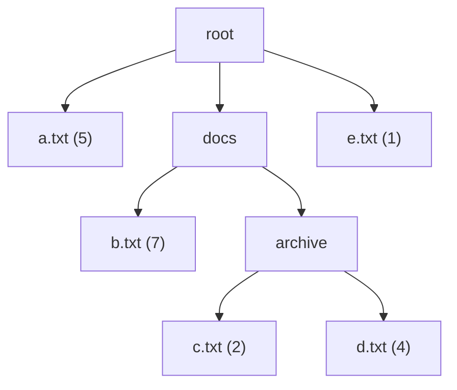
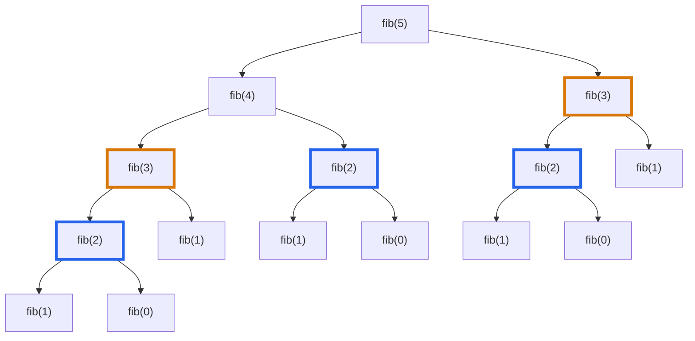

# Foundation F9: Recursion

## Overview

A recursive method is a method that calls itself on a smaller input. Each call solves a smaller copy of the same problem, and the method combines the answers. Recursion is the natural way to write code for data that contains smaller copies of itself: folders inside folders, subtrees inside trees, and a list that is one node followed by a shorter list.

After this page you can:

- Trace a recursive call frame by frame, down to the base case and back up, and say what each frame holds.
- Write a recursive method for a new problem without tracing it: state what the method returns, write the base case, and write one step.
- Predict the output order of a method that does work before the call, after the call, or both.
- Draw the recursion tree of a method, count its calls, and see when calls repeat.
- Explain why Java throws `StackOverflowError`, and convert a recursion to a loop with an explicit stack.
- Decide when a recursion needs a memo (a stored answer for each input, pattern 15) or needs to undo a choice after a call (pattern 08).

## Prerequisites

| You need | Why this page needs it | Where to learn it |
|---|---|---|
| Methods, parameters, local variables, `return` | A recursive call is a method call. Each call has its own parameters and local variables | Java basics (assumed) |
| Arrays, strings, and singly linked lists (`ListNode`) | Three of the four shapes on this page are an index into an array, a linked list, and a range of an array | [Arrays, strings, and linked lists](02-arrays-strings-linked-lists.md) |
| Stack (last in, first out) | The call stack is a stack of frames. The explicit-stack conversion uses `ArrayDeque` | [Stacks, queues, and deques](03-stacks-queues-deques.md) |
| Binary trees (`TreeNode`) | The tree shape is the main use of recursion in interviews | [Trees and balanced BSTs](05-trees-and-balanced-bsts.md) |
| Java records, varargs, and `List.of` | The folder program in the Motivation uses them to build the example data | Java basics (assumed) |
| Counting steps and O-notation | The page counts calls. The cost analysis of a recursion has its home on the complexity page | [Complexity analysis](01-complexity-analysis.md) |

## Motivation

### The anchor problem: the sum of an array

Add the numbers of the array `{4, 7, 2}`. The answer is 13. You already know the loop form:

```java
static int sumLoop(int[] a) {
    int total = 0;
    for (int x : a) {
        total += x;
    }
    return total;
}
```

Now look at the same problem from another side. The sum of `{4, 7, 2}` is `4` plus the sum of `{7, 2}`. The sum of `{7, 2}` is `7` plus the sum of `{2}`. The sum of `{2}` is `2` plus the sum of the empty array, and the sum of the empty array is `0`. Each sum is the first number plus a smaller sum of the same kind. A method can say this sentence directly. The parameter `i` marks where the smaller array starts:

```java
// Returns the sum of a[i], a[i + 1], ..., a[a.length - 1].
static int sumRec(int[] a, int i) {
    if (i == a.length) return 0;        // no elements left
    return a[i] + sumRec(a, i + 1);     // first element + the sum of the rest
}
```

Both methods return 13 for `{4, 7, 2}`. For this problem the loop is shorter and does not risk a stack overflow, so the loop is the better code. Recursion earns its place on a problem where the loop is hard to write.

### A problem where the loop is hard: the total size of a folder

A folder holds files and other folders. A file has a size. A folder has no size of its own. Its total size is the sum of everything inside it, including the folders inside it. This is the tree below. The answer is 5 + 7 + 2 + 4 + 1 = 19.



The first idea that a loop writer has is a loop over the children of the root. A child can be a folder, so the writer adds a loop over the children of the child. That handles two levels. The tree above has three levels: `root`, `docs`, and `archive`. The writer needs a third loop. A fourth level needs a fourth loop. The depth of the folders is part of the input, so the code cannot know at write time how many loops to nest.

The program below runs the two-level loop and the recursive version on the tree above.

```java
import java.util.List;

public class FolderSize {
    // A file has no children. A folder has a size of 0 and holds children.
    record Entry(String name, int size, List<Entry> children) {
        static Entry file(String name, int size) {
            return new Entry(name, size, List.of());
        }

        static Entry folder(String name, Entry... children) {
            return new Entry(name, 0, List.of(children));
        }
    }

    // Loop form: handles a folder, and the files directly inside its subfolders.
    static int totalTwoLevels(Entry root) {
        int total = root.size();
        for (Entry child : root.children()) {
            total += child.size();
            for (Entry grandchild : child.children()) {
                total += grandchild.size();
            }
        }
        return total;
    }

    // Recursive form: a total is the entry's own size plus the totals of its children.
    static int totalSize(Entry entry) {
        int total = entry.size();
        for (Entry child : entry.children()) {
            total += totalSize(child);
        }
        return total;
    }

    public static void main(String[] args) {
        Entry root = Entry.folder("root",
                Entry.file("a.txt", 5),
                Entry.folder("docs",
                        Entry.file("b.txt", 7),
                        Entry.folder("archive",
                                Entry.file("c.txt", 2),
                                Entry.file("d.txt", 4))),
                Entry.file("e.txt", 1));
        System.out.println("two nested loops: " + totalTwoLevels(root));
        System.out.println("recursion:        " + totalSize(root));
        System.out.println("empty folder:     " + totalSize(Entry.folder("empty")));
    }
}
```

<!-- expected-output -->
```text
two nested loops: 13
recursion:        19
empty folder:     0
```

The two nested loops report 13, because they skip the files inside `archive` (2 + 4 = 6). The recursive version reports 19. It has no loop for each level. It has one rule that works at every level: "the total of an entry is its own size plus the totals of its children". A child that is a folder uses the same rule again.

The gap that recursion closes: **the loop needs one nested loop for each level of nesting, and the nesting depth is data, not code. A recursive method reuses one rule on each smaller copy, however deep the copies go.**

## Derivation

### Question 1: what happens inside the computer when a method calls itself?

A method that calls itself looks like a loop that jumps back to its start. It is not. Each call is a new call of the method, with its own copy of the parameters and the local variables. The computer must keep the old call alive, because the old call has work left: it waits for the answer of the new call and then adds `a[i]`.

The JVM keeps this state in the **call stack**. The call stack is a stack (last in, first out) of **frames**. One frame belongs to one call of one method. A call pushes a new frame. A return pops the top frame. The JVM specification describes a frame as the place that stores data and partial results, and that returns values for the method ([JVMS, section 2.6](https://docs.oracle.com/javase/specs/jvms/se21/html/jvms-2.html#jvms-2.6)). For this page, a frame holds three things:

| Part of a frame | What it holds | In `sumRec(a, 1)` |
|---|---|---|
| Parameters | The values that the caller passed | `a` (the same array) and `i = 1` |
| Local variables | The variables that the method declares | none in `sumRec`; `rest` and `total` in the traced version below |
| Return position | The place in the caller where the program continues after the return | The addition `a[i] + (result)` in the frame of `sumRec(a, 0)` |

Here is the same method with two local variables and print statements. The trace shows the descent and the return.

```java
public class FrameTrace {
    static int depth = 0; // only for printing the indentation

    // Returns the sum of a[i], a[i + 1], ..., a[a.length - 1].
    static int sum(int[] a, int i) {
        String pad = "  ".repeat(depth);
        System.out.println(pad + "call   sum(i=" + i + ")");
        if (i == a.length) {
            System.out.println(pad + "return 0   (base case, no elements left)");
            return 0;
        }
        depth++;
        int rest = sum(a, i + 1);      // this frame waits here until the call returns
        depth--;
        int total = a[i] + rest;
        System.out.println(pad + "return " + total + "   (i=" + i + ": a[i]=" + a[i]
                + " + rest=" + rest + ")");
        return total;
    }

    public static void main(String[] args) {
        int[] a = {4, 7, 2};
        System.out.println("answer = " + sum(a, 0));
    }
}
```

<!-- expected-output -->
```text
call   sum(i=0)
  call   sum(i=1)
    call   sum(i=2)
      call   sum(i=3)
      return 0   (base case, no elements left)
    return 2   (i=2: a[i]=2 + rest=0)
  return 9   (i=1: a[i]=7 + rest=2)
return 13   (i=0: a[i]=4 + rest=9)
answer = 13
```

Read the output from the top. Each `call` line is a push. The indentation is the depth of the stack. The line `return 0` at depth 3 is the first return. After it, each frame completes the addition that it was waiting for and returns.

The same run as a picture of the stack. A frame is one row. The top of the stack is at the top of the picture. The rows show the moment when the base case runs:

```text
                      stack at the deepest point (top first)

  frame 4   sum(a, i=3)   i = 3   base case: returns 0 to frame 3
  frame 3   sum(a, i=2)   i = 2   waiting at: rest = sum(a, 3)      a[2] = 2
  frame 2   sum(a, i=1)   i = 1   waiting at: rest = sum(a, 2)      a[1] = 7
  frame 1   sum(a, i=0)   i = 0   waiting at: rest = sum(a, 1)      a[0] = 4
  (bottom)  main          calls sum(a, 0)
```

The return phase pops the frames one at a time. Each pop gives a value to the frame below it:

| Step | Frame that returns | Its `i` | Its `rest` | Its `total` | Value passed down |
|---|---|---|---|---|---|
| 1 | frame 4 | 3 | not computed (base case) | not computed | 0 |
| 2 | frame 3 | 2 | 0 | 2 + 0 = 2 | 2 |
| 3 | frame 2 | 1 | 2 | 7 + 2 = 9 | 9 |
| 4 | frame 1 | 0 | 9 | 4 + 9 = 13 | 13 |

Each frame has its own `i`, `rest`, and `total`. Frame 2 holds `i = 1` while frame 3 holds `i = 2`, and neither changes the other. That is why the same variable name can have four different values at the same time. A call does not overwrite the variables of the call that made it.

The cost, counted from the trace: `sum` made 4 calls for an array of 3 elements, and each call did one addition at most. A call for `n` elements makes `n + 1` calls, so the time is O(n). The stack holds `n + 1` frames at its deepest point, so the space is O(n). The loop needs O(1) space. This is the price of the recursive form for this problem.

### Question 2: what must a recursive method contain so that it stops?

Look at the trace. The calls stop at `i = 3` because the method has a line that does not call itself. A recursive method needs two parts:

1. **A base case**: an input that the method answers without a recursive call. Here it is `i == a.length`.
2. **A step that makes the input smaller**: each recursive call receives an input that is closer to a base case. Here the call uses `i + 1`, which is one step closer to `a.length`.

Remove each part and run the code:

```java
public class MissingParts {
    // No base case: the call chain does not end.
    static int noBase(int n) {
        return n + noBase(n - 1);
    }

    // No smaller input: every call receives the same i.
    static int noShrink(int[] a, int i) {
        if (i == a.length) return 0;
        return a[i] + noShrink(a, i);
    }

    // A base case in the wrong place: it fails on an empty array.
    static int wrongBase(int[] a, int i) {
        if (i == a.length - 1) return a[i];
        return a[i] + wrongBase(a, i + 1);
    }

    public static void main(String[] args) {
        int[] a = {4, 7, 2};
        try {
            noBase(3);
        } catch (StackOverflowError e) {
            System.out.println("noBase:   StackOverflowError");
        }
        try {
            noShrink(a, 0);
        } catch (StackOverflowError e) {
            System.out.println("noShrink: StackOverflowError");
        }
        System.out.println("wrongBase on {4, 7, 2}: " + wrongBase(a, 0));
        try {
            wrongBase(new int[0], 0);
        } catch (ArrayIndexOutOfBoundsException e) {
            System.out.println("wrongBase on {}: " + e.getMessage());
        }
    }
}
```

<!-- expected-output -->
```text
noBase:   StackOverflowError
noShrink: StackOverflowError
wrongBase on {4, 7, 2}: 13
wrongBase on {}: Index 0 out of bounds for length 0
```

- `noBase` has a step that shrinks (`n - 1`) but no base case. The calls do not reach an answer. Each call adds a frame, the stack runs out of room, and the JVM throws `StackOverflowError`.
- `noShrink` has a base case but passes the same `i` to the next call. The input does not get closer to the base case, so the base case does not run. The result is the same `StackOverflowError`.
- `wrongBase` has both parts, but its base case sits one position too early. It works for `{4, 7, 2}` and fails for the empty array. The base case must cover the smallest input that a caller can pass. Rule: ask "what is the smallest legal input?" and answer that input.

`StackOverflowError` is the symptom of infinite recursion in Java. The Java API describes it as thrown "when a stack overflow occurs because an application recurses too deeply" ([StackOverflowError](https://docs.oracle.com/en/java/javase/21/docs/api/java.base/java/lang/StackOverflowError.html)).

### Question 3: how do you write a recursive method without tracing it in your head?

Tracing four frames is easy. Tracing a recursion on a tree with 15 nodes is not, and a writer who traces the whole run in the head makes errors. The question is whether the writer can check the method without the whole trace. The answer is a procedure with three steps. Use the steps in this order.

1. **State the contract.** Write one sentence that says exactly what the method returns for any legal input. For `sumRec`: "`sumRec(a, i)` returns the sum of `a[i]` to the end of the array."
2. **Answer the smallest input.** Write the base case from the contract. The smallest legal `i` is `a.length`, where the part of the array is empty. The sum of nothing is 0.
3. **Assume the call on the smaller input is correct. Write only the step that uses its answer.** Assume that `sumRec(a, i + 1)` returns the sum of `a[i + 1]` to the end. The contract for `i` asks for `a[i]` plus that sum. So the step is `a[i] + sumRec(a, i + 1)`.

Do not trace the inner call. The contract already says what it returns.

**Why the assumption is valid.** It looks like circular reasoning: you use the method to define the method. It is valid because of an argument that is called induction. The argument has three parts:

- The base case is correct. It is a plain statement that you checked by hand.
- Take any call that is not a base case. If the call on the smaller input returns the value that the contract promises, then this call returns the value that the contract promises, because the step turns the one into the other. You checked that step by hand.
- The input gets smaller at each call, so every chain of calls ends at a base case. The base case is correct. The call just above it is correct, because it uses the base case. The call above that is correct, because it uses the call below. The argument climbs the whole stack.

You verify two things by hand: the base case, and the one step under the assumption. The stack does the rest. If one of the two checks is wrong, the method is wrong, and the failing check tells you which line to fix.

The invariant to repeat to an interviewer: **every call returns the value that its contract promises for its own input, provided that each call it makes returns the value that the contract promises for the smaller input.**

Test the three steps on a new problem: "the largest number in `a[i]` to the end, for a non-empty suffix". Contract: `largest(a, i)` returns the largest of `a[i]`, ..., `a[a.length - 1]`, for `i < a.length`. The smallest legal input is the one-element suffix `i = a.length - 1`: return `a[i]`. The step: assume `largest(a, i + 1)` is the largest of the rest. The answer for `i` is the larger of `a[i]` and that value.

```java
// Returns the largest of a[i], ..., a[a.length - 1]. Requires i < a.length.
static int largest(int[] a, int i) {
    if (i == a.length - 1) return a[i];              // one element: it is the largest
    return Math.max(a[i], largest(a, i + 1));        // the larger of a[i] and the rest
}
```

The contract states the legal input (`i < a.length`). An empty array has no largest number, so the method does not accept it. The caller checks that case.

## The Pattern

A recursive method has a contract, a base case, and a step that calls the method on a smaller input and uses the answer. The invariant is the contract: every call returns what it promises for its own input if the calls it makes keep their promise. The reader's job on a new problem is to write the contract first.

| Term | What it was in the examples | The question to ask in a new problem |
|---|---|---|
| Recursive method | `sumRec`, `totalSize`, `largest` | "Does the problem contain smaller copies of itself?" |
| Contract | "`sumRec(a, i)` returns the sum of `a[i]` to the end" | "What exactly does the method return for any legal input?" |
| Base case | `i == a.length`, a file with no children | "What is the smallest legal input, and what is its answer?" |
| Recursive step | `a[i] + sumRec(a, i + 1)` | "If I know the answer for the smaller input, how do I get the answer for this input?" |
| Smaller input | `i + 1`, one child entry | "Does each call get closer to a base case?" |
| Call stack, frame | One frame for each pending call | "How many frames are pending at the deepest point?" |
| Recursion tree | One node for each call (next sections) | "How many calls happen, and do any repeat?" |

The variants of the pattern, each with the property of the problem that selects it. The third column names the example that defines the variant:

| Variant | The property that selects it | Defined in |
|---|---|---|
| Work before the call (pre position) | The answer for a node needs information from the nodes above it | Example 1 |
| Work after the call (post position) | The answer for a node needs the answers of the nodes below it | Example 1 |
| Return a value | The whole answer combines the answers of the parts | Example 2 |
| Carry an accumulator parameter | The answer builds up on the way down, or the problem asks for a path | Example 2 |
| Mutate shared state | The result collects from many branches (a list, a maximum) | Example 2 |
| Linear recursion (one call) | The input has one smaller copy | Examples 1 and 4 |
| Branching recursion (two or more calls) | The input has several smaller copies | Examples 2 to 4 |
| Memo on top | Calls repeat (pattern 15) | Example 3 |
| Undo after the call | A choice must be taken back before the next choice (pattern 08) | Example 3, last paragraph |

The next section works through each variant.

## Worked Examples

### Example 1: print a linked list forward and backward (pre and post position)

**Statement.** The list is `1 -> 2 -> 3`. Print `1 2 3`. Then print `3 2 1`, without an array, a stack, or a reversed copy.

**What changed.** The recursion is the same shape as `sumRec`. The new question is *where* in the method the work happens: before the recursive call or after it.

**Reasoning.** The contract of `printForward(node)`: "print the values of the list that starts at `node`, in list order". The base case is the empty list (`node == null`). For the step, assume that the call on `node.next` prints the rest in order. Then `node` prints its own value first and calls the method, and the output is in order. This is **work on the way down**, in the **pre position**: the work comes before the call.

For `printBackward`, the contract is "print the values of the list that starts at `node`, in reverse order". Assume that the call on `node.next` prints the rest in reverse order. Then `node` calls the method first and prints its own value after the call returns, so its value comes last. This is **work on the way back up**, in the **post position**: the work comes after the call.

```java
public class ListPrint {
    static class Node {
        int val;
        Node next;

        Node(int val, Node next) {
            this.val = val;
            this.next = next;
        }
    }

    // Work before the call: values print in list order.
    static void printForward(Node node) {
        if (node == null) return;
        System.out.print(node.val + " ");
        printForward(node.next);
    }

    // Work after the call: values print in reverse order.
    static void printBackward(Node node) {
        if (node == null) return;
        printBackward(node.next);
        System.out.print(node.val + " ");
    }

    // Both positions in one method, to show the order of events.
    static void visit(Node node, int depth) {
        if (node == null) {
            System.out.println("  ".repeat(depth) + "null: stop");
            return;
        }
        System.out.println("  ".repeat(depth) + "down " + node.val);
        visit(node.next, depth + 1);
        System.out.println("  ".repeat(depth) + "up   " + node.val);
    }

    public static void main(String[] args) {
        Node list = new Node(1, new Node(2, new Node(3, null)));
        printForward(list);
        System.out.println();
        printBackward(list);
        System.out.println();
        visit(list, 0);
        printForward(null);
        printBackward(null);
        System.out.println("empty list: nothing printed");
    }
}
```

<!-- expected-output -->
```text
1 2 3 
3 2 1 
down 1
  down 2
    down 3
      null: stop
    up   3
  up   2
up   1
empty list: nothing printed
```

The trace at the bottom runs both positions in one method. The `down` line is the pre position and the `up` line is the post position. The lines go `down 1`, `down 2`, `down 3`, the stop at `null`, then `up 3`, `up 2`, `up 1`. A value prints on the way down in the order of the list, and prints on the way up in the reverse order. The stack stores the values while the calls wait, which is why the backward print needs no array.

**Complexity.** Each node gets one call and one print, so the time is O(n). The stack holds `n + 1` frames at the deepest point, so the space is O(n).

### Example 2: pass the result three ways (return, accumulator, shared state)

**Statement.** The tree is `5` with left child `3` (which has a left child `2`) and right child `8` (which has children `7` and `9`). Compute the sum of all values (34) and collect the leaves (`[2, 7, 9]`).

**What changed.** The shape is a binary tree, so each call makes two recursive calls. The new question is how the answer travels from the calls back to the caller. There are three ways.

**Reasoning.**

1. **Return a value.** The contract: "`sumReturn(node)` returns the sum of the subtree at `node`". The step combines the two returned values with the node's own value. Use this form when the whole answer is a combination of the answers of the parts. It is the form to try first.
2. **Carry an accumulator parameter.** The caller passes the running total down. The last call returns it. Use this form when the answer builds on the way down. Example: the remaining target in a "path sum" problem, or the previous node when you reverse a list. The method must pass the total on correctly from the left call to the right call (see `withLeft` below).
3. **Mutate shared state.** The caller creates a list and passes it in. Every call adds to the same list. Use this form when many separate branches each contribute a piece, as with "collect all leaves" or "all paths". The danger of this form: if the state lives in a field and a later call reuses it, the old values stay (mistake 2 in Common Mistakes).

```java
import java.util.ArrayList;
import java.util.List;

public class PassingResults {
    static class Node {
        int val;
        Node left, right;

        Node(int val, Node left, Node right) {
            this.val = val;
            this.left = left;
            this.right = right;
        }
    }

    // 1. Return a value: the answer for a node is built from the answers for its children.
    static int sumReturn(Node node) {
        if (node == null) return 0;
        return node.val + sumReturn(node.left) + sumReturn(node.right);
    }

    // 2. Accumulator parameter: the running total travels down. The last call returns it.
    static int sumAccumulator(Node node, int soFar) {
        if (node == null) return soFar;
        int withThis = soFar + node.val;
        int withLeft = sumAccumulator(node.left, withThis);
        return sumAccumulator(node.right, withLeft);
    }

    // 3. Shared state: every call adds to one list that the caller owns.
    static void collectLeaves(Node node, List<Integer> leaves) {
        if (node == null) return;
        if (node.left == null && node.right == null) leaves.add(node.val);
        collectLeaves(node.left, leaves);
        collectLeaves(node.right, leaves);
    }

    public static void main(String[] args) {
        //        5
        //       / \
        //      3   8
        //     /   / \
        //    2   7   9
        Node tree = new Node(5,
                new Node(3, new Node(2, null, null), null),
                new Node(8, new Node(7, null, null), new Node(9, null, null)));
        System.out.println("return value: " + sumReturn(tree));
        System.out.println("accumulator:  " + sumAccumulator(tree, 0));
        List<Integer> leaves = new ArrayList<>();
        collectLeaves(tree, leaves);
        System.out.println("leaves:       " + leaves);
        System.out.println("empty tree:   " + sumReturn(null) + " " + sumAccumulator(null, 0));
    }
}
```

<!-- expected-output -->
```text
return value: 34
accumulator:  34
leaves:       [2, 7, 9]
empty tree:   0 0
```

**Complexity.** Each form makes one call for each node and for each empty child: for a tree of `n` nodes, `n + (n + 1) = 2n + 1` calls. The time is O(n). The stack holds as many frames as the height of the tree plus one, so the space is O(h) for a tree of height `h`. A balanced tree has `h` near log₂ n. A tree that is a chain has `h = n`.

### Example 3: branching recursion and the recursion tree (Fibonacci)

**Statement.** `fib(0) = 0`, `fib(1) = 1`, and `fib(n) = fib(n - 1) + fib(n - 2)`. Compute `fib(5) = 5`. Count the calls.

**What changed.** Each call makes two calls, not one. The calls form a tree, not a chain.

**Reasoning.** The contract is the definition: `fib(n)` returns the n-th Fibonacci number. The base cases are `n = 0` and `n = 1`, because the step uses two smaller inputs, `n - 1` and `n - 2`, and `n - 2` is below the start of the sequence when `n = 1`. A **recursion tree** has one node for each call. The root is the first call. The children of a node are the calls that it makes. Here is the tree for `fib(5)`:



Count the nodes in the tree: one `fib(5)`, one `fib(4)`, two `fib(3)`, three `fib(2)`, five `fib(1)`, and three `fib(0)`. The total is 1 + 1 + 2 + 3 + 5 + 3 = 15 calls. The three `fib(2)` nodes (blue border) are three separate calls that compute the same value, and so are the two `fib(3)` nodes (orange border). The tree has **overlapping calls**: calls with the same input that repeat the same work.

The program prints the call count for larger `n`. It also prints the count for a version with a memo, shown next.

**The memo, in three lines.** The calls repeat because each call forgets its answer. A fix: store each answer in an array when it is first computed, and read the array before computing. The value 0 in the array means "not stored yet". This is safe, because `fib(k)` is at least 1 for `k >= 2`, and the memo lines run only for `k >= 2`. Compare `fib` and `fibMemo` in the program below. The three marked lines are the memo:

```java
public class FibCalls {
    static long calls = 0;

    static long fib(int n) {
        calls++;
        if (n < 2) return n;                 // fib(0) = 0, fib(1) = 1
        return fib(n - 1) + fib(n - 2);
    }

    static long fibMemo(int n, long[] memo) {
        calls++;
        if (n < 2) return n;
        if (memo[n] != 0) return memo[n];                       // line 1: stored? return it
        memo[n] = fibMemo(n - 1, memo) + fibMemo(n - 2, memo);  // line 2: compute and store
        return memo[n];                                         // line 3: return it
    }

    public static void main(String[] args) {
        for (int n : new int[] {0, 1, 5, 10, 20, 30}) {
            calls = 0;
            long value = fib(n);
            long naiveCalls = calls;
            calls = 0;
            long memoValue = fibMemo(n, new long[n + 1]);
            System.out.printf("n=%2d  fib=%7d  naive calls=%9d  memo calls=%3d  same=%b%n",
                    n, value, naiveCalls, calls, value == memoValue);
        }
    }
}
```

<!-- expected-output -->
```text
n= 0  fib=      0  naive calls=        1  memo calls=  1  same=true
n= 1  fib=      1  naive calls=        1  memo calls=  1  same=true
n= 5  fib=      5  naive calls=       15  memo calls=  9  same=true
n=10  fib=     55  naive calls=      177  memo calls= 19  same=true
n=20  fib=   6765  naive calls=    21891  memo calls= 39  same=true
n=30  fib= 832040  naive calls=  2692537  memo calls= 59  same=true
```

The naive count for `n = 5` is 15, the same as the tree. The count grows by a factor of about 1.6 for each step of `n`, and it reaches 2,692,537 at `n = 30`. With the memo, each `fib(k)` runs its body once, and the count is `2n - 1` for `n >= 1`: 9, 19, 39, and 59.

**Why the count is `2n - 1`.** A call with `k >= 2` and no stored answer runs the body and makes two calls. The body runs once for each `k` from 2 to `n`, because the body of `k` calls `k - 1` (so every `k` is reached), and the calls inside the body of `k` have smaller inputs (so no second call for `k` can start before the answer for `k` is stored). That gives `n - 1` bodies and `2(n - 1)` inner calls, plus the first call: `2(n - 1) + 1 = 2n - 1`.

This technique is **memoization**. The complexity page derives the cost of naive Fibonacci in [Analyze a recursion](01-complexity-analysis.md#analyze-a-recursion). That section also gives the recurrences for the common shapes, so this page does not repeat them. Memoization has its own page: [dynamic programming](../15-dynamic-programming/README.md), pattern 15. This page only shows that the repeated calls are visible in the tree.

**Choices that must be undone.** A third kind of recursion makes a choice before each call (add an item to a path, mark a cell as visited) and must take the choice back after the call returns, so that the next choice starts from a clean state. This is the post position from Example 1 used for cleanup. It is the subject of [recursion and backtracking](../08-recursion-backtracking/README.md), pattern 08. This page does not teach it.

**Complexity.** Naive: O(φⁿ), where φ ≈ 1.618, from the recurrence `T(n) = T(n - 1) + T(n - 2) + O(1)` on the complexity page. With the memo: O(n) time and O(n) space for the array and the stack.

### Example 4: the common shapes of the input

**Statement.** Write four small methods, one for each shape: count the even numbers in an array from index `i`, the length of a linked list, the height of a binary tree, and the sum of an array range `[lo, hi]`.

**What changed.** The recursion is the same idea. The shape of the input decides what "smaller input" means and what the base case is.

**Reasoning.** For each shape, ask two questions: "What is the smaller input?" and "What is the smallest legal input?"

| Shape | Smaller input | Base case | Calls for each step |
|---|---|---|---|
| Index into an array | `i + 1` | `i == a.length` (nothing left) | 1 |
| Linked list (`ListNode`) | `node.next` | `node == null` (empty list) | 1 |
| Binary tree (`TreeNode`) | `node.left` and `node.right` | `node == null` (empty tree) | 2 |
| Range `[lo, hi]` | `[lo, mid]` and `[mid + 1, hi]` | `lo > hi` (empty), `lo == hi` (one element) | 2 |

```java
public class Shapes {
    static class ListNode {
        int val;
        ListNode next;

        ListNode(int val, ListNode next) {
            this.val = val;
            this.next = next;
        }
    }

    static class TreeNode {
        int val;
        TreeNode left, right;

        TreeNode(int val, TreeNode left, TreeNode right) {
            this.val = val;
            this.left = left;
            this.right = right;
        }
    }

    // Index: the smaller input is i + 1.
    static int countEven(int[] a, int i) {
        if (i == a.length) return 0;
        return (a[i] % 2 == 0 ? 1 : 0) + countEven(a, i + 1);
    }

    // Linked list: the smaller input is node.next.
    static int length(ListNode node) {
        if (node == null) return 0;
        return 1 + length(node.next);
    }

    // Binary tree: two smaller inputs, node.left and node.right.
    static int height(TreeNode node) {
        if (node == null) return 0;
        return 1 + Math.max(height(node.left), height(node.right));
    }

    // Range [lo, hi], both ends included: the smaller inputs are the two halves.
    static int sumRange(int[] a, int lo, int hi) {
        if (lo > hi) return 0;               // empty range
        if (lo == hi) return a[lo];          // one element: a split would not shrink it
        int mid = lo + (hi - lo) / 2;
        return sumRange(a, lo, mid) + sumRange(a, mid + 1, hi);
    }

    public static void main(String[] args) {
        int[] a = {4, 7, 2, 9, 6};
        System.out.println("countEven: " + countEven(a, 0)
                + ", empty: " + countEven(new int[0], 0));
        ListNode list = new ListNode(1, new ListNode(2, new ListNode(3, null)));
        System.out.println("length: " + length(list) + ", empty: " + length(null));
        TreeNode tree = new TreeNode(1, new TreeNode(2, new TreeNode(4, null, null), null),
                new TreeNode(3, null, null));
        System.out.println("height: " + height(tree) + ", empty: " + height(null));
        System.out.println("sumRange: " + sumRange(a, 0, 4) + ", one element: "
                + sumRange(a, 3, 3) + ", empty: " + sumRange(a, 0, -1));
    }
}
```

<!-- expected-output -->
```text
countEven: 3, empty: 0
length: 3, empty: 0
height: 3, empty: 0
sumRange: 28, one element: 9, empty: 0
```

The range shape needs a closer look, because it has a second base case. The range `[lo, hi]` includes both ends. When `lo == hi`, the range has one element. The split gives `[lo, mid]` with `mid = lo`, which is the same range, and `[mid + 1, hi]`, which is empty. The first call has the same input as the caller, so it does not get closer to a base case. The base case `lo == hi` stops this. Rule: **a split must give strictly smaller inputs.** Check the one-element case by hand. Mistake 3 in Common Mistakes shows the failure.

The binary tree gets its base case at `null`, not at a leaf. Choosing `null` makes the code shorter, because a leaf and a node with one child need no special code: their missing children return the base value.

**Complexity.** Each method makes one call for each element or node (and one for each empty child), so each runs in O(n) time. The stack depth is `n + 1` for the array and the list, `h + 1` for the tree, and about log₂ n for the range.

## Implementation

### The templates

Each template comes from a worked example above. Fill in the contract, the base case, and the step.

| Shape | Template |
|---|---|
| Index | `T f(int[] a, int i) { if (i == a.length) return BASE; return combine(a[i], f(a, i + 1)); }` |
| Linked list | `T f(ListNode node) { if (node == null) return BASE; return combine(node.val, f(node.next)); }` |
| Binary tree | `T f(TreeNode node) { if (node == null) return BASE; return combine(node.val, f(node.left), f(node.right)); }` |
| Range | `T f(int[] a, int lo, int hi) { if (lo > hi) return EMPTY; if (lo == hi) return ONE(a[lo]); int mid = lo + (hi - lo) / 2; return combine(f(a, lo, mid), f(a, mid + 1, hi)); }` |

`lo + (hi - lo) / 2` instead of `(lo + hi) / 2` avoids the overflow of `lo + hi` when both values are close to `Integer.MAX_VALUE`. The safe form costs nothing, so use it.

### Java facts: the stack depth limit

Each call adds a frame. The stack has a fixed size, and a call that needs more room throws `StackOverflowError`. The JVM specification says that "if the computation in a thread requires a larger Java Virtual Machine stack than is permitted, the Java Virtual Machine throws a `StackOverflowError`" ([JVMS, section 2.5.2](https://docs.oracle.com/javase/specs/jvms/se21/html/jvms-2.html#jvms-2.5.2)).

Two facts decide how deep a recursion can go:

1. **The thread stack size.** The `-Xss` option of the `java` command "sets the thread stack size". The documentation states that "the default value depends on the platform" and lists 1024 KB for Linux on x64 and macOS on x64, and 2048 KB for Linux and macOS on AArch64 ([java command, JDK 21](https://docs.oracle.com/en/java/javase/21/docs/specs/man/java.html)). A program can also pass a stack size to the `Thread` constructor. The `Thread` documentation says that the value is a suggestion, and that on some platforms it has no effect.
2. **The size of a frame.** A method with more parameters and local variables uses a bigger frame, so fewer calls fit in the same stack.

The page does not state one depth as a fact, because the depth depends on both. The program below measures the depth for two frame sizes. It prints numbers that change between runs, so the page shows no expected output for it. To set the size, run `java -Xss512k StackDepth.java`.

```java
public class StackDepth {
    static int depth = 0;

    static void small() {
        depth++;
        small();
    }

    static void big(long a, long b, long c, long d) {
        depth++;
        long e = a + b, f = c + d, g = e * f, h = g - a;
        big(e, f, g, h);
        depth += (int) (h & 0);
    }

    public static void main(String[] args) {
        try {
            small();
        } catch (StackOverflowError e) {
            System.out.println("small frame: depth " + depth);
        }
        depth = 0;
        try {
            big(1, 2, 3, 4);
        } catch (StackOverflowError e) {
            System.out.println("larger frame: depth " + depth);
        }
    }
}
```

This is a **measurement** on one machine: JDK 21.0.7 (Zulu), macOS on AArch64, default `-Xss` of 2048 KB. These numbers are not a property of Java, and they will differ on another machine, JDK, or run. The program ran with each setting. The default setting ran 3 times, and the other settings ran once.

| `-Xss` | `small()` depth | `big()` depth (4 parameters, 4 locals) |
|---|---|---|
| default (2048 KB) run 1 | 34,802 | 14,148 |
| default (2048 KB) run 2 | 47,244 | 11,941 |
| default (2048 KB) run 3 | 45,197 | 14,294 |
| 512k | 4,196 | 1,798 |
| 1m | 20,436 | 6,131 |
| 4m | 92,124 | 32,029 |

What the measurement shows: the depth is in the thousands to tens of thousands, not millions; the depth with the small frame is 2.5 to 4 times the depth with the larger frame; a larger `-Xss` allows a deeper recursion; and the same program gives different depths on different runs. The reason for the run-to-run difference was not checked. Do not rely on a fixed number. Rule: **if the input can make the recursion deeper than a few thousand calls, use a loop or an explicit stack.**

### Java facts: no tail call removal

A **tail call** is a call that is the last action of the method. A language can reuse the current frame for a tail call, which turns the recursion into a loop. Neither Java specification requires this. The JLS describes each method invocation as creating a new activation frame, and it says that the JVM throws `StackOverflowError` if there is not enough memory for the frame ([JLS, section 15.12.4.5](https://docs.oracle.com/javase/specs/jls/se21/html/jls-15.html#jls-15.12.4.5)). The JVMS does not define tail call removal. A JVM may therefore remove tail calls or keep them, and a Java program must not rely on removal. The test below measures what one JDK does: a tail-recursive sum overflows the stack on this machine, and the loop that it stands for does not. The page does not claim this result for every JVM.

```java
public class TailCall {
    // Tail position: the recursive call is the last action. Java still adds one frame per call.
    static long sumTail(int n, long acc) {
        if (n == 0) return acc;
        return sumTail(n - 1, acc + n);
    }

    // The loop that the tail call stands for.
    static long sumLoop(int n) {
        long acc = 0;
        while (n != 0) {
            acc += n;
            n--;
        }
        return acc;
    }

    public static void main(String[] args) {
        System.out.println("small input, tail: " + sumTail(1000, 0));
        System.out.println("loop, 1,000,000:   " + sumLoop(1_000_000));
        try {
            System.out.println("tail, 1,000,000:   " + sumTail(1_000_000, 0));
        } catch (StackOverflowError e) {
            System.out.println("tail, 1,000,000:   StackOverflowError");
        }
    }
}
```

<!-- expected-output -->
```text
small input, tail: 500500
loop, 1,000,000:   500000500000
tail, 1,000,000:   StackOverflowError
```

`sumTail` has the recursive call in tail position, and this JDK still adds one frame for each call. Rewriting a recursion into tail form does not save stack in this JDK, and the specifications do not promise it for another JVM. To save the stack, write the loop yourself.

### Convert a recursion to a loop with an explicit stack

The call stack stores the work that is still waiting. A loop with an `ArrayDeque` can store the same work in an object that the program owns. The heap holds the `ArrayDeque`, and the heap is much larger than the thread stack. The conversion has four steps:

1. Put the first input on the stack.
2. While the stack is not empty, pop one input.
3. Do the work that the method does for that input.
4. Push the inputs of the recursive calls. Push them in the reverse of the order that the recursion would visit them, because the stack pops the last push first.

The program applies the steps to a binary tree. It shows the pre-order, which is the pre-position work of Example 1. The order of the two pushes (right child first, then left child) is the "reverse order" of step 4. The second conversion, `heightIterative`, shows a recursion that returns a value: the loop keeps a second stack with the depth of each node, and it keeps the best depth in a variable. The last lines of `main` build a chain of 1,000,000 nodes. The recursive height overflows the stack. The iterative height finishes.

```java
import java.util.ArrayDeque;
import java.util.ArrayList;
import java.util.Deque;
import java.util.List;

public class ExplicitStack {
    static class Node {
        int val;
        Node left, right;

        Node(int val, Node left, Node right) {
            this.val = val;
            this.left = left;
            this.right = right;
        }
    }

    // Recursive pre-order: visit the node, then the left subtree, then the right subtree.
    static void preorderRecursive(Node node, List<Integer> out) {
        if (node == null) return;
        out.add(node.val);
        preorderRecursive(node.left, out);
        preorderRecursive(node.right, out);
    }

    // The same order with an explicit stack. The stack plays the role of the call stack:
    // it holds the nodes whose subtrees are still waiting.
    static List<Integer> preorderIterative(Node root) {
        List<Integer> out = new ArrayList<>();
        Deque<Node> stack = new ArrayDeque<>();
        if (root != null) stack.push(root);
        while (!stack.isEmpty()) {
            Node node = stack.pop();
            out.add(node.val);
            // Push right first, so that left is popped first, as the recursion visits it.
            if (node.right != null) stack.push(node.right);
            if (node.left != null) stack.push(node.left);
        }
        return out;
    }

    // Height of a tree, written in the two ways.
    static int heightRecursive(Node node) {
        if (node == null) return 0;
        return 1 + Math.max(heightRecursive(node.left), heightRecursive(node.right));
    }

    static int heightIterative(Node root) {
        int best = 0;
        Deque<Node> nodes = new ArrayDeque<>();
        Deque<Integer> depths = new ArrayDeque<>();
        if (root != null) {
            nodes.push(root);
            depths.push(1);
        }
        while (!nodes.isEmpty()) {
            Node node = nodes.pop();
            int depth = depths.pop();
            best = Math.max(best, depth);
            if (node.left != null) {
                nodes.push(node.left);
                depths.push(depth + 1);
            }
            if (node.right != null) {
                nodes.push(node.right);
                depths.push(depth + 1);
            }
        }
        return best;
    }

    public static void main(String[] args) {
        Node tree = new Node(1,
                new Node(2, new Node(4, null, null), new Node(5, null, null)),
                new Node(3, null, new Node(6, null, null)));
        List<Integer> recursiveOrder = new ArrayList<>();
        preorderRecursive(tree, recursiveOrder);
        System.out.println("recursive pre-order: " + recursiveOrder);
        System.out.println("iterative pre-order: " + preorderIterative(tree));
        System.out.println("empty tree: " + preorderIterative(null));

        Node chain = null;                       // a left-leaning chain of 1,000,000 nodes
        for (int i = 0; i < 1_000_000; i++) {
            chain = new Node(i, chain, null);
        }
        try {
            System.out.println("recursive height: " + heightRecursive(chain));
        } catch (StackOverflowError e) {
            System.out.println("recursive height: StackOverflowError");
        }
        System.out.println("iterative height: " + heightIterative(chain));
    }
}
```

<!-- expected-output -->
```text
recursive pre-order: [1, 2, 4, 5, 3, 6]
iterative pre-order: [1, 2, 4, 5, 3, 6]
empty tree: []
recursive height: StackOverflowError
iterative height: 1000000
```

Use `ArrayDeque`, not `Stack`, for the explicit stack. The [Java toolkit](../java-toolkit.md) page explains why `Stack` is a legacy class. The result `StackOverflowError` for the recursive height depends on the stack size of the machine that runs the program. The chain has 1,000,000 nodes, far deeper than any depth in the table above, so the recursive version overflows with the default settings.

### Cost of a recursion

The time of a recursion is the number of calls multiplied by the work in each call. The space is the deepest stack, plus any data that the calls hold. The home page for the cost analysis is [Analyze a recursion](01-complexity-analysis.md#analyze-a-recursion). It gives the recurrences for the common shapes and the master theorem. Use it for the full analysis.

## Complexity and Trade-offs

| Variant | Time | Space | Reason |
|---|---|---|---|
| Linear recursion on `n` elements | O(n) | O(n) | `n + 1` calls, one frame each, all pending at the deepest point |
| Same problem as a loop | O(n) | O(1) | One variable replaces the stack of pending additions |
| Binary tree recursion, `n` nodes, height `h` | O(n) | O(h) | One call for each node, and the stack holds one path from the root |
| Halving recursion with one call (`pow`) | O(log n) | O(log n) | Each call halves the input and makes one call, so the depth is log₂ n |
| Halving recursion with two calls (range sum) | O(n) | O(log n) | Both halves run, so every element is visited once. The stack holds one path of depth log₂ n |
| Naive branching recursion (`fib`) | O(φⁿ) | O(n) | Calls repeat, and the stack holds one path of depth `n` |
| Branching recursion with a memo | O(n) | O(n) | Each distinct input runs its body once |
| Explicit stack (`ArrayDeque`) | same as the recursion | O(h) or O(n) on the heap | Same work, stored in a heap object instead of the thread stack |

When each option is better:

| Option | Better when | Worse when |
|---|---|---|
| Recursion | The input is a tree, or has nested parts, or has several smaller copies, and the depth stays small (a balanced tree, nesting that a person wrote) | The depth can reach thousands of calls (a long list, a skewed tree) |
| Loop | The input is a flat sequence, and one or two variables carry the state | The loop needs its own stack to hold pending work, so it is no simpler than the recursion |
| Explicit stack | The depth can be large, or the interviewer asks you to avoid recursion | The recursion is short, the depth is small, and the clarity of the recursive form matters more |
| Recursion with a memo | The tree of calls has overlapping calls | The calls do not overlap, so the memo costs memory and gains nothing |

## Recognition Guide

**Signals in the statement.**

- The data contains smaller copies of itself: a tree, nested folders, nested brackets, a list.
- The problem says "for each child", "for each subtree", "the rest of the list", or "split in half".
- The answer for a whole is a combination of answers for parts of the same kind.
- You can write the sentence "the answer for the input is X plus the answer for a smaller input".

**Signals in the constraints.**

- The size of the input is small or the depth is bounded (a balanced tree, a halving process): recursion is safe.
- The input can be a long chain (a list of 100,000 nodes, a skewed tree): recursion is unsafe in Java. Use a loop or an explicit stack.

### Looks similar, but needs another technique

| Problem | The property that rules out plain recursion | Better technique |
|---|---|---|
| [LC 70: Climbing Stairs](https://leetcode.com/problems/climbing-stairs/) | The recursion tree has overlapping calls, so the plain form takes exponential time | Memo or table: [dynamic programming](../15-dynamic-programming/README.md) |
| [LC 509: Fibonacci Number](https://leetcode.com/problems/fibonacci-number/) | The same: two calls on `n - 1` and `n - 2` repeat their work | Memo or a loop with two variables |
| [LC 20: Valid Parentheses](https://leetcode.com/problems/valid-parentheses/) | The input is a flat string. One pass with a stack answers it, and a recursion adds depth with no gain | [Stacks](03-stacks-queues-deques.md) |
| Print all subsets of an array | Each call makes a choice that the next call must not see | [Recursion and backtracking](../08-recursion-backtracking/README.md) |
| Sort an array by merging two sorted halves | The recursion is the same, but the idea is "split, solve, merge", with its own cost analysis | [Divide and conquer](../09-divide-and-conquer/README.md) |
| Level-by-level print of a tree | A level needs a queue. Recursion visits depth-first | [Tree patterns](../10-tree-patterns/README.md) |

**Preconditions, each with a counterexample.**

| Precondition | Counterexample | What goes wrong |
|---|---|---|
| The depth stays small | `sumTail(1_000_000, 0)`, or the chain of 1,000,000 nodes in the explicit-stack program | `StackOverflowError` |
| The calls do not overlap, or a memo removes the overlap | `fib(30)` without a memo | 2,692,537 calls instead of 59 |
| Each call gets a strictly smaller input | `sumRange` with only the `lo > hi` base case, on the range `[1, 1]` | `StackOverflowError` |
| The base case covers the smallest legal input | `wrongBase` on the empty array | `ArrayIndexOutOfBoundsException` |
| The shared state resets between calls | `sumField` called twice | 26 instead of 13 on the second call |

## Common Mistakes

The program below runs the first five mistakes. Each line shows the wrong output.

```java
public class Mistakes {
    static int total = 0; // shared state that no call resets

    // Mistake 1: the result of the recursive call is thrown away.
    static int sumDiscard(int[] a, int i) {
        if (i == a.length) return 0;
        sumDiscard(a, i + 1);
        return a[i];
    }

    // Mistake 2: the method adds to a field that keeps its value between calls.
    static int sumField(int[] a, int i) {
        if (i == a.length) return total;
        total += a[i];
        return sumField(a, i + 1);
    }

    // Mistake 3: the base case only checks for an empty range, so a one-element range
    // splits into itself and an empty range.
    static int sumRangeBad(int[] a, int lo, int hi) {
        if (lo > hi) return 0;
        int mid = lo + (hi - lo) / 2;
        return sumRangeBad(a, lo, mid) + sumRangeBad(a, mid + 1, hi);
    }

    // Mistake 4: two calls where one call, stored in a variable, is enough.
    static long calls = 0;

    static double powSlow(double x, int e) {
        calls++;
        if (e == 0) return 1.0;
        if (e % 2 == 0) return powSlow(x, e / 2) * powSlow(x, e / 2);
        return powSlow(x, e / 2) * powSlow(x, e / 2) * x;
    }

    static double powFast(double x, int e) {
        calls++;
        if (e == 0) return 1.0;
        double half = powFast(x, e / 2);
        return e % 2 == 0 ? half * half : half * half * x;
    }

    // Mistake 5: int overflow in a result that grows fast.
    static int factorialInt(int n) {
        return n <= 1 ? 1 : n * factorialInt(n - 1);
    }

    static long factorialLong(int n) {
        return n <= 1 ? 1 : n * factorialLong(n - 1);
    }

    public static void main(String[] args) {
        int[] a = {4, 7, 2};
        System.out.println("1. sumDiscard: " + sumDiscard(a, 0) + " (expected 13)");
        System.out.println("2. sumField, first call:  " + sumField(a, 0));
        System.out.println("   sumField, second call: " + sumField(a, 0) + " (expected 13)");
        try {
            sumRangeBad(a, 1, 1);
        } catch (StackOverflowError e) {
            System.out.println("3. sumRangeBad on [1, 1]: StackOverflowError");
        }
        calls = 0;
        powSlow(1.0, 1024);
        long slow = calls;
        calls = 0;
        powFast(1.0, 1024);
        System.out.println("4. calls for e = 1024: two calls = " + slow + ", one call = " + calls);
        System.out.println("5. 13! as int: " + factorialInt(13)
                + ", as long: " + factorialLong(13));
    }
}
```

<!-- expected-output -->
```text
1. sumDiscard: 4 (expected 13)
2. sumField, first call:  13
   sumField, second call: 26 (expected 13)
3. sumRangeBad on [1, 1]: StackOverflowError
4. calls for e = 1024: two calls = 4095, one call = 12
5. 13! as int: 1932053504, as long: 6227020800
```

1. **The method throws away the recursive result.** `sumDiscard` calls itself and ignores the returned value. On `{4, 7, 2}` it returns 4, not 13. Fix: use the value of the call in the `return` statement, as in `return a[i] + sumRec(a, i + 1)`.
2. **The method keeps state in a field and does not reset it.** `sumField` returns 13 on the first call and 26 on the second, because `total` still holds 13. Fix: return the value instead (the contract form), or reset the field at the start of the outer call, or pass the state in as a parameter.
3. **A split that does not shrink a one-element range.** `sumRangeBad` has only the `lo > hi` base case. On the range `[1, 1]` it calls itself with `[1, 1]` again, and the JVM throws `StackOverflowError`. Fix: add the base case `lo == hi`.
4. **Two calls where one call is enough.** `powSlow` calls itself twice for the same half. For `e = 1024` it makes 4,095 calls. `powFast` stores the half in a variable and makes 12. The two calls turn a log-time method into a linear-time one. Fix: store the result of the call in a variable and use the variable twice.
5. **The result overflows `int`.** `factorialInt(13)` returns 1,932,053,504, which is wrong. The correct value, 6,227,020,800, needs a `long`. Fix: use `long`, or `BigInteger` for larger values.
6. **A reversal that does not cut the old link.** In the recursive reverse of a list, the line `head.next.next = head` makes the old second node point back to `head`. If the code omits `head.next = null`, then `head` still points to the second node. For the list `1 -> 2`, node 1 points to node 2 and node 2 points to node 1. The result is a cycle, and any later walk of the list does not end. Fix: set `head.next = null` after the reversal step.
7. **The base case checks the wrong thing for the tree.** Writing `if (node.left == null && node.right == null) return 1;` as the only base case fails on `null`. A node with one child calls the method on its `null` child, and the method throws `NullPointerException`. Fix: check `node == null` first.
8. **Writing the recursion before the contract.** A writer starts with code, finds a bug, and traces the whole run to fix it. Fix: write the contract in one sentence first. Then check the base case and the step against the contract.

## Practice Problems

| # | Problem | LC | Difficulty | What it adds |
|---|---|---|---|---|
| P1 | [Fibonacci Number](https://leetcode.com/problems/fibonacci-number/) | 509 | Easy | Two calls in the step, and the repeated calls of the tree |
| P2 | [Reverse String](https://leetcode.com/problems/reverse-string/) | 344 | Easy | A range `[lo, hi]` that shrinks from both ends |
| P3 | [Reverse Linked List](https://leetcode.com/problems/reverse-linked-list/) | 206 | Easy | Work in the post position, on a list |
| P4 | [Merge Two Sorted Lists](https://leetcode.com/problems/merge-two-sorted-lists/) | 21 | Easy | Two inputs, and the step picks which one shrinks |
| P5 | [Maximum Depth of Binary Tree](https://leetcode.com/problems/maximum-depth-of-binary-tree/) | 104 | Easy | The first tree: two calls, combined with `max` |
| P6 | [Invert Binary Tree](https://leetcode.com/problems/invert-binary-tree/) | 226 | Easy | Work on a node, and both subtrees fixed by calls |
| P7 | [Pow(x, n)](https://leetcode.com/problems/powx-n/) | 50 | Medium | One call on half the input, stored in a variable |
| P8 | [K-th Symbol in Grammar](https://leetcode.com/problems/k-th-symbol-in-grammar/) | 779 | Medium | A recursion on a structure that is too large to build |
| P9 | [Decode String](https://leetcode.com/problems/decode-string/) | 394 | Medium | Nested input, and shared state for the position |
| P10 | [Integer to English Words](https://leetcode.com/problems/integer-to-english-words/) | 273 | Hard | Many cases, and one rule that repeats on each part |

The full treatment follows for P2 to P10. P1 is Example 3 on this page.

### P2. Reverse String (LC 344, Easy)

The input is an array of characters. Reverse it in place: change the array, and return nothing. The array `h e l l o` becomes `o l l e h`.

??? tip "Hint 1: where to look"

    Which two characters swap places first? After you swap them, what is left to reverse?

??? tip "Hint 2: the idea"

    Swap the first and the last character. The characters between them form a shorter array that needs the same reversal.

??? tip "Hint 3: the plan"

    The method has two indexes, `lo` and `hi`. The contract: "reverse `s[lo..hi]` in place". Base case: if `lo >= hi`, the range has 0 or 1 characters, and nothing changes. Step: swap `s[lo]` and `s[hi]`, then call the method on `lo + 1` and `hi - 1`.

??? success "Solution"

    **From brute force.** Copy the characters into a second array in reverse order. That uses O(n) extra space, and the problem asks for the change in place. Two indexes that move toward each other need no copy.

    **Contract.** `reverse(s, lo, hi)` reverses the characters `s[lo]` to `s[hi]` in place and returns nothing. A method that returns nothing is still a contract: it states what the array looks like afterwards.

    **Trace for `h e l l o`.**

    ```text
    reverse(lo=0, hi=4): swap s[0], s[4]  -> o e l l h
      reverse(lo=1, hi=3): swap s[1], s[3]  -> o l l e h
        reverse(lo=2, hi=2): lo >= hi, stop (one character)
    ```

    ```java
    // Reverses s[lo..hi] in place.
    static void reverseString(char[] s, int lo, int hi) {
        if (lo >= hi) return;              // 0 or 1 characters: nothing to swap
        char tmp = s[lo];
        s[lo] = s[hi];
        s[hi] = tmp;
        reverseString(s, lo + 1, hi - 1);  // the shorter range between the two ends
    }
    ```

    The first call is `reverseString(s, 0, s.length - 1)`. For an empty array, `hi` is -1, so `lo >= hi` stops the call.

    **Complexity.** Time O(n): about n / 2 calls with one swap each. Space O(n): the stack holds about n / 2 frames. The problem asks for O(1) extra space, so the recursive form does not meet that limit, and for an array of 100,000 characters it needs about 50,000 frames, which can overflow the default stack (see the measurements above). The loop with two indexes meets the limit.

    **The mistake this problem invites.** Writing the base case as `lo == hi`. An array with an even length has no middle character, so `lo` passes `hi` without being equal to it. On `a b` the calls swap twice (which undoes the reversal) and then read outside the array, and the method throws `ArrayIndexOutOfBoundsException`. Use `lo >= hi`.

### P3. Reverse Linked List (LC 206, Easy)

Reverse a singly linked list and return the new head. The list `1 -> 2 -> 3` becomes `3 -> 2 -> 1`.

??? tip "Hint 1: where to look"

    Suppose that the call on the rest of the list (everything after the head) already returned the reversed rest. Where does the old head belong in that reversed rest?

??? tip "Hint 2: the idea"

    The old head becomes the last node of the reversed list. The node that followed the old head is now the last node of the reversed rest, so it must point to the old head.

??? tip "Hint 3: the plan"

    Base case: an empty list or a one-node list is already reversed. Step: reverse the rest and keep the head of the reversed rest. Make the old second node (`head.next`) point to `head`. Set `head.next` to `null`. Return the head of the reversed rest.

??? success "Solution"

    **From brute force.** A first idea copies the values into an array and writes them back in reverse. That uses O(n) extra space and a second pass. The recursion uses the call stack instead and relinks the nodes.

    **Contract.** `reverseList(head)` returns the head of the reversed list that starts at `head`.

    **Trace for `1 -> 2 -> 3`.**

    ```text
    call reverseList(1)
      call reverseList(2)
        call reverseList(3)   3.next is null: return 3
      back in the call for 2:  newHead = 3, list is 3 (rest reversed)
        2.next.next = 2   (3 points to 2)    2.next = null   -> 3 -> 2
      return 3
    back in the call for 1:    newHead = 3, list is 3 -> 2
      1.next.next = 1   (2 points to 1)      1.next = null   -> 3 -> 2 -> 1
    return 3
    ```

    ```java
    // Returns the head of the reversed list that starts at head.
    static ListNode reverseList(ListNode head) {
        if (head == null || head.next == null) return head;   // 0 or 1 node: already reversed
        ListNode newHead = reverseList(head.next);            // head.next ... end, reversed
        head.next.next = head;                                // the old second node points back
        head.next = null;                                     // head is now the last node
        return newHead;
    }
    ```

    **Complexity.** Time O(n): one call for each node. Space O(n): the stack holds `n` frames. The loop form with three pointers needs O(1) space and has no depth limit, so prefer the loop for long lists in Java.

    **The mistake this problem invites.** Forgetting `head.next = null`. The result then has a cycle (Common Mistakes, item 6).

### P4. Merge Two Sorted Lists (LC 21, Easy)

Two linked lists are sorted in ascending order. Merge them into one sorted list by reusing the nodes. The lists `1 -> 3` and `2 -> 4` give `1 -> 2 -> 3 -> 4`.

??? tip "Hint 1: where to look"

    Which node is the first node of the merged list? What is left after you take it?

??? tip "Hint 2: the idea"

    The first node of the merged list is the smaller of the two heads. After you take it, the rest of the merged list is the merge of two shorter lists: the list that you took from, minus its head, and the other list.

??? tip "Hint 3: the plan"

    Base cases: if one list is empty, return the other. Step: compare the two heads. Let the smaller head point (`next`) to the merge of the rest. Return that head.

??? success "Solution"

    **From brute force.** Copy both lists into an array and sort it: O(n log n) time and O(n) space, and the input order is thrown away. The lists are already sorted, so a merge in O(n + m) is enough.

    **Contract.** `mergeTwoLists(a, b)` returns the head of the sorted merge of the sorted lists `a` and `b`.

    **Trace for `a = 1 -> 3`, `b = 2 -> 4`.**

    ```text
    merge(1->3, 2->4):  1 <= 2, take 1, 1.next = merge(3, 2->4)
      merge(3, 2->4):   3 > 2,  take 2, 2.next = merge(3, 4)
        merge(3, 4):    3 <= 4, take 3, 3.next = merge(null, 4)
          merge(null, 4): a is empty, return 4
        3.next = 4,  return 3
      2.next = 3,  return 2
    1.next = 2,  return 1          result: 1 -> 2 -> 3 -> 4
    ```

    ```java
    // Returns the head of the sorted merge of the sorted lists a and b.
    static ListNode mergeTwoLists(ListNode a, ListNode b) {
        if (a == null) return b;
        if (b == null) return a;
        if (a.val <= b.val) {
            a.next = mergeTwoLists(a.next, b);   // a is the smallest: merge the rest behind it
            return a;
        }
        b.next = mergeTwoLists(a, b.next);
        return b;
    }
    ```

    **Complexity.** Time O(n + m): each call moves one node into the result. Space O(n + m) for the stack, because each call waits for the next. A loop with a dummy head uses O(1) space.

    **The mistake this problem invites.** Forgetting one of the two empty-list base cases. The method then reads `a.val` or `b.val` on a `null` list and throws `NullPointerException`. The comparison `<=` takes the node of `a` first when the values are equal, so equal nodes keep their input order.

### P5. Maximum Depth of Binary Tree (LC 104, Easy)

Return the number of nodes on the longest path from the root down to a leaf. A tree with only a root has depth 1. An empty tree has depth 0.

??? tip "Hint 1: where to look"

    If you knew the depth of the left subtree and the depth of the right subtree, what would the depth of the whole tree be?

??? tip "Hint 2: the idea"

    The depth of the tree is one more than the larger of the two subtree depths. The root adds one level.

??? tip "Hint 3: the plan"

    Base case: an empty tree has depth 0. Step: call the method on the left child and the right child, take the larger result, and add 1.

??? success "Solution"

    **From brute force.** Walk every root-to-leaf path and keep the longest. That is the same work in a longer form. The recursion computes the depth of each subtree once.

    **Contract.** `maxDepth(root)` returns the number of nodes on the longest downward path from `root`, and 0 for `null`.

    **Trace for the tree `1` with left child `2` (which has a left child `4`) and right child `3`.**

    ```text
    maxDepth(1) = 1 + max(maxDepth(2), maxDepth(3))
      maxDepth(2) = 1 + max(maxDepth(4), maxDepth(null))
        maxDepth(4) = 1 + max(0, 0) = 1
        maxDepth(null) = 0
      maxDepth(2) = 1 + max(1, 0) = 2
      maxDepth(3) = 1 + max(0, 0) = 1
    maxDepth(1) = 1 + max(2, 1) = 3
    ```

    ```java
    // Returns the number of nodes on the longest path from root down to a leaf.
    static int maxDepth(TreeNode root) {
        if (root == null) return 0;
        return 1 + Math.max(maxDepth(root.left), maxDepth(root.right));
    }
    ```

    **Complexity.** Time O(n): one call for each node and each empty child. Space O(h) for the stack, where `h` is the height: O(log n) for a balanced tree and O(n) for a chain.

    **The mistake this problem invites.** Using a leaf as the only base case (`if (root.left == null && root.right == null) return 1;`). A node with one child then calls the method on its `null` child, and the method fails with a `NullPointerException`. Use `null` as the base case (Common Mistakes, item 7). A second mistake is to return 1 for `null`, which counts one level too many.

### P6. Invert Binary Tree (LC 226, Easy)

Swap the left and the right child at every node, and return the root. The tree `2` with children `1` and `3` becomes `2` with children `3` and `1`.

??? tip "Hint 1: where to look"

    Suppose the calls on the left child and the right child already returned two inverted subtrees. What must the root do with them?

??? tip "Hint 2: the idea"

    The root swaps its two children. Each child is already inverted by its own call, so the root does no other work.

??? tip "Hint 3: the plan"

    Base case: an empty tree stays empty (return `null`). Step: call the method on `root.left` and on `root.right`, and keep both results in variables. Then set `root.left` to the right result and `root.right` to the left result. Return `root`.

??? success "Solution"

    **From brute force.** Build a new tree that mirrors the old one. That uses O(n) extra space, and the problem allows changing the nodes. The recursion changes each node once.

    **Contract.** `invertTree(root)` turns the tree at `root` into its mirror image and returns `root` (or `null` for an empty tree).

    **Trace for `2(1, 3)`.**

    ```text
    invertTree(2)
      left  = invertTree(1)   -> leaf, both children null, returns 1
      right = invertTree(3)   -> returns 3
      2.left = right (3), 2.right = left (1)
    return 2                      result: 2(3, 1)
    ```

    ```java
    // Mirrors the tree at root and returns root.
    static TreeNode invertTree(TreeNode root) {
        if (root == null) return null;
        TreeNode left = invertTree(root.left);     // keep both results before any assignment
        TreeNode right = invertTree(root.right);
        root.left = right;
        root.right = left;
        return root;
    }
    ```

    **Complexity.** Time O(n): one call for each node and each empty child. Space O(h) for the stack, where `h` is the height of the tree.

    **The mistake this problem invites.** Assigning before both calls finish: `root.left = invertTree(root.right); root.right = invertTree(root.left);`. The second line reads the left child that the first line already replaced. On `2(1, 3)` the result is `2(3, 3)`: the node `1` is lost, and the right subtree is inverted twice. Store both results in variables first, as above.

### P7. Pow(x, n) (LC 50, Medium)

Compute `x` raised to the power `n`, where `n` can be negative. `2.0` to the power `10` is `1024.0`. `2.0` to the power `-2` is `0.25`.

??? tip "Hint 1: where to look"

    `x` to the power `10` is `x` to the power `5`, multiplied by itself. How many multiplications does the loop form use for `n = 10`, and how many would this idea use?

??? tip "Hint 2: the idea"

    Halve the exponent. An even exponent `e` gives `half * half`, where `half` is `x` to the power `e / 2`. An odd exponent adds one more factor of `x`.

??? tip "Hint 3: the plan"

    Handle the sign first: for a negative `n`, use `1 / x` and `-n`. Do the sign change in a `long`, because `-Integer.MIN_VALUE` does not fit in an `int`. Base case: exponent 0 returns 1. Step: compute `half` with one call, store it, and square it.

??? success "Solution"

    **From brute force.** Multiply `x` by itself `n` times: O(n) calls or iterations. Halving the exponent cuts the work to O(log n), because each call halves `e`.

    **Contract.** `powNonNegative(x, e)` returns `x` to the power `e`, for `e >= 0`.

    **Trace for `x = 2`, `e = 5`.**

    ```text
    pow(2, 5): half = pow(2, 2)
      pow(2, 2): half = pow(2, 1)
        pow(2, 1): half = pow(2, 0)
          pow(2, 0) = 1
        half = 1, e is odd: 1 * 1 * 2 = 2
      half = 2, e is even: 2 * 2 = 4
    half = 4, e is odd: 4 * 4 * 2 = 32
    ```

    ```java
    static double myPow(double x, int n) {
        long exponent = n;                       // long: -Integer.MIN_VALUE does not fit in int
        if (exponent < 0) {
            x = 1 / x;
            exponent = -exponent;
        }
        return powNonNegative(x, exponent);
    }

    // Returns x to the power e, for e >= 0.
    static double powNonNegative(double x, long e) {
        if (e == 0) return 1.0;
        double half = powNonNegative(x, e / 2);  // one call, stored: two calls would cost O(e)
        return e % 2 == 0 ? half * half : half * half * x;
    }
    ```

    **Complexity.** Time O(log |n|): the exponent halves in each call. Space O(log |n|) for the stack, at most 33 frames for an `int` exponent (31 halvings, plus the first call and the call with exponent 0).

    **The mistake this problem invites.** Calling the method twice for the two halves, which makes O(n) calls (Common Mistakes, item 4). A second mistake is `-n` on `Integer.MIN_VALUE`, which stays negative in an `int`. The code above converts to `long` first.

### P8. K-th Symbol in Grammar (LC 779, Medium)

Row 1 is `0`. To build row `n + 1` from row `n`, replace each `0` with `01` and each `1` with `10`. So row 2 is `01`, row 3 is `0110`, and row 4 is `01101001`. Return the `k`-th symbol of row `n` (counted from 1). For `n = 4` and `k = 5`, the answer is `1`.

??? tip "Hint 1: where to look"

    Write rows 1 to 4. Which symbol of the row above made the symbol at position 5 in row 4?

??? tip "Hint 2: the idea"

    Each symbol of row `n - 1` makes two symbols in row `n`: positions `2j - 1` and `2j` come from position `j`. The first child equals its parent. The second child is the opposite of its parent.

??? tip "Hint 3: the plan"

    Base case: row 1 has the symbol 0. Step: find the parent position `(k + 1) / 2` in row `n - 1`. Ask the method for the parent symbol. If `k` is odd, return the parent. If `k` is even, return the opposite.

??? success "Solution"

    **From brute force.** Build the rows one by one. Row `n` has 2^(n-1) symbols, so the memory and the time double with each row. The recursion follows one chain of parents and builds nothing.

    **Contract.** `kthSymbol(n, k)` returns the symbol at position `k` of row `n`.

    **Trace for `n = 4`, `k = 5`.**

    ```text
    kthSymbol(4, 5): parent position (5 + 1) / 2 = 3 in row 3
      kthSymbol(3, 3): parent position (3 + 1) / 2 = 2 in row 2
        kthSymbol(2, 2): parent position (2 + 1) / 2 = 1 in row 1
          kthSymbol(1, 1) = 0
        k = 2 is even: opposite of 0 = 1
      k = 3 is odd: same as parent = 1
    k = 5 is odd: same as parent = 1             answer 1
    ```

    Check against the rows: row 4 is `01101001`, and its 5th symbol is `1`.

    ```java
    // Returns symbol k (counted from 1) of row n. Row 1 is "0". Row n+1 replaces each 0 of
    // row n by "01" and each 1 by "10".
    static int kthSymbol(int n, int k) {
        if (n == 1) return 0;
        int parent = kthSymbol(n - 1, (k + 1) / 2);   // the symbol of row n - 1 that made k
        return k % 2 == 1 ? parent : 1 - parent;      // odd k: first child, even k: second child
    }
    ```

    **Complexity.** Time O(n): one call for each row, with one call for each step. Space O(n) for the stack.

    **The mistake this problem invites.** Mixing the 0-based and the 1-based index. The formula `(k + 1) / 2` and the test `k % 2 == 1` are for positions counted from 1. For a 0-based index, the parent is `k / 2` and the test is `k % 2 == 0`.

### P9. Decode String (LC 394, Medium)

A string has the form `count[text]`, where `text` can hold more such parts. Return the expanded string. `3[a2[c]]` gives `accaccacc`. `2[ab]c` gives `ababc`.

??? tip "Hint 1: where to look"

    In `3[a2[c]]`, what does the text inside the first pair of brackets look like? Is it a smaller copy of the same problem?

??? tip "Hint 2: the idea"

    The text between a `[` and its matching `]` is a string of the same form, so one call can decode it. The method must report where it stopped, so that the caller continues after the `]`.

??? tip "Hint 3: the plan"

    Keep one shared position `pos`. The method reads characters from `pos` until it sees a `]` or the end. A letter goes into the result. A digit starts a count: read all the digits, skip `[`, call the method for the inner text, skip `]`, and append the inner text `count` times.

??? success "Solution"

    **From brute force.** Expand the innermost brackets first, with a string replace, and repeat until no bracket remains. Each pass scans and copies the whole string. The recursion decodes each part once.

    **Contract.** `decode(s)` reads from `pos` up to the next unmatched `]` (or the end), moves `pos` to that `]`, and returns the decoded text.

    **Trace for `3[a2[c]]`.**

    ```text
    decode at pos 0: read '3', skip '[', call decode for the inner text
      decode at pos 2: read 'a'  -> "a"
                       read '2', skip '[', call decode for the inner text
        decode at pos 5: read 'c' -> "c", see ']', stop       returns "c"
      skip ']', append "c" 2 times -> "acc"
      see ']', stop                                           returns "acc"
    skip ']', append "acc" 3 times -> "accaccacc"             returns "accaccacc"
    ```

    ```java
    static int pos;   // shared state: the index of the next character to read

    static String decodeString(String s) {
        pos = 0;
        return decode(s);
    }

    // Reads from pos up to the matching ']' (or the end) and returns the decoded text.
    static String decode(String s) {
        StringBuilder out = new StringBuilder();
        while (pos < s.length() && s.charAt(pos) != ']') {
            char c = s.charAt(pos);
            if (Character.isDigit(c)) {
                int count = 0;
                while (Character.isDigit(s.charAt(pos))) {
                    count = count * 10 + (s.charAt(pos) - '0');
                    pos++;
                }
                pos++;                            // skip '['
                String inner = decode(s);         // stops at the matching ']'
                pos++;                            // skip ']'
                out.append(inner.repeat(count));
            } else {
                out.append(c);
                pos++;
            }
        }
        return out.toString();
    }
    ```

    **Complexity.** Let `n` be the length of the input, `L` the length of the output, and `d` the nesting depth. The loops read each input character once. Each level copies its decoded text into its parent once, so a character is copied at most once for each level above it. Time is O(n + L·d) in the worst case (counts of 1, such as `1[1[a]]`). When every count is at least 2, the text at least doubles from one level to the next, so the copying is O(L). Space is O(d) for the stack plus O(L) for the output.

    **The mistake this problem invites.** Forgetting to move `pos` past the `]` after the inner call returns. The inner call stops *at* the `]`, so the caller skips it. Also, a count can have several digits (`12[a]`), so the code reads digits in a loop.

### P10. Integer to English Words (LC 273, Hard)

Convert a non-negative integer to its English words. 123 gives `One Hundred Twenty Three`. 1234567 gives `One Million Two Hundred Thirty Four Thousand Five Hundred Sixty Seven`.

??? tip "Hint 1: where to look"

    Look at 1,234,567. Which part of it is a smaller number that you could ask the same method about?

??? tip "Hint 2: the idea"

    Split the number at its biggest scale. For 1,234,567 the scale is a million: the part above (1) is a smaller number, and the part below (234,567) is a smaller number. Each part uses the same method. The same split works at every scale: billion, million, thousand, hundred, and tens.

??? tip "Hint 3: the plan"

    Base: a number below 20 has its own word. For a number from 20 to 99, say the tens word, then the words of the ones digit. For a number from 100 to 999, say the hundreds digit, the word `Hundred`, then the words of the remainder. For 1000 and above, find the largest scale that fits, say the words of the part above, the scale name, then the words of the part below. Skip a part that is zero. Handle 0 before everything else.

??? success "Solution"

    **From brute force.** A chain of `if` statements for each range, with nested copies of the same code for the thousands, the millions, and the billions, repeats the same three-digit logic three times. The recursion writes the logic once and calls itself on each part.

    **Contract.** `words(n)` returns the words for `n > 0`, with single spaces and no space at either end. `join(head, rest)` appends the words of `rest` when `rest` is not 0.

    **Trace for 1,234,567.**

    ```text
    words(1234567): scale 1,000,000 fits
      head = words(1) + " Million"                   = "One Million"
      rest = 234567, join -> words(234567)
        words(234567): scale 1,000 fits
          head = words(234) + " Thousand"
            words(234): n >= 100, head = "Two Hundred", rest = 34
              words(34): n >= 20, head = "Thirty", rest = 4 -> "Thirty Four"
            = "Two Hundred Thirty Four"
          rest = 567 -> "Five Hundred Sixty Seven"
        = "Two Hundred Thirty Four Thousand Five Hundred Sixty Seven"
    result: "One Million Two Hundred Thirty Four Thousand Five Hundred Sixty Seven"
    ```

    ```java
    static final String[] BELOW_20 = {"", "One", "Two", "Three", "Four", "Five", "Six", "Seven",
        "Eight", "Nine", "Ten", "Eleven", "Twelve", "Thirteen", "Fourteen", "Fifteen",
        "Sixteen", "Seventeen", "Eighteen", "Nineteen"};
    static final String[] TENS = {"", "", "Twenty", "Thirty", "Forty", "Fifty", "Sixty",
        "Seventy", "Eighty", "Ninety"};
    static final String[] SCALE_NAMES = {"Billion", "Million", "Thousand"};
    static final int[] SCALE_VALUES = {1_000_000_000, 1_000_000, 1_000};

    static String numberToWords(int num) {
        return num == 0 ? "Zero" : words(num);
    }

    // Returns the words for n > 0, with single spaces and no space at either end.
    static String words(int n) {
        for (int i = 0; i < SCALE_VALUES.length; i++) {
            if (n >= SCALE_VALUES[i]) {
                // The part above the scale, the scale name, then the part below the scale.
                return join(words(n / SCALE_VALUES[i]) + " " + SCALE_NAMES[i],
                        n % SCALE_VALUES[i]);
            }
        }
        if (n >= 100) return join(BELOW_20[n / 100] + " Hundred", n % 100);
        if (n >= 20) return join(TENS[n / 10], n % 10);
        return BELOW_20[n];
    }

    // Appends the words for rest to head, unless rest is 0.
    static String join(String head, int rest) {
        return rest == 0 ? head : head + " " + words(rest);
    }
    ```

    **Complexity.** Time O(1) for an `int`: the number has at most 10 digits, so the recursion has a fixed small depth. In general, O(d) for a number of `d` digits.

    **The mistake this problem invites.** Writing words for a part that is zero. For 1,000,000 the part below the scale is 0, and the output must not end with a space or an extra word. The helper `join` skips a zero part. The case `0` returns `Zero` before the recursion starts, because `words` handles only positive numbers.

### Tell Them Apart

??? question "Pair 1: [LC 509: Fibonacci Number](https://leetcode.com/problems/fibonacci-number/) and [LC 104: Maximum Depth of Binary Tree](https://leetcode.com/problems/maximum-depth-of-binary-tree/). Both make two recursive calls and combine the answers. Which one needs a memo?"

    LC 509 needs a memo (or a loop). LC 104 does not.

    The deciding property: do two different calls ever receive the same input? In Fibonacci, `fib(5)` and `fib(4)` both call `fib(3)`, so the calls overlap, and the plain recursion takes exponential time. In the tree, each call receives a different node, and no node has two parents, so each node gets exactly one call. A memo would store answers that nobody reads again. Count the calls in the recursion tree: if the number of calls equals the number of distinct inputs, no memo is needed.

??? question "Pair 2: [LC 206: Reverse Linked List](https://leetcode.com/problems/reverse-linked-list/) and [LC 226: Invert Binary Tree](https://leetcode.com/problems/invert-binary-tree/). Which one is better as a recursion, and which one is better as a loop?"

    LC 226 is better as a recursion. LC 206 is better as a loop, although the recursion is correct.

    The deciding property: how many smaller inputs does a call have, and how deep can the recursion go? A list has one smaller copy, so a loop with three pointers does the same work in O(1) space, and the recursion adds `n` frames that can overflow the stack on a long list. A tree has two smaller copies. A loop would need its own stack to hold the pending subtree, so it is no simpler than the recursion, and the depth is the tree height, which is often small.

??? question "Pair 3: [LC 50: Pow(x, n)](https://leetcode.com/problems/powx-n/) and a recursive sum over an array of 1,000,000 numbers, written as `sumRec`. Both recurse on a smaller input. Which one is safe in Java?"

    The Pow recursion is safe. The recursive sum is not.

    The deciding property: the depth of the recursion. Pow halves the exponent, so an `int` exponent needs at most 33 frames. `sumRec` removes one element at a time, so 1,000,000 elements need 1,000,001 frames. The measurements on this page show that a default stack holds a few thousand to a few tens of thousands of frames, so `sumRec` overflows. Ask "how many frames are pending at the deepest point?" before you choose recursion.

??? question "Pair 4: [LC 394: Decode String](https://leetcode.com/problems/decode-string/) and [LC 20: Valid Parentheses](https://leetcode.com/problems/valid-parentheses/). Both read nested brackets. Which one needs recursion?"

    LC 394 can use recursion (or a stack). LC 20 needs only a stack, and it is a stack pattern, not a recursion problem.

    The deciding property: does the answer for a bracket pair contain a built result of the inner pair? In LC 394, the text inside a pair is decoded, repeated, and used in the outer result, so the problem has smaller copies of itself. In LC 20, the question is yes or no, and the only state is the stack of unmatched open brackets. A single pass with an `ArrayDeque` answers it, and recursion adds frames with no gain. See [stacks, queues, and deques](03-stacks-queues-deques.md).

## Interview Follow-ups

??? question "What is the call stack, and what does a frame hold?"

    The call stack is a stack of frames, one for each method call that has not returned. A call pushes a frame and a return pops it. A frame holds the parameters of the call, its local variables, and the return position in the caller, with the working data that the JVM needs for the expression in progress. Each call has its own frame, so each call has its own copy of the parameters and the local variables. A recursive call does not overwrite the variables of the call that made it.

??? question "How do you write a recursive method for a problem that you have not seen?"

    Write the contract first: one sentence that states what the method returns for any legal input. Then write the base case for the smallest legal input. Then assume that the call on the smaller input returns what the contract promises, and write only the step that turns that answer into the answer for this input. Do not trace the inner calls. Check two things by hand: the base case, and the step under the assumption. If both are correct, the method is correct for every input, by induction.

??? question "Why is it valid to assume that the recursive call is correct?"

    It is induction. The base case is correct, because you checked it. If the call on the smaller input is correct, the step makes the call on the larger input correct, because you checked the step. The input shrinks at each call, so every chain of calls ends at a base case. The base case is correct, so the call above it is correct, and the argument climbs through the whole chain. The assumption holds only if the input gets strictly smaller, which is why a missing shrink breaks the argument and the program.

??? question "What happens when a recursion is too deep in Java, and how do you fix it?"

    The JVM throws `StackOverflowError`, because the thread stack has a fixed size and each call needs a frame. The depth that fits depends on the frame size and on the `-Xss` setting, so no fixed number is safe. Fixes, in order of preference: rewrite the recursion as a loop if the structure is flat (a list), convert it to an explicit stack with `ArrayDeque` (a tree or a graph), or run the recursion in a thread with a larger stack size. A larger stack only moves the limit. The first two fixes remove it.

??? question "Does Java remove tail calls?"

    Not in the JDK that this page measured, and no Java specification requires it. A tail call is a call in the last position of a method, and some languages reuse the frame for it. The JLS describes each invocation as creating a new activation frame, and the JVMS does not define tail call removal. On JDK 21 (HotSpot, one machine), a tail-recursive sum of 1,000,000 numbers throws `StackOverflowError`. A program must therefore not rely on removal, and rewriting a recursion in tail form does not save stack. Write the loop or use an explicit stack.

??? question "What are the time and space of a recursion over a binary tree with `n` nodes and height `h`?"

    Time is O(n), because the method makes one call for each node (plus one for each empty child, which is at most `n + 1` more). Space is O(h) for the call stack, because the stack holds one root-to-node path. For a balanced tree, `h` is about log₂ n. For a tree that is a chain, `h = n`, so the space is O(n) and the recursion can overflow the stack.

??? question "Why is naive Fibonacci slow, and how do you fix it?"

    The two calls in each step overlap: `fib(5)` and `fib(4)` both call `fib(3)`. The number of calls grows by about 1.6 for each step of `n` (the recurrence `T(n) = T(n - 1) + T(n - 2) + O(1)`), which is O(φⁿ), and `fib(30)` makes 2,692,537 calls. A memo stores each answer on its first computation, so each `fib(k)` runs its body once: O(n) time and O(n) space. A loop with two variables does the same in O(1) space. See [dynamic programming](../15-dynamic-programming/README.md).

??? question "How do you print a linked list in reverse without an array?"

    Use recursion with the print in the post position: call the method on `node.next` first, then print `node.val`. The call stack holds the values while the calls wait. The cost is O(n) time and O(n) stack space, so it is not O(1) space. If the list is long, reverse the list in place, print it, and reverse it back, or use an explicit stack.

??? question "How do you convert a recursion to a loop?"

    Replace the call stack with an `ArrayDeque`. Push the first input. While the stack is not empty, pop an input, do the work of the method for it, and push the inputs of its recursive calls. Push them in the reverse of the order that the recursion visits them, because the stack pops the last push first. If the method returns a value, keep the extra state (such as the depth of each node) on the stack too, or in a variable that the loop updates. For work in the post position, the node must stay on the stack until its children are done.

??? question "Why does `pow` use one stored call and not two?"

    With two calls on the same half, the recurrence is `T(e) = 2T(e / 2) + O(1)`, which is O(e), the same as a loop. With one call stored in a variable, the recurrence is `T(e) = T(e / 2) + O(1)`, which is O(log e). The measurement for `e = 1024` shows 4,095 calls against 12. When two calls have the same input, make one call and reuse its value.

## Commonly Confused With

For the full decision procedure, see [how to choose a pattern](../how-to-choose-a-pattern.md).

| Looks like | Difference | Deciding question |
|---|---|---|
| Recursion and iteration | Both repeat work. Iteration repeats with a loop and a few variables. Recursion repeats with calls, and the call stack holds the pending work. Any recursion can become a loop with an explicit stack | "Does the problem need to remember pending work for several smaller copies?" If one smaller copy only, a loop is enough |
| Recursion and backtracking ([pattern 08](../08-recursion-backtracking/README.md)) | Backtracking is a recursion that makes a choice before each call and undoes the choice after it, to search all choices. Plain recursion makes no choice that needs an undo | "Does each call change a shared state that the next branch must not see?" If yes, it is backtracking |
| Recursion and divide and conquer ([pattern 09](../09-divide-and-conquer/README.md)) | Divide and conquer is a recursion that splits the input into independent parts, solves each, and merges the answers. Recursion is the tool, and divide and conquer is a design that uses it | "Do the parts not overlap, and does the problem need a merge step?" |
| Recursion and dynamic programming ([pattern 15](../15-dynamic-programming/README.md)) | DP starts from a recursion whose calls overlap and removes the repeats with a memo or a table | "Does the recursion tree contain the same call more than once?" If yes, add a memo |

## Quick Reference Card

**When to use.** The input contains smaller copies of itself (tree, nested data, list, halving). The depth stays small.

**The three steps.**

1. Write the contract: what the method returns for any legal input.
2. Write the base case for the smallest legal input.
3. Assume the call on the smaller input is correct. Write only the step that uses its answer.

**The invariant.** Every call returns what its contract promises for its own input, if each call it makes does.

**The two required parts.** A base case, and a step that makes the input strictly smaller. Without the first: `StackOverflowError`. Without the second: `StackOverflowError`.

**Work position.** Before the call: values in the order of the input (on the way down). After the call: values in the reverse order (on the way back up).

**Passing results.** Return a value (first choice), carry an accumulator (builds on the way down), or mutate shared state (collect from many branches; reset it).

**Shapes.** Array: `i + 1`, base `i == a.length`. List: `node.next`, base `null`. Tree: `left` and `right`, base `null`. Range: halves, bases `lo > hi` and `lo == hi`.

**Cost.** Time is the number of calls times the work for each call. Space is the deepest stack. Tree: O(h). Chain: O(n). Naive Fibonacci: O(φⁿ), and O(n) with a memo.

**Java.** A frame limit exists. It depends on the frame size and on `-Xss`. No tail call removal. Convert with an `ArrayDeque`.

**Top mistakes.** No base case. Base case on the wrong boundary. The input does not shrink. The result of the call is discarded. State that is not reset. Two calls where one stored call is enough. `int` overflow.

## Mastery Checklist

The items follow the levels in [the mastery tracker](../../mastery-tracker.md): L2 (trace), L3 (explain), L4 (solve a familiar problem), L5 (solve a new problem), L6 (solve under time).

- [ ] L2: I can trace `sumRec` on a 3-element array, frame by frame, down and back up, with the page closed.
- [ ] L2: I can predict the output order of a method that prints before the call, after the call, or both.
- [ ] L3: I can explain, in under 3 minutes, what a stack frame holds, why each call has its own variables, and why a recursion that is too deep throws `StackOverflowError`.
- [ ] L3: I can explain why the assumption "the recursive call is correct" is valid, and name the two cases where it fails (no base case, no shrink).
- [ ] L4: I can write the recursive reverse of a linked list and the maximum depth of a binary tree from an empty file, from the contract, and state their complexity.
- [ ] L4: I can draw the recursion tree of `fib(5)`, count its 15 calls, and add a memo in three lines.
- [ ] L5: I can solve a new recursion problem (for example, LC 394 or LC 779) without a hint, by writing the contract, the base case, and the step.
- [ ] L6: I can convert a recursive tree walk to a loop with an `ArrayDeque` within 15 minutes, speaking aloud, and say when the conversion is needed.

## Next Topics

- [Recursion and backtracking](../08-recursion-backtracking/README.md) (pattern 08): recursion that makes a choice and undoes it, to search all choices.
- [Divide and conquer](../09-divide-and-conquer/README.md) (pattern 09): recursion that splits the input in parts and merges the answers.
- [Tree patterns](../10-tree-patterns/README.md) (pattern 10): the recursion shapes for binary trees, with the pre and post position at work.
- [Dynamic programming](../15-dynamic-programming/README.md) (pattern 15): the memo from Example 3, developed into a full technique.
- [Roadmap](../../roadmap.md): where this page sits in the study order.

## Further Reading

- [The Java Virtual Machine Specification, SE 21, section 2.5.2 (Java Virtual Machine Stacks) and 2.6 (Frames)](https://docs.oracle.com/javase/specs/jvms/se21/html/jvms-2.html): the definition of the stack, the frame, and the `StackOverflowError` condition. The chapter does not require tail call removal.
- [The Java Language Specification, SE 21, section 15.12.4.5 (Create Frame, Synchronize, Transfer Control)](https://docs.oracle.com/javase/specs/jls/se21/html/jls-15.html#jls-15.12.4.5): each method invocation creates an activation frame, and `StackOverflowError` follows when memory for it is missing.
- [The `java` command, JDK 21 (the `-Xss` option)](https://docs.oracle.com/en/java/javase/21/docs/specs/man/java.html): the meaning of the thread stack size and its platform defaults.
- [StackOverflowError, Java SE 21 API](https://docs.oracle.com/en/java/javase/21/docs/api/java.base/java/lang/StackOverflowError.html): the error class that the page catches.
