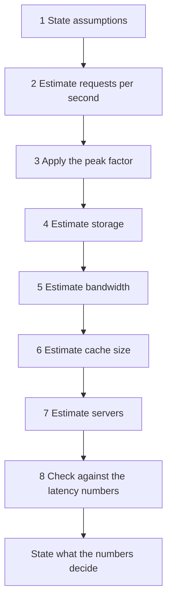

# Back-of-Envelope Estimation

Back-of-envelope estimation is a calculation with rounded numbers that gives the size of a system: requests per second, bytes of storage, bits of bandwidth, bytes of cache, and number of servers. The answer has the right order of magnitude (a power of ten), and it takes a few minutes. Most system design rounds contain this step, and the result decides the design. This page gives the reference tables, an eight-step procedure, four worked examples with every arithmetic step, and a runnable Java program that checks each example.

## Why It Matters

In most HLD rounds, the interviewer expects an estimate in the first ten minutes, and the numbers then drive the rest of the round. Some interviewers tell you to skip a full estimate. Then you compute only the number that a decision needs, at the moment that you make the decision (see the trade-offs table below). A system that needs 40 writes per second fits on one database server. A system that needs 400,000 writes per second needs partitioning (see [partitioning and sharding](fundamentals/06-partitioning-and-sharding.md)). Storage of 3 TB fits on one disk array. Storage of 80 PB needs an object store (see [storage types](fundamentals/10-storage-types.md)). A candidate who skips the estimate cannot justify a cache, a queue, or a shard. A candidate who estimates with wrong units (bits against bytes, average against peak) designs a system that is ten times too small or too large. On the job, the same calculation is the first step of capacity planning and of a cost review: before you order servers or sign a cloud contract, you compute the load and the data size from the product forecast. The estimate is the second step of the [HLD interview procedure](how-to-approach-hld.md).

## Core Concepts

**Order of magnitude**: the power of ten of a number. 40 and 90 have the same order of magnitude (10^1). 400 has the next one. An estimate aims at the order of magnitude, not at the exact value.

**Daily active users (DAU)**: the number of distinct users who use the product in one day. **Monthly active users (MAU)** counts distinct users in a month. DAU is smaller than MAU. The ratio of DAU to MAU depends on the product, so ask for DAU, or state the assumption.

**Queries per second (QPS)**: the number of requests that the system receives each second. This page uses QPS for any request (read or write). Some teams write RPS (requests per second) for the same quantity.

**Average and peak load**: average QPS is the daily total divided by the seconds in a day. Peak QPS is the highest rate in a period, for example in the busiest minute. The **peak factor** is the ratio of peak to average. Capacity must cover the peak.

**Read-write ratio**: the number of reads for each write. A URL shortener has a ratio of about 100 reads for each write (an assumption in the worked example below). Assumption: a one-to-one chat system has a ratio near 1, because each message is written once and read by one recipient.

**Replication factor**: the number of copies of each piece of data. A factor of 3 triples the storage. See [replication](fundamentals/05-replication.md).

**Working set**: the part of the data that requests touch in a given period. A cache must hold the working set to give a high hit ratio. See [caching](fundamentals/03-caching.md).

**Throughput and bandwidth**: throughput is the work done per second (requests per second). Bandwidth is the data that crosses a link per second (bits per second). A link is rated in bits per second. A file is measured in bytes. One byte has 8 bits.

**Little's law**: in a stable system, the average number of requests in the system equals the arrival rate times the average time that each request spends in the system (L = λ × W). Little proved it in 1961. The estimates use it to compute concurrent viewers and requests in flight.

### Powers of 2 and powers of 10

Memory sizes use powers of 2. Business numbers (users, requests) use powers of 10. The two differ by 2.4% at 10^3 and by 12.6% at 10^15, so use powers of 10 for a first-pass estimate and state the unit.

| Power of 2 | Exact value | Name | Approximate power of 10 |
|---|---|---|---|
| 2^10 | 1,024 | 1 kibibyte (KiB) | 10^3 (thousand) |
| 2^20 | 1,048,576 | 1 mebibyte (MiB) | 10^6 (million) |
| 2^30 | 1,073,741,824 | 1 gibibyte (GiB) | 10^9 (billion) |
| 2^32 | 4,294,967,296 | Number of IPv4 addresses | 4.3 × 10^9 |
| 2^40 | 1,099,511,627,776 | 1 tebibyte (TiB) | 10^12 (trillion) |
| 2^64 | 18,446,744,073,709,551,616 | Number of 64-bit values | 1.8 × 10^19 |

The SI prefixes (kilo, mega, giga) mean powers of 10. The IEC prefixes (kibi, mebi, gibi) mean powers of 2. The IEC approved the binary prefixes in December 1998 (NIST, "Prefixes for binary multiples"). A "1 TB" disk in a vendor specification means 10^12 bytes. This page uses the SI prefixes (1 KB = 1,000 bytes) in every calculation. The SI symbol for kilo is a lowercase k (kB). This page writes KB, as most engineering documents do, and means 1,000 bytes. The Java program checks the powers of 2 above.

| Unit | Bytes | Example of a size (approximate, an assumption of this KB) |
|---|---|---|
| 1 byte (B) | 1 | One ASCII character |
| 1 KB | 10^3 | A short text post with its metadata |
| 1 MB | 10^6 | A compressed photo from a phone, about 0.5 to 3 MB |
| 1 GB | 10^9 | A one-hour video at 2.2 Mbit/s (3,600 s × 2.2 Mbit/s / 8 = 990 MB) |
| 1 TB | 10^12 | 1,000 GB. One server disk array holds several TB |
| 1 PB | 10^15 | 1,000 TB. A storage cluster |

### Time

| Period | Seconds (exact) | Rounded for estimates |
|---|---|---|
| 1 minute | 60 | 60 |
| 1 hour | 3,600 | 3.6 × 10^3 |
| 1 day | 86,400 | 10^5 |
| 1 month (30 days) | 2,592,000 | 2.6 × 10^6, or 3 × 10^6 with the day rounded to 10^5 |
| 1 year (365 days) | 31,536,000 | 3 × 10^7, or 3.65 × 10^7 with the day rounded to 10^5 |

**Rounding rule of this page**: one day is 100,000 seconds. The exact value is 86,400, so the rounded day is 15.7% longer, and every rate computed with it is 13.6% lower than the exact rate. Rounding to 10^5 turns a division into a shift of the decimal point. The error is smaller than the error of any assumption in the estimate (such as DAU). The URL shortener example shows the exact result next to the rounded result.

### Latency numbers

Latency is the time from the start of an operation to its result. The table below is the "Numbers Everyone Should Know" slide from Jeff Dean's keynote at LADIS 2009, "Designs, Lessons and Advice from Building Large Distributed Systems" (slide 24 of the PDF). The numbers describe hardware from about 2009, and Dean gave them as round numbers. The operation names below are a plain-language rewording of the slide (the slide writes, for example, "Send packet CA->Netherlands->CA"). Treat every value as **approximate**. The last column is added by this KB: the ratio to a main memory reference.

| Operation | Latency (approximate, Dean, LADIS 2009) | In other units | Ratio to main memory (100 ns) |
|---|---|---|---|
| L1 cache reference | 0.5 ns | | 0.005 |
| Branch mispredict | 5 ns | | 0.05 |
| L2 cache reference | 7 ns | | 0.07 |
| Mutex lock and unlock | 25 ns | | 0.25 |
| Main memory reference | 100 ns | | 1 |
| Compress 1 KB with Zippy | 3,000 ns | 3 µs | 30 |
| Send 2 KB over a 1 Gbps network | 20,000 ns | 20 µs | 200 |
| Read 1 MB sequentially from memory | 250,000 ns | 250 µs | 2,500 |
| Round trip within the same data center | 500,000 ns | 0.5 ms | 5,000 |
| Disk seek | 10,000,000 ns | 10 ms | 100,000 |
| Read 1 MB sequentially from disk | 20,000,000 ns | 20 ms | 200,000 |
| Send a packet from California to the Netherlands and back | 150,000,000 ns | 150 ms | 1,500,000 |

Colin Scott's page, "Numbers Every Programmer Should Know By Year" (<https://colin-scott.github.io/personal_website/research/interactive_latency.html>), is an interactive version of this list. This KB read the page and its source code on 2026-10-15. A comment in the source code says that all of Norvig's original numbers are from 2002, and that any number without a citation comes from Peter Norvig's article "Teach Yourself Programming in Ten Years". The page projects each number to a year that the reader chooses on a slider, with doubling or halving rates that the source code cites from other sources. Some functions in the model return a fixed value:

- Main memory reference: 100 ns for every year after 2000. For earlier years, the model uses a formula.
- Round trip in the same data center: 500,000 ns for every year. The code comment says "Assume this doesn't change much?".
- Packet round trip from California to the Netherlands: 150,000,000 ns for every year.
- Random read from an SSD: 16,000 ns (16 µs) for every year after 2014. For 2014 and earlier, the model uses a formula.

The page computes the other numbers with formulas, and this KB does not copy the projected values, because they are the page's model and not a measurement. Dean's list has no SSD row, so the SSD value of 16 µs (approximate, Scott's model) is the only SSD number on this page.

Norvig's table differs from Dean's slide in a few rows. Norvig gives 8,000,000 ns for a disk seek (Dean: 10,000,000 ns), and his table has no row for compression and no row for a round trip in a data center. Use Dean's values on this page, and know that the published lists differ.

Recommendation: use these numbers for the order of magnitude and for ratios, and do not quote them as a measurement of today's hardware. Real latencies depend on the hardware, the cloud region, and the load. In a real capacity review, measure.

**What the numbers teach**

- Memory is about 100,000 times faster than a disk seek (10,000,000 ns divided by 100 ns). A design that avoids a disk seek on the hot path gains five orders of magnitude. This is the reason for a cache.
- A round trip in one data center (0.5 ms) is 5,000 times a memory reference. A request that makes 20 sequential calls to other services spends at least 10 ms on the network (20 × 0.5 ms). The design should keep the number of sequential calls on the hot path small, and make independent calls in parallel.
- A round trip between continents (150 ms) is 300 times a round trip in a data center. A synchronous call across regions on the hot path costs 150 ms. This is the reason for a CDN, for regional replicas, and for asynchronous replication across regions. See [multi-region and disaster recovery](fundamentals/19-multi-region-and-disaster-recovery.md).
- Sequential reads are much cheaper than random reads on a disk. Reading 1 MB sequentially costs 20 ms, which is only twice one seek (10 ms). Reading the same 1 MB as 250 random blocks of 4 KB costs 250 seeks, which is 2.5 s, or 125 times the sequential read. Append-only logs use this fact. See `kb/databases/06-storage-engines.md`.
- Compression is cheap against the network. Compressing 1 KB costs 3 µs, and sending 2 KB over a 1 Gbps link costs 20 µs. Compress data before it crosses a slow or expensive link.

A human-scale comparison: if 1 ns took 1 second, a memory reference would take 100 seconds, a round trip in a data center 5.8 days, a disk seek 115.7 days, and a round trip from California to the Netherlands 4.76 years. The Java program computes these values.

## How It Works

### The procedure



Write each number with its unit. Write each assumption on the board, and mark it as an assumption. If the interviewer gives a number, use it and replace your assumption.

### Step 1. State assumptions

List the inputs before you compute. Ask the interviewer for the inputs that you cannot guess, and choose the others yourself.

| Input | Question | Typical form of the answer |
|---|---|---|
| Users | How many daily active users? | 100 million DAU |
| Actions | How many times does a user do the main action each day? | 10 feed loads for each user for each day |
| Read-write ratio | How many reads for each write? | 100 to 1 |
| Object size | How large is one record, one post, one file? | 500 bytes, 1 KB, 500 KB |
| Retention | How long do we keep the data? | 5 years |
| Replication | How many copies? | 3 |
| Peak factor | How much higher is the peak than the average? | 2 or 3 |
| Capacity of one server | How many requests per second for one server? | 5,000 for a light request |

Round the inputs: 100 million, not 97 million. A round input makes the arithmetic short and removes false precision.

### Step 2. Estimate requests per second

The formula:

```text
average QPS = (users × actions per user per day) / seconds per day
```

With the rounding rule, "seconds per day" is 10^5, so divide by 100,000. Compute the write QPS and the read QPS separately, because they load different components. Use the read-write ratio to get the second from the first.

Example (assumption: 100 million DAU, 10 feed loads each): the daily total is 1 billion loads. Divide by 10^5. The average is 10,000 loads per second.

If the input is a monthly volume, divide by the seconds in a month (3 × 10^6 with the rounding rule). Example (assumption: 100 million new URLs in a month): 100,000,000 / 3,000,000 = 33 writes per second.

### Step 3. Apply the peak factor

Traffic is not flat. Users follow the day: more requests in the evening, fewer at night. Capacity must serve the peak, so multiply the average by the peak factor.

Assumption: use a peak factor of 2 to 3 for a consumer product with one main time zone, and ask the interviewer for the factor if an event drives the traffic (a sale, a live match, a ticket release). No published constant gives the factor, so the number is an assumption. State it, and show that the design survives a larger value. This is a recommendation of this KB.

### Step 4. Estimate storage

```text
storage per day = records per day × bytes per record
storage for the retention period = storage per day × days kept
storage with replication = storage for the retention period × replication factor
```

Add the parts that the first formula misses:

- **Metadata and indexes**: a record has keys, timestamps, and index entries. Add 20% to 100% for small records, and state the number as an assumption.
- **Media**: if posts have images or videos, compute the media separately from the text. Media is often larger than the text by two orders of magnitude or more.
- **Replication**: multiply by the replication factor. With erasure coding, multiply by the storage factor (k + m) / k. For RS(6,3), six data fragments and three parity fragments, the factor is 9 / 6 = 1.5, which is 50% overhead. See [storage types](fundamentals/10-storage-types.md).
- **Growth**: if the user count doubles each year, say so, and compute the storage for the end of the retention period.

### Step 5. Estimate bandwidth

```text
bandwidth (bytes per second) = QPS × bytes per request or response
bandwidth (bits per second)  = bandwidth in bytes per second × 8
```

Compute ingress (data into the system) and egress (data out of the system) separately. Egress is larger for a read-heavy system, and cloud providers often price egress. Compute the peak from the peak QPS. Convert to bits per second at the end, because network links are rated in bits.

If a CDN serves the large objects, the bandwidth at the origin is smaller than the bandwidth at the edge. Compute both, and say which one a component carries. See [load balancing, DNS, and CDN](fundamentals/02-load-balancing-dns-cdn.md).

### Step 6. Estimate cache size

A cache holds the working set. The estimate has two parts:

```text
cache size = number of cached objects × bytes per object
```

Choose the number of objects with a rule of thumb: if a small share of the objects gets most of the reads, cache that share. The rule "20% of the objects get 80% of the reads" (the Pareto rule) is a rule of thumb and not a law. State it as an assumption, and apply it to the distinct objects that the system reads in one day, not to all stored objects:

```text
cache size = distinct objects read per day × 0.2 × bytes per object
```

If you do not know the number of distinct objects, use the number of reads in a day. That count includes repeated reads of one object, so the result is an upper bound. The cache sizing section of the [caching page](fundamentals/03-caching.md) starts from the distinct keys, adds the overhead of each entry and spare memory, and shows how the hit ratio depends on the working set.

If the result fits in the memory of one machine (tens to hundreds of GB), one cache node is enough for capacity, and the number of nodes is set by throughput and availability. If the result is several TB, the cache is a cluster with partitioning.

### Step 7. Estimate servers

```text
servers = ceil(peak QPS / QPS of one server)
servers with spare capacity = servers + spare servers
```

Get the capacity of one server in one of two ways:

- **Assume it.** Assumption: 5,000 requests per second for a light request, and 1,000 to 2,000 for a request that does database work. These are round numbers of this KB, not measurements.
- **Derive it from the CPU time of one request.** Assumption: a server with 16 cores and 20 ms of CPU time for each request. It serves at most 16 / 0.02 = 800 requests per second, with every core busy all the time.

State which method you use. Do not plan for 100% CPU use. As the use of a server approaches 100%, requests wait in a queue, and the queueing delay grows without a bound. Recommendation: plan for a target use well below saturation, for example 50% to 70% (an assumption of this KB), so 800 requests per second at 100% becomes 400 to 560 requests per second for planning. Then add spare capacity so that one failure does not overload the rest (N+1 means one extra server). See [scalability and availability](fundamentals/01-scalability-and-availability.md).

A second formula uses Little's law to count requests in flight. Assumption: 10,000 requests per second with a mean latency of 50 ms. They give 10,000 × 0.05 = 500 requests in flight. This number sets the size of thread pools and connection pools.

### Step 8. Check against the latency numbers

Compute the latency budget of the main request. Add the latencies of the sequential steps from the table: for example, one cache read in the same data center (0.5 ms for the round trip) and one database read that misses the database's memory and goes to a spinning disk (0.5 ms for the round trip and 10 ms for the seek). On an SSD, the read costs about 16 µs instead of 10 ms (Scott's model, approximate). If the total is above the target, change the design: add a cache, make calls parallel, or move data closer to the user.

### Worked example 1. Image results page (Jeff Dean, 2009)

Dean's slides (PDF pages 25 and 26) use this example to show the method. The question: how long does it take to generate a results page with 30 thumbnails? Design 1 reads the 30 images one after another and creates each thumbnail from a 256 KB image. Design 2 issues the 30 reads in parallel. The disk reads at 30 MB/s (from the slides), and a seek costs 10 ms.

The slides print these two lines:

```text
30 seeks * 10 ms/seek + 30 * 256K / 30 MB/s = 560 ms
10 ms/seek + 256K read / 30 MB/s = 18 ms
```

The table recomputes them with the SI prefixes of this page (256 KB = 256,000 bytes, 30 MB/s = 30,000,000 bytes per second).

| Step | Calculation | Result |
|---|---|---|
| One read of 256 KB | 256,000 B / 30,000,000 B/s | 0.00853 s = 8.53 ms |
| Design 1, serial: 30 seeks | 30 × 10 ms | 300 ms |
| Design 1, serial: 30 reads | 30 × 8.53 ms | 256 ms |
| Design 1, total | 300 ms + 256 ms | 556 ms (the slide prints 560 ms) |
| Design 2, parallel: one seek and one read | 10 ms + 8.53 ms | 18.5 ms (the slide prints 18 ms) |

With the binary prefixes (256 KiB = 262,144 bytes, 30 MiB/s = 31,457,280 bytes per second), one read takes 8.33 ms, design 1 takes 550 ms, and design 2 takes 18.3 ms. No reading of the units gives both printed values, so 560 ms and 18 ms are round numbers. Both readings agree on the order of magnitude, which is the purpose of the method.

The slide notes that design 2 ignores variance, and that the real time is "more like 30-60 ms, probably". The lesson: parallel reads change the latency from the sum of the parts to the maximum of the parts. The maximum of 30 reads is larger than one typical read, because the slowest of the 30 decides the time (see [scalability and availability](fundamentals/01-scalability-and-availability.md) for tail latency).

### Worked example 2. URL shortener

Source of the design: [URL shortener case study](case-studies/01-url-shortener.md). All inputs are assumptions of this KB.

Inputs (assumptions): 100 million new short URLs each month. 100 reads for each write. 500 bytes for each record. Retention 5 years. Replication factor 3. Peak factor 3. A server handles 5,000 requests per second.

| Step | Calculation | Result |
|---|---|---|
| Seconds in a month | 30 days × 10^5 s | 3,000,000 s |
| Writes per second | 100,000,000 / 3,000,000 | 33.3, about 33 |
| Reads per second | 33.3 × 100 | 3,333 |
| Peak writes per second | 33.3 × 3 | 100 |
| Peak reads per second | 3,333 × 3 | 10,000 |
| Records in 5 years | 100,000,000 × 12 × 5 | 6,000,000,000 |
| Storage | 6 × 10^9 × 500 B | 3 × 10^12 B = 3 TB |
| Storage with 3 replicas | 3 TB × 3 | 9 TB |
| Peak read bandwidth | 10,000 × 500 B | 5,000,000 B/s = 5 MB/s = 40 Mbit/s |
| Reads per day | 3,333 × 10^5 | 333,333,333 |
| Cache for 20% of the daily reads (rule of thumb) | 333,333,333 × 0.2 × 500 B | 33.3 GB, about 33 GB |
| Servers | ceil((10,000 + 100) / 5,000) = ceil(2.02) | 3, with one spare 4 |

Exact-day check: with 86,400 seconds in a day, the reads per second are 3,333,333 × 100 / 86,400 = 3,858. The rounded rule gave 3,333, which is 13.6% lower. The order of magnitude is the same.

The cache figure uses the reads in a day, because the number of distinct URLs read in a day is unknown. It counts each daily read as one object, so it is an upper bound: repeated reads of one URL need only one entry.

What the numbers decide: 100 writes per second at the peak fits on one database primary. Each replica holds 3 TB, which fits on one server, so the database needs no partitioning for capacity. The cache of 33 GB fits in the memory of one machine. The load is a read problem, and a cache solves it. The estimate shows that this system is small, and an interviewer expects you to say so.

### Worked example 3. Social feed

Source of the design: `kb/hld/case-studies/05-news-feed.md`. All inputs are assumptions of this KB.

Inputs (assumptions): 100 million DAU. 10 feed loads for each user for each day. 10% of the users post once a day. An average user has 200 followers. A post has 1 KB of text and metadata. 20% of the posts have an image of 500 KB. The feed cache keeps 500 post ids for each user, 8 bytes for each id. A feed load returns 20 posts. Peak factor 2. Replication factor 3. An API server handles 2,000 feed loads per second.

| Step | Calculation | Result |
|---|---|---|
| Feed loads per second | 100,000,000 × 10 / 10^5 | 10,000 |
| Peak feed loads per second | 10,000 × 2 | 20,000 |
| Posts per day | 100,000,000 × 0.10 | 10,000,000 |
| Posts per second | 10,000,000 / 10^5 | 100 |
| Feed entries per day (fan-out on write) | 10,000,000 × 200 | 2,000,000,000 |
| Feed entries per second | 2,000,000,000 / 10^5 | 20,000 |
| Text per day | 10,000,000 × 1 KB | 10 GB |
| Media per day | 10,000,000 × 0.2 × 500 KB | 1 TB |
| Text per year | 10 GB × 365 | 3.65 TB |
| Media per year | 1 TB × 365 | 365 TB |
| Total per year | 3.65 TB + 365 TB | 368.65 TB, about 370 TB |
| Total per year with 3 replicas | 368.65 TB × 3 | 1,105.95 TB, about 1.1 PB |
| Feed cache | 100,000,000 users × 500 ids × 8 B | 400 GB |
| Text bandwidth per load | 20 posts × 1 KB | 20 KB |
| Text bandwidth | 10,000 × 20 KB | 200 MB/s = 1.6 Gbit/s |
| Media bandwidth per load | 20 posts × 0.2 × 500 KB | 2 MB |
| Media bandwidth | 10,000 × 2 MB | 20 GB/s = 160 Gbit/s |
| Peak media bandwidth | 160 Gbit/s × 2 | 320 Gbit/s |
| API servers | ceil(20,000 / 2,000) | 10, with one spare 11 |

What the numbers decide: the media is 99% of the storage (365 TB of about 370 TB), so it goes to an object store and not to the database. The media bandwidth of 160 Gbit/s on average is far above what an origin serves, so a CDN is required. The 20,000 feed-entry writes per second are 200 times the 100 post writes per second, so the fan-out decides the design of the write path. The text and metadata (3.65 TB for a year, about 11 TB with 3 replicas) need a partitioned database within a few years, and the feed cache (400 GB) is a small cluster. The media bandwidth assumes that each feed load downloads every image in full. A client cache and smaller image renditions reduce it, so it is an upper bound.

### Worked example 4. Video service

Source of the design: `kb/hld/case-studies/09-video-streaming.md`. All inputs are assumptions of this KB.

Inputs (assumptions): 50 million DAU. Each user watches 5 videos each day, for 300 seconds each. The average stream is 2.5 Mbit/s. 500,000 videos are uploaded each day, with a length of 300 seconds. The original upload has a bitrate of 4 Mbit/s. The stored renditions together have a bitrate of 8 Mbit/s. Erasure coding with RS(6,3) has a storage factor of 1.5 (50% overhead). The service keeps the original upload in addition to the renditions. Transcoding costs 600 CPU-seconds for each video. A transcoding machine has 32 cores. Peak factor 2.

| Step | Calculation | Result |
|---|---|---|
| Watch seconds per day | 50,000,000 × 5 × 300 s | 75,000,000,000 s |
| Average concurrent viewers (Little's law) | 75 × 10^9 s / 10^5 s | 750,000 |
| Average egress | 750,000 × 2.5 Mbit/s | 1,875,000 Mbit/s = 1.875 Tbit/s |
| Peak egress | 1.875 Tbit/s × 2 | 3.75 Tbit/s |
| Uploads per second | 500,000 / 10^5 | 5 |
| Stored size of one video | 300 s × 8 Mbit/s / 8 | 300 MB |
| Stored per day | 500,000 × 300 MB | 150 TB |
| Stored per year | 150 TB × 365 | 54,750 TB = 54.75 PB |
| Stored per year with erasure coding | 54.75 PB × 1.5 | 82.125 PB, about 82 PB |
| Raw size of one upload | 300 s × 4 Mbit/s / 8 | 150 MB |
| Upload per day | 500,000 × 150 MB | 75 TB |
| Originals per year | 75 TB × 365 | 27,375 TB = 27.375 PB, about 27 PB |
| Originals per year with erasure coding | 27.375 PB × 1.5 | 41.0625 PB, about 41 PB |
| Total stored per year with erasure coding | 82.125 PB + 41.0625 PB | 123.1875 PB, about 120 PB |
| Ingest bandwidth | 75 TB / 10^5 s | 750 MB/s = 6 Gbit/s |
| Transcoding load | 500,000 × 600 core-s / 10^5 s | 3,000 cores |
| Transcoding machines | ceil(3,000 / 32) | 94 |
| Transcoding machines at the peak | ceil(3,000 × 2 / 32) | 188 |

What the numbers decide: the egress of 1.9 Tbit/s on average cannot come from one origin, so the CDN carries the viewing traffic, and the origin serves only the cache misses. The storage of about 120 PB a year (82 PB of renditions and 41 PB of originals) needs an object store with erasure coding. A service that deletes the originals after transcoding saves a third of it, and loses the option to transcode again into a new format. The upload rate of 5 videos a second is small, but each video is large, so the design uses chunked, resumable uploads and a queue of transcoding jobs.

## Trade-offs and When to Use

| Decision | Option A | Option B | Recommendation |
|---|---|---|---|
| Seconds in a day | 86,400 (exact) | 10^5 (rounded) | 10^5 for the first pass. It is 15.7% off, and the assumptions are less exact than that. Use 86,400 when the interviewer asks for a precise value |
| Prefixes | 1 KB = 1,000 B | 1 KiB = 1,024 B | 1,000 for an estimate. State the unit. Use 1,024 only for memory sizes where the exact value matters |
| Load to design for | Average | Peak | Peak. Show the average first, then the peak factor |
| Storage | Raw data only | Raw data, index, and replication | All three. The raw number alone is wrong by a factor of 3 or more |
| Precision | Two or three significant digits | One significant digit | One or two. More digits suggest an accuracy that the inputs do not have |
| Capacity of one server | An assumed round number | A derivation from CPU time | Assume in the first pass. Derive if the interviewer asks "why 5,000?" |
| Order of the steps | Storage before QPS | QPS before storage | QPS first, because the write QPS feeds the storage estimate |
| When to estimate | In the first 10 minutes, after the requirements | After the high-level design | Before the design, because the numbers decide the components |
| Estimate up front or on demand | All the numbers in one step | Each number at the moment a decision needs it | Up front by default, in 3 to 5 minutes. If the interviewer says "skip the math", or the scale is given, state the two or three numbers that decide the design and compute the others when a decision needs them |

Estimation does not fit these cases:

- **The interviewer states the scale.** If the interviewer says "assume 5,000 writes per second", skip step 2 and go to storage and bandwidth.
- **The system is small.** If the estimate shows that one server handles the load, say so and move on. Do not invent a distributed design for 100 requests per second.
- **A design question about latency or consistency.** An estimate of size does not answer a question about correctness. Use the estimate only to size the components.

## Java Example

The program below checks the arithmetic of every worked example on this page: the powers of 2, the time constants, the human-scale latency, the image results page, the URL shortener, the social feed, the video service, and the small checks (round trips in a latency budget, requests in flight, and the capacity of one server). It uses `double` arithmetic and fixed formats. The `main` method comes first, and the imports are in the block, so you can copy the block into `EstimationCheck.java` and run `java EstimationCheck.java` on JDK 21.

```java
import java.math.BigInteger;
import java.util.Locale;

public class EstimationCheck {
    // Rounding rule of this page: one day is 100,000 seconds. The exact value is 86,400.
    static final double DAY = 100_000;
    static final double EXACT_DAY = 86_400;
    static final double KB = 1_000;
    static final double MB = 1_000_000;
    static final double GB = 1_000_000_000;
    static final double TB = 1_000_000_000_000.0;
    static final double PB = 1_000_000_000_000_000.0;

    public static void main(String[] args) {
        powersAndTime();
        humanScaleLatency();
        imageResultsPage();
        urlShortener();
        socialFeed();
        videoService();
        littlesLaw();
    }

    static void out(String format, Object... args) {
        System.out.println(String.format(Locale.ROOT, format, args));
    }

    static void powersAndTime() {
        out("== Powers and time ==");
        out("2^10 = %d", 1L << 10);
        out("2^20 = %d", 1L << 20);
        out("2^30 = %d", 1L << 30);
        out("2^32 = %d", 1L << 32);
        out("2^40 = %d", 1L << 40);
        out("2^64 = %s", BigInteger.ONE.shiftLeft(64));
        out("seconds per day = %d", 24L * 60 * 60);
        out("seconds per 30-day month = %d", 30L * 24 * 60 * 60);
        out("seconds per year = %d", 365L * 24 * 60 * 60);
        out("rounded day / exact day = %.3f", DAY / EXACT_DAY);
    }

    static void humanScaleLatency() {
        out("== Latency if 1 ns were 1 second ==");
        out("memory reference 100 ns -> %.0f seconds", 100.0);
        out("datacenter round trip 500,000 ns -> %.1f days", 500_000 / EXACT_DAY);
        out("disk seek 10,000,000 ns -> %.1f days", 10_000_000 / EXACT_DAY);
        out("CA-Netherlands-CA 150,000,000 ns -> %.2f years", 150_000_000 / (365 * EXACT_DAY));
        out("disk seek / memory reference = %.0f", 10_000_000.0 / 100);
        out("datacenter round trip / memory reference = %.0f", 500_000.0 / 100);
    }

    static void imageResultsPage() {
        out("== Image results page (Dean, 2009) ==");
        double seekMs = 10;
        double bytesPerImage = 256_000;
        double diskBytesPerSecond = 30 * MB;
        double readMs = bytesPerImage / diskBytesPerSecond * 1000;
        out("one 256 KB read = %.2f ms", readMs);
        out("design 1, serial = 30 * 10 + 30 * %.2f = %.0f ms", readMs, 30 * seekMs + 30 * readMs);
        out("design 2, parallel = 10 + %.2f = %.1f ms", readMs, seekMs + readMs);
        double binaryReadMs = 256 * 1024 / (30.0 * 1024 * 1024) * 1000;
        out("binary units: one read = %.2f ms, serial = %.0f ms, parallel = %.1f ms",
                binaryReadMs, 30 * seekMs + 30 * binaryReadMs, seekMs + binaryReadMs);
    }

    static void urlShortener() {
        out("== URL shortener ==");
        double newUrlsPerMonth = 100_000_000;
        double secondsPerMonth = 30 * DAY;
        double writes = newUrlsPerMonth / secondsPerMonth;
        double reads = writes * 100;
        out("writes per second = %.1f", writes);
        out("reads per second = %.1f", reads);
        out("peak writes per second = %.0f", writes * 3);
        out("peak reads per second = %.0f", reads * 3);
        double records = newUrlsPerMonth * 12 * 5;
        double bytes = records * 500;
        out("records in 5 years = %.0f", records);
        out("storage = %.1f TB", bytes / TB);
        out("storage with 3 replicas = %.1f TB", bytes * 3 / TB);
        out("peak read bandwidth = %.1f MB/s = %.0f Mbit/s",
                reads * 3 * 500 / MB, reads * 3 * 500 * 8 / MB);
        double readsPerDay = reads * DAY;
        out("reads per day = %.0f", readsPerDay);
        out("cache for 20%% of daily reads = %.1f GB", readsPerDay * 0.2 * 500 / GB);
        double peakTotal = Math.round(reads * 3) + Math.round(writes * 3);
        int servers = (int) Math.ceil(peakTotal / 5_000);
        out("servers = ceil(%.0f / 5000) = %d, with one spare = %d",
                peakTotal, servers, servers + 1);
        double exactReads = newUrlsPerMonth / 30 * 100 / EXACT_DAY;
        out("reads per second with exact day = %.0f (rounded rule gave %.0f)", exactReads, reads);
    }

    static void socialFeed() {
        out("== Social feed ==");
        double dau = 100_000_000;
        double loads = dau * 10 / DAY;
        out("feed loads per second = %.0f", loads);
        out("peak feed loads per second = %.0f", loads * 2);
        double postsPerDay = dau * 0.10;
        out("posts per day = %.0f, per second = %.0f", postsPerDay, postsPerDay / DAY);
        double feedWrites = postsPerDay * 200;
        out("feed entries per day = %.0f, per second = %.0f", feedWrites, feedWrites / DAY);
        double textPerDay = postsPerDay * KB;
        double mediaPerDay = postsPerDay * 0.2 * 500 * KB;
        out("text per day = %.0f GB, media per day = %.0f TB", textPerDay / GB, mediaPerDay / TB);
        double yearTotal = (textPerDay + mediaPerDay) * 365;
        out("text per year = %.2f TB, media per year = %.0f TB",
                textPerDay * 365 / TB, mediaPerDay * 365 / TB);
        out("total per year = %.2f TB, with 3 replicas = %.2f TB = %.1f PB",
                yearTotal / TB, yearTotal * 3 / TB, yearTotal * 3 / PB);
        out("feed cache = %.0f GB", dau * 500 * 8 / GB);
        double textBytesPerLoad = 20 * KB;
        double mediaBytesPerLoad = 20 * 0.2 * 500 * KB;
        out("text per load = %.0f KB, media per load = %.0f MB",
                textBytesPerLoad / KB, mediaBytesPerLoad / MB);
        out("text bandwidth = %.0f MB/s = %.1f Gbit/s",
                loads * textBytesPerLoad / MB, loads * textBytesPerLoad * 8 / GB);
        out("media bandwidth = %.0f GB/s = %.0f Gbit/s, peak = %.0f Gbit/s",
                loads * mediaBytesPerLoad / GB, loads * mediaBytesPerLoad * 8 / GB,
                loads * 2 * mediaBytesPerLoad * 8 / GB);
        int servers = (int) Math.ceil(loads * 2 / 2_000);
        out("API servers = ceil(%.0f / 2000) = %d, with one spare = %d",
                loads * 2, servers, servers + 1);
    }

    static void videoService() {
        out("== Video service ==");
        double dau = 50_000_000;
        double watchSeconds = dau * 5 * 300;
        out("watch seconds per day = %.0f", watchSeconds);
        double concurrent = watchSeconds / DAY;
        out("average concurrent viewers = %.0f", concurrent);
        double egressMbit = concurrent * 2.5;
        out("average egress = %.3f Tbit/s, peak = %.2f Tbit/s",
                egressMbit / 1_000_000, egressMbit * 2 / 1_000_000);
        double uploads = 500_000;
        out("uploads per second = %.1f", uploads / DAY);
        double storedPerVideo = 300 * 8 / 8.0 * MB;
        out("stored per video = %.0f MB", storedPerVideo / MB);
        out("stored per day = %.0f TB", uploads * storedPerVideo / TB);
        double perYear = uploads * storedPerVideo * 365;
        out("stored per year = %.2f PB, with erasure coding 1.5x = %.3f PB",
                perYear / PB, perYear * 1.5 / PB);
        double rawPerVideo = 300 * 4 / 8.0 * MB;
        out("raw upload per video = %.0f MB, per day = %.0f TB, ingest = %.0f MB/s = %.0f Gbit/s",
                rawPerVideo / MB, uploads * rawPerVideo / TB, uploads * rawPerVideo / DAY / MB,
                uploads * rawPerVideo * 8 / DAY / GB);
        double originalsPerYear = uploads * rawPerVideo * 365;
        out("originals per year = %.3f PB, with erasure coding 1.5x = %.4f PB",
                originalsPerYear / PB, originalsPerYear * 1.5 / PB);
        out("total per year with erasure coding = %.4f PB",
                (perYear + originalsPerYear) * 1.5 / PB);
        double coreSeconds = uploads * 600;
        double cores = coreSeconds / DAY;
        out("transcode cores = %.0f, machines of 32 cores = %d, at peak 2x = %d",
                cores, (int) Math.ceil(cores / 32), (int) Math.ceil(cores * 2 / 32));
    }

    static void littlesLaw() {
        out("== Two small checks ==");
        out("round trips in a 100 ms budget at 0.5 ms each = %.0f", 100 / 0.5);
        out("requests in flight = 10000 * 0.05 = %.0f", 10_000 * 0.05);
        out("one server = 16 cores / 0.02 s per request = %.0f requests/s", 16 / 0.02);
        out("one server at 50%% to 70%% target use = %.0f to %.0f requests/s",
                16 / 0.02 * 0.5, 16 / 0.02 * 0.7);
    }
}
```

The output is deterministic. Compare each line with the tables above.

<!-- expected-output -->
```text
== Powers and time ==
2^10 = 1024
2^20 = 1048576
2^30 = 1073741824
2^32 = 4294967296
2^40 = 1099511627776
2^64 = 18446744073709551616
seconds per day = 86400
seconds per 30-day month = 2592000
seconds per year = 31536000
rounded day / exact day = 1.157
== Latency if 1 ns were 1 second ==
memory reference 100 ns -> 100 seconds
datacenter round trip 500,000 ns -> 5.8 days
disk seek 10,000,000 ns -> 115.7 days
CA-Netherlands-CA 150,000,000 ns -> 4.76 years
disk seek / memory reference = 100000
datacenter round trip / memory reference = 5000
== Image results page (Dean, 2009) ==
one 256 KB read = 8.53 ms
design 1, serial = 30 * 10 + 30 * 8.53 = 556 ms
design 2, parallel = 10 + 8.53 = 18.5 ms
binary units: one read = 8.33 ms, serial = 550 ms, parallel = 18.3 ms
== URL shortener ==
writes per second = 33.3
reads per second = 3333.3
peak writes per second = 100
peak reads per second = 10000
records in 5 years = 6000000000
storage = 3.0 TB
storage with 3 replicas = 9.0 TB
peak read bandwidth = 5.0 MB/s = 40 Mbit/s
reads per day = 333333333
cache for 20% of daily reads = 33.3 GB
servers = ceil(10100 / 5000) = 3, with one spare = 4
reads per second with exact day = 3858 (rounded rule gave 3333)
== Social feed ==
feed loads per second = 10000
peak feed loads per second = 20000
posts per day = 10000000, per second = 100
feed entries per day = 2000000000, per second = 20000
text per day = 10 GB, media per day = 1 TB
text per year = 3.65 TB, media per year = 365 TB
total per year = 368.65 TB, with 3 replicas = 1105.95 TB = 1.1 PB
feed cache = 400 GB
text per load = 20 KB, media per load = 2 MB
text bandwidth = 200 MB/s = 1.6 Gbit/s
media bandwidth = 20 GB/s = 160 Gbit/s, peak = 320 Gbit/s
API servers = ceil(20000 / 2000) = 10, with one spare = 11
== Video service ==
watch seconds per day = 75000000000
average concurrent viewers = 750000
average egress = 1.875 Tbit/s, peak = 3.75 Tbit/s
uploads per second = 5.0
stored per video = 300 MB
stored per day = 150 TB
stored per year = 54.75 PB, with erasure coding 1.5x = 82.125 PB
raw upload per video = 150 MB, per day = 75 TB, ingest = 750 MB/s = 6 Gbit/s
originals per year = 27.375 PB, with erasure coding 1.5x = 41.0625 PB
total per year with erasure coding = 123.1875 PB
transcode cores = 3000, machines of 32 cores = 94, at peak 2x = 188
== Two small checks ==
round trips in a 100 ms budget at 0.5 ms each = 200
requests in flight = 10000 * 0.05 = 500
one server = 16 cores / 0.02 s per request = 800 requests/s
one server at 50% to 70% target use = 400 to 560 requests/s
```

Two lines of the output show the effect of the rounding rule. The line "rounded day / exact day = 1.157" shows that the rounded day is 15.7% longer than the exact day. The line "reads per second with exact day = 3858" shows the URL shortener result without rounding.

## Interview Angle

### Questions

??? question "How do you estimate the requests per second of a system when you only know the number of users?"

    I convert users to a daily request count, and then to a rate.

    1. I ask for the daily active users (DAU), or I assume a number and say that it is an assumption.
    2. I ask how many times each user does the main action in a day, or I assume it. Example: 100 million DAU and 10 feed loads each give 1 billion loads a day.
    3. I divide by the seconds in a day. I use 10^5 for the rounded day (the exact value is 86,400). 1 billion / 10^5 is 10,000 requests per second on average.
    4. I split the total into reads and writes with the read-write ratio, because they load different components.
    5. I multiply by a peak factor of 2 or 3 to get the peak, because capacity must serve the peak and not the average.

    The trade-off: the rounded day gives a rate that is 13.6% lower than the exact one, and the assumptions of step 1 and 2 have a larger error, so the rounding does not change the design.

??? question "Why do you round a day to 100,000 seconds, and when is that wrong?"

    One day has 24 × 60 × 60 = 86,400 seconds. I round to 10^5 because dividing by 10^5 is a shift of the decimal point, and that keeps the arithmetic correct under time pressure. The rounded day is 15.7% longer than the real day, so every rate that I compute is 13.6% too low (86,400 / 100,000 = 0.864). The assumptions about the user count and the actions for each user are less exact than that, so the error does not change the order of magnitude. The rounding is wrong when the result is close to a threshold: if one server handles 3,500 requests per second and my rounded estimate is 3,333, the exact value (3,858) is above the capacity. In that case I use 86,400, or I add a margin. I say that I rounded.

??? question "Estimate the storage for a service that stores 100 million new records a month for 5 years, each 500 bytes."

    I compute the raw data first. 100 million records a month for 60 months is 6 billion records. At 500 bytes each, that is 6 × 10^9 × 500 = 3 × 10^12 bytes, which is 3 TB. Then I add what the raw number leaves out. With a replication factor of 3, the total is 9 TB. Indexes and metadata add a further 20% to 100% for small records, so I say "about 9 to 18 TB" and state which assumption I use. I compare the result with what one machine holds (several TB per disk array): this fits in a few machines, so storage capacity does not force partitioning, but I may still partition for write throughput or for availability. I check units: a "3" here is terabytes because the exponent is 12, not gigabytes.

??? question "How do you choose the peak factor?"

    The peak factor is the ratio of the peak load to the average load. No published constant gives it, so it is an assumption, and I say so. For a consumer product that serves mostly one region, I use 2 to 3, because traffic follows the day and the busiest hour is two to three times the average. I ask the interviewer if an event drives the traffic (a ticket sale, a live match, a flash sale), because the peak is then often much higher than 3, and the design needs admission control or a queue. I also show that the design survives a larger value: I say which component fails first if the peak is 10 instead of 3. If I have real data, I use the measured ratio of the busiest minute to the daily average. See [scalability and availability](fundamentals/01-scalability-and-availability.md).

??? question "Which latency numbers do you remember, and how do they affect a design?"

    I remember the orders of magnitude, from Jeff Dean's list (LADIS 2009, approximate): a main memory reference is about 100 ns, a round trip in the same data center is about 0.5 ms, a disk seek is about 10 ms, and a round trip between continents is about 150 ms. I add that Colin Scott's model gives about 16 µs for an SSD random read, and I treat that as approximate, because it is a model and the real value depends on the device. The ratios matter more than the values. Memory is about 100,000 times faster than a disk seek, so I cache the hot data in memory. A call in the data center costs 0.5 ms, so a request with 20 sequential calls costs at least 10 ms, and I make independent calls in parallel. A call across continents costs 150 ms, so I avoid it on the hot path and use a CDN or a regional replica. I say that the numbers are dated and I would measure the real values for a real system.

??? question "How do you decide the number of servers?"

    I divide the peak QPS by the capacity of one server and round up. Then I add spare capacity so that one failure does not overload the rest. For example, a peak of 10,100 requests per second and a capacity of 5,000 requests per second for each server give ceil(2.02) = 3 servers, and with one spare, 4. I get the capacity in one of two ways. I assume it from the type of request (a light request is in the thousands per second, a request with database work in the hundreds to low thousands). Or I derive it from the CPU time of a request: 16 cores and 20 ms of CPU for each request give 16 / 0.02 = 800 requests per second. I do not plan for 100% CPU, because the queueing delay grows without a bound as a server approaches saturation. I plan for a target use such as 50% to 70%, which turns 800 into 400 to 560 requests per second. I state which method I used, and I say that a load test replaces the assumption in a real project.

??? question "How do you estimate the size of a cache?"

    I estimate the working set: the objects that the requests touch in a period. I take the number of distinct objects that the system reads in a day, assume that a small share of them gets most of the reads (the rule of thumb is 20% of the objects for 80% of the reads, and I say that it is an assumption and not a law), and multiply by the size of one object. If I do not know the distinct count, I use the number of reads in a day, which gives an upper bound. For the URL shortener: 333 million reads a day × 20% × 500 bytes is 33 GB, an upper bound that fits in the memory of one machine. I add the overhead of each cache entry and spare memory before I choose the node size. If the result is several TB, the cache is a partitioned cluster. If the result is small, I may cache everything. I also say that the hit ratio depends on the access pattern, and that the number is a starting point. See [caching](fundamentals/03-caching.md).

??? question "What is the difference between bandwidth in bits and in bytes, and why does it matter in an estimate?"

    Files and records are measured in bytes. Network links are rated in bits per second, and one byte has 8 bits. If a service sends 5 MB per second, it uses 40 Mbit/s of a link. A mistake of this kind is a factor of 8, which can move the design from one link to a cluster. I compute the bandwidth in bytes per second (QPS × bytes for each response), and I convert to bits at the last step. I also separate ingress (data in) from egress (data out), and the origin from the CDN edge. For the video example, 750,000 concurrent viewers at 2.5 Mbit/s give 1.875 Tbit/s, and a CDN must carry it.

??? question "The interviewer says your assumption is wrong. What do you do?"

    I take the interviewer's number and recompute the affected lines. That is the purpose of writing each assumption on the board: the estimate is a chain of steps, so I change one input and the later numbers follow. I also check whether the new value changes a decision. If DAU goes from 100 million to 200 million, the QPS doubles, and I ask whether the design that I drew still holds (one primary database, one cache cluster). If the decision does not change, I say that the order of magnitude is the same and I move on. If it changes, I say which component changes and why. I do not defend a number that I chose without a source.

### Follow-up Questions

??? question "Why do you use Little's law in the video example?"

    Little's law says that the average number in the system equals the arrival rate times the average time in the system (L = λW). The "system" is the set of viewers who watch at a given moment. The arrival rate is the number of views that start each second: 50 million × 5 = 250 million views a day, divided by 10^5 seconds, is 2,500 views per second. Each view lasts W = 300 seconds. So L = 2,500 × 300 = 750,000 viewers at the same moment. The table gets the same number in one step: 75 billion watch-seconds a day divided by 10^5 seconds. This number multiplied by the bitrate gives the egress. The result is an average over the day. The peak factor turns it into the capacity that the CDN needs.

??? question "Your estimate says one database server is enough. What do you say next?"

    I say that capacity is not the only reason to add machines. The system still needs availability, so I add a replica and a failover plan (see [replication](fundamentals/05-replication.md)). It may need a read cache for latency. I also state the growth: when the load grows by a factor of 10, which component is the first to fail. I do not invent partitioning for a load that one server handles.

??? question "How do you check that an estimate is reasonable?"

    I compare it with a number that I know. 1.9 Tbit/s of video egress is the traffic of a very large service, which fits 50 million daily users. 20,000 feed entries per second on a database is high but possible with partitioning. A result that is far from every reference (for example, 100 PB of storage for a photo app with a million users) shows an error in units or in an assumption. I also redo the calculation with different rounding, and I check the exponent of each unit.

### Red Flags

- No units: "the system stores 3 million". Million what?
- Bits and bytes mixed in one calculation.
- Designing for the average load, with no peak factor.
- Forgetting the replication factor, the indexes, or the media in the storage estimate.
- Many digits (for example 3,858.02 requests per second) with no reason.
- Choosing assumptions silently. The interviewer cannot correct what is not stated.
- Skipping the estimate and then choosing a distributed design for a load that one machine handles.
- Quoting a latency number as a fact of today's hardware, with no "approximate" and no source.

## Common Mistakes

| Mistake | Why it hurts | Fix |
|---|---|---|
| Mixing bits and bytes | The bandwidth is wrong by a factor of 8 | Compute in bytes. Convert to bits at the last step |
| Mixing KB and KiB, or MB and MiB | A few percent at KB, more at TB and PB | Use 1,000 for an estimate and state the unit |
| Using the average as the capacity | The system fails at the peak | Multiply by the peak factor. State it |
| Forgetting replication | The storage is 3 times too small | Multiply by the replication factor. For erasure coding, use its overhead |
| Forgetting metadata and indexes | The storage is too small by 20% to 100% | Add an assumed overhead |
| Treating DAU as concurrent users | The load is too high by a factor of 100 or more | Concurrent users = DAU × time online / seconds per day, or use Little's law |
| Not separating reads and writes | The design loads the wrong component | Compute each rate. Use the read-write ratio |
| Computing the storage of one day and stopping | The retention period is missing | Multiply by the days kept |
| Ignoring the media | The media is often 99% of the bytes | Compute the media separately |
| Too much precision | It suggests an accuracy that does not exist | Round to one or two significant digits |
| Using old latency numbers as exact | The values change with the hardware | Label them approximate. Give the source and the date |
| Estimating and then not using the result | The estimate has no value if the design ignores it | End each estimate with "this decides ..." |

## Commonly Confused With

| Looks like | Difference | Deciding question |
|---|---|---|
| Average QPS vs peak QPS | The average is the daily total divided by the seconds in a day. The peak is the highest rate in a short period | Which one does the capacity have to serve? The peak |
| Throughput vs bandwidth | Throughput is work per second (requests). Bandwidth is data per second (bits) | Do I count requests or bits? |
| Latency vs throughput | Latency is the time of one operation. Throughput is the number of operations per second | Does the question ask how long, or how many? |
| DAU vs concurrent users | DAU counts users in a day. Concurrent users are online at one moment | Is the number a count over a day, or at one instant? |
| KB vs KiB | KB is 1,000 bytes (SI). KiB is 1,024 bytes (IEC) | Which prefix does the source use? |
| Bits per second vs bytes per second | One byte is 8 bits. Links are rated in bits | Is the unit written Mbit/s or MB/s? |
| Storage with replication vs raw storage | Replication multiplies the raw size by the number of copies | Is the size what the application stores, or what the disks hold? |
| Estimation vs capacity planning | Estimation gives an order of magnitude in minutes. Capacity planning uses measured load, with tests and margins | Is the number a first guess or a purchase decision? |

## Quick Reference Card

Read this before an interview.

**Constants**: 1 day = 86,400 s, rounded to 10^5. 1 month (30 days) = 2.6 × 10^6 s, rounded to 3 × 10^6. 1 year = 3.15 × 10^7 s, rounded to 3 × 10^7 (or 3.65 × 10^7 with the rounded day). 2^10 = 1,024. 2^20 is about 10^6. 2^30 is about 10^9. 2^40 is about 10^12. 1 byte = 8 bits.

**Latency (approximate, Dean, LADIS 2009)**: memory 100 ns. Same-data-center round trip 0.5 ms. Disk seek 10 ms. Read 1 MB from disk 20 ms. Cross-continent round trip 150 ms. SSD random read about 16 µs (Scott's model).

**Formulas**

- QPS = users × actions per user per day / 10^5. Peak = QPS × 2 or 3.
- Storage = records × bytes × days kept × replication factor.
- Bandwidth (bits per second) = QPS × bytes × 8.
- Cache = distinct objects read per day × 0.2 × bytes (the 20% is a rule of thumb). With reads per day instead of distinct objects, the result is an upper bound.
- Servers = ceil(peak QPS / capacity of one server at the target use) + spare.
- Requests in flight = QPS × latency in seconds (Little's law).

**Say out loud**: the assumption, the unit, the peak factor, and the decision that the number drives.

**Checks**: units (bits or bytes), peak or average, replication, indexes, media, retention.

**Worked results of this page**: URL shortener, 10,000 peak reads per second, 9 TB, 33 GB cache, 4 servers. Feed, 20,000 peak loads per second, 1.1 PB a year, 320 Gbit/s peak media, 11 servers. Video, 1.875 Tbit/s average egress, about 120 PB a year (82 PB of renditions, 41 PB of originals), 94 transcoding machines.

## Further Reading

- Jeff Dean. ["Designs, Lessons and Advice from Building Large Distributed Systems"](https://www.cs.cornell.edu/projects/ladis2009/talks/dean-keynote-ladis2009.pdf). Keynote at LADIS 2009. Slide 24 is "Numbers Everyone Should Know". The following slides show the image results page calculation of worked example 1.
- Colin Scott. ["Numbers Every Programmer Should Know By Year"](https://colin-scott.github.io/personal_website/research/interactive_latency.html). The interactive page. Its source code states the origin of each number and the projection model.
- Peter Norvig. ["Teach Yourself Programming in Ten Years"](https://norvig.com/21-days.html). The "Answers" section gives the latency table that Scott's page credits and dates to 2002.
- Dean, Barroso. ["The Tail at Scale"](https://doi.org/10.1145/2408776.2408794). *Communications of the ACM* 56(2), 2013. Why latency percentiles, and not averages, matter when a request fans out.
- John D. C. Little. "A Proof for the Queuing Formula: L = λW". *Operations Research* 9(3), pages 383 to 387, 1961. The original proof of Little's law.
- [NIST: Prefixes for binary multiples](https://physics.nist.gov/cuu/Units/binary.html). The definitions of kibi, mebi, and gibi, and the difference from kilo, mega, and giga.
- Kleppmann. *Designing Data-Intensive Applications*. 1st edition, O'Reilly, 2017. Chapter 1 describes load parameters and the percentile view of response time.
- [Google SRE book, chapter 3: Embracing Risk](https://sre.google/sre-book/embracing-risk/). Capacity and availability as engineering choices with a cost.
- The HLD pages that use these numbers: [how to approach an HLD interview](how-to-approach-hld.md), [scalability and availability](fundamentals/01-scalability-and-availability.md), [caching](fundamentals/03-caching.md), [storage types](fundamentals/10-storage-types.md).
