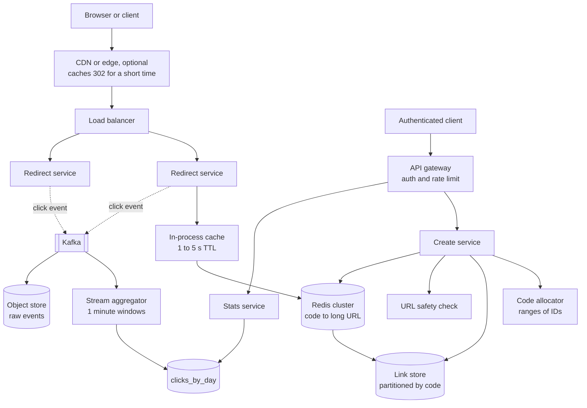
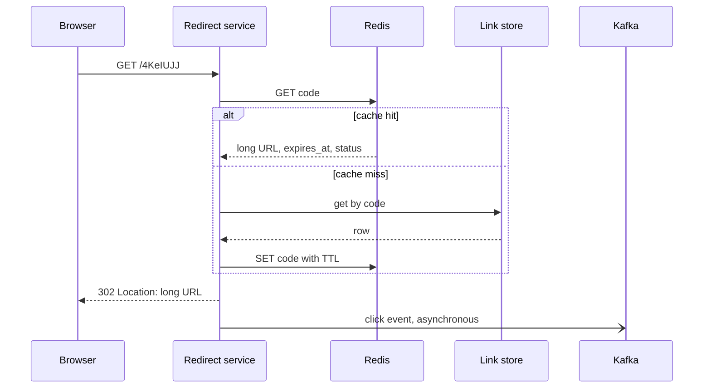
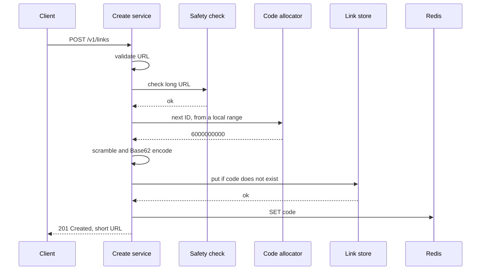

# Design a URL Shortener

A URL shortener turns a long URL into a short code and redirects each visit of the short URL to the long URL. This case study gives the design that a strong candidate presents in 45 minutes: the numbers, the three ways to generate a code, the redirect status code, a read-heavy path with a cache, analytics, expiry, custom aliases, and abuse handling. Follow the steps in [how to approach an HLD interview](../how-to-approach-hld.md). The estimation method is on [back-of-envelope estimation](../back-of-envelope-estimation.md), which uses this design as its worked example 2.

!!! note "About the sources"
    Few companies publish the internals of their URL shorteners. This page is a reference design, not a description of any company's system. Where a real company's published design applies to a building block (the Flickr ticket server for ID ranges, Facebook's memcache paper for caching), the text cites it.

## Problem Statement

"Design a service like TinyURL or Bitly. A user submits a long URL and gets a short URL. When anyone opens the short URL, the service sends the browser to the long URL. The service must be fast, always available, and able to handle a very large number of links."

## Clarifying Questions

| Question | Answer that this design assumes |
|---|---|
| How many new short URLs does the service create? | 100 million each month (Assumption) |
| What is the read-to-write ratio? | 100 redirects for each creation (Assumption) |
| How long do links live? | Forever by default. A creator can set an expiry date. The service keeps records for 5 years of growth (Assumption) |
| How long is the short code? | As short as possible. The design uses 7 characters from a 62-character alphabet (0-9, A-Z, a-z) |
| Can a user choose the code (a custom alias)? | Yes, for registered users. The alias must be unique |
| Are short codes guessable? | They must not be easy to enumerate. Private links are not a goal: a short URL is a public capability, and anyone who has it can open it |
| Is the same long URL always mapped to the same code? | No. Each creation request gets its own code, so each creator has own analytics and own expiry (see Trade-offs) |
| Does the service need click analytics? | Yes: clicks for each link by day, country, and referrer. Counts may be a few minutes late and may be approximate |
| Can a link be edited or deleted? | The creator can delete or disable a link. The creator cannot change the long URL of an existing link (see Trade-offs) |
| What about harmful URLs (phishing, malware)? | The service must check them and must be able to block a link |
| Multi-region? | Redirects must be fast worldwide. Creation can go to one home region for each user (Assumption) |
| Availability target? | Redirects: 99.99% (about 52.6 minutes of downtime each year). Creation: 99.9% (Assumption) |

## Requirements

### Functional

1. `create`: given a long URL, return a short URL. Optional inputs: a custom alias and an expiry date.
2. `redirect`: given a short code, send the browser to the long URL. If the code is unknown, expired, or blocked, answer with an error page.
3. `delete` or disable a link, by its creator.
4. `analytics`: read the click counts of a link, by day, country, and referrer.
5. Abuse control: refuse known harmful long URLs, rate limit creation, and let an operator block a code.

### Non-functional

| Requirement | Target |
|---|---|
| Redirect latency | p99 below 50 ms inside the service (Assumption). The browser adds its own network time |
| Redirect availability | 99.99% |
| Creation availability | 99.9% |
| Durability | A created link is never lost. Replication factor 3 |
| Scale | 33 creations and 3,300 redirects for each second on average. 100 and 10,000 at the peak (see Estimation) |
| Uniqueness | No two links share a code. No race creates two owners for one code |
| Analytics freshness | Within 5 minutes (Assumption). No effect on redirect latency |

## Estimation

Rounding rule (the same as on the estimation page): one day is 10^5 seconds, so one month is 3 × 10^6 seconds. The exact day has 86,400 seconds, so the rates are 13.6% lower than the exact rates. The error is smaller than the error of the assumptions.

Inputs (all are assumptions): 100 million new links each month. 100 reads for each write. 500 bytes for each record (the long URL is the largest field, up to about 2,048 characters, and an average record is 500 bytes). Retention of 5 years. Replication factor 3. Peak factor 3. A redirect response is 300 bytes. A click event is 200 bytes. An application server handles 5,000 requests per second (Assumption: measure it).

| Step | Calculation | Result |
|---|---|---|
| Creations per second (average) | 100,000,000 / (30 × 10^5) | 33 |
| Redirects per second (average) | 33.3 × 100 | 3,333 |
| Peak creations per second | 33.3 × 3 | 100 |
| Peak redirects per second | 3,333 × 3 | 10,000 |
| Links in 5 years | 100,000,000 × 12 × 5 | 6 × 10^9 |
| Storage of the link table | 6 × 10^9 × 500 B | 3 × 10^12 B = 3 TB |
| Storage with 3 replicas | 3 TB × 3 | 9 TB |
| Peak redirect traffic out | 10,000 × 300 B × 8 | 24 Mbit/s |
| Redirects per day | 3,333 × 10^5 | 3.3 × 10^8 |
| Raw click events per day | 3.3 × 10^8 × 200 B | 66.7 GB each day, about 24 TB each year |
| Cache for 20% of the daily redirects | 3.3 × 10^8 × 0.2 × 500 B | 33 GB (an upper bound: repeated reads of one link need one entry) |
| Application servers | ceil((10,000 + 100) / 5,000) | 3. Run 4 or more for failure and deploys |
| Code space, 6 characters | 62^6 | 5.68 × 10^10. Fill after 6 × 10^9 links: 10.6% |
| Code space, 7 characters | 62^7 | 3.52 × 10^12. Fill after 6 × 10^9 links: 0.17% |

What the numbers decide:

- The load is a read problem. 100 writes for each second at the peak fit on one database primary. The read rate of 10,000 for each second at the peak needs a cache and a few stateless servers, not a large cluster.
- The link table (3 TB, or 9 TB with replicas) fits on a few machines. The reason to partition the table is headroom and availability, not capacity today. Say this to the interviewer: the system is small, and the design must not be larger than the numbers require.
- The click events are bigger than the link table: 24 TB of raw events in a year against 3 TB of links in 5 years. The analytics pipeline is the part of the design with the most data.
- 7 characters are enough. With 6 characters, 10.6% of the space is full after 5 years, so a random code collides on 1 attempt in 9 or 10. With 7 characters, 0.17% is full.

The program below checks the arithmetic, shows the Base62 encoding with a bijective scramble (see Deep Dives), and computes the collision numbers. `main` comes first, and the block has its own imports, so you can copy it into `ShortenerCheck.java` and run `java ShortenerCheck.java` on JDK 21.

```java
import java.math.BigInteger;
import java.util.Locale;

public class ShortenerCheck {
    static final String ALPHABET =
            "0123456789ABCDEFGHIJKLMNOPQRSTUVWXYZabcdefghijklmnopqrstuvwxyz";
    static final int LENGTH = 7;
    // 62^7 = 3,521,614,606,208 codes.
    static final long SPACE = 3_521_614_606_208L;
    // The multiplier must be coprime with 62^7 = 2^7 * 31^7, so it must be odd and
    // must not be a multiple of 31. Then x -> (A * x + B) mod SPACE is a bijection.
    static final long A = 1_000_003_007L;
    static final long B = 123_456_789L;

    public static void main(String[] args) {
        estimation();
        codes();
        collisions();
    }

    static void estimation() {
        System.out.println("== Estimation (1 day = 10^5 s) ==");
        double newPerMonth = 100e6;
        double secondsPerMonth = 30 * 1e5;
        double writes = newPerMonth / secondsPerMonth;
        double reads = writes * 100;
        System.out.println(g("writes per second", writes));
        System.out.println(g("reads per second", reads));
        System.out.println(g("peak writes per second", writes * 3));
        System.out.println(g("peak reads per second", reads * 3));
        double records = newPerMonth * 12 * 5;
        System.out.println(g("records in 5 years", records));
        System.out.println(g("storage TB", records * 500 / 1e12));
        System.out.println(g("storage with 3 replicas TB", records * 500 * 3 / 1e12));
        System.out.println(g("peak redirect egress Mbit/s", reads * 3 * 300 * 8 / 1e6));
        double eventsPerDay = reads * 1e5;
        System.out.println(g("click events per day", eventsPerDay));
        System.out.println(g("raw click events GB per day", eventsPerDay * 200 / 1e9));
        System.out.println(g("cache GB (20% of daily reads)", eventsPerDay * 0.2 * 500 / 1e9));
        double peakTotal = reads * 3 + writes * 3;
        System.out.println(g("app servers at 5000 rps", Math.ceil(peakTotal / 5000)));
    }

    static void codes() {
        System.out.println("== Base62 codes ==");
        System.out.println("space 62^7 = " + SPACE + ", check = "
                + BigInteger.valueOf(62).pow(LENGTH));
        long[] ids = {0, 1, 2, 61, 62, 1_000_000, 6_000_000_000L};
        for (long id : ids) {
            long scrambled = scramble(id);
            System.out.println(String.format(Locale.ROOT,
                    "id %-10d plain %s scrambled %s back %d",
                    id, encode(id), encode(scrambled), unscramble(scrambled)));
        }
    }

    static long scramble(long id) {
        return BigInteger.valueOf(A).multiply(BigInteger.valueOf(id))
                .add(BigInteger.valueOf(B)).mod(BigInteger.valueOf(SPACE)).longValue();
    }

    static long unscramble(long code) {
        BigInteger space = BigInteger.valueOf(SPACE);
        BigInteger inverse = BigInteger.valueOf(A).modInverse(space);
        return BigInteger.valueOf(code).subtract(BigInteger.valueOf(B))
                .multiply(inverse).mod(space).longValue();
    }

    static String encode(long value) {
        char[] out = new char[LENGTH];
        for (int i = LENGTH - 1; i >= 0; i--) {
            out[i] = ALPHABET.charAt((int) (value % 62));
            value /= 62;
        }
        return new String(out);
    }

    static void collisions() {
        System.out.println("== Random code collisions ==");
        double n7 = 3_521_614_606_208.0;
        double n6 = 56_800_235_584.0;
        double stored = 6e9;
        System.out.println(f("P(new 7-char code taken) at 6e9 stored", stored / n7));
        System.out.println(f("P(new 6-char code taken) at 6e9 stored", stored / n6));
        System.out.println(f("draws to first collision, 7 chars", Math.sqrt(Math.PI * n7 / 2)));
        double n = 1e6;
        System.out.println(f("P(any collision) after 1e6 draws", 1 - Math.exp(-n * n / (2 * n7))));
    }

    static String f(String label, double value) {
        return String.format(Locale.ROOT, "%-42s %.4g", label, value);
    }

    static String g(String label, double value) {
        return String.format(Locale.ROOT, "%-42s %,.1f", label, value);
    }
}
```

<!-- expected-output -->
```text
== Estimation (1 day = 10^5 s) ==
writes per second                          33.3
reads per second                           3,333.3
peak writes per second                     100.0
peak reads per second                      10,000.0
records in 5 years                         6,000,000,000.0
storage TB                                 3.0
storage with 3 replicas TB                 9.0
peak redirect egress Mbit/s                24.0
click events per day                       333,333,333.3
raw click events GB per day                66.7
cache GB (20% of daily reads)              33.3
app servers at 5000 rps                    3.0
== Base62 codes ==
space 62^7 = 3521614606208, check = 3521614606208
id 0          plain 0000000 scrambled 008M0kX back 0
id 1          plain 0000001 scrambled 01E1vDI back 1
id 2          plain 0000002 scrambled 02Jhpg3 back 2
id 61         plain 000000z scrambled 14iaZ2m back 61
id 62         plain 0000010 scrambled 15oGTVX back 62
id 1000000    plain 0004C92 scrambled xcBV6V3 back 1000000
id 6000000000 plain 06Y3O5Y scrambled 4KeIUJJ back 6000000000
== Random code collisions ==
P(new 7-char code taken) at 6e9 stored     0.001704
P(new 6-char code taken) at 6e9 stored     0.1056
draws to first collision, 7 chars          2.352e+06
P(any collision) after 1e6 draws           0.1324
```

How to read the output: the "draws to first collision" line says that random 7-character codes produce the first collision after about 2.4 million creations (the birthday bound, `sqrt(pi × N / 2)`), long before the table is full. A design with random codes must therefore handle collisions from the first day. A counter has no collisions.

## API Design

The service has two planes. The **control plane** (create, delete, analytics) needs authentication and is low volume. The **redirect plane** is public and high volume. The two planes are separate deployments (see High-Level Design). Design of REST endpoints in general: `kb/api-design/02-api-design-practices.md`.

### `POST /v1/links`

Request (JSON), with an API key or user token in the `Authorization` header:

```json
{
  "longUrl": "https://example.com/some/very/long/path?x=1",
  "customAlias": "spring-sale",
  "expiresAt": "2027-01-31T00:00:00Z"
}
```

`customAlias` and `expiresAt` are optional. The client may send an `Idempotency-Key` header, so that a retry after a timeout returns the same link and does not create a second one (see [reliability patterns](../fundamentals/12-reliability-patterns.md)).

Response `201 Created`:

```json
{
  "code": "4KeIUJJ",
  "shortUrl": "https://sho.rt/4KeIUJJ",
  "longUrl": "https://example.com/some/very/long/path?x=1",
  "createdAt": "2026-10-15T10:00:00Z",
  "expiresAt": null
}
```

Errors: `400` (the URL is invalid: not `http` or `https`, too long, no host), `409` (the alias exists), `422` (the URL is on the block list), `429` (rate limited, with `Retry-After`), `401` (no valid credentials).

### `GET /{code}`

The redirect. No authentication. Response `302 Found` with `Location: <long URL>`. Error responses: `404` (unknown code), `410 Gone` (expired or deleted), `403` or an interstitial warning page (blocked as harmful). The choice of `302` is in Deep Dives.

### `DELETE /v1/links/{code}`

Only the creator can call it. Response `204 No Content`. The call sets the status of the link to `deleted` and removes the cache entry. Response `404` if the creator does not own the code.

### `GET /v1/links/{code}/stats?from=2026-10-01&to=2026-10-15&groupBy=day`

Response `200`:

```json
{
  "code": "4KeIUJJ",
  "from": "2026-10-01",
  "to": "2026-10-15",
  "total": 1840213,
  "series": [{ "day": "2026-10-01", "clicks": 120344 }]
}
```

Other `groupBy` values: `country`, `referrer`. The data is eventually consistent (up to 5 minutes late).

## Data Model

### Tables

**`links`**: one row for each short URL. The primary access path is "get by code".

| Column | Type | Notes |
|---|---|---|
| `code` | string, 3 to 30 characters | **Partition key.** The 7-character generated code or the custom alias |
| `long_url` | string, up to 2,048 characters | The target |
| `owner_id` | string | The creator. Anonymous links use a special owner |
| `created_at` | timestamp | |
| `expires_at` | timestamp or null | Null means no expiry |
| `status` | enum | `active`, `disabled`, `blocked`, `deleted` |
| `is_custom` | boolean | True for an alias |

**`links_by_owner`** (a secondary index): partition key `owner_id`, sort key `created_at`. It serves "list my links". Redirects do not use it.

**`click_events`** (a stream and an object store, not a database table): `code`, `ts`, `country`, `referrer_host`, `user_agent_class`, `ip_hash`. Written by the redirect servers, read by the aggregation jobs.

**`clicks_by_day`**: partition key `code`, sort key `day`. Columns: `clicks`, and a map for `country` and `referrer`. Written by the aggregation job, read by the stats API.

### Database choice

Recommendation: a partitioned key-value or wide-column store, with the partition key `code`. Examples: Amazon DynamoDB, Apache Cassandra. The reasons:

- Every hot-path read is a lookup of one key. There are no joins, no multi-row transactions, and no range scans on the hot path.
- A conditional write ("insert only if the key does not exist") gives uniqueness for custom aliases and for random codes. DynamoDB has condition expressions, and Cassandra has lightweight transactions (`IF NOT EXISTS`).
- The store has a time-to-live feature for expiry, and it replicates across zones and regions without code in the application (see [partitioning and sharding](../fundamentals/06-partitioning-and-sharding.md) and [replication](../fundamentals/05-replication.md)).

An important caveat from the estimation: 3 TB of records and 100 writes for each second fit on a relational database (PostgreSQL or MySQL) with read replicas, and a unique index on `code` gives the same uniqueness. If the team already runs a relational database, that is a correct choice, and the design below changes only in the partitioning step. The choice criteria are in [choosing a database](../fundamentals/04-choosing-a-database.md). Say in the interview which one you pick and why. The reason must come from the access pattern, not from the brand.

**Expiry in the store.** DynamoDB TTL deletes expired items "within a few days of their expiration time" (DynamoDB documentation), and expired items can still appear in reads until the deletion. Cassandra has a per-row TTL too. The read path therefore checks `expires_at` itself and does not rely on the store to remove the row at the exact time.

**Analytics storage.** Raw events go to a log (Kafka) and then to an object store in a columnar format (see [batch and stream processing](../fundamentals/17-batch-and-stream-processing.md) and [message queues and streams](../fundamentals/08-message-queues-and-streams.md)). The aggregates go to `clicks_by_day`, or to an analytical column store when the product needs ad-hoc queries.

## High-Level Design



### Components

- **Redirect service.** A stateless service that handles `GET /{code}`. It looks in an in-process cache, then in Redis, then in the link store. It answers with a `302`. It writes a click event to a local buffer, and the buffer sends the events to Kafka without blocking the response. It is the only component on the hot path, so it is separate from the control plane: a deploy or an overload of the create service never slows redirects.
- **Create service.** Validates the URL (scheme, length, host), calls the safety check, takes a code (from the allocator, or validates the custom alias), and writes the row with a conditional put. It then writes the cache entry, so that the first redirect hits the cache.
- **Code allocator.** Gives each create-service instance a range of integer IDs (for example 1,000 at a time). The instance turns each integer into a code with a scramble and Base62 (see Deep Dives).
- **Redis cluster.** The distributed cache for `code → {long_url, expires_at, status}`. Cache-aside (see [caching](../fundamentals/03-caching.md)).
- **Link store.** The system of record. Partitioned by `code`, with 3 replicas in 3 zones.
- **Kafka and the stream aggregator.** Collect click events, count them in windows of one minute, and write the counts. A copy of the raw events goes to object storage for batch reconciliation.
- **URL safety check.** A call to a reputation service at creation time, and a periodic re-check (see Deep Dives).
- **API gateway.** Authentication, and rate limiting of the control plane (see [the distributed rate limiter case study](02-distributed-rate-limiter.md) and [rate limiting algorithms](../fundamentals/13-rate-limiting-algorithms.md)).
- **Stats service.** Reads `clicks_by_day` and returns the series.

### The two main flows





## Deep Dives

### Deep dive 1: Generating the code

A code must be short, unique, and hard to enumerate. Four options exist.

**Option A: hash the long URL and keep a prefix.** Compute a hash (for example SHA-256) of the long URL, take the first 41 bits (2^41 = 2.2 × 10^12 is close to 62^7 = 3.5 × 10^12), and encode them in Base62. The same long URL always gives the same code, so a repeated request needs no new row. Problems:

- Two different URLs can share a prefix. The creation must read the row: if the code exists with another URL, the service adds a salt to the URL and hashes again. With n stored links and 2^41 possible values, the chance that a new code is taken is about n / 2^41. At 6 × 10^9 links that is 0.27%, and the cost is a read before each write.
- Two creators who submit the same URL get the same code. They share analytics and cannot have different expiry dates. Some products want that, and most do not.
- A truncated hash gives no ordering and spreads writes evenly, which is good for partitioning, but it needs the read-before-write check on every creation, and a race between two creators needs the conditional put anyway.

**Option B: a counter encoded in Base62.** A counter gives each new link the next integer. The service encodes the integer in Base62. Integers up to 62^7 − 1 = 3,521,614,606,207 fit in 7 characters. No collisions are possible, and no collision check is needed. Problems and fixes:

- *A single counter is a single point of failure and a bottleneck.* At 100 creations for each second, one database counter is fast enough. The risk is availability. Use **range allocation** (also called the hi/lo scheme): each create-service instance asks the allocator for a block of 1,000 integers, then hands them out from memory. The allocator is a small replicated service or a row with a conditional update. If an instance crashes, it loses the unused part of its block. The gap wastes at most 1,000 of 3.5 × 10^12 codes. The allocator is a counter service of the kind that Flickr described for its sharded MySQL, the ticket server: a one-row table that advances an auto-increment counter with `REPLACE INTO`, run on two servers, one for odd and one for even IDs (Flickr Code, "Ticket Servers", 2010). Flickr's ticket server hands out one ID for each call. The block of 1,000 is the batching extension that [unique ID generation](../fundamentals/15-unique-id-generation.md) describes: the allocator advances its counter by 1,000 in one call.
- *Sequential codes are easy to enumerate.* A visitor who sees `0000Abc` can try `0000Abd`. Fix: apply a **bijective scramble** to the integer before encoding. The program above uses `x → (A × x + B) mod 62^7` with `A` odd and not a multiple of 31, because 62^7 = 2^7 × 31^7, so `A` and 62^7 have no common factor. Such a map is a bijection on `[0, 62^7)`: no two integers give the same code, and the service can decode a code back to the integer. Be exact about what this gives. It hides the order from a casual visitor. It is **not** encryption: two codes that come from consecutive integers differ by a constant, so an attacker who sees a few pairs can recover `A` and `B`. If unguessability must hold against an attacker, use a keyed permutation such as format-preserving encryption, or use Option D. NIST SP 800-38G (March 2016) specifies the FF1 method, which encrypts a string of digits in any radix, for example 7 Base62 digits, to another string of the same length and radix, under a secret AES key. The second public draft of its Revision 1 (February 2025, not final) keeps FF1 and removes the FF3 method. It requires `radix^minlen ≥ 1 000 000`, a domain of at least one million values, where the 2016 version required at least one hundred and recommended one million. A 7-character Base62 code has 62^7 = 3.5 × 10^12 values, far above that bound.
- *Snowflake IDs do not fit.* A 64-bit Snowflake ID (see [unique ID generation](../fundamentals/15-unique-id-generation.md)) is up to 19 decimal digits, which is 11 Base62 characters. A 7-character code has only 41.7 bits.

**Option C: pre-generated keys (a key generation service, KGS).** A separate service generates random unique codes offline and stores them in a table with a flag `used`. A create-service instance takes a batch of unused codes (it marks them as used in the same step) and hands them out. Strengths: codes are random, so they are hard to guess. No collision check on the request path, and no coordination per request. Weaknesses: one more service to run. The batch step must be atomic, or two instances take the same codes. A crashed instance wastes its batch. The table holds as many rows as the codes that you generate ahead of time, so generate in chunks.

**Option D: random codes with a conditional insert.** Draw 7 random Base62 characters, insert with "put if the key does not exist", and retry on a conflict. It needs no allocator and no extra service. The collision chance for one draw is `n / 62^7`: 0.17% at 6 × 10^9 links. The expected cost is one write plus 0.17% retries at the end of the five years. The first collision happens after about 2.4 million creations (the program above computes this), so the retry path must work from the first day. It is the simplest design when you cannot run an allocator.

| Option | Collisions | Guessable | Extra service | Request-path cost | Same URL gives |
|---|---|---|---|---|---|
| A: hash prefix | Yes, 0.27% at 6 × 10^9 links | No | None | Read, then conditional write | The same code |
| B: counter + scramble | None | Yes, unless a keyed permutation is used | Allocator | Local, no network call | A new code |
| C: pre-generated keys | None | No | KGS | Local, no network call | A new code |
| D: random + conditional put | Yes, 0.17% at 6 × 10^9 links | No | None | One conditional write, rare retries | A new code |

Recommendation: Option B with range allocation for the 45-minute answer. It has no collision handling, the allocator is small, and the scramble hides the order. State the limit of the scramble. Name Option D as the simplest alternative, and Option C when enumeration is a hard security requirement.

**Custom aliases.** The alias goes into the same `links` table, so one uniqueness rule covers both kinds of code. The create service writes with a conditional put: if the row exists, the store rejects the write and the API returns `409`. No "check then insert" is correct, because two concurrent requests can both pass the check. The generated codes and the aliases share one space, so every generated code also uses a conditional put. The put fails only if a user already took that exact 7-character string as an alias. Then the service takes the next integer and tries again. A design that wants no overlap at all can reject aliases of exactly 7 Base62 characters, so that the two kinds of code never meet. Keep a list of reserved words (`api`, `admin`, `health`, `static`, `login`) that no alias may use, and limit the alias to 3 to 30 characters from the Base62 alphabet plus `-` and `_`.

### Deep dive 2: The redirect, `301` or `302`, and the read path

**The status code.** Both `301 Moved Permanently` and `302 Found` send the browser to `Location`. The differences are in caching and in the meaning (RFC 9110, section 15.4):

| Code | Meaning | Caching | Effect for a shortener |
|---|---|---|---|
| `301` | The resource has a new permanent URI | "Heuristically cacheable" (RFC 9110, section 15.4.2). A browser or proxy can store the redirect and not ask the service again | Fewer requests to the service. The service cannot count the later clicks, cannot expire or block the link for the users who cached it, and cannot change the target |
| `302` | The resource is at a different URI temporarily. The client "ought to continue to use the target URI for future requests" (RFC 9110, section 15.4.3) | RFC 9110 does not make it heuristically cacheable, so a cache stores it only with explicit freshness information (`Cache-Control: max-age`, or `Expires`; RFC 9111) | Every click reaches the service. Counting, expiry, and blocking work |
| `307`, `308` | Like `302` and `301`, but the client must not change the request method (RFC 9110, sections 15.4.8 and 15.4.9) | Same as `302` and `301` | Use them only if the short URL receives `POST` requests that must stay `POST`. A short link that a user opens in a browser uses `GET` |

Recommendation: answer `302` by default. The service needs every click for analytics, and it needs to be able to expire, change, and block a link. A `301` is correct only for a product that sells permanent links, has no analytics, and accepts that nobody can revoke a link in a browser cache. A middle path is a `302` with `Cache-Control: private, max-age=60`: a browser does not repeat a click for 60 seconds, which cuts the load of double-clicks and reloads and keeps the revocation delay at 60 seconds. The price is that the repeat clicks in that minute are not counted. The directive `private` lets only the browser store the response (RFC 9111). For a CDN or another shared cache to store the `302` too, send `public, s-maxage=60` instead. Then the CDN answers all users for 60 seconds, so the service sees fewer clicks and a block takes up to 60 seconds to reach the edge, unless the service purges the CDN entry when it blocks the link.

**The read path.** At 10,000 redirects for each second, one link-store lookup for each redirect is possible but wasteful. The path has three layers (see [caching](../fundamentals/03-caching.md)):

1. **In-process cache** in each redirect instance: a small map with a 1 to 5 second TTL and a maximum size, for the hottest codes. It removes hot-key traffic from Redis.
2. **Redis**, cache-aside, key `code`, value `{long_url, expires_at, status}`. The TTL is the smaller of 24 hours and the time until `expires_at`, plus a random jitter of up to 10%, so that links created together do not expire together. A `delete` or a `block` removes the key (and the delete is the reason for the short in-process TTL: an instance can serve a deleted link for up to that TTL).
3. **Link store**, a read of one key. The row is small. A read after a cache miss uses a strongly consistent read where the store offers one, so that a link that a creator just created, and whose cache write failed, is not reported as `404` by a lagging replica (see [replication](../fundamentals/05-replication.md) for the lag).

The cache holds the long URL for 33 GB at most (see the estimation) and the real working set is far smaller, because link popularity follows a heavy-tailed distribution: a small share of the links gets most clicks. Assumption: measure the hit ratio on real traffic. A hit ratio of 95% leaves 500 reads for each second at the peak for the link store.

**Failure modes of the read path.**

- *Redis is down or slow.* The redirect service reads the link store directly, with a timeout of a few milliseconds on Redis and a circuit breaker so that it stops calling a broken cache (see [reliability patterns](../fundamentals/12-reliability-patterns.md)). The link store must survive the full read rate for a short time. At 10,000 reads for each second on a partitioned store, it can (assumption: load test it).
- *Cache stampede on a popular key.* One expired hot key makes many requests miss at the same time. Use request coalescing in the process and probabilistic early refresh (see [caching](../fundamentals/03-caching.md)).
- *Hot key.* A link that suddenly becomes popular can send 100,000 requests for each second to one code (Assumption). The in-process cache answers most of them. The CDN or the edge can also cache the `302` for a short time with `max-age`.
- *Penetration (random codes).* A scanner tries random codes. The code space is 3.5 × 10^12 and 6 × 10^9 are in use, so 0.17% of random probes hit a real link and almost all probes miss. A negative cache (a "not found" marker with a 60 second TTL) does not help against random codes, because each probe asks for a new code. The defenses are a per-IP rate limit on `404` responses and, if the miss traffic is too large for the store, a Bloom filter of all codes. A Bloom filter for 6 × 10^9 codes at 1% false positives needs `n × 1.44 × log2(100)`, about 9.6 bits for each code, so 5.75 × 10^10 bits = 7.2 GB, partitioned over the cache nodes (see [probabilistic data structures](../distributed-systems/04-probabilistic-data-structures.md)). Recommendation: begin with the rate limit, and add the filter only if the store shows the load.

### Deep dive 3: Analytics without a cost on the redirect

The redirect must not wait for analytics. The design:

1. The redirect service writes one event (`code`, `ts`, country from the IP, referrer host, a class of the user agent, a hash of the IP) to an in-memory buffer, and a background thread sends batches to Kafka. If Kafka is slow or down, the buffer drops events after it is full (and increments a counter of dropped events). Losing a few click events is better than a slower redirect. This is an explicit trade-off: analytics here is approximate.
2. A stream processor reads the topic, keyed by `code` (so the events of one code go to one partition), and counts the events in tumbling windows of 1 minute (see [batch and stream processing](../fundamentals/17-batch-and-stream-processing.md)). It writes the counts to `clicks_by_day` with an increment.
3. The same topic goes to an object store as raw files. A nightly batch job recomputes the counts from the raw events and corrects the stream result. This is the reconciliation step: the stream is fast, the batch is exact.

Details that interviewers probe:

- **Hot links.** A suddenly popular code makes one stream partition and one row hot. The processor adds the counts in memory for each window and writes one increment for each window, not one for each click. If one partition is still too hot, split the key (`code#0` to `code#9`) and sum at read time (see [partitioning and sharding](../fundamentals/06-partitioning-and-sharding.md)).
- **Duplicates.** The producer retries a send after a timeout, and the stream job replays events after a crash if it committed its offsets after its writes. Both are at-least-once delivery, so a replay can count an event twice. Kafka transactions give exactly-once processing only inside Kafka, and the increments to `clicks_by_day` are outside Kafka. For click counts, a small error is acceptable. If the count must be exact, give each event an ID and deduplicate in the batch job (see [message queues and streams](../fundamentals/08-message-queues-and-streams.md)).
- **Unique visitors.** An exact distinct count needs memory for each visitor. A HyperLogLog gives a distinct count with a standard error of about 1.04 / √m for m registers, in a few kilobytes for each code. Keep a sketch only for each code that has clicks in the period, because 6 × 10^9 sketches of a few kilobytes each would take tens of terabytes (see [probabilistic data structures](../distributed-systems/04-probabilistic-data-structures.md)).
- **Bots.** A user-agent class and a rate for each IP separate crawlers from people. Store the class, and let the stats API filter it.
- **Privacy.** Store a hash of the IP address, not the address, and keep the raw events for a bounded time (Assumption: 90 days).

### Deep dive 4: Expiry, abuse, and the lifecycle of a link

**Expiry.** A link has `expires_at`. The three layers each handle it:

- The redirect path checks `expires_at` on every read, from the cache entry or the row, and answers `410 Gone` if the time has passed. The check is exact and does not depend on the store.
- The cache TTL is never longer than the time left until `expires_at`.
- The store removes old rows in the background (the TTL feature, which deletes "within a few days" in DynamoDB, or a sweeper job that scans by expiry date). This only saves space.

**Do not reuse codes.** After a link expires, the service keeps its code reserved. A reused code is risky: browser history, emails, printed material, and caches still hold the old short URL, and the new owner would receive that traffic. A 7-character space of 3.5 × 10^12 codes against 6 × 10^9 used leaves no need to reuse.

**Abuse.** A shortener hides the target of a URL, so attackers use it to distribute phishing and malware, and to bypass filters. The controls, in order:

1. **Validate at creation.** Accept only `http` and `https` (never `javascript:` or `data:`). Limit the length (2,048 characters). Reject a long URL that points at the shortener itself (a redirect loop). Normalize the URL.
2. **Check reputation at creation.** Call a URL reputation service. The current Google Safe Browsing API is version 5. Its `hashes.search` method receives only "a 4-byte hash prefix" of the hashed URL and returns the full hashes of known threats with that prefix, so the client compares the full hash locally and Google does not learn the URL. Its Local List Mode keeps the hashed threat lists in a local database, as the older v4 Update API did (Google Safe Browsing documentation). The Safe Browsing API "is for non-commercial use only". A commercial shortener uses the Web Risk API of Google Cloud instead, which offers the same two forms: a Lookup API that sends the URL, and an Update API with a local database of hashed lists (Web Risk documentation). Reject or flag a match. Keep your own block list of domains and of patterns.
3. **Re-check later.** A page can turn harmful after the link was created. A background job re-checks active links with many clicks, and the abuse report flow lets users flag a link. A match sets `status = blocked` and removes the cache entry. The redirect then shows a warning page and not the target. The in-process cache keeps the old answer for 1 to 5 seconds, which is the revocation delay.
4. **Rate limit creation.** A limit for each user and for each IP at the gateway (see [the distributed rate limiter case study](02-distributed-rate-limiter.md)). Require sign-in for custom aliases and for bulk creation.
5. **Limit what redirects reveal.** A `302` to a harmful page cannot be undone after the user left. For links with a risk score above a threshold, show an interstitial page that displays the target.

## Bottlenecks and Scaling

| What fails first | When | Fix |
|---|---|---|
| Link-store reads on a cold or failed cache | A Redis node fails, or a deploy empties the cache | Replicas of each cache shard, the in-process cache, request coalescing, a warm-up before traffic moves, and a store that can serve the full read rate for a short time |
| One hot code | A link becomes suddenly popular (Assumption: 100,000 requests for each second to one code) | In-process cache with a short TTL, edge caching of the `302` with `max-age`, and replicated cache keys (see [caching](../fundamentals/03-caching.md)) |
| Allocator unavailable | The allocator crashes | Each instance holds a block of 1,000 IDs, which lasts 10 seconds at 100 creations for each second for one instance, and longer for a larger share. Run the allocator with replicas and prefetch the next block before the current one is empty. Option D (random codes) has no allocator |
| Kafka lag or outage | A broker fails or a consumer is slow | The redirect buffer drops events when it is full, so redirects never block. The reconciliation job repairs counts from the raw events |
| Link-store write throughput | 100 writes for each second is small. A growth of 100 times is 10,000 for each second | Partition by `code` (hash), add partitions in advance (see [partitioning and sharding](../fundamentals/06-partitioning-and-sharding.md)). The scrambled or random codes spread writes evenly. Sequential codes without a scramble would send all writes to the last range if the store partitions by range |
| Analytics write amplification | Each click is one write | Aggregate in the stream job for each window before writing |
| Multi-region latency | Users far from the home region wait for the redirect | Deploy redirect services and cache in each region, with a read replica of the link store in each region (see [multi-region and disaster recovery](../fundamentals/19-multi-region-and-disaster-recovery.md)). Creation goes to the home region of the user. The code ranges are disjoint for each region, so two regions never produce the same code. A custom alias is the exception: a global uniqueness check needs one home region for the alias namespace, or a store with cross-region conditional writes |
| Abuse load | Scanners and spam | Rate limits, the Bloom filter if needed, and a blocking workflow for operators |

## Trade-offs

| Decision | Choice | Alternatives rejected, and why |
|---|---|---|
| Code generation | Counter with range allocation, scrambled, Base62, 7 characters | Hash prefix: needs a read-before-write on each creation, gives the same code for one URL, and collides. Random codes: collide from the first million creations, so a retry path is required. KGS: one more service, kept for the case where enumeration is a hard requirement |
| Code length | 7 characters (62^7 = 3.5 × 10^12) | 6 characters: 10.6% full after 5 years, which is too close to the limit for random codes. 8 or more characters: no need for the numbers |
| Redirect status | `302` | `301`: browsers cache it, so the service loses clicks and cannot revoke or expire the link for those users. `307` and `308`: needed only to preserve a request method |
| Same URL, same code | No: each creation gets a new code | Dedupe by long URL: saves rows (one row for each distinct URL), but shares analytics and expiry between creators and needs an index on the long URL (500 bytes or more for each key, plus a hash for lookup) |
| Mutable target | No: the creator deletes and creates a new link | Editable target: a feature of paid products, but it means every cache and every in-process copy must be invalidated, and it makes the link a way to change a page after a safety check |
| Database | A key-value or wide-column store partitioned by `code` | A relational database: also correct at this size, and it needs sharding only if the writes grow 100 times. Choose it when the team operates it |
| Cache | Cache-aside Redis plus a short in-process cache | No cache: the store carries all reads. A CDN only: the revocation delay and the cache key must be controlled |
| Analytics | Asynchronous, approximate, reconciled by a batch | Synchronous count in the redirect path: adds a write to every redirect, and makes the store the bottleneck |
| Consistency of the redirect | Eventually consistent cache, strongly consistent read on a miss | Strong consistency everywhere: costs latency for a data set that almost never changes after creation |
| Expiry | Check on read, delete in the background | Rely on the store's TTL only: expired links would still redirect for days |

## Follow-up Questions

??? question "How many characters does the code need, and how do you decide?"

    Start from the number of links over the life of the service and the collision tolerance. With 100 million new links each month for 5 years, the service holds 6 × 10^9 links. A 6-character Base62 code has 62^6 = 5.68 × 10^10 values, so the table is 10.6% full at the end. For a counter that is fine (the codes are unique by construction). For random codes it means that 1 draw in 9 or 10 collides at the end, which is high. A 7-character code has 62^7 = 3.52 × 10^12 values, so the table is 0.17% full, and a random draw collides once in about 590 attempts at the end of year 5.

    The direct answer: 7 characters. The reason: it gives room for 590 times more links than the 5-year estimate, and it keeps the collision rate of random codes low. The trade-off: each extra character makes the URL longer, and in a product where the short domain is also short, the user sees the extra character. If the interviewer asks for a shorter code, give up uniqueness by construction and accept collisions, or use a larger alphabet (Base64 URL-safe has 64 characters, which gives 64^7 = 4.4 × 10^12 values, but `-` and `_` need care in some contexts).

??? question "Compare hashing the URL, a counter, and pre-generated keys for the code."

    Hashing the long URL and keeping a prefix gives the same code for the same URL, which dedupes. It collides: at 6 × 10^9 links and a 41-bit prefix, a new code is taken with probability about 0.27%, so each creation must read the row and handle a conflict by salting and hashing again. Even with that read, two concurrent creations can pass it, so the write must still be a conditional put.

    A counter encoded in Base62 never collides. The weakness is the counter: one counter is a single point of failure, so allocate ranges (1,000 IDs for each block, as in the Flickr ticket server idea). Sequential codes are guessable, so scramble the integer with a bijection. That hides the order from casual users, and it is not encryption.

    Pre-generated keys (a KGS) give random, unguessable codes with no collision check on the request path. The cost is a separate service with an atomic "take a batch" step, and wasted keys when an instance crashes.

    My choice: counter with range allocation and a scramble, because it is the simplest correct design at this scale. I would pick the KGS or a keyed permutation if enumeration of private-looking links were a hard requirement.

??? question "Two users submit the same long URL. What does your service do?"

    It creates two links with two codes. Each creator then has own analytics, own expiry, own delete right, and own abuse history. If the service returned one code for both, a delete by one creator would break the link of the other, and the click counts would mix.

    Dedupe has a use: a public "shorten this page" button on a news site, where all users want the same link. For that case, add an optional dedupe mode: a secondary index on a hash of the long URL, scoped to the owner, so the same owner gets the same code back. The cost is the index (a hash of 16 bytes for each link) and a read before each write. An `Idempotency-Key` header already covers the more important case: a client that retries after a timeout must not create two links.

??? question "301 or 302? What would you change if the product has no analytics?"

    The direct answer: `302`. A `301` says "moved permanently", and RFC 9110 calls it heuristically cacheable, so browsers and proxies can keep the redirect and never ask the service again. Then the service loses every later click for those users, cannot expire or block the link for them, and cannot change the target. A `302` means "temporarily elsewhere", and a cache stores it only with explicit freshness information, so every click reaches the service.

    If the product has no analytics and never revokes links, `301` is correct and cuts the load of repeat visitors, because the browser answers from its own cache. Even then, the abuse requirement (block a harmful link) is a reason for `302`. A compromise is a `302` with `Cache-Control: private, max-age=60`. It cuts repeats within a minute and keeps the revocation delay at 60 seconds.

??? question "The service must handle 100 times more redirects. What changes?"

    At 1,000,000 redirects for each second at the peak, the first change is where the answer comes from. Move the answer closer to the user: a CDN or edge cache that stores the `302` with a short `max-age` (for example 60 seconds) removes most of the traffic for popular links, and the redirect service serves the remainder. Then scale the stateless redirect tier horizontally (about 200 instances at 5,000 requests for each second for each instance, assumption), and scale Redis by adding shards (see [partitioning and sharding](../fundamentals/06-partitioning-and-sharding.md)). The in-process cache absorbs hot keys.

    The link store sees only the misses. At a hit ratio of 99%, that is 10,000 reads for each second, the same as today's total read load, so it needs no change. Writes need no change at 100 times the reads, because creation is 1% of the load. Analytics changes most: 100 times the click events is 6.7 TB of raw events each day, so add Kafka partitions and stream-processor instances, and aggregate before writing. The trade-off: edge caching delays revocation and hides clicks from the service, so the service must count clicks at the edge (CDN logs) or accept a loss in precision.

??? question "Two users ask for the same custom alias at the same moment. How do you prevent a double assignment?"

    Make the uniqueness check part of the write. The create service sends a conditional put: "insert this row only if no row with this `code` exists" (a DynamoDB condition expression, a Cassandra `IF NOT EXISTS` lightweight transaction, or a unique index with `INSERT` in SQL). The store decides atomically. One request succeeds and the other gets a conflict, which the API returns as `409`.

    A "read, then insert if absent" sequence is wrong: both requests read "absent", and both write. In a leaderless store without lightweight transactions, the last write would win and one user would silently lose the alias. The same rule covers generated codes: every create uses a conditional put, so a generated code can never overwrite a custom alias. In multiple regions, a conditional write is atomic only within one region's primary (or in a store with cross-region consensus), so keep the alias namespace in one home region, or accept a conflict window and resolve it with a rule (see [multi-region and disaster recovery](../fundamentals/19-multi-region-and-disaster-recovery.md)).

??? question "How do you collect click analytics without slowing the redirect, and how accurate are the numbers?"

    The redirect path only appends an event to an in-memory buffer. A background thread sends batches to Kafka. If the buffer is full, the service drops events and counts the drops. The redirect never waits for Kafka.

    A stream job counts events by `code` in 1-minute windows and increments the aggregate rows. A nightly batch recomputes the totals from the raw events in the object store and corrects the stream result. That is the Lambda-style split: speed from the stream, exactness from the batch (see [batch and stream processing](../fundamentals/17-batch-and-stream-processing.md)).

    Accuracy: counts can miss events (dropped under load, or clicks that a browser served from its cache) and can double-count (a Kafka replay with at-least-once delivery). For a marketing dashboard that is acceptable. If billing depended on the counts, give each event an ID and deduplicate in the batch job. Unique visitors use HyperLogLog (standard error about 1.04 / √m), because an exact distinct set for each link costs memory for each visitor.

??? question "How do you handle expiry and deletion?"

    The row has `expires_at` and `status`. Every read checks both: the redirect service answers `410 Gone` when `expires_at` has passed or the status is `deleted`. The cache TTL is the smaller of the default TTL and the time until `expires_at`, so a cached entry never outlives the link. A delete also removes the cache key, and the in-process cache can serve the deleted link for its TTL (1 to 5 seconds), which is the revocation delay.

    The physical removal is lazy. DynamoDB TTL, for example, deletes "within a few days" after expiry, so correctness never depends on it. A background job or the store's TTL feature removes old rows to save space. Codes are not reused: old short URLs live on in emails and printed material, and a new owner of the code would receive that traffic.

??? question "How do you stop people from using the shortener for phishing?"

    Defense in layers. At creation: accept only `http` and `https`, limit the length, reject self-references, and check the URL against a reputation service. A hash-prefix protocol keeps the URLs private: Google Safe Browsing v5 (`hashes.search`) and the Update API of Google Cloud Web Risk receive only a short hash prefix and return the full hashes that match, and the client compares them locally. Safe Browsing is for non-commercial use only, so a commercial shortener uses Web Risk. Rate limit creation per user and per IP, and require sign-in for bulk creation and custom aliases.

    After creation: re-scan active links on a schedule, because a page can turn harmful later. Give users a report button. When a link is blocked, set `status = blocked`, delete the cache entry, and show a warning page instead of the target. For links with a high risk score, show an interstitial page with the real destination before the redirect.

    The limit to state: no check is perfect, and the redirect is already done when the user clicks. A shortener lowers the risk and shortens the exposure, and it never removes the risk.

??? question "Short codes must not be enumerable. How do you achieve that?"

    First decide what the requirement is. If it is "a visitor must not guess the neighbors of a code by counting up", a bijective scramble of the counter is enough: `(A × x + B) mod 62^7`. If it is "an attacker who collects many codes must not predict others", the affine scramble fails, because the difference between the codes of consecutive integers is a constant and `A` and `B` can be recovered from a few pairs. Use a keyed permutation (format-preserving encryption such as FF1 in NIST SP 800-38G), or random codes from a secure random generator with a conditional insert, or pre-generated random keys.

    Also remember that the density of the space bounds scanning: 6 × 10^9 of 3.5 × 10^12 codes are in use, so a scanner finds a live link with 0.17% of its probes. Rate limit by IP and watch the `404` rate. Say that a short URL is a public capability and not a secret: anything that must stay private needs authentication on the target.

??? question "Redis is down. What happens to the redirects?"

    The redirect service has a short timeout on Redis (a few milliseconds) and a circuit breaker. When Redis fails, the breaker opens and the service reads the link store directly, behind the in-process cache. The link store must carry the full read rate for the time it takes to repair the cache. At 10,000 reads for each second on a partitioned store, it can (load test it, and set a limit on concurrent store reads so a cache failure cannot become a store failure; see [reliability patterns](../fundamentals/12-reliability-patterns.md)).

    When Redis comes back, it is empty. Do not send all traffic at once to a cold cache: refill with the hot keys first, use request coalescing, and use probabilistic early refresh to avoid a stampede. Keep a replica for each shard so that one node failure does not empty the cache of the whole shard.

??? question "How would you make this work in several regions?"

    Reads first: every region runs redirect services, a cache, and a read replica of the link store, and the global routing layer sends each user to the nearest region (see [load balancing, DNS and CDN](../fundamentals/02-load-balancing-dns-cdn.md)). A redirect needs only a read, so it works with a replica that lags by a few seconds. A link that was created a second ago and is not yet in the local replica is the only problem. The fix is to write the cache entry at creation and to read from the home region on a local miss.

    Writes: each user has a home region for creation, and each region has its own range of IDs, so two regions never generate the same code. Custom aliases need a global uniqueness check, so they go through one home region (or through a store with cross-region consensus). Analytics events go to the local Kafka, and a job merges them for the global view. This is the "write partitioned" strategy from the multi-region page: most data has one owner, so there are no conflicts.

## 45-Minute Plan

| Minutes | What to present |
|---|---|
| 0 to 5 | Clarify: scale (100 million each month), read-write ratio, custom aliases, expiry, analytics, abuse. Write the functional and non-functional requirements |
| 5 to 10 | Estimation: 33 and 3,333 requests for each second, 6 × 10^9 links, 3 TB (9 TB with replicas), the click-event volume. State that this is a small, read-heavy system |
| 10 to 15 | API (`POST /v1/links`, `GET /{code}`, `DELETE`, stats) and the data model (`links` keyed by `code`). Pick the database and say why |
| 15 to 22 | High-level diagram: redirect service, cache, link store, create service, allocator, Kafka and analytics |
| 22 to 34 | Deep dives. Code generation (hash, counter, KGS, random), with the collision numbers and the scramble (about 6 minutes). Redirect: `301` or `302` and the read path (about 4 minutes). Analytics, expiry, and abuse briefly (about 2 minutes), as time allows |
| 34 to 40 | Bottlenecks: cache failure, hot link, allocator outage, Kafka lag, multi-region |
| 40 to 45 | Trade-offs and a summary. Invite questions: custom alias race, enumeration, abuse |

## Further Reading

- Flickr Code, ["Ticket Servers: Distributed Unique Primary Keys on the Cheap"](https://code.flickr.net/2010/02/08/ticket-servers-distributed-unique-primary-keys-on-the-cheap/) (2010). The single-row `REPLACE INTO` counter and the odd and even pair. The code allocator in this design is that counter, with the batching extension from the unique ID generation page.
- Twitter Engineering, ["Announcing Snowflake"](https://blog.x.com/engineering/en_us/a/2010/announcing-snowflake) (2010). A 64-bit time-ordered ID generator. It does not fit in 7 Base62 characters, which is the reason for the counter design here.
- Nishtala et al., ["Scaling Memcache at Facebook"](https://www.usenix.org/conference/nsdi13/technical-sessions/presentation/nishtala), NSDI 2013. Look-aside caching, leases against stale sets and stampedes, and replication of hot keys, the techniques of the read path.
- [RFC 9110, "HTTP Semantics"](https://www.rfc-editor.org/rfc/rfc9110), sections 15.4.2, 15.4.3, 15.4.8, and 15.4.9. The meaning of `301`, `302`, `307`, and `308`.
- [RFC 9111, "HTTP Caching"](https://www.rfc-editor.org/rfc/rfc9111). Heuristic and explicit freshness, which decide whether a browser caches a redirect.
- Amazon DynamoDB documentation, ["Using time to live (TTL) in DynamoDB"](https://docs.aws.amazon.com/amazondynamodb/latest/developerguide/TTL.html). Deletion "within a few days" of expiry, and the advice to filter expired items on read.
- Google Safe Browsing documentation, ["Safe Browsing API (v5) overview"](https://developers.google.com/safe-browsing/reference). The current version: `hashes.search` with a 4-byte hash prefix, the Real-Time and Local List modes, and the non-commercial-use rule. The [v4 Update API](https://developers.google.com/safe-browsing/v4/update-api) page describes the older local hash-prefix database. The [migration guide](https://developers.google.com/safe-browsing/reference/Migration.From.V4) describes "a seamless migration path from v4 to v5". On 15 October 2026 the documentation gives no deprecation date for v4.
- Google Cloud documentation, ["Web Risk overview"](https://docs.cloud.google.com/web-risk/docs/overview). The commercial counterpart of Safe Browsing, with a Lookup API and an Update API.
- Dworkin, NIST SP 800-38G, ["Recommendation for Block Cipher Modes of Operation: Methods for Format-Preserving Encryption"](https://csrc.nist.gov/pubs/sp/800/38/g/final) (March 2016), and the [second public draft of Revision 1](https://csrc.nist.gov/pubs/sp/800/38/g/r1/2pd) (February 2025, not final). FF1, a keyed permutation on strings of a fixed length and radix, for codes that must not be guessable.
- Kleppmann, *Designing Data-Intensive Applications* (O'Reilly, first edition, 2017), chapter 5 "Replication" and chapter 6 "Partitioning". Replication lag and partitioning, the background for the data model.
- Related pages: [unique ID generation](../fundamentals/15-unique-id-generation.md), [caching](../fundamentals/03-caching.md), [partitioning and sharding](../fundamentals/06-partitioning-and-sharding.md), [choosing a database](../fundamentals/04-choosing-a-database.md), [replication](../fundamentals/05-replication.md), [rate limiting algorithms](../fundamentals/13-rate-limiting-algorithms.md), [reliability patterns](../fundamentals/12-reliability-patterns.md), [probabilistic data structures](../distributed-systems/04-probabilistic-data-structures.md), [distributed rate limiter](02-distributed-rate-limiter.md).
