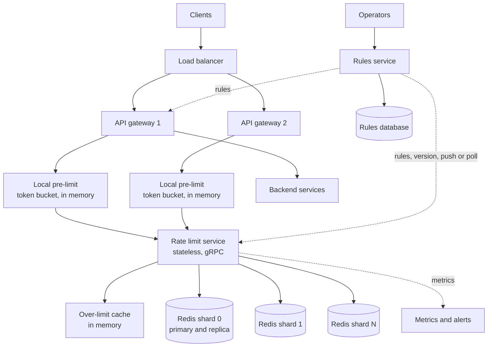
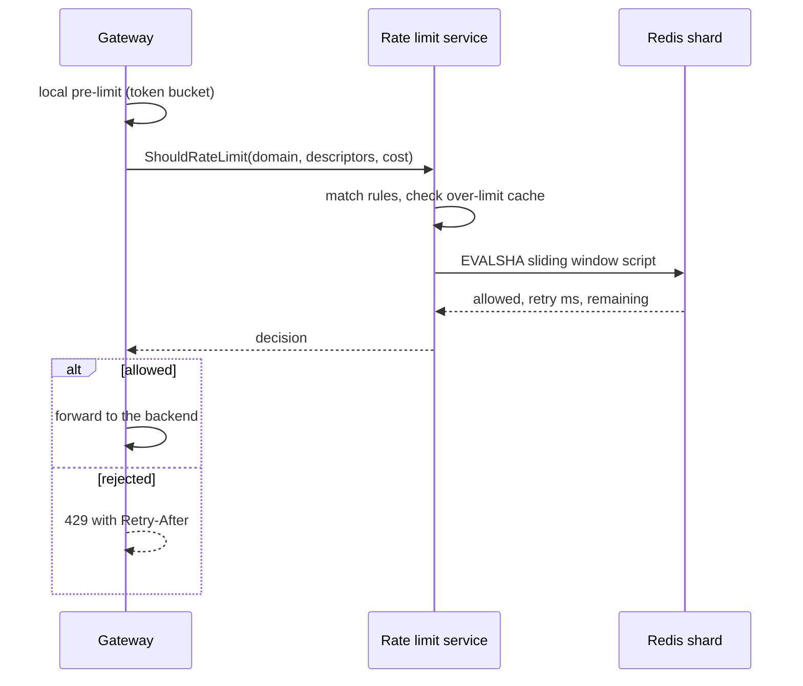
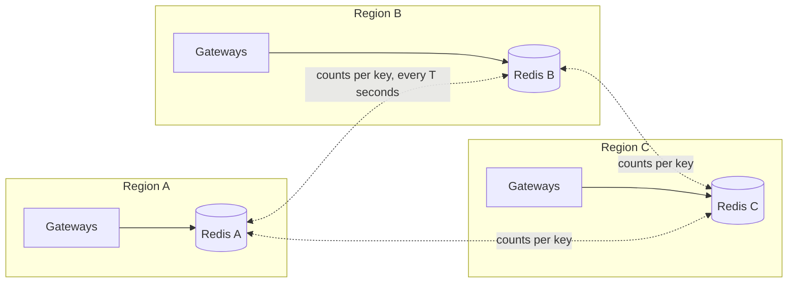

# Design a Distributed Rate Limiter

A distributed rate limiter is a shared service that many API servers call to decide whether a request may proceed. This case study designs it for a platform that has many services, many regions, and a peak of 200,000 limit checks for each second. It covers where the limiter runs, the Redis state and the atomic Lua script for a sliding window counter, multi-region limits, the policy for the failure of the limiter, the rules service, and the response headers. The algorithms have their home page in [rate limiting algorithms](../fundamentals/13-rate-limiting-algorithms.md), and this page does not repeat them. The in-process design is the [LLD rate limiter case study](../../lld/case-studies/03-rate-limiter/README.md). Follow the steps in [how to approach an HLD interview](../how-to-approach-hld.md).

## Problem Statement

"Design a rate limiter for a public API platform. Many API servers run in several regions. Each customer must stay inside the limit of its plan, for example 6,000 requests each minute for each API key, and some endpoints have lower limits. When a client goes over the limit, the platform rejects the request with `429`. The limiter must add very little latency, must keep working when a part of it fails, and must let the operators change limits without a deploy."

## Clarifying Questions

| Question | Answer that this design assumes |
|---|---|
| Who calls the limiter? | The API gateways and the services behind them. They call it for each request before they do the work |
| What identifies a client? | An API key or a user id (after authentication), a tenant id, or an IP address (before authentication). A rule can use a pair, for example `(tenant, endpoint)` |
| What is the scale? | 10 million active keys. 200,000 checks for each second at the peak (Assumption) |
| Hard or soft limit? | Soft: a few percent of error is acceptable for protection limits. A few rules (login attempts, payment attempts) are hard |
| What is the latency budget? | The limiter adds at most 5 ms at p99 (Assumption) |
| Is the limit global or for each region? | The default is a limit for each region with sticky routing of each client. A few quotas must hold globally (see Deep Dives) |
| What happens if the limiter fails? | A policy in each rule: fail open for most, fail closed for a few (see Deep Dives) |
| Can the limit be dynamic? | Yes. Operators change rules at run time. A change takes effect within 10 seconds (Assumption) |
| Does a request cost more than 1? | Yes, for some endpoints. A rule can charge a cost, for example 10 units for an export |
| What does a rejected client see? | `429`, a `Retry-After` header, and optional `RateLimit` headers |
| Is a rule tested before it is enforced? | Yes. A rule can run in shadow mode: it counts and logs and never rejects |

## Requirements

### Functional

1. `check`: given a client identity, the endpoint, and a cost, return allowed or rejected, with the remaining quota and a retry hint.
2. Rules: each rule has a match (which requests), a key (what to count for), a limit and a window, and a failure policy. Several rules can apply to one request (for example for each user and for each tenant). The request passes only if all rules pass.
3. Operators create, update, and delete rules through an API. A rule has a shadow mode.
4. The gateway returns `429` with `Retry-After`, and optional `RateLimit-Policy` and `RateLimit` headers.
5. The system exports metrics: allowed, rejected, shadow-rejected, errors, and latency for each rule.

### Non-functional

| Requirement | Target |
|---|---|
| Latency added | p99 below 5 ms (Assumption) |
| Availability | The limiter must never be the reason for a platform outage. The platform keeps serving when any one limiter component fails |
| Accuracy | Within 5% of the limit for protection rules (Assumption). Exact for hard rules |
| Scale | 200,000 checks for each second at the peak. 10 million active keys |
| Rule propagation | Within 10 seconds |
| No single point of failure | Each tier has more than one instance, in more than one zone |

## Estimation

Inputs (all are assumptions): peak of 200,000 checks for each second. A check is one script call for one rule on one key. The platform peaks at 100,000 requests for each second, and a request matches 2 rules that count in Redis on average (one for the API key and one for the tenant). A rule for all traffic does not count in Redis (see "Several rules for one request"). 10 million active keys, each with one counter hash. 200 bytes for each key in Redis, with the overhead of the data structure (measure it). One Redis shard runs 50,000 Lua script calls for each second at the most (Assumption: a script with about 10 commands; measure it, because the figure depends on the hardware and the script). A check sends 100 bytes and gets 50 bytes. Target load for each shard at the peak: 50%. The rules: 100,000 rules of 1 KB each.

| Step | Calculation | Result |
|---|---|---|
| Checks for each second at the peak | given | 200,000 |
| Shards for 50% load at the peak | ceil(200,000 / 50,000 × 2) | 8 shards |
| Load for each shard | 200,000 / 8 / 50,000 | 50% |
| Memory, one copy | 10,000,000 × 200 B | 2 GB |
| Memory with one replica | 2 GB × 2 | 4 GB. Each of the 8 primaries holds 0.25 GB and its replica another 0.25 GB, so 0.5 GB for each shard |
| Redis traffic | 200,000 × 150 B × 8 | 240 Mbit/s |
| Rule data in each gateway | 100,000 × 1 KB | 100 MB |
| One heavy tenant | 20,000 / 50,000 | 40% of the maximum rate of one shard. That shard also carries its share of the other traffic |
| Latency budget, p50 | gateway to limiter 0.5 ms + limiter to Redis 0.5 ms + script 0.1 ms | about 1.1 ms (approximate: a round trip in one zone is about 0.5 ms, see [caching](../fundamentals/03-caching.md)) |

What the numbers decide:

- The data is small (2 GB). The limiter is limited by the **operations** for each second, not by memory. Size the shards for the call rate.
- One tenant at 20,000 checks for each second takes 40% of one shard, because all its checks hit one key. A hot key is the first scaling problem, and the fix is local state in the gateways (see Bottlenecks).
- 240 Mbit/s is a small amount of network. The latency of one round trip for each request matters more than bandwidth. The limiter adds a network hop to every request, so the design must keep this hop in the same zone and must cut it where it can (local pre-limits, lease batches).

The program below checks this arithmetic and the overshoot of the leased-batch option (see Deep Dives). `main` comes first, and the block has its own imports.

```java
import java.util.Locale;

public class RateLimiterCheck {
    public static void main(String[] args) {
        double peakChecksPerSecond = 200_000;
        double scriptsPerShard = 50_000;
        double shards = Math.ceil(peakChecksPerSecond / scriptsPerShard * 2);
        System.out.println(line("checks per second at peak", peakChecksPerSecond));
        System.out.println(line("shards for 50% load at peak", shards));
        System.out.println(line("load per shard at peak (%)",
                peakChecksPerSecond / shards / scriptsPerShard * 100));

        double activeKeys = 10_000_000;
        double bytesPerKey = 200;
        double memoryGb = activeKeys * bytesPerKey / 1e9;
        System.out.println(line("memory, one copy (GB)", memoryGb));
        System.out.println(line("memory with 1 replica (GB)", memoryGb * 2));
        System.out.println(line("memory per shard with replica (GB)", memoryGb * 2 / shards));

        double bytesPerCall = 100 + 50;
        System.out.println(line("redis traffic (Mbit/s)",
                peakChecksPerSecond * bytesPerCall * 8 / 1e6));

        System.out.println("-- one tenant sends 20000 checks per second to one key --");
        System.out.println(line("share of one shard (%)", 20_000 / scriptsPerShard * 100));

        System.out.println("-- local limiter with leased batches --");
        int gateways = 50;
        double limitPerMinute = 6_000;
        for (int batch : new int[] {5, 10, 60, 600}) {
            double overshoot = (double) gateways * batch;
            System.out.println(String.format(Locale.ROOT,
                    "batch %-4d worst-case extra requests %-6.0f = %6.2f%% of the limit",
                    batch, overshoot, overshoot / limitPerMinute * 100));
        }
        double perKeyRate = 100;
        System.out.println(line("central calls/s for a 100/s key, batch 10", perKeyRate / 10));
    }

    static String line(String label, double value) {
        return String.format(Locale.ROOT, "%-44s %.4g", label, value);
    }
}
```

<!-- expected-output -->
```text
checks per second at peak                    2.000e+05
shards for 50% load at peak                  8.000
load per shard at peak (%)                   50.00
memory, one copy (GB)                        2.000
memory with 1 replica (GB)                   4.000
memory per shard with replica (GB)           0.5000
redis traffic (Mbit/s)                       240.0
-- one tenant sends 20000 checks per second to one key --
share of one shard (%)                       40.00
-- local limiter with leased batches --
batch 5    worst-case extra requests 250    =   4.17% of the limit
batch 10   worst-case extra requests 500    =   8.33% of the limit
batch 60   worst-case extra requests 3000   =  50.00% of the limit
batch 600  worst-case extra requests 30000  = 500.00% of the limit
central calls/s for a 100/s key, batch 10    10.00
```

How to read the output: with 50 gateways and a batch of 10 tokens, the worst case admits 500 requests more than the limit of 6,000 for each minute, 8.3% over. A batch of 5 gives 4.2%, which fits the 5% target. The batch size sets the balance between accuracy and the load on Redis.

## API Design

### Check API (internal, gRPC in production)

`ShouldRateLimit`, a call from the gateway or a service to the rate limit service. The shape follows the descriptor model of the Envoy global rate limit service, in which Envoy sends a domain and a list of descriptors (key and value pairs) and gets a decision (Envoy documentation, global rate limiting). The REST form below shows the data.

`POST /v1/check`

```json
{
  "domain": "public-api",
  "descriptors": [
    { "key": "api_key", "value": "k_91f3" },
    { "key": "endpoint", "value": "POST /v1/export" }
  ],
  "cost": 10
}
```

Response `200`:

```json
{
  "allowed": false,
  "rule": "export-per-key",
  "limit": 600,
  "remaining": 0,
  "retryAfterMs": 4200,
  "shadow": false
}
```

The service answers `200` with `allowed` in the body, because the call itself worked. The gateway maps `allowed: false` to `429`. A call error (timeout, `5xx`) triggers the failure policy of the rule. If the request matches several rules, the response reports the rule that rejected it, or the rule with the least remaining quota if all pass.

### Rules API (admin)

| Method and path | Purpose |
|---|---|
| `PUT /v1/rules/{ruleId}` | Create or replace a rule. The body holds the match, the key, the limit, the window, the cost, the failure policy, and `shadow` |
| `GET /v1/rules?domain=public-api` | List rules, with the version of the set |
| `GET /v1/rules/{ruleId}` | One rule |
| `DELETE /v1/rules/{ruleId}` | Remove a rule |

A rule:

```json
{
  "ruleId": "export-per-key",
  "domain": "public-api",
  "match": { "endpoint": "POST /v1/export" },
  "key": ["api_key"],
  "algorithm": "sliding_window_counter",
  "limit": 600,
  "windowSeconds": 60,
  "failurePolicy": "open",
  "shadow": false
}
```

The Envoy rate limit service has a similar shape: rules are YAML, keyed by a domain and nested descriptors, with `requests_per_unit` and a `unit`. The configuration section of the README lists second, minute, hour, and day, and other sections of the README also document a `month` unit (envoyproxy/ratelimit README).

### Response to the client

The gateway answers a rejected request with `429 Too Many Requests` (RFC 6585) and a `Retry-After` header (RFC 9110, section 10.2.3). The header takes whole seconds or an HTTP date, and the limiter computes its hint in milliseconds, so the gateway rounds the hint up to the next second. Rounding down sends the client back before the request can pass. If the platform sends quota headers, it can send `RateLimit-Policy` and `RateLimit` from the IETF Internet-Draft `draft-ietf-httpapi-ratelimit-headers`. The fundamentals page records version 11 as the latest on 15 October 2026 and says that it is a draft and not an RFC. Do not call it a standard. The unofficial `X-RateLimit-Limit`, `X-RateLimit-Remaining`, and `X-RateLimit-Reset` headers are in wide use, and their meaning differs between providers.

```text
HTTP/1.1 429 Too Many Requests
Retry-After: 5
RateLimit-Policy: "export-per-key";q=600;w=60
RateLimit: "export-per-key";r=0;t=5
```

The retry hint comes from the limiter, because only the algorithm knows when the request can pass (see Deep Dives). Add jitter to the hint, or tell clients to add jitter, so the rejected clients do not all return at the same moment.

## Data Model

### Counter state in Redis

One Redis hash for each client key and each rule. The key name: `rl:{<client>}:<ruleId>`. The text in braces is a **hash tag**: Redis Cluster hashes only that text to choose the slot, so all the keys of one client land on one shard (Redis cluster specification).

| Field | Meaning |
|---|---|
| `start` | The start time of the current window, in ms |
| `prev` | The cost counted in the previous window |
| `cur` | The cost counted in the current window |

The key has a time to live of two windows (`PEXPIRE`). After two idle windows both counters are zero, so a missing key and a stored key give the same answer. The limit is **not** stored in the counter. The caller passes the limit with each check, so a rule change applies at the next call with no migration of counters.

For a token bucket rule, the hash has `milli_tokens` and `ts` instead (see [rate limiting algorithms](../fundamentals/13-rate-limiting-algorithms.md) for the script).

### Rules store

A relational table (PostgreSQL) with the rule fields, a `version` number for each rule, and a version for the whole set. The data is small (100 MB), changes rarely, and needs transactions and an audit trail of who changed what. This is the system of record. The rules service reads it, and the gateways get the rules from the rules service, not from the database. A key-value store with watches (etcd) is also a good fit if the platform already runs it. The reason to choose a relational store here: the rules have structure, an audit trail, and a rare, low-volume write pattern. See [choosing a database](../fundamentals/04-choosing-a-database.md).

### Why Redis for the counters

Counters need an atomic read-modify-write at 200,000 operations for each second, with a latency below 1 ms. Redis keeps the data in memory, runs a Lua script as one atomic unit, expires keys by itself, and shards by key in Redis Cluster. The counters are disposable: losing the counters of the last few seconds only gives a few extra requests. The data does not need strong durability, which is why asynchronous replication is acceptable (see [replication](../fundamentals/05-replication.md)). An alternative is a store that offers a conditional update for each key (DynamoDB). It gives durability and a managed service, and it costs a higher latency for each call, more money for each operation, and no script that runs in the store.

## High-Level Design



### Components

- **API gateway with a rate limit filter.** For each request it extracts the descriptors (API key, tenant, endpoint, IP), applies the **local pre-limit** (an in-memory token bucket for each key, for coarse protection with no network call), and then calls the rate limit service. It turns a rejection into `429` and a call error into the failure policy of the rule.
- **Rate limit service.** A stateless tier. It matches the descriptors against the rules, builds the Redis key for each matching rule, calls the Lua script on the right shard, and returns the decision. It keeps the rules in memory. It keeps a small **over-limit cache**: when a key is over its limit, the service remembers that until the end of the retry hint, and rejects further requests for that key with no Redis call. The `envoyproxy/ratelimit` service has the same idea: its optional local cache "stores the over-the-limit cache keys, and thus avoids reading the redis cache again for the already over-the-limit keys" (envoyproxy/ratelimit README). Cloudflare does the same at its edge: "once a mitigation has started, we know exactly when it will end. This means that we can cache that information in the server memory itself" (Cloudflare, 2017).
- **Redis Cluster.** The counters, on 8 shards, each with a replica in another zone. The service uses `EVALSHA` and falls back to `SCRIPT LOAD` after a `NOSCRIPT` error.
- **Rules service and rules database.** Hold the rules, version them, audit changes, and serve them to the rate limit services and the gateways. The services poll with the set version (a few seconds) or hold a watch, so a change reaches them within 10 seconds. If the rules service is down, every consumer keeps its last known good rules.
- **Metrics.** Each decision increments counters (allowed, rejected, shadow-rejected, error) for each rule. Alert on the rejection rate for each rule, the Redis latency, and the rate of failure-policy decisions (see [observability in design](../fundamentals/20-observability-in-design.md)).

### Where the limiter runs

| Placement | How it works | Strength | Weakness |
|---|---|---|---|
| In the gateway process, with a Redis client library | Each gateway runs the script on Redis | One fewer hop. The lowest latency | Every gateway language needs the library and the rule logic. A bug fix needs a deploy of the gateways. Connections: gateways × shards |
| A separate rate limit service (this design) | The gateway calls a service that talks to Redis | One implementation of the rule logic and the Redis logic. The gateway needs only a small client. The service holds the over-limit cache and pools the connections to Redis | One extra network hop, about 0.5 ms in one zone. One more tier to run |
| A sidecar for each service | A local process next to each service | Isolates failure for each service | The most processes to run. Counters still need Redis |

Recommendation: a separate service. Envoy uses the same split: the HTTP rate limit filter calls a global gRPC rate limit service for each request that its route configures for a limit. Envoy can also run a local rate limit in front of it: "a local token bucket rate limit can absorb very large bursts in load that might otherwise overwhelm a global rate limit service. Thus, the rate limit is applied in two stages" (Envoy documentation, global rate limiting). The rest of this page follows that design. The general placement rules (client, gateway, service) are in [rate limiting algorithms](../fundamentals/13-rate-limiting-algorithms.md).



## Deep Dives

### Deep dive 1: The algorithm and the atomic Redis script

**Which algorithm.** The default is the **sliding window counter**: two counters for each key, O(1) time, and no boundary burst of the fixed window in most traffic. Cloudflare describes the same algorithm in "How we built rate limiting capable of scaling to millions of domains" (June 2017). In an analysis of 400 million requests from 270,000 distinct sources, it reports that "0.003% of requests have been wrongly allowed or rate limited", with "an average difference of 6% between real rate and the approximate rate" (the fundamentals page gives the limits of this measurement). Where the client may burst and the average rate matters, use a **token bucket**. Stripe writes: "We use the token bucket algorithm to do rate limiting", and "We implement our rate limiters using Redis" (Stripe, "Scaling your API with rate limiters", March 2017). The sliding window log is exact and needs O(limit) memory for each key, so it is only for small, hard limits (login attempts). The comparison is in [rate limiting algorithms](../fundamentals/13-rate-limiting-algorithms.md).

**Why a script.** A check is a read-modify-write: read the counters, compute the estimate, compare, and write. If a gateway runs the steps as separate commands, two gateways can read the same count and both pass. Redis runs a Lua script atomically and blocks other commands while it runs (Redis scripting documentation), so the decision is exact for one key. The rules of the fundamentals page apply: declare the key in `KEYS`, keep the script short, call it with `EVALSHA`, handle `NOSCRIPT`, and take the time from `TIME` inside the script so that all gateways use one clock.

**The script.** The state is one hash with `start`, `prev`, and `cur`, so the script touches one key and has no cluster slot problem. The arithmetic stays in whole numbers: the test multiplies both sides by the window length, as in the Java limiter of the fundamentals page, so there is no floating point rounding.

```lua
-- KEYS[1] = the hash that holds the counters of one client key
-- ARGV[1] = limit, ARGV[2] = window in ms, ARGV[3] = cost. All whole numbers >= 1.
-- Returns {allowed (1 or 0), retry-after in ms (0 if allowed), remaining units}.
local limit = tonumber(ARGV[1])
local window = tonumber(ARGV[2])
local cost = tonumber(ARGV[3])
if not limit or not window or not cost or limit < 1 or window < 1 or cost < 1
    or math.floor(limit) ~= limit or math.floor(window) ~= window
    or math.floor(cost) ~= cost or cost > limit or (2 * limit + cost) * window >= 2 ^ 53 then
  return redis.error_reply('ERR limit, window and cost must be whole numbers, cost <= limit')
end
local t = redis.call('TIME')
local now = tonumber(t[1]) * 1000 + math.floor(tonumber(t[2]) / 1000)
local st = redis.call('HMGET', KEYS[1], 'start', 'prev', 'cur')
local start = tonumber(st[1])
local prev = tonumber(st[2]) or 0
local cur = tonumber(st[3]) or 0
local wstart = now - (now % window)
if start == nil then
  start = wstart
  prev = 0
  cur = 0
elseif wstart > start then
  -- A gap of more than one window means that the previous window had no requests.
  if wstart - start == window then prev = cur else prev = 0 end
  cur = 0
  start = wstart
end
-- If the clock of the server stepped backward, wstart < start. Keep the stored window.
-- Then now < start: elapsed is 0, and lag is the time until the clock reaches start again.
local elapsed = math.max(0, now - start)
local lag = math.max(0, start - now)
local scaled = prev * (window - elapsed) + cur * window
local allowed = 0
local retry = 0
if scaled + cost * window <= limit * window then
  allowed = 1
  cur = cur + cost
  scaled = scaled + cost * window
else
  -- Earliest time at which the same request passes, if no other request arrives.
  local need = limit - cur - cost
  local e_needed = window
  if need >= 0 and prev > 0 then
    e_needed = window - math.floor(need * window / prev)
  end
  if need >= 0 and e_needed < window then
    retry = math.max(1, e_needed - elapsed)
  else
    -- The current count becomes the previous count in the next window.
    local e_next = 0
    if cur > 0 then e_next = window - math.floor((limit - cost) * window / cur) end
    retry = (window - elapsed) + math.max(0, e_next)
  end
  retry = retry + lag
end
redis.call('HSET', KEYS[1], 'start', start, 'prev', prev, 'cur', cur)
-- After two idle windows both counters are zero, so the key can expire.
redis.call('PEXPIRE', KEYS[1], 2 * window)
local remaining = math.max(0, math.floor((limit * window - scaled) / window))
return {allowed, retry, remaining}
```

How the script works:

1. It validates the arguments and rejects a bad rule with an error reply, before it writes. The bound `(2 × limit + cost) × window < 2^53` keeps every product an exact whole number in the double arithmetic of Lua. The largest sum is `scaled + cost × window`, which is at most `(prev + cur + cost) × window` when the elapsed time is 0, and `prev` and `cur` are at most `limit`. One case falls outside the check: after an operator lowers a limit, the stored counts can be larger than the new limit for up to two windows. The sum is then at most `3 × old limit × window`. For a limit of 10^6 requests in a day (8.64 × 10^7 ms), that is about 2.6 × 10^14, far below 2^53 ≈ 9 × 10^15.
2. It reads the time from the server. `TIME` returns two strings, the Unix seconds and the microseconds, so the script converts them with `tonumber`. The time in milliseconds is about 1.8 × 10^12, far below 2^53, so it is exact in a Lua double. `TIME` is a wall clock and can step backward, so the script keeps the stored window if `wstart` is lower than `start`, and clamps the elapsed time at 0. A rejection in that state adds `lag`, the time until the clock reaches `start` again, to the hint. The script writes after it calls `TIME`. Redis 5.0 and later allow that, because they replicate the effects of a script and not its text (see [rate limiting algorithms](../fundamentals/13-rate-limiting-algorithms.md)).
3. It rolls the windows: a new window moves `cur` to `prev`, but only if the new window directly follows the old one. After a longer gap, `prev` is 0.
4. It computes `scaled = prev × (window − elapsed) + cur × window`. This is the estimate `prev × (W − elapsed) / W + cur` multiplied by `W`. The request passes if `scaled + cost × window ≤ limit × window`.
5. If the request is rejected, it computes the exact time at which the same request would pass if no other request came. There are two cases. In the current window, the weight of the previous window falls until the estimate fits (`e_needed`). If it cannot fit before the window ends, the answer comes in the next window, where the current count becomes the previous count (`e_next`). The end of the current window alone is **not** a safe hint (see the [fundamentals page](../fundamentals/13-rate-limiting-algorithms.md)).
6. It stores the three fields and sets the expiry to two windows.

A worked run with `limit = 3`, `window = 1000` ms, `cost = 1`: requests at 100, 200, and 300 ms are allowed (`cur = 3`). A request at 1,600 ms is allowed: the new window has `prev = 3`, `cur = 0`, `elapsed = 600`, so `scaled = 3 × 400 = 1,200`, and `1,200 + 1,000 ≤ 3,000`. A second request at 1,600 ms is rejected: `scaled = 1,200 + 1,000 = 2,200`, and `2,200 + 1,000 > 3,000`. The hint is `need = 3 − 1 − 1 = 1`, `e_needed = 1,000 − floor(1 × 1,000 / 3) = 667`, so `retry = 667 − 600 = 67` ms. At 1,667 ms the request passes (`scaled = 3 × 333 + 1,000 = 1,999`, `1,999 + 1,000 = 2,999 ≤ 3,000`), and at 1,666 ms it does not.

**Several rules for one request.** A request often matches more than one rule (for each user, for each tenant, and global). The rate limit service calls the script once for each rule. Two cases:

- Rules of the **same client** use the same hash tag (`rl:{user42}:...`), so they live on one shard. A script that takes several keys can then check all rules first and increment only if all pass, in one atomic step. This is exact.
- A **global rule** (one limit for all traffic of an endpoint or of the platform) cannot be one Redis key at this scale. At 100,000 requests for each second, one key would need twice the 50,000 script calls for each second that one shard runs at the most. Enforce a global rule in each gateway with the limit divided by the number of gateways, or split it into `k` sub-counters on different shards, each with `1/k` of the limit, or give each gateway leased batches (below).
- Rules of **different clients** (a user and a tenant) live on different shards, and no atomic step covers both. Two choices: count a request in every rule even when another rule rejects it (this over-counts rejected requests, and the error makes the limit stricter, not looser), or check all rules first and then increment the passing ones in a second round (two round trips, and a race between the rounds). Recommendation: count in every rule, and document it. The error is in the safe direction.

**Leased batches.** For a heavy key, the gateway can take the central call off the path of each request. The gateway calls the script with `cost = b` to take a batch (a *lease*) of `b` units, and then admits up to `b` requests from memory with no network call. The central counter counts the `b` units at the moment of the lease, not at the moment of each request. A gateway can spend a lease after its units have lost their weight in the sliding window, so in the worst case all `N` gateways spend a full lease that the current window no longer counts: up to `N × b` requests above the limit. The estimation program prints this bound. A gateway also loses the unused units of a lease when it crashes or when the lease expires, and that error makes the limit stricter, not looser. Give each lease a short lifetime (for example one second), so that a stale lease cannot be spent much later. The batch size sets the balance: a larger `b` means fewer calls to Redis and a larger overshoot.

**Redis Cluster.** The script touches one declared key, so it runs in a cluster with no change. A script with several keys must have all keys in one slot, so use the hash tag. The script cache is volatile: call `EVALSHA`, and on `NOSCRIPT` load the script and retry (see [rate limiting algorithms](../fundamentals/13-rate-limiting-algorithms.md)).

### Deep dive 2: Multi-region limits

The problem: a client sends requests to gateways in several regions, and the limit is for the client, not for each region. The round trip between regions is 50 ms or more (approximate; see [multi-region and disaster recovery](../fundamentals/19-multi-region-and-disaster-recovery.md)), so a synchronous central counter in one region adds that time to every request. It also makes the region of the counter a dependency of all other regions. The options:

| Option | How it works | Accuracy | Latency | Failure behavior |
|---|---|---|---|---|
| Independent limit for each region | Each region counts alone. The limit is the same in every region, or the global limit divided by the number of regions | A client that uses all regions gets up to `R × limit` with the same limit in every region. With the limit divided by `R`, a client that uses one region gets only `limit / R` | None added | A region failure does not touch other regions |
| Sticky routing, then independent counting | Route each client to one region (anycast, GeoDNS, or a home region for each key). Count in that region only | Exact for a client that stays in one region. Wrong for a client that is split by a failover | None added | A failover moves the client to another region, where the count starts at 0, so a brief over-admission |
| One central region for the counter | All regions call the central Redis | Exact | A cross-region round trip (50 ms or more) for each request | The central region is a single point of failure for all regions |
| Asynchronous counter exchange | Each region counts locally and sends its counts to the other regions at an interval `T`. Each region adds the counts that it received | Overshoot is bounded by the traffic that arrives in the other regions during one interval | None added | A partition between regions stops the exchange, and each region acts as an independent region until it heals |
| Quota leases from a global allocator | A global allocator gives each region a share of the quota for each interval, based on its recent load. Regions spend their share locally and report their usage. Envoy's quota-based global rate limit works this way: it offers "periodic load reports that allows fair sharing of a global rate limit among multiple instances of Envoy", and Envoy requests quota assignments from a rate limit quota service. The Envoy documentation says that an open-source reference implementation of that service "is currently unavailable" | Overshoot is bounded by the shares. A region that runs out of its share waits for the next assignment | None added in the normal case | If the allocator is unreachable, each region spends its last share until the share expires, and then applies the failure policy of the rule |

Cloudflare chose the second option, with anycast as the sticky routing. The post rejects a central counter: "reporting all counters to a single central point is not a realistic solution as the latency is far too high and guaranteeing the availability of the central service causes more challenges". Anycast routes the traffic of a site to the closest live data center (a PoP, point of presence), so "under normal conditions [...] the traffic from a single IP address will always reach the same PoP". Cloudflare therefore built "an isolated counting system inside each PoP", which "mostly solves the latency problem and greatly improves the availability as well". The counters live in a Twemproxy cluster inside each PoP, which splits a memcache database (Twemcache) across the servers of the PoP with consistent hashing. The servers send the increments asynchronously, so counting does not slow the requests ("How we built rate limiting capable of scaling to millions of domains", Cloudflare, June 2017).



The asynchronous exchange is a **G-Counter**, one of the conflict-free replicated data types: each region increments only its own slot, and a region merges by taking the maximum of each slot, so the merge is safe to repeat and to reorder (see [CRDTs and conflict resolution](../distributed-systems/06-crdts-and-conflict-resolution.md)). Each window of each key has its own G-Counter, because a G-Counter only grows, and the window roll starts a new one. A region computes the global count as the sum of its own live count and the last received counts of the others.

Worked example (assumptions): a global limit of 1,000 requests each minute, 3 regions, an exchange every `T = 1` second. A client sends 1,000 requests each minute to *each* of the three regions, 3,000 in total, three times the limit. That is about 16.7 requests for each second in each region. At any moment, a region does not yet know the traffic of the other two regions during the last second, about 2 × 16.7 = 33 requests. Each region stops when its view (its own count plus the received counts) reaches 1,000, and at that moment the true total is about 1,033. The overshoot is about 33 requests, 3.3% of the limit. In general the overshoot is about `(R − 1) × r × T` for a client that sends `r` requests for each second to each of `R` regions. A client that bursts at a high rate in all regions inside one interval can get more, up to `R × limit` in the extreme, because no region has heard of the burst yet. A shorter `T` lowers the overshoot and raises the traffic between regions.

Recommendation, by the purpose of the limit:

- **Protection limits** (per key per minute, to stop overload): independent counting in each region, with clients that stay in one region by routing. Simple, fast, and robust. Accept up to `R × limit` for a client that deliberately uses all regions, or divide the limit.
- **Global quotas that matter** (a plan quota): asynchronous exchange or leases, with a bounded overshoot, and the exact count in the billing system, which meters from the request logs (see [consistency and CAP](../fundamentals/07-consistency-and-cap.md)).
- **Hard security limits** (login attempts): route each key to one home region, so its counter exists in one place, and accept the latency for a client that is far from its home region.

### Deep dive 3: When the limiter fails

The limiter is a dependency of every request, so its failure policy decides whether a limiter incident becomes a platform outage. The rules:

1. **Set a timeout that matches the budget.** The call to the rate limit service has a timeout of 5 ms (the latency budget), and the call to Redis a shorter one. A slow limiter must not make every request slow (see [reliability patterns](../fundamentals/12-reliability-patterns.md)).
2. **Choose the policy for each rule.**
   - **Fail open** (allow the request) for rules that protect capacity. The product stays available. The platform loses its protection during the incident. Stripe's article says: "Make sure that if there were bugs in the rate limiting code (or if Redis were to go down), requests wouldn't be affected. This means catching exceptions at all levels so that any coding or operational errors would fail open and the API would still stay functional" ("Scaling your API with rate limiters", Stripe, March 2017).
   - **Fail closed** (reject the request) for rules that protect money or security: login attempts, payment attempts, one-time codes. The cost is an outage of those paths when the limiter fails.
   - Envoy exposes the same choice in its HTTP rate limit filter. The field `failure_mode_deny` is "The filter's behaviour in case the rate limiting service does not respond back. When it is set to true, Envoy will not allow traffic in case of communication failure between rate limiting service and the proxy." The field is a boolean, so its default is false, and the filter then allows the traffic (fail open). The field `status_on_error` "Sets the HTTP status that is returned to the client when the ratelimit server returns an error or cannot be reached. The default status is 500." This status matters only for a request that the filter denies because of the error, that is, when it fails closed. A request that the filter allows goes on to the backend. The field `failure_mode_deny_percent` replaces the boolean with a runtime fraction: with 50%, "when the rate limit service is unavailable, 50% of requests will be denied (fail closed) and 50% will be allowed (fail open)" (Envoy documentation, HTTP rate limit filter).
3. **Keep a local fallback.** When Redis is unreachable, the rate limit service and the gateway fall back to the in-memory token bucket of the gateway, with the limit divided by the number of gateways. It needs no network and still stops a flood. Its accuracy is poor, and it is better than no limit.
4. **Use a circuit breaker.** After a number of errors, the service stops calling a failing Redis shard for a few seconds and applies the policy at once, so that each request does not wait for a timeout. The breaker closes after a probe succeeds. This is for each shard: one failed shard must not change the policy for the clients on the other shards.
5. **Plan for a Redis failover.** Redis replicates asynchronously by default, so after a failover the replica can miss the last writes. The counters of the last moments are lost, and clients briefly get more than the limit. Accept this for protection limits. The new primary has its own clock, and the script clamps a negative elapsed time (see Deep dive 1). Reduce the effect with a replica in another zone and a fast failure detector. See [replication](../fundamentals/05-replication.md).
6. **Protect the limiter from its own load.** The over-limit cache answers requests of blocked keys with no Redis call, so a flood from one client does not turn into a flood on one shard. The local pre-limit in the gateway absorbs the rest. Shed load in the rate limit service when its queue is long.
7. **Roll out with a shadow mode.** A new or changed rule runs first with `shadow: true`: it counts and records the rejections that it would make, and the service forces the result to "allowed". The `envoyproxy/ratelimit` service has a shadow mode with the same meaning: "whatever the outcome of the evaluation of the rule, the end-result will always be "OK"", and "all functions of the rate limiting service are executed as normal, with cache-lookup and statistics" (envoyproxy/ratelimit README). Compare the recorded rejections with the traffic, and then turn enforcement on.

### Deep dive 4: The rules service and dynamic configuration

- **Matching.** A request carries descriptors (API key, tenant, endpoint, IP, plan). A rule has a match on some descriptors and a key of the descriptors to count for. The service finds all matching rules. More than one rule can apply, and the request must pass all of them. A rule for a specific endpoint can be stricter than the rule for all endpoints. Keep the match simple (exact values and a prefix wildcard), because the rules run on every request: the service holds the rules in a trie or a hash map, so the lookup does not depend on the number of rules.
- **Plans and overrides.** A rule can refer to a plan (`free`, `pro`, `enterprise`). The plan of a tenant comes from the request context, which the gateway has from the token claim or a cached lookup. A per-tenant override (a customer with a negotiated limit) is a rule that matches the tenant id and wins over the plan rule. The most specific rule wins on the *limit*, and all matching rules still count.
- **Propagation.** The rules service version-stamps the whole set. The rate limit services and gateways poll `GET /v1/rules?since=<version>` every few seconds (or hold a watch) and replace the set in memory atomically. A change is live within 10 seconds, which is the target. The services keep the last good set if the rules service is unreachable, so the rules service is not on the request path and its outage does not affect decisions.
- **Changing a limit while counters exist.** The limit is an argument of the script and not stored in the counter, so a new limit applies at the next call. For a token bucket, the stored token count is capped at the new capacity by the `min` in the script, so lowering a limit takes effect at once and raising it takes effect as the bucket refills.
- **Safety.** Validate a rule before it is stored (a limit of 0 or a negative window is an error). Require a review for a rule with a wide match (all traffic). Keep an audit trail. Keep a global **kill switch** that disables enforcement for a domain, and a default rule for an unknown client, so that no client is unlimited by accident.
- **Observability.** For each rule: the allowed and rejected counts, the shadow-rejected count, the p99 decision latency, and the failure-policy count. A sudden rise of the rejection rate of one rule points to a client bug or an attack. A drop to 0 means that the rule no longer matches.

## Bottlenecks and Scaling

| What fails first | When | Fix |
|---|---|---|
| One hot key | One tenant or one attacker sends 20,000 checks for each second to one key. All go to one shard (40% of its capacity in the estimate) | The over-limit cache and the local pre-limit in the gateway stop a blocked key before Redis. For an allowed heavy key, lease batches of tokens to each gateway, or split the key into `k` sub-counters, each with a share of the limit (see [partitioning and sharding](../fundamentals/06-partitioning-and-sharding.md)) |
| The round trip for each request | 1 ms or more on every request | Keep Redis in the same zone as the rate limit service. Pool connections. Use a local limiter with leased batches: the central call happens once for each batch. With 50 gateways, a batch of 5 over a limit of 6,000 each minute gives at most 4.2% overshoot (see the estimation) |
| Redis operations for each second | 200,000 for each second needs 8 shards at 50% load | Add shards. Redis Cluster moves hash slots to the new shards, and the client follows the `MOVED` and `ASK` redirects of the cluster (Redis cluster specification). The counters are disposable: a short over-admission after a move is acceptable (see [partitioning and sharding](../fundamentals/06-partitioning-and-sharding.md)) |
| A Redis shard fails | A primary crashes | The replica takes over. The failure policy of each rule applies during the failover. Counters of the last moments are lost |
| The rate limit service | A bug or an overload | Stateless, so add instances. The gateway timeout and the failure policy limit the damage. A canary deploy for the service |
| The rules service | It is down or returns a bad rule | Consumers keep the last good rules. Validate rules before they are stored. A kill switch |
| Cross-region | A client uses all regions | See Deep dive 2 |
| Hot script | The script runs on the main thread of Redis and blocks other commands while it runs | Keep it short (about 10 commands) and with no loop. Measure the script time (see the Redis latency documentation) |
| Memory growth | 10 million keys, and more with new key types | TTL on every key (two windows). A key for each IP address of a flood can grow without bound, so limit by IP at the edge first and keep the keys of anonymous clients on a short TTL |

## Trade-offs

| Decision | Choice | Alternatives rejected, and why |
|---|---|---|
| Algorithm | Sliding window counter as the default, token bucket where the client may burst | Fixed window: a 2× boundary burst. Sliding log: O(limit) memory for each key. Leaky bucket queue: adds latency, and is for a constant downstream rate |
| Where it runs | A separate rate limit service, called by the gateway, with a local pre-limit | A library in every gateway: duplicated logic in many languages and a deploy for each change. A sidecar for each service: the most processes |
| State store | Redis Cluster with Lua scripts | A relational database: too slow for 200,000 updates for each second. A store with conditional updates (DynamoDB): durable and managed, and slower and more costly for each call, with no scripts |
| Atomicity | One Lua script for each rule | Several commands in the client (a race). `WATCH`/`MULTI`/`EXEC` retries: more round trips under contention |
| Time source | `TIME` of the Redis server, clamped | The clock of each gateway: skew between gateways breaks the windows |
| Multi-region | Independent counting with sticky routing by default, asynchronous exchange for global quotas | A central counter: 50 ms or more on every request, and one region becomes a single point of failure |
| Failure policy | Chosen in each rule. Fail open by default, fail closed for money and security | One policy for all rules: either too risky or too strict |
| Several rules | Count in every rule, and check all rules of one client atomically with a hash tag | Two-phase check and increment: two round trips and a race |
| Rejected requests | The script of a rule counts only the requests that this rule allows. A request that another rule rejects still counts in the rules that allowed it (see "Several rules for one request") | Counting the requests that a rule rejects: a client that keeps sending stays blocked for as long as it sends, and a sliding log grows without limit |
| Accuracy | Within 5% for protection, with the exact count in the billing system | Exact limiting everywhere: needs a synchronous central counter or a consensus protocol on each request |
| Counter durability | Asynchronous replication, counters are disposable | Synchronous replication: higher latency for each check, with no benefit for a soft limit |
| Rule storage | A relational table, served by a rules service and cached by consumers | Configuration in code: needs a deploy. Rules read from the database on each request: the database becomes a bottleneck |

## Follow-up Questions

??? question "Which algorithm do you pick for a rate limiter that runs across many servers, and why?"

    The sliding window counter for most limits, and a token bucket where bursts are a feature. The sliding window counter keeps two numbers for each key (the count of the current and of the previous window), works in O(1), and has no 2× burst at a window boundary in most traffic. Cloudflare uses it for its rate limiting and measured 0.003% wrong decisions on 400 million requests, with a 6% average difference between the real and the approximate rate. That is one measurement on one traffic mix, so state it as such.

    A token bucket allows a burst up to its capacity and limits the average rate. Stripe writes that it uses "the token bucket algorithm to do rate limiting" and implements its rate limiters with Redis. I pick the token bucket when the product promises a burst allowance ("100 requests each second, with a burst of 500") and the sliding window counter when the product promises "N requests in any minute".

    Trade-off to state: the sliding window counter is an estimate. If the previous window was uneven, the estimate errs in both directions. For a hard limit (login attempts), use the sliding log, which is exact and costs O(limit) memory for each key.

??? question "How do you make the check atomic across many gateways, and what are the limits of a Lua script?"

    Put the whole read-modify-write in a Redis Lua script and call it with `EVALSHA`. Redis runs a script as one atomic unit, so two gateways cannot read the same count and both pass. Without it, a "read, compare, write" sequence has a race.

    The limits: the script blocks the server while it runs, so it must be short (about 10 commands, no loops over large data). It must access only the keys that the caller declares in `KEYS`, so that it runs in Redis Cluster. Several keys in one script must hash to one slot, which a hash tag (`{user42}`) gives. The script cache is volatile, so the client handles `NOSCRIPT` by loading the script and retrying. A script runs on one node, so it does not make a transaction across shards.

    Two details: `TIME` inside the script is the wall clock of the primary, so the script must clamp a negative elapsed time. A Lua number that the script returns becomes an integer reply, so return whole numbers (milliseconds, units) and not fractions.

??? question "The limiter or its Redis fails. Do you fail open or closed?"

    It is a decision for each rule, made in advance. For a rule that protects capacity on a public API, fail open: the product stays up, and the limit is lost for the length of the incident. Stripe's article takes this position: errors in the limiter fail open, and exceptions are caught so that a Redis outage does not affect requests. For a rule that protects money or security (login attempts, payment attempts, one-time codes), fail closed: reject, and accept the outage of that path.

    In both cases, add a local fallback: the gateway keeps an in-memory token bucket with the limit divided by the number of gateways, so a flood is still bounded without a network call. Add a short timeout (the 5 ms budget), a circuit breaker for each Redis shard, and an alert on the rate of failure-policy decisions.

    Also name the quiet failure: after a Redis failover, the replica can miss the last writes because Redis replicates asynchronously by default. Counters of the last moments are lost and clients briefly get more than the limit. That is acceptable for protection, and it is the reason a hard quota is metered in the billing system and not in the limiter.

??? question "How do you enforce one limit across several regions?"

    First ask whether the limit must be global. For a protection limit it often does not. Route each client to one region (anycast, GeoDNS, or a home region for each key) and count there. Cloudflare counts in each data center and relies on anycast to send one IP address to the same data center. The cost: a client that uses several regions gets more than the limit, and a failover resets the count.

    If the limit must be global, a central counter is exact and adds a cross-region round trip (50 ms or more) to each request and makes one region a single point of failure, so I avoid it on the hot path. Two better options: an asynchronous exchange of counters between regions every `T` seconds (a G-Counter: each region increments its own slot, and a merge takes the maximum for each slot), with an overshoot bounded by the traffic that arrives in the other regions during `T`, or quota leases from a global allocator, as in Envoy's quota-based design. The overshoot is about `(R − 1) × r × T` for a client that sends `r` requests for each second to each of `R` regions. With a limit of 1,000 each minute, 3 regions, `T = 1 s`, and a client that sends 1,000 each minute to each region, that is about 33 requests, 3.3%. A short, fast burst in all regions inside one interval can get more, because no region has heard of it yet.

    For a hard security limit, give the key a home region and accept the latency for the clients far from it.

??? question "One tenant sends 100 times the traffic of the others. What happens, and how do you protect the limiter?"

    All checks of one tenant go to one key, so one Redis shard takes all that load, while the table total is far below its limit. At 20,000 checks for each second, one key takes 40% of a shard in my estimate.

    Layers of defense. First, the gateway local pre-limit and the over-limit cache in the rate limit service reject a blocked tenant before Redis, so the flood does not reach the shard. Second, for a tenant that stays allowed at a high rate, take the central call off the per-request path: lease a batch of tokens to each gateway, or split the key into `k` sub-counters that each own a share of the limit. Both give up some accuracy: with `N` gateways and a batch of `b` tokens, the overshoot is at most `N × b`. With 50 gateways and a limit of 6,000 each minute, a batch of 5 gives 4.2% and a batch of 10 gives 8.3%.

    Third, hierarchical limits: a global limit, then a per-tenant limit, so that one tenant cannot use all the shared capacity. The global limit sees all traffic, so it must not be one Redis key: enforce it in each gateway with the limit divided by the number of gateways, or split it into sub-counters.

??? question "How do you keep the latency overhead of the limiter low?"

    Remove the network from most requests and make the rest cheap. The local pre-limit in the gateway needs no call. The over-limit cache answers blocked keys with no Redis call. Redis runs in the same zone as the rate limit service (about 0.5 ms for a round trip, approximate). Connections are pooled, and the script is short. The budget in this design is about 1.1 ms at p50 (gateway to service 0.5 ms, service to Redis 0.5 ms, script 0.1 ms) and 5 ms at p99.

    If that is still too much, lease token batches so that the central call happens once for each batch and not for each request, at the price of a bounded overshoot. Pipelining helps when one request needs several keys. A timeout at the budget, plus the failure policy, makes sure that a slow limiter cannot make every request slow.

??? question "What do you rate limit by? Discuss IP addresses, API keys, and tenants."

    After authentication, use the API key, the user id, or the tenant id. They identify the party that has a plan and that you can bill or block. Before authentication (signup, login), only the IP address exists, and the limit must be higher and combined with other signals, because many users share one IP address behind a company network or a mobile carrier NAT, and an attacker can rotate IP addresses.

    If a proxy or load balancer sits in front, the limiter must read the client address from a header that only the trusted proxy sets, because a client can send a forged `X-Forwarded-For`. Use a pair for finer control: `(tenant, endpoint)` for expensive endpoints, and a tenant total on top. Layer the limits: a coarse limit at the edge, a finer limit per key, and a per-tenant fairness limit.

??? question "How do operators change limits safely, and how fast does a change apply?"

    The rules live in a relational table behind a rules service with validation, versions, and an audit trail. The rate limit services and gateways poll with the version (or hold a watch) and swap the whole rule set in memory atomically. A change is live within 10 seconds. If the rules service fails, consumers keep the last good rules, so the rules service is never on the request path.

    The limit is an argument of the Lua script and not part of the stored counter, so a change applies at the next call, with no migration. A new rule goes through **shadow mode** first: it counts and records the rejections that it would make, and never rejects. After a comparison with real traffic, the operator turns enforcement on. A global kill switch per domain turns the enforcement off during an incident.

??? question "How do you limit by cost, or limit concurrency, and not only the request count?"

    For cost, change the unit: the script takes a `cost` argument. A heavy export charges 10 units and a read charges 1. The token bucket takes `cost` tokens, and the sliding window counter adds `cost` to the count. The limit is then a budget in cost units. The IETF draft has a quota unit parameter for this, with registered units for requests, content bytes, and concurrent requests.

    A concurrency limit bounds the requests that run now, not the requests for each second. A slow dependency makes requests last longer, so under a fixed rate the number in flight grows. A rate limit alone does not stop that overload. Stripe describes a concurrent requests limiter next to its rate limiter for CPU-heavy endpoints. Implement it as a counter that the gateway increments at the start and decrements at the end (with a TTL as a safety net for a gateway that crashes between the two). Use both for a shared dependency (see [reliability patterns](../fundamentals/12-reliability-patterns.md)).

??? question "How do you test and monitor a distributed rate limiter?"

    Test the algorithm with an injected clock, so every case states exact times and the results are the same on each run (see the Java limiters in [rate limiting algorithms](../fundamentals/13-rate-limiting-algorithms.md)). Test the script against a real Redis, and compare its decisions with the in-process implementation on random request sequences. Test the failure paths on purpose: stop Redis, add latency, fail over a primary, and check that each rule follows its policy. Load test to find the real operations for each second of a shard and the p99 of the script.

    Monitor each rule: allowed, rejected, shadow-rejected, failure-policy decisions, the p99 latency of the check, the hit rate of the over-limit cache, and the Redis latency and memory. Alert when a rule's rejection rate jumps, when it drops to zero (the rule stopped matching), and when the failure-policy rate rises. Use the logs of rejected requests to find clients that need help or a block.

??? question "Why not put the limit in each service, and why do you still need it there?"

    A limit in each service sees the true cost of the work and the state of the service. It cannot protect the service from the connection, the thread, and the parsing cost that the request already used. A limit at the gateway rejects early and applies one policy for all services. So use both: a coarse limit at the gateway for protection, and a finer limit in the service for expensive operations and per-tenant fairness. Add a limit on outbound calls to a dependency that has its own limit. See [rate limiting algorithms](../fundamentals/13-rate-limiting-algorithms.md) for the table of places.

## 45-Minute Plan

| Minutes | What to present |
|---|---|
| 0 to 5 | Clarify: who calls it, the key (API key, tenant, IP), the scale (200,000 checks for each second), the latency budget, soft or hard limits, multi-region, the failure policy. Write the requirements |
| 5 to 10 | Estimation: 200,000 checks for each second, 8 shards at 50% load, 2 GB of counters, 240 Mbit/s. Conclusion: the load is operations for each second, and the hot key is the risk |
| 10 to 15 | API: the check call (descriptors, cost, decision, retry hint), the rules API, and the `429` response with `Retry-After` and the draft `RateLimit` headers. State the draft status |
| 15 to 22 | Diagram: gateway with local pre-limit, rate limit service, Redis Cluster, rules service. Explain the placement choice |
| 22 to 36 | Deep dives. The algorithm and the atomic Lua script (about 5 minutes). Multi-region options and the one you choose (about 4 minutes). The failure policy (about 3 minutes). The rules service, briefly |
| 36 to 41 | Bottlenecks: the hot key, the round trip, a Redis failover, the rules service |
| 41 to 45 | Trade-offs and a summary. Invite questions: the 5% accuracy, fail open or closed, multi-region |

## Further Reading

- Cloudflare blog, ["How we built rate limiting capable of scaling to millions of domains"](https://blog.cloudflare.com/counting-things-a-lot-of-different-things/) (June 2017). The sliding window counter, the 0.003% measurement, counting inside each PoP with anycast and a Twemproxy and memcache cluster, and the in-memory cache of active mitigations.
- Stripe blog, ["Scaling your API with rate limiters"](https://stripe.com/blog/rate-limiters) (Paul Tarjan, March 2017). The token bucket on Redis, four kinds of limiters (request rate, concurrent requests, fleet usage load shedder, worker utilization load shedder), and the fail-open principle.
- Envoy documentation, ["Global rate limiting"](https://www.envoyproxy.io/docs/envoy/latest/intro/arch_overview/other_features/global_rate_limiting). The gRPC rate limit service, descriptors, the local rate limit as a first stage, and quota-based rate limiting with load reports.
- Envoy documentation, [HTTP rate limit filter](https://www.envoyproxy.io/docs/envoy/latest/api-v3/extensions/filters/http/ratelimit/v3/rate_limit.proto). `failure_mode_deny` and `status_on_error`.
- [envoyproxy/ratelimit](https://github.com/envoyproxy/ratelimit). The reference Go service with a Redis backend, YAML rules (domain, descriptors, `requests_per_unit`, `unit`), the optional over-limit local cache, and shadow mode.
- Redis documentation, ["Scripting with Lua"](https://redis.io/docs/latest/develop/programmability/eval-intro/) and the [cluster specification](https://redis.io/docs/latest/operate/oss_and_stack/reference/cluster-spec/). Atomic scripts, declared keys, `EVALSHA`, hash slots, and hash tags.
- [RFC 6585](https://www.rfc-editor.org/rfc/rfc6585) (`429 Too Many Requests`) and [RFC 9110](https://www.rfc-editor.org/rfc/rfc9110) (`Retry-After`, section 10.2.3).
- [IETF Internet-Draft "RateLimit header fields for HTTP"](https://datatracker.ietf.org/doc/draft-ietf-httpapi-ratelimit-headers/). `RateLimit-Policy` and `RateLimit`. It is a draft and not an RFC.
- Shapiro, Preguiça, Baquero, Zawirski, "Conflict-free Replicated Data Types", 2011. The G-Counter used for the asynchronous exchange of counts between regions.
- Related pages: [rate limiting algorithms](../fundamentals/13-rate-limiting-algorithms.md), the [LLD rate limiter](../../lld/case-studies/03-rate-limiter/README.md), [reliability patterns](../fundamentals/12-reliability-patterns.md), [partitioning and sharding](../fundamentals/06-partitioning-and-sharding.md), [replication](../fundamentals/05-replication.md), [multi-region and disaster recovery](../fundamentals/19-multi-region-and-disaster-recovery.md), [consistency and CAP](../fundamentals/07-consistency-and-cap.md), [caching](../fundamentals/03-caching.md), [URL shortener](01-url-shortener.md).
