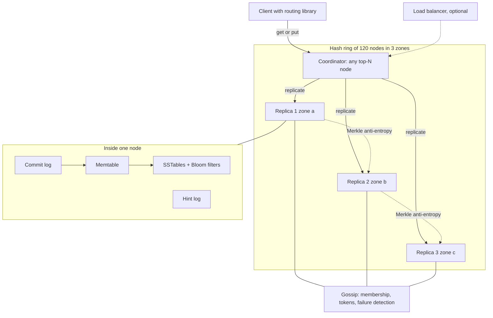
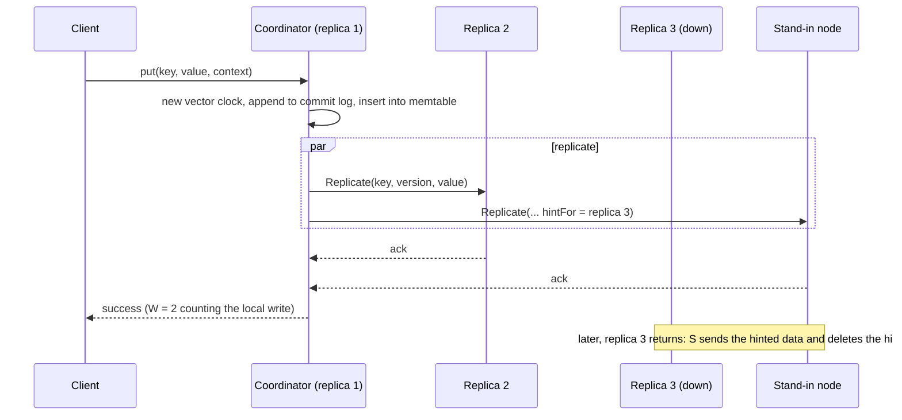
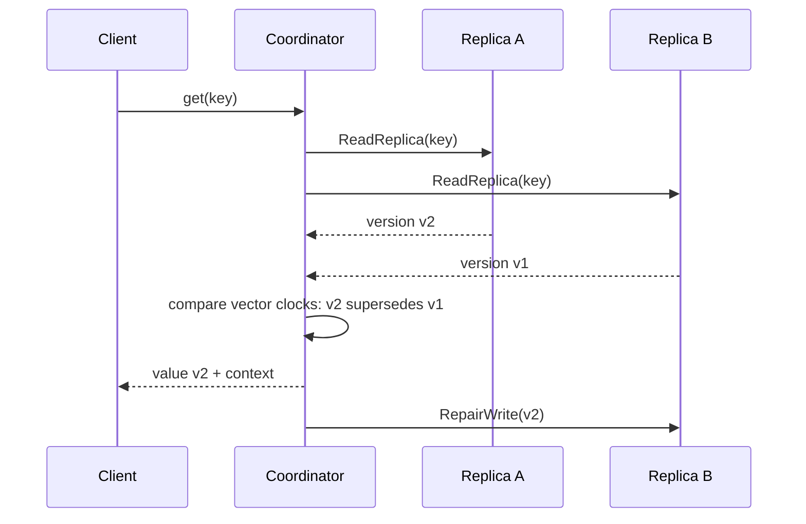
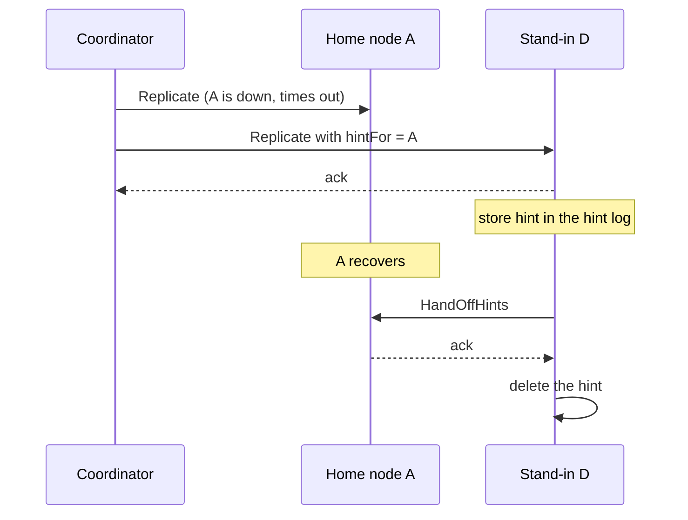
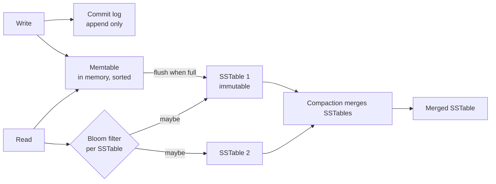

# Design a Distributed Key-Value Store (Dynamo Style)

## Problem Statement

Design a distributed key-value store. Clients call `put(key, value)` and `get(key)`. The store holds
billions of items, spreads them over hundreds of machines, and stays available when machines, racks,
or a data center fail. The store favors availability over strong consistency, so it accepts writes
even when some replicas are unreachable, and it repairs the replicas later. This is the design of
the Amazon Dynamo paper (DeCandia et al., SOSP 2007), which Apache Cassandra and Riak follow in
part.

The in-process version of this problem (one machine, TTL, eviction) is the LLD case study
[key-value store with TTL](../../lld/case-studies/19-key-value-store-with-ttl/README.md). This page
covers the distributed system. The building blocks have their own pages. This page links to them and
shows how they fit together:

- [partitioning and sharding](../fundamentals/06-partitioning-and-sharding.md) for the ring;
- [replication](../fundamentals/05-replication.md) for leaderless replication and repair;
- [consistency and CAP](../fundamentals/07-consistency-and-cap.md) for quorums;
- [failures and time](../distributed-systems/01-failures-and-time.md) for vector clocks and failure
  detection;
- [probabilistic data structures](../distributed-systems/04-probabilistic-data-structures.md) for
  Bloom filters, Merkle trees, and gossip.

## Clarifying Questions

Ask these in the first 5 minutes. Each row gives the answer that this design assumes.

| Question | Assumed answer |
|---|---|
| What is the data model? | A key (up to 256 bytes) maps to an opaque value (blob) of up to 1 MB. The paper's target is objects "usually less than 1 MB". No joins, no multi-key transactions |
| Which operations? | `get`, `put`, `delete`. No range scans across partitions in the core design |
| What is the scale? | 5 billion items, average 1 KB value, 200,000 reads per second and 100,000 writes per second at peak |
| Availability or consistency? | Availability. A write must succeed when a majority of replicas, or even fewer, are reachable. Stale reads are acceptable for most tables |
| How stale may a read be? | Seconds, in the normal case. The design bounds the staleness by repair, not by a time limit |
| Is the data in one region? | One region with three availability zones. Multi-region is an extension |
| What latency? | p99 below 10 ms for a read and a write inside one region. The Dynamo paper uses a 300 ms p99.9 SLA for its callers; this design targets a tighter bound because the store is one hop in a request |
| Durability? | No acknowledged write is lost when one node fails. Each item has 3 replicas in 3 different availability zones |
| Who resolves conflicts? | A per-table setting. The default keeps all concurrent versions (siblings) and lets the client merge them. Last-writer-wins (LWW) is the alternative |
| Elasticity? | Add or remove nodes with no downtime. Each change moves about 1/N of the data |
| Security and multi-tenancy? | Out of scope for the core design. See [security in design](../fundamentals/21-security-in-design.md) |

## Requirements

### Functional

1. `put(key, value, context)` stores a value. The `context` carries the version information that the
   client got from a previous `get`.
2. `get(key)` returns the value, or several concurrent values with a context.
3. `delete(key)` removes the key. The store keeps a tombstone (a delete marker) so that the delete
   spreads to all replicas.
4. The store partitions the key space over the nodes and replicates each key to N = 3 nodes.
5. The store detects failed nodes, keeps working without them, and repairs replicas that missed
   writes.
6. An operator adds or removes a node with no downtime.

### Non-functional

| Requirement | Number |
|---|---|
| Items | 5 billion, average 1.1 KB with metadata |
| Peak load | 200,000 reads per second, 100,000 writes per second |
| Latency | p99 below 10 ms inside one region (Assumption) |
| Availability of a request | The store answers while at least W (or R) replicas of the key are reachable. Section Estimation computes the number for 99.9 percent node availability |
| Durability | 3 replicas in 3 availability zones. No data loss when one zone fails |
| Consistency | Eventual by default. Tunable per request through R and W |
| Scalability | Linear: double the nodes, double the throughput |
| Symmetry | Every node has the same role. No leader, no single point of failure (a design principle of the paper) |

## Estimation

The numbers are assumptions that the clarifying questions fix. Each step is shown. See
[back-of-envelope estimation](../back-of-envelope-estimation.md) for the method.

**Storage.**

1. Bytes per item = 100 bytes (key, version vector, timestamps, flags) + 1,000 bytes (value) = 1,100
   bytes.
2. Logical data = 5 x 10^9 items x 1,100 bytes = 5.5 x 10^12 bytes = 5.5 TB.
3. Replicated data = 5.5 TB x 3 replicas = 16.5 TB.

**Operations.** A put goes to all N = 3 replicas. A get with R = 2 asks two replicas. This design
follows Cassandra for reads: its documentation states that "the coordinator generally only issues
read commands to enough replicas to satisfy the consistency level" (plus a speculative retry to an
extra replica when one is slow). The Dynamo paper instead sends each read to all N replicas and waits
for R (section 4.5). With that rule, replica reads would be 200,000 x 3 = 600,000 per second, the
total would be 900,000, and the cluster would need 900,000 / 6,000 = 150 nodes.

1. Replica writes per second = 100,000 x 3 = 300,000.
2. Replica reads per second = 200,000 x 2 = 400,000.
3. Total replica operations per second = 300,000 + 400,000 = 700,000.

**Number of nodes.** Assumption: one node with SSDs sustains 10,000 replica operations per second
(mixed reads and writes, 1 KB values), and the design runs it at 60 percent utilization, so that
compaction, repair, and a node failure do not cause overload.

1. Usable operations per node = 10,000 x 0.6 = 6,000 per second.
2. Nodes = 700,000 / 6,000 = 116.7. Round up to 120 nodes.
3. Data per node = 16.5 TB / 120 = 138 GB. This is far below the disk size, so **throughput decides
   the cluster size, not storage**. A size-tiered LSM (log-structured merge tree) compaction needs
   free disk for the merge, and 138 GB on a multi-TB disk leaves room for it.

**Bandwidth.**

1. Client ingress = 100,000 writes per second x 1,100 bytes = 110 MB/s.
2. Replication traffic = 110 MB/s x 2 extra copies = 220 MB/s across the cluster, or about 1.8 MB/s
   per node.
3. Client egress = 200,000 reads per second x 1,100 bytes = 220 MB/s.

**Availability of one request.** Assumption: each node is up 99.9 percent of the time, and node
failures are independent. This assumption is optimistic, because racks and zones fail together. The
zone-aware placement in the design exists to make the assumption closer to the truth.

1. P(a replica is down) = 0.001.
2. P(all 3 down) = 0.001^3 = 10^-9. A write with W = 1 or a read with R = 1 fails with this
   probability.
3. P(exactly 2 down) = 3 x 0.001^2 x 0.999 = 2.997 x 10^-6. P(at least 2 down) = 3.0 x 10^-6.
4. A strict quorum operation with W = 2 or R = 2 needs 2 of the 3 home replicas up. It fails with
   probability 3.0 x 10^-6, so it succeeds 99.9997 percent of the time. With a sloppy quorum (Deep
   Dive 4), a write can also use stand-in nodes, so it fails less often than this number.

**Ring size.** With 16 virtual nodes (vnodes) per node (the current Cassandra default, see
[partitioning and sharding](../fundamentals/06-partitioning-and-sharding.md)), the ring has 120 x 16 =
1,920 token positions. Each position owns on average 5 x 10^9 / 1,920 = 2.6 million primary keys.
In the terms of the paper's strategy 3 (Deep Dive 1), this is Q = 1,920 fixed partitions and Q/S = 16
partitions for each of the S = 120 nodes. Assumption: if the cluster must grow far beyond 120 nodes,
choose a larger Q at the start, because Q stays fixed.

The program below repeats this arithmetic.

```java
public class Est {
    public static void main(String[] args) {
        long items = 5_000_000_000L;
        long bytesPerItem = 1_100;
        double logicalTb = items * bytesPerItem / 1e12;
        int rf = 3;
        double replicatedTb = logicalTb * rf;
        double readsPerSec = 200_000;
        double writesPerSec = 100_000;
        double replicaWrites = writesPerSec * rf;
        int r = 2;
        double replicaReads = readsPerSec * r;
        double totalReplicaOps = replicaWrites + replicaReads;
        double perNodeSustained = 10_000;
        double targetUtil = 0.6;
        double nodesByOps = totalReplicaOps / (perNodeSustained * targetUtil);
        int nodes = (int) Math.ceil(nodesByOps / 10.0) * 10;
        double gbPerNode = replicatedTb * 1000 / nodes;
        double ingressMb = writesPerSec * bytesPerItem / 1e6;
        double replMb = ingressMb * (rf - 1);
        double egressMb = readsPerSec * bytesPerItem / 1e6;
        System.out.printf("logical data: %.1f TB%n", logicalTb);
        System.out.printf("replicated data (RF=%d): %.1f TB%n", rf, replicatedTb);
        System.out.printf("replica writes/s: %.0f%n", replicaWrites);
        System.out.printf("replica reads/s: %.0f%n", replicaReads);
        System.out.printf("total replica ops/s: %.0f%n", totalReplicaOps);
        System.out.printf("nodes by ops (60%% util): %.1f -> %d nodes%n", nodesByOps, nodes);
        System.out.printf("data per node: %.0f GB%n", gbPerNode);
        System.out.printf("client ingress: %.0f MB/s%n", ingressMb);
        System.out.printf("replication traffic: %.0f MB/s%n", replMb);
        System.out.printf("client egress: %.0f MB/s%n", egressMb);
        double p = 0.999;
        double q = 1 - p;
        double quorumOk = 1 - (3 * q * q * p + q * q * q);
        double oneOk = 1 - q * q * q;
        System.out.printf("P(at least 2 of 3 replicas up) = %.7f%n", quorumOk);
        System.out.printf("P(at least 1 of 3 replicas up) = %.9f%n", oneOk);
        int vnodes = 16;
        System.out.printf("ring entries: %d%n", nodes * vnodes);
        long keysPerRange = items / (nodes * vnodes);
        System.out.printf("primary keys per token position: %d%n", keysPerRange);
    }
}
```

<!-- expected-output -->

```text
logical data: 5.5 TB
replicated data (RF=3): 16.5 TB
replica writes/s: 300000
replica reads/s: 400000
total replica ops/s: 700000
nodes by ops (60% util): 116.7 -> 120 nodes
data per node: 138 GB
client ingress: 110 MB/s
replication traffic: 220 MB/s
client egress: 220 MB/s
P(at least 2 of 3 replicas up) = 0.9999970
P(at least 1 of 3 replicas up) = 0.999999999
ring entries: 1920
primary keys per token position: 2604166
```

## API Design

### Client API

The client API has three operations. The paper's interface is `get(key)` and `put(key, context,
object)`. The `context` "encodes system metadata about the object" and carries the version
information (DeCandia et al., section 4.1). The REST form below maps to it.

| Operation | Request | Response |
|---|---|---|
| Read | `GET /v1/tables/{table}/keys/{key}` with the header `X-Consistency: quorum` (optional `X-R: 2`) | `200` with a JSON list of one or more `{value, version}` entries and a `context` token. More than one entry means concurrent versions (siblings). `404` if the key does not exist or has a tombstone |
| Write | `PUT /v1/tables/{table}/keys/{key}` with the body `{value, context}` and the optional header `X-W: 2` | `200` with the new `context`. `409` is not used: concurrent writes are not errors, they become siblings. `503` if fewer than W replicas answer in the timeout |
| Delete | `DELETE /v1/tables/{table}/keys/{key}` with `{context}` | `200`. The store writes a tombstone that carries a new version |

Rules:

- A client that merges siblings sends the merged value with the `context` of the `get` that returned
  the siblings. The new version then replaces all of them.
- A write with an empty `context` creates a new version that does not replace anything. This is the
  correct behavior for a blind write, and it can create a sibling.
- The client library hashes the key and sends the request directly to a node in the preference list
  (a partition-aware client), or the client uses a load balancer and any node forwards the request.
  The paper describes both, and says that the partition-aware client has lower latency because it
  skips a forwarding step (section 4.5).

### Internal API (node to node)

| RPC | Purpose |
|---|---|
| `Replicate(key, version, value, hintFor?)` | The coordinator sends a write to a replica. `hintFor` names the intended owner when the target is a stand-in |
| `ReadReplica(key)` | The coordinator asks a replica for its versions of a key |
| `RepairWrite(key, version, value)` | Read repair: the coordinator sends the newest version to a stale replica |
| `MerkleRoot(range)` / `MerkleChildren(range, path)` | Anti-entropy: two nodes compare trees for a token range they share |
| `Gossip(stateDigest)` | Membership and token ownership exchange |
| `StreamRange(range, toNode)` | Bootstrap and decommission: move the data of a token range |
| `HandOffHints(owner)` | A stand-in node sends its stored hints to a recovered owner |

## Data Model

### What the store keeps

The store is the database, so the "tables" below describe the on-disk record, the metadata, and the
hint log of one node.

| Structure | Fields | Notes |
|---|---|---|
| Item record (one per key per replica) | `key`, `versionVector` (list of `(nodeId, counter, timestamp)`), `value` or `tombstone`, `writeTimestamp` | The paper hashes the key with MD5 to a 128-bit position on the ring. The record also stores the key itself, because a hash does not identify a key without collision risk. Assumption: this design uses a 64-bit Murmur3-style hash, as Cassandra's default partitioner `Murmur3Partitioner` does |
| Ring metadata (every node holds all of it) | `token -> nodeId`, `nodeId -> {zone, address, state}` | The paper calls this a "zero-hop DHT": every node knows which node owns each range, so a request needs no extra routing hops (section 3.3) |
| Hint log | `(intendedOwner, key, version, value, createdAt)` | Separate from item data so that a hint is easy to delete after delivery |
| Commit log | Append-only file of mutations | For durability before the memtable flushes (see Deep Dives, storage engine) |
| SSTable (sorted string table) | Immutable sorted files with an index and a Bloom filter | The LSM storage engine |

### Why this storage choice

| Option | Verdict |
|---|---|
| A relational database as the store | Rejected. The access pattern is key to blob. A relational database adds joins, locks, and transactions that this design does not use, and a single-node database does not scale the writes |
| B-tree storage engine on each node (Berkeley DB, as in the paper) | Valid. The paper made the engine pluggable and states that "the majority of Dynamo's production instances use BDB Transactional Data Store" (section 5). B-trees give fast point reads and update pages in place, which costs random writes |
| LSM tree on each node (Cassandra, RocksDB) | Chosen. Writes are sequential (a commit log append plus a memtable insert), which suits 100,000 writes per second. The cost is read amplification and compaction I/O, which Bloom filters and compaction strategy limit |

Recommendation: use an LSM engine for a write-heavy store, and a B-tree engine when reads dominate
and values are large. The paper's authors chose the engine by object size: BDB for objects of "tens
of kilobytes", MySQL for larger ones (section 5).

## High-Level Design



Components:

- **Client library.** It hashes the key, finds the preference list from a cached copy of the ring,
  and sends the request to the first node in the list. If the cached ring is stale, the receiving node
  forwards the request.
- **Coordinator.** The node that handles one request. For a `put` it creates the new version, writes
  it locally, sends it to the other replicas, and waits for W acknowledgments. For a `get` it asks R
  replicas (the Cassandra rule that the Estimation uses), waits for R answers, returns the versions
  that are not obsolete, and repairs stale replicas. Any of the top N nodes of the preference list can
  coordinate a write (paper section 5). Any node can coordinate a read (paper section 6.4).
- **Ring and preference list.** The ring maps a key to N distinct physical nodes. Distinct zones are
  required. See Deep Dive 1.
- **Replicas.** Each replica stores items in its LSM engine.
- **Gossip layer.** Every node picks a random peer every second and the two reconcile membership and
  token ownership (paper section 4.8.1). Each node runs its own failure detector and decides locally
  whether a peer is up. The Cassandra documentation: "UP and DOWN state are local node decisions and
  are not propagated with gossip." Dynamo also uses a local view (paper section 4.8.3).
- **Hint log and anti-entropy.** The two repair mechanisms for replicas that miss a write.

### Write path (sequence)



With W = 2, the coordinator needs one acknowledgment besides its own write. The paper says: "If at
least W-1 nodes respond then the write is considered successful" (section 4.5).

### Read path (sequence)



## Deep Dives

### Deep Dive 1: Partitioning, the preference list, and membership

**The ring.** The store hashes each key to a position on a ring and each node to many positions
(tokens or virtual nodes). The owner of a key is the first token clockwise from the key's position.
The full explanation, the load balance of vnodes, and the three partitioning strategies that Dynamo
tried are in [partitioning and sharding](../fundamentals/06-partitioning-and-sharding.md). This design
uses the paper's third strategy (equal-size partitions, Q/S tokens per node) in spirit: the number of
partitions stays fixed, so a partition moves as a unit by copying files. The paper reports that
strategy 3 reduces the membership information at each node by three orders of magnitude compared to
strategy 1 (section 6.2). Cassandra instead uses `num_tokens` random or allocated tokens per node.

**The preference list.** The coordinator for a key is the node that owns the key's position. The
node replicates the key to the next N-1 distinct physical nodes clockwise. The paper calls this list
the preference list, and it "contains more than N nodes" to survive failures. Because one physical node
has many tokens, the list is built "by skipping positions in the ring to ensure that the list contains
only distinct physical nodes" (section 4.3). This design adds a rule: the walk also skips a node that is in a zone that the list already
uses, so that the 3 replicas sit in 3 availability zones. Cassandra does the same with
`NetworkTopologyStrategy`, which places replicas on different racks when it can.

The runnable program below builds a ring with 5 nodes and 8 tokens per node, finds the preference list
for three keys, and shows which node would take a hint when one replica is down. It uses a fixed hash
function, so the output is the same on every run.

```java
import java.util.ArrayList;
import java.util.LinkedHashSet;
import java.util.List;
import java.util.Set;
import java.util.TreeMap;

public class PrefList {
    private static final TreeMap<Long, String> ring = new TreeMap<>();

    public static void main(String[] args) {
        for (String node : new String[] {"A", "B", "C", "D", "E"}) {
            addNode(node, 8);
        }
        for (String key : new String[] {"user:1001", "cart:77", "session:abc"}) {
            System.out.println(key + " -> preference list " + homeNodes(key, 3));
        }
        String key = "cart:77";
        List<String> home = homeNodes(key, 3);
        String down = home.get(1);
        System.out.println("write " + key + " while " + down + " is down:");
        List<String> standIns = new ArrayList<>(distinctWalk(key));
        standIns.removeAll(home);
        int next = 0;
        for (String node : home) {
            if (node.equals(down)) {
                String stand = standIns.get(next++);
                System.out.println("  " + stand + " takes the write with a hint for " + node);
            } else {
                System.out.println("  " + node + " takes the write");
            }
        }
    }

    // FNV-1a style 64-bit hash with an extra shift-xor on each character. Fixed, so every run
    // gives the same output.
    static long hash(String s) {
        long h = 0xcbf29ce484222325L;
        for (int i = 0; i < s.length(); i++) {
            h ^= s.charAt(i);
            h *= 0x100000001b3L;
            h ^= (h >>> 29);
        }
        return h >>> 1;
    }

    static void addNode(String node, int vnodes) {
        for (int v = 0; v < vnodes; v++) {
            ring.put(hash(node + "#" + v), node);
        }
    }

    // Walk clockwise from the key position and keep the first token of each physical node.
    static Set<String> distinctWalk(String key) {
        long position = hash(key);
        Set<String> nodes = new LinkedHashSet<>(ring.tailMap(position).values());
        nodes.addAll(ring.headMap(position).values());
        return nodes;
    }

    static List<String> homeNodes(String key, int n) {
        return new ArrayList<>(distinctWalk(key)).subList(0, n);
    }
}
```

<!-- expected-output -->

```text
user:1001 -> preference list [E, B, C]
cart:77 -> preference list [A, E, B]
session:abc -> preference list [E, B, C]
write cart:77 while E is down:
  A takes the write
  C takes the write with a hint for E
  B takes the write
```

The program skips the zone rule to stay short. In the stand-in step, the node C comes from outside
the home list, as the paper describes: the replica "that would normally have lived on A will now be
sent to node D" (section 4.6, for a ring where D follows the home nodes).

**Membership by gossip.** Every node keeps the full ring, and the nodes keep it consistent by
gossip. The paper (section 4.8.1): "Each node contacts a peer chosen at random every second and the
two nodes efficiently reconcile their persisted membership change histories." An operator adds or
removes a node through an explicit command. The paper separates this from failure: "A node outage
rarely signifies a permanent departure", so a temporary failure does not change the ring and does not
move data (section 4.8.1). To avoid a logical partition in which two groups of new nodes never learn of
each other, some nodes play the role of **seeds**, which every node eventually reaches (section
4.8.2). Cassandra follows the same scheme: every second, each node gossips with a random peer, and
with a seed node if that peer was not a seed. SWIM is a different membership protocol that separates
failure detection (random probes) from dissemination (piggybacked gossip). Neither Dynamo nor
Cassandra uses it, but it is the standard answer when an interviewer asks how membership scales to
thousands of nodes; see [probabilistic data
structures](../distributed-systems/04-probabilistic-data-structures.md).

**Failure detection.** A node that does not answer is suspected, not declared dead. Dynamo uses a
purely local rule: "node A may consider node B failed if node B does not respond to node A's
messages", and A retries B periodically. The paper reports that early designs used a decentralized
detector for a global view, and that the explicit join and leave commands made the global view
unnecessary (section 4.8.3). A fixed timeout trades detection time against false positives, so this
design uses a phi accrual detector, which returns a suspicion level and lets each node choose a
threshold ([failures and time](../distributed-systems/01-failures-and-time.md)). Cassandra runs "a
variant of the Phi Accrual Failure Detector" with `phi_convict_threshold` (default 8). A suspected node causes the coordinator to use a stand-in (hinted
handoff). It does not move data. Only an operator command removes a node from the ring.

**Adding a node.** The new node picks tokens, learns the ring by gossip, and streams the data of its
ranges from the nodes that now hand them over. The nodes that give up a range keep serving it until the
stream ends, so the operation has no downtime. Streaming takes disk and network, and the paper reports
that bootstrapping with its first strategy "has taken almost a day to complete" in the busy season
(section 6.2). The fixed-partition scheme exists to make this cheaper.

### Deep Dive 2: Replication, quorums, and the write and read paths

**Parameters.** N is the replication factor (3). W is the number of replicas that must acknowledge a
write. R is the number of replicas that must answer a read. The paper: "Setting R and W such that
R + W > N yields a quorum-like system." It adds that the latency of an operation is the latency of the
slowest of the W (or R) replicas, "for this reason, R and W are usually configured to be less than
N". The most common configuration at Amazon was (3, 2, 2) (section 6).

| (N, R, W) | Behavior | Use |
|---|---|---|
| (3, 2, 2) | A read overlaps the latest write in at least one replica (when the replicas are the home nodes). Survives one down replica for reads and writes | Default |
| (3, 1, 3) | Fast reads. One down replica blocks writes | Read-heavy data that is rarely written. The paper's description of a "read engine" |
| (3, 3, 1) | Fast writes. One down replica blocks reads | Not common |
| (3, 1, 1) | Fastest. A read can miss the latest write. Survives two down replicas | Caches, counters you can lose |

The paper notes the extreme: with W = 1, "the write request is only rejected if all nodes in the
system are unavailable", but "most Amazon services in production set a higher W to meet the desired
level of durability" (section 4.6).

**What R + W > N does not guarantee.** The overlap rule gives a strong chance that a read sees the
latest write. It does not give linearizability. Cases that break it: a sloppy quorum (the write went
to stand-in nodes outside the home list), two concurrent writes (they become siblings), a write that
fails after some replicas stored it (the client sees an error, but a later read can return the value),
and clock-based LWW that discards a newer write with an older timestamp. See the warning in
[replication](../fundamentals/05-replication.md) and [consistency and
CAP](../fundamentals/07-consistency-and-cap.md).

**Write path in detail.**

1. The coordinator checks that at least W replicas are believed up.
2. It increments its own counter in the vector clock of the new version.
3. It appends the mutation to the commit log and inserts it into the memtable.
4. It sends the version to the other N-1 replicas (or their stand-ins) and waits for W-1
   acknowledgments, with a timeout.
5. If it gets fewer than W-1 acknowledgments in the timeout, it returns an error to the client. The
   replicas that stored the write keep it, and anti-entropy spreads it later. The client must treat the
   error as "unknown outcome" and retry with the same context. The retry creates a new version with
   the same value. If the first attempt also reached some replicas, the two versions can appear as
   siblings with equal values, and the next merge removes the duplicate.

**Read path in detail.**

1. The coordinator sends `ReadReplica` to R replicas. Two systems differ here:
    - Dynamo: "the coordinator requests all existing versions of data for that key from the N
      highest-ranked reachable nodes in the preference list for that key, and then waits for R
      responses" (section 4.5). This costs N reads for each get, and the slowest replicas do not delay
      the answer.
    - Cassandra: the coordinator sends a full read to the fastest replica (chosen by the dynamic
      snitch) and digest reads, which return only a hash of the data, to enough other replicas to
      reach the consistency level. A speculative retry sends one more read to an extra replica if
      the first ones do not answer within a time window (Cassandra "Dynamo" and "Read repair" pages).
      This design uses the Cassandra rule, which is why the Estimation counts R reads for each get.
2. It waits for R answers.
3. It compares the version vectors. Versions that another version supersedes are dropped. The rest are
   concurrent siblings.
4. It returns the siblings to the client with a merged context.
5. It writes the newest version to any replica that returned a stale one (read repair). In Dynamo,
   repair happens after the response: the coordinator "waits for a small period of time to receive
   any outstanding responses" and then updates the nodes that returned stale versions (section 5).
   Cassandra's default (`read_repair = BLOCKING`) repairs before it answers, so that "in 2
   successive quorum reads, it's guaranteed the 2nd one won't get something older than the 1st one"
   (Cassandra "Read repair" page). Blocking repair costs read latency, and it buys monotonic quorum
   reads. Recommendation: this design repairs after the response, as Dynamo does and as the read
   sequence diagram shows, to keep the p99 target. A table that needs monotonic quorum reads switches
   to blocking repair.

**Choice of coordinator.** The paper first used the top node of the preference list, which serialized
the writes. It "led to uneven load distribution resulting in SLA violations", so any of the top N nodes
can coordinate. The paper picks the node that answered fastest to the previous read, which also raises
the chance of "read-your-writes" consistency (section 5). This design copies the choice.

**Durability trick and its risk.** The paper describes a write buffer in memory with a periodic
background write. It lowered the 99.9th percentile latency "by a factor of 5 during peak traffic", and
it trades durability for speed. To cut the risk, the coordinator chooses one of the N replicas for a
"durable write" that goes to disk before it answers, and it still waits for only W answers (section
6.1). This design uses a commit log on every replica instead. The log alone does not make a write
durable at the moment of the acknowledgment. Cassandra's `commitlog_sync` has two modes. In `batch`
mode, "Cassandra won't acknowledge writes until the commit log has been fsynced to disk". In
`periodic` mode, the default, "writes are immediately acknowledged" and the log is synced every
`commitlog_sync_period` (default 10,000 ms), so a crashed node "can lose up to the sync period". The
design therefore gets its durability from W = 2 copies in two availability zones: two nodes in two
zones must crash inside the same 10-second window to lose an acknowledged write. A table that cannot
accept that risk uses `batch` mode, at the cost of an fsync on each write.

### Deep Dive 3: Conflicts, versions, and clocks

**Why conflicts exist.** Any replica accepts a write, and during a partition two clients can write
the same key on two sides. When the partition heals, there are two versions with no order. The store
must detect this and apply a rule.

**Vector clocks.** A vector clock is a list of `(node, counter)` pairs. A coordinator increments its
own counter when it creates a version. Version A supersedes version B if every counter in B is less
than or equal to the counter of the same node in A. If neither supersedes the other, the versions are
concurrent. The full algorithm is in [failures and time](../distributed-systems/01-failures-and-time.md).
The worked example of the paper (Figure 3, section 4.4) uses nodes Sx, Sy, and Sz:

| Step | Event | Clock | Relationship |
|---|---|---|---|
| D1 | Client writes through Sx | `[(Sx,1)]` | |
| D2 | Client updates through Sx | `[(Sx,2)]` | D2 supersedes D1 |
| D3 | A client updates D2 through Sy | `[(Sx,2),(Sy,1)]` | Supersedes D2 |
| D4 | Another client updates D2 through Sz | `[(Sx,2),(Sz,1)]` | Concurrent with D3 |
| D5 | A client reads D3 and D4, merges, writes through Sx | `[(Sx,3),(Sy,1),(Sz,1)]` | Supersedes both |

A read that sees D3 and D4 returns both. The client merges and writes D5. The paper's use case is the
shopping cart, where the merge is a union of the two carts, and a deleted item can come back.

**Growth of the clock.** The paper truncates the clock: each pair carries a timestamp, and "when the
number of (node, counter) pairs in the vector clock reaches a threshold (say 10), the oldest pair is
removed". It states that the truncation can make reconciliation less exact, and that "this problem has
not surfaced in production" (section 4.4). The design keeps the entries to coordinators (servers),
not clients, which also keeps the vector small.

**How often do siblings occur?** The paper measured 24 hours of the shopping cart service: 99.94
percent of requests saw one version, 0.00057 percent saw 2 versions, 0.00047 percent saw 3, and 0.00009
percent saw 4. The paper adds that the increase in divergent versions "is contributed not by failures
but due to the increase in number of concurrent writers" (section 6.3). Concurrent writers are
usually automated clients.

**Last-writer-wins as the alternative.** LWW keeps the version with the highest timestamp. It needs no
vector and no client merge, and the client sees one value. It drops one of two concurrent writes with
no notice, and a replica with a fast clock wins every conflict. Cassandra uses a timestamp for each
cell, with the client or the coordinator setting it. Its documentation describes this as "a
Last-Write-Wins Element-Set conflict-free replicated data type for each CQL row" and states:
"Cassandra's correctness does depend on these clocks, so make sure a proper time synchronization
process is running such as NTP." DynamoDB global tables in the default mode, multi-Region eventual
consistency (MREC), resolve concurrent writes "by using the modification with the latest internal
timestamp on a per-item basis", which the AWS documentation calls "last writer wins". The other mode,
multi-Region strong consistency (MRSC), replicates each write synchronously to at least one other
Region before it returns. Recommendation: use vector
clocks when a lost write is a business error (a cart, a profile merge). Use LWW when the newest value is
the right value and a lost concurrent write is harmless (a session, a "last seen" field). For merge
rules that do not need a client, see CRDTs in [CRDTs and conflict
resolution](../distributed-systems/06-crdts-and-conflict-resolution.md).

**Deletes and tombstones.** A delete writes a tombstone (a record with a version and no value). The
store cannot drop the tombstone at once. A replica that was down during the delete still holds the old
value, and if the tombstone is gone, repair copies the old value back (the "zombie"). Cassandra keeps a
tombstone for `gc_grace_seconds` (default 864,000 seconds, ten days) and requires that repair runs
within that period, so that every replica gets the tombstone first. This design copies the rule.

### Deep Dive 4: Failure handling, hinted handoff, and Merkle anti-entropy

Three mechanisms repair replicas. They cover different failure windows.

| Mechanism | Triggered by | Covers | Limit |
|---|---|---|---|
| Hinted handoff | A write to a node that is down | A short outage | The stand-in can fail before it hands off. Cassandra stores hints only for a node that has been down less than `max_hint_window` (default 3 hours), and its documentation states that hints "are best effort" |
| Read repair | A read that finds a stale replica | Keys that clients read | Keys that nobody reads stay stale |
| Anti-entropy with Merkle trees | A background schedule | Everything, including cold keys and permanent failures | Costs disk reads and network. Cassandra runs it only when an operator starts `nodetool repair` |

**Sloppy quorum and hinted handoff.** The coordinator writes to the first N healthy nodes of the
preference list, not only to the first N nodes of the ring. A stand-in node stores the write with a
hint that names the intended owner. The paper: the stand-in keeps hinted replicas "in a separate local
database that is scanned periodically", and when the owner is up it sends the data back and deletes its
copy (section 4.6). Effect: writes succeed when home nodes are down (availability and durability on W
nodes). Cost: a later read of R home nodes can miss the write, because the stand-in is not a home node.
The paper also puts the replicas in different data centers, so that a data center failure does not lose
all replicas.

Cassandra implements hints differently, and interviewers probe the difference. In Cassandra, the
*coordinator* itself stores the hint on its local disk when a replica does not answer, and it replays
the hint when the replica returns (Cassandra "Hints" page). No stand-in node from further along the
ring takes the write, and a hint does not count toward the consistency level, except for the write
level `ANY` ("the coordinator may store a hint"). So Cassandra keeps a strict quorum for `QUORUM`
writes: if two of three replicas are down, a `QUORUM` write fails. Dynamo's sloppy quorum would
accept it on stand-ins.



**Merkle tree anti-entropy.** Each node builds a Merkle tree for each key range (a vnode or
partition) that it holds. Two replicas of a range exchange the root hash. If the roots match, the
ranges are identical, and the exchange ends. If not, the replicas descend into the subtrees whose
hashes differ and copy only the keys under the differing leaves. The paper (section 4.7): the
advantage is that "each branch of the tree can be checked independently without requiring nodes to
download the entire tree". The drawback is that "many key ranges change when a node joins or leaves
the system thereby requiring the tree(s) to be recalculated". The structure, the cost formula, and a
runnable program are in [probabilistic data structures](../distributed-systems/04-probabilistic-data-structures.md).

Numbers for this design (derived): a token position holds about 2.6 million primary keys. A Merkle tree
with 2^20 leaves (about 1 million) gives each leaf about 2.5 keys. Two replicas that differ in 10 keys
exchange about 10 x 20 x 2 = 400 hashes in the worst case, plus the 10 keys, instead of comparing 2.6
million keys. This is a calculation, not a measurement.

**Failure of a whole zone.** Replicas are in 3 zones. With W = 2, R = 2, the store continues when one
zone fails: every key still has 2 live replicas. The coordinators in the other zones use stand-ins for
the third replica. When the zone returns, hints and repair bring the replicas back in sync. If two
zones fail, W = 2 operations fail for most keys, and the store returns errors (that is the CAP choice:
the store refuses a quorum it cannot reach). A table with W = 1 stays available, and the client gets
the weaker guarantee.

### Deep Dive 5: The storage engine (LSM tree)

Each node stores its replicas in an LSM tree. The Cassandra documentation (storage engine page)
describes the parts, and this design uses the same ones.



- **Commit log.** "Cassandra records the data in a local append-only commit log on disk." On
  restart, the node replays the log into the memtable. The sync mode decides how much an acknowledged
  write can lose on a crash (Deep Dive 2).
- **Memtable.** An in-memory sorted structure. "The memtable stores writes in sorted order until
  reaching a configurable limit."
- **SSTable.** On a flush, the memtable becomes an immutable sorted file. "SSTables are immutable, and
  never written to again after the memtable is flushed." One key can have versions in several
  SSTables.
- **Read path.** The read checks the memtable and then the SSTables. For each SSTable, a **Bloom
  filter** says whether the key might be in it. The Cassandra documentation states that Cassandra uses
  Bloom filters when it reads data from SSTables, and each SSTable has a `Filter.db` with a Bloom filter of
  its partition keys. A "no" from the filter skips the file, so the read touches few files. A "maybe"
  costs an index lookup (Cassandra's `Summary.db` samples every 128th index entry by default) and a
  disk read. The Bloom filter has false positives and no false negatives; see [probabilistic data
  structures](../distributed-systems/04-probabilistic-data-structures.md).
- **Compaction.** A background process merges SSTables, keeps the newest versions, drops tombstones
  past their grace period, and deletes the old files. The documentation names the strategies: Size
  Tiered (the default), Leveled (best for read-heavy workloads or many updates and deletes), Time
  Window (for mostly immutable time-series data with TTLs), and Unified (recommended for new
  workloads).

| Cost | Cause | Control |
|---|---|---|
| Write amplification | Compaction rewrites data several times | Choose the strategy. Size-tiered writes less, leveled writes more |
| Read amplification | A key can sit in several SSTables | Bloom filters, leveled compaction |
| Space amplification | Old versions stay until compaction | Keep free disk (the estimate above leaves 138 GB of data on each node) |
| Compaction competes with foreground I/O | Shared disk | Throttle compaction. Run each node at 60 percent utilization (Estimation) |

For the storage-engine internals (B-tree versus LSM, write-ahead log), see
`kb/databases/06-storage-engines.md`.

## Bottlenecks and Scaling

| What fails first | Symptom | Fix |
|---|---|---|
| Hot key | One replica set gets most of the traffic. Hash partitioning does not spread one key | Client-side cache with a short TTL for read-hot keys. Split the key (`key#0..k`) for write-hot counters and merge on read. See [hot keys](../fundamentals/06-partitioning-and-sharding.md) |
| Compaction backlog | Read latency rises as SSTable count rises | Throttle writes (backpressure). Add nodes. Switch strategy. Lower the utilization target |
| Repair load | Anti-entropy competes with traffic | Repair one range at a time and at night. Use incremental repair. Cassandra's documentation suggests an incremental repair every 1 to 3 days and a full repair every 1 to 3 weeks |
| Tombstone build-up | A range scan reads many tombstones | Short `gc_grace_seconds` only if repair is more frequent. Avoid delete-heavy patterns (queues in a KV store) |
| Gossip and ring size | The membership state grows with the number of nodes and tokens. Each node still gossips once per second, but each exchange carries more data | The paper's strategy 3 reduced the membership state at each node "by three orders of magnitude" compared with strategy 1, and the paper gives the reason: "the nodes gossip the membership information periodically" (section 6.2) |
| Cross-zone latency | W = 2 forces a cross-zone round trip | Use `LOCAL_QUORUM`-style levels in a multi-region setup. Accept a lower W for latency-sensitive tables |
| Slow replica (tail latency) | p99 depends on the slowest of W | Hedged or speculative requests to another replica after a delay. See [reliability patterns](../fundamentals/12-reliability-patterns.md) |
| Node loss | The replicas of its ranges are under-replicated | Hinted handoff for a short outage. Replace the node and stream its ranges. Run repair |
| Cascade after a failure | The surviving nodes take its load | The 60 percent target gives headroom. With vnodes, the failed node's load spreads over many nodes |

Scaling the cluster: add nodes in batches. Each new node takes about 1/N of the data. Throughput grows
linearly, because there is no central coordinator.

## Trade-offs

| Decision | Chosen | Rejected | Reason |
|---|---|---|---|
| Replication | Leaderless, any node coordinates | Single leader per partition | A leader election takes time, and a leader failure blocks writes. See [replication](../fundamentals/05-replication.md) |
| Consistency | Eventual, tunable by (N, R, W) | Linearizable by consensus per key | A consensus write per key adds a round trip and loses availability in a partition ([consensus](../distributed-systems/02-consensus-and-leader-election.md)). Cassandra offers lightweight transactions through Paxos for the few operations that need it |
| Quorum | Sloppy (hinted handoff) | Strict | Higher write availability, at the cost of read staleness. The paper chose availability |
| Conflict rule | Vector clocks with siblings (default), LWW by table | LWW only | LWW can lose a concurrent write with no notice. Vector clocks keep every write, at the cost of client merge code and metadata |
| Partitioning | Consistent hashing with vnodes | Range partitioning | No hot spot from sequential keys, and no range scan. A range-partitioned store gives scans and hot spots |
| Membership | Gossip, every node knows the ring | A central configuration service | No single point of failure. A coordination service (ZooKeeper, etcd) gives a strong view with consensus cost |
| Routing | Zero-hop: any node forwards or the client routes | Multi-hop DHT | Lower latency. The cost is that each node stores the full ring |
| Storage | LSM tree | B-tree | Write throughput. The cost is compaction |
| Repair | Hints + read repair + Merkle trees | Only one of them | Each covers a different failure window |
| Replica placement | 3 zones | 3 nodes in any zone | Survives the loss of a zone |
| Deletes | Tombstones with a grace period | Immediate physical delete | A physical delete lets repair resurrect the key |

## Follow-up Questions

??? question "A client writes with W = 2 and R = 2, and the next read still returns the old value. How is that possible?"

    The overlap rule R + W > N only holds for a strict quorum on the same set of home replicas, and it
    does not make the system linearizable. Four causes:

    1. **Sloppy quorum.** The write went to a stand-in node outside the home list because a home node
       was down. The read asks two home nodes and misses the stand-in.
    2. **Failed write that partly succeeded.** The coordinator timed out after one replica stored the
       value. The client saw an error. A later read can return the new value or the old one,
       depending on which replicas answer.
    3. **Concurrent write.** Another client wrote at the same time. The read returns siblings, or
       with LWW it returns the one with the higher timestamp, which can be the other client's.
    4. **Clock skew with LWW.** A replica with a fast clock holds a version with a future timestamp,
       and it wins.

    Fixes: strict quorum for the table (no hints, lower availability), a read of all replicas for a
    critical read, or a lightweight transaction (consensus) for the few operations that need
    linearizability.

??? question "Why does Dynamo use vector clocks, and what does Cassandra use instead?"

    Vector clocks detect whether one version happened before another or whether the two are concurrent.
    Dynamo keeps all concurrent versions and returns them to the client, so no write is lost. The cost
    is metadata that grows with the number of coordinators (the paper truncates at about 10 pairs) and
    merge code in each client.

    Cassandra uses a timestamp for each cell and keeps the highest (last-writer-wins). It is simpler
    and the client sees one value. It drops one of two concurrent writes with no notice, and it depends
    on synchronized clocks. For data where the newest value is right, LWW is fine. For a shopping cart,
    it is wrong. A third option is a CRDT, which merges by rule with no client code.

??? question "A node is down for 2 hours. Describe exactly how the store recovers its data."

    1. The failure detector on the other nodes marks the node as suspect and then down. The ring does
       not change: an outage is not a departure.
    2. For each write that targeted the node, the coordinator sent the write to a stand-in node with a
       hint that names the down node. The stand-ins hold the hints in the hint log. (In Cassandra, the
       coordinator keeps the hint itself, and the hint does not count toward `QUORUM`.)
    3. When the node returns, gossip reports it up. The stand-ins (in Cassandra, the coordinators) send
       the hinted writes to it and delete the hints.
    4. Reads of keys that the node missed trigger read repair when the coordinator sees a stale
       answer.
    5. Hints are best effort: Cassandra stops storing new hints for a node after it has been down for
       `max_hint_window` (3 hours by default), and the node that holds a hint can fail. For anything the
       hints did not cover, an anti-entropy repair compares Merkle trees of the shared ranges and
       streams the differences.

    The 2-hour outage is inside the 3-hour hint window, so hints cover it, and a repair afterwards
    is still good practice because hints are best effort. For a 2-day outage, writes after the first
    3 hours have no hints, so repair must do the rest. If the node stays down longer than
    `gc_grace_seconds` (10 days), the Cassandra documentation warns that "its deleted data will be
    repaired back to the other nodes and reappear", so the operator replaces the node instead of
    bringing it back.

??? question "How do you add a node without downtime and without moving all the data?"

    Consistent hashing moves about 1/N of the keys: the new node takes the ranges that its tokens
    cover, and only the neighbors that owned them give data up. Steps: the new node joins with its
    tokens, learns the ring by gossip, and streams its ranges from the current owners. The owners keep
    serving the ranges during the stream. When the stream ends, the new node starts to serve, and the
    old owners drop the ranges later (a cleanup step).

    With vnodes the new node takes many small ranges from many nodes, so no single node carries the
    streaming load. Dynamo's own experience shows why fixed partitions matter: with random tokens, a
    new node had to scan other nodes' data and bootstrapping took almost a day in the busy season. With
    fixed partitions, the system copies the partition file.

??? question "Why does the design use a Merkle tree for repair, and when is it a bad idea?"

    Two replicas of one range can differ in a few keys among millions. Comparing every key costs
    traffic and disk reads proportional to the data. A Merkle tree compares root hashes first. Equal
    roots end the check. Different roots lead the replicas down only the differing subtrees, so the
    cost is about the number of differences times the tree height.

    It is a poor fit when most data differs: then a plain copy is cheaper than building and comparing
    the tree. The tree needs a scan to build, and a membership change invalidates trees because the
    ranges change (the paper names this cost). Cassandra does not run repair by itself: an operator
    schedules it.

??? question "What happens to a delete, and why can deleted data come back?"

    A delete writes a tombstone with a version. The tombstone spreads like a normal write. If the
    store removed the tombstone at once, a replica that missed the delete (it was down) would still hold
    the old value, and repair would copy that value to the others. That is the zombie.

    The fix is to keep the tombstone for a grace period (Cassandra: `gc_grace_seconds`, default
    864,000 seconds) and to run repair inside the period so that every replica sees the tombstone before
    any replica drops it. A node that is down longer than the grace period must be replaced with a
    fresh node, and not brought back as it is.

??? question "How does the store behave in a network partition? Is it CP or AP?"

    The design is AP for the default tables. Both sides of a partition accept writes, as long as W
    replicas (or, with sloppy quorum, W healthy nodes) are reachable. When the partition heals, vector
    clocks find the concurrent versions, and the client merges them. For a table that sets W = 3 (or a
    lightweight transaction), the store refuses the operation when a replica is unreachable, which is
    the CP side for that table.

    The honest answer is "per table and per request". See [consistency and
    CAP](../fundamentals/07-consistency-and-cap.md) on how to answer this question in an interview, and
    the PACELC view: even without a partition, R and W trade latency against consistency.

??? question "Compare this design with DynamoDB. Is DynamoDB the Dynamo of the paper?"

    No. The DynamoDB paper (Elhemali et al., USENIX ATC 2022) states that DynamoDB "shared most of
    the name of the previous Dynamo system but little of its architecture". The differences:

    | Aspect | Dynamo (2007 paper) | DynamoDB (2022 paper and AWS documentation) |
    |---|---|---|
    | Replication | Leaderless. Any of the top N nodes coordinates a write | Each partition has a replication group across Availability Zones. "The replication group uses Multi-Paxos for leader election and consensus" |
    | Writes | W of N replicas, sloppy quorum, hinted handoff | "Only the leader replica can serve write and strongly consistent read requests." The leader acknowledges a write "once a quorum of peers persists the log record to their local write-ahead logs" |
    | Reads | R of N, siblings returned to the client | Eventually consistent by default, from any replica. Strongly consistent with `ConsistentRead`, served by the leader. An eventually consistent read costs half as much |
    | Conflicts | Vector clocks, client merge | No siblings inside a Region, because the leader orders writes. Global tables in the default MREC mode use last writer wins across Regions |
    | Storage engine | Pluggable, mostly Berkeley DB | Write-ahead log plus a B-tree on each storage replica |
    | Tuning | The developer sets N, R, W | The service hides the replica count |

    The DynamoDB team kept Dynamo's incremental scalability and replaced the leaderless core with
    leader-based consensus, so that the service can offer strongly consistent reads and conditional
    writes. This answer shows the interviewer that the candidate knows the difference between the
    paper and the product.

??? question "A single key receives 50,000 writes per second. What breaks and what do you do?"

    All requests for the key go to one replica set (3 nodes), so they exceed the 6,000 operations per
    second that the estimation assumes for a node. Hashing cannot spread one key. Compaction and the
    commit log on those nodes suffer too.

    Fixes, in order: (1) find out whether the writes can be merged at the client or in a stream
    processor before they reach the store (batching a counter); (2) split the key into k sub-keys
    (`counter#0` to `counter#k-1`), write to a random sub-key, and sum on read, which works for
    counters and sets; (3) for read-hot keys, add a cache in front. Recommendation: use a CRDT counter
    when the sub-key sum is the merge rule.

??? question "How do you choose N, R, and W for a given table?"

    Start from the requirement. N = 3 is the common choice: it survives one failure while another
    node is in maintenance. For each table decide: can a stale read cause harm? If not, use R = 1 and
    W = 2 (fast reads, durable writes). If a stale read is costly but the table is not transactional,
    use R = 2 and W = 2. If a lost write is not tolerable, use W = N, and accept that one down replica
    blocks writes. For the strongest guarantee on a few operations, use a consensus-based
    compare-and-set. State the number: with 99.9 percent node availability and independent failures,
    R = 2 and W = 2 each succeed 99.9997 percent of the time with a strict quorum (see Estimation).

??? question "How would you extend the design to multiple regions?"

    Place N replicas in each region (for example 3 in region A and 3 in region B) and use a
    level that counts only the local region (`LOCAL_QUORUM` in Cassandra) for the client path. The
    write goes to the remote region asynchronously (Cassandra sends writes to all replicas, and the
    consistency level decides how many must answer before the client returns). Conflicts across
    regions need a rule: vector clocks with a region entry, or LWW (DynamoDB global tables use LWW in
    their default MREC mode). The
    cost is that a read in another region can be stale by the replication delay (DynamoDB documents
    "typically within a second or less" for multi-Region eventual consistency). For zero data loss
    across regions, synchronous replication adds the round trip to every write. See [multi-region and
    disaster recovery](../fundamentals/19-multi-region-and-disaster-recovery.md).

## 45-Minute Plan

| Minutes | Part | What to show |
|---|---|---|
| 0-5 | Requirements | Ask the clarifying questions. Fix the scale (5 billion items, 200,000 reads and 100,000 writes per second) and the choice: availability over consistency |
| 5-10 | Estimation | 5.5 TB logical, 16.5 TB replicated, 700,000 replica operations per second, about 120 nodes. Note that throughput, not storage, sets the cluster size |
| 10-13 | API | `get`, `put` with context, `delete`. Say why `context` exists |
| 13-20 | High-level design | Draw the ring, the coordinator, 3 replicas in 3 zones, gossip. Walk the write path and the read path |
| 20-38 | Deep dives | Partitioning and preference list (5 minutes). Quorums and sloppy quorum (5). Conflicts with vector clocks (4). Hinted handoff and Merkle repair (4) |
| 38-42 | Storage engine and bottlenecks | LSM parts, compaction cost, hot keys |
| 42-45 | Trade-offs and summary | AP choice, tunable N, R, W, what you would add (multi-region, security) |

If the interviewer pushes on one topic, cut the storage engine and go deeper there.

## Further Reading

- DeCandia et al. "Dynamo: Amazon's Highly Available Key-value Store". SOSP 2007:
  <https://www.allthingsdistributed.com/files/amazon-dynamo-sosp2007.pdf>. The source of this
  design: sections 4.1 to 4.8 (interface, partitioning, replication, versioning, get and put,
  hinted handoff, Merkle trees, gossip) and section 6 (experience and numbers).
- Apache Cassandra documentation, "Storage Engine":
  <https://cassandra.apache.org/doc/latest/cassandra/architecture/storage-engine.html>. Commit log,
  memtable, SSTable, Bloom filter, and index files.
- Apache Cassandra documentation, "Compaction overview":
  <https://cassandra.apache.org/doc/latest/cassandra/managing/operating/compaction/overview.html>.
  Strategies and tombstone grace period.
- Apache Cassandra documentation, "Dynamo" architecture:
  <https://cassandra.apache.org/doc/latest/cassandra/architecture/dynamo.html>. How Cassandra applies
  the paper's ideas.
- Apache Cassandra documentation, "Guarantees":
  <https://cassandra.apache.org/doc/latest/cassandra/architecture/guarantees.html>. Availability,
  eventual consistency, and lightweight transactions.
- Apache Cassandra documentation, "Repair":
  <https://cassandra.apache.org/doc/latest/cassandra/managing/operating/repair.html>. Merkle-tree
  repair and its schedule.
- Apache Cassandra documentation, "Hints":
  <https://cassandra.apache.org/doc/latest/cassandra/managing/operating/hints.html>. The coordinator
  stores hints, `max_hint_window`, and why hints are best effort.
- Apache Cassandra documentation, "Read repair":
  <https://cassandra.apache.org/doc/latest/cassandra/managing/operating/read_repair.html>. Direct and
  digest reads, and blocking read repair for monotonic quorum reads.
- Amazon DynamoDB Developer Guide, "Read consistency":
  <https://docs.aws.amazon.com/amazondynamodb/latest/developerguide/HowItWorks.ReadConsistency.html>.
  Eventually and strongly consistent reads, and their cost.
- Amazon DynamoDB Developer Guide, "How DynamoDB global tables work":
  <https://docs.aws.amazon.com/amazondynamodb/latest/developerguide/V2globaltables_HowItWorks.html>.
  The MREC and MRSC modes, and last-writer-wins conflict resolution.
- Elhemali et al. "Amazon DynamoDB: A Scalable, Predictably Performant, and Fully Managed NoSQL
  Database Service". USENIX ATC 2022: <https://www.usenix.org/system/files/atc22-elhemali.pdf>. How
  DynamoDB differs from Dynamo: Multi-Paxos replication groups, a leader for each partition, and
  write-ahead logs.
- Das, Gupta, Motivala. "SWIM: Scalable Weakly-consistent Infection-style Process Group Membership
  Protocol". DSN 2002:
  <https://www.cs.cornell.edu/projects/Quicksilver/public_pdfs/SWIM.pdf>. Membership and failure
  detection with constant load on each member.
- Hayashibara, Défago, Yared, Katayama. "The φ Accrual Failure Detector". IEEE SRDS 2004 (JAIST
  report IS-RR-2004-010): <https://www.jaist.ac.jp/~defago/files/pdf/IS_RR_2004_010.pdf>. The
  detector that Cassandra adapts.
- Kleppmann. *Designing Data-Intensive Applications*, chapters 5 and 6. Leaderless replication and
  partitioning.
- Related pages: [replication](../fundamentals/05-replication.md), [partitioning and
  sharding](../fundamentals/06-partitioning-and-sharding.md), [consistency and
  CAP](../fundamentals/07-consistency-and-cap.md), [failures and
  time](../distributed-systems/01-failures-and-time.md), [probabilistic data
  structures](../distributed-systems/04-probabilistic-data-structures.md), [how to approach
  HLD](../how-to-approach-hld.md).
