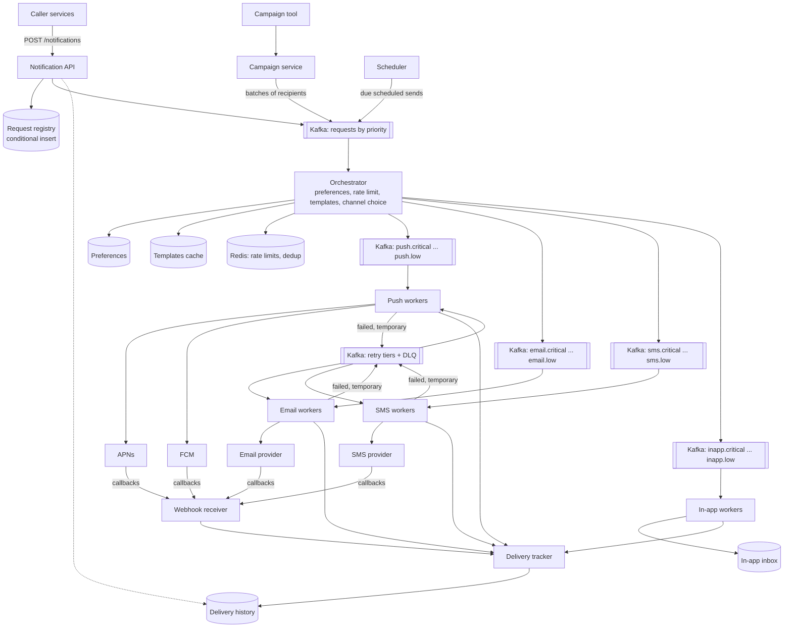
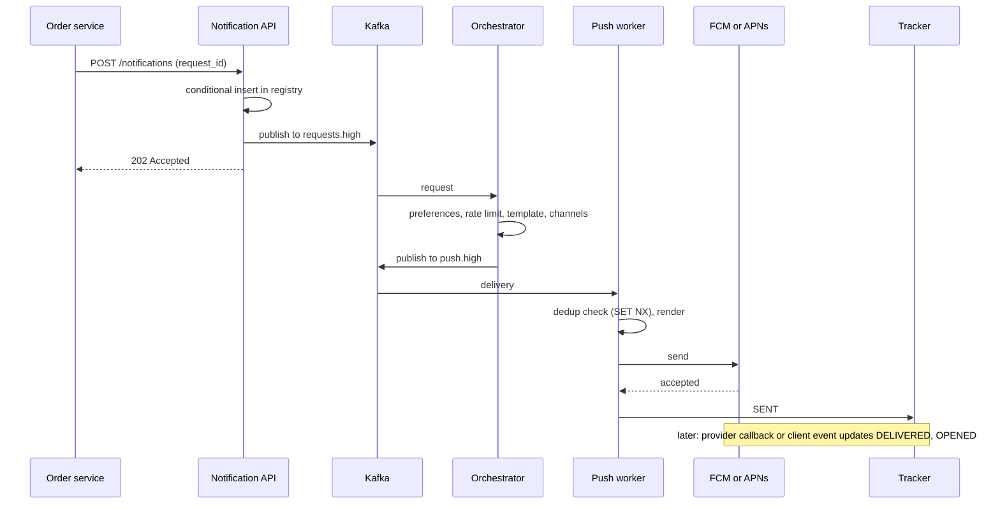

# Design a Notification System

## Problem Statement

Design a system that sends notifications to users over several channels: mobile push, email, SMS,
and in-app. Many services (orders, payments, social features, marketing) call it. The system must
respect user preferences, send each message once, retry failures, and track the result. A marketing
campaign to 20 million users must not delay a login code.

The classes of a single-process version (preferences, templates, a sender for each channel, a retry
policy, and a rate limiter) are in the LLD case study
[notification service](../../lld/case-studies/24-notification-service/README.md). This page covers
the distributed system: queues, fan-out, priority isolation, third-party providers, and delivery
tracking. The LLD page lists "distributed workers and queues" as an extension, and this page is that
extension. Key building blocks:

- [message queues and streams](../fundamentals/08-message-queues-and-streams.md): queues, retries,
  dead-letter queues, delay queues, the outbox pattern;
- [reliability patterns](../fundamentals/12-reliability-patterns.md): timeouts, backoff with jitter,
  circuit breakers, idempotency keys;
- [rate limiting algorithms](../fundamentals/13-rate-limiting-algorithms.md): per-user and
  per-provider limits;
- [communication patterns](../fundamentals/09-communication-patterns.md): webhooks and push;
- [distributed transactions](../distributed-systems/03-distributed-transactions.md): the outbox and
  the limits of exactly-once.

## Clarifying Questions

| Question | Assumed answer |
|---|---|
| Which channels? | Push (iOS through APNs, Android through FCM), email, SMS, in-app. A new channel is a new adapter |
| Who are the callers? | Internal services through an API, and a campaign tool that targets a segment |
| Who chooses the channel? | The caller names a category and a template. The user's preferences and the category rules choose the channels |
| Categories? | Transactional (order, payment), security (login code), social (a like, a message), promotional (marketing) |
| Scale? | 100 million registered users, 50 million daily active users, 500 million notification requests per day |
| Peak? | 10 times the average. A campaign sends to 20 million users in 20 minutes |
| Latency target? | Security and transactional: p99 below 5 seconds from API call to provider call. Promotional: minutes to hours |
| Delivery guarantee? | At-least-once to the provider, with deduplication so that a user rarely sees a duplicate. The system cannot promise exactly once to a phone, because the providers do not offer it |
| Does the system track delivery? | Yes: accepted, sent to the provider, delivered when the provider reports it, opened or clicked when the client reports it, failed with a reason |
| Preferences? | Per user, per category, per channel opt-in or opt-out, quiet hours with a time zone, and a global unsubscribe. Legal opt-outs (email unsubscribe, SMS STOP) override everything |
| Templates and localization? | Versioned templates with placeholders, one body per channel and per locale |
| Scheduling? | Support `send_at` and a cancel call |
| Do we build the providers? | No. We integrate APNs, FCM, an email provider, and an SMS provider, and we handle their limits and failures |

## Requirements

### Functional

1. A service calls `POST /v1/notifications` with a user (or a segment), a category, a template, and
   parameters.
2. The system looks up the user's preferences and the user's devices and addresses, and it chooses
   the channels.
3. The system renders the template for each channel and locale.
4. The system sends through the provider for each channel.
5. The system retries a temporary failure and gives up after a limit.
6. The system ignores a request that repeats a request id, and it drops a duplicate delivery.
7. The system limits the number of notifications for each user, and the number of sends for each
   provider.
8. The system tracks the status of each delivery and offers it by API.
9. The system removes device tokens that a provider reports as invalid.
10. The system supports scheduled sends and campaigns.

### Non-functional

| Requirement | Number |
|---|---|
| Throughput | 500 million requests per day, 700 million deliveries per day, peak 81,000 deliveries per second (Estimation) |
| Latency | Security and transactional: p99 below 5 seconds to the provider call. Promotional: best effort |
| Availability | 99.95 percent for the accept API (Assumption). A provider outage must not stop the accept API |
| Durability | An accepted request is never lost: the registry row and the Kafka message are both written to 3 replicas (Kafka with `acks=all` and `min.insync.replicas=2`) before the API answers |
| Isolation | A campaign cannot delay security or transactional messages |
| Ordering | Not guaranteed across channels. For one user and one channel, best effort in time order. The providers do not promise order either: Apple states that APNs "may reorder notifications you send to the same device token" |
| Compliance | Opt-outs apply within 1 minute (Assumption). Keep a record of consent |

## Estimation

Assumptions: 100 million registered users, 50 million daily active users, 500 million requests per
day, 1.4 deliveries per request (some requests go to two channels), a peak of 10 times the average.
All record sizes, the channel mix, and the worker capacities below are assumptions too. See
[back-of-envelope estimation](../back-of-envelope-estimation.md).

**Load.**

1. Deliveries per day = 500 million x 1.4 = 700 million.
2. Average requests per second = 500,000,000 / 86,400 = 5,787.
3. Average deliveries per second = 700,000,000 / 86,400 = 8,102.
4. Peak deliveries per second = 8,101.85 x 10 = 81,018.5, about 81,000 (the program rounds it to
   81,019). Peak requests per second = 5,787 x 10 = 57,870, about 58,000.
5. Campaign: 20 million recipients x 1.4 deliveries / (20 x 60 seconds) = 23,333 deliveries per
   second. This fits inside the peak, but it must not use the capacity of the transactional traffic.
   This is why the design isolates priorities.

**Per channel (peak).** Assumed mix of deliveries: push 70 percent, email 20 percent, SMS 5 percent,
in-app 5 percent. Assumed sizes: push 1 KB, email 30 KB, SMS 200 bytes, in-app 500 bytes. Assumed
capacity of one worker instance: push 2,000 sends per second (a pool of HTTP/2 connections), email 200,
SMS 100, in-app 5,000. Each worker runs at 60 percent utilization.

1. Push = 81,019 x 0.70 = 56,713 per second. Workers = 56,713 / (2,000 x 0.6) = 47.3, rounded up to 48.
2. Email = 81,019 x 0.20 = 16,204 per second. Workers = 16,204 / (200 x 0.6) = 135.03, rounded up to
   136. Email bandwidth = 16,204 x 30 KB = 486 MB/s.
3. SMS = 4,051 per second. Workers = 4,051 / (100 x 0.6) = 67.5, rounded up to 68.
4. In-app = 4,051 per second. Workers = 2.
5. Outbound bandwidth = 57 + 486 + 1 + 2 = 546 MB/s, about 4.4 Gbit/s. Email dominates.
6. Provider quota check. FCM documents an example quota of 600,000 quota tokens for each 1-minute
   window for the HTTP v1 API, which is 600,000 / 60 = 10,000 sends per second. Assumption: half of
   the push traffic goes to Android through FCM. Then FCM receives 56,713 x 0.5 = 28,356 sends per
   second at peak, about 2.8 times that example quota. The design must request a higher quota from
   Google, or spread the peak (Deep Dive 3). The Apple pages cited here give no numeric send quota for
   APNs, and Apple advises: "don't assume a specific number of streams" on a connection.

**Storage.** Assumed sizes: 300 bytes for a delivery record, 400 bytes for a request record, 100
bytes for a deduplication key, 2.5 devices per user, 250 bytes for a device token record, 400 bytes for
the preferences of one user.

1. Per day: 700 million delivery records x 300 bytes + 500 million request records x 400 bytes =
   210 GB + 200 GB = 410 GB.
2. 30 days of history = 410 GB x 30 = 12.3 TB. With 3 replicas = 36.9 TB.
3. Request registry for 24 hours (one key for each request) = 500 million x 100 bytes = 50 GB in a
   key-value store with expiry.
4. Delivery deduplication keys for 24 hours (one key for each delivery, `dedup:{notification_id}:
   {channel}`) = 700 million x 100 bytes = 70 GB in Redis. This needs a Redis cluster of several shards,
   not one instance.
5. Device tokens = 100 million users x 2.5 devices x 250 bytes = 62.5 GB.
6. Preferences = 100 million users x 400 bytes = 40 GB.

**Queue.** Assumed message size: 2 KB. Each request passes two stages of topics: a request topic and
then a channel topic.

1. Channel topics at peak = 81,019 x 2 KB = 162 MB/s.
2. Request topics at peak = 57,870 x 2 KB = 116 MB/s.
3. Total peak ingress = 162.0 + 115.7 = 277.8 MB/s, about 278 MB/s. With 3 replicas, the brokers
   write 833 MB/s.
4. Retention of 3 days at the average rate, both stages = (8,102 + 5,787) x 2 KB x 86,400 x 3 = 7.2 TB,
   and 21.6 TB with 3 replicas.

Conclusions: the data volume is small by the standard of a storage system. The hard parts are the
fan-out burst, the isolation between priorities, and the limits of the providers.

```java
public class NotifEst {
    public static void main(String[] args) {
        double requestsPerDay = 500e6;
        double deliveriesPerRequest = 1.4;
        double deliveriesPerDay = requestsPerDay * deliveriesPerRequest;
        double avgRequestsPerSec = requestsPerDay / 86_400;
        double avgDeliveriesPerSec = deliveriesPerDay / 86_400;
        double peakFactor = 10;
        double peakDeliveries = avgDeliveriesPerSec * peakFactor;
        System.out.printf("requests/day: %.0f M%n", requestsPerDay / 1e6);
        System.out.printf("deliveries/day: %.0f M%n", deliveriesPerDay / 1e6);
        System.out.printf("average requests/s: %.0f%n", avgRequestsPerSec);
        System.out.printf("average deliveries/s: %.0f%n", avgDeliveriesPerSec);
        System.out.printf("peak deliveries/s: %.0f%n", peakDeliveries);
        double peakRequests = avgRequestsPerSec * peakFactor;
        System.out.printf("peak requests/s: %.0f%n", peakRequests);

        double campaignRecipients = 20e6;
        double campaignSeconds = 20 * 60;
        double campaignRate = campaignRecipients * deliveriesPerRequest / campaignSeconds;
        System.out.printf("campaign deliveries/s: %.0f%n", campaignRate);

        String[] channels = {"push", "email", "sms", "in-app"};
        double[] share = {0.70, 0.20, 0.05, 0.05};
        double[] bytes = {1_000, 30_000, 200, 500};
        double[] perWorker = {2_000, 200, 100, 5_000};
        double util = 0.6;
        double totalMb = 0;
        for (int i = 0; i < channels.length; i++) {
            double rate = peakDeliveries * share[i];
            double mb = rate * bytes[i] / 1e6;
            double workers = Math.ceil(rate / (perWorker[i] * util));
            totalMb += mb;
            System.out.printf("%s: %.0f/s peak, %.0f MB/s, %.0f workers%n",
                channels[i], rate, mb, workers);
        }
        System.out.printf("outbound bandwidth: %.0f MB/s = %.1f Gbit/s%n",
            totalMb, totalMb * 8 / 1000);
        double fcmPerSec = 600_000 / 60.0;
        double fcmPeak = peakDeliveries * share[0] * 0.5;
        System.out.printf("FCM peak: %.0f/s vs example quota %.0f/s (%.1fx)%n",
            fcmPeak, fcmPerSec, fcmPeak / fcmPerSec);

        double deliveryBytes = 300;
        double requestBytes = 400;
        double perDayGb = (deliveriesPerDay * deliveryBytes + requestsPerDay * requestBytes) / 1e9;
        double hotTb = perDayGb * 30 / 1000;
        System.out.printf("history per day: %.0f GB%n", perDayGb);
        System.out.printf("30 days: %.1f TB, with 3 replicas: %.1f TB%n", hotTb, hotTb * 3);

        double registryGb = requestsPerDay * 100 / 1e9;
        double dedupGb = deliveriesPerDay * 100 / 1e9;
        double tokenGb = 100e6 * 2.5 * 250 / 1e9;
        double prefGb = 100e6 * 400 / 1e9;
        System.out.printf("request registry (24 h): %.0f GB%n", registryGb);
        System.out.printf("delivery dedup keys (24 h): %.0f GB%n", dedupGb);
        System.out.printf("device tokens: %.1f GB%n", tokenGb);
        System.out.printf("preferences: %.0f GB%n", prefGb);

        double channelPeakMb = peakDeliveries * 2_000 / 1e6;
        double requestPeakMb = peakRequests * 2_000 / 1e6;
        double kafkaPeakMb = channelPeakMb + requestPeakMb;
        double kafkaAvgMb = (avgDeliveriesPerSec + avgRequestsPerSec) * 2_000 / 1e6;
        double retentionTb = kafkaAvgMb * 86_400 * 3 / 1e6;
        System.out.printf("queue peak: channel %.0f MB/s + request %.0f MB/s = %.0f MB/s%n",
            channelPeakMb, requestPeakMb, kafkaPeakMb);
        System.out.printf("broker writes with 3 replicas: %.0f MB/s%n", kafkaPeakMb * 3);
        System.out.printf("queue 3-day retention: %.1f TB, with 3 replicas: %.1f TB%n",
            retentionTb, retentionTb * 3);
    }
}
```

<!-- expected-output -->

```text
requests/day: 500 M
deliveries/day: 700 M
average requests/s: 5787
average deliveries/s: 8102
peak deliveries/s: 81019
peak requests/s: 57870
campaign deliveries/s: 23333
push: 56713/s peak, 57 MB/s, 48 workers
email: 16204/s peak, 486 MB/s, 136 workers
sms: 4051/s peak, 1 MB/s, 68 workers
in-app: 4051/s peak, 2 MB/s, 2 workers
outbound bandwidth: 546 MB/s = 4.4 Gbit/s
FCM peak: 28356/s vs example quota 10000/s (2.8x)
history per day: 410 GB
30 days: 12.3 TB, with 3 replicas: 36.9 TB
request registry (24 h): 50 GB
delivery dedup keys (24 h): 70 GB
device tokens: 62.5 GB
preferences: 40 GB
queue peak: channel 162 MB/s + request 116 MB/s = 278 MB/s
broker writes with 3 replicas: 833 MB/s
queue 3-day retention: 7.2 TB, with 3 replicas: 21.6 TB
```

## API Design

### Send API (internal callers)

`POST /v1/notifications`

```json
{
  "request_id": "ord-8841-shipped",
  "user_id": "u_123",
  "category": "transactional",
  "template_id": "order_shipped",
  "params": {"order_id": "8841", "eta": "2026-10-18"},
  "priority": "high",
  "send_at": null,
  "ttl_seconds": 3600
}
```

| Field | Meaning |
|---|---|
| `request_id` | The idempotency key, unique for each caller. The caller sends the same id on a retry |
| `category` | Selects the preference rule and the priority class |
| `priority` | `critical`, `high`, `normal`, `low`. The category sets the default |
| `ttl_seconds` | After this time the notification is useless (a login code), and the system drops it instead of sending it late |

Response: `202 Accepted` with `{"notification_id": "...", "status": "ACCEPTED"}`. The API answers after
the request is stored durably, and before any provider is called. A repeat of `request_id` returns `200`
with the first `notification_id`. `400` for a bad request (unknown template, missing parameter).
`429` when the caller exceeds its quota, with `Retry-After`.

### Other endpoints

| Endpoint | Request | Response |
|---|---|---|
| `POST /v1/campaigns` | `{segment_id, template_id, category, send_window, rate_limit_per_second}` | `202` with `campaign_id`. The campaign service fans out |
| `GET /v1/notifications/{id}` | | The status of each delivery: channel, state, provider message id, error code, timestamps |
| `DELETE /v1/notifications/{id}` | | Cancels a scheduled notification that is not sent yet |
| `PUT /v1/users/{user_id}/preferences` | `{category, channel, enabled, quiet_hours{start,end,zone}}` | `200`. Takes effect within the propagation bound |
| `POST /v1/users/{user_id}/devices` | `{platform, token, app_version, locale}` | `201`. Upsert. Updates `last_seen_at` |
| `DELETE /v1/users/{user_id}/devices/{token}` | | `204` |
| `POST /v1/templates` and `PUT /v1/templates/{id}` | `{channel, locale, subject, body}` | A new immutable version |
| `POST /v1/webhooks/{provider}` | The provider's callback body | `200` within a few hundred milliseconds (Assumption: the provider's webhook timeout is longer). The handler verifies the signature, enqueues the event, and returns. It does no other work before it answers |
| `POST /v1/events/{notification_id}` | `{type: opened or clicked}` from the client SDK | `204` |

Provider webhooks follow the rules in [communication patterns](../fundamentals/09-communication-patterns.md):
verify the signature, answer before doing any processing, and process the event from a queue. Webhook design, retries, and
signatures are covered in `kb/api-design/05-webhooks-and-async-apis.md`.

## Data Model

| Store | Data | Key and indexes | Why |
|---|---|---|---|
| Relational database (PostgreSQL) | Templates (versioned), categories and rules, provider configuration, campaign definitions | Primary key `(template_id, version)`. Small, relational, rarely written | Few rows, rich constraints. Cached in each service |
| Key-value or wide-column store (DynamoDB, Cassandra) | User preferences | Partition key `user_id`, sort key `(category, channel)` | One lookup for all of a user's preferences. 40 GB |
| Key-value or wide-column store | Device tokens | Partition key `user_id`, sort key `token`. Attributes `platform`, `last_seen_at`, `status` | A user has a few devices. Read by user |
| Wide-column store | Notification request and delivery history | Partition key `user_id`, clustering key `created_at DESC, notification_id`. A second table by `notification_id` | "Show this user's recent notifications" and "status of this id" are both single-partition reads. Write-heavy, time-ordered, expiry by TTL (30 days). See [choosing a database](../fundamentals/04-choosing-a-database.md) |
| Request registry (the same store, or a key-value store with conditional put) | `(caller_id, request_id) -> notification_id` | Primary key `(caller_id, request_id)`, TTL 24 hours | Conditional insert is the idempotency check. DynamoDB has a conditional put, and Cassandra has `INSERT ... IF NOT EXISTS` |
| Redis | Delivery deduplication keys, rate-limit counters, a cache of preferences | Key `dedup:{notification_id}:{channel}`, TTL 24 hours | Atomic operations in memory (`SET NX EX`). Counters per [rate limiting algorithms](../fundamentals/13-rate-limiting-algorithms.md) |
| Message broker (Kafka) | Work queues for each stage, priority, and channel | Topics below. Partition key `user_id` | Durable, replayable, scalable consumers. See [message queues](../fundamentals/08-message-queues-and-streams.md) |
| Wide-column store (the history cluster) | In-app inbox | Partition key `user_id`, clustering key `created_at DESC`. Attribute `read_at` | The app reads "the newest 50 messages of this user" in one partition read. TTL 30 days |
| Object storage | Large email bodies, campaign audience files | | Low cost for large objects |

Delivery record fields: `notification_id`, `delivery_id`, `user_id`, `channel`, `provider`,
`provider_message_id`, `state`, `attempt`, `error_code`, `template_version`, `created_at`,
`updated_at`. The state machine: `ACCEPTED -> QUEUED -> SENT -> DELIVERED -> OPENED`, with the side exits
`SUPPRESSED` (preference, rate limit, quiet hours, opt-out), `FAILED` (permanent), `EXPIRED` (TTL), and
`DEAD` (retries exhausted).

## High-Level Design



Components:

- **Notification API.** It authenticates the caller, validates the request, checks the caller quota,
  does the conditional insert in the request registry (idempotency), writes the request, and
  publishes it to the request topic. It answers `202`. It never calls a provider.
- **Request topics.** One topic per priority class: `requests.critical`, `requests.high`,
  `requests.normal`, `requests.low`. Each topic has its own consumers, so a backlog in `low` does not
  delay `critical`.
- **Orchestrator.** A stateless consumer. For each request it loads the user's preferences, applies the
  category rules, quiet hours, and the rate limit, picks the channels, resolves the template, and
  publishes one message for each channel to the channel topic of the same priority.
- **Channel workers.** One pool for each channel (push, email, SMS, in-app). A worker renders the
  message, calls the provider adapter, and reports the result. The adapter hides the provider API. The
  in-app worker has no external provider: it writes the message to the user's inbox store, and the app
  reads the inbox when it opens (it can also get a push or a WebSocket signal to refresh).
- **Retry tiers and dead-letter queue (DLQ).** A temporary failure goes to a retry topic with a delay.
  A permanent failure or an exhausted retry goes to the DLQ.
- **Webhook receiver and delivery tracker.** The receiver takes provider callbacks. The tracker writes
  every state change to the delivery history.
- **Campaign service.** It reads the segment, splits it into chunks, and publishes requests at a set
  rate to the `low` or `normal` topic.
- **Scheduler.** It holds scheduled requests in a table indexed by due time and publishes them when due.

### Flow of one transactional notification



## Deep Dives

### Deep Dive 1: Fan-out and priority isolation

**Two kinds of fan-out.**

1. *One request, many channels.* The orchestrator turns one request into up to four deliveries. The
   factor is 1.4 in the estimation.
2. *One campaign, many users.* A campaign for 20 million users is 20 million requests. The campaign
   service reads the segment in chunks (for example 10,000 users), and publishes the chunks at a rate
   cap. The cap is the shared quota of the `low` class, so the campaign takes a share of capacity and
   cannot take all of it. At 23,333 deliveries per second, the 20 million campaign takes 20 minutes.

**Isolation.** A single queue gives head-of-line blocking: 20 million promotional messages ahead of a
login code would delay the code by minutes. The design isolates by priority in three layers:

| Layer | Mechanism |
|---|---|
| Queues | One topic for each priority class, and for each channel, so `push.critical` has its own backlog |
| Consumers | Separate consumer groups and worker pools for each class. Critical workers are sized for the peak of critical traffic and are never shared |
| Provider quota | A token bucket for each class in front of each provider. Critical traffic has a reserved share. Low traffic uses the rest, and it is the first to be throttled (see [rate limiting algorithms](../fundamentals/13-rate-limiting-algorithms.md)) |

LinkedIn's engineering blog (Shi and Fuad, 2018) describes Air Traffic Controller (ATC), the platform
through which "almost all notifications at LinkedIn are now sent". The post reports these choices,
and this design shares them:

- ATC partitions its input streams "by member id", so that "all notifications for a specific
  recipient are routed to the same host". This is the `user_id` partition key below.
- For member-to-member messages, "we use high-priority Kafka topics to prioritize member messages",
  while a daily batch of "a hundred million requests" tolerates hours of delay. This is the priority
  isolation of this design.
- ATC aggregates notifications into one, picks the delivery time from the member's locale, and drops
  notifications that a relevance model scores low. ATC "is not the service that sends the email or
  push notification": it decides the channel, and other services send.
- After a restart, ATC can process a request twice, and it "handles the duplicated requests by
  dropping any request it has already processed".
- The post reports "over a billion requests per day", twice the 500 million of this estimate.

The point to take from it: a notification system also decides *whether* and *when* to send, and not
only *how*.

**Partitioning.** Topics are partitioned by `user_id`. All messages of one user go to one partition
and to one consumer at a time, so (a) a worker can check one user's rate limit and recent history without
cross-partition coordination, (b) messages of one user keep their order in the queue, and (c) a
per-user digest is possible. The cost is a hot partition for a user who gets many messages (a very
active account), and a large partition count. See [message queues and
streams](../fundamentals/08-message-queues-and-streams.md) for the ordering rules.

**Backpressure.** If providers slow down, workers slow down, and the queue grows. The queue absorbs the
burst (7.2 TB for 3 days at the average rate, both topic stages). The system alerts on consumer lag for each class. Critical
and high classes have a lag budget in seconds. For the low class, the system lets the backlog grow, and a
TTL on each message drops promotions that are too old.

**Scheduled and delayed work.** A delay queue is not a native feature of Kafka. Two patterns: a
scheduler that stores due times in a database (index on `due_at`) and publishes when due, and delay
tiers of retry topics (below). The scheduler runs as a set of shards, each shard owns a range of
`user_id`, and each polls its range. Scheduled sends add a burst at round times ("send at 9:00"). FCM's
documentation states that FCM receives more than double traffic during the first 30 seconds to 2 minutes
of each hour, and advises senders to "avoid sending messages within a 2 minute window of each of the
:00, :15, :30, and :45 minute marks". The scheduler adds random jitter to scheduled promotional sends
for this reason.

### Deep Dive 2: Reliability, retries, and deduplication

**The guarantee.** The system gives at-least-once delivery to the provider, plus deduplication that
removes most duplicates. Exactly once to a human is not possible: the worker can send, crash before it
records the result, and send again after a restart. A provider call that times out leaves the outcome
unknown. See [distributed transactions](../distributed-systems/03-distributed-transactions.md) for why
exactly-once claims need care, and [message queues and
streams](../fundamentals/08-message-queues-and-streams.md) for the broker guarantees.

**Deduplication in three places.**

| Where | Key | Prevents |
|---|---|---|
| API | `(caller_id, request_id)` in the registry, conditional insert, TTL 24 hours | A caller retry after a timeout creates a second notification |
| Worker | `dedup:{notification_id}:{channel}`, set with `SET key IN_FLIGHT NX EX 60` before the send and changed to `SENT` with a 24-hour expiry after the provider accepts | The queue redelivers a message after a consumer restart (at-least-once). A redelivered message that finds `SENT` skips the send. One that finds `IN_FLIGHT` goes to a retry tier (rules below) |
| Provider | A collapse key, where the provider supports it | A visible duplicate after a retry with an unknown outcome. Apple's documentation for `apns-collapse-id`: "When sending the same notification more than once, use the same value in this header to merge the requests" (at most 64 bytes). FCM: if a waiting message has the same collapse key and registration token, "the old message is discarded and then new message takes its place". Email and SMS providers offer no equivalent in this design, so the worker dedup key is the only protection there |

The worker order matters. If the worker sets a plain dedup key before the send and crashes after the
send, the retry skips, and the user gets one message: correct. If the worker crashes after it sets the
key and before it sends, the retry skips, and the user gets none: a loss. If the worker sets the key
only after the send, a crash between the two gives a duplicate.

Recommendation: store a state in the key, not only its presence.

1. Before the send, the worker runs `SET dedup:{id}:{channel} IN_FLIGHT NX EX 60` (a 60-second lease).
2. After the provider accepts, it sets the value to `SENT` with a 24-hour expiry.
3. A redelivered message that finds `SENT` skips the send.
4. A redelivered message that finds `IN_FLIGHT` does not skip. Another worker may be sending it, or
   may have crashed. The worker publishes the message to a retry tier with a delay longer than the
   lease. When the message returns, the lease has expired or the state is `SENT`.
5. A message that finds no key takes the lease and sends.

A crash inside the window still causes one retry after the lease, and the retry sends a duplicate if
the first send reached the provider. That is the at-least-once rule. The category decides how to set
the lease: a duplicate login code is harmless, and a missing payment receipt or security alert is worse
than a duplicate. A promotional message is the case where a loss is better than a duplicate, so for
that category the worker can skip on `IN_FLIGHT` too.

**Not losing an accepted request.** The API must not answer `202` and then lose the request. Order: (1)
conditional insert into the registry with state `ACCEPTED`, (2) publish to Kafka with `acks=all`, (3)
answer, (4) after the Kafka acknowledgment, update the registry row to `QUEUED`. If the process crashes
between (1) and (2), the request is in the registry and not in the queue. A sweeper republishes every
request that stays in `ACCEPTED` for more than a minute. Step 4 is what lets the sweeper tell the two
cases apart; without it, the sweeper would republish every request. This is a simplified
transactional outbox: the registry row is the outbox row. The sweeper may publish twice, and the
deduplication keys absorb the duplicate. If the registry and the broker were one transaction, the outbox
would give the same result with a relay; see [message queues and
streams](../fundamentals/08-message-queues-and-streams.md).

**Classify errors.** A worker maps a provider answer to an action. The FCM rows come from the FCM
"Error codes", "Manage tokens", and "Scale" pages. The APNs rows come from Apple's "Handling
notification responses from APNs" page. The email rows come from the Amazon SES documentation, as an
example of an email provider. The SMS rows are reasoning, because each SMS provider has its own codes.

| Provider answer | Meaning | Action |
|---|---|---|
| Success | The provider accepted the message | State `SENT` |
| FCM `UNREGISTERED` (HTTP 404) | "App instance was unregistered from FCM" | Delete the token. No retry |
| FCM `INVALID_ARGUMENT` (HTTP 400) | A bad token, or a bad payload (for example "message too big") | If the payload is valid, delete the token. If not, fix the payload. No retry. FCM: "For 400, 401, 403, 404 errors: abort, and do not retry" |
| FCM `QUOTA_EXCEEDED` (HTTP 429) | Sending limit exceeded | Retry after `retry-after`. If it is absent, FCM says to "default to 60 seconds" |
| FCM `UNAVAILABLE` (HTTP 503), `INTERNAL` (HTTP 500) | Server overloaded or internal error | Retry with exponential backoff and jitter, and honor `Retry-After` if present. FCM warns that "senders that cause problems risk being denylisted" |
| APNs 410 (`Unregistered`, `ExpiredToken`) | "The device token is no longer active for the topic" | Delete the token. No retry. The response carries a `timestamp` of when APNs confirmed the token invalid |
| APNs 400 `BadDeviceToken`, 400 `DeviceTokenNotForTopic`, 403 `Forbidden`, 413 `PayloadTooLarge` | A request that fails again | No retry. Apple lists these with `ExpiredToken` and `Unregistered` as codes not to retry |
| APNs 429 `TooManyRequests` | "Too many requests were made consecutively to the same device token" | Apple: "You can retry with a delay" |
| APNs 500, 503 (`ServiceUnavailable`, `Shutdown`) | Server error or shutdown | Apple: "After 15 minutes, you can retry JSON payloads that receive response status codes that begin with 5XX." The first APNs retry tier is therefore 15 minutes, not 1 minute |
| Email: hard bounce (SES bounce type `Permanent`) | The address does not accept mail | Suppress the address. No retry. SES: "you should immediately remove the recipient whose address produced the bounce from your mailing lists" |
| Email: soft bounce (SES bounce type `Transient`) | A temporary problem, for example a full inbox | The worker does not retry. SES "attempts to redeliver the email for a certain period of time", and it reports the soft bounce only after it stops trying. Mark the delivery `FAILED`. Assumption: suppress the address after 3 final soft bounces in a row |
| SMS: invalid number (reasoning) | Permanent | Mark the number invalid. No retry |
| SMS: provider "try later" or a 5XX answer (reasoning) | Temporary | Retry with backoff |
| Timeout | Unknown outcome | Retry (a duplicate is possible). Use the dedup lease and the collapse key. FCM: "Set at least a 10 second timeout on send requests before retrying" |

Apple adds a warning that affects the worker design: "An error code beginning with 4XX slows down your
ability to send notifications", and "APNs disconnects a provider connection with too many error
conditions". A `410` "isn't considered an error condition". So a worker that keeps sending to bad
tokens loses throughput on its connections. Token hygiene (Deep Dive 4) protects throughput as well as
quota.

**Retry design.** A worker never sleeps in place, because a sleeping worker holds a partition and a
slot. A temporary failure is published to a retry topic with a delay tier, for example `retry.1m`,
`retry.5m`, `retry.30m`. Each provider adapter sets a minimum delay for its tiers (15 minutes for an APNs 5XX, 60 seconds for
an FCM 429 without `retry-after`). A delay consumer for each tier reads a message, waits until its
`not_before` time (the consumer pauses the partition until then), and republishes it to the
original channel topic. After the last tier, or after the TTL of the notification, the message goes
to the DLQ. Ning Xia's post on the Uber engineering blog (2018) describes this pattern for Kafka: a
failed message goes to a retry topic, "executing multiple retries is accomplished by creating multiple
topics", "the DLQ is defined as the end-of-the-line Kafka topic", and "each subsequent level of retry
consumers can enforce a processing delay". The post also sends errors that a retry cannot fix (code
bugs) "straight into the DLQ". Each retry waits with full jitter, as in
[reliability patterns](../fundamentals/12-reliability-patterns.md), because a provider outage fails
millions of deliveries at one moment, and equal delays make them all retry at one moment. The FCM
documentation gives the same advice: use jitter, "wait at least 10 seconds before retrying a failed
request", and set a maximum interval, because a request that is "still failing 60 minutes later" is
"either miscategorized as a retryable error, or FCM is experiencing an outage".
A bound by TTL always applies: a login code that is 10 minutes old is not sent.

**Dead-letter queue.** The DLQ holds messages that failed permanently or exhausted retries, with the
error. An operator tool shows the DLQ, lets a team replay messages after a fix, and alerts when the DLQ
rate rises. The delivery state becomes `DEAD`.

**Provider failover and circuit breaker.** Each provider adapter has a circuit breaker (see [reliability
patterns](../fundamentals/12-reliability-patterns.md)). When the SMS provider fails above a threshold,
the breaker opens and the worker routes to a second SMS provider if one is configured. For push there
is no alternative provider per platform: APNs is the only path to iOS devices. Even FCM sends to iOS
through APNs: the FCM documentation states that "for other platforms like iOS, FCM relies on the
underlying push service (e.g., APNs)". For email and SMS, two
providers are practical, with a routing table that sets the share of each.

### Deep Dive 3: Preferences, rate limits, quiet hours, and templates

**Preferences.** The orchestrator reads preferences for each request. At 5,787 requests per second on
average and about 58,000 at peak, a database read for each request is too much, so the orchestrator keeps a
local cache with a short TTL (for example 30 seconds) and gets updates by a change stream. An opt-out
must take effect within the 1-minute compliance bound, so the cache TTL (30 seconds) is the bound on how long an old preference can act. The
recommended rule: a legal opt-out (email unsubscribe, SMS STOP) goes to a suppression list that the
**worker** checks at send time, because a message can wait in a queue for minutes after the
orchestrator decided. Checking at send time closes the window.

For email, RFC 8058 defines one-click unsubscribe. The sender puts two header fields in each
promotional email: `List-Unsubscribe` with an HTTPS URI, and `List-Unsubscribe-Post` with the single
value `List-Unsubscribe=One-Click`. When the user clicks unsubscribe, the mail receiver (the mailbox
provider or the mail client) sends an HTTPS POST to that URI. The RFC's rules shape the handler: the
URI "MUST contain enough information to identify the mail recipient and the list", because "the POST
request MUST NOT include cookies, HTTP authorization, or any other context information"; the URI
"SHOULD include an opaque identifier or another hard-to-forge component", which the handler verifies;
the
message "MUST have a valid DomainKeys Identified Mail (DKIM) signature that covers at least" both
header fields, and the sender "MUST NOT return an HTTPS redirect". The handler writes the opt-out to
the suppression list as a legal opt-out.

**Rules.** The orchestrator applies rules in this order: (1) suppression and legal opt-outs, (2) the
user's category and channel settings (defaults: transactional and security on, promotional off until
opt-in, as in the LLD design), (3) quiet hours (promotional and social are delayed until the quiet hours
end, in the user's time zone; security and transactional are not), (4) rate limits and frequency caps,
(5) channel choice (below).

**Rate limits.** Three kinds, with different goals.

| Limit | Goal | Where | Algorithm |
|---|---|---|---|
| Per caller | Protect the system from a buggy caller | API | Token bucket for each caller, `429` |
| Per user (frequency cap) | Protect the user. For example, at most 3 promotional messages per day, and 2 per hour for one category | Orchestrator, Redis | Sliding window counter or fixed window with expiry, keyed by `(user, category)`. Security is not limited |
| Per provider | Stay inside the provider's limits and cost | Worker, Redis | Token bucket for each provider and priority class, shared by all workers |

For the algorithms and the Redis implementation, see [rate limiting
algorithms](../fundamentals/13-rate-limiting-algorithms.md). The FCM documentation says that sends
above the quota get `429`, and gives an example of 600,000 quota tokens per one-minute window for the
HTTP v1 API, which equals 10,000 per second. It advises against front-loading the tokens, and advises to
ramp from 0 to the maximum requests per second across a 60-second window. The design therefore uses a
token bucket with a ramp, and not a fixed window, for the provider limit.

**Channel choice.** The category sets a channel order. A security code: push first, SMS if the user has
no device or the push fails, because SMS costs money. A receipt: email. A social event: push, and
in-app. The LLD extension "fallback channel" is the same idea. A fallback is triggered by a `DEAD` or
`FAILED` state. Recommendation: do not send the same promotional message on all channels at once, which
multiplies the annoyance.

**Templates and localization.** A template is a versioned, immutable record with a body for each
`(channel, locale)`. The orchestrator picks the template version at request time and stores the version
in the delivery record, so an audit can show what the user received. Rendering happens in the worker,
and not in the orchestrator, because a rendered email is large (30 KB in the estimate) and the queue
message must stay small (2 KB). Rendering uses a sandboxed template engine. The engine escapes values
by default (HTML for email) so that a parameter cannot inject markup. A missing parameter fails the
request at the API (a `400`), as in the LLD design, and not at the worker.

**Aggregation (digest).** A social event such as "30 people liked your post" should not send 30 pushes.
The orchestrator can hold social events for a user for a short window and send one summary. Because the
topic is partitioned by `user_id`, one consumer sees all events of a user and can keep the window in
memory or in Redis.

### Deep Dive 4: Third-party providers and delivery tracking

**Push providers.** An iOS device receives pushes only through APNs, and an Android device through FCM.
The worker keeps a pool of long-lived HTTP/2 connections to the provider, because a TLS handshake for
each send would add a round trip to each of 56,000 sends per second. Apple's documentation: "Use HTTP/2
and TLS 1.2 or later to establish a connection between your provider server" and APNs. APNs "allows
multiple concurrent streams for each connection, but don't assume a specific number of streams".

Payload limits are small, so the payload carries an identifier and a short text, and the app fetches
the full content:

- APNs: the JSON payload is "limited to a maximum size of 4 KB (4096 bytes)", and 5 KB for a VoIP
  notification.
- FCM: "4096 bytes for most messages, or 2048 bytes in the case of messages to topics", keys and
  values together.

Provider features that the design uses:

| Feature | Use | Source |
|---|---|---|
| Time to live | Drop a notification the user would not want late. FCM, on Android and Web: the value is "a duration from 0 to 2,419,200 seconds (28 days)", and by default a message lasts "a maximum period of four weeks". APNs: the `apns-expiration` header; with `0`, APNs "attempts to deliver the notification only once and doesn't store it". APNs stores a notification "for 30 days or less" | FCM message lifespan page. Apple "Sending notification requests to APNs" |
| Collapse key | A newer message replaces an older one that waits for an offline device (a score update). FCM: a message with the same collapse key and registration token replaces the older waiting one. APNs: `apns-collapse-id` merges notifications into one for the user. APNs also "stores only one notification per bundle ID" for an offline device, in most cases the latest | FCM and Apple documentation |
| Priority | FCM has two priorities. With high priority, "FCM attempts to deliver high priority messages immediately even if the device is in Doze mode"; normal priority messages can wait while the app is in the background. APNs: `apns-priority` 10 (the default) sends "immediately", 5 sends "based on power considerations", and 1 prioritizes power and does not wake the device. Use high priority for security codes and messages, and normal priority for promotions | FCM "Set the priority of a message". Apple "Sending notification requests to APNs" |

**Token hygiene.** Tokens change and expire. The FCM documentation recommends a registration
timestamp in the database, updated each time the app uploads its registration at startup. It states:
"By default, FCM considers a registration to be stale if its app instance hasn't connected for a
month." On Android, "when a registration has been inactive for 270 days, FCM considers it expired"
and rejects sends to it. iOS registrations through APNs have no such 270-day expiry, so the sender must
remove stale ones itself. FCM is moving from registration tokens to Firebase Installation IDs (FIDs),
and the documentation states that both are supported, so the device table stores the identifier that
the app reports, whatever its type. An FCM `UNREGISTERED` or APNs `Unregistered` answer means the token
is no longer valid: the system deletes it and does not send to it again. Sending to dead tokens wastes
quota and connection throughput (see the Apple warning above), and FCM notes that stale registrations
show up as "a dramatic (but not actually valid) drop in delivery rates" in its reports. The system
runs a daily job that removes tokens older than the stale window.

**Tracking.** Status comes from different places for each channel.

| Channel | What "sent" means | What "delivered" means | How the system learns |
|---|---|---|---|
| Push | The provider accepted the message (HTTP success) | The device received it. The send API does not report this. FCM: a message ID "doesn't mean that the message was already delivered to the device. Instead, it means that it was accepted for delivery." FCM also offers delivery reports in the Firebase console and an export to BigQuery. Apple's per-notification Delivery Log is queried with the `apns-unique-id` response header, which is "only available in the Development environment" | The app reports `received` and `opened` through the client SDK (`POST /v1/events/{id}`) |
| Email | The email provider accepted the message. SES `Send`: "SES will attempt to deliver the message" | SES `Delivery`: "Amazon SES successfully delivered the email to the recipient's mail server". Opened and clicked come from a tracking pixel and wrapped links | Provider events (`Delivery`, `Bounce`, `Complaint`, `DeliveryDelay` in SES) by webhook or notification stream |
| SMS | The SMS provider accepted the message (Twilio status `queued`, then `sent`) | Twilio status `delivered` or `undelivered`. For SMS, Twilio passes through the "Done Date included in the DLR (Delivery Receipt) that Twilio received from the carrier" | Twilio sends status callbacks as POST requests to the `StatusCallback` URL of the message |
| In-app | The message is stored in the user's inbox | The client fetched or displayed it | The client reports it |

The tracker consumes the worker results and the webhook events as one event stream and writes the state
change with a conditional update, so that a late or duplicated event cannot move a state backward (an
`OPENED` event is never replaced by `SENT`). Webhook events from providers can arrive late, twice, and
out of order. Twilio's documentation states: "there is no guarantee that the status callback requests
always arrive at your endpoint in the order they were sent." So the handler must be idempotent and
must use the state order. Complaints and hard bounces feed the suppression list. The SES documentation
warns that "excessively high bounce and complaint rates may jeopardize your ability to send emails
using SES", so the system suppresses an address after the first hard bounce.

**Why one adapter per provider.** Each adapter maps the provider's request, errors, and limits to the
internal model: send result, error class (`TOKEN_INVALID`, `RETRY_LATER`, `PERMANENT`, `UNKNOWN`),
and retry hint. The workers are the same for all providers. A new provider or channel needs only a new
adapter, as in the LLD design (a new `ChannelSender`).

**Security.** The system holds provider credentials (APNs keys, FCM service account keys, API keys). It
keeps them in a secrets manager, rotates them, and never logs the message content of a security
code. Message content that holds personal data is minimized in the push payload. See [security in
design](../fundamentals/21-security-in-design.md).

**Observability.** The metrics: accept rate, queue lag for each class, send success rate for each
provider, latency from accept to `SENT` for each class, retry rate, DLQ rate, suppression rate, and
token invalidation rate. Alerts fire on lag above budget for the critical class and on a falling
success rate for a provider. See [observability in design](../fundamentals/20-observability-in-design.md).

## Bottlenecks and Scaling

| What fails first | Symptom | Fix |
|---|---|---|
| Campaign burst | Queue lag grows for all traffic | Priority topics, separate consumer groups, a rate cap for the campaign, reserved capacity for critical |
| Provider rate limit or outage | `429` or timeouts. Retries multiply the load. At peak, the estimated FCM share (28,356 per second) is 2.8 times the documented example quota | Request a higher FCM quota before launch. Token bucket for each provider, circuit breaker, backoff with jitter, a retry budget. A second provider for email and SMS |
| Hot user partition | One partition has a long lag | More partitions, and a salt in the key for service accounts that receive many messages |
| Preference reads | The preference store is a hot spot | Local cache with short TTL and change stream. Suppression list at send time |
| Registry or dedup store | The conditional insert is the write path of the API | Shard by `request_id` hash. A key-value store with conditional writes scales by partition |
| Email bandwidth | 486 MB/s at peak | Send from several regions. Keep bodies small. Host images by URL |
| Retry storm | A provider recovers and receives a huge backlog | Ramp the send rate (the FCM guidance), jitter, retry rate caps |
| Delivery history size | 12.3 TB for 30 days, plus replicas | TTL on rows, move older data to object storage |
| Cold token set | Many dead tokens, wasted quota | A daily cleanup and handling of `UNREGISTERED` answers |
| Time-zone and top-of-hour spikes | Many sends at 9:00 local time | Jitter in the scheduler, spread by time zone |

Scale out by adding partitions and workers. All stages are stateless consumers of queues, so they scale
horizontally. The stateful parts (registry, preferences, history) scale by partition key.

## Trade-offs

| Decision | Chosen | Rejected | Reason |
|---|---|---|---|
| Send path | Asynchronous: accept, queue, send | Synchronous call to the provider inside the API | A slow provider would block the caller. The queue absorbs bursts and retries |
| Queue layout | Topic per priority and channel | One shared queue | A shared queue gives head-of-line blocking |
| Delivery semantics | At-least-once with dedup | At-most-once, or an exactly-once claim | At-most-once loses messages. Exactly once to a device is not possible with these providers |
| Dedup lease | Short lease then extend, by category | Set the key after the send | After-the-send duplicates on a crash. Before-the-send, with a long TTL, can lose a message |
| Partition key | `user_id` | `notification_id` | Per-user ordering, caps, and digests without cross-partition work. Cost: hot users |
| Retry | Delay topics with jitter | Sleep in the worker, or immediate retry | Sleeping holds a worker. Immediate retry overloads a recovering provider |
| Preferences | Cached at the orchestrator, suppression checked by the worker | Check once at accept time | A message can wait in the queue, so a check at accept time can be stale |
| Rendering | In the worker | In the API or orchestrator | Rendered email is large, and the queue message stays small. Late rendering uses the newest template version of the pinned id |
| Delivery history | Wide-column store with TTL | Relational database | Write volume and per-user time-ordered reads fit a wide-column store |
| Providers | Third parties behind adapters | Own mail and SMS infrastructure | Reputation, carrier contracts, and APNs and FCM access cannot be built. Cost: vendor limits and lock-in, reduced by adapters |
| Delivery status for push | Client SDK events plus provider data | Trust the provider's acceptance | Acceptance does not prove that the device got the message |
| Campaign fan-out | Chunked, rate-capped, low priority | Expand the whole audience at once | A single expansion creates a burst that harms critical traffic |

## Follow-up Questions

??? question "How do you make sure a login code is not delayed by a marketing campaign?"

    Isolation in three layers. First, separate topics for each priority class and channel, so a
    promotional backlog never sits ahead of a code. Second, separate consumer groups and worker pools
    for critical traffic, sized for the critical peak. Third, a reserved share of each provider's quota
    for critical traffic, and a campaign rate cap that keeps low traffic below the rest. Add a TTL to the
    code so that a late code is dropped. Monitor consumer lag for each class with a lag budget of
    seconds for critical. The cost is idle capacity in the critical pool, which is the price of the
    latency target.

??? question "A caller retries `POST /notifications` after a timeout. How do you prevent two notifications?"

    The caller sends a `request_id`. The API does a conditional insert on `(caller_id, request_id)` in
    the registry. If the insert succeeds, the request is new and the API publishes it. If the key exists,
    the API returns the first `notification_id` and publishes nothing. The registry keeps keys for 24
    hours. DynamoDB has a conditional put and Cassandra has `INSERT ... IF NOT EXISTS` for this. The
    caller must use a stable id that comes from the business event (the order number and the event type),
    and not a new random id for each attempt. Below the API, a second dedup key `(notification_id, channel)`
    protects against queue redelivery.

??? question "Can the system promise exactly-once delivery? What do you promise instead?"

    No. A worker can call the provider, get a timeout, and not know whether the provider accepted the
    message. A retry can duplicate it, and no retry can lose it. The providers (APNs, FCM, email, SMS)
    do not offer an exactly-once guarantee to the device or inbox. The system promises at-least-once
    to the provider, with deduplication at three levels (API, worker, provider collapse keys) that removes
    most duplicates. For each category the design chooses which error is worse: a duplicate (worse for a
    promotional message) or a loss (worse for a security alert or a payment receipt). That choice sets
    the dedup lease rule and the retry policy.

??? question "FCM returns UNREGISTERED for a token. What does the system do?"

    The token is permanently invalid (the app was uninstalled or the registration expired). The worker
    classifies the answer as `TOKEN_INVALID`, deletes the token from the device table, marks the delivery
    for that device `FAILED` with a reason, and does not retry. If the user has other devices, they
    receive the message. If the user has no valid token left, the fallback policy can send another channel
    for a category that allows it. The FCM documentation adds a nuance: `INVALID_ARGUMENT` can also mean a
    payload error, so delete the token only if the payload was valid. The system also removes tokens that
    have not refreshed within the stale window (the documentation suggests one month by default).

??? question "A provider is down for 30 minutes. What happens to the queue and the retries?"

    The circuit breaker for the provider opens after a failure threshold. Workers stop calling the
    provider and publish deliveries to retry tiers, or they hold them in the channel topic. The queue
    grows, and it can hold the backlog (the estimate gives 7.2 TB for 3 days of retention). Messages
    with a short TTL (a code) expire and are dropped, and the system can send them by another channel.
    When the provider returns, the system ramps the send rate from 0 to the maximum over at least 60
    seconds (the FCM documentation states this minimum, and asks for jitter), because a full-speed
    replay triggers rate limits and a second outage. For APNs, Apple says that a 5XX response can be
    retried "after 15 minutes", so the APNs retry tiers start at 15 minutes. Critical traffic goes first. For email and SMS, a second provider can take over when the
    breaker is open.

??? question "How do you implement a per-user limit of 3 promotional messages per day?"

    A counter in Redis keyed by `(user_id, category, day)`, incremented atomically with an expiry of 24
    hours. The orchestrator checks it before it queues the delivery. Because the topic is partitioned by
    `user_id`, one consumer handles one user at a time, which reduces races. For exact counts under many
    consumers, use an atomic increment with a script, as in [rate limiting
    algorithms](../fundamentals/13-rate-limiting-algorithms.md). Decide when the counter increments: at
    queue time (counts messages that may fail) or at send time (counts only sent messages). The send time
    is more accurate but later. Security and transactional categories skip the cap.

??? question "How do you handle a user's opt-out so that no message is sent after it?"

    Treat a legal opt-out (unsubscribe, SMS STOP) as a suppression-list entry that every worker checks
    immediately before the provider call. A check only at the orchestrator is not enough, because the
    message can wait in a queue or a retry tier for minutes. The suppression list is small and in an in-memory
    store, and an update takes effect as soon as it is written. Ordinary preference changes go through
    the cached preference path, with a propagation bound of the cache TTL (30 seconds in this design).
    The opt-out also applies to retries and scheduled sends. State the remaining gap honestly: a message
    that the provider already accepted cannot be recalled.

??? question "How do you design the retry policy, and why not retry immediately?"

    Retry only temporary errors, with exponential backoff and full jitter, a maximum number of
    attempts, and a bound by the notification TTL. Immediate retries overload a provider that is
    recovering, and without jitter, the failed deliveries all retry at the same moments. Do not sleep in
    a worker: publish to a delay-tier topic (1 minute, 5 minutes, 30 minutes), and a delay consumer
    republishes when the time is due. After the last tier, send to the dead-letter queue and alert. Use a
    retry budget so that retries stay a small fraction of the traffic (the Google SRE book describes a 10
    percent limit as an example). See [reliability patterns](../fundamentals/12-reliability-patterns.md).

??? question "How would you track whether a push notification was delivered and opened?"

    A provider acknowledgment shows only that the provider accepted the message. FCM states that a
    message ID means the message "was accepted for delivery", not delivered. Apple's per-notification
    Delivery Log works only in the Development environment. For delivery and
    opens, the app SDK reports `received` and `opened` with the `notification_id` that the push payload
    carried, to an events endpoint. The tracker writes the state with a conditional update so that a
    late event cannot move the state backward. For email, use the provider events (delivery, bounce,
    complaint) and, for opens and clicks, a tracking pixel and wrapped links, accepting that image
    blocking and mail privacy features make open rates imprecise. For SMS, use the provider's status
    callbacks, which carry the carrier's delivery receipt (Twilio passes through the DLR done date).
    Callbacks can arrive out of order, so the tracker applies the state order. A "delivered" rate is therefore a measurement with known gaps, and the
    dashboard should say which source supplies it.

??? question "How do you send a notification at 9:00 local time to users in many time zones?"

    Compute the send time for each user from the stored time zone and publish through the scheduler.
    The scheduler stores `due_at` in a table that is sharded by user range, and publishes when due. It
    adds random jitter, and it spreads the load over time zones so that the load is not one spike. This
    also matches the FCM guidance to avoid "a 2 minute window of each of the :00, :15, :30, and :45
    minute marks", when FCM traffic is high (more than double in the first 30 seconds to 2 minutes of
    each hour). A user who changes time zone or opts out before `due_at` is handled because the
    orchestrator checks preferences and suppression again when the message becomes due.

??? question "Where do preferences live, and what do you do when the preference store is down?"

    Preferences are in a partitioned key-value store keyed by `user_id`, cached in each orchestrator
    with a short TTL. If the store is down, the orchestrator uses the cache. For a cache miss, it picks a
    fail mode by category. For transactional and security messages, it fails open with the category
    default (send), because a missing code is worse than a message sent to a user who disabled a
    channel. For promotional messages it fails closed (do not send), because promotions are off until
    the user opts in (as in the LLD design) and a wrong send is a compliance problem. The suppression list for legal opt-outs is a separate, more
    available store, and workers check it at send time.

??? question "What changes if the notification volume grows 100 times?"

    The data volume is still small, so the first limits are the fan-out stage and the providers. Add
    partitions and consumers. Shard the registry and the history. Negotiate higher quotas with the
    providers, and for email and SMS, add providers. Move to several regions, each with its own queues
    and workers, routed by user region, and so keep the load of each provider connection local (see
    [multi-region and disaster recovery](../fundamentals/19-multi-region-and-disaster-recovery.md)). Add
    a frequency cap and a relevance filter that reduce the number of sends (the LinkedIn post in Further
    Reading is about this kind of decision). At that scale, cost (SMS and email fees) matters as much as capacity.

## 45-Minute Plan

| Minutes | Part | What to show |
|---|---|---|
| 0-5 | Requirements | Channels, categories, scale (500 million per day), guarantee (at-least-once with dedup), isolation of critical traffic |
| 5-10 | Estimation | 700 million deliveries per day, 8,100 per second average, 81,000 at peak, workers per channel, 12 TB of history for 30 days |
| 10-14 | API | `POST /notifications` with `request_id`, status, preferences, device registration, webhooks |
| 14-20 | High-level design | Draw API, request topics, orchestrator, channel topics, workers, providers, tracker. Walk one notification |
| 20-38 | Deep dives | Priority isolation and fan-out (5 minutes). Retries, dedup, and the delivery guarantee (6). Preferences and rate limits (4). Providers, tokens, and tracking (3) |
| 38-42 | Bottlenecks | Campaign burst, provider limits, retry storm |
| 42-45 | Trade-offs | Async send, at-least-once, per-priority topics. Link to the LLD design for the class structure |

## Further Reading

- Google. "Firebase Cloud Messaging: Set the lifespan of a message":
  <https://firebase.google.com/docs/cloud-messaging/customize-messages/setting-message-lifespan>. Time
  to live (default four weeks, maximum 28 days), collapsible messages, and why a message ID means
  "accepted for delivery".
- Google. "Firebase Cloud Messaging: Set the priority of a message":
  <https://firebase.google.com/docs/cloud-messaging/customize-messages/setting-message-priority>.
  High and normal priority, and the APNs priority for data messages to Apple devices.
- Google. "Firebase Cloud Messaging: Best practices when sending FCM messages at scale":
  <https://firebase.google.com/docs/cloud-messaging/scale-fcm>. Quota tokens, `429` and
  `retry-after`, backoff with jitter, the traffic spike at the start of each hour, and ramp-up guidance.
- Google. "Firebase Cloud Messaging: FCM Error Codes":
  <https://firebase.google.com/docs/cloud-messaging/error-codes>. `UNREGISTERED`, `INVALID_ARGUMENT`,
  `QUOTA_EXCEEDED`, `UNAVAILABLE`, and the payload limits.
- Google. "Firebase Cloud Messaging: Best practices for FCM registration management":
  <https://firebase.google.com/docs/cloud-messaging/manage-tokens>. Stale registrations, the 270-day
  expiry on Android, Firebase Installation IDs, and invalid-token handling.
- Apple. "Sending notification requests to APNs":
  <https://developer.apple.com/documentation/usernotifications/sending-notification-requests-to-apns>.
  HTTP/2 and TLS, the headers (`apns-priority`, `apns-expiration`, `apns-collapse-id`), payload
  limits, reordering, and storage of one notification per bundle ID.
- Apple. "Handling notification responses from APNs":
  <https://developer.apple.com/documentation/usernotifications/handling-notification-responses-from-apns>.
  Status codes, error strings, which errors not to retry, and the 15-minute wait for 5XX.
- Amazon SES Developer Guide, "Amazon SNS notification contents for Amazon SES":
  <https://docs.aws.amazon.com/ses/latest/dg/notification-contents.html>. Bounce types (permanent,
  transient), soft-bounce retries by SES, and removal of hard-bounced addresses.
- Amazon SES Developer Guide, "Monitoring your Amazon SES sending activity":
  <https://docs.aws.amazon.com/ses/latest/dg/monitor-sending-activity.html>. The `Send`, `Delivery`,
  `Bounce`, `Complaint`, and `DeliveryDelay` events, and the risk of high bounce and complaint rates.
- Twilio. "Track the message status of outbound messages":
  <https://www.twilio.com/docs/messaging/guides/track-outbound-message-status>. Status callbacks,
  carrier delivery receipts, and callbacks out of order.
- Ning Xia, Uber Engineering. "Building Reliable Reprocessing and Dead Letter Queues with Apache
  Kafka" (2018): <https://www.uber.com/blog/reliable-reprocessing/>. Retry topics with growing delays
  and a dead-letter topic.
- Changji Shi and Adriel Fuad, LinkedIn Engineering. "Air Traffic Controller: Member-First
  Notifications at LinkedIn" (2018):
  <https://www.linkedin.com/blog/engineering/messaging-notifications/air-traffic-controller-member-first-notifications-at-linkedin>.
  A notification platform that decides whether, when, and through which channel to send,
  partitioned by member.
- RFC 8058, "Signaling One-Click Functionality for List Email Headers":
  <https://www.rfc-editor.org/rfc/rfc8058>. One-click unsubscribe.
- Google. *Site Reliability Engineering*, chapter "Handling Overload":
  <https://sre.google/sre-book/handling-overload/>. Retry budgets and load shedding.
- Marc Brooker. "Exponential Backoff And Jitter". AWS Architecture Blog, 2015:
  <https://aws.amazon.com/blogs/architecture/exponential-backoff-and-jitter/>. Jitter methods compared.
- Related pages: [notification service (LLD)](../../lld/case-studies/24-notification-service/README.md),
  [message queues and streams](../fundamentals/08-message-queues-and-streams.md), [reliability
  patterns](../fundamentals/12-reliability-patterns.md), [rate limiting
  algorithms](../fundamentals/13-rate-limiting-algorithms.md), [how to approach
  HLD](../how-to-approach-hld.md).
