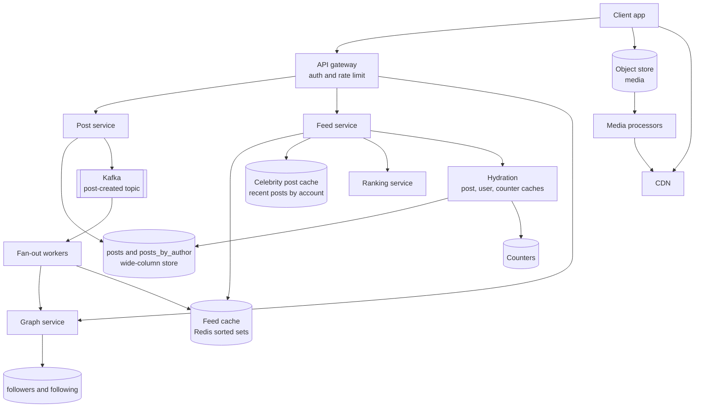
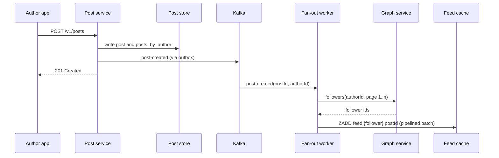
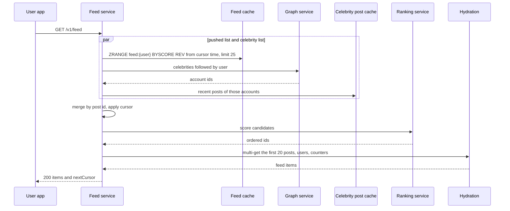

# Design a News Feed

A news feed (a home timeline) shows each user a list of recent posts from the accounts that the user follows. This case study gives the design that a strong candidate presents in 45 minutes: the numbers, the choice between fan-out on write and fan-out on read, the hybrid design for accounts with millions of followers, ranking, the feed cache, cursor pagination, and media. Follow the steps in [how to approach an HLD interview](../how-to-approach-hld.md). The estimation method is on [back-of-envelope estimation](../back-of-envelope-estimation.md), which also has a social feed as a worked example.

!!! note "About the sources"
    Facebook and Twitter published parts of their feed designs. Facebook described its social graph store in the TAO paper (Bronson et al., USENIX ATC 2013). Twitter described its timeline design in a talk by Raffi Krikorian, "Timelines at Scale" (QCon San Francisco 2012, published on InfoQ in April 2013). InfoQ publishes the talk as a video with no transcript, so the details on this page come from the written summary of the talk on the High Scalability blog (8 July 2013), a secondary source. Twitter described its ranking pipeline in the 2023 post "Twitter's Recommendation Algorithm". The text cites these where it states how a real company built a part. All other numbers on this page are assumptions of this KB, labeled as such. Neither company published a full design, so the page is a reference design, not a copy of either system.

## Problem Statement

"Design the home feed of a social network. Users follow other users and post short messages with photos. When a user opens the app, the user sees a feed of recent posts from the accounts that the user follows, with the most relevant posts first. The feed must load fast, and a new post must reach the feeds of its followers soon. Some accounts have tens of millions of followers."

## Clarifying Questions

| Question | Answer that this design assumes |
|---|---|
| How many users? | 500 million monthly active users (MAU) and 200 million daily active users (DAU) (Assumption) |
| What is the follow model? | Asymmetric, as on Twitter or Instagram: a user follows an account, and the account does not follow back. The average user follows 200 accounts (Assumption). The follower count has a long tail: a few accounts have more than 10 million followers |
| How often do users read the feed? | 5 feed opens for each DAU each day. Each open loads the first page of 20 posts (Assumption) |
| How often do users post? | 0.5 posts for each DAU each day on average (Assumption) |
| What does a post contain? | Text up to 1,000 characters and up to 4 photos or 1 video. The feed carries post metadata and media URLs. Video streaming is a separate system (see [09-video-streaming](09-video-streaming.md)) |
| What order does the feed have? | Ranked by relevance, with a reverse-chronological mode. The design builds the chronological candidate list first and adds ranking on top of it |
| How fresh must the feed be? | A new post appears in the feeds of its followers within 5 seconds at the median and 30 seconds at the 99th percentile. A post by an account with over 10 million followers may take longer, because of the hybrid design (Assumption) |
| How long is the feed? | The feed cache keeps the 500 newest candidates for each user. Older posts load on demand from the posts of the followed accounts (Assumption) |
| Are posts private to some followers? | Yes: a post is `public`, `followers`, or `close_friends`. The read path checks visibility |
| Can a post be deleted or edited? | The author can delete a post. A deleted post disappears from every feed within 1 minute. Edits change the text, not the post ID (Assumption) |
| Ads, notifications, comments, search? | Out of scope. Notifications of new posts use the design in [04-notification-system](04-notification-system.md) |
| Availability target? | Feed reads: 99.95%. A feed with older content is better than an error page, so the design degrades instead of failing (Assumption) |
| Multi-region? | Yes, with reads served from the user's home region. Posts replicate across regions asynchronously (Assumption) |

## Requirements

### Functional

1. `post`: an author creates a post with text and optional media.
2. `follow` and `unfollow`: a user follows or stops following another account.
3. `feed`: a user reads the feed, page by page, with a cursor. Each page has up to 20 posts. The user can refresh to see new posts.
4. `profile timeline`: any user reads the posts of one account, newest first.
5. `delete`: an author deletes a post.
6. Each feed item shows the post, its author, the media, and counters (likes, comments). The counters may be a few seconds late.

### Non-functional

| Requirement | Target |
|---|---|
| Feed read latency | p99 below 300 ms for the first page, measured at the feed service (Assumption) |
| Feed freshness | A new post reaches follower feeds within 5 seconds (p50) and 30 seconds (p99) |
| Availability | Feed reads 99.95%, posting 99.9% |
| Durability | A post that the service acknowledged is not lost. Replication factor 3 |
| Consistency | Eventual consistency for feeds. Read-your-writes for the author: authors see their own new post in their own feed at once (see Deep Dives) |
| Scale | 10,000 feed reads and 1,000 posts for each second on average. 30,000 and 3,000 at the peak (see Estimation) |
| Graceful degradation | If the ranking service fails, the feed service returns the chronological list. If the feed cache is empty for a user, the service rebuilds the list from the posts of the followed accounts |

## Estimation

Rounding rule (the same as on the estimation page): one day is 10^5 seconds. The exact day has 86,400 seconds, so the rates are 13.6% lower than the exact rates. The error is smaller than the error of the assumptions.

Inputs (all are assumptions): 200 million DAU. 500 million MAU. 5 feed opens for each DAU each day. 0.5 posts for each DAU each day. 200 followers for each account on average, so 200 follow edges for each user. 50% of the follow edges point to users who were active in the last 7 days. The feed cache holds 500 entries for each user, at 16 bytes for each entry (an 8-byte post ID and an 8-byte score; see the memory note below the table). A post record is 1 KB. 20% of the posts have media that totals 1 MB after processing (several sizes of each photo). A feed page has 20 posts, and its JSON response is 20 KB. The media in one feed page is 400 KB. Peak factor 3.

| Step | Calculation | Result |
|---|---|---|
| Feed reads per day | 200 × 10^6 × 5 | 10^9 |
| Feed reads per second (average) | 10^9 / 10^5 | 10,000 |
| Peak feed reads per second | 10,000 × 3 | 30,000 |
| Posts per day | 200 × 10^6 × 0.5 | 10^8 |
| Posts per second (average) | 10^8 / 10^5 | 1,000 |
| Peak posts per second | 1,000 × 3 | 3,000 |
| Feed inserts per day, fan-out to all followers | 10^8 × 200 | 2 × 10^10 |
| Feed inserts per second, all followers | 2 × 10^10 / 10^5 | 200,000 |
| Feed inserts per second, active followers only | 200,000 × 50% | 100,000 |
| Peak feed inserts per second | 100,000 × 3 | 300,000 |
| Fan-out workers | 300,000 / 10,000 (assumption: one worker inserts 10,000 entries per second in pipelined batches) | 30 |
| Feed cache, primary copy | 500 × 10^6 users × 500 entries × 16 B | 4 TB |
| Feed cache with 2 copies (a primary and one replica) | 4 TB × 2 | 8 TB |
| Feed cache nodes | 8 TB / 200 GB (assumption: 200 GB of usable memory on a node) | 40 |
| Post metadata for 5 years | 10^8 × 1 KB × 365 × 5 | 182.5 TB |
| Post metadata with 3 replicas | 182.5 TB × 3 | 547.5 TB |
| New media each day | 10^8 × 20% × 1 MB | 20 TB |
| Follow edges | 500 × 10^6 × 200 | 10^11 |
| Follow graph, both directions | 10^11 × 2 × 16 B | 3.2 TB |
| Post lookups at the peak | 30,000 × 20 | 600,000 each second |
| JSON bandwidth at the peak | 30,000 × 20 KB × 8 | 4.8 Gbit/s |
| Media bandwidth at the peak (CDN) | 30,000 × 400 KB × 8 | 96 Gbit/s |
| Time to fan out one post of 50 million followers | 5 × 10^7 / 600,000 (assumption: the fan-out tier handles 600,000 inserts each second, 2 times the peak) | 83 seconds |

Memory note. Sixteen bytes for each entry is the size of a compact structure. Redis stores a small sorted set in a compact encoding (a listpack) only while the set has at most `zset-max-listpack-entries` members, each of at most `zset-max-listpack-value` bytes. In Redis 7.0 and later the defaults are 128 entries and 64 bytes (Redis documentation, "Memory optimization"). A feed list of 500 entries is above the default limit, so Redis converts it to the normal encoding, a skip list plus a hash table, which costs several times more memory for each entry. The same page says that the compact encodings use "up to 10 times less memory". Assumption: 100 bytes for each entry in the normal encoding. Then the feed cache would be 500 × 10^6 × 500 × 100 B = 25 TB, not 4 TB. Measure the real cost with `MEMORY USAGE` on a sample of keys. The levers are a shorter list (200 entries for most users), a higher `zset-max-listpack-entries` (a listpack insert costs O(N), so this trades CPU for memory), and caching feeds only for users who were active in the last 7 days.

What the numbers decide:

- The feed is a read problem and a write-amplification problem. Reads (30,000 each second at the peak) are 10 times the posts, but each post turns into 200 feed inserts on average. The writes to the feed cache (300,000 each second at the peak) are 10 times the feed reads. This ratio is the reason to precompute feeds, and the same ratio is the cost of precomputing them.
- The feed cache is the largest memory component: 8 TB with 2 copies. A cache of this size is a cluster of 40 nodes. It stores only post IDs (8 bytes of data in each 16-byte entry). Full posts of 1 KB in 500 entries for 500 million users would cost 500 × 10^6 × 500 × 1 KB = 250 TB, about 60 times more (250 TB against 4 TB), and every edit or delete would touch many lists.
- Media dominates storage and bandwidth: 20 TB each day of new media against 100 GB each day of post metadata. A CDN must serve the media. The feed service does not touch media bytes.
- A post of one account with 50 million followers takes 83 seconds of the whole fan-out tier. The queue behind that one post delays every other post. This is the reason for the hybrid design.
- The post metadata (547.5 TB with 3 replicas in 5 years) needs a partitioned store. The follow graph (3.2 TB) is small in bytes, but it has 10^11 edges, so a point lookup of a follower list is the hot path of the fan-out.

The program below checks the arithmetic, models the effect of the celebrity threshold on the fan-out writes, and shows the read-time merge with a cursor (see Deep Dives). `main` comes first, and the block has its own imports, so you can copy it into `FeedCheck.java` and run `java FeedCheck.java` on JDK 21.

```java
import java.util.ArrayList;
import java.util.Comparator;
import java.util.List;
import java.util.Locale;
import java.util.PriorityQueue;

public class FeedCheck {
    public static void main(String[] args) {
        estimation();
        fanOutModel();
        mergeAndCursor();
    }

    // Rounding rule of this KB: one day is 10^5 seconds.
    static void estimation() {
        System.out.println("== Estimation (1 day = 10^5 s) ==");
        double dau = 200e6;
        double feedOpensPerUser = 5;
        double feedReads = dau * feedOpensPerUser;
        double readQps = feedReads / 1e5;
        System.out.println(g("feed reads per day", feedReads));
        System.out.println(g("feed reads per second", readQps));
        System.out.println(g("peak feed reads per second", readQps * 3));
        double posts = dau * 0.5;
        double postQps = posts / 1e5;
        System.out.println(g("posts per day", posts));
        System.out.println(g("posts per second", postQps));
        System.out.println(g("peak posts per second", postQps * 3));
        double followers = 200;
        double allInserts = posts * followers;
        System.out.println(g("feed inserts per day, all followers", allInserts));
        System.out.println(g("feed inserts per second, all followers", allInserts / 1e5));
        double activeShare = 0.5;
        double activeInserts = allInserts * activeShare;
        System.out.println(g("feed inserts per second, active only", activeInserts / 1e5));
        System.out.println(g("peak feed inserts per second, active", activeInserts / 1e5 * 3));
        double peakInserts = activeInserts / 1e5 * 3;
        System.out.println(g("fan-out workers at 10,000/s each", Math.ceil(peakInserts / 10_000)));
        double mau = 500e6;
        double feedBytes = 500 * 16;
        System.out.println(g("feed cache TB (500M users x 8 KB)", mau * feedBytes / 1e12));
        System.out.println(g("feed cache TB with 2 replicas", mau * feedBytes * 2 / 1e12));
        System.out.println(g("feed cache nodes at 200 GB", mau * feedBytes * 2 / 200e9));
        System.out.println(g("post metadata TB per day", posts * 1000 / 1e12));
        System.out.println(g("post metadata TB in 5 years", posts * 1000 * 365 * 5 / 1e12));
        System.out.println(g("post metadata TB, 3 replicas", posts * 1000 * 365 * 5 * 3 / 1e12));
        System.out.println(g("media TB per day (20% x 1 MB)", posts * 0.2 * 1e6 / 1e12));
        double edges = mau * 200;
        System.out.println(g("follow edges", edges));
        System.out.println(g("follow graph TB (2 directions x 16 B)", edges * 2 * 16 / 1e12));
        double peakRead = readQps * 3;
        System.out.println(g("peak post lookups per second", peakRead * 20));
        System.out.println(g("peak JSON egress Gbit/s (20 KB)", peakRead * 20e3 * 8 / 1e9));
        System.out.println(g("peak media egress Gbit/s (400 KB)", peakRead * 400e3 * 8 / 1e9));
        double celebFollowers = 50e6;
        System.out.println(g("seconds to fan out 50M at 600k/s", celebFollowers / 600e3));
    }

    // Model: user of rank r (1 = most followed) has max(1, MAX / r^0.8) followers.
    // Every user posts once a day. Push writes of one day = sum of followers of pushed users.
    static void fanOutModel() {
        System.out.println("== Fan-out model: 1,000,000 users, 1 post each per day ==");
        int users = 1_000_000;
        double max = 500_000;
        long[] followers = new long[users];
        long edges = 0;
        for (int r = 1; r <= users; r++) {
            followers[r - 1] = Math.max(1, (long) (max / Math.pow(r, 0.8)));
            edges += followers[r - 1];
        }
        System.out.println(String.format(Locale.ROOT, "%-28s %,d", "follow edges", edges));
        System.out.println(String.format(Locale.ROOT, "%-28s %,d", "push everyone: writes", edges));
        long[] thresholds = {1_000_000, 100_000, 10_000, 1_000};
        for (long t : thresholds) {
            long pushWrites = 0;
            long celebrities = 0;
            long celebEdges = 0;
            long worstPush = 0;
            for (long f : followers) {
                if (f > t) {
                    celebrities++;
                    celebEdges += f;
                } else {
                    pushWrites += f;
                    worstPush = Math.max(worstPush, f);
                }
            }
            double celebsPerUser = (double) celebEdges / users;
            System.out.println(String.format(Locale.ROOT,
                    "T %,9d: celebs %,5d push %,11d (%.1f%%) worst push %,7d pulls/user %.1f",
                    t, celebrities, pushWrites, 100.0 * pushWrites / edges, worstPush,
                    celebsPerUser));
        }
    }

    record Post(long id, String author) { }

    // Merge a pushed feed list with the recent posts of followed celebrities, newest first.
    // Equal ids leave the heap one after the other, so a check of the last id removes duplicates.
    // The cursor is the id of the last post that the client saw. Post ids are time-ordered.
    static List<Post> page(List<Post> pushed, List<List<Post>> celebrityLists,
                           long cursorExclusive, int limit) {
        PriorityQueue<Cursor> heap = new PriorityQueue<>(
                Comparator.comparingLong((Cursor c) -> c.current().id()).reversed());
        List<List<Post>> all = new ArrayList<>();
        all.add(pushed);
        all.addAll(celebrityLists);
        for (List<Post> list : all) {
            Cursor c = new Cursor(list, 0);
            c.skipUntilBelow(cursorExclusive);
            if (c.hasNext()) {
                heap.add(c);
            }
        }
        List<Post> out = new ArrayList<>();
        long lastId = Long.MAX_VALUE;
        while (out.size() < limit && !heap.isEmpty()) {
            Cursor c = heap.poll();
            // A post can be in two lists (the author's own post). Emit each id once.
            if (c.current().id() != lastId) {
                out.add(c.current());
                lastId = c.current().id();
            }
            c.index++;
            if (c.hasNext()) {
                heap.add(c);
            }
        }
        return out;
    }

    static class Cursor {
        final List<Post> list;
        int index;

        Cursor(List<Post> list, int index) {
            this.list = list;
            this.index = index;
        }

        void skipUntilBelow(long id) {
            while (index < list.size() && list.get(index).id() >= id) {
                index++;
            }
        }

        boolean hasNext() {
            return index < list.size();
        }

        Post current() {
            return list.get(index);
        }
    }

    static void mergeAndCursor() {
        System.out.println("== Merge at read time with a cursor ==");
        List<Post> pushed = new ArrayList<>(List.of(
                new Post(95, "ann"), new Post(90, "bob"), new Post(80, "ann"),
                new Post(70, "cat"), new Post(60, "bob"), new Post(50, "ann")));
        List<Post> starA = List.of(new Post(93, "star-a"), new Post(75, "star-a"),
                new Post(55, "star-a"));
        List<Post> starB = List.of(new Post(85, "star-b"), new Post(65, "star-b"));
        List<List<Post>> celebs = List.of(starA, starB);

        List<Post> first = page(pushed, celebs, Long.MAX_VALUE, 4);
        System.out.println("page 1: " + ids(first));
        // A new post (id 99) arrives and the fan-out inserts it at the head of the list.
        pushed.add(0, new Post(99, "bob"));
        long cursor = first.get(first.size() - 1).id();
        List<Post> second = page(pushed, celebs, cursor, 4);
        System.out.println("page 2 (cursor " + cursor + "): " + ids(second));
        List<Post> refresh = page(pushed, celebs, Long.MAX_VALUE, 2);
        System.out.println("refresh: " + ids(refresh));
        // The reader is bob, so his own recent posts join the merge. 99 is in two lists.
        List<Post> ownPosts = List.of(new Post(99, "bob"), new Post(60, "bob"));
        List<Post> withOwn = page(pushed, List.of(starA, starB, ownPosts), Long.MAX_VALUE, 3);
        System.out.println("refresh with own posts: " + ids(withOwn));
    }

    static String ids(List<Post> posts) {
        StringBuilder sb = new StringBuilder();
        for (Post p : posts) {
            sb.append(p.id()).append('(').append(p.author()).append(") ");
        }
        return sb.toString().trim();
    }

    static String g(String label, double value) {
        return String.format(Locale.ROOT, "%-42s %,.1f", label, value);
    }
}
```

<!-- expected-output -->
```text
== Estimation (1 day = 10^5 s) ==
feed reads per day                         1,000,000,000.0
feed reads per second                      10,000.0
peak feed reads per second                 30,000.0
posts per day                              100,000,000.0
posts per second                           1,000.0
peak posts per second                      3,000.0
feed inserts per day, all followers        20,000,000,000.0
feed inserts per second, all followers     200,000.0
feed inserts per second, active only       100,000.0
peak feed inserts per second, active       300,000.0
fan-out workers at 10,000/s each           30.0
feed cache TB (500M users x 8 KB)          4.0
feed cache TB with 2 replicas              8.0
feed cache nodes at 200 GB                 40.0
post metadata TB per day                   0.1
post metadata TB in 5 years                182.5
post metadata TB, 3 replicas               547.5
media TB per day (20% x 1 MB)              20.0
follow edges                               100,000,000,000.0
follow graph TB (2 directions x 16 B)      3.2
peak post lookups per second               600,000.0
peak JSON egress Gbit/s (20 KB)            4.8
peak media egress Gbit/s (400 KB)          96.0
seconds to fan out 50M at 600k/s           83.3
== Fan-out model: 1,000,000 users, 1 post each per day ==
follow edges                 36,910,936
push everyone: writes        36,910,936
T 1,000,000: celebs     0 push  36,910,936 (100.0%) worst push 500,000 pulls/user 0.0
T   100,000: celebs     7 push  35,388,572 (95.9%) worst push  94,732 pulls/user 1.5
T    10,000: celebs   132 push  32,486,482 (88.0%) worst push   9,997 pulls/user 4.4
T     1,000: celebs 2,361 push  27,311,993 (74.0%) worst push   1,000 pulls/user 9.6
== Merge at read time with a cursor ==
page 1: 95(ann) 93(star-a) 90(bob) 85(star-b)
page 2 (cursor 85): 80(ann) 75(star-a) 70(cat) 65(star-b)
refresh: 99(bob) 95(ann)
refresh with own posts: 99(bob) 95(ann) 93(star-a)
```

How to read the output of the fan-out model. The model has 1,000,000 users. The user of rank r has `500,000 / r^0.8` followers, and every user posts once a day. At a threshold of 1,000,000 (push everything), the largest single post fans out to 500,000 inserts. At a threshold of 100,000, 7 accounts are "celebrities". The push writes drop only to 95.9%, but the worst single push falls from 500,000 to 94,732 inserts, and each user merges the posts of 1.5 celebrity accounts on average at read time. At a threshold of 1,000, 2,361 accounts are celebrities, the push writes fall to 74%, and each user merges the posts of 9.6 celebrity accounts on every read. A lower threshold removes more write work and adds more read work, so the threshold is a tuning knob. The model posts each account once a day. Real celebrities post more often than normal accounts, so the saving in a real system is larger than the model shows. The numbers of the model are not a measurement of any real system.

How to read the merge output. The merge takes one pushed list and two celebrity lists, all newest first, and returns the 4 newest posts below the cursor. A post with ID 99 arrives between page 1 and page 2. The second page does not repeat or skip any post, because the cursor is a post ID and not an offset. The new post appears only after a refresh. The last line merges the reader's own recent posts as a third source (see "Read-your-writes for the author" in Deep Dives). Post 99 is in both the pushed list and the own list, and the page shows it once, because the merge skips an ID that it has just emitted.

## API Design

The API has a read plane (`feed`, `profile`) and a write plane (`post`, `follow`). All endpoints need a user token in the `Authorization` header. Design of REST endpoints in general: `kb/api-design/02-api-design-practices.md`.

### `POST /v1/posts`

Request (JSON). The client uploads media first (see the media deep dive) and sends the media IDs.

```json
{
  "text": "Sunrise over the bay",
  "mediaIds": ["m_81f3", "m_81f4"],
  "visibility": "followers"
}
```

The client sends an `Idempotency-Key` header, so that a retry after a timeout returns the same post and does not create a second one (see [reliability patterns](../fundamentals/12-reliability-patterns.md)).

Response `201 Created`:

```json
{
  "postId": "1847201938475629568",
  "authorId": "u_204",
  "text": "Sunrise over the bay",
  "media": [{ "id": "m_81f3", "url": "https://cdn.example.com/m_81f3/720.jpg" }],
  "createdAt": "2026-10-15T10:00:00Z"
}
```

Errors: `400` (text too long, unknown media ID), `401`, `403` (the media belongs to another user), `429` (rate limited, with `Retry-After`).

### `GET /v1/feed?cursor=<token>&limit=20`

The feed. `limit` has a maximum of 50. The first request has no `cursor`. Response `200`:

```json
{
  "items": [
    {
      "postId": "1847201938475629568",
      "author": {
        "id": "u_204",
        "name": "Ann",
        "avatarUrl": "https://cdn.example.com/a/u_204.jpg"
      },
      "text": "Sunrise over the bay",
      "media": [{ "url": "https://cdn.example.com/m_81f3/720.jpg", "width": 720, "height": 480 }],
      "likeCount": 12,
      "commentCount": 3,
      "likedByMe": false,
      "createdAt": "2026-10-15T10:00:00Z"
    }
  ],
  "nextCursor": "eyJzIjoiZjEyIiwicCI6MjB9",
  "newPostsAvailable": false
}
```

The cursor is an opaque token. The server encodes the position in it (see Deep Dives), and the client sends it back without a change. The response has no `nextCursor` at the end of the feed. `newPostsAvailable` tells the client to show a "new posts" banner. The call is a read, so a client retries it without risk.

### `GET /v1/users/{userId}/posts?cursor=<token>&limit=20`

The profile timeline: the posts of one account, newest first, filtered by the visibility that the caller may see. It uses the same cursor format. It reads the `posts_by_author` table directly.

### `PUT /v1/follows/{userId}` and `DELETE /v1/follows/{userId}`

Follow or unfollow the account `userId`. Both calls are idempotent: a second `PUT` for an existing follow returns `204`. Response `204 No Content`. Error `404` (unknown account), `403` (the account blocks the caller), `409` (the follow limit of the user is reached; Assumption: 5,000 follows).

### `DELETE /v1/posts/{postId}`

Only the author can call it. Response `204`. The call marks the post `deleted` and does not remove it from the feeds (see Deep Dives).

## Data Model

### Tables

**`posts`**: one row for each post. The primary access path is "get by post ID".

| Column | Type | Notes |
|---|---|---|
| `post_id` | 64-bit integer | **Partition key.** A time-ordered ID (Snowflake type, see [unique ID generation](../fundamentals/15-unique-id-generation.md)). IDs sort by creation time, so "newest first" is "largest ID first" |
| `author_id` | integer | |
| `text` | string, up to 1,000 characters | |
| `media_ids` | list of strings | At most 4 |
| `visibility` | enum | `public`, `followers`, `close_friends` |
| `status` | enum | `active`, `deleted` |
| `created_at` | timestamp | |

**`posts_by_author`**: partition key `author_id`, clustering key `post_id` descending. The value is the post ID only (the row in `posts` holds the content). It serves the profile timeline, the pull path for celebrities, and the rebuild of a lost feed.

**`followers`**: partition key `followee_id`, clustering key `follower_id`. It serves the fan-out: "list the followers of this account". **`following`**: partition key `follower_id`, clustering key `followee_id`. It serves "list the accounts that this user follows", which the pull path and the rebuild need. The service writes both tables on each follow. Both tables hold a `created_at` column and a `muted` flag.

**`user_stats`**: `user_id`, `follower_count`, `following_count`, `is_celebrity` (derived from `follower_count` and a threshold, with hysteresis), `last_active_at`.

**`feed:{userId}`** (Redis): a sorted set. The member is the post ID. The score is the creation time of the post in milliseconds. A Redis score is a double-precision number, which holds integers exactly only up to 2^53, so a 63-bit post ID cannot be the score. The cache keeps the 500 entries with the largest scores. It is derived data, and the service can rebuild it from `following` and `posts_by_author`.

**`post_counters`**: `post_id`, `like_count`, `comment_count`. A counter store separate from `posts`, because counters change much more often than the text (see Deep Dives).

### Database choice

Recommendation: three stores, one for each access pattern (the choice criteria are in [choosing a database](../fundamentals/04-choosing-a-database.md)).

- **Posts and the author index: a partitioned wide-column or key-value store** (Cassandra or DynamoDB type), or sharded MySQL. Every hot-path read is a lookup by one key (`post_id`) or a range of one partition (`author_id`, newest first). There are no joins. The store replicates across zones and regions (see [replication](../fundamentals/05-replication.md) and [partitioning and sharding](../fundamentals/06-partitioning-and-sharding.md)). 547.5 TB with 3 replicas in 5 years exceeds one relational primary, so the store must partition.
- **The social graph: a store that serves adjacency lists with low latency.** Facebook built TAO for this: the graph is a set of objects and associations (typed, directed edges), the associations have a time-ordered list API such as `assoc_range` and `assoc_count`, MySQL is the persistent store, and tiers of cache servers handle the reads. Each region has one complete set of databases, one leader cache tier, and at least two follower cache tiers. Followers serve reads and forward misses and writes to the leader tier. Each shard has a master database in one region, and MySQL replicates it asynchronously to the other regions. A leader in another region forwards writes to the leader in the master region of the shard. In the paper's sample of production traffic, 99.8% of the requests were reads, and the paper says that TAO "explicitly favors efficiency and availability over consistency" (Bronson et al., ATC 2013). A team without TAO can store the `followers` and `following` tables above in a sharded relational or wide-column store with a cache in front.
- **The feed lists: Redis sorted sets** (or an equivalent in-memory structure). A feed read is a range query on a list by score, which needs microsecond latency at 30,000 reads each second and 300,000 inserts each second at the peak. A sorted set makes an insert idempotent: inserting the same member twice leaves one entry. Twitter described the same structure: it kept each home timeline in a Redis cluster, fanned tweet IDs out into it, capped each timeline at about 800 entries, and kept 3 copies of each timeline (Krikorian, "Timelines at Scale", as summarized by High Scalability, 2013).

Why not one relational database for everything: `SELECT ... FROM posts JOIN following ... ORDER BY created_at DESC LIMIT 20` is the fan-out on read design written in SQL. At 30,000 reads each second, with 200 followed accounts each, it joins 200 author lists for every read. Section "Fan-Out on Write, Fan-Out on Read, and the Hybrid" gives the cost.

## High-Level Design



### Components

- **API gateway.** Authenticates the token and rate limits each user (see [rate limiting algorithms](../fundamentals/13-rate-limiting-algorithms.md)). It routes the call to the service.
- **Post service.** Validates a post, writes it to `posts` and `posts_by_author`, and publishes a `post-created` event to Kafka. The event holds the post ID and the author ID, not the text. The post service does not call the fan-out directly, so a slow fan-out does not slow a post. To stay consistent when the write succeeds and the publish fails, it uses the transactional outbox pattern (see [message queues and streams](../fundamentals/08-message-queues-and-streams.md) and [distributed transactions](../distributed-systems/03-distributed-transactions.md)).
- **Fan-out workers.** Consume `post-created`. For a normal author, a worker reads the follower list in pages of 1,000 from the graph service, drops followers who are inactive or who may not see the post, and inserts the post ID into each remaining `feed:{userId}`. For a celebrity author, the worker does nothing, because the read path pulls the post.
- **Graph service.** Serves `followers` and `following` lookups and the follow and unfollow writes. It caches adjacency lists (the TAO design).
- **Feed cache.** Redis sorted sets, one for each user, 500 entries, sharded by `userId` (consistent hashing, see [partitioning and sharding](../fundamentals/06-partitioning-and-sharding.md)).
- **Celebrity post cache.** For each celebrity account, the list of its posts from the last 3 days, newest first (Assumption: 3 days). It is a small, hot data set that the feed service reads on every request.
- **Feed service.** The read path. It reads the pushed list, pulls the recent posts of the followed celebrities, merges the two lists, calls the ranking service, hydrates the top posts, and builds the cursor.
- **Ranking service.** Scores the candidates and returns an order (see Deep Dives). It has a latency budget of 50 ms.
- **Hydration.** Turns post IDs into full feed items: post text and media URLs from a post cache (Memcached or Redis in front of the post store), the author name and avatar from a user cache, and the counters from a counter cache. It uses multi-get calls (see [caching](../fundamentals/03-caching.md)).
- **Media path.** The client uploads photos to an object store with a pre-signed URL. Processors make the sizes and thumbnails. The CDN serves the result (see [storage types](../fundamentals/10-storage-types.md) and [load balancing, DNS, and CDN](../fundamentals/02-load-balancing-dns-cdn.md)).

### The write flow and the read flow





## Deep Dives

### Fan-Out on Write, Fan-Out on Read, and the Hybrid

**Fan-out** is the work of delivering one post to many readers. The design chooses where to do it: when the author posts (write time) or when the reader opens the feed (read time).

**Fan-out on write (push).** When an author posts, a worker inserts the post ID into the feed list of every follower. A feed read is then one range query on one list. Reads are cheap and fast. Writes are expensive: the cost of one post is the follower count.

**Fan-out on read (pull).** The service stores nothing per reader. When a user opens the feed, the service lists the accounts that the user follows, fetches the newest posts of each, and merges them. Writes are cheap (one row for each post). Reads are expensive: the cost of one read is the number of followed accounts (200 on average, 5,000 at the limit), and the read does this work again on every open and every refresh.

| Aspect | Push (write time) | Pull (read time) |
|---|---|---|
| Cost of one post | `followers` inserts (200 on average, 50 million for a celebrity) | 1 row |
| Cost of one feed read | 1 range query | `following` lookups and merges (200 on average) |
| Read latency | Low and flat | Grows with the follow count |
| Freshness | Delayed by the fan-out queue | Immediate |
| Wasted work | Inserts for users who do not open the feed | None, but repeated work on every read |
| Storage | 8 TB feed cache (see Estimation) | None extra |
| Celebrity post | Very expensive, and slow (83 seconds of the whole tier for 50 million followers) | Cheap to write, and every reader pulls it |
| Rebuild after cache loss | Needs the pull path | Not needed |

With the numbers of this page, pull costs 30,000 reads each second × 200 followed accounts = 6,000,000 author-list lookups each second at the peak, against 300,000 feed inserts each second for push. Push moves work from the read path (which the user waits for) to the write path (which runs in the background), and it wins when reads far outnumber posts. Here the feed reads are 10 times the posts (10^9 reads for 10^8 posts a day), and that ratio together with the latency target selects push for normal accounts.

**The celebrity problem.** Push breaks for accounts with a very large follower count. One post costs millions of inserts, they arrive as a burst, and the burst delays the feeds of everyone else (see the 83-second figure in Estimation). Most of those inserts go to users who will not open the feed for days. Twitter described the same problem. In the 2012 talk, it fanned tweets out to home timelines in Redis, with a goal of delivering a tweet to a follower in no more than 5 seconds, and a tweet from an account with 31 million followers could take up to 5 minutes to fan out. The talk names the fix of this page as the direction that Twitter was working on: no fan-out for those accounts, and a merge of their tweets into the timeline at read time. Twitter also kept home timelines in Redis only for active users (users who had logged in during the last 30 days), and rebuilt the timeline of other users from storage on demand (Krikorian, "Timelines at Scale", as summarized by High Scalability, 2013).

**The hybrid design.**

1. The service marks an account as a celebrity when `follower_count` exceeds a threshold T. Assumption: T = 100,000 for the first version. The `is_celebrity` flag is part of `user_stats`.
2. On a post by a normal account, the fan-out workers push the post ID to the active followers.
3. On a post by a celebrity, the post service writes the post and updates the celebrity post cache. No fan-out happens.
4. On a feed read, the feed service reads the pushed list, reads the celebrity post cache for each celebrity that the user follows, and merges the lists by creation time and post ID (the merge code is in the program above).

The merge cost is bounded: the number of celebrities that one user follows is small (1.5 on average at T = 100,000 in the model above), and the service caps it (for example 200 celebrities for each user). Reading the recent posts of 20 or 200 celebrities is a multi-get on a small, hot cache, and the cache is replicated for read capacity.

**Choosing T.** Lower T removes more write work and adds more read work (see the model output). Choose T from measurements. Compare the cost of push (inserts per post times the post rate) and the cost of pull (celebrities per reader times the read rate) for each follower-count bucket, and put the threshold where the two are equal. Add hysteresis: an account becomes a celebrity at 100,000 followers and stops being one below 80,000, so an account near the threshold does not flip between the two modes on every follow. When an account crosses the threshold, its old posts stay in the pushed feeds, and new posts go to the pull path. Both paths contain the post IDs from the same ID space, so the merge works for the transition.

**Skip inactive users.** 50% of the follow edges in the estimate point to users who were not active in the last 7 days (Assumption). The worker checks `last_active_at` and skips them. If a user returns after a long absence, the feed service finds an empty or short list and rebuilds it with the pull path (see the next dive). This halves the write load (200,000 to 100,000 each second).

**Fan-out worker design.**

- The `post-created` topic is partitioned by `author_id`, so one worker handles the posts of one author in order. For a large author, the worker splits the follower list into pages of 1,000 and publishes one `fanout-page` task for each page to a second topic. Many workers then process the pages in parallel, and a slow page does not block the rest.
- The insert is idempotent: `ZADD feed:{user} <createdAtMs> <postId>` with the same member leaves one entry. A retry after a crash therefore creates no duplicate, and the consumer needs no separate deduplication (see [message queues and streams](../fundamentals/08-message-queues-and-streams.md) on at-least-once delivery).
- After the insert, the worker trims the list to 500 entries (`ZREMRANGEBYRANK feed:{user} 0 -501`).
- Priority: a post by an account that the user interacts with often may use a faster queue than a post by a rarely viewed account (Assumption). A backlog on the slow queue then delays only the low-value inserts.
- The lag between the post and the insert (the consumer lag of the topic) is the main health metric of the fan-out tier. Alert on it (see [observability in design](../fundamentals/20-observability-in-design.md)).

**Follow and unfollow.**

- On a follow, the graph service writes both tables. A background job then copies the 20 newest posts of the followee into the feed list of the follower, so the new follow shows content at once. For a celebrity followee, the write path adds the celebrity to the set of followed celebrities, and the pull path finds the posts.
- On an unfollow, the service does not scan the feed list. It removes the account from `following`, and the feed service drops the posts of unfollowed authors during the merge and hydration, until a background job cleans the list. This costs one set membership check for each post, in memory.

**Deletes and visibility changes.** The post service marks the post `deleted` in `posts` and removes the post from the post cache and from the celebrity post cache. It does not remove the post ID from millions of feed lists (the cost would repeat the fan-out). Hydration reads each post and drops the posts with status `deleted` or with a visibility that the reader may not see. The feed service then fetches more candidates to fill the page. A background job removes the ID from the lists later. This meets the 1-minute deletion target at the price of one extra check for each post on the read path.

### The Read Path: Ranking and Cursor Pagination

**Candidate generation.** The merge gives a list of up to 500 pushed candidates and the posts of the followed celebrities from the last 3 days. These are the candidates for the page.

**Ranking.** A **ranker** is a service that gives each candidate a score and orders the candidates. The design uses two stages, as large systems do:

1. A cheap scoring step (a light model, or a formula) scores all candidates, and the service keeps the top 100 to 200 (Assumption).
2. A heavy model (a neural network over many features) scores the survivors. Features: the relationship between the reader and the author (the reader's past interactions with the author), the type and age of the post, the post's engagement so far, and the reader's behavior.

Facebook's early ranking formula was called EdgeRank. Facebook engineers Ruchi Sanghvi and Ari Steinberg presented it at the f8 conference in 2010, and Facebook did not publish the formula itself. As TechCrunch reported the talk, each interaction with a post (an edge) scores the affinity between the reader and the creator, times a weight for the type of interaction, times a time decay, and the post's score is the sum over its edges (Kincaid, TechCrunch, 22 April 2010). Twitter's post "Twitter's Recommendation Algorithm" (31 March 2023) describes three main stages and a final step. Candidate sourcing fetches the best 1,500 tweets for each request, about half from accounts that the user follows (in-network) and half from other accounts (out-of-network). Ranking scores the candidates with a neural network of about 48 million parameters. Heuristics and filters then remove, for example, tweets from blocked accounts and tweets that the user already saw. In the final mixing step, the service blends the tweets with other content: ads, follow recommendations, and onboarding prompts. The structure of this page's design matches that shape: generate candidates, score them in a ranking service, filter, then hydrate and mix.

Design rules for the ranker in the interview:

- It has a latency budget (50 ms in this design) and a timeout. If it times out, the feed service returns the chronological order (graceful degradation).
- The ranker does not change which posts are candidates. It only orders them. This keeps the fan-out independent of ranking: a new model needs no change in the write path.
- Log the impressions and the interactions to train the next model (a pipeline in [batch and stream processing](../fundamentals/17-batch-and-stream-processing.md)).
- Compare models in an A/B test on engagement and on session length, with a guard metric such as the number of negative signals (hides and unfollows).

**Why offset pagination fails for a feed.** With `?page=2`, the server returns entries 21 to 40 of the list. The list changes between requests: a new post inserts at the top, and every old entry moves down one place. The client then sees the last post of page 1 again at the top of page 2 (a duplicate), and a delete makes the client skip a post. The query also costs more for deeper pages in many stores (`OFFSET` reads and drops the skipped rows).

**Cursor pagination (keyset pagination).** The client sends the position of the last item that it saw, and the server returns the items after that position.

- **Chronological feed.** The cursor is the pair (creation time, post ID) of the last item. The next page is "the 20 entries that sort below the cursor". New posts sort above the cursor, so they do not enter a page below it. The Redis query is `ZRANGE feed:{user} <cursorTimeMs> -inf BYSCORE REV LIMIT 0 25`, which costs O(log N + 25). (The older `ZREVRANGEBYSCORE` command does the same and is deprecated since Redis 6.2.) Both bounds are inclusive. The service then drops the entries with the same time and an ID at or above the cursor ID, which handles posts that share a millisecond, and keeps 20. The program above shows the same logic on merged lists, with small integers as post IDs in place of (time, ID) pairs: page 2 has no duplicate after a new post arrives.
- **Ranked feed.** A ranked order is not sorted by post ID, so "the items below the last ID" has no meaning, and the score of an item changes between requests (the like counts grow). The server therefore freezes the order for the session: on the first request, the feed service ranks the candidates, stores the ordered ID list (up to 200 IDs, about 1.6 KB) in a short-lived cache entry with a TTL of 10 minutes (Assumption), and returns a cursor that holds the snapshot ID and the position. The next pages read from the snapshot, hydrate the next 20 posts, and need no ranking call. When the snapshot ends or expires, the service generates and ranks a new candidate list and removes the posts that the user already saw (the client sends the IDs of the last items, or the service stores a "seen" bloom filter for the user, see [probabilistic data structures](../distributed-systems/04-probabilistic-data-structures.md)).
- The cursor is opaque and signed (a MAC), so a client cannot forge a position or read the internal format, and the server can change the format.
- **Refresh.** A pull-to-refresh request has no cursor. It starts a new snapshot and puts the new posts first. In the background, the client polls a cheap endpoint (the `newPostsAvailable` flag) or receives a push, and shows a "new posts" banner. It does not insert new posts above the item that the user is reading, because that moves the page under the user's eyes.

### The Feed Cache, Hydration, and Consistency

**What the feed cache stores.** Only post IDs (8 bytes), as the estimation shows: 8 TB with 2 replicas for 500 million users. The cache holds the order of the posts. It does not hold the posts. A post is stored once, in the post cache, however many feeds contain it. A change of a like count or an edit then updates one place and not 200 feeds.

**Hydration.** A feed page of 20 posts needs 20 post records, up to 20 author records, and 20 counters. The hydration layer issues multi-get calls: one batched request for all post IDs, one for the authors, one for the counters. The layer calls the post store only for the cache misses. This is the cache-aside pattern (see [caching](../fundamentals/03-caching.md)). At the peak, the layer serves 600,000 post lookups each second, so the cache hit ratio decides the load on the store: at a 99% hit ratio, the store gets 6,000 reads each second.

Facebook's memcache paper describes this layer for the same kind of workload: a demand-filled look-aside cache of the data behind pages, frontend clusters of many cache servers with regional pools that the clusters of one region share for some keys, leases that address stale sets and thundering herds, and a rule that a delete (not a set) invalidates a key after a write, because deletes are idempotent (Nishtala et al., NSDI 2013). TAO later put a graph-specific cache in front of MySQL for the social graph. The caching page covers these mechanisms in depth, so this page links to them and does not repeat them.

**Hot posts.** A viral post appears in millions of feeds, so its post record and counters become a hot key. The fixes are on the caching page: a short-lived copy in the memory of each feed-service instance (a TTL of 1 to 5 seconds), and key replication. Counters have their own fix: they are written by a counter service that batches increments in memory and flushes a sum every second (see [partitioning and sharding](../fundamentals/06-partitioning-and-sharding.md), hot keys). The feed shows an approximate count that may be a few seconds old.

**Consistency guarantees.**

- The feed is eventually consistent. A follower sees a new post when the fan-out inserts it, within seconds. Two followers can see the post at different times.
- **Read-your-writes for the author.** Authors who post and then open their own feed must see the post. The post service writes the post ID to the author's own feed list synchronously, before it returns `201`, and the feed service also merges the author's own recent posts (a small list) at read time. The new post is then in two of the merged lists, and the merge emits each post ID once (the last line of the program output). This is the read-your-writes guarantee from [replication](../fundamentals/05-replication.md), applied to the feed. It also handles a user whose first reads come from a replica that has not yet received the write.
- **Order across feeds.** Two posts that two authors write at the same moment may appear in different orders in different feeds. The ID order is a total order of the posts, so every feed sorted by ID shows the same relative order of the posts that it contains. Ranked feeds are personal and need no common order.

**Loss of a feed shard.** The feed lists are derived data. If a Redis node fails, a replica takes over (replication has a lag, so the replica can miss the last inserts, and the fan-out retry or the pull path covers the gap). If a list is missing, the feed service rebuilds it: it reads `following`, takes the newest posts of each followed account from `posts_by_author` (a bounded number: for example the 20 newest posts of each of the 200 most recently active followed accounts), merges them, and writes the list back. The rebuild costs about as much as a pull-mode read, so a loss of one node raises the read load for the users on that node, and the service rate limits rebuilds to protect the post store.

### Media

A feed is mostly media by bytes: 20 TB of new media each day against 100 GB of metadata, and 96 Gbit/s at the peak. The feed service does not handle media bytes.

1. **Upload.** The client asks the post service for an upload URL. The service returns a pre-signed URL for the object store and a media ID. The client uploads the file straight to the object store, in parts for large files, so the bytes do not pass through the application servers (see [storage types](../fundamentals/10-storage-types.md)).
2. **Processing.** The object store emits an event for the new object. A processing job validates the file type and size, strips location data from the metadata, scans it for policy violations, and makes several sizes (for example 150, 720, and 1080 pixels wide) and formats. The job stores the results under the media ID and marks the media `ready`. A post refers to media only in the `ready` state. The post call fails with `400` for a media ID that is not ready, or the service publishes the post after processing finishes (Assumption: the client polls the media status before it posts).
3. **Delivery.** The feed item has the URL of the right size. The CDN serves it from its edge cache (see [load balancing, DNS, and CDN](../fundamentals/02-load-balancing-dns-cdn.md)). Media is immutable (a new version has a new media ID), so the CDN can cache it for a long time with no invalidation.
4. **Video.** Video needs transcoding into several bitrates and adaptive streaming, which is a separate system ([09-video-streaming](09-video-streaming.md)). The feed carries a thumbnail and a manifest URL.
5. **Cost.** Media dominates the bill (storage and egress). Use tiered storage (older media moves to cheaper classes) and compression formats that cut bytes without visible loss.

## Bottlenecks and Scaling

| What fails first | Symptom | Fix |
|---|---|---|
| The fan-out queue backs up after a post by a large account | Consumer lag grows, feed freshness falls for all users | Hybrid design with a celebrity threshold, a separate topic for fan-out pages, priority queues, skip inactive followers |
| A Redis shard of the feed cache is overloaded or lost | Latency or errors for the users on that shard | Consistent hashing with virtual nodes, replicas, rebuild from the pull path with a rate limit |
| The celebrity pull path | Each read costs a lookup for every followed celebrity | Cap the number of celebrities per user, cache the recent posts of each celebrity (a small hot set), replicate that cache for reads |
| Hot keys: a viral post or counter | One cache node saturates, the post store receives a flood of misses | Local instance caches with a short TTL, key replication, batched counter writes, request coalescing |
| The graph store: a follower list of a celebrity | A fan-out scan or a follower-list API call reads millions of rows | Page the list (1,000 each), cache adjacency lists, avoid fan-out for celebrities, rate limit the follower-list API |
| Ranking latency | The feed p99 rises with the model size | A two-stage ranker, a timeout with a chronological fallback, score only the top candidates, cache scores for a session snapshot |
| Hydration misses | The post store sees a spike after a cache restart | Warm the cache, jitter TTLs, coalesce requests, serve from a replica |
| The write path to the post store | Post latency rises at 3,000 posts each second | Partition by `post_id`, write the fan-out event through an outbox, scale the partitions (3,000 each second is small for a partitioned store) |
| Cross-region lag | A user in another region sees posts late, or does not see their own post | Route each user to a home region, read-your-writes through the home region, asynchronous replication of the post store between regions |
| Cost | The feed cache memory and the CDN bytes grow with the user count | Cache IDs only, shrink the list for inactive users, TTL for cold feeds, tiered media storage |

The order in the interview: the first things to fail are the fan-out queue (the write amplification) and the hot keys. The post store and the ranker follow. Scale reads with more cache nodes and more stateless feed servers, which need no coordination.

## Trade-offs

| Decision | Chosen | Rejected alternative | Reason |
|---|---|---|---|
| Where to build the feed | Hybrid: push for normal accounts, pull for celebrities | Push for all, or pull for all | Push for all makes a celebrity post cost millions of inserts and delays other feeds. Pull for all makes each read cost 200 lookups at 30,000 reads each second |
| What the feed cache stores | Post IDs only | Full posts in each list | Full posts of 1 KB multiply the memory by about 60 (250 TB against 4 TB) and make each edit and delete touch many lists |
| Feed store | Redis sorted sets, derived data | A relational table `feed(user_id, post_id)` | Needs microsecond range reads and 300,000 inserts each second. The data is rebuildable, so durability is less important. A relational table needs 10^11 rows at fan-out scale |
| Cursor | Opaque cursor with a post ID, or a snapshot position for ranked feeds | Offset and limit | Offsets duplicate and skip posts when the list changes, and deep offsets cost more |
| Freshness | Eventual, with the author's own post visible at once | Strong consistency of every feed | Strong consistency across millions of feeds needs a distributed transaction for each post. Followers cannot tell a 2-second delay from none |
| Deletion | Mark deleted, filter in hydration, clean up later | Remove the ID from every feed list at once | Removal repeats the fan-out cost. A filter costs one check for each post |
| Ranking | Two-stage ranker with a timeout and a chronological fallback | One heavy model on all candidates, or no ranking | A heavy model on 500 candidates breaks the latency target. A feed with no ranking loses engagement but works as a fallback |
| Skipping inactive users | Skip fan-out for users inactive for 7 days, rebuild on return | Fan-out to all followers | It halves the writes. The cost is a slower first read after a return, which the rebuild handles |
| Follower and following tables | Two tables, one for each direction | One table plus a secondary index | Both directions are hot. A secondary index on a partitioned store is a scatter-gather (see [partitioning and sharding](../fundamentals/06-partitioning-and-sharding.md)). The price is two writes for each follow, and the service must keep them in step |
| Post store | Partitioned wide-column store, or sharded MySQL | One relational primary | 547.5 TB with replicas exceeds one primary. The price is that cross-post queries need an index or a pipeline |

## Follow-up Questions

??? question "Why not use fan-out on read for every account? It is simpler."

    Pull is correct and simple, and it is the right first design for a small system. It fails at the scale of this estimate for one reason: the read path pays for every post of every followed account on every feed open. With 30,000 reads each second at the peak and 200 followed accounts for each user, pull makes 6,000,000 author-list lookups each second, and the merge latency grows with the follow count (a user who follows 5,000 accounts waits the longest). Push moves that work to the write path, where the work runs in the background, and it pays about 100,000 inserts each second on average (300,000 at the peak). The reads then cost one range query. The feed reads are 10 times the posts (10^9 reads for 10^8 posts a day), and each read repeats the merge work, so doing the work once at write time is cheaper.

    The trade-off: push wastes work for followers who do not open the feed, which is why the design skips users who are inactive for 7 days, and push has the celebrity problem, which the hybrid design solves. I would start with pull if the system had 100,000 users, and I would move to push when the read latency or the read cost became the problem. The numbers decide.

??? question "How do you choose the celebrity threshold, and what happens when an account crosses it?"

    The threshold balances two costs: the push cost of a post (inserts equal to the follower count) and the pull cost of a read (one lookup for each followed celebrity). I measure both for each follower-count bucket (post rate, follower count, read rate, celebrities followed for each reader), and I put the threshold where moving an account to pull lowers the total cost. The model in this page shows the shape: T = 100,000 removes the worst single push (500,000 inserts down to 94,732) and adds 1.5 pulls for each reader. T = 1,000 removes 26% of the push writes and adds 9.6 pulls for each reader. A starting value is 100,000 to 1 million followers, and the value must follow measurements.

    The flag has hysteresis (set at 100,000 followers, cleared below 80,000), so an account near the line does not flip. When an account crosses the line, the old posts stay in the pushed lists, and the new posts go to the pull path. The merge reads both by post ID, so the transition needs no migration. The reverse transition works the same way.

??? question "A user follows 3,000 accounts, 40 of them celebrities. How does the read path behave?"

    The pushed list holds the posts of the 2,960 normal accounts, so those cost nothing at read time. The 40 celebrities cost 40 lookups in the celebrity post cache. The feed service issues them as one multi-get to a small, replicated cache and merges the 40 short lists with the pushed list in a k-way merge by post ID. This adds a few milliseconds. The service caps the number of pulled celebrities for each user (for example 200) and reads only the posts of the last 3 days, so the worst case has a bound. If a user follows more celebrities than the cap, the feed service takes the celebrities with the highest affinity for that user, which the ranking features already give. I would also monitor the p99 of the merge step and alert if it rises, because that is the first sign of a wrong threshold.

??? question "How do you handle a deleted post, a blocked user, or a post that becomes private?"

    I do not edit the feed lists. The post service changes the state of the post (`deleted`, or a new visibility) in the post store and removes the cache entries. The block list lives in the graph service. The read path applies the filter: hydration reads each post, drops the posts with status `deleted`, and the feed service drops posts that the reader may not see (a blocked author, a visibility that excludes the reader). It fetches extra candidates to fill the page. A background job removes the dead IDs from the lists later.

    The reason is cost. Removing one ID from 200 lists is cheap, but removing a celebrity post from 50 million lists repeats the fan-out. The filter costs a check in memory for each post, and the effect is immediate for every reader as soon as the cache entry is gone. The 1-minute target for deletes depends on the post cache TTL and the explicit invalidation, so I use explicit invalidation (a delete of the cache key) and not TTL expiry (see [caching](../fundamentals/03-caching.md)).

??? question "A user unfollows an account. Is the feed correct at once?"

    Not by default, and the design handles it in two steps. First, the graph service removes the row from `following` and `followers`. Second, the feed service drops the posts of any author that the reader no longer follows during the merge, by checking the author ID of each candidate against the set of followed accounts (a hash set of up to 5,000 IDs, in memory, cached for the session). A background job removes old entries from the feed list. The user then sees the effect on the next request.

    The edge case is an unfollow while a fan-out is in flight: the worker may insert a post after the unfollow. The read-time filter covers it. I would not use a strict transaction between the graph and the feed, because it adds a dependency between the two services for a small gain.

??? question "How do you keep a ranked feed consistent across pages when scores change?"

    Freeze the order for the session. On the first page, the service ranks the candidates and stores the ordered list of up to 200 post IDs in a short-lived cache entry (TTL 10 minutes). The cursor holds the snapshot ID and the offset into that snapshot. The next pages read from the snapshot and hydrate the next 20 posts, with no new ranking call. The like counts on each item are still fresh, because hydration reads the counters at each request. Only the order is frozen.

    When the user reaches the end of the snapshot, or on a refresh, the service builds a new snapshot and removes the posts that the user already saw. A chronological feed needs no snapshot, because the post ID is a stable cursor. The trade-off: a snapshot costs about 1.6 KB of cache for each active session (200 × 8 bytes), and a new post does not appear in the current session until the user refreshes. I accept that, because a feed that reorders under the reader is a worse product than a feed that is a few minutes old.

??? question "What happens when a Redis feed shard fails?"

    Each shard has a replica. Failover promotes the replica within seconds (see [replication](../fundamentals/05-replication.md)). Because replication is asynchronous, the replica can miss the last inserts. This costs a few recent posts in some feeds, and the freshness target tolerates it. The fan-out retry re-inserts posts from the Kafka topic if the consumer offset is behind, and the insert is idempotent.

    If a whole list is missing (the node and the replica both lost it, or a user is new), the feed service detects an empty or short list and rebuilds it from `following` and `posts_by_author` with the pull path, then writes it back. The service limits the rate of rebuilds, so a shard loss cannot overload the post store. This works because the feed list is derived data. It is a cache, not the system of record, and the design needs no backup of it.

??? question "How do you serve a brand-new user with no follows, and a user who just followed 20 accounts?"

    The pull path serves both. A new user has an empty list, so the feed service falls back to a source of candidates that needs no follows: popular posts, posts from suggested accounts (a recommendation service that uses the sign-up data and the contacts), and posts in the user's language and region. Onboarding then asks the user to follow a few accounts. On each follow, the graph service enqueues a backfill job that copies the 20 newest posts of the followee into the feed list. The job completes within seconds, so the user sees content from the new follows on the next refresh. For a celebrity followee, the backfill adds the celebrity to the set of followed celebrities, and the pull path finds the posts with no copy.

??? question "How do you make sure that authors see their own post right after posting?"

    The author is the one person who knows that the post exists, so the product must not lose it. The post service writes the post ID into the author's own feed list before it returns `201`, and the feed service also merges the author's recent posts from `posts_by_author` at read time, which covers a stale replica or a failed insert. The author's own post does not depend on the asynchronous fan-out. The followers still get the post through the fan-out, within seconds. This is read-your-writes consistency, applied to the one reader who needs it (see [replication](../fundamentals/05-replication.md) for the anomaly and the other fixes, such as reading from the leader for a short time after a write).

??? question "How would you run the feed in several regions?"

    Each user has a home region, which serves the feed reads from the regional feed cache and the regional post cache. The post store replicates asynchronously to every region, and the follow graph replicates the same way. The fan-out runs in each region: the post-created event reaches every region (through a replicated Kafka topic or a cross-region stream), and each region's workers insert the post into the feeds of the users who live in that region. This puts the write amplification (200 inserts for each post) inside each region and sends only one copy of the post across the ocean.

    The costs: cross-region lag (a few hundred milliseconds to seconds) delays a post for a follower in another region, which the 30-second freshness target allows. An author who travels reads their own writes through the home region (or through the write-then-read rule above). A region failure moves its users to another region, which then rebuilds their feeds by the pull path (see [multi-region and disaster recovery](../fundamentals/19-multi-region-and-disaster-recovery.md)).

??? question "How would you add ads or sponsored posts to the feed?"

    Ads do not use fan-out. An ad is a candidate that an ad-selection service returns at request time, based on the user and an auction. The feed service asks the ad service in parallel with the merge (with a short timeout, so a slow ad service does not delay the feed), then a mixing step places ads at fixed positions in the ranked list (for example every 5th item) and applies frequency caps. The impression events go to the ad click aggregation pipeline (`kb/hld/case-studies/21-ad-click-aggregation.md`). The ads and the organic posts keep separate stores and separate ranking, and the mixing step is the only place where they meet. This matches the final mixing step in the Twitter pipeline that the 2023 post describes, which blends ads, follow recommendations, and onboarding prompts into the ranked tweets.

??? question "The product team wants a 'new posts' count at the top of the feed. How do you build it?"

    The client sends the creation time and the ID of the newest post that it displays. The server counts the posts with a larger ID in the feed list and in the celebrity merge: for the pushed list it runs `ZCOUNT feed:{user} (<newestSeenTimeMs> +inf`, which costs O(log N), and for celebrities it counts the entries above that time in the small celebrity lists. The client polls this endpoint every 30 to 60 seconds while the app is in the foreground, or the server sends a push through an existing connection (see [communication patterns](../fundamentals/09-communication-patterns.md)). The count is approximate (deleted or filtered posts may still count), so the UI shows "new posts" and not an exact number above a threshold. The cheap count avoids ranking and hydration, so a poll costs a few microseconds of Redis time.

## 45-Minute Plan

| Minutes | Part | What to present |
|---|---|---|
| 0-5 | Clarify | Follow model, scale (DAU, posts, feed opens), ranked or chronological, freshness target, what is out of scope (ads, search, video internals) |
| 5-10 | Estimate | Feed reads (30,000 each second at the peak), posts (3,000), fan-out inserts (300,000), feed cache (8 TB), media (20 TB each day). State the conclusion: a read-heavy system with write amplification |
| 10-15 | API and data model | `POST /posts`, `GET /feed?cursor`, follow calls. Tables: posts, posts_by_author, followers, following. The feed list as Redis sorted sets of IDs |
| 15-20 | High-level design | The diagram: post service, Kafka, fan-out workers, graph service, feed cache, feed service, ranking, hydration, media and CDN. Walk through the write flow and the read flow |
| 20-35 | Deep dives | Fan-out on write against read and the celebrity hybrid (10 minutes, with the numbers). Then ranking and cursor pagination (5 minutes). Offer the feed cache and hydration, and the media path, if the interviewer asks |
| 35-40 | Bottlenecks | Fan-out lag, Redis shard loss and rebuild, hot posts, celebrity pull cost, ranking timeout |
| 40-45 | Trade-offs and wrap-up | Push against pull, IDs against full posts, eventual consistency with read-your-writes for the author, multi-region. Summarize the design in four sentences |

Say "here is the decision, here is the alternative that I reject, and here is the number that decided it" for each major choice.

## Further Reading

- Bronson et al., "TAO: Facebook's Distributed Data Store for the Social Graph", USENIX ATC 2013 (`https://www.usenix.org/conference/atc13/technical-sessions/presentation/bronson`). Read it for the object and association model, the cache tiers, and the consistency choices. The Facebook engineering post "TAO: The power of the graph" (25 June 2013, `https://engineering.fb.com/2013/06/25/core-data/tao-the-power-of-the-graph/`) summarizes it.
- Nishtala et al., "Scaling Memcache at Facebook", USENIX NSDI 2013 (`https://www.usenix.org/conference/nsdi13/technical-sessions/presentation/nishtala`). Read it for leases, regional pools, and invalidation, which the hydration layer uses.
- Redis documentation, "Memory optimization" (`https://redis.io/docs/latest/operate/oss_and_stack/management/optimization/memory-optimization/`) and "ZADD" (`https://redis.io/docs/latest/commands/zadd/`). Read them for the listpack limits of small sorted sets and for the double-precision score, which holds integers exactly only up to 2^53.
- Raffi Krikorian, "Timelines at Scale", QCon San Francisco 2012, video published on InfoQ on 3 April 2013 (`https://www.infoq.com/presentations/Twitter-Timeline-Scalability/`). Watch it for Twitter's fan-out on write into Redis and the problem of accounts with many followers.
- High Scalability, "The Architecture Twitter Uses to Deal with 150M Active Users, 300K QPS, a 22 MB/S Firehose, and Send Tweets in Under 5 Seconds", 8 July 2013 (`https://highscalability.com/the-architecture-twitter-uses-to-deal-with-150m-active-users/`). A written summary of the Krikorian talk, and the source of the Twitter numbers on this page (800-entry timelines, 3 copies, the 30-day active-user rule, 5 minutes to fan out a tweet to 31 million followers). It is a secondary source.
- Twitter Engineering, "Twitter's Recommendation Algorithm" (31 March 2023, `https://blog.x.com/engineering/en_us/topics/open-source/2023/twitter-recommendation-algorithm`) and the open-source repository `https://github.com/twitter/the-algorithm`. Read it for the stages of a ranking pipeline: candidate sourcing, ranking, heuristics and filters, and mixing.
- Jason Kincaid, "EdgeRank: The Secret Sauce That Makes Facebook's News Feed Tick", TechCrunch, 22 April 2010 (`https://techcrunch.com/2010/04/22/facebook-edgerank/`). A press report of the f8 2010 talk on EdgeRank. Facebook did not publish the formula, so treat it as a historical description.
- Kleppmann, *Designing Data-Intensive Applications*, chapter 1 ("Describing Load" uses the Twitter home timeline as its example of fan-out). Read it for the load-parameter reasoning behind push and pull.
- Twitter Engineering, "Announcing Snowflake" (1 June 2010), for the time-ordered 64-bit IDs that make post IDs usable as cursors. The [unique ID generation](../fundamentals/15-unique-id-generation.md) page covers the details.
- Related pages: [caching](../fundamentals/03-caching.md), [partitioning and sharding](../fundamentals/06-partitioning-and-sharding.md), [message queues and streams](../fundamentals/08-message-queues-and-streams.md), [event-driven architecture](../fundamentals/16-event-driven-architecture.md), and the [chat system case study](06-chat-system.md) for real-time delivery to connected clients.
