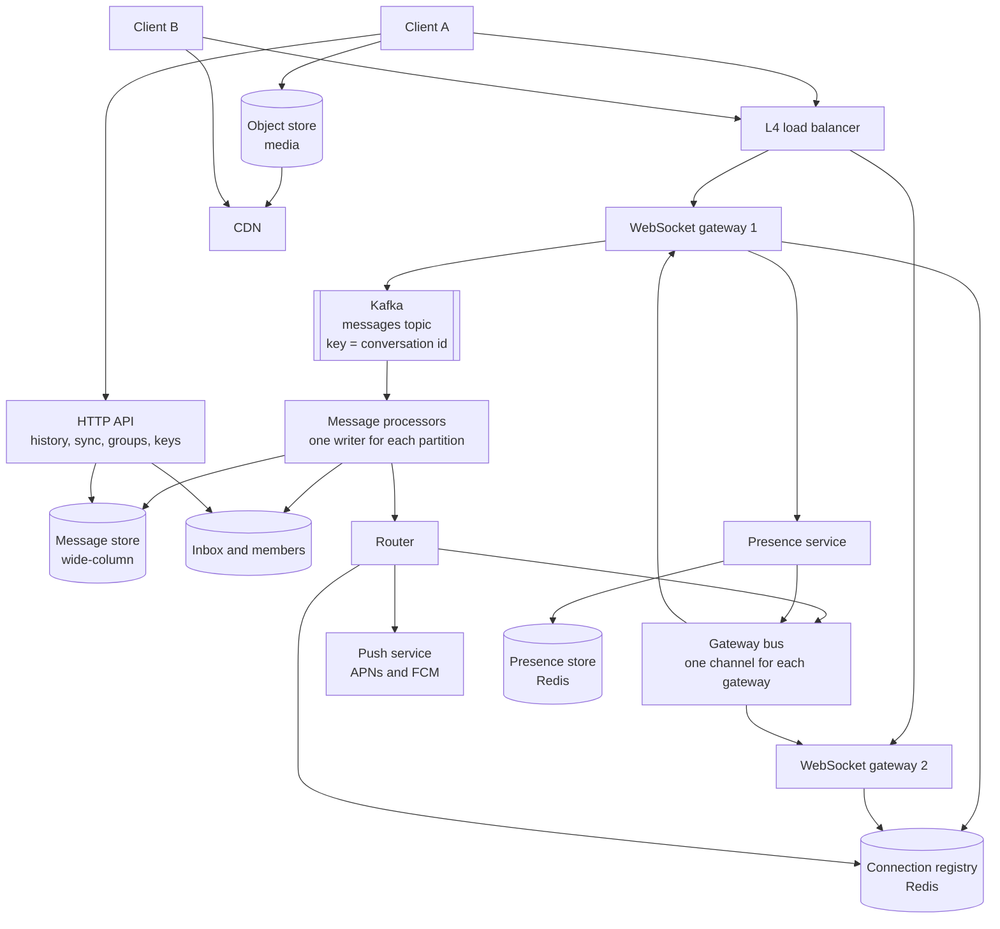
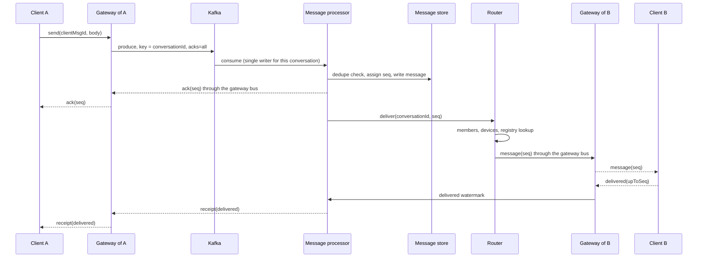
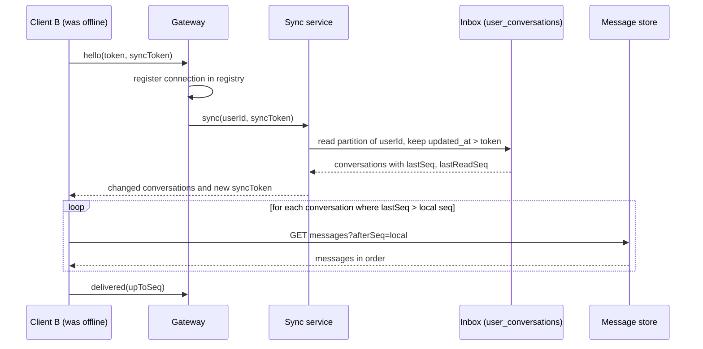

# Design a Chat System

A chat system delivers short messages between users in real time, keeps the history, and shows who is online. This case study gives the design that a strong candidate presents in 45 minutes for an app like WhatsApp, Slack, or Discord: WebSocket gateways, message routing, presence, one-to-one and group delivery, ordering and message IDs, offline delivery, read receipts, wide-column storage, and end-to-end encryption in brief. Follow the steps in [how to approach an HLD interview](../how-to-approach-hld.md). The estimation method is on [back-of-envelope estimation](../back-of-envelope-estimation.md). The real-time transport options are on [communication patterns](../fundamentals/09-communication-patterns.md), and this page applies them.

!!! note "About the sources"
    Four organizations published parts of their chat designs. WhatsApp described the connection count of one Erlang server (the blog post "1 million is so 2011", January 2012), its encryption in the technical white paper "WhatsApp Encryption Overview" (version 9, February 2026, formerly titled "WhatsApp Security Whitepaper"), and its server-side message retention in its privacy policy. Discord described its message storage in two posts, "How Discord Stores Billions of Messages" (2017) and "How Discord Stores Trillions of Messages" (2023), and its Elixir fan-out in "How Discord Scaled Elixir to 5,000,000 Concurrent Users" (2017). Facebook described the HBase store of Facebook Messages (2010). Signal published its protocol specifications (X3DH, Double Ratchet, PQXDH) at signal.org/docs. The text cites these where it states how a real company built a part. All other numbers on this page are assumptions of this KB, labeled as such. No company published a complete design, so the page is a reference design.

## Problem Statement

"Design a chat application. Users send text messages and photos to one other user or to a group. Messages arrive in real time when the recipient is online and arrive later when the recipient is offline. Users see when a message is delivered and read, and see which contacts are online. A user can use several devices. The service keeps the message history."

## Clarifying Questions

| Question | Answer that this design assumes |
|---|---|
| How many users? | 100 million daily active users (DAU). Each user sends 40 messages each day (Assumption) |
| One-to-one, groups, or both? | Both. 90% of the messages go to one recipient, and 10% go to a group. A group has at most 500 members. A group message goes to 20 other members on average (Assumption). Channels with 100,000 or more members (Discord or Slack style) are a follow-up question |
| What does a message contain? | Text up to 4,000 characters. Photos, voice, and files go to an object store, and the message holds a reference (see Deep Dives) |
| Is there end-to-end encryption? | Yes, as an option of the design. The server then stores ciphertext. The design works with and without it, and the section on encryption lists what changes |
| How long does the server keep history? | 5 years (Assumption). Some apps keep a message on the server only until delivery. WhatsApp's privacy policy says that it deletes a message from its servers once the message is delivered, and keeps an undelivered message in encrypted form for up to 30 days. The design works for that model too (see Trade-offs) |
| What ordering does the user expect? | All members see the messages of one conversation in the same order. Order across different conversations does not matter |
| What delivery guarantee? | A message is delivered at least once, and the client shows it once (see Deep Dives). A message that the server acknowledged is not lost |
| Latency target? | p99 below 500 ms from send to the display on an online recipient, inside one region (Assumption) |
| Multiple devices? | Up to 4 devices for each user. Each device receives every message and keeps its own position |
| Presence? | Online or offline, and "last seen". It may be a few seconds late. Typing indicators are best-effort |
| Read receipts? | Yes: sent, delivered, and read. For groups the sender sees the count of members who read the message |
| Multi-region? | Users connect to the nearest region. A conversation has one home region that orders its messages (Assumption) |
| Availability target? | 99.95% for sending and receiving. Presence may degrade first (Assumption) |
| Out of scope? | Voice and video calls, search, message editing details, bots, and moderation tools (the follow-up questions cover some of them) |

## Requirements

### Functional

1. `send`: a user sends a message to a conversation (one-to-one or group). The sender gets an acknowledgement.
2. `receive`: an online recipient gets the message in real time on each of the devices. An offline recipient gets a push notification and gets the message when the device connects.
3. `history`: a user reads the earlier messages of a conversation, page by page.
4. `receipts`: the sender sees `sent`, `delivered`, and `read`.
5. `presence`: a user sees whether a contact is online, and the last seen time.
6. `groups`: a user creates a group, adds and removes members, and leaves.
7. `media`: a user sends a photo or a file. The recipient downloads it.
8. `sync`: a device that was offline or is new catches up with the conversations that changed.

### Non-functional

| Requirement | Target |
|---|---|
| Delivery latency | p99 below 500 ms for an online recipient (Assumption) |
| Availability | 99.95% |
| Durability | A message that the server acknowledged is not lost. Replication factor 3 |
| Ordering | One total order for each conversation, the same on every device |
| Delivery | At least once, with deduplication, so the user sees each message once |
| Scale | 40,000 messages each second on average, 120,000 at the peak. 30 million concurrent connections at the peak (see Estimation) |
| Reconnect | A client that reconnects after a network change is in sync within 2 seconds, with no loss (Assumption) |
| Presence freshness | Within 10 seconds (Assumption) |

## Estimation

Rounding rule (the same as on the estimation page): one day is 10^5 seconds. The exact day has 86,400 seconds, so the rates are 13.6% lower than the exact rates. The error is smaller than the error of the assumptions.

Inputs (all are assumptions): 100 million DAU. 40 messages sent by each DAU each day. 30% of the DAU are connected at the peak. One gateway server holds 100,000 connections (the planning value on the [communication patterns](../fundamentals/09-communication-patterns.md) page: 50,000 to 200,000). 90% of the messages go to one recipient, and 10% go to a group with 20 recipients (other members) on average. The estimate counts one delivery for each recipient user, not for each device. If online users have more than one connected device on average, multiply the deliveries and the push bandwidth by that average. A stored message is 200 bytes (100 bytes of text and 100 bytes of metadata). Retention of 5 years. Replication factor 3. A `send` frame from a client is 300 bytes, and a push of one message to a device is 300 bytes. Each message writes one `messages` row, one `dedupe` row, and one `user_conversations` (inbox) row for the sender and for each recipient. A heartbeat is sent every 30 seconds. Each DAU starts 10 sessions each day. Peak factor 3. A storage node has 8 TB of disk and runs at most 50% full, so that compaction has room (Assumption). A storage node takes 10,000 writes each second (Assumption: measure it). 10% of the messages have an attachment of 200 KB.

| Step | Calculation | Result |
|---|---|---|
| Messages per day | 100 × 10^6 × 40 | 4 × 10^9 |
| Messages per second (average) | 4 × 10^9 / 10^5 | 40,000 |
| Peak messages per second | 40,000 × 3 | 120,000 |
| Concurrent connections at the peak | 100 × 10^6 × 30% | 30 × 10^6 |
| Gateways | 30 × 10^6 / 100,000 | 300 |
| Gateways with 1.5 times headroom for a failure and a deploy | 300 × 1.5 | 450 |
| Heartbeat frames per second | 30 × 10^6 / 30 | 10^6 in total, 2,200 on each gateway |
| Deliveries for each message | 0.9 × 1 + 0.1 × 20 | 2.9 |
| Deliveries per second (average) | 40,000 × 2.9 | 116,000 |
| Peak deliveries per second | 116,000 × 3 | 348,000 |
| Peak push bandwidth | 348,000 × 300 B | 104 MB/s, 0.84 Gbit/s |
| Peak ingress bandwidth | 120,000 × 300 B | 36 MB/s |
| Message storage each day | 4 × 10^9 × 200 B | 800 GB |
| Storage each year | 800 GB × 365 | 292 TB |
| Storage for 5 years | 292 TB × 5 | 1,460 TB |
| Storage with 3 replicas | 1,460 TB × 3 | 4,380 TB |
| Storage nodes | 4,380 TB / (8 TB × 50%) | 1,095 |
| Inbox rows updated for each message (sender and recipients) | 0.9 × 2 + 0.1 × 21 | 3.9 |
| Peak row writes per second (message, dedupe, inbox) | 120,000 × (1 + 1 + 3.9) | 708,000 |
| Peak replica writes per second | 708,000 × 3 | 2,124,000 |
| Storage nodes needed for the writes | 2,124,000 / 10,000 | 213 |
| Session starts per second | 100 × 10^6 × 10 / 10^5 | 10,000 |
| Presence writes per second (connect and disconnect) | 10,000 × 2 | 20,000 |
| New attachments each day | 4 × 10^9 × 10% × 200 KB | 80 TB |

What the numbers decide:

- Connections drive the number of gateways (450), and gateways are the stateful tier. Each connection is long-lived, and the heartbeat load (1 million frames each second in total) is spread over 450 servers.
- The messages are small. 120,000 messages each second at the peak need 36 MB/s into the log and 104 MB/s out to devices. The network is not the problem.
- The inbox, not the message, is most of the write load: each message writes 3.9 inbox rows on average, so the store takes 708,000 row writes each second at the peak, against 120,000 message rows. Batching inbox updates for busy groups (see Deep Dives) is the first lever on the write rate.
- Storage sizes the message store, not the write rate: 1,095 nodes for 5 years against 213 nodes for the writes. The retention period is the first lever on cost, and old messages can move to a cold tier (see Trade-offs).
- Attachments (80 TB each day) are 100 times the message text (800 GB each day). They go to an object store and a CDN, outside the message path.
- Presence is cheap if it is lazy: 20,000 status changes each second. It becomes expensive only if the service sends every change to every contact (see Deep Dives).
- A sender and its recipients are on different gateways, so the routing from one gateway to another is on the hot path of every message.

The program below checks the arithmetic and runs a small model of one conversation: sequence numbers, retries with deduplication, offline sync, read markers, and storage buckets (see Deep Dives). `main` comes first, and the block has its own imports, so you can copy it into `ChatCheck.java` and run `java ChatCheck.java` on JDK 21.

```java
import java.util.ArrayList;
import java.util.HashMap;
import java.util.List;
import java.util.Locale;
import java.util.Map;

public class ChatCheck {
    public static void main(String[] args) {
        estimation();
        conversationDemo();
    }

    // Rounding rule of this KB: one day is 10^5 seconds.
    static void estimation() {
        System.out.println("== Estimation (1 day = 10^5 s) ==");
        double dau = 100e6;
        double messagesPerDay = dau * 40;
        double qps = messagesPerDay / 1e5;
        System.out.println(g("messages per day", messagesPerDay));
        System.out.println(g("messages per second", qps));
        System.out.println(g("peak messages per second", qps * 3));
        double concurrent = dau * 0.30;
        System.out.println(g("peak concurrent connections", concurrent));
        System.out.println(g("gateways at 100,000 each", Math.ceil(concurrent / 100_000)));
        System.out.println(g("gateways with 1.5x headroom", Math.ceil(concurrent / 100_000 * 1.5)));
        System.out.println(g("heartbeat frames per second (30 s)", concurrent / 30));
        double perMessage = 0.9 * 1 + 0.1 * 20;
        System.out.println(g("deliveries per message", perMessage));
        System.out.println(g("deliveries per second", qps * perMessage));
        System.out.println(g("peak deliveries per second", qps * 3 * perMessage));
        System.out.println(g("peak push egress MB/s (300 B)", qps * 3 * perMessage * 300 / 1e6));
        System.out.println(g("peak push egress Gbit/s", qps * 3 * perMessage * 300 * 8 / 1e9));
        System.out.println(g("peak ingress MB/s (300 B)", qps * 3 * 300 / 1e6));
        double bytesPerDay = messagesPerDay * 200;
        System.out.println(g("storage GB per day (200 B)", bytesPerDay / 1e9));
        System.out.println(g("storage TB per year", bytesPerDay * 365 / 1e12));
        System.out.println(g("storage TB in 5 years", bytesPerDay * 365 * 5 / 1e12));
        System.out.println(g("storage TB, 3 replicas", bytesPerDay * 365 * 5 * 3 / 1e12));
        System.out.println(g("nodes at 8 TB, 50% full", bytesPerDay * 365 * 5 * 3 / 4e12));
        double inboxRows = 0.9 * 2 + 0.1 * 21;
        System.out.println(g("inbox rows per message", inboxRows));
        double rowWrites = qps * 3 * (1 + 1 + inboxRows);
        System.out.println(g("peak row writes per second", rowWrites));
        System.out.println(g("peak replica writes per second", rowWrites * 3));
        System.out.println(g("nodes for writes at 10,000/s", Math.ceil(rowWrites * 3 / 10_000)));
        System.out.println(g("session starts per second", dau * 10 / 1e5));
        System.out.println(g("presence writes per second", dau * 10 * 2 / 1e5));
        double attachments = messagesPerDay * 0.1;
        System.out.println(g("attachment TB per day (10% x 200 KB)", attachments * 200e3 / 1e12));
    }

    record Message(String conversation, long seq, String sender, String body) { }

    // One conversation. A single writer (the shard that owns the conversation) assigns seq.
    static class ConversationLog {
        static final long BUCKET_SIZE = 10_000;
        final String id;
        final List<Message> messages = new ArrayList<>();
        final Map<String, Long> seqByClientId = new HashMap<>();
        final Map<String, Long> readUpTo = new HashMap<>();

        ConversationLog(String id) {
            this.id = id;
        }

        // Idempotent: a retry with the same (sender, clientMsgId) returns the stored message.
        Message append(String sender, String clientMsgId, String body) {
            String key = sender + "/" + clientMsgId;
            Long known = seqByClientId.get(key);
            if (known != null) {
                return messages.get((int) (known - 1));
            }
            long seq = messages.size() + 1;
            Message m = new Message(id, seq, sender, body);
            messages.add(m);
            seqByClientId.put(key, seq);
            return m;
        }

        List<Message> after(long lastSeq, int limit) {
            List<Message> out = new ArrayList<>();
            for (long s = lastSeq + 1; s <= messages.size() && out.size() < limit; s++) {
                out.add(messages.get((int) (s - 1)));
            }
            return out;
        }

        // The read marker only moves forward, so a late or duplicated receipt changes nothing.
        void markRead(String user, long seq) {
            readUpTo.merge(user, seq, Math::max);
        }

        static long bucket(long seq) {
            return seq / BUCKET_SIZE;
        }
    }

    static void conversationDemo() {
        System.out.println("== One conversation: ids, retries, offline sync, receipts ==");
        ConversationLog log = new ConversationLog("c-42");
        System.out.println("append ann c1    -> seq " + log.append("ann", "c1", "hi").seq());
        System.out.println("retry  ann c1    -> seq " + log.append("ann", "c1", "hi").seq());
        System.out.println("append bob c1    -> seq " + log.append("bob", "c1", "hello").seq());
        System.out.println("append ann c2    -> seq " + log.append("ann", "c2", "lunch?").seq());
        System.out.println("append bob c2    -> seq " + log.append("bob", "c2", "yes").seq());
        System.out.println("log size         -> " + log.messages.size());

        long carolLastSeq = 1;
        System.out.println("carol was offline after seq " + carolLastSeq + ", syncs:");
        for (Message m : log.after(carolLastSeq, 100)) {
            System.out.println("  seq " + m.seq() + " " + m.sender() + ": " + m.body());
        }

        log.markRead("bob", 3);
        log.markRead("bob", 2);
        log.markRead("carol", 4);
        System.out.println("bob read up to   -> " + log.readUpTo.get("bob"));
        System.out.println("carol read up to -> " + log.readUpTo.get("carol"));
        long minRead = Math.min(log.readUpTo.get("bob"), log.readUpTo.get("carol"));
        System.out.println("read by bob and carol up to -> " + minRead);

        long[] seqs = {1, 9_999, 10_000, 25_000};
        for (long s : seqs) {
            System.out.println("seq " + s + " is in bucket " + ConversationLog.bucket(s));
        }
    }

    static String g(String label, double value) {
        return String.format(Locale.ROOT, "%-42s %,.1f", label, value);
    }
}
```

<!-- expected-output -->
```text
== Estimation (1 day = 10^5 s) ==
messages per day                           4,000,000,000.0
messages per second                        40,000.0
peak messages per second                   120,000.0
peak concurrent connections                30,000,000.0
gateways at 100,000 each                   300.0
gateways with 1.5x headroom                450.0
heartbeat frames per second (30 s)         1,000,000.0
deliveries per message                     2.9
deliveries per second                      116,000.0
peak deliveries per second                 348,000.0
peak push egress MB/s (300 B)              104.4
peak push egress Gbit/s                    0.8
peak ingress MB/s (300 B)                  36.0
storage GB per day (200 B)                 800.0
storage TB per year                        292.0
storage TB in 5 years                      1,460.0
storage TB, 3 replicas                     4,380.0
nodes at 8 TB, 50% full                    1,095.0
inbox rows per message                     3.9
peak row writes per second                 708,000.0
peak replica writes per second             2,124,000.0
nodes for writes at 10,000/s               213.0
session starts per second                  10,000.0
presence writes per second                 20,000.0
attachment TB per day (10% x 200 KB)       80.0
== One conversation: ids, retries, offline sync, receipts ==
append ann c1    -> seq 1
retry  ann c1    -> seq 1
append bob c1    -> seq 2
append ann c2    -> seq 3
append bob c2    -> seq 4
log size         -> 4
carol was offline after seq 1, syncs:
  seq 2 bob: hello
  seq 3 ann: lunch?
  seq 4 bob: yes
bob read up to   -> 3
carol read up to -> 4
read by bob and carol up to -> 3
seq 1 is in bucket 0
seq 9999 is in bucket 0
seq 10000 is in bucket 1
seq 25000 is in bucket 2
```

How to read the conversation output. Ann sends `c1`, and the log assigns sequence 1. Ann retries `c1` after a timeout, and the log returns sequence 1 again, so the log holds one message. Bob's `c1` is a different message, because the deduplication key is the pair (sender, client message ID). Carol was offline after sequence 1. Her sync returns sequences 2 to 4, in order. Bob reads up to 3, and the late receipt for 2 changes nothing, because the read marker moves only forward. The minimum of the markers of the other members (3) is the point up to which all of them read. Sequence 9,999 is in bucket 0, and sequence 10,000 starts bucket 1, which is the partition key of the message store.

## API Design

The client keeps one WebSocket connection to a gateway for everything that is real time. HTTP endpoints serve the operations that do not need a connection: history, group management, media upload URLs, and key upload. Protocol details of WebSocket (frames, handshake, close codes) are in `kb/networking/08-websockets-and-realtime.md`.

### WebSocket protocol

The client connects to `wss://chat.example.com/v1/ws` with a short-lived token (in the first message after the upgrade, because the browser `WebSocket` API cannot set headers, see [communication patterns](../fundamentals/09-communication-patterns.md)). Each frame is a JSON object with a `type` and, for requests, a `ref` that the client chooses.

Client to server:

```json
{ "type": "hello", "ref": "r1", "token": "eyJ...", "deviceId": "d_91",
  "syncToken": "1760522400123" }
```

```json
{ "type": "send", "ref": "r2", "conversationId": "c_42",
  "clientMsgId": "018f3b8e-5c1a-7d2e-9b4a-3c6d8e0f1a2b",
  "body": "lunch?", "contentType": "text" }
```

```json
{ "type": "delivered", "conversationId": "c_42", "upToSeq": 1207 }
```

```json
{ "type": "read", "conversationId": "c_42", "upToSeq": 1207 }
```

```json
{ "type": "typing", "conversationId": "c_42" }
```

```json
{ "type": "watch", "userIds": ["u_7", "u_9"] }
```

Server to client:

```json
{ "type": "ack", "ref": "r2", "conversationId": "c_42", "seq": 1207,
  "serverTime": "2026-10-15T10:00:00.412Z" }
```

```json
{ "type": "message", "conversationId": "c_42", "seq": 1207, "senderId": "u_7",
  "body": "lunch?", "contentType": "text", "serverTime": "2026-10-15T10:00:00.412Z" }
```

```json
{ "type": "receipt", "conversationId": "c_42", "userId": "u_9",
  "delivered": 1207, "read": 1205 }
```

```json
{ "type": "presence", "userId": "u_9", "state": "online", "lastSeen": null }
```

Rules of the protocol:

- `clientMsgId` is a UUID that the client creates (version 7 sorts by time, see [unique ID generation](../fundamentals/15-unique-id-generation.md)). The client keeps it until it receives the `ack`, and resends the same `send` frame after a timeout or a reconnect. The server deduplicates by (sender, `clientMsgId`).
- `seq` is the position of the message in the conversation, assigned by the server. The pair (`conversationId`, `seq`) is the public ID of a message.
- `delivered` and `read` carry a watermark (`upToSeq`), not one frame for each message. A watermark is idempotent and cheap (see Deep Dives).
- The server sends a WebSocket ping every 30 seconds. A connection that does not answer two pings is closed (Assumption).
- On reconnect the client sends `hello` with its `syncToken`, and the server answers with the conversations that changed (see Deep Dives).

### HTTP endpoints

| Method and path | Purpose | Notes |
|---|---|---|
| `GET /v1/conversations/{id}/messages?beforeSeq=1200&limit=50` | History. Returns messages with `seq` below `beforeSeq`, newest first | Keyset pagination on `seq`. `limit` has a maximum of 100 |
| `GET /v1/conversations/{id}/messages?afterSeq=1180&limit=100` | Catch-up after a gap | Oldest first |
| `GET /v1/sync?token=1760522400123` | The conversations that changed after the token, with `lastSeq`, `lastReadSeq`, and a preview | Used on connect (also available over HTTP) |
| `POST /v1/conversations` | Create a group. Body: `name`, `memberIds` | Response `201` with `conversationId`. `422` above 500 members |
| `PUT /v1/conversations/{id}/members/{userId}` and `DELETE` | Add or remove a member | Idempotent. `403` for a non-admin |
| `POST /v1/media/upload-url` | Returns a pre-signed URL and a media ID | The client uploads the bytes to the object store (see Deep Dives) |
| `PUT /v1/devices/{deviceId}/push-token` | Registers an APNs or FCM token | Used for the push of offline messages |
| `PUT /v1/keys` and `GET /v1/keys/{userId}` | Upload and fetch encryption key bundles | Only with end-to-end encryption |

All calls need a bearer token. Errors: `401` (token expired), `403` (not a member of the conversation), `404`, `429` (rate limited, with `Retry-After`, see [rate limiting algorithms](../fundamentals/13-rate-limiting-algorithms.md)).

## Data Model

### Tables

**`messages`** (the message store): one row for each message.

| Column | Type | Notes |
|---|---|---|
| `conversation_id` | string | **Partition key, part 1** |
| `bucket` | integer | **Partition key, part 2.** `bucket = seq / 10,000`. Bounds the size of one partition |
| `seq` | 64-bit integer | **Clustering key, descending.** Newest first |
| `sender_id` | string | |
| `client_msg_id` | UUID | For deduplication |
| `content_type` | enum | `text`, `image`, `file`, `system` |
| `body` | blob | Text, or ciphertext with end-to-end encryption |
| `media_ref` | string or null | Object store key and size |
| `server_time` | timestamp | Time of the sequencer. Display only |
| `status` | enum | `active`, `deleted` |

**`dedupe`**: partition key (`conversation_id`, `sender_id`), clustering key `client_msg_id`, value `seq`, with a time-to-live of 7 days (Assumption: no client retries a message after a week). The sequencer checks it before it assigns a new `seq`, and writes it before the message row (see Deep Dives).

**`partition_owner`**: partition key `partition_id` (the Kafka partition), column `generation`. The processor that takes a partition writes its consumer group generation here with a lightweight transaction, and a processor that finds a newer generation stops writing (see Deep Dives).

**`conversations`**: `conversation_id`, `type` (`direct`, `group`), `name`, `created_at`, `last_seq` (the highest assigned sequence, which the sequencer writes in batches about once a second), `home_region`.

**`conversation_members`**: partition key `conversation_id`, clustering key `user_id`. Columns: `role`, `joined_seq`, `last_delivered_seq`, `last_read_seq`. A group has at most 500 rows in its partition.

**`user_conversations`** (the inbox): partition key `user_id`, clustering key `conversation_id`. Columns: `last_seq` (the newest message), `last_read_seq`, `updated_at`, `muted`, `preview`. A user has at most 5,000 conversations (Assumption), so a partition has at most 5,000 small rows (about 1 MB).

**`devices`**: partition key `user_id`, clustering key `device_id`. Columns: `push_token`, `platform`, `last_seen`, and with encryption the public identity key.

**Routing and presence (Redis):** `conn:{userId}` is a hash from `deviceId` to `gatewayId`, the gateway's `incarnation`, and `connEpoch`. `gateway:{gatewayId}` is a lease key with a TTL of 15 seconds, and its value is the `incarnation` (a random ID that the gateway process creates when it starts). `presence:{userId}` holds the state (`online` or `offline`), the time of the last change (`since`), and `lastSeen`. Heartbeats do not update it (see Deep Dives). All three are small (about 3 GB for 30 million connections at 100 bytes each) and rebuilt from the gateways if lost.

**Media:** an object store (see [storage types](../fundamentals/10-storage-types.md)). The message holds `media_ref` only.

### Database choice

Recommendation: a partitioned wide-column store (Apache Cassandra, ScyllaDB, or HBase) for messages. The reasons:

- The workload is append-heavy: 120,000 writes each second at the peak, and the rows do not change after the write (only `status` changes on a delete).
- Every read is a range of one partition: "the newest 50 messages of this conversation". There are no joins and no multi-row transactions.
- The store replicates across zones with no code in the application, and it scales by adding nodes (see [partitioning and sharding](../fundamentals/06-partitioning-and-sharding.md) and [replication](../fundamentals/05-replication.md)).
- The data is too big for one relational primary (4,380 TB with replicas).

Real systems point the same way. Discord stored its messages in Cassandra with the primary key ((`channel_id`, `bucket`), `message_id`): the partition key is the pair (`channel_id`, `bucket`), where the bucket is a static window of about 10 days, and the message ID is the clustering key. Every Discord ID is a Snowflake, so message IDs sort by time. Discord chose the bucket size from its largest channels, so that a partition stays under 100 MB (Vishnevskiy, "How Discord Stores Billions of Messages", 13 January 2017). Discord later moved the messages to ScyllaDB in May 2022, and put data services written in Rust between its API and the database. A data service coalesces concurrent requests for the same row into one database query, and requests for one channel reach the same service instance through consistent hashing on the channel ID. The reasons that Discord gave: concurrent reads of busy channels made hot partitions, Cassandra garbage collection pauses caused latency spikes, and compactions fell behind. The p99 latency of fetching historical messages fell from 40 to 125 ms on Cassandra to 15 ms on ScyllaDB (Ingram, "How Discord Stores Trillions of Messages", 6 March 2023). Facebook Messages ran on HBase. Facebook chose HBase over Cassandra in part because it found Cassandra's eventual consistency model "difficult" to reconcile with the Messages design (Muthukkaruppan, "The Underlying Technology of Messages", 2010). WhatsApp uses a different model: its privacy policy says that messages are stored on the devices, that the servers delete a message once it is delivered, and that an undelivered message stays on the servers in encrypted form for up to 30 days.

The metadata of users and groups (`conversations`, `conversation_members`, `user_conversations`) can live in the same store, or in a sharded relational database if the team prefers SQL for membership changes. The choice rule is in [choosing a database](../fundamentals/04-choosing-a-database.md). Redis serves routing and presence, because both need sub-millisecond reads and tolerate loss.

## High-Level Design



### Components

- **L4 load balancer.** Spreads new TCP connections over the gateways. A WebSocket connection stays on one gateway until it closes (see [load balancing, DNS, and CDN](../fundamentals/02-load-balancing-dns-cdn.md)).
- **WebSocket gateway.** A stateful tier. Each gateway holds up to 100,000 connections, authenticates the token, answers pings, and parses frames. It holds no business logic: it forwards `send`, `delivered`, `read`, and `watch` frames inward, and writes frames from the gateway bus to the right connection. It registers each connection in the registry. It scales by connection count.
- **Connection registry.** Maps `userId` to the devices and their gateway (Redis). An entry is valid only while the lease of its gateway is alive (see Deep Dives).
- **Kafka `messages` topic.** The ingress log. The key is `conversation_id`, so all messages of a conversation go to one partition, in order. It has 1,024 partitions (Assumption) (see [message queues and streams](../fundamentals/08-message-queues-and-streams.md)). The log makes the accepted message durable before any other step.
- **Message processor.** A consumer. The consumer group gives each partition to one processor, so each conversation has one writer at a time. For each message, the processor deduplicates, assigns the next `seq`, writes the message to the store, updates the inbox rows, sends the `ack` to the sender, and calls the router.
- **Router.** Finds the members of the conversation, looks up each member's devices in the registry, and sends one internal message for each gateway that holds at least one target connection. For members with no live device, it calls the push service.
- **Gateway bus.** An internal pub-sub with one channel for each gateway (Redis Pub/Sub, NATS, or direct gRPC streams). A gateway subscribes to its own channel only, so the number of subscriptions equals the number of gateways (450), not the number of users. The pattern is described on the [communication patterns](../fundamentals/09-communication-patterns.md) page.
- **Message store and inbox.** The wide-column tables above.
- **Presence service.** Tracks online state with heartbeats and sends state changes to the users who watch that user (see Deep Dives).
- **Push service.** Sends a notification through APNs (Apple) or FCM (Google) to a device that has no live connection. The notification design (templates, retries, provider limits) is in [04-notification-system](04-notification-system.md).
- **HTTP API.** History pages, sync, group changes, key bundles, and upload URLs. Stateless.
- **Media path.** The client uploads to the object store with a pre-signed URL, and the recipient downloads through a CDN.

### The send flow



If B is offline, the router finds no live connection for B and calls the push service. The message is already in the store, so nothing waits in a queue. B syncs after it connects.



## Deep Dives

### Gateways, Routing, and Presence

**Why WebSocket.** The chat client sends frequent messages and receives pushes on the same channel, which is the case that the [communication patterns](../fundamentals/09-communication-patterns.md) page assigns to WebSocket. Short polling at 30 million clients every 10 seconds costs 3 million requests each second. Long polling works through old proxies and is the fallback. SSE carries data only to the client. A mobile client also uses the platform push channel (APNs, FCM) when the app is closed, because the operating system does not keep a socket open for a background app.

**Gateway sizing.** A gateway is limited by memory and file descriptors, not by CPU. The planning value is 100,000 connections for each server (see the estimate). WhatsApp reported more than 2 million TCP connections on one server in January 2012 (FreeBSD 8.2, Erlang, 24 logical CPUs, about 96 GiB of memory), which shows that the limit is software and tuning, not the protocol (WhatsApp blog, "1 million is so 2011"). That figure is a tuned record, not a planning value. The gateway has no business logic and no database access, so it restarts fast and has little state to lose. Erlang and Elixir (which runs on the Erlang virtual machine) suit this tier because each connection or session is a lightweight process. WhatsApp ran its servers on Erlang, and Discord runs each user session and each guild (a Discord server) as an Elixir process, with up to 500,000 live sessions on one Erlang virtual machine (Vishnevskiy, "How Discord Scaled Elixir to 5,000,000 Concurrent Users", 6 July 2017).

**Reconnect storms.** If one gateway restarts, its 100,000 clients reconnect. Each client waits a random delay (exponential backoff with jitter, see [reliability patterns](../fundamentals/12-reliability-patterns.md)), so the arrivals spread over about 30 seconds (3,300 connections each second). A deploy restarts gateways in small batches and drains each one first: the gateway sends a `reconnect` frame with a random delay to each client, and closes the connections gradually.

**The connection registry.** The router needs "which gateway holds the connections of user U". The design uses a Redis hash for each user, `conn:{userId}`, with one field for each device. The hash holds `gatewayId` and `connEpoch` (a counter that increases on each connect). A TTL on each user key would force each gateway to refresh 30 million keys. This design uses a lease on the gateway instead:

- Each gateway renews its own key `gateway:{gatewayId}` every 5 seconds, with a TTL of 15 seconds. That is 450 keys. The value of the key is the gateway's `incarnation`, a random ID that the gateway process creates when it starts.
- The router treats a registry entry as valid only if the lease of its gateway exists and holds the same `incarnation` as the entry. When a gateway crashes, the lease expires, and all its entries become invalid at once, with no per-user cleanup. If the gateway restarts with the same `gatewayId` before the router sees the expiry, the new process writes a new `incarnation`, so the entries of the old process stay invalid. Without the incarnation check, the old entries would become valid again and point to connections that no longer exist.
- On a new connection, the gateway writes the entry (with a higher `connEpoch`), so a stale entry on another gateway does not win. On a clean disconnect, the gateway deletes its entry only if the `connEpoch` still matches. The compare and the delete must be one atomic step, so the gateway runs them in a Lua script on the Redis server (the same rule as the safe release of a lock on [distributed locks and leases](../distributed-systems/05-distributed-locks-and-leases.md)).
- The cost is 10,000 registry writes for connects and 10,000 for disconnects each second, which a small Redis cluster handles.

This is a lease with a fencing counter (see [distributed locks and leases](../distributed-systems/05-distributed-locks-and-leases.md)). The [communication patterns](../fundamentals/09-communication-patterns.md) page describes the simpler variant, a TTL on each registry entry that the gateway refreshes. It works, and at 30 million entries it costs 30 million refreshes in each TTL period, which is the reason for the gateway lease here. The registry is soft state: if it is lost, the gateways write their connections again, and until then the router falls back to push notifications and sync, so no message is lost.

**Presence.** The presence service tracks whether a user is online.

1. The gateway sends a WebSocket ping every 30 seconds, and the client answers with a pong (see the protocol rules above). The gateway reports the connection state to the presence service only when it changes (connect, disconnect), not for each heartbeat. A heartbeat is local to the gateway. If a gateway crashes, it reports nothing, so the presence service also watches the gateway leases: when a lease expires, the service marks the users of that gateway offline, after the same grace period, unless they reconnected to another gateway.
2. On a disconnect, the presence service waits a grace period of 10 seconds (Assumption) before it marks the user offline, because mobile clients lose and regain connections often (a tunnel, a switch from Wi-Fi to cellular). A reconnect within the grace period cancels the offline event, so contacts do not see the status flap.
3. The service stores `presence:{userId}` as (`state`, `since`) in Redis. When the user goes offline, it writes `lastSeen`.
4. **Who gets the changes.** Sending every change to every contact is the expensive design. With 20,000 status changes each second and 100 contacts for each user, the fan-out is 2 million events each second, or 600,000 if only the 30% of contacts who are online receive them. Most of those events reach users who do not look at the status. The design uses **subscribe on view**: the client sends `watch` with the user IDs that it displays (the open chat, the visible part of the contact list, at most 100), and the presence service keeps a set of watchers for each user. A change goes to the watchers only. With an average of 10 watchers (Assumption), the fan-out is 200,000 events each second. When the screen changes, the client sends a new `watch` list, and receives the current states in the reply.
5. For a group, the app shows the number of online members only on request. It does not push the state of all 500 members.
6. **Typing indicators.** The client sends `typing` at most once every 3 seconds (Assumption) while the user types. The server forwards it to the other online members of that conversation through the gateway bus. It stores nothing, and it drops the event if the recipient is offline. The indicator expires on the receiver after 5 seconds.

Discord described the fan-out problem for large groups. Its guild process sends each event, including each presence change, to every connected session process. One send cost 30 to 70 µs, so one event of a guild with 30,000 online users took 900 ms to 2.1 s to publish. Discord built a library, Manifold, that groups the recipient processes by remote node and makes one send for each node, where a partitioner process on that node delivers to the local sessions (Vishnevskiy, "How Discord Scaled Elixir to 5,000,000 Concurrent Users", 2017). The router of this page groups by gateway for the same reason, and presence sends to watchers only to cut the number of events.

The presence data is approximate, so the design accepts that a status can be up to 10 seconds late (the grace period) and that presence is the first feature to drop under load (see Bottlenecks and Scaling).

### Message Flow: IDs, Ordering, Delivery, and Offline Sync

**The ID problem.** The system needs three things: a unique ID, one order for each conversation that every member sees, and a way to deduplicate retries. The design uses three fields:

- `clientMsgId`: a UUID from the client. It identifies the send attempt, and the server uses it to deduplicate. It does not give the order.
- `seq`: a number from the server, assigned in the order that the sequencer accepts the messages of one conversation (1, 2, 3, ...). It gives the order. It has no gaps, so a client detects a missing message by a jump in `seq`.
- (`conversationId`, `seq`) is the public ID. It is unique, and it needs no global coordination because the sequencer is the only writer for the conversation.

**The sequencer is the single writer.** The `messages` topic has the key `conversation_id`, so all messages of a conversation are in one Kafka partition, in arrival order, and the consumer group gives the partition to one processor. That processor assigns `seq` by incrementing a counter that it holds in memory. The sequencer writes `conversations.last_seq` in batches, about once a second for each active conversation (Assumption), so the estimate does not count it as a write for each message. When a processor takes a partition, it loads the counter of each conversation lazily, on the first message of that conversation after the takeover. It sets the counter to the highest `seq` in the message store (it reads the bucket of `conversations.last_seq` and the next bucket), not to `last_seq` alone, because the previous processor may have written a message and then crashed before it updated `last_seq`. The order of arrival at the partition decides the order of the conversation. The sender's clock does not matter, so clock skew between phones cannot reorder a conversation (see [failures and time](../distributed-systems/01-failures-and-time.md)).

A rebalance can give the partition to a new processor while the old one still has a write in flight, so for a short time two processors can write the same conversation. Two rules keep the second writer harmless:

1. **Write the `dedupe` row before the `messages` row.** For each message, the processor checks `dedupe`. On a miss, it assigns the next `seq`, writes the `dedupe` row, and then writes the message row. On a hit, it takes the stored `seq`, writes the message row again (an upsert with the same key and the same content, so it changes nothing), and raises its counter to at least that `seq`. A crash between the two writes therefore cannot lose the message: the replay from Kafka finds the `dedupe` row and writes the message row.
2. **Assign `seq` in log order.** Both processors read the same partition in the same order, and both start from the highest `seq` in the store. Each assigns the same `seq` to the same message, so their writes are the same upserts.

The two rules make a second writer harmless only while both processors see the same log and the same store. A `dedupe` write that failed and was retried, or a counter that a processor loaded from a replica that missed a write (a read below quorum), breaks that condition, and then two different messages can get the same `seq`. The full protection is a fencing token: the processor sends the generation of the consumer group (Kafka exposes it as `ConsumerGroupMetadata.generationId()`) with each write, and the resource rejects a write with an older token. A fencing token works only if the resource checks it (see [distributed locks and leases](../distributed-systems/05-distributed-locks-and-leases.md)). A Cassandra-type store checks a condition only in a lightweight transaction (LWT), a Paxos round between the replicas. An LWT costs several round trips, the same cost as a conditional insert (`IF NOT EXISTS`) for each message, so a fence on every message write is expensive. Recommendation: use the two rules above for every message, and run one LWT at takeover on an ownership row for each Kafka partition, for example `UPDATE partition_owner SET generation = ? WHERE partition_id = ? IF generation < ?`. The old processor reads that row before each batch of writes and stops when it sees a newer generation. This check shortens the time in which two writers overlap, but it is not a fence: the old processor can pause after the check and write after the takeover (the failure on [distributed locks and leases](../distributed-systems/05-distributed-locks-and-leases.md)). The two rules cover that remaining window. The only full fence is a check by the store on every write: an LWT on every message write in Cassandra, or a store with conditional writes at normal cost (for example DynamoDB conditional writes). The trade-off is the cost of that check on every write against the small remaining window. The takeover reads (the highest `seq` and the ownership row) use `LOCAL_QUORUM`, so that a stale replica cannot give the new processor an old counter.

Throughput of the sequencer is not a problem: the peak is 120,000 messages each second over 1,024 partitions, about 120 each second for one partition, and one conversation produces far less.

**Why not a timestamp or a Snowflake ID for ordering.** Discord uses Snowflake IDs, which sort by time, as message IDs and as the clustering key of its message table (Discord blog, 2017). A server-generated Snowflake is a good choice when the system has no single writer for a channel, because Snowflake needs no coordination (see [unique ID generation](../fundamentals/15-unique-id-generation.md)). Two messages in the same millisecond on different servers get an order that depends on the worker ID and the sequence bits, and clock skew between servers can place a later message before an earlier one. A per-conversation `seq` has none of these problems and gives gap detection, at the cost of one writer for each conversation. Recommendation: a per-conversation `seq` when the design has a partitioned log as the entry point, as here. If the interviewer asks for a design with no sequencer, use Snowflake IDs and state the ordering limits. Client timestamps are not safe for ordering, because a client clock can be wrong.

**Delivery guarantee: at least once on the wire, once on the screen.** Each hop can fail, so each hop retries, and the receiver deduplicates:

1. Client to server. The client keeps the message in a local outbox until it receives `ack(seq)`. After a timeout of 5 seconds (Assumption), or after a reconnect, it resends the same frame with the same `clientMsgId`. The sequencer finds the `clientMsgId` in `dedupe` and returns the stored `seq` and does not create a second message. The Java model above shows this: the retry of `c1` returns sequence 1.
2. Server to device. The router pushes the message to the connected devices. A push through the gateway bus is at-most-once (the Redis documentation says that Pub/Sub has at-most-once delivery), so the design does not depend on it. The device acknowledges with a watermark (`delivered upToSeq`), and the client detects a gap when it sees `seq = n` and has `n - 2` as its highest `seq`. It then fetches the missing range through the HTTP API. The log is the source of truth, and the push is a fast path.
3. Display. The client keeps its highest `seq` for each conversation, and drops a message with a `seq` that it already has.

The result is exactly-once effect through at-least-once delivery and idempotent processing. The reasoning of exactly-once claims is in [distributed transactions](../distributed-systems/03-distributed-transactions.md) and [message queues and streams](../fundamentals/08-message-queues-and-streams.md).

**Offline delivery and sync.**

- The router finds no live device for a user, so it calls the push service to send a notification (APNs or FCM). With end-to-end encryption, the server cannot read the text, so the push carries a generic payload or a small encrypted payload that the app decrypts (see below). The push is a hint. The platforms can delay or drop pushes, so the correct state comes from sync.
- When the device connects, it sends `hello` with its `syncToken` (the highest `updated_at` that it saw). The sync service reads the user's partition in `user_conversations` (up to 5,000 rows, about 1 MB), keeps the rows with `updated_at` above the token, and returns them with `lastSeq`. The device compares `lastSeq` to its own highest `seq` for each conversation, and fetches `afterSeq` ranges in pages of 100. A user who was away for a week reads only the conversations that changed.
- The cost of sync depends on the number of changed conversations, not on the total number of messages, and the device pulls at its own pace (backpressure).
- A new device has no local state, so it syncs from the inbox, loads the newest page of each recent conversation, and loads older pages on demand. With end-to-end encryption, a new device cannot read the history that was encrypted for the old devices, and the product must transfer it from a device or a backup (see below).

**Groups.** A group message is written once, in the conversation log, whatever the group size. This is the main difference from a design with an inbox for each recipient. The router sends the message to the gateways that hold member connections: it groups the targets by gateway, and sends one internal message for each gateway with the list of connection IDs, so a group of 20 members on 8 gateways costs 8 internal messages and not 20. The inbox update (`last_seq`, `updated_at` in `user_conversations`) is one write for each member, which is 500 writes at most. A group above 500 members does not update inboxes for each message (see the follow-up question on large channels).

**Receipts.**

- *Sent*: the sender received `ack(seq)`. The server accepted the message and stored it.
- *Delivered*: a device of the recipient received the message. The device sends `delivered upToSeq`, and the processor stores it as `last_delivered_seq`.
- *Read*: the user saw the message. The client sends `read upToSeq` when the conversation is visible and in the foreground.

Both receipts are **watermarks**: a single number for each member and conversation, and not a record for each message. A watermark moves only forward (the Java model keeps `max`), so a duplicate, a late, or a reordered receipt does no harm, and a receipt for sequence 1,207 also covers 1 to 1,206. In a one-to-one conversation, the sender shows "read" for every message with `seq` up to the recipient's `last_read_seq`. In a group, the sender shows "read by n", where n is the number of members whose `last_read_seq` is at least the message `seq`, computed on demand from `conversation_members`. The client coalesces receipts (at most one every 2 seconds for each conversation, Assumption), so a busy group does not produce a storm of receipt frames. For a group of 500 members, a message could cause 500 read receipts, and so the design drops per-member receipts above 50 members and shows an aggregate or nothing.

**Multiple devices.** Each device has its own connection, registry entry, and `last_seq` cursor. The router delivers to all devices of every member, and also to the other devices of the sender, so a message sent from the phone appears on the laptop. A receipt is for the user: the `delivered` watermark of a user is the maximum over its devices (or the minimum, if the product wants "delivered to all devices"; the product decides).

### Message Storage

**The access patterns.** (1) Append a message. (2) Read the newest 50 messages of a conversation. (3) Read an older page, or a range after a `seq`. (4) Read one message by (`conversation`, `seq`) for a reply or an edit. All four use the conversation and the `seq`, so the partition key is the conversation (see the data model).

**Why a bucket in the partition key.** One conversation can grow without bound, and a partition that grows without bound causes slow reads, large compactions, and uneven nodes. The partition key (`conversation_id`, `bucket`) with `bucket = seq / 10,000` bounds a partition: 10,000 messages × 200 bytes = 2 MB. The DataStax data modeling guide recommends partitions "ideally under 100 MB" and recommends bucketing to prevent unbounded growth, and Discord sized its buckets to stay under 100 MB. A bucket of 2 MB is far below that limit. A larger bucket means fewer bucket switches when a user scrolls back through history, so the bucket size is a tuning choice (Assumption: for example 100,000 messages, which is 20 MB). Reading the newest page reads the highest bucket (the sequencer knows `last_seq`, so the reader computes the bucket with no lookup), and an older page reads the previous bucket when it needs more rows. Discord chose a time window of about 10 days for its bucket (2017 post), and computes the bucket from the message ID or a timestamp, which suits a store keyed by time-ordered IDs. A time bucket has a cost: a quiet channel may need many bucket queries to find 50 messages. Discord's post describes querying the buckets one after the other until the service has collected enough messages. A `seq` window suits this design, because `seq` is dense: every bucket except the last has the same number of messages, so partitions have the same size.

**Hot partitions.** A hot partition is one that gets much more traffic than the others, for example a large active group where thousands of members read the newest bucket at once. Fixes: a cache in front of the newest bucket of busy conversations (the newest 100 messages in Redis, written by the processor, with the store as the fallback), coalescing of identical concurrent reads (Discord's Rust data services do this, and route all requests for one channel to one service instance, per its 2023 post), and replicas that serve reads. The write path for one conversation has one writer, so it has no write conflict.

**The write path.** The processor writes a message with consistency level `LOCAL_QUORUM` (2 of 3 replicas in the home region) so that an acknowledged message survives the loss of one replica (see [replication](../fundamentals/05-replication.md) and [consistency and CAP](../fundamentals/07-consistency-and-cap.md)). Reads of the newest page use `LOCAL_QUORUM` too, so a user who sent a message and then reloads the history sees it (read-your-writes through the quorum rule R + W > N).

**Deletes.** A **tombstone** is the marker that Cassandra writes for a delete. It stays until compaction removes it after the grace period (`gc_grace_seconds`, 10 days by default), and a read must scan past every tombstone in its range. Many tombstones in one partition slow reads. Discord reported this in its 2017 post: a channel in which a user had deleted millions of messages through the API, leaving one message, took 20 seconds to load, because Cassandra had to scan millions of tombstones. The same post notes that writing `null` to a column also creates a tombstone, the same as a delete. The design therefore deletes by overwriting the row with `status = deleted` and an empty (zero-length) body. It never writes `null`, and it avoids deletes of single rows and of row ranges inside a live bucket. When the cold-tier job has copied an old bucket, it deletes the whole partition with one partition-level delete, which writes one tombstone for the partition and not one for each message.

**Cold tier.** After 90 days (Assumption), the compaction job moves a bucket to cheaper storage (an object store in a columnar format), and the HTTP API reads old pages from there with higher latency. The estimate shows that storage drives the cost, so tiering is the main cost lever. A product that deletes after delivery (the WhatsApp model) has a much smaller server store.

### End-to-End Encryption in Brief

**End-to-end encryption (E2EE)** means that only the sender's and the recipients' devices hold the keys. The server routes and stores ciphertext and cannot read it. Signal designed the Signal Protocol for it, and WhatsApp's encryption is based on the Signal Protocol ("WhatsApp Encryption Overview" white paper). This section gives the shape of the protocol and what it changes in the design. The protocol is not the main topic of an HLD interview, so state it in a few sentences.

**Key agreement (X3DH).** Each device generates a long-term identity key pair, a signed prekey, and a batch of one-time prekeys, and uploads the public keys to the server. The server stores them in a key directory. To start a conversation, Alice fetches Bob's **prekey bundle** (identity key, signed prekey, the signature of the signed prekey, and one one-time prekey if one is left) from the server. She verifies the signature and computes a shared secret with three Diffie-Hellman operations, or four if the bundle has a one-time prekey, even if Bob is offline. The server hands out each one-time prekey once and then deletes it. This is the Extended Triple Diffie-Hellman (X3DH) specification by Marlinspike and Perrin (signal.org/docs/specifications/x3dh). Signal has since published PQXDH (Kret and Schmidt), an extension of X3DH in which Bob also publishes signed prekeys for a post-quantum key encapsulation mechanism (the specification names CRYSTALS-Kyber), and the shared secret mixes the Diffie-Hellman outputs with the encapsulated secret (signal.org/docs/specifications/pqxdh). Read the current specifications, because the protocol evolves.

**Message keys (Double Ratchet).** After the first message, both sides run the Double Ratchet algorithm (Perrin, Marlinspike, and Schmidt, signal.org/docs/specifications/doubleratchet). It derives a new key for each message, so that earlier keys cannot be computed from later ones. A key that leaked reveals neither the earlier messages (the specification calls this forward security, often called forward secrecy) nor, after the next Diffie-Hellman exchange adds new key material, the later messages (break-in recovery).

**Groups.** Two approaches exist. With **pairwise fan-out**, the sender encrypts the message separately for each device of each other member (and for the sender's own other devices), so in a group of 20 members with 2 devices each, the sender makes 19 × 2 + 1 = 39 ciphertexts. With **sender keys**, each member creates a sender key for the group (a chain key and a signature key pair), sends it to every member device through the pairwise sessions, and then encrypts each group message once. The sender sends one ciphertext to the server, and the server fans it out to the group members. The WhatsApp white paper describes this design for groups, and says that when a member leaves, all members clear their sender keys and start over. WhatsApp uses pairwise encryption ("client-fanout") for one-to-one messages to several devices. Sender keys cut the sender's work for large groups.

**What E2EE changes in the design.**

| Area | Effect |
|---|---|
| Server-side features | The server cannot search the text, build link previews, scan for spam or abuse by content, or train on messages. Search runs on the device, or on an encrypted index. Moderation uses reports from users (the reporter's client sends the plaintext) and metadata signals |
| Push notifications | A push cannot hold the text unless the app decrypts it. Use a generic push ("new message") that wakes the app, or a notification extension that fetches and decrypts the message |
| Multi-device | Each device has its own keys and sessions. The sender encrypts once for each recipient device, so the device list of a user is part of the send path and the key service must serve it |
| New devices and history | A new device cannot decrypt old messages. The product transfers history from another device, or from an encrypted backup with a key that the user holds |
| Key service | A new component: stores public identity keys, signed prekeys, and one-time prekeys. The client uploads new one-time prekeys when the supply runs low |
| Trust | The server could substitute a key for a contact. Clients show a safety number (a fingerprint of both identity keys) that users compare out of band |
| Metadata | The server still sees who talks to whom and when. Signal's sealed sender hides the sender's identity from the server, which still sees the recipient (Signal blog, "Technology preview: Sealed sender for Signal", 29 October 2018) |
| Media | The client encrypts the file with a random key, uploads the ciphertext to the object store, and sends the key and the URL in an encrypted message |
| Storage | The `body` column holds ciphertext. The store and the sequencer work the same, because they do not read the body |

The design in this page works with or without E2EE, because the processor does not read `body`.

## Bottlenecks and Scaling

| What fails first | Symptom | Fix |
|---|---|---|
| Gateway memory or file descriptors | New connections fail, latency rises | Tune the kernel and the runtime, add gateways (connection count is the scaling unit), keep logic out of the gateway, set a connection cap and shed new connections when the cap is reached |
| A reconnect storm after a gateway or a network failure | Spike of TLS handshakes and `hello` frames, registry writes, and sync reads | Jittered backoff on the client, drain on deploy, rate limit connects for each gateway, cache the sync results briefly |
| A hot conversation (a large active group) | One Kafka partition, one processor, and one storage partition carry the load | A cache of the newest messages, read coalescing, batch the inbox updates, move large channels to a different design (see the follow-up question) |
| Message store hot partitions and tombstones | Read latency spikes on some conversations | Buckets in the partition key, a cache for the newest bucket, delete by overwriting, tune compaction, size the nodes with free disk |
| The gateway bus | A busy gateway channel lags, or a bus node fails | Partition the bus, direct gRPC streams between router and gateway, and accept the sync path as the fallback for any dropped push |
| Presence fan-out | Millions of presence events each second | Subscribe on view, batch updates, debounce flaps, drop presence first under load |
| The processor of a partition fails | The conversations in that partition pause until a rebalance (seconds) | Static group membership and fast failure detection, standby processors, the client retries (and the dedupe table makes the retry safe) |
| Push providers (APNs, FCM) | Throttling, delays | A queue and rate limit in the push service, retry with backoff, collapse keys so the device shows one notification for many messages |
| Cross-region traffic | A conversation with members on two continents has higher latency | A home region for each conversation, with the sequencer there. Remote members connect to their nearest gateway, which forwards through the home region. Replicate the store asynchronously to other regions for reads and disaster recovery (see [multi-region and disaster recovery](../fundamentals/19-multi-region-and-disaster-recovery.md)) |
| Storage cost | 4,380 TB with replicas for 5 years | Retention limits, a cold tier, compression, delete-after-delivery for products that allow it |

The order in the interview: connection capacity first (gateways), then hot conversations, then storage growth. The throughput of messages is small compared with the connection count and the storage.

## Trade-offs

| Decision | Chosen | Rejected alternative | Reason |
|---|---|---|---|
| Transport | WebSocket, plus push notifications for closed apps | Long polling, SSE, or short polling | The client sends often and receives pushes on the same channel. Polling at 30 million clients costs millions of requests each second |
| Ordering | A per-conversation `seq` from a single writer (Kafka partition ownership) | Snowflake IDs, or client timestamps | One writer gives a gap-free order and gap detection, with no clock dependence. Snowflake needs no writer, but its order inside one millisecond depends on the worker, and clock skew can invert it |
| Where a message is stored | One log for each conversation, written once | A copy in an inbox for each recipient | Write once costs 1 write for a group of 500, and a copy for each recipient costs 500. The price is that each reader keeps a cursor, and a sync reads the log |
| Delivery path | The log is the truth, and the push is a fast path with gap detection | Rely on the push alone | Pub/Sub delivery is at-most-once, so a dropped push would lose a message |
| Connection registry | Entries valid while the gateway lease is alive | A TTL for each user entry | A TTL for each user needs 30 million refreshes. A gateway lease has 450 keys, and a crash invalidates all entries at once |
| Presence | Subscribe on view, with a grace period | Send every change to every contact | Fan-out of 2 million events each second against 200,000, and no flapping |
| Receipts | Watermarks for each member and conversation | A receipt record for each message | A watermark is idempotent, monotonic, and one write for many messages |
| Message store | Wide-column store with (`conversation_id`, `bucket`) partition key | One relational database | 4,380 TB with replicas and 120,000 writes each second exceed one primary. The price is that there are no joins and no multi-row transactions |
| History retention | Server keeps 5 years, with a cold tier | Delete after delivery (WhatsApp model) | Users expect history on a new device. Delete-after-delivery cuts server storage by orders of magnitude but moves history to the device and backups. The product decides |
| Large groups | Write once, fan out by gateway, no per-member inbox write above 500 members | Per-recipient inbox for all sizes | Per-recipient writes do not scale to large groups |
| Encryption | Optional end-to-end encryption, server stores ciphertext | Server-side encryption only | Server-side encryption protects the disk, but the operator can read the messages. E2EE costs search, previews, moderation by content, and history transfer |
| Message acknowledgement | `ack` after the sequencer stored the message | `ack` after the Kafka write | After-store means that the sender sees `seq` and that the message is durable in the store. It costs a few extra milliseconds. The Kafka write is already durable, so a design that acknowledges earlier is also correct, with a later `seq` update |

## Follow-up Questions

??? question "How do you guarantee that all members see the messages of a conversation in the same order?"

    The order comes from one place: the sequencer for the conversation. The `messages` Kafka topic has the key `conversation_id`, so every message of a conversation lands in one partition, in the order that the broker accepted them, and the consumer group gives the partition to one processor. That processor assigns `seq = last_seq + 1` and writes it. Every device sorts by `seq`, so all members see the same order. The sender's timestamp is not used, so a wrong phone clock cannot reorder the conversation.

    Two edge cases. A rebalance can briefly create two writers. The processor writes the `dedupe` row before the message row and assigns `seq` in log order from the highest `seq` in the store, so a second writer repeats the same upserts. At takeover, the new processor also records its consumer group generation in an ownership row with one lightweight transaction, and the old processor stops when it sees the newer generation. That check is done by the client, so it only shortens the overlap. A full fence needs the store to check the generation on every write, which costs a lightweight transaction for each message in Cassandra. A device that misses a message sees a jump in `seq` and fetches the gap. The trade-off: one writer for each conversation limits the write rate of one conversation to what one processor handles, which is enough for normal groups (a conversation produces far fewer than 120 messages each second). Discord-style channels with thousands of messages each second need the design in the large-channel question below. The alternative, Snowflake IDs, needs no single writer but gives only an approximate order inside one millisecond and depends on clock skew between servers.

??? question "How do you avoid duplicate messages and lost messages when the network is unreliable?"

    I make the sends at-least-once and the processing idempotent. The client gives each message a `clientMsgId` and keeps it in an outbox. It resends the same frame until it receives `ack(seq)`. The server stores `(conversation, sender, clientMsgId) → seq` in the `dedupe` table, so a retry returns the same `seq` and creates no second message. A duplicate cannot appear.

    For loss on the way to the recipient, I do not trust the push. The gateway bus is at-most-once, so the device tracks the highest `seq` that it has, and when it sees a jump it fetches the missing range from the log. The device also acknowledges with a watermark. After any reconnect it syncs. The log in the message store is the source of truth, so a lost push delays a message but does not lose it. The one remaining risk is a crash before the message is durable, which is why the sender waits for the `ack` after the write to the replicated store, and why the `ack` means "stored".

    The edge case: the `dedupe` entry expires after 7 days, so a client that retries after 7 days would create a duplicate. The client gives up and fails the message after a shorter time (for example 24 hours).

??? question "A user was offline for a week and has 300 conversations. What happens when the phone connects?"

    The device connects to a gateway, sends `hello` with its `syncToken`, and the gateway registers the connection. The sync service reads the user's partition in `user_conversations` (at most 5,000 small rows) and returns the rows whose `updated_at` is above the token, for example the 40 conversations that changed in that week. The client compares `lastSeq` with its own highest `seq` for each one, then fetches `afterSeq` ranges in pages of 100, starting with the conversations that the user is most likely to open (the most recent, unmuted). It displays the conversation list first, and loads message bodies as the user scrolls.

    The cost depends on the number of changed conversations and the number of new messages, not on the size of the history. The server protects itself with a rate limit on sync calls and with pagination. It does not push the backlog down the socket at once, because the client controls the pace (backpressure). The push notification that the device received while offline was only a hint, and the sync gives the correct state even if the platform dropped the push.

??? question "How does a message reach a group of 500 members, and what does it cost?"

    The processor writes the message once to the conversation log (1 write, replicated 3 times). It then updates the inbox rows of the members, `last_seq` and `updated_at` in `user_conversations`, which is 500 small writes for this group size, so I cap groups at 500 members for this path. The router loads the member list (cached), looks up the devices of the members in the registry, and groups the live connections by gateway. If the 300 online members are on 100 gateways, the router sends 100 internal messages, each with the list of connections on that gateway, and each gateway writes the frame to its local connections. The offline members get a push notification, and they sync later.

    The cost of one group message is 1 log write, 500 inbox writes, and 100 internal messages. A copy of the message for each recipient would be 500 writes of the full body, so this design saves the bulk. The weak point is the inbox write. If a group is very active, I batch the inbox updates (one write for each member every second, with the latest `seq`) so that 10 messages in a second cost 500 writes, not 5,000.

??? question "How do you scale presence to 100 million users without flooding the network?"

    I do not send every status change to every contact. 20,000 status changes each second times 100 contacts is 2 million events each second, and most of them reach people who are not looking at that contact. The design is subscribe on view: the client sends `watch` with the IDs that it displays (at most 100), and the presence service sends changes only to the watchers of that user. With an average of 10 watchers, the load is about 200,000 events each second.

    Three more rules. The gateway handles heartbeats locally and reports only the changes (connect, disconnect), so the presence service sees 20,000 events each second and not 1 million. A grace period of 10 seconds before "offline" removes the flapping when a phone switches networks. The state lives in Redis with no TTL on each user, because no heartbeat refreshes it. A crashed gateway sends no disconnect events, so the presence service watches the gateway leases and marks the users of an expired gateway offline. The presence data is soft state: if Redis loses it, the gateways report their current connections again. For groups, show the count of online members on request only. Presence is the first feature that the system sheds under load, because a wrong status costs less than a lost message.

??? question "A gateway crashes with 100,000 connections. What happens?"

    The clients see the connection close, wait a random delay (exponential backoff with jitter), and reconnect through the load balancer to other gateways. Arrivals spread over about 30 seconds, which is about 3,300 connections each second across the fleet. While the clients are away, no message is lost: the messages are in the log. The router finds no valid registry entry for these users (the lease of the dead gateway expired within 15 seconds, so all its entries are invalid at once), so it sends push notifications for the offline devices. After each client reconnects, it syncs and fetches what it missed.

    What I check in the design: the gateway holds no durable state, the registry is soft state with a lease, the clients retry the `send` frames that were in flight with the same `clientMsgId`, and the sequencer deduplicates them. A planned restart uses a drain with a `reconnect` hint and a random delay, to avoid the storm.

??? question "How would the design change for a channel with 1 million members, like a large Discord server or a live-event chat?"

    Three parts of the design break at that size. The per-member inbox write (1 million writes for each message) is too expensive, so the inbox is lazy: the client asks for the channel state when the user opens the channel, and the server updates a channel-level `last_seq` only. The fan-out to online members is not a loop over members: members who watch the channel subscribe to it, and the router sends one message per gateway that has subscribers, and each gateway fans out to its local subscribers. The gateway holds the subscriber list, so a message becomes one internal message for each gateway (450 at most). Read receipts and typing indicators are turned off or sampled. The channel can also drop to a rate-limited, sampled view for people who only watch.

    The single writer remains useful, because it gives the order, but its rate is the limit: a very active channel with 5,000 messages each second needs a faster sequencer than a partition consumer, for example batching of writes. Storage is a hot partition problem, so the newest bucket sits in a cache, concurrent reads of it are coalesced, and the bucket size follows the traffic. Discord described these problems (hot partitions, coalescing in its data service) in its 2023 post.

??? question "How does end-to-end encryption change the design, and how does it work with multiple devices?"

    The server routes and stores ciphertext, so anything that needs the plaintext moves to the client: search, link previews, and content moderation. The sequencer, the log, and the receipts work the same, because they do not read `body`. The push service cannot put the text in a notification, so it sends a generic push, or a notification extension on the phone fetches and decrypts the message.

    For keys, each device uploads a public identity key, a signed prekey, and one-time prekeys to a key service. A sender fetches the recipient's prekey bundle and starts a session with the X3DH key agreement, then uses the Double Ratchet for forward secrecy (Signal specifications). With several devices, each device is a separate recipient: the sender encrypts the message for each device of each member (pairwise fan-out), or uses sender keys for groups (the WhatsApp white paper). That adds work for the sender and makes the device list part of the send path. A new device cannot read old messages, so the product needs a history transfer from another device or an encrypted backup. The server could substitute a key, so clients show a safety number that users can compare. The server still sees metadata (who, when, how large), which a feature such as sealed sender reduces.

??? question "How do you support message edits, deletes, and reactions?"

    All three are new messages or updates that refer to an earlier message by (`conversationId`, `seq`). An edit is an event of type `edit` with the target `seq`, appended to the log like any message, so it is ordered, deduplicated, and delivered by the same path. Clients apply it to the target. A delete sets `status = deleted` on the target row and appends a `delete` event so that online clients remove it. A reaction is an event of type `reaction` that adds or removes an emoji for a user, and the server may fold the counts into the target row.

    Because events are in the log, a device that was offline replays them in order during the sync, and ends in the same state as the others. For a delete with a "for everyone" semantic, the server overwrites the body (a tombstone is costly in Cassandra, see the storage section). The trade-off: edits and reactions raise the write rate of a conversation, so a very large channel needs to batch the counts and not append an event for each reaction.

??? question "How would you run the chat across several regions?"

    Each user connects to the nearest region, through geographic DNS or anycast (see [load balancing, DNS, and CDN](../fundamentals/02-load-balancing-dns-cdn.md)). Each conversation has one home region, chosen from where most members live (Assumption), and the sequencer runs there, so the order stays one total order. A message from a member in another region travels from its gateway to the home region (a cross-region hop of 100 to 200 ms), gets its `seq`, and goes back to the members through the router of their regions. The message store replicates asynchronously to other regions for reads and for disaster recovery, with local quorum writes in the home region.

    Costs: a cross-region sender pays an extra round trip, which the 500 ms target allows for most pairs of regions. If the home region fails, the conversations fail over to another region. The new region must take over as sequencer, with a fencing token, after it reads the highest `seq` from its replica. Messages that the old region acknowledged but did not replicate can be lost. Synchronous cross-region replication closes that gap and adds latency, so the choice is an RPO decision (see [multi-region and disaster recovery](../fundamentals/19-multi-region-and-disaster-recovery.md)). Data residency rules can also fix the home region of a user or a group.

??? question "Why do you use Kafka in the send path? It adds latency."

    The log gives three things at once: durability (the message is replicated before anything else happens), per-conversation ordering (the partition key), and single-writer ownership (the consumer group). It also absorbs bursts and decouples the gateways from the processors, so a slow store does not block the connections. The cost is a few milliseconds for the produce and the consume (for example 5 to 15 ms in one region, an assumption to measure), well inside the 500 ms budget.

    The alternative is a direct RPC from the gateway to the owner of the conversation, found by consistent hashing, with the owner writing straight to the store. That path has less latency and fewer parts, and it needs its own ownership protocol (leases and fencing) and its own buffering. Both are reasonable. I would choose Kafka when the team already runs it, and the direct RPC when latency is the top goal. The rest of the design (dedupe, `seq`, the log as truth, sync) does not depend on the choice.

## 45-Minute Plan

| Minutes | Part | What to present |
|---|---|---|
| 0-5 | Clarify | One-to-one and groups, group size, scale (DAU, messages each day), history retention, end-to-end encryption, multi-device, out of scope (calls, search) |
| 5-10 | Estimate | 40,000 messages each second (120,000 at the peak), 30 million connections, 450 gateways, 292 TB each year. State the conclusion: connections and storage drive the design, not message throughput |
| 10-15 | API and data model | WebSocket frames (`send`, `ack`, `message`, `delivered`, `read`, `watch`), HTTP for history and sync. The `messages` table with the (`conversation_id`, `bucket`) partition key, and the inbox table |
| 15-22 | High-level design | The diagram: gateways, registry, Kafka, processors, store, router, gateway bus, presence, push. Walk through the send flow and the offline flow |
| 22-37 | Deep dives | Message IDs, ordering, and delivery guarantees (7 minutes). Gateways, routing, and presence (5 minutes). Offer storage and end-to-end encryption in the last 3 minutes, as the interviewer asks |
| 37-42 | Bottlenecks | Gateway capacity and reconnect storms, hot conversations, hot partitions, presence fan-out, push providers |
| 42-45 | Trade-offs and wrap-up | Sequencer against Snowflake, write once against inbox copies, the log as truth against the push, retention. Summarize the design in four sentences |

Say "here is the decision, here is the alternative that I reject, and here is the number that decided it" for each major choice.

## Further Reading

- WhatsApp blog, "1 million is so 2011" (6 January 2012, no author named) (`https://blog.whatsapp.com/1-million-is-so-2011`). Read it for the measured connection count (2,277,845 open sockets) and the hardware of one tuned FreeBSD and Erlang server.
- Stanislav Vishnevskiy, "How Discord Stores Billions of Messages" (Discord blog, 13 January 2017) (`https://discord.com/blog/how-discord-stores-billions-of-messages`). Read it for the partition key with a time bucket of about 10 days, Snowflake message IDs, the reasons for Cassandra, and the tombstone problems (deleted messages, `null` writes).
- Bo Ingram, "How Discord Stores Trillions of Messages" (Discord blog, 6 March 2023) (`https://discord.com/blog/how-discord-stores-trillions-of-messages`). Read it for hot partitions, garbage collection pauses and compaction backlogs in Cassandra, the move to ScyllaDB, and request coalescing in Rust data services.
- Stanislav Vishnevskiy, "How Discord Scaled Elixir to 5,000,000 Concurrent Users" (Discord blog, 6 July 2017) (`https://discord.com/blog/how-discord-scaled-elixir-to-5-000-000-concurrent-users`). Read it for presence and large-guild fan-out with one process for each session, and the Manifold library that batches sends for each remote node.
- Marlinspike and Perrin, "The X3DH Key Agreement Protocol" (`https://signal.org/docs/specifications/x3dh/`), "The Double Ratchet Algorithm" (`https://signal.org/docs/specifications/doubleratchet/`), and Kret and Schmidt, "The PQXDH Key Agreement Protocol" (`https://signal.org/docs/specifications/pqxdh/`). The Double Ratchet specification is now at revision 4, with Rolfe Schmidt as a third author. Read them for the key agreement and the per-message keys of end-to-end encryption.
- WhatsApp, "WhatsApp Encryption Overview", technical white paper, version 9, 25 February 2026, first published in 2016 as the "WhatsApp Security Whitepaper" (`https://www.whatsapp.com/security/WhatsApp-Security-Whitepaper.pdf`). Read it for the use of the Signal Protocol, client-fanout to several devices, sender keys for groups, and history transfer to a new device.
- WhatsApp, "Privacy Policy" (`https://www.whatsapp.com/legal/privacy-policy`). Read the section on messages for the delete-after-delivery model and the 30-day limit for undelivered messages.
- Signal, "Technology preview: Sealed sender for Signal" (29 October 2018) (`https://signal.org/blog/sealed-sender/`). Read it for how a service reduces the sender metadata that it sees.
- Kannan Muthukkaruppan, "The Underlying Technology of Messages" (Facebook Engineering, 15 November 2010) (`https://engineering.fb.com/2010/11/15/core-data/the-underlying-technology-of-messages/`). Read it for an earlier message store on HBase and the reasons that Facebook chose HBase over MySQL and Cassandra.
- DataStax, "Best practices for data modeling" (`https://docs.datastax.com/en/cql/hcd/data-modeling/best-practices.html`). Read it for the guideline to keep partitions under 100 MB and to bucket partitions that grow without bound.
- Redis documentation, "Pub/Sub" (`https://redis.io/docs/latest/develop/pubsub/`). Read it for the at-most-once delivery semantics that make the log, and not the bus, the source of truth.
- Related pages: [communication patterns](../fundamentals/09-communication-patterns.md), [message queues and streams](../fundamentals/08-message-queues-and-streams.md), [partitioning and sharding](../fundamentals/06-partitioning-and-sharding.md), [unique ID generation](../fundamentals/15-unique-id-generation.md), the in-process design in the LLD [pub-sub message queue](../../lld/case-studies/15-pub-sub-message-queue/README.md), and the news feed case study [news feed](05-news-feed.md), which uses a different delivery model for posts.
